# ARTICULATION UPPER BOUNDS FOR LANGUAGE MODELS

Alexander Spangher Stanford University alexspan@stanford.edu

Daniel E. Ho Stanford University

Diyi Yang Stanford University

Noah Goodman Stanford University

Sanmi Koyejo Stanford University

## ABSTRACT

Language captures only a subset of the perceptions, intuitions and intents that form meaning between speakers. What, then, are the limits of language? We take steps towards measuring this in LLMs as follows: for a set of concepts, we measure how well each concept can be transmitted between two LLMs as their capabilities scale. This requires novel measurement tools: (1) optimal messages: we introduce a prompt optimization algorithm that beats existing algorithms by up to 14% on benchmarks and accurately estimates prompt upper bounds. (2) A transmission measure: the sender is asked to label text; the receiver then tries to recover the sender’s prompt, and recovery is measured; we find this correlates strongly with human label error. With these measures, we use observational scaling laws to study how transmissibility of a concept, conveyed with optimal messages, increases as transmitter and receiver capacity grows: does it asymptote below or above a threshold? Measuring 1.2k concepts in eight domains, we find concepts that (a) can be fully articulated; these concepts usually depend on local patterns, e.g. “joke ends with surprise”; (b) might be articulated by future, stronger models; these rely on whole-text structural patterns, e.g. “story’s worldbuilding coherence”; (c) concepts that face articulability limits; these concepts’ meaning, we find, is tied to identity and social-group awareness, e.g. “comic voice”. Interesting, these same concepts are not all challenging for humans: humans have moderate-to-high levels of agreement in 76% of concepts that LLMs struggle with; articulation limits, we find, are executor relative. Finally, we characterize the nature of improvement in each case: while recoverable concepts can be articulated through definitions and explanations, irrecoverable concepts cannot be transmitted, even with examples, and might require novel learning mechanisms.

## 1 INTRODUCTION

“Describe the aroma of coffee — why can’t it be done? Do we lack the words?”: in Philosophical Investigations, Wittgenstein (1953) invites the sleep-deprived reader to imagine the limits of articulation in conveying a concept. Large language models perceive, act, and judge entirely through language; how well a concept can be articulated and understood, e.g. in rubrics (Gunjal et al., 2025) or constitutions (Bai et al., 2022), determines how a well-meaning agent behaves. Some concepts (e.g. the “aroma of coffee”) might be fully inarticulable, for others we might simply not have found the right words or the right speakers & listeners. We measure each component as follows.

First, we start with optimizing the message: for a given transmitter (i.e. language model) we find the optimal message for a given concept. We introduce the ϵ-estimation algorithm, shown in Figure 2, a prompt optimization approach and an upper bound estimator on prompt performance1. ϵ-estimation works by: constructing a search space over units of meaning2, exploring this space by optimally combining units and, finally, estimating missing search steps to calculate asymptotic prompt performance. We find ϵ-estimation matches or beats existing prompt optimization algorithms (Agrawal et al., 2025; Opsahl-Ong et al., 2024) by up to 14%, at equal budgets, across six benchmarks . Further, we find its estimates accurately predict improvement across iterations with ≈5% error mid-run.

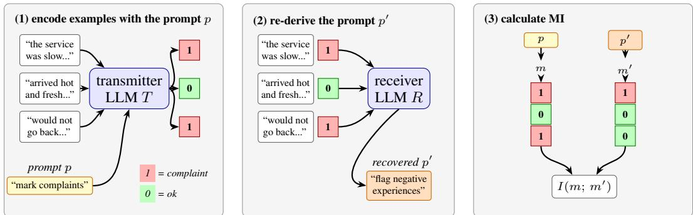  
Figure 1: Reconstruction bottleneck. We measure how well a message (i.e. the prompt p) transmits from a transmitter LLM T to a receiver LLM R. T acts as an encoder and the receiver R as a decoder; (1) T annotates each example under p; its output is shown as colored bits ( 1 = complaint, 0 = ok). (2) R sees only the annotated examples and reconstructs the prompt p′. (3) Each prompt induces a labeling of the same examples $( p  m _ { \omega } , p ^ { \prime }  m ^ { \prime } ) ;$ ; their dependence yields the mutual-information $I ( m _ { \omega } ; m ^ { \prime } )$ . We report mutual information and agreement (Section 2.2).

Next, we introduce a novel instrument to measure concept transmission between language models. We introduce a reconstruction-bottleneck, shown in Figure 1: one LLM is prompted to identify a concept in text (e.g. “does this joke end with a surprise?”); a second LLM is shown these measurements with the text and asked to generate a prompt that would have generated these labels. We measure how well the second LLM recovered the first LLM’s prompt. This bottleneck is a robust unsupervised transmission metric and, we find, reliably predicts supervised performance in cases where ground truth labels exist.

With these tools in hand, we measure scaling laws (Ruan et al., 2024) to study how transmission improves as model size increases: how well can an infinite capacity transmitter convey a perfect message to an infinite capacity receiver? Across 1.2k concepts across eight qualitative domains (Spangher et al., 2026), we identify (a) concepts that can already be articulated between language models or where transmission already reaches a threshold; we find these concepts to be determined primarily by local, self-contained patterns (e.g. setup→punchline joke mechanics); (b) concepts that may be articulable between future, more powerful language models or where scaling laws predict eventual transmission; we find these concepts to be primarily related to whole-text structural patterns (e.g. worldbuilding coherence) and (c) concepts that will likely remain tacit or where scaling laws plateau; we find these concepts are driven by “identity and social-group awareness” (Section 3). Interestingly, humans do not face low levels of agreement on the same set of bounded concepts that LLMs to; in fact, we find that humans have moderate-to-high levels of agreement in 76% of LLM-bounded concepts. This shows that our claims on articulation limits are executor relative, an executor being the model that runs a prompt (i.e. here, the transmitter).

Finally, we explore mechanisms that increase transmission in all three cases. In the first two sets of concepts, where transmission is possible, we find that explicit, direct articulations like explanations, mechanics and descriptions increase transmission the most in optimal messages. In the third case, where transmission appears less feasible, we had hypothesized that, while explicit articulation might fail, tacit knowledge could be transmitted through examples or demonstrations; while we find some evidence of this, it is limited and we are unable to conclude this form of tacit knowledge can increase transmission. Taken together, these boundaries illuminate possible shortcomings of language technology and directions of improvement.

Step 3: Prompt Upper Bounds: (i.e. estimating the value of unseen units)  
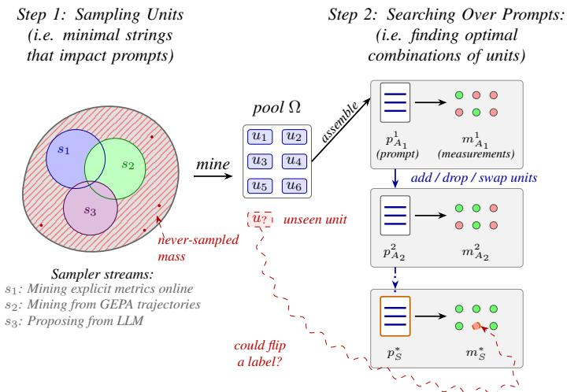  
Figure 2: Optimizing the message: The ϵ-estimation algorithm. Left: Step 1, Sampling Units: We discover semantic units with samplers $s _ { 1 } , s _ { 2 } , s _ { 3 }$ sampling from the space of all possible units. Units are minimal prompt fragments that causally alter behavior, $\mathrm { e . g . }$ for the concept “Concise Wording”, units might include: short, exact entity phrase , no filler words . Each probes a region of this space, yielding the pool Ω, and the red is space no sampler has reached. Center: Step 2, Searching Over Prompts: we develop an iterative search algorithm to assemble units into prompts $p _ { A _ { 1 } } ^ { 1 } , p _ { A _ { 2 } } ^ { 2 } , . . . , p _ { S } ^ { * } ;$ ; each labels the same datapoints $m _ { A _ { i } } ^ { i } ;$ unseen units u? may have flipped a label in $m _ { S } ^ { * }$ . Right: Step 3, Estimating Prompt Upper Bounds: We estimate the total # of units Nb with capture-recapture (Chao, 1984; Chiu et al., 2014) and the value V of the optimal prompt by extrapolating $V ( \widehat { N } ) \dot { = } \widehat { \epsilon } + V ( S )$

## 2 THE Transmitter-Message-Receiver PIPELINE

In our setting, a transmitter T attempts to transmit concepts through a channel to a receiver $R ,$ with a message, or a prompt p. We call the degree to which R recovers the concept the articulability of that concept, with respect to $T .$ , R and $p .$ An articulability upper bound for a concept is the limit of its transmissibility over optimal messages and $T$ and $R$ of infinite capacity: concepts that are more articulable can be transmitted between T and R with lower capacity and with messages that are worse; concepts that are less articulable $( \mathrm { e . g . }$ . “the aroma of coffee” ) are the opposite. We start by introducing methods for finding optimal messages: holding the transmitter and receiver fixed, we seek to estimate the performance of the optimal prompt for a concept (Section 2.1). We then introduce methods for measuring the channel between $T$ and R (Section 2.2). Finally, we analyze articulation upper bounds of concepts by scaling $p ,$ T and R (Section 3).

## 2.1 THE Message: FINDING OPTIMAL MESSAGES WITH ϵ-ESTIMATION

Our goal in this section is to develop a search algorithm that finds prompts optimal for a given LLM up to a tolerance ϵ at a confidence level δ. Existing optimizers such as GEPA improve prompts but do not estimate missing performance. Given a task (e.g. “Measure: ‘Concise Wording’ in text”) and a measurement function f , let $S = \{ s _ { 1 } , s _ { 2 } , . . . \}$ be different sampler streams finding units from $u ,$ , a space of all units. A unit, defined in the next section, is a string that minimally impacts the behavior of a prompt. The pool of recoverable units, from $\bigcup _ { i } s _ { i }$ is $\Omega \subseteq { \mathcal { U } } . { \mathfrak { p } } _ { A }$ is the prompt composed of A, a finite subset of units $A \subseteq \Omega . ^ { 3 }$ Prompts $p _ { A }$ are assembled from the pool $\Omega \subseteq { \mathcal { U } }$ such that:

$$
f ( p _ { S } ^ { * } ) \ = \ \underset { A \subseteq \Omega } { \operatorname* { m a x } } \ f ( p _ { A } ) ; \quad \mathrm { P r } \big [ f ( p _ { S } ^ { * } ) - f ( p _ { A } ) \leq \epsilon \big ] \ \geq \ 1 - \delta .\tag{1}
$$

In other words, prompt $p _ { A }$ is within ϵ of optimal prompt $p _ { S } ^ { * }$ for a given LLM. Eq. 1 is supremum over our sampling draws. Two properties make this tractable. U is a countable population whose members can be re-identified across sampling runs4 and $f ( p _ { A } )$ is well-defined and reproducible (Appendix B).

Second, because U is a population, its unseen portion is estimable: the overlap between independent sampling runs yields a capture–recapture estimate of how many units remain undrawn. We fit a value curve to estimate the value of these unseen units, which we use to calculate $f ( p _ { S } ^ { * } ) - f ( p _ { A } )$ the within-Ω search $g a p ^ { 5 }$ . This formalization has clear limits (e.g. prompts are not compositional, units might interact) which we discuss; in practice we find these do not impact our conclusions. See Appendix B and C for details, proofs and limits.

Unit mining: Creating the Search Space. To construct a search space over prompt variations, we define a semantic unit as a minimal string that, when appended to existing prompts, causally improves the executor’s performance (e.g. for the concept Concise Wording, units could be no filler words or specific formats ). Candidates sampled from S are added to Ω; they can come from multiple sampling sources; here: (1) $s _ { 1 }$ : retrieve units online, (2) $s _ { 2 } \colon$ ask an LLM directly for suggestions, and (3) s3: extract from GEPA-optimized trajectories. For each, we measure $\Delta _ { i } = E _ { p \in p r o m p t s } [ \Delta | p \oplus i ]$ , or their effect averaged across prompt variations. Units with $\Delta _ { i } \leq 0$ are dropped from Ω. A unit that does not repeatedly impact the prompt is discarded; one that does is broken down recursively until it stops impacting the prompt, giving minimal units. This atomizes our space to make it searchable. We note that atomizing our prompts as such discards many kinds of possibly useful prompt perturbations, like the prompt’s tone; thus, ϵ−estimation estimates prompt optima only with respect to our search space and sampling procedures; this, we show, is already enough to beat SOTA optimizers. 6

Unit-Space Exploration: Optimizing the Prompt. To find the optimal prompts from Ω, we sample sets of units and use a simple template to format them into a prompt $( \mathrm { i . e . } \ \cdots { < T a s k }$ Name>: <unit $i _ { 1 } > , < \mathrm { u n i t i } i _ { 2 } > , < \mathrm { u n i t i } i _ { 3 } > . . . )$ in random order. We run each prompt T times and average the performance across all variations. We then add units as follows: we measure each unit’s marginal effect on the initial prompt, add units with high marginal value, and keep each addition only if whole prompt’s score improves. We then try deleting each kept unit, removing any whose deletion costs nothing, and, in a second pass, try re-adding any skipped units that now help. We perform a check on held-out data to measure whether the prompt beats our initial prompt; if it does not, we keep the initial prompt. This is a double greedy sweep followed by a pruning-andrecovery pass, inspired by Nemhauser et al. (1978); Feige et al. (2011). Classical guarantees on the optimality of our search result7 would apply if our score function were submodular and monotone. Ours is neither: adding a unit could decrease performance and a unit’s value can depend on units are already present. We estimate how far our objective departs from submodularity by estimating the worst-case relationship between adding units individually vs. together (i.e. the submodularity ratio γ) and find γˆ ≈ 1, i.e. combining units rarely beats adding each separately; thus the observed gaps are nearly as tight as for submodular objectives (Das & Kempe, 2011; Bian et al., 2017)8.

Missing-value estimation: Projecting an Upper Bound. Finally, we estimate the impact of units our sampling streams have not yet reached. We estimate: missing mass, or how many units we have not yet found; and missing values, or how much performance units give. For missing mass, we treat new samples as independent draws from the sampling process9, if new samples are units we have already found, the space is nearly exhausted; otherwise, it is not. A capture–recapture estimate $\widehat { N } = f _ { 1 } ^ { 2 } / 2 \bar { f } _ { 2 }$ gives the total unit count, where $f _ { 1 }$ is the total number of units seen once and $f _ { 2 }$ is the total number of units seen twice10 (Chao, 1984). Nb estimates the minimum number of distinct units consistent with that sampling and thus errs low: this gives a lower bound on richness (Chiu et al.,

2014). Next, to estimate missing value from missing mass, we fit a curve $\widehat V ( k )$ to the value of units found so far and extrapolate it over unseen units, from the S seen units to the estimated total $\hat { N } ;$ this is relative to our search. ϵ-estimation’s two parameters, δ and $\epsilon ,$ trade off: δ is declared a-priori (by default, .05), while bϵ is the fitted value $\widehat { V } ( \widehat { N } ) - V ( S )$ . Sampling shrinks the unseen part of the search space, $\widehat { N } - S$ and sampling more trajectories reduces the noise in each $V ( k )$ point. In the limit, $\widehat { \epsilon }  0$ at any δ only if the unit space $\dot { \Omega }  \mathcal { U }$ (Appendix C.2). The risk exists that an unseen unit has unpredictably high effect11; in practice, we backtest on all trajectories and find negligible prediction error up to eight units ahead (Section 2.3.1, Appendix C.2). Finally, we note that these estimates are conditional on our declared samplers: they estimate the value of what this sampling process has not yet drawn, not what no sampling process could ever find. We show examples of missing value measurement in Figure 10.

## 2.2 THE Transmitter-Receiver: RECONSTRUCTION BOTTLENECK

In the previous section, we introduced ϵ-estimation, which allowed us to optimize prompts for a given language model, in terms of performance on benchmarks. However, this approach collapses the transmitter-message-receiver system by ignoring the receiver, letting it hide behind benchmark labels. Whether concepts can be successfully articulated in a way that is understood is still open. Consider an LLM-judge using a rubric to assess an agents’ output and give rewards to the agent: just because the judge can be shown to comprehend concepts in the rubric (say, on a relevant benchmark) does not mean that the agent will understand the judge’s output. The articulation of the concept requires both the transmitter (the judge) and receiver (the agent) to find agreement.

Transmitter-Receiever Agreement We now introduce an algorithm that can test whether the information provided by the transmitter can be comprehended by the receiver. Consider the following: imagine a language game (Wittgenstein, 1953) where Person A points to 10 objects and calls out “Red!”, “Blue!”, “Blue!”, “Red!”. Person B, who does not speak the same language, upon hearing $\mathbf { A } ,$ tries to deduce A’s decision function. After a while, B realizes that the concept must be “color”12. How can we measure whether B understands the concept13? If both B and $\mathbf { A }$ can now point to another 10 objects and jointly call out “Blue!”, “Red!”, thereby finding agreement, B must understand A’s decision rule to the degree B can operationalize it.

More formally, as shown in Figure 1, our algorithm measures:

$$
\begin{array} { r } { \mathrm { I } \big ( m ; m ^ { \prime } \big ) \quad \mathrm { w h e r e } \quad m _ { i } = T ( x _ { i } ; p ) , \qquad p ^ { \prime } = R \big ( \{ ( x _ { i } , m _ { i } ) \} _ { i \in D } \big ) , \qquad m _ { j } ^ { \prime } = T ( x _ { j } ; p ^ { \prime } ) , ~ j \notin D . } \end{array}\tag{2}
$$

Given a label stream $m _ { 1 } , m _ { 2 } , \ldots \in \{ 0 , 1 \}$ that T (i.e. person A) produces under $p ( \mathrm { e . g . } \ ^ {  } \mathrm { c o l o r ^ { \prime \prime } } )$ , we ask R (i.e. person B) to observe D labeled examples and reconstruct the prompt $p ^ { \prime }$ that would have generated them. We then measure transmission recovery by scoring held-out datapoints with $p ^ { \prime } ,$ producing $m ^ { \prime }$ , and measuring the mutual information between the two labelings.14 Reconstruction improves on alternatives like consistency, where a labeling is scored by its stability across samples or judges15; but also depends on assumptions: (i) the rule generating m lies in the class of rules the transmitter and receiver can express; (ii) distinct rules agree on an item with likelihood $< 1$ so the chances that n examples support a false interpretation decays exponentially; and (iii) the concept the transmitter labels is the one its prompt expresses. Reconstruction can combine with other unsupervised measures, e.g. consistency or semantic similarity16 between p and $p ^ { \prime }$

Setting ceilings and floors for the reconstruction objective. How should recovery values be interpreted? First, there exists an informational upper bound, $I ( m ; m ^ { \prime } ) \leq H ( m ) ;$ prompts with low label entropy have little information to transmit. We report $H ( m )$ alongside every recovery $I ( m ; m ^ { \prime } )$ . Secondly, we estimate the capacity of our instruments by including planted rubrics, or code-checkable rules whose ground truth we compute directly (e.g. “this text contains at least one question mark”). We compute a planted rule’s true labels ourselves and score reconstruction $m ^ { \prime }$ against ground truth: every real criterion’s recovery is read against this ceiling. We establish a lower capacity bound from a permutation null (i.e. shuffling labels on examples to evaluate leakage), and a no-demonstration null (i.e. presenting the receiver with just the prompt template). This gives a floor; we only report reconstruction above the larger of these two controls.

## 2.3 PERFORMANCE RESULTS

We measure both ϵ-estimation and the reconstruction bottleneck in two ways: (1) Labeled benchmarks: we consider 6 benchmarks that were used to evaluate GEPA (Agrawal et al., 2025). (2) Unlabeled metrics: we use 1.2k annotation tasks collected and released by Spangher et al. (2026) for understanding human preferences in creative tasks. Each task represents one metric a rubric might be composed of (e.g. in Creative Writing: “Concise Wording: Precise wordingfor drafts.”)17 Each task consists of a name, a short description and labeled examples.

## 2.3.1 ϵ-ESTIMATION RESULTS

We compare ϵ-estimation with existing prompt optimization algorithms. Table 3 compares ϵ- estimated prompts against existing prompt optimization methods (Agrawal et al., 2025; Opsahl-Ong et al., 2024). ϵ-estimation outperforms existing methods by up to 14% at an equal call budget on HotpotQA, HoVer, PUPA and AIME; and shows no significant difference on IFBench, LiveBench. See Appendix C.1 for more comparisons. We ran ablations with certain samplers, $s _ { i }$ removed: the result scores dropped insignificantly and still beats existing methods at matched budget, so either samplers converge on a region of the space or we are recovering units to saturation. On no benchmark is our prompt significantly worse. We also backtest our estimates for upper-bound performance and find a median prediction error ≈.02 $k = 8$ units ahead; at $k _ { \operatorname* { m a x } } + 5 0$ and $k { = } \infty$ , four of the six benchmarks change by ≤.01 (Appendix C). We also observe that length is not what makes a unit valuable: over 360 units in five pools, a unit’s length and its marginal gain have no correlation (Appendix D.2).

## 2.3.2 RECONSTRUCTION BOTTLENECK RESULTS

We run the reconstruction bottleneck on 1, 270 annotation tasks released by Spangher et al. (2026), Figure 10 (right) reports results for 272 of these. First, we ask whether reconstruction is a useful objective: does optimizing prompts for reconstruction MI beat optimizing them using other optimizers? We compare $m _ { r e c }$ (labels made by prompts optimized via the reconstruction objective) against: $m _ { L L M }$ (labels made by prompts selected by an LLM-critic objective18), and $m _ { d e s c }$ (labels made by a simple prompt using the criterion’s description text, given by Spangher et al. (2026)). Optimization for sender and receiver is done with ϵ-estimation. Reconstruction beats an LLM critic: matched comparison gives a margin of +.033 AUC (99 wins to 54 losses). Against $m _ { d e s c } ,$ reconstruction matches but does not beat it; by Spangher et al. (2026)’s construction, labels were annotated in part using description text, so the description has an advantage.

Next, we ask whether reconstruction MI has criterion validity: as MI improves, does independentlymeasured error also decrease? For each metric, we gather prompt forms across the optimization trajectory (roughly 10–30 per metric) and, for each prompt, calculate MI and AUC. We then correlate MI with AUC within each metric. Correlations run .37–.68 (Appendix D.3), with permutation $p <$ .006. Code review, for example, correlates at $\rho = . 6 2$ . Overall, our prior two results indicate that reconstruction is a valid unsupervised metric and a more useful optimization objective than other unsupervised objectives. Transfer across model families, (prompt author, transmitter) pairs and planted-rule recovery are reported in Appendix D.

## 3 ARTICULATION UPPER BOUNDS: OBSERVATIONAL SCALING LAWS FOR TRANSMITTER-RECEIVERS

Now we study articulation scaling behaviors. Does a concept fail to transmit, even with optimal messages, simply because the receiver does not know enough? For example, does “the aroma of coffee” become articulable to a receiver who has background knowledge (e.g. “acidic chemistry”) or the ability to compare (e.g. “nuttiness” vs. “fruitiness”; “Kona” vs. “Costa Rican”)? Conversely, between infinitely capable interlocutors, are there concepts that we cannot fully transmit?

To address this problem, we operationalize observation scaling laws in the transmitter-messagereceiver pipeline as follows. For each annotation task, we run comparisons of sender and receiver models across all pairs of 14 models from five families (Llama, Qwen2.5, Gemma-2, Mistral, Phi) from 1.2B to 73B parameters. Then, for each sender-receiver pair, we optimize messages they send by running ϵ-estimation until we have stable estimates of k → ∞ units. We report this estimate as the transmission score. To compare model families across scaling sizes, we measure each model’s latent capability index, inspired by Ruan et al. (2024). Our measure of latent capability, z, is model performance on 240 code-checkable judgments (e.g. negation, presence, threshold, paraphrase and composite checks); this, we find agrees with benchmark reports19 at $r = . 6 4 – . 8 7$ . For each of our 1,270 tasks, we fit recovery against $z ^ { 2 0 } ;$ we label the curve saturating when the fit is logistic and then sort each curve into a regime. A saturating curve is bounded when the upper confidence limit of its ceiling is below a threshold21 and reaches if it is above the threshold; an unsaturated curve is rising when it’s curve is can be fit linearly 22 . See Appendix F, E and F.1 for more details.

Finding #1: Articulation scales in three regimes: concepts that are still-climbing (rising), attained (reaches), and capped (bounded); bounded concepts are socially anchored. Our goal here is to explore how concept transmission expands as transmitter capability, z, grows23. We find, as in Ruan et al. (2024), that scaling curves are regular enough to predict performance at larger models: refitting each curve without its most capable executor predicts that executor’s value with median error .062, or 9% of the held-out value24, Appendix F. Next, we examine which annotation tasks fit into which regimes: Figure 5 shows every metric annotated with attributes of how we expect it to behave25. We find that rising criteria skew toward whole-text structural patterns and verifiable features (28% and 29% of rising metrics fit these patterns): these are long compositional constructions (e.g. “worldbuilding coherence: rules and internal logic”, “scene craft: objective, conflict, change, escalation”) and more complex but objective features (e.g. “claim–evidence alignment and causal caution”). Reaches criteria, on the other hand, tend to be local patterns within the document (34% of reaching metrics): these are self-contained devices a mid-scale model already recognizes completely (e.g. setup→punchline mechanics, endings). Finally, bounded criteria are distinguished by content that lives outside the artifact: identity & social-group awareness (23% of bounded tasks) and beyond-text features $( 1 5 \% ) ^ { 2 6 } .$ . These are criteria dependent on audiences, identities, and communities, and accord with Collins (2010) notion of collective tacit knowledge. For each domain, we also analyze which regime its metrics fall into. Figure 4 shows the regime×domain composition directly: bounded metrics exist in humor, news homepages, peer review, and creative writing. Appendix G defines each category and gives example criteria.

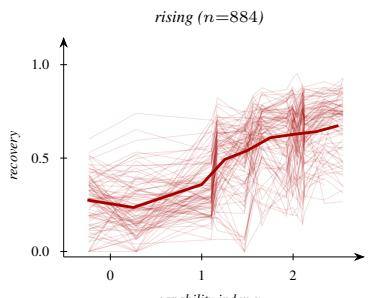

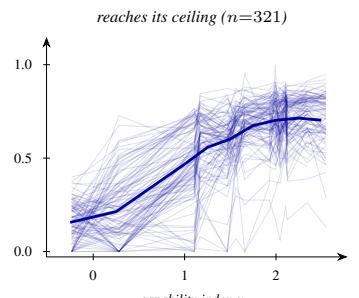

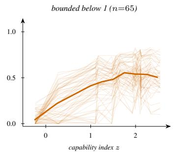  
Figure 3: Unsupervised articulation scaling, split by fitted regime. Each faint trace is one task’s recovery against the capability index z (14 executors, five model families); the heavy line is the within-regime binned mean. Rising $\scriptstyle ( n = 8 8 4 )$ : still climbing at the largest observed z. Reaches $\scriptstyle ( n = 3 2 1 )$ ): the executor’s estimated ceiling is attained within observed z. Bounded $( n { = } 6 5 )$ : recovery sits below the executor’s ceiling’s upper confidence limit, or the planted rules’ mean agreement. These concepts stay partly inarticulable relative to the instrument (the 40 planted rules are not fit).

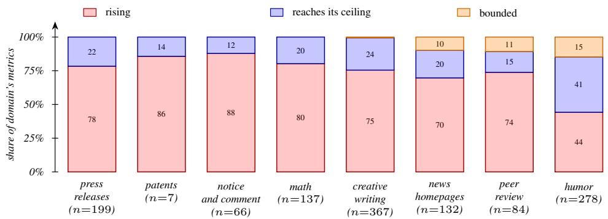  
Figure 4: Regime composition by domain (each bar sums to 100% of that domain’s fitted tasks, ordered by bounded share). Bounded mass is confined to humor, peer review, news homepages, and marginally creative writing; the four remaining domains are bounded-free.

Finding #2: Articulation strategies that emerge across tasks: definitions and explanations help rising tasks; examples (i.e. showing, not telling) help bounded concepts in limited cases. Across models, we categorize optimal prompts in terms of components: concept NAME, DEFINI-TION, mechanistic EXPLANATION, and a FULL PACKET (i.e. name, definition, explanation and few-shot examples). Doing this tells us which message form each receiver needs. First, as found in prior work (Wei et al., 2022), strategies emerge with scaling. At small model scales, $\mathrm { o r } \le 3 \mathrm { B }$ parameters, no articulation strategy emerges and even planted mechanical rules execute at chance; at mid scale, definitions and explanations emerge as effective articulations (explanations perform best for 47% of concepts at 7B); the full packet performs best at the largest receivers (66% at 70B).

Providing examples behave differently from prose. We had hypothesized that tacit meaning might transmit with in-context learning: colloquially, humans can show even if we cannot tell. To test this, we added examples to transmitter prompts for 449 bounded metrics27: two that the transmitter labeled YES and two it labeled NO. Examples, we found, barely outperformed the definition-only message: at Qwen2.5-14B and Llama-70B, recovery rises by +.006 bits, and at the three smaller transmitters it falls slightly. 43 metrics with Llama-70B and 42 with Qwen2.5-14B significantly improved28, and 4 exceed it at both models. These are thematically coherent: for example, “delivery and timing craft” (+.17 bits), “incongruity and surprise” (+.03) and “conflict/tension as news value” (+.04); they are novelty and craft metrics. Humor metrics overall have the most positive impact from in-context learning at +.008 and peer review least at +.005. Interestingly, while examples the transmitter writes itself raise recovery for bounded criteria more than any other regime, the effects are model-dependent: +.011 for Qwen2.5-14B and +.007 bits for Llama-70B vs. −.023 for Phi-4 and −.018 for Qwen2.5-7B (Appendix H). This contradicts prior in-context learning research which typically points to the benefits of providing examples (Brown et al., 2020); it’s possible that the concepts we study had already been internalized by the model or sit at the edge of resolution.

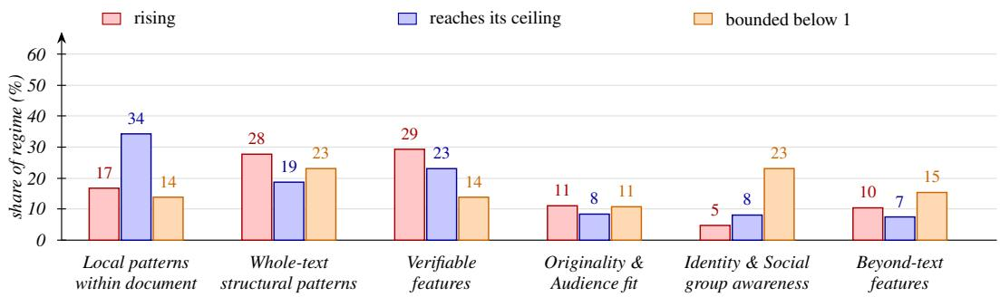  
Figure 5: What kind of criterion lands in each scaling regime (1,270 unsupervised tasks, the full 12-category version is Appendix Fig. 14; category definitions and example criteria are Appendix G). Rising skews to whole-text structural patterns and verifiable features; reaches to local patterns; bounded tasks involve identity & social-group awareness and beyond-text features.

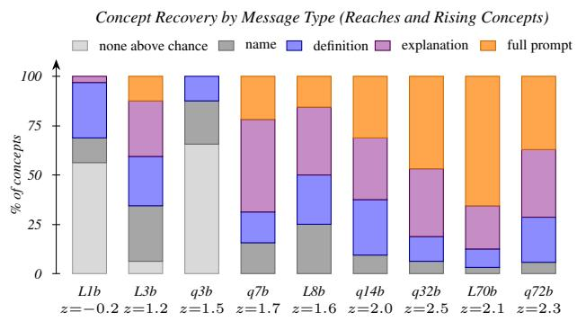

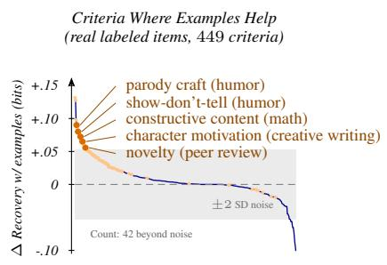  
Figure 6: Which articulation strategy recovers each concept. Left: the message form that recovers Reaches and Rising concepts, by receiver. The grey share is concepts for which no form reaches .55 balanced accuracy against the held-out reference. Definitions and explanations carry the middle of the ladder, and the full packet is needed only at the top. Right: examples under the best method, four real items carrying the transmitter’s own labels (Appendix H): each of the 449 criteria’s gain in recovery over the definition-only message, $\Delta I ( m ; m ^ { \bar { \prime } } )$ averaged over Qwen2.5-14B and Llama-70B, ranked. The grey band is two standard deviations of reconstruction noise (pooled .054 bits). 42 criteria clear it at Qwen2.5-14B and 43 at Llama-70B; four clear it at both (about four are expected by chance). Named points are examples from five tasks.

Finding #3: Articulability is not based on pretraining, concept diffuseness or post-training dynamics. Finally, we attempt to explain whether learning mechanisms impact transmission of concepts. We first study pretraining dynamics. Exposure alone does not explain the ordering, measured as name-term frequency in training data: across all 1,270 fitted metrics, reaching behavior, or acquisition onset, is uncorrelated with the corpus frequency of the concept’s name terms: some criteria are acquired far earlier than frequency predicts; on the other hand, more common vocabulary criteria (e.g. “active voice”, “provide context”) are acquired late. We then tested whether acquisition tracks the form of the concept: do compact concepts, defined in Spangher et al. (2026) as concepts with few synonyms, internalize better while diffuse abstractions late? Overall, we find, it does not; compact and diffuse concepts are indistinguishable once exposure is accounted for (Appendix I). We observe that internalization is family-relative: a name that suffices in one model family still needs its definition in another, so in these cases is internalized is a property of the receiver, not of the concept. Finally, we observe that for metrics that are bounded (i.e. their scaling curve plateaus below the planted-rule ceiling) no acquisition exists in any model family. We examine post-training effects: running base and post-trained models through the same prompt scaffold, the post-trained model recovers +.036 more on reaches constructs and +.034 on rising ones, but only +.008 on bounded ones (Appendix J.6). Taken together, neither exposure nor behavioral reinforcement seem to impact transmission of bounded concepts.

## 4 DISCUSSION

We started by defining the language limits or articulation upper bounds for a class of executors (e.g. LLMs) with the question: how well can an infinite-capacity transmitter convey a perfect message to an infinite-capacity receiver? We introduced two techniques to measure this: ϵ-estimation to optimize messages and reconstruction-bottleneck to measure transmitter-receiver transmission; we used these tools to observe how transmission grows as LLMs scale. Most of the 1,270 concepts we measured, we found, were either transmissible now (321 concepts), or could be with future scaled models (884 concepts). Only 65 plateau, or were bounded. Larger, more powerful versions of these same models, it seems, with better messages and richer inputs do not increase transmission for these concepts. What are these concepts, and why do they resist articulation even in the limits?

Our first piece of evidence is gained from labeling them: these 65 concepts primarily capture the identities and social groups of who wrote the text and who it is for (e.g. a persona held across a body of work, a community’s in-jokes). This description aligns with Collins (2010)’s view of collective tacit knowledge: concepts that name social norms might resist articulation because these norms capture personal or social existence; the fact we observe that transmission is bounded indicates that language models do not possess the tacit knowledge required to jointly interpret these concepts (see Appendix J.7). To more fully probe this claim, we ruled out certain null hypotheses: maybe these concepts were articulable and not categorically different than saturating concepts, but did not transmit simply because they happened to be collinear with other concepts over some regions of the space, or were rarer labels. We test these (see Appendix J) by using more transmission labels, m; we find that transmission plateaus at |m| = 30 examples and bounded concepts remain bounded. Giving the receiver 90 labeled items instead of 30 does not raise recovery on bounded concepts; neither does extending scaling past its strongest member: GPT-5.6, far above every panel executor on the capability index, leaves all 65 bounded concepts below the planted reference (Appendix J.3 and J.4). We also asked whether bounded concepts were simply the ones our models labeled inconsistently, or the ones where the largest models agreed with each other but not with the rest of the panel. Neither was true: bounded concepts are labeled as reliably as the others, and the largest models agree with each other least on them (Appendix J). Second, we hypothesized that maybe language models had already internalized this information but simply could not express it in stated rules. With demonstrations and examples, maybe, a model would be able to show but not tell (Polanyi, 1966); however, our hypothesis was incorrect, we found that showing transmits no more than telling (Finding $2 ) ^ { 2 9 }$

The above results indicate that such knowledge may not exist, already, in models. To gain more insight into how and when these concepts are learned we probed learning mechanisms by which knowledge does enter models. First, we hypothesized that frequency and exposure in training datasets would have a strong impact on acquisition of all concepts (Reber, 1967; 1989; 1993) via the distributional hypothesis (Harris, 1954). However, nothing we measured in pretraining predicts which concepts a model internalizes (Finding 3). The frequency with which a concept’s name appears in pretraining data does not predict when it is acquired, nor does the type of concept; whether the concept is diffuse, with many of synonyms or whether it is compact with few representations. Next, we tested whether behavioral learning, or post-training, can impact transmission rates Skinner (1957). Post-training, we find, does help transmission in rising and reaches concepts, but not bounded. Base models and their post-trained siblings are bounded on the same constructs, and post-training adds recovery only where recovery already moves, so the plateau is not an artifact of post-training. Neither the distributional hypothesis nor behavioral mechanisms seem to be able to help models this class of bounded concepts.

Finally, just because a concept has asymptotically bounded transmission under one class of executors (e.g. LLMs trained under roughly similar training recipes) does not mean it is inarticulable under all executors. Humans, for example, have been shown to have high rates of agreement, or transmission, for certain concepts that appear as bounded in our experiments: e.g. “satire $t a r g e t ^ { \prime \prime } ,$ , where trained annotators agree on whom a dark-humor meme targets at $\kappa = . 7 2$ (Kasu et al., 2025); $" p a r o d y " ,$ which trained coders mark in television scenes at $\alpha = . 8 2$ (van der Wal et al., 2020); and “personal self-disclosure”, which annotators mark in forum posts at $\kappa = . 8 8$ (Valizadeh et al., 2021). For each of the 65 bounded concepts, we searched for prior literature30 and found human agreement studies for 37 bounded concepts; of these, humans agree moderately-to-highly on 76% and poorly on $2 4 \% ^ { 3 1 }$ . On the other hand, some concepts are bounded both for LLMs as well as humans. Human annotators agree on “originality of premise” at κ = .19 (Amir et al., 2026); visual promotability, i.e. clickbait strength, at $\kappa = . 2 1$ (Potthast et al., 2018); and the exercise quality of educational materials at a single-rater intraclass correlation of .13 to .55 (Vargo et al., 2003). We repeated this experiment with rising and reaches concepts and also found an imperfect overlap: 679 reaches and rising concepts had prior work measuring human agreement and humans agree poorly on 53% of them, e.g. laugh yield $( \alpha = . 1 2$ ; Meaney et al., 2021), balance and freedom from bias $( \kappa = . 2 1 ;$ Spinde et al., 2021) and argumentation quality in public comments $( \kappa = . 1 4 - . 2 0 ;$ Falk & Lapesa, 2022), all concepts that LLMs transmit at or toward the planted-rule level (Appendix J.7). Thus, our articulability upper bound findings only have implications within the classes of models that we study; articulation limits are executor-family relative.

In summary, we see more work to be done to characterize this class of bounded concepts. Many bounded concepts tie to identity and social group are often also ones we wish our models to understand in order to perform frontier tasks (Kripke, 1982; Bai et al., 2022; Sap et al., 2022; Santy et al., 2023; Sorensen et al., 2024). Our finding that they may not be articulable by current model families, prompt strategies or learning strategies has important implications for language modeling. Looking forward, to keep making aligned progress on frontier tasks, we see the need for a deeper understanding of how such knowledge may be acquired and the learning mechanisms to help us continue to make progress.

## 5 CONCLUSION

We studied articulation upper bounds for classes of executors, or how much of a concept can be transmitted from one language model to another with optimal messages. We built two tools to answer this: ϵ-estimation finds the best message a transmitter can send and estimates how far that message is from the best possible one; the reconstruction bottleneck measures how much of a message a receiver recovers, without human labels. Finally, we use observational scaling laws to extrapolate both along model capability. Across 1,270 concepts from eight domains, most concepts can be articulated between language models now or will be with scale. A small set tied to identity and social group stays bounded in every model family we tested; examples and larger models largely do not change this performance. We release the tools and every analysis (Appendix L) so that rubrics and constitutions can be measured, per model, before they are relied on. Our work represents a potentially novel way to benchmark frontier performance and a call for novel learning techniques.

Limitations. Our work needs to be taken with the following limitations. The reconstruction measure, by design, was unsupervised and, although it correlated strongly on tasks where human labels exist, it used no human labels. Like other unsupervised measures (e.g. consistency (Wang et al., 2023)), it has it’s own set of flaws: reconstruction can reward any rule the receiver can restate consistently with the sender, including a wrong one (Appendix D.1). Additionally, while our definition of rising, reaches and bounded is consistent on a population level, which bands individual concepts falls in is less certain: nder resampling, 163 of the 1,270 concepts have less than a .6 chance of landing in their printed regime, though the sizes and makeup of the regimes hold (Appendix F.1). In our testing of learning mechanisms, our measurement for the frequency of a concept’s name terms, is coarse and done through Dolma, which is not necesssarily the same training dataset as major open-source models. Finally, we specifically studied eight creative and qualitative domains; we do not know whether factual or procedural concepts behave the same way.

## REFERENCES

Lakshya A Agrawal, Shangyin Tan, Dilara Soylu, Noah Ziems, Rishi Khare, Krista Opsahl-Ong, Arnav Singhvi, Herumb Shandilya, Michael J Ryan, Meng Jiang, Christopher Potts, Koushik Sen, Alexandros G. Dimakis, Ion Stoica, Dan Klein, Matei Zaharia, and Omar Khattab. Gepa: Reflective prompt evolution can outperform reinforcement learning, 2025. URL https:// arxiv.org/abs/2507.19457. Accepted at ICLR 2026 (Oral).

Jennifer Allen, Antonio A. Arechar, Gordon Pennycook, and David G. Rand. Scaling up factchecking using the wisdom of crowds. Science Advances, 7(36):eabf4393, 2021. doi: 10.1126/ sciadv.abf4393.

Ori Amir, Huyen Ngo, Joe Toplyn, and Kevin Hickerson. Navigating the joke space: Towards automated originality assessment of AI-generated humor. In Proceedings ofthe 2nd Workshop on Computational Humor (CHum 2026), pp. 95–105, 2026. doi: 10.18653/v1/2026.chum-1.8.

Noushin Rezapour Asheghi, Serge Sharoff, and Katja Markert. Designing and evaluating a reliable corpus of web genres via crowd-sourcing. In Proceedings of the Ninth International Conference on Language Resources and Evaluation (LREC’14), pp. 1339–1346, 2014. URL https:// aclanthology.org/L14-1398/.

John Baer, James C. Kaufman, and Claudia A. Gentile. Extension of the consensual assessment technique to nonparallel creative products. Creativity Research Journal, 16(1):113–117, 2004. doi: 10.1207/s15326934crj1601 11.

Yuntao Bai, Saurav Kadavath, Sandipan Kundu, Amanda Askell, Jackson Kernion, Andy Jones, Anna Chen, Anna Goldie, Azalia Mirhoseini, Cameron McKinnon, et al. Constitutional AI: Harmlessness from AI feedback. arXiv preprint arXiv:2212.08073, 2022.

William G Baxt, Joseph F Waeckerle, Jesse A Berlin, and Michael L Callaham. Who reviews the reviewers? feasibility of using a fictitious manuscript to evaluate peer reviewer performance. Annals of Emergency Medicine, 32(3):310–317, 1998. doi: 10.1016/S0196-0644(98)70006-X.

Md Momen Bhuiyan, Amy X. Zhang, Connie Moon Sehat, and Tanushree Mitra. Investigating differences in crowdsourced news credibility assessment. Proceedings of the ACM on Human-Computer Interaction, 4(CSCW2):1–26, 2020. doi: 10.1145/3415164.

Andrew An Bian, Joachim M. Buhmann, Andreas Krause, and Sebastian Tschiatschek. Guarantees for greedy maximization of non-submodular functions with applications. In Proceedings of the 34th International Conference on Machine Learning (ICML), 2017.

Lutz Bornmann, Rudiger Mutz, and Hans-Dieter Daniel. A reliability-generalization study ofjournal¨ peer reviews: A multilevel meta-analysis of inter-rater reliability and its determinants. PLoS ONE, 5(12):e14331, 2010. doi: 10.1371/journal.pone.0014331.

Anneliese Brei, Katharine Henry, Abhisheik Sharma, Shashank Srivastava, and Snigdha Chaturvedi. Classifying unreliable narrators with large language models. In Proceedings of the 63rd Annual Meeting of the Association for Computational Linguistics (Volume 1: Long Papers), pp. 20766– 20791. Association for Computational Linguistics, 2025. doi: 10.18653/v1/2025.acl-long.1013.

Tom B. Brown, Benjamin Mann, Nick Ryder, Melanie Subbiah, Jared Kaplan, Prafulla Dhariwal, Arvind Neelakantan, Pranav Shyam, Girish Sastry, Amanda Askell, Sandhini Agarwal, Ariel Herbert-Voss, Gretchen Krueger, Tom Henighan, Rewon Child, Aditya Ramesh, Daniel M. Ziegler, Jeffrey Wu, Clemens Winter, Christopher Hesse, Mark Chen, Eric Sigler, Mateusz Litwin, Scott Gray, Benjamin Chess, Jack Clark, Christopher Berner, Sam McCandlish, Alec Radford, Ilya Sutskever, and Dario Amodei. Language models are few-shot learners. In Advances in Neural Information Processing Systems, volume 33, 2020.

Marc Brysbaert, Amy Beth Warriner, and Victor Kuperman. Concreteness ratings for 40 thousand generally known English word lemmas. Behavior Research Methods, 46(3):904–911, 2014. doi: 10.3758/s13428-013-0403-5.

Niv Buchbinder, Moran Feldman, Joseph (Seffi) Naor, and Roy Schwartz. Submodular maximization with cardinality constraints. In Proceedings of the 25th Annual ACM-SIAM Symposium on Discrete Algorithms (SODA), 2014.

Niv Buchbinder, Moran Feldman, Joseph (Seffi) Naor, and Roy Schwartz. A tight linear time (1/2)- approximation for unconstrained submodular maximization. SIAM Journal on Computing, 44(5): 1384–1402, 2015.

Isabel Cachola, Daniel Khashabi, and Mark Dredze. Evaluating the evaluators: Are readability metrics good measures of readability? In Proceedings ofthe 2025 Conference on Empirical Method in Natural Language Processing, pp. 24022–24038, 2025. doi: 10.18653/v1/2025.emnlp-main. 1225.

Chris Callison-Burch, Cameron Fordyce, Philipp Koehn, Christof Monz, and Josh Schroeder. (meta-) evaluation of machine translation. In Proceedings of the Second Workshop on Statistical Machine Translation, pp. 136–158. Association for Computational Linguistics, 2007. doi: 10.3115/1626355.1626373.

Dallas Card, Amber E. Boydstun, Justin H. Gross, Philip Resnik, and Noah A. Smith. The media frames corpus: Annotations of frames across issues. In Proceedings of the 53rd Annual Meeting of the Association for Computational Linguistics and the 7th International Joint Conference on Natural Language Processing (Volume 2: Short Papers), pp. 438–444. Association for Computational Linguistics, 2015. doi: 10.3115/v1/P15-2072.

Nicholas Carlini, Daphne Ippolito, Matthew Jagielski, Katherine Lee, Florian Tramer, and Chiyuan Zhang. Quantifying memorization across neural language models. In International Conference on Learning Representations (ICLR), 2023.

Santiago Castro, Luis Chiruzzo, Aiala Rosa, Diego Garat, and Guillermo Moncecchi. A crowd-´ annotated Spanish corpus for humor analysis. In Proceedings of the Sixth International Workshop on Natural Language Processing for Social Media, pp. 7–11. Association for Computational Linguistics, 2018. doi: 10.18653/v1/W18-3502.

Tuhin Chakrabarty, Philippe Laban, Divyansh Agarwal, Smaranda Muresan, and Chien-Sheng Wu. Art or artifice? large language models and the false promise of creativity. In Proceedings of the CHI Conference on Human Factors in Computing Systems, pp. 1–34. ACM, 2024. doi: 10.1145/ 3613904.3642731.

Tuhin Chakrabarty, Jane C. Ginsburg, and Paramveer Dhillon. Readers prefer outputs of AI trained on copyrighted books over expert human writers, 2025a. URL https://arxiv.org/abs/ 2510.13939. Also SSRN, doi:10.2139/ssrn.5606570.

Tuhin Chakrabarty, Philippe Laban, and Chien-Sheng Wu. Can AI writing be salvaged? mitigating idiosyncrasies and improving human-AI alignment in the writing process through edits. In Proceedings of the 2025 CHI Conference on Human Factors in Computing Systems, pp. 1–33. ACM, 2025b. doi: 10.1145/3706598.3713559.

Anne Chao. Nonparametric estimation of the number of classes in a population. Scandinavian Journal ofStatistics, 11(4):265–270, 1984.

Cyril Chhun, Pierre Colombo, Fabian M. Suchanek, and Chloe Clavel. Of human criteria and auto-´ matic metrics: A benchmark of the evaluation of story generation. In Nicoletta Calzolari, Chu-Ren Huang, Hansaem Kim, James Pustejovsky, Leo Wanner, Key-Sun Choi, Pum-Mo Ryu, Hsin-Hsi Chen, Lucia Donatelli, Heng Ji, Sadao Kurohashi, Patrizia Paggio, Nianwen Xue, Seokhwan Kim, Younggyun Hahm, Zhong He, Tony Kyungil Lee, Enrico Santus, Francis Bond, and Seung-Hoon Na (eds.), Proceedings of the 29th International Conference on Computational Linguistics, pp. 5794–5836, Gyeongju, Republic of Korea, October 2022. International Committee on Computational Linguistics. URL https://aclanthology.org/2022.coling-1.509/.

Chun-Huo Chiu, Yi-Ting Wang, Bruno A Walther, and Anne Chao. An improved nonparametric lower bound of species richness via a modified Good–Turing frequency formula. Biometrics, 70 (3):671–682, 2014.

Hyundong Cho and Jonathan May. Grounding conversations with improvised dialogues. In Proceedings of the 58th Annual Meeting of the Association for Computational Linguistics, pp. 2398–2413, 2020. doi: 10.18653/v1/2020.acl-main.218.

Lukas Christ, Shahin Amiriparian, Manuel Milling, Ilhan Aslan, and Bjorn W. Schuller. Auto-¨ matic emotion modelling in written stories, 2022. URL https://arxiv.org/abs/2212. 11382.

I. T. Cohen and K. Patel. Peer review interrater reliability of scientific abstracts: A study of an anesthesia subspecialty society. Journal ofEducation in Perioperative Medicine, 7(2):E035, 2005. doi: 10.46374/volvii-issue2-cohen2.

Harry Collins. Tacit and Explicit Knowledge. University of Chicago Press, Chicago, 2010.

Francesca Da Ros, Tarik Zaciragi ˇ c, Aske Plaat, Thomas B ´ ack, and Niki van Stein. Assessing repro-¨ ducibility in evolutionary computation: A case study using human- and LLM-based assessment. In Proceedings of the Genetic and Evolutionary Computation Conference (GECCO), pp. 13–22, 2026. doi: 10.1145/3795095.3805069.

Abhimanyu Das and David Kempe. Submodular meets spectral: Greedy algorithms for subset selection, sparse approximation and dictionary selection. In Proceedings of the 28th International Conference on Machine Learning (ICML), 2011.

Madison Van Doren, Casey Ford, Jennifer Barajas, Riley VanMeter, and Cory Holland. “be my cheese?”: Cultural nuance benchmarking for machine translation in multilingual LLMs, 2026. URL https://arxiv.org/abs/2602.04729. To appear at the GEM workshop, ACL 2026.

Kathleen Dziak, Roger Anderson, Mary Ann Sevick, Carol S. Weisman, Douglas W. Levine, and Sarah Hudson Scholle. Variations among institutional review board reviews in a multisite health services research study. Health Services Research, 40(1):279–290, 2005. doi: 10.1111/j.1475-6773.2005.00353.x.

Tanya Evans, Juan Pablo Mej´ıa-Ramos, and Matthew Inglis. Do mathematicians and undergraduates agree about explanation quality? Educational Studies in Mathematics, 111(3):445–467, 2022. doi: 10.1007/s10649-022-10164-2.

Alexander R. Fabbri, Wojciech Krysci´ nski, Bryan McCann, Caiming Xiong, Richard Socher, and´ Dragomir Radev. SummEval: Re-evaluating summarization evaluation. Transactions of the Associationfor Computational Linguistics, 9:391–409, 2021. doi: 10.1162/tacl a 00373.

Neele Falk and Gabriella Lapesa. Scaling up discourse quality annotation for political science. In Nicoletta Calzolari, Fred´ eric B´ echet, Philippe Blache, Khalid Choukri, Christopher Cieri, Thierry´ Declerck, Sara Goggi, Hitoshi Isahara, Bente Maegaard, Joseph Mariani, Hel´ ene Mazo, Jan Odijk,\` and Stelios Piperidis (eds.), Proceedings of the Thirteenth Language Resources and Evaluation Conference, pp. 3301–3318, Marseille, France, June 2022. European Language Resources Association. URL https://aclanthology.org/2022.lrec-1.353/.

Uriel Feige, Vahab S. Mirrokni, and Jan Vondrak. Maximizing non-monotone submodular functions.´ SIAM Journal on Computing, 40(4):1133–1153, 2011.

Evelyn Gius, Nils Reiter, and Marcus Willand. Foreword to the special issue “a shared task for the digital humanities: Annotating narrative levels”. Journal of Cultural Analytics, 4(3), 2019. doi: 10.22148/16.047.

Anisha Gunjal, Anthony Wang, Elaine Lau, Vaskar Nath, Yunzhong He, Bing Liu, and Sean Hendryx. Rubrics as rewards: Reinforcement learning beyond verifiable domains, 2025. URL https://arxiv.org/abs/2507.17746.

Tom E. Hardwicke, Maya B. Mathur, Kyle MacDonald, Gustav Nilsonne, George C. Banks, Mal lory C. Kidwell, Alicia Hofelich Mohr, Elizabeth Clayton, Erica J. Yoon, Michael Henry Tessler, Richie L. Lenne, Sara Altman, Bria Long, and Michael C. Frank. Data availability, reusability, and analytic reproducibility: evaluating the impact of a mandatory open data policy at the journal Cognition. Royal Society Open Science, 5(8):180448, 2018. doi: 10.1098/rsos.180448.

Zellig S. Harris. Distributional structure. Word, 10(2-3):146–162, 1954. doi: 10.1080/00437956. 1954.11659520.

Lisa Hartling, Michele P. Hamm, Andrea Milne, Ben Vandermeer, P. Lina Santaguida, Mohammed Ansari, Alexander Tsertsvadze, Susanne Hempel, Paul Shekelle, and Donna M. Dryden. Testing the risk of bias tool showed low reliability between individual reviewers and across consensus assessments of reviewer pairs. Journal of Clinical Epidemiology, 66(9):973–981, 2013. doi: 10.1016/j.jclinepi.2012.07.005.

Avinatan Hassidim and Yaron Singer. Submodular optimization under noise. In Proceedings of the 30th Conference on Learning Theory (COLT), 2017.

Madeleine Henderson and Liane Gabora. The recognizability of authenticity. In Markus Knauff, Michael Pauen, Natalie Sebanz, and Ipke Wachsmuth (eds.), Proceedings of the 35th Annual Meeting of the Cognitive Science Society, pp. 2524–2529, Austin, TX, 2013. Cognitive Science Society. URL https://arxiv.org/abs/1308.4707.

R. Lance Holbert, Jay Hmielowski, Parul Jain, Julie Lather, and Alyssa Morey. Adding nuance to the study of political humor effects: Experimental research on Juvenalian satire versus Horatian satire. American Behavioral Scientist, 55(3):187–211, 2011. doi: 10.1177/0002764210392156.

Runsheng Huang, Liam Dugan, Yue Yang, and Chris Callison-Burch. MiRAGeNews: Multimodal realistic AI-generated news detection. In Findings of the Association for Computational Linguistics: EMNLP 2024, pp. 16436–16448, 2024. doi: 10.18653/v1/2024.findings-emnlp.959.

Yumi Hughes, Kae Mukai, Jun Nitta, Katsumi Watanabe, and Kazutoshi Kudo. Where does improvisation emerge in improvisational theater acting? An online discrimination experiment with audiovisual conditions. Cognitive Studies: Bulletin of the Japanese Cognitive Science Society, 33 (2):190–200, 2026. doi: 10.11225/cs.2026.002. In Japanese with English abstract.

Clifford M. Hurvich and Chih-Ling Tsai. Regression and time series model selection in small samples. Biometrika, 76(2):297–307, 1989.

Matthew Inglis, Juan Pablo Mej´ıa-Ramos, Keith Weber, and Lara Alcock. On mathematicians’ different standards when evaluating elementary proofs. Topics in Cognitive Science, 5(2):270– 282, 2013. doi: 10.1111/tops.12019.

Sydney Danielle Johns, Sanjeev Parthasarathy, Shantnu Bhalla, and Vaibhav Garg. When jokes cross the line: Analyzing regular humor and dark humor in YouTube shorts, 2026. URL https: //arxiv.org/abs/2606.00046.

Nikhil Kandpal, Haikang Deng, Adam Roberts, Eric Wallace, and Colin Raffel. Large language models struggle to learn long-tail knowledge. In Proceedings ofthe 40th International Conference on Machine Learning (ICML), 2023.

Sai Kartheek Reddy Kasu, Mohammad Zia Ur Rehman, Shahid Shafi Dar, Rishi Bharat Junghare, Dhanvin Sanjay Namboodiri, and Nagendra Kumar. D-HUMOR: Dark humor understanding via multimodal open-ended reasoning. In 2025 IEEE International Conference on Data Mining (ICDM), pp. 377–386, 2025. doi: 10.1109/ICDM65498.2025.00045.

James C. Kaufman, John Baer, Jason C. Cole, and Janel D. Sexton. A comparison of expert and nonexpert raters using the consensual assessment technique. Creativity Research Journal, 20(2): 171–178, 2008. doi: 10.1080/10400410802059929.

Mary Ogbuka Kenneth, Foaad Khosmood, and Abbas Edalat. A two-model approach for humour style recognition. In Proceedings of the 4th International Conference on Natural Language Processingfor Digital Humanities (NLP4DH), pp. 259–274, 2024. doi: 10.18653/v1/2024.nlp4dh-1. 25.

Maria Korobeynikova, Alessia Battisti, Lukas Fischer, and Yingqiang Gao. DETECT: Determining ease and textual clarity of German text simplifications. In Proceedings of the 19th Conference of the European Chapter of the Association for Computational Linguistics (EACL), pp. 2852–2882, 2026. doi: 10.18653/v1/2026.eacl-long.131.

Andreas Krause and Daniel Golovin. Submodular function maximization. In Tractability: Practical Approaches to Hard Problems, pp. 71–104. Cambridge University Press, 2014.

Richard L. Kravitz, Peter Franks, Mitchell D. Feldman, Martha Gerrity, Cindy Byrne, and William M. Tierney. Editorial peer reviewers’ recommendations at a general medical journal: Are they reliable and do editors care? PLoS ONE, 5(4):e10072, 2010. doi: 10.1371/journal.pone. 0010072.

Saul A. Kripke. Wittgenstein on Rules and Private Language. Harvard University Press, 1982.

Justin Kruger, Cameron L. Gordon, and Jeff Kuban. Intentions in teasing: When “just kidding” just isn’t good enough. Journal ofPersonality and Social Psychology, 90(3):412–425, 2006. doi: 10.1037/0022-3514.90.3.412.

Heather L. LaMarre, Kristen D. Landreville, and Michael A. Beam. The irony of satire: Political ideology and the motivation to see what you want to see in The Colbert Report. The International Journal ofPress/Politics, 14(2):212–231, 2009. doi: 10.1177/1940161208330904.

Jooyoung Lee, Toshini Agrawal, Adaku Uchendu, Thai Le, Jinghui Chen, and Dongwon Lee. Plag-Bench: Exploring the duality of large language models in plagiarism generation and detection. In Proceedings of the 2025 Conference of the Nations of the Americas Chapter of the Association for Computational Linguistics: Human Language Technologies (Volume 1: Long Papers), pp. 7519–7534, 2025. doi: 10.18653/v1/2025.naacl-long.384.

Franklin Leonard. How consistent are Black List evaluations? The Black List (Substack), 18 February 2026, 2026. URL https://blcklst.substack.com/p/ how-consistent-are-black-list-evaluations. Platform post, not peer reviewed.

Zhu Li, Shekhar Nayak, and Matt Coler. What makes synthetic speech sound sarcastic? A prosodycontrolled perception study, 2026. URL https://arxiv.org/abs/2606.09717. Accepted to Interspeech 2026.

Chloe Lim. Checking how fact-checkers check. Research & Politics, 5(3), 2018. doi: 10.1177/ 2053168018786848.

Matthew Lombard, Jennifer Snyder-Duch, and Cheryl Campanella Bracken. Content analysis in mass communication: Assessment and reporting of intercoder reliability. Human Communication Research, 28(4):587–604, 2002. doi: 10.1111/j.1468-2958.2002.tb00826.x.

Tom Louwerse and Rozemarijn E. van Dijk. Reporting the polls: the quality of media reporting of vote intention polls in the Netherlands. Acta Politica, 57(3):548–570, 2022. doi: 10.1057/ s41269-021-00208-5.

Man Luo, Bradley Peterson, Rafael Gan, Hari Ramalingame, Navya Gangrade, Ariadne Dimarogona, Imon Banerjee, and Phillip Howard. Benchmark on peer review toxic detection: A challenging task with a new dataset, 2025. URL https://arxiv.org/abs/2502.01676. WiML Workshop at NeurIPS 2024.

Enrique Manjavacas Arevalo, Laurence Mellerin, and Mike Kestemont. Quantifying contextual aspects of inter-annotator agreement in intertextuality research. In Stefania Degaetano-Ortlieb, Anna Kazantseva, Nils Reiter, and Stan Szpakowicz (eds.), Proceedings of the 5th Joint SIGHUM Workshop on Computational Linguistics for Cultural Heritage, Social Sciences, Humanities and Literature, pp. 31–42, Punta Cana, Dominican Republic (online), November 2021. Association for Computational Linguistics. doi: 10.18653/v1/2021.latechclfl-1.4. URL https://aclanthology.org/2021.latechclfl-1.4/.

Annalina Valpuri Mayer, Frieder Michel Paulus, and Soren Krach. A psychological perspective on¨ vicarious embarrassment and shame in the context of cringe humor. Humanities, 10(4):110, 2021. doi: 10.3390/h10040110.

Maxwell E. McCombs and Donald L. Shaw. The agenda-setting function of mass media. Public Opinion Quarterly, 36(2):176–187, 1972. doi: 10.1086/267990.

J. A. Meaney, Steven Wilson, Luis Chiruzzo, Adam Lopez, and Walid Magdy. SemEval 2021 task 7: HaHackathon, detecting and rating humor and offense. In Proceedings of the 15th International Workshop on Semantic Evaluation (SemEval-2021), pp. 105–119, 2021. doi: 10.18653/v1/2021. semeval-1.9.

Tristan Miller and Iryna Gurevych. Automatic disambiguation of English puns. In Chengqing Zong and Michael Strube (eds.), Proceedings of the 53rd Annual Meeting of the Association for Computational Linguistics and the 7th International Joint Conference on Natural Language Processing (Volume 1: Long Papers), pp. 719–729, Beijing, China, July 2015. Association for Computational Linguistics. doi: 10.3115/v1/P15-1070. URL https://aclanthology. org/P15-1070/.

Michel Minoux. Accelerated greedy algorithms for maximizing submodular set functions. In Optimization Techniques: Proceedings of the 8th IFIP Conference on Optimization Techniques, pp. 234–243. Springer, 1978.

Amy Mitchell, Jeffrey Gottfried, Michael Barthel, and Nami Sumida. Distinguishing between factual and opinion statements in the news. Technical report, Pew Research Center, June 2018. URL https://www.pewresearch.org/journalism/2018/06/18/ distinguishing-between-factual-and-opinion-statements-in-the-news/.

George L. Nemhauser, Laurence A. Wolsey, and Marshall L. Fisher. An analysis of approximations for maximizing submodular set functions—I. Mathematical Programming, 14(1):265–294, 1978.

Sophie J. Nightingale, Kimberley A. Wade, and Derrick G. Watson. Can people identify original and manipulated photos of real-world scenes? Cognitive Research: Principles and Implications, 2(1):30, 2017. doi: 10.1186/s41235-017-0067-2.

OpenCompass Contributors. Opencompass: A universal evaluation platform for foundation models. https://github.com/open-compass/opencompass, 2023.

Silviu Oprea and Walid Magdy. iSarcasm: A dataset of intended sarcasm. In Proceedings ofthe 58th Annual Meeting ofthe Associationfor Computational Linguistics, pp. 1279–1289. Association for Computational Linguistics, 2020. doi: 10.18653/v1/2020.acl-main.118.

Krista Opsahl-Ong, Michael J. Ryan, Josh Purtell, David Broman, Christopher Potts, Matei Zaharia, and Omar Khattab. Optimizing instructions and demonstrations for multi-stage language model programs. In Proceedings of the 2024 Conference on Empirical Methods in Natural Language Processing, pp. 9340–9366, Miami, Florida, USA, November 2024. Association for Computational Linguistics. doi: 10.18653/v1/2024.emnlp-main.525. URL https: //aclanthology.org/2024.emnlp-main.525/.

Joonsuk Park and Claire Cardie. Identifying appropriate support for propositions in online user comments. In Proceedings of the First Workshop on Argumentation Mining, pp. 29–38. Association for Computational Linguistics, 2014. doi: 10.3115/v1/W14-2105.

Jiaxin Pei and David Jurgens. Measuring sentence-level and aspect-level (un)certainty in science communications. In Proceedings of the 2021 Conference on Empirical Methods in Natural Language Processing, pp. 9959–10011. Association for Computational Linguistics, 2021. doi: 10.18653/v1/2021.emnlp-main.784.

Gordon Pennycook and David G. Rand. Fighting misinformation on social media using crowdsourced judgments of news source quality. Proceedings of the National Academy of Sciences, 116 (7):2521–2526, 2019. doi: 10.1073/pnas.1806781116.

Shanta Phani, Shibamouli Lahiri, and Arindam Biswas. Inter-rater agreement study on readability assessment in Bengali. International Journal on Natural Language Computing, 3(3):25–31, 2014. doi: 10.5121/ijnlc.2014.3303.

Michael Polanyi. The Tacit Dimension. Doubleday, Garden City, NY, 1966.

Martin Potthast, Tim Gollub, Matthias Hagen, and Benno Stein. The clickbait challenge 2017: Towards a regression model for clickbait strength, 2018. URL https://arxiv.org/abs/ 1812.10847.

Willard Van Orman Quine. Word and Object. Studies in Communication. Technology Press of the Massachusetts Institute of Technology, Cambridge, MA, 1960.

Hannah Rashkin, Antoine Bosselut, Maarten Sap, Kevin Knight, and Yejin Choi. Modeling naive psychology of characters in simple commonsense stories. In Proceedings of the 56th Annual Meeting of the Association for Computational Linguistics (Volume 1: Long Papers), pp. 2289– 2299. Association for Computational Linguistics, 2018. doi: 10.18653/v1/P18-1213.

Arthur S. Reber. Implicit learning of artificial grammars. Journal of Verbal Learning and Verbal Behavior, 6(6):855–863, 1967. doi: 10.1016/S0022-5371(67)80149-X.

Arthur S. Reber. Implicit learning and tacit knowledge. Journal ofExperimental Psychology: General, 118(3):219–235, 1989. doi: 10.1037/0096-3445.118.3.219.

Arthur S. Reber. Implicit Learning and Tacit Knowledge: An Essay on the Cognitive Unconscious. Number 19 in Oxford Psychology Series. Oxford University Press, New York, 1993.

Ana-Cristina Rogoz, Mihaela Gaman, and Radu Tudor Ionescu. SaRoCo: Detecting satire in a novel˘ Romanian corpus of news articles. In Proceedings ofthe 59th Annual Meeting ofthe Association for Computational Linguistics and the 11th International Joint Conference on Natural Language Processing (Volume 2: Short Papers), pp. 1073–1079, 2021. doi: 10.18653/v1/2021.acl-short. 136.

Miguel Roig. Plagiarism and paraphrasing criteria of college and university professors. Ethics & Behavior, 11(3):307–323, 2001. doi: 10.1207/s15327019eb1103 8.

Adrianna Romanowski, Pedro H. V. Valois, and Kazuhiro Fukui. From punchlines to predictions: A metric to assess LLM performance in identifying humor in stand-up comedy. In Proceedings of the Workshop on Cognitive Modeling and Computational Linguistics (CMCL), pp. 36–46, 2025. doi: 10.18653/v1/2025.cmcl-1.6.

Bjorn Roß, Michael Rist, Guillermo Carbonell, Benjamin Cabrera, Nils Kurowsky, and Michael¨ Wojatzki. Measuring the reliability of hate speech annotations: The case of the European refugee crisis. In Proceedings of NLP4CMC III: 3rd Workshop on Natural Language Processing for Computer-Mediated Communication, volume 17 of Bochumer Linguistische Arbeitsberichte, pp. 6–9, 2016. doi: 10.17185/duepublico/42132. arXiv:1701.08118.

Yangjun Ruan, Chris J. Maddison, and Tatsunori Hashimoto. Observational scaling laws and the predictability of language model performance. In Advances in Neural Information Processing Systems (NeurIPS), 2024. URL https://arxiv.org/abs/2405.10938.

Willibald Ruch, Sonja Heintz, Tracey Platt, Lisa Wagner, and Rene T. Proyer. Broadening humor:´ Comic styles differentially tap into temperament, character, and ability. Frontiers in Psychology, 9:6, 2018. doi: 10.3389/fpsyg.2018.00006.

Rentuya Sa, Lara Alcock, Matthew Inglis, and Fenner Stanley Tanswell. Do mathematicians agree about mathematical beauty? Review of Philosophy and Psychology, 15(1):299–325, 2024. doi: 10.1007/s13164-022-00669-3.

Sebastin Santy, Jenny T. Liang, Ronan Le Bras, Katharina Reinecke, and Maarten Sap. NLPositionality: Characterizing design biases of datasets and models. In Proceedings ofthe 61st Annual Meeting of the Association for Computational Linguistics (ACL), pp. 9080–9102, 2023. doi: 10.18653/v1/2023.acl-long.505.

Maarten Sap, Swabha Swayamdipta, Laura Vianna, Xuhui Zhou, Yejin Choi, and Noah A. Smith. Annotators with attitudes: How annotator beliefs and identities bias toxic language detection. In Proceedings of the 2022 Conference of the North American Chapter of the Association for Computational Linguistics: Human Language Technologies (NAACL), pp. 5884–5906, 2022. doi: 10.18653/v1/2022.naacl-main.431.

Simra Shahid, Marissa Radensky, Raymond Fok, Pao Siangliulue, Daniel S Weld, and Tom Hope. Literature-grounded novelty assessment of scientific ideas. In Proceedings of the Fifth Work shop on Scholarly Document Processing (SDP 2025), pp. 96–113. Association for Computational Linguistics, 2025. doi: 10.18653/v1/2025.sdp-1.9.

Ashish Sharma, Adam Miner, David Atkins, and Tim Althoff. A computational approach to understanding empathy expressed in text-based mental health support. In Proceedings of the 2020 Conference on Empirical Methods in Natural Language Processing (EMNLP), pp. 5263–5276. Association for Computational Linguistics, 2020. doi: 10.18653/v1/2020.emnlp-main.425.

Sebastian Silas, Megan Robinson, David John Baker, Peter Harrison, Nori Jacoby, and Daniel Mullensiefen. The recall and recognition of sonic logos. ¨ Psychology of Aesthetics, Creativity, and the Arts, 2026. doi: 10.1037/aca0000870. Advance online publication.

B. F. Skinner. Verbal Behavior. Appleton-Century-Crofts, New York, 1957.

Razvan-Alexandru Sm˘ adu, Andreea Iuga, Dumitru-Clementin Cercel, and Florin Pop. SeLeRoSa:˘ Sentence-level Romanian satire detection dataset. In Proceedings of the 34th ACM International Conference on Information and Knowledge Management (CIKM), pp. 6528–6533, 2025. doi: 10.1145/3746252.3761632.

Taylor Sorensen, Jared Moore, Jillian Fisher, Mitchell Gordon, Niloofar Mireshghallah, Christopher Michael Rytting, Andre Ye, Liwei Jiang, Ximing Lu, Nouha Dziri, Tim Althoff, and Yejin Choi. A roadmap to pluralistic alignment. In Proceedings of the 41st International Conference on Machine Learning (ICML), 2024. URL https://proceedings.mlr.press/v235/ sorensen24a.html.

Alexander Spangher, Daniel E. Ho, Sanmi Koyejo, and Diyi Yang. “Getting it” vs. Clarity vs. Anagnorisi: Different Expressions for the Same Construct Impact Interpretation, 2026. Preprint.

Timo Spinde, Lada Rudnitckaia, Kanishka Sinha, Felix Hamborg, Bela Gipp, and Karsten Donnay. MBIC – a media bias annotation dataset including annotator characteristics. In Proceedings of the iConference 2021, 2021. arXiv:2105.11910.

Christian Stab and Iryna Gurevych. Parsing argumentation structures in persuasive essays. Computational Linguistics, 43(3):619–659, 2017. doi: 10.1162/COLI a 00295.

Victoria Stodden, Jennifer Seiler, and Zhaokun Ma. An empirical analysis of journal policy effectiveness for computational reproducibility. Proceedings ofthe National Academy ofSciences, 115 (11):2584–2589, 2018. doi: 10.1073/pnas.1708290115.

P. Sumner, S. Vivian-Griffiths, J. Boivin, A. Williams, C. A. Venetis, A. Davies, J. Ogden, L. Whelan, B. Hughes, B. Dalton, F. Boy, and C. D. Chambers. The association between exaggeration in health related science news and academic press releases: retrospective observational study. BMJ, 349(dec09 7):g7015–g7015, 2014. doi: 10.1136/bmj.g7015.

Chang Sun, Vincent Emonet, and Michel Dumontier. A comprehensive comparison of automated FAIRness evaluation tools. In Proceedings of the 13th International Conference on Semantic Web Applications and Tools for Health Care and Life Sciences (SWAT4HCLS 2022), volume 3127 of CEUR Workshop Proceedings, pp. 44–53, 2022. URL https://ceur-ws.org/ Vol-3127/paper-6.pdf.

Chenhao Tan, Lillian Lee, and Bo Pang. The effect of wording on message propagation: Topic- and author-controlled natural experiments on Twitter. In Proceedings of the 52nd Annual Meeting of the Associationfor Computational Linguistics (Volume 1: Long Papers), pp. 175–185, 2014. doi: 10.3115/v1/P14-1017.

Joel Tetreault and Martin Chodorow. Native judgments of non-native usage: Experiments in preposition error detection. In Ron Artstein, Gemma Boleda, Frank Keller, and Sabine Schulte im Walde (eds.), Coling 2008: Proceedings ofthe workshop on Human Judgements in Computational Lin guistics, pp. 24–32, Manchester, UK, August 2008. Coling 2008 Organizing Committee. URL https://aclanthology.org/W08-1205/.

Simone Teufel, Advaith Siddharthan, and Dan Tidhar. Automatic classification of citation function. In Proceedings of the 2006 Conference on Empirical Methods in Natural Language Processing, pp. 103. Association for Computational Linguistics, 2006. doi: 10.3115/1610075.1610091.

James Thorne, Andreas Vlachos, Christos Christodoulopoulos, and Arpit Mittal. FEVER: a largescale dataset for fact extraction and VERification. In Proceedings of the 2018 Conference of the North American Chapter of the Association for Computational Linguistics: Human Language Technologies, Volume 1 (Long Papers), pp. 809–819. Association for Computational Linguistics, 2018. doi: 10.18653/v1/N18-1074.

Joe Toplyn and Ori Amir. JEST: A benchmark for rating the funniness of short texts. In Proceedings ofthe International Conference on Computational Creativity (ICCC 2026), 2026. URL https: //computationalcreativity.net/iccc26/papers/ICCC26\_paper\_46.pdf.

Sascha Topolinski. A processing fluency-account of funniness: Running gags and spoiling punchlines. Cognition and Emotion, 28(5):811–820, 2014. doi: 10.1080/02699931.2013.863180.

Ahmet Uysal, Gulc¸in Akbas¸, Elif Helvacı, and¨ ˙Irem Metin. Validation and correlates of the vicarious embarrassment scale. Personality and Individual Differences, 60:48–53, 2014. doi: 10.1016/j. paid.2013.12.015.

Mina Valizadeh, Pardis Ranjbar-Noiey, Cornelia Caragea, and Natalie Parde. Identifying medical self-disclosure in online communities. In Proceedings of the 2021 Conference of the North American Chapter of the Association for Computational Linguistics: Human Language Technologies, pp. 4398–4408, 2021. doi: 10.18653/v1/2021.naacl-main.347.

Amber van der Wal, Jessica Taylor Piotrowski, Karin M. Fikkers, and Patti M. Valkenburg. More than just a laughing matter: A coding framework of humor in media entertainment for tweens and teens. Journal of Broadcasting & Electronic Media, 64(3):478–498, 2020. doi: 10.1080/ 08838151.2020.1796389.

J. Vargo, J. C. Nesbit, K. Belfer, and A. Archambault. Learning object evaluation: Computermediated collaboration and inter-rater reliability. International Journal of Computers and Applications, 25(3):198–205, 2003. doi: 10.1080/1206212X.2003.11441703.

Julia Vishnevetsky, Chasity Burrows Walters, and Kay See Tan. Interrater reliability of the patient education materials assessment tool (PEMAT). Patient Education and Counseling, 101(3):490– 496, 2018. doi: 10.1016/j.pec.2017.09.003.

Henning Wachsmuth, Nona Naderi, Yufang Hou, Yonatan Bilu, Vinodkumar Prabhakaran, Tim Alberdingk Thijm, Graeme Hirst, and Benno Stein. Computational argumentation quality assessment in natural language. In Proceedings of the 15th Conference of the European Chapter of the Association for Computational Linguistics: Volume 1, Long Papers, pp. 176–187. Association for Computational Linguistics, 2017. doi: 10.18653/v1/E17-1017.

Xuezhi Wang, Jason Wei, Dale Schuurmans, Quoc V. Le, Ed H. Chi, Sharan Narang, Aakanksha Chowdhery, and Denny Zhou. Self-consistency improves chain of thought reasoning in language models. In International Conference on Learning Representations (ICLR), 2023. URL https: //openreview.net/forum?id=1PL1NIMMrw.

Jason Wei, Yi Tay, Rishi Bommasani, Colin Raffel, Barret Zoph, Sebastian Borgeaud, Dani Yogatama, Maarten Bosma, Denny Zhou, Donald Metzler, Ed H. Chi, Tatsunori Hashimoto, Oriol Vinyals, Percy Liang, Jeff Dean, and William Fedus. Emergent abilities of large language models. Transactions on Machine Learning Research, 2022.

Max Weiss. Deepfake bot submissions to federal public comment websites cannot be distinguished from human submissions. Technology Science, December 2019. URL https:// techscience.org/a/2019121801/. Article 2019121801.

David Wilmot and Frank Keller. Modelling suspense in short stories as uncertainty reduction over neural representation. In Proceedings of the 58th Annual Meeting of the Association for Computational Linguistics, pp. 1763–1788. Association for Computational Linguistics, 2020. doi: 10.18653/v1/2020.acl-main.161.

Maike Winters, Anna Larsson, Jan Kowalski, and Carl Johan Sundberg. The association between quality measures of medical university press releases and their corresponding news stories— important information missing. PLOS ONE, 14(6):e0217295, 2019. doi: 10.1371/journal.pone. 0217295.

Ludwig Wittgenstein. Philosophical Investigations. Basil Blackwell, 1953. ISBN 9780631146704. Originally published 1953 (Basil Blackwell, Oxford), trans. G. E. M. Anscombe; ISBN 9780631146704 is a later Blackwell paperback reprint of the same Anscombe translation.

Ellery Wulczyn, Nithum Thain, and Lucas Dixon. Ex machina: Personal attacks seen at scale. In Proceedings ofthe 26th International Conference on World Wide Web, pp. 1391–1399, 2017. doi: 10.1145/3038912.3052591.

Amy X. Zhang, Aditya Ranganathan, Sarah Emlen Metz, Scott Appling, Connie Moon Sehat, Norman Gilmore, Nick B. Adams, Emmanuel Vincent, Jennifer Lee, Martin Robbins, Ed Bice, Sandro Hawke, David Karger, and An Xiao Mina. A structured response to misinformation: Defining and annotating credibility indicators in news articles. In Companion Proceedings ofthe The Web Conference 2018, pp. 603–612, 2018. doi: 10.1145/3184558.3188731.

Dongyu Zhang, Heting Zhang, Xikai Liu, Hongfei Lin, and Feng Xia. Telling the whole story: A manually annotated Chinese dataset for the analysis of humor in jokes. In Proceedings of the 2019 Conference on Empirical Methods in Natural Language Processing and the 9th International Joint Conference on Natural Language Processing (EMNLP-IJCNLP), pp. 6401–6406, 2019. doi: 10.18653/v1/D19-1673.

## APPENDIX CONTENTS

A Unit sampling and the causal screen in detail 24   
B The subset-selection algorithm behind M : approximation guarantees, their assumptions and the   
measured submodularity check 24   
C ϵ-estimation results in full 28   
C.1 Supervised benchmarks: comparison against prompt optimizers, call budgets and run-to-run   
spread 28   
C.2 Estimating the missing value: missing-mass curves, backtest of the value curve, assumptions   
and calibration of the estimate 30   
D The reconstruction instrument: choice of measure and validity 33   
D.1 Choice of measure, and checks on the relabeling channel 33   
D.2 Message length: definitions, the receiver’s rules and the search units, against regime and recovery 35   
D.3 Reconstruction-validity correlations, the arbiter check, and what is validated at which level . . 35   
E External validation of the capability scalar z 37   
F Observational scaling by regime: definitions, fits, type structure and robustness 38   
F.1 Robustness of the regime findings: curve form, executors, exclusions, domains, contrasts and   
capability axis 39   
G The two criterion codebooks: definitions, examples and how they relate 47   
G.1 The 12-, 8- and 6-category codebook behind the main-text type figure 47   
G.2 The nine-type codebook and the truth-condition axis 48   
G.3 Boundary cases, reliability, and how the two codebooks relate 48   
H Adding examples to the message, and what each process writes into the prompt 49   
H.1 Every version of the examples test: who picks the examples, which label they carry, and which   
models run them 49   
H.2 What each process writes into the prompt: concept content against measurement content 54   
I Acquisition and pretraining exposure: the corpus-frequency test 55   
J Simpler explanations for the bounded regime than tacitness, and what the tests say about each 57   
J.1 Label reliability, the consensus, skew and probe halves: four checks on the shipped panel labels 58   
J.2 One-sided labels do not separate bounded criteria from their controls 58   
J.3 Ninety labeled items in place of thirty: recovery does not rise 59   
J.4 Past the panel: a frontier executor on the same instrument 60   
J.5 The input test: bounded humor criteria scored on artifacts that contain what they name 60   
J.6 Base models against their post-trained siblings on the same instrument . 62   
J.7 Published human agreement on the bounded, reaches and rising criteria 64   
K Preregistered protocols and scoring-session fingerprints 70   
L Reproducibility and data statement 70

Appendices A to E document the two instruments and the capability index, Appendices F to I the scaling analyses, Appendix J the simpler explanations for the bounded regime and the tests that bear on them, and Appendices K and L the protocols and the data.

## A UNIT SAMPLING AND THE CAUSAL SCREEN IN DETAIL

Figure 7 expands the left-hand side of Figure 2: the sampling channels that supply unit candidates, and the screen that every candidate passes through before entering the pool Ω.

Three samplers supply unit candidates: web retrieval, direct proposal and optimizer trajectories. Three declared samplers feed the pool. (1) Web retrieval: prompt-advice strings mined from task-adjacent web text, canonicalized into short imperative fragments. (2) Direct LLM proposal: the proposer model is asked for candidate instructions for the task, across several framings, and its answers are split into minimal fragments. (3) Optimizer-trajectory extraction: every textual change a reflective optimizer (GEPA) made to its prompt is diffed out and atomized. In the pools of record, LLM proposal contributes most of the units (60/68 on HotpotQA, 96/164 on HoVer, 60/128 on IFBench) and optimizer trajectories the rest (8, 68 and 68; on HoVer 20 of the 68 come from other task LMs’ trajectories); web retrieval contributes no unit to these pools. Each channel is a declared sampler in the sense of Section 2.1: every ceiling in the paper is relative to this generating process.

The screen is one single-pass marginal per fragment, and pairs that help only together are not lost. We corrected this description against the shipped code. Every mined candidate enters Ω; candidates are split once at sentence and bullet boundaries into fragments of 25–400 characters. The only per-unit measurement is one single-pass marginal against the starting prompt (GEPA’s shipped candidate) on the fixed 100-item selection panel; units with a positive marginal can be selected, the rest stay in the pool unused. No unit is re-measured before selection, and no correction is made for the 68–164 comparisons a pool involves; the prefix sweep, the delete pass and the heldout confirmation are the only protection against noise. The shuffled-, foreign- and keyword-unit controls are separate experiments on random draws from the frozen pool (HotpotQA at 0.6B and 8B, HoVer at 8B); they show that assembled prompts gain from unit content rather than length or vocabulary, and they remove nothing from Ω. A unit’s identity is its canonical string; whether it has a stable effect is tested only during selection, not at admission. We tested whether this single-unit gate discards units that help only in pairs, on the HoVer pool of record (protocol HB 227, artifact outputs/analyses/pair probe v1/): 120 random pairs of rejected units, 40 pairs of a rejected unit with a top-ten accepted unit, and 20 pairs of word-shuffled units, each appended to the starting prompt and scored on the selection panel, with a three-pass re-score for any pair above +.03. No rejected pair cleared the shuffled-unit band after re-scoring (0 of 120, against 0 of 20 null pairs; 15% against 20% stayed positive), and adding a rejected unit to a strong one cost .021 on average. On this pool the gate loses little at the pair level; we have not tested triples or other pools.

## B THE SUBSET-SELECTION ALGORITHM BEHIND $M _ { \Omega } \colon$ APPROXIMATION GUARANTEES, THEIR ASSUMPTIONS AND THE MEASURED SUBMODULARITY CHECK

This appendix defines the “submodular exploration (over units)” / “add / drop / swap units” step of Figure 2, states which approximation guarantees we can invoke for it, and, because none of those guarantees holds unconditionally, states which assumptions each one rests on and what we do when an assumption fails.

Notation: the unit pool, the recovery of a subset and the selection problem. Let $\Omega \ =$ $\{ u _ { 1 } , \dotsc , u _ { K } \}$ be the mined unit pool and, for $S \subseteq \Omega$ , let $R ( S )$ denote the measured recovery of the canonical prompt realizing exactly the units in S. The selection problem is ma $\mathsf { \tilde { \Pi } } | S | \le k ^ { R ( S ) }$ and $M _ { \Omega }$ is the prompt realizing the selected subset. Two regimes are dispatched on $| \Omega |$

The complete procedure, from sampling to the ceiling estimate, in one algorithm. Algorithm 1 assembles the full pipeline in one place: the unit-sampling and screening stage of Appendix A, the selection stage this appendix analyzes, and the ceiling-estimation stage of Section 2.1 and $\mathsf { A p - }$ pendix C.2. Selection is written as the two-regime dispatch introduced above; the guarantees and failure modes attached to each line are the subject of the rest of this appendix.

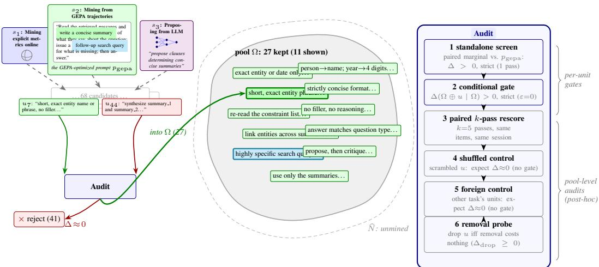  
Figure 7: Unit-mining process (Left-Hand Side of Figure 2) (A) N channels supply unit candidates (shown: $s _ { 1 } \colon$ units found online; $s _ { 2 } \colon$ units proposed directly by an $\mathrm { L L M } ; s _ { 3 } \colon$ units mined from the GEPA-induced prompt pGEPA). Candidates $( u _ { 7 } .$ , green; and $u _ { 4 4 }$ , red) all enter the pool Ω; what follows orders and selects them. (B) As implemented: #1 one single-pass marginal against the starting prompt $( \boldsymbol { p } _ { \mathrm { G E P A } }$ ’s shipped candidate) on the 100-item selection panel, with $\Delta > 0$ making a unit eligible; #2 units are re-tested in combination only during selection (prefix sweep, delete pass), never as a pool filter; #3 multi-pass scoring is applied afterwards to shipped prompts and prefix curves, never to units; #4–#5 the shuffled- and foreign-unit controls are separate experiments on the frozen pool (Appendix A) and remove nothing; #6 the delete pass runs during selection on the chosen set, on the same panel.

Pools of at most 15 units are solved exactly by enumeration. $\mathrm { A l l ~ 2 } ^ { | \Omega | } - 1$ subsets are scored and the optimum is found by enumeration. The resulting certificate is exact for the evaluated empirical objective on the fixed probe set (with noisy scores it is not a statement about the population optimum): no monotonicity and no submodularity of R is used anywhere. This branch applies to the reconstruction-side criterion sets; all six supervised benchmarks (pools of 68–164 units) run in the large regime below. It also serves as the validation harness for the large-Ω methods below (on instances small enough to enumerate, the approximate selectors and the upper bound of Eq. equation 3 are cross-checked against the true optimum).

Larger pools (more than 15 units) run the greedy selection algorithms. No enumeration is attempted; subsets are scored lazily (only subsets that an algorithm visits are evaluated). Two selectors are defined; the benchmark experiments run only the first (the production paragraph below), and the second was run only in the exact-regime analysis:

1. Forward greedy: starting from ∅, repeatedly add the unit with the largest marginal gain $\delta ( e \mid S ) { \overset { \smile } { = } } R { \dot { ( } } S \cup \{ e \} { \overset { \smile } { ) } } - R ( S )$ until the budget k is reached. For monotone submodular objectives under a cardinality constraint greedy has the classical $( 1 - 1 / e )$ guarantee (Nemhauser et al., 1978); as discussed below, our R is not certified to satisfy either hypothesis, so here greedy is a strong heuristic whose quality is bounded per-instance by Eq. equation 3 rather than by the worst-case factor.

2. Double greedy (Buchbinder et al., 2015): a single pass over the elements maintaining an included set A (initially ∅) and a surviving set B (initially Ω); for each element i it computes the two marginals $\ r { d _ { A } } = R ( A \cup \{ i \} ) - { \bar { R ( \ r { A } ) } }$ (gain of adding) and $d _ { B } = R ( B \backslash \{ i \} ) - \bar { R } ( B )$ (gain of deleting), keeping i with probability $\bar { d } _ { A } ^ { + } / ( d _ { A } ^ { + } + d _ { B } ^ { + } )$ (and with probability one when both clamp to zero); on a keep, B is unchanged; on a discard, i leaves B. An earlier draft and the code used the deletion cost with the same clamp, reversing the second marginal;

Algorithm 1 ϵ-estimation: mine, select, estimate   
Require: measurement $f ,$ seed prompt $p _ { 0 } ,$ declared samplers $\{ s _ { 1 } , s _ { 2 } , \ldots \}$ , subset cap $k ,$ confidence   
level $1 - \delta$   
Stage $\mathit { l } \colon$ mine the unit pool   
1: draw candidate strings from every sampler; canonicalize each into minimal fragments   
2: for all candidates u do   
3: split u once at sentence/bullet boundaries; add every fragment to $\Omega ;$ measure its single-pass   
marginal $\Delta _ { u }$ against the initialized prompt   
4: mark u eligible iff $\Delta _ { u } > 0$   
5: end for   
6: (post hoc, outside the pipeline: shuffled-, foreign- and keyword-unit controls on the frozen pool;   
they filter nothing)   
Stage 2: select the prompt (benchmark runs take the second branch; the first is used for   
reconstruction-side criterion sets)   
7: if $| \Omega | \le 1 5$ then   
8: score every subset of $\Omega ;$ set $S _ { g }$ to the exact optimum   
9: else   
10: render each candidate subset with the fixed template, score once   
11: prefix sweep: order eligible units by $\Delta _ { u } .$ append them one at a time up to the prefix cap   
(48), retain the best-scoring prefix   
12: prune and recover (one pass each): delete any kept unit whose removal costs nothing; re-add   
any skipped unit that now helps   
13: (double greedy is not run in the benchmark experiments; it is analysed in this appendix for   
the small-set case)   
14: end if   
15: confirm on held-out data that $p _ { S _ { g } }$ beats the initialized prompt (GEPA’s shipped candidate); oth   
erwise ship that prompt unchanged   
Stage 3: estimate the ceiling   
16: coverage: compute Good–Turing novelty $f _ { 1 } / n$ and the bias-corrected Chao1 point estimate $\widehat { N }$   
from the overlap of independent sampling runs   
17: value: fit $\widehat V ( \cdot )$ to the greedy prefix trajectory; set $\widehat { \epsilon } = \widehat { V } ( \widehat { N } ) - V ( S )$ as a point estimate; report   
its backtest error and one-sided coverage (Appendix C.2)   
18: structure: estimate $\hat { \gamma }$ over evaluated subset pairs   
19: if non-monotonicity is detected $( \hat { \gamma }$ clamps to 0) then   
20: withhold $U _ { 2 } ;$ report the selected prompt as measured, not certified   
21: else   
22: report $\begin{array} { r } { U _ { 2 } = R ( S _ { g } ) + \frac { 1 } { \gamma } \sum _ { j = 1 } ^ { k } \delta _ { ( j ) } } \end{array}$ as a curve in $\gamma \left( \mathrm { E q . } 3 \right)$   
23: end if   
24: return prompt $p _ { S _ { g } }$ , ceiling $\widehat { B } = f ( p _ { S _ { q } } ) + \widehat \epsilon ,$ estimate $( \widehat { \epsilon } , \delta )$ labeled CERTIFIED only in the exact   
branch, MEASURED otherwise, with $U _ { 2 }$ when not withheld

both were corrected on 2026-09-11. No reported number depends on this error, because double greedy is not used in the benchmark runs. For unconstrained non-monotone submodular maximization the randomized version is a tight $\textstyle { \frac { 1 } { 2 } }$ -approximation and the deterministic keep- $\operatorname { i f f } - d _ { A } \geq d _ { B }$ variant is a $\textstyle { \frac { 1 } { 3 } }$ -approximation (Buchbinder et al., 2015); the add/delete local search of Feige et al. $( 2 0 ^ { \circ _ { 1 1 } } )$ gives the same $\textstyle { \frac { 1 } { 3 } }$ family, and under a binding cardinality constraint the applicable non-monotone guarantee weakens to $1 / e$ (random greedy, Buchbinder et al., 2014). Double greedy tolerates non-monotonicity, but its factor requires submodularity of $R ,$ which is not established for our objective; here it is a heuristic with a per-instance bound.

The production $M _ { \Omega }$ procedure used in the benchmark experiments runs one selector: single-pass marginals against GEPA’s shipped candidate (not the seed); a prefix sweep that appends units in order of marginal gain, up to 48 units, and keeps the best-scoring prefix (LiveBench ran the earlier cap of 32 and shipped GEPA’s prompt); one delete pass; one add-back pass; and a single-pass confirmation on a separate panel. Neither enumeration nor double greedy runs there; every selectiontime score is one pass $( T = 1 )$ , and multi-pass scoring is applied afterwards to shipped prompts only. Table 1 gives the selector, pool size and pass count behind every reported result.

The leftover marginals after greedy bound how much any feasible subset could still gain. After greedy terminates with $S _ { g } ,$ the leftover marginals convert into an upper bound on how much better any feasible subset could be. With $\bar { \delta } ( e ) = \bar { \delta } ( e \mid S _ { q } )$ for $e \not \in S _ { g } , \delta _ { ( 1 ) } \geq \delta _ { ( 2 ) } \geq \cdot \cdot$ · the sorted gains, and $\gamma \in ( 0 , 1 ]$ the submodularity ratio of R (Das & Kempe, 2011),

$$
\mathrm { O P T } _ { \leq k } \ \leq \ U _ { 2 } : = \ R ( S _ { g } ) \ + \ { \frac { 1 } { \gamma } } \sum _ { j = 1 } ^ { k } \delta _ { ( j ) } .\tag{3}
$$

$\mathbf { A } \mathfrak { t } \gamma = 1$ this is Minoux’s classical online bound from the accelerated-greedy literature (Minoux, 1978); the $1 / \gamma$ form follows in three lines from the definition of the ratio (monotonicity gives $R ( S ^ { * } ) \leq R ( \overleftarrow { S ^ { * } } \cup S _ { q } )$ ; the ratio definition at $S = S _ { g } , \ \Omega ^ { \prime } = S ^ { * } \setminus S _ { g }$ gives $R ( S _ { g } \cup S ^ { * } ) - \dot { R ( S _ { g } ) } \leq$ $\begin{array} { r } { \frac { 1 } { \gamma } \sum _ { e \in S ^ { * } \setminus S _ { g } } \delta ( e ) } \end{array}$ ; and $| S ^ { * } \setminus S _ { g } | \leq$ k bounds the sum by the top-k gains). The multiplicative worstcase counterpart $\begin{array} { r } { R ( S _ { g } ) \geq \frac { 1 } { \alpha } ( 1 - e ^ { - \alpha \gamma } ) \mathrm { O P T } } \end{array}$ , with curvature α (Bian et al., 2017), is reported only to characterize the objective in advance; run-level claims always use the instance bound equation 3. See Krause & Golovin (2014) for the surrounding theory.

Measured departure from submodularity. We measured how far the pools depart from submodularity from the selection logs of the rows of record, with no new scoring (artifact outputs/analyses/submodularity diagnostics v1/). Submodularity is diminishing returns: a unit’s marginal gain can only fall as other units are added, so the joint gain of a set never exceeds the sum of its members’ individual gains. The opposite, synergy, is what the $1 / \gamma$ factor in Eq. equation 3 guards against. On the selection batch of each benchmark we compared the sum of the single-unit marginals against the seed with the joint gain of every prefix the sweep evaluated. On every benchmark with an assembled gain the sum exceeds the joint gain, by a factor of 2 to 9 on HotpotQA (median 6.3 over 39 prefixes), 2 to 25 on IFBench (median 11.6, 47 prefixes), 3 to 61 on AIME (median 20, 31 prefixes) and 3 to 26 on PUPA; no evaluated prefix on any benchmark has a joint gain above the sum of its parts. Along these trajectories the ratio γˆ is therefore 1, and $U _ { 2 }$ reduces to Minoux’s bound. The property that does fail is monotonicity: 3% of the units in the HotpotQA prompt and 4% in the IFBench prompt raise the score when removed, and of the 25 units the IFBench sweep skipped, none raises the score when added to the assembled prompt (1 of 12 does on HotpotQA). The within-pool gap is then small where it can be measured from the add-back marginals: at the best prefix on the selection batch, $U _ { 2 }$ is .710 against an achieved .700 on HotpotQA at $\gamma = 1 ( . 7 4 0 \mathrm { a t } \gamma = . 2 5 )$ , and .892 against .892 on IFBench at every $\gamma ,$ since no leftover unit is positive. PUPA’s leftovers give .993 against .951 on a metric capped at 1. AIME, LiveBench and HoVer have no add-back phase in their logs, so only a seed-marginal proxy exists for them, which is not a bound. Two cautions: every selection score is one pass $( \bar { T } = \bar { 1 } )$ , so the ratios carry scoring noise; and the additivity test uses marginals against the seed rather than conditional marginals, so it is a necessary condition for submodularity on the evaluated sets, not a proof over the whole lattice. On the reconstruction side the picture is the reverse: on nine rubric decompositions scored by ideal recovery $I ( M ; X _ { S } ) ( K = 4 - 1 \bar { 4 }$ criteria each), the spectral submodularity ratio is .13–.41, so rubric criteria are complementary and a greedy bound there would be loose by $1 / \gamma = 2 . 5 \ – 8$ . The two readings use different objectives and different units and are not pooled.

Assumptions of the selection guarantees. Equation equation $^ 3$ and the $\textstyle { \frac { 1 } { 2 } } / { \frac { 1 } { 3 } } / 1 / \epsilon$ factors are conditional results, and four of their hypotheses are at risk in our setting. We enumerate them here:

1. Submodularity of $R$ is not assumed, and $\gamma$ cannot be safely plugged in. R is an empirical black box; $\gamma$ is estimated by sampling violation pairs $( S , \Omega ^ { \prime } )$ on the evaluated lattice. A sampled minimum over pairs can only overstate the population ratio $( \hat { \gamma } \geq \gamma _ { \mathrm { p o p } } ) .$ , so $1 / \hat { \gamma }$ makes Eq. equation 3 too small, and for an upper bound this error is in the invalid direction. We therefore treat the plug-in $U _ { 2 }$ at $\hat { \gamma }$ as a diagnostic labeled an estimate, not a certificate; reporting $U _ { 2 }$ as a curve in γ is the intended presentation. γˆ is the minimum over 400 random pairs $( S , \Omega ^ { \prime } )$ with $| \Omega ^ { \prime } | \leq 6 .$ , clamped to $[ 0 , 1 ] ;$ the $\hat { \gamma } = 1$ of the measured departure above comes from the additivity test on the selection logs, not from this sampler.

2. Monotonicity fails, and the failure is detectable. The derivation of $\operatorname { E q . }$ . equation 3 uses $R ( S ^ { * } ) \leq \mathring { R } ( S ^ { * } \cup S _ { g } )$ . Raw R is non-monotone (the drop-one pass finds units whose removal helps), so the bound is valid only for the free-disposal monotonization $R ^ { \uparrow } ( S ) =$ $\operatorname* { m a x } _ { T \subseteq S } { R ( T ) }$ , an explicit upper idealization that cannot be constructed exactly at large |Ω|. The $U _ { 2 }$ values above therefore bound $R ^ { \uparrow }$ , not R. When the sampled ratio clamps to 0, $U _ { 2 }$ is withheld and the selected prompt is reported as measured, not certified.

3. The value oracle is noisy. All guarantees above assume exact access to $R ( S ) ;$ we estimate it from finitely many items and scoring passes, so greedy ranks noisy marginals and accepted decisions can be sampling artifacts. Submodular maximization under noise is strictly harder, and the exact-oracle ratios do not transfer (Hassidim & Singer, 2017). We reduce the effect of noise with paired evaluation of marginals, confirmation re-evaluations of accepted units, and multi-pass test scoring, but we do not claim a noise-adjusted approximation ratio.

4. Guarantee scope. The $\frac { 1 } { 2 }$ and $\textstyle { \frac { 1 } { 3 } }$ factors of double greedy (above) hold for the unconstrained problem. In our runs the cap is set above the number of positive-marginal units, so the unconstrained reading applies, but this is a property of the instances rather than of the method.

Where every hypothesis fails, the output is the measured optimum over evaluated subsets plus the missing-value ceiling of Section 2.1, with no claimed approximation ratio; the ceiling-estimation procedure is designed to fall back to that statement rather than silently keep its guarantees.

<table><tr><td rowspan=1 colspan=11>result                pool size(s)    selector                      enumeration?  double greedy? passes at selection</td></tr><tr><td rowspan=10 colspan=11>Table 2, Table 3, Table 4  68, 164, 128,  single-pass paired marginals against     No          No       $T ~ = ~ 1 ;$ the shipped(HotpotQA, HoVer, IF-  120,48       GEPA&#x27;s shipped candidate, a cumu-                            candidate is then scoredBench, PUPA, AIME)drop-one pass, one add-back pass,Table 2, Table 3, Table 448(LiveBench)                         lier default, not 48); the confirma-tion guard rejected every candidate                            prompt is GEPA&#x27;s 600-unit                                                   call candidate rescoredHotpotQA no-GEPA-unit 60           same selector, re-run on the pool     No          No</td></tr><tr><td rowspan=1 colspan=6></td><td rowspan=1 colspan=1>candidate is then scored</td></tr><tr><td rowspan=1 colspan=8></td><td rowspan=3 colspan=1></td></tr><tr><td rowspan=1 colspan=7></td></tr><tr><td rowspan=2 colspan=6></td></tr><tr><td rowspan=1 colspan=1>T = 1; no unit com-</td></tr><tr><td rowspan=1 colspan=1>piled, so the shipped</td></tr><tr><td rowspan=1 colspan=1>prompt is GEPA's 600-</td></tr><tr><td rowspan=1 colspan=1>call candidate rescored</td></tr><tr><td rowspan=1 colspan=1>T = 1 at selection;</td></tr><tr><td rowspan=4 colspan=1>ablation (§C.1)HoVer selection replicates</td><td rowspan=2 colspan=9>with the 8 trajectory-mined (GEPA-derived) units removed</td><td rowspan=1 colspan=1>the reported compari-</td></tr><tr><td rowspan=1 colspan=2></td><td rowspan=1 colspan=1>son used one scoring</td></tr><tr><td rowspan=2 colspan=5>164   (same same selector</td><td rowspan=1 colspan=4></td><td rowspan=1 colspan=1>session at five passes</td></tr><tr><td rowspan=1 colspan=4>No          No</td><td rowspan=1 colspan=1> $T \ = \ 1 ;$ five-pass test</td></tr><tr><td rowspan=1 colspan=1>(Table 4, note b; §C.1)</td><td rowspan=1 colspan=4>frozen pool,</td><td rowspan=1 colspan=1></td><td rowspan=1 colspan=4></td><td rowspan=1 colspan=1>.539 and .541 against</td></tr><tr><td rowspan=3 colspan=6>run twice)Screened robustness run,  164   (same lazy greedyonconditional</td><td rowspan=1 colspan=4></td><td rowspan=1 colspan=1></td></tr><tr><td rowspan=1 colspan=1></td><td rowspan=1 colspan=4></td><td rowspan=1 colspan=1>(HB 226)</td></tr><tr><td rowspan=1 colspan=4>No         No</td><td rowspan=1 colspan=1> $\begin{array} { r l r } { \dot { T } } & { { } = } & { 3 } \end{array}$ screening</td></tr><tr><td rowspan=1 colspan=6>HoVer only (HB 225)     frozen pool)    marginals, restricted to units</td><td rowspan=1 colspan=5>rescore, then $T \ = \ \stackrel { \sim } { 1 }$ </td></tr><tr><td rowspan=1 colspan=1></td><td rowspan=1 colspan=5>that clear a shuffled-unit null band</td><td rowspan=1 colspan=5>fresh evaluations (at</td></tr><tr><td rowspan=1 colspan=1></td><td rowspan=1 colspan=5>after a 3-pass rescore</td><td rowspan=1 colspan=5>most 8 per step); five-</td></tr><tr><td rowspan=3 colspan=1></td><td rowspan=3 colspan=5></td><td rowspan=1 colspan=4></td><td rowspan=1 colspan=1>pass test .520, -.052</td></tr><tr><td rowspan=1 colspan=2></td><td rowspan=1 colspan=3></td><td rowspan=1 colspan=1> $[ - . 0 7 7 , - . 0 2 7 ]$ against</td></tr><tr><td rowspan=1 colspan=4></td><td rowspan=1 colspan=1>the row ofrecord</td></tr><tr><td rowspan=1 colspan=1>Value-curve ceilings (Fig-</td><td rowspan=1 colspan=4>same pools asa c</td><td rowspan=1 colspan=1>urve fit to the prefix-sweep</td><td rowspan=1 colspan=4>No         No</td><td rowspan=1 colspan=1>T = 1</td></tr><tr><td rowspan=1 colspan=1>ure 10 left, §C.2, §C.2)</td><td rowspan=1 colspan=4>above</td><td rowspan=1 colspan=1>trajectory selection already pro-</td><td rowspan=9 colspan=5>n/a</td></tr><tr><td rowspan=4 colspan=1></td><td rowspan=4 colspan=4></td><td rowspan=1 colspan=1>duced (HotpotQA: the same ses-</td></tr><tr><td rowspan=3 colspan=1>sion&#x27;s sweep extended to $k \ = \ 6 8$ </td></tr><tr><td rowspan=2 colspan=4></td></tr><tr><td rowspan=1 colspan=3></td></tr><tr><td rowspan=2 colspan=1></td><td rowspan=1 colspan=5>on the test split; the other five: the</td><td rowspan=1 colspan=3></td><td rowspan=3 colspan=2></td></tr><tr><td rowspan=1 colspan=5>selection-panel sweep)</td></tr><tr><td rowspan=1 colspan=1>Unsupervised bank re-</td><td rowspan=1 colspan=5>n/a          n/a; this is the reconstruction chan-</td></tr><tr><td rowspan=1 colspan=6>sults (Figure 10 right, §3)               nel, not a selection result</td></tr></table>

Table 1: Selection procedure behind each reported result. The paper describes several selection procedures (ranking marginals once against the seed, recomputing the best marginal at every step, pruning and re-adding, double greedy, exhaustive enumeration); this table states which one produced which result. Every reported number in the paper traces to exactly one row of this table.

## C ϵ-ESTIMATION RESULTS IN FULL

## C.1 SUPERVISED BENCHMARKS: COMPARISON AGAINST PROMPT OPTIMIZERS, CALL BUDGETS AND RUN-TO-RUN SPREAD

Table 3 is the comparison referenced in Section 2.3. It compares ϵ-estimated prompts against GEPA, GEPA+Merge and MIPROv2 on six benchmarks (Qwen3-8B, official metrics and splits); every candidate is scored in one uniform session per benchmark with five independent test passes. Absolute levels are session-specific: the same shipped prompts scored ∼.05–.06 lower on AIME in September than in July, and PUPA’s judge shifted by $\sim . 2$ between two August sessions. Only paired withinsession differences are comparable; no cell combines scores from different sessions, and the fitted asymptotes of Appendix C.2 (validation-side prefix means) are never compared with these test scores.

Table 2 reports the same paired contrast against every baseline (20,000 paired item bootstraps; artifact runs paperexact $/ \mathsf { a l } \bar { } .$ l baseline deltas v1.json). $M _ { \omega }$ beats all three baselines on HotpotQA, HoVer and AIME; on LiveBench and IFBench it beats MIPROv2 only; on PUPA it beats GEPA and GEPA+Merge, and its +.025 over MIPROv2 is not significant. On HotpotQA the three GEPA seeds at 16,700 calls scored .567, .413 and .402, so any single-run comparison is subject to that spread; against the seed mean the difference is +.183 [+.147, +.219].
<table><tr><td>benchmark</td><td colspan="2"> $M _ { \omega } { - } \mathrm { G E P A }$ </td><td colspan="2"> $M _ { \omega } { - } \mathrm { G E P A + M e r g e }$ </td><td colspan="2"> $M _ { \omega } { - } \mathbf { M I P R O v } 2$ </td></tr><tr><td>HotpotQA</td><td>+.077</td><td> $[ + . 0 4 5 , + . 1 0 9 ]$ </td><td></td><td> $+ . 2 2 2 \ [ + . 1 8 0 , + . 2 6 6 ]$ </td><td>+.208</td><td> $[ + . 1 6 5 , + . 2 5 1 ]$ </td></tr><tr><td>HoVer</td><td>+.071</td><td> $[ + . 0 4 3 , + . 0 9 9 ]$ </td><td></td><td> $+ . 0 5 2 \ [ + . 0 2 5 , + . 0 7 9 ]$ </td><td>+.081</td><td> $[ + . 0 5 2 , + . 1 1 0 ]$ </td></tr><tr><td>LiveBench</td><td>+.016</td><td> $[ - . 0 1 0 , + . 0 4 3 ]$ </td><td></td><td> $+ . 0 2 5 \ [ - . 0 0 2 , + . 0 5 4 ]$ </td><td>+.049</td><td> $+ . 0 2 1 , + . 0 8 0 ]$ </td></tr><tr><td>IFBench</td><td>+.025</td><td> $[ - . 0 0 3 , + . 0 5 3 ]$ </td><td></td><td> $+ . 0 2 3 \ [ - . 0 0 4 , + . 0 4 9 ]$ </td><td>+.060</td><td> $+ . 0 2 9 , + . 0 9 2 ]$ </td></tr><tr><td>AIME</td><td>+.035</td><td> $\left[ + . 0 1 1 , + . 0 6 1 \right]$ </td><td>+.027</td><td> $[ + . 0 0 1 , + . 0 5 3 ]$ </td><td>+.083</td><td> $+ . 0 5 2 , + . 1 1 5 ]$ </td></tr><tr><td>PUPA</td><td>+.047</td><td> $[ + . 0 1 8 , + . 0 7 6 ]$ </td><td>+.069</td><td> $\left[ + . 0 4 1 , + . 0 9 8 \right]$ </td><td>+.025</td><td> $- . 0 0 6 , + . 0 5 7 ]$ </td></tr></table>

Table 2: Paired contrasts against every baseline: mean item-level difference with 95% bootstrap interval, same scoring sessions as Table 3. The HotpotQA row is the equal-call session (HB 220; GEPA at 16,700 calls).
<table><tr><td>benchmark</td><td>GEPA</td><td>GEPA+Merge</td><td>MIPROv2</td><td> $\epsilon { \mathrm { - e s t . } } \left( M _ { \omega } \right)$ </td><td>∆ vs GEPA</td></tr><tr><td>HotpotQA</td><td>.567</td><td>.421</td><td>.435</td><td>.643</td><td> $+ . 0 7 7 ^ { * * * }$ </td></tr><tr><td>HoVer</td><td>.497</td><td>.515</td><td>.487</td><td>.567</td><td> $+ . 0 7 1 ^ { \ast \ast \ast }$ </td></tr><tr><td>LiveBench</td><td>.695</td><td>.686</td><td>.661</td><td>.710</td><td>+.016</td></tr><tr><td>IFBench</td><td>.417</td><td>.419</td><td>.382</td><td>.442</td><td>+.025</td></tr><tr><td>AIME</td><td>.323</td><td>.331</td><td>.275</td><td>.357</td><td> $+ . 0 3 5 ^ { * * }$ </td></tr><tr><td>PUPA</td><td>.638</td><td>.616</td><td>.659</td><td>.685</td><td> $+ . 0 4 7 ^ { * * }$ </td></tr></table>

Table 3: ϵ-estimation: prompt optimization comparisons. For every benchmark we score each candidate with five independent test passes (scores are the per-item means), using Qwen3-8B as the proposer and language model, to match Agrawal et al. (2025). All benchmarks are run with the same number of steps as in Agrawal et al. (2025); on every benchmark the GEPA column is additionally the equal-call run, in which GEPA is re-run at the call budget that ϵ-estimation spent (Appendix C.1). The comparison is therefore call-matched per benchmark, not budget-capped. On LiveBench the confirmation guard rejected every unit and shipped GEPA’s 600-call prompt unchanged, so that row compares GEPA’s own prompts at two budgets and contains no unit-selection effect. $\Delta$ is the mean paired item-level difference, with a 20,000-draw bootstrap interval over items (each item’s score is its five-pass mean; the passes do not enlarge the sample); stars mark two-sided bootstrap $p < . 0 1$ (∗∗) and < .001 (∗∗∗). Five passes measure scoring noise, not the variance between optimizer runs, which Appendix C.1 reports. Contrasts against GEPA+Merge and MIPROv2 are in Table 2. Items per benchmark: HotpotQA 300, HoVer 300, IFBench 294, PUPA 221, AIME 150, LiveBench 126.

Optimization budgets and budget comparability. All Table 3 methods run at declared taskcall budgets. The GEPA column is GEPA re-run at the number of calls $M _ { \omega }$ spent on that benchmark (HotpotQA 16,700; HoVer 10,110; LiveBench 18,708; IFBench 23,300; AIME 6,870; PUPA ∼29,526, of which 98.8% completed before a disk failure). Where $M _ { \omega } \mathbf { \bar { s } }$ own spend is logged (Table 4), it equals that budget on HotpotQA and IFBench and falls below it on LiveBench (4,616 selection-and-validation calls against 18,708) and AIME (2,490 against 6,870), so on those two benchmarks GEPA had the larger budget. GEPA+Merge and MIPROv2 (heavy mode) run at their own defaults. $M _ { \omega } '$ s spend is its realized selection cost, not the 2,400-call default quoted in an earlier draft. GEPA gains most of its budget benefit early: on HotpotQA, 600, 2,400 and 16,700 calls gave .40, .53 and $. 5 7 ,$ and at full parity $M _ { \omega }$ still leads by +.077. At equal calls GEPA generates more candidate text than $M _ { \omega } \left( \sim 7 0 \mathbf { \bar { M } } \right.$ against ∼46M characters on HotpotQA), so call parity does not give our method a token advantage. $M _ { \omega }$ starts from GEPA’s shipped 600-call prompt (on HotpotQA that prompt is the seed) and mines GEPA’s own runs for units. On HotpotQA the ablation without those units scores $- . 0 1 3 \ [ - . 0 3 5 , + . 0 0 8 ]$ against the full pool and $+ . 0 6 2 \ [ + . 0 3 4 , + . 0 9 2 ]$ over GEPA at equal calls (HB 226a), so the gain there does not depend on the GEPA-derived units. On HoVer, in one session at five passes, the ablation without GEPA-derived units scores $- . 0 3 7 \ [ - . 0 5 8 , - . 0 1 6 ]$ against the full pool and $+ . 0 3 1 \ [ + . 0 0 4 , + . 0 5 9 ]$ against GEPA at the matched budget. Two fresh selection runs on the same pool score .539 and .541 against the row of record’s .572 (its HB 226- session value; the uniform scoring session of Table 3 gives .567), differences of −.033 and −.031 (−.002 between them), and both beat GEPA $( + . 0 3 5 [ \bar { + . } 0 0 9 , + . 0 6 2 ] , + . 0 3 7 [ + . 0 1 1 , + . 0 6 4 ] )$ , so the HoVer gain is +.035 to +.068 across three selection runs. GEPA itself, restarted from that same shipped prompt with $M _ { \omega } \mathbf { \bar { s } }$ remaining budget (16,100 and 9,510 further calls), scores .569 on HotpotQA and .491 on HoVer against .569 and .507 from seed (+.001 and −.015, neither significant). $M _ { \omega }$ leads it by +.071 [+.036, +.107] and +.077 [+.050, +.105] (one session each, five passes). Table 4 gives the full per-method accounting behind this section: initial prompt and inherited artifacts, independent optimization runs, calls by stage, realized totals and characters where logged, and the certified test score against GEPA.

## C.2 ESTIMATING THE MISSING VALUE: MISSING-MASS CURVES, BACKTEST OF THE VALUE CURVE, ASSUMPTIONS AND CALIBRATION OF THE ESTIMATE

Missing mass estimates how much of the unit population the samplers have not drawn. Missing mass is the coverage instrument behind every ceiling: it estimates how much of the unit population U the samplers have not yet drawn. The Good–Turing statistic $f _ { 1 } / n$ (the fraction of units seen exactly once) estimates the probability that the next draw is new. When it decays toward zero, sampling has closed its space, and the Chao1 estimator converts the singleton and doubleton counts into an estimate of the total population size $\widehat { N }$ . Two presentation details apply to the figures below. First, the raw mined sequence arrives grouped (by replicate and framing) and is therefore not exchangeable. Every accumulation curve is averaged over 150 random re-orderings of the pooled draws; the permutation smooths the curve but neither preserves replicate identity nor makes the process independent. The singleton and doubleton counts behind $\widehat { N }$ (bias-corrected Chao1, $S + \bar { f _ { 1 } ( f _ { 1 } - 1 ) } / ( \bar { 2 ( f _ { 2 } + 1 ) } ) \rangle$ ) come from the pooled stream. Second, what counts as “the same” unit is set by the clustering granularity: fine clustering treats near-paraphrases as distinct (novelty stays near 1), and coarse clustering merges them (the space closes, giving the bounded $\hat { N }$ estimates quoted in the captions). We show both because the contrast is itself a finding: whether a unit space saturates depends on the granularity at which units are individuated.

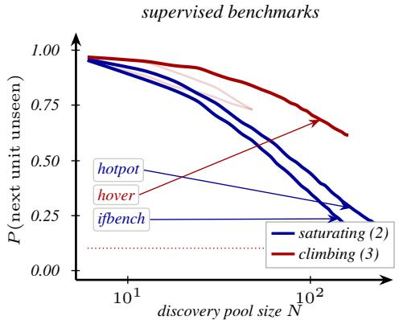

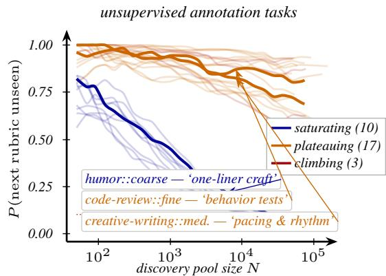  
Figure 8: Missing mass. Good–Turing novelty $p _ { \mathrm { u n s e e n } } ( n ) = f _ { 1 } / n$ as mining proceeds, per task; the curves show data only, with no extrapolation. Accumulation curves are averaged over 150 random orderings. $L e f t { \mathrm { : } }$ five of the six supervised GEPA-suite benchmarks (all but PUPA, added after this sampling pass); species are semantic unit clusters. Right: unsupervised annotation tasks; species are normalized rubric items from each task’s task bank, and three tasks are labeled by name. Curves fall into saturating (the articulable space closes), plateauing (novelty persists at a steady rate), and climbing (open-ended drift) regimes.

Backtesting the value projection. We test how well the fitted value curves of Figure 10 predict future behavior. We backtest on the greedy prefix trajectories of all six benchmarks: for every fit-

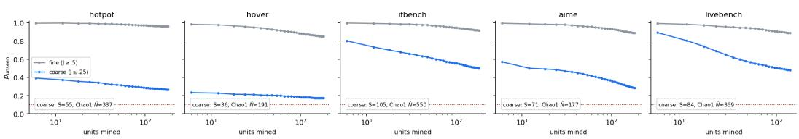

Figure 9: Missing mass for five of the six supervised benchmarks (all but PUPA), from three independent mining replicates per benchmark (3×60 units, one declared sampler). Species are formed by deterministic word-overlap clustering at two granularities. Curves are averaged over 150 random orderings (the raw sequence arrives grouped by framing, so unaveraged $f _ { 1 } / n$ is non-exchangeable and can even rise). At the fine granularity (Jaccard $\geq . 5 .$ , grey) nearly every unit is its own species and novelty stays near 1; the articulable space appears unbounded. At the coarse granularity (Jaccard $\geq . 2 5$ , blue) the same data yield bounded estimates: $\mathrm { H o V e r } ^ { \prime } \mathrm { s }$ space is smallest and closes fastest (Chao1 $\widehat { N } { \approx } 1 9 1 )$ , and IFBench’s remains the most open (Nb≈550). Within every panel, the contrast between the two lines shows that whether a prompt-unit space saturates is a property ofthe granularity at which units are individuated, not of the task. Syntactic clustering is conservative for missing-mass claims (paraphrases a semantic clusterer would merge stay separate, inflating $f _ { 1 }$ and hence $p _ { \mathrm { u n s e e n } } ) ;$ these curves are upper bounds on novelty.  
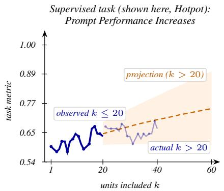

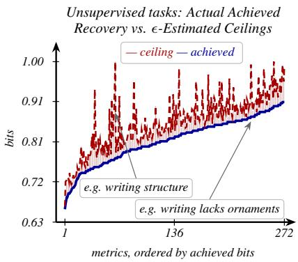  
Figure 10: Missing value measurements. Left, supervised tasks: value at each # units $k = 1 , 2 .$ (blue). A forward projection $\dot { V } ( k ) , k > 2 0$ is made using ϵ-estimation (orange dashed, 95% band widening with horizon), and the actual $k > 2 0$ drawn underneath. HotpotQA (fit $k \leq 2 0$ , actual to 40, projection to 60) is the still-rising regime. Backtesting the projection procedure over all six benchma $\mathrm { r k s ^ { \prime } }$ trajectories (Appendix C.2) gives pooled median prediction error .018 at horizons of 1–3 units ahead, .020 at 4–8, and .029 at 9+. Right, unsupervised: per-task value (blue) and its missing-value ceiling (red), for 272 metrics across 8 creative domains, estimated by asking what a fresh draw from the same sampling process could still add.  
window size $j \geq 5 ,$ , we fit the curve on the first $j$ points only, predict every later point, and record the absolute error bucketed by horizon (units ahead of the window). We compare two functional forms: saturating exponential $y = a - b r ^ { k }$ and power law $y = a - b k ^ { - c }$

<table><tr><td rowspan="2">benchmark</td><td colspan="3">power law, median |err|</td><td colspan="3">sat. exp., median |err|</td></tr><tr><td>1-3</td><td>4-8</td><td>9+</td><td>1-3</td><td>4-8</td><td>9+</td></tr><tr><td>HotpotQA  $( k \leq 6 8 )$ </td><td>.019</td><td>.022</td><td>.034</td><td>.017</td><td>.021</td><td>.062</td></tr><tr><td>AIME  $( k \leq 4 8 )$ </td><td>.024</td><td>.023</td><td>.019</td><td>.020</td><td>.019</td><td>.020</td></tr><tr><td>IFBench  $( k \leq 4 8 )$ </td><td>.014</td><td>.016</td><td>.019</td><td>.014</td><td>.016</td><td>.016</td></tr><tr><td>HoVer  $( k \le 3 2 )$ </td><td>.023</td><td>.025</td><td>.028</td><td>.023</td><td>.030</td><td>.054</td></tr><tr><td>LiveBench  $( k \le 3 2 )$ </td><td>.023</td><td>.030</td><td>.052</td><td>.025</td><td>.035</td><td>.063</td></tr><tr><td>PUPA  $( k \le 2 3 )$ </td><td>.012</td><td>.011</td><td>.012</td><td>.011</td><td>.010</td><td>.011</td></tr><tr><td>pooled</td><td>.018</td><td>.020</td><td>.029</td><td>.018</td><td>.021</td><td>.043</td></tr></table>

Median error is $\approx . 0 2$ at short horizons and remains under .03 (power law) at horizons of 9+ units; at long horizons the power-law error grows more slowly than the saturating-exponential error. The error distribution is heavy-tailed for small fit windows (pooled max error .43 for the power law, 2.1 for the saturating exponential, both from 5-point fits on LiveBench). The backtest therefore supports a calibrated median error, not a worst-case guarantee: fitted on ${ \geq } 8 { - } 1 0 $ prefix points, the curve predicts 4–8 units ahead with median error ${ \approx } . 0 2 \mathrm { - } . 0 3$ . We attempted a direct extreme-value estimate of the score distribution’s endpoint and dropped it, because the fitted tail pinned the endpoint to the sample maximum on every benchmark. Artifact: runs/ceiling backtest all.json.

The five assumptions behind bϵ. Section 2.1 lists five assumptions behind bϵ. This section reports what each assumption costs, which ones we could correct from existing artifacts, and the corrected estimate (artifact runs/epsilon calibration v1.json; note notes/2026-09-11 epsilon-calibration.md).

A1, sampler support. The same benchmark pool has $\widehat { N } = 3 3 7$ under the Qwen3-8B sampler and 1,061 under a frontier sampler; the unit universe depends on the proposer, and the ceiling is relative to the declared samplers.

A2, discovery probability and value. Units found once have more value than units found three or more times on four of five benchmarks (HotpotQA +.027 against +.004; AIME +.044 against +.033), so pricing unseen units by the curve’s decaying tail undervalues them. Pricing them at the singleton mean instead gives a number in the hundreds, because $\widehat { N } - S$ is large, and is clipped to the asymptote gap on every benchmark; the unseen units cannot be priced one by one from these data.

A3, exchangeability. Resampling whole sampling runs replicates pooled draws and moves the Chao1 estimate by an order of magnitude (HotpotQA $\tilde { N } = 3 3 7$ pooled; leave-one-replicate-out range 159– 498; block-bootstrap lower limit 23), and the Good–Turing novelty’s lower limit reaches zero. The pooled Nb is one point in a wide range, and bϵ inherits that width.

A4, submodularity ratio. Measured in Appendix B: no evaluated prefix shows synergy, and the within-pool gap is at most .01 on HotpotQA and 0 on IFBench.

A5, imposed saturation. The fitters allowed $b < 0$ , so a descending curve could report its floor as the asymptote; this is why AIME’s point estimate (.480) was below its realized maximum (.633) and bϵ was negative on two benchmarks. AIME’s power-law fit has $b = - . 0 9 8$ , and its a = .480 is also below the trajectory mean (.536). AIME’s apparent inverted-U is a two-to-three-item fluctuation on a score grid of $1 / 3 0$ . We now constrain $b \geq 0$ and $a \ge \operatorname* { m a x } y$ . A non-saturating form $( a + b \log k ,$ evaluated at ${ { k } _ { \operatorname* { m a x } } } { + 5 0 } )$ is the low end of the range on every benchmark.

One-sided coverage of the ceiling. Median error is two-sided, and a ceiling needs a one-sided check. For every fit window we therefore count how often a later prefix exceeded the ceiling the window implied (artifact runs/coverage backtest v1.json; windows are nested prefixes, so binomial limits are too narrow and a few early windows drive the pooled rates). Over every fit window of at least 5 points and pooled over benchmarks and horizons (power law), the point forecast is exceeded 43% of the time, close to the 50% of an unbiased fit. The bare fitted asymptote is exceeded 27% of the time, against the $5 \% \mathrm { ~ a ~ } \delta = . 0 5$ ceiling allows (HotpotQA .16, IFBench .18, AIME .31, PUPA .45, LiveBench .55, HoVer .56). The asymptote plus a 95% residual quantile is exceeded 9% of the time, and a refit constrained to lie at or above the best observed value 8%. The bare asymptote is therefore not a 1 − δ bound. The two widened versions come close but still miss on some benchmark-horizon pairs (HoVer, saturating exponential, .32–.44 from 4 units on; HotpotQA constrained, .17 at 9+). With the constraints of A5 and fit windows of at least 8 points, later prefixes exceed the fitted ceiling 2.4% of the time pooled at horizons 1–8, so a leaveone-benchmark-out calibration of an added margin returns zero width in every fold, because the constraints alone achieve this coverage. Held out, IFBench still exceeds its ceiling 8.9% of the time at horizons 1–8 and HotpotQA 8.4% at $9 + ;$ a margin sized on the worst benchmark widens bϵ by .006–.023 and does not correct IFBench. We report the constrained estimate $\widehat { \epsilon } _ { \mathrm { c o n } }$ with its measured miss rate; it is calibrated on six trajectories, not proven.

Projected and constrained ceilings. The same fitted curves can be extended beyond the observed trajectory: $\hat { y } ( k _ { \operatorname* { m a x } } + \Delta )$ for finite look-ahead, and the fitted asymptote a as the $k {  } \infty$ ceiling (both forms are $y = a -$ decaying term, so a is the infinite-prefix limit). Table 5 gives both forms fitted on each benchmark’s full canonical trajectory, with the constrained asymptote and the resulting bϵ.

(1) Saturation licenses the limit: every fitted trajectory’s last-quintile slope is $\leq . 0 0 0 4 / \mathrm { u n i t }$ , so the asymptote is identified by the data rather than extrapolated through a rise; had any curve still been rising, its k=∞ cell would be reported only as a censored lower bound (the same convention the scaling analysis uses for rising tasks). Projections move the curve $\mathrm { b y \leq . 0 1 }$ at +50 on four of six benchmarks; the exceptions are HoVer (the fit smooths a noisy final point, +.03) and LiveBench (the noisiest trajectory; its .055 power-vs-exponential asymptote spread is the width of its ceiling). (2) Validated horizon: the backtest above supports median error only to ∼9+ units ahead; +50 and ∞ inherit no error guarantee beyond the saturation argument. (3) Scope: every ceiling is conditional on the sampling pool. It is the limit of continued draws from this process, never a bound over all prompts (the all-prompt supremum is vacuously 1.0 on deterministic-label benchmarks; the extremevalue attempt is reported with the backtest above).

What the constrained ceiling says. The constraint a ≥ max y binds on five of the six benchmarks: there the constrained asymptote equals the highest point of the sweep, so $\widehat { \epsilon } _ { \mathrm { c o n } }$ is the sweep’s fall from its peak to its last point, not value the fit projects beyond what was seen. Only LiveBench’s curve projects above its own maximum, by .010. The ceiling is $a _ { \mathrm { c o n } }$ itself, not the best score plus $\widehat { \epsilon } _ { \mathrm { c o n } } ;$ on five benchmarks the fitted curve finds no value beyond the best prefix, and the $\widehat { N } - S$ unseen units are priced at zero by construction.

## D THE RECONSTRUCTION INSTRUMENT: CHOICE OF MEASURE AND VALIDITY

## D.1 CHOICE OF MEASURE, AND CHECKS ON THE RELABELING CHANNEL

We considered three measures of the receiver’s understanding. (1) Prompt comparison. Ask a judge whether $p ^ { \prime }$ “means the same thing” as p. This is the measure that language leaks through: the labeled examples carry lexical echoes of the criterion’s register, so a receiver can emit a $p ^ { \prime }$ that sounds right without holding the decision rule, and a similarity judge rewards the sound. Judged similarity is also wording-sensitive in the way this paper studies: re-specifying the same concept (name alone vs. name with definition) flipped 46% of arbiter verdicts in our label checks (Appendix D.3), so similar wording is neither necessary nor sufficient for the same rule. We use prompt similarity only as a per-run sanity check (Section 2.2), never as the score. (2) Identification. Show the receiver the labeled examples and ask it to pick p from a set of hard distractors. This is cheap and we keep it in the harness as a screen, but it measures discrimination, not operationalization: a receiver can eliminate distractors on surface grounds while being unable to apply the rule to fresh items. In our pilots the identification measure also ranked metrics differently from the behavioral one (agreement with an independent certificate: $\rho = . 6 5$ behavioral vs. .18 identification), so no number in this paper uses it. A decoy-label control shows why (protocol HB 222, artifact outputs/decoy control/). For 60 bank metrics (20 per regime, seven annotation tasks) we replaced the demonstrations’ labels with those of a balanced planted rule (length, question mark, digit, quotation) and kept the same four options, so the intended criterion was still offered although the transmitter had not applied it. Llama-3.1-8B still picked the intended criterion 45% of the time (chance 25%; $n = 5 6 )$ against 47% with the real labels, and Qwen2.5-14B 64% against 73% $( n = 3 0 ;$ on the other 30 metrics the executor’s labels did not vary across items). When the decoy rule’s own description was offered as a fifth option, the receivers chose it 5% and 17% of the time, below chance. Identification picks the plausible option almost regardless of the labels. This control does not test the relabeling channel. We test that channel separately, and it is not fooled the same way (protocol HB 228, artifact outputs/analyses/behavioral decoy v1/). Sending the planted rule’s labels through the channel of Section 2.2 instead of the criterion’s, on the same 60 metrics and items, recovers .013 bits against .044 for the criterion at Llama-3.1-8B (decoy minus criterion $- . 0 3 1 \ [ - . 0 4 3 , - . 0 2 2 ]$ over the 55 metrics with defined mutual information) and .009 against .024 at Qwen2.5-14B (−.015 [−.029, −.004], 31 metrics; the executor’s labels were constant on the rest). The decoy labels are unrelated to the criterion’s labels (AUC .51 and .48), and the rules the receiver writes from decoylabeled demonstrations are about the task, not the planted surface feature. A balanced surface rule therefore does not produce high recovery for these receivers. This result does not show that a high recovery reflects the intended criterion. (3) Behavioral relabeling, the channel used throughout:

re-execute $p ^ { \prime }$ on unseen items and measure $I ( m ; m ^ { \prime } )$ . Understanding is credited only to the degree it can be operationalized, which is the criterion the language game of Section 2.2 motivates.

Reversed reconstructions are $8 \%$ of rows and carry 1.3% of the mutual information. Because $I ( m ; m ^ { \prime } )$ ignores orientation, we recomputed every examples-bank reconstruction (236 metrics × four message forms × two judges, 1,574 rows, labels thresholded at .5) with oriented statistics beside the MI (artifact outputs/analyses/recon polarity audit v1/). Reversed reconstructions (negative Matthews $\phi )$ are 128 of 1,574 rows and account for 1.3% of the total MI (0.7% at $\phi < - . 2 )$ ; MI and balanced accuracy correlate at Spearman .83 across metrics, .82 without the reversed rows. Most reversals are not sign errors: only 8 of 128 have both base rates inside [.25, .75]; the typical case is a transmitter that rarely says YES (median rate .11) met by a receiver that says YES to most items (median .73). A further 456 rows have $\phi$ undefined because one side is constant after thresholding; they account for 0.5% of the MI. Mean balanced accuracy of the definition form is .61 (Llama-70B) and .66 (Qwen-72B).

The receiver executes its own rule. In our score the receiver writes the rule $p ^ { \prime }$ and the transmitter runs it: the receiver’s rule counts only through the labels $m ^ { \prime }$ the transmitter produces when it runs that rule, scored against the transmitter’s own labels $m .$ . To check that this last step is not what caps recovery, we also let the receiver execute its own rule on the held-out items and scored $I ( m ; m ^ { \prime } )$ against the same transmitter labels (60 criteria across seven domains, 18 of them bounded; Llama-3.1-8B transmitter, Qwen2.5-14B receiver, $R = 8$ reconstructions; artifact outputs/decoy control/receiver executes v1.json). The receiver recovers less of the transmitter’s labeling by running its rule itself: .040 bits against .052 when the transmitter runs it, a difference $\operatorname { o f } - . 0 1 3 \ [ - . 0 2 3 , - . 0 0 3 ]$ over the 55 criteria with defined values, with the receiver ahead on 42%; the two scores rank criteria alike (Spearman .61). By regime, the transmitter’s execution is ahead for reaches (.073 against .037) and rising (.053 against .041) criteria and behind for bounded ones (.030 against .041). The transmitter’s re-execution is not what bounds recovery.

Transfer across model families, prompt-author families and planted rules. Per-metric recovery levels correlate across model families, with Llama-3.1-70B and Qwen2.5-72B as transmitter and receiver, at Spearman $\rho = . 6 1 \mathrm { - } . 6 9$ . We test whether sharing a model family between transmitter and receiver inflates recovery. The message-form ladder already contained this test (artifact outputs/analyses $/ \pm \mathsf { a m \_ v 1 }$ author executor v1 $/ ) \colon$ for 52 concepts in four annotation tasks, the explanation and full packet messages were written by both Llama-3.1-70B and Qwen2.5- 72B, executed by nine receivers (Llama 1B–70B, Qwen2.5 3B–72B), and scored as in Figure 6 (balanced agreement with a leave-one-out consensus whose target was written by a third family, Claude Sonnet). 35 of the 52 concepts pass the class-balance filter (humor 25/36, creative writing $5 / 6 ,$ , math $4 / 5 ,$ , peer review 1/5).

<table><tr><td>executor family</td><td>Llama-authored</td><td>Qwen-authored</td><td>cells</td></tr><tr><td>Llama</td><td>.648</td><td>.647</td><td>256</td></tr><tr><td>Qwen2.5</td><td>.695</td><td>.700</td><td>326</td></tr></table>

Same-family minus cross-family agreement, paired over concepts (2,000 bootstrap draws): +.003 $[ - . 0 0 2 , + . 0 0 8 ]$ ; author-by-executor interaction $+ . 0 0 6 \ [ - . 0 0 4 , + . 0 1 6 ]$ ; author main effect −.003. On the same cells a full packet beats a name by +.026 [+.004, +.049] $\left( + . 0 5 9 \left[ + . 0 3 0 , + . 0 8 7 \right] \right.$ at 7B and above), so a family effect a fraction of that size would have been detected. The three smallest receivers prefer Llama-written text whatever their own family $\left( + . 0 1 0 \left[ + . 0 0 4 , + . 0 1 6 \right] \right)$ ), a readability effect rather than an interaction. In this design the receiver does not run its own reconstruction; the variant in which it does is reported above (HB 231). We find that planted rules are recovered at $A U C = . 5 1$ by a 1B reciever (chance), .61 at 3B, .73 at 8B, and $\sim . 8 0$ from 14B, demonstrating a smooth scaling curve. Planted recovery rates from the most capable executors , as AUC against the code-checked truth, run from . $. 5 7 { - } . 8 4 $ across the eight annotation tasks. This is a different quantity from the planted reference of Appendix F, which is the planted rules’ agreement y with the leaveone-executor-out consensus at the three highest-z executors (.36 to .79) and is the level a saturating curve must fall below to be called bounded.

## D.2 MESSAGE LENGTH: DEFINITIONS, THE RECEIVER’S RULES AND THE SEARCH UNITS, AGAINST REGIME AND RECOVERY

Neither measure in this paper uses message length, and Section 2.1 improves messages by what they contain rather than by making them longer. This subsection records what length does and does not track, from the message texts the artifacts store (Figure 11, Table 6). Four quantities are available: the transmitter’s definition of each criterion, the message under which T labels, for all 1,270 fitted metrics; the receiver’s reconstructed rule $p ^ { \prime }$ with its recovery $I ( m ; m ^ { \prime } )$ , for the 130-criterion set and the 236-criterion bank set at Llama-70B (338 distinct criteria; Appendix H), for the bank set at Qwen2.5-72B, and for the 30-, 60- and 90-item run at Qwen2.5-14B (Appendix J.3); and the 360 units of the five frozen pools of Section 2.1, each with its marginal gain at Qwen3-8B. Lengths are in words.

Figure 11 plots the receiver’s rule length against recovery, one panel per regime, with the three receivers overlaid. Rule length carries no information about recovery in any regime at any receiver: the rank correlations run from −.14 to +.18, none with $p < . 0 8 ,$ , and the quintile means are flat. The rules are long, 410 to 460 words at the two 70B-class receivers and about 265 at Qwen2.5-14B, and bounded criteria do not draw longer rules than the other regimes. The same holds for the other messages. Definitions are the same length in every regime, a median of 19 words for rising and reaches criteria and 17 [16, 19] for bounded ones; a unit’s length and its marginal gain correlate at −.04 over the 360 units and between −.08 and +.10 within any one benchmark; and the receiver’s rules do not grow with more labeled items, the median falling from 263 to 256 words on bounded criteria and from 269 to 239 on their controls as the receiver sees 30, 60 and 90 items. What the receiver writes is as long at 30 items as at 90, and as long for a concept it recovers as for one it does not.

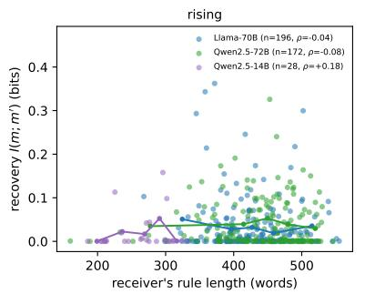

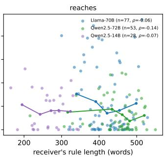

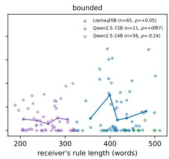  
Figure 11: The receiver’s rule length against recovery, by regime. One point per criterion, three receivers overlaid: Llama-70B on the 130-criterion set and the bank set (338 distinct criteria), Qwen2.5-72B on the bank set, and Qwen2.5-14B as the mean over its four 30-item rules per criterion. Lines are the mean recovery in each length quintile; $\rho$ is the rank correlation of length with recovery.

## D.3 RECONSTRUCTION-VALIDITY CORRELATIONS, THE ARBITER CHECK, AND WHAT IS VALIDATED AT WHICH LEVEL

Table 7 is the validity table referenced in Section 2.3.2: the attenuation-corrected Spearman correlation between a task’s reconstruction MI and the AUC of its judge against silver positiveassertion labels, computed within each metric across its prompt forms and aggregated over the annotation task’s metrics. Correction for attenuation: $\rho _ { \mathrm { c o r r e c t e d } } ~ = ~ \rho _ { \mathrm { o b s e r v e d } } / \sqrt { r _ { \mathrm { M I } } r _ { \mathrm { A U C } } }$ , where rMI and rAUC are split-half reliabilities of the two measured quantities (Spearman–Brown adjusted). The correction estimates how strongly MI and AUC would correlate if both were measured without noise. Both quantities are estimated from finite panels, so the observed correlation understates the association; dividing by the square root of the two reliabilities removes that bias under the classical measurement-error model (independent errors; exact for Pearson, approximate for the rank correlations and selected trajectories used here), at the cost of wider uncertainty when reliabilities are low. We therefore report the observed values, the reliabilities, and the panel sizes alongside the corrected values below. Provenance (check of 2026-09-11, artifact outputs/analyses/mi silver reconstruction v1/): every printed row reproduces from the July 18–26 analysis files on the compute box (mention auc/), none from a committed file; the findings are incorporated into the text and Table 7.

The bootstrap interval for the stepped correction (Table 7) excludes zero for every row except pressreleases, and the unstepped interval for peer-review exceeds 1 in 42% of resamples, which indicates that the unstepped convention is unstable at peer review’s low $r _ { \mathrm { M I } }$

The reliabilities are the $r _ { \mathrm { M I } }$ and $r _ { \mathrm { A U C } }$ columns of Table 7; peer review’s recorded split-half $r _ { \mathrm { M I } }$ is .664, and its correction used .66. These are not estimated uniformly: every $r _ { \mathrm { A U C } }$ is a document split-half (hash-parity for peer review, math and code review; the mean of 12 random splits for creative writing), and for peer review, math and code review $r _ { \mathrm { M I } }$ is a constant taken from an earlier run. The reconstruction probe documents and the AUC-scored documents are disjoint by construction (0/300 overlap on the checked tasks), so disattenuation is not inflated by shared-document correlated errors. The rows did not share one convention, and an earlier description of the conventions was incorrect: peer review, math and creative writing divide by the Spearman–Brown stepped reli abilities $( . 4 9 8 / \sqrt { . 7 9 5 \times . 6 7 6 } = . 6 8 )$ , code review, press releases and humor by the unstepped ones $( . 3 2 8 / \sqrt { . 7 0 8 \times . 3 9 1 } = . 6 2 )$ . The “unstepped . $. 7 4 ^ { \ ' }$ previously quoted for creative writing came from a different document split $( r _ { \mathrm { A U C } } = . 3 9 1 )$ ; the unstepped counterpart of its .61 is .78. Table 7 gives every row under both conventions.

What is validated at which level. Our claims compare recovery across prompt forms, criteria, executors and scaling regimes, and the validation evidence does not cover these four levels equally. Across promptforms, within a criterion: the level of the table above, and the only one with a direct MI-versus-error correlation; an earlier run with 10 forms per metric gave +.39 on creative writing (20/22 metrics positive, permutation $p = 2 \times 1 0 ^ { - 4 } )$ , +.11 on math, and no correlation on humor and press releases, where the judges’ AUC against the mention labels was at chance (.50 and .48). Across criteria: correlations of MI with mention-derived AUC between metrics are within noise $( + . 0 9 \mathrm { t o } + . 1 7 , n \approx 5 0 $ per task), so the criterion-level comparisons of Section 3 rest on the planted controls and the arbiter check. Across executors: the judges’ AUC against the silver labels rises with capability (Spearman +.60 over the 12 executors of the validation panel) and the planted-rule AUC ladders rise within both families (Llama .52/.77/.95/.97, Qwen2.5 .82/.89/.93/.96); this validates the capability axis, not any criterion’s recovery at a given executor. Across regimes: no validation evidence; membership is a fitted verdict (Appendix F). The choice of measure matters little: a pairwise forced-choice measure and the $P ( \mathrm { y e s } )$ measure agree at $r = . 8 2$ over 40 metrics (.65 over 152).

How the correlations are computed, and the one preregistered window. Correlations are Spearman, pooled by Fisher-z over each annotation task’s metrics. Readouts are stratified rather than pooled; pooled readouts are composition-diluted and are not reported. Code review is the one row with a preregistered window, and its corrected value (.62) was above the window ([.37, .51]); only the preregistered contrast between high- and low-positive-count strata held (+.44 against +.20, full set +.33). The table describes metrics the judge can measure at all, not the bank at large. The press-releases observed interval includes zero.

Direct validation against arbiter-filtered labels. The mention-derived silver labels used above are partial-observation proxies (a label records that a commenter invoked a criterion, not that it applies, so an unmentioned criterion is not a negative), and a disagreement review found the judge correct in the majority of judge-vs-label conflicts. We call the relabeled subset arbiter-filtered: the arbiter is a stronger judge with more context, not ground truth, and restricting to its confident verdicts and stratifying on judge-score terciles changes the evaluated population. The table validates the judges against the arbiter; we test below whether reconstruction MI predicts judge correctness on these items, and that test is null and underpowered. To measure judge validity against a less noisy criterion, a stratified sample of (document, metric) pairs per task (∼270–770 after two waves) was re-labeled by an independent frontier arbiter (different model family from every scoring judge; fulldocument context vs. the judges’ truncated views; blind to the silver labels and to all judge scores), certified on sealed mechanically-verifiable anchor items (93%/94% per wave; wave voided below 80%). Confident arbiter labels (extreme-decile verdicts only) give:

<table><tr><td>task</td><td>n</td><td>AUC vs. arbiter-filtered labels</td><td>(vs. mention-label floor)</td></tr><tr><td>peer-review</td><td>614</td><td>.933</td><td>.59</td></tr><tr><td>creative-writing</td><td>163</td><td>.815</td><td>.58</td></tr><tr><td>press-releases</td><td>226</td><td>.686</td><td>.55</td></tr><tr><td>code-review</td><td>163</td><td>.668</td><td>.59</td></tr><tr><td>humor</td><td>272</td><td>.631</td><td>.52</td></tr><tr><td>mean (unweighted / n-weighted)</td><td>1,438</td><td>.747/ .794</td><td></td></tr></table>

Three qualifications apply to this table. (1) The sample is stratified (balanced across label value and judge-score terciles), so these are balanced-sample $\mathbf { A U C s } ,$ not corpus-weighted ones. (2) Arbiterfiltered labels are specification-relative: re-arbitrating the same items under a changed concept specification (criterion name alone vs. name with definition) flipped 46% of verdicts, so the labels inherit the concept’s written form. This is an instance of the wording-sensitivity this paper studies, here on the label side. Prompts that share the specification text are therefore structurally advantaged on this criterion, and no prompt-optimization comparison is scored against it without a specificationindependence control. (3) The mention-label floors in the last column confirm that label noise, not judge capability, bound the silver-label correlations above: every task’s judge exceeds its mention floor by .08–.34 AUC once labels are arbiter-filtered.

Whether MI predicts correctness on these labels. A direct test is null and underpowered (artifact outputs/analyses/mi vs arbiter correctness v1/; the rebuilt labels reproduce the counts and AUCs above). Across metrics, the correlation between a metric’s reconstruction MI and its judge’s AUC against the arbiter-filtered labels is +.90 on creative writing $( n = 5 ) , - . 7 9$ on press releases $( n = 8 )$ and +.33 on humor $( n = 8 )$ , pooled +.25 (permutation $p = . 4 0 )$ ; within metric across prompt forms it runs −.08 to +.13, all $p >$ .12; controlling for $H ( m )$ , the base rate or the mention-label AUC does not change these results. The same test on the mention labels $\mathrm { g i v e s + . 0 9 }$ over 47 peer-review metrics, so the effect being sought is about .10, smaller than 5–11 metrics per task can detect. Two facts qualify the table: in peer review 24 of 30 metrics have confident verdicts of one class only, so no per-metric AUC exists and the .933 is a between-metric contrast (centred within metric it is .60); and peer review’s prompt forms were scored on different documents, so its across-form comparison is not paired. Code review and math contribute no data to this test (no form-level MI; no confident verdicts).

## E EXTERNAL VALIDATION OF THE CAPABILITY SCALAR z

The executor-capability axis used throughout the scaling analyses is a declared instrument: $z _ { E } =$ logit(AUC) on a frozen 240-item anchor battery of code-checkable criterion judgments, scored for every executor under the identical serving stack as the recovery measurements. Because a declared axis can fail idiosyncratically, we cross-validated it against an external instrument that we did not build: the OpenCompass (CompassRank) LLM leaderboard, which evaluates models on closed, contamination-resistant evaluation sets refreshed each edition and reports per-dimension scores (language, knowledge, reasoning, math, code, agent).

Six of our fourteen local executors match OpenCompass entries at the exact checkpoint level (Llama-3.2-3B, Llama-3.1-8B, Qwen2.5-7B, Qwen2.5-72B, Gemma-2-9B, Gemma- $\cdot 2 \mathrm { - } 2 \bar { 7 } \mathrm { B } ;$ all instructiontuned variants), and all six appear in three consecutive leaderboard editions. Within each edition, our battery-z correlates with the OpenCompass average at $r \approx . 6 4 – . 6 7$ (Spearman $\rho \approx . 5 4 )$ , and the disagreement is due entirely to Gemma-2-27B. With that executor excluded, agreement rises to $\mathbf { r } = + . 8 7 , \rho = + . 9 0 \left( n = 5 \right)$

The Gemma-2-27B case is a diagnosable instrument–executor incompatibility rather than a scoring dispute. Our battery scores it below Gemma-2-9B (z 1.10 vs. 2.04), while OpenCompass ranks it above 9B in every edition. The battery’s per-family breakdown localizes the cause: Gemma-2-27B performs at chance $( \mathrm { A U C } = . 4 8 7 )$ on the composite (multi-clause) battery items, where Gemma-2-9B scores .833, while remaining functional on negation (1.0), presence (.867), paraphrase and threshold items (≈ .71); its answer distribution is strongly bimodal (3% of P(YES) mass in [.4, .6]), with zero parse failures and stable split-halves. That is, the model answers decisively but at chance on multi-clause forced-choice judgments. This is a format-specific failure, consistent with its formfragility on other measures in our pipeline and not visible in generative multi-format harnesses. For this reason the Gemma-2 ladder is not used as a same-family ladder for forecasting (a decision made on the inversion before this external check); its two executors remain in the pooled panel on which the regime curves are fitted, where family enters only through the consensus (Appendix F.1). The leaderboard comparison validates the battery on the remaining panel and independently confirms that exclusion.

This check has three limitations: the exact-match panel is small $( n = 6 )$ ; OpenCompass closed-set scores are not comparable across editions (the same frozen checkpoint’s score drops as the eval set is re-hardened, e.g. Qwen2.5-72B 70.3 → 57.3 → 49.9 across three editions), so all correlations are computed within-edition only; and the leaderboard’s frontier entries are predominantly reasoningmode variants while our probes run with reasoning disabled, so the check covers the local ladder, not the frontier points.

## F OBSERVATIONAL SCALING BY REGIME: DEFINITIONS, FITS, TYPE STRUCTURE AND ROBUSTNESS

This appendix documents the fits behind the regime split shown in the main body (Figure 3) and gives the underlying curves in the observational-scaling presentation (Figure 12, this appendix): existing models as scale points against the measured capability index z, with the supervised Qwen3 ladder alongside. The regime definitions below are transcribed from the fitting code. Vertical axis. For executor e and metric n, the executor’s labels under the metric’s prompt (its definition, rendered in four forms) are z-scored over the 300 probe items; the reference is the consensus of the other executors with the executor itself left out: each other executor’s z-scored labeling is averaged within its family and the family means are then averaged, so no family dominates; r is the Spearman correlation between the two; rel is the Spearman–Brown split-half reliability of the executor’s form panel (even against odd forms; rel $\leq . 2$ dropped); the plotted value is $y = \mathrm { m i n } ( r / \sqrt { \mathrm { r e l } } , 1 . 1 5 )$ with a standard error from even- against odd-numbered probes. This quantity is agreement with the leave-one-executor-out consensus of the other executors, corrected for reliability; it is not mutual information. Fit. A curve needs at least 8 executors. A logistic $y = L \sigma ( k ( z - z _ { 0 } ) )$ with $L \leq 1 . 2$ and a line are fitted by least squares; the curve is saturating when the logistic wins on AICc. L has a profile-likelihood interval $[ L _ { l o } , L _ { h i } ]$ . Planted reference. Per task, the planted reference is the mean over the five planted rules of the rule’s mean y at the three highest-z executors (chosen by z, never by y). The five rules are the same in every task and are checked by code against the text: “This text is longer than k words” and “This text is shorter than k words”, where k is the task’s median word count; “This text contains at least one question mark”; “This text contains at least one digit $( 0 { - } 9 ) ^ { \mathfrak { n } } ;$ and “This text contains quoted speech (a quotation mark)”. The reference by task is creative writing .77, humor .79, math .62, news homepages .65, notice-and-comment .58, patents .36, peer review .67 and press releases .63. Decision order. Bounded if saturating and $L _ { h i }$ is below the planted reference; else reaches if saturating; else rising if the Spearman slope of y in z is at least .35; else noisy. The classes cannot overlap, and “bounded” means below the planted reference, not below 1. Verdicts are fitted on the pooled 14-executor panel, not family by family. 77 curves with a noisy or undetermined fit are excluded from the panels and from any regime-level claim (the 40 planted rules were never fitted; Appendix F.1). The supervised Qwen3 ladder is shown for context and is not re-fit here. The uncertainty of the fits, the held-out test of the strongest executor, the exclusions and the type contrasts are examined in Appendix F.1 below.

Bounded ceilings are attained and tight; rising ceilings are extrapolations. The fitted ceilings are ordered across regimes, but they are not equally trustworthy: bounded ceilings are attained within range with the tightest intervals (median CI width .105); reaches ceilings are attained (.33); rising ceilings are extrapolations (median CI width .56). Of the rising fits, 99% place their upper bound above 1, i.e. the ceiling is unidentified and “rising” chiefly records censoring by our strongest executor. Realized recovery at the top of the executor range gives a clearer comparison: reaches .75 (finished), rising .68 (still climbing), bounded .52 (finished, low).

A task-agnostic type structure. To compare the regimes on a common basis, we labeled all 1,270 criteria with a shared, task-agnostic taxonomy of what a criterion asks about (regime held out of the labeling input): nine types, defined in Appendix G and coarsened onto one axis, where the criterion’s truth conditions live: in the text, at the interface or beyond the text. Figure 13 shows the result. Rising and reaches are nearly identical on this axis (in-text 73%/70%, beyond-text 12% both; mean externality index .39/.42); what separates them is domain and device compactness rather than externality. Bounded criteria differ on this axis: 32% beyond-text and mean index .78, driven by identity & persona (17% vs. ∼2.5% elsewhere), community transformation (monotone 0.8% → $4 . 7 \%  9 . 2 \%$ across regimes), and reception outcomes (monotone $5 . 3 \%  \ 7 . 5 \%  \ 1 0 . 8 \%$ while evidence & rigor and audience fit bothfall toward bounded. The gradient holds under domain control: within humor, news, and peer review separately, bounded criteria are 31–34% beyond-text against 4–18% for the other regimes. It also replicates in an independent second labeling pass (mean externality index .71 against .38/.37).

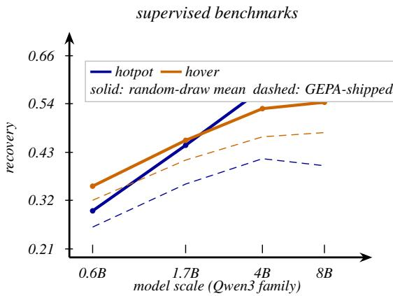

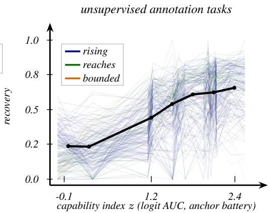  
Figure 12: Articulation scaling in the observational-scaling presentation: existing models as scale points, plotted against a measured capability index rather than parameter count. $R i g h t ,$ unsupervised (measured): 1,347 tasks evaluated by 14 executors spanning 1.2–73B across five model families; each light trace is one task’s recovery curve, colored by its fitted verdict, with the binned mean and its 95% interval in black. Left, supervised (measured): the complete Qwen3 ladder (4 rungs × both benchmarks). Solid lines are the mean of 40 random unit-pool draws per rung, dashed lines the GEPA-shipped prompt. At 8B the draws beat the shipped prompt in $4 0 \bar { / } 4 0$ cases on both benchmarks (HotpotQA +.186, HoVer +.070), and the gain grows with scale.

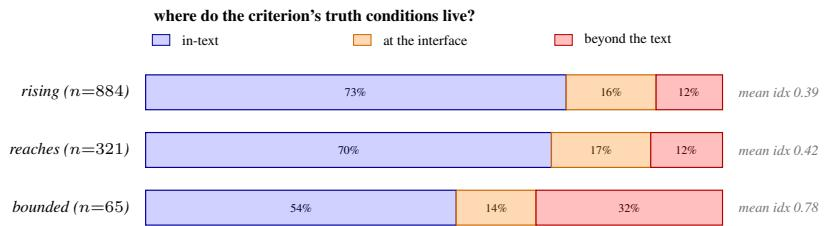  
Figure 13: The three regimes on one axis: where each criterion’s truth conditions live (shared task-agnostic taxonomy, coarsened; regime-blinded labeling; two independent passes, Appendix G). Rising and reaches are near-identical; bounded shifts sharply beyond the text; the numbers are in the text. The regime-by-task composition is Figure 4 in the main body.

## F.1 ROBUSTNESS OF THE REGIME FINDINGS: CURVE FORM, EXECUTORS, EXCLUSIONS, DOMAINS, CONTRASTS AND CAPABILITY AXIS

The regime split rests on four choices, the ones named in Section 3: the curve form, the executor set, the exclusions and the type contrasts. This section defines each, then checks each against the shipped panels (artifacts outputs/analyses/regime uncertainty v1/, heldout baselines v1/, nuisance regression v1/ and osl pca v1/). Two kinds of measurement noise run through every check, and they are defined here as well.

Curve form. The function fitted to a metric’s points $\left( z _ { e } , y _ { e } \right)$ , one per executor: a straight line $y =$ a + bz or a logistic $y = L \sigma ( k ( z - z _ { 0 } ) )$ with ceiling $L \leq 1 . 2 .$ , chosen by AICc, the logistic’s ceiling carrying a profile-likelihood interval $[ \dot { L } _ { l o } , L _ { h i } ]$ . The form decides whether a curve is saturating (the logistic wins) and, through $L _ { h i }$ against the planted reference, whether a saturating curve is bounded or reaches; a non-saturating curve is rising when the Spearman slope of y in z is at least .35 and noisy otherwise (Appendix F).

Executor set. The 14 instruction-tuned open models of Table 8, 1.2B to 73B in five families, each scoring every metric under the same prompt and serving stack. Every curve is fitted on the pooled set, never family by family: a median of 14 points, with 950 of the 1,270 metrics having all 14. A fifteenth model, Qwen3.5-122B, enters only the leave-one-executor-out consensus on the vertical axis and is never a curve point.

Exclusions. Of the 1,347 bank curves, 77 with neither a preferred logistic nor a slope of at least .35 are set aside as noisy, which leaves the 1,270 fitted metrics; the 40 planted rules (five per task) are never fitted and set the planted reference instead.

Type contrasts. Five statements of the form “criteria of type T are over-represented in regime $R ^ { \ast }$ reaches and local patterns, rising and whole-text structure, rising and verifiable features, bounded and identity and social group, bounded and beyond-text features. The types are the six-type code book of Appendix G.1, assigned without sight of the regime. Each contrast is the share of type T among the criteria of regime R against its share among the other two regimes, tested against a null that permutes regime labels within domain (10,000 draws), with Benjamini–Hochberg control over the 18 regime-by-type cells.

Measurement noise in recovery. Each executor’s recovery $y _ { e }$ has a standard error from even- against odd-numbered probes (.025 at the median). The check redraws every point from its standard error, refits the curve and re-applies the decision rule (2,000 draws); contrasts are then weighted by each metric’s share of draws in each regime.

Measurement noise in the capability index. Each executor’s ze has a split-half standard error from the battery (.07 for most executors, up to .24 for Llama-70B). The check redraws every $z _ { e } ,$ , recomputes the planted reference and refits (100 draws).

Regime sizes and domain composition. The counts 884, 321 and 65, and the number of bounded criteria in each domain (Figure 4). A quantity survives a check when its value under the check stays within the range the tables below report and the same contrasts remain significant.

Curve form: saturation takes precedence, and rising is what is left when the line wins. A metric is saturating when the logistic beats the straight line on AICc; 386 of the 1,270 curves are. The two tests overlap: 375 of the 386 saturating curves also have a Spearman slope of at least .35, and the decision order gives saturation precedence, so rising is the class left over when the line is preferred rather than a positive test that a curve keeps climbing. The ceilings behave as described under “Interpreting the $\mathrm { { \bar { f } t s } ^ { \prime } }$ above: bounded ceilings are attained with the tightest intervals, rising ceilings are extrapolations. To test whether the chosen curve has predictive value, we refit every metric without its highest-z executor and predicted that executor (Table 9). The fitted form’s median error is 9% of the held-out value, and it over-predicts on 72% of metrics. The AICc choice coincides with the logistic on 77% of metrics, and on the 386 saturating curves it beats the line by a wide margin (.041 against .111). Fitted within one family instead of on the pooled panel, the error is .096 (Llama, four executors) and .067 (Qwen2.5, five), the latter no better than that family’s own train mean (.070); at five points or fewer the AICc comparison is undefined, so no within-family verdict exists. The rising cutoff on the rank correlation, .35, has no external criterion to validate it against; changing it only moves curves between rising and noisy. No fitted curve is below it, 23 of the 77 excluded curves would join rising at .25, and raising it to .46 (the value a curve with no trend exceeds one time in twenty at 14 executors) reclassifies 44 rising curves as noisy, .55 reclassifies 122, .65 reclassifies 226; the rising/whole-text contrast remains significant at every cutoff from .25 to .65 $( q \leq . 0 1 4 )$ and rising/verifiable at none.

Executor perturbations: a parametric bootstrap, and dropping each curve’s most capable executor. Every curve is fitted on the pooled panel: a median of 14 executors (950 of the 1,270 metrics have all 14) from five families (Llama 4, Qwen2.5 5, Gemma-2 2, Mistral 2, Phi 1); family enters only through the leave-one-executor-out, family-balanced consensus on the vertical axis. Two perturbations test the executor set. A parametric bootstrap redraws each executor’s y from its standard error, refits and re-applies the rule (2,000 draws). Group sizes hold: rising 849–890 (printed

884), reaches 287–326 (321), bounded 54–74 (65); a typical draw also sends about 30 metrics (21– 39) to noisy. Memberships hold less well (Table 10): the modal verdict equals the printed one for 94% of metrics, but 397 metrics have a modal probability below .8 and 163 below .6, and a bounded criterion keeps its label in 65% of draws on average against 90% for a rising one. Dropping the highest-z executor changes 12% of verdicts, with reaches the most exposed: 106 of the 321 reaches curves become rising without their top executor, because that point is what made the curve bend. The group sizes then become 971 rising, 224 reaches and 62 bounded, with 13 noisy, so the bounded count holds and the split between rising and reaches does not.

Which curves are excluded as noisy, and the planted rules that are never fitted. The bank has 1,347 curves; 77 with neither a preferred saturating fit nor a slope of at least .35 are excluded as noisy, which leaves the 1,270 fitted metrics. The 40 planted rules are never fitted; they set the planted reference (Appendix F). An earlier count of “117 excluded” added the two groups together.

Regime composition by domain: bounded shares differ by domain, rising shares are large everywhere. Figure 4 (main body) shows each domain’s regime composition directly. The bounded share is domain-specific: humor 15% (41 tasks), peer review 11% (9), news homepages 10% (13), creative writing 1% (2), and zero in math, notice-and-comment, patents, and press releases. The rising share is $6 5 { - } 8 6 \%$ in every domain, so every domain has headroom. (Labels are names-based; a near-duplicate pair of sourcing-transparency criteria that fall in different regimes within news shows that names alone do not fully determine membership.) The composition was checked under the same perturbations (Table 11). Under both kinds of measurement noise and without the most capable executor, bounded criteria stay concentrated in humor, news homepages, peer review and, marginally, creative writing. The four domains printed with no bounded criteria are not always empty under noise: in the recovery-noise bootstrap, math has at least one bounded criterion in 73% of draws, notice-and-comment in 64% and press releases in 34%, never more than three; patents never has one. Under a differently built capability axis the composition does not hold: on the first component of the battery’s sub-scores humor keeps 3 bounded criteria, and on equally spaced ranks every domain but patents has bounded criteria.

The five regime-by-type contrasts and their permutation test. The main text’s five regimeby-type contrasts each ask whether one kind of criterion is over-represented in one regime relative to the other two: reaches/local patterns, rising/whole-text structure, rising/verifiable features, bounded/identity and social group, and bounded/beyond-text features. They were tested by permuting regime labels within domain (10,000 draws) with Benjamini–Hochberg control; the regime-by type table as a whole departs from independence $( \chi ^ { 2 } = \dot { 9 } 0 . 0$ on 10 degrees of freedom, Cramer’s´ $\bar { V } = . 1 9 )$ . Three contrasts remain significant and two do not (Table 12). Pooled across domains, “rising is verifiable” had $q = . 0 1 3 ;$ within domain it has $q = . 3 1$ , so that contrast was due to domain composition. Weighting each metric by its membership probabilities under recovery noise instead of its printed verdict gives the same three significant contrasts $( q = . 0 0 0 4$ , .0004 and .011), with the bounded identity-and-social share falling from 23% to 19%; so does weighting by the probabilities under capability-index noise $( q = . 0 0 0 4$ , .0004 and .008). On the verdicts refit without each curve’s most capable executor only reaches/local patterns remains significant (34% against 18%, $q = . 0 0 1 )$ ; rising/whole-text structure (27% against 20%, $q = . 0 9 )$ and bounded/identity and social group (19% against $6 \% , q = . 1 9 )$ keep their direction but lose significance. The same three also hold in a regression that adds, to domain effects and the type indicator, the label entropy $H ( m )$ of the executor’s per-item judgment (10 bins), the criterion’s split-half reliability, document length and the share of items cut by the 4,000-character truncation $( 0 \%$ in humor, peer review and noticeand-comment, 78% in patents); length and truncation are properties of a domain’s shared 300-item corpus, so they enter pooled across the eight domains with a domain-clustered bootstrap. Coefficients move by at most about 16% (Table 12; the rising/whole-text coefficient is .43 [.22, .87] with length and truncation added). Of the added covariates, $H ( m )$ has the largest effect: with reliability it raises the recovery regression’s $R ^ { 2 }$ from .35 to .74, and the apparent recovery shortfall of beyondtext criteria at the top of the executor range $\left( - . 0 5 3 \left[ - . 0 8 2 , - . 0 2 5 \right] \right)$ disappears once it enters (.007 $[ - . 0 1 1 , . 0 2 5 ] )$ ; whole-text structure shows no shortfall before or after $\left( . 0 0 3 5 \left[ - . 0 2 0 , . 0 1 3 \right] \right.$ ; .0044 $[ - . 0 0 6 , . 0 1 5 ] )$ , so its “harder” reading follows from its classification as rising. Finally, the type signatures do not depend on the grain of the codebook: the rising/reaches inversion on whole-text against local patterns and the bounded social signature appear at 12, 8 and 6 categories (Figure 14), and the shift of bounded criteria beyond the text holds in the second labeling pass and within domain (Appendix F).

One axis or several, and which one. Two further checks follow Ruan et al. (2024) (artifact output $\mathsf { s / a n a l y s e s / o s l \_ p c a \_ v 1 / \lambda ) }$ First, we test whether recovery is low-rank across executors. On the 950 metrics scored by all 14 executors, with each metric centered, the first principal component of the executor-by-metric matrix explains 80% of the variance (a permutation null gives $9 \% )$ and its executor scores correlate with $z { \mathrm { ~ a t ~ } } r = . 9 5$ The second explains 5% and is the shape axis the regimes are built on: saturating criteria have positive weights on it (bounded $+ . 0 2 2 \ [ + . 0 1 3 , + . 0 3 0 ]$ , reaches $+ . 0 1 6 ~ [ + . 0 1 2 , + . 0 2 0 ] )$ and rising ones negative weights $( - . 0 0 8$ $[ - . 0 1 0 , \dot { - } . 0 0 5 ] )$ , and no criterion type stands apart from its regime on it. A rank-one fit leaves a residual of .082 against a median measurement error of .027; the remaining fifth is real but spread over many small components, not a second capability dimension. Second, we test how much the verdicts depend on the axis. Under z’s own measurement error (each executor’s index redrawn from the split-half standard error of its battery score, .07 for most executors and up to .24 for Llama-70B; 100 draws; planted reference recomputed each time) the groups hold: bounded 46–100; the mean probability that a metric keeps its printed regime is .91 (rising), .82 (reaches) and .82 (bounded); the modal verdict equals the printed one for $9 7 \%$ of metrics; and, weighting each metric by these probabilities, the same three contrasts remain significant (reaches/local patterns $q = . 0 0 0 4$ , rising/whole-text structure $q = . 0 0 0 4$ , bounded/identity and social group $q = . 0 0 8 )$ . Under a differently constructed axis they do not (Table 13). The first component of the battery’s five sub-scores orders the executors almost as z does (rank correlation .97) but places the four strongest within .13 of each other where z spreads them over .42; on it 30% of verdicts change and the bounded group falls to 12. Equally spaced ranks do the opposite and make 273 curves bounded. Of the five contrasts, only reaches/local patterns remains significant on the battery’s component and on ranks, none does on the circular axis built from the recovery values, and bounded/identity and social group does on z and on ranks. The bounded verdict asks whether a fitted ceiling’s upper limit falls below the planted reference at the top of the range, so it is decided by how far apart the strongest executors are on the axis: z measures that spacing with the error propagated above, and the spacing is a property of the index, not of the criteria.

What holds under every check, and what rests on the most capable executor. The regime sizes, the domain composition of Figure 4 and the three significant contrasts hold under the curve, exclusion and group checks and under measurement noise in both the recovery values and the capability index. Without each curve’s most capable executor, the bounded count and the domain composition still hold, but a third of reaches curves become rising and only the reaches/local-patterns contrast stays significant. Three results are fragile: which particular metric is in which regime, most of all for bounded criteria, which keep their label in 65% of recovery-noise draws and 82% of index-noise draws on average; the reaches verdict of a curve whose saturation rests on the strongest executor; and, under a differently constructed capability axis, the bounded count, its domain composition and its identity-and-social signature (Tables 11 and 13). The early saturation of local-pattern criteria is the one regularity that holds under every check except the circular axis built from the recovery values themselves.

<table><tr><td>method</td><td>init / inherited</td><td>calls: prop/sel/val/test</td><td>total</td><td>chars</td><td>test score (∆ vs GEPA)</td></tr><tr><td colspan="6">HotpotQA (ntest=300, HB220/HB224, fp 2026-09-12T00:19:48Z)</td></tr><tr><td>GEPA (eq.-call)a</td><td>seed program</td><td>16,821/n/a/n/a/3,000</td><td>19,821</td><td>7,016</td><td>.567</td></tr><tr><td>GEPA+Merge</td><td>seed program</td><td>600/n/a/n/a/600</td><td>1,200</td><td>1,426</td><td>.421</td></tr><tr><td>MIPROv2</td><td>seed program</td><td>600/n/a/n/a/600</td><td>1,200</td><td>1,048</td><td>.435</td></tr><tr><td> $M _ { \omega }$ </td><td>GEPA-600 init  $+ ~ 6 8 \mathrm { u }$  (60L/8T) → 28 compiled</td><td>0/16,000/700/600</td><td>17,300</td><td>4,619</td><td> $. 6 4 3 \left( + . 0 7 7 ^ { \ast \ast \ast } \left[ + . 0 4 5 , + . 1 0 9 \right] \right)$ </td></tr><tr><td colspan="6">HoVer  $( n _ { \mathrm { t e s t } } { = } 3 0 0 ,$  HB212, fp 2026-08-20T07:01:05Z)</td></tr><tr><td>GEPA (eq.-call)</td><td>seed program</td><td>10,110/n/a/n/a/3,000</td><td>13,110</td><td>6,017</td><td>.497</td></tr><tr><td>GEPA+Merge</td><td>seed program</td><td>24,000/n/a/n/a/600</td><td>24,600</td><td>7,757</td><td>.515</td></tr><tr><td>MIPROv2</td><td>seed program</td><td>2,400/n/a/n/a/n/1</td><td>n/l</td><td>1,841</td><td>.487</td></tr><tr><td> $M _ { \omega } ^ { b }$ </td><td>GEPA-600 init + 164u (96L/48T/20X) → 41</td><td>n/l/n/l/n/l/n/l</td><td>n/l</td><td>9,506</td><td> $. 5 6 7 \left( + . 0 7 1 ^ { \ast \ast \ast } \left[ + . 0 4 3 , + . 0 9 9 \right] \right)$ </td></tr><tr><td colspan="6">compiled</td></tr><tr><td>GEPA (eq.-call)</td><td>LiveBench (ntest=126, HB210, fp 2026-08-20T01:32:58Z)</td><td>18,708/n/a/n/a/1,260</td><td>19,968</td><td>3,655</td><td>.695</td></tr><tr><td>GEPA+Merge</td><td>seed program seed program</td><td>600/n/a/n/a/252</td><td>852</td><td>2,154</td><td>.686</td></tr><tr><td>MIPROv2</td><td>seed program</td><td>600/n/a/n/a/252</td><td>852</td><td>436</td><td>.661</td></tr><tr><td>Mc</td><td>GEPA-600 init; guard re- jected all 48u (→ ships GEPA-600 verbatim)</td><td>0/4,536/80/252</td><td>4,868</td><td>5,239</td><td> $. 7 1 0 \left( + . 0 1 6 \left[ - . 0 1 0 , + . 0 4 3 \right] \right)$ </td></tr><tr><td colspan="6">IFBench (ntest=294, HB215, fp 2026-08-25T07:48:51Z)</td></tr><tr><td>GEPA (eq.-call)</td><td>seed program</td><td>23,300/n/a/n/a/n/l</td><td>n/l</td><td>138</td><td>.417</td></tr><tr><td>GEPA+Merge</td><td>seed program</td><td>600/n/a/n/a/588</td><td>1,188</td><td>138</td><td>.419</td></tr><tr><td>MIPROv2</td><td>seed program</td><td>600/n/a/n/a/588</td><td>1,188</td><td>1,471</td><td>.382</td></tr><tr><td>Mω</td><td>GEPA-600 init  $+ ~ 1 2 8 \mathrm { u }$   $( 6 0 \mathrm { L } / 6 8 \mathrm { T } ) ~  ~ 2 3 ~ \mathrm { c o m } -$ </td><td>0/22,600/700/588</td><td>23,888</td><td>3,856</td><td>.442 (+.025 [−.003,+.053])</td></tr><tr><td colspan="6">piled  $( n _ { \mathrm { t e s t } } { = } 2 2 1$  , HB217, fp 2026-08-27T13:48:44Z)</td></tr><tr><td>GEPA (eq.-call)d</td><td>seed program</td><td>29,166/n/a/n/a/n/l</td><td>n/l</td><td>9,109</td><td>.638</td></tr><tr><td>GEPA+Merge</td><td>seed program</td><td>600/n/a/n/a/n/l</td><td>n/l</td><td>2,818</td><td>.616</td></tr><tr><td>MIPROv2</td><td>seed program GEPA-600 init + 120u</td><td>2,400/n/a/n/a/n/1</td><td>n/l</td><td>877</td><td>.659</td></tr><tr><td> $M _ { \omega }$ </td><td>(60L/36T/24F) → 1 com- piled</td><td>n/l/n/l/n/l/n/l</td><td>n/l</td><td>3,512</td><td>.685 (+.047** [+.018,+.076])</td></tr><tr><td colspan="6">AIME (ntest=150, HB219, fp 2026-09-11T09:54:14Z)</td></tr><tr><td>GEPA (eq.-call)</td><td>seed program</td><td>6,870/n/a/n/a/n/1</td><td>n/l</td><td>1,958</td><td>.323</td></tr><tr><td>GEPA+Merge</td><td>seed program</td><td>600/n/a/n/a/300</td><td>900</td><td>2,158</td><td>.331</td></tr><tr><td>MIPROv2</td><td>seed program</td><td>600/n/a/n/a/300</td><td>900</td><td>63</td><td>.275</td></tr><tr><td> $M _ { \omega }$ </td><td>GEPA-600 init + 48u  $( 2 4 \mathrm { L } / 2 4 \mathrm { T } ) \to 1 { \mathrm { c o m p i l e d } }$ </td><td>0/2,460/30/300</td><td>2,790</td><td>1,462</td><td> $. 3 5 7 \left( + . 0 3 5 ^ { * * } \left[ + . 0 1 1 , + . 0 6 1 \right] \right)$ </td></tr></table>

Table 4: Per-procedure accounting. One block per benchmark; rows are the four Table 3 methods in its column order. Init/inherited: GEPA, GEPA+Merge and MIPROv2 all start from the benchmark’s seed program; $M _ { \omega }$ initializes from GEPA’s shipped 600- call candidate and mines a unit pool from optimizer trajectories plus reflection-LM suggestions (L=LLM-suggested, T=own-trajectory-mined, X=cross-task-LM-trajectory-mined, F=failuregrounded-mined; “u” units, “compiled” the number kept in the shipped prompt after drop-one/addback and the no-regret guard). Calls: prop/sel/val/test: metric-evaluation calls by stage, summed from each run’s own proposals.jsonl (prop=proposal/mining-stage metric calls, i.e. failuregrounded sampling only, since LLM-suggested units cost reflection-LM calls rather than metric calls, see below; sel=select-init/select-marginal/prefix-sweep/drop-one/add-back; val=confirminit/confirm-compiled, the no-regret guard; test=this run’s own final-test pass, own-session, never the certified score in the last column). GEPA/GEPA+Merge/MIPROv2 do not log a phaseseparated selection/validation split, so their “prop” cell is their whole declared search budget (result.json[’budget calls’], the max metric calls cap) except HotpotQA GEPA (16,821, realized, parsed from gepa state.bin, HB199 §1) and PUPA GEPA (29,166 realized = 98.8% of 29,526 declared before a disk failure, HB216/217); MIPROv2’s heavy mode has no cap, so its number is realized by construction. n/a marks a stage that does not apply to that optimizer; $\mathrm { n } / \mathrm { 1 }$ marks a number not logged in this run’s own artifacts (IFBench and AIME’s GEPA column and HoVer’s MIPROv2 column retain no proposals.jsonl, only result.json, so their own-run test-stage calls cannot be recomputed from artifacts here; PUPA’s GEPA/Merge/MIPROv2/M directories and HoVer’s $M _ { \omega }$ directory retain none either, so every stage of those rows is n/l). Total: realized calls summed across logged stages (LiveBench and $\mathrm { A i M E ` s } \ : M _ { \omega }$ directories mix rows from several restarted launch attempts; the number shown isolates the attempt whose own final-test score matches result.json, not the full file, which sums to 16,046 and 3,855 respectively including the failed restarts). Chars: shipped-candidate character count; the aggregate character mass proposed across an entire search is reconstructed only for HotpotQA (HB199 §1: GEPA∼70M vs $M _ { \omega } { \sim } 4 6 . 3  { \mathrm { M } }$ characters); elsewhere it is not logged. Test score: the certified same-session score from the row-of-record ledger entry named per block (never this run’s own-session number); M ’s row adds the paired bootstrap $\Delta$ and 95% CI against the GEPA column, stars as in Table 3. aThree

<table><tr><td></td><td></td><td></td><td colspan="3">power law  $\hat { y } ( k _ { \operatorname* { m a x } } + \Delta )$ </td><td colspan="3">k=∞ ceiling a</td><td colspan="5"></td></tr><tr><td>benchmark</td><td> $k _ { \mathrm { m a x } }$ </td><td> $y ( k _ { \operatorname* { m a x } } )$ </td><td>+10</td><td>+20</td><td>+50</td><td>power</td><td>sat. exp.</td><td>constrained</td><td>€ (point)</td><td> $\widehat { \epsilon } _ { \mathrm { c o n } }$ </td><td>viol. 4–8 / 9+</td><td>N pooled [block]</td><td></td></tr><tr><td>HotpotQA</td><td>68</td><td>.593</td><td>.602</td><td>.602</td><td>.604</td><td>.611</td><td>.600</td><td>.644</td><td>+.018</td><td> $+ . 0 5 1$ </td><td>.03 / .08</td><td></td><td>337 [23, 337]</td></tr><tr><td>IFBench</td><td>48</td><td>.855</td><td>.856</td><td>.856</td><td>.856</td><td>.856</td><td>.856</td><td>.892</td><td>+.001</td><td>+.037</td><td>.10/ .05</td><td>550</td><td>[42,550]</td></tr><tr><td>HoVer</td><td>32</td><td>.560</td><td>.592</td><td>.592</td><td>.592</td><td>.592</td><td>.570</td><td>.660</td><td>+.032</td><td>+.100</td><td>.00 / .00</td><td>191</td><td>[16, 191]</td></tr><tr><td>LiveBench</td><td>32</td><td>.658</td><td>.718</td><td>.721</td><td>.726</td><td>.778</td><td>.723</td><td>.778</td><td>+.121</td><td>+.121</td><td>.00 / .00</td><td>369</td><td>[37,369]</td></tr><tr><td>AIME</td><td>48</td><td>.533</td><td>.524</td><td>.523</td><td>.520</td><td>.480</td><td>.445</td><td>.633</td><td>-.053</td><td>+.100</td><td>.00 / .00</td><td>177 [33, 177]</td><td></td></tr><tr><td>PUPA</td><td>23</td><td>.891</td><td>.889</td><td>.889</td><td>.889</td><td>.889</td><td>.888</td><td>.952</td><td>-.002</td><td>+.061</td><td>.00 / .00</td><td></td><td></td></tr></table>

Table 5: Projected and constrained ceilings, one row per benchmark. Values are in the value curves’ own units (validation-side greedy prefix means, as in Figure 10 and the backtest above), not Table 3 test scores; only the saturation verdict transfers from one to the other. The constrained asymptote, both $\widehat { \epsilon }$ columns and the violation rates are power-law fits. $\widehat { \epsilon } _ { \mathrm { c o n } }$ is the constrained asymptote minus $y ( k _ { \operatorname* { m a x } } ) ;$ ; the calibrated margin is zero. Violation = share of later prefixes above the window’s ceiling, held out. The block interval resamples whole sampling runs; its upper limit necessarily equals the pooled point (a duplicated run adds only doubletons), so the leave-one-run-out range above is the better measure of width. PUPA has a single sampling run. The constrained asymptotes replace the unconstrained ones wherever a ceiling is quoted. Artifacts: runs/ceiling projection v1.json and runs/epsilon calibration v1.json.

<table><tr><td>message</td><td>model</td><td>n</td><td>median length (words)</td><td>Spearman with recovery or gain</td></tr><tr><td>transmitter&#x27;s definition, by regime</td><td></td><td>1,270</td><td>bounded 17, reaches 19, rising 19</td><td>一</td></tr><tr><td>receiver&#x27;s rule, rising</td><td>Llama-70B / Qwen2.5-72B / Qwen2.5-14B</td><td>196 / 172 / 28</td><td>424 / 454 / 272</td><td> $- . 0 4 / - . 0 8 / + . 1 8$ </td></tr><tr><td>receiver&#x27;s rule, reaches</td><td>Llama-70B / Qwen2.5-72B / Qwen2.5-14B</td><td>77 /53 / 28</td><td>430 / 461 / 266</td><td> $- . 0 6 / - . 1 4 / - . 0 7$ </td></tr><tr><td>receiver&#x27;s rule, bounded</td><td>Llama-70B / Qwen2.5-72B / Qwen2.5-14B</td><td>65 / 11 / 56</td><td>413 / 462 / 260</td><td> $+ . 0 5 / + . 0 7 / - . 2 4$ </td></tr><tr><td>receiver&#x27;s rule, 30 / 60 / 90 items</td><td>Qwen2.5-14B</td><td>112</td><td>bounded 263 / 260 / 256; controls 269 / 256 / 239</td><td>-.04</td></tr><tr><td>search unit, five pools</td><td>Qwen3-8B</td><td>360</td><td>23</td><td>-.04</td></tr></table>

Table 6: Median message length in words and its rank correlation with recovery (rules) or marginal gain (units). The 30, 60 and 90-item row counts four rules per criterion and size. Artifact outputs/analyses/rule length v1/.

<table><tr><td>task</td><td>n (pool)</td><td>obs. ρ</td><td>perm. p</td><td>pool ρ</td><td>rMI</td><td>rAUC</td><td>corr. unstepped</td><td>corr. stepped</td><td>95% CI (stepped)</td><td>printed</td></tr><tr><td>peer-review</td><td>21 (42)</td><td>.498</td><td>.0005</td><td>+.381</td><td>.660</td><td>.510</td><td>.86</td><td>.68</td><td>[.58, .95]</td><td>.68 (s)</td></tr><tr><td>code-review</td><td>31 (31)</td><td>.328</td><td>.0002</td><td></td><td>.708</td><td>.391</td><td>.62</td><td>.48</td><td>[.18, .71]</td><td>.62 (u)</td></tr><tr><td>creative-writing</td><td>15</td><td>.419</td><td>.0002</td><td></td><td>.809</td><td>.360</td><td>.78</td><td>.61</td><td>[.28, 1.00]</td><td>.61 (s)</td></tr><tr><td>math</td><td>14 (46)</td><td>.352</td><td>.0005</td><td> $+ . 0 2 9 $ </td><td>.738</td><td>.310</td><td>.74</td><td>.56</td><td>[.20, .76]</td><td>.56 (s)</td></tr><tr><td>press-releases</td><td>23 (23)</td><td>.203</td><td>.0052</td><td></td><td>.789</td><td>.212</td><td>.50</td><td>.37</td><td> $[ \dot { - } . 0 4 , . 8 \dot { 8 } ]$ </td><td>.50 (u)</td></tr><tr><td>humor</td><td>21 (106)</td><td>.344</td><td>.0002</td><td> $+ . 1 3 0$ </td><td>.816</td><td>.727</td><td>.45</td><td>.40</td><td> $\cdot 2 6 , . 5 4 ] ^ { \cdot }$ </td><td>.45 (u)</td></tr></table>

Table 7: Reconstruction validity under both reliability conventions. n = metrics in the printed row; in parentheses, the full pool size where the row was restricted after the fact to metrics whose judge reaches mean $\mathrm { \Delta \bar { A U C } ~ \ge ~ \Omega . 5 5 }$ against the mention labels; “pool $\rho ^ { \dagger }$ is the correlation on the full pool (math: +.029, $\textit { p } = \ . 4 9 )$ . Peer review and math are also the best configuration of a sweep over label variants (1 of 14 and 1 of 8). “printed” is the value an earlier version of this table printed, with its convention: (s) stepped, (u) unstepped. Permutation $p \textmd { - }$ values shuffle within metric and stay valid after selection; the restricted effect sizes are not comparable to the pools. The 95% CI resamples metrics 2,000 times (seed 20260912) and redraws a document or probe split for each reliability on every resample (artifact outputs/analyses/mi silver reliability uncertainty v1/); every row had the per-form data needed for $r _ { \mathrm { M I } }$ , so no sensitivity band was needed.

<table><tr><td>executor</td><td>family</td><td>parameters</td><td>capability index z</td></tr><tr><td>Llama-3.2-1B</td><td>Llama</td><td>1.2B</td><td>-.24</td></tr><tr><td>Mistral-7B</td><td>Mistral</td><td>7.2B</td><td>.28</td></tr><tr><td>Gemma-2-27B</td><td>Gemma-2</td><td>27.2B</td><td>1.10</td></tr><tr><td>Llama-3.2-3B</td><td>Llama</td><td>3.2B</td><td>1.17</td></tr><tr><td>Qwen2.5-3B</td><td>Qwen2.5</td><td>3.1B</td><td>1.47</td></tr><tr><td>Llama-3.1-8B</td><td>Llama</td><td>8.0B</td><td>1.56</td></tr><tr><td>Qwen2.5-7B</td><td>Qwen2.5</td><td>7.6B</td><td>1.66</td></tr><tr><td>Phi-4</td><td>Phi</td><td>14.7B</td><td>1.93</td></tr><tr><td>Qwen2.5-14B</td><td>Qwen2.5</td><td>14.8B</td><td>2.00</td></tr><tr><td>Gemma-2-9B</td><td>Gemma-2</td><td>9.2B</td><td>2.04</td></tr><tr><td>Mistral-Small-24B</td><td>Mistral</td><td>23.6B</td><td>2.10</td></tr><tr><td>Llama-3.3-70B</td><td>Llama</td><td>70.6B</td><td>2.13</td></tr><tr><td>Qwen2.5-72B</td><td>Qwen2.5</td><td>72.7B</td><td>2.34</td></tr><tr><td>Qwen2.5-32B</td><td>Qwen2.5</td><td>32.8B</td><td>2.55</td></tr><tr><td>Qwen3.5-122B (consensus only)</td><td>Qwen3.5</td><td>122B</td><td>2.23</td></tr></table>

Table 8: The executor set. The 14 instruction-tuned open models on which every regime curve is fitted, ordered by the capability index z (logit AUC on the 240-item battery, Appendix E). Qwen3.5- 122B, a mixture of experts with 10B active parameters, contributes only to the leave-one-executorout consensus on the vertical axis and is not a curve point.

<table><tr><td>predictor of the held-out largest executor</td><td>median |error|</td><td>median error / SE</td><td>within 2 SE</td></tr><tr><td>fitted form (AICc choice, as in the paper)</td><td>.062</td><td>2.4</td><td>42%</td></tr><tr><td>logistic always</td><td>.051</td><td>2.1</td><td>49%</td></tr><tr><td>straight line always</td><td>.075</td><td>3.0</td><td>35%</td></tr><tr><td>mean of the remaining executors</td><td>.149</td><td>5.7</td><td>18%</td></tr></table>

Table 9: Held-out prediction of the strongest executor, 1,270 metrics. Each curve is refitted without its highest-z executor and that executor’s recovery is predicted; SE is the held-out point’s own standard error (.025 at the median). Artifact outputs/analyses/heldout baselines v1/.

<table><tr><td rowspan="2">printed regime</td><td rowspan="2">n</td><td colspan="3">noise in recovery (2,000 draws)</td><td colspan="3">noise in the capability index (100 draws)</td><td rowspan="2">verdict changes without the top executor</td></tr><tr><td>mean P(own)</td><td>modal = printed</td><td>P(own) &lt; .6</td><td>mean P(own)</td><td>modal = printed</td><td>P(own) &lt; .6</td></tr><tr><td>rising</td><td>884</td><td>.90</td><td>99%</td><td>5%</td><td>.91</td><td>98%</td><td>7%</td><td>3% (10 to reaches, 4 to bounded, 13 to noisy)</td></tr><tr><td>reaches</td><td>321</td><td>.73</td><td>84%</td><td>34%</td><td>.82</td><td>95%</td><td>13%</td><td>36% (106 to rising, 8 to bounded)</td></tr><tr><td>bounded</td><td>65</td><td>.65</td><td>78%</td><td>42%</td><td>.82</td><td>92%</td><td>12%</td><td>23% (7 to reaches, 8 to rising)</td></tr></table>

Table 10: Membership uncertainty by regime. P(own) is the share of draws in which a metric keeps its printed verdict. Columns 3–5: each executor’s recovery redrawn from its standard error (2,000 draws). Columns 6–8: each executor’s capability index redrawn from its split-half standard error, with the planted reference recomputed (100 draws). Last column: refit without the highest-z executor. Artifacts outputs/analyses/regime uncertainty v1/ and osl pca v1/.

<table><tr><td rowspan="2">domain</td><td rowspan="2">criteria</td><td colspan="6">number of bounded criteria</td></tr><tr><td>printed</td><td>noise in recovery, 95% of draws</td><td>noise in the index, expected</td><td>without the top executor</td><td>battery's first component</td><td>equally spaced ranks</td></tr><tr><td>humor</td><td>278</td><td>41</td><td>30-46</td><td>44.0</td><td>41</td><td>3</td><td>129</td></tr><tr><td>news homepages</td><td>132</td><td>13</td><td>6-15</td><td>11.0</td><td>10</td><td>4</td><td>28</td></tr><tr><td>peer review</td><td>84</td><td>9</td><td>6-12</td><td>8.6</td><td>9</td><td></td><td>29</td></tr><tr><td>creative writing</td><td>367</td><td>2</td><td>2-8</td><td>2.4</td><td>2</td><td>32</td><td>67</td></tr><tr><td>math</td><td>137</td><td>0</td><td>0-3</td><td>0.4</td><td>0</td><td>0</td><td>9</td></tr><tr><td>notice and comment</td><td>66</td><td>0</td><td>0-3</td><td>0.3</td><td>0</td><td>0</td><td>65</td></tr><tr><td>press releases</td><td>199</td><td>0</td><td>0-2</td><td>0.1</td><td>0</td><td>0</td><td></td></tr><tr><td>patents</td><td>7</td><td>0</td><td>0</td><td>0.0</td><td>0</td><td>0</td><td>0</td></tr><tr><td>contrast (regime / type)</td><td>share in regime vs. other regimes</td><td>permutation q</td><td>q, recovery noise</td><td>q, capability-index noise</td><td>q, without the top executor</td><td>log-odds, domain effects only</td><td>+H(m) and reliability</td></tr><tr><td></td><td>34% vs. 17%</td><td>.001</td><td>.0004</td><td>.0004</td><td>.001</td><td>.92 [.62, 1.22]</td><td>.77 [.46, 1.09]</td></tr><tr><td>reaches / local patterns rising / whole-text structure</td><td>28% vs. 19%</td><td>.009</td><td>.0004</td><td>.0004</td><td>.09</td><td></td><td>.45 [.14, .76]</td></tr><tr><td>bounded / identity and social group</td><td>23% vs. 6%</td><td>.03</td><td>.011</td><td>.008</td><td>.19</td><td> $\yen 123,456$  .92 [.23, 1.57]</td><td>.80 [.08, 1.46]</td></tr><tr><td>rising / verifiable features</td><td>29% vs. 22%</td><td>.31</td><td>.24</td><td>.13</td><td>.50</td><td>.18</td><td>.16</td></tr><tr><td>bounded / beyond-text features</td><td>15% vs. 10%</td><td>.42</td><td>.40</td><td>.41</td><td>.44</td><td>.27</td><td>.12</td></tr></table>

Table 11: Bounded criteria by domain under each check. Noise in recovery: each executor’s recovery redrawn from its standard error (2,000 draws). Noise in the index: each executor’s capability index redrawn from its split-half standard error, expected count over 100 draws. Without the top executor: each curve refit without its highest-z executor. The last two columns refit every curve on a differently built capability axis (Table 13). Artifacts outputs/analyses/regime uncertainty v1/ and osl pca v1/.

Table 12: The five regime-by-type contrasts under the checks. q from within-domain permutation with false-discovery control, on the printed verdicts, weighted by membership probabilities under recovery noise, weighted by membership probabilities under capability-index noise, and on the verdicts refit without each curve’s most capable executor. Log-odds with 95% domainclustered bootstrap intervals from the nuisance regression (intervals omitted for the two contrasts that are null in every model). Artifacts outputs/analyses/nuisance regression v1/, regime uncertainty v1/ and osl pca v1/.

<table><tr><td>capability axis</td><td>rank corr. with z</td><td>rising</td><td>reaches</td><td>bounded</td><td>verdicts changed</td><td>contrasts surviving (of five)</td></tr><tr><td>battery z (the paper)</td><td>1.00</td><td>884</td><td>321</td><td>65</td><td></td><td>3: reaches/local, rising/whole-text, bounded/identity</td></tr><tr><td>z redrawn from its measurement error (100 draws)</td><td></td><td>674-1,013</td><td>192-484</td><td>46-100</td><td>3% (modal)</td><td>the same 3 (probability-weighted)</td></tr><tr><td>first component of the battery&#x27;s five sub-scores</td><td>.97</td><td>859</td><td>373</td><td>12</td><td>30%</td><td>1: reaches/local</td></tr><tr><td>first component of the recovery matrix (circular)</td><td>.94</td><td>1,012</td><td>198</td><td>47</td><td>27%</td><td></td></tr><tr><td>executor ranks, equally spaced</td><td>1.00</td><td>269</td><td>728</td><td>273</td><td>56%</td><td>3: reaches/local, bounded/identity, bounded/beyond-text</td></tr></table>

Table 13: The regime verdicts under other capability axes. Every curve is refitted with the shipped rule and the planted reference is recomputed on each axis; noisy verdicts are omitted from the counts (0; 2–28; 26; 13; 0). Contrasts are the five regime-by-type contrasts of Section 3, within-domain permutation with false-discovery control at $q \ < \ . 0 5 .$ Artifact outputs/analyses/osl pca v1/.

## G THE TWO CRITERION CODEBOOKS: DEFINITIONS, EXAMPLES AND HOW THEY RELATE

The paper uses two codebooks: the six categories of Figure 5, merged from 12, and the nine types behind the truth-condition axis of Figure 13.

## G.1 THE 12-, 8- AND 6-CATEGORY CODEBOOK BEHIND THE MAIN-TEXT TYPE FIGURE

The six categories of Figure 5 are deterministic merges of the 12-category codebook shown in Figure 14 (no re-labeling), which also draws an 8-category intermediate: at 8 categories, verification+rigor merge into evidence & rigor, community+identity into one social category, and ecosystem+reception into one beyond-text category; at 6, compliance additionally folds into the verifiablefeatures group and originality into audience fit. This appendix gives, for each main-text category: its constituent 12-category labels (with counts over the 1,270 fitted tasks), the truth-condition that defines it, and verbatim example criteria from the banks. The organizing question throughout is what would make this criterion true, not what a judge happens to inspect.

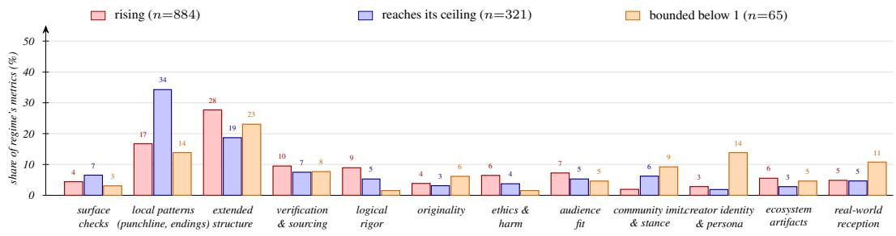

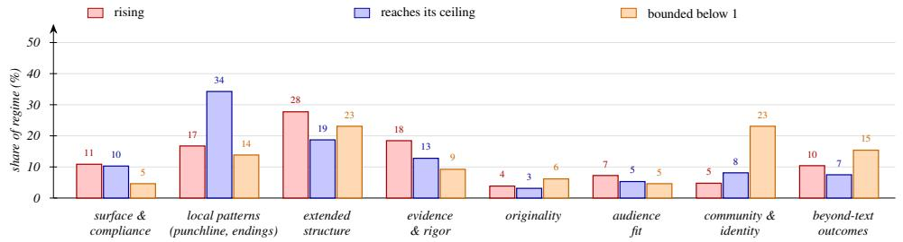  
Figure 14: OSL patterns for tasks, grouped into k = 12 (top) and k = 8 (bottom) categories: the full codebook underlying the main text’s 6-category view (Fig. 5), which is a nested merge of these labels.

Local patterns within document (COMPACT DEVICE, n=267). A self-contained craft device realized in a small span of text (a setup→punchline pair, an ending, a line-level economy rule), whose success or failure is visible at the sentence or beat where it occurs. Examples: “Core joke structure: setup→punch→tags” (humor); “Chekhov’s Gun: setup and payoff” (creative writing); “Active voice” (press releases); “Abstract and introduction clarity” (math).

Whole-text structural patterns (EXTENDED STRUCTURE, n=320). Long-range compositional properties that exist only at the scale of the whole artifact: arcs, escalation, and the coherence of a world or an argument maintained across the document. Examples: “Worldbuilding coherence: rules and internal logic” and “Scene craft: objective, conflict, change, escalation” (creative writing); “Accumulation and format-subversion structures” (humor); “Choice and justification of tools” (math).

Verifiable features (merge of four: SURFACE CHECK n=62, VERIFICATION SOURCING n=113, LOGICAL RIGOR n=97, ETHICS HARM n=70). Criteria whose truth conditions reduce to confor mity with an explicit, stateable standard: a format or convention rule (“Declare notation before use,” math; “Boilerplate inclusion and quality,” press releases), factual accuracy and attribution (“Accuracy, verification and transparency,” news homepages; “Attribution and sourcing clarity,” press releases), validity of reasoning (“Appropriate and economical proof technique,” math; “Claim– evidence alignment and causal caution,” peer review), or a harm/representation policy (“Benignviolation calibration and cruelty check,” humor; “Avoid discriminatory language, stereotypes, and framing,” news homepages). The four merged labels share checkability against a standard, in contrast to the two craft categories above (composition) and the two social categories below (whose truth conditions leave the text).

Originality & audience fit (ORIGINALITY NOVELTY n=48 + AUDIENCE FIT n=84). Criteria judged relative to an expectation baseline: the space of prior work (“Defamiliarization (estrangement),” creative writing; “News value and angle strength,” press releases) or a describable recipient class (“Audience and outlet understanding, targeting, and tailoring,” press releases; “Accessibility and dependence on shared context,” humor). “Audience” here means tailoring to a describable re cipient: the target can be stated in a sentence, and fit is then judgeable from the text alone.

Identity & social-group awareness (COMMUNITY STANCE n=43 + IDENTITY PERSONA n=40). Properties of the text that can only be verified against a specific social referent: partici pation in a community’s practice through imitation, stance, and culturally-local reference (“Parody craft and voice fidelity,” “Australian humor conventions,” humor; “Fanfiction tropes, tagging, and canon alignment,” creative writing), or fidelity to the creator’s own persona (“Distinct comic persona/voice and authenticity,” “Personal history and lived experience as engine,” humor). The contrast with audience fit is depth of required knowledge: audience fit asks whether the text is tailored to a describable reader; these criteria ask whether the text successfully uses knowledge held within a community or a person, which the evaluator must itself possess. The two also behave differently in the data: in the nine-type labels, audience fit falls toward the bounded regime while community transformation rises monotonically (Appendix F), which is evidence that the distinction is not only verbal.

Beyond-text features (ECOSYSTEM ARTIFACTS n=61 + RECEPTION OUTCOME n=65). Criteria whose truth conditions are facts about the world rather than about the text: companion artifacts and packaging (“Broadcast-usable B-roll provided,” press releases; “Artifact availability, licensing, and FAIR discoverability,” peer review) and achieved reception (“Memetic design, stickiness, and virality,” humor; “Agenda setting and attribute salience,” news homepages; “Catharsis of Pity and Fear,” creative writing). This category differs from the previous one: identity & social-group criteria need external knowledge to verify a property the text itself bears; beyond-text criteria need external facts, since no reading of the text, however informed, settles whether it shipped with assets or actually went viral.

## G.2 THE NINE-TYPE CODEBOOK AND THE TRUTH-CONDITION AXIS

The axis of Figure 13 comes from a separate codebook of nine types, applied to all 1,270 fitted criteria with the regime held out of the labeling input: mechanical checks (surface/compliance rules); craft operations (discrete inspectable compositional moves); evidence & rigor (accuracy, verification, sourcing, logical correctness); holistic taste (graded overall aesthetic judgment); audience fit (tailoring to an audience, venue, or genre); community transformation (community-specific imitation or stance: parody fidelity, satire target, culturally-local reference); identity & persona (the creator’s own voice, lived experience, branding); external bundles (artifacts and ecosystems beyond the text); and reception outcomes (achieved effects on real audiences or platforms: virality, salience, resonance). These types coarsen onto a single axis, where the criterion’s truth conditions live: in the text (mechanical, craft, evidence, taste), at the interface (audience fit, community transformation), or beyond the text (identity, bundles, reception).

## G.3 BOUNDARY CASES, RELIABILITY, AND HOW THE TWO CODEBOOKS RELATE

Two caveats apply to these definitions. First, the least clear boundary in the codebook is between craft and reception: a criterion like “Catharsis of Pity and Fear (Aim and Conditions)” can be read as conditions the text must set up (a craft operation) or as an effect it must achieve (a reception outcome). The labeling convention resolves it by truth-maker (catharsis is an achieved audience response, so it is reception), but the two independent passes disagree most in this region (of the 65 reception-labeled tasks, 32 are reception in both nine-type passes and 10 are craft in both). The regime-level findings do not depend on these cases: the bounded externality shift replicates in the second pass (Appendix F). Second, this six-category merge and the coarse truth-condition axis of Fig. 13 are different, non-nesting coarsenings of two codebooks: the six categories merge the 12- category labels, which come from a single blinded pass, and the axis coarsens the nine-type labels, which come from two independent passes $( \kappa = . 7 5$ on the nine types, .73 on the axis). The axis places community transformation at the interface but identity and persona beyond the text, so the “identity & social-group awareness” bar deliberately groups by social anchoring and straddles the axis. Externality indices are computed from the axis labels, never from this merge.

## H ADDING EXAMPLES TO THE MESSAGE, AND WHAT EACH PROCESS WRITES INTO THE PROMPT

## H.1 EVERY VERSION OF THE EXAMPLES TEST: WHO PICKS THE EXAMPLES, WHICH LABEL THEY CARRY, AND WHICH MODELS RUN THEM

Section 3 tests whether examples added to a definition raise recovery. This appendix documents every version of that test. All versions share one message format and one measure. An examplebearing message is the criterion’s name and definition followed by a list headed “Examples that satisfy this criterion:” and a list headed “Examples that do NOT satisfy it:”. The transmitter labels held-out items under that message; the receiver sees 30 of those labeled items, balanced by label and drawn from a fixed subset of 60, and writes a rule of at most 450 tokens; the transmitter runs the rule on the remaining held-out items, and recovery is $I ( m ; m ^ { \prime } )$ in bits (Section 2.2). In every evaluation one model runs the messages and writes the rules. Every comparison is the change in recovery against the name and definition alone, on the same items and at the same model. The versions differ in who picks the examples, which label each example carries, and which models run the messages (Table 14). Across them, no way of choosing or writing examples beats arbitrary examples carrying the same kind of label.

Examples that move the transmitter toward agreed labels. The first version, shown in a panel of Figure 6, ran on 236 criteria, drawn up to six per task and criterion type from the fitted bank. Llama-3.1-8B was the transmitter during selection. Candidates came from a design split of each task’s items; held-out items were never candidates. Greedy rounds tried eight candidates at a time, each with a proposed label, and kept the best one only if it raised the transmitter’s balanced agreement with the labels that Llama-70B and Qwen-72B both gave under the definition by at least .01 on one design split without lowering it on a second; sets were capped at 12. That rule kept few examples: 131 of the 236 criteria received none (so their example-bearing message equals the definition), 58 received one, 36 two, and 11 three to five. Evaluation used recovery alone, at Llama-70B and at Qwen-72B separately. Over all criteria and both judges, recovery is .046 bits for the definition and .048 with the examples. The 131 criteria without examples show what reconstruction noise alone produces: their change has mean +.0005 and standard deviation .025 bits. The noise bound for one criterion is the 90th percentile of the absolute change an arbitrarily chosen set produces, measured on 79 criteria per judge (.064 bits at Llama-70B, .057 at Qwen-72B); about 5% of arbitrary sets exceed it upward. Seventeen criteria exceed it at Llama-70B and 13 at Qwen-72B, against about 12 expected at each, and eight of the 17 received no example. Three exceed it at both judges, against about 0.6 expected if the two judges’ noise is independent: “delivery and timing craft” (+.096 and +.069 bits, one example), “incongruity and surprise mechanics” (+.071 and +.104, one example) and “conflict/tension as narrative and news value” (+.108 and +.081, four examples). One criterion falls below the bound at both. Per-criterion changes correlate at $\rho = . 1 5$ across the two judges. No task’s mean change separates from zero, with humor highest at $\dot { + . 0 1 1 } \left[ - . 0 0 5 , + . 0 2 6 \right]$ and peer review lowest at −.005; of the six criterion types, only local patterns is above zero, at $+ . 0 \bar { 1 0 } \ [ + . 0 0 2 , + . 0 1 9 ]$

Items the definition’s reconstruction gets wrong, and near-identical pairs. Two further rules reused the same criteria, candidate pools, held-out items and evaluation, and labeled every example with the judge’s own verdict under the definition, so each judge chose its own sets. The first took the three YES and three NO candidates on which the judge’s verdict under the definition differs most from its verdict under the rule reconstructed from the definition-only message, that is, the items the definition fails to transmit. The second took the three most similar pairs of candidates, by character-trigram overlap, that the judge labels confidently and oppositely (probability of YES above .6 against below .4), since rival rules disagree on such pairs. A criterion whose candidates the judge labels all one way gets no set, which leaves 153 criteria at Llama-70B and 146 at Qwen-72B for the first rule, and 125 and 112 for the second. Pooled over both judges, recovery changes by +.001 and +.004 bits. No criterion exceeds the noise bound defined above at both judges under the first rule, and two do under the second (“premise and throughline clarity” and “cognitive surprise and audience processing fit”). No task’s mean separates from zero, and humor turns negative unde both rules (−.015 and −.019). Under the first rule, local-pattern criteria are again the one type above zero, at +.022 [+.010, +.035] over 28 criteria.

<table><tr><td rowspan=1 colspan=12>examples added            chosen by; label shown   criteria  models        change in recovery vs. defini-  vs. arbitrary examplestion (bits)</td></tr><tr><td rowspan=3 colspan=12>0–5 items that move the trans-  Llama-3.1-8B;  label    236   Llama-70B,     pooled +.002; 3 criteria above arbitrary sets set the boundmitter toward the labels two chosen with the item             Qwen-72B     the noise bound at both judgesjudges agree on                                                      (~0.6 expected)3 YES and 3 NO items the def-  each judge; its own la-  153 / 146 Llama-70B,     pooled +.001; 0 above theinition&#x27;s reconstruction labels bel                         Qwen-72B     bound at both judgesmost differently3 near-identical pairs labeled each judge; its own la-  125 / 112  Llama-70B,     pooled +.004; 2 above theoppositely                bel                         Qwen-72B     bound at both judgessix items chosen for the re- Llama-3.1-8B  with   130   Llama-70B     bounded          -.001  +.008[−.006, +.021];</td></tr><tr><td rowspan=1 colspan=2>3 near-ide</td></tr><tr><td rowspan=1 colspan=3>six items </td><td rowspan=1 colspan=1>chos</td><td rowspan=1 colspan=1>osen for the re-</td></tr><tr><td rowspan=1 colspan=3>ceiver&#x27;s decoding</td><td rowspan=1 colspan=1>ecoding</td><td rowspan=1 colspan=1></td><td rowspan=2 colspan=5>Qwen2.5-14B;  label                         [−.017, +.016];    controlschosen with the item                           +.002 [−.016, +.019]bounded          +.002</td><td rowspan=5 colspan=2>−.001 [−.022, +.019]-.013 [−.029, +.003];+.005 [−.009, +.021]+.014 [−.016, +.048];</td></tr><tr><td rowspan=1 colspan=2>the same,</td><td rowspan=1 colspan=3>with fixed labels</td><td rowspan=1 colspan=1>the same pair: transmit-</td><td rowspan=1 colspan=1>130</td><td rowspan=1 colspan=2>Llama-70B</td></tr><tr><td rowspan=3 colspan=5>six items chosen at the judge</td><td rowspan=1 colspan=1></td><td rowspan=1 colspan=3>ter&#x27;s own label</td><td rowspan=1 colspan=1></td><td rowspan=1 colspan=2></td></tr><tr><td rowspan=2 colspan=1>Llama-70B; its own la-</td><td></td><td></td><td></td><td></td></tr><tr><td rowspan=1 colspan=3>48    Llama-70B</td><td rowspan=1 colspan=1>bounded          +.028</td></tr><tr><td rowspan=2 colspan=5>six pieces by an author and six</td><td rowspan=1 colspan=1>bel</td><td rowspan=1 colspan=3></td><td rowspan=2 colspan=1>[−.002, +.062];    controls+.028 [+.005, +.055]</td><td rowspan=2 colspan=1>+.026 [−</td><td rowspan=3 colspan=1>+.026 [−.007, +.059]placebo sets at chancethese are the arbitrary ex-</td></tr><tr><td rowspan=1 colspan=1>true authorship</td><td></td><td></td><td></td></tr><tr><td></td><td></td><td></td><td></td><td></td><td></td><td rowspan=1 colspan=3>12 authors nine receivers,</td><td rowspan=1 colspan=1>author identification, not recov-</td><td></td></tr><tr><td rowspan=1 colspan=5>dom, two the transmitter labels</td><td rowspan=1 colspan=1>ter&#x27;s own label</td><td rowspan=1 colspan=3>ters(3B-70B</td><td rowspan=1 colspan=1>Qwen2.5-14B and Llama-70B;</td><td rowspan=1 colspan=2>amples</td></tr><tr><td rowspan=1 colspan=5>YES and two it labels NO</td><td rowspan=1 colspan=1></td><td rowspan=1 colspan=3>and Phi-4); the</td><td rowspan=1 colspan=1>negative at 7B and 8B (Ta-</td><td rowspan=1 colspan=1></td><td></td></tr><tr><td rowspan=3 colspan=5></td><td rowspan=2 colspan=1></td><td rowspan=2 colspan=3>interval pools</td><td rowspan=2 colspan=1>ble 15)</td><td rowspan=2 colspan=1></td><td></td></tr><tr><td rowspan=2 colspan=2></td></tr><tr><td></td><td rowspan=1 colspan=3>Qwen2.5-14B</td><td rowspan=1 colspan=1></td></tr><tr><td rowspan=1 colspan=5>2 YES and 2 NO written by the</td><td rowspan=1 colspan=1>the transmitter; as writ-</td><td rowspan=1 colspan=3>449   seven transmit-</td><td rowspan=1 colspan=1>Table 15</td><td rowspan=1 colspan=2>at most +.001 above four</td></tr><tr><td rowspan=1 colspan=5>transmitter</td><td rowspan=1 colspan=1>ten</td><td rowspan=1 colspan=3>ters (3B-70B</td><td rowspan=1 colspan=1></td><td rowspan=1 colspan=2>random labeled items</td></tr><tr><td rowspan=3 colspan=5>four items searched for recov-</td><td rowspan=3 colspan=1>Llama-70B; its own la-</td><td></td><td></td><td></td><td></td><td></td><td></td></tr><tr><td rowspan=2 colspan=2>1</td><td rowspan=2 colspan=1>Llama-70B</td><td></td><td></td><td></td></tr><tr><td rowspan=1 colspan=1>two YES and two NO: −.003;</td><td rowspan=1 colspan=2>random sets: +.006 to</td></tr><tr><td></td><td></td><td></td><td></td><td></td><td></td><td></td><td></td><td></td><td rowspan=1 colspan=1>any four: +.098</td><td rowspan=1 colspan=2>+.027; +.021 to +.139</td></tr><tr><td rowspan=1 colspan=5>the receiver answers with 4, 8</td><td rowspan=1 colspan=1>the receiver; transmit-</td><td rowspan=1 colspan=2>449</td><td rowspan=1 colspan=1>Qwen2.5-14B</td><td rowspan=1 colspan=1>4 chosen items vs. the rule:</td><td></td><td></td></tr><tr><td rowspan=3 colspan=5>or 30 of the items it saw instead</td><td></td><td></td><td></td><td></td><td rowspan=4 colspan=1>-.014      [−.017, -.010]</td><td></td><td></td></tr><tr><td></td><td></td><td></td><td></td><td rowspan=3 colspan=2>chosen vs. random items.000 at both models</td></tr><tr><td rowspan=1 colspan=1>ter&#x27;s own label</td><td rowspan=1 colspan=2></td><td rowspan=1 colspan=1>and Llama-70B</td></tr><tr><td rowspan=5 colspan=10>of a rule[−.017, −.009] at Llama-70B;(Table 17)</td><td rowspan=3 colspan=1></td></tr><tr><td rowspan=1 colspan=1></td><td rowspan=1 colspan=1>[− 017 = 009] at L 1ama-70B:</td><td rowspan=1 colspan=2></td></tr><tr><td rowspan=1 colspan=1></td><td rowspan=1 colspan=1>all 30: - 008 and - 007:</td><td></td></tr><tr><td rowspan=2 colspan=1>bounded = 024 and = 029</td><td></td><td></td></tr><tr><td rowspan=1 colspan=2></td></tr></table>

Table 14: Every version of the examples test. Changes are means over criteria, with 95% bootstrap intervals where they were computed. “Bounded” and “controls” are the 65 bounded criteria with a bank definition and one matched reaches or rising criterion each. Where two counts are given, they are the criteria covered at Llama-70B and at Qwen-72B. The last column compares the chosen examples with arbitrary examples carrying the same kind of label.

Examples chosen for the receiver’s decoding. The rules above choose examples by their effect on the transmitter’s labels. This rule chooses them for the receiver. A candidate set of six is scored by the round trip on the design items alone: a Llama-3.1-8B transmitter runs the message, a Qwen2.5- 14B receiver writes a rule from those labels, the transmitter runs that rule, and the score is the agreement of the two labelings on design items the receiver did not see. Sets are built by greedy forward selection over the same 24-candidate pools, and a null set of six is drawn by hash. Each shown item carries the transmitter’s own verdict under the definition, so the selector chooses items and never labels. The sample is every bounded criterion with a bank definition (65) and one matched control each, evaluated at Llama-70B on held-out items. Under the definition, the selected six and the null six, recovery is .079, .081 and .093 bits for bounded criteria, .125, .132 and .138 for reaches criteria, and .037, .066 and .051 for rising criteria. The selected six change recovery by +.002 [−.019, +.020] for bounded criteria and +.019 [−.001, +.039] for controls, and differ from the null six by −.013 [−.029, +.003] and +.005 [−.009, +.021]. Six bounded and eight control criteria clear the 90th percentile of the null sets’ change (.103 bits), against 6.5 expected each. The one interval above zero is for rising criteria, +.029 [+.005, +.058]. The judge’s labels under the selected six agree with its definition-only labels at .85 balanced accuracy, and at .84 under the null six. A first run of this rule also let the selector choose each shown label: those labels matched the transmitter’s own verdict on only 54% of items, the gains on the design items did not transfer, and at the judge the set changed recovery by $- . 0 0 1 \ [ - . 0 1 7 , + . 0 1 6 ]$ for bounded criteria and $+ . 0 0 2 \ [ - . 0 1 6 , + . 0 1 { \bar { 9 } } ]$ for controls. Definition-only recovery reproduces across the two runs at $r = . 9 7 .$

Examples chosen at the judge itself. Running the same search with Llama-70B as both transmitter and receiver sets the ceiling for this rule. On a stratified subset of 48 of the 130 criteria (24 bounded, 24 controls), bounded criteria recover .083, .111 and .097 bits under the definition, the selected six and the null six. The selected six raise recovery over the definition by +.028 $[ - . 0 0 2 , + . 0 6 2 ]$ for bounded criteria and +.028 [+.005, +.055] for controls, and exceed the null six by +.014 [−.016, +.048] and +.026 [−.007, +.059]. Five bounded and three control criteria clear the null sets’ 90th percentile (.062 bits), against 2.4 expected each. Against selection at the Llama-3.1-8B and Qwen2.5-14B pair on the same criteria, selecting at the judge changes the gain by +.019 [−.004, +.043] for bounded criteria and −.008 [−.031, +.013] for controls, and definitiononly recovery agrees across the runs at $r = . 9 8 .$ . The judge’s labels under the selected six agree with its definition-only labels at .88 for bounded criteria and .80 for controls.

Six pieces identify an author no better than a description of the voice does. Authorship is a criterion with ground truth, so here the measure is identification rather than recovery. For each of 12 McSweeney’s authors, a receiver answered YES or NO to whether each of 40 held-out pieces, half by the author, is by the same author, and we scored balanced accuracy. The message was a description of the voice of at most 150 words, written by gpt-oss-120b from the author’s pieces; that description padded to the length of the examples; six pieces by the author and six by others; or a placebo in the same format with another author’s pieces in place of this author’s. The preregistered comparison is the examples against the padded description. Averaged over authors, examples minus padded description is −.002 at Llama-3.2-1B, −.033 at Llama-3.2-3B, −.075 at Llama-3.1-8B and +.048 at Llama-3.3-70B, and +.002, −.031, +.050, +.069 and +.046 at Qwen2.5-3B, 7B, 14B, 32B and 72B. The placebo stays at chance for every receiver (.475 to .508). The preregistered rule asked for a pooled gain above .05 over the two largest receivers of each family; the pooled gain is +.022.

Examples the transmitter writes itself. The rules above choose among existing items; here the transmitter writes its own. Given the name and definition, it writes two short examples that satisfy the criterion and two that do not, each under 200 characters (sampling temperature .7, fixed seeds, redrawn if the reply does not parse; 2 of 2,245 criterion–model pairs never parsed). The four examples then go under the definition, and the transmitter labels held-out items with that message. Two controls isolate what the examples contribute. In the first, the same four texts appear under exchanged headings, so only which texts are marked YES changes. In the second, the four examples are real design items that the transmitter itself labeled YES (two) and NO (two) under the definition alone, drawn at random with a fixed seed and shown in the same format and length, so only the texts change, from written prototypes to found items. We ran seven transmitters, each also its own receiver, on 449 criteria: the 130 criteria above (the 65 bounded criteria with a bank definition and one matched reaches or rising control each) and 319 reaches and rising criteria drawn per task, up to 60 per task, from all eight tasks (Table 15). The draw was fixed before any run. A criterion was eligible if it had a bank definition and a fitted regime. For each task, rising and reaches criteria were added alternately by regime, each regime’s pool in a stable-hash order seeded by task and regime, until the task held 60 criteria or its pool was exhausted. Humor keeps all 41 bounded criteria and their 41 controls and so has 82; patents has 7 eligible criteria; news homepages, peer review and creative writing reach 60 with 34, 42 and 56 drawn criteria on top of 26, 18 and 4 from the base set; math, notice-and-comment and press releases have no bounded criteria and take 60 drawn criteria each. No panel or consensus label enters the draw.

Three results hold across the five transmitters of the first run (the Qwen2.5-32B and Phi-4 rows were added afterwards; Table 15). First, the transmitter’s own examples never beat real items carrying its own labels by more than .001 bits, and they fall below them at Qwen2.5-14B and Llama-70B. Second, the larger transmitters use the headings. Exchanging them costs .012 bits at Qwen2.5-14B and .013 at Llama-70B, against at most .002 at Qwen2.5-3B and Llama-3.1-8B, because swapped headings push the labels toward NO: at Llama-70B the number of criteria on which every held-out item is labeled NO rises from 121 under the definition to 202, and the information the labels contain about the items falls from .421 to .295 bits. At these two transmitters the same examples under their correct headings leave recovery at its definition-only level. Third, at the same two transmitters, real labeled items raise recovery by .005 and .007 bits; at Llama-70B they reduce the criteria labeled all NO to 92 and raise the information in the labels to .473 bits. At Qwen2.5-7B and Llama-3.1- 8B, any four examples lower recovery slightly, and Qwen2.5-3B labels every held-out item NO on 374 criteria under the definition. For absurdism, Llama-70B, Qwen2.5-7B and Qwen2.5-14B each labeled all four of their own examples absurdist under the definition, including the two they wrote as examples that do not satisfy it.

<table><tr><td rowspan="2">transmitter</td><td rowspan="2">definition</td><td colspan="6">change against the definition</td><td rowspan="2" colspan="2">own minus random</td><td rowspan="2" colspan="2">own minus swapped</td></tr><tr><td colspan="2">own examples</td><td colspan="2">headings swapped</td></tr><tr><td>Qwen2.5-3B</td><td>.001</td><td>.000 [−.001, +.000]</td><td>-.001</td><td>[−.001, −.000]</td><td>random labeled items -.001</td><td>-.001,−.000]</td><td> $\overline { { + . 0 0 1 \left[ + . 0 0 0 , + . 0 0 1 \right] } }$ </td><td></td><td>.000 [−.000, +.001]</td><td></td></tr><tr><td>Llama-3.1-8B</td><td>.008</td><td>-.001 −.002, −.001]</td><td></td><td>−.002 -.003, −.002]</td><td>-.001</td><td>-.002,−.001</td><td></td><td> $0 0 0 \left[ \stackrel { \cdot } { - } . 0 0 1 , \stackrel { \cdot } { + } . 0 0 1 \right] ^ { . }$ </td><td>+.001 [+.000, +.002]</td><td></td></tr><tr><td>Qwen2.5-7B</td><td>.042</td><td>-.005 −.009, −.002]</td><td></td><td>-.010 -.013, −.007]</td><td>-.005</td><td>−.008, −.002]</td><td>.000 [−.004, +.003]</td><td></td><td>+.004 [+.002, +.007]</td><td>.79 .77</td></tr><tr><td>Phi-4</td><td>.035</td><td>-.008 −.012, −.005]</td><td>−.012</td><td>-.015,−.008</td><td>-.001 −.005,+.002</td><td></td><td>-.007 −.010, −.004</td><td>+.004</td><td>[+.001, +.006]</td><td>.80</td></tr><tr><td>Qwen2.5-14B</td><td>.036</td><td>.000 −.003, +.004]</td><td>−.012</td><td>-.015, −.008]</td><td>+.005 [+.002, +.008]</td><td>-.004</td><td>-.008, −.001]</td><td>+.012</td><td>+.008,+.016</td><td>.74</td></tr><tr><td>Qwen2.5-32B</td><td>.037</td><td>+.003 [−.001, +.006]</td><td>-.001</td><td>−.005, +.002</td><td>+.007 [+.003, +.011]</td><td>-.004</td><td>−.009, −.000</td><td>+.004</td><td>[+.001, +.007]</td><td>.83</td></tr><tr><td>Llama-3.3-70B</td><td>.043</td><td>+.001 −.003, +.004]</td><td>-.013</td><td>−.018, −.009]</td><td>+.007 +.003,+.011</td><td>-.006</td><td>−.011, −.002]</td><td>+.014</td><td>[+.009, +.018]</td><td>.82</td></tr></table>

Table 15: Examples the transmitter writes itself, 449 criteria from eight tasks; Phi-4 ran where the press-release items were unavailable, so its row covers the other seven tasks, 389 criteria. Definitiononly recovery in bits, then mean changes over criteria with 95% bootstrap intervals. “Random labeled items” are four real design items labeled by the transmitter under the definition alone. The last column is the share of its own four examples that the transmitter, given only the definition, labels the way it wrote them. Each model is its own transmitter and receiver.

Why real items beat written ones. Real labeled items mostly keep the transmitter from answering NO to everything. Under the definition alone, Llama-70B labels every held-out item NO on 121 of the 449 criteria, and a labeling that never varies leaves nothing to recover. With four real labeled items, 39 of those criteria get some YES labels, against 25 with the transmitter’s own written examples, and the gain from real items is largest there: +.010 bits on those 121 criteria against +.006 on the other 328, where written examples give +.004 and −.001. The two kinds of examples differ most in long-document tasks, where an example under 200 characters is a sketch rather than an item (Table 16). The gain from real items does not depend on whether the transmitter labels its own written examples as written: +.008 [+.002, +.014] on the 229 criteria where it labels all four as written and +.006 [+.000, +.012] on the other 220. It is no smaller on the 109 criteria where the transmitter labeled too few design items YES or NO to fill a set of two and two (+.009, against +.006 where the set was full). Three criteria that Section 3 names are outside the 449: we ran the same condition on them at both models, where delivery and timing craft gains +.036 and +.196 bits, incongruity and surprise mechanics −.021 and +.079, and novelty and significance of contribution +.018 and +.062. Conflict/tension as news value gains +.051 at Qwen2.5-14B (+.037 pooled over both models, the value Section 3 reports).

<table><tr><td>task</td><td colspan="2">Llama-70B</td><td colspan="2">Qwen2.5-14B</td></tr><tr><td>math answers</td><td></td><td>-.010 [−.018, −.002]</td><td></td><td>-.008 [−.019, +.003]</td></tr><tr><td>public comments</td><td></td><td>−.012 [−.025, −.001]</td><td></td><td>-.007 [−.014, −.002]</td></tr><tr><td>creative writing</td><td></td><td>-.003 [−.010, +.003]</td><td></td><td>-.014 [−.023, -.005]</td></tr><tr><td>humor</td><td></td><td>−.007 [−.022, +.007]</td><td></td><td>+.005 [−.002, +.012]</td></tr></table>

Table 16: Written examples minus real labeled items, by task: mean change in recovery in bits, with 95% bootstrap intervals over the criteria of each task (60, 60, 60 and 82).

By regime, and criteria beyond two standard deviations of noise. One pattern holds across the versions above: the transmitter’s own written examples move bounded criteria more than any other regime, but the direction depends on the model. Bounded recovery changes by +.011 [+.003, +.019] bits at Qwen2.5-14B and +.007 [−.006, +.021] at Llama-70B, and by −.023 [−.037, −.011] at Phi-4, −.018 [−.028, −.007] at Qwen2.5-7B, +.001 at Qwen2.5-32B, −.003 at Llama-3.1-8B and −.001 at Qwen2.5-3B, while reaches and rising criteria stay within ±.008 at every model; pooled over the three models with real headroom, bounded criteria change by −.002 [−.008, +.005], so the gain at the two largest models does not hold in a third family. Four real items carrying the transmitter’s own labels help every regime about equally at Qwen2.5-14B and Llama-70B (+.007, +.005 and +.006 bits) and lower bounded recovery at Phi-4 and Qwen2.5-7B (−.017 and −.015). Per criterion, reconstruction alone gives the change between two messages a standard deviation of about .028 bits at Llama-70B; there, random labeled items raise recovery by more than two standard deviations on 43 of the 449 criteria and lower it on 22, and the transmitter’s own examples on 32 and 30, against about 10 each by chance. At Qwen2.5-14B real labeled items raise it on 42, and 4 criteria clear the bound at both models, about as many as two unrelated lists of those sizes would share; the per-criterion gains correlate at $r = - . 0 8$ across the two models. By regime, real labeled items help 7 of the 65 bounded criteria at each of those two models, 12 and 15 of the 152 reaches criteria and 23 and 21 of the 232 rising criteria, against 1.5, 3.5 and 5.3 by chance: about one criterion in ten in every regime. The transmitter’s own written examples help 8 and 8 bounded criteria, 10 and 9 reaches criteria and 11 and 15 rising criteria, and three of the four criteria they help at both models are bounded: game identification and escalating beat development, memetic design and virality, and agenda setting and attribute salience.

The receiver answers with examples. Every version above puts examples into the transmitter’s message and still asks the receiver for a rule. The last version changes the receiver’s output instead. For each of the 449 criteria, the receiver (Qwen2.5-14B or Llama-70B, also the transmitter and executor) sees the same 30 balanced labeled items as in the rule channel and returns either a rule, or two YES and two NO items of its choosing, or four and four, or all 30; a random two-and-two draw and a rule plus the chosen four are the controls. The executor then labels the held-out items from the returned items alone, with no name, definition or rule, and recovery is $I ( m ; m ^ { \prime } )$ as everywhere else. Two floors are measured: the same items with their labels permuted (the permutation least correlated with the true labels, since a plain shuffle leaves a two-and-two set unchanged or inverted one time in three), and a nearest-neighbour labeler with no model (share of YES among the three nearest shown items by BAAI/bge-large-en-v1.5 cosine). The design was preregistered (notes/ $2 0 2 6 - 1 0 - 0 8 { \mathrm { ~ \_ } } { \mathrm { e x p - e x a m p l e s - s h o w n - p r e r e g } }$ .md); the rule channel is the existing one with $R = 2$ reconstructions per criterion, the example conditions have $R = 8$ . Table 17 gives the result at Qwen2.5-14B and at Llama-70B; the noise standard deviation is .052 at Qwen2.5-14B and .055 at Llama-70B.

Showing recovers less than telling. Four chosen items recover .022 bits against .036 for the rule over all 449 criteria $( - . 0 1 4 \ [ - . 0 1 7 , - . 0 1 0 ] )$ , .011 against .034 on the 65 bounded criteria $\left( - . 0 2 4 \right.$ $[ - . 0 3 4 , - . 0 1 5 ] )$ , and the bounded-minus-controls interaction is $- . 0 0 1 [ - . 0 1 4 , + . 0 1 3 ]$ . No criterion gains more than two noise standard deviations (.104 bits, the standard deviation being .052) over its rule; 4% lose that much. Recovery rises with the number of items and reaches the rule only when all 30 are passed along, and only on the bounded criteria $\left( - . 0 0 3 \left[ - . 0 1 6 , + . 0 0 9 \right] \right.$ on the 32 bounded criteria with at least two items per class). The receiver’s choice of items adds nothing over a random draw $( . 0 0 0 \ [ - . 0 0 1 , + . 0 0 1 ] )$ , and a rule plus four items is worse than the better of the two alone $( - . 0 1 0 [ - . 0 \dot { 1 } 2 , - . 0 0 7 ] )$ ). The nearest-neighbour floor is near zero (.006 at 30 items), so the executor is not matching surface similarity; but the permuted-label floor keeps most of the recovery (.018 of .022 at four items, .021 of .028 at 30), so the label-dependent part of showing is . $. 0 0 5 [ + . 0 0 \dot { 3 } , + . 0 0 6 ]$ bits at four items and .007 [+.006, +.009] at 30. On the 261 criteria with at least two items per class those parts are .008 and .012; on the other 188 the transmitter labels nearly every item one way, so no two-and-two set exists, and they are flagged in the artifact.

Llama-70B gives the same ordering with larger numbers. Four chosen items recover .030 bits against .043 for the rule over all 449 criteria $( - . 0 1 \bar { 3 } \left[ - . 0 1 7 , - . 0 0 9 \right] )$ , .047 against .076 on the bounded criteria $( - . 0 2 9 [ - . 0 4 2 , - . 0 1 7 ] )$ , and the bounded-minus-controls interaction $\mathrm { i s - . 0 0 6 [ - . 0 2 3 , + . 0 1 2 ] }$ One criterion gains more than two noise standard deviations (.110 bits) over its rule and 3% lose that much. Recovery rises with the number of items but does not reach the rule even with all 30: $- . 0 0 7 \ [ - . 0 1 1 , - . 0 0 3 ]$ over all criteria, $- . 0 2 0 \ [ - . 0 3 2 , - . 0 1 0 ]$ on the bounded ones, and −.030 $[ - . 0 4 7 , - . 0 1 6 ]$ on the 43 bounded criteria with at least two items per class. The receiver’s choice of items again adds nothing $( . 0 0 0 [ - . 0 0 2 , + . 0 0 2 ] )$ , and a rule plus four items is again below the better of the two $( - . 0 0 7 [ - . 0 0 9 , - . 0 0 \dot { 4 } ] )$ . The nearest-neighbour floor is .007 at 30 items. The permutedlabel floor keeps .025 of .030 at four items and .027 of .036 at 30, so the label-dependent part is $. 0 0 5 [ + . 0 0 3 , + . 0 0 8 ]$ and .009 $[ + . 0 0 7 , + . 0 1 3 ]$ bits; on the bounded criteria it is . $. 0 0 2 \left[ - . 0 0 4 , \bar { + } . 0 0 7 \right]$ at four items and . $0 \dot { 1 } 6 \left[ + . 0 1 0 \dot { , } + . 0 2 2 \right]$ at 30. At Llama-70B 305 criteria have at least two items per class and 144 do not.

Letting both sides mix a rule with examples changes nothing. We re-ran the Qwen2.5-14B version with the transmitter’s labels produced under its definition plus four of its own labeled items (two YES, two NO, drawn at random from the design split), so that the receiver reconstructs a message that already combines rule and examples, and scored every condition above against those labels. Every condition rises by .002 to .005 bits (the rule to .040 over all 449 criteria and .039 on the bounded ones; thirty shown items to .031 and .033), no ordering changes, and the receiver’s rule plus four items still recovers less than its rule alone, .034 against .040 over all criteria and .025 against .039 on the bounded ones (artifact outputs/exp examples shown/summary qwen25-14b random own.json).

<table><tr><td rowspan="2">receiver output (executor sees only this)</td><td colspan="6">Qwen2.5-14B</td><td colspan="6">Llama-70B</td></tr><tr><td colspan="2">bounded (65)</td><td colspan="2">controls (65)</td><td colspan="2">all (449)</td><td colspan="2">bounded (65)</td><td colspan="2">controls (65)</td><td>all (449)</td></tr><tr><td>rule (existing channel, R = 2)</td><td>.034 [.023, .047]</td><td></td><td></td><td>.044 [.029, .060]</td><td></td><td>.036 [.031, .041]</td><td>.076 [.053, .100]</td><td></td><td></td><td>.078 [.053, .106]</td><td></td><td>.043 [.037, .050]</td></tr><tr><td>4 items, random</td><td>.013</td><td>[.009, .019]</td><td>.021</td><td>[.014, .030]</td><td>.022</td><td>[.019, .025]</td><td>.048</td><td></td><td>[.033, .065]</td><td>.049</td><td>[.034, .066]</td><td>.030 [.026, .035]</td></tr><tr><td>4 items, receiver-chosen</td><td>.011</td><td>[.007, .015]</td><td>.021</td><td>[.014, .029]</td><td>.022</td><td>[.019, .025]</td><td>.047</td><td>[.032, .063]</td><td></td><td>.055 [.038, .074]</td><td>.030</td><td>[.026, .035]</td></tr><tr><td>8 items, receiver-chosen</td><td>.024</td><td>[.015, .033]</td><td>.031</td><td>[.020, .042]</td><td>.026</td><td>[.023, .030]</td><td>.055</td><td>[.037, .074]</td><td></td><td>.060 [.040, .082]</td><td>.035</td><td>[.030, .041]</td></tr><tr><td>all 30 items</td><td>.031</td><td>[.021, .043]</td><td>.038</td><td>[.025, .053]</td><td>.028</td><td>[.024, .032]</td><td>.056</td><td>[.040, .074]</td><td></td><td>.059 [.040, .080]</td><td>.036</td><td>[.031, .042]</td></tr><tr><td>rule plus 4 chosen items</td><td>.024</td><td>[.017, .031]</td><td>.025 </td><td>[.017, .035]</td><td>.031</td><td>[.027, .035]</td><td>.072</td><td>[.051, .096]</td><td></td><td>.067 [.046, .090]</td><td>.042</td><td>[.036, .048]</td></tr><tr><td>4 items, labels permuted (floor)</td><td>.009</td><td>[.005, .013]</td><td></td><td>.014 [.009, .021]</td><td>.018 </td><td>[.016, .021]</td><td>.045 </td><td>[.031,.061]</td><td></td><td>.041 [ [.027, .057]</td><td></td><td>.025 [.021, .029]</td></tr><tr><td>30 items, labels permuted (floor)</td><td>.020</td><td>[.013, .029]</td><td></td><td>.025 [.016, .035]</td><td></td><td>.021 [.018, .024]</td><td>.040</td><td>[.027, .056]</td><td></td><td>.041 [.027, .057]</td><td></td><td>.027 [.023, .031]</td></tr><tr><td>nearest neighbour on 30 items, no model</td><td></td><td>.002</td><td></td><td>.004</td><td></td><td>.006</td><td></td><td>.004</td><td></td><td>.003</td><td></td><td>.007</td></tr></table>

Table 17: The receiver answers with examples instead of a rule (each of Qwen2.5-14B and Llama-70B as transmitter, receiver and executor; 449 criteria). Recovery I(m; m′) in bits, mean over criteria with 95% bootstrap intervals. “Bounded” and “matched controls” are the 65 bounded criteria with a bank definition and their matched reaches or rising criteria. Noise floor: two standard deviations of run-to-run reconstruction noise is .104 bits per criterion at Qwen2.5-14B and .110 at Llama-70B.

Examples searched for recovery on one criterion. For “absurdism and non sequitur technique” we searched directly for examples that raise recovery, with Llama-70B as transmitter and receiver. Under the definition alone the model labels 130 of the 148 design jokes absurdist. We drew 40 sets of two YES and two NO design items and 40 sets of any four, each item shown with the model’s own label, scored each set by the round trip on design items, re-scored the best three with more reconstructions, and tested the best set of each kind on held-out jokes against the definition and three random sets of the same kind. Held-out recovery is .190 bits under the definition. The chosen two-and-two set recovers .187 and the random ones .217, .196 and .211; the chosen set of any four recovers .288 and the random ones .211, .329 and .242. The chosen sets are ordinary reddit jokes, not recognizably absurdist ones.

## H.2 WHAT EACH PROCESS WRITES INTO THE PROMPT: CONCEPT CONTENT AGAINST MEASUREMENT CONTENT

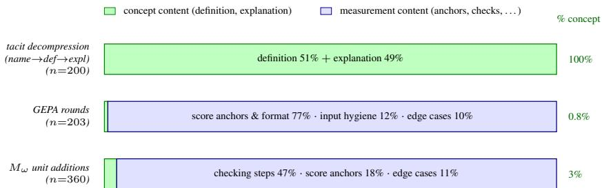  
Figure 15: What each process writes: concept vs. measurement content (unsupervised tasks; two-pass labeling; the two-way collapse shown here has κ = .93, against κ = .68 for the full 8-way codebook, whose distribution this bar chart summarizes, with dominant subtypes named in each bar). Tacit decompression writes concept content exclusively; optimization, whether reflective or recombinative, writes measurement content almost exclusively. The divide is crossed only for esoteric concepts that the judge does not already hold.

Decompressing a criterion for a smaller executor and optimizing a prompt for score fidelity are procedurally the same operation: text is added to a prompt to improve behavior. To locate where they differ, we labeled the content of every revision step, in one shared format, across three corpora of unsupervised-task prompt changes: 200 decompression-ladder steps (name→definition→explanation, ten annotation domains; this decompression corpus spans ten domains rather than the eight of the scaling analyses), 203 GEPA optimization rounds (judge-criteria head-to-heads plus a 198-rubric regulatory-comment bank), and the 360 recombination units of the $M _ { \omega }$ pools. Each step was tagged with the dominant kind of material it adds: a definition (what the quality is), an explanation (why it arises), checking steps, edge cases and exclusions, score anchors and output format, what to ignore in the input, examples, or rewording only. The tags come from two independent blinded passes with planted anchors (8-way κ = .68; collapsed to concept-content vs. measurement-content, $\kappa = . 9 3$ , and every frequent disagreement lies within the measurement family).

the same criterion (HUMOR bank: “verbal economy and clarity”), decompressed for three executor scales  
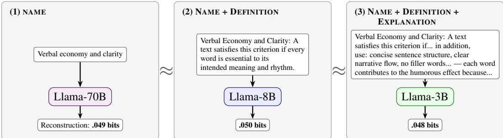  
Figure 16: Tacit-knowledge isomorphism (humor bank, criterion “Concise Wording and clarity”). Recovery is .049/.050/.048 bits, with overlapping bootstrap 95% intervals ([.027, .082]/[.026, .083]/[.011, .106]), for a NAME to Llama-70B, a name-plus-definition to Llama-8B, and a name-plus-definition-plus-explanation to Llama-3B. The figure illustrates the pattern that Section 3 measures at scale; the three values are copied by hand from an earlier freeze. The 8B condition’s reference executor is self-consistency-advantaged.

Figure 15 shows the result. Decompression steps are 100% concept-content: the name→definition rung adds definitions, and the definition→explanation rung adds causal explanation. Neither rung touches scoring, edge cases, or input hygiene. (This half is partly a manipulation check: the ladder texts were generated by instructions asking for definitions and explanations.) The informative results concern optimization, which, although free to write anything, essentially never writes concept content. GEPA rounds are dominated by score anchors and format $( 7 5 - 7 7 \% )$ ; edge-case rules are the most frequent secondary content, followed closely by input hygiene (“score only the visible comment text”). Low-fidelity rubrics receive more instrument discipline rather than re-teaching of the concept. $M _ { \omega }$ unit additions are on the same side of the divide, with a shift in subtype: they write checking steps for the task executor (51%) rather than score anchors for a judge. The only optimization lineages that write definitions are the small number of esoteric concepts (e.g. narratological story-vs-discourse distinctions) for which the judge cannot be assumed to hold the concept. Decompression writes the concept; optimization, whether reflective or recombinative, writes the measurement, except where the concept itself is missing; that is the case the tacit-isomorphism experiment targets by construction.

## I ACQUISITION AND PRETRAINING EXPOSURE: THE CORPUS-FREQUENCYTEST

The fact-learning literature finds that what a model knows tracks how often it was seen (Kandpal et al., 2023; Carlini et al., 2023). If criterion acquisition worked the same way, the order in which concepts become name-indexed (Section 3) should follow the corpus frequency of the concepts’ vocabulary. We tested this at two grains, with the estimator and decision rule frozen before any query.

Elicitable and acquired concepts: the 37 metrics with a name-only crossing. Figure 16 shows the pattern the main text calls internalization. “Concise wording and clarity” is recovered from its name alone by Llama-70B, needs the name and the definition at Llama-8B, and needs the full explanation at Llama-3B, at the same recovery each time. Such a concept is elicitable at every size we tested, since more text transmits it to the smaller models, and acquired at the larger ones, since the name suffices there. The 37 metrics for which a name-only crossing $z ^ { * }$ can be fitted are the bank’s cleanest cases of this kind, and they are the sample for the name-indexing test below (Grain 1). They are a selected class, not a special one: nothing we measure about them, exposure, form or family-relativity, differs from what holds of the 1,270 fitted metrics, which is why the main text reports the bank-scale tests and this appendix keeps the crossing sample.

Exposure is the log corpus frequency of a criterion’s name terms in Dolma. For each criterion, content terms are the name’s tokens minus stopwords and punctuation; exposure is the mean of $\log _ { 1 0 } ( \mathrm { c o u n t + 1 } )$ over the content unigrams and all adjacent content bigrams, with counts from the infini-gram index over Dolma v1.7 (a declared proxy: the actual pretraining corpora of the evaluated families cannot be queried, and Dolma stands in for open web-scale text). We also report two sensitivity variants: the minimum instead of the mean, and terms drawn from the criterion’s definition text instead of its name. All 4,755 queries resolved (zero missing terms).

Grain 1: name-indexing order (the crossing sample). For the 37 concepts with fitted namecondition crossings, we compute the within-family Spearman $\rho ( \mathrm { e x p o s u r e } , z _ { \mathrm { n a m e } } ^ { * } )$ , handling censored crossings in both declared ways (excluded; imputed at the censor bound). Across all 12 combinations (family × estimator × censoring variant) no correlation is negative with a confidence interval excluding zero; most point estimates are weakly positive (e.g. Llama mean-estimator +.36 excluded / +.02 imputed; Qwen $+ . 1 3 / + . 2 4 ;$ all CIs span zero). The preregistered support criterion $( \rho \leq - . 3 5 , \mathbf { C I } < 0 .$ , both families) is not met in any combination.

Grain 2: acquisition onset at bank scale. For all 1,270 fitted metrics, onset is the fitted logistic midpoint z of the pooled recovery curve (defined for every metric). This grain pools the panel rather than splitting it by family, so it is a generality probe rather than a main result. The withindomain ρ(exposure, z0), Fisher-z pooled across the eight domains, is $\rho = + . 0 3 3 , \operatorname { C I } \left[ - . 0 2 2 , + . 0 8 8 \right]$ (min estimator $+ . 0 1 5 \ [ - . 0 4 0 , + . { \bar { 0 } } 7 5 ] \rangle$ . Per-domain estimates have mixed signs. The only intervals that exclude zero are creative writing (+.12) and humor (+.13), which are positive (i.e. the wrong direction for the exposure hypothesis), and press releases (−.18). Mean exposure is nearly identical across the three scaling regimes (rising 6.11 / reaches 5.99 / bounded $5 . 9 4 \log _ { 1 0 }$ units): exposure separates none of the structure that the criterion taxonomy separates.

Residuals and concept form: a bank-scale test. The rank residuals suggest a reading: the criteria acquired far earlier than their exposure predicts look like compact procedural concepts (“surprise, incongruity, and misdirection mechanics”; “modularize longer proofs with explicit lemmas”), while maximal-exposure late-onset criteria are common-vocabulary abstractions (“active voice,” exposure 7.25, onset $+ 2 . 3 3 ;$ “provide context and continuity,” onset +3.79). At bank scale, this reading does not hold. We join the blinded nine-type taxonomy (Appendix G; regime results in Figure 13) to the per-metric exposures and onsets, standardize onset and exposure within each domain, and take the residual of onset on exposure. Compact-checkable types (mechanical checks, craft operations, evidence and rigor; $n = 8 8 6 )$ and the remaining diffuse types $( n = 3 8 4 )$ have indistinguishable mean residuals $\left( + . 0 0 6 \mathrm { v s - } . 0 1 3 \right.$ standardized; difference +.02, two-sided within-domain label permutation $p = . 7 5$ , 10k draws, seed 20260828). The earliest-acquiring residual quartile is 67% compact-checkable against a 70% base rate, so there is no enrichment. The named examples above are members of the residual tails, but they do not reflect a pattern in the bank as a whole. We record only the following type-level departures, as exploratory results: identity/persona and external-bundle criteria fall early relative to their exposure (mean residual −.25, n = 38 and 41), while mechanical checks and audience fit fall late $( + . 1 5 , n = 6 1 ; + . 1 3 , n = 1 8 7 )$ . Artifact: outputs/analyses/exposure residual types v1/ (join recipe, seed, per-type table).

Limitations of the exposure test. Name-term frequency is a coarse proxy that conflates common English words with concept exposure. The two positive domains plausibly reflect this confound (generic vocabulary names attach to vaguer concepts). A co-occurrence estimator is left to future work. The crossing sample’s fits predate the formulation-symmetric key policy, and the analysis reruns automatically when refreshed fits become available. Artifacts: outputs/exp exposure/ (per-metric exposures and onsets, complete query cache, rerunnable pipeline).

## J SIMPLER EXPLANATIONS FOR THE BOUNDED REGIME THAN TACITNESS, AND WHAT THE TESTS SAY ABOUT EACH

A bounded criterion is one whose agreement with the panel consensus stops rising with capability below the planted reference (Appendix F). The main text reads this as a limit of articulation. Several simpler explanations would produce the same plateau, and this appendix collects them with the evidence that bears on each. We state the verdict first and point to the test.

• The instrument makes it. The bounded count depends on the capability axis and on the planted reference: on the battery’s first principal component the bounded group falls from 65 to 12, on equally spaced executor ranks it rises to 273, and the planted reference is highest in exactly the domains that hold bounded criteria (Appendix F.1). The regime sizes and the domain composition survive measurement noise and executor perturbations, but which particular criterion is bounded does not, and the verdict is decided by how far apart the strongest executors sit on the axis. This explanation is not ruled out; it is bounded in size by the robustness tables, and the body should be read with it in view.

• The transmitter’s labels are one-sided, so there is little to recover. Not supported: bounded criteria are no more one-sided than their matched controls, and at a single receiver they recover about as well (Appendix J.2). On the panel’s own probes they are rarer-positive, which changes which criteria are bounded but not how many (Appendix J.1).

• Thirty labeled items are too few. Not supported up to ninety. Recovery rises from four to thirty items and then still trails a written rule at Llama-70B, the receiver’s choice of items adds nothing over a random draw, and letting both sides mix a rule with examples changes no ordering (Appendix H.1). With 60 or 90 labeled items in place of 30, bounded recovery does not rise (−.014 [−.023, −.006] bits from 30 to 90) and the controls fall by the same amount (Appendix J.3). A sample-complexity account at hundreds of items is open.

• The corpus never disambiguates the concept. Thirty labels are consistent with several rules, and a receiver takes the simplest one that fits; if the corpus never contains the cases that separate the criterion from its nearest neighbour, every executor converges on the same stand-in. The input test supports this for a large part of the bounded humor set: on reddit jokes only 17 of 41 bounded humor criteria have a defined value, and on published humor pieces they gain +.073 [+.035, +.115] bits over their controls (Appendix J.5). A direct test with contrastive items chosen to separate each criterion from its neighbour has not been run.

• The label depends on a standpoint the message never states. Identity and social-group criteria, which are over-represented among the bounded ones, depend on whose perspective the label takes. If the transmitter’s labels encode one standpoint and the message does not say which, agreement cannot climb with capability, which is the signature we see. The human-agreement review is consistent with this reading, since the high values come from trained coders working with a closed codebook (Appendix J.7). A test that states the standpoint in the message has not been run.

• The labels are unreliable, or the consensus is the ceiling. Neither: form reliability is the same across regimes, and the strongest executors agree with each other least on bounded criteria (Appendix J.1).

• The panel stops too early. Not supported, with a caveat. An executor far past the panel on the capability index (GPT-5.6, z = 4.8 against the panel’s best 2.6) leaves 0 of 65 bounded criteria above the planted reference, and 1 of 65 controls. Its agreement with the panel consensus is, however, below the panel’s own top executors on every stratum, planted rules included, where it is more accurate than they are against the code truth; past the panel, y measures agreement with the panel’s reading, not correctness (Appendix J.4).

• Post-training, not the concept, sets the plateau. Not supported: base models are bounded on the same criteria and post-training adds recovery only where recovery already moves (Appendix J.6).

Tacitness adds to these only the claim that no finite message closes the gap, and nothing here tests that directly: the longest message any experiment sends is ninety labeled items, and the strongest executor any experiment uses is still read through the panel’s consensus. The untested explanation above, contrastive items, is the experiment that would.

## J.1 LABEL RELIABILITY, THE CONSENSUS, SKEW AND PROBE HALVES: FOUR CHECKS ON THE SHIPPED PANEL LABELS

Four of the explanations above can be tested on the panel labels that produced the regimes, without relabeling anything (artifact outputs/analyses/bounded nulls v1/). Table 18 gives the numbers by regime; the three strongest executors on the capability index are “top three” throughout.

Unreliable labels. If bounded criteria were the ones an executor labels inconsistently across prompt forms, the plateau would be label noise. They are not: the split-half reliability across the four forms is .95 for bounded criteria, the same as for reaches and rising, and .98 at the top three executors. Not supported.

The consensus as the ceiling. If the strongest executors agreed with each other on bounded criteria while disagreeing with a consensus dominated by mid-size models, the consensus would be what caps y. The opposite holds: pairwise agreement among the top three is lowest on bounded criteria (.22 against .35 for reaches and .36 for rising) and below each one’s agreement with the consensus. Not supported.

Skew. Bounded criteria are rarer-positive on the probes: the median YES rate at the top three executors is .15, against .36 for reaches and .29 for rising, and 56% of their top-three points fall outside a YES rate of .2 to .8. A rare label gives a correlation less to work with. Refitting every curve with a chance-corrected agreement in place of Spearman (Cohen’s κ on labels thresholded at the median, divided by the same reliability) keeps the size of the bounded group, 72 against 65, but changes its membership: 31 of the 65 stay bounded and 41 others join. Not supported as an explanation of the plateau: skew does not create the bounded regime, though it helps decide which criteria are in it.

Probe halves. Fitting the regimes on the even-numbered probes alone and on the odd-numbered probes alone gives 92 and 41 bounded criteria, the two halves agree on 66% of all verdicts, and 15 of the 65 shipped bounded criteria are bounded in both halves. Each half carries twice the noise of the full set, so some attrition is expected, but the number is lower than the 65% single-draw retention of Appendix F.1 would predict for two independent draws. The bounded verdict of an individual criterion is therefore not stable at the probe level; the size of the group and its domain composition are what the robustness checks support.

<table><tr><td></td><td>bounded</td><td>reaches</td><td>rising</td></tr><tr><td>form reliability, all executors (median)</td><td>.95</td><td>.95</td><td>.94</td></tr><tr><td>form reliability, top three executors</td><td>.98</td><td>.97</td><td>.96</td></tr><tr><td>pairwise Spearman among the top three</td><td>.22</td><td>.35</td><td>.36</td></tr><tr><td>Spearman with the consensus, top three</td><td>.40</td><td>.63</td><td>.52</td></tr><tr><td>median YES rate, top three</td><td>.15</td><td>.36</td><td>.29</td></tr><tr><td>share with YES rate outside [.2, .8], top three</td><td>.56</td><td>.32</td><td>.51</td></tr><tr><td>Cohen&#x27;s κ with the consensus, top three</td><td>.24</td><td>.43</td><td>.35</td></tr><tr><td>regime count, shipped</td><td>65</td><td>321</td><td>884</td></tr><tr><td>regime count, κ-based y</td><td>72</td><td>264</td><td>891</td></tr><tr><td>regime count, even probes only</td><td>92</td><td>373</td><td>763</td></tr><tr><td>regime count, odd probes only</td><td>41</td><td>309</td><td>888</td></tr></table>

Table 18: Four checks on the shipped panel labels, by regime. Medians over (executor, metric) points; “top three” are the three highest-z executors. The refit rows recount the 1,270 fitted metrics with the alternative y (planted reference recomputed with the same y); metrics that no longer fit either curve form are counted as noisy and omitted here (43, 42 and 32 respectively).

## J.2 ONE-SIDED LABELS DO NOT SEPARATE BOUNDED CRITERIA FROM THEIR CONTROLS

If bounded criteria were the ones a transmitter labels almost always one way, there would be little information to transmit and the plateau would need no further explanation. The examples artifacts of Appendix H.1 record, for each of the 449 criteria, whether the transmitter labels every demonstration item one way (one-class) and whether fewer than two items fall on either side among the thirty the receiver sees (short-class), together with the rule channel’s recovery. Table 19 compares the 65 bounded criteria with their 65 matched controls and the 319 others. Bounded criteria are no more one-sided than their controls at either transmitter, and on the criteria where both classes are present their rule recovery is comparable to the controls’ and above the rest of the bank. Whatever bounds them is not a shortage of positive labels, and it is not visible as low recovery at a single receiver: the plateau is in how the panel’s agreement moves with capability, not in how much one receiver recovers.

<table><tr><td>transmitter</td><td>criteria</td><td>one-class</td><td>short-class</td><td>rule recovery, all</td><td>rule recovery, two-class criteria</td></tr><tr><td rowspan="3">Qwen2.5-14B</td><td>bounded (65)</td><td>.40</td><td>.69</td><td>.005</td><td>.055 (n=32)</td></tr><tr><td>matched controls (65)</td><td>.42</td><td>.54</td><td>.004</td><td>.080 (n=36)</td></tr><tr><td>other (319)</td><td>.31</td><td>.50</td><td>.009</td><td>.028 (n=193)</td></tr><tr><td rowspan="3">Llama-70B</td><td>bounded (65)</td><td>.28</td><td>.38</td><td>.013</td><td>.106 (n=43)</td></tr><tr><td>matched controls (65)</td><td>.29</td><td>.35</td><td>.022</td><td>.088 (n=43)</td></tr><tr><td>other (319)</td><td>.24</td><td>.39</td><td>.011</td><td>.023 (n=219)</td></tr></table>

Table 19: One-sided labels by stratum. Share of criteria whose transmitter labels every demonstration item one way (one-class) or leaves fewer than two items on one side among the thirty shown (short-class), and the median rule-channel recovery in bits, over all criteria and over those with at least two items per class. Computed from the per-criterion rows of outputs/exp examples shown/summary {qwen25-14b,llama70b}.json.

## J.3 NINETY LABELED ITEMS IN PLACE OF THIRTY: RECOVERY DOES NOT RISE

The receiver in every rule channel writes its rule from 30 balanced labeled items. If bounded criteria were simply the ones that need more items to pin down, recovery would rise with the number of items on them and not on the controls. We re-ran the rule channel at Qwen2.5-14B (transmitter, receiver and executor) with the receiver shown the first 30, 60 or 90 finite items of a 90-item demonstration pool, nested so that a larger set adds items and never swaps them, and recovery measured on the same held-out items at every size $( I ( m ; m ^ { \prime } )$ over at least 60 items, four reconstructions per size, context window 24,576 tokens). Of the 65 bounded criteria and their 65 matched controls, 112 had enough held-out items after the pool and 18 were skipped. The protocol, readouts and verdict rule were frozen first (notes/2026-10-13 exp-more-labels-prereg.md; artifact outputs/exp more labels/summary qwen25-14b.json).

Table 20 gives the result. Recovery does not rise with more items on either stratum: it plateaus by 30 items, and bounded criteria stay below their controls at every size. Bounded criteria recover .042 bits from 30 items, .026 from 60 and .027 from 90, a change of −.014 [−.023, −.006] from 30 to 90; the controls go from .051 to .040, a change $\operatorname { o f } - . 0 1 1 \ [ - . 0 1 9 , - . 0 0 3 ]$ ], and the interaction is $- . 0 0 4 \left[ - . 0 1 5 , + . 0 0 8 \right]$ . No criterion in either stratum gains more than two noise standard deviations (.104 bits) from the extra items. The small fall is the same for both strata, and we read it as the cost of a longer context (ninety items of up to 600 characters) for the rule the receiver writes, not as information lost. By the frozen rule this is “more labels do not lift bounded criteria”. The 30-item condition is re-run here with a different held-out set from the shipped rule channel, so comparisons are within this table.

<table><tr><td>stratum</td><td colspan="2">30 items</td><td colspan="2">60 items</td><td colspan="2">90 items</td><td colspan="2">change, 30 to 90</td></tr><tr><td>bounded (56)</td><td></td><td>.042 [.028, .057]</td><td></td><td>.026 [.017, .036]</td><td></td><td>.027 [.018, .038]</td><td></td><td>−.014 [−.023, −.006]</td></tr><tr><td>matched controls (56)</td><td></td><td>.051 [.032, .070]</td><td></td><td>.043 [.027, .061]</td><td></td><td>.040 [.026, .058]</td><td></td><td>−.011 [−.019, −.003]</td></tr></table>

Table 20: Rule-channel recovery by the number of labeled items the receiver sees. Mean I(m; m′) in bits with 95% bootstrap intervals over criteria, Qwen2.5-14B throughout; the interaction (bounded change minus controls’ change) is −.004 [−.015, +.008], and no criterion gains more than two noise standard deviations.

## J.4 PAST THE PANEL: A FRONTIER EXECUTOR ON THE SAME INSTRUMENT

The regimes are fitted on 14 open executors from five model families, whose strongest member sits at $z ~ = ~ 2 . 5 5$ on the capability index. If the bounded plateaus were only the panel stopping too early, an executor well past that point would lift them. We scored one such executor, GPT-5.6 through its subscription command-line interface, on the same instrument: the same rubric template, two of the four prompt forms, every other probe (150 of 300 per metric), the 65 bounded criteria, their 65 matched controls and the 40 planted rules, and the full 240-item battery (51,240 prompts, ten records per call, all parsed). Its y is agreement with the same consensus, which has no member of its family to leave out. A run of Claude Fable 5.1 through its command-line interface answered 1,419 prompts before the subscription’s session limit, which the lane did not recognize, and is not reported. Protocol and readouts were frozen first (notes/2026-10-13 exp-frontier-extension-prereg.md; artifact outputs/exp frontier extension/gpt56/summary.json).

The executor functions, and well past the panel: battery AUC .992, z = 4.78, and on the planted rules its AUC against the code truth is .93 against .86 for the panel’s strongest executor (Qwen2.5- 32B), so the frozen function check passes. It does not lift the bounded criteria: 0 of 65 sit above the planted reference, against 1 of 65 controls, and the median y is .31 on both strata (Table 21). By the frozen rule this is “the plateau holds”. The caveat is in the same table: the frontier executor’s agreement with the consensus is below the panel’s own top three on every stratum, by .26 on bounded criteria, .32 on controls and .14 on the planted rules, where it is the more accurate labeler. Past the panel, y measures agreement with the panel’s reading of a concept, and an executor that reads the rubric more exactly than the consensus does is scored lower for it. Refitting the 130 curves with the frontier point added keeps 52 of 65 bounded criteria bounded and moves 13 to reaches, while 17 controls and others become bounded; because the frontier point enters the top three that set the planted reference and lowers it (creative writing .77 to .72, math .62 to .55), these transitions reflect the moved reference as much as the curves, and we report them for completeness only.

<table><tr><td></td><td>n</td><td>y at GPT-5.6</td><td>y at the panel&#x27;s top three</td><td>y at the panel&#x27;s best</td><td>above the planted reference</td></tr><tr><td>bounded</td><td>65</td><td>.31</td><td>.52</td><td>.61</td><td>0/65</td></tr><tr><td>matched controls</td><td>65</td><td>.31</td><td>.62</td><td>.70</td><td>1/65</td></tr><tr><td>planted rules</td><td>40</td><td>.58</td><td>.67</td><td>.76</td><td></td></tr></table>

Table 21: A frontier executor on the scaling instrument. Medians over metrics with a finite value of the reliability-corrected agreement y with the panel consensus: at GPT-5.6 (z = 4.78), at the panel’s three highest-z executors (mean of the three), and at the single panel executor with the highest y on that metric. The last column counts metrics whose frontier y exceeds the planted reference of their domain. Planted-rule accuracy against the code truth on the same probes: .93 at GPT-5.6, .86 at the panel’s strongest executor; battery AUC .992.

## J.5 THE INPUT TEST: BOUNDED HUMOR CRITERIA SCORED ON ARTIFACTS THAT CONTAIN WHAT THEY NAME

A bounded criterion may be inarticulable, or it may be articulable and starved of its input: relational tacit knowledge in Collins’ sense, tacit only because the receiver was never shown what the criterion refers to. The bounded humor criteria were fitted on reddit jokes, a corpus of one-line and shortform posts from a single subreddit with no author identities, and many of them name things such a post cannot exhibit: a persona held across a body of work, recurring bits, a parody’s target, a format being subverted, an ensemble. We therefore keep the criteria, the transmitter and the round trip fixed and change the artifact. All 41 bounded humor criteria and 41 matched controls (reaches and rising, same domain, drawn by a fixed seed) are scored on four item sets of 60: the harness’s own reddit-jokes subsample; published humor pieces from the McSweeney’s archive (250–1,500 words, one piece per author, site boilerplate removed); Style Invitational contest entries, entry text only; and the same entries with their contest prompt prepended, which supplies the “game” the entry plays. Recovery is the free-mode round trip of Section 2.2 (R = 8, 60 items, 30 for the receiver), with no labels of any kind. The preregistered readouts are the interaction (the bounded criteria’s gain on the richer artifact minus the controls’ gain, since longer inputs may lift every criterion) and the prompt effect on the contest entries. A bounded criterion that recovers on the artifact that contains its subject matter was relational; one that stays flat there is not rescued by inputs. At Qwen2.5-14B (artifact outputs/decoy control/\* input richness.json), the bounded criteria recover .022 bits on the jokes, where only 17 of 41 have a defined value, .064 on the McSweeney’s pieces (37 of 41), .073 on the contest entries and .068 with the prompt; the controls recover .056, .045, .061 and .067. Paired within criterion, the bounded gain on the pieces is +.066 [+.040, +.093] (15 of 17 criteria improve) against −.007 [−.041, +.022] for the controls, a difference of +.073 [+.035, +.115]; on the entries +.049 [+.008, +.100] against +.002 [−.040, +.061]; the contest prompt adds nothing to either group (+.005 and +.001). At Llama-3.3-70B the bounded criteria are already measurable on the jokes (36 of 41), and the gain on the pieces is +.070 [+.045, +.096] against +.010 [−.046, +.061] for the controls, a difference of +.061 [−.000, +.122]; the prompt again adds nothing (artifact Llama-3.3-70B-Instruct input richness.json). The criteria that gain most name what a joke cannot show: satire’s rhetorical impact, formal and format innovation, absurdism, parody craft. Those that stay flat need an audience or a field: memetic virality, high-concept uniqueness. On this test a large part of the bounded humor set behaves as relational tacit knowledge: articulable, but starved of its input on the corpus it was fitted on. The residue that no artifact supplies is the part Section 3 reads as socially anchored; this experiment does not settle how large it is.

## J.6 BASE MODELS AGAINST THEIR POST-TRAINED SIBLINGS ON THE SAME INSTRUMENT

Every executor in the panel is a post-trained checkpoint. To see whether the bounded plateau depends on post-training, we ran base (pretrained-only) siblings of six panel executors, and a seventh pair whose post-trained model is not in the panel (Gemma-3-12B), through the same instrument: the metric’s prompt (the metric’s definition, rendered in four forms) on the 300 probes, scored against the leave-one-out consensus of the panel’s post-trained executors, with z from the same battery. Base models cannot take a chat template, so every executor, base and post-trained alike, ran in completion mode behind one fixed scaffold: six worked records from three mechanical rules that no bank criterion, planted rule or battery item uses, each shown once satisfied and once not, then the probe. The post-trained sibling therefore has two readings, its original chat-mode panel labels and its scaffold labels, and the base model is compared with the latter so that prompt format is held fixed. The design was preregistered $( \mathrm { n o t e s } / 2 0 2 6 - 1 0 - 0 8 \_ \mathrm { e x p - p o s t t r a i n - r e g i m e s - p r e r e g } )$ .md) with four function gates for the base models, and amended before any ladder result was seen (addendum dated 2026-10-09): the gate on scaffold validity was moved from item-level label agreement to agreement of the measurement y across metrics, because the scaffold changes a post-trained model’s labels as much as switching to a neighbouring model does; the matched contrast below became the headline readout.

The gates say that base models function but not cleanly. Next-token mass on YES or NO is .99 or above for every base model and no probe is unreadable. On the five planted rules the base models reach .61 to 1.09 of their siblings’ AUC (Table 22), and the share of bank metrics on which a base model’s labels are usable (both classes present, spread at least half the sibling’s) runs from .49 (Gemma-3-12B) to .94 (Qwen2.5-32B); the dropped metrics are excluded below. The scaffold itself distorts the capability index: Qwen2.5-14B scores lower than Qwen2.5-7B on the battery under the scaffold although higher in chat mode, so the Qwen ladder fails the monotonicity gate and only the Llama pairs, and the single-point Gemma pair, enter the readouts that place base points on the fitted curves. The Gemma-3-12B post-trained model has no chat-mode panel reading, so its y agreement gate is undefined. Only the Qwen2.5-32B pair passes the three function gates on the full metric set (.87, .96 and .94), and it fails the ladder gate with the rest of its family. The numbers are therefore descriptive and the preregistered thresholds are reported next to them.

<table><tr><td>pair (base vs. post-trained)</td><td>y agreement (scaffold vs. chat)</td><td>min. planted-rule AUC ratio</td><td>usable metrics</td><td>z: base / post-trained scaffold / post-trained chat</td><td>family ladder</td></tr><tr><td>Qwen2.5-3B</td><td>.55</td><td>.85</td><td>.92</td><td>1.14/1.23/1.47</td><td></td></tr><tr><td>Qwen2.5-7B</td><td>.80</td><td>.86</td><td>.78</td><td>1.76 / 2.03 /1.66</td><td>not monotone</td></tr><tr><td>Qwen2.5-14B</td><td>.80</td><td>.83</td><td>.89</td><td>1.57 / 1.61 / 2.00</td><td></td></tr><tr><td>Qwen2.5-32B</td><td>.87</td><td>.96</td><td>.94</td><td>2.78 / 3.00 / 2.55</td><td></td></tr><tr><td>Llama-3.2-3B</td><td>.77</td><td>.61</td><td>.56</td><td>0.41 /1.36 /1.17</td><td></td></tr><tr><td>Llama-3.1-8B</td><td>.86</td><td>.76</td><td>.68</td><td>1.60 /1.72 /1.56</td><td>monotone</td></tr><tr><td>Gemma-3-12B</td><td></td><td>.72</td><td>.49</td><td>1.39 /1.41 /-</td><td>one point</td></tr></table>

Table 22: Function gates for the base models on all 1,387 metrics. Preregistered thresholds after the addendum: y agreement $\geq . 8 ,$ planted-rule $\mathrm { r a t i o } \geq . 8 5 ,$ , usable share $\geq . 7 5 ,$ z increasing with size within a family. The $\mathrm { Q w e n } 2 . 5 – 7 \mathrm { B }$ pair passed all four on the 131-metric gate sample and misses the first by .001 on the full set. The Qwen2.5-32B pair passes the three function gates on the full set.

Post-training helps where transmission already moves and not where it is bounded. Table 23 gives the matched contrast, the post-trained sibling’s recovery under the scaffold minus the base model’s, per metric, by regime. Pooled over the seven pairs the post-trained model is ahead by +.036 on reaches criteria and +.034 on rising ones (differences in y, the reliability-corrected agreement of the scaling instrument, not bits), but by only +.008 [−.005, +.021] on bounded ones, and the bounded gap is smaller than the other two by .026 [.013, .040]. Every pair but Qwen2.5-3B shows the same ordering, including the Gemma-3-12B pair (+.020 bounded, +.039 reaches, +.042 rising). In the Qwen2.5-32B pair, the only one that passes every function gate, the base model is ahead in every regime under the scaffold, by .011 on rising, .013 on reaches and .040 on bounded criteria, so the bounded gap is the most negative there as well. So base models do not recover what their posttrained siblings cannot; post-training raises recovery where recovery already moves, barely touches the plateau, and at 32B is behind the base model under the scaffold. Two further readouts agree. Refitting the regimes with the base points added changes 319 verdicts, against 430 when the siblings scaffold points are added instead, so base points move the regimes no more than a prompt-format change does; 13 bounded criteria become reaches with base points, 12 with scaffold points. The Qwen2.5-32B points lie above the panel’s range $( z = 2 . 8 $ and 3.0) and account for most of the change (336 and 504 verdicts on their own). On the planted mechanical rules the base models are at

<table><tr><td>pair</td><td colspan="2">bounded</td><td colspan="2">reaches</td><td colspan="2">rising</td><td colspan="2">bounded minus others</td></tr><tr><td>Qwen2.5-3B</td><td></td><td> $- . 0 0 9 \ [ - . 0 4 2 , + . 0 2 2 ]$ </td><td></td><td> $+ . 0 0 6 \left[ - . 0 1 1 , + . 0 2 4 \right]$ </td><td></td><td> $- . 0 1 9 \left[ - . 0 3 2 , - . 0 0 6 \right]$ </td><td></td><td> $+ . 0 0 3 \left[ - . 0 3 2 , + . 0 3 7 \right]$ </td></tr><tr><td>Qwen2.5-7B</td><td></td><td> $+ . 0 1 7 \ [ - . 0 0 3 , + . 0 3 9 ]$ </td><td>+.040</td><td> $\bar { \lceil + . 0 2 9 , + . 0 5 1 \rceil }$ </td><td></td><td> $+ . 0 3 5 \ [ + . 0 2 8 , + . 0 4 4 ]$ </td><td></td><td> $- . 0 2 0 \left[ - . 0 4 1 , + . 0 0 4 \right]$ </td></tr><tr><td>Qwen2.5-14B</td><td>+.024</td><td> $- . 0 0 5 , + . 0 5 5 ]$ </td><td></td><td> $+ . 0 3 9 \ [ + . 0 2 6 , + . 0 5 2 ]$ </td><td></td><td> $+ . 0 5 1 \ [ + . 0 4 1 , + . 0 6 2 ]$ </td><td></td><td> $- . 0 2 3 \left[ - . 0 5 3 , + . 0 0 8 \right]$ </td></tr><tr><td>Qwen2.5-32B</td><td></td><td>-.040 [−.069, −.014]</td><td></td><td> $- . 0 1 3 \left[ - . 0 2 2 , - . 0 0 5 \right]$ </td><td></td><td> $- . 0 1 1 \ [ - . 0 1 7 , - . 0 0 4 ]$ </td><td></td><td> $- . 0 2 8 \left[ - . 0 5 9 , - . 0 0 2 \right]$ </td></tr><tr><td>Llama-3.2-3B</td><td>+.015</td><td> $[ - . 0 3 9 , + . 0 6 5 ]$ </td><td></td><td> $+ . 0 7 7 \left[ + . 0 5 4 , + . 0 9 8 \right]$ </td><td></td><td> $+ . 0 5 2 \ : [ + . 0 3 9 , + . 0 6 5 ]$ </td><td></td><td> $- . 0 4 2 \left[ - . 0 9 9 , + . 0 0 9 \right]$ </td></tr><tr><td>Llama-3.1-8B</td><td></td><td> $+ . 0 4 4 \ [ + . 0 2 0 , + . 0 6 7 ]$ </td><td></td><td> $+ . 1 0 8 \left[ + . 0 9 1 , + . 1 2 5 \right]$ </td><td></td><td> $+ . 1 2 3 \ [ + . 1 1 3 , + . 1 3 3 ]$ </td><td></td><td> $- . 0 7 6 \left[ - . 1 0 0 , - . 0 5 1 \right]$ </td></tr><tr><td>Gemma-3-12B</td><td></td><td> $+ . 0 2 0 \ [ + . 0 0 2 , + . 0 4 0 ]$ </td><td></td><td> $+ . 0 3 9 \ [ + . 0 1 3 , + . 0 6 5 ]$ </td><td></td><td> $+ . 0 4 2 \ [ + . 0 2 5 , + . 0 6 0 ]$ </td><td></td><td> $- . 0 2 2 \left[ - . 0 4 6 , + . 0 0 2 \right]$ </td></tr><tr><td>pooled</td><td></td><td>+.008 [−.005, +.021]</td><td></td><td> $+ . 0 3 6 \ [ + . 0 2 7 , + . 0 4 4 ]$ </td><td></td><td> $+ . 0 3 4 [ + . 0 2 8 , + . 0 4 0 ]$ </td><td></td><td>−.026 [−.040, −.013]</td></tr></table>

Table 23: Post-trained minus base recovery under one scaffold, by regime: mean over metrics of ypost-trained − ybase with 95% bootstrap intervals, metrics with unusable base labels excluded. Positive means the post-trained sibling recovers more. Artifact: outputs/exp posttrain regimes/ladder v3/summary 7pairs.json.  
or below their siblings on nearly every rule (the one exception is Qwen2.5-14B on the shorter-thanmedian rule, .85 against .78), so the post-training gap is visible even where the rule is mechanical. Placing base points on the siblings’ own scaffold curves (the Llama pairs and the Gemma pair) gives residuals that point in opposite directions, positive at Llama-3.2-3B and negative at Llama-3.1-8B and Gemma-3-12B, and pool to about zero, which we do not interpret.

## J.7 PUBLISHED HUMAN AGREEMENT ON THE BOUNDED, REACHES AND RISING CRITERIA

A concept that is bounded for the executors we study need not be inarticulable for people. To see which bounded criteria humans agree on, we searched for a published measurement of human agreement for each of the 65. For each criterion we ran three to four web searches pairing the concept with inter-rater agreement terms (kappa, Krippendorff’s alpha, intraclass correlation, percent agreement) and with its nearest named concept in the relevant literature (humor annotation, satire comprehension, content analysis of news, peer-review reliability). A language-model agent ran the searches; a second pass checked every citation it kept: the title and year were matched, the DOI or URL resolved, and each statistic was read from the paper’s own text. Citations that could not be checked were dropped. We examined about 80 papers and cite 53. The match between the bank definition and the concept the study measured is recorded for every row as exact, close or loose, and the verdict uses the single-rater coefficient when the paper gives one, with high at .80 or above, moderate from .40 to .79 and low below .40.

Three limits apply to reading the tables. First, the high values come almost entirely from trained coders working with a closed codebook; untrained raters, or raters of different politics, agree far less on the same concepts (satire target and stance, sarcasm, roast tone). Second, some coefficients are pooled over many raters: the authenticity ratings of stand-up performers are intraclass correlations over up to 158 viewers, and the paper does not say so, so single-viewer agreement there is much lower. Third, the agenda-setting figure is a correlation between a newspaper’s issue emphasis and its readers’ issue ranking, one number for a community of 100 voters, which is transmission at the aggregate level and not agreement between raters.

Tables 24 and 25 give, for each of the 65 bounded criteria, the closest published measurement of whether humans agree on it. ICC is the intraclass correlation coefficient, κ is Cohen’s or Fleiss kappa, α is Krippendorff’s alpha, r is the Pearson correlation and ρ the Spearman correlation; “agg.” marks a coefficient computed on ratings averaged over raters. We call agreement high at .80 or above, moderate from .40 to .79 and low below .40, using the single-rater coefficient when a study reports one; accuracy on a balanced two-way choice is first converted to 2 × accuracy − 1, and results without a chance-corrected coefficient are classed from the reported finding. The italic word after each verdict states how closely the measured construct matches the criterion (exact, close or loose). For criteria marked “none found” the table gives the nearest study we found. FAIR stands for findable, accessible, interoperable and reusable.

Human agreement on reaches and rising criteria is mostly low, the reverse of the bounded picture. We ran the same search for the 321 reaches and 884 rising criteria, at the level of concept families rather than single criteria, since the sets are too large to search one by one (Tables 26 to 28). A study was found for 185 of the reaches criteria and 494 of the rising criteria. The picture is the reverse of the bounded one: of the 679 with a measurement, 4% show high agreement, 43% moderate and 53% low. Two cautions. One expert study, the fourteen pass-or-fail craft tests of Chakrabarty et al. (2024) on 48 stories (κ = .27 to .39), accounts for 131 of the 357 low verdicts, so the low share rests heavily on it. And most matches are loose, because the literature rates the whole (a manuscript, a joke, a story) rather than the specific criterion, so a low verdict often means that humans disagree about the whole, not about the part.

Table 24: Human agreement on the 41 bounded humor criteria in the closest published study: 6 high, 15 moderate, 6 low and 14 none found (all 65 criteria: 8 high, 20 moderate, 9 low, 28 none found).
<table><tr><td rowspan=1 colspan=5>Criterion                 What was measured          Agreement                Verdict    Citation</td></tr><tr><td rowspan=1 colspan=5>Absurdism and non       Absurdity humor present in  α = .82; 3 trained coders,   high      (van der Wal et al.,</td></tr><tr><td rowspan=1 colspan=1>sequitur technique</td><td rowspan=1 colspan=4>TV scenes                  10% of 107 series          (close)    2020)</td></tr><tr><td rowspan=1 colspan=1>Accumulation and</td><td rowspan=1 colspan=3>Nearest: joke mechanism,    κ = .71; 3 annotators, 600   none</td><td rowspan=1 colspan=1>(Zhang et al.,</td></tr><tr><td rowspan=1 colspan=4>format subversion        e.g. exaggeration            sentences                 found</td><td rowspan=1 colspan=1>2019)</td></tr><tr><td rowspan=1 colspan=1>Balancing humor with</td><td rowspan=1 colspan=2>Regular vs dark humor in    α = .72; 3 annotators, 200</td><td rowspan=1 colspan=1>moderate</td><td rowspan=1 colspan=1>(Johns et al., 2026)</td></tr><tr><td rowspan=1 colspan=1>pathos</td><td rowspan=1 colspan=2>short videos                videos</td><td rowspan=1 colspan=1>(loose)</td><td rowspan=1 colspan=1></td></tr><tr><td rowspan=1 colspan=1>Character and</td><td rowspan=1 colspan=1>Satirical vs regular news</td><td rowspan=1 colspan=1>κ = .40; 6 annotators,</td><td rowspan=1 colspan=1>moderate</td><td rowspan=1 colspan=1>(Smădu et al.,</td></tr><tr><td rowspan=1 colspan=1>impersonation craft</td><td rowspan=1 colspan=1>sentences</td><td rowspan=1 colspan=1>13,873 sentences</td><td rowspan=1 colspan=1>(loose)</td><td rowspan=1 colspan=1>2025)</td></tr><tr><td rowspan=1 colspan=1>Comedic narrative</td><td rowspan=1 colspan=1>Which stand-up transcript</td><td rowspan=1 colspan=1>86.7% raw agreement; 11</td><td rowspan=1 colspan=1>moderate</td><td rowspan=1 colspan=1>(Romanowski</td></tr><tr><td rowspan=1 colspan=1>structure and closure</td><td rowspan=1 colspan=1>lines are funny</td><td rowspan=1 colspan=1>raters, 6 transcripts</td><td rowspan=1 colspan=1>(close)</td><td rowspan=1 colspan=1>et al., 2025)</td></tr><tr><td rowspan=1 colspan=1>Concrete imagery and</td><td rowspan=1 colspan=1>Word concreteness ratings</td><td rowspan=1 colspan=1>r = .92 with older norms</td><td rowspan=1 colspan=1>high</td><td rowspan=1 colspan=1>(Brysbaert et al.,</td></tr><tr><td rowspan=1 colspan=1>vivid specificity</td><td rowspan=1 colspan=1>(single words)</td><td rowspan=1 colspan=1>(agg.); 37,058 words</td><td rowspan=1 colspan=1>(loose)</td><td rowspan=1 colspan=1>2014)</td></tr><tr><td rowspan=1 colspan=1>Delivery, timing, and</td><td rowspan=1 colspan=1>Perceived sarcasm from</td><td rowspan=1 colspan=1>ICC(2,1) = .15; ICC(2,k)</td><td rowspan=1 colspan=1>low</td><td rowspan=1 colspan=1>(Li et al., 2026)</td></tr><tr><td rowspan=1 colspan=1>commitment</td><td rowspan=1 colspan=1>synthetic prosody</td><td rowspan=1 colspan=1>= .92; 66 raters</td><td rowspan=1 colspan=1>(loose)</td><td rowspan=1 colspan=1></td></tr><tr><td rowspan=1 colspan=1>Distinct comic persona</td><td rowspan=1 colspan=1>Comic style, self vs two</td><td rowspan=1 colspan=1>self-other r = .44–.56; N</td><td rowspan=1 colspan=1>moderate</td><td rowspan=1 colspan=1>(Ruch et al., 2018)</td></tr><tr><td rowspan=1 colspan=1>and alignment</td><td rowspan=1 colspan=1>close others</td><td rowspan=1 colspan=1>= 210</td><td rowspan=1 colspan=1>(close)</td><td rowspan=1 colspan=1></td></tr><tr><td rowspan=1 colspan=1>Distinctive personal</td><td rowspan=1 colspan=1>Comic style, self vs two</td><td rowspan=1 colspan=1>self-other r = .44–.56; N</td><td rowspan=1 colspan=1>moderate</td><td rowspan=1 colspan=1>(Ruch et al., 2018)</td></tr><tr><td rowspan=1 colspan=1>comic voice</td><td rowspan=1 colspan=1>close others</td><td rowspan=1 colspan=1>= 210</td><td rowspan=1 colspan=1>(loose)</td><td rowspan=1 colspan=1></td></tr><tr><td rowspan=1 colspan=1>Emotional honesty,</td><td rowspan=1 colspan=1>Viewers rate authenticity of</td><td rowspan=1 colspan=1>ICC .86–.97 (likely</td><td rowspan=1 colspan=1>high</td><td rowspan=1 colspan=1>(Henderson &amp;</td></tr><tr><td rowspan=1 colspan=1>vulnerability, resonance</td><td rowspan=1 colspan=1>stand-up clips</td><td rowspan=1 colspan=1>averaged); 158 viewers</td><td rowspan=1 colspan=1>(close)</td><td rowspan=1 colspan=1>Gabora, 2013)</td></tr><tr><td rowspan=1 colspan=1>Format innovation and</td><td rowspan=1 colspan=1>Expert creativity ratings of</td><td rowspan=1 colspan=1>pairwise judge r =</td><td rowspan=1 colspan=1>moderate</td><td rowspan=1 colspan=1>(Baer et al., 2004)</td></tr><tr><td rowspan=1 colspan=1>risk-taking</td><td rowspan=1 colspan=1>student writing</td><td rowspan=1 colspan=1>.66–.79; 13 judges</td><td rowspan=1 colspan=1>(loose)</td><td rowspan=1 colspan=1></td></tr><tr><td rowspan=1 colspan=1>Game identification and</td><td rowspan=1 colspan=1>Crowd labels of improv</td><td rowspan=1 colspan=1>κ = .74; 2 crowdworkers,</td><td rowspan=1 colspan=1>moderate</td><td rowspan=1 colspan=1>(Cho &amp; May,</td></tr><tr><td rowspan=1 colspan=1>escalating beats</td><td rowspan=1 colspan=1>“yes, and” turns</td><td rowspan=1 colspan=1>90 turn pairs</td><td rowspan=1 colspan=1>(loose)</td><td rowspan=1 colspan=1>2020)</td></tr><tr><td rowspan=1 colspan=1>High-concept hook</td><td rowspan=1 colspan=1>Joke originality; screenplay</td><td rowspan=1 colspan=1>κ = .19 (3 comedians, 240</td><td rowspan=1 colspan=1>low</td><td rowspan=1 colspan=1>(Amir et al., 2026;</td></tr><tr><td rowspan=1 colspan=1>uniqueness</td><td rowspan=1 colspan=1>scores</td><td rowspan=1 colspan=1>jokes); script ICC .29–.37</td><td rowspan=1 colspan=1>(close)</td><td rowspan=1 colspan=1>Leonard, 2026)</td></tr><tr><td rowspan=1 colspan=1>Host presence and</td><td rowspan=1 colspan=1>Nearest: viewers rate</td><td rowspan=1 colspan=1>ICC .86–.97 (type</td><td rowspan=1 colspan=1>none</td><td rowspan=1 colspan=1>(Henderson &amp;</td></tr><tr><td rowspan=1 colspan=1>utilization</td><td rowspan=1 colspan=1>stand-up authenticity</td><td rowspan=1 colspan=1>unstated); no host-fit study</td><td rowspan=1 colspan=1>found</td><td rowspan=1 colspan=1>Gabora, 2013)</td></tr><tr><td rowspan=1 colspan=1>Improv ensemble</td><td rowspan=1 colspan=1>Crowd labels of improv</td><td rowspan=1 colspan=1>κ = .74; 2 crowdworkers,</td><td rowspan=1 colspan=1>moderate</td><td rowspan=1 colspan=1>(Cho &amp; May,</td></tr><tr><td rowspan=1 colspan=1>support and agreement</td><td rowspan=1 colspan=1>“yes, and” turns</td><td rowspan=1 colspan=1>90 turn pairs</td><td rowspan=1 colspan=1>(close)</td><td rowspan=1 colspan=1>2020)</td></tr><tr><td rowspan=1 colspan=1>In-the-moment</td><td rowspan=1 colspan=1>Tell improvised from</td><td rowspan=1 colspan=1>69–83% correct (chance</td><td rowspan=1 colspan=1>moderate</td><td rowspan=1 colspan=1>(Hughes et al.,</td></tr><tr><td rowspan=1 colspan=1>responsiveness, ad-libs</td><td rowspan=1 colspan=1>scripted acting</td><td rowspan=1 colspan=1>50%); 216 viewers</td><td rowspan=1 colspan=1>(close)</td><td rowspan=1 colspan=1>2026)</td></tr><tr><td rowspan=1 colspan=1>Memetic design,</td><td rowspan=1 colspan=1>Guess which tweet wording</td><td rowspan=1 colspan=1>61.3% correct (chance</td><td rowspan=1 colspan=1>low</td><td rowspan=1 colspan=1>(Tan et al., 2014)</td></tr><tr><td rowspan=1 colspan=1>stickiness, virality</td><td rowspan=1 colspan=1>gets more retweets</td><td rowspan=1 colspan=1>50%); 106 raters</td><td rowspan=1 colspan=1>(loose)</td><td rowspan=1 colspan=1></td></tr><tr><td rowspan=1 colspan=1>News satire format and</td><td rowspan=1 colspan=1>Label headlines as satirical</td><td rowspan=1 colspan=1>87.4% correct (chance</td><td rowspan=1 colspan=1>moderate</td><td rowspan=1 colspan=1>(Rogoz et al.,</td></tr><tr><td rowspan=1 colspan=1>plausibility</td><td rowspan=1 colspan=1>or real</td><td rowspan=1 colspan=1>50%); 10 annotators</td><td rowspan=1 colspan=1>(close)</td><td rowspan=1 colspan=1>2021)</td></tr><tr><td rowspan=1 colspan=1>Originality of premise</td><td rowspan=1 colspan=1>Comedians rate joke</td><td rowspan=1 colspan=1>κ = .19, mean ρ = .24; 3</td><td rowspan=1 colspan=1>low</td><td rowspan=1 colspan=1>(Amir et al., 2026)</td></tr><tr><td rowspan=1 colspan=1>and angle</td><td rowspan=1 colspan=1>originality</td><td rowspan=1 colspan=1>comedians, 240 jokes</td><td rowspan=1 colspan=1>(close)</td><td rowspan=1 colspan=1></td></tr><tr><td rowspan=1 colspan=1>Packaging and credits as</td><td rowspan=1 colspan=1>Nearest: humor ratings of</td><td rowspan=1 colspan=1>α = .12; 20 raters per text,</td><td rowspan=1 colspan=1>none</td><td rowspan=1 colspan=1>(Meaney et al.,</td></tr><tr><td rowspan=1 colspan=1>comedic space</td><td rowspan=1 colspan=1>short texts</td><td rowspan=1 colspan=1>10,000 texts</td><td rowspan=1 colspan=1>found</td><td rowspan=1 colspan=1>2021)</td></tr><tr><td rowspan=1 colspan=1>Parody craft and voice</td><td rowspan=1 colspan=1>Which passage better</td><td rowspan=1 colspan=1>κ = .54–.58 trained;</td><td rowspan=1 colspan=1>moderate</td><td rowspan=1 colspan=1>(Chakrabarty</td></tr><tr><td rowspan=1 colspan=1>fidelity</td><td rowspan=1 colspan=1>imitates an author&#x27;s style</td><td rowspan=1 colspan=1>.10–.26 lay readers</td><td rowspan=1 colspan=1>(close)</td><td rowspan=1 colspan=1>et al., 2025a)</td></tr><tr><td rowspan=1 colspan=1>Parody, homage, and</td><td rowspan=1 colspan=1>Parody humor present in</td><td rowspan=1 colspan=1>α = .82; 3 trained coders</td><td rowspan=1 colspan=1>high</td><td rowspan=1 colspan=1>(van der Wal et al.,</td></tr><tr><td rowspan=1 colspan=1>pastiche</td><td rowspan=1 colspan=1>TV scenes</td><td rowspan=1 colspan=1></td><td rowspan=1 colspan=1>(close)</td><td rowspan=1 colspan=1>2020)</td></tr><tr><td rowspan=1 colspan=1>Persona distinctness and</td><td rowspan=1 colspan=1>Which passage better</td><td rowspan=1 colspan=1>κ = .54–.58 trained;</td><td rowspan=1 colspan=1>moderate</td><td rowspan=1 colspan=1>(Chakrabarty</td></tr><tr><td rowspan=1 colspan=1>consistency</td><td rowspan=1 colspan=1>imitates an author&#x27;s style</td><td rowspan=1 colspan=1>.10–.26 lay readers</td><td rowspan=1 colspan=1>(loose)</td><td rowspan=1 colspan=1>et al., 2025a)</td></tr><tr><td rowspan=1 colspan=1>Personal authenticity and</td><td rowspan=1 colspan=1>Viewers rate authenticity of</td><td rowspan=1 colspan=1>ICC .86–.97 (likely</td><td rowspan=1 colspan=1>high</td><td rowspan=1 colspan=1>(Henderson &amp;</td></tr><tr><td rowspan=1 colspan=1>vulnerability</td><td rowspan=1 colspan=1>stand-up clips</td><td rowspan=1 colspan=1>averaged); 158 viewers</td><td rowspan=1 colspan=1>(close)</td><td rowspan=1 colspan=1>Gabora, 2013)</td></tr><tr><td rowspan=1 colspan=1>Personal history, lived</td><td rowspan=1 colspan=1>Post discloses author&#x27;s own</td><td rowspan=1 colspan=1>κ = .88 (mean pairwise); 3</td><td rowspan=1 colspan=1>high</td><td rowspan=1 colspan=1>(Valizadeh et al.,</td></tr><tr><td rowspan=1 colspan=1>experience as engine</td><td rowspan=1 colspan=1>medical condition</td><td rowspan=1 colspan=1>annotators, 6,639 posts</td><td rowspan=1 colspan=1>(close)</td><td rowspan=1 colspan=1>2021)</td></tr><tr><td rowspan=1 colspan=1>Physical and visual</td><td rowspan=1 colspan=1>Slapstick present in TV</td><td rowspan=1 colspan=1>α = .74; 3 trained coders</td><td rowspan=1 colspan=1>moderate</td><td rowspan=1 colspan=1>(van der Wal et al.,</td></tr><tr><td rowspan=1 colspan=1>comedy execution</td><td rowspan=1 colspan=1>scenes</td><td rowspan=1 colspan=1></td><td rowspan=1 colspan=1>(close)</td><td rowspan=1 colspan=1>2020)</td></tr><tr><td rowspan=1 colspan=1>Roast/insult craft and</td><td rowspan=1 colspan=1>Teaser vs target ratings of</td><td rowspan=1 colspan=1>teaser-target r = .55; 35</td><td rowspan=1 colspan=1>moderate</td><td rowspan=1 colspan=1>(Kruger et al.,</td></tr><tr><td rowspan=1 colspan=1>tone</td><td rowspan=1 colspan=1>the same tease</td><td rowspan=1 colspan=1>roommate pairs</td><td rowspan=1 colspan=1>(close)</td><td rowspan=1 colspan=1>2006)</td></tr><tr><td rowspan=1 colspan=1>Satire target selection</td><td rowspan=1 colspan=1>Target category of</td><td rowspan=1 colspan=1>κ = .72; 3 annotators,</td><td rowspan=1 colspan=1>moderate</td><td rowspan=1 colspan=1>(Kasu et al., 2025)</td></tr><tr><td rowspan=1 colspan=1>and sharpness</td><td rowspan=1 colspan=1>dark-humor memes</td><td rowspan=1 colspan=1>3,503 memes</td><td rowspan=1 colspan=1>(close)</td><td rowspan=1 colspan=1></td></tr><tr><td rowspan=1 colspan=1>Satirical target clarity</td><td rowspan=1 colspan=1>Whether viewers read</td><td rowspan=1 colspan=1>reading depends on viewer</td><td rowspan=1 colspan=1>low</td><td rowspan=1 colspan=1>(LaMarre et al.,</td></tr><tr><td rowspan=1 colspan=1>and intent</td><td rowspan=1 colspan=1>Colbert&#x27;s satire as sincere</td><td rowspan=1 colspan=1>ideology; N = 332</td><td rowspan=1 colspan=1>(exact)</td><td rowspan=1 colspan=1>2009)</td></tr><tr><td rowspan=1 colspan=1>Sociopolitical</td><td rowspan=1 colspan=1>Perceived political stance of</td><td rowspan=1 colspan=1>reading depends on viewer</td><td rowspan=1 colspan=1>low</td><td rowspan=1 colspan=1>(LaMarre et al.,</td></tr><tr><td rowspan=1 colspan=1>engagement and stance</td><td rowspan=1 colspan=1>a satirist</td><td rowspan=1 colspan=1>ideology; N = 332</td><td rowspan=1 colspan=1>(close)</td><td rowspan=1 colspan=1>2009)</td></tr><tr><td rowspan=1 colspan=1>Specificity and</td><td rowspan=1 colspan=1>Nearest: word concreteness</td><td rowspan=1 colspan=1>r = .92 with older norms</td><td rowspan=1 colspan=1>none</td><td rowspan=1 colspan=1>(Brysbaert et al.,</td></tr><tr><td rowspan=1 colspan=1>show-don&#x27;t-tell</td><td rowspan=1 colspan=1>ratings</td><td rowspan=1 colspan=1>(agg.); 37,058 words</td><td rowspan=1 colspan=1>found</td><td rowspan=1 colspan=1>2014)</td></tr></table>

No human agreement study was found for: Guest/collaboration strategy; Show format and recurring structures. The nearest study reports no agreement statistic for: Cringe/awkwardness calibrated (Uysal et al., 2014; Mayer et al., 2021); Musical branding: themes, recurring cues (Silas et al., 2026); Recurrence, motifs, running jokes, world-building; Recurring bits and identity building; Recurring world-building elements; Running gags and recurrence; Signature recurring bits/segments/characters (Topolinski, 2014); Satire’s rhetorical impact (Holbert et al., 2011).

Table 25: Human agreement on the 24 bounded creative-writing, news-homepage and peer-review criteria in the closest published study: 2 high, 5 moderate, 3 low and 14 none found (all 65 criteria: 8 high, 20 moderate, 9 low, 28 none found).
<table><tr><td>Criterion</td><td>What was measured</td><td>Agreement</td><td>Verdict</td><td>Citation</td></tr><tr><td colspan="5">Creative writing</td></tr><tr><td>Epistolary form: structure, timing, authenticity</td><td>Nearest: crowd genre labels for web pages</td><td>Fleiss  $\kappa = . 8 7 4 , 8 8 . 2 \%$  agreement; 42 annotators</td><td>none found</td><td>(Asheghi et al., 2014)</td></tr><tr><td>News homepages</td><td></td><td></td><td></td><td>(Huang et al.,</td></tr><tr><td>AI use disclosure and fidelity</td><td>Nearest: spotting AI-generated news images</td><td> $\alpha = . 2 2 ; 3$  raters per item</td><td>none found</td><td>2024)</td></tr><tr><td>Accuracy, verification and transparency</td><td>Fact-checkers rate the same articles or claims</td><td> $\kappa = . 3 8 ( 3 \mathrm { c h e c k e r s } , 2 0 7$  articles);  $\kappa = . 5 2 \left( 2 \right.$  outlets)</td><td>moderate (close)</td><td>(Allen et al., 2021; Lim, 2018)</td></tr><tr><td>Agenda setting and attribute salience</td><td>Media issue emphasis vs voters’ issue salience</td><td> $r = + . 9 6 7 / + . 9 7 9 ( \mathrm { a g g . } ) ;$  100 voters, 1968</td><td>high (close)</td><td>(McCombs &amp; Shaw, 1972)</td></tr><tr><td>Clarity, simplicity, and precise language</td><td>Experts grade German text simplifications</td><td> $\alpha = . 7 5 ; 3 \mathrm { e x p e r t s , } 3 6 0$  pairs</td><td>moderate (close)</td><td>(Korobeynikova et al., 2026)</td></tr><tr><td>Counter-misinformation reporting</td><td>Lay vs fact-checker trust in news sources</td><td> $r = . 9 0 ( \mathrm { a g g . , 6 0 ~ s o u r c e s } ) ;$  checkers&#x27; own  $\kappa = . 3 8$ </td><td>high (loose)</td><td>(Pennycook &amp; Rand, 2019; Allen</td></tr><tr><td>Originality, attribution, no fabrication/plagiarism</td><td>Label plagiarism type in generated text</td><td>unanimous among 3 raters: 52–87% by type</td><td>moderate (close)</td><td>et al., 2021) (Lee et al., 2025)</td></tr><tr><td>Visual salience and promotability</td><td>Clickbait strength of news tweets</td><td> $\kappa = . 2 1 ( 4 \mathrm { c l a s s e s } ) , . 3 6$  (binary); 5 raters, 38,517 tweets</td><td>low (close)</td><td>(Potthast et al., 2018)</td></tr><tr><td colspan="5">Peer review</td></tr><tr><td>Accessibility and inclusive communication</td><td>Accessibility item of a learning-object rubric</td><td>65% agree on modal rating; ICC not</td><td>low (loose)</td><td>(Vargo et al., 2003)</td></tr><tr><td>Audience-tailored communication and</td><td>Readability of scientific summaries (binarized)</td><td>computable  $\kappa = . 6$ </td><td>moderate (loose)</td><td>(Cachola et al., 2025)</td></tr><tr><td>accessibility Conciseness, length, and format</td><td>Nearest: reviewer</td><td>mean  $\mathrm { I C C } = . 3 4 , \mathrm { m e a n } \kappa =$ </td><td>none</td><td>(Bornmann et al.,</td></tr><tr><td>Data availability statements</td><td>agreement on manuscripts Nearest: coding data</td><td>.17; 48 studies  $> 9 0 \%$  agreement with</td><td>found none</td><td>2010) (Hardwicke et al.,</td></tr><tr><td>Educational materials: audience fit, exercises</td><td>availability statements Learning-object quality</td><td>gold standard; no κ single  $\mathrm { I C C } . 1 3 \substack { - . 5 5 ; }$ </td><td>found low</td><td>2018) (Vargo et al.,</td></tr><tr><td>Professional, civil, constructive tone</td><td>rubric items Toxicity of peer-review sentences; talk-page attacks</td><td>10-rater mean .60–.92  $\kappa = . 5 5 \ : ( 3 $  annotators); attacks  $\alpha = . 4 5$ </td><td>(close) moderate (close)</td><td>2003) (Luo et al., 2025; Wulczyn et al.,</td></tr><tr><td>Reproducibility artifacts and workflows</td><td>Nearest: human vs automated reproducibility</td><td> $\kappa = . 6 7 ,$  human vs tool only</td><td>none found</td><td>2017) (Da Ros et al., 2026)</td></tr></table>

No human agreement study was found for: Historical and intellectual contextualization; Live/developing coverage timeliness. The nearest study reports no agreement statistic for: Epistolary and mediated/documentary forms (Gius et al., 2019); Engagement and ranking signals (Pennycook & Rand, 2019); Explain responses, offer actionable insights (Lombard et al., 2002); Responsible statistical and polling reporting (Louwerse & van Dijk, 2022); Source transparency and citations (Zhang et al., 2018); Artifact availability, licensing, FAIR (Sun et al., 2022); Independent validation and reproducibility evidence (Stodden et al., 2018).

Table 26: Human agreement on the 321 reaches criteria by family: a study was found for 185 (13 high, 98 moderate, 74 low), none for 136. Families of one task with the same study and verdict share a row.
<table><tr><td>Family</td><td>n What was measured</td><td>Agreement (statistic, raters, items)</td><td>Verdict (match)</td><td>Citation</td></tr><tr><td>Creative writing</td><td>22 Expert pass/fail tests (TTCW)</td><td>κ: devices .37, exposition .27,</td><td>low (close)</td><td>(Chakrabarty et al., 2024)</td></tr><tr><td>Figurative language; exposition; structure and</td><td></td><td>structure .39, coherence .27, setting</td><td></td><td></td></tr><tr><td>pacing; setting Query, pitch, market fit</td><td>5 Reviewer agreement on</td><td>.33; 3 of 10 experts, 48 stories mean κ = .17, ICC = .34; 48 studies</td><td>low (loose)</td><td>(Bornmann et al., 2010)</td></tr><tr><td></td><td>manuscripts</td><td></td><td></td><td></td></tr><tr><td>Humor and satire</td><td>3 Crowd funniness ratings of tweets</td><td>α = .16; 27,282 tweets</td><td>low (loose)</td><td>(Castro et al., 2018)</td></tr><tr><td>Translation fidelity</td><td></td><td>MT adequacy and fluency ratings κ = .23, .25; WMT 2007 judges</td><td>low (close)</td><td>(Callison-Burch et al., 2007)</td></tr><tr><td>Endings; theme; dialogue and voices; originality</td><td>17 Expert pass/fail tests (TTCW)</td><td>κ: ending .48, theme .66, voice .44, originality .40–.41; 48 stories</td><td>moderate (close)</td><td>(Chakrabarty et al., 2024)</td></tr><tr><td>Prose style and diction</td><td>11 Readers pick the better excerpt</td><td>MFA readers κ = .41−.67; lay .08–.26</td><td>moderate (close)</td><td>(Chakrabarty et al., 2025a)</td></tr><tr><td>Economy and concision</td><td>10 Writers mark spans to cut or fix</td><td>span precision .57; 3 writers, 50</td><td>moderate (close)</td><td>(Chakrabarty et al., 2025b)</td></tr><tr><td>Intertextuality and allusion</td><td>2 Experts identify biblical</td><td>paragraphs multi-rater κ about .54–.76; 3 experts</td><td>moderate (loose)</td><td>(Manjavacas Arevalo et al.,</td></tr><tr><td>Mechanics and conventions</td><td>allusions 2 Raters judge preposition errors</td><td>κ = .63; 2 raters, 1,800 contexts</td><td>moderate (close)</td><td>2021) (Tetreault &amp; Chodorow,</td></tr><tr><td>Narrative reliability</td><td>1 Experts classify unreliable</td><td>κ = .71–.75; 817 texts</td><td>moderate (close)</td><td>2008) (Brei et al., 2025)</td></tr><tr><td></td><td>narrators</td><td></td><td></td><td></td></tr><tr><td>Rhythm, sound, musicality</td><td></td><td>5 Poets rate the creativity of poems α = .83 (agg.); 10 poets, 205 poems</td><td>high (loose)</td><td>(Kaufman et al., 2008)</td></tr><tr><td>Humor Timing, pacing, delivery</td><td>7 Sarcasm perceived from prosody</td><td></td><td></td><td>(Li et al., 2026)</td></tr><tr><td>Funniness and laugh yield</td><td>5 Crowd funniness ratings of jokes</td><td>ICC(2,1) = .15; 66 raters</td><td>low (loose)</td><td>(Meaney et al., 2021)</td></tr><tr><td>Originality</td><td>4 Comedians rate joke originality</td><td>α = .12; 20 raters per text, 10,000 texts</td><td>low (close) low (exact)</td><td>(Amir et al., 2026)</td></tr><tr><td>Irony and play signals</td><td>3 Readers detect intended sarcasm</td><td>κ = .19; 3 comedians, 240 jokes κ = .36–.39; 3 readers per tweet</td><td>low (close)</td><td>(Oprea &amp; Magdy, 2020)</td></tr><tr><td>Political and topical satire</td><td>3 Viewers read Colbert&#x27;s intent</td><td>split by ideology, no coefficient; N =</td><td>low (close)</td><td>(LaMarre et al., 2009)</td></tr><tr><td>Self-deprecation and humor</td><td></td><td>332</td><td></td><td></td></tr><tr><td>style</td><td>2 Coding of humor style</td><td>κ = .27, .28; 3 annotators, 200 texts</td><td>low (close)</td><td>(Kenneth et al., 2024)</td></tr><tr><td>Joke structure, setup, premise</td><td>9 Locating punchlines in stand-up</td><td>86.7% raw agreement; 11 raters</td><td>moderate (loose)</td><td>(Romanowski et al., 2025)</td></tr><tr><td>Offense, taboo, tonal</td><td>5 Offensiveness ratings of jokes</td><td>α = .52; 20 raters per text, 10,000 texts moderate (close)</td><td></td><td>(Meaney et al., 2021)</td></tr><tr><td>calibration Audience fit, translation</td><td>4 Ratings of cultural translations</td><td>α = .45; 5 raters per language, 15</td><td>moderate (loose)</td><td>(Doren et al., 2026)</td></tr><tr><td>Wordplay and puns</td><td>4 Pun sense annotation</td><td>languages</td><td></td><td></td></tr><tr><td>Improv collaboration</td><td>3 Crowd labels of “yes, and&quot; turns</td><td>α = .78; 2 judges, 1,652 puns κ = .74; 2 raters, 90 turn pairs</td><td>moderate (close) moderate (loose)</td><td>(Miller &amp; Gurevych, 2015) (Cho &amp; May, 2020)</td></tr><tr><td>Genre and style classification</td><td>2 Regular vs dark humor in videos</td><td>α = .72; 3 annotators, 200 videos</td><td>moderate (close)</td><td>(Johns et al., 2026)</td></tr><tr><td>Parody; absurdism, farce</td><td>6 Parody, absurdity in TV scenes</td><td>α = .82; 3 coders</td><td>high (close)</td><td>(van der Wal et al., 2020)</td></tr><tr><td>Persona authenticity</td><td>2 Viewers rate performer</td><td>ICC .86–.97 (agg.); 158 viewers</td><td>high (close)</td><td>(Henderson &amp; Gabora, 2013)</td></tr><tr><td></td><td>authenticity</td><td></td><td></td><td></td></tr><tr><td>Mathematical exposition Proof validity and rigor</td><td></td><td></td><td></td><td>(Inglis et al., 2013)</td></tr><tr><td></td><td>1 Mathematicians judge one proof</td><td>split on validity, no coefficient; 109 raters</td><td>low (close)</td><td></td></tr><tr><td>Clarity and plain language</td><td>6 Readability ratings of passages</td><td>pairwise κ median .50; 7 raters, 30 passages</td><td>moderate (loose)</td><td>(Phani et al., 2014)</td></tr><tr><td>News homepages</td><td></td><td></td><td></td><td></td></tr><tr><td>Headlines and leads</td><td>2 Clickbait strength of headlines</td><td>κ = .21; 5 raters, 38,517 tweets</td><td>low (close)</td><td>(Potthast et al., 2018)</td></tr><tr><td>Emotional appeal Fact, opinion and satire</td><td>1 Emotional appeal of arguments 1 Adults sort fact from opinion</td><td>α = .26 (best pair); 304 texts</td><td>low (loose)</td><td>(Wachsmuth et al., 2017) (Mitchell et al., 2018)</td></tr><tr><td>labels</td><td></td><td>near chance, splits by party; 5,035 adults</td><td>low (close)</td><td></td></tr><tr><td>Credibility and verifiability</td><td>1 Credibility ratings of articles</td><td>α = .44–.48 crowd, .75–.83 experts</td><td>moderate (loose)</td><td>(Bhuiyan et al., 2020)</td></tr><tr><td>Originality and plagiarism</td><td>1 Labels of plagiarism type</td><td>unanimous for 52–87% of items; 3</td><td>moderate (close)</td><td>(Lee et al., 2025)</td></tr><tr><td></td><td></td><td>raters</td><td></td><td></td></tr><tr><td>Peer review Soundness and</td><td>3 Reviewer agreement on</td><td>mean κ = .17, ICC = .34; 48 studies</td><td>low (loose)</td><td>(Bornmann et al., 2010)</td></tr><tr><td>generalizability</td><td>manuscripts</td><td></td><td></td><td></td></tr><tr><td>Title and abstract</td><td>Peer ratings of abstracts</td><td>κ = .21, .39; 11 reviewers, 87 abstracts</td><td>low (close)</td><td>(Cohen &amp; Patel, 2005)</td></tr><tr><td>Uncertainty and limitations</td><td>1 Certainty of reported findings</td><td>α = .67, .57; 2,200 findings</td><td>moderate (close)</td><td>(Pei &amp; Jurgens, 2021)</td></tr><tr><td>Press releases Calls to action, audience</td><td></td><td></td><td></td><td></td></tr><tr><td>framing</td><td>9 Argument effectiveness ratings</td><td>α ≤ .22; 7 raters</td><td>low (loose)</td><td>(Wachsmuth et al., 2017)</td></tr><tr><td>Headlines and leads</td><td>1 Clickbait strength of headlines</td><td>κ = .21; 5 raters, 38,517 tweets</td><td>low (close)</td><td>(Potthast et al., 2018)</td></tr><tr><td>Credibility and verifiability</td><td>6 Credibility ratings of articles</td><td>α = .44–.48 crowd, .75–.83 experts</td><td>moderate (close)</td><td>(Bhuiyan et al., 2020)</td></tr><tr><td>Clarity and plain language</td><td>4 Readability ratings of passages</td><td>pairwise κ median .50; 7 raters, 30</td><td>moderate (loose)</td><td>(Phani et al., 2014)</td></tr><tr><td></td><td></td><td>passages</td><td></td><td></td></tr><tr><td>Uncertainty and limitations</td><td>4 Certainty of reported findings</td><td>α = .67, .57; 2,200 findings</td><td></td><td></td></tr><tr><td></td><td></td><td></td><td>moderate (close)</td><td>(Pei &amp; Jurgens, 2021)</td></tr><tr><td></td><td></td><td></td><td></td><td></td></tr><tr><td></td><td></td><td></td><td></td><td></td></tr></table>

No study was found for 36 families (132 criteria, count per family in parentheses). Creative writing: artistic truth over literal fact (3), representation and memoir ethics (3); Humor: allusion and intertextuality (2), callbacks, running gags, escalation (5), incongruity, surprise, misdirection (14), show structure and coherence (3), visual comedy, cartoons, medium (6), concision and joke writing craft (7), crowd work, rapport, social function (4), memes, virality, platform (5), comic voice, brand and naming (3), observational and relatable humor (5); Mathematical exposition: assumptions, hypotheses, coverage, errata (6), reporting guidelines and artifacts (1), concision and focus (2), examples and counterexamples (5), elegance and economy (2), graphics and visual integrity (2), interdisciplinary connections (1), typesetting (1); New homepages: journalistic orientation (8), news values (4), sponsored-content labels (3), graphics and visual integrity (6); Peer review: rights and ai disclosure (2), reporting guidelines and artifacts (3), citation coverage (1), interdisciplinary connections (1), plain-language summaries (1); Press releases: press-release structure (7), quantitative specificity (4), promotional vs neutral tone (4), news values (4); Notice and comment: concision and focus (1), civil tone and privacy (2); Patents: patent terminology (1). A further 4 criteria inside families in the table also have none found.

Table 27: Human agreement on the 884 rising criteria by family, part 1 (creative writing, humor, mathematical exposition). Over all rising criteria a study was found for 494 (15 high, 196 moderate, 283 low) and none for 390. Columns and verdict thresholds as in Table 24.
<table><tr><td>Family</td><td>n What was measured</td><td>Agreement (statistic, raters, items)</td><td>Verdict (match)</td><td>Citation</td></tr><tr><td>Creative writing Plot structure; causality;</td><td>101 Expert pass/fail tests (TTCW)</td><td>κ: structure .39, coherence .27, pacing .39,</td><td>low (close)</td><td>(Chakrabarty et al., 2024)</td></tr><tr><td>twists; pacing; character; exposition; sensory detail; figurative language; setting</td><td></td><td>character .31, exposition .27, setting .33, devices .37; 3 of 10 experts, 48 stories</td><td></td><td></td></tr><tr><td>Query, pitch, market fit</td><td>14 Reviewer agreement on manuscripts</td><td>mean κ = .17, ICC = .34; 48 studies</td><td>low (loose)</td><td>(Bornmann et al., 2010)</td></tr><tr><td>Motivation, conflict, stakes</td><td>13 Crowd labels of character motives</td><td>α = .24–.31; crowd, ROCStories</td><td>low (close)</td><td>(Rashkin et al., 2018)</td></tr><tr><td>Emotional impact Argument and exposition</td><td>9 Sentence emotion labels in tales</td><td>α = .39; 3 annotators</td><td>low (close) low (close)</td><td>(Christ et al., 2022)</td></tr><tr><td>Humor and irony</td><td>4 Expert argument-quality ratings</td><td>α ≤ .22 (7 raters); best pair .35–.39 α = .12; 10,000 texts</td><td>low (close)</td><td>(Wachsmuth et al., 2017)</td></tr><tr><td>Voice; point of view; theme;</td><td>Crowd funniness ratings 33 Expert pass/fail tests (TTCW)</td><td>κ: voice .44, theme .66, originality .40–.41;</td><td>moderate (loose)</td><td>(Meaney et al., 2021) (Chakrabarty et al., 2024)</td></tr><tr><td>originality</td><td></td><td>48 stories</td><td></td><td></td></tr><tr><td>Diction, style, register</td><td>11 Readers pick the better excerpt</td><td>MFA readers κ = .41–.67; lay .08–.26</td><td>moderate (close)</td><td>(Chakrabarty et al., 2025a)</td></tr><tr><td>Suspense and narrative drive</td><td>5 Readers rate sentence suspense</td><td>α = .52–.57; 5 raters, 200 stories</td><td>moderate (close)</td><td>(Wilmot &amp; Keller, 2020)</td></tr><tr><td>Unreliable narration</td><td>3 Experts classify unreliable narrators</td><td>κ = .71−.75; 817 texts</td><td>moderate (close)</td><td>(Brei et al., 2025)</td></tr><tr><td>Factual accuracy</td><td>Annotators verify claims</td><td>κ = .68; 5 annotators, 7,506 claims</td><td>moderate (close)</td><td>(Thorne et al., 2018)</td></tr><tr><td>Poetic form, meter, sound</td><td>4 Poets rate the creativity of poems</td><td>α = .83 (agg.); 10 poets, 205 poems</td><td>high (loose)</td><td>(Kaufman et al., 2008)</td></tr><tr><td>Humor</td><td></td><td></td><td></td><td></td></tr><tr><td>Titles, packaging, shareability</td><td>10 Clickbait strength of headlines</td><td>κ = .21; 5 raters, 38,517 tweets</td><td>low (loose)</td><td>(Potthast et al., 2018)</td></tr><tr><td>Narrative structure and realism</td><td>8 Expert story-craft tests (TTCW)</td><td>κ = .27–.48; 48 stories</td><td>low (loose)</td><td>(Chakrabarty et al., 2024)</td></tr><tr><td>Standards and backlash risk</td><td>8 Should-it-be-banned ratings</td><td>α = .18–.29; 56 raters, 20 tweets</td><td>low (loose)</td><td>(Roß et al., 2016)</td></tr><tr><td>Timing and delivery</td><td>8 Sarcasm perceived from prosody</td><td>ICC(2,1) = .15; 66 raters</td><td>low (loose)</td><td>(Li et al., 2026)</td></tr><tr><td>Satire, irony, play frame</td><td>3 Readers detect intended sarcasm</td><td>κ = .36–.39; 3 readers per tweet</td><td>low (close)</td><td>(Oprea &amp; Magdy, 2020)</td></tr><tr><td>Originality</td><td>2 Comedians rate joke originality</td><td>κ = .19; 3 comedians, 240 jokes</td><td>low (exact)</td><td>(Amir et al., 2026)</td></tr><tr><td>Emotional resonance</td><td>Story empathy ratings</td><td>ICC2k = .34 (agg.); 1,056 stories</td><td>low (loose)</td><td>(Chhun et al., 2022)</td></tr><tr><td>Self-deprecation</td><td>Coding of humor style</td><td>κ = .27, .28; 3 annotators</td><td>low (close)</td><td>(Kenneth et al., 2024)</td></tr><tr><td>Offense; target ethics</td><td>18 Offensiveness ratings of jokes</td><td>α = .52; 20 raters per text</td><td>moderate (close)</td><td>(Meaney et al., 2021)</td></tr><tr><td>Audience fit, translation</td><td>7 Ratings of cultural translations</td><td>α = .45; 5 raters per language</td><td>moderate (loose)</td><td>(Doren et al., 2026)</td></tr><tr><td>Clarity and plain prose</td><td>6 Readability ratings of passages</td><td>pairwise κ median .50; 7 raters</td><td>moderate (close)</td><td>(Phani et al., 2014)</td></tr><tr><td>Wordplay and one-liners</td><td>5 Joke writers rate funniness</td><td>α = .40; 7 raters, 80 texts</td><td>moderate (close)</td><td>(Toplyn &amp; Amir, 2026)</td></tr><tr><td>Factual accuracy</td><td>4 Fact-checkers rate articles, claims</td><td>κ = .38 (3 checkers), .52 (2 outlets)</td><td>moderate (close)</td><td>(Allen et al., 2021; Lim, 2018)</td></tr><tr><td>Improvisation</td><td>3 Crowd labels of “yes, and&quot; turns</td><td>κ = .74; 2 raters, 90 turn pairs</td><td>moderate (close)</td><td>(Cho &amp; May, 2020)</td></tr><tr><td>Tonal balance</td><td>Regular vs dark humor in videos</td><td>α = .72; 3 annotators</td><td>moderate (loose)</td><td>(Johns et al., 2026)</td></tr><tr><td>Persona and authenticity</td><td>5 Viewers rate performer authenticity</td><td>ICC .86–.97 (agg.); 158 viewers</td><td>high (close)</td><td>(Henderson &amp; Gabora, 2013)</td></tr><tr><td>Mathematical exposition</td><td></td><td></td><td></td><td></td></tr><tr><td>Significance, novelty, venue fit</td><td>14 Reviewer agreement on manuscripts</td><td>mean κ = .17, ICC = .34; 48 studies</td><td></td><td></td></tr><tr><td>Abstracts, introductions, titles</td><td>7 Peer ratings of abstracts</td><td>κ = .21, .39; 11 reviewers, 87 abstracts</td><td>low (loose) low (loose)</td><td>(Bornmann et al., 2010) (Cohen &amp; Patel, 2005)</td></tr><tr><td></td><td>6 Mathematicians judge one proof</td><td>split on validity, no coefficient; 109 raters</td><td></td><td></td></tr><tr><td>Proof validity and rigor</td><td>2 Professors judge plagiarism</td><td>moderate disagreement, no coefficient</td><td>low (close) low (close)</td><td>(Inglis et al., 2013) (Roig, 2001)</td></tr><tr><td>Attribution ethics Prose; audience fit</td><td>11 Readability ratings of passages</td><td></td><td>moderate (loose)</td><td>(Phani et al., 2014)</td></tr><tr><td>Elegance and beauty</td><td>5 Paired comparisons of beauty</td><td>pairwise κ median .50; 7 raters, 30 passages split-half r = .70–.72 (agg.)</td><td>moderate (close)</td><td>(Sa et al., 2024)</td></tr><tr><td>Explanation quality</td><td>4 Paired comparisons of explanations</td><td></td><td></td><td></td></tr><tr><td></td><td></td><td>split-half r = .78–.80 (agg.)</td><td>moderate (close)</td><td>(Evans et al., 2022)</td></tr><tr><td>Citation practice</td><td>3 Labels of citation function</td><td>κ = .72; 3 annotators, 548 citations</td><td>moderate (loose)</td><td>(Teufel et al., 2006)</td></tr></table>

Table 28: Human agreement on the rising criteria by family, part 2 (news homepages, peer review, press releases, notice and comment). Counts as in part 1.
<table><tr><td>Family</td><td>n What was measured</td><td>Agreement (statistic, raters, items)</td><td>Verdict (match)</td><td>Citation</td></tr><tr><td colspan="5">News homepages</td></tr><tr><td>Inclusive language; harm</td><td>11 Hate speech, offensiveness ratings</td><td>α = .18–.29; 56 raters, 20 tweets</td><td>low (close)</td><td>(Roß et al., 2016)</td></tr><tr><td>News vs opinion; argument</td><td>5 Adults sort fact from opinion</td><td>near chance, splits by party; 5,035 adults</td><td>low (close)</td><td>(Mitchell et al., 2018)</td></tr><tr><td>Sensationalism and clickbait</td><td>3 Clickbait strength of headlines</td><td>κ = .21; 5 raters, 38,517 tweets</td><td>low (close)</td><td>(Potthast et al., 2018)</td></tr><tr><td>Storytelling; surprise</td><td>3 Story surprise and empathy ratings</td><td>ICC2k = .28, .34 (agg.); 1,056 stories</td><td>low (loose)</td><td>(Chhun et al., 2022)</td></tr><tr><td>Framing and context</td><td>2 Annotators mark policy frames</td><td>αU = .08–.23 by issue</td><td>low (close)</td><td>(Card et al., 2015)</td></tr><tr><td>Visual manipulation</td><td>Viewers spot manipulated photos</td><td>66% correct (chance 50%); 707 viewers</td><td>low (loose)</td><td>(Nightingale et al., 2017)</td></tr><tr><td>Balance and bias</td><td>Crowd labels of biased sentences</td><td>κ = .21; 10 raters per sentence</td><td>low (close)</td><td>(Spinde et al., 2021)</td></tr><tr><td>Clarity and readability</td><td>7 Readability ratings of passages</td><td>pairwise κ median .50; 7 raters, 30 passages</td><td>moderate (loose)</td><td>(Phani et al., 2014)</td></tr><tr><td>Verification and corrections</td><td>7 Fact-checkers rate articles, claims</td><td>κ = .38 (3 checkers), .52 (2 outlets)</td><td>moderate (close)</td><td>(Allen et al., 2021; Lim, 2018)</td></tr><tr><td>Fabrication and plagiarism</td><td>3 Labels of plagiarism type</td><td>unanimous for 52–87%; 3 raters</td><td>moderate (close)</td><td>(Lee et al., 2025)</td></tr><tr><td>Uncertainty signaling</td><td>2 Certainty of reported findings</td><td>α = .67, .57; 2,200 findings</td><td>moderate (close)</td><td>(Pei &amp; Jurgens, 2021)</td></tr><tr><td colspan="5">Peer review</td></tr><tr><td>Methodological rigor</td><td>8 Risk-of-bias ratings of studies</td><td>κ = .24–.37; 2 reviewers, 154 trials</td><td>low (close)</td><td>(Hartling et al., 2013)</td></tr><tr><td>Questions; feasibility; venue</td><td>8 Reviewer agreement on manuscripts</td><td>reject vs not κ = .11; 5,881 reviews</td><td>low (loose)</td><td>(Kravitz et al., 2010)</td></tr><tr><td>Claims and conclusions</td><td>3 Reviewers of a planted-error paper</td><td>68% of 203 missed unsupported conclusions</td><td>low (close)</td><td>(Baxt et al., 1998)</td></tr><tr><td>Ethics approval</td><td>2 IRBs review one multisite protocol</td><td>15 sites differ, no coefficient</td><td>low (close)</td><td>(Dziak et al., 2005)</td></tr><tr><td>Clarity and organization</td><td>5 Ratings of summary quality</td><td>α = .49 crowd, .41 experts; 100 articles</td><td>moderate (close)</td><td>(Fabbri et al., 2021)</td></tr><tr><td>Novelty</td><td>3 Experts rate novelty of ideas</td><td>κ = .64; 2 experts, 51 ideas</td><td>moderate (close)</td><td>(Shahid et al., 2025)</td></tr><tr><td>Citation practice</td><td>2 Labels of citation function</td><td>κ = .72; 3 annotators, 548 citations</td><td>moderate (loose)</td><td>(Teufel et al., 2006)</td></tr><tr><td>Language and grammar</td><td>2 Raters judge preposition errors</td><td>κ = .63; 2 raters, 1,800 contexts</td><td>moderate (close)</td><td>(Tetreault &amp; Chodorow, 2008)</td></tr><tr><td>Research integrity</td><td>2 Labels of plagiarism type</td><td>unanimous for 52–87%; 3 raters</td><td>moderate (close)</td><td>(Lee et al., 2025)</td></tr><tr><td>Personal attacks</td><td>1 Toxicity of review sentences</td><td>κ = .55; 3 annotators</td><td>moderate (close)</td><td>(Luo et al., 2025)</td></tr><tr><td colspan="5">Press releases</td></tr><tr><td>Headlines and subject lines Scannable layout</td><td>9 Clickbait strength of headlines 4 Design items of a rubric</td><td>κ = .21; 5 raters, 38,517 tweets single-rater ICC = .18–.22; 8 objects</td><td>low (close)</td><td>(Potthast et al., 2018)</td></tr><tr><td>Sensitivity and tone-deafness</td><td>3 Toxicity ratings by rater identity</td><td>shift with politics and race, no coefficient</td><td>low (loose) low (close)</td><td>(Vargo et al., 2003) (Sap et al., 2022)</td></tr><tr><td>Evidence-backed claims</td><td>8 Fact-checkers rate articles, claims</td><td>κ = .38 (3 checkers), .52 (2 outlets)</td><td>moderate (close)</td><td>(Allen et al., 2021; Lim, 2018)</td></tr><tr><td>Limitations; disclosure</td><td>8 Coders mark limitations, funding</td><td>κ = .53; 5 coders, 507 releases</td><td>moderate (close)</td><td>(Winters et al., 2019)</td></tr><tr><td>Third-party credibility</td><td>6 Credibility ratings of articles</td><td>α = .44–.48 crowd, .75–.83 experts</td><td>moderate (close)</td><td>(Bhuiyan et al., 2020)</td></tr><tr><td>Clarity and plain language</td><td>4 Readability ratings of passages</td><td>pairwise κ median .50; 7 raters</td><td>moderate (close)</td><td>(Phani et al., 2014)</td></tr><tr><td>Empathy and humble tone</td><td>2 Crowd labels of empathy</td><td>pairwise κ = .69</td><td>moderate (close)</td><td>(Sharma et al., 2020)</td></tr><tr><td>Overstatement and causality</td><td>3 Coders mark exaggeration</td><td>κ = .88; 27% of 462 releases</td><td>high (close)</td><td>(Sumner et al., 2014)</td></tr><tr><td>Risk communication</td><td>2 Actionability of health materials</td><td>AC1 = .92–.93; 2 raters, 110 items</td><td>high (close)</td><td>(Vishnevetsky et al., 2018)</td></tr><tr><td>Notice and comment</td><td></td><td></td><td></td><td></td></tr><tr><td colspan="5">Argument and evidence</td></tr><tr><td>Authorship authenticity</td><td>6 Argument quality of comments</td><td>weighted κ .14–.20; 84 comments</td><td>low (close)</td><td>(Falk &amp; Lapesa, 2022)</td></tr><tr><td>Engagement; impact evidence</td><td>Raters spot bot-written comments 10 Support type in rule comments</td><td>49.6% correct (chance 50%); 108 raters κ = .73; 2 coders</td><td>low (close) moderate (loose)</td><td>(Weiss, 2019)</td></tr><tr><td>Clarity and organization</td><td>4 Readability ratings of passages</td><td>pairwise κ median .50; 7 raters</td><td>moderate (loose)</td><td>(Park &amp; Cardie, 2014) (Phani et al., 2014)</td></tr><tr><td>Clear stance</td><td>1 Annotators mark major claims</td><td>κ = .88; 3 annotators, 80 essays</td><td>high (close)</td><td></td></tr><tr><td></td><td></td><td></td><td></td><td>(Stab &amp; Gurevych, 2017)</td></tr></table>

No study was found for 60 families (386 criteria, count per family in parentheses). Creative writing: tagging and titles (4), cross-medium adaptation (11), audience and young readers (4), representation and authenticity (9), visual and layout design (10), genre conventions (9), defamiliarization (3), subplots and ensembles (7), aristotelian categories (5), historical authenticity (5), openings and hooks (7), compliance (4); Humor: crowd work, hosting, casting, chemistry (13), topicality (7), visual, cartoon, production craft (11), relatability (1); Mathematical exposition: completeness, fallacies, case splits (4), definitions and notation (10), unification and strategy (11), figures and representations (9), proof architecture and signposting (17), mathematics pedagogy (4), reproducibility (3); News homepages: attribution and sourcing (7), solutions and service journalism (11), local relevance and curation (8), independence and press freedom (4), photographic craft (6), news values and timeliness (5), investigative reporting (5); Peer review: title and abstract accuracy (3), assumptions and limitations (4), societal impact and fairness analysis (2), reporting quality and figures (5), data and software documentation (7), positioning against prior work (2), theory and formal methods (2); Press releases: multimedia assets (9), quotes and attribution (7), journalist targeting (10), brand and message (11), announcement genres (4), lede and structure (11), seo and distribution (7), stakeholder engagement (8), crisis communication (10), ai and pr origin disclosure (2), newsworthiness (9), media-relations measurement (3), press kits and formats (11), investor communications (4); Notice and comment: participation process (5), off-domain norms (5), actionable alternatives (2), policy-domain content (7), regulatory analysis quality (9), legal precision (4), originality of comments (3); Patents: patent drafting clarity (3), examiner judgments (3). A further 4 criteria inside families in the table also have none found.

## K PREREGISTERED PROTOCOLS AND SCORING-SESSION FINGERPRINTS

Every “frozen before the result” claim points to a dated protocol file whose SHA-256 prefix is recorded before any result exists, and every Table 3 cell to the server fingerprint of the scoring session that produced its row. The files are in notes/; the campaign ledger (notes/2026-07-19 gepa-consolidation-and-momega-upgrade-plan.md, HB 120–235) records each entry and its outcome.

<table><tr><td>protocol</td><td>frozen</td><td>hash / fingerprint</td><td>result</td></tr><tr><td>Observational-scaling instrument spec (battery, freeze)</td><td>2026-07-07</td><td>ac4c4ed2, 8c62d3cb</td><td>Section 3</td></tr><tr><td>70B name-sufficiency (tacit acquisition)</td><td>2026-07</td><td>62e4b3f0</td><td>Section 3</td></tr><tr><td>EXP-EXAMPLES-BANK-1 (examples at bank scale)</td><td>2026-08-17</td><td>see note file</td><td>Appendix H, 3/236</td></tr><tr><td>EXP-EXPOSURE-1 (corpus-frequency test)</td><td>2026-08-17</td><td>d57d8cff7e2f9efe</td><td>Appendix I</td></tr><tr><td>EXP-EXAMPLES-BOUNDED-1 (queued)</td><td>2026-08-17</td><td>ba48f771b6e192e3</td><td>not run</td></tr><tr><td>EXP-EXAMPLES-SELECT-2 (selection robustness)</td><td>2026-08-28</td><td>d2f607c64cd33318</td><td>null, Appendix H</td></tr><tr><td>EXP-EXAMPLES-SELF-1 (the transmitter writes its own examples)</td><td>2026-09-14</td><td>see note file</td><td>Appendix H</td></tr><tr><td>EXP-EXAMPLES-SELF-2 (same test, eight tasks, five transmitters)</td><td>2026-09-15</td><td>68d2a3b3a841baf1</td><td>Section 3, Appendix H</td></tr><tr><td>EXP-VOICE-NOUS-1 / -2 (real authorial voices)</td><td>2026-08-15 / 08-24</td><td>85981514891fd900/b1d73d3bb607a6al</td><td>not supported, Appendix H</td></tr><tr><td>HotpotQA equal-call decision rule (HB 193)</td><td>2026-07-29</td><td>fp2026-07-29T21:39:062</td><td>+.069 at 16,700 calls</td></tr><tr><td>LiveBench re-mint (HB 209)</td><td>2026-08-19</td><td>fp2026-08-20T01:32:58Z</td><td>Table 3</td></tr><tr><td>HoVer re-mint (HB 211)</td><td>2026-08-20</td><td>fp2026-08-20T07:01:05Z</td><td>Table 3 Table 3</td></tr><tr><td>IFBench re-mint (HB 214)</td><td>2026-08-25</td><td>fp2026-08-25T07:48:51z</td><td></td></tr><tr><td>PUPA re-mint (HB 216)</td><td>2026-08-26</td><td>fp2026-08-27T13:48:44Z</td><td>Table 3</td></tr><tr><td>AIME re-mint (HB 218)</td><td>2026-09-11</td><td>fp2026-09-11T09:54:142</td><td>Table 3</td></tr><tr><td>HotpotQA 7-candidate re-mint (HB 220)</td><td>2026-09-11</td><td>fp2026-09-12T00:19:48Z</td><td>+.077 at 16,700 calls, Table 3</td></tr><tr><td>No-GEPA-unit ablation and selection replicates (HB 221)</td><td>2026-09-11</td><td>ledger HB 221</td><td>HotpotQA −.013 n.s., HoVer −.037 [−.058, −.016]; replicates .539/.541; §C.1</td></tr><tr><td>Decoy-rule control, identification readout (HB 222/223)</td><td>2026-09-11</td><td>ledger HB 222</td><td>readout fooled; Appendix D.1</td></tr><tr><td>Screened M selection, HoVer (HB 225)</td><td>2026-09-12</td><td>ledger HB 225</td><td>.520, −.052 [−.077, −.027] vs row of record; §C.1</td></tr><tr><td>Same-session re-mints for HB 221/225 (HB 226)</td><td>2026-09-12</td><td>ledger HB 226</td><td>§C.1</td></tr><tr><td>Complementary-pair probe, HoVer (HB 227)</td><td>2026-09-12</td><td>ledger HB 227</td><td>0/120 rejected pairs clear the band; Appendix A</td></tr><tr><td>Decoy-rule control, relabeling channel (HB 228)</td><td>2026-09-12</td><td>ledger HB 228</td><td>decoy .013 vs criterion .044 bits; Appendix D</td></tr><tr><td>GEPA warm start from M&#x27;s starting prompt (HB 229)</td><td>2026-09-12</td><td>ledger HB 229</td><td></td></tr><tr><td>Receiver executes its own reconstruction (HB 231)</td><td>2026-09-12</td><td>ledger HB 231</td><td>+.001 / −.015 n.s.; §C.1 −.013 [−.023, −.003]; Appendix D</td></tr><tr><td>Context supplementation, peer review (HB 230)</td><td>2026-09-13</td><td>ledger HB 230</td><td>run; not reported in this draft</td></tr><tr><td>Capability-axis and low-rank sensitivity (HB 234)</td><td>2026-09-13</td><td>ledger HB 234</td><td>Appendix F.1</td></tr><tr><td>Input-richness test, bounded humor criteria (HB 235)</td><td>2026-09-13</td><td>ledger HB 235</td><td>Appendix J.5</td></tr><tr><td>EXP-EXAMPLES-SHOWN-1 (the receiver answers with examples)</td><td>2026-10-08</td><td>see note file</td><td>showing &lt; telling; Appendix H.1</td></tr><tr><td>EXP-POSTTRAIN-REGIMES-1 (base against post-trained siblings)</td><td>2026-10-08</td><td>see note file</td><td>Appendix J.6</td></tr><tr><td>EXP-MORE-LABELS-1 (30, 60, 90 labeled items)</td><td>2026-10-13</td><td>see note file</td><td>no rise; Appendix J.3</td></tr><tr><td>EXP-FRONTIER-EXTENSION-1 (GPT-5.6 on the instrument)</td><td>2026-10-13</td><td>see note file</td><td>plateau holds, with caveat; Appendix J.4</td></tr><tr><td>EXP-PRETRAIN-DYNAMICS-1 (OLMo-2 7B stage-1 checkpoints)</td><td>2026-10-12</td><td>see note file</td><td>checkpoints fail the function check (planted-rule AUC .49 to .54); released base running</td></tr></table>

## L REPRODUCIBILITY AND DATA STATEMENT

Code and artifacts. The supervised harness (paperexact arms.py, rescore k3.py, the lane scripts) and the reconstruction channel (recon channel.py, vllm backend.py) are in the project repository, together with every analysis script named in the appendices under outputs/analyses/. Appendix K lists every preregistered protocol with its hash and every Table 3 cell with its scoring-session fingerprint (host, vLLM version, served model, context length); every supervised number in the paper has one. All executor runs used vLLM 0.25.1 with the sampling settings recorded in each session fingerprint (Appendix K); reconstruction runs name the executor and reconstructor models per experiment.

Benchmarks. HotpotQA, HoVer, IFBench, PUPA, AIME and LiveBench are the public GEPA eval uation suite (Agrawal et al., 2025), used with the published splits and metrics; we add nothing to them.

The criterion bank. The ∼5,000 preference metrics are the release of Spangher et al. (2026). They were mined from public rubrics, style guides and community guidelines for each annotation task and normalized by an LLM into a name and a description; we use them unchanged and added no human annotation for this paper. Item-level labels are of two kinds: labels produced by the models under study, and, for validation only, mention labels derived from human comments on the items (whether a commenter mentioned the criterion), with an arbiter-relabeled subset (Appendix D.3). No human subjects were recruited. Licensing and access follow the bank’s release [authors: license and access URL to be filled in]. The nine datasets, and which analyses use which, are listed in the footnote of Section 2.3.