# PrismaCoder: Pushing the Boundaries of Open Multimodal Code Intelligence through Decomposed Rubric Synthesis

Qiushi Sun1\*, Jingyang Gong1\*, Yang Liu2\*, Qiaosheng Chen2\*, Zhangyue Yin3\*,

Zixian Huang2, Hanxu Hu5, Jing Xiong1, Fangzhi Xu, Haochen Tan4 #, Haoli Bai4,

Lifeng Shang4, Xiaoguang Li4, Ben Kao1, Qipeng Guo3,6, Lingpeng Kong1 and Jiahui Gao1 #

1The University of Hong Kong 2Nanjing University 3Fudan University

4Huawei Foundation Model Department 5University of Zurich 6Shanghai Innovation Institute

## Abstract

Multimodal code intelligence connects the symbolic world of programs with the visual world their execution creates. Interest in this capability is burgeoning, as models are increasingly asked to produce charts, webpages, animations, and semi-structured documents. Recently, proprietary models have pushed far ahead, producing interactive artifacts even from a text description or a screenshot alone. Yet their data and training remain closed, and open progress is held back by the quantity and quality of available data and by the pipelines and methods for producing it. Quality is the harder of the two, since a sample must be correct as a program, well built, and above all visually right once rendered. No existing signal covers all three. Execution often returns just a pass or fail, code similarity does not map to the visual output, and task-specific verifiers do not generalize. To push open progress further, we start from the data side with PrismaForge, a hierarchical data pipeline centered on a synthesized rubric that decomposes these factors into checkable criteria. The same rubric serves as both filter and reward: it curates the supervised corpus, then drives reinforcement learning on visual-coding tasks. Leveraging PrismaForge for data synthesis and filtering, we build PrismaCoder-2M, the most diverse open dataset for multimodal code intelligence and the largest to date. On the model side, we train PrismaCoder-9B and PrismaCoder-35B on this data and release both. They lead the open state of the art by a wide margin and rival leading proprietary systems. Our analyses further show that the proposed rubric-based pipeline improves multimodal coding performance across model backbones. We release our code, model, and data at the PrismaCoder Homepage.

## 1. Introduction

From symbols to pixels, code intelligence now extends beyond textual source code into the visual world that programs produce (Zan et al., 2023; Sun et al., 2024; Zhao et al., 2026). A growing range of applications specifies intent through images and judges a result by what its code renders, from charts and web pages to diagrams, typeset documents, and animations. Leading proprietary systems now produce interactive artifacts from a text description or a screenshot alone.

Prior open eforts have mostly addressed one corner of this space at a time, from plotting (Ni et al., 2025b; Galimzyanov et al., 2025; Yang et al., 2024) and chart-to-code (Yang et al., 2025a; Zhao et al., 2025c) to screenshot-to-page generation (Gui et al., 2025; Si et al., 2025). Each comes with its own data and recipe, making it dificult for the resulting models to generalize across task domains and output formats. Recently, open work such as JanusCoder (Sun et al., 2026b) has brought many of these scenarios under a shared visual-programmatic interface, with follow-up refinements building on the same view (Zhao et al., 2025a; Jiang et al., 2026; Ni et al., 2026). Despite these advances, publicly available training data remains limited in scale and uneven in quality, with only a handful of open releases and resources to date (Sun et al., 2026b; Jiang et al., 2026). The pipelines used to build these datasets are rarely released, while proprietary systems keep their data and training closed. Moreover, existing public data are typically curated with either a single per-sample score, which provides limited diagnostic information about errors, or a task-specific verifier, which does not generalize across tasks.

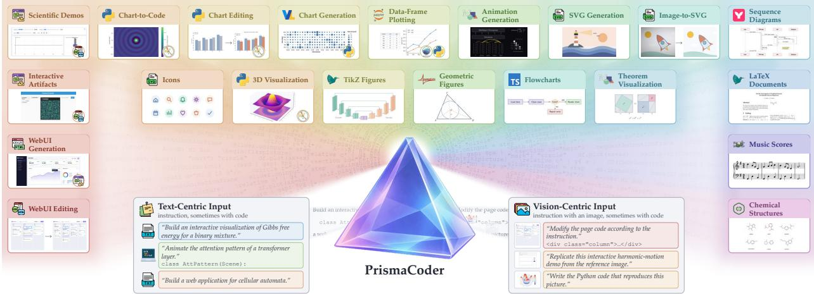  
Figure 1: Scenarios and formats covered by PrismaCoder-2M and PrismaCoder.

To address this gap, we introduce PrismaForge, a rubric-based framework for multimodal code data curation and policy optimization. Rather than relying solely on a holistic judgment or a fixed checklist, PrismaForge applies a common evaluation procedure across data sources and task domains while tailoring its criteria to each instruction. Each rubric combines reusable domain-level checks with instruction-specific requirements, with the number of criteria adjusted to the estimated task dificulty. Code-level and visual-level criteria are evaluated separately on the generated program and its rendered artifact, respectively. These scores guide data curation and serve as reinforcement learning rewards.

Using PrismaForge, we curate PrismaCoder-2M, the broadest open dataset to date for advancing multimodal code intelligence, spanning more than 12 categories and 10 programming languages with both text-centric and vision-centric data. To build this coverage, we draw seeds from complementary sources: public visual-coding corpora cover common plotting and graphics tasks; research figures and open-source repositories contribute long-tail scientific examples; and web, interactive-demo, and chemicalstructure sources broaden the range of artifacts. We then convert the seeds into self-contained tasks, check candidate programs through format-specific execution and rendering, and use instruction-specific rubric scores to filter or refine the resulting examples. This gives the dataset both breadth of coverage and a consistent quality-control process.

To assess whether the breadth of PrismaCoder-2M translates into broad model capability, we develop PrismaCoder-9B and PrismaCoder-35B. Evaluated on a wide range of representative benchmarks, PrismaCoder leads the existing open state of the art by a wide margin and matches the proprietary systems to a considerable degree (§5). Through extensive analyses (§6), we show that the data and pipeline generalize across base models beyond our release. We further show that rubric-guided curation outperforms direct-judge selection and that rubric scores align closely with human judgments.

Our main contributions are summarized as follows:

• Decomposed Rubric Synthesis for Visual-coding Data. We introduce PrismaForge, a principled pipeline whose hierarchically synthesized rubrics serve as both filter and reward. Based on it, we curate PrismaCoder-2M, the broadest and largest open dataset to date.

• Open Models that Rival Proprietary Systems. We build PrismaCoder-9B/35B on PrismaCoder-2M, which lead the open state of the art by a wide margin and match or surpass leading proprietary systems on charts, front-end pages, and semi-structured documents.

• Empirical Insights across Data, Modeling, and Training. Beyond data and model contributions, we further share insights through extensive analysis. It shows that our pipeline generalizes across scenarios and backbones and yields artifacts better aligned with human preference.

## 2. Related Work

Multimodal Code Intelligence. Code intelligence now extends beyond text-only programming to visual-programmatic tasks, where intent may be visual (Li et al., 2024; Zhang et al., 2024a; Wang et al., 2025) and outputs can be judged only after execution or rendering (Zhao et al., 2026). On the output side, syntactic validity is insuficient; correctness also depends on layout, semantics, interaction, and editability. On the input side, reading values and layout of renders remains a perception bottleneck (Masry et al., 2022; Wang et al., 2024; Xia et al., 2025) across vision-language models (Zhang et al., 2024b; Liu et al., 2025). The tasks run from screenshot-to-code (Gui et al., 2025; Si et al., 2025; Yun et al., 2024) to front-end engineering (Jiang et al., 2025; Zhu et al., 2025; Sun et al., 2025a) and generative UI (Zheng et al., 2026); chart generation (Yang et al., 2025a; Zhao et al., 2025c; Wu et al., 2025) and editing (Zhang et al., 2024c; Zhao et al., 2025b); SVG and symbolic graphics (Yang et al., 2025b; Nishina & Matsui, 2024; Xu et al., 2024) with their structural probes (Qiu et al., 2025; Chen et al., 2025b); and interactive artifacts and code-driven demonstrations (Zhang et al., 2025; Ku et al., 2025; Sun et al., 2025b). Recent generalists unify these domains via JanusCoder’s visual-programmatic interface (Sun et al., 2026b), VisCodex’s vision–code integration (Jiang et al., 2026), VisCoder2’s agentic visualization coding (Ni et al., 2026), and VinciCoder’s visual reinforcement learning (Zhao et al., 2025a). Yet a shared modeling interface does not by itself make heterogeneous notions of correctness consistently measurable or usable for training (Zhao et al., 2026). Complementing this progress, we contribute on the data side, with PrismaCoder-2M spanning the broadest scenarios and open data types.

Learning Signals for Code Generation. Conventional code tasks (Zhang et al., 2023) draw training data from instruction synthesis and evolution (Wei et al., 2024; Luo et al., 2024, 2025b). For many such tasks, executable tests provide a cheap, reproducible signal for data filtering (Xu et al., 2025b; Sun et al., 2026a) and reinforcement learning (Shao et al., 2024; Xu et al., 2025a; Zhuo et al., 2025). Visual outputs break this assumption: successful execution confirms only that the code runs, not that its render is faithful, well composed, or semantically correct (Zhao et al., 2026; Liu et al., 2026; Guo et al., 2025). Visual benchmarks instead use task-specific render checks for charts (Yang et al., 2025a), visual and structural similarity for web pages (Si et al., 2025), or judge protocols for interactive artifacts (Zhang et al., 2025); efective individually, these measures do not compose across artifacts. Recent work moves toward finer supervision, from JanusCoder’s single-pass rubric over fixed dimensions (Sun et al., 2026b) to VinciCoder’s coarse-to-fine rewards (Zhao et al., 2025a). Neither signal is yet both fine enough to localize failures and general enough to cover every task, at curation and at training alike. In this work, one synthesized rubric per instruction serves both roles, filtering the training data and rewarding reinforcement learning across every format we cover.

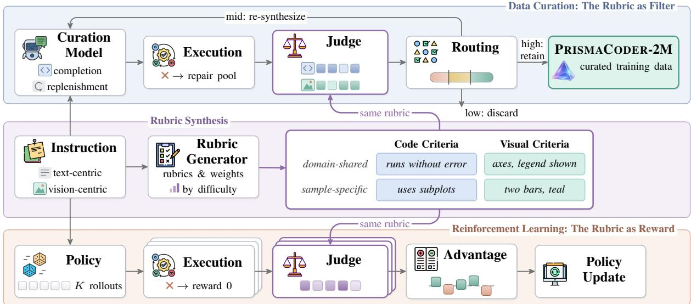  
Figure 2: PrismaForge writes one rubric per instruction and uses it twice, to filter candidate data into PrismaCoder-2M and to reward rollouts in reinforcement learning.

## 3. PrismaForge

In this section, we present PrismaForge, a rubric-based scoring framework that lies in the center of our data curation and training pipeline.

## 3.1. Elastic Rubric Scorer

For a large-scale coding dataset prepared for visualization or demonstration, the key challenge is to determine which candidates are suficiently correct and useful to retain. Unlike problems with easily verifiable outputs, visualization quality is often specified only implicitly (Wu et al., 2025; Yang et al., 2025a). A single holistic score is therefore hard to verify and ofers little insight into why a candidate succeeds or fails (Ye et al., 2024; Sun et al., 2026b).

A natural alternative is to evaluate candidates using explicit criteria, but a fixed rubric is too coarse for diverse visualization tasks. Diferent instructions may prioritize numerical accuracy and axis scales, visual similarity, layout, or artifact editability. A universal rubric must stay broad and may miss the properties most important for a specific example. At the other extreme, manually designing separate rubrics for every visualization instruction would require substantial human efort and is hard to scale.

To balance these two extremes, we introduce a sample-specific rubric system that combines reusable domain-level criteria with criteria synthesized specifically for each instruction.

Formally, let $i \in \{ 1 , \ldots , N \}$ index dataset instances, and let $d _ { i } \in \mathcal { D }$ denote the visualization domain associated with instance �. We represent candidate sample � as a tuple $( x _ { i } , c _ { i } , v _ { i } )$ where $x _ { i }$ denotes the instruction, which may contain text and optional visual references; $c _ { i }$ denotes the response code produced for that instruction; and $v _ { i } = { \mathrm { E x e c } } ( c _ { i } )$ denotes the visual artifact obtained by executing $c _ { i }$

We evaluate each candidate using two complementary sets of rubric criteria: code rubrics $\mathcal { R } _ { i } ^ { ( c ) }$ , which assess properties that can be verified from $c _ { i } ,$ , and visual rubrics $\mathcal { R } _ { i } ^ { ( v ) }$ , which assess properties directly observable from $v _ { i }$

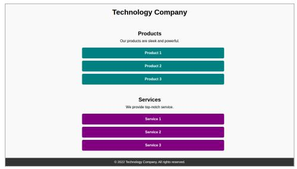  
Reference

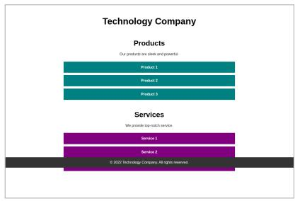  
Synthesized

<table><tr><td>Signal</td><td>Checks</td><td>Score</td></tr><tr><td>Holistic judge</td><td></td><td>78/100</td></tr><tr><td>Code rubric</td><td>5/5 pass</td><td>1.00</td></tr><tr><td>Vision rubric</td><td>1/5 pass</td><td>0.18</td></tr></table>

Figure 3: Scored separately, the vision rubric catches a misplaced footer that every code check and a holistic judge let through.

Fig. 3 shows why the two views are kept apart. The synthesized page carries the reference’s content, colors, and layout in its code, so every code check passes. Its footer, however, is drawn over the Services section and clips the third button. A holistic judge still rates the page 78 out of 100, above about four fifths of the pool, whereas the vision rubric scores it 0.18. The checks and judgments behind both scores are listed in Appendix §C.

Within each modality, we further distinguish between domain-shared and sample-specific criteria. Domainshared rubrics encode requirements that recur across samples within the same visualization domain, whereas sample-specific rubrics are derived from the instruction $x _ { i }$ and capture requirements unique to the current sample. Thus, for modality $m \in \{ c , v \}$ },

$$
\mathscr { R } _ { i } ^ { ( m ) } = \mathscr { R } _ { \mathrm { s h a r e d } } ^ { ( m ) } ( d _ { i } ) \cup \mathscr { R } _ { \mathrm { s p e c } } ^ { ( m ) } ( x _ { i } ) .\tag{1}
$$

Because individual criteria may difer in importance, each rubric item $r \in \mathcal { R } _ { i } ^ { ( m ) }$ is assigned a nonnegative, sample-dependent weight $w _ { i , r } ^ { ( m ) }$

To score a candidate, let $f ^ { ( m ) } ( r , y ) \in [ 0 , 1 ]$ denote the judge score indicating how well artifact � satisfies rubric criterion � under modality �. The normalized score for modality � is then

$$
S _ { i } ^ { ( m ) } = \frac { 1 } { \sum _ { r \in \mathcal { R } _ { i } ^ { ( m ) } } w _ { i , r } ^ { ( m ) } } \sum _ { r \in \mathcal { R } _ { i } ^ { ( m ) } } w _ { i , r } ^ { ( m ) } f ^ { ( m ) } ( r , y _ { i } ^ { ( m ) } )\tag{2}
$$

The two modality scores are then combined into an overall sample score with appropriate weighting

$$
S _ { i } = \lambda _ { c } S _ { i } ^ { ( c ) } + \lambda _ { v } S _ { i } ^ { ( v ) } ,\tag{3}
$$

where $\lambda _ { c } , \lambda _ { v } \geq 0$ and $\lambda _ { c } + \lambda _ { v } = 1$

In practice, candidate samples vary substantially in dificulty and complexity, and therefore should not be evaluated with the same number of rubric items. We first assign each instruction $x _ { i }$ a dificulty level $q _ { i } \in \mathcal { Q }$ and use this level to guide rubric generation. Each dificulty band is associated with a bounded range for the number of generated criteria. This allows more complex samples to receive finer-grained evaluation while keeping the rubric compact enough to control judging cost.

## 3.2. Rubric-Based Policy Optimization

The same rubric framework can also be used to construct rewards for reinforcement learning. Because rubric scores are normalized within each modality and aggregated using a common scoring rule, they provide a consistent reward scale across samples with diferent numbers and types of criteria. We therefore use the rubric-based evaluator as a structured reward function during policy optimization.

For each prompt $x _ { i } ,$ we sample � rollout responses from the behavior policy

$$
c _ { i } ^ { ( 1 ) } , \cdot \cdot \cdot , c _ { i } ^ { ( K ) } \sim \pi _ { \theta _ { \mathrm { o l d } } } ( \cdot \mid x _ { i } ) .\tag{4}
$$

Each rollout $c _ { i } ^ { ( k ) }$ is executed to obtain the visual artifacts $v _ { i } ^ { ( k ) } = \mathrm { E x e c } \left( c _ { i } ^ { ( k ) } \right)$ . Rollouts that failed to execute or render receive reward 0.

The judge model then scores these rollouts. For each successful rollout trajectory $( x _ { i } , c _ { i } ^ { ( k ) } , v _ { i } ^ { ( k ) } )$ , we apply its accompany rubrics set $( \mathcal { R } _ { i } ^ { ( c ) } , \mathcal { R } _ { i } ^ { ( v ) } )$ and obtain the aggregated score $s _ { i } ^ { ( k ) }$ via Eq. 2–Eq.3. These scores are then leveraged to compute the within-group normalized advantage

$$
\hat { A } _ { i } ^ { ( k ) } = \frac { s _ { i } ^ { ( k ) } - \mu _ { i } } { \sigma _ { i } + \epsilon }\tag{5}
$$

where $\begin{array} { r } { \mu _ { i } = \frac { 1 } { K } \sum _ { k = 1 } ^ { K } s _ { i } ^ { ( k ) } } \end{array}$ and $\sigma _ { i }$ denotes the standard deviation of $s _ { i } ^ { ( k ) }$

With this reward formulation, the policy can then be optimized with the standard GRPO clipped objective (Shao et al., 2024). In practice, we also used GSPO objective (Zheng et al., 2025) with Rollout Routing Replay techniques (Ma et al., 2025) for the MoE models to stabilize experts training.

## 4. PrismaCoder-2M

We build PrismaCoder-2M with PrismaForge by collecting seeds from complementary sources, gating them by rubric score into a supervised corpus, and holding out a subset for reinforcement learning, where the same rubrics supply the reward.

## 4.1. Data Sourcing

Multimodal code generation needs several capabilities at once, so we collect four kinds of seeds that each cover one of them and train on them together (Tab. 1 and Fig. 4).

Visualization Fundamentals. Visual coding starts from a core of plotting skills, such as mapping data to axes and marks and composing legends and layered plots. Public plotting datasets build this foundation with instruction–code and visualization–code pairs in Python (Hunter, 2007) and in SVG, Mermaid, Vega-Lite, and other visualization languages (Ni et al., 2025b, 2026; Jiang et al., 2026).

Diverse Scientific Artifacts. Scientific work produces more varied visuals than standard charts, from multi-panel figures to domain-specific encodings. Plotting code from open-source GitHub repositories and figures from arXiv papers bring this variety into the data, and an AST-based pass splits long or monolithic scripts into self-contained units.

Table 1: Statistics of PrismaCoder-2M.
<table><tr><td>Task family</td><td>#Samples</td><td>Share</td></tr><tr><td>■Vision-centric</td><td></td><td></td></tr><tr><td>WebUI Generation Chart-to-Code</td><td>357.1K 196.5K</td><td>17.8% 9.8%</td></tr><tr><td>Image-to-SVG</td><td>181.0K</td><td>9.0%</td></tr><tr><td>WebUI Editing</td><td>175.0K</td><td>8.7%</td></tr><tr><td>Demo / Artifacts</td><td>163.3K</td><td>8.1%</td></tr><tr><td>Chemical Structures</td><td>108.0K</td><td>5.4%</td></tr><tr><td>Interactive Artifacts</td><td>9.1K</td><td>0.5%</td></tr><tr><td>■Text-centric</td><td></td><td></td></tr><tr><td>Chart Generation</td><td>181.1K</td><td>9.0%</td></tr><tr><td>Demo / Artifacts</td><td></td><td></td></tr><tr><td></td><td>163.0K</td><td>8.1%</td></tr><tr><td>Text-to-WebUI</td><td>135.2K</td><td>6.7%</td></tr><tr><td>ETEX</td><td>133.1K</td><td>6.6%</td></tr><tr><td>SVG Generation</td><td>53.3K</td><td>2.7%</td></tr><tr><td>Animation (Manim)</td><td>35.9K</td><td>1.8%</td></tr><tr><td>JavaScript</td><td></td><td>1.4%</td></tr><tr><td>Mermaid</td><td>28.5K</td><td>1.1%</td></tr><tr><td>LilyPond</td><td>22.7K</td><td></td></tr><tr><td></td><td>21.9K</td><td>1.1%</td></tr><tr><td>Vega-Lite</td><td>20.0K</td><td>1.0%</td></tr><tr><td>Asymptote</td><td>19.4K</td><td>1.0%</td></tr><tr><td>Total</td><td>2M</td><td>100%</td></tr></table>

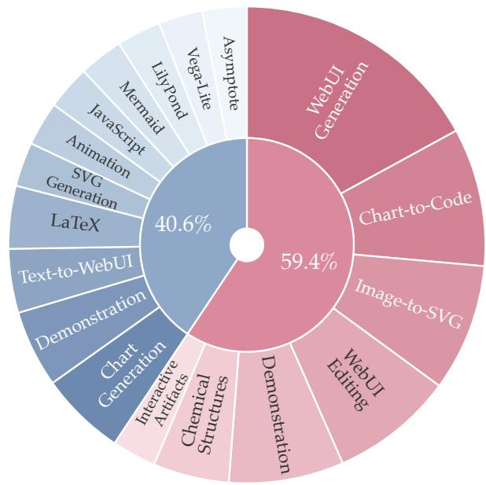  
Figure 4: Composition of PrismaCoder-2M by input modality and task family.

Front-End Layout and Interaction. Front-end development asks a model to arrange many elements on a page and to make them respond to users. Web pages from WebCode2M (Gui et al., 2025) and the MCD dataset (Jiang et al., 2026) supply the layout, while interactive demos supply the behavior. The demos are adapted from prior releases (Sun et al., 2026b) or rewritten from static pages (Laurençon et al., 2024) and complex generation prompts (Luo et al., 2025a; Ni et al., 2025a) into tasks of varying visual, functional, and reasoning complexity.

Symbolic Notation. Science, mathematics, and music communicate through symbolic notation, where a single wrong symbol breaks the result. Chemical-structure code seeded from PubChem (Kim et al., 2025) must describe a valid molecule, and LAT X, Asymptote, LilyPond, and Manim programs must compile into well-formed documents, figures, scores, and scenes. The first three formats draw on the same sources as the plots, and the Manim seeds come from the 3Blue1Brown video code. See Appendix §B.

## 4.2. Iterative Data Gating

Every seed enters PrismaForge as a candidate $( x _ { i } , c _ { i } , v _ { i } )$ . Where a seed lacks working code, a curation model $\mathcal { L } ^ { C }$ generates it, $c _ { i } \sim \mathcal { L } ^ { C } ( \cdot \mid x _ { i } )$ , through a code-data synthesis pipeline. PrismaForge works with any such pipeline, and we use a typical open-source one (Sun et al., 2026b). Each candidate must then compile or render through a per-format gatekeeper, $v _ { i } = { \mathrm { E x e c } } ( c _ { i } )$ , and candidates that still fail after regeneration are set aside in a repair pool.

A rubric generator $\mathcal { L } ^ { R }$ assigns each candidate its dificulty level and its code and visual rubrics (§3.1), and a separate judge $\mathcal { L } ^ { J }$ scores the code against $\mathcal { R } _ { i } ^ { ( c ) }$ and the render against $\mathcal { R } _ { i } ^ { ( v ) }$ . The modality scores and the overall score $S _ { i }$ follow Eqs. 2 and 3. We use distinct models for rubric generation and judging so that biases in rubric construction are not reproduced during scoring.

We then gate candidates by their overall scores. Those with $S _ { i } < \tau _ { 1 }$ are discarded, those with $\tau _ { 1 } \leq S _ { i } < \tau _ { 2 }$

are sent back for re-synthesis, and those with $S _ { i } \geq \tau _ { 2 }$ are retained in the curated pool.

The synthesis pipeline serves this gate in two ways. It re-rolls the code of a mid-band candidate with the failed rubric items as feedback, and it synthesizes new samples seeded by retained candidates. Both kinds of output re-enter the pipeline at the execution gate and are scored and routed like any other candidate. For the final supervised corpus, we retain a sample only if its score meets the threshold for its domain, $S _ { i } \geq \tau _ { d _ { i } }$

## 4.3. RL Data Curation

Reinforcement learning draws on a compact set of instructions held out from the supervised pool, which SFT never sees. Among them we keep the medium or hard instructions on which the SFT policy sometimes succeeds and sometimes fails. Such instructions sit near the policy’s capability boundary, and their rollouts difer in quality enough to give group-relative optimization a contrast to learn from, whereas instructions that every rollout passes or fails provide none.

Formally, let $\pi _ { \mathrm { S F T } }$ denote the SFT-tuned policy. For each candidate instance $i ,$ we draw � independent responses $c _ { i } ^ { ( k ) } \sim \pi _ { \mathrm { S F T } } ( \cdot \mid x _ { i } )$ and evaluate each rollout using the rubric-based scoring function defined in §3.1. We then measure the informativeness of instance � by the empirical dispersion of its rubric scores

$$
{ { U } _ { i } } = \frac { 1 } { K } \sum _ { k = 1 } ^ { K } { { { \left( { { S } _ { i } ^ { ( k ) } } - { { \bar { S } } _ { i } } \right) } ^ { 2 } } } , \quad { { \bar { S } } _ { i } } = \frac { 1 } { K } \sum _ { k = 1 } ^ { K } { { { S } _ { i } ^ { ( k ) } } } .\tag{6}
$$

A large $U _ { i }$ means that the policy sometimes succeeds and sometimes fails on the same instruction.

In practice, we run RL on all Python, HTML, and SVG tasks, and for each domain we hold out 20K medium or hard candidates before SFT. We then draw � = 5 rollouts per instance from $\pi _ { \mathrm { S F T } } .$ , score each rollout against its code and visual rubrics, and retain the 5K instances with the largest $U _ { i }$ . RL thus concentrates on the policy’s capability frontier at a fraction of the rollout cost of a larger candidate pool.

## 5. Experiments

## 5.1. Experimental Setup

Models. We release PrismaCoder-9B and PrismaCoder-35B-A3B (abbreviated as PrismaCoder-35B), post-trained from Qwen3.5-9B and Qwen3.5-35B-A3B (Qwen Team, 2026). We also train Gemma-4-31B-it (Gemma Team, 2026) and Qwen3-VL-30B-A3B-Instruct (Bai et al., 2025). More training details are in Appendix §F.

Data Pipeline Details. We reprocess data from prior open releases (Sun et al., 2026b; Jiang et al., 2026; Ni et al., 2026). PrismaForge treats its models as pluggable, and in this paper we use Claude-Opus-4.6 (Anthropic, 2026a) as the curation model and Gemini-3-Pro (Gemini Team, 2025) as the rubric generator. Both data gating and reinforcement learning use Gemini 3 Flash as the judge. The sources are listed per category in Appendix §B.

Baselines. Besides Qwen3.5, we compare against open multimodal code models, namely Janus-CoderV (Sun et al., 2026b), VinciCoder (Zhao et al., 2025a), and VisCoder2-7B (Ni et al., 2026).

## 5.2. Benchmarking

Vision-Centric Settings. The vision-centric suite comprises ChartMimic (Yang et al., 2025a), WebCode2M (Gui et al., 2025), DesignBench (Xiao et al., 2025), Design2Code (Si et al., 2025), and ChemDraw (Zhao et al., 2025a), together with the image-conditioned lenses of InteractScience (Chen et al., 2025a) (VQT) and UniSVG (Li et al., 2025) (ISVGen).

Text-Centric Settings. The text-centric suite comprises ArtifactsBench (Zhang et al., 2025), Pandas-PlotBench (Galimzyanov et al., 2025), and VisPlotBench (Ni et al., 2026) in eight visualization languages, together with InteractScience’s programmatic lens (PFT) and UniSVG’s text-conditioned lens (TSVGen).

Evaluation Protocol. Evaluation follows each benchmark’s oficial protocol, with deterministic metrics reported alongside judge scores. Since some designated judges share a model family with our pipeline, we check that the gains hold across judges (§6.3). Details are presented in §E.

## 5.3. Vision-Centric Results

Web Interfaces. PrismaCoder-9B and PrismaCoder-35B lead open baseline on front-end generation, achieving judge scores more than 20 points higher than those of task-specific open baselines (Tab. 2). PrismaCoder-9B also scores above proprietary model on DesignBench generation and WebCode2M CLIP score. DesignBench editing is the only web-interface metric on which both models score below all Claude 4.6 and Gemini 3 variants.

Table 2: Vision-centric results. Best / second among open models.
<table><tr><td></td><td colspan="2">ChartMimic</td><td colspan="3">WebCode2M</td><td colspan="3">DesignBench Design2Code</td><td colspan="2">Inter- actSci.</td><td>UniSVG</td><td colspan="2">ChemDraw</td></tr><tr><td>Model</td><td>Low-Level High-Level</td><td></td><td>LLM Score</td><td>Visual</td><td>CLIP</td><td>Gen.</td><td>Edit.</td><td>LLM Score</td><td>Visual</td><td>VQT</td><td>ISVGen</td><td>Validity</td><td>Tani. Sim.</td></tr><tr><td>Open models</td><td></td><td></td><td></td><td></td><td></td><td></td><td></td><td></td><td></td><td></td><td></td><td></td><td></td></tr><tr><td>Qwen3-VL-8B-Instruct</td><td>65.92</td><td>62.81</td><td>53.67</td><td>73.55</td><td>79.16</td><td>55.12</td><td>8.38</td><td>57.47</td><td>82.81</td><td>34.06</td><td>66.27</td><td>78.91%</td><td>54.79</td></tr><tr><td>Qwen3-VL-30B-A3B-Instruct</td><td>71.04</td><td>67.30</td><td>54.80</td><td>77.40</td><td>79.42</td><td>51.58</td><td>8.07</td><td>57.94</td><td>85.11</td><td>37.67</td><td>74.30</td><td>82.03%</td><td>54.55</td></tr><tr><td>Qwen3.5-9B</td><td>58.35</td><td>55.55</td><td>51.74</td><td>81.60</td><td>79.93</td><td>50.73</td><td>8.19</td><td>53.12</td><td>85.60</td><td>27.28</td><td>63.09</td><td>88.28%</td><td>66.79</td></tr><tr><td>Qwen3.5-35B-A3B</td><td>70.22</td><td>63.90</td><td>65.32</td><td>88.64</td><td>85.94</td><td>64.70</td><td>8.66</td><td>67.49</td><td>90.98</td><td>29.33</td><td>62.91</td><td>92.97%</td><td>79.86</td></tr><tr><td>JanusCoderV-7B</td><td>75.12</td><td>68.97</td><td>40.92</td><td>72.90</td><td>76.00</td><td>40.37</td><td>7.44</td><td>36.49</td><td>70.81</td><td>27.67</td><td>61.60</td><td>84.75%</td><td>72.81</td></tr><tr><td>JanusCoderV-8B</td><td>76.54</td><td>69.23</td><td>35.17</td><td>65.95</td><td>73.04</td><td>34.30</td><td>7.26</td><td>34.53</td><td>68.61</td><td>33.32</td><td>62.47</td><td>86.10%</td><td>76.91</td></tr><tr><td>VinciCoder-7B</td><td>78.30</td><td>66.09</td><td>43.11</td><td>72.42</td><td>78.59</td><td>43.24</td><td>1.40</td><td>42.30</td><td>76.64</td><td>0.00</td><td>85.72</td><td>93.18%</td><td>92.15</td></tr><tr><td>VinciCoder-8B</td><td>77.59</td><td>66.44</td><td>46.16</td><td>78.26</td><td>80.79</td><td>48.09</td><td>1.71</td><td>45.72</td><td>81.89</td><td>2.33</td><td>87.18</td><td>94.21%</td><td>91.02</td></tr><tr><td>PRISMACODER-9B</td><td>81.57</td><td>73.82</td><td>69.72</td><td>90.41</td><td>88.46</td><td>69.95</td><td>8.93</td><td>70.51 91.54</td><td></td><td>51.87</td><td>69.64</td><td>96.88%</td><td>95.94</td></tr><tr><td>PRISMACODER-35B-A3B</td><td>83.42</td><td>80.69</td><td>67.78</td><td>89.66</td><td>87.78</td><td>68.98</td><td>8.89</td><td>67.55</td><td>91.22</td><td>53.54</td><td>84.14</td><td>100.00%</td><td>97.56</td></tr><tr><td>Proprietary</td><td></td><td></td><td></td><td></td><td></td><td></td><td></td><td></td><td></td><td></td><td></td><td></td><td></td></tr><tr><td>GPT-40</td><td>76.38</td><td>72.02</td><td>54.94</td><td>83.45</td><td>80.22</td><td>52.64</td><td>8.89</td><td>58.48</td><td>88.23</td><td>46.01</td><td>70.98</td><td>92.19%</td><td>57.80</td></tr><tr><td>Gemini 3 Flash</td><td>85.12</td><td>83.04</td><td>69.63</td><td>90.41</td><td>87.34</td><td>69.28</td><td>9.45</td><td>70.12</td><td>92.18</td><td>65.25</td><td>82.24</td><td>63.28%</td><td>81.39</td></tr><tr><td>Gemini 3.1 Pro</td><td>77.96</td><td>81.73</td><td>70.97</td><td>89.96</td><td>87.64 86.80</td><td>69.47</td><td>9.57</td><td>70.90</td><td>90.70</td><td>71.05</td><td>76.85</td><td>93.12%</td><td>92.45</td></tr><tr><td>Claude Sonnet 4.6</td><td>80.23</td><td>80.73 79.68</td><td>68.19</td><td>87.76</td><td>87.11</td><td>66.53 65.69</td><td>9.24 9.55</td><td>67.99 66.75</td><td>90.83 90.19</td><td>77.36</td><td>80.38</td><td>88.28%</td><td>85.43</td></tr><tr><td>Claude Opus 4.6</td><td>81.11</td><td></td><td>66.38</td><td>88.25</td><td></td><td></td><td></td><td></td><td></td><td>76.25</td><td>78.70</td><td>96.88%</td><td>77.71</td></tr></table>

Data Visualization. On ChartMimic, both of our models lead all open baselines. Specifically, PrismaCoder-35B outperforms most proprietary models under both settings. Notably, our 9B model demonstrates the most substantial improvement over its base (the lowest among all evaluated models) and even surpasses most proprietary models. This clearly demonstrates the quality and utility of our data. In addition, the low-level score evaluates rendered text, layout, chart type, and color fidelity, which means our model is more capable of generating those details.

Table 3: Text-centric results. Best / second among open models.
<table><tr><td></td><td>Artifacts Bench</td><td colspan="3">PandasPlotBench</td><td>Inter- actSci.</td><td>UniSVG</td><td colspan="3">VisPlotBench</td></tr><tr><td>Model</td><td></td><td>Incorr. Code↓</td><td>Visual</td><td>Task</td><td>PFT</td><td>TSVGen</td><td>ExecPass</td><td>Mean</td><td>Good ≥75</td></tr><tr><td>Open models</td><td></td><td></td><td></td><td></td><td></td><td></td><td></td><td></td><td></td></tr><tr><td>Qwen3-VL-8B-Instruct</td><td>34.71</td><td>16.00%</td><td>60.01</td><td>73.67</td><td>15.47%</td><td>68.13</td><td>56.52%</td><td>40.25</td><td>33.62</td></tr><tr><td>Qwen3-VL-30B-A3B-Instruct</td><td>41.70</td><td>11.43%</td><td>60.05</td><td>80.58</td><td>24.40%</td><td>69.33</td><td>64.38%</td><td>49.28</td><td>42.88</td></tr><tr><td>Qwen3.5-9B</td><td>41.24</td><td>24.57%</td><td>52.98</td><td>65.47</td><td>22.40%</td><td>69.28</td><td>52.22%</td><td>41.18</td><td>36.71</td></tr><tr><td>Qwen3.5-35B-A3B</td><td>44.98</td><td>15.43%</td><td>60.16</td><td>75.17</td><td>26.67%</td><td>72.15</td><td>63.01%</td><td>51.45</td><td>48.51</td></tr><tr><td>JanusCoderV-7B</td><td>31.16</td><td>23.43%</td><td>53.05</td><td>65.77</td><td>17.73%</td><td>66.43</td><td>58.42%</td><td>48.10</td><td>32.15</td></tr><tr><td>JanusCoderV-8B</td><td>32.00</td><td>26.30%</td><td>56.30</td><td>70.91</td><td>17.60%</td><td>62.17</td><td>56.21%</td><td>47.22</td><td>30.87</td></tr><tr><td>VinciCoder-7B</td><td>11.35</td><td>9.14%</td><td>25.37</td><td>51.57</td><td>0.40%</td><td>64.06</td><td>64.10%</td><td>23.95</td><td>10.11</td></tr><tr><td>VinciCoder-8B</td><td>11.97</td><td>12.00%</td><td>25.47</td><td>60.79</td><td>0.54%</td><td>63.45</td><td>63.92%</td><td>12.55</td><td>2.80</td></tr><tr><td>VisCoder2-7B</td><td>17.51</td><td>20.00%</td><td>59.48</td><td>67.59</td><td>1.00%</td><td>65.44</td><td>66.73%</td><td>49.84</td><td>42.50</td></tr><tr><td>PRISMACODER-9B</td><td>45.28</td><td>10.29%</td><td>60.54</td><td>77.94</td><td>24.80%</td><td>68.49</td><td>65.30%</td><td>53.99</td><td>52.62</td></tr><tr><td>PRISMACODER-35B-A3B</td><td>46.01</td><td>9.29%</td><td>62.38</td><td>79.85</td><td>28.00%</td><td>70.72</td><td>71.14%</td><td>62.47</td><td>61.49</td></tr><tr><td>Proprietary</td><td></td><td></td><td></td><td></td><td></td><td></td><td></td><td></td><td></td></tr><tr><td>GPT-40</td><td>33.54</td><td>8.00%</td><td>67.63</td><td>82.46</td><td>31.07%</td><td>72.80</td><td>67.99%</td><td>56.01</td><td>52.75</td></tr><tr><td>Gemini 3 Flash</td><td>51.42</td><td>3.43%</td><td>69.95</td><td>91.21</td><td>28.13%</td><td>74.64</td><td>76.25%</td><td>60.92</td><td>58.54</td></tr><tr><td>Gemini 3.1 Pro</td><td>53.04</td><td>1.71%</td><td>78.41</td><td>94.70</td><td>44.13%</td><td>74.52</td><td>79.57%</td><td>69.47</td><td>69.15</td></tr><tr><td>Claude Sonnet 4.6</td><td>64.65</td><td>3.43%</td><td>74.59</td><td>91.93</td><td>37.33%</td><td>74.93</td><td>73.00%</td><td>62.20</td><td>61.06</td></tr><tr><td>Claude Opus 4.6</td><td>62.47</td><td>1.71%</td><td>76.03</td><td>94.97</td><td>35.47%</td><td>75.47</td><td>73.09%</td><td>65.94</td><td>66.03</td></tr></table>

Scientific and Vector Graphics. On chemical-structure code, PrismaCoder-35B parses every output and reaches the highest Tanimoto similarity in the table (97.56). On InteractScience’s visual lens both models lead the open baselines, while image-conditioned SVG is the one vision-centric column led by an open baseline, VinciCoder-8B. Full per-benchmark metrics are presented in Appendix §G, and a chart-to-code case across training stages in Appendix §I.

## 5.4. Text-Centric Results

Interactive Applications and Plots. On ArtifactsBench, both models exceed all open baselines and GPT-4o on the overall score (Tab. 3). On InteractScience’s programmatic lens, PrismaCoder-35B scores 28.00, above the best open baseline and comparable to Gemini 3 Flash. Scaling from 9B to 35B raises the InteractScience PFT score by 3.20 points.

Long-Tail Visual Languages. PrismaCoder-35B leads open baselines on all three VisPlotBench metrics (Tab. 3). Its Mean score is 11.02 points above their best, comparable to Claude Sonnet 4.6.

## 6. Analysis

## 6.1. Rubric Eficacy

To intuitively demonstrate the advantages of the rubric-based method over direct judging, we fine-tune Qwen3.5-9B on two equal-sized subsets drawn from the same data pool.

One is filtered by direct scoring, where a judge assigns each sample a single holistic score as in a typical pipeline (Sun et al., 2026b), and the other by the PrismaForge rubric. The model trained on the rubric-filtered subset scores higher on every benchmark, by as much as 24 points on Vega-Lite (Fig. 5). The gains are largest on the text-centric formats and small on the vision-centric benchmarks, where Design2Code moves by a fraction of a point. Since both subsets have the same size, the gap reflects which samples each judge keeps.

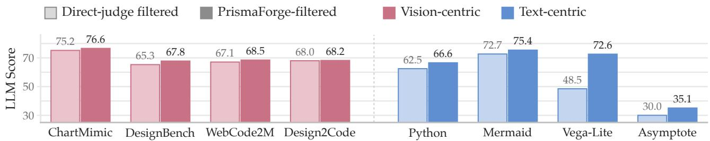  
Figure 5: PrismaForge filtering outperforms direct-judge filtering on every benchmark.

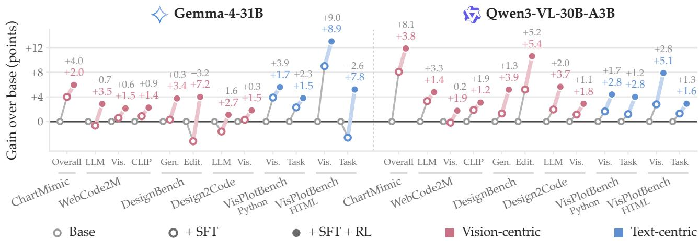  
Figure 6: Per-stage gains of our SFT and RL pipeline over two base models on every metric.

## 6.2. Backbone Generalization

Beyond the released Qwen3.5 backbones, we apply the same data and method to Gemma-4-31Bit (Gemma Team, 2026) and Qwen3-VL-30B-A3B-Instruct (Bai et al., 2025) on Python plotting and HTML, the two most represented domains. On both backbones all twelve metrics end above the base model, and RL adds to SFT on every one (Fig. 6). SFT carries most of the ChartMimic gain, whereas RL drives most of the HTML gains and recovers every metric that dips after SFT alone. More results on Gemma are presented in Appendix §H.1.

## 6.3. Rubric Agreement with Humans

Because multimodal code artifacts are ultimately created for humans, consistency with human judgment provides a compelling test to verify that the quality of data yielded by our rubric-based PrismaForge aligns more closely with human preferences. At the same time, preserving the relative ordering induced by scores is particularly important for reward-based policy optimization, where inconsistent rankings can provide conflicting training signals. To evaluate our method along both dimensions, we conducted a human study. We sampled 100 examples from our training data and asked human annotators, as well as three proprietary model judges, to evaluate them using direct scoring and

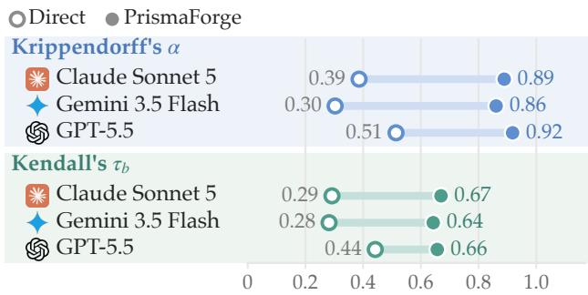  
Figure 7: PrismaForge scoring aligns judges with humans better than direct scoring.

the PrismaForge rubrics, respectively. We then measured the agreement between each model judge and the human ratings in terms of both absolute score levels and pairwise ordering (Fig. 7). The rubric-based judging method achieves substantially higher agreement with human judgments and greater consistency in the induced partial ordering across all three model judges. The full study protocol and detailed statistics are provided in Appendix §H.2. We further show that the gains of our pipeline hold across judge models, with the experiments presented in Appendix §H.1.

## 7. Conclusion

In this work, we push open multimodal code intelligence forward by jointly contributing and fully releasing data, pipeline, and models. PrismaForge treats multimodal code data under one lens with rubrics synthesized from coarse to fine and decomposed into code-level and visual-level criteria, a signal that both generalizes and localizes what went wrong. We then curate and release PrismaCoder-2M, the most broadly covering open dataset for multimodal code intelligence, which enables principled selection and stable reinforcement learning on visual-coding tasks. On this data we build PrismaCoder-9B/35B, which lead the open state of the art by a wide margin and rival proprietary systems. Extensive analyses across base models and task recipes show that the data and the pipeline generalize beyond our release, and we share these insights and resources to broaden access to visual-coding capabilities.

## Acknowledgments

This research is supported by the WYNG Foundation (HKU 25AG100407). We thank Xiao Wang for advice on molecular generation and Xuanle Zhao for guidance on reproducing the baselines.

## References

[1] Anthropic. Introducing Claude Opus 4.6. https://www.anthropic.com/news/claude-opus-4-6, February 2026a. Accessed: 2026-06-29.

[2] Anthropic. Introducing Claude Sonnet 5. https://www.anthropic.com/news/claude-sonnet-5, June 2026b. Accessed: 2026-09-23.

[3] Shuai Bai, Yuxuan Cai, Ruizhe Chen, Keqin Chen, Xionghui Chen, Zesen Cheng, Lianghao Deng, Wei Ding, Chang Gao, Chunjiang Ge, et al. Qwen3-vl technical report. arXiv preprint arXiv:2511.21631, 2025.

[4] Qiaosheng Chen, Yang Liu, Lei Li, Kai Chen, Qipeng Guo, Gong Cheng, and Fei Yuan. Interactscience: Programmatic and visually-grounded evaluation of interactive scientific demonstration code generation, 2025a. URL https://arxiv.org/abs/2510.09724.

[5] Yamei Chen, Haoquan Zhang, Yangyi Huang, Zeju Qiu, Kaipeng Zhang, Yandong Wen, and Weiyang Liu. Symbolic graphics programming with large language models, 2025b. URL https://arxiv.org/abs/ 2509.05208.

[6] Timur Galimzyanov, Sergey Titov, Yaroslav Golubev, and Egor Bogomolov. Drawing pandas: A benchmark for llms in generating plotting code. In 2025 IEEE/ACM 22nd International Conference on Mining Software Repositories (MSR), pp. 503–507, 2025. doi: 10.1109/MSR66628.2025.00083.

[7] Gemini Team. Gemini 3 pro model card, November 2025. URL https://deepmind.google/models/ model-cards/gemini-3-1-pro/.

[8] Gemini Team. Gemini 3.5 flash model card, May 2026. URL https://deepmind.google/models/ model-cards/gemini-3-5-flash/.

[9] Gemma Team. Gemma 4 technical report. arXiv preprint arXiv:2607.02770, 2026.

[10] Yi Gui, Zhen Li, Yao Wan, Yemin Shi, Hongyu Zhang, Yi Su, Bohua Chen, Dongping Chen, Siyuan Wu, Xing Zhou, Wenbin Jiang, Hai Jin, and Xiangliang Zhang. Webcode2m: A real-world dataset for code generation from webpage designs. In THE WEB CONFERENCE 2025, 2025. URL https://openreview.net/forum? id=aeP5nmlw5B.

[11] Jiawei Guo, Tianyu Zheng, Yizhi Li, Yuelin Bai, Bo Li, Yubo Wang, King Zhu, Graham Neubig, Wenhu Chen, and Xiang Yue. MAmmoTH-VL: Eliciting multimodal reasoning with instruction tuning at scale. In Proceedings of the 63rd Annual Meeting of the Association for Computational Linguistics (Volume 1: Long Papers), pp. 13869– 13920, Vienna, Austria, July 2025. Association for Computational Linguistics. ISBN 979-8-89176-251-0. doi: 10.18653/v1/2025.acl-long.680. URL https://aclanthology.org/2025.acl-long.680/.

[12] John D. Hunter. Matplotlib: A 2d graphics environment. Computing in Science & Engineering, 9(3):90–95, 2007. doi: 10.1109/MCSE.2007.55.

[13] Lingjie Jiang, Shaohan Huang, Xun Wu, Yixia Li, Guanhua Chen, Dongdong Zhang, and Furu Wei. Viscodex: Unified multimodal code generation via merging vision and coding models. In The Fourteenth International Conference on Learning Representations, 2026. URL https://openreview.net/forum?id=hUXzPauNEM.

[14] Yilei Jiang, Yaozhi Zheng, Yuxuan Wan, Jiaming Han, Qunzhong Wang, Michael R. Lyu, and Xiangyu Yue. Screencoder: Advancing visual-to-code generation for front-end automation via modular multimodal agents. CoRR, abs/2507.22827, 2025. doi: 10.48550/ARXIV.2507.22827. URL https://doi.org/10.48550/ arXiv.2507.22827.

[15] S. Kim, J. Chen, T. Cheng, A. Gindulyte, J. He, S. He, Q. Li, B. A. Shoemaker, P. A. Thiessen, B. Yu, L. Zaslavsky, J. Zhang, and E. E. Bolton. Pubchem 2025 update. Nucleic Acids Research, 53(D1):D1516–D1525, Jan 2025. doi: 10.1093/nar/gkae1059.

[16] Max Ku, Cheuk Hei Chong, Jonathan Leung, Krish Shah, Alvin Yu, and Wenhu Chen. TheoremExplainAgent: Towards video-based multimodal explanations for LLM theorem understanding. In Proceedings of the 63rd Annual Meeting of the Association for Computational Linguistics (Volume 1: Long Papers), pp. 6663–6684, Vienna, Austria, July 2025. Association for Computational Linguistics. ISBN 979-8-89176-251-0. doi: 10.18653/v1/2025.acl-long.332. URL https://aclanthology.org/2025.acl-long.332/.

[17] Hugo Laurençon, Léo Tronchon, and Victor Sanh. Unlocking the conversion of web screenshots into html code with the websight dataset. arXiv preprint arXiv:2403.09029, 2024.

[18] Jinke Li, Jiarui Yu, Chenxing Wei, Hande Dong, Qiang Lin, Liangjing Yang, Zhicai Wang, and Yanbin Hao. UniSVG: A unified dataset for vector graphic understanding and generation with multimodal large language models. In Proceedings of the 33rd ACM International Conference on Multimedia, pp. 13156–13163, 2025.

[19] Kaixin Li, Yuchen Tian, Qisheng Hu, Ziyang Luo, Zhiyong Huang, and Jing Ma. MMCode: Benchmarking multimodal large language models for code generation with visually rich programming problems. In Findings of the Association for Computational Linguistics: EMNLP 2024, pp. 736–783, Miami, Florida, USA, November

2024. Association for Computational Linguistics. doi: 10.18653/v1/2024.findings-emnlp.42. URL https: //aclanthology.org/2024.findings-emnlp.42/.

[20] Junteng Liu, Weihao Zeng, Xiwen Zhang, Yijun Wang, Zifei Shan, and Junxian He. On the perception bottleneck of vlms for chart understanding, 2025. URL https://arxiv.org/abs/2503.18435.

[21] Ziyu Liu, Shengyuan Ding, Xinyu Fang, Xuanlang Dai, Penghui Yang, Jianze Liang, Jiaqi Wang, Kai Chen, Dahua Lin, and Yuhang Zang. Visual-erm: Reward modeling for visual equivalence. arXiv preprint arXiv:2603.13224, 2026.

[22] Yuxuan Luo, Ryan Yuan, Junwen Chen, Haonan Cai, Ziyi Yue, Yuwei Yang, Fatima Zohra Daha, Ji Li, and Zhouhui Lian. Mmmg: A massive, multidisciplinary, multi-tier generation benchmark for text-to-image reasoning. Advances in Neural Information Processing Systems, 38, 2025a.

[23] Ziyang Luo, Can Xu, Pu Zhao, Qingfeng Sun, Xiubo Geng, Wenxiang Hu, Chongyang Tao, Jing Ma, Qingwei Lin, and Daxin Jiang. Wizardcoder: Empowering code large language models with evol-instruct. In B. Kim, Y. Yue, S. Chaudhuri, K. Fragkiadaki, M. Khan, and Y. Sun (eds.), International Conference on Learning Representations, volume 2024, pp. 27168–27188, 2024. URL https://proceedings.iclr.cc/paper\_ files/paper/2024/file/72eba29737f9c3a5a4ce8cdb7b667145-Paper-Conference.pdf.

[24] Ziyang Luo, Kaixin Li, Hongzhan Lin, Yuchen Tian, Mohan Kankanhalli, and Jing Ma. Tree-of-evolution: Tree-structured instruction evolution for code generation in large language models. In Proceedings of the 63rd Annual Meeting of the Association for Computational Linguistics (Volume 1: Long Papers), pp. 297–316, Vienna, Austria, July 2025b. Association for Computational Linguistics. ISBN 979-8-89176-251-0. doi: 10.18653/v1/2025.acl-long.14. URL https://aclanthology.org/2025.acl-long.14/.

[25] Wenhan Ma, Hailin Zhang, Liang Zhao, Yifan Song, Yudong Wang, Zhifang Sui, and Fuli Luo. Stabilizing moe reinforcement learning by aligning training and inference routers. arXiv preprint arXiv:2510.11370, 2025.

[26] Ahmed Masry, Do Xuan Long, Jia Qing Tan, Shafiq Joty, and Enamul Hoque. ChartQA: A benchmark for question answering about charts with visual and logical reasoning. In Findings of the Association for Computational Linguistics: ACL 2022, pp. 2263–2279, Dublin, Ireland, May 2022. Association for Computational Linguistics. doi: 10.18653/v1/2022.findings-acl.177. URL https://aclanthology.org/2022.findings-acl. 177/.

[27] Minheng Ni, Zhengyuan Yang, Yaowen Zhang, Linjie Li, Chung-Ching Lin, Kevin Lin, Zhendong Wang, Xiaofei Wang, Shujie Liu, Lei Zhang, et al. Proimage-bench: Rubric-based evaluation for professional image generation. arXiv preprint arXiv:2512.12220, 2025a.

[28] Yuansheng Ni, Ping Nie, Kai Zou, Xiang Yue, and Wenhu Chen. Viscoder: Fine-tuning llms for executable python visualization code generation, 2025b. URL https://arxiv.org/abs/2506.03930.

[29] Yuansheng Ni, Songcheng Cai, Xiangchao Chen, Jiarong Liang, Zhiheng Lyu, Jiaqi Deng, Kai Zou, Ping Nie, Fei Yuan, Xiang Yue, and Wenhu Chen. Viscoder2: Building multi-language visualization coding agents. In The Fourteenth International Conference on Learning Representations, 2026. URL https://openreview. net/forum?id=4zoMnmZzh4.

[30] Kunato Nishina and Yusuke Matsui. Svgeditbench: A benchmark dataset for quantitative assessment of llm’s svg editing capabilities, 2024. URL https://arxiv.org/abs/2404.13710.

[31] OpenAI. Introducing GPT-4.1 in the API. https://openai.com/index/gpt-4-1/, April 2025. Accessed: 2026-09-22.

[32] OpenAI. GPT-5.5 system card. https://openai.com/index/gpt-5-5-system-card/, April 2026. Accessed: 2026-09-22.

[33] Zeju Qiu, Weiyang Liu, Haiwen Feng, Zhen Liu, Tim Z. Xiao, Katherine M. Collins, Joshua B. Tenenbaum, Adrian Weller, Michael J. Black, and Bernhard Schölkopf. Can large language models understand symbolic graphics programs? In The Thirteenth International Conference on Learning Representations, 2025. URL https://openreview.net/forum?id=Yk87CwhBDx.

[34] Qwen Team. Qwen3.5: Towards native multimodal agents, February 2026. URL https://qwen.ai/blog? id=qwen3.5.

[35] Zhihong Shao, Peiyi Wang, Qihao Zhu, Runxin Xu, Junxiao Song, Xiao Bi, Haowei Zhang, Mingchuan Zhang, YK Li, Yang Wu, et al. Deepseekmath: Pushing the limits of mathematical reasoning in open language models. arXiv preprint arXiv:2402.03300, 2024.

[36] Chenglei Si, Yanzhe Zhang, Ryan Li, Zhengyuan Yang, Ruibo Liu, and Diyi Yang. Design2Code: Benchmarking multimodal code generation for automated front-end engineering. In Proceedings of the 2025 Conference of the Nations of the Americas Chapter of the Association for Computational Linguistics: Human Language Technologies (Volume 1: Long Papers), pp. 3956–3974, Albuquerque, New Mexico, April 2025. Association for Computational Linguistics. ISBN 979-8-89176-189-6. doi: 10.18653/v1/2025.naacl-long.199. URL https://aclanthology.org/2025.naacl-long.199/.

[37] Haoyu Sun, Huichen Will Wang, Jiawei Gu, Linjie Li, and Yu Cheng. Fullfront: Benchmarking mllms across the full front-end engineering workflow, 2025a. URL https://arxiv.org/abs/2505.17399.

[38] Qiushi Sun, Zhirui Chen, Fangzhi Xu, Kanzhi Cheng, Chang Ma, Zhangyue Yin, Jianing Wang, Chengcheng Han, Renyu Zhu, Shuai Yuan, et al. A survey of neural code intelligence: Paradigms, advances and beyond. arXiv preprint arXiv:2403.14734, 2024.

[39] Qiushi Sun, Kanzhi Cheng, Zichen Ding, Chuanyang Jin, Yian Wang, Fangzhi Xu, Zhenyu Wu, Chengyou Jia, Liheng Chen, Zhoumianze Liu, Ben Kao, Guohao Li, Junxian He, Yu Qiao, and Zhiyong Wu. OSgenesis: Automating GUI agent trajectory construction via reverse task synthesis. In Proceedings of the 63rd Annual Meeting of the Association for Computational Linguistics (Volume 1: Long Papers), pp. 5555–5579, Vienna, Austria, July 2025b. Association for Computational Linguistics. ISBN 979-8-89176-251-0. doi: 10.18653/v1/2025.acl-long.277. URL https://aclanthology.org/2025.acl-long.277/.

[40] Qiushi Sun, Jingyang Gong, Lei Li, Qipeng Guo, and Fei Yuan. CodeEvo: Interaction-driven synthesis of code-centric data through hybrid and iterative feedback. In Proceedings of the 64th Annual Meeting of the Association for Computational Linguistics (Volume 1: Long Papers), pp. 9668–9687, San Diego, California, United States, July 2026a. Association for Computational Linguistics. ISBN 979-8-89176-390-6. URL https://aclanthology.org/2026.acl-long.438/.

[41] Qiushi Sun, Jingyang Gong, Yang Liu, Qiaosheng Chen, Lei Li, Kai Chen, Qipeng Guo, Ben Kao, and Fei Yuan. Januscoder: Towards a foundational visual-programmatic interface for code intelligence. In The Fourteenth International Conference on Learning Representations, 2026b. URL https://openreview.net/forum?id= N4BB09TXad.

[42] Hanbin Wang, Xiaoxuan Zhou, Zhipeng Xu, Keyuan Cheng, Yuxin Zuo, Kai Tian, Jingwei Song, Junting Lu, Wenhui Hu, and Xueyang Liu. Code-vision: Evaluating multimodal llms logic understanding and code generation capabilities, 2025. URL https://arxiv.org/abs/2502.11829.

[43] Zirui Wang, Mengzhou Xia, Luxi He, Howard Chen, Yitao Liu, Richard Zhu, Kaiqu Liang, Xindi Wu, Haotian Liu, Sadhika Malladi, Alexis Chevalier, Sanjeev Arora, and Danqi Chen. Charxiv: Charting gaps in realistic chart understanding in multimodal LLMs. In The Thirty-eight Conference on Neural Information Processing Systems Datasets and Benchmarks Track, 2024. URL https://openreview.net/forum?id=cy8mq7QYae.

[44] Yuxiang Wei, Zhe Wang, Jiawei Liu, Yifeng Ding, and Lingming Zhang. Magicoder: empowering code generation with oss-instruct. In Proceedings of the 41st International Conference on Machine Learning, ICML’24. JMLR.org, 2024.

[45] Chengyue Wu, Zhixuan Liang, Yixiao Ge, Qiushan Guo, Zeyu Lu, Jiahao Wang, Ying Shan, and Ping Luo. Plot2Code: A comprehensive benchmark for evaluating multi-modal large language models in code generation from scientific plots. In Findings of the Association for Computational Linguistics: NAACL 2025, pp. 3006–3028, Albuquerque, New Mexico, April 2025. Association for Computational Linguistics. ISBN 979-8-89176-195-7. doi: 10.18653/v1/2025.findings-naacl.164. URL https://aclanthology.org/ 2025.findings-naacl.164/.

[46] Renqiu Xia, Bo Zhang, Hancheng Ye, Xiangchao Yan, Qi Liu, Hongbin Zhou, Zijun Chen, Peng Ye, Min Dou, Botian Shi, Junchi Yan, and Yu Qiao. Chartx & chartvlm: A versatile benchmark and foundation model for complicated chart reasoning, 2025. URL https://arxiv.org/abs/2402.12185.

[47] Jingyu Xiao, Ming Wang, Man Ho Lam, Yuxuan Wan, Junliang Liu, Yintong Huo, and Michael R. Lyu. Designbench: A comprehensive benchmark for mllm-based front-end code generation, 2025. URL https: //arxiv.org/abs/2506.06251.

[48] Fangzhi Xu, Zhiyong Wu, Qiushi Sun, Siyu Ren, Fei Yuan, Shuai Yuan, Qika Lin, Yu Qiao, and Jun Liu. Symbol-LLM: Towards foundational symbol-centric interface for large language models. In Proceedings of the 62nd Annual Meeting of the Association for Computational Linguistics (Volume 1: Long Papers), pp. 13091–13116, Bangkok, Thailand, August 2024. Association for Computational Linguistics. doi: 10.18653/ v1/2024.acl-long.707. URL https://aclanthology.org/2024.acl-long.707/.

[49] Fangzhi Xu, Qiushi Sun, Kanzhi Cheng, Jun Liu, Yu Qiao, and Zhiyong Wu. Interactive evolution: A neural symbolic self-training framework for large language models. In Proceedings of the 63rd Annual Meeting of the Association for Computational Linguistics (Volume 1: Long Papers), pp. 12975–12993, Vienna, Austria, July 2025a. Association for Computational Linguistics. ISBN 979-8-89176-251-0. doi: 10.18653/v1/2025. acl-long.635. URL https://aclanthology.org/2025.acl-long.635/.

[50] Zhangchen Xu, Yang Liu, Yueqin Yin, Mingyuan Zhou, and Radha Poovendran. KodCode: A diverse, challenging, and verifiable synthetic dataset for coding. In Wanxiang Che, Joyce Nabende, Ekaterina Shutova, and Mohammad Taher Pilehvar (eds.), Findings of the Association for Computational Linguistics: ACL 2025, pp. 6980–7008, Vienna, Austria, July 2025b. Association for Computational Linguistics. ISBN 979-8-89176-256- 5. doi: 10.18653/v1/2025.findings-acl.365. URL https://aclanthology.org/2025.findings-acl. 365/.

[51] Cheng Yang, Chufan Shi, Yaxin Liu, Bo Shui, Junjie Wang, Mohan Jing, Linran XU, Xinyu Zhu, Siheng Li, Yuxiang Zhang, Gongye Liu, Xiaomei Nie, Deng Cai, and Yujiu Yang. Chartmimic: Evaluating LMM’s cross-modal reasoning capability via chart-to-code generation. In The Thirteenth International Conference on Learning Representations, 2025a. URL https://openreview.net/forum?id=sGpCzsfd1K.

[52] Yiying Yang, Wei Cheng, Sijin Chen, Xianfang Zeng, Jiaxu Zhang, Liao Wang, Gang Yu, Xinjun Ma, and Yu-Gang Jiang. Omnisvg: A unified scalable vector graphics generation model. arXiv preprint arxiv:2504.06263, 2025b.

[53] Zhiyu Yang, Zihan Zhou, Shuo Wang, Xin Cong, Xu Han, Yukun Yan, Zhenghao Liu, Zhixing Tan, Pengyuan Liu, Dong Yu, Zhiyuan Liu, Xiaodong Shi, and Maosong Sun. MatPlotAgent: Method and evaluation for LLM-based agentic scientific data visualization. In Findings of the Association for Computational Linguistics: ACL 2024, pp. 11789–11804, Bangkok, Thailand, August 2024. Association for Computational Linguistics. doi: 10.18653/v1/2024.findings-acl.701. URL https://aclanthology.org/2024.findings-acl.701/.

[54] Seonghyeon Ye, Doyoung Kim, Sungdong Kim, Hyeonbin Hwang, Seungone Kim, Yongrae Jo, James Thorne, Juho Kim, and Minjoon Seo. Flask: Fine-grained language model evaluation based on alignment skill sets. In B. Kim, Y. Yue, S. Chaudhuri, K. Fragkiadaki, M. Khan, and Y. Sun (eds.), International Conference on Learning Representations, volume 2024, pp. 55361–55414, 2024. URL https://proceedings.iclr.cc/paper\_ files/paper/2024/file/f41b4a6b202adcd8e150a9d4f124d8f6-Paper-Conference.pdf.

[55] Sukmin Yun, Haokun Lin, Rusiru Thushara, Mohammad Qazim Bhat, Yongxin Wang, Zutao Jiang, Mingkai Deng, Jinhong Wang, Tianhua Tao, Junbo Li, Haonan Li, Preslav Nakov, Timothy Baldwin, Zhengzhong Liu, Eric P. Xing, Xiaodan Liang, and Zhiqiang Shen. Web2code: A large-scale webpage-to-code dataset and evaluation framework for multimodal LLMs. In The Thirty-eight Conference on Neural Information Processing Systems Datasets and Benchmarks Track, 2024. URL https://openreview.net/forum?id=hFVpqkRRH1.

[56] Daoguang Zan, Bei Chen, Fengji Zhang, Dianjie Lu, Bingchao Wu, Bei Guan, Wang Yongji, and Jian-Guang Lou. Large language models meet NL2Code: A survey. In Proceedings of the 61st Annual Meeting of the Associationfor Computational Linguistics (Volume 1: Long Papers), pp. 7443–7464, Toronto, Canada, July 2023. Association for Computational Linguistics. doi: 10.18653/v1/2023.acl-long.411. URL https: //aclanthology.org/2023.acl-long.411/.

[57] Chenchen Zhang, Yuhang Li, Can Xu, Jiaheng Liu, Ao Liu, Shihui Hu, Dengpeng Wu, Guanhua Huang, Kejiao Li, Qi Yi, Ruibin Xiong, Haotian Zhu, Yuanxing Zhang, Yuhao Jiang, Yue Zhang, Zenan Xu, Bohui Zhai, Guoxiang He, Hebin Li, Jie Zhao, Le Zhang, Lingyun Tan, Pengyu Guo, Xianshu Pang, Yang Ruan, Zhifeng Zhang, Zhonghu Wang, Ziyan Xu, Zuopu Yin, Wiggin Zhou, Chayse Zhou, and Fengzong Lian. Artifactsbench: Bridging the visual-interactive gap in llm code generation evaluation, 2025. URL https: //arxiv.org/abs/2507.04952.

[58] Fengji Zhang, Bei Chen, Yue Zhang, Jacky Keung, Jin Liu, Daoguang Zan, Yi Mao, Jian-Guang Lou, and Weizhu Chen. RepoCoder: Repository-level code completion through iterative retrieval and generation. In Proceedings

of the 2023 Conference on Empirical Methods in Natural Language Processing, pp. 2471–2484, Singapore, December 2023. Association for Computational Linguistics. doi: 10.18653/v1/2023.emnlp-main.151. URL https://aclanthology.org/2023.emnlp-main.151/.

[59] Fengji Zhang, Linquan Wu, Huiyu Bai, Guancheng Lin, Xiao Li, Xiao Yu, Yue Wang, Bei Chen, and Jacky Keung. Humaneval-v: Benchmarking high-level visual reasoning with complex diagrams in coding tasks. arXiv preprint arXiv:2410.12381, 2024a.

[60] Liang Zhang, Anwen Hu, Haiyang Xu, Ming Yan, Yichen Xu, Qin Jin, Ji Zhang, and Fei Huang. TinyChart: Eficient chart understanding with program-of-thoughts learning and visual token merging. In Proceedings of the 2024 Conference on Empirical Methods in Natural Language Processing, pp. 1882–1898, Miami, Florida, USA, November 2024b. Association for Computational Linguistics. doi: 10.18653/v1/2024.emnlp-main.112. URL https://aclanthology.org/2024.emnlp-main.112/.

[61] Zhehao Zhang, Weicheng Ma, and Soroush Vosoughi. Is GPT-4V (ision) all you need for automating academic data visualization? exploring vision-language models’ capability in reproducing academic charts. In Findings of the Association for Computational Linguistics: EMNLP 2024, pp. 8271–8288, Miami, Florida, USA, November 2024c. Association for Computational Linguistics. doi: 10.18653/v1/2024.findings-emnlp.485. URL https://aclanthology.org/2024.findings-emnlp.485/.

[62] Xuanle Zhao, Deyang Jiang, Zhixiong Zeng, Lei Chen, Haibo Qiu, Jing Huang, Yufeng Zhong, Liming Zheng, Yilin Cao, and Lin Ma. Vincicoder: Unifying multimodal code generation via coarse-to-fine visual reinforcement learning, 2025a. URL https://arxiv.org/abs/2511.00391.

[63] Xuanle Zhao, Xuexin Liu, Yang Haoyue, Xianzhen Luo, Fanhu Zeng, Jianling Li, Qi Shi, and Chi Chen. ChartEdit: How far are MLLMs from automating chart analysis? evaluating MLLMs’ capability via chart editing. In Wanxiang Che, Joyce Nabende, Ekaterina Shutova, and Mohammad Taher Pilehvar (eds.), Findings of the Associationfor Computational Linguistics: ACL 2025, pp. 3616–3630, Vienna, Austria, July 2025b. Association for Computational Linguistics. ISBN 979-8-89176-256-5. doi: 10.18653/v1/2025.findings-acl.185. URL https://aclanthology.org/2025.findings-acl.185/.

[64] Xuanle Zhao, Xianzhen Luo, Qi Shi, Chi Chen, Shuo Wang, Zhiyuan Liu, and Maosong Sun. ChartCoder: Advancing multimodal large language model for chart-to-code generation. In Proceedings of the 63rd Annual Meeting of the Association for Computational Linguistics (Volume 1: Long Papers), pp. 7333–7348, Vienna, Austria, July 2025c. Association for Computational Linguistics. ISBN 979-8-89176-251-0. doi: 10.18653/v1/2025.acl-long.363. URL https://aclanthology.org/2025.acl-long.363/.

[65] Xuanle Zhao, Qiushi Sun, Jingyu Xiao, Xuexin Liu, Haoyue Yang, Qiaosheng Chen, Xianzhen Luo, Jing Huang, Yufeng Zhong, Lei Chen, Shuai Fu, Zhenlin Wei, Jinhe Bi, Lei Jiang, Haibo Qiu, Siqi Yang, Peng Shi, Jian Hu, and Zhixiong Zeng. Beyond NL2code: A structured survey of multimodal code intelligence. Transactions on Machine Learning Research, 2026. ISSN 2835-8856. URL https://openreview.net/ forum?id=pn2sdu3Vrf.

[66] Chujie Zheng, Shixuan Liu, Mingze Li, Xiong-Hui Chen, Bowen Yu, Chang Gao, Kai Dang, Yuqiong Liu, Rui Men, An Yang, Jingren Zhou, and Junyang Lin. Group sequence policy optimization. arXiv preprint arXiv:2507.18071, 2025.

[67] Yuhao Zheng, Li’an Zhong, Yi Wang, Rui Dai, Kaikui Liu, Xiangxiang Chu, Linyuan Lv, Philip Torr, and Kevin Qinghong Lin. Code2world: A gui world model via renderable code generation. arXiv preprint arXiv:2602.09856, 2026.

[68] Hongda Zhu, Yiwen Zhang, Bing Zhao, Jingzhe Ding, Siyao Liu, Tong Liu, Dandan Wang, Yanan Liu, and Zhaojian Li. Frontendbench: A benchmark for evaluating llms on front-end development via automatic evaluation, 2025. URL https://arxiv.org/abs/2506.13832.

[69] Terry Yue Zhuo, Xiaolong Jin, Hange Liu, Juyong Jiang, Tianyang Liu, Chen Gong, Bhupesh Bishnoi, Vaisakhi Mishra, Marek Suppa, Noah Ziems, Saiteja Utpala, Ming Xu, Guangyu Song, Kaixin Li, Yuhan Cao, Bo Liu, Zheng Liu, Sabina Abdurakhmanova, Wenhao Yu, Mengzhao Jia, Jihan Yao, Kenneth Hamilton, Kumar Shridhar, Minh Chien Vu, Dingmin Wang, Jiawei Liu, Zijian Wang, Qian Liu, Binyuan Hui, Meg Risdal, Ahsen Khaliq, Atin Sood, Zhenchang Xing, Wasi Uddin Ahmad, John Grundy, David Lo, Banghua Zhu, Xiaoning Du, Torsten Scholak, and Leandro von Werra. Bigcodearena: Unveiling more reliable human preferences in code generation via execution, 2025. URL https://arxiv.org/abs/2510.08697.

## Appendix Contents

A Data Toolkit Details 18   
A.1 AST-Based Decomposition 18   
A.2 Per-Format Gatekeepers 19   
A.3 Decontamination 19   
B Data Sources 19   
C Rubric Synthesis Prompts and Examples 20   
D RL Reward Specification 23   
E Benchmark Details and Evaluation Settings 24   
Training Details 25   
G Full Per-Benchmark Results 25   
G.1 Visualization 25   
G.2 WebDev 28   
G.3 Artifacts and Demos 30   
H Extended Analysis 31   
H.1 Backbone Generalization . 31   
H.2 Cross-Family Adjudication and Human Evaluation 32   
I Case Studies 33

## A. Data Toolkit Details

## A.1. AST-Based Decomposition

Plotting scripts collected from GitHub and Manim scene files are often long, and one file may draw several figures. For such data, we parse each script into an abstract syntax tree without executing it and split it into self-contained units. A unit is the code that produces one figure in a plotting script, or one scene in a Manim file (a class inheriting from Scene). Each unit keeps the imports and statements it depends on, drops project-private helpers that exist only in the source repository, and carries its embedded text and a short excerpt as features. The units are stored as structured entries that the synthesis pipeline and the gatekeeper of Section §4.2 read. All of these processing pipelines will be made public.

## A.2. Per-Format Gatekeepers

Every candidate runs in a sandbox matched to its language before it is judged. Python plotting code executes headlessly and must save a figure, and HTML pages render in a headless browser to a screenshot. SVG, LAT X, Mermaid, Asymptote, LilyPond, and Vega-Lite sources go through their standard renderers or compilers, Manim scenes render to their frames, and chemical-structure code must parse into a valid molecule. A candidate passes when the run finishes within a fixed time limit and produces its artifact, and it fails on an error, a timeout, or an empty artifact. The same gatekeeper serves data gating (§4.2) and reinforcement learning (§3.2), where a failed rollout receives reward 0.

## A.3. Decontamination

Part of PrismaCoder-2M is synthesized by frontier models that may have seen public benchmarks, so we decontaminate the released data against the test sets of every benchmark in §5.2. A training sample is removed when its instruction shares a long �-gram with a test instruction.

## B. Data Sources

Table 4: Data sources and routing statistics.
<table><tr><td>Data Source</td><td># Seed Samples</td><td># Regenerated Samples</td><td># Synthesized Samples</td></tr><tr><td>MCD dataset</td><td>598,000</td><td>307,184</td><td>273,199</td></tr><tr><td>GitHub repositories</td><td>417,000</td><td>297,942</td><td>188,630</td></tr><tr><td>WebCode2M (Generate)</td><td>243,100</td><td>182,300</td><td>215,663</td></tr><tr><td>WebCode2M (Edit)</td><td>264,541</td><td>167,810</td><td>190,882</td></tr><tr><td>JanusCoder-800K</td><td>109,826</td><td>80,000</td><td>29,000</td></tr><tr><td>WebSight</td><td>1,922,671</td><td>40,000</td><td>12,000</td></tr><tr><td>ProImageBench</td><td>654</td><td>600</td><td>80</td></tr><tr><td>MMMG</td><td>4456</td><td>2400</td><td>975</td></tr><tr><td>UniSVG</td><td>528,591</td><td>65,100</td><td>51,100</td></tr><tr><td>OmniSVG</td><td>255,412</td><td>37,000</td><td>10,000</td></tr><tr><td>arXiv papers</td><td>67,000</td><td>60,155</td><td>21,400</td></tr><tr><td>PubChem</td><td>60,000</td><td>60,000</td><td>59,000</td></tr><tr><td>Manim video code</td><td>41,707</td><td>25,440</td><td>16,300</td></tr></table>

Table 4 provides overall statistics on the samples used from each data source, as well as the number of samples processed at each stage of the gating procedure. For datasets that are higher in quality and more closely aligned with our target tasks, more than half of the original responses can be retained. In contrast, broader and less task-specific data sources, such as GitHub and arXiv papers, require more extensive processing, with a larger fraction of samples needing to be regenerated.

Coverage Compared with Prior Open Work. Tab. 5 sets the data types and the method of PrismaCoder-2M beside the open multimodal code-intelligence works of § 2, read from their public papers. A check marks a type present in a work’s released training corpus as its paper describes it, and the rows where our data is absent are listed as well.

Table 5: Coverage of open multimodal code-intelligence works. ✓ = present in the released training corpus as its paper describes it; ✗ = absent from the paper; – = not stated.
<table><tr><td></td><td>PRISMACODER-2M</td><td>JanusCoder</td><td>VisCodex</td><td>VisCoder2</td><td>VinciCoder</td></tr><tr><td>Visual code data types</td><td></td><td></td><td></td><td></td><td></td></tr><tr><td>Python plotting (text to plot)</td><td></td><td></td><td></td><td></td><td></td></tr><tr><td>Web UI (screenshot or text to page)</td><td></td><td></td><td></td><td></td><td></td></tr><tr><td>Chart-to-code (image to code)</td><td></td><td></td><td></td><td></td><td></td></tr><tr><td>SVG</td><td></td><td></td><td>x</td><td></td><td></td></tr><tr><td>LaTeX / TikZ</td><td></td><td></td><td>x</td><td></td><td></td></tr><tr><td>Mermaid</td><td></td><td></td><td>X</td><td></td><td></td></tr><tr><td>Asymptote</td><td></td><td></td><td>X</td><td></td><td></td></tr><tr><td>LilyPond</td><td></td><td></td><td>x</td><td></td><td></td></tr><tr><td>Vega-Lite</td><td></td><td></td><td>x</td><td></td><td></td></tr><tr><td>JavaScript</td><td></td><td></td><td>x</td><td></td><td></td></tr><tr><td>Code-driven animation (Manim)</td><td></td><td></td><td>x</td><td></td><td></td></tr><tr><td>Interactive demos and artifacts</td><td></td><td></td><td>x</td><td></td><td></td></tr><tr><td>Chemical-structure code</td><td></td><td></td><td>x</td><td></td><td></td></tr><tr><td>Other plotting languages (R, MATLAB, C+ +, TS)</td><td></td><td></td><td>x</td><td></td><td>X</td></tr><tr><td>Wolfram / Mathematica</td><td></td><td></td><td>x</td><td>x</td><td>x</td></tr><tr><td># visual data types covered (of 15)</td><td>13</td><td>8</td><td>2</td><td>9</td><td>7</td></tr><tr><td>Other data</td><td></td><td></td><td></td><td></td><td></td></tr><tr><td>General (non-visual) code</td><td>x</td><td>√</td><td>√</td><td>√</td><td>x</td></tr><tr><td>Artifacts and method</td><td></td><td></td><td></td><td></td><td></td></tr><tr><td>Released corpus</td><td>2M</td><td>800K</td><td>598K</td><td>679K</td><td>1.6M</td></tr><tr><td>Open-weight models</td><td>9B,35B-A3B</td><td>7B, 8B, 14B</td><td></td><td>3B to 32B</td><td>7B,8B</td></tr><tr><td>Curation signal</td><td>code + vision rubrics</td><td></td><td></td><td>exec. + judge score exec. + judge score exec. + image checks</td><td>exec. + linters</td></tr><tr><td>Per-instruction rubric</td><td></td><td>x</td><td>x</td><td>X</td><td>x</td></tr><tr><td>RL stage Rubric as reward</td><td>GRPO, rubric reward</td><td>x</td><td>x</td><td>x</td><td>GRPO, visual similarity</td></tr><tr><td></td><td>V</td><td></td><td>x</td><td>x</td><td>x</td></tr><tr><td>Human-agreement study of the score</td><td>√</td><td></td><td>x</td><td>X</td><td>x</td></tr></table>

## C. Rubric Synthesis Prompts and Examples

Web UI reconstruction must be evaluated from two complementary perspectives: whether the generated HTML/CSS implements the required content and structure, and whether its rendered output reproduces the intended visual appearance. A single holistic score often conflates these two aspects and provides little evidence about the source of an error. We therefore synthesize two sets of sample-specific binary rubrics from the task instruction and reference screenshot. Code rubrics target properties that can be verified directly from the implementation, whereas vision rubrics target properties observable in the rendered page. Figs. 8 and 9 show the corresponding prompt templates. Both prompts organize checks into shared quality criteria and sample-dependent requirements, and assign each check a weight according to its importance. The dificulty level assigned to the instruction enters both prompts as an item budget, so harder samples receive more criteria (§3.1). The templates are abridged to remove repetitive wording.

The complementary roles of the two rubric views are illustrated by the representative reconstruction in Fig. 3. Code rubrics verify that the expected elements and implementation constraints are present, whereas vision rubrics reveal rendering failures that may remain hidden in otherwise valid HTML/CSS. In this example, the synthesized page preserves the reference’s overall content, colors, and organization, yet contains a salient local layout failure. It receives a perfect code-rubric score of 1.0, indicating that the implementation contains the expected structure and content. It also obtains a holistic LLM judgment score of 78, outperforming approximately 78.6% of all samples. Nevertheless, our sample-specific vision rubrics assign an aggregate score of only 0.182. They identify that the footer is incorrectly positioned in the middle of the page, where it overlaps and clips the third service button and disrupts the intended vertical hierarchy. They also capture that the synthesized buttons have square rather than rounded corners. We next examine the individual judgments that produce this discrepancy.

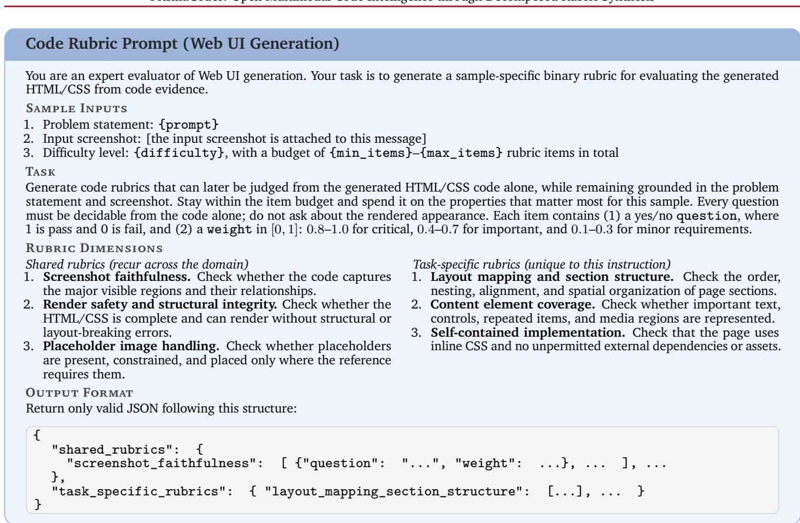  
Figure 8: Prompt template for synthesizing code rubrics in Web UI generation.

Rubric-level breakdown. Tab. 6 reports the individual checks behind these aggregate scores. The code evaluator passes all five checks because the source contains the expected colors, stacking mechanism, centering rule, footer styling, and copyright text. In contrast, the rendered output passes only the horizontal-centering check; the remaining vision rubrics expose the misplaced footer, clipped service button, and incorrect button corners.

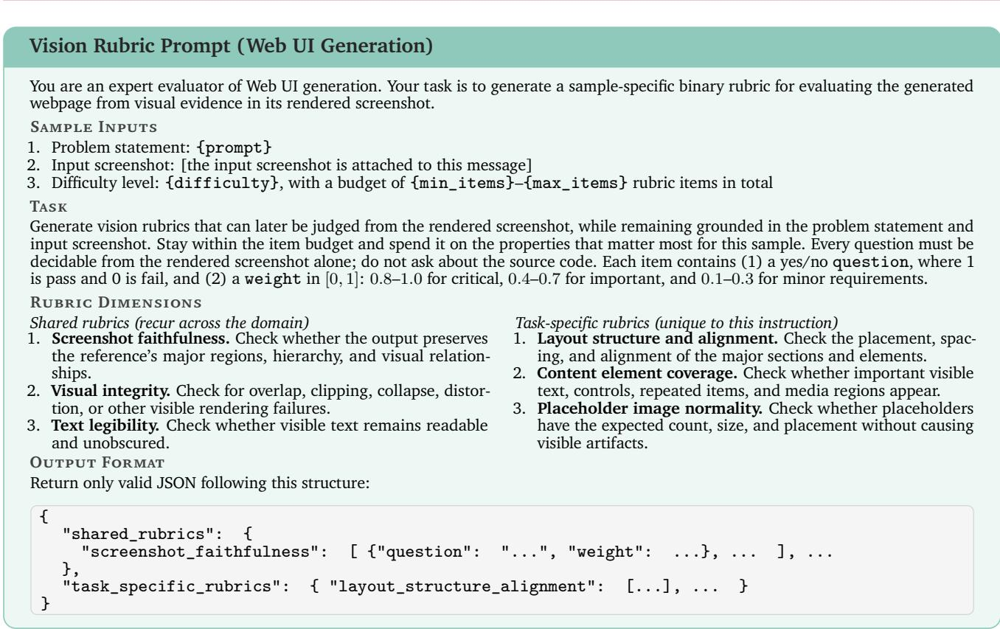

Figure 9: Prompt template for synthesizing vision rubrics in Web UI generation.
<table><tr><td>Rubric</td><td></td><td></td><td>Weight Pass Judgment evidence</td></tr><tr><td colspan="4">Code rubrics (all pass; weighted score 1.0) The three Product blocks use a teal-like 0.8</td></tr><tr><td>background.</td><td></td><td></td><td>The buttons explicitly use background-color: #008080.</td></tr><tr><td>The three Product items are stacked vertically.</td><td>0.8</td><td></td><td>The shared button class uses display: block.</td></tr><tr><td>The “Technology Company&quot; heading is horizontally centered.</td><td>0.8</td><td></td><td>The header uses text-align: center.</td></tr><tr><td>The footer containing the copyright text has a dark background.</td><td>0.7</td><td></td><td>The footer explicitly uses background-color: #333.</td></tr><tr><td>The footer contains the required copyright statement.</td><td>0.9</td><td></td><td>The exact statement is present, with &amp;copy; encoding the copyright symbol.</td></tr><tr><td colspan="4">Vision rubrics (one pass; weighted score 0.8/(1.0 + 0.8 + 0.9 + 0.9 + 0.8) = 0.182)</td></tr><tr><td>The page preserves the centered vertical hierarchy from the main heading through the</td><td>1.0</td><td></td><td>The footer overlaps the Services section instead of following it at the bottom.</td></tr><tr><td>footer.</td><td></td><td></td><td></td></tr><tr><td>All primary content is horizontally centered without unintended horizontal scrolling. The teal and purple buttons form vertically</td><td>0.8</td><td></td><td>The content is centered and no horizontal scrollbar is visible. The buttons are stacked, but their corners are sharp</td></tr><tr><td>stacked blocks with rounded corners. The footer is a dark, full-width bar at the</td><td>0.9 0.9</td><td>X X</td><td>rather than rounded. Although its color and width are correct, the footer is</td></tr><tr><td>bottom with centered white text.</td><td></td><td></td><td>placed over the last service item rather than at the bottom.</td></tr><tr><td>Exactly three teal Product buttons and three purple Service buttons are visible.</td><td>0.8</td><td>X</td><td>The misplaced footer obscures and clips the third Service button.</td></tr></table>

Table 6: Code and vision rubrics with their judgments for the example in Fig. 3.

## Holistic judgment. The holistic evaluator assigns a score of 78 with this rationale:

The rendered image matches the reference closely in fonts, colors, and general structure. However, there is a layout error where the footer is positioned too high, overlapping the “Service $3 ^ { \mathfrak { n } }$ button and leaving empty space at the bottom.

Thus, the holistic evaluator notices the dominant layout error but compresses it into a relatively high scalar score. The rubric-based evaluation both amplifies its impact according to sample-specific requirements and identifies the additional corner-shape and content-visibility failures. These localized but perceptually important errors are easily diluted in a single holistic similarity score, whereas our fine-grained rubrics explicitly expose and penalize each failure. The two rubric views thus provide more diagnostic and structurally sensitive feedback than code inspection or holistic visual judgment alone.

In our experiments, we use Gemini-3-Flash for rubrics. For common visualization tasks, such as Python plotting, the average cost of generating rubrics for a single sample is approximately \$0.006 based on the oficial API pricing, while evaluating the generated code and visual artifacts costs approximately \$0.01 per sample. For HTML-related tasks, the input cost is substantially higher because rich, complex websites typically involve much longer HTML code. In these cases, rubric generation costs approximately \$0.01 per sample, while evaluation costs approximately \$0.04.

## D. RL Reward Specification

This appendix specifies the reward computation procedure behind §3.2.

For each rollout response $c _ { i } ^ { ( k ) }$ , the procedure first extracts code from the response text. For Python, we extract the longest fenced code block. For HTML, we extract a single complete document spanning from the doctype declaration to the closing tag. For SVG, we extract either the code contained in a fenced block or the first complete <svg> span. A completion that does not contain valid code of the required type is assigned a reward of 0 without further evaluation.

A dispatcher then routes each rollout to exactly one task family, and the scorer registered for that family returns a reward in [0, 1], where 1 denotes a fully satisfactory solution. An unscoreable completion (due to a missing or malformed answer, unavailable rubric or reference material, execution or rendering failure, or a judge failure that persists after retries) receives a reward of 0.

The basic reward computation for each task largely follows Eq. 2 and Eq. 3. Specifically, the response code and the rendered visual artifact are scored separately and then aggregated using a weighted average. We use diferent combinations of code-score and visual-score weights across task families. This is because for tasks such as Python plotting, correct data representation and placement are as important as visual integrity and presentation quality. In contrast, for educational demonstration artifacts, visual readiness and interactivity are often more important than the particular implementation used to produce them.

We found, however, that predefined rubrics alone may fail to capture certain forms of misalignment in a few tasks such as interface reproduction. Instructions for these tasks inherently allow some flexibility in content generation, particularly with respect to styling and layout organization. As a result, some errors or mismatches can only be assessed reliably after the generated page is viewed alongside the reference page. To address this limitation, we introduce a complementary holistic score for task families of this type. This score is combined with the rubric-based scores using a weight denoted by $\lambda _ { h }$ . In this way, the evaluation retains the consistency and structure of rubric-based scoring while also capturing qualitative discrepancies that become apparent only when the generated artifact is evaluated as a whole.

The reward logic and the weight combinations used for each task domain are summarized in Tab. 7.

For each sample, the rubric-based method requires one API call to score each modality. Because code and visual artifacts are evaluated separately, its API cost is approximately 2× that of directly scoring the visual outputs alone. In our experiments, a full round of GRPO training involves approximately 808K judgment requests. Resource constraints prevented a full GRPO comparison between PrismaForge and direct scoring. In a focused Python plotting experiment, rubric-based scoring improved ChartMimic overall by 6.91 points over direct scoring.

Table 7: RL rewards by task family. Rewards lie in [0, 1]; unscoreable completions receive 0.
<table><tr><td>Task family</td><td>Spec. → output</td><td>Reward Type</td><td>Weights Assignment</td></tr><tr><td>Chart generation</td><td>text → Python</td><td>Rubrics</td><td> $\lambda _ { c } = \lambda _ { v } = 0 . 5$ </td></tr><tr><td>Chart reproduction</td><td>image → Python</td><td>Rubrics</td><td> $\lambda _ { c } = \lambda _ { v } = 0 . 5$ </td></tr><tr><td>Webpage generation</td><td>text → HTML</td><td>Rubrics</td><td>λc = 0.4, λv = 0.6</td></tr><tr><td>HTML demonstration</td><td>plan → HTML</td><td>Rubrics</td><td>λc = 0.4, λv = 0.6</td></tr><tr><td>+ reference snapshots</td><td>s plan + images → HTML</td><td>Rubrics</td><td>λc = 0.4, λv = 0.6</td></tr><tr><td>SVG generation</td><td>text → SVG</td><td>Rubrics</td><td>λc = 0.4, λv = 0.6</td></tr><tr><td>Interface reproduction</td><td>image → HTML</td><td></td><td>Rubrics +Holistic λc = 0.2, λv = 0.5, λh = 0.3</td></tr><tr><td>SVG reproduction</td><td>image → SVG</td><td></td><td>Rubrics +Holistic λc = 0.2, λv = 0.5, λh = 0.3</td></tr><tr><td>Interface editing</td><td>page + instr. → HTML</td><td>Rubrics+Holistic</td><td> $\lambda _ { c } = 0 . 2 , \lambda _ { v } = 0 . 4 , \lambda _ { h } = 0 . 4$ </td></tr></table>

## E. Benchmark Details and Evaluation Settings

Code-driven video and animation, and theorem and symbolic visualization, are released as training data only and are not part of the evaluation.

Vision-Centric Benchmarks. ChartMimic reproduces a chart from its image; its Direct split regenerates the chart and its Customized split edits an existing one, scored by low-level element extraction (text, layout, type, color) and a high-level judge score. WebCode2M, DesignBench, and Design2Code cover front-end generation from a screenshot: WebCode2M buckets pages by length and reports a judge score, visual similarity, CLIP, and TreeBLEU; DesignBench scores generation and editing with a judge score plus CLIP, MAE, SSIM, and CMS; Design2Code reports element-level block, text, position, and color matches, CLIP, and a judge score. InteractScience’s visual lens (VQT) is a visually grounded qualitative test judged by a vision–language model. UniSVG’s image-conditioned lens (ISVGen) reproduces an image as SVG. ChemDraw measures execution rate, molecule validity, exact match, and Tanimoto similarity.

Text-Centric Benchmarks. ArtifactsBench reports an overall score over ten artifact domains. Pandas-PlotBench reports the incorrect-code rate and mean and Good(≥75) scores under a visual and a task lens. InteractScience’s programmatic lens (PFT) is a functional test over the generated demonstration. UniSVG’s text-conditioned lens (TSVGen) generates SVG from text. VisPlotBench covers eight languages with the same metrics as PandasPlotBench, using its designated judge GPT-4.1 (OpenAI, 2025).

Evaluation Settings. Evaluation follows the benchmark’s oficial protocol, including its designated judge model where one is specified, so that our numbers stay comparable with published results. Due to the availability of legacy models, ChartMimic’s high-level score is judged by GPT-5.5 (OpenAI, 2026) instead of the original GPT-4o.

## F. Training Details

All experiments were conducted on four interconnected compute nodes, each equipped with 8 NVIDIA H200 GPUs, for a total of 32 GPUs. We used the Megatron backend in the ms-swift framework for distributed SFT and RL. Both stages performed full-parameter fine-tuning with FlashAttention and sequence parallelism enabled. Activation recomputation reduced memory use throughout training.

For SFT, we initialized from Qwen3.5-9B/Qwen3.5-35B-A3B and trained the language model for 5 epochs. We used a maximum sequence length of 32,768 tokens and enabled sequence packing for improved token utilization. The global batch size was set to be 128. The learning rate peaked at $1 \times 1 0 ^ { - 5 }$ , with a warm-up fraction of 5%, and decayed to a minimum learning rate of $5 \times 1 0 ^ { - 7 }$

For RL, we initialized from the SFT checkpoint and performed one epoch of GRPO/GSPO. We implemented a rubric-based reward plugin following the methodology described in Section 3.2 and Appendix D. For the judge model $L ^ { J }$ used to evaluate online rollouts, we selected Gemini-3-Flash to balance evaluation quality and cost. The global training batch size was 512 in terms of rollouts (equivalent to 64 samples per batch) and 8 candidate responses were generated per prompt at each rollout step. Rollout generation was performed with colocated vLLM inference using tensor parallelism of size 8 and a maximum model length of 36,000 tokens. Sampling used a temperature of 1.0 and top-� of 0.95.

The GRPO/GSPO learning rate was set to $3 \times 1 0 ^ { - 6 }$ . We used a KL regularization coeficient of $\beta = 0 . 0 4 { \mathrm { . } }$ and asymmetric clipping thresholds of $\epsilon = 0 . 2 0$ and $\epsilon _ { \mathrm { h i g h } } = 0 . 2 8$ . Dynamic sampling and overlongresponse filtering were enabled during rollout collection. Training was conducted in BF16 precision, with model and optimizer ofloading enabled to reduce GPU memory usage.

## G. Full Per-Benchmark Results

Each benchmark reports several metrics; the main text shows a compact headline set per benchmark, and the complete metric sets are here, one table per benchmark, mirroring our evaluation workbook.

## G.1. Visualization

ChartMimic. The complete results of the direct-1800 split of the ChartMimic benchmark is shown in Table 8. We can see that PrismaCoder shows strong performance against both open and proprietary models. PrismaCoder-9B achieves an overall score of 77.70, substantially outperforming other similarly sized open models (around 72–73) and even surpassing GPT-4o (74.20). Scaling to PrismaCoder-35B further improves the overall score to 82.05, with particularly strong execution rate (96.16), text fidelity (90.41), layout (94.00), and GPT-based similarity (80.69). Its overall performance is competitive with much larger proprietary models, exceeding Claude Sonnet 4.6 and Claude Opus 4.6 in this evaluation, while approaching Gemini 3 Flash. These results suggest that PrismaCoder is especially efective at faithfully reconstructing chart structure and visual details while maintaining reliable executable code.

PandasPlotBench. Table 9 illustrates a more detailed results of PandasPlotBench. On this benchmark, PrismaCoder demonstrates competitive visualization-code generation performance across both model scales. PrismaCoder-9B achieves a mean visual/task score of 60.54/77.94 with 14.29% incorrect code, comparing favorably with other models in a similar size range, while PrismaCoder-35B further reduces the incorrect-code rate to 9.29% and reaches 63.38/79.85, with 60.6% of examples attaining a visual score above 75. These gains are relatively modest compared with some strong baselines, which is unsurprising given the nature of the benchmark. Introduced in 2024, the benchmark contains 175 human-curated, largely Matplotlib-gallery-derived tasks and evaluates plotting from controlled naturallanguage descriptions, including synthetically shortened variants. In contrast, much of PrismaCoder’s training data is curated toward more realistic and diverse visualization workflows. We include this classic Python visualization benchmark to assess our models on established plotting tasks.

Table 8: ChartMimic, full metrics for the Direct-1800 splits.
<table><tr><td></td><td colspan="8">Direct</td></tr><tr><td>Model</td><td>Exec. Rate</td><td>Text</td><td>Layout</td><td>Type</td><td>Color</td><td>Avg. (L)</td><td>GPT (H)</td><td>Overall</td></tr><tr><td>Open models</td><td></td><td></td><td></td><td></td><td></td><td></td><td></td><td></td></tr><tr><td>JanusCoder-7B</td><td>89.16</td><td>77.61</td><td>85.49</td><td>70.06</td><td>67.34</td><td>75.12</td><td>68.97</td><td>72.05</td></tr><tr><td>JanusCoder-8B</td><td>80.91</td><td>73.10</td><td>81.19</td><td>65.00</td><td>69.03</td><td>76.54</td><td>69.23</td><td>72.89</td></tr><tr><td>VinciCoder-7B</td><td>90.88</td><td>79.91</td><td>87.99</td><td>73.72</td><td>71.59</td><td>78.30</td><td>66.09</td><td>72.20</td></tr><tr><td>VinciCoder-8B</td><td>90.72</td><td>79.78</td><td>86.62</td><td>73.03</td><td>70.95</td><td>77.59</td><td>66.44</td><td>72.01</td></tr><tr><td>PRISMACODER-9B</td><td>95.50</td><td>88.78</td><td>92.77</td><td>74.87</td><td>69.88</td><td>81.57</td><td>73.82</td><td>77.70</td></tr><tr><td>PRISMACODER-35B</td><td>96.16</td><td>90.41</td><td>94.00</td><td>76.28</td><td>73.01</td><td>83.42</td><td>80.69</td><td>82.05</td></tr><tr><td colspan="9">Proprietary</td></tr><tr><td>GPT-4o</td><td>92.38</td><td>81.13</td><td>86.71</td><td>72.83</td><td>64.87</td><td>76.38</td><td>72.02</td><td>74.20</td></tr><tr><td>Gemini 3 Flash</td><td>95.61</td><td>90.49</td><td>92.46</td><td>78.66</td><td>78.86</td><td>85.12</td><td>83.04</td><td>84.08</td></tr><tr><td>Gemini 3.1 Pro</td><td>95.77</td><td>81.68</td><td>82.84</td><td>73.33</td><td>73.98</td><td>77.96</td><td>81.73</td><td>79.85</td></tr><tr><td>Claude Sonnet 4.6</td><td>97.11</td><td>91.89</td><td>94.17</td><td>68.53</td><td>66.35</td><td>80.23</td><td>80.73</td><td>80.48</td></tr><tr><td>Claude Opus 4.6</td><td>95.05</td><td>90.20</td><td>92.01</td><td>73.10</td><td>69.13</td><td>81.11</td><td>79.68</td><td>80.40</td></tr></table>

Table 9: PandasPlotBench, full metrics under the Visual and Task lenses.
<table><tr><td rowspan="2">Model</td><td rowspan="2">Incorr. Code↓</td><td colspan="2">Mean</td><td colspan="2">Good ≥75</td></tr><tr><td>Vis.</td><td>Task</td><td>Vis.</td><td>Task</td></tr><tr><td>Qwen3-VL-8B-Instruct</td><td>16.00%</td><td>60.01</td><td>73.67</td><td>0.506</td><td>0.701</td></tr><tr><td>Qwen3-VL-30B-A3B-Instruct</td><td>11.43%</td><td>60.05</td><td>80.58</td><td>0.555</td><td>0.806</td></tr><tr><td>Qwen3.5-9B</td><td>24.57%</td><td>52.98</td><td>65.47</td><td>0.417</td><td>0.640</td></tr><tr><td>Qwen3.5-35B-A3B</td><td>15.43%</td><td>60.36</td><td>75.17</td><td>0.509</td><td>0.743</td></tr><tr><td>JanusCoderV-7B</td><td>23.43%</td><td>53.05</td><td>65.77</td><td>0.440</td><td>0.640</td></tr><tr><td>JanusCoderV-8B</td><td>26.30%</td><td>56.30</td><td>70.91</td><td>0.450</td><td>0.650</td></tr><tr><td>VinciCoder-7B</td><td>9.14%</td><td>25.37</td><td>51.57</td><td>0.137</td><td>0.314</td></tr><tr><td>VisCoder2-7B</td><td>20.00%</td><td>59.48</td><td>67.59</td><td>0.511</td><td>0.623</td></tr><tr><td>PrismaCoder-9B PrismaCoder-35B</td><td>10.29% 9.29%</td><td>60.54 62.38</td><td>77.94</td><td>0.497</td><td>0.766</td></tr><tr><td>GPT-40</td><td>8.00%</td><td></td><td>79.85</td><td>0.606</td><td>0.772</td></tr><tr><td></td><td></td><td>67.63</td><td>82.46</td><td>0.571</td><td>0.822</td></tr><tr><td>Gemini 3 Flash</td><td>3.43%</td><td>69.95</td><td>91.21</td><td>0.566</td><td>0.949</td></tr><tr><td>Gemini 3.1 Pro</td><td>1.71%</td><td>78.41</td><td>94.70</td><td>0.703</td><td>0.960</td></tr><tr><td>Claude Sonnet 4.6</td><td>3.43%</td><td>74.59</td><td>91.93</td><td>0.686</td><td>0.914</td></tr><tr><td>Claude Opus 4.6</td><td>1.71%</td><td>76.03</td><td>94.97</td><td>0.674</td><td>0.966</td></tr></table>

VisPlotBench. Table 10 averages the three metrics over the eight languages, and Table 12 lists the incorrect-code rate per language. PrismaCoder-35B has the lowest incorrect-code rate of every model in the table (28.86%) and the highest mean and good-plot scores under both lenses. The mean task score of PrismaCoder-35B is 62.47, against 23.95 for the best VinciCoder model, and PrismaCoder-9B leads both VinciCoder models on every column. Per language, the remaining failures concentrate on LilyPond, LAT X, and Asymptote, where both models still break more programs than the specialized open baselines. On the web and diagram formats the picture reverses: PrismaCoder-35B has the lowest incorrect-code rate of every model on Vega-Lite and HTML and produces no broken program on SVG, and PrismaCoder-9B is the strongest open model on HTML.

Table 10: VisPlotBench averaged metrics.
<table><tr><td rowspan="2"></td><td rowspan="2">Incorr. Code↓</td><td colspan="2">Mean</td><td colspan="2">Good ≥75</td></tr><tr><td>Vis.</td><td>Task</td><td>Vis.</td><td>Task</td></tr><tr><td>VinciCoder-7B</td><td>35.90%</td><td>15.93</td><td>23.95</td><td>4.16</td><td>10.11</td></tr><tr><td>VinciCoder-8B</td><td>36.08%</td><td>8.84</td><td>12.55</td><td>1.50</td><td>2.80</td></tr><tr><td>PRISMACODER-9B</td><td>34.70%</td><td>36.40</td><td>53.99</td><td>23.12</td><td>52.62</td></tr><tr><td>PRISMACODER-35B</td><td>28.86%</td><td>45.16</td><td>62.47</td><td>32.55</td><td>61.49</td></tr><tr><td>GPT-4o</td><td>32.01%</td><td>38.19</td><td>56.01</td><td>24.75</td><td>52.75</td></tr></table>

Table 11: Full UniSVG metrics (Li et al., 2025).
<table><tr><td>Model</td><td>ISVGen</td><td>TSVGen</td><td>Final</td></tr><tr><td>JanusCoderV-7B JanusCoderV-8B</td><td>61.60 62.47</td><td>66.43 67.28</td><td>61.23 63.47</td></tr><tr><td>VinciCoder-7B VinciCoder-8B</td><td>85.72 87.18</td><td>64.06 63.45</td><td>67.22 67.58</td></tr><tr><td>PRISMACODER-9B</td><td>69.64</td><td>68.49</td><td>65.31</td></tr><tr><td>PRISMACODER-35B</td><td>84.14</td><td>70.72</td><td>72.96</td></tr><tr><td>GPT-4o</td><td>70.98</td><td>72.80</td><td>69.60</td></tr></table>

Table 12: VisPlotBench, per-language incorrect-code rate.
<table><tr><td>Model</td><td>Avg. Incorr.↓</td><td>Python</td><td>Vega- Lite</td><td>LilyPond</td><td>Mermaid</td><td>SVG</td><td>LETEX</td><td>Asym- ptote</td><td>HTML</td></tr><tr><td>Open models</td><td></td><td></td><td></td><td></td><td></td><td></td><td></td><td></td><td></td></tr><tr><td>VinciCoder-7B</td><td>35.90%</td><td>10.20%</td><td>66.67%</td><td>100.00%</td><td>7.63%</td><td>1.54%</td><td>56.25%</td><td>21.74%</td><td>23.15%</td></tr><tr><td>VinciCoder-8B</td><td>36.08%</td><td>2.55%</td><td>57.36%</td><td>100.00%</td><td>4.58%</td><td>7.69%</td><td>58.93%</td><td>19.57%</td><td>37.96%</td></tr><tr><td>VisCoder2</td><td>33.26%</td><td>43.37%</td><td>16.28%</td><td>41.82%</td><td>25.95%</td><td>12.31%</td><td>61.61%</td><td>43.48%</td><td>21.30%</td></tr><tr><td>PRISMACODER-9B</td><td>34.70%</td><td>29.59%</td><td>13.18%</td><td>85.45%</td><td>12.21%</td><td>1.54%</td><td>66.96%</td><td>65.22%</td><td>19.44%</td></tr><tr><td>PRISMACODER-35B</td><td>28.86%</td><td>11.22%</td><td>3.88%</td><td>89.09%</td><td>9.92%</td><td>0.00%</td><td>70.54%</td><td>51.09%</td><td>11.11%</td></tr><tr><td>Proprietary</td><td></td><td></td><td></td><td></td><td></td><td></td><td></td><td></td><td></td></tr><tr><td>GPT-40</td><td>32.01%</td><td>22.45%</td><td>8.53%</td><td>40.00%</td><td>24.43%</td><td>0.00%</td><td>61.61%</td><td>75.00%</td><td>24.07%</td></tr></table>

UniSVG. Table 11 reports the image-conditioned lens (ISVGen), the text-conditioned lens (TSVGen), and the benchmark’s final score. PrismaCoder-35B has the highest final score in the table (72.96), and both of our models lead every open baseline on TSVGen. VinciCoder’s strength sits in ISVGen alone, the lens its training targets, and its text-conditioned scores are the lowest among the open models. PrismaCoder-35B comes within about three points of it on ISVGen and leads it by seven on TSVGen, so the final score favors the balanced profile.

ChemDraw. Table 13 adds exact match and two Tanimoto thresholds to the two columns of the main table. PrismaCoder-35B leads every column. All 128 of its outputs parse, 92.19% match the reference molecule exactly, and 95.31% reach a Tanimoto similarity of 1. PrismaCoder-9B is second on every column and above every proprietary model on exact match and Tanimoto similarity. Both are large gains over the Qwen3.5 bases, whose exact-match rates are 33.59% and 53.12%. The mean Tanimoto similarity is averaged over RDKit-valid outputs only, so the 81.39 of Gemini 3 Flash covers the 63% of its outputs that parse, whereas ours cover every sample.

Table 13: ChemDraw, full metrics on the 128-sample test set. Tani. (mean) averages over RDKit-valid outputs; the other columns count all samples.
<table><tr><td>Model</td><td>Valid.</td><td>Exact Match</td><td>Tani. (mean)</td><td>Tani. = 1</td><td>Tani. ≥.85</td></tr><tr><td>Open models</td><td></td><td></td><td></td><td></td><td></td></tr><tr><td>Qwen3-VL-8B-Instruct</td><td>78.91%</td><td>25.00%</td><td>54.79</td><td>25.00%</td><td>25.00%</td></tr><tr><td>Qwen3-VL-30B-A3B-Instruct</td><td>82.03%</td><td>26.56%</td><td>54.55</td><td>27.34%</td><td>28.12%</td></tr><tr><td>Qwen3.5-9B</td><td>88.28%</td><td>33.59%</td><td>66.79</td><td>37.50%</td><td>39.84%</td></tr><tr><td>Qwen3.5-35B-A3B</td><td>92.97%</td><td>53.12%</td><td>79.86</td><td>57.81%</td><td>60.16%</td></tr><tr><td>PRISMACODER-9B</td><td>96.88%</td><td>83.59%</td><td>95.94</td><td>87.50%</td><td>89.06%</td></tr><tr><td>PRISMACODER-35B</td><td>100.00%</td><td>92.19%</td><td>97.56</td><td>95.31%</td><td>95.31%</td></tr><tr><td>Proprietary</td><td></td><td></td><td></td><td></td><td></td></tr><tr><td>GPT-4o</td><td>92.19%</td><td>32.03%</td><td>57.80</td><td>33.59%</td><td>33.59%</td></tr><tr><td>Gemini 3 Flash</td><td>63.28%</td><td>52.34%</td><td>81.39</td><td>53.12%</td><td>53.91%</td></tr><tr><td>Claude Sonnet 4.6</td><td>88.28%</td><td>53.91%</td><td>85.43</td><td>61.72%</td><td>64.06%</td></tr><tr><td>Claude Opus 4.6</td><td>96.88%</td><td>52.34%</td><td>77.71</td><td>56.25%</td><td>57.81%</td></tr><tr><td>Kimi K2.5</td><td>91.41%</td><td>65.62%</td><td>91.20</td><td>75.00%</td><td>76.56%</td></tr></table>

## G.2. WebDev

WebCode2M. Table 14 shows that PrismaCoder’s advantage is consistent across webpages of diferent code lengths. PrismaCoder-9B obtains Visual scores of 90.06, 90.02, and 91.15 on the short, mid, and long subsets, respectively, while its LLM score remains similarly stable across the three groups. CLIP similarity decreases modestly with page length, from 90.29 to 87.32, but remains well above the prior open models throughout. The main exception is TreeBLEU: both PrismaCoder models score below JanusCoder and VinciCoder despite producing substantially more faithful renderings according to the visual metrics. This diference arises because TreeBLEU measures similarity to the reference HTML tree rather than the rendered webpage itself. JanusCoder and VinciCoder are trained on the original WebCode2M code, which naturally favors reproducing structures similar to the benchmark references. PrismaCoder instead uses regenerated code paired with webpages rendered from that code, rather than directly using the original WebCode2M source code. This regeneration is intentional. The original WebCode2M code comes from diverse real-world webpages and can difer substantially from the code distribution naturally produced by LLMs. Using regenerated code therefore better aligns the training targets with inference-time generations, while re-rendering the regenerated programs ensures exact consistency between the code and its visual target. Its generated webpages can consequently closely match the target appearance without following the particular HTML or DOM structure of the reference implementation. The similarly low TreeBLEU scores of the proprietary models further illustrate that reference-code similarity does not necessarily track rendering fidelity.

DesignBench. The detailed results in Table 15 show that the generation gains are consistent across multiple visual metrics. PrismaCoder-9B reaches a Judge score of 69.95 and a CLIP score of 84.77, while reducing MAE to 42.07 and increasing SSIM to 0.6956. PrismaCoder-35B exhibits a nearly identical profile and achieves the lowest MAE and highest SSIM among the evaluated models. The agreement across Judge, CLIP, MAE, and SSIM indicates that the improvement is not tied to a particular evaluator, but is consistently reflected across multiple complementary measures of visual similarity. Editing shows a more nuanced pattern: both PrismaCoder models achieve an Editing-Judge score of about 8.9, substantially exceeding the prior open baselines and matching GPT-4o, while remaining slightly behind Gemini 3.1 Pro. In contrast, their CMS and image-based similarity metrics are less competitive with the strongest proprietary models. This diference can be partly attributed to the reference-dependent nature of these metrics. CMS measures the overlap between the code lines modified by the model and those modified in the reference implementation, so a correct edit may still receive a lower score when it is realized through diferent code locations. Similarly, MAE and SSIM compare the resulting rendering against a specific reference output and can penalize visually diferent but still valid implementations. The strong Editing-Judge scores therefore suggest that PrismaCoder reliably completes the requested modifications, even when its implementation and rendering difer from the reference.

Table 14: WebCode2M, full metrics by code length.
<table><tr><td></td><td colspan="4">Short</td><td colspan="4">Mid</td><td colspan="4">Long</td><td colspan="4">Average</td></tr><tr><td>Model</td><td>LLM</td><td>Visual</td><td>CLIP</td><td>Tree- BLEU</td><td>LLM</td><td>Visual</td><td>CLIP</td><td>Tree- BLEU</td><td>LLM</td><td>Visual</td><td>CLIP</td><td>Tree- BLEU</td><td>LLM</td><td>Visual</td><td>CLIP</td><td>Tree- BLEU</td></tr><tr><td>Open models</td><td></td><td></td><td></td><td></td><td></td><td></td><td></td><td></td><td></td><td></td><td></td><td></td><td></td><td></td><td></td><td></td></tr><tr><td>JanusCoderV-7B</td><td>40.10</td><td>72.39</td><td>76.11</td><td>29.64</td><td>43.06</td><td>74.08</td><td>76.77</td><td>37.43</td><td>39.61</td><td>72.24</td><td>75.11</td><td>39.37</td><td>40.92</td><td>72.90</td><td>76.00</td><td>35.48</td></tr><tr><td>JanusCoderV-8B</td><td>34.60</td><td>65.74</td><td>73.14</td><td>30.37</td><td>36.17</td><td>65.41</td><td>73.46</td><td>29.88</td><td>34.74</td><td>66.71</td><td>72.53</td><td>27.66</td><td>35.17</td><td>65.95</td><td>73.04</td><td>29.30</td></tr><tr><td>VinciCoder-7B</td><td>46.01</td><td>76.76</td><td>80.43</td><td>30.00</td><td>44.34</td><td>73.57</td><td>79.38</td><td>38.11</td><td>38.99</td><td>66.92</td><td>75.97</td><td>29.74</td><td>43.11</td><td>72.42</td><td>78.59</td><td>32.62</td></tr><tr><td>VinciCoder-8B</td><td>48.35</td><td>80.43</td><td>82.03</td><td>31.39</td><td>48.08</td><td>79.53</td><td>81.70</td><td>39.48</td><td>42.05</td><td>74.83</td><td>78.63</td><td>32.57</td><td>46.16</td><td>78.26</td><td>80.79</td><td>34.48</td></tr><tr><td>PRISMACODER-9B</td><td>70.65</td><td>90.06</td><td>90.29</td><td>17.23</td><td>69.08</td><td>90.02</td><td>87.76</td><td>18.65</td><td>69.42</td><td>91.15</td><td>87.32</td><td>17.23</td><td>69.72</td><td>90.41</td><td>88.46</td><td>17.70</td></tr><tr><td>PRISMACODER-35B</td><td>68.52</td><td>89.58</td><td>89.93</td><td>15.78</td><td>68.12</td><td>89.54</td><td>87.21</td><td>17.77</td><td>66.69</td><td>89.87</td><td>86.19</td><td>17.18</td><td>67.78</td><td>89.66</td><td>87.78</td><td>16.91</td></tr><tr><td>Proprietary</td><td></td><td></td><td></td><td></td><td></td><td></td><td></td><td></td><td></td><td></td><td></td><td></td><td></td><td></td><td></td><td></td></tr><tr><td>GPT-4o</td><td>57.62</td><td>83.96</td><td>82.10</td><td>11.73</td><td>53.27</td><td>83.35</td><td>79.62</td><td>10.00</td><td>53.93</td><td>83.03</td><td>78.94</td><td>8.13</td><td>54.94</td><td>83.45</td><td>80.22</td><td>9.95</td></tr><tr><td>Gemini 3.1 Pro</td><td>71.67</td><td>89.23</td><td>88.52</td><td>16.77</td><td>70.83</td><td>89.78</td><td>87.58</td><td>16.56</td><td>70.40</td><td>90.87</td><td>86.82</td><td>14.44</td><td>70.97</td><td>89.96</td><td>87.64</td><td>15.92</td></tr></table>

Table 15: DesignBench, full metrics for generation and editing.
<table><tr><td></td><td colspan="4">Generation</td><td colspan="4">Editing</td></tr><tr><td>Model</td><td>Judge</td><td>CLIP</td><td>MAE↓</td><td>SSIM</td><td>Judge</td><td>CMS</td><td>MAE↓</td><td>SSIM</td></tr><tr><td>Open models</td><td></td><td></td><td></td><td></td><td></td><td></td><td></td><td></td></tr><tr><td>JanusCoderV-7B</td><td>40.37</td><td>71.34</td><td>77.05</td><td>0.5910</td><td>7.44</td><td>0.2234</td><td>30.11</td><td>0.8399</td></tr><tr><td>JanusCoderV-8B</td><td>34.30</td><td>68.38</td><td>83.64</td><td>0.5822</td><td>7.26</td><td>0.2346</td><td>28.57</td><td>0.8446</td></tr><tr><td>VinciCoder-7B</td><td>43.24</td><td>72.81</td><td>68.05</td><td>0.6137</td><td>1.40</td><td>0.1686</td><td>45.33</td><td>0.8119</td></tr><tr><td>VinciCoder-8B</td><td>48.09</td><td>76.79</td><td>61.86</td><td>0.6330</td><td>1.71</td><td>0.1514</td><td>41.83</td><td>0.8199</td></tr><tr><td>PRISMACODER-9B</td><td>69.95</td><td>84.77</td><td>42.07</td><td>0.6956</td><td>8.93</td><td>0.2791</td><td>30.56</td><td>0.8373</td></tr><tr><td>PRISMACODER-35B</td><td>68.98</td><td>84.56</td><td>41.97</td><td>0.6972</td><td>8.89</td><td>0.2601</td><td>30.67</td><td>0.8398</td></tr><tr><td>Proprietary</td><td></td><td></td><td></td><td></td><td></td><td></td><td></td><td></td></tr><tr><td>GPT-4o</td><td>52.64</td><td>76.45</td><td>64.11</td><td>0.6259</td><td>8.89</td><td>0.3567</td><td>27.97</td><td>0.8439</td></tr><tr><td>Gemini 3.1 Pro</td><td>69.47</td><td>85.23</td><td>44.11</td><td>0.6914</td><td>9.57</td><td>0.3751</td><td>26.13</td><td>0.8548</td></tr></table>

Desi n2Code. Table 16 provides a finer-grained view ofthe visual gains on Design2Code. PrismaCoder-9B reaches 90.09 in Block, 95.95 in Text, 89.30 in Position, 90.00 in Color, and 92.37 in CLIP, yielding an average Visual score of 91.54. Relative to VinciCoder-8B, the largest gains appear in Position, Color, and Block, which improve by 15.40, 13.00, and 10.68 points, respectively, whereas the improvements in Text and CLIP are smaller. Under the Design2Code evaluation, these dimensions respectively capture spatial alignment of matched elements, perceptual color fidelity, and the coverage of visual blocks while penalizing missing or hallucinated elements. The results therefore indicate that PrismaCoder’s advantage comes primarily from recovering a more complete set of webpage elements and placing them more accurately, together with improved color matching, rather than simply reproducing the visible text. PrismaCoder-35B exhibits a very similar metric profile, with only minor diferences between the two model sizes across the evaluated dimensions.

Table 16: Design2Code, full metrics.
<table><tr><td>Model</td><td>Block</td><td>Text</td><td>Pos.</td><td>Color</td><td>CLIP</td><td>Avg</td><td>LLM Score</td></tr><tr><td>Open models</td><td></td><td></td><td></td><td></td><td></td><td></td><td></td></tr><tr><td>JanusCoderV-7B</td><td>63.88</td><td>85.40</td><td>62.74</td><td>59.11</td><td>82.94</td><td>70.81</td><td>36.49</td></tr><tr><td>JanusCoderV-8B</td><td>59.11</td><td>81.72</td><td>61.45</td><td>57.63</td><td>83.13</td><td>68.61</td><td>34.53</td></tr><tr><td>VinciCoder-7B</td><td>71.01</td><td>87.30</td><td>68.04</td><td>71.28</td><td>85.58</td><td>76.64</td><td>42.30</td></tr><tr><td>VinciCoder-8B</td><td>79.41</td><td>91.79</td><td>73.90</td><td>77.00</td><td>87.37</td><td>81.89</td><td>45.72</td></tr><tr><td>PRISMACODER-9B</td><td>90.09</td><td>95.95</td><td>89.30</td><td>90.00</td><td>92.37</td><td>91.54</td><td>70.51</td></tr><tr><td>PRISMACODER-35B</td><td>89.45</td><td>95.47</td><td>89.14</td><td>90.05</td><td>91.98</td><td>91.22</td><td>67.55</td></tr><tr><td>Proprietary</td><td></td><td></td><td></td><td></td><td></td><td></td><td></td></tr><tr><td>GPT-4o</td><td>89.50</td><td>96.91</td><td>83.67</td><td>82.27</td><td>88.80</td><td>88.23</td><td>58.48</td></tr><tr><td>Gemini 3.1 Pro</td><td>90.55</td><td>95.21</td><td>88.58</td><td>87.69</td><td>91.46</td><td>90.70</td><td>70.90</td></tr></table>

## G.3. Artifacts and Demos

ArtifactsBench. Table 17 presents the overall and domain-level performance on ArtifactsBench. The results show that our models generalize well across the heterogeneous artifact types in ArtifactsBench. Rather than being concentrated in a single domain, PrismaCoder-9B maintains strong performance across all five categories and achieves the highest overall score among the open models, with particularly strong results on SVG generation and web applications. PrismaCoder-35B reaches a similar overall level but shows a diferent strength profile, with especially strong performance on game development and simulation. This contrast suggests that the two models are capable of handling diferent forms of front-end complexity, from visual and interface construction to artifacts that require richer interaction and application logic. More importantly, both models consistently outperform the other open baselines and the proprietary baseline at the overall level, despite ArtifactsBench spanning substantially diferent artifact structures. This cross-domain consistency indicates that their advantage is not tied to a specific artifact format, but reflects stronger general front-end code generation and the ability to turn complex specifications into executable artifacts.

Table 17: ArtifactsBench, overall and per-domain scores.
<table><tr><td>Model</td><td>Overall</td><td>Game Dev.</td><td>SVG Gen.</td><td>Web Apps</td><td>lation</td><td>Simu- Mgmt. Sys.</td></tr><tr><td>Open models</td><td></td><td></td><td></td><td></td><td></td><td></td></tr><tr><td>JanusCoderV-7B</td><td>31.16</td><td>27.95</td><td>28.97</td><td>33.32</td><td>34.04</td><td>33.64</td></tr><tr><td>VinciCoder-7B</td><td>11.35</td><td>10.51</td><td>12.04</td><td>12.48</td><td>11.48</td><td>11.29</td></tr><tr><td>VinciCoder-8B</td><td>11.97</td><td>11.06</td><td>14.94</td><td>12.34</td><td>11.27</td><td>12.10</td></tr><tr><td>VisCoder2</td><td>17.51</td><td>16.49</td><td>20.43</td><td>18.46</td><td>18.13</td><td>15.98</td></tr><tr><td>PRISMACODER-9B</td><td>45.28</td><td>44.49</td><td>50.95</td><td>46.22</td><td>48.23</td><td>42.27</td></tr><tr><td>PRISMACODER-35B</td><td>46.01</td><td>54.33</td><td>45.00</td><td>44.51</td><td>58.53</td><td>37.09</td></tr><tr><td>Proprietary</td><td></td><td></td><td></td><td></td><td></td><td></td></tr><tr><td>GPT-4o</td><td>33.54</td><td></td><td>36.96 39.54 39.27 35.73</td><td></td><td></td><td>35.83</td></tr></table>

InteractScience. Table 18 shows full metrics on InteractScience for both PFT and VQT lenses. The results highlight the complementary strengths of our models captured by the two lenses of InteractScience. PFT measures whether a model can correctly implement the interactive components specified in a long implementation plan, while VQT places greater emphasis on integrating visual understanding, executable code, and scientific reasoning. Our models perform particularly strongly under this setting.

PrismaCoder-9B and PrismaCoder-35B both achieve substantially higher VQT scores than the other open models, while also maintaining competitive PFT performance. This gap is important because success on VQT cannot be obtained simply by producing syntactically valid front-end code. The generated science demos must also reflect the intended visual state and the scientific relationships encoded in the task. The results therefore point to a useful property of our models whose capability is not limited to implementing isolated UI interactions, but extends to coordinating code, visual requirements, and scientific content when following a detailed implementation plan.

Table 18: InteractScience, full metrics for both lenses.
<table><tr><td rowspan="2">Model</td><td colspan="3">PFT</td><td rowspan="2">VQT VLM</td></tr><tr><td>Overall</td><td>Avg.</td><td>Perfect</td></tr><tr><td>JanusCoderV-7B JanusCoderV-8B VinciCoder-7B</td><td>17.73% 17.60%</td><td>16.91% 17.30%</td><td>4.20% 4.20%</td><td>27.67 33.32</td></tr><tr><td>VinciCoder-8B</td><td>0.40% 0.40%</td><td>0.00% 0.42%</td><td>0.00% 0.00%</td><td>0.00 2.33</td></tr><tr><td>PRISMACODER-9B</td><td>24.80%</td><td>22.47%</td><td>7.69%</td><td>51.87</td></tr><tr><td>PRISMACODER-35B GPT-4o</td><td>28.00% 31.07%</td><td>25.94% 28.59%</td><td>6.99% 10.49% 646.01</td><td>53.54</td></tr></table>

## H. Extended Analysis

## H.1. Backbone Generalization

Fig. 10 restates the Gemma arm of Fig. 6 as dumbbells, with the base and final score of every metric. The dumbbells express every metric on a percentage scale, so the change in the 0–10 DesignBench Edit score is plotted ×10 while its score columns keep the native scale. Tab. 19 scores the VisPlotBench splits under two judges, the benchmark’s designated GPT-4.1 (OpenAI, 2025) and the newer GPT-5.5 (OpenAI, 2026). The two agree on the direction of every training efect. The one disagreement is the HTML task score, where GPT-4.1 ranks the RL checkpoint first and GPT-5.5 the SFT one.

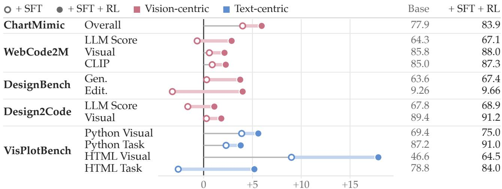  
Figure 10: SFT and RL gains on Gemma-4-31B-it, with base and final scores.

Table 19: VisPlotBench scores of the Gemma arm under the designated judge and a newer judge of the same family. Best per column within a split.
<table><tr><td></td><td></td><td colspan="3">Judge: GPT-4.1</td><td colspan="3">Judge: GPT-5.5</td></tr><tr><td>Split</td><td>Model</td><td>Err%↓</td><td>Vis↑</td><td>Task↑</td><td>Err%↓</td><td>Vis↑</td><td>Task↑</td></tr><tr><td rowspan="3">HTML</td><td>Gemma-4 (base)</td><td>5.6</td><td>46.6</td><td>78.8</td><td>5.6</td><td>45.4</td><td>64.2</td></tr><tr><td>+ SFT</td><td>4.6</td><td>55.6</td><td>76.2</td><td>4.6</td><td>53.0</td><td>77.8</td></tr><tr><td> $+ \ S \mathrm { F T } + \mathrm { R L }$ </td><td>4.6</td><td>64.5</td><td>84.0</td><td>4.6</td><td>64.6</td><td>75.4</td></tr><tr><td rowspan="3">Python</td><td>Gemma-4 (base)</td><td>6.1</td><td>69.4</td><td>87.2</td><td>6.1</td><td>66.8</td><td>85.0</td></tr><tr><td>+ SFT</td><td>7.1</td><td>73.3</td><td>89.5</td><td>7.1</td><td>71.0</td><td>87.2</td></tr><tr><td>+ SFT + RL</td><td>6.1</td><td>75.0</td><td>91.0</td><td>6.1</td><td>72.9</td><td>87.6</td></tr></table>

## H.2. Cross-Family Adjudication and Human Evaluation

Tab. 20 lists the agreement statistics of the human study of §6.3. The 100 samples come from the SFT split of PrismaCoder-2M, sampled by dificulty level with Python and HTML artifacts in equal numbers across tasks. Twenty annotators each rated ten samples directly and ten others through the rubric, with disjoint sample sets per annotator, so each sample carries two human ratings under each mode. Each of the three judges, Claude Sonnet 5 (Anthropic, 2026b), Gemini 3.5 Flash (Gemini Team, 2026), and GPT-5.5 (OpenAI, 2026), scored every sample twice under each mode. The direct mode asks for a single holistic score, as in a typical pipeline (Sun et al., 2026b); the rubric mode scores through the PrismaForge rubric of §3.1. Krippendorf’s � and Kendall’s $\tau _ { b }$ are computed between each judge’s scores and the human ratings under the same mode. Across the three judges, � rises from 0.30–0.51 under direct scoring to 0.86–0.92 under the rubric, and $\tau _ { b }$ from 0.28–0.44 to 0.64–0.67.

Gold  
Table 20: Agreement of judge scores with human ratings on 100 samples. Best per judge.
<table><tr><td>Judge</td><td>Scoring</td><td>Krippendorff&#x27;s α</td><td>Kendall&#x27;s  $\tau _ { b }$ </td></tr><tr><td rowspan="2">Claude Sonnet 5</td><td>Direct</td><td>0.386</td><td>0.292</td></tr><tr><td>Rubric-based</td><td>0.889</td><td>0.670</td></tr><tr><td rowspan="2">Gemini 3.5 Flash</td><td>Direct</td><td>0.303</td><td>0.282</td></tr><tr><td>Rubric-based</td><td>0.861</td><td>0.643</td></tr><tr><td rowspan="2">GPT-5.5</td><td>Direct</td><td>0.514</td><td>0.442</td></tr><tr><td>Rubric-based</td><td>0.918</td><td>0.657</td></tr></table>

## I. Case Studies

Six qualitative cases drawn from VisPlotBench, one per format family. Three compare PrismaCoder-9B against its Qwen3.5-9B base (LAT X, SVG, Mermaid); three compare PrismaCoder-35B against its SFTonly variant (Vega-Lite, HTML, Python), isolating what the rubric-based RL stage adds. In every case the middle panel executes and renders, and the failure is visual. A seventh case, chart-to-code on ChartMimic, follows PrismaCoder-9B across its training stages (Fig. 16) and sets the result beside an open and two proprietary references (Fig. 17). Four front-end cases close the appendix, two screenshot-to-page generations from Design2Code and two instruction-driven edits from DesignBench, each across the same training stages (Figs. 18 to 21).

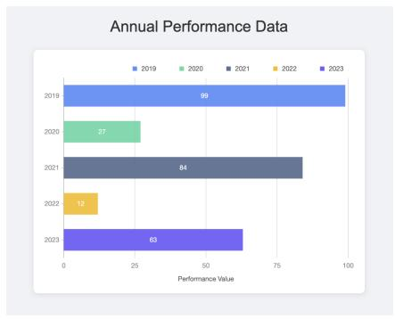

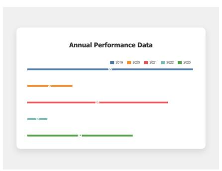  
PrismaCoder-35B w/o RL

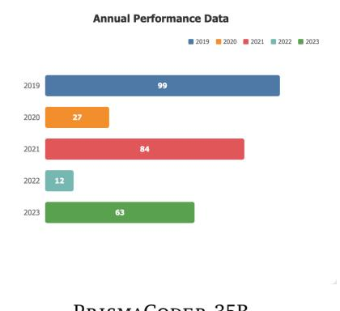  
PrismaCoder-35B  
Figure 11: HTML bar chart. The SFT-only model renders the bars as hairlines; the RL model recovers bar geometry and value labels.

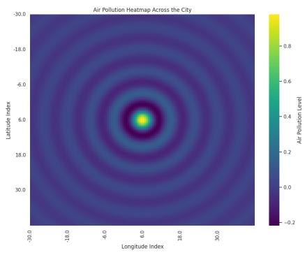  
Gold

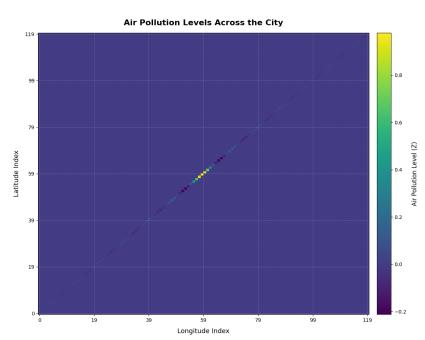  
PrismaCoder-35B w/o RL

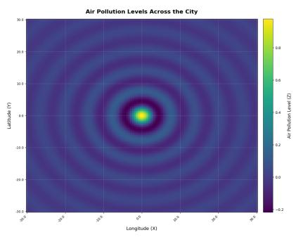  
PrismaCoder-35B

Figure 12: Python heatmap. The SFT-only output runs and passes as code yet renders the radial field onto a diagonal; the RL model restores it.  
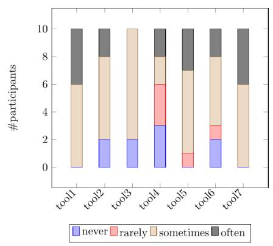  
Gold

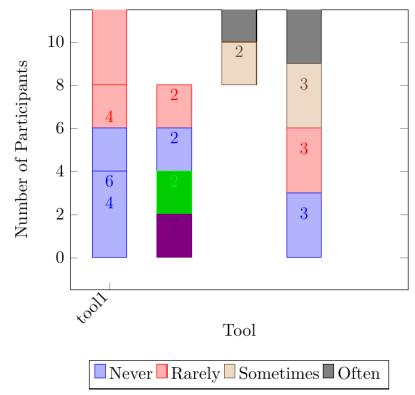  
Qwen3.5-9B

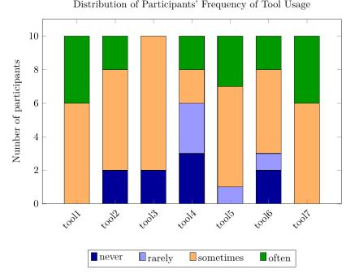  
PrismaCoder-9B

Figure 13: LAT X stacked bars. The base model mis-stacks the categories and drops bars; PrismaCoder-9B reproduces the per-tool composition.  
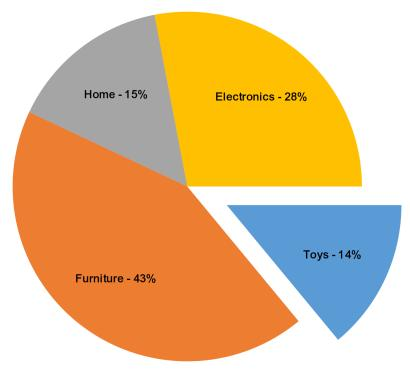  
Gold

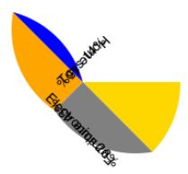  
Qwen3.5-9B

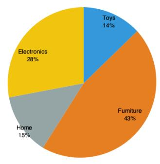  
PrismaCoder-9B  
Figure 14: SVG pie chart. The base model’s sectors collapse into overlapping wedges; PrismaCoder-9B closes the pie with correct shares and labels.

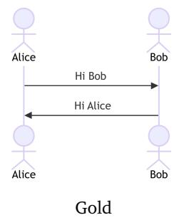

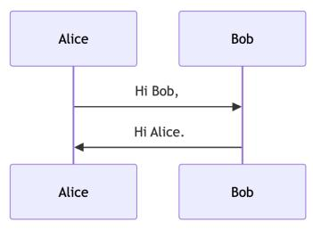  
Qwen3.5-9B

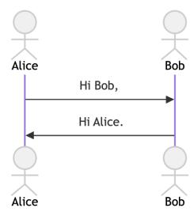  
PrismaCoder-9B

Figure 15: Mermaid sequence diagram. The base model draws participants as plain boxes; PrismaCoder-9B reproduces the actor figures and the message order.  
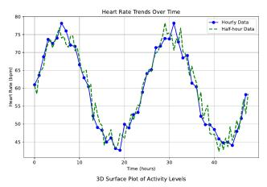

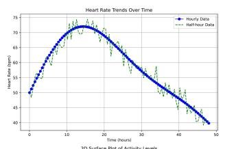  
Gold

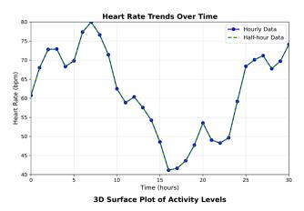

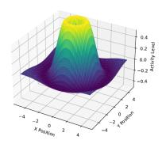

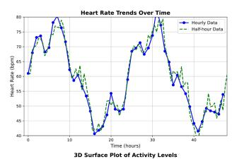

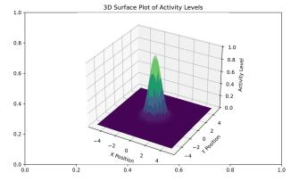  
Qwen3.5-9B

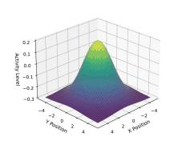  
PrismaCoder-9B w/o RL

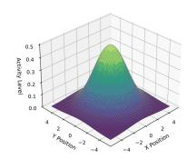  
PrismaCoder-9B

Figure 16: Chart-to-code on ChartMimic across training stages, where SFT recovers one of the line chart’s two cycles and RL restores both.  
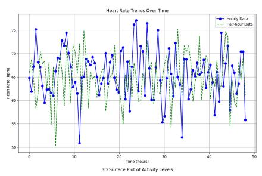

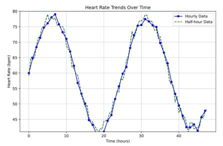

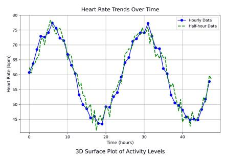

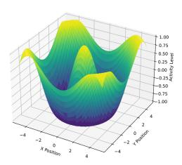  
VinciCoder-7B

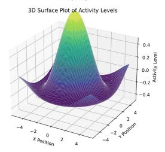  
Claude Opus 5

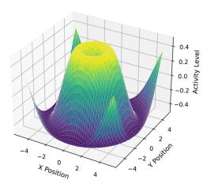  
Gemini 3.5 Flash  
Figure 17: The same case for an open and two proprietary references, of which only the proprietary models reproduce the line chart.

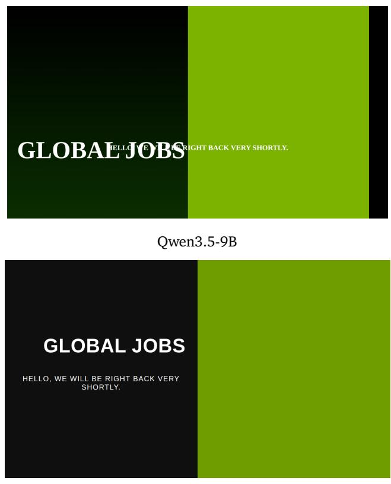  
PrismaCoder-9B

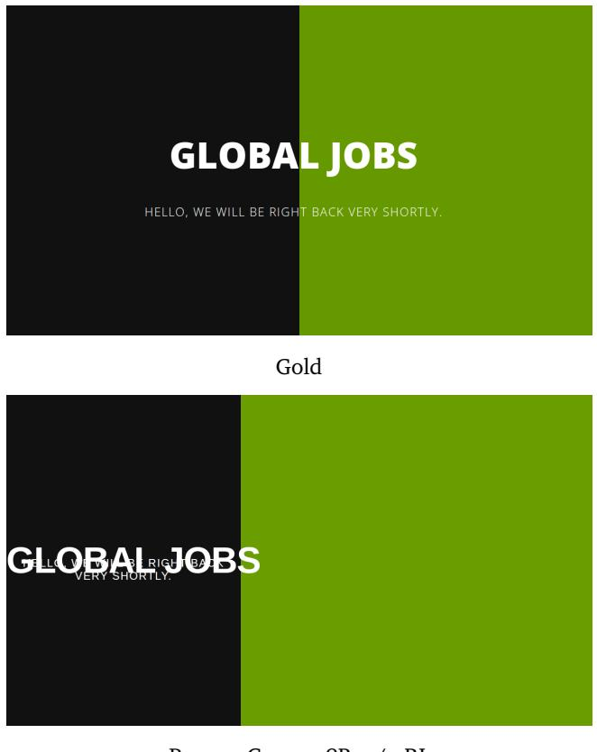  
PrismaCoder-9B w/o RL  
Figure 18: Front-end generation on Design2Code, where the base and SFT-only models break the title layout and PrismaCoder-9B reproduces the page.

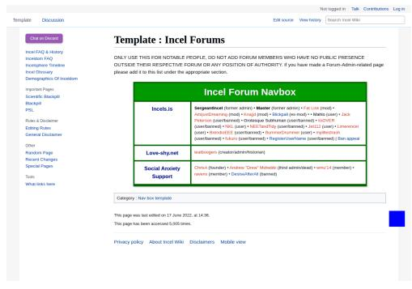

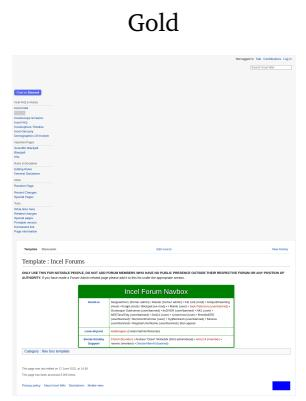  
PrismaCoder-35B w/o RL

Qwen3.5-35B-A3B  
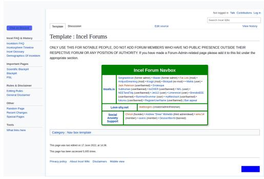  
PrismaCoder-35B

Figure 19: Front-end generation on Design2Code, where only PrismaCoder-35B reproduces the layout.  

Source  
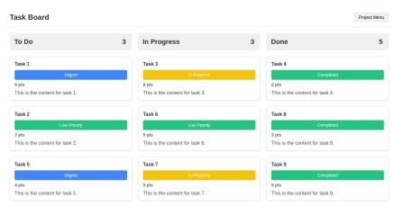  
Qwen3.5-9B

Target  
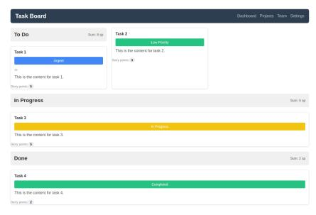  
PrismaCoder-9B w/o RL

  
PrismaCoder-9B  
Figure 20: Front-end editing on DesignBench, where only PrismaCoder-9B adds the requested story points, per-column sums, and header menu while keeping the board.

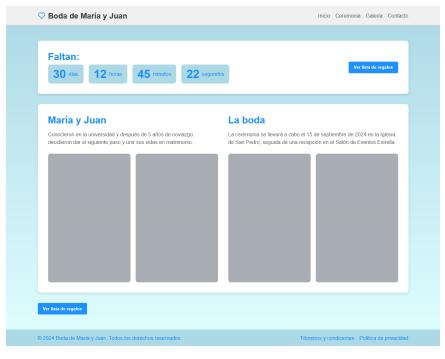  
Source

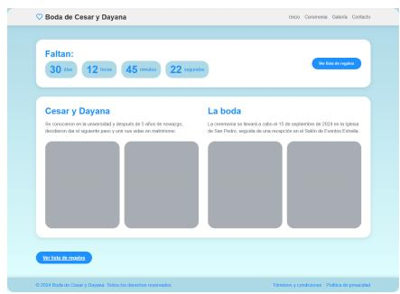  
Target

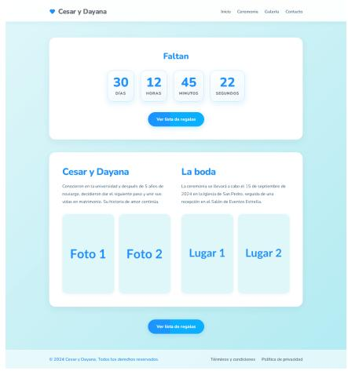  
Qwen3.5-35B-A3B

  
PrismaCoder-35B w/o RL

  
PrismaCoder-35B  
Figure 21: Front-end editing on DesignBench, where only PrismaCoder-35B applies the requested renaming, rounded corners, and countdown restyling.