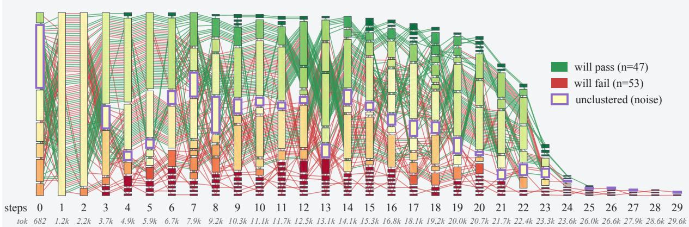
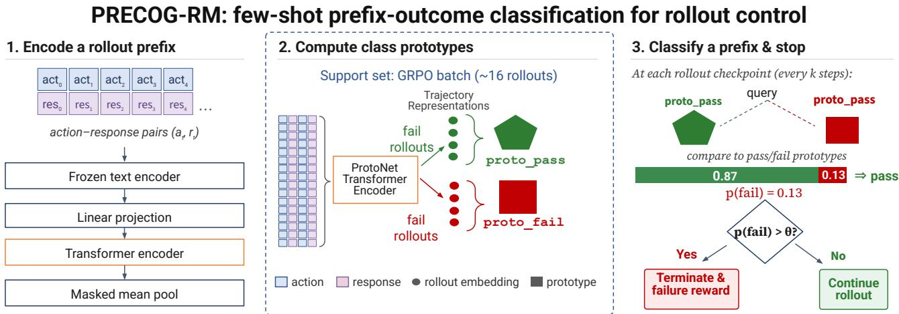
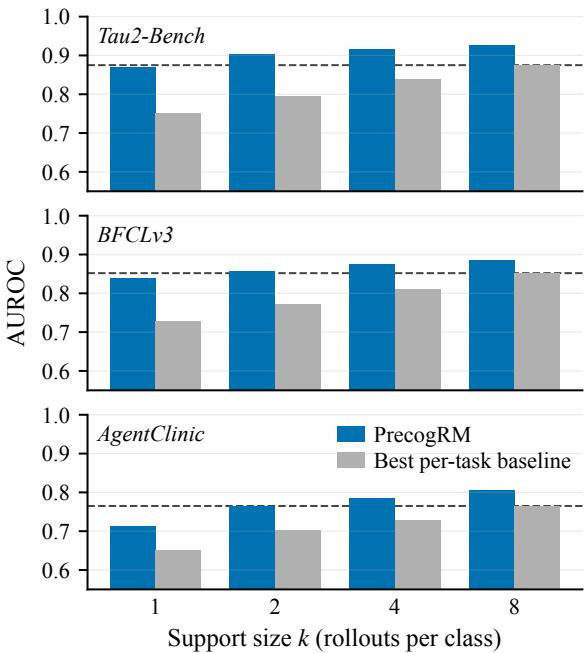
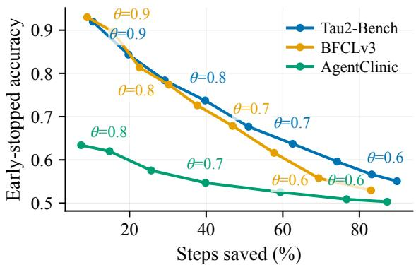
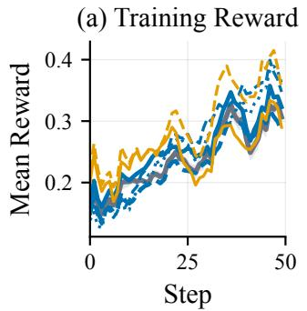
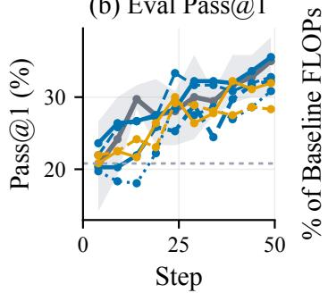
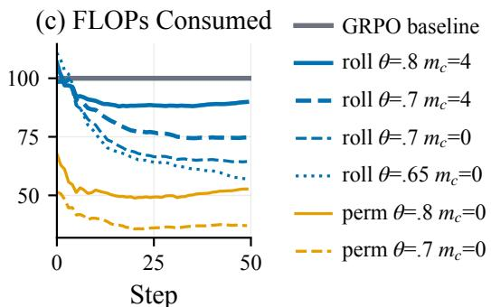
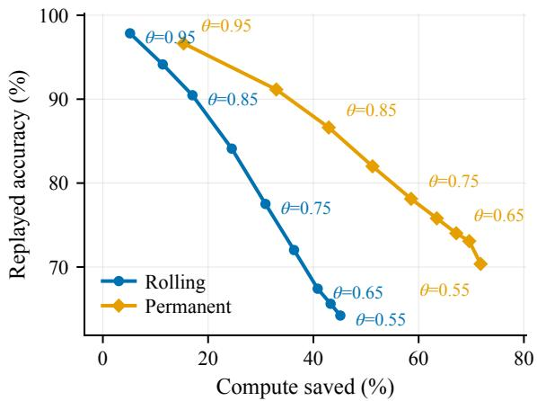

# Divergent Paths: Learning an Outcome-Predictive Representation of LLM Agent Trajectories

Alexander Gill1,2, Guram Gogia1, Francisco Guzmán1

1Handshake AI, 2University of Utah alex.gill@utah.edu

## Abstract

In this work, we reframe agentic trajectories as paths through a shared embedding space of actions and environmental observa- tions. We show that successful and failed rollouts of the same task separate in this space, with simple per-task discriminators predicting held-out rollout outcomes at up to 0.95 AUROC across three agent benchmarks and three policy models. To exploit this signal across tasks, we introduce Precog-RM, a transformer-based model that meta-learns a representation in which outcome prediction can be performed in a few-shot setting. We show that Precog-RM generalizes to unseen tasks and models, and gives confident predictions of trajectory suc-cess long before termination. Deployed as an early stopping controller for Group Relative Policy Optimization (GRPO) on Tau2-Bench, Precog-RM cuts training FLOPs by up to 47.3% while maintaining performance comparable to baseline GRPO.

Code — https://github.com/alexgill321/precog-rm

## 1 Introduction

The shift from language modeling to tool-using agentic sys- tems has expanded the medium LLMs must operate over. An agentic trajectory is made up of a sequence of interactions, each pairing an action taken by the agent with an observation returned by the environment (Yao et al. 2022), often spanning 10–100+ turns and 100K–500K+ tokens (Merrill et al. 2026; Luo et al. 2025; Vidgen et al. 2026).

This structure has made agentic trajectories the central object of a growing set of problems such as credit assignment (Feng et al. 2026; He et al. 2026; Zhang 2026), failure diagnosis (Barke et al. 2026; Tayebati et al. 2026; Ou et al. 2025), and data filtering (Yang et al. 2026; Lin et al. 2026). Most methods read the raw token sequence, where the tokens that determine an outcome are a small fraction of the surface form that carries them. Workarounds either prompt an LLM to analyze the trajectory (Zhuge et al. 2024; Ou et al. 2025), inheriting the cost and failure modes of the system under study, or compress trajectories into hand-crafted features (Tayebati et al. 2026), deciding in advance which properties matter. Neither transfers beyond the problem and domain it was built for.

Recent works instead treat actions (Feng et al. 2026; He et al. 2026) or action–observation pairs (Yang et al. 2026) as states recurring across multi-trial rollouts, so that a rollout becomes a trajectory through a space of action-observation states. Collapsing the many token realizations of an action or observation into shared states strips away the surface variation that obscures analysis signals. Unlike a fixed feature set or a prompted judge, the representation itself can be learned, allowing a single model to serve these problems across tasks and domains. A representation only matters, however, if it retains the signal these problems depend on. What credit assignment, failure diagnosis and data filtering all share is that each must tie what happened in a trajectory to how it ended. A representation that loses the outcome serves none of them.

We ask how much of a trajectory’s outcome is recoverable from its actions and observations alone. We embed each action and observation with a frozen text encoder, a space we refer to as the action–observation space (AOS), and test whether same-task success and failure rollouts separate within it. We find that they do. Across three agentic benchmarks and three models, simple discriminators fit per-task on a handful of labeled rollouts predict held-out rollout outcomes at up to 0.95 AUROC. Figure 1 shows the efect directly, with success and failure trajectories separating as their histories grow.

Per-task fitting, however, transfers nothing, and its accuracy is bounded by the number of labeled rollouts a single task pro vides. We instead pose outcome prediction as a representation learning problem: learn an embedding of interaction histories under which same-task rollouts heading toward success sepa- rate from those heading toward failure, relating trajectories by outcome signal similarity rather than surface similarity. We introduce Precog-RM, a few-shot meta-learning model inspired by Prototypical Networks (Snell, Swersky, and Zemel 2017) which learns this embedding across tasks. On a new task, a single batch of labeled rollouts defines success and failure prototypes, and prediction reduces to distances against them, with no fitting at inference. Precog-RM separates better than per-task discriminators when labeled rollouts are plentiful and increasingly outperforms them as they grow scarce, and it transfers to unseen tasks and policy models. A variant predicts outcomes mid-rollout, abstaining when unsure. Finally, we deploy Precog-RM as an early stopping controller for GRPO (Shao et al. 2024) on τ2-Bench retail (Barres et al. 2025): rollouts whose predicted success probability crosses the confidence threshold in either direction are terminated and assigned the predicted outcome as terminal reward, leaving the optimizer and advantage estimator un- touched. The controller cuts training FLOPs by up to 47.3% while keeping pass@1 within one standard deviation of the baseline.

  
Figure 1: Trajectory flow through paired action–response state clusters for 100 retail/103 rollouts from Tau2-Bench. HDBSCAN over joint action–response embeddings yields one cluster assignment per rollout step; the first 30 steps are shown. Bar height encodes cluster occupancy, and bar color encodes empirical success probability (red = 0, yellow ≈ 0.5, green = 1). Within each step, clusters are ordered by success rate from failure-associated (bottom) to success-associated (top). Thin lines trace individual rollouts between steps, colored by final outcome. Grey bars with purple outlines denote states HDBSCAN designates as noise. The bottom axis gives rollout step and mean cumulative tokens generated by that step. For more information on this diagram construction, see Appendix A.

We make four contributions: (i) a systematic study showing that same-task rollout outcomes are separable in embedded action–observation sequences, across three benchmarks and three policy models; (ii) Precog-RM, a meta-learned few-shot discriminator that carries this signal to unseen tasks and policies from a single batch of labeled rollouts; (iii) variants that predict outcomes mid-rollout and abstain when the signal is absent; and (iv) an end-to-end evaluation of Precog-RM as a GRPO rollout controller, cutting training FLOPs by up to 47.3% at near-baseline pass@1.

## 2 Preliminaries

## 2.1 Problem Setup

We consider an LLM agent completing multi-step tasks from an instruction prompt x. At each step $t = 1 , \dots , T$ the agent receives an observation $o _ { t }$ and generates inter- nal reasoning $r _ { t }$ and a textual action $a _ { t } ^ { \ 1 } . \ \mathbf { A }$ trajectory $\tau = ( x , a _ { 1 } , o _ { 1 } , \dots , a _ { T } , o _ { T } )$ terminates with a binary out- come $y \in \{ 0 , 1 \}$ indicating task success. The agent gener- ates each action $a _ { t }$ conditioned on the interaction history $h _ { t } = ( x , a _ { 1 } , o _ { 1 } , \ldots , a _ { t - 1 } , o _ { t - 1 } )$

A single rollout is one realization of the stochastic process induced by x. On mixed-outcome tasks, identical starting conditions yield both successes and failures, so the outcome is decided along the path itself. We hypothesize that $h _ { t }$ accumulates evidence of that decision as the trajectory unfolds. Our objective is a representation ϕ of trajectory histories under which same-task rollouts headed for success separate from those headed for failure, subject to the requirement that the success probability be trivially recoverable from $\phi .$ Concretely, at any step $t ,$ we estimate the success probability of the in-progress trajectory from its history and a small same-task support set ${ \cal S } = \{ ( \tau ^ { ( i ) } , y ^ { ( i ) } ) \} _ { i = 1 } ^ { | S | }$

$$
g ( \phi ( h _ { t } ) , \phi ( S ) ) \approx \mathrm { P r } ( y = 1 \mid h _ { t } , S ) ,\tag{1}
$$

where $\phi ( S ) = \{ ( \phi ( \tau ^ { ( i ) } ) , y ^ { ( i ) } ) \} _ { i = 1 } ^ { | S | }$ denotes the embedded, labeled support set, and $g$ maps the embedded history and support to a probability of success. Approaches to Eq. 1 difer in where task adaptation occurs. Per-task discriminators hold $\phi$ fixed and fit $g$ on S directly (Shen et al. 2025; Wang et al. 2025; Feng et al. 2026), which is viable only insofar as a handful of rollouts can support the fit. We instead learn $\phi$ across tasks such that $g$ requires no fitting at all, placing the burden of the objective on the representation. Group-based RL training (Shao et al. 2024) supplies both structures of Eq. 1 for free: each completed group of N same-task rollouts is a labeled support set ${ \bar { S } } ,$ , and since advantages are computed from within-group statistics, uniform-outcome groups carry zero advantage, making mixed-outcome tasks precisely those on which a discriminator would be consulted.

## 2.2 Trajectory Embedding

Any instantiation of Eq. 1 must first decide how trajectories are encoded. A central hypothesis of this work is that the actions and environmental observations of an agen- tic trajectory carry most of its outcome-level signal. A suficiently good embedding compresses each action or observation into a single state without losing outcome signal. We therefore embed each action $a _ { t }$ and environ- mental response $o _ { t }$ with a frozen text encoder, producing ${ \bf e } _ { t } ^ { a } , { \bf e } _ { t } ^ { o } \in \mathbb { R } ^ { d }$ . A trajectory becomes a path through this space, $\operatorname { A O S } ( \tau ) = \left( \mathbf { e } _ { 1 } ^ { a } , \mathbf { e } _ { 1 } ^ { o } , \ldots , \mathbf { e } _ { T } ^ { a } , \mathbf { e } _ { T } ^ { o } \right) \in \mathbb { R } ^ { 2 T \times d }$ , compara- ble across rollouts free of token-level wording variance. We refer to this space as the action–observation space (AOS) purely as shorthand, it is a semantic embedding space re- stricted to actions and observations. Every representation $\phi$ in this work is built on it.

  
Figure 2: Precog-RM architecture and deployment. Action–observation pairs from a rollout prefix are embedded, linearly projected, and processed by a transformer encoder; masked mean pooling yields a trajectory representation $\vec { z } \in \mathbb R ^ { d ^ { \prime } }$ . A per-task support set S defines pass/fail class prototypes $\vec { c } _ { \mathrm { p a s s } } , \vec { c } _ { \mathrm { f a i l } }$ as the mean embeddings of support rollouts. A query prefix is classified by softmax over negative Euclidean distances to the two prototypes; during generation, rollouts with $p ( \mathrm { f a i l } ) > \theta$ are terminated and assigned the failure reward.

## 3 Method: Precog-RM

Per-task fits of $g$ are bounded by one task’s labeled rollouts, in practice a single batch: nothing they learn transfers, and raw AOS paths (2T steps in $\mathbb { R } ^ { d } )$ are too high-dimensional to fit. Precog-RM instead learns ϕ across tasks. A lightweight transformer encoder modeled after Prototypical Networks (Snell, Swersky, and Zemel 2017), it meta-learns an embedding space in which successful and failed rollouts of the same task separate: where the AOS relates actions and observations by semantic similarity, Precog-RM relates entire trajectories by outcome similarity. It consumes raw AOS paths directly, forms task-specific pass/fail prototypes at inference from a single labeled batch, and reduces g to prototype distances with no fitting on the support.

## 3.1 Architecture

Trajectory encoding. A learned linear projection maps each step embedding in AOS(τ) to $\mathbb { R } ^ { d ^ { \prime } }$ (d′=128), a bidirectional transformer encoder (L=2 layers, H=4 heads) contextualizes the projected sequence, and masked mean pooling yields a fixed-length trajectory representation $\mathbf { z } \in \mathbb { R } ^ { d ^ { \prime } }$ . Ap- pendix C reports ablations over the encoder design.

Prototypical classification. Given a few-shot batch S of labeled rollouts from a task, class prototypes are computed as mean representations, $\begin{array} { r } { \mathbf { c } _ { k } = \frac { 1 } { \left| S _ { k } \right| } \overline { { \sum _ { i \in S _ { k } } \mathbf { z } _ { i } } } } \end{array}$ for $k \in \{ 0 , 1 \}$ (fail/pass), where $S _ { k } \subseteq S$ contains the support rollouts of class k, and $\mathbf { z } _ { i }$ is the representation of $\tau ^ { ( i ) }$ . Following Snell, Swersky, and Zemel (2017), a query trajectory $\tau _ { q }$ is classified by a softmax over negative distances to the prototypes: $\begin{array} { r } { \hat { p } ( y = k \mid \tau _ { q } ) = \frac { \exp \big ( - d ( \mathbf { z } _ { q } , \mathbf { c } _ { k } ) \big ) } { \sum _ { k ^ { \prime } } \exp \big ( - d ( \mathbf { z } _ { q } , \mathbf { c } _ { k ^ { \prime } } ) \big ) } } \end{array}$ , where $d ( \mathbf { z } , \mathbf { z } ^ { \prime } ) = \lVert \mathbf { z } - \mathbf { z } ^ { \prime } \rVert _ { 2 }$ is the Euclidean distance. In the terms of Eq. 1, the projection, transformer, and pooling constitute $\phi ,$ whereas $\mathbf { c } _ { k }$ and $\hat { p }$ are the fixed readouts $g \colon$ prototypes and distances involve no fitting on S.

## 3.2 Training & Inference

Training. Precog-RM is trained ofline via episodic meta- learning, each episode mimicking the few-shot condition at inference: an episode samples one task uniformly from the training pool, draws disjoint support $S$ and query $\dot { Q }$ sets from its rollouts $( N _ { S }$ and $N _ { Q }$ per class), and minimizes the negative log-likelihood of the query labels under the prototype-distance softmax, $\begin{array} { r } { \mathcal { L } _ { \mathrm { e p i s o d e } } = - \frac { 1 } { \left| Q \right| } \sum _ { ( \tau _ { q } , y _ { q } ) \in Q } \log \hat { p } ( y = y _ { q } \mid \tau _ { q } ) ; } \end{array}$ gradients flow through the projection and transformer encoder only, and the AOS is frozen. At inference, a single batch of labeled rollouts, e.g. a completed group from the RL loop, serves as $S ,$ and every subsequent rollout is scored by pˆ in one forward pass. Because the encoder consumes AOS paths of any length, the same procedure scores an in-progress history $h _ { t } ,$ enabling mid-rollout prediction.

## 4 Experiments

## 4.1 Experimental Setup

Benchmarks. We use three long-horizon agent benchmarks selected for their coverage of agent use cases across multiple domains. $\tau ^ { 2 } .$ -Bench (Barres et al. 2025) is a customer service agent benchmark spanning the airline, retail, and telecom domains. BFCLv3 (Patil et al. 2025), the Berkeley Function Calling Leaderboard multi-turn evaluation, covers base function calling, long-context, missing function, and missing parameter scenarios. AgentClinic (Schmidgall et al. 2024) evaluates tool-using clinical AI agents in the medical domain.

<table><tr><td></td><td></td><td></td><td colspan="2">Pooled</td><td colspan="3">Clustered</td><td>Learned</td></tr><tr><td>Dataset</td><td>Model</td><td>N</td><td>NC</td><td>RBF</td><td>FT n=1</td><td>FT n=2</td><td>FT n=5</td><td>PRECOG-RM</td></tr><tr><td rowspan="3">TAU2-BENCH</td><td>DS-V3.2*</td><td>28</td><td>.901±.008</td><td>.928±.009</td><td>.860±.014</td><td>.868±.013</td><td>.852±.016</td><td>.950±.009</td></tr><tr><td>QWEN3-80B†</td><td>38</td><td>.862±.013</td><td>.911±.010</td><td>.917±.012</td><td>.917±.009</td><td>.884±.010</td><td>.930±.013</td></tr><tr><td>GPT-5-MINI‡</td><td>41</td><td>.851±.014</td><td>.891±.009</td><td>.919±.007</td><td>.917±.011</td><td>.891±.007</td><td>.925±.003</td></tr><tr><td rowspan="3">BFCLv3</td><td>DS-V3.2*</td><td>50</td><td>.787±.017</td><td>.830±.024</td><td>.857±.010</td><td>.854±.004</td><td>.816±.010</td><td>.876±.012</td></tr><tr><td>QWEN3-80B†</td><td>40</td><td>.887±.010</td><td>.926±.012</td><td>.908±.016</td><td>.915±.022</td><td>.912±.036</td><td>.923±.007</td></tr><tr><td>GPT-5-MINI</td><td>20</td><td>.853±.005</td><td>.927±.011</td><td>.913±.001</td><td>.948±.015</td><td>.942±.017</td><td>.873±.020</td></tr><tr><td rowspan="3">AGENTCLINIC</td><td>DS-V3.2*</td><td>14</td><td>.744±.013</td><td>.773±.012</td><td>.688±.009</td><td>.676±.015</td><td>.680±.021</td><td>.777±.037</td></tr><tr><td>QWEN3-80B†</td><td>13</td><td>.785±.021</td><td>.849±.014</td><td>.792±.018</td><td>.782±.004</td><td>.744±.013</td><td>.865±.029</td></tr><tr><td>GPT-5-MINI+</td><td>13</td><td>.763±.008</td><td>.772±.015</td><td>.768±.018</td><td>.735±.027</td><td>.688±.042</td><td>.781±.021</td></tr></table>

Table 1: Outcome separability on held-out test tasks (AUROC, mean ± std across folds). Within each task, stratified 3-fold CV over its rollouts: the per-task discriminators (NC, RBF on the pooled representation; fastText on clustered state-ID sequences with n-gram order n) are fit on each train fold (∼33 rollouts), while Precog-RM (per-benchmark trained on all three models’ rollouts, Appendix E) uses the same train fold as its support set, with no per-task fitting. Folds are identical across all methods; Precog-RM is additionally averaged over 3 training seeds. N = held-out test tasks per cell. Best per row in bold. ⋆ deepseek-v3.2; † qwen3-next-80b-a3b-thinking; ‡ gpt-5-mini-2025-08-07

For all benchmarks, we screen each task with a 10-rollout sample and discard degenerate tasks, those in which every rollout succeeds or every rollout fails. Without both outcome classes, within-task separability is undefined; and since de- generate groups carry zero advantage in group-based RL (Section 2), mixed-outcome tasks are precisely those on which a discriminator would ever be consulted. For each surviving task, we generate 50 rollouts per model, em- bedding every action and observation into the AOS with text-embedding-3-large (d=3072), the frozen text en-coder of Section 2.2. AgentClinic requires one further filter: its graded diagnosis can often be reached from internal knowl- edge alone, letting a discriminator separate outcomes without reading the trajectory. We therefore retain only tasks whose success rate drops under a no-tools ablation. Curation and action–observation extraction details for each benchmark are in Appendix D.

Models. To test whether our findings hold across mode capabilities, we generate rollouts with three models from three families, stratified by reported performance on Tau2-Bench Telecom2: DeepSeek-V3.2 (78.9%, strong), Qwen3-Next-80B-Thinking (41.5%, mixed), and GPT-5-mini (25.1%, weak).

Splits and training. Within each benchmark, one third of tasks are held out as a test split shared across all models, so cross-model transfer is always evaluated on unseen tasks. The remaining tasks form the training pools, filtered to tasks with at least 8 rollouts of each class to support episodes with $N _ { S } { = } N _ { Q } { = } 4$ . To measure how generalization scales with training diversity, we train one Precog-RM per pool of (benchmark, model) rollouts, 25 pools in total (Appendix E), with 3 seeds each. Every model trains for a fixed budget of

10,000 episodes with no early stopping or checkpoint selection. Hyperparameters are in Appendix G, design ablations in Appendix F.

Evaluation protocol. To evaluate on a held-out task, we draw a stratified support set of k rollouts per class (k=4 unless stated) and score the remaining rollouts, repeated over 5 seeded draws with identical draws for every method. We report AUROC averaged over draws, then tasks, then seeds.

Baselines. In addition to Precog-RM, we use two baseline representations over the AOS. Pooled mean-pools AOS(τ) into a single vector, discarding step order, and clustered groups per-step embeddings into K per-task interaction states, collapsing a trajectory to an order-preserving state-ID path (Appendix A). Figure 1 shows an example of a clustered task. Both are fixed, non-learned choices of ϕ: all task adaptation happens in g, fit on each task’s support. We fit three discriminators of increasing expressive power.

• Nearest-Centroid (NC), on the pooled ϕ: scores a rollout by the diference of its cosine similarities to the pass and fail class means.

• RBF-SVM, on the pooled ϕ: fits a nonlinear max-margin boundary over the pooled vector, admitting curved decision boundaries in the full AOS feature space.

• fastText (Joulin et al. 2017), on the clustered ϕ: a linear n-gram classifier over state-ID sequences, swept from an order-free bag of states (n=1) to longer subsequences (n=2, 5).

Together they bound what per-task fitting extracts from the AOS and set the reference we compare Precog-RM against.

## 4.2 Full-Support Discrimination

All evaluations in this section are on the held-out test tasks of Section 4.1, unseen during Precog-RM meta-training. On these tasks, we evaluate Precog-RM against the per-task baselines at maximum per-task signal. Baselines are fit on a fold (∼33 rollouts) of each test task and Precog-RM receives the same fold as its support set. Precog-RM here is the per-benchmark specialist: one encoder per benchmark, meta- trained on that benchmark’s training tasks with rollouts from all three policies pooled. Table 1 reports per-task AUROC under stratified 3-fold cross-validation.

  
Figure 3: Few-shot discrimination on held-out tasks vs. sup- port size k per class. AUROC of Precog-RM (per-benchmark specialist, mean over 3 seeds) and the strongest per-task baseline at each support size k, on a fixed task cohort with identical seeded support draws. The dashed line marks the best baseline at $k { = } 8 \colon$ Precog-RM matches it with $k { = } 2$ , a four-fold reduc- tion in labeled rollouts. Per-method results in Appendix H.

The baseline columns establish the separability properties of the space itself. Outcomes are separable in every condition (best per-task discriminator: 0.77–0.95 AUROC), supporting the hypothesis that embedded actions and observations retain outcome-level signal. Separability is not uniform, as ceilings shift by ∼ 0.12 AUROC across benchmarks and ∼ 0.05 across models, with AgentClinic the consistent low performer (Appendix I).

Against this ceiling, Precog-RM matches or exceeds the best per-task fit in eight of nine conditions, taking the best score in seven. The exception, BFCLv3/GPT-5-mini (.873 vs. .948), is the only condition where order-sensitive discriminators win, a signal our position-free encoder ignores by design (Appendix C).

## 4.3 Few-Shot Discrimination on Held-Out Tasks

Deployment ofers far less than full support, so we next eval- uate outcome separability under a few-shot setting. Figure 3 compares Precog-RM against the strongest per-task baseline at $k \in \{ 1 , 2 , 4 , 8 \}$ support rollouts per class, using identical seeded support draws on a fixed task set. Precog-RM im- proves on the strongest baseline at every support size on every benchmark. Its margin is largest at $k { = } 1 ~ ( { + } 0 . 0 6 { - } 0 . 1 2 ~ \mathrm { A U } .$ ROC). $\mathrm { { A t } } k { = } 2 .$ , it matches or exceeds the strongest baselines at $k { = } 8 ,$ , a four-fold reduction in the labeled rollouts required.

<table><tr><td rowspan=1 colspan=4>Evaluated onTrained on  DS-V3.2 QWEN3-80B GPT-5-MINI</td></tr><tr><td rowspan=1 colspan=1>DS-V3.2</td><td rowspan=1 colspan=1>.827</td><td rowspan=1 colspan=1>.814</td><td rowspan=1 colspan=1>.763</td></tr><tr><td rowspan=2 colspan=1>QWEN3-80BGPT-5-MINI</td><td rowspan=1 colspan=1>.768</td><td rowspan=1 colspan=1>.886</td><td rowspan=1 colspan=1>.826</td></tr><tr><td rowspan=1 colspan=1>.776</td><td rowspan=1 colspan=1>.820</td><td rowspan=1 colspan=1>.861</td></tr><tr><td rowspan=2 colspan=1>DS+QwenDS+GPT</td><td rowspan=1 colspan=1>.844</td><td rowspan=1 colspan=1>.892</td><td rowspan=1 colspan=1>.837</td></tr><tr><td rowspan=1 colspan=1>.841</td><td rowspan=1 colspan=1>.868</td><td rowspan=1 colspan=1>.874</td></tr><tr><td rowspan=1 colspan=1>Qwen+GPT</td><td rowspan=1 colspan=1>.801</td><td rowspan=1 colspan=1>.885</td><td rowspan=1 colspan=1>.868</td></tr><tr><td rowspan=1 colspan=1>All models</td><td rowspan=1 colspan=1>.840</td><td rowspan=1 colspan=1>.893</td><td rowspan=1 colspan=1>.863</td></tr></table>

Table 2: Cross-model generalization: held-out-task AUROC by training-pool model composition (rows; within-benchmark pools, aggregated over benchmarks and 3 seeds) and evaluated policy (columns). Shaded cells are out-of-distribution (evaluated policy not in the pool).

## 4.4 Cross-Model and Cross-Benchmark Generalization

We next ask what the learned space generalizes over. Can rollouts from policies or domains unseen in meta-training still be separated? Table 2 varies training-pool composition along the policy axis. We call an evaluation out-of-distribution (OOD) when the policy or benchmark is not represented in the training pool, and in-distribution (ID) otherwise.

Every model added to the training pool improves OOD performance on the held-out model. The shaded OOD cells rise from 0.795 (mean, single-model pools) to 0.835 (twomodel pools), approaching the ID reference (≈0.86). Since all models’ rollouts share the same underlying tasks, an added model contributes no new tasks, and the gain is attributable to model diversity alone. The benchmark axis behaves oppositely (Appendix J). Unseen benchmarks fall to or below the AUROC of the untrained-encoder regardless of pool size. The all- benchmark trained Precog-RM matches the performance of domain specific trained counterparts, indicating that the learned space is domain-bound, but not sensitive to domain diversity in training.

## 4.5 Prefix Prediction

Above, Precog-RM predicts success for complete rollouts. Many applications instead call for predicting the outcome of a trajectory in progress. We train a prefix-conditioned variant of Precog-RM per benchmark (all three models). Support trajectories are encoded at full length, but each training query is truncated to a uniformly sampled prefix $l \sim \mathrm { U } \{ 1 , . . . , T _ { q } \}$ before encoding.

Diferent tasks naturally have decisive actions or obser- vations at diferent stages in their trajectories. A useful prefix predictor must abstain when outcome signal is not yet present. We therefore evaluate confidence-gated early stop- ping. Using predicted class probabilities, we early stop a prefix as a predicted success if $\hat { p } > \theta$ and a predicted failure if $\hat { p } < 1 - \theta$ . Rollouts which never cross θ run to completion. Figure 4 sweeps $\theta \in [ 0 . 5 5 , 0 . 9 5 ]$ , plotting accuracy on the stopped rollouts against the fraction of generation steps saved. On Tau2-Bench and BFCLv3, gating is efective: at $\theta { = } 0 . 9$ , 45%/37% of rollouts stop early with 0.84/0.90 accuracy, saving 20%/16% of all generation steps. Relaxing to θ=0.8 roughly doubles the savings at 0.74/0.77 accuracy. AgentClinic performs near chance at all thresholds, but the model correctly abstains, stopping only 25% of rollouts at θ=0.8 compared to 69%/56% elsewhere.

  
Figure 4: Confidence-gated early stopping on held-out tasks: accuracy among early-terminated rollouts vs. step-weighted compute saved, sweeping the confidence threshold θ (annotated). Each curve is the prefix-trained Precog-RM for that benchmark, evaluated in-domain. Thresholds at which fewer than 10% of rollouts terminate early are omitted.

## 5 Application: Early Stopping in GRPO

Having established Precog-RM as an efective few-shot out- come predictor that can discriminate a trajectory’s outcome before completion, we now explore its application on one of the motivations from Section 1, RL post-training eficiency. In agentic RL, a single agentic task is often sampled eight or sixteen times, making rollout generation the primary compute bottleneck in the RL-training pipeline (Zhai and Wang 2026; Zhang et al. 2026). We therefore deploy Precog-RM to termi-nate confidently-predicted rollouts early, asking whether the saved generation compute can be realized without degrading the trained policy.

## 5.1 Setup

We integrate a prefix-trained Precog-RM as a rollout con- troller inside the GRPO loop. For each new task encountered during training, the first batch of rollouts is generated to completion and used as the support set, defining the task’s prototypes. Every subsequent rollout is scored after each action–observation pair. When the predicted success prob- ability crosses a confidence threshold $( \hat { p } > \theta \mathrm { o r } \hat { p } < 1 - \theta )$ the rollout is terminated early and assigned the predicted out- come as its reward. Rollouts that never cross θ run to natural termination and receive their true environment reward.

Three knobs govern the controller. The threshold θ trades savings against prediction risk. $m _ { c }$ is the number of rollouts per group forced to run to completion: $m _ { c } { = } 4$ retains 25% of each group as unbiased reward signal; $m _ { c } { = } 0$ allows all rollouts to stop. Per-task support is either taken only from the current run’s completed rollouts (Rolling), or kick-started by a group of pre-collected rollouts (Permanent) generated from a diferent model (Qwen3-Next-80B-Thinking ), exploiting the cross-model generalization found in Section 4.4. Con- figurations are selected based on simulated early stopping calculations over baseline GRPO runs (see Appendix M for more details).

<table><tr><td>Support</td><td>θ</td><td> $m _ { c }$ </td><td>FLOPs saved (%)</td><td>Pass@1</td></tr><tr><td>GRPO baseline</td><td></td><td></td><td></td><td> $3 5 . 0 \pm { 3 . 6 }$ </td></tr><tr><td>rolling</td><td>0.8</td><td>4</td><td> $1 0 . 1 \pm 1 . 4$ </td><td> $3 5 . 6 \pm 2 . 1$ </td></tr><tr><td>rolling</td><td>0.7</td><td>4</td><td> $2 5 . 3 \pm 3 . 6$ </td><td> $3 2 . 2 \pm 2 . 8$ </td></tr><tr><td>rolling</td><td>0.7</td><td>0</td><td> $3 5 . 5 \pm 2 . 2$ </td><td> $3 2 . 8 \pm 6 . 1$ </td></tr><tr><td>rolling</td><td>0.65</td><td>0</td><td> $4 3 . 0 \pm 4 . 2$ </td><td> $3 0 . 8 \pm 3 . 0$ </td></tr><tr><td>permanent permanent</td><td>0.8 0.7</td><td>0 0</td><td> $4 7 . 3 \pm { 1 . 8 }$   $6 3 . 0 \pm 2 . 0$ </td><td> $3 1 . 9 \pm { 3 . 7 }$   $2 8 . 3 \pm 3 . 4$ </td></tr></table>

Table 3: GRPO on $\tau ^ { 2 } { \mathrm { - } } \mathrm { B e n c h }$ retail with Precog-RM earl stopping (50 batches, Qwen3-8B; mean±std over 3 seeds). θ: confidence threshold for early termination; $m _ { c } \colon$ rollouts per group forced to run to completion. Support is accrued from the current run (rolling) or pre-collected per task (permanent). FLOPs accounting in Appendix K. Pass@1 on the oficial test split at matched training end.

Protocol. We train Qwen3-8B (LoRA, r=32) on the oficial $\tau ^ { 2 }$ -Bench retail train split: 50 batches of 20 tasks, group size 16, three seeds per configuration, evaluating pass rate on the oficial test split. See Appendix G for other training details. We report compute in FLOPS based on generation/training token counts and model parameters, and account for the embedding cost of scoring separately (Appendix K).

## 5.2 Results

Table 3 and Figure 5 report 50-step GRPO runs. The most conservative configuration (rolling support, $\theta { = } 0 . 8 , m _ { c } { = } 4 )$ slightly exceeds baseline performance on the test set after training (pass@1 35.6±2.1 vs. $3 5 . 0 \pm 3 . 6 )$ , while consuming 10.1% less compute. All other configurations trade moderate losses in training gain for significant compute savings. Four of six configurations have final test set pass@1 mean values within one standard deviation of the baseline GRPO mean. Of these, permanent support, $\scriptstyle \theta = 0 . 8 , m _ { c } = 0$ saves the most compute, at a 47.3% reduction in training FLOPs. It has a mean pass@1 of 31.9 on the test set, which retains 78% of the post-training gain of baseline GRPO over default Qwen3-8B. Only permanent support, $\scriptstyle { \theta = 0 . 7 , m _ { c } = 0 }$ saves more compute (63.0%), but its pass@1 of 28.3 only retains 53% of performance gain compared to baseline, indicating that this configuration crosses the point where prediction errors materially degrade the learning signal.

Training Trends. Training reward trajectories are consistent across configurations (Figure 5a late-training reward 0.29–

(b) Eval Pass@1  

  
Figure 5: (a) shows mean training reward per step; the gray band is the baseline’s seed spread. (b) shows performance curves on the oficial test split; dashed gray is base Qwen3-8B performance (20.8%). (c) shows cumulative FLOPs consumed as a percentage of baseline FLOPs at equivalent steps. All curves average 3 seeds. Color denotes support type, linestyle the threshold θ, and linewidth $m _ { c } .$

0.37 vs. baseline 0.30), indicating that assigning predicted rewards to terminated rollouts does not bias the group-relative advantage signal. Compute savings difer by support strategy (Figure 5c): permanent-support configurations save from the first step, since prototypes are available before any rollout is scored, whereas rolling support begins at or above baseline cost, paying the embedding overhead of building support sets, with savings beginning once tasks accumulate viable support. All configurations except rolling θ=0.65 saturate in cumulative FLOPs saved by late training.

## 6 Related Work

Representations of agent trajectories. Agentic trajectories are the central object of a growing set of analyses, including credit assignment (Feng et al. 2026; He et al. 2026; Zhang 2026), failure diagnosis (Barke et al. 2026; Tayebati et al. 2026; Ou et al. 2025), and training-data curation (Yang et al. 2026). These methods operate on raw token sequences, handcrafted features, or prompted LLM judges, each designed for a single problem and committed in advance to the trajectory features that matter. Closest to our view, TopoCurate (Yang et al. 2026) merges action-observation pairs from multitrial rollouts into a per-task interaction topology and uses it to curate training data. Related in spirit, Sun et al. (2026) recover correctness signals from the step-wise geometry of a model’s hidden states. We adopt the state abstraction of the former as our entry point, but read the model-external action–observation interface rather than the policy’s internals. We establish outcome separability as a general property of trajectories in this space and train a single encoder that carries it to unseen tasks and models.

Prefix-outcome prediction and process reward. Process reward models provide intermediate signal for incomplete generations through step-level annotation (Lightman et al. 2024), Monte Carlo construction (Wang et al. 2024), or implicit rewards recovered from outcome labels (Yuan et al. 2024), extending outcome-level verification (Cobbe et al. 2021; Uesato et al. 2022). This line targets mathematical reasoning and dense per-step reward; ToolPRM extends it to function calling, scoring intra-call decisions during structured generation (Lin et al. 2026). Precog-RM instead predicts a single terminal outcome from a multi-turn action-observation prefix, adapts to a new task from a small support set following prototypical networks (Snell, Swersky, and Zemel 2017), and uses the prediction to gate rollout continuation, substituting the predicted terminal reward for stopped rollouts.

Rollout control in RL post-training. Classical RL trun- cates rollouts at fixed horizons and bootstraps the unobserved return with a learned critic (Sutton 1988; Schulman et al. 2015; Mnih et al. 2016); time limits treated as terminal states are themselves a source of bias (Pardo et al. 2018). Recent LLM RL treats the rollout budget as an optimization target (Surana et al. 2026). GReSO filters prompts before generation by expected usefulness (Zheng et al. 2026). AERO adapts rollout allocation to avoid zero-advantage groups (Zhang et al. 2026). Selective Rollout is closest to our setting: it terminates agent rollouts mid-trajectory using a prefix-convergence heuristic (Zhai and Wang 2026). Work revising the GRPO objective itself (Yu et al. 2026; Liu et al. 2025; Kazemnejad et al. 2024) is orthogonal. Precog-RM leaves the objective, advantage estimator, and clipping rule untouched and modifies only which rollouts run to completion.

## 7 Conclusion

We showed that an agentic rollout’s outcome is recoverable from its embedded actions and observations: simple per-task discriminators separate same-task successes from failures across three benchmarks and three policy models. Precog- RM lifts this signal beyond the single task, meta-learning a representation in which outcome prediction reduces to distances against few-shot prototypes. It matches per-task fitting at full support, dominates it in the few-shot regime, and generalizes across policies. Gated by confidence, it serves as an early stopping predictor, converting predictions into compute savings. For GRPO on $\tau ^ { 2 } .$ -Bench retail, Precog-RM cuts training FLOPs by up to 47.3% with pass@1 within one standard deviation of the baseline, leaving the optimizer untouched. We see outcome-predictive and other learned trajectory representations as reusable primitives for future work in agentic trajectory analysis.

## References

Barke, S.; Goyal, A.; Khare, A.; Singh, A.; Nath, S.; and Bansal, C. 2026. AgentRx: Diagnosing AI Agent Failures from Execution Trajectories. arXiv preprint arXiv:2602.02475.

Barres, V.; Dong, H.; Ray, S.; Si, X.; and Narasimhan, K. 2025. τ2-Bench: Evaluating Conversational Agents in a Dual-Control Environment. arXiv preprint arXiv:2506.07982.

Cobbe, K.; Kosaraju, V.; Bavarian, M.; Chen, M.; Jun, H.; Kaiser, L.; Plappert, M.; Tworek, J.; Hilton, J.; Nakano, R.; et al. 2021. Training verifiers to solve math word problems. arXiv preprint arXiv:2110.14168.

Feng, L.; Xue, Z.; Liu, T.; and An, B. 2026. Group-in-group policy optimization for llm agent training. Advances in Neural Information Processing Systems, 38: 46375–46408.

He, S.; Feng, L.; Wei, Q.; Cheng, X.; Feng, L.; and An, B. 2026. Hierarchy-of-groups policy optimization for long- horizon agentic tasks. arXiv preprint arXiv:2602.22817.

Joulin, A.; Grave, E.; Bojanowski, P.; and Mikolov, T. 2017. Bag of Tricks for Eficient Text Classification. In Proceedings ofthe 15th Conference ofthe European Chapter ofthe Associationfor Computational Linguistics: Volume 2, Short Papers, 427–431. Association for Computational Linguistics.

Kazemnejad, A.; Aghajohari, M.; Portelance, E.; Sordoni, A.; Reddy, S.; Courville, A.; and Roux, N. L. 2024. Vineppo: Refining credit assignment in rl training of llms. arXiv preprint arXiv:2410.01679.

Lightman, H.; Kosaraju, V.; Burda, Y.; Edwards, H.; Baker, B.; Lee, T.; Leike, J.; Schulman, J.; Sutskever, I.; and Cobbe, K. 2024. Let’s Verify Step by Step. In Kim, B.; Yue, Y.; Chaudhuri, S.; Fragkiadaki, K.; Khan, M.; and Sun, Y., eds., International Conference on Learning Representations, volume 2024, 39578–39601.

Lin, J.; Shi, Y.; Peng, X.; Ding, R.; Wang, H.; Peng, Y.; Bai, B.; Song, W.; Bai, F.; Chai, H.; Zhang, W.; Huang, F.; and Wen, Y. 2026. ToolPRM: Fine-Grained Inference Scal- ing of Structured Outputs for Function Calling. In Liakata, M.; Moreira, V. P.; Zhang, J.; and Jurgens, D., eds., Proceedings ofthe 64th Annual Meeting ofthe Associationfor Computational Linguistics (Volume 1: Long Papers), 18792– 18804. San Diego, California, United States: Association for Computational Linguistics. ISBN 979-8-89176-390-6.

Liu, Z.; Chen, C.; Li, W.; Qi, P.; Pang, T.; Du, C.; Lee, W. S.; and Lin, M. 2025. Understanding r1-zero-like training: A critical perspective. arXiv preprint arXiv:2503.20783.

Luo, H.; Zhang, H.; Zhang, X.; Wang, H.; Qin, Z.; Lu, W.; Ma, G.; He, H.; Xie, Y.; Zhou, Q.; et al. 2025. Ultrahori-zon: Benchmarking agent capabilities in ultra long-horizon scenarios. arXiv preprint arXiv:2509.21766.

McInnes, L.; Healy, J.; and Astels, S. 2017. hdbscan: Hier- archical Density Based Clustering. Journal of Open Source Software, 2(11): 205.

Merrill, M. A.; Shaw, A. G.; Carlini, N.; Li, B.; Raj, H.; Bercovich, I.; Shi, L.; Shin, J. Y.; Walshe, T.; Buchanan, E. K.; et al. 2026. Terminal-bench: Benchmarking agents on hard, realistic tasks in command line interfaces. arXiv preprint arXiv:2601.11868.

Mnih, V.; Badia, A. P.; Mirza, M.; Graves, A.; Lillicrap, T.; Harley, T.; Silver, D.; and Kavukcuoglu, K. 2016. Asyn- chronous methods for deep reinforcement learning. In International conference on machine learning, 1928–1937. PmLR.

Ou, T.; Guo, W.; Gandhi, A.; Neubig, G.; and Yue, X. 2025. AgentDiagnose: An Open Toolkit for Diagnosing LLM Agent Trajectories. In Habernal, I.; Schulam, P.; and Tiedemann, J., eds., Proceedings ofthe 2025 Conference on Empirical Methods in Natural Language Processing: System Demonstrations, 207–215. Suzhou, China: Association for Computational Linguistics. ISBN 979-8-89176-334-0.

Pardo, F.; Tavakoli, A.; Levdik, V.; and Kormushev, P. 2018. Time limits in reinforcement learning. In International Conference on Machine Learning, 4045–4054. PMLR.

Patil, S. G.; Mao, H.; Yan, F.; Ji, C. C.-J.; Suresh, V.; Stoica, I.; and Gonzalez, J. E. 2025. The Berkeley Function Calling Leaderboard (BFCL): From Tool Use to Agentic Evaluation of Large Language Models. In Forty-second International Conference on Machine Learning.

Schmidgall, S.; Ziaei, R.; Harris, C.; Reis, E.; Jopling, J.; and Moor, M. 2024. AgentClinic: a multimodal agent bench- mark to evaluate AI in simulated clinical environments. arXiv:2405.07960.

Schulman, J.; Moritz, P.; Levine, S.; Jordan, M.; and Abbeel, P. 2015. High-dimensional continuous control using generalized advantage estimation. arXiv preprint arXiv:1506.02438.

Shao, Z.; Wang, P.; Zhu, Q.; Xu, R.; Song, J.; Zhang, M.; Li, Y.; Wu, Y.; and Guo, D. 2024. DeepSeekMath: Pushing the Limits of Mathematical Reasoning in Open Language Models. arXiv preprint arXiv:2402.03300.

Shen, L.; Zhang, Y.; Ling, C. K.; Zhao, X.; and Chua, T.-S. 2025. CARL: Critical Action Focused Reinforcement Learn- ing for Multi-Step Agent. arXiv preprint arXiv:2512.04949.

Snell, J.; Swersky, K.; and Zemel, R. 2017. Prototypical Networks for Few-Shot Learning. In Advances in Neural Information Processing Systems, volume 30.

Sun, L.; Dong, H.; Qiao, B.; Lin, Q.; Zhang, D.; and Rajmohan, S. 2026. LLM Reasoning as Trajectories: Step-Specific Representation Geometry and Correctness Signals. In Li- akata, M.; Moreira, V. P.; Zhang, J.; and Jurgens, D., eds., Proceedings of the 64th Annual Meeting of the Association for Computational Linguistics (Volume 1: Long Papers), 26872– 26887. San Diego, California, United States: Association for Computational Linguistics. ISBN 979-8-89176-390-6.

Surana, R.; Mundada, G.; Jiang, X.; Wang, C.; Tang, Z.; Jiao, D.; Huang, Z.; Xiong, Y.; Wu, J.; Yu, S.; et al. 2026. Generate, Filter, Control, Replay: A Comprehensive Survey of Rollout Strategies for LLM Reinforcement Learning. arXiv preprint arXiv:2605.02913.

Sutton, R. S. 1988. Learning to predict by the methods of temporal diferences. Machine learning, 3(1): 9–44.

Tayebati, S.; Kumar, D.; Darabi, N.; Ettori, D.; Krishnan, R.; and Trivedi, A. R. 2026. TRACER: Trajectory risk aggregation for critical episodes in agentic reasoning. arXiv preprint arXiv:2602.11409.

Uesato, J.; Kushman, N.; Kumar, R.; Song, F.; Siegel, N.; Wang, L.; Creswell, A.; Irving, G.; and Higgins, I. 2022. Solving Math Word Problems with Process- and Outcome- Based Feedback. arXiv preprint arXiv:2211.14275.

Vidgen, B.; Mann, A.; Fennelly, A.; Stanly, J. W.; Rothman, L.; Burstein, M.; Benchek, J.; Ostrofsky, D.; Ravichandran, A.; Sur, D.; et al. 2026. APEX-agents. arXiv preprint arXiv:2601.14242.

Wang, G.; Dai, S.; Ye, G.; Gan, Z.; Yao, W.; Deng, Y.; Wu, X.; and Ying, Z. 2025. Information Gain-based Policy Optimization: A Simple and Efective Approach for Multi- Turn LLM Agents. arXiv preprint arXiv:2510.14967.

Wang, P.; Li, L.; Shao, Z.; Xu, R.; Dai, D.; Li, Y.; Chen, D.; Wu, Y.; and Sui, Z. 2024. Math-shepherd: Verify and reinforce llms step-by-step without human annotations. In Proceedings ofthe 62nd Annual Meeting ofthe Association for Computational Linguistics (Volume 1: Long Papers), 9426–9439.

Yang, J.; Liu, Y.; Chen, Z.; Han, C.; Sun, Y.; Gu, Q.; Su, H.; Cai, X.; Wu, F.; and Kuang, K. 2026. TopoCu- rate:Modeling Interaction Topology for Tool-Use Agent Train- ing. arXiv:2603.01714.

Yao, S.; Zhao, J.; Yu, D.; Shafran, I.; Narasimhan, K. R.; and Cao, Y. 2022. React: Synergizing reasoning and acting in language models. In NeurIPS 2022 Foundation Modelsfor Decision Making Workshop.

Yu, Q.; Zhang, Z.; Zhu, R.; Yuan, Y.; Zuo, X.; Yue, Y.; Dai, W.; Fan, T.; Liu, G.; Liu, L.; et al. 2026. Dapo: An open-source llm reinforcement learning system at scale. Advances in Neural Information Processing Systems, 38: 113222–113244.

Yuan, L.; Li, W.; Chen, H.; Cui, G.; Ding, N.; Zhang, K.; Zhou, B.; Liu, Z.; and Peng, H. 2024. Free process rewards without process labels. arXiv preprint arXiv:2412.01981.

Zhai, Z.; and Wang, X. 2026. Selective Rollout: Mid- Trajectory Termination for Multi-Sample Agent RL. arXiv preprint arXiv:2605.05802.

Zhang, C. 2026. From reasoning to agentic: Credit assignment in reinforcement learning for large language models. arXiv preprint arXiv:2604.09459.

Zhang, Z.; Han, Z.; Mavromatis, C.; Zhu, Q.; Zhang, Y.; Guan, S.; Wang, D.; Zhou, X.; Wang, S.; Adeshina, S.; et al. 2026. Train Less, Learn More: Adaptive Eficient Rollout Op- timization for Group-Based Reinforcement Learning. arXiv preprint arXiv:2602.14338.

Zheng, H.; Zhou, Y.; Bartoldson, B.; Kailkhura, B.; Lai, F.; Zhao, J.; and Chen, B. 2026. Act only when it pays: Eficient reinforcement learning for llm reasoning via selective rollouts. Advances in Neural Information Processing Systems, 38: 124321–124346.

Zhuge, M.; Zhao, C.; Ashley, D.; Wang, W.; Khizbullin, D.; Xiong, Y.; Liu, Z.; Chang, E.; Krishnamoorthi, R.; Tian, Y.; et al. 2024. Agent-as-a-judge: Evaluate agents with agents. arXiv preprint arXiv:2410.10934.

## A Details On Clustering in the Action-Observation Space

The clustered representation of Section 4.1 abstracts agentic trajectories one step beyond the raw AOS. Embedded actions and observations are clustered by similarity into discrete per-task states, following the topology construction of Yang et al. (2026). Each task becomes a graph of interaction states connected by the transitions agents take between them, and a trajectory becomes a path through this graph. In the terms of Eq. 1, the state-ID map is a second fixed, non-learned choice of $\phi ,$ coarser than mean pooling but order-preserving. The discriminators below are per-task choices of $g$ fit on its output. This appendix details the construction and the discriminator family, of which the main text reports only the strongest (fastText).

## A.1 Topology Construction

Given the $n \leq 5 0$ rollouts $\{ \tau ^ { ( i ) } \} _ { i = 1 } ^ { n }$ of a single task, we form one vector per step by concatenating the action and observation embeddings of Section 2.2, $[ \mathbf { e } _ { t } ^ { a }  \mathbf { e } _ { t } ^ { o }  \in \mathbb { R } ^ { 2 d }$ and pool all steps of all rollouts. We cluster this pool with HDBSCAN (McInnes, Healy, and Astels 2017) over co-sine distances between the row-normalized step vectors (min\_cluster\_size=5), yielding $K$ interaction states per task, with K set by the algorithm rather than fixed in advance. Steps that HDBSCAN leaves unassigned are collected into a single additional outlier state, for $K { + 1 }$ states in total. The clustering defines the map ϕ taking each rollout to a state-ID sequence $\phi ( \tau ^ { ( i ) } ) = ( k _ { 1 } ^ { ( i ) } , \dots , k _ { T _ { i } } ^ { ( i ) } )$ with $k _ { t } \in \{ 0 , \ldots , K \}$ For AgentClinic we drop each trajectory’s final step before clustering, as its closing diagnosis turn reveals the graded answer (Appendix D). Figure 1 shows the resulting structure for one Tau2-Bench task, illustrating how pass and fail trajectories diverge as their interaction histories grow.

## A.2 fastText over State-ID Sequences

The clustered discriminator of Table 1 is a fastText clas- sifier (Joulin et al. 2017) trained per task on the state-ID sequences. Each sequence is treated as a document over the state vocabulary: every n-gram of states up to a maximum order receives a learned 20-dimensional embedding, the em- beddings of all n-grams in a sequence are averaged, and a linear softmax maps the average to a pass probability, giving a scalar score interpretable as pˆ(pass | τ) for each held-out rollout.

The maximum order n controls how much sequential structure the discriminator can express. At n=1 the model is an order-free bag of states, sensitive only to which states a trajectory visits and how often; n=2 adds adjacent-state transitions; $n { = } 5$ adds longer motifs. Sweeping $n \in \{ 1 , 2 , 5 \}$ therefore traces how separability changes as progressively more of the path’s order is made available, from pure state occupancy to multi-step subsequences.

## B Signal Ablations

The AOS interleaves two channels: what the agent did $\left( { { a } _ { t } } \right)$ and what the environment returned $( o _ { t } )$ . We ablate each channel under the Table 1 discriminator families, on the held-out test tasks of each (benchmark, model) cell (the Table 1 evaluation sets) with the same stratified 3-fold cross-validation, reporting means across folds. For each channel we report the raw ceiling, the best of NC and RBF on that channel’s pooled embedding, and the clustered ceiling, the best fastText $n \in \{ 1 , 2 , 5 \}$ over state-ID sequences re-clustered from that channel’s own step embeddings (Appendix A).

All clusterings follow Appendix A: for each task and channel, the step vectors of all rollouts are pooled, row- normalized, and clustered with HDBSCAN over cosine dis- tances (min\_cluster\_size=5), with unassigned steps collected into one outlier state. The two full-trajectory columns read identical content but difer in construction. Paired is the joint construction of Appendix A. Its raw readout pools the same concatenated vectors (unit-normalized mean over steps). Indep. instead runs HDBSCAN once on the action embeddings alone and once on the observation embeddings alone, producing two disjoint state vocabularies whose IDs are ofset so they never collide. It then encodes a trajectory as the interleaved sequence $a _ { 1 } , o _ { 1 } , a _ { 2 } , o _ { 2 } , . . .$ . over the union vocabulary. Its raw readout pools all $2 T$ single-channel step embeddings in the shared d-dimensional space (unit-normalized mean). The single-channel columns have states clustered from that chan- nel’s own step embeddings, raw readout from that channel’s pooled vector.

Table 4 supports the constructions used throughout the paper. Under the raw ceiling, paired carries the most signal — best or tied on eight of nine cells — and no single channel is reliably suficient. Hence we operate raw baselines (NC, RBF) on the paired pooled vector. Under clustering, paired again wins most often (four of nine cells, vs. three for disjoint vocabularies), so we operate clustered baselines using the joint construction of A endix A. Precog-RM itself con-sumes the interleaved step sequence rather than concatenated pairs. Comparing the single channels shows they are largely interchangeable: either alone recovers most of the paired ceil- ing on every cell, and the gap between them is small $( \leq 0 . 0 4 1$ raw) with a sign that flips by benchmark. Actions edge out observations on five of six Tau2-Bench and BFCLv3 cells, observations on AgentClinic.

## B.1 Excluding Internal Reasoning

The problem setup of Section 2 excludes the agent’s internal reasoning $r _ { t }$ from all trajectory representations. This subsection gives the supporting evidence, under the exact protocol of the channel ablation above: same evaluation set, folds, aggre- gation, and both discriminator families. Of our three policies, only Qwen3-Next-80B-Thinking exposes its reasoning traces, so the analysis covers the Tau2-Bench/Qwen3-Next-80B-Thinking cell — 37 of the 38 test tasks of Table 1 (one task lacks enough reasoning-aligned rollouts). Each step’s reasoning text is embedded with the same frozen encoder, giv- ing three channels: AO (the paired construction, recomputed here as the reference), R (reasoning steps alone), and AO⊕R (the concatenated $\left[ a _ { t } \| o _ { t } \| r _ { t } \right]$ step vector, mirroring the paired construction with the third channel added).

Reasoning alone is strongly predictive (raw ceiling .886), confirming that the traces reflect trajectory state, but it carries no signal complementary to the actions and observations: adding it leaves the raw ceiling essentially unchanged (.906 vs. .910). Under clustering the redundancy becomes a cost. Reasoning’s clustered ceiling falls 0.096 below its raw one, where AO loses nothing, and folding it into the joint clustering drags the ceiling from .916 to .852. We therefore exclude rt throughout, noting the scope of this evidence: one policy and one benchmark, as the remaining policies do not expose their reasoning traces.

<table><tr><td></td><td></td><td></td><td colspan="4">Raw ceiling</td><td colspan="4">Clustered ceiling</td></tr><tr><td>Dataset</td><td>Model</td><td>N</td><td>at</td><td>0t</td><td>indep.</td><td>paired</td><td> $a _ { t }$ </td><td>0t</td><td>indep.</td><td>paired</td></tr><tr><td rowspan="3">Tau2-Bench</td><td>GPT-5-mini</td><td>41</td><td>.889</td><td>.870</td><td>.882</td><td>.890</td><td>.897</td><td>.919</td><td>.911</td><td>.921</td></tr><tr><td>Qwen3-80B</td><td>38</td><td>.910</td><td>.878</td><td>.907</td><td>.910</td><td>.928</td><td>.929</td><td>.936</td><td>.915</td></tr><tr><td>DS-V3.2</td><td>28</td><td>.929</td><td>.900</td><td>.927</td><td>.928</td><td>.893</td><td>.955</td><td>.952</td><td>.866</td></tr><tr><td rowspan="3">BFCLv3</td><td>GPT-5-mini</td><td>20</td><td>.922</td><td>.896</td><td>.921</td><td>.927</td><td>.937</td><td>.917</td><td>.927</td><td>.948</td></tr><tr><td>Qwen3-80B</td><td>40</td><td>.921</td><td>.880</td><td>.922</td><td>.925</td><td>.920</td><td>.929</td><td>.916</td><td>.916</td></tr><tr><td>DS-V3.2</td><td>50</td><td>.803</td><td>.822</td><td>.818</td><td>.830</td><td>.811</td><td>.855</td><td>.855</td><td>.859</td></tr><tr><td rowspan="3">AgentClinic</td><td>GPT-5-mini</td><td>13</td><td>.770</td><td>.754</td><td>.767</td><td>.772</td><td>.664</td><td>.708</td><td>.689</td><td>.769</td></tr><tr><td>Qwen3-80B</td><td>13</td><td>.831</td><td>.842</td><td>.832</td><td>.849</td><td>.760</td><td>.806</td><td>.809</td><td>.795</td></tr><tr><td>DS-V3.2</td><td>14</td><td>.725</td><td>.759</td><td>.763</td><td>.773</td><td>.704</td><td>.708</td><td>.744</td><td>.693</td></tr></table>

Table 4: Channel ablation: per-task AUROC ceilings (mean across 3 CV folds, aggregated over each cell’s N held-out test tasks, the Table 1 evaluation sets) when the representation reads only actions $( a _ { t } ) ,$ only observations $( o _ { t } ) ,$ , or the full trajectory under disjoint (indep.) or joint (paired) channel treatment. Raw = best of NC/RBF; clustered = best fastText $n \in \{ 1 , 2 , 5 \}$ on states clustered from that channel alone. Best per row within each ceiling in bold.

<table><tr><td>Channel</td><td>Raw ceiling</td><td>Clustered ceiling</td></tr><tr><td>AO</td><td>.910</td><td>.916</td></tr><tr><td>R</td><td>.886</td><td>.790</td></tr><tr><td>AO⊕R</td><td>.906</td><td>.852</td></tr></table>

Table 5: Reasoning channel ablation on the Tau2- Bench/Qwen3-Next-80B-Thinking evaluation set (N=38; per-task AUROC, mean across 3 CV folds; protocol and ceilings as in Table 4). AO = paired action–observation; R = reasoning alone; AO⊕R = concatenated per-step vector. Best per column in bold.

## C Architecture Design Ablations

We fixed Precog-RM’s configuration with a single-seed design study run before the final training sweep. The ab- lated encoder is trained on the Tau2-Bench/Qwen3-Next-80B-Thinking train-split tasks (4,000 episodes) and evaluated on held-out test tasks (Table 1 evaluation sets), under the standard support protocol (k=4 per class, 5 seeded draws) in three slices: within (same cell), cross-model (Tau2-Bench under the other two policies), and cross-domain (the six cells of the other two benchmarks). This appendix ablates the encoder’s inputs and architecture (Table 6); the training-recipe and readout ablations, under the same protocol, are in Appendix F. All values are mean per-task AUROC.

Rows modify one choice at a time. The action/observation flag appends a binary input dimension to each interleaved step token, marking whether the token embeds an action or an observation, before the linear projection. Positional embeddings add a learned per-position embedding (indexed by the token’s position in the interleaved sequence) to the projected tokens before the transformer; the permuted steps control re-evaluates that positional model with step order shufled at test time, isolating whether it actually exploits order. No transformer removes the encoder stack entirely (L=0), leaving the linear projection followed by masked mean pooling prototypes over a pooled linear map of the frozen step embeddings. The remaining rows vary depth L, projection width d′, dropout (on/of). Attention pooling replaces the uniform masked mean with a learned single-query attention pool. Each encoded step is scored against a learned query vector and the trajectory embedding is the softmax-weighted sum, allowing the encoder to weight informative steps rather than average them.

<table><tr><td></td><td>Within</td><td>X-model</td><td>X-domain</td></tr><tr><td>Full configuration</td><td>.906</td><td>.886</td><td>.687</td></tr><tr><td>+ action/obs. flag</td><td>.902</td><td>.891</td><td>.675</td></tr><tr><td>+ positional embeddings</td><td>.814</td><td>.785</td><td>.661</td></tr><tr><td>+ permuted steps</td><td>.811</td><td>.786</td><td>.652</td></tr><tr><td>No transformer</td><td>.803</td><td>.787</td><td>.648</td></tr><tr><td>L=1 layer</td><td>.891</td><td>.856</td><td>.716</td></tr><tr><td>L=4 layers</td><td>.895</td><td>.889</td><td>.659</td></tr><tr><td>d′=32</td><td>.884</td><td>.866</td><td>.679</td></tr><tr><td>d′=256</td><td>.881</td><td>.870</td><td>.701</td></tr><tr><td>No dropout</td><td>.893</td><td>.895</td><td>.689</td></tr><tr><td>Attention pooling</td><td>.901</td><td>.894</td><td>.694</td></tr></table>

Table 6: Encoder architecture ablations (AUROC, mean over held-out test tasks; single seed). Trained on Tau2- Bench/Qwen3-Next-80B-Thinking ; Within = same cell, X-model = Tau2-Bench under the other two policies, X-domain = mean over the six cells of the remaining benchmarks.

Two choices dominate: positional embeddings hurt (−0.09 within, and the permutation control shows the positional model does not even use the order it is given: .811 shufled vs. .814), and removing the transformer costs −0.10. Both replicate when retrained on the mixed pool of all nine cells (full .852; positions .749; no transformer .744). Everything else is flat: no ablation improves within-cell performance over the full configuration, and the few that improve cross-model or cross-domain transfer do so only marginally and at a within- cell cost (e.g., $L { = } 1 \colon { } + 0 . 0 3$ cross-domain, −0.015 within). The final configuration is therefore the simplest consistent with the table: no positional embeddings, no type flag, L=2, d′=128, mean pooling.

## D Dataset Additional Details

For all benchmarks a rollout is a sequence of steps $\left( { { a } _ { t } } , { { o } _ { t } } \right)$ each step pairing an action text with the observation text the environment returned for it. Every text is embedded independently with text-embedding-3-large (d=3072); empty fields embed a literal <empty> sentinel. For every (benchmark, model) cell we screen each task with a 10- rollout sample, discard degenerate tasks (all rollouts succeed or all fail), and generate 50 rollouts per surviving task, each scored by the benchmark’s own checker for a binary reward. One third of each benchmark’s tasks (54 Tau2-Bench, 60 BFCLv3, 64 AgentClinic) are held out as a test split shared across all three policies; the remainder form the training pools of Appendix E. Two class-count filters apply downstream of the split. Training pools keep tasks with at least 8 rollouts of each outcome class (these produce the training-pool counts of Table 7). Evaluation keeps test tasks with at least 5 rollouts of each class — the structural minimum for the k=4 support protocol, which draws 4 support rollouts per class and needs at least one of each class left over to score. Intersected with the test split, this yields the per-cell task counts N of Table 1. The subsections below give each benchmark’s step definition and extraction rules.

## D.1 Tau2-Bench

Tasks span the airline, retail, and telecom domains; the agent converses with the benchmark’s simulated user (gpt-4o-mini ) and calls domain APIs, and a rollout succeeds when the final database state and required communications match the task’s gold specification. The Qwen3-Next-80B-Thinking screen over the oficial task sets (50 airline, 114 retail, 114 telecom) retained 200 tasks: 39 airline, 85 retail, 76 telecom. For each model, we then generate 50 rollouts on the same 200 tasks. At analysis time, 123 (GPT-5-mini ), 111 (Qwen3-Next-80B-Thinking ), and 94 (DeepSeek-V3.2 ) of these have mixed outcomes under the respective policy.

A step is one assistant turn. The action text concatenates the assistant’s messa e content with its serialized tool calls (function name and arguments); turns with neither embed the <empty> sentinel. The observation is the environment text the next turn conditions on: the tool execution result, or the user simulator’s reply. For the final step, which has no following turn, the observation is the last user or tool message that followed the action.

## D.2 BFCLv3

Multi-turn function-calling tasks from the base, missing- function, missing-parameter, and long-context categories, scored by the benchmark’s state- and response-matching checker. From the 800-task multi-turn suite, 400 tasks were trialed with the Qwen3-Next-80B-Thinking 10-rollout screen; the 200 with mixed outcomes were retained (47 base, 41 long- context, 60 missing-function, 52 missing-parameter) and extended to 50 rollouts. At analysis time, 56 (GPT-5-mini ), 122 (Qwen3-Next-80B-Thinking ), and 143 (DeepSeek-V3.2 ) have mixed outcomes.

Unlike Tau2-Bench, where an assistant turn issues at most one API call, a BFCLv3 agent may call several functions within a single assistant step. Rollout logs are therefore parsed into $\left( { { a } _ { t } } , { { o } _ { t } } \right)$ steps at one of two granularities. For Qwen3- Next-80B-Thinking and DeepSeek-V3.2 , each individual tool call is its own step: the action is the single call (function name and arguments) and the observation is that call’s return value. Assistant steps with text but no calls are kept as single steps whose observation is the next user prompt, and empty steps are dropped. For GPT-5-mini , steps instead follow the executor’s turn/step structure: all calls issued within one assistant step form a single bundled action, paired with the concatenation of their return values. Every no-call step is kept as a turn boundary (the assistant’s text or <none>, with the next user prompt as observation). The two granularities reflect the order in which the cells were embedded rather than a design choice; on a held-out subset of 25 Qwen3-Next-80B-Thinking and 23 DeepSeek-V3.2 tasks, the two schemes agree within 0.01 AUROC. All texts are truncated to 8,000 characters (within the encoder’s 8,192-token limit).

## D.3 AgentClinic

Scenarios derive from MedQA-Extended in which a doctor agent interviews a patient agent, may order tests from a mea- surement agent (REQUEST TEST), and ends by committing to a diagnosis (DIAGNOSIS READY), graded against the sce-nario’s reference diagnosis. AgentClinic is not pre-screened: all 214 MedQA-Extended scenarios are rolled out 50 times by each policy, and degenerate scenarios are filtered per model afterwards, leaving 150 (GPT-5-mini ), 117 (Qwen3-Next-80B-Thinking ), and 112 (DeepSeek-V3.2 ) mixed-outcome scenarios.

A step is one doctor turn. The action is reduced to the canonical act the environment dispatches on: the question asked (speaker prefix stripped), REQUEST TEST: <test>, stripping conversational preamble so the embedding reflects what was asked or ordered rather than the surrounding con- versational context. The observation is the patient’s answer or the measurement result.

Two AgentClinic-specific controls apply downstream of extraction. Leakage: the closing diagnosis turn states the answer the grader scores, so every representation (pooled, clustered, and Precog-RM input) drops each trajectory’s final step. Tool reliance: we rerun every mixed-outcome scenario with a doctor prompt that removes the ability to request tests and keep, for evaluation, only scenarios whose success rate drops by more than a 0.1 margin with statistical significance. We retain 26 of 150 scenarios for GPT-5-mini , 33 of 117 for Qwen3-Next-80B-Thinking , 43 of 112 for DeepSeek-V3.2 . All AgentClinic evaluations are restricted to each model’s own tool-reliant scenarios, and meta-training pools retain all mixed-outcome scenarios (Appendix E). Appendix I details the tool-ablation test and analyzes why this filter is needed.

<table><tr><td></td><td>DS-V3.2</td><td>QWEN3-80B</td><td>GPT-5-MINI</td></tr><tr><td>Tau2-Bench</td><td>66</td><td>73</td><td>82</td></tr><tr><td>BFCLv3</td><td>93</td><td>82</td><td>36</td></tr><tr><td>AgentClinic</td><td>71</td><td>79</td><td>99</td></tr></table>

Table 7: Training tasks per (benchmark, model) cell after filtering to tasks with at least 8 rollouts of each class.

## E Training Pools

Every Precog-RM in this work is trained on a pool: the union of train-split rollouts from a chosen subset of the nine (benchmark, model) cells. Varying pool composition along the model and benchmark axes yields 25 pools:

• Single-model pools (9): one benchmark, one policy.

• Two-model pools (9): one benchmark, each pair of poli-cies.

• Benchmark specialists (3): one benchmark, all three policies. These are the Precog-RM models of Table 1 and Figure 3.

• Two-benchmark pools (3): each pair of benchmarks, all three policies.

• Generalist (1): all benchmarks, all policies.

Within a benchmark, all pools share the same underlying tasks, so adding a policy changes only whose rollouts are present, never which tasks are seen; this is what licenses attributing cross-model gains to policy diversity (Section 4.4). Table 7 lists the train-split task counts per cell after the $\geq 8$ rollouts-per-class filter of Section 4.1.

## F Training Ablations

Under the protocol of Appendix C we ablate the training recipe and the inference rules around the fixed encoder.

Rows vary one choice at a time. The episode-budget rows scale meta-training length (0.2× and 2× the 4,000-episode study budget); $N _ { S } { = } N _ { Q }$ sets the per-class support and query sizes of each training episode. $P r e f i x$ training truncates each episode’s queries to random step prefixes, teaching the en- coder to embed partial rollouts — the variant deployed for mid-rollout scoring in Sections 4.5 and 5. Untrained encoder evaluates a randomly initialized encoder under the identical support protocol. The readout rows re-score the trained check- point with alternative inference rules: prototype distances in cosine rather than Euclidean geometry; kNN $( k { = } 5 ,$ mean label of the nearest support embeddings); logistic regression fit on the support embeddings; and support drawn without class stratification. Table 8 reports mean per-task AUROC.

The training recipe is forgiving: the episode budget is flat from $0 . 2 \times { \tan { 2 } } \times ; { N _ { S } } { = } { N _ { Q } } { = } 4$ is a mild optimum over 1 and 8; and prefix training costs 0.03 within cell while slightly im-proving cross-domain transfer. Meta-training itself is the only necessity: the untrained encoder trails every trained variant in domain (its cross-domain advantage is the domain-bound efect discussed in Section 4.4). At inference the prototype readout is robust: cosine and logistic-regression readouts match Euclidean, kNN is clearly worse, and stratifying the support draw by class is worth a few points. Finally, the prototype distance used in training is the one recipe choice that matters on diverse pools: in separate paired runs, squared (Snell, Swersky, and Zemel 2017) and unsquared Euclidean are equivalent when training on a single-policy pool (indomain .886 vs. .887, mean over the three Tau2-Bench cells), but on the all-policy pool the unsquared form is outperforms (BFCLv3 in-domain .877 vs. .843). All final models use unsquared Euclidean distance.

<table><tr><td></td><td>Within</td><td>X-model</td><td>X-domain</td></tr><tr><td>Full configuration</td><td>.906</td><td>.886</td><td>.687</td></tr><tr><td>Training</td><td></td><td></td><td></td></tr><tr><td>0.2× episodes</td><td>.891</td><td>.885</td><td>.716</td></tr><tr><td> $2 \times { \mathrm { \ e p i s o d e s } }$ </td><td>.891</td><td>.872</td><td>.661</td></tr><tr><td> $N _ { S } { = } N _ { Q } { = } 1$ </td><td>.873</td><td>.873</td><td>.691</td></tr><tr><td> $N _ { S } { = } N _ { Q } { = } 8$ </td><td>.881</td><td>.881</td><td>.669</td></tr><tr><td>Prefix training</td><td>.879</td><td>.863</td><td>.708</td></tr><tr><td>Untrained encoder</td><td>.826</td><td>.830</td><td>.740</td></tr><tr><td colspan="4">Readout (evaluation-only)</td></tr><tr><td>Cosine distance</td><td>.902</td><td>.892</td><td>.676</td></tr><tr><td>kNN (k=5)</td><td>.849</td><td>.841</td><td>.623</td></tr><tr><td>Logistic regression</td><td>.901</td><td>.886</td><td>.683</td></tr><tr><td>Unstratified support</td><td>.897</td><td>.878</td><td>.659</td></tr></table>

Table 8: Training-recipe and readout ablations (AUROC, mean over held-out test tasks; single seed; slices as in Ta- ble 6). Readout rows re-score the study’s base checkpoint with alternative inference rules.

## G Hyperparameter Details

Table 9 summarizes the Precog-RM encoder architecture and training configuration. Table 10 lists the GRPO training setup used for all early stopping experiments.

## H Support Set Full Method Results

Figure 3 compares Precog-RM against the strongest per-task baseline at each support size; Table 11 reports every method. The protocol is identical across methods: for each held-out test task and each $k \in \{ 1 , 2 , 4 , 8 \}$ , the same five seeded draws of k rollouts per class are used — the per-task discriminators (NC and RBF on the pooled representation, fastText n=1 on state-ID sequences) are fit on the draw, while Precog-RM (per-benchmark specialist, averaged over 3 training seeds) uses it as its support set with no fitting. Values are mean per-task $\mathrm { A U R O C } .$ , averaged over the benchmark’s three policy cells. Higher-order fastText variants $( n \in \{ 2 , 5 \}$ ) are omitted: at these support sizes they have too few sequences to fit n-gram statistics and fall below $n { = } 1$

Precog-RM leads every method at every support size on every benchmark. The margin is widest at $k { = } 1$ , where per-task fitting has almost nothing to fit on, and narrows as k grows. At k=8 the strongest baseline closes to within 0.03–0.05, consistent with Section 4.2’s finding that given enough supervised data the naive discriminators are able to approach Precog-RM’s performance.

<table><tr><td>Parameter</td><td>Value</td></tr><tr><td>Embedding</td><td></td></tr><tr><td>Text encoder</td><td>text-embedding-3-large</td></tr><tr><td>Embedding dimension</td><td>3072</td></tr><tr><td>Encoder Architecture Projection dimension  $d ^ { \prime }$ </td><td>128</td></tr><tr><td>Transformer layers Attention heads</td><td>2 4</td></tr><tr><td>FFN dimension</td><td>512</td></tr><tr><td>Dropout</td><td>0.3</td></tr><tr><td>Prototype distance</td><td>unsquared Euclidean</td></tr><tr><td>Episodic Training</td><td></td></tr><tr><td>Episodes per epoch</td><td>100</td></tr><tr><td>Epochs</td><td>100</td></tr><tr><td>Support size  $N _ { S }$  (per class)</td><td></td></tr><tr><td></td><td>4</td></tr><tr><td>Query size NQ (per class)</td><td>4</td></tr><tr><td>Learning rate</td><td> $1 \times 1 0 ^ { - 4 }$ </td></tr><tr><td>Weight decay</td><td> $1 \times 1 0 ^ { - 2 }$ </td></tr><tr><td>Warmup fraction</td><td>0.05</td></tr><tr><td></td><td></td></tr><tr><td>Data</td><td></td></tr><tr><td>Rollouts per task</td><td>50</td></tr><tr><td>Training-pool filter</td><td> $\geq 8$  rollouts per class</td></tr><tr><td></td><td></td></tr><tr><td>Evaluation filter</td><td> $\geq 5$  rollouts per class</td></tr><tr><td>Cross-validation folds</td><td>3</td></tr></table>

Table 9: Precog-RM encoder and training hyperparameters (the final sweep configuration; the design study of Appendices C and F uses the same architecture at 4,000 episodes).

## I AgentClinic Analysis

AgentClinic is the consistent low performer across Table 1, the few-shot sweep, and the generalization grids, for per-task discriminators and Precog-RM alike. This appendix locates the cause in the benchmark’s structure: its outcome often does not flow through the observable action–observation stream.

Unlike Tau2-Bench and BFCLv3, where success requires a specific sequence of correct API calls whose efects are visible in the observations, an AgentClinic rollout succeeds if the final diagnosis is correct, and that diagnosis can frequently be produced from the model’s internal medical knowledge, with the patient dialogue acting as a thin retrieval layer. We perform a no-tools ablation to quantify this. Every mixed- outcome scenario is rerun with a doctor prompt stripped of the ability to order tests. Each scenario is labeled tool-reliant if its success rate drops by more than 0.1 when tools are removed, tested one-sided against that 0.1 margin (50 withtools rollouts against 25 or no-tools rollouts per scenario), under false-discovery-rate control at 5% within each model. Most scenarios show no confirmed drop: 83% for GPT-5-mini (124 of 150), 72% for Qwen3-Next-80B-Thinking (84 of 117), and 62% for DeepSeek-V3.2 (69 of 112). On these scenarios the trajectory’s actions and observations are largely epiphenomenal to the outcome, so no representation over them should be expected to separate outcomes well.

<table><tr><td>Parameter</td><td>Value</td></tr><tr><td>Model</td><td></td></tr><tr><td>Base model</td><td>Qwen3-8B</td></tr><tr><td>LoRA rank</td><td>32</td></tr><tr><td>GRPO</td><td></td></tr><tr><td>Learning rate</td><td> $2 \times 1 0 ^ { - 5 }$ </td></tr><tr><td>Loss function</td><td>PPO (clip 0.8–1.2)</td></tr><tr><td>Substeps per batch</td><td>2</td></tr><tr><td>Group size</td><td>16 rollouts</td></tr><tr><td>Batch size</td><td>20 tasks</td></tr><tr><td>Training batches</td><td>50</td></tr><tr><td>Rollout Generation</td><td></td></tr><tr><td>Max tokens per turn</td><td>2,048</td></tr><tr><td>Temperature</td><td>1.0</td></tr><tr><td>Max turns</td><td>100</td></tr><tr><td>User simulator</td><td>gpt-4o-mini</td></tr><tr><td>Early Stopping</td><td></td></tr><tr><td>Controller</td><td>prefix-trained PRECOG-RM</td></tr><tr><td>Threshold θ</td><td>{0.65, 0.7, 0.8}</td></tr><tr><td>Forced completions mc</td><td>{0, 4} per group</td></tr><tr><td>Min steps before stopping</td><td>1</td></tr><tr><td>Rolling support window</td><td>3 batches</td></tr><tr><td>Min class support</td><td>16</td></tr><tr><td>Embedding model</td><td>text-embedding-3-large</td></tr><tr><td>Evaluation</td><td></td></tr><tr><td>Eval frequency</td><td>every 5 batches</td></tr><tr><td>Eval group size</td><td>3 rollouts</td></tr><tr><td></td><td>official Tau2-retail, 74 train / 40 test</td></tr><tr><td>Task split Seeds</td><td>3</td></tr></table>

Table 10: GRPO training and early stopping configuration.

## I.1 Is the Outcome Determined by the Trajectory?

A discriminator over actions and observations can only pre- dict what the trajectory determines. The tool-reliance analysis above shows that much of AgentClinic’s outcome variance comes from knowledge the trajectory never exposes. In this subsection, for a rollout that ends in a diagnosis, we recon- struct the doctor’s context up to — but excluding — its final diagnosis turn, and resample that turn ten times from the same policy at generation temperature, and grade each resample using the environment’s grader. If the outcome is a function of the trajectory, resampled outcomes should agree with the original; if it is decided at the final synthesis step, they should flip. We run this on 20 mixed-outcome scenarios per policy, 10 rollouts each, for a total of 2,000 resampled diagnoses per policy.

Outcomes are mostly, but not entirely, determined by the trajectory. For the three policies of our main experiments, only 40–61% of rollouts resample deterministically, and 17– 34% are genuinely ambiguous: the same diagnostic history yields both correct and incorrect diagnoses depending on the sampling draw. This stochasticity is irreducible for any representation of the trajectory, and it caps achievable AUROC at .89–.95 — a ceiling with no counterpart in Tau2-Bench or BFCLv3, where the environment’s state rather than a final free-text synthesis determines the reward. The fourth policy locates the efect in the policy rather than the benchmark:

<table><tr><td></td><td>k</td><td>PRECOG-RM</td><td>NC</td><td>RBF</td><td>FT n=1</td></tr><tr><td rowspan="4">Tau2-Bench</td><td>1</td><td>.871</td><td>.743</td><td>.751</td><td>.705</td></tr><tr><td>2</td><td>.903</td><td>.783</td><td>.795</td><td>.751</td></tr><tr><td>4</td><td>.918</td><td>.825</td><td>.839</td><td>.799</td></tr><tr><td>8</td><td>.926</td><td>.855</td><td>.874</td><td>.857</td></tr><tr><td rowspan="4">BFCLv3</td><td>1</td><td>.840</td><td>.724</td><td>.729</td><td>.691</td></tr><tr><td>2</td><td>.856</td><td>.766</td><td>.773</td><td>.755</td></tr><tr><td>4</td><td>.876</td><td>.801</td><td>.811</td><td>.804</td></tr><tr><td>8</td><td>.885</td><td>.830</td><td>.840</td><td>.852</td></tr><tr><td rowspan="4">AgentClinic</td><td>1</td><td>.713</td><td>.645</td><td>.651</td><td>.572</td></tr><tr><td>2</td><td>.763</td><td>.696</td><td>.702</td><td>.595</td></tr><tr><td>4</td><td>.784</td><td>.722</td><td>.728</td><td>.643</td></tr><tr><td>8</td><td>.805</td><td>.750</td><td>.765</td><td>.705</td></tr></table>

Table 11: Few-shot outcome discrimination on held-out test tasks (AUROC, mean over tasks and the benchmark’s three policy cells; identical seeded support draws across methods, five draws per task and k; AgentClinic restricted to tool-reliant scenarios). Per-task discriminators are fit on the k-per-class draw; Precog-RM uses it as its support set. Best per row in bold.
<table><tr><td>Policy</td><td>Cons.</td><td>Ambig.</td><td>AUROC ceil.</td></tr><tr><td>DeepSeek-V3.2</td><td>.48</td><td>.28</td><td>.918</td></tr><tr><td>Qwen3-Next-80B-Thinking</td><td>.61</td><td>.17</td><td>.948</td></tr><tr><td>GPT-5-mini</td><td>.40</td><td>.34</td><td>.887</td></tr><tr><td>GPT-5.6-Terra</td><td>.95</td><td>.03</td><td>.994</td></tr></table>

Table 12: Final-diagnosis resampling on AgentClinic (20 scenarios × 10 rollouts × 10 resamples per policy. With $\hat { p }$ for the fraction of a rollout’s resamples graded correct: Consistent = fraction of rollouts with $\hat { p } \in \{ 0 , 1 \}$ ; Ambiguous = fraction with $0 . 2 < \hat { p } < 0 . 8 ;$ AUROC ceiling = expected per-task AUROC of an oracle that scores each rollout by its own $\hat { p } ,$ under outcomes drawn from those same pˆ — the best any trajectory representation could achieve if it recovered the prefix’s outcome distribution exactly.

GPT-5.6-Terra resamples deterministically on 95% of rollouts, with a ceiling of .99 — its diagnosis is essentially fixed by the interview it conducted. On AgentClinic, then, outcome predictability from the trajectory is bounded by how reliably the policy converts its own gathered evidence into a diagnosis, and for weaker policies that conversion is itself a coin flip on a substantial minority of rollouts.

## J Cross-Benchmark Generalization

Table 13 repeats the analysis of Section 4.4 along the bench- mark axis: training pools contain all three policies’ rollouts from one, two, or all three benchmarks, and each pool is evaluated on the held-out test tasks of every benchmark, ag- gregated over the three policies and 3 training seeds. As a reference, the final row reports the untrained encoder: the same architecture with randomly initialized projection and transformer weights, evaluated under the identical support protocol.

Three observations. First, benchmarks must be represented in meta-training: every out-of-distribution cell falls below its column’s ID values by a wide margin (0.10–0.26 AUROC), and adding a second foreign benchmark to the pool barely moves it (e.g. AgentClinic OOD: .617–.619 with one foreign benchmark, .623 with two). Second, OOD performance sits at or below the untrained encoder in every case. Meta-training on foreign domains does not merely fail to help; it overwrites raw AOS structure that a random projection preserves, so a deployed discriminator should not be pointed at an unseen domain on the expectation of graceful degradation. Third, benchmark diversity carries no penalty in domain: the all- benchmark generalist matches the per-benchmark specialists on every benchmark (.908/.870/.789 vs. .923/.879/.793), so a single model can cover all domains represented in its training pool. Together with the cross-model results of Section 4.4, this locates the learned space as policy-general but domain-bound: coverage of the target domain is necessary, and, because support sets are byproducts of training (Section 2), essentially free to obtain.

<table><tr><td rowspan="2">Trained on</td><td colspan="3">Evaluated on</td></tr><tr><td>TAu2</td><td>BFCLv3</td><td>AGENTCLINIC</td></tr><tr><td>Tau2-Bench</td><td>.923</td><td>.745</td><td>.619</td></tr><tr><td>BFCLv3</td><td>.763</td><td>.879</td><td>.617</td></tr><tr><td>AgentClinic</td><td>.796</td><td>.777</td><td>.793</td></tr><tr><td>Tau2+BFCL</td><td>.919</td><td>.872</td><td>.623</td></tr><tr><td>Tau2+AC</td><td>.915</td><td>.763</td><td>.793</td></tr><tr><td>BFCL+AC</td><td>.816</td><td>.869</td><td>.798</td></tr><tr><td>All benchmarks</td><td>.908</td><td>.870</td><td>.789</td></tr><tr><td>Untrained encoder</td><td>.829</td><td>.807</td><td>.678</td></tr></table>

Table 13: Cross-benchmark generalization: held-out-task AU- ROC by training-pool benchmark composition (rows; all three policies, aggregated over policies and 3 seeds) and evaluated benchmark (columns). Shaded cells are out-of-distribution (evaluated benchmark not in the pool). The untrained encoder is the same architecture with random weights under the iden- tical support protocol.

  
Figure 6: Simulated early-stopping frontier: replayed accuracy against compute saved, sweeping the stopping threshold θ from 0.95 (conservative, few stops) to 0.55 (aggressive) in steps of 0.05. Replayed over the completed rollouts of three baseline GRPO seeds, for support accrued during the run (rolling) and pre-collected per task (permanent).

<table><tr><td rowspan="2">Configuration</td><td colspan="3">Tokens (G)</td><td rowspan="2">FLOPs saved (%)</td></tr><tr><td>gen</td><td>train</td><td>emb</td></tr><tr><td>GRPO baseline rolling  $\theta { = } . 8 , m _ { c } { = } 4$ </td><td>2.49</td><td>.108</td><td></td><td></td></tr><tr><td rowspan="4">rolling  $\theta { = } . 7 , m _ { c } { = } 4$  rolling  $\theta { = } . 7 , m _ { c } { = } 0$ </td><td>2.15</td><td>.103</td><td>.065</td><td> $1 0 . 1 \pm 1 . 4$ </td></tr><tr><td>1.80</td><td>.082</td><td>.050</td><td> $2 5 . 3 \pm 3 . 6$ </td></tr><tr><td>1.55</td><td>.075</td><td>.042</td><td> $3 5 . 5 \pm 2 . 2$ </td></tr><tr><td>1.40</td><td>.057</td><td>.035</td><td> $4 3 . 0 \pm 4 . 2$ </td></tr><tr><td>permanent  $\theta { = } . 8 , m _ { c } { = } 0$ </td><td>1.25</td><td>.067</td><td>.034</td><td> $4 7 . 3 \pm 1 . 8$ </td></tr><tr><td>permanent  $\theta { = } . 7 , m _ { c } { = } 0$ </td><td>0.85</td><td>.055</td><td>.022</td><td> $6 3 . 0 \pm 2 . 0$ </td></tr></table>

Table 14: Token budget and resulting FLOPs savings per configuration (mean over 3 seeds, batches $< 5 0 )$ . Tokens in billions; savings charge the controller at policy parity $( N _ { \mathrm { e m b } } = N )$ and match Table 3. Baseline total: $4 6 . 0 \pm 0 . 1$ EFLOPs.

## K FLOPs Accounting

All compute in Section 5 is reported as estimated FLOPs for the policy model $( N = 8 . 1 9 ^ { ^ { - } } \times 1 0 ^ { 9 }$ parameters), counting tokens through the three stages the controller afects:

$$
\mathrm { F L O P s } ~ = ~ 2 N T _ { \mathrm { g e n } } ~ + ~ 6 N T _ { \mathrm { t r a i n } } ~ + ~ 2 N _ { \mathrm { e m b } } T _ { \mathrm { e m b } } ,
$$

with 2N per token in a forward pass and 6N per token in a training step (forward plus backward), for the policy model $N \stackrel { - } { = } 8 . { 1 9 } \times 1 0 ^ { 9 }$ . The controller’s encoder has an undisclosed parameter count $N _ { \mathrm { e m b } }$ , so its term cannot be measured; we report the two ends of the range instead. Setting $N _ { \mathrm { e m b } } = 0$ gives the savings excluding controller overhead; setting $N _ { \mathrm { e m b } } = N$ — charging every embedded token as if the encoder were as large as the Qwen3-8B policy — gives a conservative upper bound on that overhead, and is the “net” column of Table 14 and of Table 3.

Token counts. Generation tokens $T _ { \mathrm { g e n } } - \mathrm { p r e f i l l }$ plus de- code, summed over every rollout in the matched 50-batch window — are exact, recorded per rollout in the training logs. Training tokens $T _ { \mathrm { t r a i n } }$ cover the trajectories that survive GRPO’s group filter: groups whose rollouts all receive the same reward carry no advantage signal and are dropped, so a batch trains on the remaining 8–20 groups of 16. We count these tokens directly with the policy’s own tokenizer. Con- troller tokens $T _ { \mathrm { e m b } }$ , the step texts embedded while scoring in-progress rollouts are recovered the same way.

Where the compute goes. Generation accounts for 89% of baseline FLOPs and training the remaining 11%, which is why terminating rollouts early translates almost directly into total savings. The controller’s footprint is best stated in the currency that does not depend on $\bar { N _ { \mathrm { e m b } } } \mathrm { . }$ : embedded tokens are 2.4–3.0% of generated tokens in every configuration. Charged at policy parity, this costs 0.8–2.3 points of savings.

## L Separability on Shared Tasks

Table 1 evaluates each (benchmark, policy) cell on its own held-out tasks, so N varies across policies: a task enters a cell’s evaluation set only if that policy produced at least five rollouts of each outcome class on it, and weaker policies fail diferent tasks than stronger ones. Diferences down a benchmark’s rows therefore confound the policy with the task set. This appendix repeats the comparison on the held-out tasks that pass the filter under all three policies, so that every row of a benchmark block is scored on identical tasks.

The overall picture is unchanged: all three representation families separate outcomes well above chance on Tau2-Bench and BFCLv3 and less well on AgentClinic, and no family dominates uniformly. What the matched comparison adds is that this ordering does not depend on which tasks each policy happened to survive — the cross-policy diferences within a benchmark are properties of the policies, not of difering evaluation sets.

The shared sets are small, and deliberately so: the intersec- tion keeps only tasks on which every policy produces both outcomes, which excludes tasks that are reliably solved by the strongest policy or reliably failed by the weakest. This has three consequences. Sampling noise is large — with N=12 a single task shifts a cell mean by several points, and per-cell diferences below roughly 0.05 should not be read as real. AgentClinic is the extreme case at N=4 as its evaluation sets are each policy’s own tool-reliant scenarios (Appendix D), which overlap only slightly across policies. We therefore treat this table as a consistency check on Table 1 rather than as an independent measurement.

## M GRPO Additional Details

This appendix details the rollout controller’s support machin- ery and the early stopping simulation.

## M.1 Support Sets

A task’s support set is what turns Precog-RM from an encoder into a discriminator: prototypes are formed from labeled same- task rollouts, and a task can only be scored once it has at least two support rollouts covering both outcome classes. Support is keyed per task, so coverage accrues independently for each task the scheduler visits.

Rolling support. The self-contained configuration uses only rollouts the current run has already completed. Within a batch, completed rollouts are staged rather than added immediately, and committed once the batch finishes, so every rollout in a batch is scored against the same support set and the controller cannot chase its own within-batch output. A task therefore cannot be scored until at least one batch containing it has completed with both outcomes present. Because tasks rotate through batches, support is capped by a rolling window of the three most recent batches per task, with one exception: if applying the window would leave fewer than 16 rollouts of either class, the most recent evicted rollouts of the deficient class are retained. This keeps prototypes recent without letting them collapse onto a single class as the policy improves and failures become rare.

<table><tr><td colspan="2"></td><td colspan="2">Pooled</td><td colspan="3">Clustered</td><td>Learned</td></tr><tr><td rowspan="2">Dataset</td><td>Model</td><td>NC</td><td>RBF</td><td>n=1</td><td>n=2</td><td>n=5</td><td>PRECOG-RM</td></tr><tr><td>DS-V3.2*</td><td>.926</td><td>.946</td><td>.847</td><td>.859</td><td>.839</td><td>.970</td></tr><tr><td rowspan="3">Tau2-Bench</td><td> $\mathrm { Q w e n } 3 { - } 8 0 \mathbf { B } ^ { \dagger }$ </td><td>.858</td><td>.917</td><td>.956</td><td>.952</td><td>.920</td><td>.937</td></tr><tr><td> $\mathrm { G P T - } 5 \mathrm { - } \mathrm { m i n i } ^ { \ddag }$ </td><td>.882</td><td>.933</td><td>.950</td><td>.943</td><td>.901</td><td>.950</td></tr><tr><td> ${ \mathrm { D } } { \mathsf { S } } { \mathsf { - V } } 3 . 2 ^ { \star }$ </td><td>.802</td><td>.823</td><td>.896</td><td>.894</td><td>.867</td><td>.855</td></tr><tr><td rowspan="3">BFCLv3</td><td> $\mathrm { Q w e n } 3 { - } 8 0 \mathbf { B } ^ { \dagger }$ </td><td>.938</td><td>.960</td><td>.940</td><td>.938</td><td>.915</td><td>.931</td></tr><tr><td> $\mathrm { G P T - } 5 \mathrm { - } \mathrm { m i n i } ^ { \ddag }$ </td><td>.858</td><td>.930</td><td>.894</td><td>.936</td><td>.934</td><td>.861</td></tr><tr><td> ${ \mathrm { D } } { \mathsf { S } } { \boldsymbol { - } } { \mathsf { V } } 3 . 2 ^ { \star }$ </td><td>.750</td><td>.786</td><td>.654</td><td>.636</td><td>.621</td><td>.705</td></tr><tr><td rowspan="3">AgentClinic</td><td> $\mathrm { Q w e n } 3 { - } 8 0 \mathbf { B } ^ { \dagger }$ </td><td>.730</td><td>.867</td><td>.738</td><td>.693</td><td>.609</td><td>.893</td></tr><tr><td> $\mathrm { G P T - } 5 \mathrm { - } \mathrm { m i n i } ^ { \ddag }$ </td><td>.800</td><td>.807</td><td>.776</td><td>.728</td><td>.683</td><td>.819</td></tr><tr><td></td><td></td><td></td><td></td><td></td><td></td><td></td></tr></table>

Table 15: Outcome se arabilit on the shared held-out tasks of each benchmark (AUROC mean over folds; rotocol identica to Table 1). Shared task counts are $N { = } 1 2$ (Tau2-Bench), $N { = } 1 2 \ ( \mathrm { B F C L v } 3 )$ , and N=4 (AgentClinic); within a benchmark, all three policy rows are scored on exactly these tasks. Best per row in bold. ⋆deepseek-v3.2; †qwen3-next-80b-a3b-thinking; ‡gpt-5-mini-2025-08-07.

Permanent support. The alternative pre-collects 16 roll- outs per task from the corpus of Section 4 and loads their step embeddings before training begins. These are never evicted, so every task is scoreable from the first batch, and the controller pays no cold-start period. Permanent and rolling support are not exclusive: when both are present the controller concatenates them, so a permanent-support run also accumu- lates on-policy rollouts as training proceeds. The permanent rollouts come from a diferent policy than the one being trained (Qwen3-Next-80B-Thinking rather than Qwen3-8B ), which makes this configuration a live test of the cross-model generalization of Section 4.4.

Forced completions. Within each group of 16 rollouts, the first $m _ { c }$ are exempt from early stopping and always run to termination. This guarantees that every group contributes at least $m _ { c }$ true environment rewards to its advantage estimate, and under rolling support, that fresh labeled rollouts keep arriving even when the controller is stopping aggressively.

## M.2 Simulated Early Stopping

Live GRPO runs are expensive, so we selected the configura- tions of Section 5 by first simulating early stopping: replaying the prefix-trained Precog-RM over the completed rollouts of three baseline GRPO seeds. Each rollout is scored after every action–observation pair exactly as in deployment and stops at the first step crossing the threshold, taking the predicted outcome as its reward. Because the full rollout and its true reward are known, the replay measures what a live run cannot: the accuracy of the stopped predictions, the compute that would have been saved, and the bias that predicted rewards inject into the group’s reward signal. Figure 6 sweeps θ from 0.55 to 0.95 for the two support strategies — rolling, accrued from the current run’s completed rollouts, and permanent, pre-collected per task and available from the first batch.

Two observations shaped the live sweep. First, permanent support dominates rolling across the entire frontier: at matched replayed accuracy it saves 12–34 additional percent-age points of compute, with the gap widening as the threshold loosens (at 84% accuracy, 47.5% vs. 24.5% saved). Rolling support cannot score a task until that task has accumulated completed rollouts, and those rollouts are the expensive ones. Even at the most conservative threshold, where rolling saves only 5.2%, permanent saves 15.3% at comparable accuracy. Second, reward bias is small and shrinks with θ: at $\theta { = } 0 . { \overset { } { 8 } }$ predicted rewards understate the group mean by 0.04 (rolling) and 0.04 (permanent), with mean absolute error 0.16 and 0.18, falling to 0.01 (rolling) and 0.03 (permanent) by $\theta { = } 0 . 9$ This is what licensed running the live configurations without a correction term, and it motivated retaining a floor of forced completions $( m _ { c } { = } 4 )$ in the deployed configuration, where the bias is smallest but the support set is coldest.