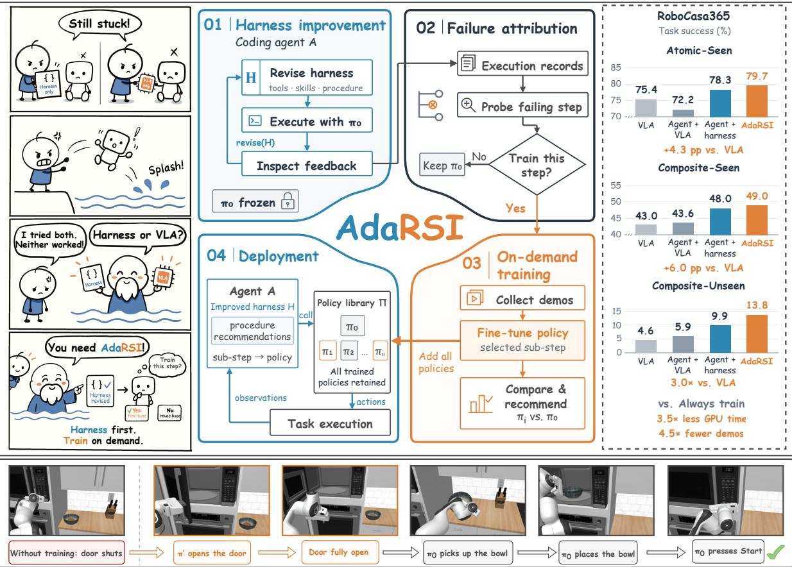
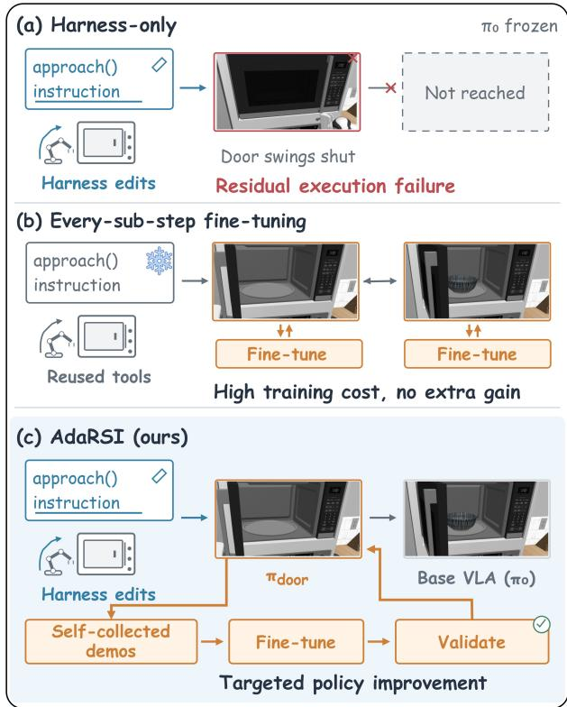
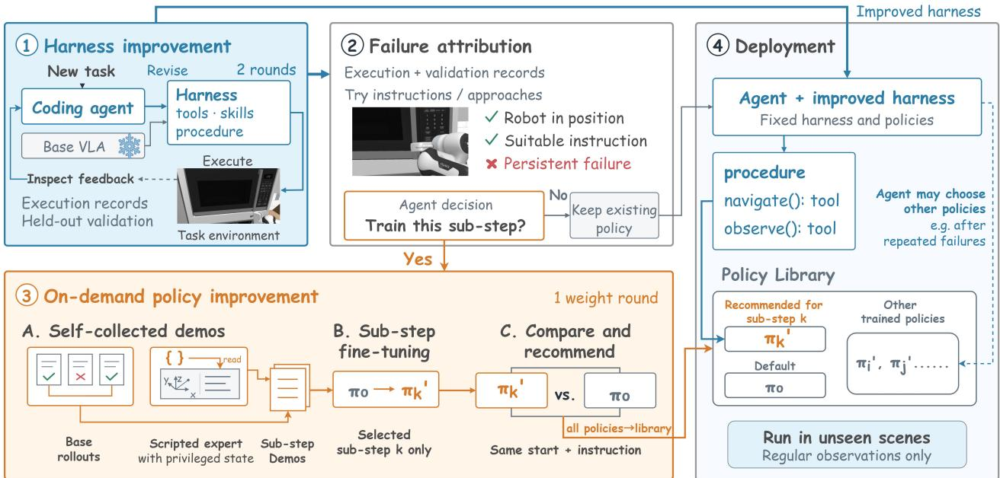
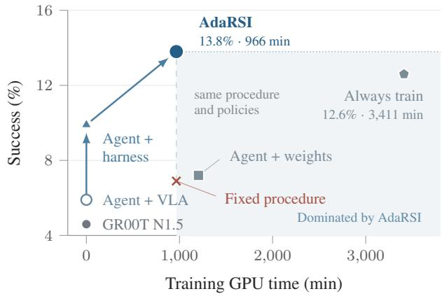
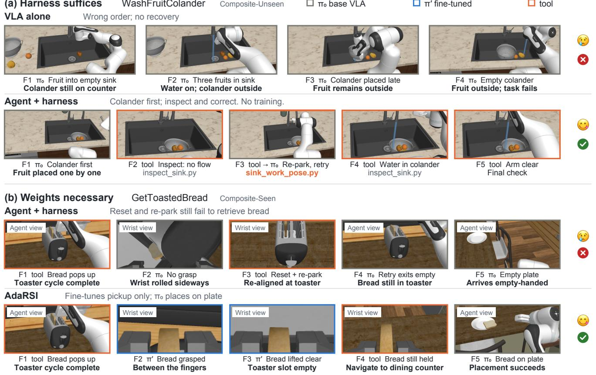

# AdaRSI: On-Demand Recursive Self-Improvement for Embodied Agents

Peidong Wang1,2\* Ying Chang3 Zhiming Ma1 Xiaocui Yang1 Shi Feng1† Daqi Liu2 Yuzhe Yang2 Xu Cao2 Chuang Wang2 Jian Su2† Daling Wang1 1Northeastern University 2AgiBot 3University of Chinese Academy of Sciences

  
Figure 1. Overview of AdaRSI. The agent improves its harness first and fine-tunes only the sub-steps that the harness cannot fix, raising success on every suite of RoboCasa365. In WaffleReheat (bottom), only the door opening is trained.

## Abstract

Pretrained vision-language-action models (VLAs) oftenfail midway through unseen long-horizon tasks. Recursive selfimprovement (RSI) offers a remedy, but embodied RSI methods either refine the harness around a frozen executor and so cannot add a missing motion, or train the executor on persistent failures without asking whether a failure lies in how the executor is called or in what it can do. We ask when a self-improving embodied system should change the weights ofits executor, and propose AdaRSI, an on-demand RSI framework for embodied agents. A coding agent first

improves its skills and harness, then attributes persistent failures by retrying failing sub-steps from saved states, and fine-tunes only the sub-steps that remain unreliable, with demonstrations it collects itselfand experience carried over from earlier tasks. On all 50 target tasks of RoboCasa365, with GR00T N1.5 as the executor and no human demonstrations, AdaRSI improves the VLA on all three suites and raises its success on unseen composite tasks from 4.6% to 13.8%. Compared with fine-tuning every sub-step, it reaches slightly higher success while using only 28% of the GPU time and 22% ofthe self-collected demonstrations, andfine-tuning without a harness trains more yet gainsfar less.

## 1. Introduction

Pretrained vision-language-action models (VLAs) [1, 11, 21] can perform a wide range of manipulation tasks in diverse environments. Recent models have also made progress on long-horizon tasks [23, 27]. Yet on unseen multi-step tasks they still often fail midway. A robot may approach the wrong target, misjudge whether a step has succeeded, or fail to execute a required motion. Some of these failures lie in how the VLA, acting as the executor, is called and others in what it can do, and the failure itself does not tell which.

Recursive self-improvement (RSI), in which a system turns its own experience into persistent changes that make it better [3, 4, 37], offers a way to repair such failures without collecting human demonstrations for every new task. An embodied system, made of a coding agent, its skills and harness, and a low-level executor such as a VLA, can improve itself at two levels. The harness, comprising the agent’s skills, its tools and the procedure that composes them, decides how the executor is called, while the executor’s weights decide what it can do.

Harness-level methods refine the agent’s skills and tools while keeping the executor frozen [6, 16–18, 25, 26, 30, 31, 33, 38]. Their changes are cheap, readable and easy to revert, but they stall when a task requires a motion the executor cannot perform [29, 33]. Policy-level methods instead update the executor’s weights [5, 9, 10, 12, 15, 34], some of them directing training toward tasks with low recent success [5] or toward high-risk scenarios [9], and systems that act on both levels train on the data that a refined harness produces [7, 32]. None of these methods asks whether a persistent failure lies in how the executor is called or in a motion it lacks, although the two call for different remedies. Training on a failure that lies in how the executor is called is not only costly but also risky, as a fine-tuned policy can perform a sub-step worse than the executor it started from.

This raises a question that current embodied RSI leaves open: when should a self-improving system change the weights of its executor? We argue that the answer is a matter of attribution. The weights should change only for a substep that stays unreliable after the agent has tried other ways of calling the executor, such as other instructions, robot poses or approaches. Refining the harness first therefore does more than fix the failures that lie in how the executor is called. It also sets the states from which the executor is called, so that a policy trained afterwards learns the motion that is actually missing, from the states in which it will be used.

We answer this question with AdaRSI, an ondemand recursive self-improvement framework for embodied agents. The agent first refines its harness from execution feedback, so that the harness absorbs the failures that better calling can fix without any training. It then attributes the failures that persist, retrying a failing sub-step from a saved simulator state under different instructions and approaches, which separates a poor way of calling the executor from a motion it cannot make. For the sub-steps that no such retry makes reliable, the agent collects demonstrations in simulation and fine-tunes a sub-step policy from the states its harness reaches. Each new policy is evaluated on held-ou start states, and the procedure calls it only where these measurements show that it helps, so a weight change enters the system only after it has been both attributed and validated. Improvements accumulate over rounds, each starting from the system that the previous round produced. Experience and a training budget derived from earlier tasks guide later ones, so the system improves not only itself but also the way it improves. No human demonstrations are used, and privileged simulator state serves only to generate and label data, never at test time.

  
Figure 2. Comparison of self-improvement strategies. Harnessonly improvement is bounded by what the executor can do, while fine-tuning every sub-step is costly and can make sub-steps that already worked worse. AdaRSI refines the harness first, which also sets the states from which policies are trained and called, and fine-tunes only the sub-steps that remain unreliable.

We evaluate on all 50 target tasks of RoboCasa365 [19, 20] under the official protocol, with GR00T N1.5 [21] as the executor. AdaRSI improves the VLA on all three suites, most of all on unseen composite tasks, where it raises success from 4.6% to 13.8%, about three times the base rate.

The harness provides most of this gain, and fine-tuning, which executes only 15% of the manipulation steps, carries the tasks that the harness alone could not solve, such as one that requires opening a microwave door the VLA never opens on its own. In paired tests from identical states, fine-tuning teaches motions that the executor lacks, but it can degrade sub-steps that the executor already completes. Compared with fine-tuning every sub-step and calling the new policies by default, AdaRSI reaches slightly higher success while using only 28% of the GPU time and 22% of the self-collected demonstrations. Fine-tuning without a harness trains more yet gains far less, and its deployed system calls few of the policies it trained. Training instead the sub-steps on which the executor succeeds least, under the same budget, gains nothing over the harness alone, even though most of the sub-steps it trains are the same, as attribution also tells the agent from which states a missing motion should be learned.

Our contributions are as follows:

• We formulate on-demand recursive self-improvement for embodied agents, in which the decision to change the executor’s weights rests on attributing each persistent failure to the harness or to the executor, and instantiate it as AdaRSI.

• We find that the harness decides whether training pays off, as it absorbs failures that would otherwise be trained on and sets the states from which policies are trained and called, while fine-tuning teaches motions the executor lacks but can degrade sub-steps it already completes.

• We show on all 50 target tasks of RoboCasa365, without any human demonstration, that training on demand improves a pretrained VLA on every suite at a fraction of the training cost of fine-tuning every sub-step.

## 2. Related Work

Vision-language-action models. VLAs map images and language instructions directly to robot actions [1, 11, 21]. Trained on large and diverse data, they follow instructions in new environments [8, 22], carry out long-horizon tasks with memory [23, 27], and can be paired with a high-level model that decomposes a task [24]. Yet they still generalize poorly to tasks outside their training distribution [20, 39]. We keep a pretrained VLA as the executor and let the embodied system built on it improve itself.

Recursive self-improvement of embodied systems. Recursive self-improvement (RSI) refers to systems that turn their own experience into persistent changes that make them better [3, 4], as language-model agents have done by rewriting their own code, harness and skills [13, 14, 36, 37]. Most embodied methods refine the agent’s skills and harness while the executor stays frozen [6, 16–18, 25, 26, 30, 31, 33, 38]. They change how and when the executor is called, but not what it can do [29]. Other methods improve the executor itself by training policies on self-collected data [5, 9, 10, 12, 15, 34, 35]. Some of them choose where to train, practicing tasks with low recent success [5] or collecting high-risk scenarios for a specialist that a gate calls in place of the nominal policy [9], and a few act on both levels [7, 32], for example fine-tuning the policy on data that an evolved harness collects [32]. These methods choose which failures to train on, but not whether a failure lies in how the executor is called, which a harness change can fix, or in a motion the executor lacks, which calls for new weights. We instead attribute each persistent failure to one of the two levels before training, and change the weights only for the sub-steps that remain unreliable after the harness has been refined.

## 3. Problem Formulation

Embodied agent system. We consider an embodied agent system ${ \cal S } = ( A , H , \Pi )$ with three parts. The agent A is a language-model coding agent that interprets the task, runs the system and reads the feedback from execution. The harness H is what the agent writes and uses to act, including its skills, its tools, and the program that composes them into a procedure for the task. The executor library Π holds the low-level policies that perform manipulation. It starts as $\Pi _ { 0 } = \{ \pi _ { 0 } \}$ , a single pretrained VLA, and grows when a policy fine-tuned for a specific sub-step is added. Tools may move the robot directly, for example to navigate to a fixture, but every manipulation sub-step is executed by a policy in Π, which the harness selects together with its instruction.

Self-improvement on a new task. Given a new task, the system may change itself before it is deployed. A change acts on one of two levels, either the harness, $H  H ^ { \prime }$ , or the executor library, $\Pi  \Pi \cup \{ \pi ^ { \prime } \}$ , where $\pi ^ { \prime }$ is fine-tuned from a policy already in Π. Changes are made in an improvement phase in simulation, where the system can run the task repeatedly and privileged simulator state is accessible. No human demonstrations are available. At deployment, the harness and the library are fixed, and the system acts from the robot’s regular observations only. Let J(S) be the deployment success rate and $C ( S ) = C _ { H } + C _ { \Pi }$ the cost of improvement, where $C _ { H }$ counts language-model tokens and $C _ { \Pi }$ counts self-collected demonstrations and training compute, including policies that were trained but not adopted. The goal is a system with high J at low C.

## 4. AdaRSI

AdaRSI first refines the harness and then descends to the weights. In the harness rounds, the agent builds its tools and procedure, runs the system on held-out validation episodes, and revises the tools and procedure on this feedback. The weight round then lets the agent descend to the executor, but only for the sub-steps that remain unreliable after these revisions. Each round starts from the system that the previous round produced. The harness is written by the agent for itself: at deployment, a fresh instance of the same agent reads the procedure and calls tools and policies as it prescribes.

  
Figure 3. Pipeline of AdaRSI. The agent first refines its harness, then attributes persistent failures and fine-tunes only the sub-steps that remain unreliable, using demonstrations it collects itself. Trained policies join a library, from which the deployed agent calls the recommended policy for each sub-step.

## 4.1. Harness-Level Improvement

The harness starts minimal. It exposes only the executor, which runs with a language instruction for a bounded number of steps, the camera images and proprioception, a map of the fixtures in the scene, low-level commands for the base and the arm, and a basic tool that navigates the base to a fixture, as a planning and control module does on a real mobile manipulator. Everything else is written by the agent, such as tools for fine positioning in front of a fixture, resetting the arm or zooming a camera onto a fixture, among many others. Improving the harness means writing such tools and strengthening the procedure that calls them. The procedure tells the deployed agent which sub-steps to perform, which tool or policy to call for each, and how to verify progress.

During development, the agent may reset the scene, save and restore simulator snapshots, and query the task’s success check. Snapshots enable counterfactual re-execution, in which a single sub-step is retried from the same state under a different instruction or approach, and this separates a poor instruction or a poor approach from a motion the executor cannot make. After each round, the system is run as at deployment on held-out validation episodes, and the records of these runs are returned to the agent as feedback for the next round. The agent thus tunes its harness on one set of scenes and is judged on another, which exposes failures that only appear in new scenes.

## 4.2. Descending to the Weights

Executor-limited sub-steps. Descending to the weights begins with failure attribution, which assigns each persistent failure either to the harness or to the executor. We call a substep executor-limited if no harness the agent can find lets π0 perform it reliably. At the end of the harness rounds, the agent records the sub-steps that still fail although the robot is in place and the instruction is one the executor knows, together with the success rate it measured for π from such states. These candidates, and the validation records behind them, guide the weight round.

Self-collected demonstrations. For a sub-step it decides to train, the agent collects demonstrations in simulation itself. It can apply rejection sampling to the base executor, rolling it out repeatedly from the failing state and keeping the segments that succeed, or write a scripted expert that reads privileged state such as object poses and articulation states. This follows learning with privileged information [2, 28], in which a privileged teacher labels data for a student that sees only the robot’s regular observations. Privileged state is used only here, to generate and label data, and the deployed system never sees it.

<table><tr><td rowspan="2">Method</td><td colspan="3">Self-improvement</td><td colspan="4">Success rate on RoboCasa365 (%)</td></tr><tr><td></td><td></td><td>Agent Harness Weights</td><td>Atomic-Seen 18 tasks</td><td>Composite-Seen 16 tasks</td><td>Composite-Unseen 16 tasks</td><td>All 50 tasks</td></tr><tr><td>GR00T N1.5 [21]</td><td>x</td><td>X</td><td>x</td><td>75.4</td><td>43.0</td><td>4.6</td><td>42.4</td></tr><tr><td>Agent + VLA</td><td>√</td><td>x</td><td>x</td><td>72.2</td><td>43.6</td><td>5.9</td><td>41.8</td></tr><tr><td>Agent + harness</td><td>√</td><td>√</td><td>x</td><td>78.3</td><td>48.0</td><td>9.9</td><td>46.7</td></tr><tr><td>AdaRSI (ours)</td><td>√</td><td>√</td><td>√</td><td>79.7</td><td>49.0</td><td>13.8</td><td>48.8</td></tr><tr><td>Gain over VLA</td><td></td><td></td><td></td><td>+4.3</td><td>+6.0</td><td>+9.2</td><td>+6.4</td></tr></table>

Table 1. Success rates (%) on the 50 target tasks of RoboCasa365. Each task is tested on 50 scenes, All averages over the 50 tasks, and no system uses human demonstrations.

Fine-tuning and validation. Each demonstration set fine-tunes a sub-step policy, starting from $\pi _ { 0 }$ or from one of the agent’s earlier policies, and the result is added to Π. The new policy is called through the same interface as the base executor. As in self-improving coding agents [37], every self-modification is validated empirically. The agent com pares the new policy with $\pi _ { 0 }$ from development states and records the result in its procedure, which recommends the policy for the sub-steps where it performs better and keeps $\pi _ { 0 }$ as the default everywhere else. In the same round, the agent also works out how to call each new policy, for example how the robot is positioned before the call. Every trained policy stays in Π, so the deployed agent follows the recommendations of its procedure but can still choose another policy from the library, for instance after $\pi _ { 0 }$ fails repeatedly.

## 4.3. Recursion Across Rounds and Tasks

Each round maps the current system and the experience gathered with it to an improved system, $S _ { k + 1 } = g ( S _ { k } , \mathcal { E } _ { k } )$ The experience $\mathcal { E } _ { k }$ contains the development runs, the validation records and, in the weight round, the training results of every policy, adopted or not. Because the harness and the policies persist, later rounds build on what earlier rounds found, and a harness revision can make use of a newly trained policy as easily as of the base executor.

Self-improvement also carries over across tasks. We select pilot tasks to span high, moderate, and low base-VLA success rates on manipulation sub-steps, measured on development scenes during the harness rounds. This provides varied starting points for studying when harness refinement suffices and when weight adaptation is useful. The pilot tasks are improved without any limit on training. From their training logs, the agent writes an experience document that records which kinds of sub-steps benefited from training, how much data sufficed, and where effort was wasted. The same logs set a training budget by a fixed rule, scaled from the training that the adopted policies of the pilot tasks actually used. Every later task is improved with this document and under this budget, which the environment enforces on training steps and self-collected demonstrations. The budget turns the choice of where to train into an explicit tradeoff, and the experience tells the agent which sub-steps are likely to be executor-limited. In this sense the system improves not only itself but also the way it improves.

At deployment, a fresh instance of the agent runs the final system on unseen scenes. It follows the procedure, calls tools and policies, and checks progress from images, without snapshots, success checks or privileged state.

## 5. Experiments

## 5.1. Setup

Benchmark. We evaluate on all 50 target tasks of Robo-Casa365 [20], which form three suites. The 18 Atomic-Seen and 16 Composite-Seen tasks appear in the executor’s training data, while the 16 Composite-Unseen tasks compose familiar sub-tasks into tasks that are absent from it. We follow the official protocol, with the target split, whose kitchens and objects do not overlap with pretraining, the official task horizons, which also count the steps taken by tools, and the official success check. Each task is tested on 50 scenes. Development, validation and test scenes are disjoint, and test scenes are never used during improvement. We report the success rate of each task, averaged over the tasks of a suite.

Implementation. The executor $\pi _ { 0 }$ is GR00T N1.5 [21], using the official Composite-Seen checkpoint for composite tasks and the Atomic-Seen checkpoint for atomic tasks. The agent is GPT-6.1-sol, run through Codex. Pilot tasks in each suite provide the experience document and the training budget described in Sec. 4.3.

Compared systems. We compare four systems. (1) VLA runs $\pi _ { 0 }$ alone with the full task instruction, as in the official protocol. (2) Agent + VLA lets the agent call $\pi _ { 0 }$ with its own instructions, without development or training. (3) Agent + harness stops after the harness rounds. (4) AdaRSI adds the weight round to this system. Further variants that remove or replace parts of AdaRSI are introduced with the ablations in Sec. 5.3.

<table><tr><td rowspan="2">Task</td><td colspan="2">No self-improvement</td><td rowspan="2">No agent</td><td colspan="4">Self-improving agents</td><td rowspan="2">∆ vs. harness</td></tr><tr><td>VLA</td><td>Agent + VLA</td><td>Fixed Agent + procedure weights</td><td>Agent + harness</td><td>Always train</td><td>AdaRSI</td></tr><tr><td>ArrangeBreadBasket</td><td>0.0</td><td>0.0</td><td>0.0</td><td>2.0</td><td>2.0</td><td>0.0</td><td>2.0</td><td>0.0</td></tr><tr><td>ArrangeTea</td><td>0.0</td><td>0.0</td><td>0.0</td><td>0.0</td><td>2.0</td><td>2.0</td><td>0.0</td><td>-2.0</td></tr><tr><td>BreadSelection</td><td>22.0</td><td>22.0</td><td>36.0</td><td>26.0</td><td>42.0</td><td>56.0</td><td>52.0</td><td>+10.0</td></tr><tr><td>CategorizeCondiments</td><td>0.0</td><td>0.0</td><td>0.0</td><td>0.0</td><td>0.0</td><td>6.0</td><td>2.0</td><td>+2.0</td></tr><tr><td>CuttingToolSelection</td><td>20.0</td><td>30.0</td><td>40.0</td><td>42.0</td><td>50.0</td><td>32.0</td><td>36.0</td><td>-14.0</td></tr><tr><td>GarnishPancake</td><td>0.0</td><td>0.0</td><td>0.0</td><td>0.0</td><td>0.0</td><td>2.0</td><td>0.0</td><td>0.0</td></tr><tr><td>GatherTableware</td><td>2.0</td><td>2.0</td><td>2.0</td><td>2.0</td><td>6.0</td><td>6.0</td><td>8.0</td><td>+2.0</td></tr><tr><td>HeatKebabSandwich</td><td>0.0</td><td>0.0</td><td>0.0</td><td>0.0</td><td>0.0</td><td>0.0</td><td>0.0</td><td>0.0</td></tr><tr><td>MakeIceLemonade</td><td>0.0</td><td>0.0</td><td>0.0</td><td>0.0</td><td>0.0</td><td>0.0</td><td>0.0</td><td>0.0</td></tr><tr><td>PanTransfer</td><td>0.0</td><td>0.0</td><td>0.0</td><td>0.0</td><td>2.0</td><td>2.0</td><td>4.0</td><td>+2.0</td></tr><tr><td>PortionHotDogs</td><td>2.0</td><td>2.0</td><td>0.0</td><td>6.0</td><td>4.0</td><td>4.0</td><td>0.0</td><td>-4.0</td></tr><tr><td>RecycleBottlesByType</td><td>0.0</td><td>0.0</td><td>0.0</td><td>0.0</td><td>0.0</td><td>30.0</td><td>18.0</td><td>+18.0</td></tr><tr><td>SeparateFreezerRack</td><td>0.0</td><td>0.0</td><td>0.0</td><td>0.0</td><td>0.0</td><td>0.0</td><td>0.0</td><td>0.0</td></tr><tr><td>WaffleReheat</td><td>2.0</td><td>0.0</td><td>4.0</td><td>4.0</td><td>0.0</td><td>28.0</td><td>38.0</td><td>+38.0</td></tr><tr><td>WashFruitColander</td><td>26.0</td><td>38.0</td><td>28.0</td><td>34.0</td><td>48.0</td><td>34.0</td><td>58.0</td><td>+10.0</td></tr><tr><td>WeighIngredients</td><td>0.0</td><td>0.0</td><td>0.0</td><td>0.0</td><td>2.0</td><td>0.0</td><td>2.0</td><td>0.0</td></tr><tr><td>Mean</td><td>4.6</td><td>5.9</td><td>6.9</td><td>7.2</td><td>9.9</td><td>12.6</td><td>13.8</td><td>+3.9</td></tr></table>

Table 2. Per-task success rates (%) on Composite-Unseen. All systems, including the ablations of Sec. 5.3, run on the same 50 scenes per task. The last column is the gain of AdaRSI over Agent + harness in points.

## 5.2. Main Results

Overall. AdaRSI achieves the highest suite-level success rate on all three suites, reaching 48.8% over the 50 tasks compared with 42.4% for the VLA alone and 46.7% for Agent + harness (Tab. 1). The largest gain is on Composite-Unseen, where success rises from 4.6% to 13.8%, about three times the base executor’s rate. The gains also extend to tasks present in the executor’s training data, with Atomic-Seen rising from 75.4% to 79.7% and Composite-Seen from 43.0% to 49.0%. The benefit is thus not confined to acquiring motions for unseen tasks, and improving how existing capabilities are used also raises task success.

Harness level. Letting the agent call the VLA without any development does not reliably raise success. Agent + VLA falls from 75.4% to 72.2% on Atomic-Seen, and its overall success remains below that of the VLA alone. Harness development reverses this drop and improves all three suites, reaching 78.3% on Atomic-Seen and more than doubling success on Composite-Unseen to 9.9%. In CuttingToolSelection, for example, the agent writes a rule that maps each food to the right tool instead of leaving “the appropriate cutting tool” to the VLA, and adds checks that stop a failing attempt early, raising success from 30% to 50%. The benefit therefore comes from improving the tools and procedure through execution feedback, rather than simply allowing an agent to issue sub-instructions.

Weight level. The weight round adds the most on Composite-Unseen, a further 3.9 percentage points against 1.4 on Atomic-Seen and 1.0 on Composite-Seen. Table 2 breaks this gain down by task. WaffleReheat shows the largest effect, rising from 0% with the harness alone to 38% with AdaRSI. Its harness reaches the microwave, but π0 cannot open the door and release the handle, and a policy fine-tuned for this sub-step resolves the bottleneck while π still performs every other step. RecycleBottlesByType improves from 0% to 18% and BreadSelection from 42% to 52%, so the weight round helps both tasks that rarely succeed and tasks where the harness already does well. Not every task benefits, however. CuttingToolSelection falls from 50% to 36% after the weight round, and several tasks remain unsolved by every system although the agent finetunes policies for their sub-steps. We return to these cases in Sec. 6.

<table><tr><td rowspan="2">Suite / variant</td><td>Policies</td><td colspan="2">Training</td><td>Execution</td></tr><tr><td>Used / trained</td><td>GPU min.</td><td>Used share</td><td>FT steps</td></tr><tr><td>Atomic-Seen</td><td>12/72</td><td>1,175</td><td>17%</td><td>21.7%</td></tr><tr><td>Composite-Seen</td><td>8/34</td><td>901</td><td>25%</td><td>2.3%</td></tr><tr><td>Composite-Unseen</td><td></td><td></td><td></td><td></td></tr><tr><td>Agent + weights</td><td>5/45</td><td>1,204</td><td>12%</td><td>3.9%</td></tr><tr><td>Always train</td><td>104/118</td><td>3,411</td><td>89%</td><td>71.2%</td></tr><tr><td>AdaRSI</td><td>32/38</td><td>966</td><td>85%</td><td>14.7%</td></tr></table>

Table 3. Policies trained and used at test time. A policy counts as used if the deployed agent calls it, used share is the share of training time spent on used policies, and FT steps is the share of manipulation steps at test time that fine-tuned policies execute. The counts of Always train include the policies of AdaRSI, which it reuses.

Where the weights change. Table 3 shows where AdaRSI changes the weights. On the two seen suites, whose tasks π0 was trained on, most trained policies are never called. The deployed systems use only 12 of 72 policies on Atomic-Seen and 8 of 34 on Composite-Seen, and π0 still executes 78% and 98% of their manipulation steps. On Atomic-Seen this share counts whole episodes, since an atomic task has a single sub-step.

On Composite-Unseen, where $\pi _ { 0 }$ lacks the motions that the new tasks require, 32 of 38 policies are used across all 16 tasks, and 85% of the training time goes into them. Training thus concentrates where the executor falls short. Even so, each policy replaces only the sub-step it was trained for, and fine-tuned policies execute 15% of the manipulation steps, against 71% for Always train, which spends 3.5× the GPU time. In WaffleReheat, for instance, the fine-tuned policy opens the microwave door and $\pi _ { 0 }$ performs every other sub-step.

A paired test from identical states isolates what the finetuned weights themselves change (Tab. 4). We replay a test episode up to the first call of a policy, save a snapshot, and let $\pi _ { 0 }$ and the fine-tuned policy execute the same instruction for the same number of steps, with privileged state judging success. On motions beyond $\pi _ { 0 } .$ , fine-tuning teaches what is missing. $\pi _ { 0 }$ opens the microwave door in none of 18 kitchens and the fine-tuned policy in 7, and the mean opening rises from 0.01 to 0.61, while the glass bottle is picked up in 17 of 44 starts against 2. On motions that $\pi _ { 0 }$ already performs, such as placing the croissant or the jam on the cutting board, fine-tuning lowers success. The same training thus helps where the executor falls short and hurts where it does not, which is the case for training on demand.

<table><tr><td>Sub-step</td><td>π0</td><td>Fine-tuned</td><td>∆</td></tr><tr><td>Motions beyond π0</td><td></td><td></td><td></td></tr><tr><td>Open microwave door WaffleReheat</td><td>0/18</td><td>7/18</td><td>+7</td></tr><tr><td>Pick up glass bottle RecycleBottlesByType</td><td>2/44</td><td>17/44</td><td>+15</td></tr><tr><td>Motions π0 already performs</td><td></td><td></td><td></td></tr><tr><td>Place croissant on board BreadSelection</td><td>16/40</td><td>11/40</td><td>-5</td></tr><tr><td>Place jam on board BreadSelection</td><td>14/39</td><td>9/39</td><td>-5</td></tr></table>

Table 4. Paired sub-step test. $\pi _ { 0 }$ and the fine-tuned policy run from the same states with the same instruction and number of steps, and entries give successful over tested starts.

## 5.3. Ablations

We ablate AdaRSI on the Composite-Unseen suite with five variants. (1) Agent + weights improves the system only by fine-tuning, without harness rounds, tools or a training budget. (2) Agent + harness improves only the harness and stops before the weight round. (3) Always train fine-tunes a policy for every manipulation sub-step and calls the finetuned policies by default. (4) Fixed procedure runs the procedure and policies that AdaRSI builds as a fixed program, without the agent at deployment. (5) AdaRSI w/ $\pi _ { 0 }$ keeps the final system of AdaRSI but runs $\pi _ { 0 }$ wherever a finetuned policy would be called.

Success against cost. Figure 4 places every system by its training cost and its success. The arrows trace the order in which AdaRSI improves the system. Harness rounds raise success from 5.9% to 9.9% without any training, and the weight round then adds 3.9 points for 966 GPU minutes. Every other system that trains lands in the region that AdaRSI dominates, with at least the same training and lower success. Agent + weights trains more and reaches 7.2%, Always train spends 3.5× the GPU time for 12.6%, and Fixed procedure uses exactly the same policies for 6.9%. The systems that train nothing are cheaper, but none of them exceeds 9.9%, so no system we compare is both cheaper and more successful than AdaRSI.

Neither level suffices alone. Both levels help on their own, but neither reaches their combination. Fine-tuning without a harness lifts the VLA from 4.6% to 7.2%, and the harness alone reaches 9.9%, while AdaRSI reaches 13.8% on the same episodes. The harness is the larger lever, since most failures come from the procedure rather than from missing motions. It also does more than raise success, because it tells the agent where training is needed. Without harness rounds, the agent trains more than AdaRSI, 45 policies against 38 and 1.25× the GPU time, yet the deployed system calls only 5 of them, against 32 for AdaRSI (Tab. 3). Many of these policies take on work that a tool would do, such as moving the base or carrying an object across the kitchen, and others are trained from wherever the robot hap pens to stand. In WaffleReheat, for instance, both systems train a policy for the microwave door, but only AdaRSI trains it from the pose to which its tools bring the robot, so only its policy is ever used, and the task succeeds in 38% of episodes against 4% for the agent without harness rounds. The harness thus attributes failures to the executor and fixes the states from which a policy is trained and called, which is what makes training on demand effective.

<table><tr><td rowspan="2">Method</td><td colspan="4">Self-improvement</td><td rowspan="2"></td><td colspan="3">Training cost (16 tasks)</td></tr><tr><td>Online agent</td><td>Harness</td><td></td><td>Weights On-demand</td><td>Success</td><td></td><td>GPU min.</td></tr><tr><td>GR00T N1.5 [21]</td><td>x</td><td>x</td><td>x</td><td>1</td><td>4.6</td><td>0</td><td>0</td><td>0</td></tr><tr><td>Fixed procedure</td><td>x</td><td>√</td><td>√</td><td>√</td><td>6.9</td><td></td><td>reused from AdaRSI</td><td></td></tr><tr><td>Agent + VLA</td><td>√</td><td>x</td><td>x</td><td>一</td><td>5.9</td><td>0</td><td>0</td><td>0</td></tr><tr><td>Agent + weights</td><td>√</td><td>x</td><td>√</td><td>√</td><td>7.2</td><td>45</td><td>556</td><td>1,204</td></tr><tr><td>Agent + harness</td><td>√</td><td>√</td><td>x</td><td>一</td><td>9.9</td><td>0</td><td>0</td><td>0</td></tr><tr><td>Always train</td><td>√</td><td>√</td><td>√</td><td>x</td><td>12.6</td><td>118</td><td>1,877</td><td>3,411</td></tr><tr><td>AdaRSI</td><td>√</td><td>√</td><td>√</td><td>√</td><td>13.8</td><td>38</td><td>416</td><td>966</td></tr></table>

Table 5. Ablations on the 16 Composite-Unseen tasks. Online agent means that the agent runs at deployment, and on-demand that it fine-tunes only selected sub-steps. Training cost counts every policy trained, and that of Always train includes the training of AdaRSI.

  
Figure 4. Success against training cost on Composite-Unseen. Arrows trace AdaRSI, which improves the harness first and then fine-tunes on demand. Systems in the shaded region cost at least as much as AdaRSI and succeed less.

Weights and procedure. The weight round changes both the policies and the procedure that calls them. AdaRSI w/ π0 separates the two on the five tasks whose success changes in that round, so that Tab. 6, read from left to right, adds first the revised procedure and then the fine-tuned weights. Of the 31 successes that AdaRSI adds to the harness on these tasks, 17 disappear when $\pi _ { 0 }$ replaces the fine-tuned policies, and the other 14 come from the revised procedure. The weights matter most where $\pi _ { 0 }$ lacks the motion. WaffleReheat falls from 38% to 10% once $\pi _ { 0 }$ has to open the microwave door again, while BreadSelection keeps its whole gain, which comes from revised instructions. The loss in CuttingToolSelection already appears with the revised procedure alone, which we return to in Sec. 6. Fine-tuning and the procedure built around it thus contribute about equally, and the weights carry the tasks that no procedure can solve.

<table><tr><td>Task</td><td>Agent + harness</td><td>AdaRSI w/π0 + procedure</td><td>AdaRSI + weights</td></tr><tr><td>WaffleReheat</td><td>0</td><td>5(+5)</td><td>19(+14)</td></tr><tr><td>RecycleBottlesByType</td><td>0</td><td>5(+5)</td><td>9(+4)</td></tr><tr><td>BreadSelection</td><td>21</td><td>27(+6)</td><td>26(-1)</td></tr><tr><td>WashFruitColander</td><td>24</td><td>27(+3)</td><td>29(+2)</td></tr><tr><td>CuttingToolSelection</td><td>25</td><td>20(-5)</td><td>18(-2)</td></tr><tr><td>Total (of 250)</td><td>70</td><td>84(+14)</td><td>101(+17)</td></tr></table>

Table 6. Weights against procedure. From left to right, each column adds the revised procedure and then the fine-tuned weights, with the change in parentheses. Entries count successes out of 50 on the five tasks whose success changes in the weight round.

Training every sub-step. Fine-tuning every manipulation sub-step does not improve on AdaRSI (Tab. 7). It reaches 12.6% against 13.8% on the same episodes, while it trains 3.1× as many policies, collects 4.5× as many demonstrations and uses 3.5× the GPU time. The task-level results show why. In WaffleReheat, training everywhere replaces every sub-step, including picking up the bowl, which $\pi _ { 0 }$ already performs reliably, and the new policy does it worse, so success drops from 38% to 28%. In WashFruitColander, most of the twelve new policies do not beat $\pi _ { 0 }$ on heldout starts, and success drops from 58% to 34%, partly because calling many policies also slows each episode until some reach the time limit. Training everywhere helps where AdaRSI left a useful sub-step untrained, most clearly in RecycleBottlesByType, where policies that carry and place each bottle raise success from 18% to 30%. Overall, most of the extra training buys nothing, and training everywhere is not an appropriate default, because a fine-tuned policy can replace an executor call that already worked.

<table><tr><td></td><td colspan="2">Successes (of 50)</td><td colspan="2">Policies</td><td colspan="2">Tokens (M)</td><td colspan="2">Demonstrations</td><td colspan="2">GPU minutes</td></tr><tr><td>Task</td><td>Always</td><td>Ours</td><td>Always</td><td>Ours</td><td>Always</td><td>Ours</td><td>Always</td><td>Ours</td><td>Always</td><td>Ours</td></tr><tr><td>ArrangeBreadBasket</td><td>0</td><td>1</td><td>5</td><td>3</td><td>184.9</td><td>159.8</td><td>57</td><td>17</td><td>123</td><td>57</td></tr><tr><td>ArrangeTea</td><td>1</td><td>0</td><td>6</td><td>3</td><td>186.2</td><td>161.4</td><td>72</td><td>22</td><td>164</td><td>70</td></tr><tr><td>BreadSelection</td><td>28</td><td>26</td><td>9</td><td>2</td><td>163.1</td><td>125.2</td><td>116</td><td>17</td><td>212</td><td>56</td></tr><tr><td>CategorizeCondiments</td><td>3</td><td>1</td><td>5</td><td>2</td><td>172.6</td><td>135.7</td><td>79</td><td>26</td><td>179</td><td>81</td></tr><tr><td>CuttingToolSelection</td><td>16</td><td>18</td><td>6</td><td>3</td><td>127.0</td><td>108.4</td><td>89</td><td>33</td><td>163</td><td>65</td></tr><tr><td>GarnishPancake</td><td>1</td><td>0</td><td>8</td><td>3</td><td>215.7</td><td>172.3</td><td>210</td><td>40</td><td>238</td><td>69</td></tr><tr><td>GatherTableware</td><td>3</td><td>4</td><td>11</td><td>2</td><td>179.7</td><td>118.2</td><td>218</td><td>13</td><td>345</td><td>51</td></tr><tr><td>HeatKebabSandwich</td><td>0</td><td>0</td><td>6</td><td>2</td><td>207.0</td><td>164.1</td><td>91</td><td>30</td><td>194</td><td>63</td></tr><tr><td>MakeIceLemonade</td><td>0</td><td>0</td><td>6</td><td>3</td><td>180.4</td><td>142.4</td><td>52</td><td>18</td><td>151</td><td>56</td></tr><tr><td>PanTransfer</td><td>1</td><td>2</td><td>7</td><td>2</td><td>191.1</td><td>146.3</td><td>138</td><td>30</td><td>204</td><td>37</td></tr><tr><td>PortionHotDogs</td><td>2</td><td>0</td><td>4</td><td>1</td><td>207.1</td><td>183.2</td><td>78</td><td>20</td><td>144</td><td>37</td></tr><tr><td>RecycleBottlesByType</td><td>15</td><td>9</td><td>7</td><td>2</td><td>181.8</td><td>154.3</td><td>149</td><td>24</td><td>232</td><td>57</td></tr><tr><td>SeparateFreezerRack</td><td>0</td><td>0</td><td>6</td><td>3</td><td>204.7</td><td>155.2</td><td>85</td><td>40</td><td>190</td><td>93</td></tr><tr><td>WaffleReheat</td><td>14</td><td>19</td><td>10</td><td>2</td><td>274.3</td><td>214.1</td><td>118</td><td>24</td><td>266</td><td>53</td></tr><tr><td>WashFruitColander</td><td>17</td><td>29</td><td>14</td><td>2</td><td>236.0</td><td>185.0</td><td>163</td><td>12</td><td>383</td><td>52</td></tr><tr><td>WeighIngredients</td><td>0</td><td>1</td><td>8</td><td>3</td><td>175.5</td><td>142.5</td><td>162</td><td>50</td><td>223</td><td>68</td></tr><tr><td>Total</td><td>101</td><td>110</td><td>118</td><td>38</td><td>3,086.8</td><td>2,468.0</td><td>1,877</td><td>416</td><td>3,411</td><td>966</td></tr><tr><td>Always / Ours</td><td colspan="2">0.92×</td><td colspan="2">3.1×</td><td colspan="2">1.25×</td><td colspan="2">4.5×</td><td colspan="2"></td></tr></table>

Table 7. AdaRSI (Ours) against Always train (Always). Costs count every policy trained, and those of Always include the training of AdaRSI. Tokens are input tokens of the improvement phase, and the last row gives Always/Ours ratios.

<table><tr><td>Variant</td><td>Success (%)</td><td>Demos</td><td>GPU min.</td></tr><tr><td>Agent + harness</td><td>12.0</td><td>0</td><td>0</td></tr><tr><td>Lowest first</td><td>11.8</td><td>312</td><td>636</td></tr><tr><td>AdaRSI</td><td>16.6</td><td>316</td><td>796</td></tr></table>

Table 8. Choosing what to train on the non-pilot Composite-Unseen tasks. Lowest first trains the sub-steps on which $\pi _ { 0 }$ succeeds least, under the same budget.

Choosing what to train. A simpler rule could decide where to train without attributing failures, by training the sub-steps on which $\pi _ { 0 }$ succeeds least. Lowest first applies this rule on the Composite-Unseen tasks that are not pilots. It starts from the same harness as AdaRSI, with the same budget, demonstration collection and adoption rule, measures π on every manipulation sub-step from the states that the procedure reaches, and trains as many sub-steps per task as AdaRSI does, lowest success first, without retrying any of them from other states or with other instructions. It gains nothing over the harness alone, reaching 11.8% against 12.0%, while AdaRSI reaches 16.6% at a similar training cost (Tab. 8). Where it trains, the rule mostly selects the same sub-steps as AdaRSI, 11 of the 13 it trains, yet it does not turn them into gains. In WaffleReheat, both systems train a policy for the microwave door, but only AdaRSI, which retries the failing sub-step before training, finds that its failure depends on how the hand approaches the handle and trains from an approach that works, so the task succeeds in 38% of episodes against 2%. Measuring every sub-step also takes time, and in four tasks it used up the development session before any policy was trained. Attribution thus tells the agent not only which sub-steps to train but also from which states to learn them.

Adaptive execution at deployment. At deployment, the agent uses execution feedback to adjust how it calls tools and policies, revising sub-goals, instructions and recovery actions as the task unfolds. The fixed-procedure variant also responds to feedback, but its choices are limited to the conditions and responses encoded in advance. To evaluate the value of this adaptation, we execute the final procedure and policies of AdaRSI as a fixed program, with privileged simulator state available for state estimation. The fixed program reaches 6.9% success against 13.8% for AdaRSI, despite this information advantage (Tab. 5). The largest drops occur on tasks that require choosing a standing position from the current view or changing approach after a failure, as WaffleReheat falls from 38% to 4% and WashFruitColander from 58% to 28% (Tab. 2). By contrast, on CuttingToolSelection, whose procedure follows fixed steps, the program reaches 40% against 36% for AdaRSI. These results support keeping the agent in the execution loop. It adjusts how it uses its tools and policies to the observed state, beyond the responses predefined in the fixed program.

<table><tr><td>Case</td><td>Sub-step (task)</td><td> $\pi _ { 0 }$ </td><td>Fine-tuned Lesson</td><td></td></tr><tr><td colspan="5">Training needed</td></tr><tr><td>Worked</td><td>Open French-door fridge GarnishPancake</td><td>0/6</td><td>6/6</td><td>A few demonstrations suffice, but the task still fails.</td></tr><tr><td>Partly worked</td><td>Pick up the skewer HeatKebabSandwich</td><td>0/16</td><td>3/16</td><td>The motion is learned in only some kitchens.</td></tr><tr><td>Did not work</td><td>Close toaster-oven door HeatKebabSandwich</td><td>1/9</td><td>0/9</td><td>Training does not yet produce the motion, and  $\pi _ { 0 }$  stays the default.</td></tr><tr><td colspan="5">Training not needed</td></tr><tr><td>Helped</td><td>Set up the mug CoffeeSetupMug</td><td>13/20</td><td>31/40</td><td>Training can raise the reliability of a sub-step  $\pi _ { 0 }$  already performs.</td></tr><tr><td>No gain</td><td>Turn on tall faucet TurnOnSinkFaucet</td><td>11/12</td><td>11/12</td><td> $\pi _ { 0 }$  remains the better default.</td></tr><tr><td>Worse at test</td><td>Open the drawer OpenDrawer</td><td>22/27</td><td>26/27</td><td>A gain in development does not hold at test, where task success falls.</td></tr></table>

Table 9. Outcomes of training a sub-step. Cases from the pilot tasks, comparing π0 and the fine-tuned policy from the same held-out starts. The last three rows come from Atomic-Seen pilots.

## 5.4. Cost

On the Composite-Unseen suite, AdaRSI trains 2.4 policies per task on average, adopted or not, using 26 self-collected demonstrations, 1.9k updates and about one GPU-hour. Its improvement phase, including the harness rounds, validation and the weight round, consumes 154M input tokens and 0.64M output tokens per task, and at deployment the agent uses 4.2M input and 7.2k output tokens per episode, with about 97% of the input tokens being cache hits. The improvement phase costs 117M and 137M input tokens per task on Atomic-Seen and Composite-Seen, where deployment needs 1.2M and 1.9M per episode, since the procedures are shorter. Fine-tuning every sub-step raises the deployment cost to 5.3M input tokens per episode, because the agent calls and checks more policies, while fine-tuning without a harness needs fewer tokens per episode, 1.5M, but fails more often. No human demonstration is used at

any stage.

## 5.5. Case Studies

During training. To see how the agent decides where to train, we analyze the weight rounds of the pilot tasks, which run without a training budget and whose records produce the experience document. Table 9 sorts representative policies by whether $\pi _ { 0 }$ could already perform the sub-step and whether fine-tuning improved it on held-out starts. When a sub-step is beyond $\pi _ { 0 } .$ , a few demonstrations can teach it, as twenty demonstrations do for the left door of a French-door refrigerator in GarnishPancake. The task still fails there, because later sub-steps remain unsolved, so learning one motion does not by itself make a long task succeed. Other missing motions are learned only partly, such as picking up the skewer, or not at all, such as closing the toaster-oven door. When $\pi _ { 0 }$ already performs a sub-step, training can still raise its reliability, as for the mug in CoffeeSetupMug, but it often leaves the sub-step unchanged or yields a gain in development that does not hold at test, as for the drawer in OpenDrawer. The experience document summarizes such cases for the tasks that follow.

During deployment. Figure 5 follows two tasks through the system and shows when each level of improvement is the right one. In WashFruitColander (Fig. 5a), the VLA puts fruit into the sink before placing the colander, then leaves the fruit outside it. The harness instead places the colander first and puts in each fruit with a short instruction. When the faucet attempts produce no water, the agent inspects the scene and uses its working-pose tool to reposition the base before retrying, completing the task without training any policy. GetToastedBread (Fig. 5b) fails for a different reason. After the toast pops up, the base VLA rolls the wrist without grasping the bread, and resetting the arm and reparking the base before retrying still leave it in the toaster. AdaRSI uses a policy fine-tuned for bread pickup with the same instruction, retrieving the bread in two 160-step calls. The robot then navigates with the bread held, and π0 places it on the plate. The two tasks thus call for different levels of improvement, and AdaRSI applies each only where it is needed.

  
Figure 5. Case studies. (a) WashFruitColander is solved by the harness alone, which fixes the sub-step order and repositions the base. (b) In GetToastedBread, only the bread pickup is trained. Rows share the kitchen and initial state.

## 6. Discussion and Limitations

Deciding when to train. Our results support a simple principle for embodied self-improvement, to change the harness first and to change the weights only for the substeps that stay unreliable once the harness has been refined. Our instantiation of this principle leaves two decisions to the agent, and it can fail at either. The agent may find the sub-steps that need training but not obtain a policy that performs them reliably. This happens in the Composite-Unseen tasks that remain unsolved, which chain several sub-steps beyond the executor and succeed only if every fine-tuned policy in the chain succeeds in the same episode.

The agent may also adopt a change that looks better on a few development scenes but hurts on the test scenes. In Cutting-ToolSelection, the weight round starts every episode that needs the peeler with a dedicated grasp step, which looked slightly better in development but halves success in these episodes at test, whether the step runs the fine-tuned policy or π0. Both depend on the capability of the agent and on how training is constrained, including the budget, the number of validation scenes and the way demonstrations are collected. A more reliable test of necessity and a stronger training loop are natural next steps, and so is restricting the deployed agent to the policies that its procedure selects, which our agent may override after repeated failures.

Limitations. All experiments run in simulation, where privileged state makes it easy to generate and label demonstrations. On a real robot, the same role would have to be played by success detectors, scripted resets or occasional human help, and the cost of a weight change would rise accordingly, which only strengthens the case for training on demand. We are conducting real-robot experiments and will include them in the next version of this paper.

## 7. Conclusion

We presented AdaRSI, an on-demand recursive selfimprovement framework for embodied agents. It lets a coding agent improve its skills and harness first and fine-tune the executor only on the sub-steps that remain unreliable, using demonstrations it collects itself. Across all 50 target tasks of RoboCasa365 and without any human demonstration, this improves a pretrained VLA on all three suites, most of all on unseen composite tasks. The trained weights pay off where the executor lacks a motion, and there they decide whether a task succeeds, whereas fine-tuning a substep that the executor already completes often adds cost without adding success and can even make it worse. Deciding where to train thus lets embodied self-improvement gain from new weights at a fraction of the cost of training everywhere.

## References

[1] Kevin Black et al. π0: A vision-language-action flow model for general robot control. arXiv preprint arXiv:2410.24164, 2024. 2, 3

[2] Dian Chen, Brady Zhou, Vladlen Koltun, and Philipp Krahenb¨ uhl. Learning by cheating. In¨ Conference on Robot Learning (CoRL), 2019. 4

[3] Mingguang Chen, Licheng Wang, and Bo Qu. Recursive self-improvement in AI: From bounded selfrefinement to autonomous research loops. arXiv preprint arXiv:2607.07663, 2026. 2, 3

[4] Yi Duan, Ying Liu, Zirui Tang, Haodong Chen, Jun Zhou, et al. The last AI built by humans: Toward genuine recursive self-improvement. arXiv preprint arXiv:2609.11873, 2026. 2, 3

[5] Yuan Fang, Zechu Li, Haolei Tong, Puze Liu, and Georgia Chalvatzaki. Find something you can’t do: Agentic realworld reinforcement learning for self-improving VLA models. arXiv preprint arXiv:2609.32069, 2026. 2, 3

[6] L. Fu et al. CaP-X: A framework for benchmarking and improving coding agents for robot manipulation. In International Conference on Machine Learning (ICML), 2026. 2, 3

[7] Hongcheng Gao, Jingjing Zhou, Zelin Zheng, Shijia Ge, Jay Zhu, Yazhe Wang, Jianshu Zeng, Xuan Shangguan, Di Wu, Lingyu He, Zhiqi Jia, Sihang Wu, and Xiao He. Selfevolving coding agents: From digital programs to physicalworld intelligence. arXiv preprint arXiv:2609.35432, 2026. 2, 3

[8] Jun Guo, Piaopiao Jin, Jason Li, Peiyan Li, Yingyan Li, et al. Xiaomi-Robotics-1: Scaling vision-language-action models with over 100k hours of real-world trajectories. arXiv preprint arXiv:2607.15330, 2026. 3

[9] Linxuan He, Yuying Tian, Lingxiang Fan, Jiaqi Pi, Yinqiao Lu, Shang Su, Mengkai Shi, and Shuo Feng. Policy-level recursive self-improvement for embodied AI with a criticality world model. arXiv preprint arXiv:2607.28251, 2026. 2, 3

[10] Puming Jiang, Tianrun Hu, Haozhe Du, Yibo Li, Zhiwei Xue, Xinhu Li, and Harold Soh. Agent priors-guided policy learning. arXiv preprint arXiv:2609.35690, 2026. 2, 3

[11] Moo Jin Kim, Karl Pertsch, Siddharth Karamcheti, et al. OpenVLA: An open-source vision-language-action model. In Conference on Robot Learning (CoRL), 2024. 2, 3

[12] Haoran Lang, Haotao Lu, Shiyu Sang, Haoyang Luo, Guo Chen, Qun Li, Jingyi Yu, Ye Shi, and Jingya Wang. EmbodiRSI: Recursive self-improvement for data-efficient robot adaptation. arXiv preprint arXiv:2609.38905, 2026. 2, 3

[13] Hyunin Lee, Jinglue Xu, Jeffrey Seely, Donghyun Lee, Matei Zaharia, and Yujin Tang. Recursive harness selfimprovement. arXiv preprint arXiv:2607.15524, 2026. 3

[14] Hao Li, Hangfan Zhang, Zhiyao Cui, Chunjiang Mu, Yiqun Zhang, Bo Zhang, Danyang Jia, and Shuyue Hu. RSI-Router: Evolving subtask-level LLM routing and skills for cost-efficient agents. arXiv preprint arXiv:2609.34712, 2026. 3

[15] J. Li, Y. Wang, H. Li, G. Zhang, Y. Ye, Q. Liu, H. Liang, and W. Lian. Practice makes policies: Bootstrapping and consolidating robotic capabilities from zero human demonstrations. arXiv preprint arXiv:2607.26809, 2026. 2, 3

[16] Jacky Liang, Wenlong Huang, Fei Xia, Peng Xu, Karol Hausman, Brian Ichter, Pete Florence, and Andy Zeng. Code as policies: Language model programs for embodied control. In IEEE International Conference on Robotics and Automa tion (ICRA), 2023. 2, 3

[17] Jingsong Liang, Shuhao Liao, Shizhe Zhang, Diyuan Hou, Yuxin Cai, Xinjian Deng, Chengyang He, Wenhui Huang, Runjia Tan, Zhidong Wang, Lan Yu, Xuesong Tian, Guil laume Sartoretti, Jie Luo, Yao Mu, Wenjun Wu, Wanhua Li, and Chen Lv. RoboFoundry: System-as-policy evolution for self-learning embodied agents. arXiv preprint arXiv:2609.32862, 2026.

[18] R. Lu, Y. Wu, E. Kou, H. Fu, W. Xiao, A. Mandlekar, X. Xu, G. Shi, K. Goldberg, A. Chen, M. Chowdhury, Y. Zhu, L. J. Fan, and G. Wang. ASPIRE: Agentic skills discovery for robotics. arXiv preprint arXiv:2607.00272, 2026. 2, 3

[19] Soroush Nasiriany, Abhiram Maddukuri, Lance Zhang, Adeet Parikh, Aaron Lo, Abhishek Joshi, Ajay Mandlekar, and Yuke Zhu. RoboCasa: Large-scale simulation of everyday tasks for generalist robots. In Robotics: Science and Systems (RSS), 2024. 2

[20] Soroush Nasiriany, Sepehr Nasiriany, Abhiram Maddukuri, and Yuke Zhu. RoboCasa365: A large-scale simulation framework for training and benchmarking generalist robots. In International Conference on Learning Representations (ICLR), 2026. 2, 3, 5

[21] NVIDIA. GR00T N1: An open foundation model for generalist humanoid robots. arXiv preprint arXiv:2503.14734, 2025. 2, 3, 5, 8

[22] Physical Intelligence, Kevin Black, Noah Brown, James Darpinian, Karan Dhabalia, et al. π0.5: a vision-languageaction model with open-world generalization. arXiv preprint arXiv:2504.16054, 2025. 3

[23] Physical Intelligence, Bo Ai, Ali Amin, et al. π0.7: a steerable generalist robotic foundation model with emergent capabilities. arXiv preprint arXiv:2604.15483, 2026. 2, 3

[24] Lucy Xiaoyang Shi, Brian Ichter, Michael Equi, Liyiming Ke, Karl Pertsch, et al. Hi robot: Open-ended instruction

following with hierarchical vision-language-action models. In International Conference on Machine Learning (ICML), 2025. 3

[25] Python Song, Zhixuan Liang, Kelsey Fu, Mengdi Wang, Junfeng Yang, and Shilong Liu. EmbodiedRSI: Active continual robot learning through hypothesis-guided co-evolution. arXiv preprint arXiv:2610.10498, 2026. 2, 3

[26] Junyi Tang, Jie Peng, Zezhen Ding, Yuan Shen, and Tianlong Chen. AdaHVLA: Adaptive harnesses for longhorizon vision-language-action execution. arXiv preprint arXiv:2609.29204, 2026. 2, 3

[27] Marcel Torne, Karl Pertsch, Homer Walke, Kyle Vedder, Suraj Nair, Brian Ichter, Allen Z. Ren, Haohuan Wang, Jiaming Tang, Kyle Stachowicz, Karan Dhabalia, Michael Equi, Quan Vuong, Jost Tobias Springenberg, Sergey Levine, Chelsea Finn, and Danny Driess. MEM: Multi-scale embodied memory for vision language action models. arXiv preprint arXiv:2603.03596, 2026. 2, 3

[28] Vladimir Vapnik and Akshay Vashist. A new learning paradigm: Learning using privileged information. Neural Networks, 22(5–6):544–557, 2009. 4

[29] Jiaming Wang. What stops recursive self-improvement in robotics? Lessons from 123 rounds of agentic skill discovery. arXiv preprint arXiv:2609.31760, 2026. 2, 3

[30] Kailin Wang, Haoxiang Jie, Yaoyuan Yan, Zhiyou Heng, and Zhaosong Li. RegenHarness: A robot agent harness with evidence-gated recursive self-improvement. arXiv preprint arXiv:2609.27612, 2026. 2, 3

[31] Peidong Wang, Z. Ma, Y. Chang, X. Luo, X. Yang, S. Feng, Y. Yang, and D. Li. Self-evolving embodied agents via skillharness evolution. arXiv preprint arXiv:2608.11350, 2026. 2, 3

[32] Xin Wang, Wenhao Wu, Menghao Zhang, Zhi Wang, Kun Shao, Jian Luan, Yang Li, Qing Li, Shangding Gu, Huichi Zhou, Shuqing Shi, Fei Ni, Shuo Lu, Weicheng Meng, Kang Li, Jin Wu, Kang Zhao, Shangmin Guo, Gen Li, Yongqiang Tang, Zhizhong Zhang, Yuan Xie, and Heng Qu. HarnessPAI: An evolving harness for physical AI. arXiv preprint arXiv:2609.29166, 2026. 2, 3

[33] Yen-Jen Wang, Haozhe Jiang, Shuying Deng, Haoru Xue, Weirui Ye, Rocky Duan, Nika Haghtalab, S. Shankar Sastry, Pieter Abbeel, and Haozhi Qi. Reconstruct, practice, go real: Guided self-improvement for embodied agents. arXiv preprint arXiv:2610.02204, 2026. 2, 3

[34] Wenli Xiao, Jia Xie, Tonghe Zhang, Haotian Lin, Letian Fu, Haoru Xue, Jalen Lu, Yi Yang, Cunxi Dai, Zi Wang, Jimmy Wu, Guanzhi Wang, S. Shankar Sastry, Ken Goldberg, Linxi Fan, Yuke Zhu, and Guanya Shi. ENPIRE: Agentic robot policy self-improvement in the real world. arXiv preprint arXiv:2606.19980, 2026. 2, 3

[35] Hang Yu. You don’t need to stay in the loop: An agentic robotics loop for robot-policy improvement. arXiv preprint arXiv:2608.07555, 2026. 3

[36] Hangfan Zhang, Shao Zhang, Kangcong Li, Chen Zhang, Yang Chen, Yiqun Zhang, Lei Bai, and Shuyue Hu. Selfharness: Harnesses that improve themselves. arXiv preprint arXiv:2606.09498, 2026. 3

[37] Jenny Zhang, Shengran Hu, Cong Lu, Robert Lange, and Jeff Clune. Darwin Godel machine: Open-ended evolution of self-improving agents. arXiv preprint arXiv:2505.22954, 2025. 2, 3, 5

[38] Yixian Zhang, Huanming Zhang, Feng Gao, Xiao Li, Zhihao Liu, Yi Nie, Chunyang Zhu, Jiaxing Qiu, Yuchen Yan, Jiyuan Liu, Wenhao Tang, Jiaji Rao, Zhengru Fang, Changxu Wei, Yu Wang, Wenbo Ding, and Chao Yu. Harness VLA: Steering frozen VLAs into reliable manipulation primitives via memory-guided agents. arXiv preprint arXiv:2607.08448, 2026. 2, 3

[39] Xueyang Zhou, Yangming Xu, Guiyao Tie, Yongchao Chen, Guowen Zhang, Duanfeng Chu, Pan Zhou, and Lichao Sun. LIBERO-PRO: Towards robust and fair evaluation of vision-language-action models beyond memorization. arXiv preprint arXiv:2510.03827, 2025. 3