# Anuvani-Diarization: Zero Shot Speaker Diarization and Annotation Conventions Across 22 Languages

Stephen Fernandes, Narayan Choudhary Central Institute of Indian Languages

stephenn.fernandes@gmail.com, n.choudhary@gov.in

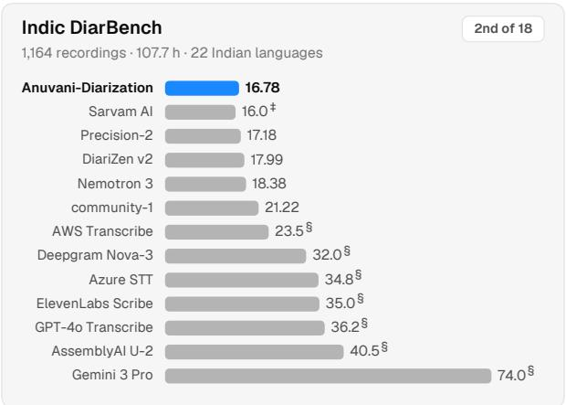  
0.78 higher DER than Sarvam AI's own score

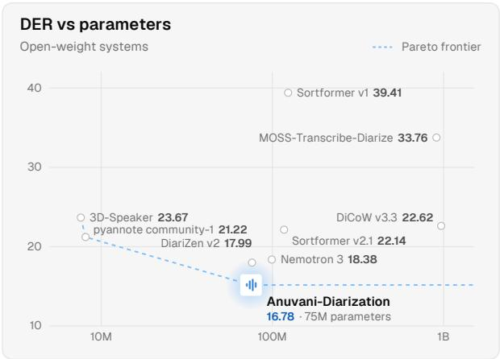  
1.21 lower than DiariZen v2 at the same size  
1.60 lower than NVIDIA Nemotron 3

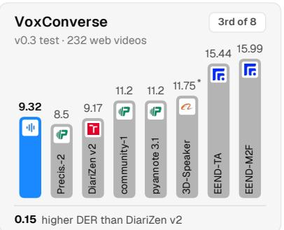  
Global Speaker Diarization Benchmarks

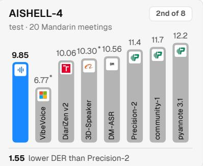

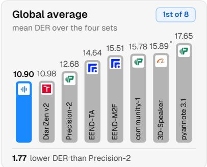

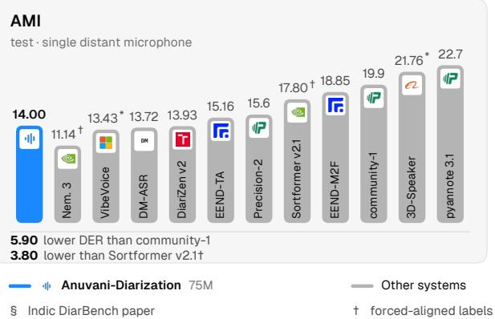

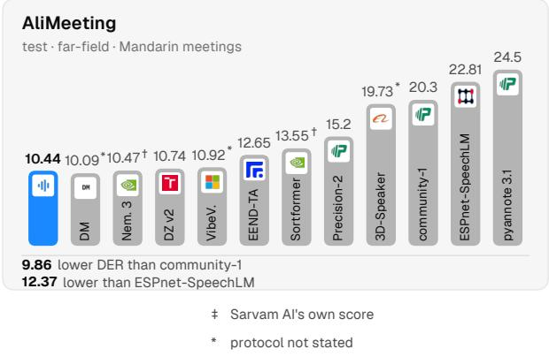  
Indic: duration-weighted DER; unmarked systems share one scorer, no speaker-count hint. Failures = empty output (MOSS 14, Sortformer v1 40, 3D-Speaker 2). § Joint ASR–diarization services (Indic DiarBench, Table 3). Sizes include all neural stages (DiCoW/MOSS include ASR). Global baselines: published scores. Both: 0 s collar, overlap scored; exceptions †/\*. DM-ASR's AliMeeting microphone condition is unspecified  
Ours: rc1, Indic mode; AISHELL-4 downmix, AliMeeting channel 0; pause joining cross-fitted on Indic DiarBench dev half. Labels: Precis.-2 = Precision-2; Nem. 3 = Nemotron 3; DZ v2 = DiariZen v2; VibeV. = VibeVoice-ASR; DM = DM-ASR.

Figure 1: Anuvani-Diarization on Indic DiarBench and global benchmarks. DER (%); bars start at zero. The released model is available at:

https://huggingface.co/CIIL/Anuvani-Diarization

## Abstract

India’s 22 scheduled languages are spoken by over a billion people in conversations that mix languages, often within one turn, overlap freely, and take place over telephones, in meetings, and in media. Knowing who spoke when, the task of speaker diarization, is essential to speech applications for such conversation: voice agents conversing with several people at once, speaker attributed transcription of meetings and calls, contact center analytics, and media monitoring. We present a systematic study of speaker diarization across all 22 languages on IndicDiarBench and introduce Anuvani-Diarization, which adapts a selfsupervised end-to-end segmentation model to Indian conversation with uncertainty aware silver supervision. Evaluated zero shot alongside nine recent diarization systems, it reaches a duration weighted diarization error rate (DER) of 16.78% on all 1,164 recordings, the lowest of all systems we ran and second only to the best published result (16.0%), and leads the three strongest rivals in 14 of 22 languages. It matches its parent on six international benchmarks. We also show that the benchmark’s utterance level annotation convention is a hidden variable worth 1.9 to 4.1 DER points, depending on the system, and that a convention learned from other Indian transcriptions does not transfer.

## 1 Introduction

Conversation in India is multilingual by default. The Constitution recognizes 22 languages in its Eighth Schedule (Ministry of Home Affairs, 2017), the 2011 Census recorded 19,569 raw mother tongue returns and found that 96.71% of the population has a scheduled language as its mother tongue (Registrar General of India, 2018), and roughly a quarter of the population reports speaking a second language (Sarma, 2025). Speakers move between languages within a single turn (Gumperz, 1982; Bali et al., 2014), interject, and overlap, and the same conversation may be held over a telephone, a video call or around a table. Every downstream technology that attributes words to people, from meeting transcription to broadcast monitoring and call analytics, first needs to answer the fundamental question of who spoke when.

Until recently there was no benchmark that could measure this capability across India’s languages. The DISPLACE challenges introduced diarization of code mixed Indian conversation only for a handful of languages (Baghel et al., 2023; Kalluri et al., 2024), and IndicDiarBench (Mehendale et al., 2026) now provides 108 hours of human corrected, speaker attributed conversation in all 22 scheduled languages, recorded as near field meetings, far field meetings and in-the-wild video. Its first results came from services that transcribe and diarize jointly, the strongest at a diarization error rate (DER) of 16.0%; dedicated diarization systems, which most research and deployment build on, were not evaluated.

We ask how the strongest diarization systems perform on Indian conversation when measured blind under one protocol, what, beyond acoustics, determines their errors, and what it would take to lead across the 22 languages. Our contributions are:

• A blind evaluation of nine diarization systems on all 1,164 IndicDiarBench recordings, with two independent scorer implementations, bootstrap intervals over source recordings and byte identical sharded inference (§4).

• Annotation convention as a hidden variable. The references segment speech the way transcribers do, into utterances; diarizers segment it at pauses. The gap moves every system by 1.9–4.1 pp of DER and the same correction is harmful on word aligned benchmarks, so convention must be an explicit property of a diarizer’s output; a convention learned from Indian telephone transcriptions does not transfer to the benchmark (§5).

• Anuvani-Diarization, an Indic adaptation of a self-supervised end-to-end segmentation model with uncertainty aware silver supervision from channel separated telephone calls (§6). Evaluated zero shot, with no part fitted or selected on the benchmark, it reaches 16.78% duration weighted DER, the lowest of all systems we ran (Figure 2), and leads the three strongest other systems in 14 of the 22 languages (Table 1).

• Generality: the adapted network matches its parent on six international benchmarks (§7.4).

## 2 Diarizing India: A Linguistic Perspective

Diarization is usually treated as a language independent task: a speaker’s voice is assumed to be the same regardless of the language they speak. India tests this assumption in four ways.

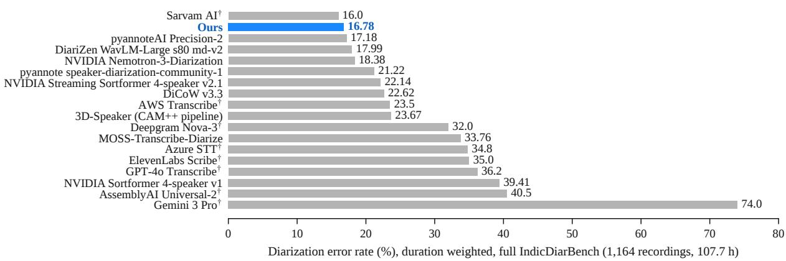  
Figure 2: Anuvani-Diarization is the most accurate of all systems we ran on IndicDiarBench. Duration weighted DER on all 1,164 recordings (zero collar, overlap scored). †Joint transcription and diarization services reported by the benchmark’s authors (Mehendale et al., 2026); all others were run under our protocol (Table 3).

Scale and diversity. The 22 scheduled languages range from Hindi, the mother tongue of 528.3 million people (43.63% of the population), to Sanskrit, returned as a mother tongue by 24,821 people (Registrar General of India, 2018). Eleven of them have more than thirty million mother tongue speakers each. The country’s Greenberg diversity index is 0.930: two randomly chosen residents would almost always have different native languages (Sarma, 2025). IndicDiarBench mirrors this distribution only partly. Eight of its languages (Bengali, Gujarati, Hindi, Kannada, Marathi, Punjabi, Tamil and Telugu) each contribute about four hours of near field meetings and appear in far field and in-the-wild recordings, while the fourteen others contribute about 1.5 hours of near field meetings each, and twelve of them appear in no other condition (Mehendale et al., 2026). A diarizer for India must therefore work well on languages for which almost no conversational training data exists.

Four families, one linguistic area. The scheduled languages belong to four families: fifteen are Indo-Aryan, four Dravidian (Kannada, Malayalam, Tamil, Telugu), two Tibeto-Burman (Bodo, Manipuri) and one Austroasiatic (Santali); they are written in more than ten scripts (Table 1). Centuries of contact have made South Asia a linguistic area in which unrelated languages share structural and phonetic features (Emeneau, 1956; Masica, 1976), most audibly the contrast between retroflex and dental consonants and, in Indo-Aryan, a four way laryngeal contrast among stops (Ladefoged and Maddieson, 1996). Some features are local: Punjabi has lexical tone (Hussain et al., 2020), and Manipuri (Meitei) contrasts high and low lexical tones (Chelliah, 1997). Pitch and timing, two cues that speaker embedding models exploit, thus carry linguistic as well as personal information. Even the English spoken in these conversations is shaped by the speaker’s first language (Kachru, 1983; Sirsa and Redford, 2013). For speaker diarization, this means that a speaker model trained mostly on English must separate who is speaking from which language, and which variety of English, is being spoken.

Conversational practice. Multilingual speakers switch languages within a given conversation for discourse purposes (Gumperz, 1982), and Hindi English mixing reaches into almost every register (Bali et al., 2014; Sitaram et al., 2019). IndicDiar-Bench’s annotators transcribe this mixing explicitly, and its authors describe the corpus as rich in “English code mixing, dialectal variation, and frequent speaker overlap” (Mehendale et al., 2026). Turn taking is universal in its basic organization but culturally variable when it comes to timing (Sacks et al., 1974; Stivers et al., 2009; Levinson, 2016): transitions that occur between speakers are short, and a substantial share of them have overlaps rather than gaps (Heldner and Edlund, 2010). In Indic-DiarBench this share of overlapped speech varies from 6.1% (Punjabi) to 24.7% (Maithili) across languages; in-the-wild video has the least overlap (6.5%), and near field meetings, whose participants were given debate topics, have the most overlap (Mehendale et al., 2026).

The utterance as a unit of annotation. Most importantly for this paper, a diarization reference embodies a theory of what a turn is. Word aligned references, typically derived from forced alignment, place segment boundaries at acoustic pauses. IndicDiarBench’s references are built by professional transcribers who correct speaker attributed, segment level transcriptions (Mehendale et al., 2026); their unit is the transcribed utterance, and short pauses which are within an utterance are not considered segment boundaries. Section 5 shows that this linguistic choice, rather than any acoustic property, is one of the largest single factors in diarization error on the benchmark.

## 3 Related Work

Diarization models. Modular diarization systems detect speech, embed short segments and cluster the embeddings, with Bayesian HMM clustering of x-vectors (VBx) as a strong back end (Landini et al., 2022; Park et al., 2022). End-toend neural diarization (EEND) predicts speaker activities jointly and processes overlap natively (Fujita et al., 2019); EEND with vector clustering (EEND-VC) combines local end-to-end segmentation with global clustering, so that recordings of any length and speaker count can be processed effectively (Kinoshita et al., 2021). The powerset formulation casts local segmentation as single label classification over subsets of active speakers (Plaquet and Bredin, 2023) and underlies pyannote (Bredin, 2023; pyannote, 2025); DiariZen replaces its front end with a structurally pruned WavLM (Chen et al., 2022; Han et al., 2025a,b) and a Conformer (Gulati et al., 2020). NVIDIA Sortformer models are trained explicitly with arrivaltime-ordered speaker supervision (Park et al., 2024; Medennikov et al., 2025), the approach of NVIDIA Nemotron-3-Diarization (NVIDIA, 2026).

Evaluation conventions. DER is sensitive to how references are made. Benchmarks differ in forgiveness collars and in whether overlap is scored; DIHARD established the strict setting of no collar with overlap scored (Ryant et al., 2021), and the underlying scoring tools differ in how they treat overlapping same speaker references (Bredin, 2017; Ryant, 2018). Most closely related to our analysis, Horiguchi et al. (2026b) decompose DER into a pause attributable component and a core component, and recent work trains models toward tight segment boundaries (Horiguchi et al., 2026a). We complement this line by measuring the convention of a multilingual benchmark directly, by showing that its effect is large and system wide, and by testing whether a convention learned from other transcriptions transfers to it.

Speech technology for Indian languages. Large data collection efforts have produced corpora and benchmarks for Indian languages, including IndicVoices (Javed et al., 2024), Kathbath and IndicSUPERB (Javed et al., 2023), IndicWav2Vec (Javed et al., 2021), SPRING-INX (Nithya R et al., 2023) and the MahaDhwani pre-training corpus (Bhogale et al., 2025); code switched recognition has its own challenge series (Diwan et al., 2021). For diarization, DISPLACE 2023 provided 32 hours of code mixed conversation and DIS-PLACE 2024 158 hours, 38 of them labeled, in five Indian languages (Baghel et al., 2023; Kalluri et al., 2024; Mehendale et al., 2026); IndicDiarBench is the first benchmark to cover all 22 scheduled languages (Mehendale et al., 2026).

Concurrent work. A related concurrent study evaluates spoken language identification across Indian languages, with emphasis on short-input robustness, calibration and language confusion (Anonymous, 2026). Its prediction target is the language of an audio segment. In contrast, this work predicts speaker activity over time and studies diarization error and annotation conventions. The two studies share their authors and build on publicly released Indian speech corpora; the public SPRING-INX corpus appears in both (as adaptation data here, as a held-out evaluation set there). Their pretrained backbones, benchmarks and experiments are otherwise distinct. The contributions and evaluations concern different speechprocessing tasks.

## 4 Benchmark and Evaluation Protocol

Data. IndicDiarBench contains 1,164 recordings (107.7 hours) with 2 to 9 speakers each: near field meetings recorded over an online platform with one close microphone per participant (about 53 hours, all 22 languages), far field meetings (27 hours, eight languages) and in-the-wild YouTube conversations (28 hours, ten languages). These meetings involve 485 speakers from 189 districts; references come from a five stage human pipeline (Mehendale et al., 2026). We use the Hugging Face release at revision 92877ba.

Scoring. We follow the benchmark: DER with no collar and overlapped speech scored. We score with

<table><tr><td></td><td></td><td></td><td>L1 speakers</td><td>Bench</td><td></td><td>Overlap</td><td colspan="3">DER (%), pooled</td><td></td></tr><tr><td>Language</td><td>Family</td><td>Script</td><td>(M), 2011</td><td>hours</td><td>Cond.</td><td>(%)</td><td>Ours</td><td>Best other</td><td></td><td>∆</td></tr><tr><td>Assamese</td><td>IA</td><td>Assamese</td><td>15.3</td><td>1.5</td><td>N</td><td>13.9</td><td>22.43</td><td>23.53</td><td>DZ</td><td>-1.10</td></tr><tr><td>Bengali</td><td>IA</td><td>Bengali</td><td>97.2</td><td>12.6</td><td>NFW</td><td>7.8</td><td>17.09</td><td>16.76</td><td>P2</td><td>+0.34</td></tr><tr><td>Bodo</td><td>TB</td><td>Devanagari</td><td>1.5</td><td>1.6</td><td>N</td><td>15.2</td><td>24.34</td><td>22.77</td><td>NM</td><td>+1.56</td></tr><tr><td>Dogri</td><td>IA</td><td>Devanagari</td><td>2.6</td><td>1.4</td><td>N</td><td>24.2</td><td>21.07</td><td>21.99</td><td>DZ</td><td>-0.92</td></tr><tr><td>Gujarati</td><td>IA</td><td>Gujarati</td><td>55.5</td><td>11.1</td><td>NFW</td><td>7.6</td><td>13.08</td><td>13.65</td><td>P2</td><td>-0.57</td></tr><tr><td>Hindi</td><td>IA</td><td>Devanagari</td><td>528.3</td><td>10.7</td><td>NFW</td><td>16.6</td><td>16.63</td><td>16.34</td><td>NM</td><td>+0.29</td></tr><tr><td>Kannada</td><td>Dr</td><td>Kannada</td><td>43.7</td><td>8.5</td><td>NFW</td><td>15.2</td><td>16.24</td><td>16.77</td><td>P2</td><td>-0.53</td></tr><tr><td>Kashmiri</td><td>IA</td><td>Perso-Arabic</td><td>6.8</td><td>1.1</td><td>N</td><td>21.2</td><td>19.41</td><td>19.89</td><td>NM</td><td>-0.48</td></tr><tr><td>Konkani</td><td>IA</td><td>Devanagari</td><td>2.3</td><td>1.6</td><td>N</td><td>14.0</td><td>20.57</td><td>20.84</td><td>NM</td><td>-0.27</td></tr><tr><td>Maithili</td><td>IA</td><td>Devanagari</td><td>13.6</td><td>1.3</td><td>N</td><td>24.7</td><td>20.71</td><td>18.73</td><td>NM</td><td>+1.98</td></tr><tr><td>Malayalam</td><td>Dr</td><td>Malayalam</td><td>34.8</td><td>3.7</td><td>NW</td><td>12.9</td><td>17.79</td><td>17.22</td><td>P2</td><td>+0.57</td></tr><tr><td>Manipuri</td><td>TB</td><td>Meitei Mayek</td><td>1.8</td><td>1.5</td><td>N</td><td>20.6</td><td>19.82</td><td>21.75</td><td>NM</td><td>-1.92</td></tr><tr><td>Marathi</td><td>IA</td><td>Devanagari</td><td>83.0</td><td>10.4</td><td>NFW</td><td>11.3</td><td>14.36</td><td>14.54</td><td>P2</td><td>-0.18</td></tr><tr><td>Nepali</td><td>IA</td><td>Devanagari</td><td>2.9</td><td>1.3</td><td>N</td><td>22.9</td><td>24.96</td><td>25.65</td><td>P2</td><td>-0.69</td></tr><tr><td>Odia</td><td>IA</td><td>Odia</td><td>37.5</td><td>3.1</td><td>NW</td><td>11.1</td><td>13.31</td><td>12.23</td><td>NM</td><td>+1.08</td></tr><tr><td>Punjabi</td><td>IA</td><td>Gurmukhi</td><td>33.1</td><td>10.6</td><td>NFW</td><td>6.1</td><td>19.78</td><td>18.90</td><td>P2</td><td>+0.87</td></tr><tr><td>Sanskrit</td><td>IA</td><td>Devanagari</td><td>0.02</td><td>1.6</td><td>N</td><td>21.4</td><td>17.80</td><td>19.68</td><td>DZ</td><td>-1.88</td></tr><tr><td>Santali</td><td>AA</td><td>Ol Chiki</td><td>7.4</td><td>1.6</td><td>N</td><td>6.5</td><td>12.66</td><td>13.98</td><td>P2</td><td>-1.33</td></tr><tr><td>Sindhi</td><td>IA</td><td>Perso-Arabic</td><td>2.8</td><td>1.5</td><td>N</td><td>16.0</td><td>18.62</td><td>16.82</td><td>NM</td><td>+1.80</td></tr><tr><td>Tamil</td><td>Dr</td><td>Tamil</td><td>69.0</td><td>10.0</td><td>NFW</td><td>12.4</td><td>14.62</td><td>15.18</td><td>P2</td><td>-0.56</td></tr><tr><td>Telugu</td><td>Dr</td><td>Telugu</td><td>81.1</td><td>9.3</td><td>NFW</td><td>20.4</td><td>21.22</td><td>22.29</td><td>P2</td><td>-1.06</td></tr><tr><td>Urdu</td><td>IA</td><td>Perso-Arabic</td><td>50.8</td><td>1.6</td><td>N</td><td>12.5</td><td>16.24</td><td>17.75</td><td>P2</td><td>-1.51</td></tr><tr><td>All 22 languages</td><td></td><td></td><td></td><td>107.7</td><td></td><td>12.8</td><td>17.11</td><td>17.58</td><td>P2</td><td>-0.47</td></tr></table>

Table 1: The 22 scheduled languages and Anuvani-Diarization’s accuracy on each. Family (IA Indo-Aryan, Dr Dravidian, TB Tibeto-Burman, AA Austroasiatic), benchmark hours, recording conditions (N near field, F far field, W in-the-wild) and overlap are from Mehendale et al. (2026); mother tongue speakers from the 2011 Census (Registrar General of India, 2018). “Best other” is the most accurate of pyannoteAI Precision-2 (P2), DiariZen md-v2 (DZ) and NVIDIA Nemotron-3-Diarization (NM) on that language; the better of ours and the best other is in bold, and ∆ is ours minus the best other, in percentage points, computed from the unrounded values. Bench hours are hours in the benchmark. Anuvani-Diarization leads in 14 of the 22 languages.

NIST md-eval semantics (our scorer is identical to dscore (Ryant, 2018) on every system and set we checked); the scorer merges the small number of overlapping same speaker reference segments in the benchmark. We report both pooled (micro) DER and the duration weighted average used by the benchmark paper. For recording $i ,$ let $E _ { i }$ be the total missed speech, false alarm and speaker confusion time, $S _ { i }$ the reference speaker time, and Ti the recording duration:

$$
\begin{array} { c } { { \mathrm { D E R } _ { \mathrm { p o o l e d } } = \displaystyle \frac { \sum _ { i } E _ { i } } { \sum _ { i } S _ { i } } , } } \\ { { \mathrm { D E R } _ { \mathrm { D W } } = \displaystyle \frac { \sum _ { i } T _ { i } ( E _ { i } / S _ { i } ) } { \sum _ { i } T _ { i } } . } } \end{array}\tag{1}
$$

We express both ratios as percentages. Pooled DER weights recordings by reference speaker time; duration weighted DER weights them by recording duration. Confidence intervals come from 5,000 bootstrap resamples of the 590 source recordings (seed 3407).

Competitor systems. We ran nine diarization systems on the same single channel audio with each project’s recommended configuration: pyannoteAI Precision-2 through its commercial API (pyannoteAI, 2026), DiariZen WavLM-Large s80 md-v2 (Han et al., 2025a), NVIDIA Nemotron-3-Diarization (NVIDIA, 2026), pyannote speaker-diarization-community-1 (pyannote, 2025), NVIDIA Streaming Sortformer 4-speaker v2.1 and NVIDIA Sortformer 4-speaker v1 (Park et al., 2024; Medennikov et al., 2025), DiCoW v3.3 (BUT Speech@FIT, 2025), the 3D-Speaker pipeline (Chen et al., 2024) and MOSS-Transcribe-Diarize (MOSI.AI et al., 2026). All outputs were scored together. For the systems that we ran on several GPUs, a single GPU replay of all 1,164 recordings reproduced the sharded outputs byte for byte.

Zero shot protocol. Nothing in our system, Anuvani-Diarization, was trained, tuned or selected on IndicDiarBench. The segmentation network was adapted on other recordings (§6), audio fingerprint screening found no audio shared with the benchmark, the recipe and checkpoint were fixed on an internal panel of non-benchmark recordings, and its clustering uses the parent model’s default settings. The system was frozen before it was first scored on the benchmark, although earlier versions of it had been scored there. The competitor systems were run off the shelf, so every system we report was evaluated zero shot.

<table><tr><td>System Raw  $\pmb { g } ^ { * }$ </td></tr><tr><td>After  $\pmb { \Delta }$  Ours (Anuvani-Diarization) 17.11 0.8 15.21 -1.90</td></tr><tr><td>pyannoteAI Precision-2 17.58 0.8 15.55 -2.03 DiariZen md-v2 18.31 1.015.40 -2.91 18.71 1.014.58</td></tr><tr><td>NVIDIA Nemotron-3-Diarization -4.14 Word aligned public test sets (ours)</td></tr><tr><td>VoxConverse v0.3 test 9.321.0  $1 0 . 0 0 \ + 0 . 6 8 $ </td></tr><tr><td>NOTSOFAR-1 eval 17.411.0  $2 1 . 6 3 \ + 4 . 2 2$ </td></tr><tr><td>MagicData-RAMC test 11.13 1.0  $1 7 . 1 4 \ + 6 . 0 1$ </td></tr></table>

Table 2: Matching the reference convention moves every system, in opposite directions on different benchmarks. Pooled DER before (Raw) and after bridging same speaker gaps shorter than $g ^ { * }$ , the best threshold on the benchmark itself (a sensitivity analysis, not a system result); $\Delta$ is computed from the unrounded values. Bottom: on word aligned references, bridging at $g = 1 . 0 \ : \mathrm { s }$ raises DER.

## 5 Annotation Convention as a Hidden Variable

Diagnosis. Figure 3 (left) compares gaps between consecutive same speaker segments. In IndicDiarBench’s references only 7.7% of such gaps are shorter than half a second, and only 3.4% in the near field meetings. In the output of every diarizer in Figure 3 (left), the share is between 24.9% and 32.1%. The systems are not wrong about the acoustics: speakers tend to pause inside their turns. They disagree with the references about what counts as a segment, and every such pause inside a reference utterance is scored as missed speech.

Effect. Bridging same speaker gaps shorter than a threshold $g$ is a convention change that leaves the acoustic decisions untouched. Its effect is large and consistent (Figure 3, right; Table 2). As a sensitivity analysis, with $g$ chosen on the benchmark itself (a measurement of the convention, not a system), DER falls by 1.90 pp for Anuvani-Diarization, 2.03 pp for pyannoteAI Precision-2, 2.91 pp for DiariZen md-v2 and 4.14 pp for NVIDIA Nemotron-3-Diarization, the most finely segmenting system we measured, at thresholds of 0.8 to 1.0 s.

A property of the benchmark, not of speech. Applied to benchmarks whose references are word aligned, the same bridging raises DER, by 0.68 to 6.01 pp on VoxConverse, NOTSOFAR-1 and MagicData-RAMC (Table 2, bottom). There is therefore no convention free output: the best segmentation depends on whose notion of a turn is being scored. Utterance level references suit speaker attributed transcription and word aligned references acoustic analysis, and neither is wrong. We draw three consequences: benchmarks should document their segmentation conventions as precisely as their collar and overlap rules; systems should be compared only under matched output conventions; and a diarizer should expose its convention as an explicit, documented mode rather than silently adopting one.

## 5.1 Learning an annotation convention

Can the convention be learned without the benchmark’s labels? We fitted a convention decoder on human transcriptions of 302 SPRING-INX telephone calls, which, like the benchmark’s references, are speaker attributed utterance spans; chose every setting on 35 held out calls under a protocol fixed in advance; and scored the frozen system once on all 1,164 recordings. DER rose from 17.11% to 22.74% (Table 4): missed speech fell from 8.91% to 2.89%, but false alarm rose from 3.55% to 15.29%. On the telephone transcripts, bridging kept helping up to the largest gap we allowed (1.5 s): their transcribers keep an utterance open across longer pauses than the benchmark’s annotators do. Two corpora that both segment speech into transcribed utterances thus still disagree about where an utterance ends, so a diarizer can match a benchmark’s convention only from references produced the same way.

Selection protocol. A protocol fixing every candidate and decision rule was committed before any measurement, and a filesystem guard refused every IndicDiarBench file to the selection code. For this experiment only, clustering was chosen on 146 recordings of NOTSOFAR-1, VoxConverse, SPRING-INX, AMI, AISHELL-4 and AliMeeting from 21 VBx configurations, with and without a cannot-link repair that splits clusters whose strongly supported local speakers share a window; the repair at threshold 0.65 and $F _ { a } = 0 . 0 6$ won (mean pooled DER 12.26% against 12.51% for the default).

Decoder training. References for the convention were the human transcript spans of each

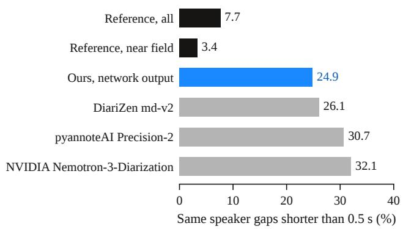

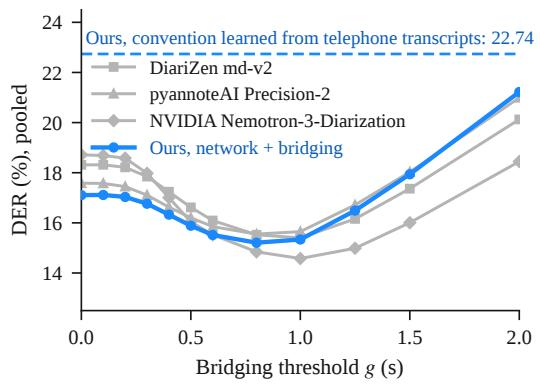  
Figure 3: The benchmark’s references segment speech into utterances; diarizers segment it at pauses. Left: share of same speaker gaps shorter than 0.5 s on all 1,164 recordings. Right: pooled DER as same speaker gaps shorter than g are bridged (y-axis from 12.5%); dashed: Anuvani-Diarization with a convention learned from Indian telephone transcripts, scored once (§5.1).

SPRING-INX call’s two channels. The bridging gap was chosen on 35 held out calls from $g \in \{ 0 , 0 . 2 5 , \ldots , 1 . 5 \}$ s (best: 1.5 s). The decoder, gradient boosted regression trees (Ke et al., 2017; Pedregosa et al., 2011) with 400 iterations, learning rate 0.05, 31 leaves and at least 200 samples per leaf, predicts for every same speaker gap and every segment shorter than 3 s the change in error time that bridging the gap or dropping the segment would cause, from the local geometry, the recording and the network’s own evidence.

Held-out selection and final evaluation. Fitted on the 302 training calls, it beat blanket bridging on the 35 held out calls (duration weighted DER 30.02% against 32.11%, paired 95% CI entirely below zero) and was adopted. The frozen system was scored once on IndicDiarBench: 22.74% pooled and 22.43% duration weighted DER.

## 6 Anuvani-Diarization

Anuvani-Diarization follows the EEND-VC design (Figure 4). A segmentation network processes 16 s windows with a 1.6 s hop and predicts, for every 20 ms frame, one of 16 powerset classes over four local speakers. Overlap free frames of each local speaker are embedded with a ResNet34 speaker model (He et al., 2016; Wang et al., 2023), local speakers are linked across windows by VBx clustering with the parent model’s probabilistic linear discriminant analysis (PLDA) and default settings, and the frame level activities are aggregated into a recording level segmentation. Nothing after the network is tuned.

Starting point. We start from DiariZen WavLM-Large s80 md-v2, whose segmentation network combines a WavLM-Large encoder pruned to 80% sparsity with a Conformer head (Han et al., 2025a,b), and adapt it to Indian conversational speech.

Data. The adaptation set contains 848 recordings (370.5 hours). Indian conversation comes from 302 two party telephone calls of SPRING-INX in eight languages (Assamese, Bengali, Gujarati, Hindi, Malayalam, Marathi, Punjabi, Tamil; 98.5 hours) (Nithya R et al., 2023). Multi-party meetings come from NOTSOFAR-1 (71 recordings, 7.3 hours) (Vinnikov et al., 2024), AMI (101, 59.9 hours) (Carletta et al., 2005), AISHELL-4 (173, 97.2 hours) (Fu et al., 2021) and AliMeeting (201, 107.6 hours) (Yu et al., 2022). Each mini-batch draws 50% of its crops from the Indian calls with languages balanced, 25% from NOTSOFAR-1 and 25% from the other meetings. The 302 calls are 90 calls admitted first and 212 of 346 later candidates: before admission, every candidate was screened against every other recording by acoustic fingerprinting (Lalinský, 2010) with waveform corroboration, the 134 candidates that matched another recording were held out, and no audio in the adaptation set is shared with the benchmark.

Silver labels with explicit uncertainty. Each SPRING-INX call was recorded with one channel per speaker, which yields speaker labels without manual annotation, but channel evidence is imperfect: a quiet speaker, crosstalk or untranscribed speech can make a label wrong. Rather than trusting or discarding such labels, we mark every 10 ms cell as known or unknown. A cell is unknown if a positive label lacks energy support on its own channel, is more than 15 dB quieter than the other channel, contradicts a transcript interval, falls within 100 ms of a label or transcript boundary, or disagrees with an independent pretrained diarizer applied to each isolated channel. Unknown frames contribute no loss; quiet positives are masked rather than relabeled as silence. Of the 98.5 hours of call audio, 51.9 hours remain supervised.

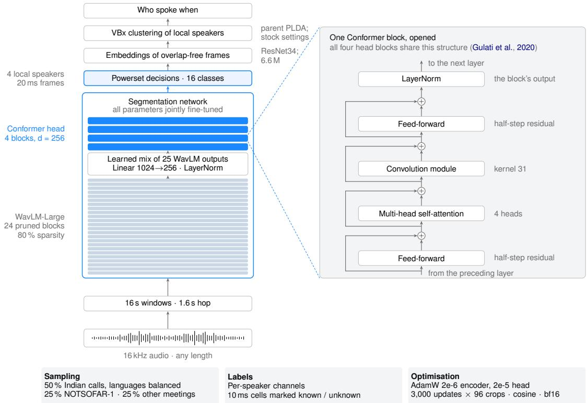  
Figure 4: Anuvani-Diarization. The Indic-adapted segmentation network combines a pruned WavLM-Large encoder with four Conformer blocks (blue) and predicts 16 powerset classes every 20 ms. The inset opens one Conformer block. Overlap-free speaker embeddings and VBx clustering link local speakers across windows; chips summarise the adaptation recipe.

Training. We train all parameters jointly for 3,000 updates of 96 sixteen second crops each (288,000 crops) with AdamW $( \beta = ( 0 . 9 , 0 . 9 8 )$ weight decay 0.01), learning rates of $2 \times 1 0 ^ { - 6 }$ for the encoder and $2 \times 1 0 ^ { - 5 }$ for the head, 50 warmup updates, cosine decay, gradient clipping at 1.0 and bfloat16 arithmetic. Training takes about 91 minutes on six RTX A6000 GPUs.

Size. The network has 69.5 M parameters and the speaker model 6.6 M. Inference is deterministic: rerunning it reproduces its outputs byte for byte.

## 6.1 Inference and reproducibility

Inference. Windows of 16 s with a 1.6 s hop; powerset decisions by argmax followed by an 11 frame median filter; embeddings from overlap free frames when a local speaker has more than two such frames; agglomerative initialization (threshold 0.6) followed by VBx with the parent model’s PLDA and parameters $( F _ { a } = 0 . 0 7 , F _ { b } = 0 . 8 , 2 0$ iterations). Inference uses FP32 arithmetic with TF32 disabled, deterministic kernels and a fixed seed reset for every file.

Data, models and software. IndicDiarBench is licensed CC BY 4.0. NOTSOFAR-1, AMI and VoxConverse are licensed CC BY 4.0, AISHELL-4 and AliMeeting CC BY-SA 4.0, and MagicData-RAMC CC BY-NC-ND 4.0 (used for evaluation only); SPRING-INX is released for research by its creators (Nithya R et al., 2023). The parent segmentation weights are licensed CC BY-NC 4.0, the ResNet34 speaker model and the PLDA CC BY 4.0, and pyannote speaker-diarization-community-1 CC BY 4.0; the other competitor systems were used under their own terms. We use PyTorch 2.1.1, pyannote.audio 3.1.1 in the DiariZen code base (commit 844f555), scikit-learn 1.7.2 and NumPy 1.26.4.

Reproducibility. The supplementary material contains the score files and the scripts that regenerate every table and figure of this paper from them.

<table><tr><td colspan="6">Run under our protocol</td><td colspan="4">Reported by Mehendale et al. (2026)</td></tr><tr><td>System</td><td>Pool.</td><td>DW</td><td>Miss</td><td></td><td>FA Conf.</td><td>System</td><td></td><td>DW Miss FA</td><td>Conf.</td></tr><tr><td>Ours (Anuvani-Diarization)</td><td>17.11 16.78</td><td></td><td>8.91 3.55</td><td></td><td>4.65</td><td>Sarvam AI†</td><td></td><td>16.0 6.3 3.9</td><td>5.9</td></tr><tr><td>pyannoteAI Precision-2</td><td>17.58 17.18</td><td></td><td>9.70 3.06</td><td></td><td>4.82</td><td></td><td>AWS Transcribe†</td><td>23.5 13.1 3.1</td><td>7.4</td></tr><tr><td>DiariZen WavLM-Large s80 md-v2</td><td>18.31 17.99</td><td></td><td>11.073.03</td><td></td><td>4.22</td><td>Deepgram Nova-3†</td><td></td><td>32.0 18.3 5.4</td><td>8.3</td></tr><tr><td>NVIDIA Nemotron-3-Diarization</td><td>18.71 18.38</td><td></td><td>313.07 2.63</td><td></td><td>3.01</td><td>Azure STT†</td><td></td><td>34.8 24.4 1.7</td><td>8.7</td></tr><tr><td>pyannote speaker-diarization-community-1 21.65 21.22</td><td></td><td></td><td>11.25 2.94</td><td></td><td>7.46</td><td></td><td>ElevenLabs Scribe†</td><td>35.0 13.6 6.2</td><td>15.3</td></tr><tr><td>NVIDIA Streaming Sortformer 4-spk v2.1 22.34 22.14</td><td></td><td></td><td>8.94 4.32</td><td></td><td>9.07</td><td></td><td>GPT-4o Transcribe†</td><td>36.2 17.7 3.8</td><td>14.7</td></tr><tr><td>DiCoW v3.3</td><td>22.76 22.62</td><td></td><td>213.585.44</td><td></td><td>3.73</td><td></td><td>AssemblyAI Universal-2†</td><td>40.5 25.5 5.5</td><td>9.6</td></tr><tr><td>3D-Speaker (CAM++ pipeline)</td><td>24.3923.6713.014.30</td><td></td><td></td><td></td><td>7.08</td><td>Gemini 3 Pro†</td><td></td><td>74.041.7 5.8</td><td>26.5</td></tr><tr><td>MOSS-Transcribe-Diarize</td><td>34.52 33.76 25.111.74</td><td></td><td></td><td></td><td>7.67</td><td></td><td></td><td></td><td></td></tr><tr><td>NVIDIA Sortformer 4-spk  $\mathrm { v } 1 ^ { b }$ </td><td></td><td></td><td>39.66 39.41 30.68 2.30</td><td></td><td>6.68</td><td></td><td></td><td></td><td></td></tr></table>

Table 3: Full IndicDiarBench results (1,164 recordings; DER in %, zero collar, overlap scored). Left: run under our protocol, pooled (Pool.) and duration weighted (DW); ours in bold. Right: joint transcription and diarization services (†), as reported and named by the benchmark’s authors, who do not give model versions for all of them. Every system was evaluated zero shot; 4-spk: 4-speaker; Miss: missed speech; FA: false alarm; Conf.: confusion. bInputs beyond the model’s maximum length are scored as missed.

## 7 Results

## 7.1 Overall benchmark performance

Table 3 and Figure 2 show that Anuvani-Diarization reaches 17.11% pooled and 16.78% duration weighted DER on all 1,164 recordings (pooled 95% CI: 15.80 to 18.45), the lowest of all systems we ran. The paired bootstrap differences all exclude zero: −0.47 pp (95% CI [−0.84, −0.09]) against pyannoteAI Precision-2, −1.21 ([−1.40, −1.01]) against DiariZen md-v2 and −1.60 ([−2.18, −1.06]) against NVIDIA Nemotron-3-Diarization. The only lower published figure is the 16.0% selfreported by Sarvam AI for its joint transcription and diarization service, 0.78 pp below ours in duration weighted terms. Every system is a single trained model, so the intervals reflect the sampling of recordings, not training seeds.

## 7.2 Effect of Indic adaptation

Indic adaptation lowers DER from 18.31% to 17.11% (duration weighted: 17.99% to 16.78%; Table 4). It recovers missed speech (11.07% to 8.91%) at a cost of 0.52 pp more false alarm and 0.43 pp more confusion. The third row is the zero shot convention adapter of Section 5.1.

## 7.3 Languages, conditions and speaker counts

Anuvani-Diarization leads the three strongest other systems in 14 of the 22 languages (Table 1). Its largest margins are in Manipuri (−1.92 pp), Sanskrit (−1.88), Urdu (−1.51) and Santali (−1.33), none of which is in our adaptation data; it trails the best other system most in Maithili (+1.98), Sindhi (+1.80) and Bodo (+1.56). Of these four systems, it is the most accurate in near field meetings (19.05% against 19.93% for the best other system) and far field meetings (18.64% against 19.48%), but not on in-the-wild video, where pyannoteAI Precision-2 leads (10.78% against 11.51%). It leads at every number of speakers from two to eight except four (Figure 5, Table 5).

<table><tr><td>Configuration</td><td>Pool. DW Miss</td><td>FA</td><td>Conf.</td></tr><tr><td>DiariZen WavLM-Large s80 md-v2 (parent)</td><td>18.31 17.99 11.07</td><td>3.03</td><td>4.22</td></tr><tr><td>+ Indic adaptation (Anuvani-Diarization)</td><td>17.11 16.78 8.91</td><td>3.55</td><td>4.65</td></tr><tr><td>+ convention learned from 22.74 22.43 telephone transcripts</td><td>2.89</td><td>15.29</td><td>4.56</td></tr></table>

Table 4: Indic adaptation helps; a convention learned from telephone transcripts does not transfer. DER (%) on all 1,164 recordings, each row evaluated zero shot. zFitted on 302 SPRING-INX calls and selected on 35 others under a fixed protocol; scored once (Section 5.1).

Table 5 gives the recording counts behind these comparisons. The speaker-count analysis covers 1,157 recordings with two to eight speakers; the seven recordings with nine speakers remain in the full benchmark scores. The groups differ in both size and recording content: there are 294 two-speaker recordings but only 26 eight-speaker recordings. The trend therefore describes performance on the observed groups, rather than a controlled effect of adding speakers to the same conversation.

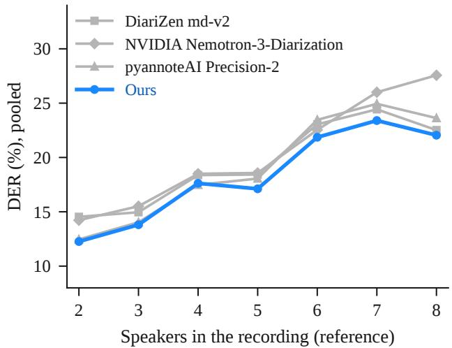

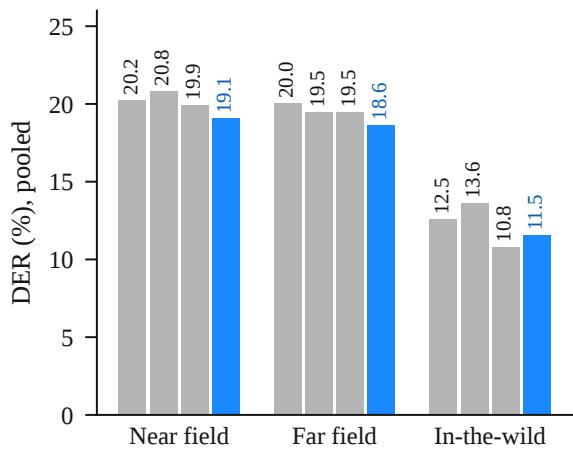

Figure 5: Anuvani-Diarization leads in near field and far field meetings and at six of seven speaker counts. Pooled DER on all 1,164 recordings by the number of reference speakers (left; 2 to 8 speakers cover 1,157 recordings) and by recording condition (right; bars left to right: DiariZen md-v2, NVIDIA Nemotron-3-Diarization, pyannoteAI Precision-2, Anuvani-Diarization).
<table><tr><td>Subset</td><td>Rec.</td><td>Ours</td><td>P2</td><td>DZ</td><td>NM</td></tr><tr><td>Near field</td><td>781</td><td>19.05</td><td>19.93</td><td>20.25</td><td>20.83</td></tr><tr><td>Far field</td><td>173</td><td>18.64</td><td>19.48</td><td>20.03</td><td>19.48</td></tr><tr><td>In-the-wild</td><td>210</td><td>11.51</td><td>10.78</td><td>12.55</td><td>13.58</td></tr><tr><td>2 speakers</td><td>294</td><td>12.26</td><td>12.46</td><td>14.54</td><td>14.22</td></tr><tr><td>3 speakers</td><td>227</td><td>13.81</td><td>14.03</td><td>14.96</td><td>15.51</td></tr><tr><td>4 speakers</td><td>234</td><td>17.62</td><td>17.48</td><td>18.38</td><td>18.50</td></tr><tr><td>5 speakers</td><td>148</td><td>17.12</td><td>18.06</td><td>18.43</td><td>18.58</td></tr><tr><td>6 speakers</td><td>162</td><td>21.86</td><td>23.46</td><td>23.05</td><td>22.54</td></tr><tr><td>7 speakers</td><td>66</td><td>23.40</td><td>24.94</td><td>24.43</td><td>26.00</td></tr><tr><td>8 speakers</td><td>26</td><td>22.05</td><td>23.62</td><td>22.52</td><td>27.56</td></tr></table>

Table 5: Pooled DER (%) by recording condition (all 1,164 recordings) and by number of reference speakers (1,157 recordings with 2–8 speakers). Rec.: recordings; P2: pyannoteAI Precision-2; DZ: DiariZen md-v2; NM: NVIDIA Nemotron-3-Diarization. Best in bold.

## 7.4 Transfer to international benchmarks

A model adapted to one population can lose ground elsewhere. On six international test sets (Table 6), Anuvani-Diarization matches its parent: it is better on three sets and worse on three, with a mean DER of 12.03% against 12.19% for DiariZen md-v2. Indic adaptation thus costs no accuracy on these sets on average.

The mean in Table 6 gives each test set equal weight; it is not pooled across all recordings or hours. The largest improvement over the parent is 0.85 pp on NOTSOFAR-1, and the largest regression is 0.16 pp on MagicData-RAMC. Both systems use the parent model’s clustering, so these comparisons evaluate the effect of changing the segmentation network within the same inference pipeline.

<table><tr><td></td><td colspan="3">DiariZen</td></tr><tr><td>Test set</td><td>Files</td><td>md-v2</td><td>Ours</td></tr><tr><td>VoxConverse v0.3 test</td><td>232</td><td>9.17</td><td>9.32</td></tr><tr><td>NOTSOFAR-1 evalª</td><td>129</td><td>18.26</td><td>17.41</td></tr><tr><td>MagicData-RAMC test</td><td>43</td><td>10.97</td><td>11.13</td></tr><tr><td>AMI test (SDM)</td><td>16</td><td>13.93</td><td>14.00</td></tr><tr><td>AISHELL-4 test</td><td>20</td><td>10.06</td><td>9.85</td></tr><tr><td>AliMeeting test (far)</td><td>20</td><td>10.74</td><td>10.44</td></tr><tr><td>Mean</td><td></td><td>12.19</td><td>12.03</td></tr></table>

Table 6: The adapted network matches its parent beyond India. DER (%), zero collar, overlap scored, both with the parent model’s clustering (Chung et al., 2020; Vinnikov et al., 2024; Yang et al., 2022; Carletta et al., 2005; Fu et al., 2021; Yu et al., 2022). The better of the two is in bold. SDM: single distant microphone. aA single channel device per meeting.

## 8 Discussion

Convention is part of the task. The convention adapter failed for a reason that supports Section 5: two corpora transcribed into speaker attributed utterances still disagree about where an utterance ends. Matching a benchmark’s convention therefore needs references made the way the benchmark’s are, or a convention documented precisely enough to be reproduced.

Linguistic diversity and transfer. Anuvani-Diarization’s Indian adaptation data covers eight languages of two party telephone conversation, yet ten of the fourteen languages in which it leads are languages it never saw in adaptation, including Manipuri, Sanskrit, Urdu and Santali. This suggests that the adaptation mostly teaches the acoustic and conversational conditions of Indian speech, which transfer across the families of the linguistic area, rather than properties of particular languages. Difficulty remains where conversation is hardest: near field debates with many participants and over 20% overlapped speech, as in Nepali, Telugu, Maithili and Dogri.

## 9 Conclusion

We presented the first systematic study of dedicated speaker diarization systems across India’s 22 scheduled languages, showed that the benchmark’s utterance level convention is a hidden variable worth 1.9 to 4.1 pp of DER and that a convention learned from other transcriptions does not transfer to it, and introduced Anuvani-Diarization, which, evaluated zero shot, is the most accurate of all systems we ran (16.78% duration weighted DER) and matches its parent across six international benchmarks.

## Limitations

Anuvani-Diarization does not model the benchmark’s segmentation convention: matching it would lower its DER by about 1.9 pp (Table 2), but our attempt to learn it from other transcriptions failed (§5.1), and we did not fit it on the benchmark itself. Its duration weighted DER remains 0.78 pp above the 16.0% self-reported by Sarvam AI, whose system we did not run. The segmentation network models at most four simultaneous speakers within a 16 s window, although the number of speakers per recording is unbounded. The Indian adaptation data comprises two party telephone calls in eight languages; multi-party Indian meetings for training would likely help further. Our evaluation uses one benchmark of 108 hours; the international results provide a second view but not an Indian one. The network inherits the noncommercial license (CC BY-NC 4.0) of its parent model’s weights.

## Ethical Considerations

All training and evaluation data are publicly released research corpora, used under their terms of release; no new recordings of people were made. Diarization identifies when different people speak but not who they are; it can nevertheless be combined with other tools to profile speakers, and the model’s weights are licensed for non-commercial research use only. Performance varies across languages and conditions (Table 1); deployments should evaluate on their own population.

AI assistance. AI assistants (Claude Code, OpenAI Codex and other tools) were used for software development, figure plotting, automated consistency checks and the editing of parts of the text. The authors verified all experiments, numbers and claims against the experimental record.

## References

Anonymous. 2026. Anuvani-LID: Robust and Calibrated Spoken Language Identification for Indian Languages. Under review.

Shikha Baghel, Shreyas Ramoji, Sidharth, Ranjana H, Prachi Singh, Somil Jain, Pratik Roy Chowdhuri, Kaustubh Kulkarni, Swapnil Padhi, Deepu Vijayasenan, and Sriram Ganapathy. 2023. The DISPLACE challenge 2023 – DIarization of SPeaker and LAnguage in conversational environments. In Proc. Interspeech, pages 3562–3566.

Kalika Bali, Jatin Sharma, Monojit Choudhury, and Yogarshi Vyas. 2014. “I am borrowing ya mixing?” An Analysis of English-Hindi Code Mixing in Facebook. In Proceedings of the First Workshop on Computational Approaches to Code Switching.

Kaushal Santosh Bhogale, Deovrat Mehendale, Tahir Javed, et al. 2025. Towards bringing parity in pretraining datasets for low-resource Indian languages. In Proc. ICASSP.

Hervé Bredin. 2017. pyannote.metrics: A toolkit for reproducible evaluation, diagnostic, and error analysis of speaker diarization systems. In Proc. Interspeech.

Hervé Bredin. 2023. pyannote.audio 2.1 speaker diarization pipeline: Principle, benchmark, and recipe. In Proc. Interspeech, pages 1983–1987.

BUT Speech@FIT. 2025. DiCoW: Diarizationconditioned Whisper (repository and model card BUT-FIT/DiCoW\_v3\_3\_large). https://github. com/BUTSpeechFIT/DiCoW.

Jean Carletta, Simone Ashby, Sebastien Bourban, Mike Flynn, Mael Guillemot, Thomas Hain, et al. 2005. The AMI meeting corpus: A pre-announcement. In Proc. Machine Learningfor Multimodal Interaction (MLMI), pages 28–39.

Shobhana Lakshmi Chelliah. 1997. A Grammar ofMeithei, volume 17 of Mouton Grammar Library. Mouton de Gruyter, Berlin.

Sanyuan Chen, Chengyi Wang, Zhengyang Chen, Yu Wu, Shujie Liu, Zhuo Chen, Jinyu Li, Naoyuki Kanda, Takuya Yoshioka, Xiong Xiao, Jian Wu, Long Zhou, Shuo Ren, Yanmin Qian, Yao Qian, Jian Wu,

Michael Zeng, Xiangzhan Yu, and Furu Wei. 2022. WavLM: Large-scale self-supervised pre-training for full stack speech processing. IEEE Journal of Selected Topics in Signal Processing.

Yafeng Chen, Siqi Zheng, Hui Wang, Luyao Cheng, et al. 2024. 3D-Speaker-Toolkit: An open-source toolkit for multimodal speaker verification and diarization. Preprint, arXiv:2403.19971.

Joon Son Chung, Jaesung Huh, Arsha Nagrani, Triantafyllos Afouras, and Andrew Zisserman. 2020. Spot the conversation: Speaker diarisation in the wild. In Proc. Interspeech, pages 299–303.

Anuj Diwan, Rakesh Vaideeswaran, Sanket Shah, Ankita Singh, et al. 2021. MUCS 2021: Multilingual and code-switching ASR challenges for low resource Indian languages. In Proc. Interspeech.

Murray B. Emeneau. 1956. India as a linguistic area. Language, 32(1):3–16.

Yihui Fu, Luyao Cheng, Shubo Lv, Yukai Jv, Yuxiang Kong, Zhuo Chen, Yanxin Hu, Lei Xie, Jian Wu, Hui Bu, Xin Xu, Jun Du, and Jingdong Chen. 2021. AISHELL-4: An open source dataset for speech enhancement, separation, recognition and speaker diarization in conference scenario. In Proc. Inter speech, pages 3665–3669.

Yusuke Fujita, Naoyuki Kanda, Shota Horiguchi, Kenji Nagamatsu, and Shinji Watanabe. 2019. End-to-end neural speaker diarization with permutation-free objectives. In Proc. Interspeech.

Anmol Gulati, James Qin, Chung-Cheng Chiu, Niki Parmar, Yu Zhang, Jiahui Yu, Wei Han, Shibo Wang, Zhengdong Zhang, Yonghui Wu, and Ruoming Pang. 2020. Conformer: Convolution-augmented transformer for speech recognition. In Proc. Interspeech.

John J. Gumperz. 1982. Discourse Strategies. Cambridge University Press, Cambridge.

Jiangyu Han, Federico Landini, Johan Rohdin, Anna Silnova, Mireia Diez, and Lukáš Burget. 2025a. Leveraging self-supervised learning for speaker diarization. In Proc. ICASSP.

Jiangyu Han, Petr Pálka, Marc Delcroix, Federico Landini, Johan Rohdin, Jan Cernocký, and Lukáš Bur-ˇ get. 2025b. Efficient and robust speaker diarization via structured pruning of self-supervised models. Preprint, arXiv:2506.18623.

Kaiming He, Xiangyu Zhang, Shaoqing Ren, and Jian Sun. 2016. Deep residual learning for image recognition. In Proc. CVPR.

Mattias Heldner and Jens Edlund. 2010. Pauses, gaps and overlaps in conversations. Journal of Phonetics, 38(4):555–568.

Shota Horiguchi, Marc Delcroix, Naohiro Tawara, Takanori Ashihara, and Atsushi Ando. 2026a. Tight boundary prediction in speaker diarization using causal-anticausal consistency. Preprint, arXiv:2606.11795.

Shota Horiguchi, Marc Delcroix, Naohiro Tawara, and Alexis Plaquet. 2026b. Diarization error decomposition under pause annotation ambiguity. Preprint, arXiv:2609.11007.

Qandeel Hussain, Michael Proctor, Mark Harvey, and Katherine Demuth. 2020. Punjabi (Lyallpuri variety). Journal of the International Phonetic Association, 50(2):282–297.

Tahir Javed, Kaushal Santosh Bhogale, Abhigyan Raman, Anoop Kunchukuttan, Pratyush Kumar, and Mitesh M. Khapra. 2023. IndicSUPERB: A speech processing universal performance benchmark for Indian languages. In Proceedings ofthe AAAI Conference on Artificial Intelligence.

Tahir Javed, Sumanth Doddapaneni, Abhigyan Raman, Kaushal Santosh Bhogale, Gowtham Ramesh, Anoop Kunchukuttan, Pratyush Kumar, and Mitesh M. Khapra. 2021. Towards building ASR systems for the next billion users. Preprint, arXiv:2111.03945.

Tahir Javed, Janki Nawale, Eldho Ittan George, Sakshi Joshi, Kaushal Santosh Bhogale, et al. 2024. IndicVoices: Towards building an inclusive multilingual speech dataset for Indian languages. In Findings ofthe Associationfor Computational Linguistics: ACL 2024, pages 10740–10782.

Braj B. Kachru. 1983. The Indianization of English: The English Language in India. Oxford University Press, Delhi.

Shareef Babu Kalluri, Prachi Singh, Pratik Roy Chowdhuri, Apoorva Kulkarni, Shikha Baghel, Pradyoth Hegde, Swapnil Sontakke, Deepak K. T, S. R. Mahadeva Prasanna, Deepu Vijayasenan, and Sriram Ganapathy. 2024. The second DISPLACE challenge: DIarization of SPeaker and LAnguage in conversational environments. In Proc. Interspeech, pages 1630–1634.

Guolin Ke, Qi Meng, Thomas Finley, Taifeng Wang, Wei Chen, Weidong Ma, Qiwei Ye, and Tie-Yan Liu. 2017. LightGBM: A highly efficient gradient boosting decision tree. In Advances in Neural Information Processing Systems.

Keisuke Kinoshita, Marc Delcroix, and Naohiro Tawara. 2021. Integrating end-to-end neural and clusteringbased diarization: Getting the best of both worlds. In Proc. ICASSP.

Peter Ladefoged and Ian Maddieson. 1996. The Sounds of the World’s Languages. Blackwell, Oxford.

Lukáš Lalinský. 2010. Chromaprint: Audio fingerprinting library. https://github.com/acoustid/ chromaprint.

Federico Landini, Ján Profant, Mireia Diez, and Lukáš Burget. 2022. Bayesian HMM clustering of x-vector sequences (VBx) in speaker diarization: Theory, implementation and analysis on standard tasks. Computer Speech & Language, 71:101254.

Stephen C. Levinson. 2016. Turn-taking in human communication – origins and implications for language processing. Trends in Cognitive Sciences, 20(1):6– 14.

Colin P. Masica. 1976. Defining a Linguistic Area: South Asia. University of Chicago Press, Chicago.

Ivan Medennikov, Taejin Park, Weiqing Wang, He Huang, Kunal Dhawan, Jinhan Wang, Jagadeesh Balam, and Boris Ginsburg. 2025. Streaming Sortformer: Speaker cache-based online speaker diarization with arrival-time ordering. Preprint, arXiv:2507.18446.

Deovrat Mehendale, Aditya Mehndiratta, Dhruv Rathi, Kaushal Bhogale, and Mitesh M. Khapra. 2026. Indic DiarBench: A multilingual joint diarization and ASR benchmark for Indian languages. Preprint, arXiv:2607.23808.

Ministry of Home Affairs. 2017. Constitutional provisions relating to the Eighth Schedule.

MOSI.AI, Donghua Yu, Zhengyuan Lin, et al. 2026. MOSS transcribe diarize technical report. Preprint, arXiv:2601.01554.

Nithya R, Malavika S, Jordan F, Arjun Gangwar, Metilda N J, S. Umesh, Rithik Sarab, Akhilesh Kumar Dubey, Govind Divakaran, Samudra Vijaya K, and Suryakanth V. Gangashetty. 2023. SPRING-INX: A multilingual Indian language speech corpus by SPRING lab, IIT Madras. Preprint, arXiv:2310.14654.

NVIDIA. 2026. Nemotron-3-diarization (model card, revision a435e98). https://huggingface.co/ nvidia/Nemotron-3-Diarization.

Tae Jin Park, Naoyuki Kanda, Dimitrios Dimitriadis, Kyu J. Han, Shinji Watanabe, and Shrikanth Narayanan. 2022. A review of speaker diarization: Recent advances with deep learning. Computer Speech & Language, 72:101317.

Taejin Park, Ivan Medennikov, Kunal Dhawan, Weiqing Wang, He Huang, Nithin Rao Koluguri, Krishna C. Puvvada, Jagadeesh Balam, and Boris Ginsburg. 2024. Sortformer: A novel approach for permutationresolved speaker supervision in speech-to-text systems. Preprint, arXiv:2409.06656.

Fabian Pedregosa, Gaël Varoquaux, Alexandre Gramfort, Vincent Michel, Bertrand Thirion, Olivier Grisel, Mathieu Blondel, Peter Prettenhofer, Ron Weiss, Vincent Dubourg, Jake Vanderplas, Alexandre Passos, David Cournapeau, Matthieu Brucher, Matthieu Perrot, and Édouard Duchesnay. 2011. Scikit-learn: Machine learning in Python. Journal ofMachine Learning Research, 12:2825–2830.

Alexis Plaquet and Hervé Bredin. 2023. Powerset multiclass cross entropy loss for neural speaker diarization. In Proc. Interspeech, pages 3222–3226.

pyannote. 2025. speaker-diarization-community-1 (model card). https://huggingface.co/ pyannote/speaker-diarization-community-1.

pyannoteAI. 2026. pyannoteAI documentation: Precision-2. https://docs.pyannote.ai.

Registrar General of India. 2018. Census of India 2011: Language. India, states and union territories (Paper 1 of 2018). Technical report, Ministry of Home Affairs, Government of India.

Neville Ryant. 2018. dscore: Diarization scoring tools (commit e02f949). https://github.com/nryant/ dscore.

Neville Ryant, Prachi Singh, Venkat Krishnamohan, Rajat Varma, Kenneth Church, Christopher Cieri, Jun Du, Sriram Ganapathy, and Mark Liberman. 2021. The third DIHARD diarization challenge. In Proc. Interspeech, pages 3570–3574.

Harvey Sacks, Emanuel A. Schegloff, and Gail Jefferson. 1974. A simplest systematics for the organization of turn-taking for conversation. Language, 50(4):696–735.

Vaijayanthi M. Sarma. 2025. Intersections between heritage, multilingualism, and education: Language acquisition in India. Frontiers in Human Neuroscience, 19:1538482.

Hema Sirsa and Melissa A. Redford. 2013. The effects of native language on Indian English sounds and timing patterns. Journal of Phonetics.

Sunayana Sitaram, Khyathi Raghavi Chandu, Sai Krishna Rallabandi, and Alan W. Black. 2019. A survey of code-switched speech and language processing. Preprint, arXiv:1904.00784.

Tanya Stivers, N. J. Enfield, Penelope Brown, Christina Englert, Makoto Hayashi, Trine Heinemann, Gertie Hoymann, Federico Rossano, Jan Peter de Ruiter, Kyung-Eun Yoon, and Stephen C. Levinson. 2009. Universals and cultural variation in turn-taking in conversation. Proceedings of the National Academy ofSciences, 106(26):10587–10592.

Alon Vinnikov, Amir Ivry, Aviv Hurvitz, Igor Abramovski, Sharon Koubi, Ilya Gurvich, Shai Peer, Xiong Xiao, Benjamin Martinez Elizalde, Naoyuki Kanda, Xiaofei Wang, Shalev Shaer, Stav Yagev, Yossi Asher, Sunit Sivasankaran, Yifan Gong, Min Tang, Huaming Wang, and Eyal Krupka. 2024. NOTSOFAR-1 challenge: New datasets, baseline, and tasks for distant meeting transcription. In Proc. Interspeech, pages 5003–5007.

Hongji Wang, Chengdong Liang, Shuai Wang, Zhengyang Chen, Binbin Zhang, Xu Xiang, Yanlei Deng, and Yanmin Qian. 2023. Wespeaker: A

research and production oriented speaker embedding learning toolkit. In Proc. ICASSP.

Zehui Yang, Yifan Chen, Lei Luo, Runyan Yang, Lingxuan Ye, Gaofeng Cheng, Ji Xu, Yaohui Jin, Qingqing Zhang, Pengyuan Zhang, Lei Xie, and Yonghong Yan. 2022. Open source MagicData-RAMC: A rich annotated Mandarin conversational (RAMC) speech dataset. In Proc. Interspeech.

Fan Yu, Shiliang Zhang, Yihui Fu, Lei Xie, et al. 2022. M2MeT: The ICASSP 2022 multi-channel multi-party meeting transcription challenge. In Proc. ICASSP, pages 6167–6171.