Acoustic domains 8 systems

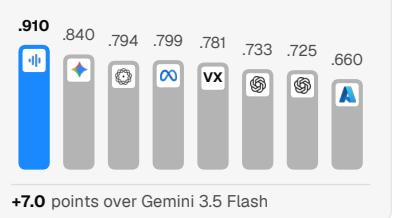

# Anuvani-LID: Robust and Calibrated Spoken Language Identification for Indian Languages

Stephen Fernandes, Narayan Choudhary

Central Institute of Indian Languages

stephenn.fernandes@gmail.com, n.choudhary@gov.in

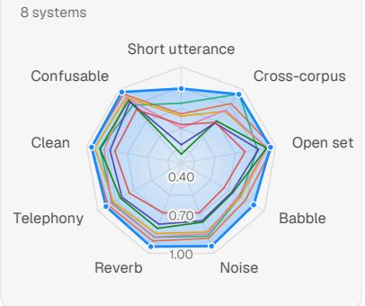

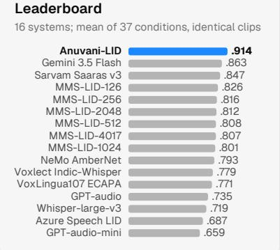  
Short utterance 8 conditions; crops of 0.5–5 s

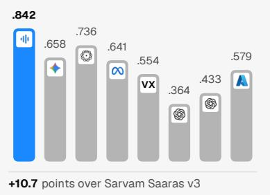  
Reverb 4 conditions; room impulse responses

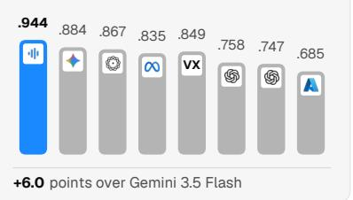

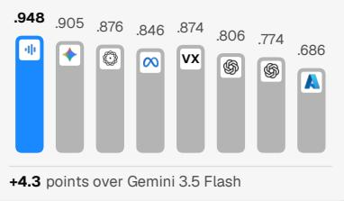  
Figure 1: Anuvani-LID against the field on SUITE-42 (macro-F1, identical clips). The radar covers nine domains from 32 of the 37 core conditions, with its axis from 0.3; the leaderboard averages all 37; the bars show the four domains with the largest margin. The prompted APIs chose among 10 candidate languages, Anuvani-LID among all 23.

## Abstract

Every multilingual speech pipeline begins with a language decision, an error there propagates silently through recognition, translation and routing. In India it spans 22 scheduled languages across four language families, heard over short, noisy, narrowband and code-mixed audio. Foundational speech models increasingly present language identification (LID) as an inherent latent, generalized capability. Autoregressive decoders in speech models emit a special language ID token, and modern LLMs with audio capabilities can name the language when prompted. We test this assumption on identical clips and find that whisper and similar speech models has tokens for only 15 of the 23 languages, on one second inputs Gemini 3.5 Flash reaches 0.52 macro-F1 and GPT-audio

0.14. We present Anuvani LID, a dedicated 115M parameter LID conformer model trained on 54,643 hours of Indian speech spanning 22 Indian languages and Indian accented English. Along with designed and controlled studies on 102 condition benchmark with speaker and corpus held out tests. Across 37 conditions, it reaches 0.914 mean macro-F1, 5.2 points above Gemini 3.5 Flash and ahead of 14 other systems. It is 24 points ahead of Gemini at one second, scores 0.897 on all 23 languages where no other system exceeds 0.713, and is calibrated to an ECE of 0.008. Reliable Indian LID still requires a robust, dedicated and calibrated model.1

## 1 Introduction

Spoken language identification (LID) is the first decision in almost every multilingual speech pipeline: it chooses the recogniser, the translation direction and the language a helpline or assistant answers in (Li et al., 2013). An error here propagates; a Maithili call sent to a Hindi recogniser degrades every later component. In India this decision is usually hard and complex. The Eighth Schedule lists 22 languages from four language families, the mother tongues of 96.7% of the 1.21 billion people counted in 2011 (ORGI, 2018). Many are close relatives, our training audio ranges from 13,039 h (Indian accented English) to 369 h (Kashmiri) in our pool, and deployed audio is short, noisy, narrowband and code-mixed (§2).

Speech foundational models represent LID task as a latent, in-context generalised capability. Whisper decoder decodes a language ID token before it transcribes (Radford et al., 2023), Meta’s MMS models attaches a 4,017 language identification head (Pratap et al., 2024), and LLMs with audio capabilities such as Gemini and GPT-audio name the language of a clip when asked (Google Deep-Mind, 2026; OpenAI, 2024). Dedicated LID models might therefore seem obsolete. For Indian languages, our measurements argue otherwise (§6):

• Coverage is incomplete. Whisper has tokens for only 15 of the 23 classes (22 scheduled languages plus English), and among open systems only Voxlect covers all 23.

• Short inputs break generalist systems. At one second audio length, Gemini 3.5 Flash reaches 0.52 macro-F1 and GPT-audio 0.14. At sub one second, most speech models fail.

• Errors matter even at foundation-model scale. Most of Whisper’s supposed Welsh translation data turned out to be English audio misclassified by its language identifier (Radford et al., 2023). Even at the scale of Gemini 3.5 Flash, errors matter.

• Deployment needs calibrated scores and small models. Routing and rejection need calibrated confidence, which hard-label APIs often lack, and Whisper-large-v3 has 1.55B parameters (OpenAI, 2023), 13 times more than Anuvani-LID.

A further obstacle is methodological. Clean, indomain test sets saturate: in our pilot study every head reached about 98% macro-averaged accuracy, within 1 pp of the others. Following work on saturation and shortcut learning (Geirhos et al., 2020; Kiela et al., 2021), we rebuilt the evaluation pipeline first and took every later decision on held-out, multi-axis conditions. We report the programme in the order it was carried out. Our contributions are:

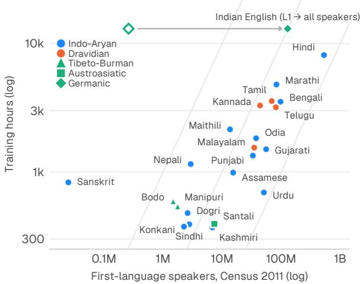  
Figure 2: Speaker population versus training data. Speech resources do not track population: Urdu has more than 50M first-language speakers but less audio than Maithili or Nepali, and English is abundant because most of its 128.5M speakers use it as a second or third language. The diagonals mark 10, 100 and 1,000 training hours per million speakers.

• SUITE-102, a 102-condition, 318,861-utterance benchmark with speaker- and corpus-held-out tiers, and SUITE-42, which scores 15 open and commercial systems on identical clips (§4).

• A staged, controlled study of fine-tuning a selfsupervised Conformer for LID (§5).

• Anuvani-LID, which leads all 15 systems (Figure 1), most clearly on short, noisy and all-23- language conditions, and is well calibrated (§6).

• A linguistic error analysis (§7) and a layer analysis showing that 12 of 17 blocks suffice (§8).

## 2 The Linguistic Landscape of Indian Spoken LID

Twenty-two languages by design. The Eighth Schedule for Indian languages grew from 14 to 22 languages through additions in 1967, 1992 and 2004 (Government of India, 2026; MHA, 2017). The 2011 Census rationalised 19,569 raw mothertongue returns into 1,369 mother tongues and 121 languages (ORGI, 2018). Speaker numbers span four orders of magnitude, from Hindi (528M) to

<table><tr><td>Language</td><td>Family: subgroup Script(s)</td><td></td><td></td><td>L1 Train</td><td></td><td>F1 T Language</td><td>Family: subgroup</td><td>Script(s)</td><td></td><td>L1</td><td>Train</td><td>F1 T</td></tr><tr><td>Hindi</td><td>IA: Hindustani</td><td>Devanagari</td><td>528.3 8,121</td><td></td><td></td><td>.843</td><td>Konkani92</td><td>IA: Southern</td><td>Devanagari, Latin</td><td>2.3</td><td></td><td>375.918</td></tr><tr><td>Urdu</td><td>IA: Hindustani</td><td>Arabic</td><td>50.8</td><td></td><td>691</td><td>.925</td><td>Gujarati</td><td>IA: Guj.-Rajasthani</td><td>Gujarati</td><td>55.5</td><td>1,500.948</td><td></td></tr><tr><td>Punjabi</td><td>IA: Northwestern</td><td>Gurmukhi</td><td>33.1 1,339</td><td></td><td></td><td>.973 T</td><td>Sanskrit</td><td>IA: Old Indo-Aryan</td><td>Devanagari</td><td>0.02</td><td>828.962</td><td></td></tr><tr><td> $\mathrm { D o g n } ^ { \mathrm { - } 0 4 }$ </td><td>IA: W. Pahari</td><td>Devanagari</td><td>2.6</td><td></td><td>478</td><td>.977 T</td><td>Tamil</td><td>Dravidian: South I</td><td>Tamil</td><td>69.0</td><td>3,560.974</td><td></td></tr><tr><td>Kashmiri</td><td>IA: Dardic</td><td>Arabic, Deva.</td><td>6.8</td><td></td><td>369.953</td><td></td><td>Malayalam</td><td>Dravidian: South I</td><td>Malayalam</td><td>34.8</td><td>1,544.965</td><td></td></tr><tr><td> $\mathrm { S i n d h i ^ { \mathrm { 6 7 } } }$ </td><td>IA: Northwestern Arabic, Deva.</td><td></td><td>2.8</td><td></td><td>390.903</td><td></td><td>Kannada</td><td>Dravidian: South I</td><td>Kannada</td><td>43.7</td><td>3,287.975</td><td></td></tr><tr><td> $\mathrm { \Delta N e p a l i ^ { 9 2 } }$ </td><td>IA: N. (E. Pahari) Devanagari</td><td></td><td></td><td></td><td>2.91,150.961</td><td></td><td>Telugu</td><td>Dravidian: South II</td><td>Telugu</td><td>81.1</td><td>3,184.967</td><td></td></tr><tr><td>Maithili04</td><td>IA: Bihari</td><td>Devanagari</td><td></td><td></td><td>13.6 2,143.916</td><td></td><td> $\mathbf { B o d o } ^ { 0 4 }$ </td><td>Tib.-Burman: Bodo-Garo Devanagari</td><td></td><td>1.5</td><td>590.947 T</td><td></td></tr><tr><td>Bengali</td><td>IA: Eastern</td><td>Bengali-Assamese</td><td>97.2 3,517.972</td><td></td><td></td><td></td><td>Manipuri92</td><td>Tib.-Burman: Meitei‡</td><td>Meetei, Bengali</td><td>1.8</td><td>539 .933 T</td><td></td></tr><tr><td>Assamese</td><td>IA: Eastern</td><td>Bengali-Assamese</td><td>15.3</td><td></td><td>987.920</td><td></td><td> $\mathrm { S a n t a l i ^ { 0 4 } }$ </td><td>Austroas.: N. Munda</td><td>Ol Chiki</td><td>7.4</td><td>394.935</td><td></td></tr><tr><td>Odia</td><td>IA: Eastern</td><td>Odia</td><td>37.5 1,827 .899</td><td></td><td></td><td></td><td>Indian English IE: Germanic</td><td></td><td>Latin</td><td>0.26</td><td>13,039.901</td><td></td></tr><tr><td>Marathi</td><td>IA: Southern</td><td>Devanagari</td><td></td><td></td><td>83.0 4,792.941</td><td></td><td></td><td></td><td></td><td></td><td></td><td></td></tr></table>

Table 1: The 23 classes. Family: subgroup follows Glottolog 5.3 (Hammarström et al., 2026) and the Census (ORGI, 2018) (IA: Indo-Aryan; IE: Indo-European; Arabic: Perso-Arabic; Deva.: Devanagari). Script(s) follows CLDR and state official-language acts (Unicode Consortium, 2026; The Unicode Consortium, 2025). L1: firstlanguage speakers in the 2011 Census (millions). Train: hours in our training pool. F1: Anuvani-LID on the speaker-disjoint all-23 test. T: documented lexical tone (Evans et al., 2018; Das and Mahanta, 2019; Devi and Das, 2024). Superscripts give the year a language entered the Eighth Schedule if not an original member (1967, 1992, 2004; Government of India, 2026). ‡Subgrouping disputed (Thurgood, 2017). §128.5M counting second- and third-language speakers (ORGI, 2011); all English audio in training and test is Indian-accented.

Sanskrit (24,821), and training data does not track them (Table 1; Figure 2). The labels are administrative: the Census “Hindi” groups 56 mother tongues, including Bhojpuri (50.6M), and Maithili was counted under Hindi until 2001 (ORGI, 2018), so class boundaries are partly conventional (MHA, 2017).

Four families, one linguistic area. Fifteen scheduled languages are Indo-Aryan, four Dravidian, two Tibeto-Burman and one Austroasiatic (Hammarström et al., 2026). Genealogy understates how alike they sound. Emeneau (1956) described India as a linguistic area in which languages of all families share retroflex consonants, verb-final clauses and echo words (Masica, 1976), and retroflex systems are distributed geographically rather than genetically (Arsenault, 2017). Indian LID work reports heavily overlapping phone sets (Vuddagiri et al., 2018; Dey et al., 2022), and on FLEURS the South Asian group has the lowest LID accuracy (Conneau et al., 2023). Several classes are sisters or former dialects. Hindi and Urdu share colloquial Hindustani (Kachru, 2008), and Urdu→Hindi is VoxLingua107’s most common error (Valk and Alumäe, 2021). Grierson treated Dogri as a dialect of Punjabi and Konkani as one of Marathi (Grierson, 1916, 1905), and these pairs share 93% and 80–82% of basic vocabulary (Kogan, 2016). Script, which separates Hindi from Urdu (“one language, two scripts”; King, 1994), is absent from speech. The remaining evidence is sparse in short clips: degree of retroflexion, laryngeal contrasts, vowel length, and lexical tone in

Punjabi, Dogri, Bodo and Meitei.

Close relatives and dialect continua. Several scheduled languages are sisters or former “dialects” of one another:

• Hindi and Urdu are sister languoids under Hindustani and share a colloquial form (Hammarström et al., 2026; Kachru, 2008). Urdu→Hindi is the single most common error in VoxLingua107 (Valk and Alumäe, 2021).

• Punjabi and Dogri share 93% of basic vocabulary (Kogan, 2016), and Grierson (1916) described Dogri as a dialect of Punjabi.

• Grierson (1905) likewise treated Konkani as a Marathi dialect; the two share 80–82% of basic vocabulary.

• Assamese, Bengali and Odia share 86–88% of basic vocabulary and one Glottolog node, and they share numeral-classifier morphology with Maithili (Emeneau, 1956).

• Maithili speakers from the eastern dialect area commonly shift to Hindi when talking with speakers from other areas (Central Institute of Indian Languages, n.d.).

Lexicostatistics measures vocabulary, not acoustics, but these are exactly the pairs where LID systems err (§7).

What the signal carries. Script is absent from speech. Devanagari alone serves at least ten of the classes (Unicode Consortium, 2026). Hindi and Urdu, famously “one language, two scripts” (King, 1994), are written in Devanagari and Perso-Arabic respectively. Labels must therefore come from corpus metadata rather than from transcripts. The discriminative evidence is phonetic, phonotactic and prosodic:

• Degree of retroflexion: Tamil exceeds Hindi, and Nepali retroflexes are weaker still (Keane, 2004; Khatiwada, 2009).

• Laryngeal series: Hindi has a four-way stop series (Ohala, 1994), and Gujarati contrasts breathy and modal voice on vowels (Esposito and Khan, 2012).

• Vowel length: contrastive in Dravidian languages but not in Bengali or Assamese (Keane, 2004; Khan, 2010; Mahanta, 2012).

• Lexical tone: documented in Punjabi and Dogri and in Bodo and Meitei (Evans et al., 2018; Das and Mahanta, 2019; Devi and Das, 2024).

• Rare segments: Sindhi implosives and Santali checked finals (Maddieson, 2013; The Unicode Consortium, 2025).

Many of these cues are sparse, and a one-second clip may contain none of them. This is consistent with duration, rather than noise, being the dominant difficulty axis (§6).

Indian English, not English. The 23rd class is Indian accented English. Every English hour in our pool comes from Indian speakers, consisting of NPTEL lectures (10,441 h), NLTM collections (1,252 h), ULCA (916 h) and Indic TIMIT (234 h; Yarra et al., 2019), and we evaluate on Indian-accented sets such as Svarah (Javed et al., 2023b). Kachru (1986) called Indian English “an Indian language in its own right”; 128.5M Indians speak it, nearly all as a second or third language (ORGI, 2011). Its accent is at once uniform and variable (Wiltshire, 2020; Sailaja, 2009; Pandey, 2015). Pan-Indian features include apical, often retroflex /t d/, stops for /T D/, merged /v/–/w/ and unaspirated voiceless stops (Masica, 1972), and a rhythm that differs from British English in duration, loudness, pitch and glottal stops (Fuchs, 2016). Beneath them, the mother tongue shapes vowels, rhotics, diphthongs and pitch accents (Wiltshire and Harnsberger, 2006; Maxwell and Fletcher, 2010). Svarah’s 117 speakers from 65 districts cover 19 first languages, and Whisper’s word error rate rises from 2.7% on LibriSpeech to 7.2% on it (Javed et al., 2023b). For LID this cuts both ways. The English class must absorb all this variation, and each English utterance carries traces of the very languages the model must also recognise (§7).

Multilingual speakers. In 2011, 26.0% of Indians reported a second language and 7.1% a third (ORGI, 2022). About 17% of Hindi–English socialmedia posts are code-mixed (Bali et al., 2014). In code-switched speech, more than half of the embedded segments last only 200–400 ms (Barras et al., 2020), so the matrix language is the natural utterance label.

## 3 Related Work

Spoken LID. LID moved from i-vectors (Li et al., 2013) to x-vectors (Snyder et al., 2018b,a) and ECAPA-TDNN (Desplanques et al., 2020), with VoxLingua107 (Valk and Alumäe, 2021) behind common open baselines (SpeechBrain, 2021; Jia et al., 2023). Self-supervised (SSL) speech encoders now dominate the space with XLS-R and MMS type models as well as dedicate finetune’s wav2vec 2.0-style models exists (Babu et al., 2022; Pratap et al., 2024; Baevski et al., 2020), and Bartley et al. (2023) fine-tune an SSL Conformer. NIST LRE defines cluster-aware evaluation with Cavg (Sadjadi et al., 2018; NIST, 2022).

Indian-language LID. IIITH-ILSC (Vuddagiri et al., 2018) introduced a 23-class benchmark. Later systems added CTC features (Mandava et al., 2019) or fine-tuned XLSR-53 (Gupta et al., 2023; Rajak et al., 2025). Cross-corpus generalisation is the central difficulty for such models: EER rises from 11.8% in-corpus to 43.3% cross-corpus (Dey et al., 2021), and acoustic augmentation and bias compensation recovers only part of it (Dey et al., 2023, 2024). Surveys and layer studies include Dey et al. (2022) and Dey and Saha (2025). On IndicSU-PERB, 12-language LID accuracy falls from 98.2% on seen to 90.8% on unseen speakers (Javed et al., 2023a), and Basu et al. (2026) compare encoders for 42 Indic languages. We differ in scale (54.6k h), converging all 23 spoken language classes, held-out multi-axis evaluation, and comparison with commercial audio LLMs. We build upon the MahaDhwani encoder, which was pretrained w2v-BERTstyle on 279k h of Indian audio (Bhogale et al., 2025; Chung et al., 2021).

## 4 SUITE-102: A De-saturated Benchmark

Design. SUITE-102 probes LID along the multidomain axes on which deployed systems fail (composition in Appendix Table 4). Its headline tier is the IndicVoices test set (Javed et al., 2024a): 300 spontaneous utterances per language for all 23 classes, from 1,308 speakers, none of whom is among the 34,034 IndicVoices speakers in our training data. Cross-corpus tiers use the evaluation splits of FLEURS, SPRING-INX, MUCS, Kathbath and Common Voice (Conneau et al., 2023; Nithya R et al., 2023; Diwan et al., 2021; Javed et al., 2023a; Ardila et al., 2020). The cliplevel carve has an empty intersection with training, and transcript fingerprinting finds no FLEURS or MUCS overlap. Variety probes cover dialectal Hindi (Javed et al., 2024b), Hinglish (Singh et al., 2025), Indian-accented English (Javed et al., 2023b), studio speech (Baby et al., 2016), lectures (AI4Bharat, 2020) and rural telephony (Bhanushali et al., 2022). Each source is expanded into random and VAD-anchored crops of 0.25–10 s, MUSAN noise at 0 and 5 dB (Snyder et al., 2015), reverberation (Ko et al., 2017), G.711 $\mu \cdot$ -law telephony, babble, confusable-cluster subsets and open-set trials. The open-set trials use music, eight non-Indian languages and Chhattisgarhi, a relative of Hindi outside the label set. Curation is deterministic, and the suite was frozen before the final training run.

SUITE-42. Commercial APIs are too costly to run on the full suite, so we drew a balanced panel of 42 conditions with up to 150 utterances per language in each. The core panel has 37 conditions (47,730 clips) over the ten languages every system supports: Hindi, Bengali, Tamil, Telugu, Marathi, Gujarati, Kannada, Malayalam, Punjabi and Urdu. The all-23 panel has five IndicVoices conditions (17,229 clips). Every system receives identical audio. Prompted audio LLMs and Azure receive the candidate list (10 or 23 languages), Sarvam Saaras runs in auto-detect mode, and open models predict over their native label sets. Anuvani-LID always predicts over all 23 classes, so it can make errors that a 10-candidate system cannot. We also report it restricted to the same ten candidates (“matched”).

Metrics and statistics. The primary metric is macro-F1 over the languages present in a condition. We also report top-1 accuracy, $C _ { \mathrm { a v g } }$ (NIST, 2022), EER, 15-bin ECE (Pakdaman Naeini et al., 2015;

Guo et al., 2017), and open-set AUROC from maximum softmax probability (Hendrycks and Gimpel, 2017). Intervals are 1,000-resample bootstraps (Bisani and Ney, 2004) (300, stratified by condition, for paired differences), and paired items are tested with McNemar’s test (McNemar, 1947; Gillick and Cox, 1989) under Holm or Bonferroni correction (Holm, 1979).

## 5 Model and Staged Research Programme

## 5.1 Model

Anuvani-LID fine-tunes the released MahaDhwani Conformer-L encoder (Bhogale et al., 2025; AI4Bharat, 2024), which was pretrained selfsupervised on 279k h of large scale raw Indian audio (Figure 3). The front-end uses 80-dimensional log-Mel features and 4× subsampling to 40 ms frames. These feed 17 Conformer blocks (Gulati et al., 2020) with d=512, 8 heads and convolution kernel 31. The head mixes all block outputs with learned weights, ${ \bf z } _ { t } = \textstyle \sum _ { \ell } \alpha _ { \ell } { \bf h } _ { \ell , t }$ with ${ \pmb { \alpha } } = \mathrm { s o f t m a x } ( \mathbf { w } )$ (Yang et al., 2021). It then applies attentive statistics pooling (Okabe et al., 2018), a 256-dimensional embedding and a 23-way classifier (115.6M parameters in total). Training uses focal loss − $( 1 - p _ { y } ) ^ { \gamma } \log p _ { y }$ (Lin et al., 2017) with γ=2 and label smoothing 0.1 (Szegedy et al., 2016).

## 5.2 A staged research programme

The recipe is the outcome of six stages run in order, each starting from the previous stage’s promoted recipe (Appendix Table 5). Stages I–V ran at reduced scale (1,000–4,000 h) so that many controlled arms were affordable; Stage VI trained once on all 54,643 h, so that recipes here onwards could be validated on the full scale of training data. Each stage answers one question with arms that change one axis at a time against the recipe it inherits, and architecture, sampling and augmentation are judged on held-out conditions (§4) rather than on in-domain validation accuracy, which saturates.

Stage I: head, loss and adaptation search at 1,000 h. The first decision was the optimiser, because the heads under comparison differ in trainable size by two orders of magnitude, from LoRA adapters to an ECAPA-TDNN fine-tuned end to end. ULMFiT-style discriminative rates (Howard and Ruder, 2018), a larger step for the freshly initialised head than for the pre-trained encoder, are the usual prescription for this setting. We tested them against a single global rate on three heads that span the range, attentive pooling, NetVLAD and ECAPA-TDNN, for 1,500 steps each. A head rate ten times the encoder’s (10−3 against 10−4) gave the large NetVLAD head nothing (0.980 against 0.982 macro-averaged validation accuracy) and destabilised the angular-margin attentive head, so a single global rate of 10−4, at which the pre-trained encoder and the new head co-adapt stably, became the default for every fully fine-tuned arm.

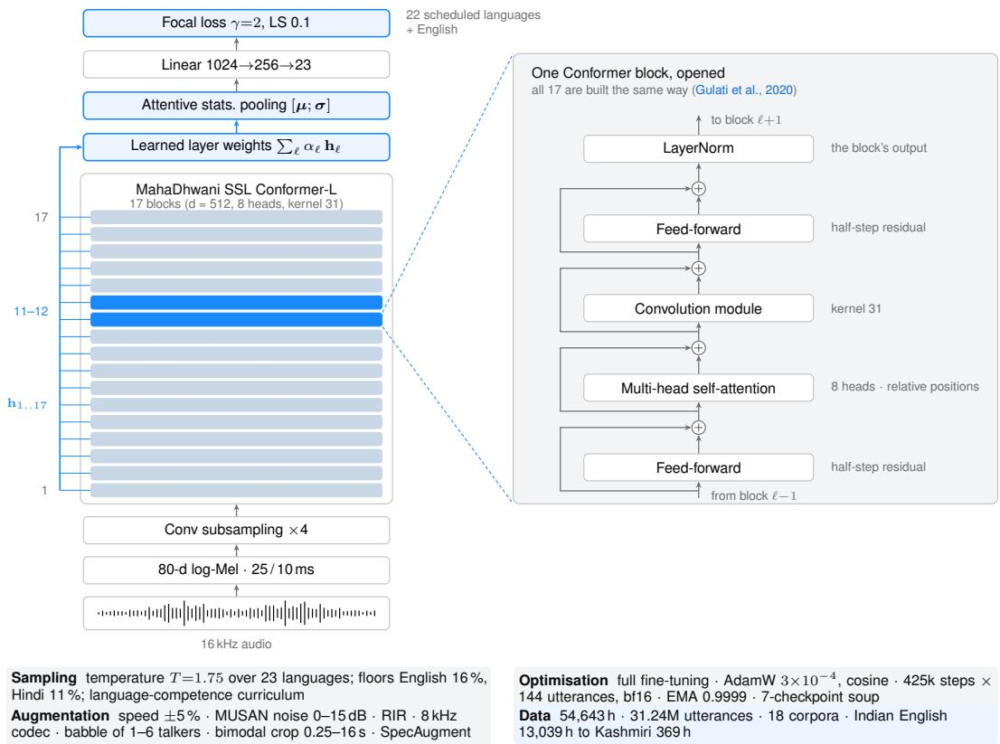  
Figure 3: Anuvani-LID. All 17 block outputs of the self-supervised MahaDhwani Conformer are mixed with learned weights, pooled with attentive statistics and classified into 23 languages under focal loss. The whole network is fine-tuned. Blocks 11–12 (blue) carry the most linearly decodable language information (§8); the panel opens one block. Grey chips summarise the training recipe from Stages I–VI.

We trained 25 arms on a balanced 1,000 h subset of 20 languages (Kashmiri, Santali and Sindhi had too little audio) and scored them on the 54- condition predecessor of SUITE-102 (Figure 4). Every arm shared one recipe apart from the axis under test: AdamW (Loshchilov and Hutter, 2019) with β=(0.9, 0.98) and weight decay 10−3, 10% linear warm-up and cosine decay to 10−6, 144 utterances per step, temperature sampling at T=2, bf16 and four epochs. Three findings shaped the model:

• Pooling matters little. Under an additive angular margin (AAM) loss, statistics (Snyder et al., 2018b), multi-head (India et al., 2019), NetVLAD (Arandjelovic et al. ´ , 2016), ECAPA-TDNN (Desplanques et al., 2020) and attentive pooling over aggregated layers all land within 0.825–0.837 cross-corpus macro-F1, with overlapping intervals.

• The loss decides calibration. Cosine-margin heads (Deng et al., 2019; Wang et al., 2018) emit bounded, rescaled cosines, and fine-tuned cosinemargin heads have an ECE of 0.75–0.79; softmax heads reach 0.02–0.08 (0.13 under distillation). With attentive pooling, focal loss has the highest macro-F1 of all 25 arms (0.840) and an ECE of 0.023, 2.6× below cross-entropy, in line with Mukhoti et al. (2020); layer aggregation, however, classifies 1.1% more items correctly on top-1, so we kept both.

• The encoder must be fine-tuned. A frozen encoder reaches only 0.362, and top-6 fine-tuning (0.806), adapters (0.822; Houlsby et al., 2019) and LoRA (0.821; Hu et al., 2022) all trail full fine-tuning. These partial regimes ran at the larger rates prescribed for small trainable budgets,

(a) Cross-corpus macro-F1

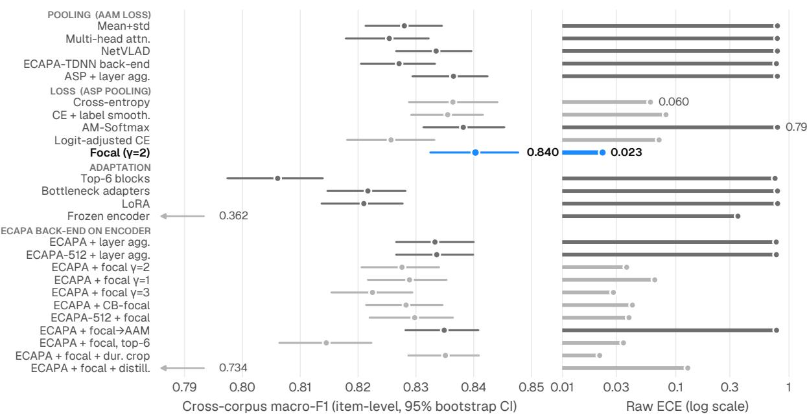  
Figure 4: Stage I (1,000 h, 20 languages, 4 epochs, one run per arm): all 25 arms, the 11 ECAPA-TDNN back-end variants in the lowest group. Left: cross-corpus macro-F1 with 95% bootstrap intervals. Right: raw ECE (log scale). Pooling choices differ by about 1 pp, but the loss decides calibration. No ECAPA arm improves on attentive pooling with focal loss (blue), despite 23M extra parameters.

$1 0 ^ { - 3 }$ for the frozen encoder’s head, for bottleneck adapters of width 64 and for LoRA of rank $8 \ ( \alpha { = } 1 6 )$ , and $3 \times 1 0 ^ { - 4 }$ for the top six blocks, and the frozen encoder trails full fine-tuning by 48 points.

ECAPA-TDNN (Desplanques et al., 2020), explored in 12 arms, was set aside: its deep head drives the arccos-based ArcFace to divergence, it over-corrects under focal loss and under selfdistillation (Hinton et al., 2015), and no ECAPA arm passes attentive pooling with focal loss on cross-corpus macro-F1 (0.835 against 0.840) despite 23M extra parameters. Fusing arms promises up to 11.1 points on short utterances under an oracle, but majority vote recovers almost none of it, so we kept a single network, the simplest arm at the top of the cross-corpus ranking: attentive statistics pooling, focal loss and full fine-tuning.

Stage II: rebalancing under production skew. On 4,000 h that preserve the large scale language distribution, in terms of multilingual language ratio, orthographic and phonetic diversity, this ensures that our proxy training corpus exactly represents the large scale production training corpus and provides us results that translate at scale during larger production training runs. we sampled languages with $p _ { l } \propto n _ { l } ^ { 1 / T }$ (Arivazhagan et al., 2019; Conneau et al., 2020). Cross-corpus macro-F1 follows an inverted U, peaking at T=2 (0.919, against 0.890 at T=1 and 0.898 uniform; Figure 5). The replica applies one fraction, 11.18%, to every language × corpus × duration stratum of the production corpus as it stood before its final expansion to 54,643 h, so it keeps all three marginals at once: no language’s share moves by more than 0.005 points, and the corpus mix by at most 0.002 in $L _ { 1 }$ distance. Sixteen arms change one axis each against an attentivepooling, focal-loss spine trained for one epoch. Raising T trades head for tail. Between T=1 and T=2 the two languages under 500 h that the indomain test covers, Dogri and Konkani, rise from 0.742 to 0.930 mean F1 (Dogri alone from 0.50 to 0.89), while the eight languages above 2,000 h in the full pool slip only from 0.949 to 0.935. Temperature is therefore a policy choice between head and tail, not a quantity to maximise. In-domain macro-F1 traces the same inverted U, from 0.923 at T=1 to 0.946 at T=2 and 0.947 at $T { = } 3$ , falling back to 0.922 under uniform sampling. Seen- and unseen-speaker scores stay within half a point of each other up to $T { = } 2$ and separate by about 1.5 points only at $T { = } 5$ and under uniform sampling, which repeat the tail’s few speakers too often; this is an independent reason to stop at $T { \approx } 2$

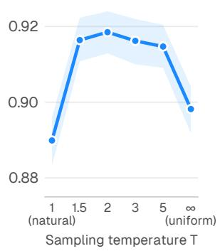  
(b) F1 by resource tier

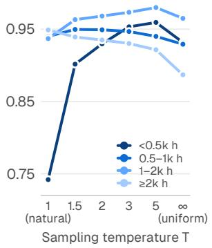  
Figure 5: Stage II (4,000 h, production skew, 1 epoch). (a) Cross-corpus macro-F1 against sampling temperature, with a 95% band. (b) In-domain F1 by resource tier, with tiers set by hours in the full pool; the in-domain test has no Kashmiri, Santali or Sindhi, so its lowest tier is Dogri and Konkani. Raising T trades head for tail.

• Temperature sampling gains with training length. The T=2 recipe trained for two epochs instead of one improves every axis: in-domain macro-F1 rises from 0.946 to 0.958, pooled crosscorpus macro-F1 from 0.919 to 0.931, confusable pairs from 0.885 to 0.909, degraded audio from 0.832 to 0.852 and open-set AUROC from 0.829 to 0.840. The second epoch lifts every resource tier, the two sub-500 h languages from 0.930 to 0.970 and the eight largest from 0.935 to 0.943, so a longer schedule recovers more than half of the head accuracy that a single epoch of up-sampling had traded away.

• Focal loss complements temperature sampling. The two act on different quantities. Temperature sampling sets how often each language is seen; focal loss sets how much each example counts once seen, scaling its loss by $( 1 - p _ { y } ) ^ { \gamma }$ so that confidently classified examples fade and hard ones dominate the gradient. The sampler corrects class frequency and the loss corrects example difficulty, so neither undoes the other. Stage I measured what focal loss adds on its own: on the same attentive head it raises cross-corpus macro-F1 by 0.86 points over the angular-margin loss while cutting ECE from 0.788 to 0.023, it nearly triples cross-corpus recall of Dogri, the hardest tail language (0.075 to 0.20), and against crossentropy it is 2.6 times better calibrated at slightly higher accuracy (0.840 against 0.836). Within focal loss, γ=1 matches γ=2, and γ=3 gains 1.0 point cross-corpus and 3.6 points at 1 s but raises ECE to 0.078, so $\gamma { = } 2$ stays as the calibrated

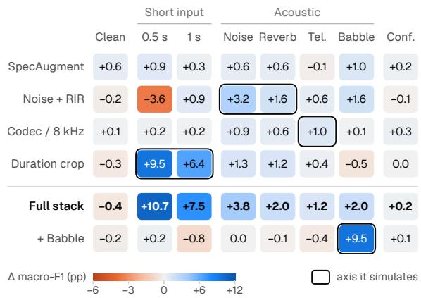  
Figure 6: Stage III: change in macro-F1 (points) relative to a no-augmentation baseline, on the 44 conditions common to all arms (4,000 h, 2 epochs). The babble row is measured against the full stack without babble (65k steps). Each perturbation mainly moves the axis it simulates. The full stack combines their gains at a 0.4-point cost on clean speech.

## setting.

Rebalancing must happen once, in the sampler or in the loss. As the sole rebalancer, logit adjustment (Menon et al., 2021) at T=1 matches temperature sampling on the four plain cross-corpus sets (0.925 against 0.925 at T=3) and is the best-calibrated arm of the stage (ECE 0.011 against 0.046 for plain focal loss at T=1). On top of T=2 it counts the prior twice: in-domain macro-F1 falls 3.5 points and the two largest classes collapse, English from 0.906 to 0.699 F1 and Hindi from 0.713 to 0.344. A two-stage schedule, one epoch of uniform sampling followed by one of natural sampling, lifts in-domain macro-F1 to 0.964 against 0.958 for two single-stage epochs, but weakens open-set separation (AUROC 0.798 against 0.840), so the singlestage sampler stayed. At equal budget, learned layer aggregation raises in-domain macro-F1 from 0.958 to 0.967 and improves every acoustic family (telephony +2.8 pp), so we adopted it; it also lowers 100 · $C _ { \mathrm { a v g } }$ from 2.23 to 1.72.

Stage III: augmentation. Each perturbation mainly improves the axis it simulates (Figure 6):

• random duration cropping: +9.5 pp at 0.5 s and +6.4 pp at 1 s;

• MUSAN noise with room impulse responses: +3.2 pp in noise and +1.6 pp in reverberation and babble (alone it costs 3.6 pp at 0.5 s);

• µ-law/8 kHz codec simulation: +1.0 pp on telephony;

• SpecAugment: small, uniform gains;

• multi-talker babble, 1–6 overlapping talkers at 5–18 dB SNR, on top of the other four: +11.6 pp on the seven babble conditions (0.804 to 0.920 macro-F1), with no cost on clean conditions (+0.3 pp).

Combined, the other four gain 10.7 pp at 0.5 s, 7.5 at 1 s, 3.8 in noise, 2.0 in reverberation and babble, and 1.2 on telephony, for a 0.4 pp cost on clean speech. The final recipe crops half of the training segments. Half of those crops are drawn log-uniformly between 0.25 and 3 s and the rest uniformly between 3 and 16 s, which concentrates training mass on the short durations that interactive systems receive.

Eight operations make up the final recipe (Table 2). Six act on the waveform as each clip leaves the data loader, always in the same order: speed perturbation (Ko et al., 2015), additive noise from MUSAN (Snyder et al., 2015), reverberation with simulated room impulse responses (Ko et al., 2017), the duration crop, babble and the codec. Noise therefore enters before the room response and is reverberated with the speech, babble is mixed in at the cropped length, and the telephone channel acts last, on the whole mixture, as it does in a call. The other two are the frequency and time masks of SpecAugment (Park et al., 2019), applied to the log-Mel features of every training example. Each waveform transform is selected independently for every clip, with a fixed probability that depends on nei ther the language nor the corpus, so no transform can become a cue for a class, and its parameters are drawn afresh each time. The six selections give 64 combinations. Over the 61.2M training examples of the final run, 102.5k h of source audio, 93.5% pass through at least one waveform transform and 6.5% reach the masks unaltered. A clip receives 2.1 waveform transforms on average, and 70.3% receive two or more. Speed perturbation picks one of five rates from 0.95 to 1.05 and leaves the clip as it is at the identity rate, so it changes 40% of clips. Half of the clips are selected for cropping, but a crop from the long branch, uniform between 3 s and the clip’s own length, cannot shorten a clip of 3 s or less, so 44.9% are shortened; a quarter of all examples, 15.3M, are cut to between 0.25 and 3 s. Noise comes from 930 MUSAN recordings, and reverberation from 60,000 impulse responses simulated in 600 rooms, 200 each small, medium and large. Babble sums one to six talkers drawn from 10,426 recordings: the 426 speech recordings of MUSAN, as in x-vector training (Snyder et al., 2018b), and 10,000 training clips spread over all 23 languages. The codec band-limits to 4 kHz by resampling through 8 kHz and applies 8-bit G.711 µ-law companding (ITU-T, 1988). The Stage III arms used the same probabilities, with a single uniform crop of 0.5–16 s, and babble only in its own arm.

<table><tr><td></td><td></td><td></td><td colspan="3">Altered</td></tr><tr><td>Operation</td><td>Setting</td><td>p</td><td>%</td><td>M</td><td>kh</td></tr><tr><td>Speed</td><td>0.95-1.05</td><td>0.5</td><td>40.0</td><td>24.5</td><td>41.0</td></tr><tr><td>Noise</td><td>0-15 dB</td><td>0.5</td><td>50.0</td><td>30.6</td><td>51.2</td></tr><tr><td>Reverberation</td><td>60k RIRs</td><td>0.3</td><td>30.0</td><td>18.4</td><td>30.7</td></tr><tr><td>Duration crop</td><td>0.25–16 s</td><td>0.5</td><td>44.9</td><td>27.5</td><td>49.6</td></tr><tr><td>Babble</td><td>5-18 dB</td><td>0.2</td><td>20.0</td><td>12.2</td><td>20.5</td></tr><tr><td>Codec</td><td>8 kHz µ-law</td><td>0.3</td><td>30.0</td><td>18.4</td><td>30.7</td></tr><tr><td>Frequency masks</td><td> $2 \times \leq 2 0 \mathrm { b i n s }$ </td><td>1</td><td>100</td><td>61.2</td><td>102.5</td></tr><tr><td>Time masks</td><td> $2 \times \leq 5 \%$ </td><td>1</td><td>100</td><td>61.2</td><td>102.5</td></tr><tr><td>Any waveform op. None</td><td></td><td></td><td>93.5 6.5</td><td>57.2 4.0</td><td>96.3</td></tr></table>

Table 2: Augmentation in the final run, in the order of application. p is the probability that a clip is selected for the operation. Altered gives the share of training examples the operation changes, their number in millions and the thousands of hours of source audio they carry, as expected totals over the 61.2M examples of the 425k-step run, computed from the language mix the run’s sampler drew and the clip durations of its training index.

Stage IV: curriculum learning. Stages I–III fix what the model sees; Stage IV asks whether the order in which it sees it adds more (Bengio et al., 2009). We expected the largest return where the static recipe left most error: on the confusable Indo-Aryan cluster, the weakest clean axis of Stage II (0.909 macro-F1 on confusable pairs), and on sub-second input. Following the decomposition of a curriculum into a difficulty measure and a training scheduler (Wang et al., 2022), we screened four definitions of difficulty under one competence schedule (Platanios et al., 2019), $p ( e ) = \mathrm { m i n } \big ( 1 , \sqrt { e ( 1 - p _ { 0 } ^ { 2 } ) / ( N - 1 ) + p _ { 0 } ^ { 2 } } \big )$ with p0=0.2, which moves an axis from its easy end to its hard end over N epochs. Each arm changed one axis of the Stage III recipe (4,000 h, three epochs) and had to lift its target without regressing any resource tier or language:

• Duration. Training crops shrink from 6.6 to 2.95 to 1.0 s, replacing the static random crop. This inverts SortaGrad (Amodei et al., 2016): a short clip is easy for recognition but carries less evidence for LID.

• Resource. The sampling temperature rises from 1.2 to 2.0, so the head dominates early and the tail gains weight late, after the annealed language sampling of mmBERT (Marone et al., 2025); a reverse schedule, from 1.8 to 1.0, controls for direction.

• Confusability. The 15 Indo-Aryan languages enter at 0.36 of their temperature-sampled weight, rising to 0.78 and then 1.0, so the Dravidian, Tibeto-Burman and Austroasiatic languages and English are seen at full weight first and the cluster in which most confusions arise (§7) is brought in gradually.

• Self-paced. Within each batch only the lowestloss 68% of examples enter the loss, rising to all of them (Kumar et al., 2010).

Ordering by duration gives the largest short-input gain of any curriculum. Against the unscheduled recipe trained for the same three epochs, it lifts mean macro-F1 over five corpora from 0.42–0.43 to 0.52 at 0.5 s and from 0.17–0.18 to 0.26 at 0.25 s. Because ending training on one-second crops also shortens what the model hears of full-length speech, the final recipe takes the same short-crop exposure from the bimodal crop of Stage III, which keeps long segments in every batch. The model-driven gate did not add to the unscheduled recipe.

The final recipe schedules the language mix. It keeps the confusability curriculum, which acts on the cluster that carries most errors, composes with temperature sampling by changing which languages fill a batch as training proceeds rather than how often each is drawn relative to its size, and costs nothing at inference. At full scale its competence ramp spans the 17 sub-epochs of 25k steps that make up the 425k-step budget: after a first subepoch on the plain temperature mix, the weight of the Indo-Aryan cluster rises from 0.45 to 1.0 (Figure 7), on top of T=1.75 and the language floors of Stage V. The schedule is applied in the streaming shard reader exactly as in the reference sampler (the language distributions agree to $1 0 ^ { - 1 3 } )$ , and the final run logs it at every sub-epoch. We chose this curriculum on the evidence of the ablations. Confusable pairs were the weakest clean axis of Stage II (0.909 macro-F1), and the Indo-Aryan cluster carries most of the remaining errors: 65–66% of those of the unscheduled three-epoch recipe on the all-23 test. Each of the other three curricula either acts elsewhere or would move a tuned setting. The bimodal crop of Stage III already supplies the shortcrop exposure of the duration curriculum while keeping long segments in every batch, the modeldriven gate did not add to the unscheduled recipe, and the resource curriculum keeps the sampling temperature away from $T { = } 2$ , where the inverted U of Stage II peaks, for most of training. The confusability curriculum alone targets the dominant error while keeping temperature sampling and the language floors as tuned, and it returns to the tuned mix by the last sub-epoch.

Stage V: scale-aware optimisation. Short probes on the 4,000 h proxy set the optimiser. This proxy was redrawn from the final 54,643 h pool with the Stage II construction, so its language ratios match the full pool. Learning rates of $3 \times 1 0 ^ { - 5 }$ to $1 0 ^ { - 3 }$ gave development accuracies of $0 . 7 7 1 { - } 0 . 8 7 6 ;$ we took the knee at $3 \times 1 0 ^ { - 4 }$ , since the last step added only 0.5 pp. Short horizons flatter large rates, so we checked the choice at length: at $3 \times 1 0 ^ { - 4 }$ development accuracy reached 0.941 after 25k steps, a level the earlier $1 0 ^ { - 4 }$ recipe needed about 46k steps to reach. Warm-ups of 5–15% and temperatures of 1.5–2.5 were flat within 1.2 pp, so we chose $T { = } 1 . 7 5$ with floors keeping English at 16% and Hindi at 11% of samples. $T { = } 1 . 7 5$ is the value at which the full augmentation stack, babble included, was validated, and because the proxy keeps the pool’s language ratios, the same temperature yields the same sampling mix at full scale; only the number of repetitions grows. The floors protect the two largest classes. Temperature sampling alone would give English 12.3% and Hindi 10.6% of draws, and under focal loss, which discounts easy examples, that leaves the head too little exposure; the Hindi floor also guards the Hindi–Urdu boundary. We sized the budget by effective passes: over 425k steps of 144 utterances, the five lowest-resource languages are seen four to six times each and the high-resource languages 1.3 to 2.2 times. With the tail replayed several times, label smoothing of 0.1 (Szegedy et al., 2016) guards against memorisation. To feed this budget, a sequential shard reader streams the corpus from a columnar store: it cuts read amplification from $3 8 \times 1 0 0 . 9 7 \times$ and delivers 449 clips/s per data worker against a training demand of about 180, so the GPUs, not the disks, set the pace.

Share of samples per language

Share of samples by language family  
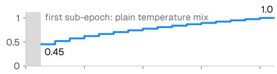

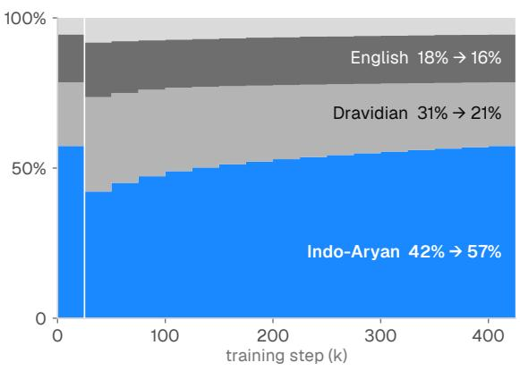

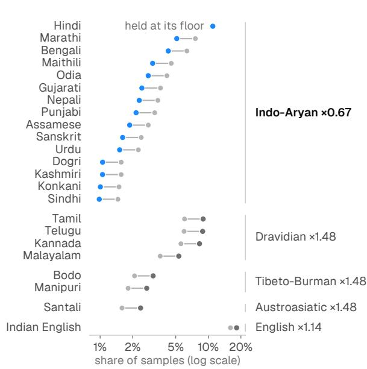

Figure 7: Stage IV: the confusability curriculum as the final run applied it (425k steps, 17 sub-epochs of 25k). Top left: the weight on the 15 Indo-Aryan languages, as logged; the first sub-epoch draws the plain temperature mix. Bottom left: the share of samples by language family. Right: the share of samples per language in the plain mix and in the first scheduled sub-epoch, with each family’s scale factor; Hindi is held at its 11% floor. Shares come from the run’s own sampler on its training index and reproduce every share it logged.  
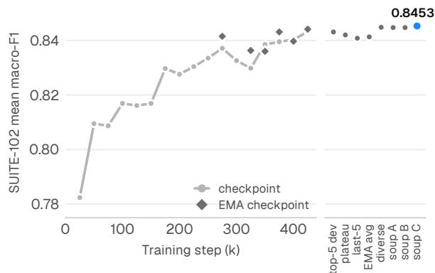  
Figure 8: Stage VI (54,643 h). Left: mean macro-F1 on SUITE-102 of the checkpoints saved every 25k steps and of their exponential moving averages (EMA). Right: uniform weight averages (“soups”) of checkpoint subsets. The 7-checkpoint soup ranks first of 31 candidates.

Stage VI: full-scale training and weight averaging. The final run trains on all 54,643 h (31.24M utterances) for 425k steps with AdamW (Loshchilov and Hutter, 2019), cosine decay, the confusability curriculum of Stage IV, bf16 and an EMA of the weights with decay 0.9999, on six RTX A6000 GPUs (Appendix B). It took 69.6 h, and development accuracy rose to 0.951 at the final checkpoint. SUITE-102 macro-F1 climbs from 0.782 at

25k steps to 0.844 for the final EMA weights (Figure 8), but the condition families do not peak together. Clean speech peaks at 75k steps, telephony at 175k, confusable pairs and open-set rejection at 200k, and babble, noise, reverberation and short utterances only at 425k. A single late checkpoint therefore keeps the optima reached at the end of training and gives up the earlier ones. Telephony, for instance, falls from 0.932 at its peak to 0.898 at the final step, and the EMA, with a horizon of about 10k steps, averages only the end of the run. We therefore finalise the model as recent large-scale training recipes do, by averaging weights along the training trajectory (Izmailov et al., 2018; Wortsman et al., 2022). Llama 3 averages checkpoints from its annealing phase (Grattafiori et al., 2024), and OLMo 2 averages independently annealed runs (Team OLMo et al., 2024). We archived a checkpoint every 25k steps beside its EMA shadow and scored 31 candidates on all 102 conditions: the 17 checkpoints, six late EMA shadows, five averages over contiguous or diverse subsets, and three soups whose members were fixed from the per-family profiles before any soup was scored. Every average is uniform over parameters and normalisation statistics, accumulated in float64. The best candidate, a soup of seven checkpoints at 100k, 175k, 275k, 325k, 350k, 400k and 425k steps, scores 0.8453 and is the released Anuvani-LID. Against the final checkpoint, it lifts telephony from 0.898 to 0.923 and babble, noise and open-set rejection by 0.6, 0.4 and 0.4 points. It also lowers raw ECE on the all-23 test from 0.077 to 0.054, while no condition family falls by more than 0.5 points. Early members bring back the channel robustness that late training erodes. Because the average is taken in weight space, unlike the output-space fusion of Stage I, it costs nothing at inference.

<table><tr><td>System</td><td>Lang. F1</td><td>Core-37 All-23</td><td>F1</td><td>Gap [95% CI]</td><td>W/L</td></tr><tr><td>Anuvani-LID matched</td><td>23 10</td><td>.914 .923</td><td>.897 .897</td><td></td><td></td></tr><tr><td>Gemini 3.5 Flash Sarvam Saaras GPT-audio Azure LID</td><td>23 23 23 11</td><td>.863 .847 .735 .687</td><td>.710 .346 .384</td><td>5.2 [4.8, 5.5] 21/9 6.8 [6.5, 7.1] 26/5 18.0 [17.5, 18.4] 34/2 22.7 [22.1, 23.3] 36/1</td><td></td></tr><tr><td>GPT-audio-mini</td><td>23</td><td>.659</td><td>.285</td><td>25.5 [25.1, 26.0] 34/2</td><td></td></tr><tr><td>MMS-LID-126</td><td>15</td><td>.826</td><td>.686*</td><td>8.8 [8.4, 9.3] 31/1</td><td></td></tr><tr><td>MMS-LID-256</td><td>19</td><td>.816</td><td>.533*</td><td>9.8 [9.4, 10.3] 28/1</td><td></td></tr><tr><td>MMS-LID-2048</td><td>21</td><td>.812</td><td>.478*</td><td>10.2 [9.8, 10.7] 28/1</td><td></td></tr><tr><td></td><td>21</td><td>.807</td><td></td><td></td><td></td></tr><tr><td>MMS-LID-4017</td><td></td><td></td><td>.467*</td><td>10.7 [10.3, 11.2] 30/1</td><td></td></tr><tr><td>AmberNet</td><td>15</td><td>.793</td><td>.633*</td><td>12.2 [11.7, 12.6] 34/1</td><td></td></tr><tr><td>Voxlect Indic</td><td>23</td><td>.779</td><td>.713</td><td>13.5 [13.1, 14.0] 35/0</td><td></td></tr><tr><td>VL107 ECAPA</td><td>15</td><td>.771</td><td>.637*</td><td>14.3 [13.8, 14.8] 34/0</td><td></td></tr><tr><td>Whisper-v3</td><td>15</td><td>.719</td><td>.482*</td><td>19.5 [19.1, 20.0] 35/1</td><td></td></tr></table>

Table 3: SUITE-42 results on identical clips. Lang. counts how many of the 23 classes a system can output. Gap is the paired core macro-F1 difference, Anuvani-LID minus the system (points), with a 95% interval from a bootstrap stratified by condition. W/L counts core conditions on which Anuvani-LID is significantly better or worse (McNemar, Bonferroni-corrected over 37). ∗Over the covered languages only, which favours partial-coverage systems. Top-1 accuracy and MMS-LID-512/1024 are in Appendix D.

## 6 Comparison with Open and Commercial Systems

Overall. On the 37 core conditions of SUITE-42, Anuvani-LID reaches 0.914 mean macro-F1 while choosing among all 23 classes (Table 3). That is 5.2 points above Gemini 3.5 Flash (Google DeepMind, 2026) and 6.8 above Sarvam Saaras v3 (Sarvam AI, 2026); restricted to the APIs’ ten candidates it reaches 0.923 (+6.0 over Gemini, 95% CI [5.7, 6.4]). The best open model, MMS-LID-126 (Pratap et al., 2024), trails by 8.8 points. Every paired difference excludes zero (McNemar p < 10−100 over 47,730 clips). Per condition, Anuvani-LID is significantly better than Gemini on 21 of 37 and worse on 9, and better than every open model on at least 28.

Where the margin comes from. Anuvani-LID has the best mean in eight of nine domains (Figure 9). Its margin over Gemini is largest on short utterances (0.842 against 0.658), babble (+7.0), noise at 0 dB (+6.0) and reverberation (+4.3), and smallest on clean read speech (+1.9) and telephony (+1.8). It holds cross-corpus on SPRING-INX (0.953 against 0.865). Gemini is significantly better on six long read-speech conditions, the five full-length FLEURS slices and MUCS, by 1.2– 5.7 points (Appendix D); read sentences such as FLEURS’s Wikipedia text (Conneau et al., 2023) offer lexical content an audio LLM can exploit. It is also better on two Hindi-variety probes (§7).

Short utterances. Duration separates systems most. At one second Anuvani-LID reaches 0.764 macro-F1 on FLEURS and 0.854 in-domain, 24 points above Gemini in both cases (0.520, 0.611). At 0.5 s it reaches 0.545, against 0.439 for Sarvam and 0.231 for Gemini. Duration cropping (Stage III) plausibly explains the gap; some competitors never saw short audio, and Voxlect, for example, was trained on 3–15 s clips (Feng, 2025).

All 23 languages. Only five other systems can in principle output all 23 classes. On the all-23 panel Anuvani-LID averages 0.897 macro-F1, against 0.713 for Voxlect Indic-Whisper, 0.710 for Gemini and 0.384 for GPT-audio. Its F1 exceeds 0.90 on 21 languages, including Bodo, Dogri, Santali, Kashmiri and Sindhi with under 600 h each, and is lowest for Hindi (0.84) and Indian English (0.89) (Figure 10). Gains over the better of Gemini and Voxlect are largest for Urdu (+20.5), Dogri (+14.5), Hindi and Kannada (+13.1); only on Tamil is a rival marginally ahead (0.984 against 0.977).

The full suite against open models. On the 73 SUITE-102 conditions where an open model covers at least eight core languages, Anuvani-LID scores highest on 71, with a mean margin of 12.8 points over the best open model; the exceptions are FLEURS telephony (MMS-LID-2048, +2.4) and IndicTTS (AmberNet, +0.4).

Calibration, open set and selection. One temperature (T=0.674) fitted on the development set (Guo et al., 2017) lowers ECE on the held-out all-23 test from 0.054 to 0.008 (Figure 11); there,

<table><tr><td></td><td>Clean read</td><td>Short (≤5 s)</td><td>Telephony 0 dB</td><td>Noise</td><td></td><td></td><td></td><td>Hindi Reverb Babble Confusable varieties</td><td>Hard subset</td><td>Core mean</td><td>All-23 panel</td></tr><tr><td>Anuvani-LID</td><td>.965</td><td>.842</td><td>.934</td><td>.944</td><td>.948</td><td>.910</td><td>.975</td><td>.779</td><td>.984</td><td>.914</td><td>.897</td></tr><tr><td>Commercial APIs</td><td></td><td></td><td></td><td></td><td></td><td></td><td></td><td></td><td></td><td></td><td></td></tr><tr><td>Gemini 3.5 Flash</td><td>.946</td><td>.658</td><td>.915</td><td>.884</td><td>.905</td><td>.840</td><td>.955</td><td>.912</td><td>.954</td><td>.863</td><td>.710</td></tr><tr><td>Sarvam Saaras v3</td><td>.903</td><td>.736</td><td>.882</td><td>.867</td><td>.876</td><td>.794</td><td>.849</td><td>.918</td><td>.865</td><td>.847</td><td>.346</td></tr><tr><td>GPT-audio</td><td>.865</td><td>.364</td><td>.812</td><td>.758</td><td>.806</td><td>.733</td><td>.897</td><td>.907</td><td>.892</td><td>.735</td><td>.384</td></tr><tr><td>Azure Speech LID</td><td>.781</td><td>.579</td><td>.738</td><td>.685</td><td>.686</td><td>.660</td><td>.808</td><td>.540</td><td>.762</td><td>.687</td><td>.675</td></tr><tr><td>GPT-audio-mini</td><td>.791</td><td>.284</td><td>.732</td><td>.668</td><td>.719</td><td>.649</td><td>.815</td><td>.908</td><td>.787</td><td>.659</td><td>.285</td></tr><tr><td>Open models</td><td></td><td></td><td></td><td></td><td></td><td></td><td></td><td></td><td></td><td></td><td></td></tr><tr><td>MMS-LID-126</td><td>.918</td><td>.641</td><td>.870</td><td>.835</td><td>.846</td><td>.799</td><td>.925</td><td>.857</td><td>.925</td><td>.826</td><td>.686</td></tr><tr><td>MMS-LID-256</td><td>.919</td><td>.616</td><td>.858</td><td>.826</td><td>.839</td><td>.796</td><td>.927</td><td>.839</td><td>.919</td><td>.816</td><td>.533</td></tr><tr><td>MMS-LID-2048</td><td>.913</td><td>.596</td><td>.861</td><td>.824</td><td>.841</td><td>.788</td><td>.928</td><td>.855</td><td>.916</td><td>.812</td><td>.478</td></tr><tr><td>MMS-LID-4017</td><td>.907</td><td>.594</td><td>.859</td><td>.825</td><td>.842</td><td>.793</td><td>.929</td><td>.811</td><td>.917</td><td>.807</td><td>.467</td></tr><tr><td>NeMo AmberNet</td><td>.890</td><td>.657</td><td>.791</td><td>.823</td><td>.791</td><td>.772</td><td>.901</td><td>.725</td><td>.872</td><td>.793</td><td>.633</td></tr><tr><td>Voxlect Indic-Whisper</td><td>.866</td><td>.554</td><td>.888</td><td>.849</td><td>.874</td><td>.781</td><td>.913</td><td>.576</td><td>.917</td><td>.779</td><td>.713</td></tr><tr><td>VoxLingua107 ECAPA</td><td>.869</td><td>.626</td><td>.785</td><td>.788</td><td>.788</td><td>.689</td><td>.887</td><td>.727</td><td>.871</td><td>.771</td><td>.637</td></tr><tr><td>Whisper-large-v3</td><td>.808</td><td>.433</td><td>.800</td><td>.747</td><td>.774</td><td>.725</td><td>.883</td><td>.793</td><td>.838</td><td>.719</td><td>.482</td></tr></table>

Figure 9: Mean macro-F1 by condition domain on SUITE-42 (identical clips; Anuvani-LID scored over 23 classes). Bold marks the best system in each column, in blue where it is Anuvani-LID. Hindi varieties are rural telephony (GramVaani), dialectal Hindi (Lahaja) and Hinglish (HiACC); see $^ { \ S 7 }$

100 · $C _ { \mathrm { a v g } }$ is 3.16 and EER 1.79%. Maximumsoftmax rejection reaches AUROC 0.89–0.91 for music and non-Indian languages but 0.84 for Chhattisgarhi, a close relative of Hindi. The unselected final EMA checkpoint scores 0.912 core macro-F1 and 0.889 all-23, so selecting the soup on SUITE-102 changes no ranking.

## 7 Linguistic Error Analysis

The residual errors of Anuvani-LID are linguistically structured (Figure 12). On the all-23 test, 61% of errors stay within the reference language’s family, and 73% originate in Indo-Aryan languages.

Sisters within a subgroup. The largest confusions link the close relatives of §2: Hindi→Maithili (4.7%) and Maithili→Hindi (2.0%), a pair the Census merged until 2001; Urdu→Hindi (4.0%) within Hindustani; Dogri to Hindi and Punjabi; Konkani to Marathi (2.3%); and Odia to Assamese (3.3%) and Maithili (2.3%) within the Magadhan cluster. Hindi, whose Census label covers 56 mother tongues, is the hardest class (F1 0.84).

Neighbours across family lines. Other errors cross family but not geographic boundaries. Assamese→Bodo (3.0%), Manipuri→Bodo (2.7%), Nepali→Manipuri (2.3%) and

Santali→Assamese involve languages in long contact in north-eastern India; Assamese, for example, has many Bodo-related words (Mahanta, 2012). Such areal similarity (Emeneau, 1956; Thomason, 2000) is invisible in a family tree, though shared recording regions may also contribute.

L1 transfer in Indian English. English is confused mainly with Hindi (2.7%), Santali (2.0%) and Marathi (1.7%). This matches the L1-conditioned phonology of Indian English (Masica, 1972; Wiltshire and Harnsberger, 2006). The same effect is stronger on Svarah, whose 117 speakers cover 19 first languages (Javed et al., 2023b): 40% of its accented-English utterances are attributed to a scheduled language, spread over many classes.

Hindi varieties. The one SUITE-42 domain where other systems lead is Hindi varieties, and here too Anuvani-LID errs along linguistic lines: 19% of dialectal Hindi (Lahaja) is labelled Urdu, and Hinglish (HiACC) goes 28% to Urdu, which shares Hindi’s spoken grammar, and 23% to English, which supplies its embedded words. These single-language probes reward any prior towards the probed class, and the prompted APIs could not answer “English”. Under the matched protocol, Anuvani-LID’s HiACC macro-F1 rises from 0.551 to 0.729, and on the balanced confusable conditions it leads Gemini (0.975 against 0.955). Colloquial Hindi and Urdu share one form (Kachru, 2008), so the choice between them is largely sociolinguistic, and code-mixed speech calls for frame-level language diarization (Baghel et al., 2023; Dey et al., 2022).

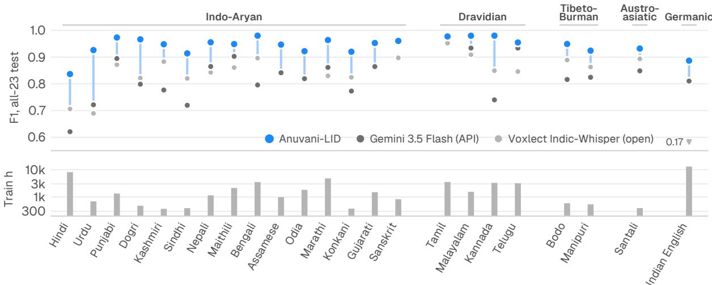  
Figure 10: Per-language F1 on the all-23 panel (IndicVoices, speaker-disjoint, 150 clips per language, identical for all systems), grouped by family, with training hours below. Blue connectors show the gain over the better rival.

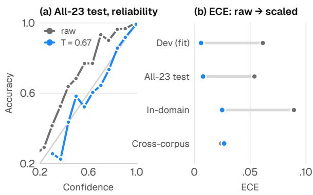  
Figure 11: Calibration. (a) Reliability on the all-23 test before (grey) and after (blue) temperature scaling fitted on the development set. (b) ECE on four sets.

## 8 Where Is Language Identity Encoded?

We probe pooled block outputs (Belinkov, 2022), inspect the learned aggregation weights and truncate the encoder (Figure 13), and we knock out single blocks. The full-scale subject is the first 54.6k h checkpoint of the recipe.

Findings. Language lives mid-to-upper stack. In the pre-trained encoder, probe macro-F1 peaks at about 0.56 in blocks 9–11 and collapses to 0.13 at block 17, whose representations serve the pretraining objective (Pasad et al., 2021). Fine-tuning moves the peak to block 11 (0.69) at 1,000 h and block 12 (0.86) at 54.6k h, higher than the lowerlayer optimum reported for an SSL Conformer by Bartley et al. (2023). Aggregation buys robustness. At full scale block 17 receives 30% of the learned weight and blocks 10–16 most of the rest; no singleblock knockout then costs more than 0.08 macro-F1, whereas bypassing block 7 costs a last-block model 0.34. Channel is not the cue. Corpus identity stays linearly decodable at the top (0.90; majority 0.25), yet erasing its rank-3 subspace with LEACE (Belrose et al., 2023) changes LID macro-F1 by only +0.1 points, so the decision does not rest on the channel cues behind earlier cross-corpus failures (Dey et al., 2021). Twelve blocks suffice. Truncation saturates at k=12 (0.848 with 84M parameters against 0.840 with all 17 blocks and 116M; 0.844 against 0.835 at four epochs with two seeds).

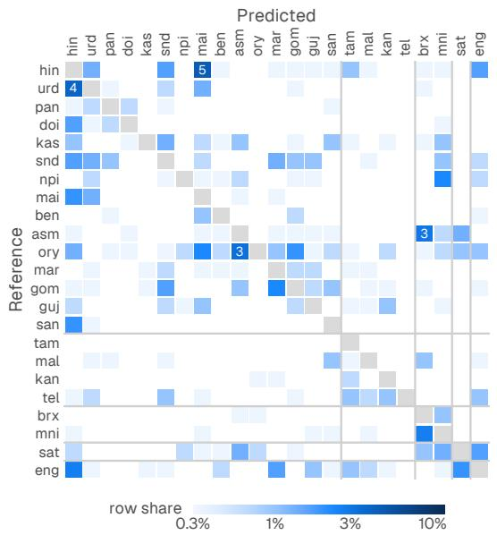  
Figure 12: Off-diagonal confusions of Anuvani-LID on the speaker-disjoint all-23 test (6,900 utterances), as row shares on a log scale, grouped by family as in Table 1. Cells of 3% or more are annotated.

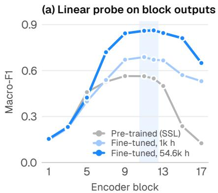

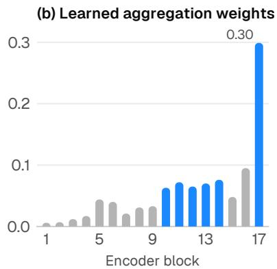

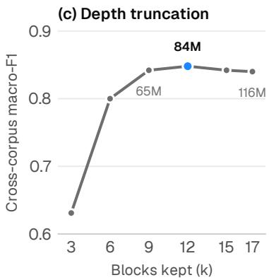  
Figure 13: Where language identity lives. (a) Macro-F1 of linear probes on pooled block outputs of the pre-trained encoder, a 1,000 h fine-tune and the 54.6k h model; the band marks blocks 11–12. (b) Softmax-normalised layer weights learned by the 54.6k h model. (c) Cross-corpus macro-F1 after truncating the encoder to its first k blocks (Stage-I baseline recipe, 1,000 h, 2 epochs; parameter counts annotated; two seeds for $k \geq 1 2 )$

## 9 Conclusion

Language identification is not yet a solved byproduct of scale. For India’s 22 scheduled languages and Indian English, the generalist systems we tested lack classes, collapse on short inputs or return uncalibrated labels. A dedicated 116Mparameter model, designed on held-out, multi-axis conditions, does better on each count. Its residual errors follow the genealogy and contact history of India’s languages, making code-switching, dialect continua and unseen relatives the next frontier.

## Limitations

Label granularity. Anuvani-LID assigns one label per utterance. For code-switched speech such as Hinglish this is ill-posed. Frame-level language diarization (Baghel et al., 2023) is the appropriate formulation, and our HiACC and Lahaja probes show that single-label scoring penalises acoustic models on mixed and dialectal Hindi.

Coverage. The label set covers the 22 scheduled languages and Indian English. India’s many other languages (Bhili, Gondi, Tulu, Bhojpuri and others) are outside it. Our open-set results show that rejecting close relatives of scheduled languages, such as Chhattisgarhi, is harder than rejecting unrelated languages.

Evaluation. SUITE-102 includes one licensed indomain comparator (LDC-IL; Choudhary, 2021). All held-out generalisation tiers use public corpora and can be rebuilt from our scripts. Kathbath shares 4 of 456 speakers with training and is therefore reported only as an in-domain comparator. Commercial APIs return hard labels, so we compare them on macro-F1 and accuracy but not on calibration or $C _ { \mathrm { a v g } } ,$ and their behaviour may change between versions. We report the API versions and dates of our runs in Appendix C.

Variance and scale. Stages I–V used single runs per arm. We measured run-to-run variance and interpret effects accordingly, but small within-stage differences remain provisional. Stage VI was trained once. Its checkpoint trajectory and the unselected-checkpoint check indicate that the conclusions do not hinge on selection, but we did not repeat full-scale training with other seeds. Subsecond LID remains information-limited. At 0.25 s Anuvani-LID reaches 0.24–0.35 macro-F1 in seven of the eight 0.25 s conditions, and no open model exceeds 0.18 where it can be scored.

## Ethics Statement

All training and evaluation data come from published corpora under their licences. The one licensed comparator is used for evaluation only. We use no private user audio: the production-mix condition is a held-out sample of the public training corpora in their deployment proportions. Language identification can be misused to profile speakers by language, region or community. It is also a prerequisite for providing services in citizens’ own languages, and it is where current systems are least reliable for speakers of low-resource scheduled languages. We therefore report per-language results for all 23 classes, and we do not recommend using LID output as a proxy for ethnicity, religion or nationality. Hindi and Urdu, in particular, share a spoken register, so an utterance’s label should not be read as a statement about its speaker’s identity. Where speaker gender is recorded, about one third of the training speech is female. We did not evaluate gender-sliced performance in this paper and flag it as necessary future work. Training the final model took about three days on six GPUs.

## References

AI4Bharat. 2020. NPTEL2020: Indian English speech dataset. GitHub repository. Crawled April 2020 from the NPTEL-HRD YouTube channel. Accessed 2026-09-27.

AI4Bharat. 2024. MahaDhwani pretrained conformer (ai4bharat/MahaDhwani\_pretrained\_conformer). Hugging Face model card. Uploaded 13 December 2024; MIT licence. Accessed 2026-09-27.

Dario Amodei, Sundaram Ananthanarayanan, Rishita Anubhai, Jingliang Bai, Eric Battenberg, Carl Case, Jared Casper, Bryan Catanzaro, Qiang Cheng, Guoliang Chen, Jie Chen, Jingdong Chen, Zhijie Chen, Mike Chrzanowski, Adam Coates, Greg Diamos, Ke Ding, Niandong Du, Erich Elsen, and 50 others. 2016. Deep speech 2: End-to-end speech recognition in English and Mandarin. In Proceedings ofthe 33rd International Conference on Machine Learning (ICML), volume 48 of Proceedings of Machine Learning Research, pages 173–182. PMLR.

Relja Arandjelovic, Petr Gronat, Akihiko Torii, Tomas´ Pajdla, and Josef Sivic. 2016. NetVLAD: CNN architecture for weakly supervised place recognition. In Proc. IEEE Conference on Computer Vision and Pattern Recognition (CVPR), pages 5297–5307.

Rosana Ardila, Megan Branson, Kelly Davis, Michael Kohler, Josh Meyer, Michael Henretty, Reuben Morais, Lindsay Saunders, Francis Tyers, and Gregor Weber. 2020. Common Voice: A massivelymultilingual speech corpus. In Proceedings of the Twelfth Language Resources and Evaluation Conference (LREC 2020), pages 4218–4222, Marseille, France. European Language Resources Association.

Naveen Arivazhagan, Ankur Bapna, Orhan Firat, Dmitry Lepikhin, Melvin Johnson, Maxim Krikun, Mia Xu Chen, Yuan Cao, George Foster, Colin Cherry, Wolfgang Macherey, Zhifeng Chen, and Yonghui Wu. 2019. Massively multilingual neural machine translation in the wild: Findings and challenges. arXiv preprint arXiv:1907.05019.

Paul Arsenault. 2017. Retroflexion in South Asia: Typological, genetic, and areal patterns. Journal of South Asian Languages and Linguistics, 4(1):1–53.

Arun Babu, Changhan Wang, Andros Tjandra, Kushal Lakhotia, Qiantong Xu, Naman Goyal, Kritika Singh, Patrick von Platen, Yatharth Saraf, Juan Pino, Alexei Baevski, Alexis Conneau, and Michael Auli. 2022. XLS-R: Self-supervised cross-lingual speech representation learning at scale. In Proc. Interspeech 2022, pages 2278–2282.

Arun Baby, Anju Leela Thomas, Nishanthi N L, and TTS Consortium. 2016. Resources for Indian languages. In Proceedings of Community-Based Building of Language Resources (CBBLR 2016), workshop of the International Conference on Text, Speech and Dialogue (TSD 2016), pages 37–43, Brno, Czech Republic. Tribun EU.

Alexei Baevski, Yuhao Zhou, Abdelrahman Mohamed, and Michael Auli. 2020. wav2vec 2.0: A framework for self-supervised learning of speech representations. In Advances in Neural Information Processing Systems, volume 33, pages 12449–12460. Curran Associates, Inc.

Shikha Baghel, Shreyas Ramoji, Sidharth, Ranjana H, Prachi Singh, Somil Jain, Pratik Roy Chowdhuri, Kaustubh Kulkarni, Swapnil Padhi, Deepu Vijayasenan, and Sriram Ganapathy. 2023. The DISPLACE challenge 2023 – DIarization of SPeaker and LAnguage in conversational environments. In Proc. Interspeech 2023, pages 3562–3566.

Kalika Bali, Jatin Sharma, Monojit Choudhury, and Yogarshi Vyas. 2014. “I am borrowing ya mixing?” An analysis of English-Hindi code mixing in Facebook. In Proceedings of the First Workshop on Computational Approaches to Code Switching, pages 116–126, Doha, Qatar. Association for Computational Linguistics.

Claude Barras, Viet-Bac Le, and Jean-Luc Gauvain. 2020. Vocapia-LIMSI system for 2020 shared task on code-switched spoken language identification. In Proceedings of the 1st Workshop on Speech Technologies for Code-switching in Multilingual Communities (WSTCSMC 2020).

Travis M. Bartley, Fei Jia, Krishna C. Puvvada, Samuel Kriman, and Boris Ginsburg. 2023. Accidental learners: Spoken language identification in multilingual self-supervised models. In Proceedings of the IEEE International Conference on Acoustics, Speech and Signal Processing (ICASSP), pages 1–5.

Agneedh Basu, Pavan Kumar J, Sujith P, Visruth Sanka, Nihar Desai, and Prasanta Kumar Ghosh. 2026. A comparative study of pre-trained speech encoders and training objectives for large-scale indic spoken language identification. arXiv preprint arXiv:2606.09317.

Yonatan Belinkov. 2022. Probing classifiers: Promises, shortcomings, and advances. Computational Linguistics, 48(1):207–219.

Nora Belrose, David Schneider-Joseph, Shauli Ravfogel, Ryan Cotterell, Edward Raff, and Stella Biderman. 2023. LEACE: Perfect linear concept erasure in closed form. In Advances in Neural Information Processing Systems (NeurIPS), volume 36, pages 66044–66063.

Yoshua Bengio, Jérôme Louradour, Ronan Collobert, and Jason Weston. 2009. Curriculum learning. In Proceedings of the 26th Annual International Conference on Machine Learning (ICML), pages 41–48. ACM.

Anish Bhanushali, Grant Bridgman, Deekshitha G, Prasanta Ghosh, Pratik Kumar, Saurabh Kumar, Adithya Raj Kolladath, Nithya Ravi, Aaditeshwar Seth, Ashish Seth, Abhayjeet Singh, Vrunda Sukhadia, Umesh S, Sathvik Udupa, and Lodagala V. S. V. Durga Prasad. 2022. Gram Vaani ASR challenge on spontaneous telephone speech recordings in regional variations of Hindi. In Proc. Interspeech 2022, pages 3548–3552.

Kaushal Santosh Bhogale, Deovrat Mehendale, Tahir Javed, Devbrat Anuragi, Sakshi Joshi, Sai Sundaresan, Aparna Ananthanarayanan, Sharmistha Dey, Sathish Kumar Reddy G, Anusha Srinivasan, Abhigyan Raman, Pratyush Kumar, and Mitesh M. Khapra. 2025. Towards bringing parity in pretraining datasets for low-resource Indian languages. In Proceedings of the IEEE International Conference on Acoustics, Speech and Signal Processing (ICASSP), pages 1–5.

Maximilian Bisani and Hermann Ney. 2004. Bootstrap estimates for confidence intervals in ASR performance evaluation. In Proc. IEEE International Conference on Acoustics, Speech, and Signal Processing (ICASSP), volume 1, pages I–409–I–412.

Central Institute of Indian Languages. n.d. Maithili: Variation (Language Information Service– India). http://web.archive.org/web/ 20260411000354/http://lisindia.ciil.org/ Maithili/Maith\_vari.html. CIIL, Mysore. Wayback snapshot of 11 April 2026. Accessed 2026-09-27.

Narayan Choudhary. 2021. LDC-IL: The Indian repository of resources for language technology. Language Resources and Evaluation, 55(3):855–867.

Yu-An Chung, Yu Zhang, Wei Han, Chung-Cheng Chiu, James Qin, Ruoming Pang, and Yonghui Wu. 2021. w2v-BERT: Combining contrastive learning and masked language modeling for self-supervised speech pre-training. In Proc. 2021 IEEE Automatic Speech Recognition and Understanding Workshop (ASRU), pages 244–250.

Alexis Conneau, Kartikay Khandelwal, Naman Goyal, Vishrav Chaudhary, Guillaume Wenzek, Francisco Guzmán, Edouard Grave, Myle Ott, Luke Zettlemoyer, and Veselin Stoyanov. 2020. Unsupervised cross-lingual representation learning at scale. In

Proceedings of the 58th Annual Meeting of the Association for Computational Linguistics, pages 8440– 8451. Association for Computational Linguistics.

Alexis Conneau, Min Ma, Simran Khanuja, Yu Zhang, Vera Axelrod, Siddharth Dalmia, Jason Riesa, Clara Rivera, and Ankur Bapna. 2023. FLEURS: Fewshot learning evaluation of universal representations of speech. In Proc. 2022 IEEE Spoken Language Technology Workshop (SLT), pages 798–805.

Kalyan Das and Shakuntala Mahanta. 2019. Intonational phonology of Boro. Glossa: a journal ofgeneral linguistics, 4(1):103.

Jiankang Deng, Jia Guo, Niannan Xue, and Stefanos Zafeiriou. 2019. ArcFace: Additive angular margin loss for deep face recognition. In Proc. IEEE/CVF Conference on Computer Vision and Pattern Recognition (CVPR), pages 4685–4694.

Brecht Desplanques, Jenthe Thienpondt, and Kris Demuynck. 2020. ECAPA-TDNN: Emphasized channel attention, propagation and aggregation in TDNN based speaker verification. In Proc. Interspeech 2020, pages 3830–3834.

Thiyam Susma Devi and Pradip K. Das. 2024. Disambiguation of isolated Manipuri tonal contrast word pairs using acoustic features. ACM Transactions on Asian and Low-Resource Language Information Processing, 23(3):1–18.

Spandan Dey and Goutam Saha. 2025. Probing layer-wise self-supervised representations for lowresource spoken language identification. IEEE Journal of Selected Topics in Signal Processing, 19(7):1436–1447.

Spandan Dey, Goutam Saha, and Md Sahidullah. 2021. Cross-corpora language recognition: A preliminary investigation with Indian languages. In Proc. 29th European Signal Processing Conference (EU-SIPCO), pages 546–550.

Spandan Dey, Md Sahidullah, and Goutam Saha. 2022. An overview of Indian spoken language recognition from machine learning perspective. ACM Transactions on Asian and Low-Resource Language Information Processing, 21(6):1–45. Article 128.

Spandan Dey, Md Sahidullah, and Goutam Saha. 2023. Cross-corpora spoken language identification with domain diversification and generalization. Computer Speech & Language, 81:101489.

Spandan Dey, Md Sahidullah, and Goutam Saha. 2024. Towards cross-corpora generalization for lowresource spoken language identification. IEEE/ACM Transactions on Audio, Speech, and Language Processing, 32:5040–5050.

Anuj Diwan, Rakesh Vaideeswaran, Sanket Shah, Ankita Singh, Srinivasa Raghavan, Shreya Khare, Vinit Unni, Saurabh Vyas, Akash Rajpuria, Chiranjeevi Yarra, Ashish Mittal, Prasanta Kumar

Ghosh, Preethi Jyothi, Kalika Bali, Vivek Seshadri, Sunayana Sitaram, Samarth Bharadwaj, Jai Nanavati, Raoul Nanavati, and Karthik Sankaranarayanan. 2021. MUCS 2021: Multilingual and code-switching ASR challenges for low resource Indian languages. In Proc. Interspeech 2021, pages 2446–2450.

M. B. Emeneau. 1956. India as a linguistic area. Language, 32(1):3–16.

Christina M. Esposito and Sameer ud Dowla Khan. 2012. Contrastive breathiness across consonants and vowels: A comparative study of Gujarati and White Hmong. Journal of the International Phonetic Association, 42(2):123–143.

Jonathan Evans, Wen-Chi Yeh, and Rukmini Kulkarni. 2018. Acoustics of tone in Indian Punjabi. Transactions ofthe Philological Society, 116(3):509–528.

Tiantian Feng. 2025. Whisper-large v3 for regional languages classification in India (tiantiaf/voxlect-indiclid-whisper-large-v3). Hugging Face model card. OpenRAIL licence; the card lists commercial use as out of scope. Accessed 2026-09-27.

Robert Fuchs. 2016. Speech Rhythm in Varieties ofEnglish: Evidence from Educated Indian English and British English. Prosody, Phonology and Phonetics. Springer, Berlin, Heidelberg.

Robert Geirhos, Jörn-Henrik Jacobsen, Claudio Michaelis, Richard Zemel, Wieland Brendel, Matthias Bethge, and Felix A. Wichmann. 2020. Shortcut learning in deep neural networks. Nature Machine Intelligence, 2(11):665–673.

L. Gillick and S. J. Cox. 1989. Some statistical issues in the comparison of speech recognition algorithms. In Proc. IEEE International Conference on Acoustics, Speech, and Signal Processing (ICASSP), pages 532–535.

Google DeepMind. 2026. Gemini 3.5 Flash model card. Model card. Published 19 May 2026. Accessed 2026-09-27.

Government of India. 2026. The Constitution of India [As on 1st May, 2026]. Government of India, Ministry of Law and Justice, Legislative Department, New Delhi. Diglot (Hindi–English) pocket edition incorporating amendments up to the Constitution (One Hundred and Sixth Amendment) Act, 2023. Eighth Schedule at pp. 325–326. Accessed 2026-09- 27.

Aaron Grattafiori, Abhimanyu Dubey, Abhinav Jauhri, Abhinav Pandey, Abhishek Kadian, et al. 2024. The Llama 3 herd of models. Preprint, arXiv:2407.21783.

George A. Grierson. 1905. Linguistic Survey of India, Vol. VII: Indo-Aryan Family, Southern Group: Specimens of the Marat¯.h¯ı Language. Office of the Superintendent of Government Printing, Calcutta.

George A. Grierson. 1916. Linguistic Survey of India, Vol. IX, Part I: Indo-Aryan Family, Central Group: Specimens of Western Hind¯ı and Pañjab¯ ¯ı. Office of the Superintendent of Government Printing, Calcutta.

Anmol Gulati, James Qin, Chung-Cheng Chiu, Niki Parmar, Yu Zhang, Jiahui Yu, Wei Han, Shibo Wang, Zhengdong Zhang, Yonghui Wu, and Ruoming Pang. 2020. Conformer: Convolution-augmented Transformer for speech recognition. In Proc. Interspeech 2020, pages 5036–5040.

Chuan Guo, Geoff Pleiss, Yu Sun, and Kilian Q. Weinberger. 2017. On calibration of modern neural networks. In Proceedings of the 34th International Conference on Machine Learning (ICML), volume 70 of Proceedings of Machine Learning Research, pages 1321–1330. PMLR.

Shivang Gupta, Kowshik Siva Sai Motepalli, Ravi Kumar, Vamsi Narasinga, Sai Ganesh Mirishkar, and Anil Kumar Vuppala. 2023. Enhancing language identification in Indian context through exploiting learned features with Wav2Vec2.0. In Speech and Computer (SPECOM 2023), volume 14339 of Lecture Notes in Computer Science, pages 503–512. Springer, Cham.

Harald Hammarström, Robert Forkel, Martin Haspelmath, and Sebastian Bank. 2026. Glottolog 5.3. Accessed 2026-09-27.

Dan Hendrycks and Kevin Gimpel. 2017. A baseline for detecting misclassified and out-of-distribution examples in neural networks. In International Conference on Learning Representations (ICLR).

Geoffrey Hinton, Oriol Vinyals, and Jeff Dean. 2015. Distilling the knowledge in a neural network. NIPS 2014 Deep Learning Workshop. Preprint, arXiv:1503.02531.

Sture Holm. 1979. A simple sequentially rejective multiple test procedure. Scandinavian Journal of Statistics, 6(2):65–70.

Neil Houlsby, Andrei Giurgiu, Stanislaw Jastrzebski, Bruna Morrone, Quentin de Laroussilhe, Andrea Gesmundo, Mona Attariyan, and Sylvain Gelly. 2019. Parameter-efficient transfer learning for NLP. In Proceedings of the 36th International Conference on Machine Learning (ICML), volume 97 of Proceedings of Machine Learning Research, pages 2790–2799. PMLR.

Jeremy Howard and Sebastian Ruder. 2018. Universal language model fine-tuning for text classification. In Proceedings of the 56th Annual Meeting of the Association for Computational Linguistics (Volume 1: Long Papers), pages 328–339, Melbourne, Australia. Association for Computational Linguistics.

Edward J. Hu, Yelong Shen, Phillip Wallis, Zeyuan Allen-Zhu, Yuanzhi Li, Shean Wang, Lu Wang, and Weizhu Chen. 2022. LoRA: Low-rank adaptation of

large language models. In International Conference on Learning Representations (ICLR).

Miquel India, Pooyan Safari, and Javier Hernando. 2019. Self multi-head attention for speaker recognition. In Proc. Interspeech 2019, pages 4305–4309.

ITU-T. 1988. Pulse code modulation (PCM) of voice frequencies. Recommendation G.711 (11/88), International Telecommunication Union, Geneva.

Pavel Izmailov, Dmitrii Podoprikhin, Timur Garipov, Dmitry Vetrov, and Andrew Gordon Wilson. 2018. Averaging weights leads to wider optima and better generalization. In Proceedings ofthe Conference on Uncertainty in Artificial Intelligence (UAI), pages 876–885. AUAI Press.

Tahir Javed, Kaushal Santosh Bhogale, Abhigyan Raman, Pratyush Kumar, Anoop Kunchukuttan, and Mitesh M. Khapra. 2023a. IndicSUPERB: A speech processing universal performance benchmark for Indian languages. In Proceedings of the AAAI Conference on Artificial Intelligence, volume 37, pages 12942–12950.

Tahir Javed, Sakshi Joshi, Vignesh Nagarajan, Sai Sundaresan, Janki Nawale, Abhigyan Raman, Kaushal Bhogale, Pratyush Kumar, and Mitesh M. Khapra. 2023b. Svarah: Evaluating English ASR systems on Indian accents. In Proc. Interspeech 2023, pages 5087–5091. ArXiv:2305.15760.

Tahir Javed, Janki Nawale, Eldho George, Sakshi Joshi, Kaushal Bhogale, Deovrat Mehendale, Ishvinder Sethi, Aparna Ananthanarayanan, Hafsah Faquih, Pratiti Palit, Sneha Ravishankar, Saranya Sukumaran, Tripura Panchagnula, Sunjay Murali, Kunal Gandhi, Ambujavalli R, Manickam M, C Vaijayanthi, Krishnan Karunganni, and 2 others. 2024a. IndicVoices: Towards building an inclusive multilingual speech dataset for Indian languages. In Findings of the Association for Computational Linguistics: ACL 2024, pages 10740–10782, Bangkok, Thailand. Association for Computational Linguistics.

Tahir Javed, Janki Nawale, Sakshi Joshi, Eldho George, Kaushal Bhogale, Deovrat Mehendale, and Mitesh M. Khapra. 2024b. LAHAJA: A robust multi-accent benchmark for evaluating Hindi ASR systems. In Proc. Interspeech 2024, pages 2320– 2324.

Fei Jia, Nithin Rao Koluguri, Jagadeesh Balam, and Boris Ginsburg. 2023. A compact end-to-end model with local and global context for spoken language identification. In Proc. Interspeech 2023, pages 5321–5325.

Braj B. Kachru. 1986. The indianization of English. English Today, 2(2):31–33.

Yamuna Kachru. 2008. Hindi–Urdu–Hindustani. In Braj B. Kachru, Yamuna Kachru, and S. N. Sridhar, editors, Language in South Asia, pages 81–102. Cambridge University Press, Cambridge.

Elinor Keane. 2004. Tamil. Journal of the International Phonetic Association, 34(1):111–116.

Sameer ud Dowla Khan. 2010. Bengali (Bangladeshi Standard). Journal ofthe International Phonetic Association, 40(2):221–225.

Rajesh Khatiwada. 2009. Nepali. Journal of the International Phonetic Association, 39(3):373–380.

Douwe Kiela, Max Bartolo, Yixin Nie, Divyansh Kaushik, Atticus Geiger, Zhengxuan Wu, Bertie Vidgen, Grusha Prasad, Amanpreet Singh, Pratik Ringshia, Zhiyi Ma, Tristan Thrush, Sebastian Riedel, Zeerak Waseem, Pontus Stenetorp, Robin Jia, Mohit Bansal, Christopher Potts, and Adina Williams. 2021. Dynabench: Rethinking benchmarking in NLP. In Proceedings of the 2021 Conference of the North American Chapter of the Association for Computational Linguistics: Human Language Technologies, pages 4110–4124. Association for Computational Linguistics.

Christopher R. King. 1994. One Language, Two Scripts: The Hindi Movement in Nineteenth Century North India. Oxford University Press, Bombay.

Tom Ko, Vijayaditya Peddinti, Daniel Povey, and Sanjeev Khudanpur. 2015. Audio augmentation for speech recognition. In Proc. Interspeech 2015, pages 3586–3589.

Tom Ko, Vijayaditya Peddinti, Daniel Povey, Michael L. Seltzer, and Sanjeev Khudanpur. 2017. A study on data augmentation of reverberant speech for robust speech recognition. In Proceedings of the IEEE International Conference on Acoustics, Speech and Signal Processing (ICASSP), pages 5220–5224.

Anton I. Kogan. 2016. Genealogical classification of New Indo-Aryan languages and lexicostatistics. Journal of Language Relationship, 14(3–4):227– 258.

M. Pawan Kumar, Benjamin Packer, and Daphne Koller. 2010. Self-paced learning for latent variable models. In Advances in Neural Information Processing Systems 23 (NIPS 2010), pages 1189–1197.

Haizhou Li, Bin Ma, and Kong Aik Lee. 2013. Spoken language recognition: From fundamentals to practice. Proceedings ofthe IEEE, 101(5):1136–1159.

Tsung-Yi Lin, Priya Goyal, Ross Girshick, Kaiming He, and Piotr Dollár. 2017. Focal loss for dense object detection. In Proc. IEEE International Conference on Computer Vision (ICCV), pages 2999–3007.

Ilya Loshchilov and Frank Hutter. 2019. Decoupled weight decay regularization. In International Conference on Learning Representations (ICLR).

Ian Maddieson. 2013. Glottalized consonants. In Matthew S. Dryer and Martin Haspelmath, editors, WALS Online (v2020.4), chapter 7. Zenodo. Accessed 2026-09-27.

Shakuntala Mahanta. 2012. Assamese. Journal of the International Phonetic Association, 42(2):217–224.

Tirusha Mandava, Ravi Kumar Vuddagiri, Hari Krishna Vydana, and Anil Kumar Vuppala. 2019. An investigation of LSTM-CTC based joint acoustic model for Indian language identification. In Proc. IEEE Automatic Speech Recognition and Understanding Workshop (ASRU), pages 389–396.

Marc Marone, Orion Weller, William Fleshman, Eugene Yang, Dawn Lawrie, and Benjamin Van Durme. 2025. mmBERT: A modern multilingual encoder with annealed language learning. arXiv preprint arXiv:2509.06888.

Colin Masica. 1972. The sound system of Indian English. Monograph 7, Central Institute of English and Foreign Languages, Hyderabad. ERIC document ED177852.

Colin P. Masica. 1976. Defining a Linguistic Area: South Asia. University of Chicago Press, Chicago.

Olga Maxwell and Janet Fletcher. 2010. The acoustic characteristics of diphthongs in Indian English. World Englishes, 29(1):27–44.

Quinn McNemar. 1947. Note on the sampling error of the difference between correlated proportions or percentages. Psychometrika, 12(2):153–157.

Aditya Krishna Menon, Sadeep Jayasumana, Ankit Singh Rawat, Himanshu Jain, Andreas Veit, and Sanjiv Kumar. 2021. Long-tail learning via logit adjustment. In International Conference on Learning Representations (ICLR).

MHA. 2017. Constitutional provisions relating to eighth schedule. Ministry of Home Affairs, Government of India. https://www.mha.gov.in/sites/ default/files/EighthSchedule\_19052017.pdf. 2-page note; lists the 22 languages, dates of additions, and 38 pending demands for inclusion. Accessed 2026-09-27.

Jishnu Mukhoti, Viveka Kulharia, Amartya Sanyal, Stuart Golodetz, Philip H. S. Torr, and Puneet K. Dokania. 2020. Calibrating deep neural networks using focal loss. In Advances in Neural Information Processing Systems (NeurIPS), volume 33, pages 15288–15299.

NIST. 2022. NIST 2022 language recognition evaluation plan. Technical report, National Institute of Standards and Technology (NIST). Evaluation plan dated August 31, 2022.

Nithya R, Malavika S, Jordan F, Arjun Gangwar, Metilda N. J, S. Umesh, Rithik Sarab, Akhilesh Kumar Dubey, Govind Divakaran, Samudra Vijaya K, and Suryakanth V. Gangashetty. 2023. SPRING-INX: A multilingual Indian language speech corpus by SPRING lab, IIT Madras. arXiv preprint arXiv:2310.14654.

Manjari Ohala. 1994. Hindi. Journal of the International Phonetic Association, 24(1):35–38.

Koji Okabe, Takafumi Koshinaka, and Koichi Shinoda. 2018. Attentive statistics pooling for deep speaker embedding. In Proc. Interspeech 2018, pages 2252– 2256.

OpenAI. 2023. Whisper large-v3 (openai/whisperlarge-v3). Hugging Face model card. Released 7 November 2023; Apache-2.0 on the Hugging Face card. Accessed 2026-09-27.

OpenAI. 2024. GPT-4o system card. arXiv preprint arXiv:2410.21276.

ORGI. 2011. Census of india 2011, Table C-17: Population by bilingualism and trilingualism, India. Office of the Registrar General & Census Commissioner, India. ORGI Census Digital Library, record PC11\_C17-00, data file DDW-C17-0000.XLSX. https://censusindia.gov.in/ nada/index.php/catalog/10262. Census reference year 2011; online record created 19 January 2021. Accessed 2026-09-27.

ORGI. 2018. Census of india 2011 – Paper 1 of 2018 – language: India, states and union territories (Table C-16). Technical report, Office of the Registrar General, India, Ministry of Home Affairs, New Delhi. Published 25 June 2018. General Note; Statements 1–9; Table C-16 Parts A and B. Accessed 2026-09- 27.

ORGI. 2022. Census of India: Language Atlas of India 2011. Office of the Registrar General & Census Commissioner, India, Ministry of Home Affairs, New Delhi. Drafted by Kandhai Singh and R. Nakkeerar. Data product no. 002-2022-Cen-Atlas. Accessed 2026-09-27.

Mahdi Pakdaman Naeini, Gregory Cooper, and Milos Hauskrecht. 2015. Obtaining well calibrated probabilities using Bayesian binning. In Proceedings of the AAAI Conference on Artificial Intelligence, volume 29, pages 2901–2907.

Pramod Pandey. 2015. Indian English pronunciation. In The Handbook of English Pronunciation, pages 301–319. Wiley.

Daniel S. Park, William Chan, Yu Zhang, Chung-Cheng Chiu, Barret Zoph, Ekin D. Cubuk, and Quoc V. Le. 2019. SpecAugment: A simple data augmentation method for automatic speech recognition. In Proc. Interspeech 2019, pages 2613–2617.

Ankita Pasad, Ju-Chieh Chou, and Karen Livescu. 2021. Layer-wise analysis of a self-supervised speech representation model. In Proc. IEEE Automatic Speech Recognition and Understanding Workshop (ASRU), pages 914–921.

Emmanouil Antonios Platanios, Otilia Stretcu, Graham Neubig, Barnabás Póczos, and Tom Mitchell. 2019. Competence-based curriculum learning for neural

machine translation. In Proceedings of the 2019 Conference of the North American Chapter of the Association for Computational Linguistics: Human Language Technologies, Volume 1 (Long and Short Papers), pages 1162–1172, Minneapolis, Minnesota. Association for Computational Linguistics.

Vineel Pratap, Andros Tjandra, Bowen Shi, Paden Tomasello, Arun Babu, Sayani Kundu, Ali Elkahky, Zhaoheng Ni, Apoorv Vyas, Maryam Fazel-Zarandi, Alexei Baevski, Yossi Adi, Xiaohui Zhang, Wei-Ning Hsu, Alexis Conneau, and Michael Auli. 2024. Scaling speech technology to 1,000+ languages. Journal of Machine Learning Research, 25(97):1– 52.

Alec Radford, Jong Wook Kim, Tao Xu, Greg Brockman, Christine McLeavey, and Ilya Sutskever. 2023. Robust speech recognition via large-scale weak supervision. In Proceedings of the 40th International Conference on Machine Learning (ICML), volume 202 of Proceedings of Machine Learning Research, pages 28492–28518. PMLR.

Bhagyamuni Rajak, Souvik Sinha, Spandan Dey, and Goutam Saha. 2025. A deep learning-based study on inter-language confusion assessment using spoken language identification for Indian languages. In Proc. National Conference on Communications (NCC), pages 1–6.

Seyed Omid Sadjadi, Timothee Kheyrkhah, Audrey Tong, Craig Greenberg, Douglas Reynolds, Elliot Singer, Lisa Mason, and Jaime Hernandez-Cordero. 2018. The 2017 NIST language recognition evaluation. In Proc. The Speaker and Language Recognition Workshop (Odyssey 2018), pages 82–89.

Pingali Sailaja. 2009. Indian English. Dialects of English. Edinburgh University Press, Edinburgh.

Sarvam AI. 2026. Saaras: Speech-to-text model documentation. Sarvam API documentation. Undated page; model saaras:v3 evaluated. Accessed 2026-09- 27.

Shruti Singh, Muskaan Singh, and Virender Kadyan. 2025. HiACC: Hinglish adult & children codeswitched corpus. Data in Brief, 62:111886.

David Snyder, Guoguo Chen, and Daniel Povey. 2015. MUSAN: A music, speech, and noise corpus. arXiv preprint arXiv:1510.08484.

David Snyder, Daniel Garcia-Romero, Alan McCree, Gregory Sell, Daniel Povey, and Sanjeev Khudanpur. 2018a. Spoken language recognition using xvectors. In Proc. The Speaker and Language Recognition Workshop (Odyssey 2018), pages 105–111.

David Snyder, Daniel Garcia-Romero, Gregory Sell, Daniel Povey, and Sanjeev Khudanpur. 2018b. Xvectors: Robust DNN embeddings for speaker recognition. In Proc. IEEE International Conference on Acoustics, Speech and Signal Processing (ICASSP), pages 5329–5333.

SpeechBrain. 2021. VoxLingua107 ECAPA-TDNN spoken language identification model (speechbrain/lang-id-voxlingua107-ecapa). Hugging Face model card. First commit 10 October 2021; Apache-2.0. Accessed 2026-09-27.

Christian Szegedy, Vincent Vanhoucke, Sergey Ioffe, Jonathon Shlens, and Zbigniew Wojna. 2016. Rethinking the inception architecture for computer vision. In Proc. IEEE Conference on Computer Vision and Pattern Recognition (CVPR), pages 2818–2826.

Team OLMo, Pete Walsh, Luca Soldaini, Dirk Groeneveld, Kyle Lo, et al. 2024. 2 OLMo 2 furious. Preprint, arXiv:2501.00656.

The Unicode Consortium. 2025. The Unicode Standard, Version 17.0.0. The Unicode Consortium, South San Francisco, CA.

Sarah Grey Thomason. 2000. Linguistic areas and language history. In Dicky Gilbers, John Nerbonne, and Jos Schaeken, editors, Languages in Contact, pages 311–327. Brill.

Graham Thurgood. 2017. Sino-Tibetan: Genetic and areal subgroups. In Graham Thurgood and Randy J. LaPolla, editors, The Sino-Tibetan Languages, 2 edition, pages 3–39. Routledge, Abingdon and New York.

Unicode Consortium. 2026. Unicode common locale data repository (CLDR) 48, release-48-2: supplementaldata.xml (languageData). https://github. com/unicode-org/cldr/blob/release-48-2/ common/supplemental/supplementalData.xml. Accessed 2026-09-27.

Jörgen Valk and Tanel Alumäe. 2021. VoxLingua107: A dataset for spoken language recognition. In Proc. 2021 IEEE Spoken Language Technology Workshop (SLT), pages 652–658.

Ravi Kumar Vuddagiri, Krishna Gurugubelli, Priyam Jain, Hari Krishna Vydana, and Anil Kumar Vuppala. 2018. IIITH-ILSC speech database for Indain language identification. In Proc. 6th Workshop on Spoken Language Technologies for Under-Resourced Languages (SLTU 2018), pages 56–60.

Feng Wang, Jian Cheng, Weiyang Liu, and Haijun Liu. 2018. Additive margin softmax for face verification. IEEE Signal Processing Letters, 25(7):926–930.

Xin Wang, Yudong Chen, and Wenwu Zhu. 2022. A survey on curriculum learning. IEEE Transactions on Pattern Analysis and Machine Intelligence, 44(9):4555–4576.

Caroline R. Wiltshire. 2020. Uniformity and Variability in the Indian English Accent. Cambridge University Press, Cambridge.

Caroline R. Wiltshire and James D. Harnsberger. 2006. The influence of Gujarati and Tamil L1s on Indian English: A preliminary study. World Englishes, 25(1):91–104.

Mitchell Wortsman, Gabriel Ilharco, Samir Yitzhak Gadre, Rebecca Roelofs, Raphael Gontijo-Lopes, Ari S. Morcos, Hongseok Namkoong, Ali Farhadi, Yair Carmon, Simon Kornblith, and Ludwig Schmidt. 2022. Model soups: Averaging weights of multiple fine-tuned models improves accuracy without increasing inference time. In Proceedings ofthe 39th International Conference on Machine Learning (ICML), volume 162 of Proceedings of Machine Learning Research, pages 23965–23998. PMLR.

Shu-wen Yang, Po-Han Chi, Yung-Sung Chuang, Cheng-I Jeff Lai, Kushal Lakhotia, Yist Y. Lin, Andy T. Liu, Jiatong Shi, Xuankai Chang, Guan-Ting Lin, Tzu-Hsien Huang, Wei-Cheng Tseng, Kotik Lee, Da-Rong Liu, Zili Huang, Shuyan Dong, Shang-Wen Li, Shinji Watanabe, Abdelrahman Mohamed, and Hung-yi Lee. 2021. SUPERB: Speech processing universal PERformance benchmark. In Proc. Interspeech 2021, pages 1194–1198.

Chiranjeevi Yarra, Ritu Aggarwal, Avni Rajpal, and Prasanta Kumar Ghosh. 2019. Indic TIMIT and indic English lexicon: A speech database of Indian speakers using TIMIT stimuli and a lexicon from their mispronunciations. In Proc. 22nd Conference of the Oriental COCOSDA (O-COCOSDA), pages 1– 6. IEEE.

## A Benchmark composition

Table 4 breaks SUITE-102 down by source tier and condition family. Speaker-held-out tiers share no speaker with training. Split-held-out tiers use the evaluation split of a corpus whose training split we used, and their clip-level intersection with training is empty. Corpus-held-out probes come from corpora absent from training. Clip-held-out tiers are unseen clips of training corpora and serve as in-domain comparators. The SUITE-102 score is the unweighted mean macro-F1 over all 102 conditions.

## B Research programme and Stage VI settings

Table 5 summarises the six stages of §5. Figure 6 gives the complete Stage III results; the complete Stage I results are in Figure 4. Table 6 lists the settings of the full-scale run, and Figure 8 shows its checkpoint trajectory. The released model is a uniform average of seven checkpoints from this trajectory, which were saved every 25k steps: members 3, 6, 10, 12, 13, 15 and 16, i.e. steps 100k, 175k, 275k, 325k, 350k, 400k and 425k. Inference uses a single temperature, T=0.674, fitted on the 3,450-utterance development set.

## C Compared systems: versions and dates

All open and commercial systems received the same 47,730 core clips and the same 17,229 all-23 clips (Table 7). Prompted audio LLMs and Azure were given the candidate list (10 languages on core conditions; 23 on the all-23 panel). Sarvam Saaras was queried in auto-detect mode. Open models predicted over their native inventories. Anuvani-LID always predicted over all 23 classes except in the “matched” row of Table 3. All API queries were made between 16 and 21 July 2026.

## D Additional results

Top-1 accuracy. Mean top-1 accuracy over the 37 core conditions is 0.895 for Anuvani-LID (0.915 matched); Gemini 3.5 Flash 0.858; Sarvam Saaras v3 0.865; GPT-audio 0.732; Azure Speech LID 0.669; GPT-audio-mini 0.657; MMS-LID-126 0.806; MMS-LID-256 0.789; MMS-LID-512 0.777; MMS-LID-1024 0.772; MMS-LID-2048 0.785; MMS-LID-4017 0.778; NeMo Amber-Net 0.771; Voxlect Indic-Whisper 0.726; VoxLingua107 ECAPA 0.745; Whisper-large-v3 0.684.

Sarvam’s top-1 accuracy exceeds Gemini’s although its macro-F1 is lower, which indicates that its errors are concentrated in a few languages.

Further MMS-LID variants. MMS-LID-512 and MMS-LID-1024 were omitted from Table 3 for space. Both cover 21 of the 23 classes. On the 37 core conditions they score 0.808 and 0.801 mean macro-F1 (top-1 0.777 and 0.772). All-23 macro-F1, computed only over the languages each model can emit, is 0.473 and 0.452. Paired differences versus Anuvani-LID are 10.6 points (95% CI [10.1, 11.1]; W/L 29/1) and 11.3 points ([10.9, 11.7]; 29/1). They sit between MMS-LID-256 and MMS-LID-2048 on the same ranking; enlarging the MMS-LID inventory beyond 126 languages does not help this 23-way Indic set.

Where Gemini leads. Apart from the two Hindivariety probes discussed in §7 and the SUITE-42 FLEURS open-set slice, which contains only inset clips and therefore duplicates FLEURS clean, Gemini 3.5 Flash is significantly ahead of Anuvani-LID on six core conditions (McNemar, Bonferronicorrected over 37; Table 8): the five full-length FLEURS slices and MUCS read speech. Macro-F1 is 0.961 against 0.977 on clean FLEURS, 0.954 against 0.972 with reverberation, 0.951 against 0.966 at 0 dB, 0.913 against 0.970 over telephony and 0.959 against 0.978 on the confusable subset; on MUCS it is 0.974 against 0.986. These are long, read, high-register clips, and the same sources reverse the ranking once they are cropped to one second.

Calibration and layers. Figure 11 shows reliability before and after temperature scaling, and Figure 13 gives the full layer analysis of §8.

Per-condition results. Table 8 gives the macro-F1 of Anuvani-LID and the commercial APIs on all 42 conditions.

<table><tr><td>Source tier</td><td>Held out by</td><td>Lang.</td><td>Cond.</td><td>Utts</td></tr><tr><td>IndicVoices, all-23 test</td><td>speaker (0/1,308)</td><td>23</td><td>12</td><td>78.6k</td></tr><tr><td>IndicVoices, cross-corpus</td><td>speaker</td><td>21</td><td>13</td><td>40.2k</td></tr><tr><td>FLEURS</td><td>split</td><td>13</td><td>16</td><td>41.4k</td></tr><tr><td>Kathbath</td><td>split</td><td>12</td><td>16</td><td>41.8k</td></tr><tr><td>Common Voice</td><td>split</td><td>8</td><td>12</td><td>16.1k</td></tr><tr><td>MUCS</td><td>split</td><td>6</td><td>12</td><td>14.0k</td></tr><tr><td>SPRING-INX</td><td>split</td><td>10</td><td>6</td><td>12.0k</td></tr><tr><td>Production mix</td><td>clip</td><td>22</td><td>2</td><td>41.5k</td></tr><tr><td>In-domain (LDC-IL)</td><td>clip</td><td>20</td><td>7</td><td>27.9k</td></tr><tr><td>Variety probes†</td><td>corpus / split</td><td>1-9</td><td>6</td><td>3.4k</td></tr><tr><td>Total</td><td></td><td>23</td><td>102</td><td>317.0k</td></tr></table>

<table><tr><td>Condition family</td><td>Cond.</td></tr><tr><td>Duration crops, 0.25–10 s VAD-anchored crops</td><td>34 6</td></tr><tr><td>Plain Noise, 0 and 5 dB SNR</td><td>17 14</td></tr><tr><td>Reverberation 8 kHz µ-law telephony Babble</td><td>7 7 7</td></tr><tr><td>Confusable clusters Open-set</td><td>7 3</td></tr></table>

Table 4: Composition of SUITE-102. Utterance counts are in-set clips; the three open-set conditions add 1,900 out-of-set negatives, for 318,861 utterances in total. †HiACC (Hinglish code-switching), Lahaja (dialectal Hindi), Svarah (Indian-accented English), IndicTTS, NPTEL lectures and GramVaani (rural telephony).
<table><tr><td>Stage</td><td>Data (classes)</td><td>Arms</td><td>Decision carried forward</td></tr><tr><td>0 Benchmark</td><td></td><td></td><td>held-out, multi-axis suite</td></tr><tr><td>I Head, loss, adaptation</td><td>1k h balanced (20)</td><td>25</td><td>attentive statistics pooling, focal loss, full fine-tuning</td></tr><tr><td>II Rebalancing</td><td>4k h production skew (23)</td><td>16</td><td>T≈2; a single rebalancer; learned layer mix</td></tr><tr><td>III Augmentation</td><td>4k h production skew (23)</td><td>8</td><td>duration crops, noise, RIR, codec, babble</td></tr><tr><td>IV Curriculum</td><td>4k h production skew (23)</td><td>5</td><td>confusability ramp of the 15 Indo-Aryan languages</td></tr><tr><td>V Optimisation</td><td>4k h proxy (23)</td><td>15</td><td>peak LR  $3 \times 1 0 ^ { - 4 } ;$   $T { = } 1 . 7 5$  with floors</td></tr><tr><td>VI Full scale</td><td>54.6k h (23)</td><td>31 cand.</td><td>EMA; 7-checkpoint soup</td></tr></table>

Table 5: The research programme in chronological order.
<table><tr><td>Setting</td><td>Value</td></tr><tr><td>Front-end</td><td>80-d log-Mel, 25 ms window, 10 ms hop; 4× convolutional subsampling</td></tr><tr><td>Encoder</td><td>MahaDhwani Conformer-L, 17 blocks,  $\scriptstyle { \dot { d } } = 5 1 2 ,$  8 heads, kernel 31, rel. pos.; dropout 0.1</td></tr><tr><td>Layer mix</td><td>learned α = softmax(w) over all 17 blocks</td></tr><tr><td>Pooling / embed / classes</td><td>ASP  $( 1 , 0 2 4 \mathrm { - } \mathrm { d } ) \to 2 5 6 \mathrm { - } \mathrm { d } \to 2 3 \mathrm { - } \mathrm { w a y }$ </td></tr><tr><td>Loss</td><td>focal  $\gamma { = } 2 ,$  label smoothing 0.1  $n _ { l } ^ { 1 / T }$ </td></tr><tr><td>Sampling</td><td>pl∝ , T=1.75; EN floor 16%, HI floor 11%; competence curriculum over 17 sub-epochs raising the weight of the 15 Indo-Aryan languages from 0.45 to 1 after a plain-mix first sub-</td></tr><tr><td>Segments</td><td>epoch  $0 . 2 5 \mathrm { - } 1 6 \mathrm { s } ;$  50% cropped, of which 50% log-uniform in [0.25, 3] s and the rest uniform in [3, 16] s</td></tr><tr><td>Augmentation</td><td>speed 0.95–1.05  $( p { = } 0 . 5 ) ;$  MUSAN noise 0–15 dB  $( p { = } 0 . 5 ) ;$  RIR  $( p { = } 0 . 3 ) ;$  µ-law 8 kHz codec  $( p { = } 0 . 3 ) ;$  babble of 1–6 talkers at 5–18 dB  $\left( p { = } 0 . 2 \right)$ </td></tr><tr><td>SpecAugment</td><td>2 frequency masks (width 20 bins), 2 time masks (up to 5% of frames each)</td></tr><tr><td>Optimiser</td><td>AdamW,  $\beta { = } ( 0 . 9 , 0 . 9 8 )$  , weight decay  $1 0 ^ { - 3 }$ </td></tr><tr><td>Peak LR / schedule</td><td> $3 \times 1 0 ^ { - 4 } ;$  5% linear warm-up, cosine decay to  $1 0 ^ { - 6 }$ </td></tr><tr><td>Precision / EMA</td><td>bf16; EMA decay 0.9999</td></tr><tr><td>Batch / steps / hardware</td><td>144 utterances (6 GPUs × 24); 425k steps; 6× RTX A6000, about 70 h</td></tr><tr><td>Data Parameters</td><td>54,643 h / 31.24M utterances / 23 classes 115.6M</td></tr></table>

Table 6: Full-scale (Stage VI) training settings.

<table><tr><td>System</td><td>Identifier / snapshot</td><td>Notes</td></tr><tr><td>Gemini 3.5 Flash</td><td>google/gemini-3.5-flash</td><td>OpenRouter; card dated 19 May 2026</td></tr><tr><td>GPT-audio</td><td>openai/gpt-audio</td><td>OpenRouter; family snapshot 2025-08-28</td></tr><tr><td>GPT-audio-mini</td><td>openai/gpt-audio-mini</td><td>OpenRouter; snapshots 2025-10-06 / 2025-12-15</td></tr><tr><td>Azure Speech LID</td><td>Azure AI Speech LID</td><td>at most 10 candidates; 11 of 23 locales</td></tr><tr><td>Sarvam Saaras v3</td><td>saaras:v3</td><td>auto-detect; 22 scheduled + en-IN</td></tr><tr><td>MMS-LID family</td><td>facebook/mms-lid-*</td><td>126, 256, 512, 1024, 2048, 4017</td></tr><tr><td>NeMo AmberNet</td><td>NVIDIA NeMo langid AmberNet</td><td>15 of 23 classes</td></tr><tr><td>VoxLingua107 ECAPA</td><td>SpeechBrain VL107</td><td>15 of 23 classes</td></tr><tr><td>Whisper-large-v3</td><td>OpenAI Whisper large-v3</td><td>15 of 23 classes</td></tr><tr><td>Voxlect Indic-Whisper</td><td>Voxlect Indic-Whisper-v3</td><td>23 classes; trained on 3–15 s audio</td></tr></table>

Table 7: Systems scored on SUITE-42. API runs used the listed OpenRouter or vendor identifiers. Open models run locally. Commercial behaviour may change between versions; these identifiers are the ones we queried.
<table><tr><td>Domain</td><td>Condition</td><td>n</td><td>Anuvani-LID</td><td>matched</td><td>Gemini</td><td>Sarvam</td><td>GPT-aud.</td><td>GPT-mini</td><td>Azure</td></tr><tr><td>Clean read</td><td>FLEURS</td><td>1,500</td><td>.961</td><td>.963</td><td>.977</td><td>.864</td><td>.932</td><td>.845</td><td>.773</td></tr><tr><td></td><td>Kathbath</td><td>1,500</td><td>.987</td><td>.987</td><td>.963</td><td>.864</td><td>.917</td><td>.840</td><td>.795</td></tr><tr><td></td><td>Common Voice</td><td>969</td><td>.921</td><td>.920</td><td>.921</td><td>.804</td><td>.828</td><td>.741</td><td>.729</td></tr><tr><td></td><td>IndicTTS (studio)</td><td>800</td><td>.978</td><td>.979</td><td>.988</td><td>.998</td><td>.943</td><td>.923</td><td>.777</td></tr><tr><td></td><td>SPRING-INX</td><td>1,200</td><td>.953</td><td>.955</td><td>.865</td><td>.956</td><td>.700</td><td>.622</td><td>.686</td></tr><tr><td></td><td>Production mix</td><td>1,500</td><td>.979</td><td>.981</td><td>.923</td><td>.860</td><td>.842</td><td>.746</td><td>.818</td></tr><tr><td></td><td>MUCS</td><td>750</td><td>.974</td><td>.995</td><td>.986</td><td>.975</td><td>.892</td><td>.823</td><td>.888</td></tr><tr><td>Short</td><td>FLEURS open-seta</td><td>1,500</td><td>.961</td><td>.963</td><td>.977</td><td>.864</td><td>.932</td><td>.845</td><td>.773</td></tr><tr><td></td><td>FLEURS 0.5 s</td><td>1,500</td><td>.545</td><td>.546</td><td>.231</td><td>.439</td><td>.033</td><td>.000</td><td>.215</td></tr><tr><td></td><td>FLEURS 1 s</td><td>1,500</td><td>.764</td><td>.766</td><td>.520</td><td>.667</td><td>.139</td><td>.061</td><td>.456</td></tr><tr><td></td><td>FLEURS 1 s (VAD)</td><td>1,500</td><td>.818</td><td>.823</td><td>.589</td><td>.722</td><td>.135</td><td>.068</td><td>.482</td></tr><tr><td></td><td>FLEURS 3 s</td><td>1,500</td><td>.956</td><td>.957</td><td>.893</td><td>.847</td><td>.704</td><td>.559</td><td>.806</td></tr><tr><td></td><td>In-domain 1 s</td><td>1,500</td><td>.854</td><td>.866</td><td>.611</td><td>.767</td><td>.159</td><td>.090</td><td>.519</td></tr><tr><td></td><td>In-domain 3 s</td><td>1,500</td><td>.971</td><td>.975</td><td>.902</td><td>.859</td><td>.735</td><td>.625</td><td>.830</td></tr><tr><td></td><td>In-domain 5 s</td><td>1,411</td><td>.984</td><td>.987</td><td>.935</td><td>.863</td><td>.869</td><td>.786</td><td>.836</td></tr><tr><td></td><td>Kathbath 1 s</td><td>1,500</td><td>.847</td><td>.855</td><td>.583</td><td>.721</td><td>.141</td><td>.080</td><td>.490</td></tr><tr><td>Telephony</td><td>FLEURS</td><td>1,500</td><td>.913</td><td>.914</td><td>.970</td><td>.862</td><td>.905</td><td>.828</td><td>.758</td></tr><tr><td></td><td>Kathbath</td><td>1,500</td><td>.962</td><td>.977</td><td>.958</td><td>.864</td><td>.901</td><td>.804</td><td>.798</td></tr><tr><td></td><td>IndicVoices</td><td>1,500</td><td>.921</td><td>.920</td><td>.888</td><td>.847</td><td>.768</td><td>.699</td><td>.726</td></tr><tr><td>Noise 0 dB</td><td>SPRING-INX</td><td>1,200</td><td>.938</td><td>.940</td><td>.845</td><td>.954</td><td>.674</td><td>.598</td><td>.669</td></tr><tr><td></td><td>FLEURS</td><td>1,500</td><td>.951</td><td>.954</td><td>.966</td><td>.860</td><td>.881</td><td>.790</td><td>.721</td></tr><tr><td></td><td>Kathbath</td><td>1,500</td><td>.983</td><td>.983</td><td>.943</td><td>.862</td><td>.816</td><td>.722</td><td>.751</td></tr><tr><td></td><td>IndicVoices</td><td>1,500</td><td>.925</td><td>.927</td><td>.839</td><td>.833</td><td>.709</td><td>.629</td><td>.669</td></tr><tr><td>Reverb</td><td>SPRING-INX</td><td>1,200</td><td>.919</td><td>.923</td><td>.788</td><td>.914</td><td>.628</td><td>.531</td><td>.601</td></tr><tr><td></td><td>FLEURS</td><td>1,500</td><td>.954</td><td>.958</td><td>.972</td><td>.863</td><td>.921</td><td>.829</td><td>.702</td></tr><tr><td></td><td>Kathbath</td><td>1,500</td><td>.982</td><td>.983</td><td>.964</td><td>.864</td><td>.892</td><td>.802</td><td>.729</td></tr><tr><td></td><td>IndicVoices</td><td>1,500</td><td>.927</td><td>.929</td><td>.864</td><td>.839</td><td>.755</td><td>.669</td><td>.682</td></tr><tr><td></td><td>SPRING-INX</td><td>1,200</td><td>.929</td><td>.926</td><td>.818</td><td>.937</td><td>.658</td><td>.575</td><td>.631</td></tr><tr><td>Babble</td><td>FLEURS</td><td>1,500</td><td>.905</td><td>.908</td><td>.897</td><td>.808</td><td>.798</td><td>.706</td><td>.657</td></tr><tr><td></td><td>IndicVoices</td><td>1,500</td><td>.915</td><td>.918</td><td>.783</td><td>.780</td><td>.668</td><td>.592</td><td>.664</td></tr><tr><td>Confusable</td><td>In-domain</td><td>1,350</td><td>.978</td><td>.982</td><td>.926</td><td>.850</td><td>.848</td><td>.773</td><td>.842</td></tr><tr><td></td><td>FLEURS</td><td>1,350</td><td>.959</td><td>.960</td><td>.978</td><td>.849</td><td>.926</td><td>.834</td><td>.765</td></tr><tr><td>Hindi varieties</td><td>Kathbath</td><td>1,350</td><td>.987</td><td>.987</td><td>.960</td><td>.849</td><td>.916</td><td>.838</td><td>.817</td></tr><tr><td></td><td>GramVaani (rural tel.)</td><td>150</td><td>.997</td><td>1.00</td><td>.990</td><td>1.00</td><td>.940</td><td>.990</td><td>.305</td></tr><tr><td></td><td>Lahaja (dialectal)</td><td>150</td><td>.790</td><td>.824</td><td>.947</td><td>.958</td><td>.958</td><td>.929</td><td>.592</td></tr><tr><td>Hard</td><td>HiAČC (Hinglish)</td><td>150</td><td>.551</td><td>.729</td><td>.800</td><td>.795</td><td>.824</td><td>.805</td><td>.723</td></tr><tr><td>All-23 panel</td><td>Kathbath hard</td><td>1,500</td><td>.984</td><td>.984</td><td>.954</td><td>.865</td><td>.892</td><td>.787</td><td>.762</td></tr><tr><td></td><td>Clean</td><td>3,450</td><td>.943</td><td>.943</td><td>.831</td><td>.376</td><td>.540</td><td>.420</td><td>.752</td></tr><tr><td></td><td>1s</td><td>3,450</td><td>.777</td><td>.777</td><td>.367</td><td>.293</td><td>.032</td><td>.018</td><td>.456</td></tr><tr><td></td><td>3s</td><td>3,429</td><td>.964</td><td>.964</td><td>.779 .820</td><td>.355 .359</td><td>.371 .514</td><td>.265 .393</td><td>.788 .737</td></tr><tr><td></td><td>Telephony Noise 0 dB</td><td>3,450 3,450</td><td>.894 .907</td><td>.894 .907</td></table>

Table 8: Per-condition macro-F1 on SUITE-42 for Anuvani-LID and the commercial APIs (identical clips). matched: Anuvani-LID restricted to the candidate set given to the prompted APIs. Bold marks the best of all 16 systems scored, open models included. aThe panel’s FLEURS open-set slice contains only in-set clips and duplicates FLEURS clean. Azure supports 11 of the 23 classes and is omitted from the all-23 rows.