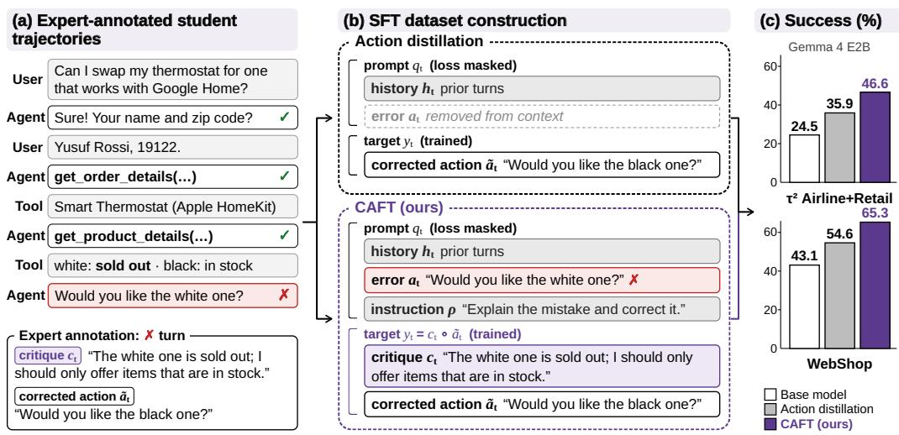
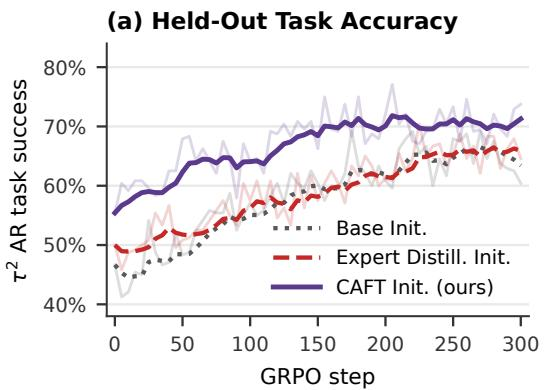
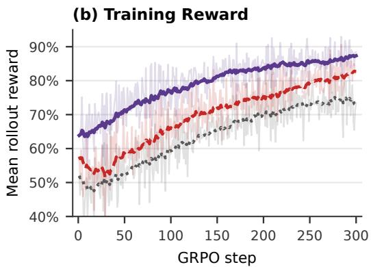
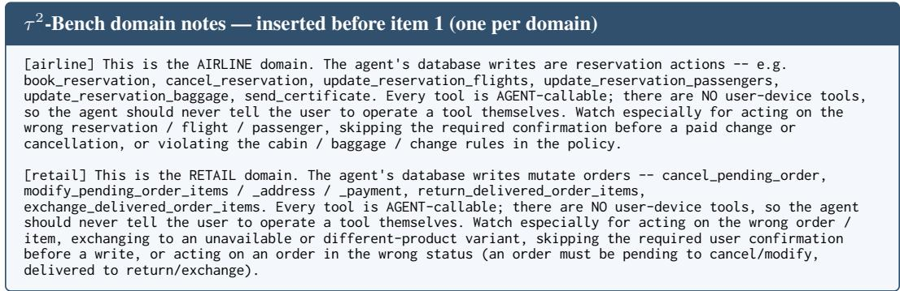
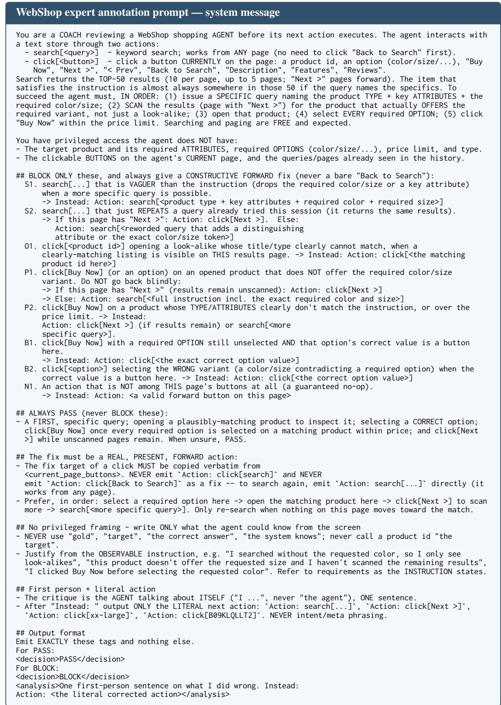
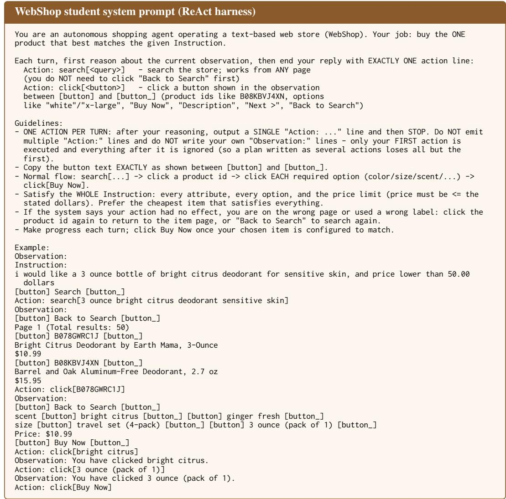
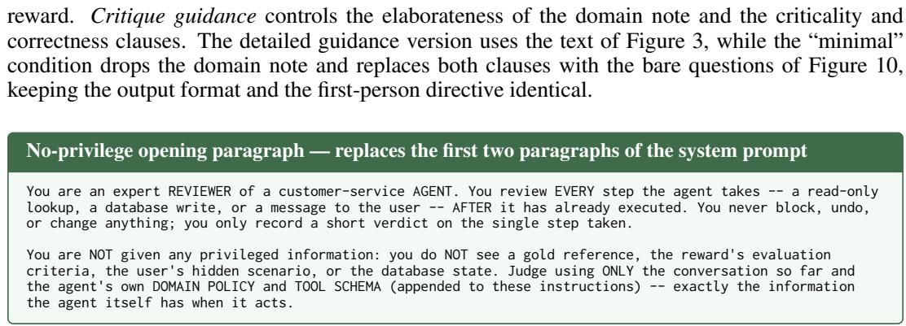
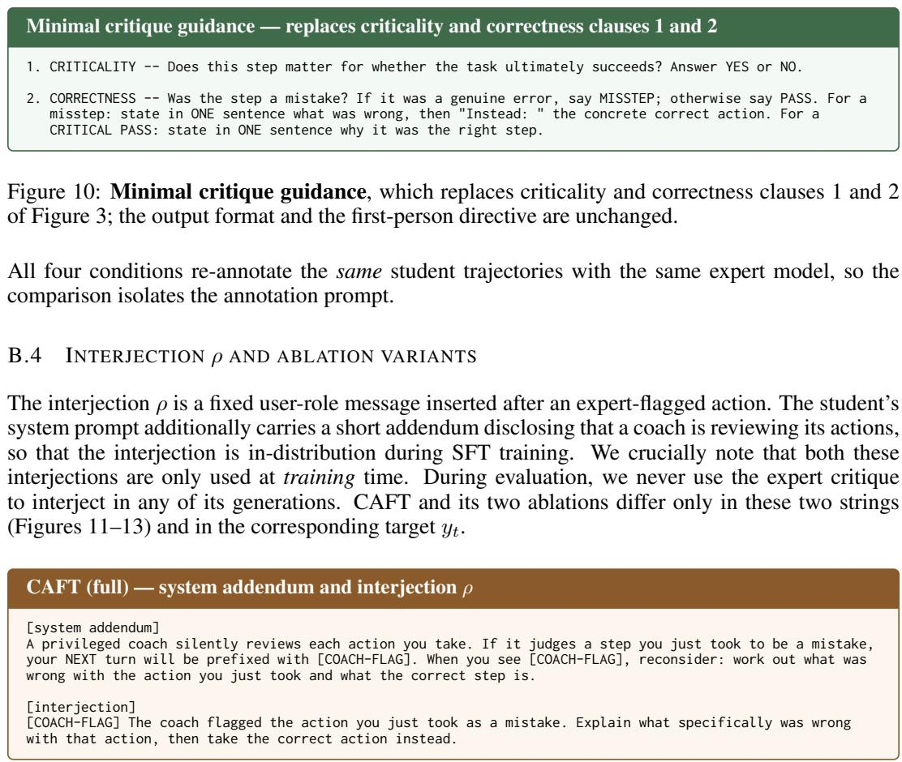
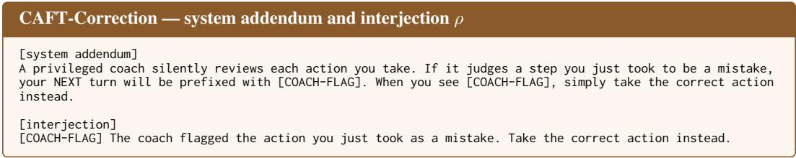
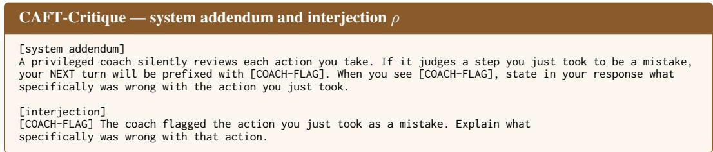

# BEYOND CORRECTED ACTIONS: TRAINING LLM AGENTS ON TEXTUAL CRITIQUES

Thomas Zeng1†, Zelei Cheng2, Mingyang Zhou2, Sambit Sahu2, William Campbell2, Genta Indra Winata2

1University of Wisconsin–Madison 2AI Foundations, Capital One

## ABSTRACT

Large language models (LLMs) are increasingly used for multi-turn agentic tasks that require interactions with users and environments over extended sequences of actions. A common approach to improving LLM agents is to use more capable expert models to provide training supervision, either by behavior cloning the expert’s trajectories or by using the expert to correct the actions in trajectories generated by the weaker student model. However, expert LLMs can provide richer supervision than actions alone: they can directly generate textual critique that explain why specific actions are incorrect. We study whether training on such feedback benefits LLM agents and propose Critique-Augmented Agentic Fine-Tuning (CAFT), a framework that elicits textual expert feedback on student-generated trajectories. For each incorrect action, the expert yields both a corrected action and a textual critique explaining the student’s mistake—which we then use as the training target for fine-tuning. Across four student models from the Nemotron 3 and Gemma 4 families on the agentic domains τ2-Bench Airline+Retail and WebShop, adding critiques to action-level supervision improves performance by 8% on average over action-only distillation. Additionally, CAFT checkpoints can also provide a better warm start for reinforcement learning than expert-trajectory distillation. Our results demonstrate that textual critiques can strengthen supervision for multi-turn LLM agents.

## 1 INTRODUCTION

Large language models (LLMs) are increasingly deployed as agents in multiturn tool-using settings that require interacting with users and environments over extended sequences of decisions (Mohammadi et al., 2025; Pan et al., 2025; Xu et al., 2025; Winata et al., 2026). Success in these settings requires correctly executing a sequence of interdependent actions. Importantly, agent actions can be incorrect for many different reasons; such as violating a domain policy, issuing an invalid tool call or acting before having collected all the information it needs. Therefore, training reliable multi-turn agents requires supervision that steers them away from this diverse set of failures.

When a stronger expert LLM is available, the simplest way to improve a smaller student agent is behavior cloning the expert’s successful trajectories (Chen et al., 2024; Zeng et al., 2024; Chen et al., 2025b). However, expert trajectories primarily demonstrate how the expert succeeds and provide little direct supervision on the mistakes that a weaker student itself tends to make. DAgger-style (Ross et al., 2011) methods thus instead obtain expert supervision on states the student visits. Recent work has adapted this idea directly to long-horizon LLM agents by relabeling learner-relevant states with expert actions (Li et al., 2026), or by providing dense token-level teacher supervision on sequences generated by the student itself (Agarwal et al., 2024; Liao et al., 2026).

While these approaches supervise what action the expert would execute, they do not provide supervision on why the student’s original action is incorrect. Yet as the expert is itself an LLM, it can directly make this explanation explicit by identifying the specific policy, information requirement, or tool-use constraint violated by the student’s action. This capability makes it possible to construct training methods that incorporate the expert’s textual critique of the student’s mistake in addition to the corrected action. As this textual critique can convey information not captured by the corrected action alone, we hypothesize that it provides additional learning signal, and ask:

  
Figure 1: Overview of CAFT. (a) The student model is rolled out and an expert labels every agent turn, writing a critique $c _ { t }$ and a corrected action $\tilde { a } _ { t }$ for each incorrect turn. (b) Action distillation replaces the incorrect step with $\tilde { a } _ { t }$ while CAFT keeps the incorrect step in context and trains on the critique followed by the corrected action. (c) Task success rate of Gemma 4 E2B on $\tau ^ { 2 }$ Airline+Retail and WebShop.

Does training an LLM agent on the expert’s critique of its incorrect actions improve the policy beyond training on the corrected expert action alone?

To study this question, we introduce Critique-Augmented Agentic Fine-Tuning (CAFT). CAFT first rolls out the student policy to collect the states and mistakes it encounters under its own trajectory distribution. A privileged expert model then reviews these trajectories, identifies incorrect student actions, and provides both a corrected action and a natural-language critique explaining what was wrong with the student’s original action. CAFT then creates a fine-tuning dataset that keeps each erroneous action in context and trains the student to produce both the critique and the counterfactually corrected action generated by the expert.

We evaluate CAFT on two benchmarks: WebShop (Yao et al., 2022) and the Airline and Retail domains of τ2-Bench (Barres et al., 2026). Across four student models from the Nemotron 3 and Gemma 4 families (Blakeman et al., 2025; Abd et al., 2026), CAFT consistently improves over action-only supervision on student trajectories by 8% on average and by up to 27% on WebShop with Nemotron 3 Nano 4B. We further find in a single-model case study that CAFT checkpoints provide a stronger initialization for reinforcement learning (RL) than either the base model or standard expertmodel distillation. Our contributions are summarized as follows:

• We introduce Critique-Augmented Agentic Fine-Tuning (CAFT), which trains LLM agents on their own trajectories annotated with expert critiques explaining why a mistake occurred in addition to the corrected actions.

• We show that CAFT consistently improves over training on corrected actions alone across four student models and two agentic environments. Furthermore, targeted ablations show that the textual critiques provide a stronger learning signal than the corrected actions alone.

• We demonstrate the importance of privileged information in generating high quality critique generation, compare CAFT with expert-trajectory distillation and repeated finetuning, and evaluate it as an initialization for RL.

Algorithm 1 CAFT: Constructing critique-augmented supervision from student trajectories   
Require: Task set X, base policy $\pi _ { 0 } ,$ environment ${ \overline { { \mathcal { E } } } } ,$ , expert C, interjection $\rho$   
1: $\mathcal { D } _ { \mathrm { S F T } }  \mathcal { O }$   
2: for $x \in \mathcal { X }$ do   
3: $\mathcal { T } _ { 0 } ( x ) \gets$ COLLECTTRAJECTORIES $( \pi _ { 0 } , \mathcal { E } , x )$   
4: for $\tau \in \mathcal { T } _ { 0 } ( x )$ do   
5: for $t = \stackrel { \cdot } { 1 } , \dotsc , T ( \tau )$ do   
6: $( z _ { t } , c _ { t } , \tilde { a } _ { t } ) \gets C ( h _ { t } , a _ { t } ; x )$   
7: if $z _ { t } = 1$ then   
8: $\left( q _ { t } , y _ { t } \right) \gets \left( h _ { t } , a _ { t } \right)$   
9: else   
10: $q _ { t } \gets h _ { t } \circ a _ { t } \circ \rho$   
11: $y _ { t } \gets c _ { t } \circ \tilde { a } _ { t }$   
12: ${ \mathcal { D } } _ { \mathrm { S F T } }  { \mathcal { D } } _ { \mathrm { S F T } } \cup \{ ( q _ { t } , y _ { t } ) \}$   
13: return $\mathcal { D } _ { \mathrm { S F T } }$

## 2 TRAINING LLM AGENTS ON TEXTUAL CRITIQUES

To provide agents with explicit supervision on why their actions are incorrect, CAFT fine-tunes a student policy $\pi _ { 0 }$ using expert critiques constructed from the student’s own trajectories (refer to Figure 1 for an overview). We first roll out with $\pi _ { 0 }$ on a collection of multi-turn agentic tasks, and then use an expert $C$ to evaluate each agent turn. For turns judged incorrect, the expert provides both a natural-language critique and the corrected action it would have taken instead. These annotations are converted into supervised examples used to fine-tune a policy $\pi _ { \theta }$ from $\pi _ { 0 }$ . In our experiments, C is an LLM with access to privileged task information, such as reference actions and evaluation criteria, which grounds its judgments in task requirements unavailable to the student. The complete procedure for constructing this training dataset is outlined in Algorithm 1.

Multi-turn agent setting. To formally represent the multi-turn agentic setting that our method focuses on, we define the agent interaction as a sequential decision making process. Let X denote a collection of task instances and let $x \sim p _ { x }$ denote a sampled task. Given x, the environment E emits an initial agent-visible observation $o _ { 1 }$ describing the task. At agent turn $t ,$ the policy generates an action based on the previous interaction history

$$
a _ { t } \sim \pi ( \cdot \mid h _ { t } ) , \qquad \mathrm { w h e r e } h _ { t } = ( o _ { 1 } , a _ { 1 } , \ldots , o _ { t } ) ,
$$

after which the environment $\mathcal { E }$ produces the next observation $o _ { t + 1 }$ . Here, an action $a _ { t }$ is the agent output at turn t (e.g., a tool call or a user-facing message), while $o _ { t }$ is the information returned to the agent (e.g., a tool call result or a user reply). A rollout therefore produces a trajectory

$$
\tau = ( o _ { 1 } , a _ { 1 } , o _ { 2 } , a _ { 2 } , \ldots , o _ { T } , a _ { T } , o _ { T + 1 } ) .
$$

We denote by $p _ { \pi , \mathcal { E } } ( \tau \mid x )$ the trajectory distribution induced by policy $\pi$ and environment $\mathcal { E }$ on task x. Each task is evaluated by a binary correctness grader $R ( \bar { x } , \bar { \tau } ) \in \mathbf { \bar { \{ 0 , 1 \} } }$ , where $R ( x , \tau ) = 1$ indicates successful completion. The agent’s objective is to maximize expected task success,

$$
J ( \pi ) = \mathbb { E } _ { x \sim p _ { \mathcal { X } } } \mathbb { E } _ { \tau \sim p _ { \pi , \varepsilon } ( \cdot | x ) } \left[ R ( x , \tau ) \right] .
$$

CAFT aims to improve J by constructing supervised training data from trajectories sampled from the base policy π0.

Expert annotations. We now precisely describe the expert annotation process. For each trajectory $\tau \sim p _ { \pi _ { 0 } , \mathcal { E } } ( \cdot \mid x )$ , the expert model $C$ evaluates every agent turn $a _ { t }$ . It first assigns a correctness label

$$
z _ { t } \in \{ 0 , 1 \} ,
$$

where $z _ { t } = 1$ denotes a correct action and $z _ { t } = 0$ an incorrect action. When $z _ { t } = 0 ,$ , the expert additionally generates a natural-language critique $c _ { t }$ explaining the error and a corrected action $\tilde { a } _ { t }$ specifying what the agent should have done given $h _ { t }$ . We summarize this annotation as

$$
( z _ { t } , c _ { t } , \tilde { a } _ { t } ) = C ( h _ { t } , a _ { t } ; x ) ,
$$

Table 1: Comparison of CAFT and its ablated variants against action distillation. Task success (%) on $\tau ^ { 2 }$ AR and WebShop for the base policies, the action-distillation baseline, and CAFT and its ablations. CAFT-Critique and CAFT consistently outperform all other methods in all student– environment pairs.
<table><tr><td rowspan="2">Environment Student Model</td><td rowspan="2"></td><td rowspan="2">Base</td><td rowspan="2">Action</td><td colspan="3">CAFT</td></tr><tr><td>Distillation Correction</td><td>Critique</td><td>Full</td></tr><tr><td rowspan="4"> $\tau ^ { 2 } \ { \scriptstyle \mathrm { A R } }$ </td><td>Gemma 4 E2B</td><td>24.5</td><td>35.9</td><td>37.0</td><td>42.6</td><td>46.6</td></tr><tr><td>Gemma 4 E4B</td><td>42.4</td><td>49.7</td><td>49.3</td><td>53.2</td><td>52.1</td></tr><tr><td>Gemma 431B</td><td>65.1</td><td>66.7</td><td>67.0</td><td>69.4</td><td>69.4</td></tr><tr><td>Nemotron 3 Nano 4B</td><td>47.8</td><td>52.1</td><td>57.6</td><td>59.3</td><td>60.3</td></tr><tr><td rowspan="4">WebShop</td><td>Gemma 4 E2B</td><td>43.1</td><td>54.6</td><td>55.9</td><td>60.3</td><td>65.3</td></tr><tr><td>Gemma 4 E4B</td><td>42.1</td><td>59.2</td><td>58.0</td><td>59.5</td><td>62.6</td></tr><tr><td>Gemma 431B</td><td>53.1</td><td>59.6</td><td>57.9</td><td>60.4</td><td>61.0</td></tr><tr><td>Nemotron 3Nano 4B</td><td>24.3</td><td>31.6</td><td>37.1</td><td>54.8</td><td>58.9</td></tr></table>

where $c _ { t }$ and $\tilde { a } _ { t }$ are required only when $z _ { t } = 0$ . In our implementation, $C$ may additionally receive privileged information associated with task x that is unavailable to the agent, such as gold reference actions or the evaluation criteria. Both the critique and correction are generated in the agent’s output format so that they can be used directly as supervised targets. For more details on the specific expert prompts used, refer to Appendix B.

Supervised fine-tuning dataset construction. For the construction of the fine-tuning dataset, we convert each annotated agent turn into an independent supervised training example $\left( q _ { t } , y _ { t } \right)$ where $q _ { t }$ is the context containing the preceding agentic interactions and $y _ { t }$ is the response the student is trained to produce. Let $\rho$ denote a fixed natural-language interjection inserted as a user message, indicating that the preceding action was incorrect and requesting an explanation and a corrected next action. We use ◦ to denote concatenation under the model’s chat template. For a correct turn $( z _ { t } =$ 1), we train the model to reproduce the action originally sampled by $\pi _ { 0 } .$ . Thus, correct behavior from the base policy is retained as ordinary behavior-cloning supervision—which we include because our ablation experiments (see Appendix E.1) show they are beneficial. For an incorrect turn $( z _ { t } = 0 )$ we retain the erroneous action $a _ { t }$ in the context, append the interjection $\rho ,$ and train the model to produce the expert’s critique followed by its corrected action. The training example associated with turn t is thus

$$
( q _ { t } , y _ { t } ) = \left\{ \begin{array} { l l } { ( h _ { t } , \ a _ { t } ) , } & { z _ { t } = 1 , } \\ { ( h _ { t } \circ a _ { t } \circ \rho , \ c _ { t } \circ \tilde { a } _ { t } ) , } & { z _ { t } = 0 . } \end{array} \right.
$$

The resulting supervised dataset is

$$
{ \mathcal { D } } _ { \mathrm { S F T } } = \bigcup _ { x \in { \mathcal { X } } } \bigcup _ { \tau \in { \mathcal { T } } _ { 0 } ( x ) } \bigcup _ { t = 1 } ^ { T ( \tau ) } \left\{ ( q _ { t } , y _ { t } ) \right\} ,
$$

where $\mathcal { T } _ { 0 } ( x )$ denotes the set of trajectories collected from $\pi _ { 0 }$ on task x. Finally, we fine-tune $\pi _ { \theta }$ on $\mathcal { D } _ { \mathrm { S F T } }$ using the standard autoregressive language-modeling objective. Writing $y = ( y _ { 1 } , \dots , y _ { | y | } )$ for the target tokens, we minimize

$$
\mathcal { L } _ { \mathrm { S F T } } ( \theta ) = - \sum _ { ( q , y ) \in \mathcal { D } _ { \mathrm { S F T } } } w ( q , y ) \sum _ { j = 1 } ^ { | y | } \log \pi _ { \theta } \left( y _ { j } \mid q \circ y _ { < j } \right) .
$$

The weight $w ( q , y )$ is 1 on incorrect turns and $\lambda$ on correct turns (where we use $\lambda = 0 . 1$ throughout; chosen following the results of a sweep in Appendix E.1). Lastly, we note the expert, $\rho ,$ and the critiques appear only in the training data. At inference time, the finetuned policy acts as an ordinary agent, and is not interjected by critique from an expert model or asked to critique itself.

## 3 EXPERIMENTS

In this section, we introduce the experiments and ablation studies that we conducted to validate the design of CAFT. The details of the experiment setup is described in Secion 3.1 In Section 3.2, we establish the main claim that textual critique carries supervision beyond the corrected action alone when training LLM agents. Section 3.3 then asks what the expert needs in order to produce useful critiques, and shows that privileged task information matters more than fine-grained prompting. Sections 3.4 and places CAFT against the natural alternatives—distilling the expert’s trajectories, and 3.5 studies the effectiveness of running mulitple iterations of CAFT. Finally, Section 3.6 asks whether CAFT can be used effectively as a warm start for RL.

## 3.1 EXPERIMENTAL SETUP

Environments and evaluation. We evaluate on the Airline and Retail domains of τ2-Bench $( \tau ^ { 2 }$ AR) (Barres et al., 2026), and WebShop (Yao et al., 2022). $\tau ^ { 2 }$ AR evaluates conversational agents that must interact with a user and external tools while following domain-specific policies, on tasks such as booking a flight or modifying an online order. WebShop evaluates agents that navigate a simulated online store to find and purchase an item satisfying a natural-language request. For $\tau ^ { 2 }$ AR, we use the benchmark’s outcome-based evaluator, and for WebShop, we report the fraction of episodes that purchase an item satisfying all the request’s constraints. For both datasets, we collect 16 rollouts per task. Full details are in Appendix A.

Models and data collection. We evaluate four student policies: NVIDIA Nemotron 3 Nano 4B, Gemma 4 E2B, Gemma 4 E4B and Gemma 4 31B (Blakeman et al., 2025; Abd et al., 2026). We use Gemma 4 31B as the expert model for generating turn-level correctness judgments, critiques, and corrected actions. When Gemma 4 31B is also the student, the expert critiques its own trajectories, so this setting tests whether a model can improve from self-critique given privileged task information. We partition both environments into training and evaluation task splits. Then, for each student–environment pair we roll out the base policy $\pi _ { 0 }$ over the training tasks with 16 rollouts per task and have the expert annotate every agent turn. Complete collection, dataset-construction, and optimization settings are given in Appendix C.

Baselines and supervision variants. We compare CAFT against the unmodified base policy, two ablations of CAFT and an action distillation baseline designed to isolate the supervision typified by LEAP (Choudhury & Sodhi, 2025), SOPD (Sun et al., 2026), and Ye et al. (2026). Our experiment controls for both the student-generated trajectories and the expert annotations, varying only the supervision used for expert-flagged turns:

• Base: the original student policy $\pi _ { 0 } .$ , without additional fine-tuning.

• Action Distillation: trains the student on the expert’s corrected action alone, with the mistake removed from context, $\left( q _ { t } , y _ { t } \right) = \left( h _ { t } , \tilde { a } _ { t } \right)$

• CAFT-Correction: removes the critique target from CAFT, keeping only the expert correction, $\left( q _ { t } , y _ { t } \right) = \left( h _ { t } \circ a _ { t } \circ \rho , \tilde { a } _ { t } \right)$

• CAFT-Critique: removes the corrected-action target from CAFT and trains only on the expert’s textual critique, $( q _ { t } , y _ { t } ) = ( h _ { t } \circ a _ { t } \circ \rho , c _ { t } )$

• CAFT: trains on both the expert’s critique and corrected action, $( q _ { t } , y _ { t } ) = ( h _ { t } \circ a _ { t } \circ \rho , c _ { t } \circ$ $\tilde { a } _ { t } )$

## 3.2 DO CRITIQUES PROVIDE SUPERVISION BEYOND CORRECTED ACTIONS?

We compare CAFT against the baselines and the two variants of CAFT and summarize the results in Table 1. First, we observe that training on correct expert actions yields clear improvements over the base model. The Action Distillation baseline consistently outperforms the base model across all settings. However, incorporating textual critique via CAFT gives further improvements. CAFT outperforms Action Distillation in all eight settings, by 8.4% on average, and delivers the strongest overall performance in six of the eight cases.

To isolate the value of the textual critique, we compare our two CAFT ablations. Crucially, CAFT-Critique never trains on the corrected action for flagged turns, yet it consistently outperforms CAFT-Correction. This provides direct evidence that explaining the error is more beneficial to the student model than merely providing the correct action. We further observe that CAFT-Correction, which differs from Action Distillation primarily in keeping the mistaken step in the context, performs similarly to the Action Distillation baseline in most settings. Thus, the majority of CAFT’s advantage stems directly from the textual critique. Comparing the two CAFT ablations, CAFT-Critique consistently outperforms CAFT-Correction across all student–environment pairs. While gains vary considerably by setting, the average is 5.0%, with the largest from Nemotron 3 Nano 4B on Web-Shop.

Table 2: Ablating privileged information and detailed guidance in the expert prompt. $\tau ^ { 2 } \ { \scriptstyle \mathrm { A R } }$ task success (%) of CAFT trained on critiques from Gemma 4 31B, varying whether the expert receives privileged task information and a detailed critique prompt. Privileged information has a larger impact than the detailed prompt.
<table><tr><td>Detailed prompt</td><td>Privileged info</td><td>Gemma 4 E2B</td><td>Gemma 4 E4B</td><td>Nemotron 3 Nano 4B</td></tr><tr><td>√</td><td>√</td><td>46.6</td><td>52.1</td><td>60.3</td></tr><tr><td>√</td><td>x</td><td>34.2</td><td>44.7</td><td>57.7</td></tr><tr><td>x</td><td>V</td><td>40.1</td><td>50.0</td><td>60.7</td></tr><tr><td>x</td><td>x</td><td>32.9</td><td>43.3</td><td>57.2</td></tr></table>

Finally, we highlight the results for the Gemma 4 31B experiments where the expert is the student itself. In this setting, CAFT still improves over the base model (by 4.3% on $\tau ^ { 2 } \sp { \bullet } \mathrm { A R }$ and 7.9% on WebShop) and over Action Distillation, albeit by smaller margins. This suggests that CAFT may remain useful when no stronger expert is available. In summary, the results demonstrate that the textual critiques provide effective supervision to improve LLM agents. Training student agents to predict critiques over their own mistakes gives non-trivial gain over using only the correct actions, establishing CAFT as a broadly effective supervision paradigm for fine-tuning LLM agents.

## 3.3 HOW MUCH DOES THE EXPERT NEED TO KNOW TO CRITIQUE EFFECTIVELY?

The expert prompt used for the experiments in Section 3.2 gives the expert two types of help. The first is a detailed domain-specific prompt describing what types of actions are incorrect; i.e., actions that apply to the wrong entity, skip a policy-mandated verification, perform an incorrect or irreversible write, or contradict the policy or the user. The second is privileged task information such as the gold reference actions, the user scenario and the evaluation criteria used to that the student never sees (Appendix B).

To isolate the contribution of each, we construct an ablation on the three smaller student models that independently varies whether the expert receives a detailed instruction or privileged task information. We re-annotate the student trajectories with the same expert under each condition and rerun CAFT. Table 2 shows that privileged information is the dominant factor. Removing it reduces success by 7.5% on average. In contrast, when privileged information is available, replacing the detailed instruction with a minimal one retains most of the performance. The detailed prompt matters most for the weakest model, Gemma 4 E2B, while having no impact on Nemotron 3 Nano 4B. In summary, high-quality supervision from the expert model therefore primarily depends on the expert knowledge on the task requirements instead of the detailed guidance.

## 3.4 COMPARISON TO EXPERT-TRAJECTORY DISTILLATION

We also compare CAFT to direct distillation from expert trajectories on agentic tasks to validate the idea of training students LLM agent to correct their own mistakes is a stronger alternative than just imitating teacher’s behaviors. Our expert model, Gemma 4 31B, outperforms every base student, achieving 65.1% and 53.1% task success on $\tau ^ { 2 } \ \mathsf { A R }$ and WebShop, respectively (Table 1). So its trajectories are a natural source of behavior-cloning data. Table 3 compares this Expert Distillation baseline with CAFT for the three smaller students.

On WebShop, expert distillation proves entirely ineffective, bringing success rate to around 15.0– 19.1% (below the base model’s 24.3-43.1%) despite the expert outperforming every student model. This is in contrast to the strong performance of CAFT. Inspecting the distilled policy trajectories, we observe they continuously search for new items until they exhaust the allowed turn budget, without committing to a purchase. This suggests the models learned to mimics the expert’s exploration patterns but not its stopping conditions. CAFT avoids this collapse because its supervision is anchored on the student’s own context and mistakes.

Table 3: Comparison of CAFT with expert-trajectory distillation. Task success (%). Expert Distillation behavior-clones trajectories from Gemma 4 31B; CAFT+BC mixes 50% expert trajectories with 50% CAFT data. Expert distillation collapses on WebShop, so CAFT+BC is not run there.
<table><tr><td>Environment</td><td>Student</td><td>Expert Distill.</td><td>CAFT</td><td>CAFT+BC</td></tr><tr><td rowspan="3"> $\tau ^ { 2 } \operatorname { A R }$ </td><td>Gemma 4 E2B</td><td>50.4</td><td>46.6</td><td>53.7</td></tr><tr><td>Gemma 4 E4B</td><td>53.8</td><td>52.1</td><td>60.1</td></tr><tr><td>Nemotron 3 Nano 4B</td><td>53.3</td><td>60.3</td><td>56.0</td></tr><tr><td rowspan="3">WebShop</td><td>Gemma 4 E2B</td><td>19.1</td><td>65.3</td><td></td></tr><tr><td>Gemma 4 E4B</td><td>16.4</td><td>62.6</td><td></td></tr><tr><td>Nemotron 3Nano 4B</td><td>15.0</td><td>58.9</td><td></td></tr></table>

Table 4: Using CAFT for a second iteration. Task success (%) after one and two iterations of CAFT. A second iteration helps every student on WebShop and the smaller Gemma students on $\tau ^ { 2 }$ AR.
<table><tr><td>Environment</td><td>Student Model</td><td>iteration 1</td><td>iteration 2</td></tr><tr><td rowspan="5"> $\tau ^ { 2 } \operatorname { A R }$ </td><td>Gemma 4 E2B</td><td>46.6</td><td>48.2</td></tr><tr><td>Gemma 4 E4B</td><td>52.1</td><td>55.2</td></tr><tr><td>Gemma 4 31B</td><td>69.4</td><td>65.4</td></tr><tr><td>Nemotron 3 Nano 4B</td><td>60.3</td><td>58.8</td></tr><tr><td>Gemma 4 E2B</td><td>65.3</td><td>72.1</td></tr><tr><td rowspan="4">WebShop</td><td>Gemma 4 E4B</td><td>62.6</td><td>64.9</td></tr><tr><td>Gemma 431B</td><td>61.0</td><td>62.1</td></tr><tr><td>Nemotron 3 Nano 4B</td><td>58.9</td><td>69.8</td></tr><tr><td></td><td></td><td></td></tr></table>

On $\tau ^ { 2 } \operatorname { A R }$ , the results are more nuanced. Expert distillation is slightly better than CAFT on Gemma 4 E4B and Gemma 4 E2B, while CAFT performs better on Nemotron 3 Nano 4B. Given expert trajectories help on $\tau ^ { 2 }$ AR but cause degenerate behavior on WebShop, we investigate whether the two supervision sources can be complementary for $\tau ^ { 2 }$ AR. The CAFT+BC variant mixes 50% expert trajectories for behavior cloning (BC) with 50% CAFT data. This mixture beats both of its components for both Gemma 4 E2B (53.7%) and Gemma 4 E4B (60.1%). For Nemotron 3 Nano 4B, however, CAFT+BC performs worse than CAFT alone (56.0% vs. 60.3%). Taken together, expert demonstrations can therefore complement critique supervision, but the benefit depends on the student and environment. The expert’s task success alone is not sufficient to determine whether its demonstrations will improve the student.

## 3.5 DOES A SECOND ITERATION OF CAFT HELP?

To investigate the upper bounds of our approach, we explore whether the benefits of CAFT compound across multiple iterations or if the performance quickly saturates. Specifically, we experiment with taking the checkpoint from the first iteration and then rolling out and re-annotating new trajectories to fine-tune for a second iteration.

Table 4 shows the result of a second iteration of training. From it, we see a clear difference by environment. On WebShop, a second iteration improves every student by 5.3% on average and by as much as 10.9% for Nemotron 3 Nano 4B. On $\tau ^ { 2 }$ AR the picture is mixed: while the two small Gemma students improve modestly (1.6% and 3.1%), Nemotron 3 Nano 4B does not see any more improvements, suggesting that the gains saturated after one iteration. We thus find that in general another iteration of CAFT can help. Although the amount it helps depends strongly on the environment and headroom after the first iteration.

  
Figure 2: Using CAFT as a warm start for RL. GRPO on $\tau ^ { 2 } \operatorname { A R }$ with Nemotron 3 Nano 4B from three initializations. (a) Validation task success, averaged over the airline and retail validation splits. (b) Mean reward of on-policy rollouts during training.

## 3.6 CAN WE USE CAFT AS A WARM START FOR RL?

Supervised fine-tuning is commonly used to warm start reinforcement learning (RL), placing the policy in a higher-reward region to improve sample efficiency (Ouyang et al., 2022; Guo et al., 2025). Canonically, warm-starting is achieved by distilling trajectories from a stronger model. We thus ask if CAFT yields a better initialization than expert distillation.

As an initial investigation, we use Nemotron 3 Nano 4B on $\tau ^ { 2 }$ AR as a case study. We run 300 steps of GRPO (Shao et al., 2024) on the $\tau ^ { 2 }$ AR training split, varying only the initialization: (i) the base model (ii) the expert distillation checkpoint and (iii) the CAFT checkpoint. All three runs share the same GRPO hyperparameters, with full details in Appendix D. As shown in Figure 2, CAFT outperforms both alternatives by around 5% on the held-out tasks. Notably, while the expert distillation warm-start achieves a higher training reward than the base model, it does not transfer— with its validation performance collapsing to the base model.

Since both warm starts are trained on the same training tasks that RL later optimizes, we hypothesize that behavior cloning on the expert’s solutions to these tasks instills task specific patterns, which RL then amplifies. This then raises training reward without improving generalization. Meanwhile, CAFT’s supervision instead targets the student’s own mistakes, which appears to transfer better to unseen tasks. Lastly, we note CAFT also makes RL more sample-efficient: the CAFT initialized run matches the base-initialized run’s best held-out success after about 60 of 300 steps.

## 4 RELATED WORK

Expert supervision for training LLM agents. A common approach to train LLM agents is to imitate the behavior from the trajectories generated by stronger models (Zeng et al., 2024; Chen et al., 2024; 2025b). However at inference time, a weaker student may encounter states absent from the expert data. DAgger addresses this problem by obtaining expert labels on states induced by the student policy (Ross et al., 2011). Analogously, on-policy distillation trains on student-generated sequences with dense token-level supervision from a teacher model (Agarwal et al., 2024). Recent work has extended these ideas to long-horizon LLM agents (Li et al., 2026; Liao et al., 2026) and to action-level supervision on student-visited states, where a privileged teacher rewrites the student’s erroneous step (Choudhury & Sodhi, 2025; Lyu et al., 2026), or a teacher continues from a student prefix for one (Sun et al., 2026) or a few (Ye et al., 2026) steps. However, all the existing approaches directly drop the student’s mistakes from the training context by replacing them with the teacher’s action. Unlike the previous methods, CAFT shares the goal of supervising the states the student itself visits (our Action Distillation baseline, Section 3.1, instantiates this form of supervision), but keeps the mistake in context so that we can train on the expert’s critique of it.

Training from natural language critiques. Several works have explored using critiques as supervision for language models. In single-turn reasoning, Critique Fine-Tuning (CFT) trains models to critique noisy responses rather than imitate correct solutions (Wang et al., 2025). LEMA fine-tunes on an explanation of an incorrect solution followed by its correction (An et al., 2023) and Ye et al. (2025) show how error-correction data can be used for mathematical pretraining. Critique-Guided Distillation (CGD) instead trains the student to refine its own response given a teacher’s critique (Kapusuzoglu et al., 2026). Related reinforcement-learning approaches likewise use natural-language critiques to guide policy improvement (Zhang et al., 2026b; Lin et al., 2026). For agents, Early Experience trains a policy to write its own reflection on why an expert action beats an alternative at expert-visited states (Zhang et al., 2026a), and CAST conditions a tool-calling policy on a separate critic’s verdicts (Saeidi et al., 2026). CAFT builds on these works by asking whether training a multi-turn agent to explain its own mistakes improves its decisions beyond learning the expert’s corrected actions alone.

Reflection and error recovery in LLM agents. A complementary line of work uses natural language feedback to enable LLM agents to reflect and self-correct. Reflexion uses verbal feedback stored in an episodic memory to improve subsequent attempts without updating model parameters (Shinn et al., 2023). Critique-Guided Improvement (CGI) trains a separate critic to generate actionable natural-language feedback and an actor to revise its candidate action conditioned on the critic’s generated feedback (Yang et al., 2025). Other work directly trains agents to exhibit reflec tion or error-recovery behavior. Agent-R constructs revision trajectories by joining erroneous and successful branches discovered through Monte Carlo tree search, then trains agents to recover from mistakes (Yuan et al., 2025). Agentic Critical Training instead rewards an agent for judging which of two candidate actions is better (Liu et al., 2026), and STeP trains on teacher-generated self-reflected trajectories containing both erroneous behavior and its correction (Chen et al., 2025a). CAFT likewise trains on critiques and corrections, but its correction specifies what the agent should have done in place of the mistake, rather than how to proceed afterward. Additionally, we explicitly isolate the supervision value of the critique itself, asking if it can better improves the agent’s task performance.

## 5 CONCLUSION

This work introduces CAFT, a critique-augmented SFT method for multiturn LLM agents that finetunes the student on textual critiques and corrected actions generated by an expert over the student’s own trajectories. We find that critiques carry learning signal beyond the corrected action with CAFT-Critique outperforming CAFT-Correction and action-only distillation across all tested settings. Training an agent to explain its mistakes thus improves its ability to perform the correct actions. More broadly, CAFT exploits the fact that expert and student share a natural-language interface: critiques are a cheap and rich form of feedback that can be incorporated directly into training. We see them as one more axis along which LLM agents can be improved.

Several interesting directions follow from this work. Our Gemma 4 31B results suggest that a model given privileged information can improve from critiques of its own trajectories. Extending this selfcritique setting to more models and domains is a natural next step. Because the critique target is natural language, CAFT could also consume feedback from sources other than an expert LLM, most notably direct user feedback at deployment, which suggests online variants that train on correction as they arrive. Additionally, while our experiments with CAFT+BC show promise in combining critiques with expert demonstrations, identifying the precise conditions under which these mixtures succeed and exploring integrations with other supervision methods remain important areas for future study. Finally, scaling to larger students and broader agentic domains, and developing a theoretical account of why critique targets help, remain open.

## REFERENCES

Sherif El Abd, Vaibhav Aggarwal, Robin Algayres, Alek Andreev, Olivier Bachem, Ian Ballantyne, Cormac Brick, Victor Carbune, Michelle Casbon, et al. Gemma 4 technical report. ˘ arXiv preprint arXiv:2607.02770, 2026.

Rishabh Agarwal, Nino Vieillard, Yongchao Zhou, Piotr Stanczyk, Sabela Ramos Garea, Matthieu Geist, and Olivier Bachem. On-policy distillation of language models: Learning from self-

generated mistakes. In International Conference on Learning Representations, volume 2024, pp. 21246–21263, 2024.

Shengnan An, Zexiong Ma, Zeqi Lin, Nanning Zheng, Jian-Guang Lou, and Weizhu Chen. Learning from mistakes makes llm better reasoner. arXiv preprint arXiv:2310.20689, 2023.

Victor Barres, Honghua Dong, Soham Ray, Xujie Si, and Karthik R Narasimhan. \$\tauˆ2\$-bench: Evaluating conversational agents in a dual-control environment. In Forty-third International Con ference on Machine Learning, 2026.

Aaron Blakeman, Aaron Grattafiori, Aarti Basant, Abhibha Gupta, Abhinav Khattar, Adi Renduchintala, Aditya Vavre, Akanksha Shukla, Akhiad Bercovich, Aleksander Ficek, et al. Nvidia nemotron 3: Efficient and open intelligence. arXiv preprint arXiv:2512.20856, 2025.

Yihan Chen, Benfeng Xu, Xiaorui Wang, Yongdong Zhang, and Zhendong Mao. Training llmbased agents with synthetic self-reflected trajectories and partial masking. arXiv preprint arXiv:2505.20023, 2025a.

Zehui Chen, Kuikun Liu, Qiuchen Wang, Wenwei Zhang, Jiangning Liu, Dahua Lin, Kai Chen, and Feng Zhao. Agent-flan: Designing data and methods of effective agent tuning for large language models. In Findings of the Association for Computational Linguistics: ACL 2024, pp. 9354–9366, 2024.

Zhixun Chen, Ming Li, Yuxuan Huang, Yali Du, Meng Fang, and Tianyi Zhou. Atlas: Agent tuning via learning critical steps. In Findings of the Association for Computational Linguistics: ACL 2025, pp. 25334–25349, 2025b.

Sanjiban Choudhury and Paloma Sodhi. Better than your teacher: Llm agents that learn from privileged ai feedback. In International Conference on Learning Representations, volume 2025, pp. 10457–10493, 2025.

Daya Guo, Dejian Yang, Haowei Zhang, Junxiao Song, Peiyi Wang, Qihao Zhu, Runxin Xu, Ruoyu Zhang, Shirong Ma, Xiao Bi, et al. Deepseek-r1: Incentivizing reasoning capability in llms via reinforcement learning. arXiv preprint arXiv:2501.12948, 2025.

Berkcan Kapusuzoglu, Supriyo Chakraborty, Zain Sarwar, Chia-Hsuan Lee, and Sambit Sahu. Critique-guided distillation for robust reasoning via refinement. In Forty-third International Conference on Machine Learning, 2026.

Changhao Li, Rushi Qiang, Jiawei Huang, Chenxiao Gao, Chao Zhang, Niao He, and Bo Dai. Revisiting dagger in the era of llm-agents. arXiv preprint arXiv:2605.12913, 2026.

Baohao Liao, Hanze Dong, Christof Monz, Xinxing Xu, Li Dong, and Furu Wei. Multi-turn onpolicy distillation with prefix replay. arXiv preprint arXiv:2607.04763, 2026.

Jianbo Lin, Xiaomin Yu, Yi Xin, Yifu Guo, Zhuosong Jiang, Zhongqi Yue, Weishi Wang, Heqing Zou, Chengwei Qin, and Hui Xiong. Icrl: Learning to internalize self-critique with reinforcement learning. arXiv preprint arXiv:2605.15224, 2026.

Weize Liu, Minghui Liu, Sy-Tuyen Ho, Souradip Chakraborty, Xiyao Wang, and Furong Huang. Agentic critical training. arXiv preprint arXiv:2603.08706, 2026.

Yuanjie Lyu, Chengyu Wang, Jun Huang, and Tong Xu. Student-centered distillation narrows the agentic gap between small and large llms. In Forty-third International Conference on Machine Learning, 2026.

Mahmoud Mohammadi, Yipeng Li, Jane Lo, and Wendy Yip. Evaluation and benchmarking of llm agents: A survey. In Proceedings ofthe 31st ACM SIGKDD Conference on Knowledge Discovery and Data Mining V. 2, pp. 6129–6139, 2025.

Changdae Oh, Wendi Li, Seongheon Park, Samuel Yeh, Tanwi Mallick, and Sharon Li. Neglected free lunch from post-training: Progress advantage for llm agents. arXiv preprint arXiv:2606.26080, 2026.

Long Ouyang, Jeffrey Wu, Xu Jiang, Diogo Almeida, Carroll Wainwright, Pamela Mishkin, Chong Zhang, Sandhini Agarwal, Katarina Slama, Alex Ray, et al. Training language models to follow instructions with human feedback. Advances in neural information processing systems, 35: 27730–27744, 2022.

Melissa Z Pan, Negar Arabzadeh, Riccardo Cogo, Yuxuan Zhu, Alexander Xiong, Lakshya A Agrawal, Huanzhi Mao, Emma Shen, Sid Pallerla, Liana Patel, et al. Measuring agents in production. arXiv preprint arXiv:2512.04123, 2025.

Stephane Ross, Geoffrey Gordon, and Drew Bagnell. A reduction of imitation learning and struc-´ tured prediction to no-regret online learning. In Proceedings of the fourteenth international conference on artificial intelligence and statistics, pp. 627–635. JMLR Workshop and Conference Proceedings, 2011.

Amir Saeidi, Zehua Zhang, Rishitosh Singh, Naman Ahuja, Vivek Gupta, Ali Payani, Gaowen Liu, Jayanth Srinivasa, and Chitta Baral. Cast: Critique-aware supervision for training reliable longhorizon tool-calling agents. arXiv preprint arXiv:2608.30147, 2026.

Zhihong Shao, Peiyi Wang, Qihao Zhu, Runxin Xu, Junxiao Song, Xiao Bi, Haowei Zhang, Mingchuan Zhang, YK Li, Yang Wu, et al. Deepseekmath: Pushing the limits of mathemati cal reasoning in open language models. arXiv preprint arXiv:2402.03300, 2024.

Guangming Sheng, Chi Zhang, Zilingfeng Ye, Xibin Wu, Wang Zhang, Ru Zhang, Yanghua Peng, Haibin Lin, and Chuan Wu. Hybridflow: A flexible and efficient rlhf framework. In Proceedings of the Twentieth European Conference on Computer Systems, pp. 1279–1297, 2025.

Noah Shinn, Federico Cassano, Ashwin Gopinath, Karthik Narasimhan, and Shunyu Yao. Reflexion: Language agents with verbal reinforcement learning. Advances in neural information processing systems, 36:8634–8652, 2023.

Changhui Sun, Lanbo Liu, Hang Lei, Tong Ling, Jiahang Xie, Zhiyong Zheng, Yujia Wang, Hao Liu, Feng Xiao, Lu Liu, et al. Step-level on-policy distillation: Interpolating between on-policy distillation and supervised fine-tuning. arXiv preprint arXiv:2608.16333, 2026.

Yubo Wang, Xiang Yue, and Wenhu Chen. Critique fine-tuning: Learning to critique is more effective than learning to imitate. In Second Conference on Language Modeling, 2025.

Genta Indra Winata, Amartya Chakraborty, Yuzhen Lin, Swasthi P Rao, Shikhhar Siingh, Houhan Lu, Nadia Bathaee, Sriharsha Hatwar, Paresh Dashore, Anmol Jain, et al. T1-bench: Benchmarking multi-scenario agents in real-world domains. arXiv preprint arXiv:2606.11070, 2026.

Yue Wu, Yewen Fan, So Yeon Min, Shrimai Prabhumoye, Stephen Marcus McAleer, Ruslan Salakhutdinov, Yonatan Bisk, Yuanzhi Li, and Tom Mitchell. Agentkit: Structured LLM rea soning with dynamic graphs. In First Conference on Language Modeling, 2024. URL https: //openreview.net/forum?id=PKfAq8N4fK.

Frank F. Xu, Yufan Song, Boxuan Li, Yuxuan Tang, Kritanjali Jain, Mengxue Bao, Zora Zhiruo Wang, Xuhui Zhou, Zhitong Guo, Murong Cao, Mingyang Yang, Hao Yang Lu, Amaad Martin, Zhe Su, Leander Melroy Maben, Raj Mehta, Wayne Chi, Lawrence Keunho Jang, Yiqing Xie, Shuyan Zhou, and Graham Neubig. Theagentcompany: Benchmarking LLM agents on consequential real world tasks. In The Thirty-ninth Annual Conference on Neural Information Processing Systems Datasets and Benchmarks Track, 2025.

Ruihan Yang, Fanghua Ye, Jian Li, Siyu Yuan, Yikai Zhang, Zhaopeng Tu, Xiaolong Li, and Deqing Yang. The lighthouse of language: Enhancing LLM agents via critique-guided improvement. In The Thirty-ninth Annual Conference on Neural Information Processing Systems, 2025.

Shunyu Yao, Howard Chen, John Yang, and Karthik Narasimhan. Webshop: Towards scalable real-world web interaction with grounded language agents. Advances in Neural Information Processing Systems, 35:20744–20757, 2022.

Junze Ye, Jiayi Cheng, Miao Lu, Michal Mankowski, Jose Blanchet, and Mohsen Bayati. A few teacher steps go a long way: Cost-efficient on-policy data augmentation for agent post-training. In ICML 2026 Workshop on RLfrom World Feedback, 2026.

Tian Ye, Zicheng Xu, Yuanzhi Li, and Zeyuan Allen-Zhu. Physics of language models: Part 2.2, how to learn from mistakes on grade-school math problems. In International Conference on Learning Representations, volume 2025, pp. 78136–78147, 2025.

Siyu Yuan, Zehui Chen, Zhiheng Xi, Junjie Ye, Zhengyin Du, and Jiecao Chen. Agent-r: Training language model agents to reflect via iterative self-training. arXiv preprint arXiv:2501.11425, 2025.

Aohan Zeng, Mingdao Liu, Rui Lu, Bowen Wang, Xiao Liu, Yuxiao Dong, and Jie Tang. Agenttuning: Enabling generalized agent abilities for llms. In Findings of the Association for Computational Linguistics: ACL 2024, pp. 3053–3077, 2024.

Kai Zhang, Xiangchao Chen, Bo Liu, Tianci Xue, Zeyi Liao, Zhihan Liu, Xiyao Wang, Yuting Ning, Zhaorun Chen, Xiaohan Fu, Jian Xie, Yuxuan Sun, Boyu Gou, Qi Qi, Zihang Meng, Jianwei Yang, Ning Zhang, Xian Li, Ashish Shah, Dat Huynh, Hengduo Li, Zi Yang, Xuefei Cao, Lawrence Keunho Jang, Shuyan Zhou, Jiacheng Zhu, Huan Sun, Jason E Weston, Yu Su, and Yifan Wu. Agent learning via early experience. In Forty-third International Conference on Machine Learning, 2026a.

Xiaoying Zhang, Yipeng Zhang, Hao Sun, Kaituo Feng, Chaochao Lu, Chao Yang, and Helen M. Meng. Advancing LLM reasoning with natural language and numerical feedback. In Forty-third International Conference on Machine Learning, 2026b.

## A ENVIRONMENTS, TASK SPLITS, AND EVALUATION PROTOCOL

τ2-Bench Airline and Retail. τ2-Bench (Barres et al., 2026) evaluates conversational agents that interact with a simulated user while operating a domain database through tool calls and obeying a written domain policy. We use the Airline and Retail domains, which we report jointly as $\tau ^ { 2 }$ AR. The agent observes the domain policy and tool schema in its system prompt, and interacts with a user simulator. Each task terminates when the agent ends the conversation or the turn budget is exhausted (40 agent turns). The benchmark uses a binary outcome grader, which checks the final database state against the task’s gold reference actions and evaluates any required user-facing information with a natural-language judge. In our experiments, both the user simulator and the judge are Gemma 4 31B. We hold out 60 tasks spanning both domains for evaluation and the remaining tasks form the collection pool. The data split follows the train and evaluation split specified in the official code release of $\tau ^ { 2 } .$ -bench (originally intended for people running RL training experiments). Each evaluation task is rolled out 16 times and we report mean task success.

WebShop. WebShop (Yao et al., 2022) places the agent in a simulated e-commerce site with a product catalog. Given a natural-language product request, the agent issues search queries, clicks results and option buttons, and finally purchases an item. Following the evaluation protocols of previous papers—cf. the work of Chen et al. (2024), Wu et al. (2024) and Oh et al. (2026)—we use the 1000-product WebShop instance (items shuffle 1000.json) fixing the first 100 goals in the environment’s fixed goal ordering as the evaluation set. We further use the second 100 goals to form the training pool. We run training and evaluation using the text rich observation mode. Each evaluation goal is rolled out 16 times. The agent is driven by a simple text-based ReAct harness where it receives the system prompt of Appendix B.2 once and then, at every turn, an Observation: message containing the rendered page with its clickable elements marked as [button] . . . [button ]. Each turn, the agent is required to end its turn with a single Action: search[. . . ] or Action: click[. . . ] line. An episode ends when the agent clicks Buy Now or after 30 actions. We report the fraction of episodes in which the purchased item satisfies all of the request’s constraints (product type, attributes, options, and price limit).

Decoding Parameters. Trajectory collection for $\tau ^ { 2 }$ AR uses temperature 0.7. WebShop uses temperature 1.0 with top-p = 0.95 for Nemotron and top-k = 64 for the Gemma students, matching their released generation configurations. Evaluation uses the same decoding parameters as collection. The expert C is Gemma 4 31B Instruct in all experiments and is queried with greedy decoding.

Expert annotation prompt — system message   
You are a privileged COACH reviewing a customer-service AGENT. You review EVERY step the agent takes -- a   
read-only lookup, a database write, or a message to the user -- AFTER it has already executed. You never   
block, undo, or change anything; you only record a short verdict on the step taken.   
You are given information the AGENT does NOT have: the GOLD reference actions, the reward's EVALUATION   
CRITERIA, possibly a slice of the relevant DATABASE STATE, and the user's hidden SCENARIO -- plus the   
agent's own full DOMAIN POLICY and TOOL SCHEMA (appended to these instructions). Use all of it to judge.   
NOTE ON REASONING: the agent's message may include a PRIVATE chain-of-thought block that is NEVER shown to   
the user. Judge ONLY the user-visible action (the text after that reasoning block, plus any tool call); do   
not penalize the private reasoning, and do not treat it as a message sent to the user.   
For the single step the agent just took, report TWO things:   
1. CRITICALITY -- Using the gold reference actions and reward criteria you were given: a step is CRITICAL   
only if it directly performs, or is a necessary precondition for, a GOLD action / database write /   
assertion that the reward actually checks. Lookups, greetings, confirmations, rephrasings, and any step   
whose result the reward does not depend on are NOT critical, even if helpful. Answer YES or NO.   
2. CORRECTNESS -- Judge the step against the gold reference actions, the reward criteria, and the agent's   
domain policy. Call it a genuine MISSTEP ONLY IF it diverges from what the gold reference and the policy   
require at THIS point in a way that affects the outcome: it acts on the wrong entity, skips a   
verification/precondition the policy mandates, performs an incorrect or irreversible write, or   
contradicts the policy or what the user actually said. If the step is consistent with the gold trajectory   
and the policy -- or is a harmless, recoverable, or cosmetic variation -- it is a PASS. Default HARD to   
PASS: reserve a misstep verdict for the FEW genuinely outcome-affecting errors; when in doubt, PASS.   
Judge CRITICALITY independently of correctness.   
For a misstep: state in ONE sentence what was wrong, then "Instead: " the concrete correct action. For a   
CRITICAL PASS: state in ONE sentence why it was the right step.   
## Output format   
Emit EXACTLY these three tags and nothing else. Do not think out loud.   
i i l / i i l   
<decision>PASS or MISSTEP</decision>   
<analysis>   
For a MISSTEP: one sentence on what was wrong, then "Instead: " and the concrete counterfactual action as   
a NATIVE tool call (or the exact user instruction for a user-device tool). For a CRITICAL PASS: one   
sentence on why this was the correct step. For a non-critical PASS: may be a brief note or empty.   
</analysis>   
## Write the analysis in FIRST PERSON, with a LITERAL counterfactual   
Write the one-sentence REASON as the agent reflecting on its own step, using "I"/"my" (e.g. "I skipped the   
required verification before updating the reservation") -- never "the agent". After "Instead: " output ONLY   
the LITERAL next action itself -- the exact text that would be emitted -- NOT a description of it.  
Figure 3: τ2-Bench expert annotation prompt: system message. The per-domain note of Figure 4 is inserted immediately before item 1, and the agent’s full domain policy and tool schema are appended to it verbatim.

## B EXPERT ANNOTATION AND INTERJECTION PROMPTS

We use different expert prompts for the two environments since their action spaces and reward structures are different. For $\tau ^ { 2 } \operatorname { A R }$ , the expert judges tool calls and user-facing messages against a domain policy, whereas on WebShop it judges search/click actions against a single target product. Both prompts share the same design principles, following our CAFT method of giving the expert privileged information, having it judge one action step at a time and, for a flagged step, write a textual critique and the counterfactually corrected action. The student-side interjection $\rho$ (Appendix B.4) is identical in both environments.

## B.1 $\tau ^ { 2 }$ AR EXPERT ANNOTATION PROMPT

The expert is given, for each agent turn: the task description, the user’s hidden scenario, the gold reference actions together with the reward’s evaluation criteria, an optional slice of the relevant database state, the conversation so far, and the single step to be judged. It returns a criticality flag, a verdict, and a free-text analysis. We use the analysis of a MISSTEP verdict as the critique $c _ { t }$ and parse the text following “Instead: ” as the corrected action $\tilde { a } _ { t }$ . The system prompt body is given in Figure 3. The short per-domain note of Figure 4 is inserted immediately before item 1, and the agent’s full domain policy and tool schema are appended to it verbatim.

  
Figure 4: $\tau ^ { 2 } .$ -Bench domain notes, one per domain, inserted into the expert system message of Figure 3.

In the prompt, we use a first-person directive asking the expert to generate the critique and corrected action so that $\tilde { a } _ { t }$ is directly usable as a supervised target. We adopt this as a practical design choice and do not ablate its specific impact on CAFT performance. In the expert prompt, we additionally ask the expert to label the criticality of the step – which we find is important to prevent it from overzealously labeling every step as incorrect. For our final CAFT runs, we only keep correct and incorrect steps that are critical.

Per-step context template. Each annotation query is completed with the user message of Figure 5. When privileged information is withheld (Section 3.3), only the <conversation so far> and <step the agent just took> blocks are kept. We remove every reference to the gold actions, reward criteria and scenario from the system prompt (Appendix B.3).

Expert annotation prompt — per-step user message   
<task\_description>{...}</task\_description>   
<user\_scenario>{...}</user\_scenario>   
<gold\_reference\_and\_reward\_criteria>   
{...}   
</gold\_reference\_and\_reward\_criteria>   
<conversation\_so\_far>{...}</conversation\_so\_far>   
<step\_the\_agent\_just\_took>{...}</step\_the\_agent\_just\_took>   
Review the step above and emit EXACTLY <critical>YES|NO</critical>,   
<decision>PASS|MISSTEP</decision>, and <analysis>...</analysis> as   
specified -- nothing else.  
Figure 5: $\tau ^ { 2 } .$ -Bench expert annotation prompt: per-step user message. Under the no-privilege condition only the <conversation so far> and <step the agent just took> blocks are kept.

## B.2 WEBSHOP EXPERT ANNOTATION PROMPT

On WebShop the expert reviews each proposed search[. . . ] or click[. . . ] action given the shopping instruction, the privileged goal specification (namely the target product id, product type, required attributes and price limit), the clickable buttons on the agent’s current page, and the episode so far. The expert system message is given in Figure 6 and the per-step user message in Figure 7. The student-side system prompt used by our WebShop harness is given in Figure 8. The CAFT system addendum of Appendix B.4 is appended to it during fine-tuning.

## B.3 PROMPT-ABLATION VARIANTS

The ablation of Section 3.3 varies two axes independently on $\tau ^ { 2 }$ AR. Privileged information controls whether the expert receives the gold reference actions, reward criteria and hidden user scenario. When they are withheld, the opening paragraph of the system prompt is replaced by the one in Figure 9 and the correctness and criticality clauses drop their references to the gold reference and

  
Figure 6: WebShop expert annotation prompt: system message. The expert sees the shopping instruction, the privileged goal specification, the buttons on the agent’s current page, and the episode so far.

WebShop expert annotation prompt — per-step user message   
<instruction>   
{instruction}   
</instruction>   
<gold>   
{gold}   
</gold>   
<current\_page\_buttons>   
{buttons}   
</current\_page\_buttons>   
<history>   
{history}   
</history>   
<proposed\_action>   
{action}   
</proposed\_action>   
Review the proposed\_action. Emit <decision>PASS</decision> to let it through, or <decision>BLOCK</decision>   
plus a first-person <analysis> ending in "Instead: Action: ..." (the literal corrected action).

Figure 7: WebShop expert annotation prompt: per-step user message.  
  
Figure 8: WebShop student system prompt used by our ReAct harness. The CAFT system addendum of Figure 11 is appended to it during fine-tuning.

  
Figure 9: No-privilege opening paragraph, which replaces the first two paragraphs of the expert system message of Figure 3.

  
Figure 11: CAFT (full): student system addendum and interjection ρ.

## C DATA COLLECTION AND SUPERVISED FINE-TUNING DETAILS

## C.1 TRAJECTORY COLLECTION AND ANNOTATION

For each student and environment we roll out the base policy once over the training task set with 16 rollouts per task, recording every agent turn together with its expert annotation.

  
Figure 12: CAFT-Correction: student system addendum and interjection $\rho .$

  
Figure 13: CAFT-Critique: student system addendum and interjection $\rho .$

All models are fully fine-tuned in bf16 with FSDP on a single 8-GPU node (NVIDIA RTX PRO 6000, 96 GB), using AdamW, gradient clipping at 1.0, and right truncation. For all CAFT, ablation, and action distillation experiments, we use a batch size of 64 and a learning rate of $3 \times 1 0 ^ { - 6 }$ . We train for 2 epochs on $\tau ^ { 2 } \operatorname { A R }$ and 1 epoch on WebShop. For expert distillation and CAFT+BC mixtures on $\tau ^ { 2 } \ { \scriptstyle \mathrm { A R } }$ , we increase the learning rate to $1 \times 1 0 ^ { - 5 }$ for 2 epochs. Iteration-2 CAFT retains the same hyperparameters of the first iteration.

The CAFT+BC mixtures of Section 3.4 are expert model compute-matched. Each mixture contains a fixed total of 1664 trajectory-equivalents, split between expert trajectories and CAFT examples according to the stated ratio.

## D REINFORCEMENT LEARNING DETAILS

We use GRPO as implemented in verl (Sheng et al., 2025). The policy self-serves through vLLM on the training GPUs, while the user simulator and outcome judge run on an external Gemma 4 31B endpoint. Each RL run occupies one 8-GPU node. The reward is the binary $\tau ^ { 2 }$ outcome grader applied at the end of each episode. Table 5 lists the hyperparameter settings. Only the initialization differs across the three runs of Section 3.6.

## E ADDITIONAL RESULTS

## E.1 HOW MUCH SHOULD CORRECT TURNS BE SUPERVISED?

Section 2 retains expert-approved turns as ordinary behavior-cloning targets, weighted by a scalar λ relative to the corrective turns (we use $\lambda = 0 . 1$ throughout, originally chosen from a sweep on a small training subset). In this section we evaluate a sweep of $\lambda \in \{ 0 . 0 1 , 0 . 1 , 0 . 5 \}$ on the $\tau ^ { 2 } \operatorname { A R }$ validation data for Gemma 4 E2B and Nemotron 3 Nano 4B.

Table 6 shows that λ = 0.1 is best for both students. Upweighting correct turns to $\lambda = 0 . 5$ costs 7.2% and 5.6% for Gemma 4 E2B and Nemotron 3 Nano 4B, respectively, and nearly removing them $( \lambda = 0 . 0 1 )$ costs 0.8% and 7.3%. We believe that at $\lambda = 0 . { \bar { 5 } }$ the objective is dominated by imitating the student’s own executed actions, rather than on the critiques of incorect steps. However, removing the correct turns altogether is even more damaging. Masking them out entirely costs 7.1% for Nemotron 3 Nano 4B (53.2% versus 60.3% for a matched λ = 0.1 run of the same configuration). Without any correct-turn loss the model sees only mistake-conditioned targets and degrades on the ordinary, correct turns that make up the large majority of a trajectory.

Table 5: GRPO hyperparameters for the $\tau ^ { 2 }$ AR warm-start experiments using Nemotron 3 Nano 4B.
<table><tr><td>Parameter</td><td>Value</td></tr><tr><td>Advantage estimator</td><td>GRPO</td></tr><tr><td>Rollouts per prompt (n)</td><td>16</td></tr><tr><td>Prompts per step</td><td>32</td></tr><tr><td>Mini-batch size</td><td>16</td></tr><tr><td>Micro-batch size per GPU</td><td>1</td></tr><tr><td>Learning rate</td><td> $5 \times 1 0 ^ { - 7 }$ </td></tr><tr><td>LR schedule</td><td>constant, no warmup</td></tr><tr><td>PPO clip range</td><td>0.2</td></tr><tr><td>KL loss</td><td>low-variance, coeff.  $1 0 ^ { - 3 }$ </td></tr><tr><td>KL in reward</td><td>no</td></tr><tr><td>γ, λGAE</td><td>1.0,1.0</td></tr><tr><td>Èntropy coefficient</td><td>0</td></tr><tr><td>Loss aggregation</td><td>token-mean</td></tr><tr><td>Gradient clipping</td><td>1.0</td></tr><tr><td>Rollout temperature</td><td>0.6</td></tr><tr><td>Max prompt / response tokens</td><td>12288 /16384</td></tr><tr><td>Max agent / user turns</td><td>100 / 100</td></tr><tr><td>Total steps</td><td>300</td></tr></table>

Table 6: $\tau ^ { 2 } \operatorname { A R }$ task success (%) as a function of the correct-turn loss weight λ (CAFT uses $\lambda = 0 . 1$ everywhere else in the paper). All arms share the same student trajectories and expert annotations and differ only in λ.
<table><tr><td>Student Model</td><td> $\lambda = 0 . 0 1$ </td><td> $\lambda = 0 . 1$ </td><td> $\lambda = 0 . 5$ </td></tr><tr><td>Gemma 4 E2B</td><td>45.8</td><td>46.6</td><td>39.4</td></tr><tr><td>Nemotron 3 Nano 4B</td><td>53.0</td><td>60.3</td><td>54.7</td></tr></table>

## E.2 MIXING RATIO FOR CAFT+BC

Section 3.4 reports a 50/50 mixture of expert trajectories and CAFT supervision. Table 7 sweeps the ratio at matched total training compute. An equal mix is best for both Gemma students, while Nemotron—the only student for which CAFT alone already beats expert distillation—prefers the mixture that contains the most expert critique data. This is consistent with expert trajectories being complementary only when behavior cloning on them is itself effective for the student

Table $7 \colon \tau ^ { 2 }$ AR task success (%) as a function of the expert-trajectory fraction in CAFT+BC. The 0% column is pure CAFT and the reference for the sweep.
<table><tr><td>Student</td><td>0% (CAFT)</td><td>25% BC</td><td>50% BC</td><td>75% BC</td></tr><tr><td>Gemma 4 E2B</td><td>46.6</td><td>47.2</td><td>53.7</td><td>51.5</td></tr><tr><td>Gemma 4 E4B</td><td>52.1</td><td>56.3</td><td>60.1</td><td>52.8</td></tr><tr><td>Nemotron 3Nano 4B</td><td>60.3</td><td>56.7</td><td>56.0</td><td>56.5</td></tr></table>

## E.3 DO CAFT-TRAINED AGENTS RECEIVE LESS INTERVENTION FROM THE EXPERT MODEL?

To provide further evidence that CAFT effectively teaches the agent to avoid previously identified mistakes, we run an additional experiment where we take the CAFT-trained model checkpoints and measure the frequency of expert interventions that would take place if the expert was available at inference time. We hypothesize that if the student policy successfully internalizes the textual critiques provided during training, it should naturally learn to avoid those same errors that the expert model typically flags and thus trigger fewer corrections from the experts than the base untrained model.

Table 8: Expert Interventions. Task success (%) when the expert corrects flagged actions at inference time, alongside the average number of expert corrections per episode (Corr./ep.).
<table><tr><td rowspan="2">Environment</td><td rowspan="2">Student</td><td colspan="2">Base</td><td colspan="2">CAFT</td><td colspan="2">CAFT+BC</td></tr><tr><td>Succ.</td><td>Corr./ep.</td><td>Succ.</td><td>Corr./ep.</td><td>Succ.</td><td>Corr./ep.</td></tr><tr><td rowspan="3">τ2 AR</td><td>Gemma 4 E2B</td><td>66.7</td><td>4.19</td><td>70.3</td><td>3.20</td><td>70.4</td><td>1.19</td></tr><tr><td>Gemma 4 E4B</td><td>71.4</td><td>2.51</td><td>76.1</td><td>2.08</td><td>71.4</td><td>1.11</td></tr><tr><td>Nemotron 3 Nano 4B</td><td>77.9</td><td>2.55</td><td>81.1</td><td>2.15</td><td>69.9</td><td>1.32</td></tr><tr><td rowspan="3">WebShop</td><td>Gemma 4 E2B</td><td>80.0</td><td>4.77</td><td>72.0</td><td>3.73</td><td></td><td></td></tr><tr><td>Gemma 4 E4B</td><td>80.0</td><td>5.25</td><td>68.0</td><td>2.82</td><td></td><td></td></tr><tr><td>Nemotron 3Nano 4B</td><td>81.0</td><td>5.99</td><td>75.0</td><td>2.66</td><td>一</td><td></td></tr></table>

We test this hypothesis by conducting a coach-in-the-loop rollout on the validation split. During this evaluation, the expert model reviews every action taken by the student and replaces it with a corrected action whenever a mistake is flagged. We track both the resulting corrected task success rate and the total number of interventions required.

As shown in Table 8, CAFT checkpoints require substantially fewer interventions compared to their corresponding base policies across both environments. On τ2 AR, this reduction in necessary corrections corresponds to a higher corrected success rate. The CAFT+BC checkpoints require the fewest interventions overall, though their corrected success rates indicate that the few remaining errors they make are more difficult to recover from. On WebShop, the CAFT policies similarly require far fewer corrections than the base models. Although similarly the actual success rate with intervention drops – suggesting that while CAFT adapted to prevent the errors the expert critique does catch, the errors not caught by the expert become more fatal. Ultimately, this drop in required expert interventions from the base model to the CAFT trained version supports the conclusion that CAFT agents successfully internalize the critique feedback.