# Beyond Distribution Matching: Selective Margin Preservation for Supervised Fine-Tuning

Yuxuan Wang1,3∗, Guangxiang Zhao2∗, Xinyu Tan1, Yahui Han1, Xinxiang Yin4 Zhonghai Wu1, Xiangzheng Zhang2, Lin Sun2, Tong Yang1†

1Peking University 2Qiyuan Tech 3Xidian University 4The University of Hong Kong ∗Equal contribution. †Corresponding author: Tong Yang.

## Abstract

Supervised fine-tuning (SFT) changes logit margins among non-target tokens at teacherforced prefixes. Matching a local reference distribution keeps those probabilities and also penalizes margin expansions. We ask whether a soft auxiliary can preserve selected local nontarget margin relations without freezing that distribution. We introduce Selective Rank-Preserving SFT (SRP-SFT), a soft margin target: a hinge on reference-scaled lower bounds for pairs from the reference’s top-K non-target tokens, applied at fixed teacher-forced prefixes. The hinge stops once the requested bound is met. We derive the KL cost of violating a margin, characterize the feasible region and its conditional utility, and give a finite-step condition for reducing aggregate violations. In oneepoch experiments on Qwen3-4B-Base and UltraFeedback, this target raises MATH-500 and code-generation scores over CE and LP-SFT at all three training seeds. At seed 1234, MATH-500 pass@1 rises from 49.56% to 54.56% and the four-metric code mean rises from 65.91% to 69.50% relative to LP-SFT. Ranking controls, held-out cache diagnostics, sensitivity sweeps, and six additional backbones show where these score changes appear.

## 1 Introduction

Supervised fine-tuning (SFT) adapts pretrained language models to downstream tasks such as instruction following, reasoning, and code generation. At each training position, cross-entropy (CE) increases the probability of the observed next token but does not explicitly preserve the relative preferences among other tokens, potentially weakening or reversing preferences learned during pretraining.

One approach is to keep the fine-tuned model close to a frozen reference model. LP-SFT, our closest comparator, does so by matching the reference’s probability distribution over a set of plausible non-target tokens (Wang et al., 2026). However, probability matching is more restrictive than preference preservation: if the reference prefers token A over token B, a student that strengthens this preference is still penalized because its probabilities differ from the reference.

What should fine-tuning preserve?  
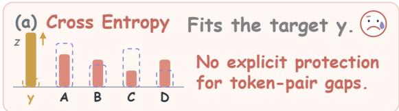

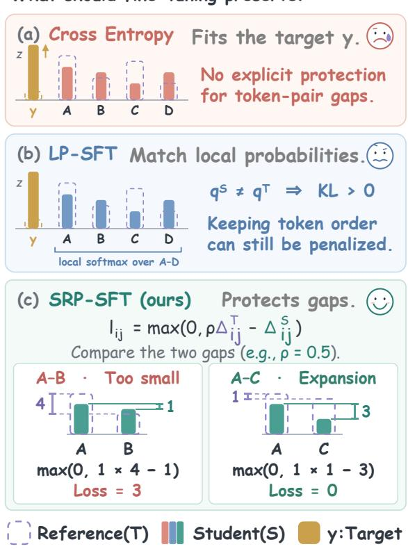  
Figure 1: The three objectives preserve different local quantities. CE fits the observed token by maximizing its likelihood. LP-SFT matches a reference distribution. SRP-SFT imposes selected margin lower bounds and stops penalizing a pair once its bound is met.

This raises a natural question:

Can we preserve the reference model’s preferences without requiring the student to reproduce its exact probability distribution?

Preserving only the ordering of non-target tokens is insufficient, since the ranking can remain unchanged even as the gap between tokens approaches zero. We therefore seek a middle ground that prevents excessive preference weakening while allowing stronger preferences during adaptation.

Motivated by this idea, we propose Selective Rank-Preserving SFT (SRP-SFT), which preserves selected preference relationships through soft margin constraints. At each fixed teacherforced prefix, a frozen reference identifies plausible non-target alternatives and provides their pairwise logit margins. Rather than matching their full probability distribution, SRP-SFT applies a onesided hinge penalty only when a student margin falls below a reference-scaled threshold. Once the threshold is met, no further penalty is imposed, allowing additional separation. The threshold can be adjusted to permit limited contraction or encourage stronger preferences, while the standard CE objective continues to fit the observed target token.

We study the theoretical properties and empirical behavior of this selective preservation objective, characterizing how margin constraints differ from KL-based distribution matching, what changes they permit, and under what conditions the auxiliary penalty can reduce margin violations. In one-epoch experiments on Qwen3-4B-Base and UltraFeedback, SRP-SFT improves reasoning and code-generation scores over CE and LP-SFT across three matched training seeds. Held-out diagnostics further show that, although LP-SFT achieves lower local KL divergence, SRP-SFT exhibits less margin contraction and fewer ranking inversions. Comparisons with alternative ranking objectives and parameter sensitivity studies reveal that stronger preference preservation does not always translate into better task performance. Experiments on six additional backbones illustrate both the benefits and limitations of the proposed objective.

Our contributions are threefold. First, we introduce SRP-SFT, a selective margin-based objective that protects local non-target preference relationships without requiring exact distribution matching. Second, we establish theoretical properties of this objective, including the KL cost of margin violations, the geometry of its feasible region, a conditional utility bound, and conditions for reducing aggregate violations during optimization. Third, we conduct extensive evaluations with matched multiseed comparisons, alternative ranking objectives, held-out structural diagnostics, sensitivity analyses, and six additional backbones.

## 2 Related Work

Auxiliary targets in supervised fine-tuning. Several SFT objectives add a signal beyond the observed target (Luo et al., 2025). Learning without Forgetting matches old outputs (Li and Hoiem, 2018). EWC and $L ^ { 2 } { \mathrm { - } } { \mathrm { S P } }$ anchor parameters (Kirkpatrick et al., 2017; Li et al., 2018). Stored-example constraints and NTK analyses address update interference (Lopez-Paz and Ranzato, 2017; Doan et al., 2021). Recent SFT objectives reweight target supervision in DFT (Wu et al., 2026) and EAFT (Diao et al., 2026), preserve diversity in GEM (Li et al., 2025b), regularize adverse updates in LFU (Nam et al., 2026), or add a KL anchor in ASFT (Zhu et al., 2026). RPSFT protects projected rotations in pretrained singular subspaces (Jin et al., 2026). Our auxiliary is a soft margin target: LP-SFT matches a frozen reference’s local non-target distribution (Wang et al., 2026), whereas SRP-SFT places lower bounds on selected non-target pairs at teacher-forced prefixes.

Distillation and relational supervision. Knowledge distillation transfers teacher knowledge through output matching or alternative training signals (Hinton et al., 2015; Gu et al., 2024; Agarwal et al., 2024; Zhao et al., 2022). Ranking objectives (Burges et al., 2005; Cao et al., 2007; Xia et al., 2008) motivate relational transfer through candidate rankings (Reddi et al., 2021; Peng and Zhang, 2025; Guan et al., 2025), prediction correlations (Huang et al., 2022), and logit differences (Hofstätter et al., 2020; Li et al., 2025a). Unlike distribution matching, relational supervision need not reproduce the teacher’s exact probabilities. Ordering alone allows margins to shrink, while exact gap matching penalizes expansion. SRP-SFT instead imposes one-sided lower bounds on selected nontarget margins at each fixed teacher-forced prefix, allowing further separation without penalty.

## 3 Preliminaries

Supervised model update. Let $\begin{array} { r l r l } { \mathcal { D } } & { { } } & { = } & { } \end{array}$ $\{ ( \bar { x ^ { ( n ) } } , y ^ { ( n ) } ) \} _ { n = 1 } ^ { N }$ be an SFT dataset, with re $\begin{array} { r c l } { { \mathrm { s p o n s e } } } & { { y } } & { { = } } & { { ( y _ { 1 } , . . . , y _ { T } ) } } \end{array}$ and vocabulary $\nu .$ At the teacher-forced prefix $( x , y _ { < t } )$ , the student produces logits $z _ { t } ^ { S } ~ \in ~ \mathbb { R } ^ { | \mathcal { V } | }$ and probabilities $\begin{array} { r c l } { \overline { { p _ { t } ^ { S } } } } & { = } & { \mathrm { s o f t m a x } ( z _ { t } ^ { S } ) } \end{array}$ CE minimizes $\mathcal { L } _ { \mathrm { C E } , t } ~ = ~ - \log p _ { t } ^ { S } ( y _ { t } )$ over valid response positions. The frozen reference $T$ is a copy of the pretrained checkpoint from which the trainable student S is initialized. We compare the student and reference logits at identical teacher-forced prefixes, so a change in local preference is not confounded with a change in generated history.

Local preference geometry. For $M \in \{ T , S \}$ and token pair $( i , j )$ , the margin is

$$
\Delta _ { i j , t } ^ { M } = z _ { t , i } ^ { M } - z _ { t , j } ^ { M } = \log \frac { p _ { t } ^ { M } ( i ) } { p _ { t } ^ { M } ( j ) } .\tag{1}
$$

Its sign gives the ordering and its magnitude the log-odds strength. For a reference-preferred pair $( \bar { \Delta _ { i j , t } ^ { T } } > 0 )$ , a negative student margin is an inversion, a smaller nonnegative margin is a contraction, and a larger margin is an expansion. Renormalizing over a shared candidate set leaves this ratio unchanged. We can therefore specify relations within that set without prescribing its total probability mass. The selected-margin target is

$$
\Delta _ { i j , t } ^ { S } \geq \rho \Delta _ { i j , t } ^ { T } , \qquad \rho \geq 0 .\tag{2}
$$

Here $\rho = 0$ requires weak order, $0 < \rho < 1$ allows bounded contraction, $\rho = 1$ requests at least the reference margin, and $\rho > 1$ requests selective sharpening. These are bounds on individual selected margins. The trained soft-penalty objective need not satisfy all of them.

CE does not impose this target. In free-logit coordinates, CE gives $\dot { \Delta } _ { i j } = - ( p _ { i } - p _ { j } )$ : a nontarget margin still contracts toward zero without finite-time inversion. Shared parameters can instead produce contraction or expansion (Appendices B.6 and B.7). The margin target specifies which selected margins enter the auxiliary loss under these parameter-dependent dynamics.

## 4 Method: Selective Margin Constraints

SRP-SFT uses a frozen reference to select nontarget alternatives and set margin constraints between them. The construction specifies the candidate set, pair orientations, and penalty for violating a requested margin. CE continues to supervise the observed token, while the auxiliary acts on the selected non-target relations (Figure 2).

## 4.1 Selecting Non-Target Alternatives

At each valid supervised position $t ,$ select the reference’s top-K non-target alternatives:

$$
\mathcal { A } _ { t } = \mathrm { T o p K } _ { k \in \mathcal { V } \backslash \{ y _ { t } \} } z _ { t , k } ^ { T } .\tag{3}
$$

Reference selection focuses the objective on tokens that are plausible at the current prefix. Increasing K broadens candidate coverage and increases the maximum number of constraints quadratically.

Excluding the target yt separates the auxiliary’s role from target fitting. CE can promote an observed answer even when the reference scores it poorly. Protecting reference-oriented pairs involving that answer could directly oppose its promotion. Non-target constraints remove this direct competition over the target logit, although shared parameters can still produce gradient conflict.

## 4.2 Orienting Selected Pairs

Within $A _ { t } ,$ use the frozen reference to orient pairs:

$$
\mathcal { P } _ { t } = \{ ( i , j ) : i , j \in \mathcal { A } _ { t } , i \neq j , \Delta _ { i j , t } ^ { T } > 0 \} .\tag{4}
$$

Each ordered unordered pair contributes one orientation, giving at most $K ( K - 1 ) / 2$ constraints. Teacher ties are ignored. Candidate identities and orientations remain fixed per prefix. The student’s ranking does not redefine what is protected.

Neither relations outside $\boldsymbol { A } _ { t }$ nor its total probability mass receive direct SRP supervision. A common shift of its logits is allowed by both SRP and local KL. The additional freedom in SRP is to change relative logits while satisfying the selected margin bounds (Theorem 2).

## 4.3 Penalizing Only Margin Shortfalls

At position t, average the selected hinge violations:

$$
\mathcal { L } _ { \mathrm { S R P } , t } = \frac { 1 } { | \mathcal { P } _ { t } | } \sum _ { ( i , j ) \in \mathcal { P } _ { t } } [ \rho \Delta _ { i j , t } ^ { T } - \Delta _ { i j , t } ^ { S } ] _ { + } ,\tag{5}
$$

Here $[ u ] _ { + } ~ = ~ \operatorname* { m a x } ( u , 0 )$ , and an empty $\mathcal { P } _ { t }$ contributes zero. Average the total loss over valid supervised response positions:

$$
\mathcal { L } = \frac { 1 } { T } \sum _ { t = 1 } ^ { T } ( \mathcal { L } _ { \mathrm { C E } , t } + \mu \mathcal { L } _ { \mathrm { S R P } , t } ) ,\tag{6}
$$

The coefficient $\mu \geq 0$ prices violations against target fitting, whereas $\rho$ sets the requested margin. Changing $\rho$ changes the boundary and active pairs. Changing $\mu$ rescales their contribution. The two controls are not interchangeable.

A pair is penalized only while $\Delta _ { i j , t } ^ { S } < \rho \Delta _ { i j , t } ^ { T }$ . At or above the boundary, its loss and chosen subgradient are zero. In particular, at $\rho = 1$ , the objective penalizes contraction and inversion without rewarding or penalizing further expansion. For $\rho > 1$ expansion relative to the teacher can still fall short of the scaled bound. Finite $\mu$ permits residual violations: the zero-loss region characterizes the target, not an invariant set for training updates.

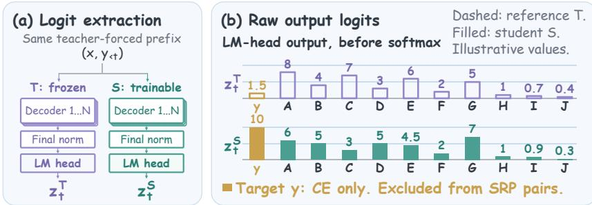

<table><tr><td rowspan=1 colspan=5>(c) Pairwise loss calculationρ= 1 · representative pairs</td></tr><tr><td rowspan=1 colspan=1>Pair</td><td rowspan=1 colspan=1>ΔT</td><td rowspan=1 colspan=1>Δs</td><td rowspan=1 colspan=1>Loss</td><td rowspan=1 colspan=1>Meaning</td></tr><tr><td rowspan=1 colspan=1>A-B</td><td rowspan=1 colspan=1>4</td><td rowspan=1 colspan=1>1</td><td rowspan=1 colspan=1>3</td><td rowspan=1 colspan=1>Gap too small</td></tr><tr><td rowspan=1 colspan=1>C-D</td><td rowspan=1 colspan=1>4</td><td rowspan=1 colspan=1>-2</td><td rowspan=1 colspan=1>6</td><td rowspan=1 colspan=1>Rank reversal</td></tr><tr><td rowspan=1 colspan=1>E-F</td><td rowspan=1 colspan=1>4</td><td rowspan=1 colspan=1>2.5</td><td rowspan=1 colspan=1>1.5</td><td rowspan=1 colspan=1>Margin contraction</td></tr><tr><td rowspan=1 colspan=1>G-H</td><td rowspan=1 colspan=1>4</td><td rowspan=1 colspan=1>6</td><td rowspan=1 colspan=1>0</td><td rowspan=1 colspan=1>Margin expansion</td></tr><tr><td rowspan=1 colspan=5></td></tr></table>

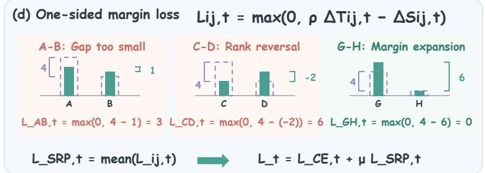

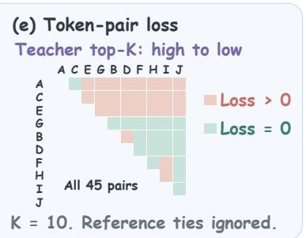  
Figure 2: The selective margin target. The frozen reference selects plausible non-target alternatives and orients their pairs. CE fits the excluded target. The current student receives a pairwise penalty only below the requested margin. A satisfied pair supplies no direct auxiliary gradient. Both models use the same prefix.

## 4.4 Gradients and Cached Implementation

For an active pair, $\ell _ { i j , t } = \rho \Delta _ { i j , t } ^ { T } - ( z _ { t , i } ^ { S } - z _ { t , j } ^ { S } )$ has logit gradients

$$
\frac { \partial \ell _ { i j , t } } { \partial z _ { t , i } ^ { S } } = - 1 , \qquad \frac { \partial \ell _ { i j , t } } { \partial z _ { t , j } ^ { S } } = + 1 .\tag{7}
$$

An isolated logit-gradient step increases the preferred token relative to its partner. CE and other active pairs can move a satisfied pair below its bound again, reactivating its hinge. With shared parameters, aggregate corrections need not improve every margin in a single update.

Reference token IDs and logits are cached for fixed teacher-forced examples. Each update gathers student logits and recomputes hinge activity without another reference pass. The headline setting is $K = 1 0 , \rho = 1 , \mu = 1$ , with at most 45 pairs per position. Algorithm 1 and Appendix D give the implementation. Appendix G.1 reports training pilots and the separate cost of constructing the cache.

## 5 Properties of the Selected-Margin Target

We characterize the target: how its cost differs from KL matching, the geometry of its feasible set, and when its soft penalty reduces aggregate violations. All results use finite logits, fixed teacher-forced prefixes, and the pairs in Eq. 4. At one prefix, write $q = \mathrm { s o f t m a x } ( z ^ { T } | _ { \mathcal { A } } )$ and $p = \operatorname { s o f t m a x } ( z ^ { S } | _ { \mathcal { A } } )$ for the locally normalized distributions. For a selected state–pair triple $^ { a , }$ let

$$
v _ { a } = [ \rho d _ { a } ^ { T } - d _ { a } ^ { S } ] _ { + } , \qquad d _ { a } ^ { T } > 0 .\tag{8}
$$

The analysis specializes classical KL minimization, order-restricted approximation, and stochasticorder arguments (Csiszár, 1975; Stout, 2012; Shaked and Shanthikumar, 2007) to the selectedmargin target. Proofs are in Appendix B.

## 5.1 The KL Cost of Losing a Margin

Theorem 1 (KL threshold for a prescribed pair). $F i x ~ q _ { i } > q _ { j } > 0 , m = q _ { i } + q _ { j } , a n d d = \log ( q _ { i } / q _ { j } )$ For any $b < d ,$

$$
\operatorname* { i n f } _ { p : \log ( p _ { i } / p _ { j } ) \leq b } { \mathrm { K L } } ( q \| p ) = m { \mathrm { ~ } } \mathrm { k l } ( \sigma ( d ) \| \sigma ( b ) ) ,\tag{9}
$$

where the infimum is over strictly positive probability vectors on the same set, σ is the logisticfunction, and kl is Bernoulli KL. The minimum is attained by leaving all other probabilities unchanged and setting $p _ { i } = m \sigma ( b ) , p _ { j } = m \sigma ( - b )$

KL can therefore certify a prescribed margin: a value below the threshold excludes $d ^ { S } \leq b$ . The threshold also identifies how matching prices a loss of preference. For $b = d - \delta .$ , the minimum cost is $m \sigma ( d ) ( 1 - \sigma ( d ) ) \delta ^ { 2 } / 2 + O ( \delta ^ { 3 } )$ , whereas at $\rho = 1$ that pair contributes $\delta / | \mathcal { P } |$ to SRP. The KL cost depends on the pair’s local probability mass and gap. Without conditions on both, there is no positive pair-independent threshold.

Conversely, the scaled logits $z ^ { S } = c z ^ { T }$ on the candidates satisfy every SRP constraint when $c \geq$ max $\{ 1 , \rho \}$ , while local KL can diverge as $c \to \infty$ for nonuniform q. The two objectives therefore assign different costs to reference deviations and define different preservation targets.

## 5.2 Admissible Geometry and Conditional Utility

Define the feasible logit set and worst violation:

$$
\begin{array} { r l } & { \mathcal { C } _ { \rho } = \{ u : u _ { i } - u _ { j } \geq \rho d _ { i j } ^ { T } , \ ( i , j ) \in \mathcal { P } \} , } \\ & { V = \underset { ( i , j ) \in \mathcal { P } } { \operatorname* { m a x } } v _ { i j } , \qquad q ^ { ( \rho ) } = \mathrm { s o f t m a x } ( \rho z ^ { T } | _ { \cal A } ) . } \end{array}\tag{10}
$$

The maximum is zero for an empty pair set. Subtracting $\rho z ^ { T }$ turns $\mathcal { C } _ { \rho }$ into an order cone. This geometry describes the logit changes permitted by the margin constraints per prefix.

Theorem 2 (Repair distance and local utility). For the full teacher-preferred pair set,

$$
\operatorname* { i n f } _ { u \in \mathcal { C } _ { \rho } } \| z ^ { S } | _ { \cal A } - u \| _ { \infty } = V / 2 .\tag{11}
$$

Let $U _ { i } \in [ 0 , 1 ]$ be any candidate utility that is nondecreasing with $z _ { i } ^ { T }$ and constant on teacher ties. Then

$$
\begin{array} { r } { \mathbb { E } _ { p } U \geq \mathbb { E } _ { q ( \rho ) } U - \operatorname { t a n h } ( V / 4 ) . } \end{array}\tag{12}
$$

For $\rho \ge 1 , \mathbb { E } _ { q ^ { ( \rho ) } } U \ge \mathbb { E } _ { q } U$ . The error term is tight alreadyfor two candidates and $\rho > 0 .$

The first statement quantifies the correction needed to reach that region. The second gives it a local utility interpretation: at zero violation and $\rho \geq 1$ , no teacher-monotone conditional utility is lowered relative to the reference. Nonzero violations yield the stated degradation bound. Since $V \leq | \mathcal { P } | \mathcal { L } _ { \mathrm { S R P } , t }$ , a small mean hinge need not protect every pair equally. The appendix provides a probability-weighted refinement and sparse-pair analysis. Teacher–utility alignment is a substantive assumption. The guarantee concerns choices within A, not its probability mass, the excluded target, or sequence-level correctness.

## 5.3 When a Soft Penalty Repairs Violations

Let f be the CE objective on a fixed collection of prefixes and $\begin{array} { r } { R ( \theta ) = \sum _ { a } w _ { a } v _ { a } ( \theta ) } \end{array}$ , with the actual fixed reduction weights $w _ { a } \ > \ 0$ . Set $\begin{array} { r } { r = \sum _ { a : v _ { a } > 0 } w _ { a } \nabla d _ { a } ^ { S } } \end{array}$ and $g \ : = \ : \nabla f \ : - \ : \mu r$ . Suppose each margin gradient is $L _ { a } – \mathbf { L }$ ipschitz along the update segment and write $\begin{array} { r } { L _ { R } = \sum _ { a } w _ { a } L _ { a } } \end{array}$

Proposition 3 (Finite-step aggregate repair). For $\theta ^ { + } = \theta - \eta g , \eta > 0 ,$

$$
\begin{array} { r l } & { R ( \theta ^ { + } ) - R ( \theta ) \le \eta \langle r , \nabla f \rangle - \eta \mu \| r \| _ { 2 } ^ { 2 } } \\ & { \qquad + C _ { \eta } + \frac { 1 } { 2 } L _ { R } \eta ^ { 2 } \| g \| _ { 2 } ^ { 2 } . } \end{array}\tag{13}
$$

Here $C _ { \eta } \geq 0$ is the explicitly computable linearized hinge-crossing correction in Eq. 34. It is zero when no linearized hinge crosses its boundary. A negative right-hand side certifies a strict decrease of the aggregate violation once updated.

The bound separates auxiliary repair from CE interference, hinge crossings, and curvature. It requires neither convexity nor a frozen neural tangent kernel, but certifies an aggregate, not every pair. Appendix B.4 gives the version for any optimizer step, including AdamW. When the reference equals the initialization and $0 < \rho \leq 1$ , a checkpoint satisfying $( f + \mu R ) ( \theta ) \leq f ( \theta _ { 0 } ) + \xi$ obeys $R ( \theta ) \leq ( f ( \theta _ { 0 } ) - f ( \theta ) + \xi ) / \mu$ for $\mu > 0$ . With the teacher margin distribution, this bounds sorting failures at nonzero residual (Appendix B.5).

## 6 Experimental Setup

We fine-tune Qwen3-4B-Base (Yang et al., 2025) on UltraFeedback’s train\_sft split (Cui et al., 2024). ChatML sequences are right-truncated at 2,048 tokens; loss covers assistant responses. Finetuned methods share initialization, per-seed data order, and optimizer: one epoch, 478 AdamW steps, learning rate $2 \times 1 0 ^ { - 5 }$ , a cosine schedule with 15 warmup steps, and effective batch size 128 on eight A800-80GB GPUs. Seeds: 1234, 42, and 3407. Tables 1 and 2 report seed 1234. Base denotes the untouched checkpoint. Appendix D details revisions, row counts, and the software stack.

The matched comparison includes CE, GEM, DFT, ASFT, EAFT, LP-SFT, and SRP-SFT. LP-SFT applies forward KL over the reference’s top-10 non-target tokens at $\mu = 1$ . SRP-SFT adds the soft hinge on strictly ordered pairs among those tokens, with $K = 1 0 , \rho = 1$ , and $\mu = 1$ . Reference logits are cached once. These coefficients are fixed before evaluation and reused at all three seeds. Other loss definitions, sensitivity sweeps, and the sixbackbone studies are in Appendix D.

<table><tr><td rowspan="2">Method</td><td colspan="2">MATH-500</td><td colspan="2">AIME</td><td colspan="2">GSM-Plus mini</td><td rowspan="2"> $\mathrm { L o g i Q A 2 }$ </td><td colspan="7">BBH-5</td></tr><tr><td colspan="2"></td><td colspan="2"></td><td colspan="2"></td><td colspan="2"></td><td>ARC-C</td><td>Swag</td><td>MMLU</td><td>Phy-Oly</td><td>Mean</td></tr><tr><td></td><td>p@1</td><td>p@4</td><td>p@1</td><td>p@4</td><td>Strict</td><td>Flexible</td><td>Acc.</td><td>EM</td><td>Norm.</td><td>Norm.</td><td>5-shot</td><td>Acc.</td><td></td></tr><tr><td>Base†</td><td>48.11</td><td>71.23</td><td>1.81</td><td>5.17</td><td>51.92</td><td>60.21</td><td>44.15</td><td>16.40</td><td>52.30</td><td>73.70</td><td>73.00</td><td>8.90</td><td>42.24</td></tr><tr><td>CE</td><td>27.98</td><td>54.91</td><td>0.54</td><td>1.99</td><td>45.62</td><td>43.83</td><td>43.32</td><td>13.60</td><td>53.07</td><td>72.16</td><td>68.90</td><td>5.93</td><td>35.99</td></tr><tr><td>GEM</td><td>22.21</td><td>47.74</td><td>0.54</td><td>1.94</td><td>46.58</td><td>47.38</td><td>43.70</td><td>12.80</td><td>49.49</td><td>73.40</td><td>68.83</td><td>5.51</td><td>35.01</td></tr><tr><td>DFT</td><td>47.73</td><td>59.57</td><td>0.66</td><td>2.19</td><td>45.58</td><td>44.50</td><td>39.63</td><td>0.40</td><td>47.70</td><td>65.96</td><td>65.23</td><td>3.81</td><td>35.25</td></tr><tr><td>ASFT</td><td>33.41</td><td>57.22</td><td>2.03</td><td>5.42</td><td>47.50</td><td>48.79</td><td>37.09</td><td>18.40</td><td>55.03</td><td>70.72</td><td>67.56</td><td>8.47</td><td>37.64</td></tr><tr><td>EAFT</td><td>28.52</td><td>54.57</td><td>0.54</td><td>1.91</td><td>45.83</td><td>33.71</td><td>41.09</td><td>14.80</td><td>51.88</td><td>72.32</td><td>69.57</td><td>4.24</td><td>34.91</td></tr><tr><td>LP-SFT</td><td>49.56</td><td>77.52</td><td>3.28</td><td>9.25</td><td>57.88</td><td>59.08</td><td>44.02</td><td>14.80</td><td>53.75</td><td>73.35</td><td>71.48</td><td>8.05</td><td>43.50</td></tr><tr><td>SRP-SFT</td><td>54.56</td><td>80.50</td><td>4.76</td><td>11.68</td><td>58.83</td><td>59.92</td><td>46.25</td><td>14.80</td><td>54.18</td><td>73.36</td><td>71.89</td><td>10.59</td><td>45.11</td></tr></table>

Table 1: One-epoch Qwen3-4B-Base reasoning results on UltraFeedback (seed 1234, percentages). All finetuned methods use the same training implementation, software and hardware environment, and common training hyperparameters, including a 478-step cosine schedule and 15-step warmup. Mean averages all twelve metrics from the same checkpoint. Bold/underline mark best/second-best. † is the untouched Base.

<table><tr><td rowspan="2">Method</td><td colspan="2">HumanEval+</td><td colspan="2">MBPP+</td><td rowspan="2">Mean</td></tr><tr><td>pass@1</td><td>pass@4</td><td>pass@1</td><td>pass@4</td></tr><tr><td>Base†</td><td>45.49</td><td>71.56</td><td>46.12</td><td>72.50</td><td>58.92</td></tr><tr><td>CE</td><td>44.18</td><td>69.56</td><td>44.66</td><td>65.79</td><td>56.04</td></tr><tr><td>GEM</td><td>22.93</td><td>46.34</td><td>26.40</td><td>52.13</td><td>36.95</td></tr><tr><td>DFT</td><td>64.12</td><td>69.98</td><td>57.24</td><td>63.56</td><td>63.72</td></tr><tr><td>ASFT</td><td>64.79</td><td>77.18</td><td>57.09</td><td>67.90</td><td>66.74</td></tr><tr><td>EAFT</td><td>46.43</td><td>72.00</td><td>44.59</td><td>65.45</td><td>57.12</td></tr><tr><td>LP-SFT</td><td>57.90</td><td>81.67</td><td>51.87</td><td>72.23</td><td>65.91</td></tr><tr><td>SRP-SFT</td><td>62.84</td><td>83.87</td><td>56.24</td><td>75.06</td><td>69.50</td></tr></table>

Table 2: One-epoch code results for Qwen3-4B-Base on UltraFeedback (seed 1234, percentages). Mean averages HumanEval+ and MBPP+ pass@1/pass@4.

The reasoning mean averages twelve metrics from one checkpoint, including MATH-500 pass@1/pass@4 at temperature 0.6 with 16 samples. The code mean averages HumanEval+ and MBPP+ pass@1/pass@4 under EvalPlus 0.3.1, at temperature 0.8 with 20 samples. Held-out margin diagnostics use the 998-example test\_sft cache.

## 7 Results

## 7.1 Task Utility of Margin Constraints

Table 1 reports the reasoning screen, and Table 2 reports the code evaluation, both at seed 1234 under the matched one-epoch protocol. SRP-SFT raises MATH pass@1 from 49.56 for LP-SFT to 54.56 and raises the code mean from 65.91 to 69.50. It improves all four code metrics over LP-SFT and has the highest code mean among the seven fine-tuned methods. ASFT and DFT still lead the individual code pass@1 columns on each benchmark.

Across the three training seeds, SRP-SFT remains above CE and LP-SFT. Its code mean is

<table><tr><td rowspan="2">Method</td><td colspan="3">Reasoning</td><td colspan="3">Code</td></tr><tr><td>seed 1234</td><td>seed 42</td><td>seed 3407</td><td>seed 1234</td><td>seed 42</td><td>seed 3407</td></tr><tr><td>CE</td><td>35.99</td><td>36.03</td><td>35.85</td><td>56.04</td><td>54.33</td><td>56.60</td></tr><tr><td>GEM</td><td>35.01</td><td>34.89</td><td>35.52</td><td>36.95</td><td>33.93</td><td>36.88</td></tr><tr><td>DFT</td><td>35.25</td><td>33.37</td><td>35.77</td><td>63.72</td><td>61.35</td><td>58.38</td></tr><tr><td>ASFT</td><td>37.64</td><td>40.51</td><td>37.46</td><td>66.74</td><td>66.37</td><td>67.87</td></tr><tr><td>EAFT</td><td>34.91</td><td>35.81</td><td>35.89</td><td>57.12</td><td>57.32</td><td>57.65</td></tr><tr><td>LP-SFT</td><td>43.50</td><td>43.20</td><td>42.60</td><td>65.91</td><td>66.14</td><td>66.45</td></tr><tr><td>SRP-SFT</td><td>45.11</td><td>45.41</td><td>44.35</td><td>69.50</td><td>69.47</td><td>69.48</td></tr></table>

Table 3: Three-seed reasoning and code means (percentages). Reasoning averages twelve metrics from the same checkpoint. Code averages four metrics.

$6 9 . 4 8 \pm 0 . 0 2$ and its twelve-metric reasoning mean is $4 4 . 9 6 \pm 0 . 5 5$ , compared with $6 6 . 1 7 \pm 0 . 2 7$ and 43.10 ± 0.46 for LP-SFT. CE reaches $5 5 . 6 6 \pm 1 . 1 8$ and $3 5 . 9 6 \pm 0 . 1 0$ on the same aggregates.

## 7.2 Comparing Preservation Targets

With data, initialization, and coefficients fixed, we replace the SRP hinge with alternatives: distribution matching (LP-SFT, ListNet), pairwise/listwise ranking losses, exact-gap regression, and distillation objectives (Table 4; Appendix H).

Task utility tracks preservation of the base candidate order: across 14 losses, the mean falls as rank flips and margin contraction rise (Spearman −0.87 and −0.84; Table 28). Order alone is insufficient: RankOnly $( \rho = 0 )$ , without a margin target, contracts margins by 0.41 logits and scores 49.07, below LP-SFT; $\rho = 1$ cuts contraction to 0.11, giving the best mean, 57.88. Penalizing both directions falls short: Margin-MSE has the fewest flips (0.0380 versus 0.0565) but scores 54.82. SRP-SFT leads both code columns and trails only the RLKD-style union on MATH (54.56 versus 55.31).

(d) Structural response to
<table><tr><td>Loss</td><td>MATH</td><td>HE+</td><td>MBPP+</td><td>Mean</td></tr><tr><td>CE</td><td>27.98</td><td>44.18</td><td>44.66</td><td>38.94</td></tr><tr><td>LP-SFT</td><td>49.56</td><td>57.90</td><td>51.87</td><td>53.11</td></tr><tr><td>RankOnly  $( \rho = 0 )$ </td><td>41.89</td><td>55.37</td><td>49.96</td><td>49.07</td></tr><tr><td>RankNet</td><td>46.41</td><td>59.09</td><td>52.63</td><td>52.71</td></tr><tr><td>ListMLE</td><td>52.15</td><td>61.71</td><td>56.18</td><td>56.68</td></tr><tr><td>Spearman</td><td>46.74</td><td>56.68</td><td>52.08</td><td>51.83</td></tr><tr><td>ListNet†</td><td>49.33</td><td>58.45</td><td>52.34</td><td>53.37</td></tr><tr><td>Margin-MSE</td><td>48.68</td><td>61.07</td><td>54.72</td><td>54.82</td></tr><tr><td>BiLD teacher-led</td><td>50.11</td><td>58.54</td><td>53.72</td><td>54.12</td></tr><tr><td>BiLD T+S</td><td>45.17</td><td>55.58</td><td>51.28</td><td>50.68</td></tr><tr><td>RLKD-style union</td><td>55.31</td><td>58.57</td><td>52.94</td><td>55.61</td></tr><tr><td>Kendall-τ</td><td>43.96</td><td>59.48</td><td>51.97</td><td>51.81</td></tr><tr><td>Smooth-SRP</td><td>50.65</td><td>59.85</td><td>53.65</td><td>54.72</td></tr><tr><td>SRP-SFT</td><td>54.56</td><td>62.84</td><td>56.24</td><td>57.88</td></tr></table>

Table 4: Fixed-configuration loss screen (pass@1, percentages). Mean averages MATH, HumanEval+, and MBPP+. Code columns use the Table 2 evaluation. †Same target as LP-SFT. Definitions are in Appendix H.  
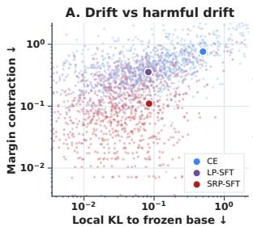

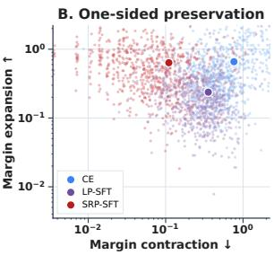  
Figure 3: Mechanism diagnostics on the held-out cache. Distributional fidelity and margin preservation disagree on this cache: SRP-SFT has less contraction despite larger local KL. Small points are tokens. Large markers are pair-weighted means.

## 7.3 Distributional Fidelity versus Margin Preservation

On the 998-example held-out cache, SRP-SFT reduces mean margin contraction from 0.268 for LP-SFT to 0.110 and reduces inversions from 7.41% to 5.65%. CE has contraction 0.600 and inversion 15.40%. LP-SFT is closer in local KL, at 0.049 versus 0.075 for SRP-SFT, consistent with the massdependent threshold in Theorem 1. On this cache, the lower local KL does not identify the checkpoint with less contraction and fewer inversions.

Table 29 and Figure 3 plot the same cache. SRP-SFT has smaller margin shortfalls and larger local distribution changes. The cache is training-disjoint and contains no benchmark labels (Appendix D.5).

## 7.4 Preservation Strength versus Task Utility

The lower-bound formulation has three controls: the requested margin $\rho ,$ the penalty weight $\mu ,$ and candidate coverage $K$ . In the $\rho$ sweep, the aggregate score rises from 47.05 at $\rho = 0$ to 61.56 at $\rho = 2 . 5$ and then declines. From $\rho = 1$ to $\rho = 2 . 5$ the score increases from 57.05 to 61.56 while Flip rises from 0.0565 to 0.0937 and contraction rises from 0.1098 to 0.1891 (Table 21). Over this interval, the task score and the realized margin statistics move in opposite directions.

SRP-SFT sensitivity: performance has an interior optimum  
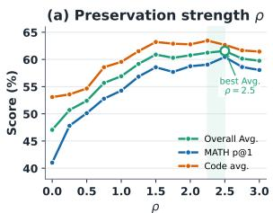

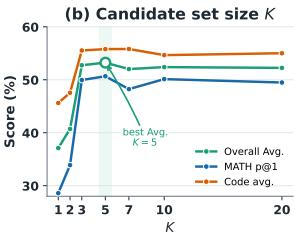

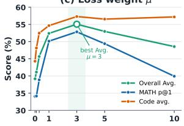

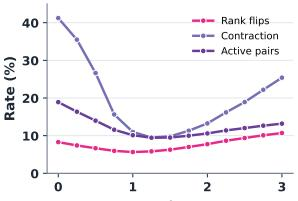

Figure 4: Preservation demand and task utility need not move together. Each panel varies one of $\rho , \mu ,$ and $K$ Bands mark the best score. The score averages MATH pass@1 and mean code pass@1.
<table><tr><td>Method</td><td>α</td><td colspan="2">MATH</td><td colspan="2">HE+</td><td colspan="2">MBPP+</td></tr><tr><td></td><td></td><td>p@1</td><td>p@4</td><td>p@1</td><td>p@4</td><td>p@1</td><td>p@4</td></tr><tr><td>CE</td><td>1</td><td>27.98</td><td>54.91</td><td>44.18</td><td>69.56</td><td>44.66</td><td>65.79</td></tr><tr><td>CE-TM</td><td>1.081</td><td>28.98</td><td>55.87</td><td>45.88</td><td>70.44</td><td>45.73</td><td>65.33</td></tr><tr><td>LP-SFT</td><td>1</td><td>49.56</td><td>77.52</td><td>57.90</td><td>81.67</td><td>51.87</td><td>72.23</td></tr><tr><td>LP-TM</td><td>1.099</td><td>51.96</td><td>78.08</td><td>59.82</td><td>82.39</td><td>54.84</td><td>73.06</td></tr><tr><td>SRP-SFT</td><td>1</td><td>54.56</td><td>80.50</td><td>62.84</td><td>83.87</td><td>56.24</td><td>75.06</td></tr></table>

Table 5: Entropy-matched temperature control (seed 1234, percentages). LP-TM and CE-TM are calibrated to the SRP-SFT held-out entropy.

Increasing $\mu$ beyond 3 lowers the task score while reducing Flip, and the K sweep peaks at $K \ = \ 5$ . The $\rho$ sweep fixes $\mu = 1 , K = 1 0$ whereas the $\mu$ and $K$ sweeps use $\rho = 0 . 5$ . The reported one-factor peaks are $\rho = 2 . 5 , K = 5 .$ and $\mu = 3$ . The pre-fixed main setting remains K = 10, ρ = 1, µ = 1 (Appendix G).

## 7.5 Can Global Scaling Recover the Gains?

For LP-SFT, we fit α = 1.0993 on 998 held-out examples, without benchmark labels, to match SRP-SFT’s mean full-vocabulary entropy (Table 5). This single scalar changes sharpness but leaves each token’s candidate ranking unchanged.

Global scaling recovers less than half of SRP-SFT’s gain, so the gain is not a byproduct of a sharper output distribution. Entropy matching raises LP-SFT’s MATH pass@1 from 49.56 to 51.96 and its code mean from 65.91 to 67.53, closing 48% and 45% of the gap to SRP-SFT (54.56 and 69.50). CE gains 1.00 MATH and 0.81 code points. At seed 42, the fitted LP scale is 1.0989 and the code mean is 67.90 (Table 9).

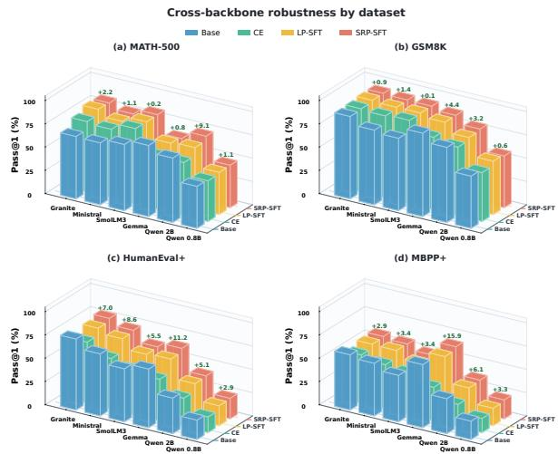  
Figure 5: Additional-backbone pass@1 on MATH-500, GSM8K, HumanEval+, and MBPP+. Math and code use separate domain-trained checkpoints. $\Delta$ is SRP-SFT minus the mean of CE and LP-SFT.

## 7.6 Transfer Across Backbones

The six additional backbones are trained separately per domain: mathematics SFT on 96,949 filtered OpenMathReasoning examples (758 updates) and code SFT on 95,966 filtered rStar-Coder examples (750 updates), with 4,096-token sequences, one epoch, and seed 1234. MATH-500 and GSM8K evaluate the mathematics checkpoints, and HumanEval+ and MBPP+ evaluate the code checkpoints. Within each backbone and domain, all methods share the data and budget.

The advantage of SRP-SFT over LP-SFT extends from UltraFeedback to new architectures and domain-specific data and is steadiest on code. SRP-SFT leads LP-SFT in 18 of 24 backbone– benchmark pairs, including 11 of 12 code pairs; HumanEval+ rises on every backbone (+0.55 to +4.09). Mathematics is more backbone-dependent: SRP-SFT leads MATH-500 on both Qwen bases, Ministral, and SmolLM3, but trails on Gemma (61.59 versus 63.94) and Granite. Figure 5 shows SRP-SFT minus the CE/LP-SFT mean. Table 20 gives SRP-minus-LP differences.

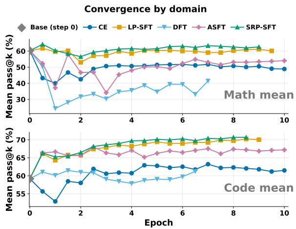  
Figure 6: Ten-epoch trajectories with SRP $\rho = 0 . 5$ MATH averages pass@1 and pass@4. Code averages pass@1 and pass@4 on both benchmarks.

## 7.7 Convergence Behavior

One Qwen3-4B run continues for ten epochs, evaluated every half epoch. LP-SFT uses $K = 1 0 , \mu =$ 1, and SRP-SFT uses $K = 1 0 , \rho = 0 . 5 , \mu = 1$ The MATH mean averages MATH-500 pass@1 and pass@4. The code mean averages HumanEval+ and MBPP+ pass@1 and pass@4. The step-0 Base anchor evaluates the untouched checkpoint. Its MATH-500 manifest and sampling protocol match Table 1: the same data revision, all 500 test problems, the same prompt, temperature 0.6, top-p 1, 16 samples, and a 4,096-token cap. The separate draw gives pass@1 48.43, pass@4 72.06, and mean 60.24. The main-table scores 48.11 and 71.23 average to 59.67. The extended-training curve uses this as its step-0 anchor. Its code mean, 59.17, uses 768-token generations in a 2,048-token context. Table 2 uses the 4,096/8,192 protocol, and its four Base scores average to 58.92.

The $\rho = 0 . 5 \ : \mathrm { S R P }$ run declines early, then keeps MATH near Base while maintaining code gains later in training. It does not lead every early checkpoint. Its last MATH and code measurements occur at epochs 10.0 and 9.5 (Tables 32 and 33). The oneepoch headline uses $\rho = 1$ , unlike this run.

## 8 Conclusion

SRP-SFT is a soft hinge on selected non-target margins at fixed teacher-forced prefixes. Matched seeds, loss screens, sweeps, entropy matching, six backbones, and ten-epoch training show where this margin target improves reasoning and code scores over CE and LP-SFT.

## Limitations

SRP-SFT is trained on models that already follow a chat template and already have usable downstream ability. Where a base release supplies that template, the study uses the base checkpoint. Where it does not, the study uses the instruction-tuned release. Training and evaluation both rely on this chat formatting, so the setup does not cover a weak model with no chat-template training.

The trained models are at most 4B parameters, including the main study and the additional backbones. No larger model is trained. The one-epoch schedule and the reported math and code scores are measurements at this scale.

## References

Rishabh Agarwal, Nino Vieillard, Yongchao Zhou, Piotr Stanczyk, Sabela Ramos Garea, Matthieu Geist, and Olivier Bachem. 2024. On-policy distillation of language models: Learning from self-generated mistakes. In International Conference on Learning Representations, volume 2024, pages 21246–21263.

Jacob Austin, Augustus Odena, Maxwell Nye, Maarten Bosma, Henryk Michalewski, David Dohan, Ellen Jiang, Carrie Cai, Michael Terry, Quoc Le, and Charles Sutton. 2021. Program Synthesis with Large Language Models. arXiv preprint arXiv:2108.07732.

Elie Bakouch, Loubna Ben Allal, Anton Lozhkov, Nouamane Tazi, Lewis Tunstall, Carlos Miguel Patiño, Edward Beeching, Aymeric Roucher, Aksel Joonas Reedi, Quentin Gallouédec, Kashif Rasul, Nathan Habib, Clémentine Fourrier, Hynek Kydlicek, Guilherme Penedo, Hugo Larcher, Mathieu Morlon, Vaibhav Srivastav, Joshua Lochner, and 4 others. 2025. SmolLM3: smol, multilingual, long-context reasoner. https://huggingface.co/blog/smollm3.

Stephen Boyd and Lieven Vandenberghe. 2004. Convex Optimization. Cambridge University Press.

Christopher J. C. Burges, Tal Shaked, Erin Renshaw, Ari Lazier, Matt Deeds, Nicole Hamilton, and Gregory N. Hullender. 2005. Learning to rank using gradient descent. In Proceedings of the 22nd International Conference on Machine Learning, pages 89–96.

Zhe Cao, Tao Qin, Tie-Yan Liu, Ming-Feng Tsai, and Hang Li. 2007. Learning to rank: From pairwise approach to listwise approach. In Proceedings of the 24th International Conference on Machine Learning, pages 129–136.

Mark Chen, Jerry Tworek, Heewoo Jun, Qiming Yuan, Henrique Ponde De Oliveira Pinto, Jared Kaplan, Harri Edwards, Yuri Burda, Nicholas Joseph, Greg Brockman, et al. 2021. Evaluating large language models trained on code. arXiv preprint arXiv:2107.03374.

Peter Clark, Isaac Cowhey, Oren Etzioni, Tushar Khot, Ashish Sabharwal, Carissa Schoenick, and Oyvind Tafjord. 2018. Think you have Solved Question Answering? Try ARC, the AI2 Reasoning Challenge. arXiv preprint arXiv:1803.05457.

Karl Cobbe, Vineet Kosaraju, Mohammad Bavarian, Mark Chen, Heewoo Jun, Lukasz Kaiser, Matthias Plappert, Jerry Tworek, Jacob Hilton, Reiichiro Nakano, Christopher Hesse, and John Schulman. 2021. Training Verifiers to Solve Math Word Problems. arXiv preprint arXiv:2110.14168.

Imre Csiszár. 1975. I-divergence geometry of probability distributions and minimization problems. The Annals ofProbability, 3(1):146–158.

Ganqu Cui, Lifan Yuan, Ning Ding, Guanming Yao, Bingxiang He, Wei Zhu, Yuan Ni, Guotong Xie, Ruobing Xie, Yankai Lin, Zhiyuan Liu, and Maosong Sun. 2024. UltraFeedback: Boosting language models with scaled AI feedback. In Proceedings of the 41st International Conference on Machine Learning, volume 235 of Proceedings of Machine Learning Research, pages 9722–9744. PMLR.

Muxi Diao, Lele Yang, Wuxuan Gong, Yutong Zhang, Zhonghao Yan, Yufei Han, Kongming Liang, Weiran Xu, and Zhanyu Ma. 2026. Entropy-adaptive finetuning: Resolving confident conflicts to mitigate forgetting. arXiv preprint arXiv:2601.02151.

Thang Doan, Mehdi Abbana Bennani, Bogdan Mazoure, Guillaume Rabusseau, and Pierre Alquier. 2021. A theoretical analysis of catastrophic forgetting through the NTK overlap matrix. In Proceedings ofthe 24th International Conference on Artificial Intelligence and Statistics, volume 130 of Proceedings of Machine Learning Research, pages 1072–1080. PMLR.

Leo Gao, Jonathan Tow, Baber Abbasi, Stella Biderman, Sid Black, Anthony DiPofi, Charles Foster, Laurence Golding, Jeffrey Hsu, Alain Le Noac’h, Haonan Li, Kyle McDonell, Niklas Muennighoff, Chris Ociepa, Jason Phang, Laria Reynolds, Hailey Schoelkopf, Aviya Skowron, Lintang Sutawika, and 5 others. 2023. A framework for few-shot language model evaluation.

Gemma Team et al. 2025. Gemma 3 Technical Report. arXiv preprint arXiv:2503.19786.

Yuxian Gu, Li Dong, Furu Wei, and Minlie Huang. 2024. Minillm: Knowledge distillation of large language models. In International Conference on Learning Representations, volume 2024, pages 32694–32717.

Yuchen Guan, Runxi Cheng, Kang Liu, and Chun Yuan. 2025. Enhancing logits distillation with plug&play kendall’s τ ranking loss. In Proceedings ofthe 42nd International Conference on Machine Learning, volume 267 of Proceedings of Machine Learning Research, pages 20537–20552. PMLR.

Chaoqun He, Renjie Luo, Yuzhuo Bai, Shengding Hu, Zhen Thai, Junhao Shen, Jinyi Hu, Xu Han, Yujie

Huang, Yuxiang Zhang, Jie Liu, Lei Qi, Zhiyuan Liu, and Maosong Sun. 2024. OlympiadBench: A challenging benchmark for promoting AGI with olympiad-level bilingual multimodal scientific problems. In Proceedings ofthe 62nd Annual Meeting of the Associationfor Computational Linguistics (Volume 1: Long Papers), pages 3828–3850, Bangkok, Thailand. Association for Computational Linguistics.

Matthias Hein and Maksym Andriushchenko. 2017. Formal guarantees on the robustness of a classifier against adversarial manipulation. In Advances in Neural Information Processing Systems, volume 30.

Dan Hendrycks, Collin Burns, Steven Basart, Andy Zou, Mantas Mazeika, Dawn Song, and Jacob Steinhardt. 2020. Measuring massive multitask language understanding. arXiv preprint arXiv:2009.03300.

Dan Hendrycks, Collin Burns, Saurav Kadavath, Akul Arora, Steven Basart, Eric Tang, Dawn Song, and Jacob Steinhardt. 2021. Measuring mathematical problem solving with the math dataset. arXiv preprint arXiv:2103.03874.

Geoffrey Hinton, Oriol Vinyals, and Jeff Dean. 2015. Distilling the knowledge in a neural network. arXiv preprint arXiv:1503.02531.

Wassily Hoeffding. 1963. Probability inequalities for sums of bounded random variables. Journal of the American Statistical Association, 58(301):13–30.

Sebastian Hofstätter, Sophia Althammer, Michael Schröder, Mete Sertkan, and Allan Hanbury. 2020. Improving efficient neural ranking models with crossarchitecture knowledge distillation. arXiv preprint arXiv:2010.02666.

Tao Huang, Shan You, Fei Wang, Chen Qian, and Chang Xu. 2022. Knowledge Distillation from A Stronger Teacher. In Advances in Neural Information Processing Systems, volume 35, pages 33716–33727.

IBM Granite Team. 2026. Granite-4.1-3B Model Card. Hugging Face model card.

Hangzhan Jin, Tianwei Ni, Lu Li, Pierre-Luc Bacon, Mohammad Hamdaqa, and Doina Precup. 2026. Rotation-Preserving Supervised Fine-Tuning. arXiv preprint arXiv:2605.10973.

James Kirkpatrick, Razvan Pascanu, Neil Rabinowitz, Joel Veness, Guillaume Desjardins, Andrei A. Rusu, Kieran Milan, John Quan, Tiago Ramalho, Agnieszka Grabska-Barwinska, Demis Hassabis, Claudia Clopath, Dharshan Kumaran, and Raia Hadsell. 2017. Overcoming catastrophic forgetting in neural networks. Proceedings of the National Academy of Sciences, 114(13):3521–3526.

Woosuk Kwon, Zhuohan Li, Siyuan Zhuang, Ying Sheng, Lianmin Zheng, Cody Hao Yu, Joseph E. Gonzalez, Hao Zhang, and Ion Stoica. 2023. Efficient memory management for large language model serving with pagedattention. In Proceedings of the

ACM SIGOPS 29th Symposium on Operating Systems Principles.

Minchong Li, Feng Zhou, and Xiaohui Song. 2025a. BiLD: Bi-directional logits difference loss for large language model distillation. In Proceedings of the 31st International Conference on Computational Linguistics, pages 1168–1182. Association for Computational Linguistics.

Qintong Li, Leyang Cui, Xueliang Zhao, Lingpeng Kong, and Wei Bi. 2024. GSM-plus: A comprehensive benchmark for evaluating the robustness of LLMs as mathematical problem solvers. In Proceedings ofthe 62nd Annual Meeting ofthe Association for Computational Linguistics (Volume 1: Long Papers), pages 2961–2984, Bangkok, Thailand. Association for Computational Linguistics.

Xuhong Li, Yves Grandvalet, and Franck Davoine. 2018. Explicit Inductive Bias for Transfer Learning with Convolutional Networks. In Proceedings ofthe 35th International Conference on Machine Learning, volume 80 of Proceedings of Machine Learning Research, pages 2825–2834. PMLR.

Zhizhong Li and Derek Hoiem. 2018. Learning without Forgetting. IEEE Transactions on Pattern Analysis and Machine Intelligence, 40(12):2935–2947.

Ziniu Li, Congliang Chen, Tian Xu, Zeyu Qin, Jiancong Xiao, Zhi-Quan Luo, and Ruoyu Sun. 2025b. Preserving diversity in supervised fine-tuning of large language models. In International Conference on Learning Representations, volume 2025, pages 66127–66154.

Hanmeng Liu, Jian Liu, Leyang Cui, Zhiyang Teng, Nan Duan, Ming Zhou, and Yue Zhang. 2023a. LogiQA 2.0—An Improved Dataset for Logical Reasoning in Natural Language Understanding. IEEE/ACM Transactions on Audio, Speech, and Language Processing, 31:2947–2962.

Jiawei Liu, Chunqiu Steven Xia, Yuyao Wang, and Lingming Zhang. 2023b. Is your code generated by chatgpt really correct? rigorous evaluation of large language models for code generation. Advances in neural information processing systems, 36:21558– 21572.

Yifei Liu, Li Lyna Zhang, Yi Zhu, Bingcheng Dong, Xudong Zhou, Ning Shang, Fan Yang, and Mao Yang. 2025. rStar-Coder: Scaling Competitive Code Reasoning with a Large-Scale Verified Dataset. arXiv preprint arXiv:2505.21297.

David Lopez-Paz and Marc’Aurelio Ranzato. 2017. Gradient episodic memory for continual learning. In Advances in Neural Information Processing Systems, volume 30.

Yun Luo, Zhen Yang, Fandong Meng, Yafu Li, Jie Zhou, and Yue Zhang. 2025. An empirical study of catastrophic forgetting in large language models during continual fine-tuning. IEEE Transactions on Audio, Speech and Language Processing.

Mistral AI. 2025. Ministral 3 3B Instruct Model Card. Hugging Face model card.

Ivan Moshkov, Darragh Hanley, Ivan Sorokin, Shubham Toshniwal, Christof Henkel, Benedikt Schifferer, Wei Du, and Igor Gitman. 2025. AIMO-2 Winning Solution: Building State-of-the-Art Mathematical Reasoning Models with OpenMathReasoning dataset. arXiv preprint arXiv:2504.16891.

Yunhun Nam, Jaehyung Kim, and Jongheon Jeong. 2026. Learning from the undesirable: Robust adaptation of language models without forgetting. In Proceedings of the AAAI Conference on Artificial Intelligence, volume 40, pages 32537–32545.

Tianyu Peng and Jiajun Zhang. 2025. Enhancing knowledge distillation of large language models through efficient multi-modal distribution alignment. In Proceedings of the 31st International Conference on Computational Linguistics, pages 2478–2496, Abu Dhabi, UAE. Association for Computational Linguistics.

Qwen Team. 2026. Qwen3.5: Towards native multimodal agents.

Sashank Reddi, Rama Kumar Pasumarthi, Aditya Menon, Ankit Singh Rawat, Felix Yu, Seungyeon Kim, Andreas Veit, and Sanjiv Kumar. 2021. RankDistil: Knowledge Distillation for Ranking. In Proceedings ofthe 24th International Conference on Artificial Intelligence and Statistics, volume 130 of Proceedings of Machine Learning Research, pages 2368–2376. PMLR.

Moshe Shaked and J. George Shanthikumar. 2007. Stochastic Orders. Springer Series in Statistics. Springer, New York.

Charles Spearman. 1904. The proof and measurement of association between two things. The American Journal ofPsychology, 15(1):72–101.

Quentin F. Stout. 2012. Strict L∞ isotonic regression. Journal of Optimization Theory and Applications, 152(1):121–135.

Mirac Suzgun, Nathan Scales, Nathanael Schärli, Sebastian Gehrmann, Yi Tay, Hyung Won Chung, Aakanksha Chowdhery, Quoc Le, Ed Chi, Denny Zhou, and Jason Wei. 2023. Challenging BIG-bench tasks and whether chain-of-thought can solve them. In Findings ofthe Associationfor Computational Linguistics: ACL 2023, pages 13003–13051, Toronto, Canada. Association for Computational Linguistics.

Yueyang Wang, Baolong Bi, Shuo Lu, Jingyuan Zhang, Jiajun Shi, and Yuxuan Zhang. 2026. LP-SFT: Keeping Plausible Alternatives Alive in Supervised Fine-Tuning. arXiv preprint arXiv:2607.04733.

Yongliang Wu, Yizhou Zhou, Zhou Ziheng, Yingzhe Peng, Xinyu Ye, Xinting Hu, Wenbo Zhu, Lu Qi, Ming-Hsuan Yang, and Xu Yang. 2026. On the generalization of SFT: A reinforcement learning perspective with reward rectification. In The Fourteenth

International Conference on Learning Representations.

Fen Xia, Tie-Yan Liu, Jue Wang, Wensheng Zhang, and Hang Li. 2008. Listwise approach to learning to rank: Theory and algorithm. In Proceedings of the 25th International Conference on Machine Learning, pages 1192–1199.

An Yang, Anfeng Li, Baosong Yang, Beichen Zhang, Binyuan Hui, Bo Zheng, Bowen Yu, Chang Gao, Chengen Huang, Chenxu Lv, et al. 2025. Qwen3 technical report. arXiv preprint arXiv:2505.09388.

Rowan Zellers, Ari Holtzman, Yonatan Bisk, Ali Farhadi, and Yejin Choi. 2019. HellaSwag: Can a machine really finish your sentence? In Proceedings of the 57th Annual Meeting of the Association for Computational Linguistics, pages 4791–4800, Florence, Italy. Association for Computational Linguistics.

Borui Zhao, Quan Cui, Renjie Song, Yiyu Qiu, and Jiajun Liang. 2022. Decoupled Knowledge Distillation. In Proceedings of the IEEE/CVF Conference on Computer Vision and Pattern Recognition, pages 11953–11962.

Hua Zhou and Kenneth Lange. 2012. Path following in the exact penalty method of convex programming. arXiv preprint arXiv:1201.3593.

He Zhu, Junyou Su, Peng Lai, Ren Ma, Wenjia Zhang, Linyi Yang, and Guanhua Chen. 2026. Anchored supervised fine-tuning. In The Fourteenth International Conference on Learning Representations.

## Appendix

A Additional Background and Method De   
tails 12   
B Proofs and Theoretical Extensions 12   
B.1 Exact KL Thresholds and Margin   
Preservation 13   
B.2 Order-Cone Geometry and Condi  
tional Utility . 13   
B.3 Full and Adjacent Pair Graphs 15   
B.4 Finite-Step Repair with Shared Pa  
rameters 15   
B.5 From an Objective Budget to Sort  
ing Risk 16   
B.6 Proof of Proposition 6 . 16   
B.7 Proof of Proposition 7 . 17   
B.8 Proof of Lemma 8 . 17   
B.9 Proof of Corollary 9 18   
B.10 Weighted Penalties: Exactness and   
Approximate Feasibility 18   
B.11 State Coverage, Normalization,   
and Independent-Holdout Certifi  
cates 19   
B.12 Finite-Precision References and Ties 19   
C SRP-SFT Training Algorithm 19   
D Detailed Experimental Configuration 20   
D.1 Coefficient Protocols and Aggregates 20   
D.2 Training Data and Preprocessing 20   
D.3 Optimization 21   
D.4 Loss Configurations 21   
D.5 Evaluation Protocol 21   
D.6 Software and Hardware 23   
D.7 Reporting Scope . 23   
D.8 Equal Benchmark Weighting 23   
E Independent-Seed Robustness Checks 23   
F Cross-Backbone High-Quality Robust   
ness 24   
F.1 Reproduction Protocol 24   
F.2 Cross-Backbone Results 26   
G Parameter Sensitivity and Ablation 28   
G.1 Headline Pair-Graph Controls 29   
G.2 LP-SFT/ListNet Equivalence and   
Training Audit . . 30   
G.3 Ranking-Loss Form Ablation 30   
H Full Ranking-Loss Ablation 31   
I Entropy-Matched Temperature Control 32   
I.1 Sharpness and the Fitted Scale 32   
I.2 Margin Geometry . 32   
I.3 Violation-Conditioned Diagnostics 33   
J Convergence Data 33

## A Additional Background and Method Details

CE as a distribution update. At a response position, the student probabilities satisfy $p _ { t } ^ { S } ( k ) \ = \ \exp ( z _ { t , k } ^ { S } ) / \sum _ { v } \exp ( z _ { t , v } ^ { S } )$ and CE optimizes $- \log p _ { t } ^ { S } ( y _ { t } )$ . In free-logit coordinates, a CE step changes a non-target margin by roughly $- \eta ( p _ { t } ^ { S } ( i ) - p _ { t } ^ { S } ( j ) )$ , so the higher-probability alternative is pushed down more strongly. Parameter sharing can change this behavior across states. Appendix B.7 gives the corresponding parameterspace identity.

Directional versus distribution preservation. Local KL is zero at the reference candidate distribution. SRP-SFT instead has a region of zero auxiliary loss, defined by $\Delta _ { i j , t } ^ { S } \ge \rho \Delta _ { i j , t } ^ { T }$ . Both permit common logit shifts. SRP additionally permits nonconstant changes satisfying these inequalities. Further expansion beyond the scaled boundary incurs no penalty, although expansion relative to the teacher can still be penalized when $\rho > 1$

Gradient and cost. For one active hinge, $\ell _ { i j , t } =$ $\rho \Delta _ { i j , t } ^ { T } \mathrm { ~ - ~ } ( z _ { t , i } ^ { S } \mathrm { ~ - ~ } z _ { t , j } ^ { S } )$ , so $\partial \ell / \partial z _ { t , i } ^ { S } ~ = ~ - 1$ and $\partial \ell / \partial z _ { t , j } ^ { S } ~ = ~ + 1$ . Multiple active pairs accumulate these local corrections. Reference logits can be cached before SFT. Subsequent training uses only cached token IDs/logits and gathered student logits. Thus SRP-SFT adds at most $K ( K - 1 ) / 2$ simple pairwise terms per supervised position without an extra reference forward pass during student training.

## B Proofs and Theoretical Extensions

This appendix proves the KL threshold, the feasible-set and utility characterization, and the finite-step repair result in Section 5. It also develops the sparse-graph and objective-budget extensions, the pairwise certificate, CE dynamics, exactpenalty analysis, and coverage conditions.

## B.1 Exact KL Thresholds and Margin Preservation

Notation. All probabilities in this subsection are normalized on the same candidate set. For $a , b \in$ (0, 1), define

$$
\operatorname { k l } ( a \| b ) = a \log { \frac { a } { b } } + ( 1 - a ) \log { \frac { 1 - a } { 1 - b } } .\tag{14}
$$

Theorem 1 is a finite-alphabet constrained-KL calculation. KL projection is classical (Csiszár, 1975). The orientation here is explicitly $\mathrm { K L } ( q \| p )$ with $q$ fixed. The calculation below uses this fixedreference orientation.

ProofofTheorem 1. Write $m \ = \ q _ { i } + q _ { j } , a \ =$ $q _ { i } / m = \sigma ( d ) , s = p _ { i } + p _ { j }$ , and $r = p _ { i } / s$ . If there are other candidates, grouping $\{ i , j \}$ and its complement gives the exact decomposition

$$
\begin{array} { l } { { \mathrm { K L } } ( q \Vert p ) = \operatorname { k l } ( m \Vert s ) + m \operatorname { k l } ( a \Vert r ) } \\ { \qquad + ( 1 - m ) \operatorname { K L } ( q _ { - i j } \Vert p _ { - i j } ) , } \end{array}\tag{15}
$$

where $q _ { - i j } , p _ { - i j }$ are the conditional distributions on the complement. The constraint is $r \leq \sigma ( b ) <$ a. Differentiation yields

$$
\frac { \partial } { \partial r } \operatorname { k l } ( a \| r ) = \frac { r - a } { r ( 1 - r ) } < 0 \qquad ( 0 < r < a ) .\tag{16}
$$

Consequently the minimum conditional cost occurs at $r = \sigma ( b )$ . The remaining nonnegative terms vanish simultaneously at $s = m$ and $p _ { - i j } = q _ { - i j }$ . This yields the claimed optimizer. For two candidates, $m = s = 1$ and the conditional Bernoulli term is the whole KL, so the same formula holds without a complement. A strict inequality in the margin constraint has the same infimum, approached at the stated boundary. □

Local contraction cost. Let $A ( x ) = \log ( 1 + e ^ { x } )$ Direct substitution gives

$$
\operatorname { k l } ( \sigma ( d ) \| \sigma ( d - \delta ) ) = A ( d - \delta ) - A ( d ) + \delta \sigma ( d ) .\tag{17}
$$

Since $A ^ { \prime \prime } ( d ) = \sigma ( d ) ( 1 - \sigma ( d ) )$ , Taylor expansion establishes the quadratic term in the main text. This is the minimum KL cost of the prescribed contraction. An arbitrary student can pay more because it also changes pair mass or other candidates. The unweighted SRP pair term at $\rho = 1$ is exactly δ, independent of m. The position-level contribution is $\delta / | \mathcal { P } |$

Pair mass and gap. Fix $d > 0$ and any $b < 0$ On three candidates, let

$$
q = ( m \sigma ( d ) , m \sigma ( - d ) , 1 - m )\tag{18}
$$

and use the optimizing student from the theorem. Its selected pair is inverted, while its KL is m $\mathrm { k l } ( \sigma ( d ) \| \sigma ( b ) )  0$ as $m \downarrow 0$ . Both candidates can belong to the selected set: this example can be the entire locally normalized three-candidate set. Independently, at fixed pair mass the cost of reaching a tie tends to zero as $d \downarrow 0$ . For a fixed q and specified pair the threshold in Eq. 9 is strictly positive.

Zero SRP with diverging KL. For a nonuniform, strictly positive teacher distribution q, define $p _ { i } ^ { ( c ) } =$ $q _ { i } ^ { c } / \sum _ { j } q _ { j } ^ { c }$ . All pair margins are multiplied by $c , \mathrm { { s o } }$ SRP is zero for $c \ge$ max $\{ 1 , \rho \}$ . Nevertheless,

$$
\mathrm { K L } ( q \| p ^ { ( c ) } ) = ( 1 - c ) \sum _ { i } q _ { i } \log q _ { i } + \log \sum _ { i } q _ { i } ^ { c } .\tag{19}
$$

Dividing by c and sending $c \to \infty$ gives log $q _ { \mathrm { m a x } } -$ $\textstyle \sum _ { i } q _ { i }$ log $q _ { i } > 0 ,$ , so ${ \mathrm { K L } } ( q \| p ^ { ( c ) } )$ diverges as $c $ ∞ while SRP stays zero.

## B.2 Order-Cone Geometry and Conditional Utility

Fix one prefix and suppress its index. Let A have k tokens. Write $t _ { i } = z _ { i } ^ { \bar { T } } , s _ { i } = z _ { i } ^ { S }$ , and $x _ { i } = s _ { i } - \rho t _ { i }$ for $i \in \mathcal A$ . The teacher defines the strict order $i \succ j$ whenever $t _ { i } > t _ { j }$ . Equal teacher logits are incomparable. Define the corresponding order cone

$$
\mathcal { O } = \{ x : x _ { i } \geq x _ { j } \mathrm { ~ w h e n e v e r ~ } i \succ j \} .\tag{20}
$$

Then $\mathcal { C } _ { \rho } = \rho t + \mathcal { O }$ and $v _ { i j } = [ x _ { j } - x _ { i } ] _ { + }$ . This is an order-restricted approximation problem, related to classical $L _ { \infty }$ isotonic regression (Stout, 2012).

Proof of Eq. 11. For any $x ^ { \ast } \in \mathcal { O }$ and $i \succ j$

$$
x _ { j } - x _ { i } \leq | x _ { j } - x _ { j } ^ { * } | + | x _ { i } - x _ { i } ^ { * } | \leq 2 \| x - x ^ { * } \| _ { \infty } .\tag{21}
$$

Taking the largest positive violation proves the lower bound $V / 2$ . For the matching upper bound, set

$$
\begin{array} { r l } & { \overline { { { x } } } _ { i } = \operatorname* { m a x } \{ { x } _ { j } : { j = i \mathrm { o r } i \succ j } \} , } \\ & { \underline { { { x } } } _ { i } = \operatorname* { m i n } \{ { x } _ { j } : { j = i \mathrm { o r } j \succ i } \} , } \\ & { \underline { { { x } } } _ { i } ^ { * } = ( \overline { { { x } } } _ { i } + \underline { { { x } } } _ { i } ) / 2 . } \end{array}\tag{22}
$$

If $i \succ j$ , transitivity makes the index set for $\overline { { x } } _ { i }$ contain that for $\overline { { x } } _ { j }$ , while that for $\underline { { x } } _ { i }$ is contained in that for $\underline { { x } } _ { j }$ . Thus $\overline { { x } } _ { i } \geq \overline { { x } } _ { j } , \underline { { x } } _ { i } \geq \underline { { x } } _ { j } .$ , and $x ^ { \ast } \in \mathcal { O }$

Moreover, $0 \leq \overline { { x } } _ { i } - x _ { i } \leq V$ and $0 \leq x _ { i } - \underline { { x } } _ { i } \leq V$ giving $| x _ { i } ^ { * } - x _ { i } | \leq V / 2$ . Hence $s ^ { * } = \rho t + x ^ { * }$ is feasible and has the required distance. If there are no strict pairs, $\overline { { x } } _ { i } = \underline { { x } } _ { i } = x _ { i }$ and both sides of Eq. 11 are zero. Teacher ties leave the distance at zero without a within-tie order. □

Zero-violation utility ordering. Let $\begin{array} { r l } { \widetilde { p } } & { { } = } \end{array}$ softmax(s∗) for any $s ^ { * } \in \mathcal { C } _ { \rho }$ and let $q ^ { ( \rho ) } \ =$ softmax(ρt). Write $r _ { i } = \widetilde { p } _ { i } / q _ { i } ^ { ( \rho ) }$ . The feasibility inequalities make $r _ { i }$ nondecreasing with teacher preference across distinct teacher levels. For a utility U as in Theorem 2, the likelihood-ratio ordering implication can be written as a covariance (Shaked and Shanthikumar, 2007):

$$
\begin{array} { l } { { \mathbb { E } } _ { \widetilde { p } } U - \mathbb { E } _ { q ^ { ( \rho ) } } U = \operatorname { C o v } _ { q ^ { ( \rho ) } } ( r , U ) } \\ { \quad \quad \quad = \displaystyle \frac { 1 } { 2 } \sum _ { i , j } q _ { i } ^ { ( \rho ) } q _ { j } ^ { ( \rho ) } ( r _ { i } - r _ { j } ) ( U _ { i } - U _ { j } ) } \end{array}\tag{23}
$$

The final inequality follows because both r and U are nondecreasing in teacher preference. Pairs tied under the teacher have equal utility and contribute zero. Applying the same covariance argument to $q ^ { ( \rho ) }$ and q shows that $\mathbb { E } _ { q ( \rho ) } U \geq \mathbb { E } _ { q } U$ for $\rho \geq 1$ since $q _ { i } ^ { ( \rho ) } / q _ { i }$ is proportional to exp((ρ − 1)ti). The reference in Eq. 12 is the flattened $q ^ { ( \rho ) }$

Lemma 4 (Softmax sensitivity to a bounded logit range). $L e t p = \operatorname { s o f t m a x } ( s ) , p ^ { \prime } = \operatorname { s o f t m a x } ( s + e )$ and $D = { \operatorname* { m a x } } _ { i } e _ { i }$ − mini $e _ { i } .$ . Then

$$
\mathrm { T V } ( p , p ^ { \prime } ) \leq \operatorname { t a n h } ( D / 4 ) .\tag{24}
$$

In particular, $\| e \| _ { \infty } ~ \leq ~ \varepsilon$ implies $\mathrm { T V } ( p , p ^ { \prime } ) \ \leq$ tanh $\left( \varepsilon / 2 \right)$

Proof. For a nontrivial event B with $a = p ( B )$ the ratio of the odds of $p ^ { \prime } ( B )$ to those of $p ( B )$ is the ratio of the conditional means of $e ^ { e _ { i } }$ on B and $B ^ { c }$ . It lies in $[ e ^ { - D } , e ^ { D } ]$ , hence

$$
\sigma ( \mathrm { l o g i t } ( a ) - D ) \leq p ^ { \prime } ( B ) \leq \sigma ( \mathrm { l o g i t } ( a ) + D ) .\tag{25}
$$

Maximizing either possible difference over $a \in$ $( 0 , 1 )$ gives tanh $\iota ( D / 4 )$ : for the upper difference its maximizer is $a = \sigma ( - D / 2 )$ . Taking the supremum over B proves the claim. The bound is attained by two probabilities with opposite logit changes of total range D. □

ProofofEq. 12 and tightness. Use the feasible $s ^ { * }$ constructed in Eq. 22. The correction $s ^ { * } - s$ has infinity norm at most $V / 2$ and range at most V . Lemma 4 and $0 \leq U _ { i } \leq 1$ give

$$
\begin{array} { r } { \mathbb { E } _ { p } U \ge \mathbb { E } _ { \widetilde { p } } U - \operatorname { t a n h } ( V / 4 ) \ge \mathbb { E } _ { q ^ { ( \rho ) } } U - \operatorname { t a n h } ( V / 4 ) . } \end{array}\tag{26}
$$

For tightness, choose two candidates, any $\rho > 0 .$ and a desired $V ~ > ~ 0$ . Set $\rho t \ : = \ : ( V / 4 , - V / 4 )$ $s = ( - V / 4 , V / 4 )$ , and $U = \left( 1 , 0 \right)$ . The unique selected hinge equals $V ,$ , and

$$
\begin{array} { r l } & { \mathbb { E } _ { q ^ { ( \rho ) } } U - \mathbb { E } _ { p } U = \sigma ( V / 2 ) - \sigma ( - V / 2 ) } \\ & { \qquad = \operatorname { t a n h } ( V / 4 ) . } \end{array}\tag{27}
$$

Thus the uniform error term cannot be improved as a function of $V$ alone. At $V = 0$ the bound follows by continuity. □

A common decoding temperature. For $\tau > 0$ ≥ 0.apply the theorem to $s / \tau$ and $t / \tau$ . With $\begin{array} { r l } { p _ { \tau } } & { { } = } \end{array}$ $\operatorname { s o f t m a x } ( s / \tau )$ and $q _ { \tau } ^ { ( \rho ) } =$ softmax $( \rho t / \tau )$ , the error term becomes tanh $( V / ( 4 \tau ) )$ .

A probability-weighted refinement. The same pairwise identity gives a second, sometimes sharper bound:

$$
\begin{array} { r l } & { \mathbb { E } _ { q ^ { ( \rho ) } } U - \mathbb { E } _ { p } U \le B ( p , q ^ { ( \rho ) } , v ) , } \\ & { \quad B ( p , q ^ { ( \rho ) } , v ) : = \displaystyle \sum _ { i \succ j } q _ { i } ^ { ( \rho ) } p _ { j } ( 1 - e ^ { - v _ { i j } } ) . } \end{array}\tag{28}
$$

Indeed, for a violating pair, $q _ { i } ^ { ( \rho ) } p _ { j } - p _ { i } q _ { j } ^ { ( \rho ) } =$ $q _ { i } ^ { ( \rho ) } p _ { j } ( 1 - e ^ { - v _ { i j } } )$ . Nonviolating pairs have nonpositive contributions, and $0 \leq U _ { i } - U _ { i } \leq 1$ . One may take the minimum of B and tanh $( V / 4 )$ in the utility bound.

Imperfect utility ordering. Let $\boldsymbol { \mathcal { U } } _ { T }$ be the set of [0, 1]-valued utilities satisfying the teacher order and tie condition, and for an arbitrary utility $U \in$ $[ 0 , 1 ] ^ { k }$ define $\begin{array} { r } { \zeta _ { T } ( U ) = \operatorname* { i n f } _ { { \widetilde { U } } \in { \mathcal { U } } _ { T } } \| U - { \widetilde { U } } \| _ { \infty } } \end{array}$ . The set is compact, so the infimum is attained. For $\rho \geq 1$

$$
\begin{array} { r } { \mathbb { E } _ { p } U \ge \mathbb { E } _ { q } U - \operatorname* { m i n } \{ \operatorname { t a n h } ( V / 4 ) , B \} - 2 \zeta _ { T } ( U ) . } \end{array}\tag{29}
$$

This follows by applying the ordered-utility bound to $\widetilde { U }$ and bounding each expectation error by $\zeta _ { T } ( U )$ . A uniform utility bound without such a condition is impossible: a zero-violation sharpening can put more probability on a teacher-preferred but incorrect candidate.

Mean hinge and worst-pair distance. For $M =$ $| \mathcal { P } | > 0 , \mathcal { L } _ { \mathrm { S R P } , t } \leq V \leq M \mathcal { L } _ { \mathrm { S R P } , t }$ . Together with Eq. 11, this yields

$$
\frac { \mathcal { L } _ { \mathrm { S R P } , t } } { 2 } \leq \mathrm { d i s t } _ { \infty } ( s , \mathcal { C } _ { \rho } ) \leq \frac { M \mathcal { L } _ { \mathrm { S R P } , t } } { 2 } .\tag{30}
$$

Bounding $M \leq K ( K - 1 ) / 2$ introduces a factor that depends on the candidate count.

## B.3 Full and Adjacent Pair Graphs

For distinct teacher logits, relabel the candidates so that $t _ { 1 } > \cdots > t _ { k }$ . Write $a _ { r } = [ x _ { r + 1 } - x _ { r } ] _ { + } .$ $r = 1 , \ldots , k - 1$ , and let $R _ { \mathrm { a d j } }$ and $R _ { \mathrm { f u l l } }$ be the respective mean hinges. Then

$$
v _ { i j } \leq \sum _ { r = i } ^ { j - 1 } a _ { r } , \qquad i < j ,\tag{31}
$$

and therefore

$$
\begin{array} { l } { { \displaystyle R _ { \mathrm { f u l l } } \le \frac { 1 } { { \binom { k } { 2 } } } \sum _ { r = 1 } ^ { k - 1 } r ( k - r ) a _ { r } } , } \\ { { \displaystyle R _ { \mathrm { a d j } } \le \frac { k } { 2 } R _ { \mathrm { f u l l } } . } } \end{array}\tag{32}
$$

In particular, the two penalties have the same zero set. Away from zero their means differ, as the examples below show.

Proof. The identity $\begin{array} { r } { x _ { j } - x _ { i } = \sum _ { r = i } ^ { j - 1 } ( x _ { r + 1 } - x _ { r } ) } \end{array}$ and $\begin{array} { r } { [ \sum _ { r } b _ { r } ] _ { + } \leq \sum _ { r } [ \bar { b } _ { r } ] _ { + } } \end{array}$ prove Eq. 31. Each adjacent edge $r$ belongs to $r ( k - r )$ full-pair paths, giving the first bound. The full sum includes all adjacent terms, giving the second after accounting for the two different averaging denominators. Zero adjacent residuals imply every full constraint by telescoping. The reverse follows by subset inclusion. □

For example, with $k = 3$ and $x = ( 1 , 0 , 1 )$ , the adjacent and full means are $1 / 2$ and $1 / 3$ . With $x =$ $( 0 , 1 , 2 )$ they are 1 and $4 / 3$ . Thus neither mean dominates the other pointwise. Moreover, $V \leq$ $\begin{array} { r } { \sum _ { r } a _ { r } = ( k { - } 1 ) R _ { \mathrm { a d j } } } \end{array}$ , which supplies a valid worstpair bound for this sparse graph. For teacher ties, arbitrarily sorting tied neighbors and then skipping them can change the zero set. The order graph connects every token across consecutive distinct teacher levels (or otherwise retain paths for every strict comparison).

## B.4 Finite-Step Repair with Shared Parameters

Fix a finite collection of state–pair triples, their weights, and their reference gaps. The collection and weights stay fixed inside each inequality. Let

$$
\begin{array} { l } { { b _ { a } = \rho d _ { a } ^ { T } - d _ { a } ^ { S } ( \theta ) , } } \\ { { \ } } \\ { { I _ { a } = { \bf 1 } [ b _ { a } > 0 ] , \qquad r = \sum _ { a } w _ { a } I _ { a } \nabla d _ { a } ^ { S } ( \theta ) , } } \\ { { \ } } \\ { { L _ { R } = \displaystyle \sum _ { a } w _ { a } L _ { a } . } } \end{array}\tag{33}
$$

The convention $I _ { a } = 0$ at equality matches the implementation’s zero hinge subgradient. For an arbitrary actual update $h _ { ; }$ , set $\boldsymbol { u _ { a } } = - \langle \nabla d _ { a } ^ { S } , h \rangle$ and define

$$
C ( h ) = \sum _ { a } w _ { a } \big ( [ b _ { a } + u _ { a } ] _ { + } - [ b _ { a } ] _ { + } - I _ { a } u _ { a } \big ) .\tag{34}
$$

Convexity of the scalar hinge implies $C ( h ) \geq 0$ Its summands are zero whenever the line segment from $b _ { a }$ to $b _ { a } + u _ { a }$ stays in the same affine hinge region. At $b _ { a } = 0 .$ , a move into the positive region contributes its full positive linearized residual.

Proof of Proposition 3. The Lipschitz-gradient assumption yields

$$
\begin{array} { r l } & { d _ { a } ^ { S } ( \theta + h ) = d _ { a } ^ { S } ( \theta ) + \langle \nabla d _ { a } ^ { S } , h \rangle + e _ { a } , } \\ & { \quad \quad \quad | e _ { a } | \leq \frac { 1 } { 2 } L _ { a } \| h \| _ { 2 } ^ { 2 } . } \end{array}\tag{35}
$$

The scalar hinge is 1-Lipschitz, hence

$$
\begin{array} { r } { [ b _ { a } + u _ { a } - e _ { a } ] _ { + } \leq [ b _ { a } + u _ { a } ] _ { + } + \frac { 1 } { 2 } L _ { a } \| h \| _ { 2 } ^ { 2 } . } \end{array}\tag{36}
$$

Multiplying by $w _ { a } .$ , summing, and using Eq. 34 gives

$$
\begin{array} { r } { R ( \theta + h ) - R ( \theta ) \leq - \langle r , h \rangle + C ( h ) + \frac { 1 } { 2 } L _ { R } \| h \| _ { 2 } ^ { 2 } . } \end{array}\tag{37}
$$

Substitute $h = - \eta ( \nabla f - \mu r )$ and set $C _ { \eta } = C ( h )$ to obtain Eq. 13. □

A checkable sufficient condition. For the SGD step and $r \neq 0$ , aggregate repair is certified whenever

$$
\begin{array} { r } { \mu \| r \| _ { 2 } ^ { 2 } > \langle r , \nabla f \rangle + C _ { \eta } / \eta + \frac { 1 } { 2 } L _ { R } \eta \| \nabla f - \mu r \| _ { 2 } ^ { 2 } . } \end{array}\tag{38}
$$

For a fixed point with no hinge at equality, sufficiently small steps have $C _ { \eta } ~ = ~ 0$ . Then $\mu ~ >$ $\langle r , \nabla f \rangle / \| r \| _ { 2 } ^ { 2 }$ is the leading-order repair condition, and strict inequality ensures an actual decrease for sufficiently small η.

Why the Gram geometry matters. Writing $G _ { a b } = \langle \nabla d _ { a } ^ { S } , \nabla d _ { b } ^ { S } \rangle$

$$
\| r \| _ { 2 } ^ { 2 } = \sum _ { a , b } w _ { a } w _ { b } I _ { a } I _ { b } G _ { a b } .\tag{39}
$$

Although this Gram matrix is positive semidefinite, individual entries can be negative. Distinct active pairs can therefore cancel in shared parameter space. This is the same interference issue emphasized by parameter-space forgetting analyses (Lopez-Paz and Ranzato, 2017; Doan et al., 2021).

There is a useful contrast in one-prefixfree-logit coordinates. Order the k candidates by the teacher (breaking ties only for this auxiliary argument), set $c _ { i } = ( k + 1 ) / 2 - i$ , and let $\begin{array} { r } { W _ { A } = \sum _ { a : I _ { a } = 1 } w _ { a } . } \end{array}$ Every active edge $i \succ j$ has $\langle c , e _ { i } - e _ { j } \rangle = j { \overset {  } { - } } i \geq 1$ Thus

$$
\| r \| _ { 2 } \geq \frac { W _ { A } } { \sqrt { k ( k ^ { 2 } - 1 ) / 1 2 } } \qquad ( k \geq 2 ) .\tag{40}
$$

This proves that nonempty teacher-oriented active sets cannot cancel completely in these logit coordinates.

AdamW and changing minibatches. Equation 37 accepts the actual AdamW displacement, including momentum, preconditioning, clipping, and weight decay.

## B.5 From an Objective Budget to Sorting Risk

The original residual certificate is useful for evaluating a trained checkpoint. The following result controls residuals from an objective budget.

Proposition 5 (Reference-comparator bound). Let $\mu > 0$ and let f, R be evaluated on the samefixed weighted training collection. Ifa checkpoint satisfies

$$
( f + \mu R ) ( \theta ) \leq ( f + \mu R ) ( \theta _ { 0 } ) + \xi , \qquad \xi \geq 0 ,\tag{41}
$$

then

$$
R ( \theta ) \leq R ( \theta _ { 0 } ) + \frac { f ( \theta _ { 0 } ) - f ( \theta ) + \xi } { \mu } .\tag{42}
$$

$I f d _ { a } ^ { S } ( \theta _ { 0 } ) = d _ { a } ^ { T }$ on every selected pair, then

$$
R ( \theta _ { 0 } ) = ( \rho - 1 ) _ { + } \sum _ { a } w _ { a } d _ { a } ^ { T } .\tag{43}
$$

Proof. Rearrange Eq. 41. At matched initialization, $v _ { a } ( \theta _ { 0 } ) = [ ( \rho - 1 ) d _ { a } ^ { T } ] _ { + } = ( \rho - 1 ) _ { + } d _ { a } ^ { T }$ because $d _ { a } ^ { T } > 0 .$ . Summing proves Eq. 43. □

For $0 \leq \rho \leq 1$ the initialization is feasible. For $\rho > 1$ there is an explicit sharpening debt. When the stored reference and the initialization’s evaluated logits differ numerically, the general bound uses the measured $R ( \theta _ { 0 } )$

Margin-distribution calibration. Let $Z =$ $\textstyle \sum _ { a } w _ { a } \ > \ 0$ , let D assign mass $w _ { a } / Z$ to each pair, and write $\bar { v } = R ( \theta ) / Z$ . Define $F _ { T } ( \gamma ) =$ $\mathrm { P r } _ { \mathsf { D } } ( d _ { a } ^ { T } < \gamma )$ . For any $\rho \gamma > 2 \epsilon$ , the residual certificate gives

$$
\operatorname* { P r } _ { \mathsf { D } } ( d _ { a } ^ { S , e } \leq 0 ) \leq F _ { T } ( \gamma ) + \frac { \bar { v } } { \rho \gamma - 2 \epsilon } .\tag{44}
$$

This counts ties as failures. The full proof is given with the retained certificate in Appendix B.9. No pair independence is needed on a fixed collection.

For a concrete rate, suppose $\epsilon = 0 , \rho > 0 .$ and $F _ { T } ( \gamma ) \leq C _ { T } \gamma ^ { \beta }$ for every $\gamma > 0$ , where $C _ { T } > 0$ and $\beta > 0$ . Minimizing the right-hand side yields

$$
\begin{array} { r } { \operatorname* { P r } ( d _ { a } ^ { S } \leq 0 ) \leq c _ { \beta } C _ { T } ^ { 1 / ( \beta + 1 ) } ( \bar { \boldsymbol { v } } / \rho ) ^ { \beta / ( \beta + 1 ) } , } \end{array}\tag{45}
$$

where $c _ { \beta } = ( \beta + 1 ) \beta ^ { - \beta / ( \beta + 1 ) }$ . The bound can be clipped at one. For $\bar { v } \ > \ 0$ , the optimizer is $\gamma _ { * } ~ = ~ ( { \bar { v } } / ( { \rho C _ { T } \beta } ) ) ^ { 1 / ( \beta + 1 ) }$ . For $\bar { v } \ = \ 0$ take the limit $\gamma \downarrow 0$ With matched initialization, $0 ~ < ~ \rho ~ \leq ~ 1$ , and CE $f ~ \geq ~ 0 , ~ \mathrm { E q }$ . 42 implies $\bar { v } \ \le \ ( f ( \theta _ { 0 } ) + \xi ) / ( \mu Z )$ . Under fixed constants this gives a conditional $\operatorname { \dot { O } } ( \mu ^ { - \beta / ( \beta + 1 ) } )$ sorting-risk bound.

A different prefix distribution is treated in Appendix B.11.

## B.6 Proof of Proposition 6

Proposition 6 (Free-logit CE dynamics). Fix one state and label y, and regard z itself as the optimization variable. Under $\dot { z } = - \nabla _ { z } [ - \log p _ { y } ]$ every pair $i , j \neq y$ satisfies

$$
\dot { d } _ { i j } = - ( p _ { i } - p _ { j } ) ,\tag{46}
$$

$$
\frac { d } { d t } d _ { i j } ^ { 2 } = - 2 d _ { i j } ( p _ { i } - p _ { j } ) \leq 0 .\tag{47}
$$

The inequality is strict whenever $d _ { i j } \neq 0 ,$ , and a nonzero margin cannot change sign atfinite time. A direct discrete logit-gradient step also preserves its sign and decreases its magnitude when $0 < \eta \leq 2 .$ Proof. For $\begin{array} { r } { f ( z ) = - z _ { y } + \log \sum _ { k } e ^ { z _ { k } } , \partial f / \partial z _ { k } = } \end{array}$ $p _ { k } - \mathbf { 1 } [ k = y ]$ . Hence, for $i , j \neq y , \dot { d } _ { i j } = - ( p _ { i } -$ $p _ { j } )$ . Moreover,

$$
p _ { i } - p _ { j } = ( p _ { i } + p _ { j } ) \operatorname { t a n h } ( d _ { i j } / 2 ) .\tag{48}
$$

The right-hand side has the same sign as $d _ { i j }$ , proving the stated squared-margin derivative and its strict sign when $d _ { i j } \neq 0$

For the no-crossing statement define, along the trajectory,

$$
c ( t ) = \left\{ \begin{array} { l l } { ( p _ { i } + p _ { j } ) \operatorname { t a n h } ( d _ { i j } / 2 ) / d _ { i j } , } & { d _ { i j } \neq 0 , } \\ { ( p _ { i } + p _ { j } ) / 2 , } & { d _ { i j } = 0 . } \end{array} \right.\tag{49}
$$

This is continuous and satisfies $0 < c ( t ) \leq 1 / 2$ at finite logits, since $| \operatorname { t a n h } ( x ) | \leq | x |$ . The margin solves $\dot { d } _ { i j } = - c ( t ) d _ { i j }$ , so

$$
d _ { i j } ( t ) = d _ { i j } ( 0 ) \exp \biggl ( - \int _ { 0 } ^ { t } c ( u ) d u \biggr ) .\tag{50}
$$

The exponential is positive at finite time. An initial tie remains a tie. An initially strict order keeps its sign.

For a discrete logit-gradient step, $d _ { i j } ^ { + } = d _ { i j } -$ $\eta ( p _ { i } - p _ { j } ) = ( 1 - \eta c ) d _ { i j }$ , where c is evaluated before the update. For $d _ { i j } \neq 0$ , the strict inequality | tanh $( d _ { i j } / 2 ) | < | d _ { i j } | / 2$ gives $0 < c < 1 / 2$ . Thus $0 < 1 - \eta c < 1$ when $0 < \eta \leq 2$ . This proves both sign preservation and strict magnitude reduction. The zero-margin case is immediate. □

The bound $\eta \leq 2$ belongs to the unscaled, unittemperature, free-logit objective.

## B.7 Proof of Proposition 7

Proposition 7 (Finite-step parameter-space identity). Let $d _ { a } ( \theta )$ have an La-Lipschitz gradient along the segment from θ to $\theta + h$ . Then

$$
\begin{array} { r l } & { d _ { a } ( \theta + h ) = d _ { a } ( \theta ) + \langle \nabla { d _ { a } } ( \theta ) , h \rangle + r _ { a } , } \\ & { \quad \quad | r _ { a } | \leq \frac { 1 } { 2 } L _ { a } \| h \| _ { 2 } ^ { 2 } . } \end{array}\tag{51}
$$

For an SGD step $h = - \eta g$ on a training state $u ,$ $g = \nabla _ { \boldsymbol { \theta } } \mathcal { L } _ { \mathrm { C E } } ( u )$ , the first-order change $i s \mathrm { ~ - } \eta I _ { u \to a } ,$ where

$$
I _ { u \to a } = \langle \nabla _ { \theta } d _ { a } ( s ) , g \rangle .\tag{52}
$$

The interference term $I _ { u \to a }$ can take either sign.   
For AdamW, h is the actual preconditioned update.

Proof. By the fundamental theorem of calculus,

$$
\begin{array} { l } { { d } _ { a } ( \theta + h ) - { d } _ { a } ( \theta ) } \\ { \displaystyle = \int _ { 0 } ^ { 1 } \langle \nabla { d } _ { a } ( \theta + t h ) , h \rangle d t . } \end{array}\tag{53}
$$

Subtracting the first-order term yields

$$
\begin{array} { l } { r _ { a } = \displaystyle \int _ { 0 } ^ { 1 } \langle \nabla d _ { a } ( \theta + t h ) , h \rangle d t } \\ { \displaystyle - \langle \nabla d _ { a } ( \theta ) , h \rangle . } \end{array}\tag{54}
$$

The Lipschitz condition and Cauchy–Schwarz give $\begin{array} { r } { | r _ { a } | \leq \bar { \int _ { 0 } ^ { 1 } L _ { a } t } \| h \| _ { 2 } ^ { 2 } d t = L _ { a } \| h \| _ { 2 } ^ { 2 } / 2 } \end{array}$ . Substituting $h = - \eta g$ establishes the SGD identity.

To expose the geometry, let $J _ { s } = \partial z ( s ; \theta ) / \partial \theta$ and $J _ { u } = \partial z ( u ; \theta ) / \partial \theta$ . If the training label at u is $y _ { u } ,$ then

$$
I _ { u  a } = ( e _ { i } - e _ { j } ) ^ { \top } J _ { s } J _ { u } ^ { \top } ( p _ { u } - e _ { y _ { u } } ) ,\tag{55}
$$

where $e _ { k }$ is a vocabulary coordinate vector. This expression can take either sign. □

Same-state parameter-space expansion. Take $y = 1 , ( i , j ) = ( 2 , 3 )$ , and $p = ( 0 . 5 , 0 . 3 , 0 . 2 )$ so $d _ { 2 3 } = \log ( 3 / 2 ) > 0$ . Consider the linear parameterization $z = J \theta$ with $J = \mathrm { d i a g } ( 1 , 1 , \sqrt { 1 0 } )$ initialized to realize this $p .$ Under parameter-space CE gradient flow,

$$
\dot { z } = - J J ^ { \top } ( p - e _ { 1 } ) = ( 0 . 5 , - 0 . 3 , - 2 ) ,\tag{56}
$$

and therefore $\dot { d } _ { 2 3 } ~ = ~ 1 . 7 ~ > ~ 0 .$ Same-state parameter-space CE can expand a non-target margin.

Finite-step sufficient conditions. For $\begin{array} { r l } { h } & { { } = } \end{array}$ $- \eta g$ , actual contraction is guaranteed if $I _ { u  a } >$ $\eta L _ { a } \| g \| _ { 2 } ^ { 2 } / 2$ . For a currently positive margin,

$$
\begin{array} { r } { \eta I _ { u \to a } > d _ { a } ( \theta ) + \frac { 1 } { 2 } \eta ^ { 2 } L _ { a } \lVert g \rVert _ { 2 } ^ { 2 } } \end{array}\tag{57}
$$

is sufficient for inversion.

Several auxiliary pairs can interact. Away from hinge boundaries, an SGD update using the penalty has the form

$$
h = - \eta \nabla f + \eta \mu \sum _ { a : g _ { a } > 0 } w _ { a } \nabla d _ { a } ^ { S } .\tag{58}
$$

Its first-order effect on another margin $d _ { b } ^ { S }$ contains the terms $\langle \nabla d _ { b } ^ { S } , \nabla d _ { a } ^ { S } \rangle$ , which may be negative.

## B.8 Proof of Lemma 8

Lemma 8 (Residual-aware pairwise stability). For any selected pair and $\rho \geq 0$

$$
\frac { p _ { i } ^ { S } } { p _ { j } ^ { S } } \geq e ^ { - v _ { a } } \left( \frac { p _ { i } ^ { T } } { p _ { j } ^ { T } } \right) ^ { \rho } .\tag{59}
$$

Under any logit perturbation e with $\| e \| _ { \infty } \leq \epsilon ,$

$$
d _ { a } ^ { S , e } \geq \rho d _ { a } ^ { T } - v _ { a } - 2 \epsilon .\tag{60}
$$

Hence $\rho d _ { a } ^ { T } \mathrm { ~ - ~ } v _ { a } \mathrm { ~ > ~ } 2 \epsilon$ guarantees strict order preservation.

For an already positive student margin, its exact $\ell _ { \infty }$ distance to the pairwise tie boundary is $d _ { a } ^ { S } / 2$ (Hein and Andriushchenko, 2017).

Proof. By definition $v _ { a } \geq \rho d _ { a } ^ { T } - d _ { a } ^ { S }$ , so $d _ { a } ^ { S } ~ \ge$ $\rho d _ { a } ^ { T } - v _ { a }$ . At unit temperature, log $( p _ { i } ^ { M } / p _ { j } ^ { M } ) =$ $z _ { i } ^ { M } - z _ { j } ^ { M } = d _ { a } ^ { M }$ for either model M. Exponentiating the margin inequality proves Eq. 59.

Under the perturbation,

$$
d _ { a } ^ { S , e } = d _ { a } ^ { S } + e _ { i } - e _ { j }\tag{61}
$$

$$
\geq d _ { a } ^ { S } - \vert e _ { i } \vert - \vert e _ { j } \vert\tag{62}
$$

$$
\geq \rho d _ { a } ^ { T } - v _ { a } - 2 \epsilon .\tag{63}
$$

The strict positivity condition follows immediately.   
It is strict because equality can permit a tie.

For the exact radius, any perturbation of norm less than $d _ { a } ^ { S } / 2$ leaves a positive margin. Conversely, setting $e _ { i } = - d _ { a } ^ { S } / 2 , e _ { j } = d _ { a } ^ { S } / 2$ , and all other coordinates to zero reaches a tie with norm $d _ { a } ^ { S } / 2$ . Therefore this is exactly the distance to the closed tie-or-reversal set. The infimum radius for a strict reversal is the same, although it is not attained by the tie perturbation itself. □

Parameter-space extension. Suppose a pairmargin function is $G _ { a ^ { - } } \mathbf { L }$ ipschitz with respect to a parameter norm on a neighborhood of the evaluated student. Then

$$
d _ { a } ^ { S } ( \theta + h ) \geq \rho d _ { a } ^ { T } - v _ { a } - G _ { a } \| h \| .\tag{64}
$$

Thus $G _ { a } \| h \| < \rho d _ { a } ^ { T } - v _ { a }$ is sufficient for local order preservation, provided the entire perturbation remains in that neighborhood.

## B.9 Proof of Corollary 9

Corollary 9 (From average violation to reversal rate). Let D be any fixed distribution over selected state–pair triples. For $\rho > 0 , \gamma > 0 \mathrm { { ; } }$ , and $\rho \gamma >$ $2 \epsilon ,$ , define $\bar { v } _ { \mathsf { D } } = \mathbb { E } _ { \mathsf { D } } v _ { a }$ . Under any perturbation obeying the bound in Lemma $\delta ,$

$$
\operatorname* { P r } _ { \mathbb { D } } ( d _ { a } ^ { S , e } \leq 0 ) \leq \operatorname* { P r } _ { \mathbb { D } } ( d _ { a } ^ { T } < \gamma ) + \frac { \bar { v } _ { \mathbb { D } } } { \rho \gamma - 2 \epsilon } .\tag{65}
$$

Proof. Let $c = \rho \gamma - 2 \epsilon > 0$ . On the event $\{ d _ { a } ^ { T } \ge$ $\gamma , d _ { a } ^ { S , e } \leq 0 \}$ , Lemma 8 gives

$$
0 \geq \rho d _ { a } ^ { T } - v _ { a } - 2 \epsilon \quad \Longrightarrow \quad v _ { a } \geq c .\tag{66}
$$

Consequently the following pointwise domination holds:

$$
\begin{array} { r } { \mathbf { 1 } [ d _ { a } ^ { S , e } \leq 0 ] \leq \mathbf { 1 } [ d _ { a } ^ { T } < \gamma ] + v _ { a } / c . } \end{array}\tag{67}
$$

Taking expectations yields Eq. 65. No independence among tokens or among pairs is required for this deterministic expectation inequality. The upper bound may be clipped at one. □

The result counts ties as failures and therefore also bounds the strict rank-inversion event used by a flip diagnostic. The bound uses $\rho > 0$

## B.10 Weighted Penalties: Exactness and Approximate Feasibility

The following specialization of exact-penalty reasoning states explicitly what is required for a soft hinge penalty to recover a constrained optimum (Zhou and Lange, 2012; Boyd and Vandenberghe, 2004). Let C be a finite constraint index set, $w _ { a } > 0$ , and

$$
g _ { a } ( \theta ) = \rho d _ { a } ^ { T } - d _ { a } ^ { S } ( \theta ) ,\tag{68}
$$

$$
R ( \theta ) = \sum _ { a \in \mathcal { C } } w _ { a } [ g _ { a } ( \theta ) ] _ { + } ,\tag{69}
$$

$$
J _ { \mu } ( \theta ) = f ( \theta ) + \mu R ( \theta ) .\tag{70}
$$

Proposition 10 (Conditional weighted exactness). Assume there exist afeasible $\theta ^ { \star }$ andfinite multipliers ${ \lambda } _ { a } ^ { \star } \geq 0$ satisfying $\lambda _ { a } ^ { \star } g _ { a } ( \theta ^ { \star } ) = 0$ and the global lower-bound condition

$$
f ( \theta ) + \sum _ { a } \lambda _ { a } ^ { \star } g _ { a } ( \theta ) \geq f ( \theta ^ { \star } ) \qquad f o r a l l \theta .\tag{71}
$$

If $\mu w _ { a } > \lambda _ { a } ^ { \star }$ for every $^ { a , }$ the global minimizers of $J _ { \mu }$ are exactly the global solutions ofminθ f(θ) subject to all $g _ { a } ( \theta ) \leq 0$

Proof. For every real g and nonnegative λ,

$$
\mu w [ g ] _ { + } - \lambda g = ( \mu w - \lambda ) [ g ] _ { + } + \lambda [ - g ] _ { + } .\tag{72}
$$

Combining this identity with Eq. 71 yields

$$
J _ { \mu } ( \theta ) \geq f ( \theta ^ { \star } ) + \sum _ { a } ( \mu w _ { a } - \lambda _ { a } ^ { \star } ) [ g _ { a } ( \theta ) ] _ { + } .\tag{73}
$$

At $\theta ^ { \star }$ , feasibility gives $J _ { \mu } ( \theta ^ { \star } ) = f ( \theta ^ { \star } )$ . If any constraint is violated, the strict coefficient inequality makes $J _ { \mu } ( \theta ) > f ( \theta ^ { \star } )$ , so every global penalty minimizer is feasible. On feasible points $J _ { \mu } = f$ Thus every penalty minimizer is a constrained minimizer. Conversely, every constrained minimizer has value $f ( \theta ^ { \star } )$ and zero penalty, hence minimizes $J _ { \mu }$ □

## B.11 State Coverage, Normalization, and Independent-Holdout Certificates

Matching the averaging measure. For one sequence with $T$ supervised positions, each nonempty pair set has weight $w _ { ( t , i , j ) } = 1 / ( T | \mathcal { P } _ { t } | )$ in the auxiliary part of Eq. 6. The total weight is $Z = T ^ { - 1 } \sum _ { t } \mathbf { 1 } [ | \mathcal { P } _ { t } | > 0 ]$ . If $Z > 0$ , normalizing these weights gives a distribution D over selected triples and

$$
\mathbb { E } _ { \mathsf { D } } v _ { a } = \frac { 1 } { Z T } \sum _ { t } \mathcal { L } _ { \mathrm { S R P } , t } .\tag{74}
$$

When every position has a nonempty pair set, $Z =$ 1. Mixtures of sequences must likewise reproduce the actual position/sequence weights used by the objective. Empty pair sets contribute no auxiliary term.

Distribution shift. Let $\mathsf { D } _ { \mathrm { s r c } }$ and $\mathrm { D _ { o l d } }$ be distributions on a common space of state–pair triples, each oriented using the same reference rule. Define $\mathrm { T V } ( P , Q ) = \operatorname* { s u p } _ { B } \left| P ( B ) - Q ( B ) \right|$

Corollary 11 (Coverage-dependent transfer). Under the conditions of Corollary 9,

$$
\begin{array} { r } { \mathrm { P r } \left( d _ { a } ^ { S , e } \leq 0 \right) \leq \displaystyle { \operatorname* { P r } _ { { \mathrm { S s r c } } } } ( d _ { a } ^ { T } < \gamma ) + \frac { \bar { v } _ { { \mathrm { D } _ { \mathrm { s r c } } } } } { \rho \gamma - 2 \epsilon } } \\ { + \mathrm { T V } ( \mathsf { D } _ { \mathrm { o l d } } , \mathsf { D } _ { \mathrm { s r c } } ) . \qquad } \end{array}\tag{75}
$$

Alternatively, $i f \mathsf { D } _ { \mathrm { o l d } } \ll \mathsf { D } _ { \mathrm { s r c } }$ and $\mathrm { \Delta } d \mathsf { D } _ { \mathrm { o l d } } / d \mathsf { D } _ { \mathrm { s r c } } \leq$ C almost surely, then

$$
\operatorname* { P r } _ { \mathrm { D } _ { \mathrm { o l d } } } ( d _ { a } ^ { S , e } \leq 0 ) \leq \operatorname* { P r } _ { \mathrm { D } _ { \mathrm { o l d } } } ( d _ { a } ^ { T } < \gamma ) + \frac { C \bar { v } _ { \mathrm { D } _ { \mathrm { s r c } } } } { \rho \gamma - 2 \epsilon } .\tag{76}
$$

Proof. For the fixed failure event, its probabilities under two distributions differ by at most their total variation. Apply Corollary 9 to the source distribution. For the second claim, change of measure and nonnegativity imply $\mathbb { E } _ { \mathrm { o l d } } v _ { a } \ \le \ C \mathbb { E } _ { \mathrm { s r c } } v _ { a }$ . Apply Corollary 9 to the old distribution. □

Corollary 12 (A bounded independent-holdout certificate). Fix the trained student, reference, $\rho , \gamma , \epsilon$ independently of an i.i.d. Holdout $a _ { 1 } , \ldots , a _ { n } \sim \mathsf { D }$ with $c = \rho \gamma - 2 \epsilon > 0$ . Define

$$
h ( a ) = \left\{ { 1 , \atop { } } \quad d _ { a } ^ { T } < \gamma , \right.\tag{77}
$$

For any $0 < \delta < 1$ , with probability at least $1 - \delta$ over the holdout,

$$
\operatorname* { P r } _ { 0 } ( d _ { a } ^ { S , e } \leq 0 ) \leq \frac { 1 } { n } \sum _ { r = 1 } ^ { n } h ( a _ { r } ) + \sqrt { \frac { \log ( 1 / \delta ) } { 2 n } } .\tag{78}
$$

The right-hand side can be clipped at one. It bounds every admissible logit perturbation.

Proof. The pointwise argument for Corollary 9 shows ${ \bf 1 } [ d _ { a } ^ { S , \bar { e } } \ \leq \ 0 ] \ \leq \ \bar { h } ( a )$ : below the margin cutoff $h = 1$ . Otherwise any possible failure forces $\ v _ { a } \ \geq \ c$ , so again $h = 1$ . Since $h \in [ 0 , 1 ]$ , Hoeffding’s concentration inequality for bounded variables (Hoeffding, 1963) gives

$$
\operatorname* { P r } \left( \mathbb { E } h - \frac { 1 } { n } \sum _ { r } h ( a _ { r } ) > u \right) \leq e ^ { - 2 n u ^ { 2 } } .\tag{79}
$$

Set $u = \sqrt { \log ( 1 / \delta ) / ( 2 n ) }$ and use $\mathrm { P r } ( d _ { a } ^ { S , e } \leq 0 ) \leq$ Eh. □

Pairs from the same example are averaged within the example, and n is the number of independent examples. The example-level averages lie in [0, 1], so the same proof applies to the induced exampleweighted measure. For a prespecified family of M model/threshold choices, a union bound replaces log(1/δ) by $\log ( M / \delta )$

## B.12 Finite-Precision References and Ties

The formal guarantees can be interpreted directly with the stored reference logits as the definition of T. Relating them to a higher-precision reference requires an additional numerical-error bound. Suppose $| \tilde { z } _ { k } ^ { T } - z _ { k } ^ { T } | \leq \epsilon _ { T }$ on the relevant coordinates and the penalty uses $\widetilde { d } _ { a } ^ { T }$ with measured residual $\widetilde { v } _ { a } = [ \rho \dot { d } _ { a } ^ { T } - \dot { d } _ { a } ^ { S } ] _ { + }$ . Then

$$
d _ { a } ^ { S , e } \geq \rho d _ { a } ^ { T } - \widetilde { v } _ { a } - 2 \rho \epsilon _ { T } - 2 \epsilon .\tag{80}
$$

Indeed, $\widetilde { d } _ { a } ^ { T } \geq d _ { a } ^ { T } - 2 \epsilon _ { T }$ and the previous residual and perturbation inequalities apply. A stored positive margin certifies the same orientation for the higher-precision reference when $\tilde { d } _ { a } ^ { T } > 2 \epsilon _ { T }$ . The implementation caches finite-precision logits and excludes exact ties. Candidate membership can change near top-K ties.

Margin demand. The hinge threshold $\rho$ is a margin-demand level: values below one allow contraction, $\rho = 1$ targets the reference gap, and values above one demand selective expansion.

## C SRP-SFT Training Algorithm

Algorithm 1 restates the procedure of Section 4. The frozen reference is queried once. Subsequent student updates use only cached alternativetoken identities and logits, together with a standard teacher-forced student forward. Empty pair sets contribute no auxiliary loss. The headline SRP-SFT run uses $K = 1 0 , \rho = 1$ , and $\mu = 1$ . The sensitivity grid also evaluates $\rho > 1$ as a stronger margin-demand setting.

Algorithm 1 Selective Rank-Preserving SFT (SRP-  
SFT)   
Require: SFT dataset $\mathcal { D } = \{ ( x , y ) \}$ . Pretrained model $T$   
Require: $K \cdot \rho \geq 0 . \mu \geq 0$   
Ensure: fine-tuned student S   
1: Initialize $S \gets T$ and freeze $T$   
2: for each $( x , y ) \in \mathcal { D }$ do   
// offline reference cache   
3: for each supervised response position t do   
4: $z _ { t } ^ { T } \gets \dot { T } ( x , y _ { < t } )$   
5: $\mathcal { A } _ { t } \gets \mathrm { T o p K } _ { k \in \mathcal { V } \backslash \{ y _ { t } \} } z _ { t , k } ^ { T }$   
6: Cache $\{ ( k , z _ { t , k } ^ { T } ) : k \in \mathcal { A } _ { t } \}$   
7: end for   
8: end for   
9: for each minibatch $B \subset D$ do   
10: $\mathcal { L }  0 . \ : n  0$   
11: for each $( x , y ) \in B$ do   
12: Compute $( z _ { t } ^ { S } ) _ { t }$ with one forward of S   
13: for each supervised response position t do   
14: $\mathcal { L } _ { \mathrm { C E } , t } \dot {  } - \log p _ { t } ^ { S } \hat { ( } y _ { t } )$   
15: $\mathcal { P } _ { t }  \{ ( i , j ) : i , j \in \mathcal { A } _ { t } , i \neq j ,$   
$\Delta _ { i j , t } ^ { T } > 0 \}$   
16: i $\mathbf { \nabla } \cdot \mathcal { P } _ { t } = \varnothing$ then   
17: $\mathcal { L } _ { \mathrm { S R P } , t } \gets 0$   
18: else   
19: LSRP, $\mathbf { \Sigma } _ { t }  \frac { 1 } { \vert \mathcal { P } _ { t } \vert } \sum _ { ( i , j ) \in \mathcal { P } _ { t } }$   
$\left[ \rho \Delta _ { i j , t } ^ { T } - \Delta _ { i j , t } ^ { S } \right] _ { + }$   
20: end if   
21: $\mathcal { L } \gets \mathcal { L } + \mathcal { L } _ { \mathrm { C E } , t }$   
$+ \mu \mathcal { L } _ { \mathrm { S R P } , t \cdot } n \gets n + 1$   
22: end for   
23: end for   
24: Update $S$ with $\nabla _ { \boldsymbol { \theta } } ( \mathcal { L } / n )$   
25: end for   
26: return S

The two loops separate offline reference construction from student optimization. The cache fixes the candidate identities and reference margins. The student margins are recomputed at each update. An empty pair set leaves the supervised CE term in place and sets the auxiliary term to zero. Values $\rho > 1$ in the sensitivity screen require the student margin to exceed the reference margin.

$K = 1$ sanity check. After target removal, a one-token candidate set cannot form an ordered pair: $\mathcal { P } _ { t } = \mathcal { O }$ , so $\mathcal { L } _ { \mathrm { S R P } , t } = 0$ and the objective is exactly CE. We ran a deterministic same-logits audit with the target both present and absent from the cache. In both cases the pair count and auxiliary loss were zero, and the maximum objective and gradient difference from CE was zero to machine precision. The trained $K = 1$ row in Table 21 is a separate 478-step run. That table compares it with the headline CE checkpoint.

A separate controlled training audit now matches CE and $K = 1$ for eight optimizer steps on eight ranks with identical initialization, data order, RNG state, optimizer, and BF16 precision. We use deterministic SDPA math attention and disable communication overlap. Every microbatch loss and optimizer-step gradient norm agrees exactly (maximum difference zero), and initial and post-update parameter hashes agree on every rank, including the final step. This identity holds in the stated deterministic configuration.

## D Detailed Experimental Configuration

## D.1 Coefficient Protocols and Aggregates

All fine-tuned methods share the training implementation, software and hardware environment, initialization, data, per-seed data order, optimizer settings, and numerical precision. The common budget is 478 updates with a 478-step cosine schedule and 15 warmup steps, micro-batch size one per GPU, 16 accumulation steps, and effective batch size 128. Method-specific losses are specified below. SRP-SFT uses $K = 1 0 , \rho = 1 , \mu = 1$ at all three main-study seeds.

The main comparison fixes the coefficients in advance and uses them at every seed. LP-SFT uses $\mu = 1$ . SRP-SFT uses $K = 1 0 , \rho = 1$ , and $\mu = 1 . { \mathrm { ~ A t ~ } } \rho = 1$ the requested margin equals the teacher margin. The value $\mu = 1$ is the numerical coefficient on each auxiliary. The SRP sensitivity study varies one coefficient at a time. The headline remains $K = 1 0 , \rho = 1 , \mu = 1$

The reasoning mean averages twelve metrics. The code mean averages HumanEval+ and MBPP+ pass@1/pass@4. Each aggregate uses one checkpoint and requires every constituent metric. Ranking-loss comparisons and sensitivity studies retain their separately stated aggregate definitions and configurations. Beyond the main study, six backbones use separate mathematics checkpoints trained on OpenMathReasoning (Moshkov et al., 2025) and code checkpoints trained on rStar-Coder (Liu et al., 2025) (Appendix F). These domainspecific studies are evaluated separately from the UltraFeedback protocol.

## D.2 Training Data and Preprocessing

We initialize all fine-tuned models   
from Qwen3-4B-Base using Hugging-

Face revision 906bfd4b4dc7f14ee432 0094d8b41684abff8539.

Training uses the train\_sft split of HuggingFaceH4/ultrafeedback\_binarized.

The original split contains 61,135 rows. We apply right truncation to a maximum sequence length of 2,048 tokens, after which 61,095 rows retain a valid assistant target. ChatML formatting is used and the training loss supervises the final assistant response. Distributed padding and complete gradient accumulation windows yield 61,184 processed examples per epoch.

## D.3 Optimization

The main experiment trains for one epoch, corresponding to 478 optimizer steps. We use an effective batch size of 128 and AdamW with learning rate $2 \times 1 0 ^ { - 5 } , \beta _ { 1 } = 0 . 9 , \beta _ { 2 } = 0 . 9 5 , \epsilon = 1 0 ^ { - 8 }$ and no weight decay.

The learning rate follows a 478-step cosine schedule with 15 warmup steps for all main-table fine-tuned methods. Training uses bfloat16 precision, gradient checkpointing, and gradient-norm clipping at 1.0.

The primary screen uses training seed 1234. Independent seed-42 and seed-3407 checks are reported separately from the headline values.

Experiments run with DeepSpeed ZeRO-2 on eight A800-80GB GPUs. The per-device microbatch size is 1 with 16 accumulation steps, giving effective batch size 128. All compared methods use the same training implementation, software and hardware environment, data-loader configuration, and common training hyperparameters. This shared setup applies to CE, LP-SFT, SRP-SFT, GEM, DFT, ASFT, and EAFT. Method-specific loss configurations are detailed below.

## D.4 Loss Configurations

We compare plain CE with GEM, DFT, ASFT, EAFT, LP-SFT, and SRP-SFT. All fine-tuned methods share the same initial checkpoint and supervised examples. The frozen Base is the untouched evaluation reference. The ranking-loss screen replaces the auxiliary objective while retaining the same initialization, data order, optimizer, and oneepoch budget.

Cross-Entropy. The CE baseline optimizes the standard causal language-modeling loss on the supervised assistant response without an additional preservation objective.

GEM. GEM uses the official diversitypreserving token loss with β = 0.7 and linear importance weights (Li et al., 2025b).

DFT. DFT reweights each supervised token by the student’s detached target probability and otherwise uses the same CE reduction (Wu et al., 2026). It introduces no extra hyperparameters.

ASFT. ASFT combines the DFT token weight with a frozen-base forward KL term $\mathrm { K L } ( \pi _ { \mathrm { b a s e } } \parallel \pi _ { \mathrm { s t u d e n t } } )$ at λ = 0.05 (Zhu et al., 2026).

EAFT. EAFT gates the token CE loss by the student’s Top-20 predictive entropy, normalized by log 20, with exponent α = 1 (Diao et al., 2026). High-entropy tokens retain stronger supervision. Low-entropy confident-conflict tokens are downweighted.

LP-SFT. For LP-SFT, the frozen base model supplies the top-10 non-label alternative tokens at each valid response position. A locally normalized forward-KL regularizer is applied over these alternatives. The LP-SFT baseline in the main tables uses µ = 1.

SRP-SFT. SRP-SFT constructs all ordered teacher-preferred token pairs among the top-10 non-target alternatives. The headline SRP-SFT configuration uses the margin-preservation loss with K = 10, target multiplier ρ = 1, and auxiliary loss weight $\mu = 1$ . This is the teacher-margin setting used in every main-table seed. The sensitivity screen uses its own ρ = 0.5 reference. The headline coefficients remain $K = 1 0 , \rho = 1$ , and $\mu = 1$

The regularizer is active only when the student margin falls below the reference-scaled target margin. Further expansion beyond that target incurs no penalty. For $\rho > 1$ , a margin larger than the teacher’s can still violate the scaled lower bound.

For preservation-based methods, reference logits are generated once using bfloat16 inference and cached as float16 values for subsequent training.

## D.5 Evaluation Protocol

MATH-500. MATH-500, a 500-problem subset of MATH (Hendrycks et al., 2021), is evaluated with temperature 0.6, top-p 1.0, 16 generated samples per problem, and a maximum of 4,096 generated tokens. Final answers are extracted from boxed expressions and checked using math-verify version 0.9.0. We report pass@1 and pass@4.

AIME and GSM-Plus. AIME 2021–2026 is evaluated on 180 pinned problems with temperature 0.6, top-p 1.0, 32 samples per problem, and the same boxed-answer verifier. The problem sources are the Pandores AIME archive for 2021–2025 and MathArena for 2026.1 The GSM-Plus mini followup (Li et al., 2024) uses the frozen lm-evaluationharness task with five-shot prompting. Both strictmatch and flexible-extract exact-match scores are reported.

Broad reasoning screen. The step-478 checkpoint is additionally evaluated on LogiQA2 (Liu et al., 2023a), BBH logical deduction (Suzgun et al., 2023), ARC-Challenge (Clark et al., 2018), and HellaSwag (Zellers et al., 2019) under the same seed-1234 screen.

Table 1 reports LogiQA2 accuracy, BBH exact match for the five-object split only (BBH-5), and normalized accuracy (acc\_norm) for ARC-Challenge and HellaSwag. BBH-5 contains 250 questions. The three/five/seven-object diagnostic suite contains 750 requests in total. The LP-SFT entry follows the baseline configuration specified in the loss-configuration appendix above. For BBH, we extract the first explicit the answer is (A–G) marker from each raw generation (case-insensitive, with an optional colon). Outputs without a marker are scored incorrect.

MMLU. MMLU (Hendrycks et al., 2020) is evaluated with lm-evaluation-harness 5-shot likelihood scoring (14,042 questions, seed 1234), using the same step-478 checkpoints as the rest of Table 1. We report the official aggregate accuracy.

Phy-Oly. Phy-Oly is the pinned OlympiadBench (He et al., 2024) split OE\_TO\_physics\_en\_COMP $( n = 2 3 6 )$ : English, text-only, competition-source physics problems, excluding multimodal items, CEE/Gaokao, and theorem-proof questions. All methods use temperature 0, greedy decoding, one sample, and at most 4,096 new tokens. Answers are scored with the official OlympiadBench AutoScoringJudge. The same extractor and judge are shared across methods.

HumanEval+ and MBPP+. HumanEval (Chen et al., 2021) and MBPP (Austin et al., 2021) are evaluated with the augmented EvalPlus tests (Liu et al., 2023b), yielding HumanEval+ and MBPP+ under EvalPlus version 0.3.1. Generation uses temperature 0.8, top- $\mathbf { \nabla } \cdot p \ = \ 1$ , and 20 samples per task on 164 HumanEval+ and 378 MBPP+ tasks. All eight seed-1234 checkpoints use max\_tokens=4096 and max\_model\_len=8192 throughout. The dataset, sampling budget, extractor, and evaluator are shared. A sample is correct only if both base\_status and plus\_status are pass. For each task with $n = 2 0$ samples and c correct samples, we compute the unbiased estimate

$$
\begin{array} { r } { \widehat { \mathrm { p a s s } @ k } = 1 - \frac { { \binom { n - c } { k } } } { { \binom { n } { k } } } , } \end{array}\tag{81}
$$

with $\binom { n - c } { k } = 0$ when $n - c < k ,$ then average over tasks. Table 2 reports pass@1 and pass@4. Table 6 also reports pass@16. All estimates use all 20 samples through this estimator. Table 2 contains all eight checkpoints evaluated under this shared protocol. The separate seed-42 and seed-3407 panels also use the 4096/8192 caps. Loss-form and sensitivity studies use the same evaluation protocol.

Generation backend. The MATH and code evaluations use vLLM 0.11.0. The supplementary broad-reasoning runs use vLLM 0.12.0. Manifests pin the per-task settings, caps, and generation seed 1234.

Held-out diagnostics. Held-out token crossentropy and local KL are computed relative to the frozen base model. At each valid response position we restrict to the reference top-K non-target alternatives and form teacher-preferred pairs $( i , j )$ with $\Delta _ { i j } ^ { T } > 0$ (typically 8–45 pairs, median 35). Rank flips, margin contraction, and margin expansion are pair-averaged indicators and hinges on this set: contraction is $\begin{array} { r } { \frac { 1 } { | \mathcal { P } _ { t } | } \sum _ { ( i , j ) \in \mathcal { P } _ { t } } [ \Delta _ { i j } ^ { T } - \bar { \Delta _ { i j } ^ { S } } ] _ { + } } \end{array}$ . Flip and violation are fractions. Contr. is the mean positive logit-margin contraction in logit units. Whenever we report a percentage reduction, it is a relative reduction in this magnitude. The tabulated diagnostics use 998 examples and 280,908 valid response positions. The mechanism figure uses 265,751 positions. On a log axis the $1 0 ^ { - 2 }$ decade therefore looks sparse: CE and LP-SFT place almost no tokens there, while SRP-SFT’s preserved tail is a minority of positions whose discrete pair averages form faint horizontal bands.

Cache provenance. Both caches are built from HuggingFaceH4/ultrafeedback\_binarized at revision 3949bf5f8c17c394422ccfab0c31ea9c20 with the Qwen3-4B-Base chat template, a 2,048- token limit, and teacher top-10. Training uses train\_sft: 61,135 rows, of which 61,095 retain a supervised target position. Among the retained training rows, 11 prompt identifiers occur twice and 3 message sequences are exact duplicates. The held-out cache uses test\_sft. That split has 1,000 rows. Rows 158 and 374 fill the 2,048-token context and leave no supervised position, so the cache has 998 rows. Those rows have distinct indices, prompt identifiers, and message sequences. No retained prompt identifier or message sequence occurs in the retained training cache. The 998-example statistics in Section 7.3 use this cache.

## D.6 Software and Hardware

All compared methods train in the same software environment: Python 3.12, PyTorch 2.6.0+cu124, Transformers 4.56.2, Datasets 3.2.0, and Deep-Speed 0.16.9.

Evaluation uses PyTorch 2.9.0+cu128, vLLM (Kwon et al., 2023) for generation, and lmevaluation-harness (Gao et al., 2023) for the likelihood and broad-reasoning tasks described above.

All compared methods use the same hardware configuration of eight A800-80GB GPUs.

## D.7 Reporting Scope

Tables 1 and 2 report the seed-1234 checkpoints. GEM, DFT, ASFT, and EAFT follow the same one-epoch protocol. Additional CE, LP-SFT, and SRP-SFT seed checks use the same protocol. The seed-1234, seed-42, and seed-3407 reasoning and code means are summarized in Table 3.

The matched EvalPlus evaluation is complete for Base, CE, LP-SFT, and SRP-SFT, with 20 samples per task. The temperature-control comparison uses the same pass@k estimator, including CE-TM MBPP+. The manifests match dataset hashes, generation seed, sample count, and caps. The fitted logit scale is applied before sampling. For EvalPlus, a sample counts as correct only when both base and additional tests pass.

<table><tr><td>Method</td><td colspan="3">HumanEval+</td><td colspan="3">MBPP+</td></tr><tr><td></td><td>p@1</td><td>p@4</td><td> $\mathsf { p @ 1 6 }$ </td><td>p@1</td><td>p@4</td><td>p@16</td></tr><tr><td>eb85,</td><td>45.49</td><td>71.56</td><td>87.81</td><td>46.12</td><td>72.50</td><td>84.13</td></tr><tr><td>CE</td><td>44.18</td><td>69.56</td><td>84.10</td><td>44.66</td><td>65.79</td><td>76.73</td></tr><tr><td>LP-SFT</td><td>57.90</td><td>81.67</td><td>90.50</td><td>51.87</td><td>72.23</td><td>81.07</td></tr><tr><td>SRP-SFT</td><td>62.84</td><td>83.87</td><td>91.76</td><td>56.24</td><td>75.06</td><td>84.64</td></tr></table>

Table 6: Matched code results for Base, CE, LP-SFT, and SRP-SFT (seed 1234, percentages), adding pass@16 to Table 2. All entries use unbiased estimates from 20 samples per task.

## D.8 Equal Benchmark Weighting

The headline reasoning mean gives each metric equal weight. As a robustness check, we first average the two metrics within MATH-500, AIME, and GSM-Plus, then equally average those three scores with LogiQA2, BBH-5, ARC-C, HellaSwag, MMLU, and Phy-Oly (nine benchmarks). Values below use the same unrounded seed-1234 measurements.

<table><tr><td>Method</td><td>Metric mean</td><td>Benchmark mean</td></tr><tr><td>Base†</td><td>42.24</td><td>43.07</td></tr><tr><td>CE</td><td>35.99</td><td>38.27</td></tr><tr><td>GEM</td><td>35.01</td><td>37.44</td></tr><tr><td>DFT</td><td>35.25</td><td>35.87</td></tr><tr><td>ASFT</td><td>37.64</td><td>39.39</td></tr><tr><td>EAFT</td><td>34.91</td><td>37.38</td></tr><tr><td>LP-SFT</td><td>43.50</td><td>43.75</td></tr><tr><td>SRP-SFT</td><td>45.11</td><td>45.13</td></tr></table>

Table 7: Equal metric versus equal benchmark weighting for the seed-1234 reasoning screen (percentages). Both aggregates require all twelve metrics.

## E Independent-Seed Robustness Checks

The independent-seed comparison uses Qwen3-4B-Base, UltraFeedback, 478-step cosine schedules, 15 warmup steps, and effective batch size 128. SRP-SFT uses K = 10, $\rho = 1$ , µ = 1 throughout. Tables 10 and 11 report all benchmark columns and methods.

<table><tr><td>Method</td><td>Reasoning</td><td>Code</td></tr><tr><td>CE</td><td> $3 5 . 9 6 \pm 0 . 1 0$ </td><td> $5 5 . 6 6 \pm 1 . 1 8$ </td></tr><tr><td>LP-SFT</td><td> $4 3 . 1 0 \pm 0 . 4 6$ </td><td> $6 6 . 1 7 \pm 0 . 2 7$ </td></tr><tr><td>SRP-SFT</td><td> $4 4 . 9 6 \pm 0 . 5 5$ </td><td> $6 9 . 4 8 \pm 0 . 0 2$ </td></tr></table>

Table 8: Mean ± sample standard deviation across training seeds 1234, 42, and 3407 (percentages). Code averages four metrics within each seed before computing the statistics.

Table 8 treats the training seed as the sample unit (n = 3, sample SD with denominator n − 1). SRP-SFT has the highest code mean at every seed, with a three-seed mean of 69.48 and SD of 0.02. Its reasoning mean is $4 4 . 9 6 \pm 0 . 5 5$ . The CE and LP-SFT reasoning means are $3 5 . 9 6 \pm 0 . 1 0$ and $4 3 . 1 0 \pm 0 . 4 6$

Seed-42 headline results. SRP-SFT has MATH pass@1/pass@4 of 59.50/81.60, a reasoning mean of 45.41, and a code mean of 69.47. LP-SFT has MATH pass@1/pass@4 of 49.45/77.00 and a code mean of 66.14. The LP entropy calibration uses $\alpha = 1 . 0 9 8 9$ . The per-seed benchmark panels below provide the rows used for the three-seed comparison. The aggregate summary is reported for the reasoning and code means above, whose checkpoint-level values are fully listed.

The additional seed-2026 SRP run uses $\rho = 0 . 5$ with MATH pass@1/pass@4 of 50.00/77.65 and HE+/MBPP+ pass@1/pass@4 of 59.54/82.62 and 51.16/72.74 (code mean 66.52). It is a standalone configuration-specific result without paired CE/LP runs, and is excluded from the headline-ρ = 1 three-seed summary.

<table><tr><td>Method</td><td>HE+ p@1</td><td>p@4</td><td>MBPP+ p@1</td><td>p@4</td><td>Code mean</td></tr><tr><td>CE</td><td>42.74</td><td>66.61</td><td>43.06</td><td>64.92</td><td>54.33</td></tr><tr><td>LP-SFT</td><td>58.29</td><td>82.35</td><td>51.68</td><td>72.24</td><td>66.14</td></tr><tr><td>GEM</td><td>20.15</td><td>43.99</td><td>22.12</td><td>47.63</td><td>33.47</td></tr><tr><td>DFT</td><td>61.74</td><td>68.60</td><td>54.40</td><td>60.44</td><td>61.30</td></tr><tr><td>SRP (ρ = 1)</td><td>62.80</td><td>84.39</td><td>56.19</td><td>74.49</td><td>69.47</td></tr><tr><td>LP-TM (target ρ = 1)</td><td>62.16</td><td>83.29</td><td>53.77</td><td>72.37</td><td>67.90</td></tr></table>

Table 9: Seed-42 code results (percentages). The seed-42 LP-TM code evaluation uses $\alpha = 1 . 0 9 8 9$

At seed 42, the code means are 69.47 for SRP-SFT and 66.14 for LP-SFT. At seed 3407, they are 69.48 and 66.45. SRP-SFT has higher MATH pass@1, twelve-metric reasoning mean, and code mean than CE and LP-SFT at all three seeds. SRP reasoning means are 45.11, 45.41, and 44.35 at seeds 1234, 42, and 3407. The CE means are 35.99, 36.03, and 35.85, and the LP-SFT means are 43.50, 43.20, and 42.60.

The CPU-side evaluation covers all seven methods and both code datasets.

## F Cross-Backbone High-Quality Robustness

As a data-quality and architecture robustness check, we repeated the Base/CE/LP-SFT/SRP-SFT comparison on six backbones using separate filtered corpora: OpenMathReasoning (Moshkov et al.,

2025) for mathematics SFT and rStar-Coder (Liu et al., 2025) for code SFT. These corpora replace UltraFeedback in this robustness study. Each backbone has separate mathematics-trained and codetrained checkpoints. We use Qwen base checkpoints because these releases provide the chat template required by our SFT pipeline. Granite, Ministral, Gemma, and SmolLM3 use their instructiontuned releases, which supply that template. The released backbone families are Qwen3.5 (Qwen Team, 2026), Granite 4.1 (IBM Granite Team, 2026), Ministral 3 (Mistral AI, 2025), Gemma 3 (Gemma Team et al., 2025), and SmolLM3 (Bakouch et al., 2025). GSM8K evaluates the mathematics-trained checkpoints (Cobbe et al., 2021).

## F.1 Reproduction Protocol

Training subsets. For mathematics, we scan the cot split of nvidia/OpenMathReasoning in sorted Parquet-file and row order, retaining the first eligible solution for each unique problem after lowercasing and whitespace normalization. We require a nonempty expected answer, a problem of at least 20 characters, a solution of at least 80 characters, and at most 12,000 characters for problem plus solution. We exclude normalized exact matches to MATH-500 test prompts and substring matches against test prompts of at least 80 characters. The recorded scan contains 3,201,061 rows and retains 96,949 examples, including the removal of 25 prompt-overlap rows. This filter removes MATH-500 prompt overlap.

For code, we use microsoft/rStar-Coder, scanning seed\_sft before synthetic\_sft in deterministic file/row order. Seed examples must have both verified and is\_passed set. Questions must contain at least 80 characters, responses at least 120, and their combined length must not exceed 16,000 characters. We retain one example per normalized question and exclude any question sharing a 16-token sequence with a pinned HumanEval+ or MBPP+ prompt, tokenized by the regular expression [a-z0-9\_]+ after lowercasing. The resulting 95,966 examples comprise 3,629 seed and 92,337 synthetic examples. 17 overlap rows are excluded. Synthetic examples are kept under the length and overlap filters. Each domain’s resulting JSONL is shared by all six backbones and all three fine-tuning methods.

<table><tr><td rowspan="2">Method</td><td colspan="2">MATH-500</td><td colspan="2">AIME</td><td colspan="2">GSM-Plus mini</td><td rowspan="2">LogiQA2</td><td colspan="2">ARC-C</td><td colspan="3">Hella- Swag</td><td rowspan="2">Mean</td></tr><tr><td colspan="2"></td><td colspan="2"></td><td colspan="2"></td><td>BBH-5</td><td></td><td></td><td>MMLU</td><td>Phy-Oly</td></tr><tr><td>p@1</td><td></td><td>p@4</td><td>p@1</td><td>p@4</td><td>Strict</td><td>Flexible</td><td>Acc.</td><td>EM</td><td>Norm.</td><td>Norm.</td><td>5-shot</td><td>Acc.</td><td></td></tr><tr><td colspan="10">Training seed 42</td><td colspan="7"></td></tr><tr><td>CE</td><td>31.72</td><td>58.62</td><td>0.59</td><td>2.16</td><td>45.42</td><td>45.08</td><td>42.75</td><td>2.80</td><td>53.41</td><td>71.87</td><td></td><td>69.07</td><td>8.90</td><td>36.03</td></tr><tr><td>GEM</td><td>20.65</td><td>47.71</td><td>0.43</td><td>1.61</td><td>47.71</td><td>48.00</td><td>44.34</td><td>8.00</td><td>53.33</td><td></td><td>72.94</td><td>69.29</td><td>4.66</td><td>34.89</td></tr><tr><td>DFT</td><td>31.51</td><td>42.05</td><td>0.56</td><td>1.17</td><td>50.67</td><td>52.25</td><td>31.81</td><td>0.80</td><td>51.02</td><td></td><td>65.91</td><td>66.73</td><td>5.93</td><td>33.37</td></tr><tr><td>ASFT</td><td>45.50</td><td>68.85</td><td>2.73</td><td>6.94</td><td>52.92</td><td>54.12</td><td>37.15</td><td>15.60</td><td>53.58</td><td></td><td>70.75</td><td>67.80</td><td>10.17</td><td>40.51</td></tr><tr><td>EAFT</td><td>28.30</td><td>56.44</td><td>0.99</td><td>3.38</td><td>45.38</td><td>36.00</td><td>41.67</td><td>11.60</td><td>54.18</td><td></td><td>72.16</td><td>69.89</td><td>9.75</td><td>35.81</td></tr><tr><td>LP-SFT</td><td>49.45</td><td>77.00</td><td>2.92</td><td>8.20</td><td>57.88</td><td>58.54</td><td>44.40</td><td>12.40</td><td>54.52</td><td></td><td>73.16</td><td>71.44</td><td>8.47</td><td>43.20</td></tr><tr><td>SRP-SFT</td><td>59.50</td><td>81.60</td><td>4.60</td><td>11.49</td><td>58.38</td><td>59.08</td><td>46.69</td><td>14.40</td><td>54.61</td><td></td><td>73.12</td><td>72.18</td><td>9.32</td><td>45.41</td></tr><tr><td colspan="10">Training seed 3407</td><td colspan="7"></td></tr><tr><td>CE</td><td>30.31</td><td>57.45</td><td>0.61</td><td>2.25</td><td>46.88</td><td></td><td>47.50</td><td>40.52</td><td>2.80</td><td>53.16</td><td>71.76</td><td>70.18</td><td>6.78</td><td></td><td>35.85</td></tr><tr><td>GEM</td><td>21.02</td><td>48.10</td><td>0.57</td><td>2.14</td><td>46.46</td><td></td><td>46.67</td><td>45.17</td><td>11.60</td><td>54.18</td><td>72.75</td><td>70.75</td><td></td><td>6.78</td><td>35.52</td></tr><tr><td>DFT</td><td>48.36</td><td>60.96</td><td>1.37</td><td>3.53</td><td></td><td>45.54</td><td>46.96</td><td>34.41</td><td>0.80</td><td>49.74</td><td>65.15</td><td>64.77</td><td></td><td>7.63</td><td>35.77</td></tr><tr><td>ASFT</td><td>32.19</td><td>51.22</td><td>1.82</td><td>4.85</td><td></td><td>50.33</td><td>52.88</td><td>39.89</td><td>16.40</td><td>54.35</td><td>70.81</td><td></td><td>67.55</td><td>7.20</td><td>37.46</td></tr><tr><td>EAFT</td><td>31.46</td><td>58.16</td><td>0.78</td><td>2.84</td><td></td><td>46.42</td><td>34.67</td><td>41.92</td><td>12.40</td><td>52.30</td><td>71.78</td><td></td><td>70.72</td><td>7.20</td><td>35.89</td></tr><tr><td>LP-SFT</td><td>45.61</td><td>75.78</td><td>2.81</td><td>7.96</td><td></td><td>57.25</td><td>58.04</td><td>41.73</td><td>16.40</td><td>52.90</td><td>73.32</td><td>71.35</td><td></td><td>8.05</td><td>42.60</td></tr><tr><td>SRP-SFT</td><td>53.76</td><td>79.55</td><td>4.17</td><td>10.77</td><td></td><td>57.50</td><td>58.63</td><td>43.70</td><td>15.20</td><td>53.84</td><td>73.28</td><td>72.49</td><td></td><td>9.32</td><td>44.35</td></tr></table>

Table 10: Independent seed-42 and seed-3407 reasoning results (percentages). Each mean averages all twelve metrics from the same checkpoint. Both SRP-SFT rows use $K = 1 0 , \rho = 1 , \mu = 1$

<table><tr><td rowspan="2">Method</td><td colspan="2">HumanEval+</td><td colspan="2">MBPP+</td><td rowspan="2">Mean</td></tr><tr><td>pass@1</td><td>pass@4</td><td>pass@1</td><td>pass@4</td></tr><tr><td colspan="7">Training seed 42</td></tr><tr><td>CE</td><td>42.74</td><td>66.61</td><td>43.06</td><td>64.92</td><td>54.33</td></tr><tr><td>GEM</td><td>20.00</td><td>44.48</td><td>22.91</td><td>48.31</td><td>33.93</td></tr><tr><td>DFT</td><td>61.86</td><td>68.59</td><td>54.48</td><td>60.49</td><td>61.35</td></tr><tr><td>ASFT</td><td>63.02</td><td>76.25</td><td>57.78</td><td>68.45</td><td>66.37</td></tr><tr><td>EAFT</td><td>46.55</td><td>71.48</td><td>45.32</td><td>65.93</td><td>57.32</td></tr><tr><td>LP-SFT</td><td>58.29</td><td>82.35</td><td>51.68</td><td>72.24</td><td>66.14</td></tr><tr><td>SRP-SFT</td><td>62.80</td><td>84.39</td><td>56.19</td><td>74.49</td><td>69.47</td></tr><tr><td colspan="6">Training seed 3407</td></tr><tr><td>CE</td><td>44.57</td><td>69.79</td><td>45.62</td><td>66.41</td><td>56.60</td></tr><tr><td>GEM</td><td>21.31</td><td>45.93</td><td>26.93</td><td>53.33</td><td>36.88</td></tr><tr><td>DFT</td><td>58.38</td><td>65.59</td><td>52.53</td><td>57.03</td><td>58.38</td></tr><tr><td>ASFT</td><td>64.36</td><td>77.51</td><td>59.59</td><td>70.01</td><td>67.87</td></tr><tr><td>EAFT</td><td>47.59</td><td>71.70</td><td>45.67</td><td>65.64</td><td>57.65</td></tr><tr><td>LP-SFT</td><td>59.45</td><td>83.17</td><td>51.23</td><td>71.94</td><td>66.45</td></tr><tr><td>SRP-SFT</td><td>63.35</td><td>85.06</td><td>55.34</td><td>74.16</td><td>69.48</td></tr></table>

Table 11: Independent-seed EvalPlus results (percentages). Mean averages HumanEval+ and MBPP+ pass@1/pass@4 using all 20 samples per task. All panels use generation seed 1234, temperature 0.8, top-p 1, and token/context caps 4096/8192.

Tokenization and reference cache. Each example is a user question followed by an assistant solution. We use the checkpoint’s native chat template, disable optional thinking mode, truncate the rendered sequence on the right at 4,096 tokens, and supervise only assistant-response tokens, including the end-of-turn token when retained. Each example is a separate sequence. All retained rows have supervised tokens for all six tokenizers. Table 13 gives the resulting supervised-token totals before sampler padding. For each backbone/domain pair, its frozen initialization supplies one cache shared by CE, LP-SFT, and SRP-SFT. LP uses temperature one and $\mu = 1$ . SRP uses all eligible teacherpreferred pairs, the hinge penalty, $K = 1 0 , \rho = 1$ and $\mu = 1$ . These coefficients are fixed across backbones.

<table><tr><td>Setting</td><td>Mathematics</td><td>Code</td></tr><tr><td>Retained training examples</td><td>96,949</td><td>95,966</td></tr><tr><td>Example presentations per epoch</td><td>97,024</td><td>96,000</td></tr><tr><td>Sequence length (tokens)</td><td>4,096</td><td>4,096</td></tr><tr><td>Effective batch size</td><td>128</td><td>128</td></tr><tr><td>Epochs</td><td>1</td><td>1</td></tr><tr><td>Optimizer updates / cosine horizon</td><td>758</td><td>750</td></tr><tr><td>Linear warmup updates</td><td>23</td><td>23</td></tr><tr><td>Evaluated checkpoint step</td><td>758</td><td>750</td></tr><tr><td>Training seed</td><td>1234</td><td>1234</td></tr></table>

Table 12: Cross-backbone training budgets, shared by CE, LP-SFT, and SRP-SFT for every backbone. Example presentations include deterministic sampler padding to complete gradient-accumulation windows.

Optimization and checkpoint selection. All 36 fine-tuning runs (six backbones, two domains, three methods) use eight A800-80GB GPUs, BF16, and DeepSpeed ZeRO-2. We update the text-model parameters. Vision modules and multimodal projectors, when present, remain frozen. Each GPU uses micro-batch one and 16 accumulation steps, giving an effective batch of 128. AdamW uses peak learning rate $2 \times 1 0 ^ { - 5 } , ( \beta _ { 1 } , \beta _ { 2 } ) = ( 0 . 9 , 0 . 9 5 )$ $\epsilon = 1 0 ^ { - 8 }$ , zero weight decay, and gradient clipping at 1.0. A linear warmup over 23 updates is followed by cosine decay to zero over the domain’s full one-epoch horizon. Training and sampler seeds are 1234, with two data-loader workers. The sampler repeats examples to complete accumulation windows: 97,024 example presentations yield 758 math updates, and 96,000 yield 750 code updates. We evaluate the final checkpoint at those steps. The Base row uses the corresponding untouched initialization.

<table><tr><td>Initialization (repository ID)</td><td>Revision</td><td>Math tokens</td><td>Code tokens</td></tr><tr><td>Qwen/Qwen3.5-2B-Base</td><td>b1485b2fa6df</td><td>306,157,988</td><td>234,957,303</td></tr><tr><td>Qwen/Qwen3.5-0.8B-Base</td><td>dc7cdfe2ee41</td><td>306,157,988</td><td>234,957,303</td></tr><tr><td>ibm-granite/granite-4.1-3b</td><td>c0650403e44e</td><td>294,685,290</td><td>224,987,190</td></tr><tr><td>mistralai/Ministral-3-3B-Instruct-2512-BF16</td><td>b6d637bef239</td><td>283,617,839</td><td>220,836,597</td></tr><tr><td>google/gemma-3-4b-it</td><td>093f9f388b31</td><td>305,993,476</td><td>240,191,774</td></tr><tr><td>HuggingFaceTB/SmolLM3-3B</td><td>a07cc9a04f16</td><td>292,833,133</td><td>224,365,722</td></tr></table>

Table 13: Pinned cross-backbone initializations (12-character revision prefixes) and supervised-token counts after tokenization and truncation. Counts cover one copy of each retained example. Token budgets vary with the tokenizer.

Evaluation settings. All four arms use native chat formatting, generation seed 1234, and disabled optional thinking mode. Mathematics checkpoints are evaluated on MATH-500 (500 test questions), GSM8K (1,319 test questions), and AIME 2021–2025 (150 questions). MATH-500 and GSM8K use 16 samples per question, temperature 0.6, top-p = 1, a 4,096-token generation cap, and an 8,192-token context limit. AIME uses 32 samples at the same temperature and top-p, with caps of 8,192 generated and 12,288 context tokens. The data revisions are 6e4ed1a2a79a for HuggingFaceH4/MATH-500, 740312add88f for openai/gsm8k (main, test), and 292f1a1b4f04 for Pandores/aime-1983-2025, using the recorded repaired-v1 AIME data restricted to 2021–2025. Code checkpoints use 20 samples on each of 164 HumanEval+ and 378 MBPP+ tasks, temperature 0.8, top-p = 0.95, and generation/- context caps of 4,096/8,192 tokens. This top-p is specific to the cross-backbone study. EvalPlus 0.3.1 requires both base and additional tests to pass. Pass@k uses the unbiased estimator given above. The mathematics and code scores therefore come from separate final checkpoints.

Software and audit records. The crossbackbone environment locks record Python 3.12.3, PyTorch 2.8.0a0+5228986c39.nv25.5 with CUDA 12.9, Transformers 5.17.0, DeepSpeed 0.16.9, Datasets 4.1.1, and Accelerate 1.10.1. The generation launcher first attempts vLLM with tensor parallelism eight and falls back to eight independent Transformers workers when a backbone is unsupported. We retain the per-job commands and backend logs. Dataset manifests record source-file SHA-256 hashes, filter settings, and retained counts. Cache manifests record tokenization statistics. Each run records the resolved optimizer and scheduler settings, and each evaluation has a generation manifest and raw outputs. These records separate the cross-backbone protocol from the Qwen3-4B main-study environment.

## F.2 Cross-Backbone Results

These runs use 4,096-token sequences, one epoch, K = 10, and ρ = 1. They are therefore a separate robustness study from the 2,048-token main screen. OpenMathReasoning is the mathematics training domain for the reasoning tables, and the code tables use rStar-Coder. The reported scores measure in-domain adaptation after domain-specific SFT. We report the four pre-specified Base/CE/LP-SFT/SRP-SFT arms, all of which are complete in the reported six-backbone comparison.

The AIME tables use two groups of three backbones. Tables 16 and 17 report GSM8K and MATH-500 checks for the first and second groups, respectively. The code tables retain separate basemodel and instruction-tuned groups. All of these tables occupy one column. Model names and evaluation metrics identify each comparison.

Figure 5 reports the difference between SRP-SFT and the arithmetic mean of CE and LP-SFT for the same backbone and dataset. The reasoning tables report pass@16 from the corresponding GSM8K and MATH-500 evaluations.

<table><tr><td>Method</td><td>Qwen3.5- 2B Base</td><td>Qwen3.5- 0.8B Base</td><td>Granite- 4.1-3B Instruct</td></tr><tr><td>Base</td><td>10.94</td><td>1.65</td><td>6.54</td></tr><tr><td>CE</td><td>5.42</td><td>1.77</td><td>17.38</td></tr><tr><td>LP-SFT</td><td>6.83</td><td>1.58</td><td>19.46</td></tr><tr><td>SRP-SFT</td><td>11.31</td><td>1.77</td><td>19.31</td></tr><tr><td>Method</td><td>Ministral- 3-3B Instruct</td><td>Gemma- 3-4B it</td><td>SmolLM3- 3B Instruct</td></tr><tr><td>Base</td><td>18.42</td><td>9.62</td><td>8.67</td></tr><tr><td>CE</td><td>17.48</td><td>5.58</td><td>30.31</td></tr><tr><td>LP-SFT</td><td>20.88</td><td>9.52</td><td>30.06</td></tr><tr><td>SRP-SFT</td><td>21.46</td><td>8.33</td><td>29.23</td></tr></table>

Table 14: AIME 2021–2025 pass@1 results for Qwen3.5-2B Base, Qwen3.5-0.8B Base, and Granite-4.1-3B Instruct.

Table 15: AIME 2021–2025 pass@1 results for Ministral-3-3B Instruct, Gemma-3-4B it, and SmolLM3- 3B Instruct.

Instruction-tuned comparison. Across Tables 14 and 15, SRP-SFT leads on Ministral, CE leads on SmolLM3, LP-SFT leads on Granite, and the untouched Base leads on Gemma. These comparisons use the complete set of pre-specified arms for every backbone.

Independent reasoning checks. Table 16 groups Qwen3.5-2B Base, Qwen3.5-0.8B Base, and Granite-4.1-3B Instruct. Table 17 contains Ministral-3-3B Instruct, Gemma-3-4B it, and SmolLM3-3B Instruct. Both tables use the same backbone grouping and report GSM8K and MATH-500 pass@1/pass@16. AIME is reported separately in Tables 14 and 15.

<table><tr><td rowspan="2">Method</td><td colspan="2">GSM8K</td><td colspan="2">MATH-500</td></tr><tr><td>pass@1</td><td>pass@16</td><td>pass@1</td><td>pass@16</td></tr><tr><td colspan="5">Qwen3.5-2B Base</td></tr><tr><td>Base</td><td>80.70</td><td>96.51</td><td>69.25</td><td>89.40</td></tr><tr><td>CE</td><td>73.46</td><td>94.69</td><td>56.95</td><td>88.60</td></tr><tr><td>LP-SFT</td><td>76.46</td><td>95.75</td><td>65.59</td><td>91.80</td></tr><tr><td>SRP-SFT</td><td>78.13</td><td>96.21</td><td>70.39</td><td>92.40</td></tr><tr><td colspan="5">Qwen3.5-0.8B Base</td></tr><tr><td>Base</td><td>56.11</td><td>91.58</td><td>45.16</td><td>77.00</td></tr><tr><td>CE</td><td>52.48</td><td>90.07</td><td>43.70</td><td>80.40</td></tr><tr><td>LP-SFT</td><td>57.32</td><td>90.45</td><td>45.35</td><td>79.80</td></tr><tr><td>SRP-SFT</td><td>55.49</td><td>90.83</td><td>45.60</td><td>78.60</td></tr><tr><td colspan="5">Granite-4.1-3B Instruct</td></tr><tr><td>Base</td><td>88.53</td><td>94.31</td><td>67.04</td><td>91.00</td></tr><tr><td>CE</td><td>89.40</td><td>97.42</td><td>75.67</td><td>93.80</td></tr><tr><td>LP-SFT</td><td>91.12</td><td>96.44</td><td>81.45</td><td>95.20</td></tr><tr><td>SRP-SFT</td><td>91.16</td><td>96.06</td><td>80.75</td><td>96.00</td></tr></table>

Table 16: Reasoning checks for Qwen3.5-2B Base, Qwen3.5-0.8B Base, and Granite-4.1-3B Instruct (percentages). Columns report GSM8K and MATH-500 pass@1/pass@16.

Adaptation depends on the benchmark. For Qwen3.5-2B, SRP-SFT exceeds the untouched Base on both MATH-500 metrics but not on

GSM8K. Granite also separates the two tasks: SRP-SFT has the highest GSM8K pass@1 and MATH-500 pass@16, while LP-SFT leads MATH-500 pass@1. Keeping all four metrics visible avoids reducing these distinct outcomes to a single model ranking.
<table><tr><td rowspan="2">Method</td><td colspan="2">GSM8K</td><td colspan="2">MATH-500</td></tr><tr><td>pass@1</td><td>pass@16</td><td>pass@1</td><td>pass@16</td></tr><tr><td colspan="5">Ministral-3-3B Instruct</td></tr><tr><td>Base</td><td>80.20</td><td>97.35</td><td>66.53</td><td>93.80</td></tr><tr><td>CE</td><td>88.03</td><td>96.97</td><td>73.69</td><td>91.60</td></tr><tr><td>LP-SFT</td><td>89.93</td><td>97.27</td><td>74.76</td><td>91.80</td></tr><tr><td>SRP-SFT</td><td>90.36</td><td>97.42</td><td>75.30</td><td>91.20</td></tr><tr><td colspan="5">Gemma-3-4B it</td></tr><tr><td>Base</td><td>89.58</td><td>96.06</td><td>76.39</td><td>91.80</td></tr><tr><td>CE</td><td>77.79</td><td>96.89</td><td>57.55</td><td>85.00</td></tr><tr><td>LP-SFT</td><td>86.52</td><td>97.27</td><td>63.94</td><td>92.00</td></tr><tr><td>SRP-SFT</td><td>86.52</td><td>96.36</td><td>61.59</td><td>91.80</td></tr><tr><td colspan="5">SmolLM3-3B Instruct</td></tr><tr><td>Base</td><td>77.79</td><td>96.97</td><td>71.12</td><td>92.20</td></tr><tr><td>CE</td><td>89.63</td><td>96.44</td><td>80.76</td><td>93.60</td></tr><tr><td>LP-SFT</td><td>90.13</td><td>97.04</td><td>80.64</td><td>93.80</td></tr><tr><td>SRP-SFT</td><td>90.01</td><td>97.42</td><td>80.92</td><td>93.80</td></tr><tr><td></td><td></td><td></td><td></td><td></td></tr></table>

Table 17: Reasoning checks for Ministral-3-3B Instruct, Gemma-3-4B it, and SmolLM3-3B Instruct (percentages). Columns report GSM8K and MATH-500 pass@1/pass@16.

Sampling comparisons. For Ministral, SRP-SFT leads GSM8K pass@1/pass@16 and MATH-500 pass@1, while the untouched Base leads MATH-500 pass@16. On SmolLM3, SRP-SFT leads MATH-500 pass@1 and ties LP-SFT at pass@16, whereas LP-SFT leads GSM8K pass@1. Gemma shows a different trade-off: the untouched Base leads GSM8K and MATH-500 pass@1, while LP-SFT leads MATH-500 pass@16.

We also evaluate code generation after domainspecific SFT on rStar-Coder with 4,096-token sequences. Values below are EvalPlus pass@1 percentages.

Scope of the code comparison. Granite’s SRP-SFT HumanEval+ score, 76.22, is close to the untouched Base’s 76.25, whereas its MBPP+ score remains lower. Ministral also shows different orderings across the two tasks: SRP-SFT leads HumanEval+, while the Base leads MBPP+. Gemma and SmolLM3 also have complete twotask comparisons: SRP-SFT matches the Gemma Base on HumanEval+ and trails it on MBPP+. On SmolLM3, SRP-SFT exceeds Base on Hu-

<table><tr><td></td><td colspan="2">Qwen3.5-2B Base</td><td colspan="2">Qwen3.5-0.8B Base</td></tr><tr><td>Method</td><td>Human Eval+</td><td>MBPP+</td><td>Human Eval+</td><td>MBPP+</td></tr><tr><td>Base</td><td>38.17</td><td>37.51</td><td>20.67</td><td>19.64</td></tr><tr><td>CE</td><td>30.61</td><td>23.86</td><td>16.65</td><td>15.09</td></tr><tr><td>LP-SFT</td><td>38.75</td><td>34.27</td><td>21.34</td><td>18.64</td></tr><tr><td>SRP-SFT</td><td>39.76</td><td>35.21</td><td>21.89</td><td>20.17</td></tr></table>

Table 18: rStar-Coder adaptation on the two base-model backbones (EvalPlus pass@1 percentages).
<table><tr><td>Method</td><td>HumanEval+</td><td>MBPP+</td><td>Mean</td></tr><tr><td>Granite-4.1-3B Instruct</td><td></td><td></td><td></td></tr><tr><td>Base</td><td>76.25</td><td>59.33</td><td>67.79</td></tr><tr><td>CE</td><td>65.49</td><td>51.71</td><td>58.60</td></tr><tr><td>LP-SFT</td><td>73.05</td><td>55.87</td><td>64.46</td></tr><tr><td>SRP-SFT</td><td>76.22</td><td>56.73</td><td>66.48</td></tr><tr><td>Ministral-3-3B Instruct</td><td></td><td></td><td></td></tr><tr><td>Base</td><td>66.68</td><td>56.52</td><td>61.60</td></tr><tr><td>CE</td><td>54.24</td><td>47.57</td><td>50.91</td></tr><tr><td>LP-SFT</td><td>68.11</td><td>55.54</td><td>61.83</td></tr><tr><td>SRP-SFT</td><td>69.73</td><td>54.93</td><td>62.33</td></tr><tr><td>Gemma-3-4B it</td><td></td><td></td><td></td></tr><tr><td>Base</td><td>63.02</td><td>67.78</td><td>65.40</td></tr><tr><td>CE</td><td>44.63</td><td>35.98</td><td>40.31</td></tr><tr><td>LP-SFT</td><td>58.93</td><td>61.57</td><td>60.25</td></tr><tr><td>SRP-SFT</td><td>63.02</td><td>64.70</td><td>63.86</td></tr><tr><td>SmolLM3-3B Instruct</td><td></td><td></td><td></td></tr><tr><td>Base</td><td>56.95</td><td>49.87</td><td>53.41</td></tr><tr><td>CE</td><td>47.90</td><td>44.37</td><td>46.14</td></tr><tr><td>LP-SFT</td><td>57.71</td><td>48.19</td><td>52.95</td></tr><tr><td>SRP-SFT</td><td>58.29</td><td></td><td></td></tr><tr><td></td><td></td><td>49.66</td><td>53.98</td></tr></table>

Table 19: rStar-Coder adaptation on four instructiontuned backbones (EvalPlus pass@1 percentages). Mean averages HumanEval+ and MBPP+.

manEval+ but remains slightly below Base on MBPP+.
<table><tr><td>Backbone</td><td>MATH</td><td>GSM8K</td><td>HE+</td><td>MBPP+</td></tr><tr><td>Granite</td><td>-0.70</td><td>+0.04</td><td>+3.17</td><td>+0.86</td></tr><tr><td>SmolLM3</td><td>+0.28</td><td>-0.12</td><td>+0.58</td><td>+1.47</td></tr><tr><td>Ministral</td><td>+0.54</td><td>+0.43</td><td>+1.62</td><td>-0.61</td></tr><tr><td>Gemma</td><td>-2.35</td><td>+0.00</td><td>+4.09</td><td>+3.13</td></tr><tr><td>Qwen 2B</td><td>+4.80</td><td>+1.67</td><td>+1.01</td><td>+0.94</td></tr><tr><td>Qwen 0.8B</td><td>+0.25</td><td>-1.83</td><td>+0.55</td><td>+1.53</td></tr></table>

Table 20: Direct cross-backbone $\Delta _ { \mathrm { L P } } = \mathrm { S R P - L P }$ in pass@1 percentage points, using the same source data as Figure 5. Negative values are retained.

## G Parameter Sensitivity and Ablation

The parameter study separates three choices in SRP-SFT: the margin-demand level $\rho ,$ the loss weight $\mu ,$ and the number of teacher alternatives

K. We use the held-out diagnostic for the structural measures and report MATH-500 and EvalPlus scores under the same fixed evaluation protocol. Figure 4 makes the response curves visible across all reported arms. The completed scores peak at $\rho = 2 . 5$ and $\mu = 3$ . Among the seven $K$ arms $( K \in \{ 1 , 2 , 3 , 5 , 7 , 1 0 , 2 0 \} )$ , $K \ : = \ : 5$ is highest. The $K = 2 0$ arm is included in the tabulated sweep with matching training, MATH-500, EvalPlus, and held-out diagnostic measurements.

The sensitivity and ablation grid was evaluated on the held-out diagnostic. “MATH” is MATH-500 pass@1, “Code” is the mean of HumanEval+ and MBPP+ pass@1, and $\tilde { \bf \Delta } \mathrm { s g . } \ '$ is the arithmetic mean of these two domain scores. The compact sensitivity table retains the main performance and directional-preservation measures. Redundant perdataset and auxiliary diagnostics are omitted for readability. Flip and Violation are fractions. Contr. is the mean positive logit-margin contraction in logit units. The sensitivity reference setting is $\rho ~ = ~ 0 . 5 , ~ \mu ~ = ~ 1$ , and $K \ = \ 1 0$ . The headline SRP-SFT checkpoint uses $\rho ~ = ~ 1 , ~ \mu ~ = ~ 1$ , and $K = 1 0$ as disclosed above. In Table 21, the $\rho = 1$ task scores are that headline evaluation: MATH pass@1 matches the main table, and Code avg. is the mean of its HumanEval+ and MBPP+ pass@1. The $\mu = 0$ row is likewise the headline CE checkpoint. A zero auxiliary weight leaves only the target-token cross-entropy, on the same 478-step schedule as the other cells. Every remaining row is the checkpoint trained for that sensitivity cell. The $\rho = 0 . 5$ reference is one of those checkpoints and is reused by the loss screen below.

To make the one-factor design explicit, the $\rho$ sweep varies $\rho$ while holding $K = 1 0$ and $\mu = 1$ The $\mu$ sweep varies $\mu$ while holding $K = 1 0$ and $\rho = 0 . 5$ . And the $K$ sweep varies K while holding $\rho = 0 . 5$ and $\mu = 1$ . Training settings other than the varied coefficient stay fixed. $K = 1$ is one such cell: its candidate set contains one non-target token, so it forms no ordered pair and the auxiliary term is zero. Held-out flip and contraction are 0.1541 and 0.6007, next to 0.1540 and 0.5995 for headline CE. MATH pass@1 is 28.58, next to 27.98. With deterministic attention and a locked RNG state, CE and K = 1 agree exactly over eight optimizer steps (Appendix C).

Reading the sweeps. Each block in Table 21 varies one control around the stated sensitivity reference setting. Increasing $\mu$ past the highest ob-

<table><tr><td>Grid Value</td><td></td><td>MATH p@1↑</td><td>Code avg. ↑</td><td>Avg. ↑</td><td>Flip ↓</td><td>Contr. ↓</td></tr><tr><td>ρ</td><td>0.00</td><td>41.02</td><td>53.08</td><td>47.05</td><td>.0828</td><td>.4123</td></tr><tr><td></td><td>0.25</td><td>47.80</td><td>53.57</td><td>50.69</td><td>.0740</td><td>.3549</td></tr><tr><td></td><td>0.50</td><td>50.12</td><td>54.65</td><td>52.39</td><td>.0666</td><td>.2663</td></tr><tr><td></td><td>0.75</td><td>52.78</td><td>58.56</td><td>55.67</td><td>.0596</td><td>.1563</td></tr><tr><td></td><td>1.00</td><td>54.56</td><td>59.54</td><td>57.05</td><td>.0565</td><td>.1098</td></tr><tr><td></td><td>1.25</td><td>56.83</td><td>61.51</td><td>59.17</td><td>.0583</td><td>.0950</td></tr><tr><td></td><td>1.50</td><td>58.56</td><td>63.21</td><td>60.89</td><td>.0627</td><td>.0982</td></tr><tr><td></td><td>1.75</td><td>57.70</td><td>62.89</td><td>60.29</td><td>.0700</td><td>.1130</td></tr><tr><td></td><td>2.00</td><td>58.75</td><td>62.77</td><td>60.76</td><td>.0774</td><td>.1325</td></tr><tr><td></td><td>2.25</td><td>59.04</td><td>63.45</td><td>61.24</td><td>.0865</td><td>.1618</td></tr><tr><td></td><td>2.50</td><td>60.45</td><td>62.68</td><td>61.56</td><td>.0937</td><td>.1891</td></tr><tr><td></td><td>2.75</td><td>58.61</td><td>61.66</td><td>60.14</td><td>.1009</td><td>.2218</td></tr><tr><td></td><td>3.00</td><td>58.05</td><td>61.44</td><td>59.75</td><td>.1070</td><td>.2540</td></tr><tr><td>µ</td><td>0.00</td><td>27.98</td><td>44.42</td><td>36.20</td><td>.1540</td><td>.5995</td></tr><tr><td></td><td>0.10</td><td>34.15</td><td>48.13</td><td>41.14</td><td>.1160</td><td>.4061</td></tr><tr><td></td><td>0.30</td><td>38.88</td><td>52.46</td><td>45.67</td><td>.0971</td><td>.3513</td></tr><tr><td></td><td>1.00</td><td>50.12</td><td>54.65</td><td>52.39</td><td>.0666</td><td>.2663</td></tr><tr><td></td><td>3.00</td><td>52.83</td><td>57.29</td><td>55.06</td><td>.0453</td><td>.2131</td></tr><tr><td></td><td>5.00</td><td>49.40</td><td>56.54</td><td>52.97</td><td>.0397</td><td>.1998</td></tr><tr><td></td><td>10.00</td><td>39.92</td><td>57.17</td><td>48.55</td><td>.0356</td><td>.1908</td></tr><tr><td>K</td><td>1</td><td>28.58</td><td>45.62</td><td>37.10</td><td>.1541</td><td>.6007</td></tr><tr><td></td><td>2</td><td>33.88</td><td>47.54</td><td>40.71</td><td>.1359</td><td>.4843</td></tr><tr><td></td><td>3</td><td>49.95</td><td>55.53</td><td>52.74</td><td>.0829</td><td>.3196</td></tr><tr><td></td><td>5</td><td>50.66</td><td>55.79</td><td>53.23</td><td>.0718</td><td>.2833</td></tr><tr><td></td><td>7</td><td>48.23</td><td>55.81</td><td>52.02</td><td>.0683</td><td>.2720</td></tr><tr><td></td><td>10</td><td>50.12</td><td>54.65</td><td>52.39</td><td>.0666</td><td>.2663</td></tr><tr><td></td><td>20</td><td>49.48</td><td>55.01</td><td>52.24</td><td>.0668</td><td>.2678</td></tr></table>

Table 21: One-factor sensitivity of $\rho , \mu ,$ and K. MATH is MATH-500 pass@1. Code avg. Averages HumanEval+ and MBPP+ pass@1. Avg. Averages the two domains. Flip and Contr. are lower-is-better diagnostics.  
served overall setting continues to reduce Flip.

Figure 7 summarizes the performance–geometry trade-off. The $\rho = 2 . 5$ point has the highest observed overall score (61.56), while $\rho = 1 . 5$ has score 60.89 and lower contraction (0.0982). Relative to $\rho = 1$ $\rho \ : = \ : 2 . 5$ improves Avg. From 57.05 to 61.56 while increasing Flip from 0.0565 to 0.0937 and contraction from 0.1098 to 0.1891. Neither measured preservation nor performance is monotone in $\rho .$ The K sweep covers seven values, including $K = 2 0$

<table><tr><td>Variant</td><td>UF NLL</td><td>Math/ Code</td><td>Flip</td><td>Contr.</td><td>KL</td></tr><tr><td>CE</td><td>.917</td><td>38.94</td><td>.1540</td><td>.5995</td><td>.3592</td></tr><tr><td> $\rho = 0$ </td><td>.919</td><td>49.06</td><td>.0828</td><td>.4123</td><td>.0797</td></tr><tr><td>Include-GT</td><td>.922</td><td>52.58</td><td>.0705</td><td>.2750</td><td>.0564</td></tr><tr><td>ρ = .5 (sensitivity ref.)</td><td>.922</td><td>53.14</td><td>.0666</td><td>.2663</td><td>.0523</td></tr><tr><td>Adjacent-rank pairs</td><td>.927</td><td>55.26</td><td>.0573</td><td>.3238</td><td>.0470</td></tr><tr><td>Top1-vs-rest</td><td>.919</td><td>50.72</td><td>.0946</td><td>.2961</td><td>.0873</td></tr></table>

Table 22: Objective and sparse-pair ablations around the $\rho = 0 . 5$ sensitivity reference. The Random-K arm is omitted.  
Figure 7: Performance–geometry frontier over the reported $\rho$ sweep. Bubble area is the active-pair rate. Lower contraction is preferable.

Pair selection. Adjacent-rank pairs in Table 22 give a different trade-off, with higher Math/Code than the $\rho = 0 . 5$ sensitivity reference and higher contraction. The comparison reports task scores together with Flip, contraction, and KL.

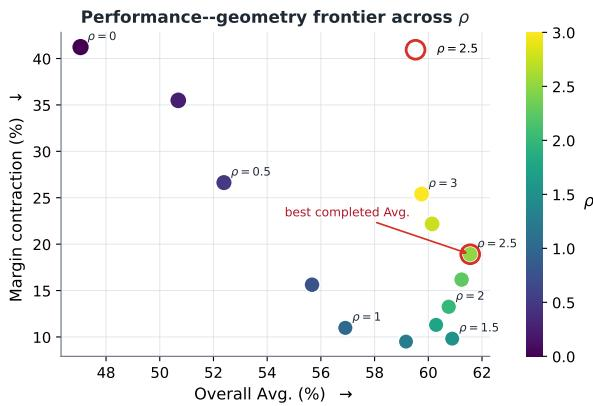  
Bubble area encodes the active-pair rate; lower contraction is preferable.

## G.1 Headline Pair-Graph Controls

<table><tr><td>Variant</td><td>MATH p@1</td><td>MATH p@4</td><td>Code mean</td><td>Flip</td><td>Contr.</td><td>KL</td></tr><tr><td>Full pairs</td><td>54.56</td><td>80.50</td><td>69.50</td><td>0.0565</td><td>0.1098</td><td>0.0748</td></tr><tr><td>Adjacent</td><td>57.65</td><td>82.02</td><td>69.04</td><td>0.0520</td><td>0.1346</td><td>0.0431</td></tr></table>

Table 23: SRP pair-graph controls at $\rho = 1 , K = 1 0 ,$ $\mu = 1$ (training seed 1234). Full pairs is the headline checkpoint, and its task scores are the main-table evaluation. Adjacent pairs is a separately trained checkpoint. Task scores are percentages. Code mean averages the four matched HumanEval+/MBPP+ pass@1/pass@4 metrics. Diagnostics use the 998-example held-out cache. Both checkpoints have 478 training steps. Flip is a fraction. Contr. is in logit units.

The pair-graph comparison in Table 23 uses the headline full-pair checkpoint and a separately trained adjacent-rank checkpoint. Adjacent pairs have higher MATH scores and a slightly lower code mean, with lower Flip and KL but higher contraction. The two runs share the training implementation, environment, and common hyperparameters. The pair set is the changed factor.

Full and adjacent graphs use 45 and 9 pairs at $K = 1 0 ,$ respectively. In this pilot the adjacent graph records 6,514 tokens/s and 19.91 GiB, against 6,625 tokens/s and 19.91 GiB for the full graph. The adjacent checkpoint’s downstream scores are in Table 23. Both graphs reuse the same top-K cache, whose 56 NumPy arrays occupy 1.143 GiB. CE reads the supervised cache fields. LP-SFT and SRP-SFT additionally read the top-K fields. A new timed reconstruction of the shared full cache takes 486.63 seconds on eight GPUs, including model loading, tokenization, teacher computation, and writing. Of 61,135 requested rows, 61,095 are valid and 40 empty rows are skipped. The 56 arrays occupy 1.143 GiB. This measurement is the reconstruction of the shared cache used by LP-SFT and both SRP pair graphs.

<table><tr><td>Method</td><td>Pairs</td><td>Tokens/s</td><td>Wall (s)</td><td>Peak (GiB)</td></tr><tr><td>CE</td><td>一</td><td>6748</td><td>175.31</td><td>19.91</td></tr><tr><td>LP-SFT</td><td>一</td><td>6743</td><td>180.81</td><td>19.91</td></tr><tr><td>SRP full</td><td>45</td><td>6625</td><td>176.41</td><td>19.91</td></tr><tr><td>SRP adjacent</td><td>9</td><td>6514</td><td>181.48</td><td>19.91</td></tr></table>

Table 24: Measured 20-step efficiency pilots with the same eight-GPU allocation and training configuration. Throughput excludes the first five warmup steps and checkpoint I/O. Wall time covers the training run. Peak is the maximum allocated memory over ranks. Pairs counts auxiliary rank constraints per position. CE and LP-SFT have no auxiliary pairs.

## G.2 LP-SFT/ListNet Equivalence and Training Audit

For frozen teacher probabilities $q$ and student probabilities p on the same candidate set,

$$
\begin{array} { r } { \mathcal { L } _ { \mathrm { L P } } = \mathcal { L } _ { \mathrm { L i s t N e t } } - H ( q ) . } \end{array}\tag{82}
$$

With matching temperature, candidate mask, reduction, and coefficient, $\nabla _ { \boldsymbol { \theta } } \mathcal { L } _ { \mathrm { L P } } = \nabla _ { \boldsymbol { \theta } } \mathcal { L } _ { \mathrm { L i s t N e t } }$ . Both objectives include the same target CE outside the alternatives.

We checked the current implementation on identical logits through the full CE-plus-auxiliary code path, with coefficient one and temperature one. Eight cases cover FP32/BF16 logits, valid/- padded/empty positions, and target exclusion. The student gradients are bitwise equal in these CPU checks. The loss difference equals the reduced teacher entropy to floating-point precision.

Controlled training audit. We also compare LP-SFT and ListNet over eight optimizer updates of Qwen3-4B-Base using BF16 DeepSpeed ZeRO-2 on eight ranks. Both runs use seed 1234, the same initialization, cache, data order, optimizer and scheduler, with $K \ = \ 1 0$ , temperature one, and $\mu = 1$ . The microbatch size is one per rank, with 16 accumulation steps and effective batch size 128. We enable deterministic algorithms and SDPA math attention, and disable communication overlap. Table 25 summarizes the paired traces: all 1,024 microbatches have matching input, RNG, candidate-mask, and selected-logit-gradient hashes. CE losses and optimizer-step gradient norms agree exactly. Parameter hashes recorded on rank 0 match at initialization and after every update. The maximum residual in $\mathcal { L } _ { \mathrm { L i s t N e t } } - \mathcal { L } _ { \mathrm { L P } } - H ( q )$ is $7 . 1 5 \times 1 0 ^ { - 7 }$ . These results verify the predicted equivalence through eight updates of the controlled training execution.

<table><tr><td>Paired check</td><td>Pairs</td><td>Result</td></tr><tr><td>Input and RNG hashes</td><td>1,024</td><td>All match</td></tr><tr><td>Candidate-mask hashes</td><td>1,024</td><td>All match</td></tr><tr><td>Selected-logit-gradient hashes</td><td>1,024</td><td>All match</td></tr><tr><td>Maximum CE loss difference</td><td>1,024</td><td>0</td></tr><tr><td>Maximum loss-entropy residual</td><td>1,024</td><td> $7 . 1 5 \times 1 0 ^ { - 7 }$ </td></tr><tr><td>Maximum update gradient-norm difference</td><td>64</td><td>0</td></tr><tr><td>Parameter hashes (rank 0)</td><td>9</td><td>All match</td></tr></table>

Table 25: LP-SFT/ListNet training identity audit. Microbatch checks cover 8 ranks × 8 updates × 16 accumulation steps. Gradient norms cover all 64 rank–update pairs. The nine parameter snapshots comprise initialization and eight post-update states on rank 0. The loss residual subtracts the reduced teacher entropy from the ListNet-minus-LP total objective. Its absolute tolerance is $1 0 ^ { - 5 }$

The reported LP and ListNet runs use a 478-step schedule, with micro-batch one and accumulation 16. They use the same training implementation, environment, data-loader configuration, and common training hyperparameters. ListNet is a separately trained instance of the LP-equivalent objective. The matched training audit above directly verifies implementation identity.

## G.3 Ranking-Loss Form Ablation

The parameter grid above varies SRP hyperparameters. We additionally compare the loss form at fixed coefficients and a shared Qwen3-4B-Base initialization. All rows share the same training implementation, environment, and common training hyperparameters. Candidate-set details are described in the full screen below. Table 27 shows representative alternatives. The complete fixed-configuration screen is given in Appendix H. Table 26 gives the four-metric code mean for ListMLE, Margin-MSE, and SRP-SFT at $\mu = 1$

RankOnly lowers inversion relative to CE but remains below the margin-aware SRP variants in this screen. SRP-full has the strongest three-task mean, whereas Margin-MSE has fewer inversions (0.0380 versus 0.0565). The RLKD-style top-K approximation is specified in Appendix H.

<table><tr><td>Method</td><td colspan="2">MATH</td><td colspan="2">HE+</td><td colspan="2">MBPP+</td><td>Code mean</td></tr><tr><td></td><td>p@1</td><td>p@4</td><td>p@1</td><td>p@4</td><td>p@1</td><td>p@4</td><td></td></tr><tr><td>ListMLE</td><td>52.21</td><td>79.58</td><td>62.35</td><td>83.85</td><td>55.46</td><td>73.74</td><td>68.85</td></tr><tr><td>Margin-MSE</td><td>49.19</td><td>79.77</td><td>61.52</td><td>84.66</td><td>54.85</td><td>74.64</td><td>68.92</td></tr><tr><td>SRP-SFT</td><td>54.56</td><td>80.50</td><td>62.84</td><td>83.87</td><td>56.24</td><td>75.06</td><td>69.50</td></tr></table>

Table 26: One-epoch ranking controls at $\mu = 1$ (seed 1234, percentages).
<table><tr><td>Loss</td><td>MATH</td><td>HE+</td><td>MBPP+</td><td>Mean</td><td>Flip  $\downarrow$ </td><td>Contr. ↓</td></tr><tr><td>CE</td><td>27.98</td><td>44.18</td><td>44.66</td><td>38.94</td><td>0.1540</td><td>0.5995</td></tr><tr><td>LP-SFT</td><td>49.56</td><td>57.90</td><td>51.87</td><td>53.11</td><td>0.0741</td><td>0.2681</td></tr><tr><td>RankOnly  $( \rho = 0 )$ </td><td>41.89</td><td>55.37</td><td>49.96</td><td>49.07</td><td>.0828</td><td>.4124</td></tr><tr><td>RankNet</td><td>46.41</td><td>59.09</td><td>52.63</td><td>52.71</td><td>.0853</td><td>.1872</td></tr><tr><td>ListMLE</td><td>52.15</td><td>61.71</td><td>56.18</td><td>56.68</td><td>.0691</td><td>.1271</td></tr><tr><td>Margin-MSE</td><td>48.68</td><td>61.07</td><td>54.72</td><td>54.82</td><td>.0380</td><td>.1522</td></tr><tr><td>SRP-full  $( \rho = 1 )$ </td><td>54.56</td><td>62.84</td><td>56.24</td><td>57.88</td><td>.0565</td><td>.1098</td></tr><tr><td>SRP-SFT  $( \rho = . 5 )$ </td><td>50.12</td><td>57.23</td><td>52.08</td><td>53.14</td><td>.0666</td><td>.2663</td></tr></table>

Table 27: Representative ranking-loss screen. MATH, HE+, and MBPP+ are pass@1. Mean averages them. Flip is a fraction and Contr. is in logit units. SRP-full $( \rho = 1 )$ is the headline checkpoint and matches Table 2. SRP-SFT $( \rho = . 5 )$ is the sensitivity-reference checkpoint in Table 21. Its HumanEval+ and MBPP+ pass@1 average to that table’s code score of 54.65 before rounding.

## H Full Ranking-Loss Ablation

Table 4 in Section 7.2 reports the full downstream performance panel for the headline $\rho = 1$ method and the other loss-form controls. This appendix retains the companion relation and directional diagnostics. The RLKD-style row is a controlled top-K variant of the cited method. The fixed-candidate rows reuse the teacher top-K non-target cache, target exclusion, CE reduction, and valid-token normalization. BiLD T+S and RLKD-style union additionally change the candidate set and use a teacherlogit floor for student-only candidates. All methods use the same training implementation, environment, and common training hyperparameters. Every auxiliary row uses $\mu = 1$ . SRP-SFT uses the fixed headline configuration.

The following definitions specify the objectives used in Tables 4 and 27. For each supervised position $t ,$ let $\mathcal { C } _ { t }$ be the cached teacher top-K nontarget alternatives $( K = 1 0 )$ , let $\Delta _ { i j , t } ^ { M } = \dot { z } _ { t , i } ^ { M } - z _ { t , j } ^ { M }$ for $M \in \{ T , S \}$ , and let $\mathcal { P } _ { t } ~ = ~ \{ ( i , j ) ~ \in ~ \mathcal { C } _ { t } ^ { 2 }$ $\Delta _ { i j , t } ^ { T } > 0 \}$ Thus the pairwise rows use every teacher-preferred ordered pair and never add the reverse orientation. Invalid or padded positions are removed before reduction. Every auxiliary is averaged over the valid response positions and added to the ordinary target CE with $\mu = 1$ . The screen uses the shared reference cache, a checkpoint after one processed epoch, seed 1234, effective batch size 128, peak AdamW learning rate $2 \times 1 0 ^ { - 5 }$ and 2,048-token context. All rows use a 478-step cosine horizon with 15 warmup steps. The CE row is the same target CE with no auxiliary term. These rows illustrate three kinds of supervision. LP-SFT and ListNet share the same one. Pointwise supervision gives an individual token a target label or score, as CE does for the observed response token. Pairwise supervision compares two candidates and uses their relation, as in RankOnly, RankNet, Margin-MSE, and SRP-SFT. Listwise supervision uses the full candidate set at once, as in ListNet and ListMLE. Pointwise supervision is the CE term already present in every row.

The distinction between the two listwise controls is also specific. ListNet matches a teacher probability distribution over the candidate set, whereas ListMLE uses only the teacher’s sorted permutation and a Plackett–Luce likelihood. At matched temperature, candidate mask, reduction, and weight, LP-SFT’s forward KL differs from ListNet only by the frozen teacher entropy. They therefore have the same student gradient and distribution-matching geometry.

Pairwise objectives. RankOnly is the $\rho \quad =$ 0 special case of the SRP implementation, $\begin{array} { r l } { \vert \mathcal { P } _ { t } \vert ^ { - 1 } \sum _ { ( i , j ) \in \mathcal { P } _ { t } } [ - \Delta _ { i j , t } ^ { S } ] _ { + } } & { { } } \end{array}$ . It enforces order but has no teacher-margin target. SRP-full (the $\rho = 1$ row, also called SRP-SFT in the main performance panel) uses $| \mathcal { P } _ { t } | ^ { - 1 } \sum _ { ( i , j ) \in \mathcal { P } _ { t } } [ \Delta _ { i j , t } ^ { T } - \Delta _ { i j , t } ^ { S } ] _ { + }$ , while the appendix SRP-SFT $( \rho = . 5 )$ row replaces the target by . $. 5 \Delta _ { i j , t } ^ { T }$ . Margin-MSE uses the symmetric exact-gap objective $\begin{array} { r } { | \mathcal { P } _ { t } | ^ { - 1 } \sum _ { ( i , j ) \in \mathcal { P } _ { t } } ( \Delta _ { i j , t } ^ { S } } \end{array}$ $\Delta _ { i j , t } ^ { T } ) ^ { 2 }$ RankNet (Burges et al., 2005) uses softplus(− ${ \cdot } \Delta _ { i j , t } ^ { S } / \tau )$ on the same pairs with $\tau =$ 1. Smooth-SRP uses the raw (unshifted) smooth hinge τ softplus $( ( . 5 \Delta _ { i j , t } ^ { T } - \Delta _ { i j , t } ^ { S } ) / \tau )$ with $\tau = . 5$ Consequently it remains nonzero on the feasible side, unlike the hard SRP hinge. Kendall-τ is a controlled soft-concordance proxy, not the cited paper’s official implementation: it averages $1 - \operatorname { t a n h } ( \Delta _ { i j , t } ^ { S } / \tau )$ tanh $( \Delta _ { i j , t } ^ { T } / \tau )$ with $\tau = 1$

Listwise and correlation objectives. ListNet (Cao et al., 2007) forms $q _ { i } =$ softmax $( z _ { i } ^ { T } )$ and $p _ { i } ~ = ~ \mathrm { s o f t m a x } ( z _ { i } ^ { S } )$ only over $\mathcal { C } _ { t } .$ , and uses $- \sum _ { i \in { \mathcal { C } } _ { t } } q _ { i }$ log $p _ { i }$ (temperature 1). ListMLE (Xia et al., 2008) sorts $\mathcal { C } _ { t }$ by descending teacher logit, π, and uses the normalized Plackett– Luce negative log-likelihood $| { \mathcal C } _ { t } | ^ { - 1 } \sum _ { r } [ - z _ { \pi _ { r } } ^ { S }$ + log $\begin{array} { r } { \sum _ { u \ge r } \exp { z _ { \pi _ { u } } ^ { S } } ] } \end{array}$ . It uses the teacher permutation. Spearman first assigns each candidate the pairwisesigmoid soft rank $\begin{array} { r } { 1 + \sum _ { j \neq i } \sigma ( ( z _ { j } - z _ { i } ) / \tau ) } \end{array}$ , then minimizes one minus the Pearson correlation of teacher and student soft ranks on $\mathcal { C } _ { t } ~ \left( \tau \ = ~ 1 \right)$ . It adapts the rank-correlation statistic (Spearman, 1904).

Cited-method approximations. BiLD teacher-led applies KL(softmax $( \Delta ^ { T } / T )$ ∥ softmax $( \Delta ^ { S } / T ) )$ to all pairs in $\mathcal { P } _ { t }$ with $T = 3$ and the shared teacher top-K set. It is therefore a teacher-led controlled approximation. BiLD T+S uses $k = 8$ and adds a second branch over the student’s target-excluded top-8. For a student-only token, the cached teacher logit is set to (min $z ^ { T } | _ { \boldsymbol { c } _ { t } } )$ − 1, exactly the floor used in the code. RLKD-style union uses differentiable Spearman on the deduplicated union of the teacher top-5 and student’s target-excluded top-5 candidates. Student-only teacher logits use the same floor and the rank temperature is 1. LP-SFT is the separate local forward KL $\mathrm { K L } ( q \| p )$ on the same target-excluded candidate set, with the target CE retained outside that set.

<table><tr><td colspan="2">Relation and preservation diagnostics</td><td></td><td></td></tr><tr><td>Loss Relation</td><td></td><td>Flip</td><td>Contr.</td></tr><tr><td>CE</td><td>None</td><td></td><td>0.15400.5995</td></tr><tr><td>LP-SFT</td><td>Distribution</td><td></td><td>0.0741 0.2681</td></tr><tr><td>RankOnly  $( \rho = 0 )$ </td><td>Pairwise order</td><td>.0828</td><td>.4124</td></tr><tr><td>RankNet</td><td>Pairwise order</td><td>.0853</td><td>.1872</td></tr><tr><td>ListMLE</td><td>Listwise order</td><td>.0691</td><td>.1271</td></tr><tr><td>Spearman</td><td>Rank correlation</td><td>.0757</td><td>.2844</td></tr><tr><td>ListNet†</td><td>Distribution (LP-equivalent)</td><td>.0739</td><td>.2675</td></tr><tr><td>Margin-MSE</td><td>Pairwise gap</td><td>.0380</td><td>.1522</td></tr><tr><td>BiLD teacher-led</td><td>Diff-KL</td><td>.0539</td><td>.2549</td></tr><tr><td>BiLD T+S</td><td>Diff-KL</td><td>.0855</td><td>.3415</td></tr><tr><td>RLKD-style union</td><td>Rank correlation</td><td>.0682</td><td>.2509</td></tr><tr><td>Kendall-τ</td><td>Pair concordance</td><td>.0924</td><td>.2352</td></tr><tr><td>Smooth-SRP</td><td>Pairwise gap bound</td><td>.0732</td><td>.1602</td></tr><tr><td>SRP-SFT  $( \rho = 1 )$ </td><td>Pairwise gap bound</td><td>.0565</td><td>.1098</td></tr><tr><td>SRP-SFT  $( \rho = . 5 )$ </td><td>Pairwise gap bound</td><td>.0666</td><td>.2666</td></tr></table>

Table 28: Relation and directional diagnostics for the ranking-loss screen. Flip is a fraction and Contr. is in logit units. Both are lower-is-better. †ListNet is LPequivalent. Performance is in Table 4.

Relating performance and geometry. Tables 4 and 28 separate task performance from the preserved relation. Margin-MSE has the lowest displayed Flip rate, whereas SRP-SFT with $\rho = 1$ has the highest three-task mean. These properties therefore select different rows. The supplementary $\rho = 0 . 5$ arm and its performance remain in the compact appendix screen (Table 27).

RankNet continually rewards larger positive pairwise margins. SRP’s auxiliary becomes inactive when the requested bound is met. The relation labels specify the controlled implementation compared, including the approximate BiLD and RLKDstyle variants.

## I Entropy-Matched Temperature Control

This appendix records the diagnostic behind Section 7.5. The downstream screen itself is Table 5.
<table><tr><td>Method</td><td>H</td><td> $\alpha ^ { * }$ </td><td> $1 / \alpha ^ { * }$ </td><td>Contr.</td><td>Flip</td><td>Viol.</td></tr><tr><td>CE</td><td>0.906</td><td>1.081</td><td>0.925</td><td>0.600</td><td>0.154</td><td>0.501</td></tr><tr><td>LP-SFT</td><td>0.938</td><td>1.099</td><td>0.910</td><td>0.268</td><td>0.074</td><td>0.513</td></tr><tr><td>SRP-SFT</td><td>0.802</td><td>1</td><td>1</td><td>0.110</td><td>0.056</td><td>0.229</td></tr></table>

Table 29: Mechanism diagnostics on the held-out cache (280,908 response positions). H is mean fullvocabulary entropy. Contr./Flip are contraction/inversion, and Viol. is the fraction below the $\rho = 1$ margin. CE and LP-SFT $\alpha ^ { * }$ match the SRP-SFT entropy.

## I.1 Sharpness and the Fitted Scale

On 280,908 held-out response positions, the SRP-SFT mean full-vocabulary entropy is $H _ { \mathrm { S R P } } ~ =$ 0.802 (Table 29). For each frozen baseline we solve

$$
\alpha ^ { * } = \arg \operatorname* { m i n } _ { \alpha \in [ 0 . 5 , 2 ] } \big | H ( \mathrm { s o f t m a x } ( \alpha z ) ) - H _ { \mathrm { S R P } } \big | .\tag{83}
$$

The LP solution is interior, $\alpha ^ { * } = 1 . 0 9 9 3$ . CE has an interior solution $\alpha ^ { * } = 1 . 0 8 1$ against the same SRP-SFT entropy. Equivalent model temperature is $1 / \alpha ^ { * }$ . Logits are multiplied by $\alpha ^ { * }$ and then sampled at temperature 0.6 on MATH-500 and 0.8 on HumanEval+ and MBPP+. The fit uses the held-out SRP-SFT entropy as its only target.

## I.2 Margin Geometry

The following two tables report per-pair margin ratios and violation-conditioned bins. The margingeometry panel (Table 30) uses $\alpha ^ { * } = 1 . 1 1 6$ , not the 1.0993 scale used in the downstream control (Table 5). The geometry panel uses $\alpha ^ { * } = 1 . 1 1 6$ The downstream control uses 1.0993. On teacherpreferred pairs with reference margin above 0.1 (9.90 million pairs), multiplying LP-SFT logits by $\alpha ^ { * } ~ = ~ 1 . 1 1 6$ multiplies the mean margin ratio by the same factor, 0.934 → 1.043, and leaves the coefficient of variation and the through-origin $R ^ { 2 }$ unchanged at 1.952 and 0.833. SRP-SFT has

mean ratio 1.244, coefficient of variation 1.346, $R ^ { 2 } = 0 . 8 9 8$ , and a below-margin rate of 0.229, compared with 0.447 for LP-TempMatch and 0.539 for unscaled LP-SFT. Global scaling moves every retained margin proportionally. SRP-SFT changes which margins fall short of the reference.
<table><tr><td>Method</td><td>Mean ratio</td><td>CV</td><td> $R ^ { 2 }$ </td><td>Below ρ</td></tr><tr><td>CE</td><td>0.942</td><td>5.829</td><td>0.360</td><td>0.514</td></tr><tr><td>LP-SFT</td><td>0.934</td><td>1.952</td><td>0.833</td><td>0.539</td></tr><tr><td>LP-TempMatch</td><td>1.043</td><td>1.952</td><td>0.833</td><td>0.447</td></tr><tr><td>SRP-SFT</td><td>1.244</td><td>1.346</td><td>0.898</td><td>0.229</td></tr></table>

Table 30: Teacher-preferred margin geometry for $\Delta ^ { T } >$ 0.1. Mean ratio is $\Delta ^ { S } / \Delta ^ { T }$ . CV is its coefficient of variation. $R ^ { 2 }$ is the through-origin fit. LP-TempMatch uses $\alpha ^ { * } = 1 . 1 1 6$

## I.3 Violation-Conditioned Diagnostics

The entropy differences also vary across positions (Table 31), grouped by the CE checkpoint’s violation rate. In the highest bin, SRP-SFT has fullvocabulary entropy 0.165 below CE, while LP-SFT is 0.016 below CE. SRP-SFT’s contraction and flip reductions are larger in higher CE-violation bins.

<table><tr><td rowspan="2">CE viol.</td><td rowspan="2">n</td><td colspan="3">LP - CE</td><td colspan="3">SRP - CE</td></tr><tr><td>∆C</td><td>∆F</td><td>∆H</td><td>∆C</td><td>∆F</td><td>∆H</td></tr><tr><td>(0, .25]</td><td></td><td></td><td>10,898 −.019 −.011 +.114</td><td></td><td></td><td>-.117 -.031 -.044</td><td></td></tr><tr><td></td><td></td><td></td><td>(.25, .50] 123,110 −.246 −.061 +.066</td><td></td><td></td><td>-.425 -.095 -.096</td><td></td></tr><tr><td></td><td>(.50, .75] 133,563 −.501 −.107 +.018</td><td></td><td></td><td></td><td></td><td>-.780 -.152 -.143</td><td></td></tr><tr><td>(.75, 1]</td><td>13,315 -.705 -.140 -.016 -1.098 -.188 -.165</td><td></td><td></td><td></td><td></td><td></td><td></td></tr></table>

Table 31: Diagnostic differences conditioned on the CE checkpoint’s violation rate. ∆C and ∆F are contraction and flip relative to that CE checkpoint. The 22 zeroviolation positions are omitted.

## J Convergence Data

The following tables provide the numerical values plotted in Figure 6. MATH mean averages MATH-500 pass@1 and pass@4. Code mean averages HumanEval+ and MBPP+ pass@1 and pass@4. Values are percentages, and – denotes a checkpoint whose downstream evaluation was not available in the convergence report. The step-0 Base row is this run’s evaluation of the untouched checkpoint. On MATH-500, this row and Table 1 share the evaluation manifest and the sampling protocol: revision 6e4ed1a2a79a, all 500 test problems, the same prompt, temperature 0.6, top-p 1, 16 samples, and a 4,096-token cap. Later checkpoints in this table use that same manifest and protocol. The generations are a separate draw, so pass@1/pass@4 are 48.43/72.06 here (mean 60.24) and 48.11/71.23 in the main table (mean 59.67). The trajectory is anchored to this draw. The code entry uses temperature 0.8, top-p 1, 20 samples, 768 new tokens, and a 2,048-token context (mean 59.17). Table 2 uses 4,096/8,192 and averages to 58.92.

<table><tr><td>Epoch</td><td>Base</td><td>CE</td><td>LP- SFT</td><td>DFT</td><td>ASFT</td><td>SRP- SFT</td></tr><tr><td>0.0</td><td>60.24</td><td></td><td></td><td></td><td></td><td></td></tr><tr><td>0.5</td><td></td><td>43.22</td><td>61.70</td><td>50.30</td><td>52.27</td><td>64.21</td></tr><tr><td>1.0</td><td>一</td><td>40.00</td><td>59.61</td><td>24.36</td><td>37.18</td><td>60.32</td></tr><tr><td>1.5</td><td></td><td>46.72</td><td>60.16</td><td>28.13</td><td>57.97</td><td>58.42</td></tr><tr><td>2.0</td><td>一</td><td>42.50</td><td>53.04</td><td>31.68</td><td>46.70</td><td>56.54</td></tr><tr><td>2.5</td><td></td><td>48.93</td><td>57.10</td><td>33.27</td><td>46.85</td><td>59.30</td></tr><tr><td>3.0</td><td></td><td>50.65</td><td>57.19</td><td>30.33</td><td>34.16</td><td>60.24</td></tr><tr><td>3.5</td><td></td><td>51.00</td><td>59.85</td><td>34.64</td><td>45.38</td><td>61.25</td></tr><tr><td>4.0</td><td>一</td><td>50.69</td><td>58.56</td><td>35.60</td><td>48.05</td><td>61.58</td></tr><tr><td>4.5</td><td></td><td>50.86</td><td>60.36</td><td>38.66</td><td>50.11</td><td>61.00</td></tr><tr><td>5.0</td><td></td><td>51.42</td><td>60.36</td><td>34.68</td><td>50.31</td><td>61.49</td></tr><tr><td>5.5</td><td></td><td>51.62</td><td>60.51</td><td>39.40</td><td>49.19</td><td>62.84</td></tr><tr><td>6.0</td><td></td><td>51.72</td><td>60.05</td><td>39.33</td><td>52.29</td><td>63.04</td></tr><tr><td>6.5</td><td></td><td>51.14</td><td>59.85</td><td>33.13</td><td>54.82</td><td>62.24</td></tr><tr><td>7.0</td><td></td><td>51.74</td><td>59.04</td><td>41.45</td><td>53.06</td><td>63.38</td></tr><tr><td>7.5</td><td></td><td>50.24</td><td>59.09</td><td>39.32</td><td>51.55</td><td>62.97</td></tr><tr><td>8.0</td><td>一</td><td>50.75</td><td>60.25</td><td>40.23</td><td>53.10</td><td>62.56</td></tr><tr><td>8.5</td><td>1</td><td>50.09</td><td>60.91</td><td></td><td>53.10</td><td>61.98</td></tr><tr><td>9.0</td><td>1</td><td>50.51</td><td>61.11</td><td>一</td><td>53.38</td><td>62.59</td></tr><tr><td>9.5</td><td>一</td><td>49.06</td><td>60.13</td><td>一</td><td>53.68</td><td>62.43</td></tr><tr><td>10.0</td><td>一</td><td>48.87</td><td></td><td>一</td><td>54.02</td><td>62.58</td></tr><tr><td>0.0</td><td colspan="6">59.17 一</td></tr><tr><td>0.5</td><td></td><td>55.66</td><td>66.12</td><td>61.03</td><td>66.34</td><td>66.31</td></tr><tr><td>1.0</td><td>一</td><td>52.87</td><td>64.32</td><td>60.12</td><td>66.66</td><td>65.25</td></tr><tr><td>1.5</td><td></td><td>58.47</td><td>65.75</td><td>61.47</td><td>65.56</td><td>65.46</td></tr><tr><td>2.0</td><td></td><td>58.01</td><td>65.73</td><td>60.98</td><td>65.66</td><td>66.47</td></tr><tr><td>2.5</td><td></td><td>61.91</td><td>67.44</td><td>60.83</td><td>67.99</td><td>68.13</td></tr><tr><td>3.0</td><td></td><td>60.57</td><td>67.85</td><td>59.07</td><td>66.36</td><td>68.62</td></tr><tr><td>3.5</td><td></td><td>60.87</td><td>68.55</td><td>58.47</td><td>65.83</td><td>68.95</td></tr><tr><td>4.0</td><td>一</td><td>60.73</td><td>68.20</td><td>57.87</td><td>67.04</td><td>69.71</td></tr><tr><td>4.5</td><td></td><td>62.92</td><td>68.84</td><td>58.76</td><td>65.17</td><td>69.77</td></tr><tr><td>5.0</td><td></td><td>62.77</td><td>69.43</td><td>59.06</td><td>66.23</td><td>70.11</td></tr><tr><td>5.5</td><td></td><td>62.26</td><td>68.98</td><td>58.96</td><td>66.91</td><td>69.98</td></tr><tr><td>6.0</td><td></td><td>62.53</td><td>68.98</td><td>59.74</td><td>66.48</td><td>70.27</td></tr><tr><td>6.5</td><td></td><td>61.75</td><td>69.28</td><td>61.22</td><td>67.05</td><td>69.74</td></tr><tr><td>7.0</td><td></td><td>63.21</td><td>69.25</td><td>60.03</td><td>67.52</td><td>70.40</td></tr><tr><td>7.5</td><td></td><td>62.19</td><td>69.87</td><td>61.17</td><td>66.13</td><td>70.24</td></tr><tr><td>8.0</td><td></td><td>62.32</td><td>69.74</td><td></td><td>67.38</td><td>70.69</td></tr><tr><td>8.5</td><td></td><td>62.05</td><td>70.22</td><td></td><td>67.22</td><td>70.67</td></tr><tr><td>9.0</td><td></td><td></td><td>70.03</td><td>一</td><td>66.86</td><td>70.58</td></tr><tr><td>9.5</td><td></td><td>61.80</td><td></td><td>一</td><td></td><td></td></tr><tr><td></td><td></td><td>61.18</td><td>一</td><td>一</td><td>67.09</td><td>70.56</td></tr><tr><td>10.0</td><td>一</td><td>61.48</td><td>一</td><td>一</td><td>67.20</td><td>一</td></tr></table>

Table 32: MATH mean convergence values underlying Figure 6. Step 0 is this run’s Base draw under the same MATH-500 manifest and sampling protocol as Table 1.

Table 33: Code mean convergence values underlying Figure 6.