# CSWBench: Evaluating Context-Sensitive Code-Switching in Creative Writing

Zewen Jiang1,2 Yahan Li3 Chenlu Guo4 Diana Inkpen5 Yuan Wu1 Yi Chang1,6,7

1School of Artificial Intelligence, Jilin University, China

2College of Software, Jilin University, China

3Xingchen AGI Lab, China Telecom Artificial Intelligence Technology (Beijing) Co., Ltd., China 4Bilibili Inc., China 5University of Ottawa, Canada

6Engineering Research Center of Knowledge-Driven Human-Machine Intelligence, MOE, China 7International Center of Future Science, Jilin University, China

jiangzw1324@mails.jlu.edu.cn liyh181@chinatelecom.cn guochenlu01@bilibili.com Diana.Inkpen@uottawa.ca {yuanwu, yichang}@jlu.edu.cn

## Abstract

Large language models (LLMs) have demon strated multilingual capabilities across diverse language generation and understanding tasks. Yet effective code-switching requires more than multilingual proficiency: models must decide when, where, and why to switch languages in ways that fit the surrounding context. This context-sensitive ability remains insufficiently evaluated. We introduce CSWBench, a benchmark for evaluating context-sensitive code-switching in creative writing through two complementary settings: Focused Narrative and Extended Narrative. We further propose CSWEval, a theory-informed framework with two complementary levels: event-level evaluation of Licensing, Contextual Appropriateness, and Functional Gain, and whole-text evaluation of task-specific quality—overall literary and narrative quality in Focused Narrative and quality emphasizing multilingual organization in Extended Narrative. Evaluating twelve LLMs, we find that models exhibit meaningful but uneven code-switching competence across narrative contexts. Model differences are particularly pronounced in multilingual literary integration, while multilingualfocused dimensions show stronger difficulty effects overall than the general narrative dimensions; narratively salient switches are associated with stronger contextual and functional realization; and event-level CS quality is moderately associated with whole-text performance. The artifact is available at https: //github.com/TPSJASPER/CSWBench.

## 1 Introduction

Code-switching (CS) refers to the alternation between two or more languages or language varieties within the same interaction or discourse (Gardner-Chloros, 2009; Bullock and Toribio, 2009). Its meaning depends on social and conversational context, serving identity expression, relationship negotiation, interlocutor accommodation, and affective communication (Gumperz, 1982; De Fina, 2007; Ladegaard, 2018; Giles et al., 1991). Such contextsensitive language choices are also common in contemporary digital communication, where they serve a range of communicative and pragmatic functions (Bali et al., 2014; Rudra et al., 2016; Rijhwani et al., 2017).

  
Figure 1: Illustrative distinction between genuine codeswitching and surface multilingual material. The examples distinguish meaningful language switches from English expressions that do not constitute code-switching (CS). A genuine switch involves English use attributable to current speaker or discourse voice as part of an ongoing interaction or narrative. By contrast, proper names, conventionalized borrowings, and quoted or displayed English without active uptake are excluded. The distinction depends on how English participates in discourse, rather than on the mere presence of English words.

Existing code-switching evaluations have largely examined how models process code-switched inputs through downstream NLP tasks, including language identification, named entity recognition, question answering, and natural language inference (Aguilar et al., 2020; Khanuja et al., 2020). LLM-era studies have extended this paradigm to translation, reasoning, and truthfulness (Huzaifah et al., 2024; Yang and Chai, 2025; Mohamed et al., 2026). Meanwhile, generated CS has been evaluated for fluency, naturalness, and semantic fidelity (Heredia et al., 2025; Aksüt et al., 2026), or against naturally occurring switching patterns (Sterner and Teufel, 2025; Winata et al., 2026). Yet whether LLMs can make contextually appropriate, functionally motivated code-switching decisions remains comparatively underexplored.

<table><tr><td>Benchmark</td><td>Task</td><td>Granularity</td><td>Generation</td><td>CS Choice</td><td>CS Orch.</td><td>Salience</td></tr><tr><td>LinCE (Aguilar et al., 2020)</td><td>CS NLP</td><td>Token / Utterance</td><td>X</td><td>X</td><td>X</td><td>X</td></tr><tr><td>CodeMixBench (Yang and Chai, 2025)</td><td>CS Understanding</td><td>Token / Text</td><td>△</td><td>X</td><td>X</td><td>X</td></tr><tr><td>ChiEngMixBench (Yang et al., 2026)</td><td>CS Generation</td><td>Sentence Pair / Text</td><td>√</td><td>√</td><td>X</td><td>X</td></tr><tr><td>LitBench (Fein et al., 2026)</td><td>Creative Writing</td><td>Story Pair</td><td>√</td><td>X</td><td>X</td><td>X</td></tr><tr><td>WritingBench (Wu et al., 2025b)</td><td>Writing</td><td>Whole Text</td><td>√</td><td>X</td><td>X</td><td>X</td></tr><tr><td>CSWBench</td><td>Creative Writing</td><td>Event + Whole Text</td><td>√</td><td>√</td><td>√</td><td>√</td></tr></table>

Table 1: Comparison of CSWBench with representative code-switching and writing benchmarks. Task denotes the evaluation setting; Granularity lists representative assessment units. Generation denotes evaluation of generated text; CS Choice indicates whether switching decisions are evaluated against contextual conditions; CS Orch. indicates whether multilingual behavior is assessed across a text; and Salience indicates whether the narrative importance of individual switches is considered. ✓ denotes explicit coverage, △ partial coverage, and × an aspect not evaluated. NLP = natural language processing; CS = code-switching; Orch. = orchestration.

Creative writing foregrounds the contextsensitive nature of code-switching, as literary language choices can be deliberately staged within a narrative (Grutman, 2024). Characters’ linguistic resources, relationships, and circumstances provide grounds for judging individual switches. For example, a character who speaks English cautiously might repeat an interlocutor’s English phrase to challenge a claim. Whether this switch is convincing depends on the character’s established language abilities, its fit with the ongoing exchange, and the contribution it makes to the disagreement. Across a narrative, such choices can also shape characterization, relationships, and narrative development (Gardner-Chloros and Weston, 2015; Baldo and Deganutti, 2024). Creative writing thus makes the contextual grounding, local functions, and broader narrative roles of code-switching observable and evaluable.

To fill this gap, we introduce CSWBench, a benchmark for evaluating whether LLMs can use code-switching as a context-sensitive language choice in creative writing. Drawing on spontaneous and controlled Chinese–English source material, CSWBench transforms screened bilingual records into structured narrative prompts that preserve their interactional grounding while adding limited narrative scaffolding through model-assisted construction, programmatic checks, and recorded screening and refinement. The benchmark comprises two complementary settings: Focused Narrative, which foregrounds individual code-switching choices within their local narrative contexts, and Extended Narrative, which places greater emphasis on the organization and development of multilingual behavior across the narrative as a whole.

Drawing on sociolinguistic and literary theories of code-switching, we develop CSWEval, a multi-level evaluation framework that assesses individual switching events in terms of Licensing, Contextual Appropriateness, and Functional Gain, together with task-specific whole-text quality, including multilingual organization in Extended Narrative. Evaluating twelve contemporary LLMs reveals three recurring patterns. First, multilingual literary integration clearly differentiates models, while multilingual-focused dimensions show stronger difficulty effects overall than the general narrative dimensions. Second, switches that carry greater narrative importance also tend to be more successfully realized in their immediate context and function. Third, local CS quality is moderately associated with whole-text performance.

## Our contributions are threefold:

(i) We introduce CSWBench, a benchmark for evaluating context-sensitive code-switching in creative writing through complementary Focused and Extended Narrative settings that foreground local multilingual choices and whole-text multilingual organization, respectively.

(ii) We develop CSWEval, a theory-informed, evidence-grounded evaluation framework that distinguishes Licensing, Contextual Appropriateness, and Functional Gain at the event level from taskspecific quality at the whole-text level.

(iii) We conduct a systematic evaluation of twelve contemporary LLMs, providing empirical evidence on where models succeed and fail in using codeswitching as a context-sensitive narrative resource.

## 2 Related Work

Computational Evaluation of Code-Switching. Computational studies have evaluated codeswitching competence through several paradigms. Input-oriented work examines downstream prediction and language understanding, as in LinCE (Aguilar et al., 2020) and GLUE-CoS (Khanuja et al., 2020), as well as LLM evaluations of translation and reasoning (Huzaifah et al., 2024; Yang and Chai, 2025) and comprehension (Mohamed et al., 2026). Generation-oriented work evaluates controllability and fluency (Mondal et al., 2022; Yong et al., 2023), semantic fidelity and human judgments (Aksüt et al., 2026), and correspondence with naturally occurring switching patterns (Winata et al., 2026).

Recent work has increasingly examined the conditions underlying individual language choices. Minimal-pair evaluations compare model preferences with those of bilingual speakers (Sterner and Teufel, 2025), while OLA examines pragmatic cues (Oh et al., 2026) and ChiEngMixBench considers community-specific switching conventions (Yang et al., 2026). A broader survey situates these developments within multilingual evaluation across modalities (Sheth et al., 2026). Our work extends this focus to the contextual and narrative roles of language choices in creative writing.

Creative Writing and Narrative Evaluation. Creative-writing evaluation treats narrative quality as a multidimensional construct, assessing coherence and reader engagement (Chhun et al., 2022), creativity and literary quality (Chakrabarty et al., 2024), and task-specific writing quality and human preferences (Wu et al., 2025b; Fein et al., 2026). Long-form evaluation further examines character consistency and event retention (Wang et al., 2025), as well as cross-scene continuity (Wu et al., 2025a). Building on these approaches, our work examines the local functions of code-switching and the development of multilingual behavior across characters, relationships, and narrative states.

Sociolinguistic and Literary Perspectives on Code-Switching. Code-switching is theorized through complementary perspectives on interactional, social, and narrative functions. Interactional accounts emphasize discourse position (Auer, 1995) and speaker alignment (Gumperz, 1982; Goffman, 1979). Social theories relate language choice to interlocutors, social distance (Bell, 1984; Giles et al., 1991), identity, and stance (Bucholtz and Hall, 2005). Literary perspectives examine code-switching as a staged narrative resource (Grutman, 2024) shaping characterization, relationships, and textual organization (Gardner-Chloros and Weston, 2015; Baldo and Deganutti, 2024).

## 3 Method

Starting from bilingual interactions in AS-CEND (Lovenia et al., 2022) and SwitchLingua (Xie et al., 2025), we build structured Seeds and transform them into open-ended prompts for narrative generation. As illustrated in Figure 2, our pipeline comprises three stages: data and prompt construction, development of CSWEval, and generation and evaluation.

## 3.1 Data Source and Seed Construction

We construct CSWBench from ASCEND’s naturally occurring Chinese–English conversations (Lovenia et al., 2022) and SwitchLingua’s controlled CS corpus (Xie et al., 2025). After source-specific normalization, we sample 3,500 records and screen for interpretable interactional context and attributable CS. We exclude records containing only lexicalized borrowings, proper names, detached multilingual material, or quoted or mediated material without active uptake by the current discourse voice. Screening and sensitivecontent filtering retain 3,009 records for Seed construction. Normalization and coverage statistics appear in Appendix B.

For each retained source sample, GPT-5.6- Sol (OpenAI, 2026b) constructs a structured Seed by extracting source-grounded information about participants, topics, situations, and language-use cues. Limited narrative scaffolding, including plausible participant relations, interaction patterns, and narrative pressure, provides a usable creativewriting context without prescribing individual switches. Constructions whose additions are inconsistent with the source context are discarded.

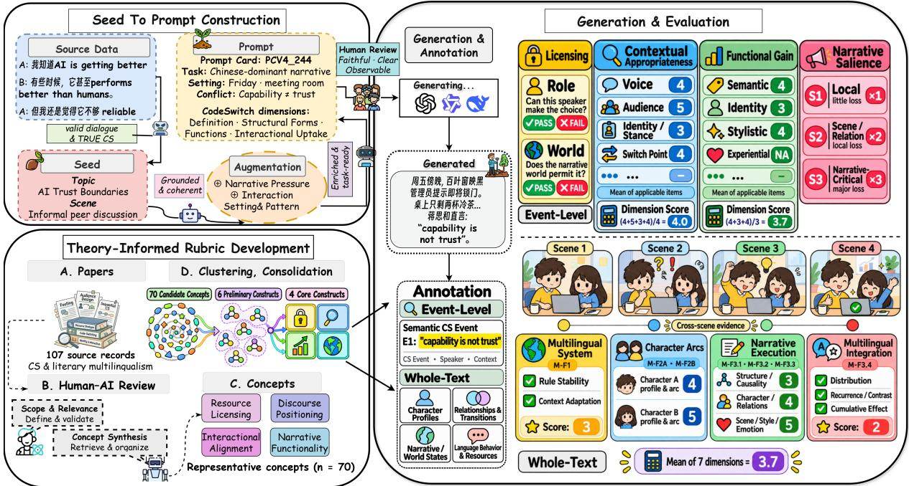  
Figure 2: Overview of the CSWBench construction and CSWEval evaluation pipeline. Source records are screened and transformed into Seed-conditioned prompts; CSWEval defines event-level and whole-text assessment; and twelve LLMs generate Focused and Extended narratives for evaluation. Event-level dimensions include Licensing (D1), Contextual Appropriateness (D2), and Functional Gain (D3). The illustrated whole-text dimensions are for Extended Narrative; text fragments and scores are schematic.

DeepSeek-V4-Pro (DeepSeek-AI, 2026) then validates source fidelity and scaffolding consistency, yielding 596 validated Seeds.

The final sets maximize contextual diversity across the source pool, jointly covering all 14 recorded scene domains and all 11 interaction patterns. Extended retains every scene domain; Focused omits one. Screening, construction, and selection details appear in Appendix C.

## 3.2 Theoretical Foundations of CSWEval

Our constructs draw on interactional approaches to CS and literary multilingualism. Interactional accounts treat language choice as situated social action shaped by participants, local conditions, and unfolding discourse (Gumperz, 1982; Auer, 1995): “Why this language, by this speaker, here and now?” Literary multilingualism treats multilingual fiction as a deliberately shaped resource rather than a transparent reproduction of bilingual speech (Delabastita and Grutman, 2005; Grutman, 2024; Baldo and Deganutti, 2024). Together, these perspectives motivate our view of code-switching in creative writing as a situated multilingual choice organized as a narrative resource.

Building on these foundations, we conducted an integrative theory review using database searches and citation tracing. The review retained 107 scholarly works and identified 70 candidate evaluative concepts, which were consolidated into six preliminary constructs. Four inform the quality framework, while the remaining two guide evidence requirements and narrative-salience weighting. Search and construct-development procedures are provided in Appendix D.

These constructs ground CSWEval: three concern individual switching events and one concerns the narrative as a whole.

Event-level constructs. Three constructs underpin event-level evaluation. (i) Participant–world resource grounding asks: Can this participant make this choice? It concerns whether a multilingual choice is supported by the participant’s established linguistic resources and represented narrative world, and is operationalized as Licensing (D1). (ii) Situated interactional coherence asks: Does it fit here? It concerns whether the choice is coherent for relevant voice, participants, interactional context, and narrative moment, and is operationalized as Contextual Appropriateness (D2). (iii) Functional multilingual contribution asks: What does this multilingual choice contribute here? It concerns the semantic, relational, identityrelated, stylistic, or experiential contribution made by the multilingual choice within the event, and is operationalized as Functional Gain (D3). At the event level, these constructs assess whether a switch is licensed by the speaker and narrative world, appropriate to its local context, and functionally meaningful.

Whole-text construct. For Extended Narrative, Whole-text Multilingual Orchestration asks whether multilingual choices form a coherent, developing pattern across characters, relationships, scenes, and narrative progression. Unlike the event-level constructs, it is judged over the whole narrative, considering how multilingual choices recur, contrast, and evolve across the text. Operationally, this construct is represented by seven scored whole-text dimensions in Extended Narrative, spanning multilingual organization and general narrative quality.

## 3.3 Task and Prompt Construction

From the pool of 596 validated Seeds, we construct task-specific subsets for Focused Narrative and Extended Narrative using coverage-first sampling over source and contextual characteristics. The same Seed may support both settings.

## 3.3.1 Seed-to-Prompt Construction

For each selected Seed, GPT-5.6-Sol constructs Seed-conditioned content and renders candidate prompts in four-part templates covering a fixed creative-writing instruction, character and scene information, narrative-development guidance, and task-specific requirements. Focused separates character and scene fields; Extended combines them and adds narrative-development instructions. Representative Prompt Cards appear in Appendix L.

The two settings differ in generation requirements. Focused and Extended Narrative target approximately 700 and 4,000 characters, respectively. Focused Narrative establishes a narrative situation, while Extended Narrative requires a developing narrative world with evolving characters, relationships, narrative states, and multilingual behavior. Both settings leave specific code-switching choices and story development open to the model, yielding 855 candidate prompts for subsequent validation.

## 3.3.2 Prompt Validation

Candidate prompts undergo deterministic checks for completeness, formatting, prohibited information, and redundancy, followed by two independent human reviews for Seed fidelity, task clarity and satisfiability, CS observability, and creative openness under setting-specific criteria. Disagreements receive third-rater adjudication; correctable problems undergo targeted revision and re-screening. The final set retains 807 of 855 prompts: 407 Focused and 400 Extended, derived from 546 distinct Seeds, with 261 shared across tasks.

The final sets retain diversity in scene domains, participant relations, interaction patterns, and preferred styles. The paired reviews yield Gwet’s AC1 = .975 for Focused and .838 for Extended; screening details are reported in Appendix I.

## 3.4 CSWEval: Evaluation Framework

CSWEval evaluates generated narratives at two complementary levels: individual code-switching events and the narrative as a whole. The constructs developed in Section 3.2 are operationalized through task-specific, evidence-grounded rubrics: binary checks applied at the event level for D1, aggregated at the article level as 5× the pass rate, and 1–5 ordinal rubrics with dimension-specific anchors for D2, D3, and whole-text quality. The complete dimensions, subdimensions, and task-specific scoring schemes are summarized in Appendix H.

## 3.4.1 Code-Switching Event Annotation

Before evaluation, every contiguous Latin-script span is treated as a candidate CS span. Candidates are classified using the operational CS definition and grouped into events, fixing their boundaries before quality scoring. For Extended Narrative, we prepare character and language profiles, relationship and narrative-world records, and Licensing evidence available at each event for event-level Licensing and longitudinal whole-text evaluation. Annotation rules appear in Appendix F. Human audits examine event discovery and evidence-record fidelity (Appendices K.4 and K.5).

## 3.4.2 Task-Specific Multi-Level Evaluation

Both settings evaluate event-level Licensing, Contextual Appropriateness, and Functional Gain but differ in scoring granularity and whole-text rubrics. Focused scores each applicable Contextual Appropriateness and Functional Gain subdimension per event and aggregates them into dimension scores. Extended uses these subdimensions as rubric guidance and assigns one overall score per dimension.

At the whole-text level, both settings score multiple dimensions separately and aggregate them into an overall whole-text score, but use different taskspecific rubrics. Focused Narrative assesses overall literary and narrative quality. Extended Narrative evaluates seven whole-text dimensions: multilingual narrative-system stability (M-F1), the bilingual profiles and language development of two focal characters (M-F2A and M-F2B), three general narrative dimensions covering structure, character development, and prose quality (M-F3.1–M-F3.3), and multilingual literary integration (M-F3.4).

## 3.4.3 Narrative Salience and Score Aggregation

Not all identified code-switching events contribute equally to narrative development. Narratological accounts of eventfulness distinguish events by the extent and consequences of the changes they introduce into a developing narrative (Schmid, 2010; Hühn, 2014). Each judge independently assigns a Narrative Salience level (S1, S2, or S3) to each previously identified code-switching event during evaluation. These levels reflect increasing narrative consequence and correspond to aggregation weights of 1, 2, and 3, respectively. Contextual Appropriateness and Functional Gain are then aggregated across identified code-switching events using these salience weights. Human-agreement results are effectively unchanged under alternative salience-weighting schemes: equal weighting and both milder and more concentrated alternatives yield correlations within approximately .01 of the reported 1:2:3 scheme.

Whole-text evaluation is computed independently from the event-level branch. Given K taskspecific whole-text dimensions with scores $W _ { k }$ , the article-level whole-text score is

$$
W _ { \mathrm { a r t i c l e } } = \frac { 1 } { K } \sum _ { k = 1 } ^ { K } W _ { k } .\tag{1}
$$

When a dimension contains multiple scored subdimensions, the applicable subdimension scores are aggregated by averaging them before articlelevel reporting. Within each narrative setting, we then summarize model performance with the equalweight composite $\Sigma = D 1 + D 2 + D 3 + \mathrm { W h o l e }$ (/20), while retaining the individual dimensions for more detailed analysis.

## 4 Experiment Setup

We evaluate twelve contemporary large language models spanning proprietary and open-weight model families. All twelve models were evaluated with shared decoding settings (temperature 0.7, top-p 0.7, and a 30,000-token output limit); the complete model roster and generation-side reasoning configurations are reported in Appendix M.

The evaluation set contains 407 Focused Narrative prompts and 400 Extended Narrative prompts. The generation design assigns one narrative per model and prompt, under the configuration recorded in Appendix A. We evaluate the generated narratives using CSWEval (Section 3.4), with generation-model identities hidden from the evaluators. Each narrative is independently evaluated by GPT-5.6-Sol and DeepSeek-V4-Flash (DeepSeek-AI, 2026). Licensing (D1) is judged event by event through the role- and world-level licensing checks, and the two judges’ article-level scores are averaged for model-level reporting.

## 5 Results and Analysis

Table 2 summarizes model performance in both settings. GPT-5.5 leads Focused Narrative $( \Sigma =$ 15.537), whereas GPT-5.6-Sol leads Extended Narrative $( \Sigma = 1 7 . 7 6 7 )$ . Both remain top-ranked under evaluator-family exclusion and alternative aggregations (Appendices K.6 and K.8).

## 5.1 CSWEval Validity

## 5.1.1 Human Validation

Three human raters evaluated 180 Focused and 144 Extended outputs (Kendall’s W = .718 and .810, respectively). Comparing human-mean and dualjudge article scores yields ICC(A,1) = .864 and Spearman’s $\rho =$ .863 for Focused, versus ICC(A,1) $= . 8 1 6$ and $\rho = . 8 0 4$ for Extended.

Two independent bilingual annotators audited candidate classification (108 narratives) and event grouping (48 narratives). Human audits closely agree with automatic event discovery (mean poststratified candidate-classification F1: .963/.960; event-grouping F1: .944/.998 for Focused/Extended; Appendix K.4). Changing the Prompt constructor and event annotator affects absolute scores, broadly preserving rankings (Appendix K.2).

## 5.1.2 Construct Sensitivity

Our perturbation and counterfactual studies test sensitivity to relevant evidence and controlled alternatives to observed language choices.

For Functional Gain, we conduct a cross-judge construct-sensitivity experiment on 72 events from 71 narratives, using LLM-generated Chinese-only counterfactuals reviewed and revised by human annotators. We use a reciprocal cross-judge design: one judge assigns events to HIGH and LOW groups based on its original D3 scores, while the other evaluates the original–counterfactual pairs in both presentation orders. We repeat the procedure with the judges’ roles reversed. They determine whether the original CS realization better preserves contextually supported communicative and narrative effects, whether the alternatives are equivalent, or whether the monolingual alternative is stronger (Table 3). HIGH-D3 events more often favor the original CS realization, whereas LOW-D3 events yield more ties, consistent with greater replaceability by a natural monolingual alternative.

<table><tr><td rowspan="2">Models</td><td colspan="5">Focused Narrative</td><td colspan="5">Extended Narrative</td></tr><tr><td>D1</td><td>D2</td><td>D3</td><td>Whole</td><td>∑</td><td>D1</td><td>D2</td><td>D3</td><td>Whole</td><td>∑</td></tr><tr><td colspan="9">Proprietary Models</td><td></td></tr><tr><td>GPT-5.6-Sol</td><td>4.998</td><td>3.349</td><td>3.348</td><td>3.806</td><td>15.501</td><td>4.881</td><td>4.102</td><td>4.032</td><td>4.752</td><td>17.767</td></tr><tr><td>GPT-5.6-Terra</td><td>4.997</td><td>3.333</td><td>3.340</td><td>3.740</td><td>15.410</td><td>4.769</td><td>4.069</td><td>4.020</td><td>4.494</td><td>17.352</td></tr><tr><td>GPT-5.5</td><td>4.999</td><td>3.357</td><td>3.362</td><td>3.819</td><td>15.537</td><td>4.781</td><td>4.007</td><td>3.946</td><td>4.614</td><td>17.348</td></tr><tr><td>Gemini-3.5-Flash</td><td>4.995</td><td>3.323</td><td>3.299</td><td>3.276</td><td>14.893</td><td>4.894</td><td>3.871</td><td>3.674</td><td>4.032</td><td>16.471</td></tr><tr><td>Qwen3.7-Plus</td><td>4.989</td><td>3.245</td><td>3.177</td><td>2.967</td><td>14.376</td><td>4.868</td><td>3.807</td><td>3.582</td><td>3.808</td><td>16.065</td></tr><tr><td>Qwen3.7-Max</td><td>4.990</td><td>3.291</td><td>3.245</td><td>3.014</td><td>14.540</td><td>4.893</td><td>3.828</td><td>3.608</td><td>3.891</td><td>16.220</td></tr><tr><td colspan="9">Open-weight Models</td><td></td></tr><tr><td>DeepSeek-V4-Pro</td><td>4.996</td><td>3.317</td><td>3.314</td><td>3.487</td><td>15.114</td><td>4.629</td><td>3.871</td><td>3.788</td><td>4.279</td><td>16.567</td></tr><tr><td>DeepSeek-V4-Flash</td><td>4.992</td><td>3.345</td><td>3.332</td><td>3.633</td><td>15.302</td><td>4.812</td><td>3.971</td><td>3.864</td><td>4.314</td><td>16.962</td></tr><tr><td>MiniMax-M2.5</td><td>4.941</td><td>3.075</td><td>2.983</td><td>2.629</td><td>13.628</td><td>4.407</td><td>3.160</td><td>2.912</td><td>2.977</td><td>13.456</td></tr><tr><td>MiniMax-M2.7</td><td>4.938</td><td>3.099</td><td>3.026</td><td>2.651</td><td>13.714</td><td>4.439</td><td>3.278</td><td>3.037</td><td>3.064</td><td>13.818</td></tr><tr><td>Qwen3.5-397B-A17B</td><td>4.992</td><td>3.237</td><td>3.171</td><td>2.958</td><td>14.357</td><td>4.639</td><td>3.660</td><td>3.481</td><td>3.710</td><td>15.491</td></tr><tr><td>Qwen3.5-35B-A3B</td><td>4.985</td><td>3.178</td><td>3.101</td><td>2.827</td><td>14.090</td><td>4.647</td><td>3.486</td><td>3.243</td><td>3.322</td><td>14.698</td></tr><tr><td>Average</td><td>4.984</td><td>3.262</td><td>3.225</td><td>3.234</td><td>14.705</td><td>4.722</td><td>3.759</td><td>3.599</td><td>3.938</td><td>16.018</td></tr></table>

Table 2: Main Results of CSWBench. Dual-judge mean scores for twelve LLMs on Focused and Extended Narrative. D1, D2, and D3 represent Licensing, Contextual Appropriateness, and Functional Gain, respectively; Whole denotes task-specific whole-text quality. Each dimension is scored out of 5, and Σ is their sum (/20). Bold and underlined values indicate the highest and second-highest scores in each column, respectively.

<table><tr><td>Group</td><td>Original CS stronger</td><td>Tie</td><td>Monolingual counterfactual stronger</td><td>Directional score</td></tr><tr><td>HIGH</td><td>56.9%</td><td>20.8%</td><td>22.2%</td><td>+0.347</td></tr><tr><td>LOW</td><td>29.9%</td><td>48.6%</td><td>21.5%</td><td>+0.083</td></tr></table>

Table 3: Functional Gain counterfactual judgments. The 72 events are divided into HIGH and LOW groups by original D3 scores. Original code-switching realizations are compared with human-reviewed Chinese-only alternatives through cross-judge comparisons in both presentation orders. Percentages report pooled outcomes, while directional scores assign +1 to original-CS wins, 0 to ties, and −1 to monolingual wins.

Position-swap experiments on 36 Extended narratives test whole-text multilingual organization (Appendix K.7). We swap 2, 4, 6, and 8 CS-event pairs, alongside Chinese-span controls using the same schedule. Both manipulations increasingly reduce Whole-text scores: at the strongest level, scores fall from 3.702 to 2.901 under CS swaps and to 3.137 under Chinese swaps. CS swaps primarily disrupt multilingual organization; Chinese swaps have relatively greater effects on general narrative execution. This contrast indicates particular sensitivity of the multilingual-organization dimensions to CS-event placement.

## 5.2 Multilingual Integration as a Major Axis of Model Differentiation

We compare cross-model separation across seven Extended Whole-text dimensions and their responses to prompt difficulty. Difficulty is estimated from total scores of six representative models using unweighted local D2/D3 means; the lowest- and highest-scoring prompt quartiles define hard and easy prompts. The remaining six models compare dimension-wise performance across these groups.

Among the seven Whole-text dimensions, M-F3.4 (Multilingual Literary Integration) shows the greatest variation across model means (SD = 0.742). Multilingual-focused dimensions exhibit larger performance declines on harder prompts than general narrative dimensions. Further results and robustness analyses are reported in Appendix K.10.

## 5.3 Narrative Salience and Event-Level Quality

We further examine how narrative salience relates to event-level code-switching quality within individual narratives (Figure 3). Salience is positively associated with both Contextual Appropriateness and Functional Gain. We globally rank both variables within judge, center these ranks within articles, and average the Pearson correlations across the two cross-judge directions. The resulting correlations are r = .642 and r = .496 in Focused Narrative (4,884 articles), and r = .768 and r = .789 in Extended Narrative (4,800 articles), for Contextual Appropriateness and Functional Gain, respectively. Across both settings, higher narrative salience is associated with stronger contextual and functional realization, with larger correlations in Extended Narrative.

Focused Narrative: salience and local quality  
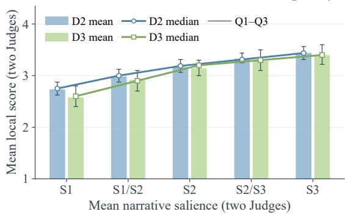  
(a) Focused Narrative salience

Extended Narrative: salience and local quality  
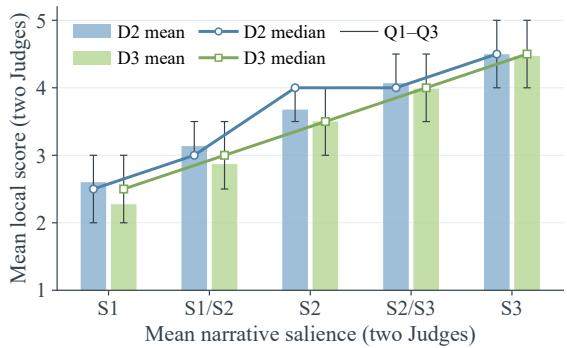

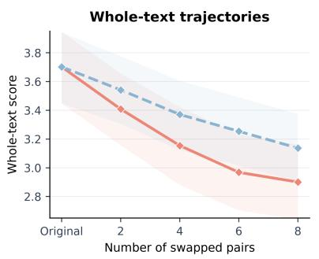

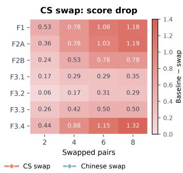

(b) Extended Narrative salience  
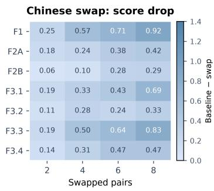  
Figure 3: Narrative salience and position-swap sensitivity. Top panels show mean Contextual Appropriateness (D2) and Functional Gain (D3) scores by salience level (S1–S3, increasing narrative consequence), with Q1–Q3 ranges and overlaid medians. Bottom panels show whole-text score changes as increasing numbers of code-switching event pairs or Chinese-span pairs are swapped, comparing sensitivity to the two types of disruption.

## 5.4 From Local Code-Switching Quality to Whole-Text Performance

In Extended Narrative, we average both cross-judge directions, pairing one judge’s event-level scores with the other’s Whole-text scores. Contextual Appropriateness and Functional Gain correlate with Whole-text performance at r = .254 and r = .255, respectively; individual directions appear in Table 16. These associations reduce influence from shared within-judge scoring tendencies.

Decomposing the Whole-text rubric further, all subdimensions remain positively associated with event-level CS quality. Dimensions more directly concerned with CS and whole-text multilingual organization show stronger associations than the general narrative dimensions, suggesting that eventlevel and Whole-text assessments capture related but distinct aspects of CS quality.

## 6 Conclusion

We introduce CSWBench, a benchmark for evaluating context-sensitive code-switching in creative writing, together with CSWEval, a theoryinformed framework for evaluation at the event and whole-text levels. Experiments with twelve LLMs show that the main challenges of code-switching generation extend beyond producing locally plausible switches. Models differ substantially in how well they sustain multilingual choices as part of an evolving narrative system, while the quality of individual switches is positively associated with their narrative importance and shows moderate positive associations with whole-text performance. These results motivate evaluating code-switching as a local language choice and as a narrative pattern that develops across the text, with event-level and whole-text evaluation providing complementary and convergent evidence. We hope CSWBench and CSWEval support future research on multilingual generation and code-switching evaluation.

## Limitations

Language and text scope. CSWBench covers only Chinese-dominant narratives with Latin-script English insertions. It does not address Englishdominant text or other language pairs, and the sociolinguistic conventions reflected in our sources may not transfer to other multilingual communities. Target lengths of about 700 and 4,000 non-whitespace code points also leave long-form writing outside the benchmark’s scope.

Model and pipeline dependence. GPT-5.6-Sol is used in prompt construction, event annotation, and judging, and is also one of the evaluated models. Excluding GPT-side scores for GPT-family outputs leaves the model ordering unchanged (Appendix K.6), but in Focused Narrative the GPTside judge still rates GPT-family outputs about 0.5 points (/20) more favorably relative to human ratings (Table 20). In a separate 20-Seed sensitivity analysis, changing the event annotator shifts Extended scores by a pooled mean of +0.745 points (/20), despite broadly stable model rankings (Appendix K.2).

Source data and character construction. About 82% of the final prompts (661 of 807) derive from SwitchLingua, which is synthetically generated, while the remaining ASCEND-derived prompts are grounded in spontaneous conversation. Seeds are subsequently expanded with model-generated narrative scaffolding, including participant profiles and language backgrounds. The benchmark evaluates code-switching in creative-writing contexts constructed from bilingual source material. Generalization to naturally occurring interaction requires separate investigation.

## Ethical Considerations

CSWBench is designed to evaluate generated Chinese–English creative writing, not the linguistic competence of real bilingual speakers. Codeswitching practices vary across communities and contexts, and our constructed narratives and LLMbased judgments may reflect limited sociolinguistic norms or cultural stereotypes.

Our source-screening procedure excludes records flagged for personal identifiers or sensitive content (Appendix C). The benchmark is not intended for profiling or evaluating individual speakers.

## References

Gustavo Aguilar, Sudipta Kar, and Thamar Solorio. 2020. LinCE: A centralized benchmark for linguistic code-switching evaluation. In Proceedings ofthe Twelfth Language Resources and Evaluation Conference, pages 1803–1813, Marseille, France. European Language Resources Association.

Firat Cem Aksüt, Stefan Hillmann, Pia Knoeferle, and Sebastian Möller. 2026. German-English codeswitching in large language models. In Proceedings ofthe 13th Workshop on NLPfor Similar Languages, Varieties and Dialects, pages 87–100, Rabat, Morocco. Association for Computational Linguistics.

Alibaba Cloud Model Studio. 2026a. qwen3.5-35b-a3b model info. Alibaba Cloud Model Studio documentation.

Alibaba Cloud Model Studio. 2026b. qwen3.5-397ba17b model info. Alibaba Cloud Model Studio documentation.

Alibaba Cloud Model Studio. 2026c. qwen3.7-max model info. Alibaba Cloud Model Studio documentation.

Alibaba Cloud Model Studio. 2026d. qwen3.7-plus model info. Alibaba Cloud Model Studio documentation.

Peter Auer. 1995. The pragmatics of code-switching: a sequential approach. In Lesley Milroy and Pieter Muysken, editors, One Speaker, Two Languages: Cross-Disciplinary Perspectives on Code-Switching, pages 115–135. Cambridge University Press, Cambridge, UK.

Michela Baldo and Marianna Deganutti. 2024. Codeswitching as a linguistic and metalinguistic narrative resource: Translational and affective assemblages. Forum for Modern Language Studies, 60(1):36–54.

Kalika Bali, Jatin Sharma, Monojit Choudhury, and Yogarshi Vyas. 2014. “I am borrowing ya mixing?” an analysis of English-Hindi code mixing in Facebook. In Proceedings of the First Workshop on Computational Approaches to Code Switching, pages 116–126, Doha, Qatar. Association for Computational Linguistics.

Allan Bell. 1984. Language style as audience design. Language in Society, 13(2):145–204.

Mary Bucholtz and Kira Hall. 2005. Identity and interaction: a sociocultural linguistic approach. Discourse Studies, 7(4–5):585–614.

Barbara E. Bullock and Almeida Jacqueline Toribio, ed itors. 2009. The Cambridge Handbook ofLinguistic Code-switching. Cambridge University Press, Cambridge, UK.

Tuhin Chakrabarty, Philippe Laban, Divyansh Agarwal, Smaranda Muresan, and Chien-Sheng Wu. 2024. Art or Artifice? Large Language Models and the False Promise of Creativity. In Proceedings of the 2024 CHI Conference on Human Factors in Computing Systems, pages 1–34, Honolulu, HI, USA. Article No. 30.

Cyril Chhun, Pierre Colombo, Fabian M. Suchanek, and Chloé Clavel. 2022. Of human criteria and automatic metrics: A benchmark of the evaluation of story generation. In Proceedings of the 29th International Conference on Computational Linguistics, pages 5794–5836, Gyeongju, Republic of Korea. International Committee on Computational Linguistics.

Anna De Fina. 2007. Code-switching and the construction of ethnic identity in a community of practice. Language in Society, 36(3):371–392.

DeepSeek-AI. 2026. DeepSeek-V4 Preview: Entering the era of affordable million-token context. DeepSeek release announcement.

Dirk Delabastita and Rainier Grutman. 2005. Fictional representations of multilingualism and translation. Linguistica Antverpiensia, New Series – Themes in Translation Studies, 4:11–34.

Daniel Fein, Sebastian Russo, Violet Xiang, Kabir Jolly, Rafael Rafailov, and Nick Haber. 2026. LitBench: A benchmark and dataset for reliable evaluation of creative writing. In Proceedings ofthe 19th Conference ofthe European Chapter ofthe Associationfor Computational Linguistics (Volume 1: Long Papers), pages 7740–7755, Rabat, Morocco. Association for Computational Linguistics.

Penelope Gardner-Chloros. 2009. Code-switching. Cambridge University Press, Cambridge, UK.

Penelope Gardner-Chloros and Daniel Weston. 2015. Code-switching and multilingualism in literature. Language and Literature, 24(3):182–193.

Howard Giles, Justine Coupland, and Nikolas Coupland, editors. 1991. Contexts ofAccommodation: Developments in Applied Sociolinguistics. Cambridge University Press, Cambridge, UK.

Erving Goffman. 1979. Footing. Semiotica, 25(1–2):1– 30.

Google DeepMind. 2026. Gemini 3.5 Flash model card. Google DeepMind Model Card.

Rainier Grutman. 2024. How literary texts ‘stage’ codeswitching. Forum for Modern Language Studies, 60(1):1–15.

John J. Gumperz. 1982. Discourse Strategies. Cambridge University Press, Cambridge, UK.

Maite Heredia, Gorka Labaka, Jeremy Barnes, and Aitor Soroa. 2025. Conditioning LLMs to generate codeswitched text: A methodology grounded in naturally occurring data. arXiv preprint, arXiv:2502.12924.

Peter Hühn. 2014. Event and eventfulness. In Peter Hühn, Jan Christoph Meister, John Pier, and Wolf Schmid, editors, Handbook ofNarratology. De Gruyter, Berlin, Germany.

Muhammad Huzaifah, Weihua Zheng, Nattapol Chanpaisit, and Kui Wu. 2024. Evaluating code-switching translation with large language models. In Proceedings ofthe 2024 Joint International Conference on Computational Linguistics, Language Resources and Evaluation (LREC-COLING 2024), pages 6381– 6394, Turin, Italy. ELRA and ICCL.

Simran Khanuja, Sandipan Dandapat, Anirudh Srinivasan, Sunayana Sitaram, and Monojit Choudhury. 2020. GLUECoS: An evaluation benchmark for code-switched NLP. In Proceedings ofthe 58th Annual Meeting ofthe Associationfor Computational Linguistics, pages 3575–3585, Online. Association for Computational Linguistics.

Hans J. Ladegaard. 2018. Codeswitching and emotional alignment: Talking about abuse in domestic migrant-worker returnee narratives. Language in Society, 47(5):693–714.

Holy Lovenia, Samuel Cahyawijaya, Genta Indra Winata, Peng Xu, Yan Xu, Zihan Liu, Rita Frieske, Tiezheng Yu, Wenliang Dai, Elham J. Barezi, Qifeng Chen, Xiaojuan Ma, Bertram E. Shi, and Pascale Fung. 2022. ASCEND: A spontaneous Chinese-English dataset for code-switching in multi-turn conversation. In Proceedings of the Thirteenth Language Resources and Evaluation Conference, pages 7259–7268, Marseille, France. European Language Resources Association.

MiniMax. 2026a. MiniMax M2.5: Built for real-world productivity. MiniMax model release.

MiniMax. 2026b. MiniMax M2.7: Early echoes of self-evolution. MiniMax model release.

Amr Mohamed, Yang Zhang, Michalis Vazirgiannis, and Guokan Shang. 2026. Lost in the mix: Evaluating LLM understanding of code-switched text. In Proceedings of the 64th Annual Meeting of the Associationfor Computational Linguistics (Volume 1: Long Papers), pages 44922–44938, San Diego, California, United States. Association for Computational Linguistics.

Sneha Mondal, Ritika, Shreya Pathak, Preethi Jyothi, and Aravindan Raghuveer. 2022. CoCoa: An encoder-decoder model for controllable codeswitched generation. In Proceedings ofthe 2022 Conference on Empirical Methods in Natural Language Processing, pages 2466–2479, Abu Dhabi, United Arab Emirates. Association for Computational Linguistics.

Juhyun Oh, Haneul Yoo, Faiz Ghifari Haznitrama, and Alice Oh. 2026. OLA: Output language alignment in code-switched LLM interactions. In Proceedings of the 64th Annual Meeting of the Association for Computational Linguistics (Volume 1: Long Papers), pages 46603–46624, San Diego, California, United States. Association for Computational Linguistics.

OpenAI. 2026a. GPT-5.5 system card. OpenAI system card.

OpenAI. 2026b. GPT-5.6 system card. OpenAI Deployment Safety Hub.

Shruti Rijhwani, Royal Sequiera, Monojit Choudhury, Kalika Bali, and Chandra Shekhar Maddila. 2017. Estimating code-switching on Twitter with a novel generalized word-level language detection technique. In Proceedings of the 55th Annual Meeting of the Associationfor Computational Linguistics (Volume 1: Long Papers), pages 1971–1982, Vancouver, Canada. Association for Computational Linguistics.

Koustav Rudra, Shruti Rijhwani, Rafiya Begum, Kalika Bali, Monojit Choudhury, and Niloy Ganguly. 2016. Understanding language preference for expression of opinion and sentiment: What do Hindi-English speakers do on Twitter? In Proceedings ofthe 2016 Conference on Empirical Methods in Natural Language Processing, pages 1131–1141, Austin, Texas. Association for Computational Linguistics.

Wolf Schmid. 2010. Narratology: An Introduction. De Gruyter, Berlin, Germany.

Rajvee Sheth, Samridhi Raj Sinha, Mahavir Patil, Himanshu Beniwal, and Mayank Singh. 2026. Beyond monolingual assumptions: A survey on codeswitched NLP in the era of large language models across modalities. In Proceedings ofthe 64th Annual Meeting of the Association for Computational Linguistics (Volume 1: Long Papers), pages 8519–8566, San Diego, California, United States. Association for Computational Linguistics.

Igor Sterner and Simone Teufel. 2025. Minimal pairbased evaluation of code-switching. In Proceedings of the 63rd Annual Meeting of the Association for Computational Linguistics (Volume 1: Long Papers), pages 18575–18598, Vienna, Austria. Association for Computational Linguistics.

Qianyue Wang, Jinwu Hu, Zhengping Li, Yufeng Wang, Daiyuan Li, Yu Hu, and Mingkui Tan. 2025. Generating long-form story using dynamic hierarchical outlining with memory-enhancement. In Proceedings of the 2025 Conference of the Nations of the Americas

Chapter of the Association for Computational Linguistics: Human Language Technologies (Volume 1: Long Papers), pages 1352–1391, Albuquerque, New Mexico. Association for Computational Linguistics.

Genta Indra Winata, David Anugraha, Patrick Amadeus Irawan, Anirban Das, Haneul Yoo, Paresh Dashore, Shreyas Kulkarni, Ruochen Zhang, Haruki Sakajo, Frederikus Hudi, Anaelia Ovalle, Syrielle Montariol, Felix Gaschi, Michael Anugraha, Rutuj Ravindra Puranik, Zawad Hayat Ahmed, Adril Putra Merin, and Emmanuele Chersoni. 2026. Can large language models understand, reason about, and generate codeswitched text? arXiv preprint, arXiv:2601.07153.

Yuhao Wu, Yushi Bai, Zhiqing Hu, Shangqing Tu, Ming Shan Hee, Juanzi Li, and Roy Ka-Wei Lee. 2025a. Shifting long-context LLMs research from input to output. arXiv preprint, arXiv:2503.04723.

Yuning Wu, Jiahao Mei, Ming Yan, Chenliang Li, Shaopeng Lai, Yuran Ren, Zijia Wang, Ji Zhang, Mengyue Wu, Qin Jin, and Fei Huang. 2025b. WritingBench: A comprehensive benchmark for generative writing. In Advances in Neural Information Processing Systems, volume 38, pages 58018–58051.

Peng Xie, Xingyuan Liu, Yequan Bie, Tsz Wai Chan, Yangqiu Song, Yang Wang, Hao Chen, and Kani Chen. 2025. SwitchLingua: The first large-scale multilingual and multi-ethnic code-switching dataset. In Advances in Neural Information Processing Systems, volume 38, pages 56182–56211.

Qingyan Yang, Tongxi Wang, and Yunsheng Luo. 2026. ChiEngMixBench: Evaluating Large Language Models on Spontaneous and Natural Chinese-English Code-Mixed Generation. Preprint, arXiv:2601.16217.

Yilun Yang and Yekun Chai. 2025. CodeMixBench: Evaluating code-mixing capabilities of LLMs across 18 languages. In Proceedings of the 2025 Conference on Empirical Methods in Natural Language Processing, pages 2139–2169, Suzhou, China. Association for Computational Linguistics.

Zheng-Xin Yong, Ruochen Zhang, Jessica Zosa Forde, Skyler Wang, Arjun Subramonian, Holy Lovenia, Samuel Cahyawijaya, Genta Indra Winata, Lintang Sutawika, Jan Christian Blaise Cruz, Yin Lin Tan, Long Phan, Rowena Garcia, Thamar Solorio, and Alham Fikri Aji. 2023. Prompting multilingual large language models to generate code-mixed texts: The case of South East Asian languages. In Proceedings ofthe 6th Workshop on Computational Approaches to Linguistic Code-Switching, pages 43–63, Singapore. Association for Computational Linguistics.

## A Details of Experimental Setup

The model roster contains twelve models: GPT-5.6- Sol, GPT-5.6-Terra, GPT-5.5, Gemini-3.5-Flash, Qwen3.7-Plus, Qwen3.7-Max, DeepSeek-V4-Pro,

DeepSeek-V4-Flash, MiniMax-M2.5, MiniMax-M2.7, Qwen3.5-397B-A17B, and Qwen3.5-35B-A3B. The intended design is one narrative per model and prompt; Appendix J reports observed coverage. Generation identities are hidden during evaluation, and the two primary judges are GPT-5.6-Sol and DeepSeek-V4-Flash.

## A.1 Generation Configuration

All twelve models were called through the same OpenAI-compatible generation interface. We explicitly set temperature to 0.7, top-p to 0.7, and the maximum output budget to 30,000 tokens for every model. Generation-side reasoning was active for all twelve models under the model-specific configurations listed in Appendix M. The four Qwen models used the provider-default thinking mode, while the two MiniMax models required explicit activation. For reproducibility, the released configuration explicitly enables Qwen thinking on compatible API endpoints. Focused and Extended narratives target approximately 700 and 4,000 non-whitespace Unicode code points, respectively, which are the length bands stated in the task templates. Each model receives the visible prompt of one Prompt Card and produces one narrative.

## A.2 Scoring Configuration

Judges use the predefined CSWEval rubrics. Both judges were queried at high reasoning effort, which is separate from the generation-side reasoning configuration recorded for each evaluated model in Appendix M. GPT-5.6-Sol was used at the same high-reasoning configuration for Seed construction, Prompt construction, event discovery, Extended evidence construction, and quality judging. Licensing (D1) is evaluated event by event through the participant- and world-level licensing checks. For each judge, article-level D1 is exactly 5 times the proportion of valid events that pass both checks. Within each task, the applicable dimension scores are averaged before article-level reporting, and the two judges’ article-level scores are averaged before model-level aggregation. Appendix H gives the exact aggregation and eligibility rules.

## B Details of Dataset Statistics

## B.1 Units and Source Normalization

ASCEND supplies spontaneous spoken Chinese– English interactions (Lovenia et al., 2022), and SwitchLingua supplies controlled, synthetically generated text (Xie et al., 2025); both are normalized into a single record pool. A source row, conversational turn, window, Seed, and task Prompt are different units.

## B.2 Final-Panel Coverage Audit

The final 807 prompts are linked to 546 distinct Seeds from the pool of 596 validated Seeds. The two tasks share 261 Seeds (Jaccard overlap .478), while Focused has 146 task-specific Seeds and Extended has 139.

The Focused set omits one recorded scene domain and three relation categories; Extended omits one relation category. Both sets retain all recorded interaction-pattern and style categories. Table 5 reports what each set retains, together with the largest cross-task prevalence gap for each item. Figure 4 gives the scene-domain distribution, and Figure 5 the retained-versus-recorded counts.

## C Data and Seed Construction Details

## C.1 Operational Source Screening

The source-screening prompt first checks P0 (interpretable coherent discourse), then P1 (attributable semantic CS), followed by sensitivity flags. A retained record needs enough context to identify a coherent interaction or discourse unit and at least one meaningful English use by a current speaker/voice. Ordinary oral hesitation is not corruption. English words alone do not establish CS.

• Structural exclusions: corrupt/truncated material, fragments without recoverable context, unrelated units concatenated together, and detached word lists. Co-occurrence of separate monolingual speakers or unrelated units is insufficient without attributable switching.

• Lexical borrowing and names: conventionalized borrowings, names, brands, or labels alone do not demonstrate a switch. The source reason categories include BORROWING\_ONLY and NAMED\_ENTITY\_ONLY.

• Quotation and mediated material: quoted English, copied material, or static display without active uptake by the current discourse voice is excluded (QUOTATION\_ONLY, MEDIATED\_ONLY). Active reuse can qualify; quotation marks alone are not the criterion.

• Other non-CS cases: cross-unit language separation, noisy language detection, Englishdominant material with isolated Chinese, or unresolved attribution receive NOT\_TRUE\_CSW or AMBIGUOUS, rather than being forced into the retained set.

<table><tr><td>Stage</td><td>Total</td><td>ASCEND</td><td>SwitchLingua</td></tr><tr><td>Source records sampled</td><td>3,500</td><td>382</td><td>3,118</td></tr><tr><td>Retained source records</td><td>3,009</td><td>287</td><td>2,722</td></tr><tr><td>Validated Seeds retained for benchmark construction</td><td>596</td><td>109</td><td>487</td></tr><tr><td>Final evaluation prompts</td><td>807</td><td>146</td><td>661</td></tr><tr><td>Focused</td><td>407</td><td>76</td><td>331</td></tr><tr><td>Extended</td><td>400</td><td>70</td><td>330</td></tr></table>

Table 4: Construction and benchmark-selection statistics.
<table><tr><td>Coverage item</td><td>Focused (n = 407)</td><td>Extended (n = 400)</td><td>Cross-task</td></tr><tr><td>Scene domains</td><td>13/14</td><td>14/14</td><td>Largest gap 5.0 pp</td></tr><tr><td>Participant relations</td><td>6/9</td><td>8/9</td><td>Largest gap 4.8 pp</td></tr><tr><td>Interaction patterns</td><td>11/11</td><td>11/11</td><td>All retained</td></tr><tr><td>Preferred styles</td><td>5/5</td><td>5/5</td><td>All baseline styles retained</td></tr><tr><td>Unique source groups</td><td>350</td><td>340</td><td>88 / 93 prompts repeat a group</td></tr><tr><td>Stable scene/relation/style</td><td>12/5 /5</td><td>14 /8/5</td><td>≥ two source groups</td></tr></table>

Table 5: Descriptive coverage of the Focused and Extended prompt sets, including the largest cross-task prevalence gap for each category. A source group is an ASCEND conversation or a SwitchLingua record to which a prompt’s Seed is bound; a category is stable when covered by at least two distinct source groups.

• Sensitivity: flagged personal identifiers/privacy, minors-related risk, sexual content, selfharm, severe violence, illegal conduct, hate, or private health information are excluded under the screening prompt. Mere ordinary mention of a topic is not automatically a sensitive case.

Across the combined pool of 3,500 source records, 3,401 records pass P0 and 3,309 satisfy P1; after the subsequent sensitivity screen, 3,009 records are retained for Seed construction.

## C.2 Seed Construction and Validation

The source must support the topic, evidence summary, source-supported possible situation, and identifiable interactional/medium cues. Narrative pressure, a plausible interaction sequence, relation detail, stylistic affordances, and open consequences can be added only as explicitly labeled creative scaffolding. Seed representation is described in Appendix E.1; a stored Seed and the construction examples are reproduced in Appendix L.

Seed-stage validation is performed by DeepSeek-V4-Pro using two checks. Gate A verifies that material evidence claims are supported by the redacted source, and Gate B verifies that labeled creative scaffolding remains consistent with the source basis and constraints. A Seed is eligible only when both checks pass.

The task-specific prompt sets are selected from the pool of 596 validated Seeds, prioritizing coverage of scene domain, participant relation, interaction pattern, and preferred style, with deterministic tie-breaking and source-group constraints. For records with available source English-token counts, construction refusal rates across the four source-CS length quartiles range from 45.2% to 54.1%. After Prompt construction, every completed Prompt undergoes independent human screening for grounding fidelity and scaffolding compatibility (Appendix I).

## C.3 Source Licenses and Release Terms

ASCEND (Lovenia et al., 2022) is distributed under CC BY-SA 4.0, while SwitchLingua (Xie et al., 2025) is distributed under CC BY-NC 4.0. Both datasets are used for non-commercial academic research, and their original records are not redistributed.

Original CSWBench Prompt Card contributions are released under CC BY-NC 4.0, and the accompanying code under Apache-2.0.

## D Theory Review and Construct Development

## D.1 Search and Selection Trail

The theory review uses two routes: theory-led citation tracing from anchor works, and a structured bibliographic search. The executed OpenAlex log contains 32 title-and-abstract queries , with publication dates restricted to 1950–2026-06-01, pagination at 200 records, and no initial language or publication-type restriction. It records 1,972 query occurrences, 1,615 distinct OpenAlex IDs, and 1,518 works after version deduplication.

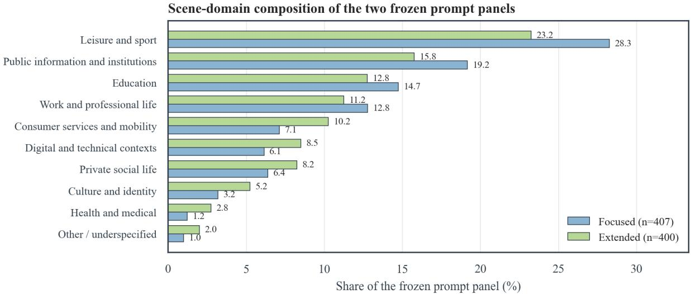  
Figure 4: Scene-domain distribution of the two prompt sets over ten reporting categories, which aggregate the 14 recorded scene domains, for prompts derived from ASCEND and SwitchLingua (Lovenia et al., 2022; Xie et al., 2025). The ten categories are consumer services and mobility, culture and identity, digital and technical contexts, education, health and medical, leisure and sport, other or underspecified, private social life, public information and institutions, and work and professional life.

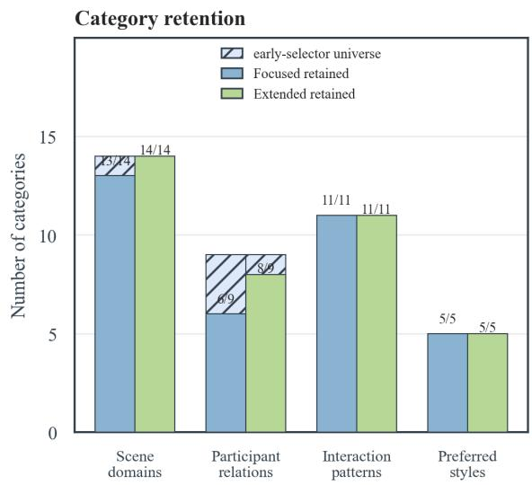  
Figure 5: Coverage of the recorded category universes. Each bar pair gives the number of categories retained by the Focused and Extended sets against the recorded universe size for that coverage item.

The executed searches are organized around the two theoretical foundations used in the main text. For interactional approaches to code-switching, the registered title-and-abstract queries include “code-switching” AND interactional AND sequential, “code-switching” AND “contextualization cue”, “code-switching” AND “audience design”. For literary multilingualism, they include “literary code-switching” AND narrative, “literary multilingualism” AND narrative AND function, “staged code-switching”, and “fictional multilingualism”. The complete master log contains 162 completed entries: 32 structured OpenAlex searches, 108 OpenAlex anchor-resolution/backward/forward-chain requests, and 22 targeted scholarly-web searches with direct publisher or official-source follow-up. Google Scholar and arXiv were used for supplementary discovery and computational-comparator location.

The citation-tracing protocol starts from representative theoretical anchors, checks their references for predecessors, and follows citing work for extensions, critiques, and boundary conditions. It records parent source and tracing direction. Its planned stopping rule is two rounds, with an optional third round for unresolved conceptual gaps. Deduplication prioritizes DOI, then bibliographic ID, then normalized title, author, and year, while linking versions.

Eligibility. Substantive theory records must contribute to one of the two theoretical foundations used in the main text: (i) interactional approaches to code-switching, which treat language choice as situated social action shaped by participants, local interactional conditions, and unfolding discourse; or (ii) literary multilingualism, which treats multilingual language in fiction as a deliberately shaped literary and narrative resource. These records must expose an evaluative distinction and identify textual evidence that could support judging it in generated narratives. Methodological comparators are retained when they inform review methodology, construct operationalization, or the use of textual evidence in evaluation. Books and chapters are eligible alongside articles. Duplicate versions, unverifiable or non-academic items, and claims requiring inaccessible real-world cognition are excluded.

Source count. The final convention is 107 retained sources → 70 concepts → six preliminary constructs → four quality constructs. The 107-record union contains 63 theory-led and 44 search-led records, comprising 100 substantive theory records and seven methodological comparators.

## D.2 From Concepts to Constructs

The 70 candidate concepts comprise 44 theory-led and 26 search-led formulations. Each records an evaluative question together with the evidence conditions and scope that would settle it. Conceptual consolidation yields six preliminary constructs, of which four remain quality constructs.

Consolidation compares the judgment object, evidence window, and failure condition of each concept, grouping formulations where these agree. Table 6 gives the primary assignments.

The two remaining constructs inform evidence requirements and salience weighting. The four retained quality constructs distinguish permission, local fit, functional contribution, and whole-text organization.

## E Prompt Templates and Representative Prompt Cards

## E.1 Actual Seed Representation

A Seed is a structured record. It keeps a sourcegrounded layer and an explicitly added scaffolding layer separate, so that constructed narrative material can never be reread as source fact. One authentic Seed, with its two layers presented separately, is provided in Appendix L.

## E.2 Seed-Construction Instruction

Seed construction is an LLM stage that reads a screened record and returns either a usable, explic-

itly bounded enrichment proposal or a documented refusal. Representative Seed-construction instruction excerpts appear in Appendix L.

## E.3 Task Templates and Representative Samples

Each task template is the four-paragraph form instantiated by the representative Prompt Cards: paragraphs that stay fixed across prompts, plus the Seedconditioned paragraphs rendered from the fields of the Seed. Two stored Prompt Cards, one Focused and one Extended, are reproduced in Appendix L; both are built from the same Seed, which makes the two task mappings directly comparable.

## E.4 Generation Message Envelope

For Focused Narrative, a fixed system message preceded the four-paragraph Prompt Card sent as the user message. It required only narrative-body output: no title, explanation, analysis, counting procedure, Markdown fences, or other non-narrative content. For Extended Narrative, the four-paragraph Prompt Card was the sole user message.

## F Annotation and Output Contracts

## F.1 LLM Event Discovery and Boundary Fixing

GPT-5.6-Sol serves as the discoverer in both settings, and the quality judges score the resulting event manifest. What follows is the operational definition the discovery stage applies.

A semantic event is a locally coherent English choice attributable to a speaker or narrative voice and to an ongoing discourse action. It can consist of a word, a phrase, a clause, or a sentence, and it may cover several mechanically extracted Latinscript spans. Continuous English with the same voice and the same discourse action belongs to one event. The discoverer classifies the candidate spans, proposes the semantic groupings, and never equates the number of mechanical spans with the number of events. Accepted proposals are fixed before scoring, and the quality judges cannot merge, split, add, or reorder that manifest. Independent human validation of both candidate inclusion and event grouping is reported in Appendix K.4.

Inclusion and exclusion. Discovery asks whether the English functions as a current, attributable language choice. Lexical borrowings, proper names, quotations, and detached or mediated multilingual material are not CS solely because Latin letters occur, whereas active uptake or reuse by the current speaker can qualify when it performs an interactional or narrative action. Event inclusion is independent of downstream quality: a genuine code-switching event may still be contextually inappropriate, poorly motivated, or functionally weak, which is assessed subsequently by D2 and D3.

<table><tr><td>Candidate concept families</td><td>Preliminary construct</td><td>Count</td><td>Final role</td></tr><tr><td>Repertoire, access, represented re- sources</td><td>Participant-world resource grounding</td><td>9</td><td>D1 Licensing</td></tr><tr><td>Voice, recipient, sequence, situa- tion and local fit</td><td>Situated interactional coherence</td><td>22</td><td>D2 Contextual Appropriateness</td></tr><tr><td>Contrastive meaning, stance, rela- tionship, style and experience</td><td>Functional multilingual contribution</td><td>19</td><td>D3 Functional Gain</td></tr><tr><td>Recurrence, contrast, development and literary integration</td><td>Whole-text multilingual orchestration</td><td>4</td><td>Extended Whole-text; Focused uses general literary/narrative quality</td></tr><tr><td>Textual warrant, mediation and in- ferential boundaries</td><td>Evidentially constrained literary medi- ation</td><td>9</td><td>Cross-cutting evidence constraint, not a fifth quality score</td></tr><tr><td>Eventfulness, consequence and narrative importance</td><td>Narrative event importance</td><td>7</td><td>Salience S1-S3 for D2/D3 weighting, not quality</td></tr></table>

Table 6: Condensed concept-to-construct mapping. Counts sum to 70 primary assignments.

Examples of discovery instructions implementing these rules appear in Appendix L.

## F.2 Longitudinal Evidence Construction

For Extended Narrative, a separate evidenceconstruction stage records character and language resources, changing character and relationship states, narrative-world facts, non-switching behavior, voice, transitions, and ending conditions. GPT-5.6-Sol constructs these evidence records before quality judging. Both judges receive the same records, which remain unchanged during scoring.

For event-level Licensing, admissible evidence citations are restricted to the visible Prompt and article evidence units ending before the corresponding code-switching event begins. Across all 4,800 Extended narratives, the resulting D1 evidence allowlists contain no future-evidence violations. Both judges receive the full narrative and frozen evidence records for joint event-level and wholetext scoring. We separately evaluate the factual and temporal fidelity of these evidence records in Appendix K.5.

## G Scoring Instructions

The quality judgments reported in this paper were produced by two primary judges under the qualityjudging instructions illustrated in Appendix L. In both settings the events are already finalized before scoring: the judge never decides what counts as a code-switching event, and it never rewrites the narrative. The two settings differ in how the event-level dimensions are obtained. In Focused Narrative the judge scores the applicable subdimensions separately and the article-level dimension score is formed by aggregating them; in Extended Narrative the same criteria serve as guidance and the judge assigns one direct score per dimension. Appendix H provides the dimension-specific and item-level anchors and the exact aggregation rules these judgments feed into.

## H CSWEval Rubrics and Aggregation

This appendix specifies the paper’s reporting rules. The scoring prompts supply the judgments; aggregation supplies article and model scores.

## H.1 Licensing (D1)

Two event-level decisions. Participant/role-level licensing asks whether the attributed speaker or narrative voice has the identity, language history, comprehension/expression resources, and established profile needed for this particular use of English. World-level licensing asks whether the addressee, carrier (speech, writing, inner speech, or active mediated reuse), scene, relationship state, social rules, established facts, and prior discourse state permit the choice. Each check receives PASS or FAIL; an event passes only if both pass.

For article a and judge j, let $V _ { a j }$ contain the semantic CS events with an interpretable PASS/FAIL decision on both checks. Then

$$
D 1 _ { a j } = \frac { 5 } { | V _ { a j } | } \sum _ { e \in V _ { a j } } p _ { a j e } ,\tag{2}
$$

where $p _ { a j e } = 1$ exactly when both role and world checks pass, and is zero otherwise. The current primary scoring schemas require binary decisions. D1 is not salience-weighted.

## H.2 Event-Level Ordinal Anchors

The event-level ordinal scale progresses from 1, unsuccessful or clearly unsupported; 2, weak or partial; 3, clear and adequate; 4, strong and specific; to 5, precise and highly realized. The operational meaning of these levels is specified separately for Contextual Appropriateness and Functional Gain below.

## H.3 Contextual Appropriateness (D2)

Focused D2 scores eight subdimensions at each event. Applicability is checked before quality, as specified in the table caption. Contextual Appropriateness evaluates how well the multilingual choice fits its local narrative and discourse context. Its 1–5 anchors are: 1, contextually unsupported or conflicting; 2, weak or partial contextual fit; 3, clear contextual fit supported by concrete local evidence; 4, strong and specific contextual fit; 5, precise contextual realization, for which the particular wording, form, and placement are well supported by the context where relevant.

Extended D2 instead receives one direct event score. Voice, carrier, addressee, topic, emotion, power/stance, register, and switch boundary are guidance, not separately scored fields, and the D2 anchors above are applied holistically across the relevant evidence.

## H.4 Functional Gain (D3)

Functional Gain measures the added value that a code-switching choice itself provides. Credit follows the choice and its local effect rather than the rest of the sentence or scene. Its 1–5 anchors are: 1, the relevant function is absent or poorly realized; 2, weak, limited, or largely redundant functional value; 3, a clear, observable, and locatable contribution within the current event; 4, a strong and specific contribution that actively does work in the event; 5, a substantial, precise, and non-redundant contribution that is tightly integrated into the current event.

Focused D3 scores the five subdimensions in Table 8 separately at each event and aggregates them into the dimension score.

Extended D3 is a direct 1–5 event score. The same semantic, relational, identity-cultural, stylistic, and experiential checks serve as guidance rather than separately scored fields, and the D3 anchors above are applied holistically across the relevant evidence. Table 3 and Figure 9 report the separate counterfactual study that tests this construct in both settings.

## H.5 Focused Whole-Text Quality

Focused Whole assesses overall literary and narrative quality, not Multilingual Orchestration. L1– L5 are five scored dimensions without separately scored children. They require integers 1–5, with no NA/IE.

## H.6 Extended Whole-Text Dimensions

Seven dimensions are scored independently (Table 10). M-F2A and M-F2B are separate; asymmetric language use is permitted.

The seven Extended whole-text dimensions use a separate whole-text scale: 1, seriously unsupported, unstable, ineffective, or damaging; 2, substantial weaknesses with limited successful evidence; 3, adequate and generally supported, with meaningful limitations; 4, strong, sustained, and well-supported execution; 5, exceptional, precise, sustained, and difficult to improve materially. A score of 5 requires repeated or structurally important evidence rather than one attractive sentence.

## H.7 Narrative Salience

Each quality judge assigns its own salience label to each event: S1 (weight 1) has little or no consequence beyond the immediate moment; S2 (weight 2) introduces a clear change with consequences for the current scene or subsequent narrative development; S3 (weight 3) introduces a major change whose consequences persist or substantially shape later narrative development. Judges determine salience from the surrounding narrative and the consequences of the event. Salience weights only D2 and D3.

## H.8 Exact Aggregation and Eligibility

For Focused dimension $d \in \{ D 2 , D 3 \}$ , let $A _ { a j e d }$ be the applicable numeric subdimensions for event

<table><tr><td>Item</td><td>1</td><td>3</td><td>4</td><td>5</td></tr><tr><td>D2.1 Voice attribution</td><td>voice</td><td>Wrong or indeterminate Dialogue, thought, or narration clearly attributed</td><td>Distinguishes potentially confus- Attribution remains precise able layered voices or quotation across layered voices or quota- responsibility</td><td>tion boundaries</td></tr><tr><td>D2.2 Carrier fit</td><td>with its carrier</td><td>narration, message, or reuse</td><td>Expression incompatible Natural fit to speech, thought, Carrier and expression are specif- Wording and form are precisely ically matched in form and use</td><td>matched to the carrier and its constraints</td></tr><tr><td>D2.3 Addressee trigger</td><td>Known addressee ditions conflict with the response motivates it choice</td><td>con- Recipient&#x27;s ability, identity, or Precisely responds to recipient&#x27;s</td><td>resources, wording, identity, or immediate uptake</td><td>The realization precisely fits the recipient&#x27;s resources, wording, identity, and immediate interac- tional state</td></tr><tr><td>D2.4 Topic trigger</td><td>cept, object, or material</td><td>Unrelated to current con- Topic directly supports English Conceptual boundaries, source</td><td>wording, or reference shape the tightly grounded in the current local interpretation</td><td>Wording and placement are concept, source wording, refer- ent, or topic structure</td></tr><tr><td>D2.5 Emotion trigger</td><td>anism cannot be located</td><td>Applicable emotional mech- Switch accompanies emotional change</td><td>Occurs at a specific emotional threshold, defensive move, or in- cisely align with the established timacy shift</td><td>Wording and placement pre- emotional state or transition</td></tr><tr><td>D2.6 Power, stance, iden- Applicable tity</td><td>negotiation mechanism cannot be located</td><td>Clearly marks stance or identity</td><td>setting, alliance, or repositioning identity configuration move</td><td>Changes the interaction at an as- Wording and form precisely fit sertion, concession, boundary- the current stance, power, or</td></tr><tr><td>D2.7 Register trigger</td><td>not realized</td><td>Required register change is Clear conventional register change</td><td>Register contrast works with the Wording and form precisely relationship, occasion, and ongo- match the relationship, occa- ing action</td><td>sion, and interactional style</td></tr><tr><td>D2.8 Local switch point</td><td>or turn continuity breaks</td><td>Syntax, meaning, reference, Natural and coherent boundary</td><td>sition</td><td>Uses a particular syntactic bound- Wording and placement are pre- ary, rhythmic break, or turn tran- cisely matched to the local syn- tax, rhythm, or turn structure</td></tr></table>

Table 7: Focused D2 rubric. NA is allowed for D2.3–D2.7; D2.1, D2.2, and D2.8 always require numeric scores. For D2.7, unchanged adjacent register is NA, whereas a required but unrealized transition is scored.

## e. Compute

$$
q _ { a j e d } = \frac { 1 } { | A _ { a j e d } | } \sum _ { k \in A _ { a j e d } } x _ { a j e d k } ,\tag{3}
$$

$$
D _ { a j } ^ { ( d ) } = \frac { \sum _ { e \in N _ { a j d } } s _ { a j e } q _ { a j e d } } { \sum _ { e \in N _ { a j d } } s _ { a j e } } ,\tag{4}
$$

where $N _ { a j d }$ contains events with a numeric event mean and valid salience. Extended uses the same second equation with $q _ { a j e d }$ equal to the judge’s direct dimension score. NA/IE are omitted only at their corresponding level; they are not zeroes, and removing a subdimension does not remove the other valid scores of that event.

Whole-text dimensions are averaged separately: $W h o l e _ { a j } = K ^ { - 1 } \textstyle \sum _ { k = 1 } ^ { K } W _ { a j k }$ , with $K = 5$ for Focused and K = 7 for Extended. All required whole scores must be present, and each article dimension is then averaged across the two primary judges: $D _ { a } = ( D _ { a , 1 } + D _ { a , 2 } ) / 2$ . An article is eligible when every whole-text dimension is present and each scored Focused dimension has at least one event with a numeric event mean and valid salience. The within-setting composite is $\Sigma _ { a } = D 1 _ { a } + D 2 _ { a } + D 3 _ { a } + W h o l e _ { a } \ ( / 2 0 )$ , and the model-level composite is the mean over eligible articles.

## I Prompt Validation and Human Evaluation

## I.1 Criteria and Decision Rules

The written Focused expert-review form supplies eight checks: Q1 grounding fidelity, preserving grounded information without distortion; Q2 scaffolding compatibility, requiring added characters, relations, and scene details to remain plausible and consistent with that grounding; Q3 role/world permission and information access; Q4 observable interaction and consequential uptake; Q5 identifiable semantic CS without prescribing its realization; Q6 literary affordances and creative openness; Q7 compatible joint task constraints; and Q8 non-leading, complete visible instructions.

Each content-validity item uses 1–5: 1 fails the construct or is structurally unsuitable; 2 has a major defect; 3 has a substantive borderline ambiguity; 4 is adequate without a mandatory change; 5 is robust across reasonable realizations. These prompt screening thresholds are separate from the evaluation score anchors in Appendix H. A paperlevel pass corresponds to the recorded retention decision: all required items are 4–5 and no mustfix issue. A revision-required decision groups the action-required cases, including revise, eliminate, or escalate in artifacts with richer labels.

<table><tr><td>Item</td><td>1</td><td></td><td>4</td><td>5</td></tr><tr><td>D3.1 Semantic precision</td><td>No source reference, ambiguity conceptual precision control, or precision</td><td>added distinction, Recognizable terminological/- Specific meaning, original word- The semantic contribution is ex-</td><td>ing, ambiguity, or wordplay af- ceptionally precise and tightly fects understanding</td><td>integrated into the event&#x27;s local meaning</td></tr><tr><td>gain</td><td>lational or attitudinal signal signal carried by the language tional act or subtext</td><td>choice</td><td>D3.2 Relationship/stance Language choice adds no re- Clear relational or attitudinal Substantially strengthens a rela- Carries a highly specific and</td><td>strongly realized relational or attitudinal function within the interaction</td></tr><tr><td>D3.3 specificity</td><td>Identity/cultural Merely labels an identity</td><td>tity connection</td><td>Adds a plausible, specific iden- Closely connects experience and current self-positioning</td><td>Makes an exceptionally spe- cific and well-supported contri- bution to identity or cultural po- sitioning</td></tr><tr><td>D3.4 Stylistic tension</td><td>Only typographic novelty or Clear local voice, rhythm, Works with syntax, rhythm, im- Is tightly integrated with local display</td><td>double-voicing, or restraint</td><td>agery, or subtext to organize the form to produce a highly real- passage</td><td>ized stylistic effect</td></tr><tr><td></td><td>D3.5 Experiential texture Merely labels a background Connects to lived experience</td><td>and adds texture</td><td>Interacts closely with action, Makes the represented expe- medium, institution, body, or rience exceptionally specific, memory</td><td>credible, and texturally realized within the event</td></tr></table>

Table 8: Focused D3 rubric. NA applies to D3.1, D3.2, D3.3, and D3.5 when the corresponding function is not applicable; D3.4 always requires a numeric score.

<table><tr><td>Dimension</td><td>1</td><td>3</td><td></td><td>5</td></tr><tr><td>ence</td><td>ing not intelligible</td><td>causality and ending</td><td>L1 Completeness/coher- Main line, causality, or end- Complete story with adequate Opening pressure, change, de- Several indispensable nodes cisions, and ending form a sus- form a causal system tained causal chain</td><td></td></tr><tr><td>characterization</td><td>change</td><td>through interaction</td><td>L2 Voice, relationships, Indistinct characters, unsup- Distinct stances, credible mo- Voice, action, and subtext dif- Layered motives, avoidance, ported motives, or announced tives, relationship advanced ferentiate characters over stages behavior, and decisions form a</td><td>complex coherent system</td></tr><tr><td></td><td>unity absent</td><td>rhythmic/imagistic organiza- across locations tion</td><td></td><td>L3 Style, rhythm, imagery Reading obstructed or basic Fluent narration with local A formal mechanism persists Voice, rhythm, imagery, and perspective form a distinctive system</td></tr><tr><td>L4 depth</td><td>stract conclusions replace nar- port emotion/theme ration</td><td>Emotional/thematic Implausible emotion or ab- Plot, action, and dialogue sup- Two mutually constraining val- Layered conflicts revise each</td><td>ues develop persistently</td><td>other and sustain interpretive tension</td></tr><tr><td>laic realization</td><td>plate</td><td>L5 Originality/nonformu- Predominantly generic tem- Some effective choices within Mutually supporting non- a familiar whole</td><td>obvious choices on at least two levels</td><td>Distinctive unified narrative principle constrained by earlier development</td></tr></table>

Table 9: Focused whole-text rubric. Score 2 denotes partial success between anchors 1 and 3; all five dimensions require numeric scores, with no NA/IE.

Extended screening checks grounding fidelity, scaffolding compatibility and foundation credibility, long-form potential, CS construct validity, openness/low constraint, and restraint of an optional ThinPlan. Grounded information must remain preserved, while added narrative material must remain compatible with it. The starting conditions must support development without prescribing the plot or a particular CS realization; language resources must permit meaningful adaptation.

Annotator panel and protocol. The same three annotators carried out all human annotation and rating work reported in this appendix and in Appendix K.4: Chinese–English bilingual postgraduate students, all native Chinese speakers with high English proficiency who had passed CET-6, and all with prior experience in linguistic annotation and in literary analysis. For prompt screening, two of them reviewed each candidate independently and the third adjudicated splits across the 1–3/4– 5 boundary; a 4-versus-5 difference alone did not. For output rating, all three scored the same sampled narratives against the rubric, and the concordance reported in Appendix K.4 is computed over those three sets of scores.

## I.2 Recorded Screening Counts

Machine checks cover structural completeness, Seed binding, visible/internal-field separation, fixed task constraints, source-copy risk, and nearduplicate prompts, with character 3-gram Jaccard similarity at least .85 flagging redundancy for review. All retained prompts satisfy the Jaccardbased redundancy criterion. Screening and revising the candidate prompts yields the final sets: 407 Focused prompts and 400 Extended prompts.

<table><tr><td>ID</td><td>Dimension</td><td>Evidence</td></tr><tr><td>M-F1</td><td>Multilingual narrative-system stability</td><td>Voice ownership; speech/thought/quotation boundaries; carriers; focalization; preser- vation/translation policy; language facts and rules maintained or coherently developed across scenes.</td></tr><tr><td>M-F2A</td><td>Character A bilingual profile and language arc</td><td>Repertoire, function/relationship/affect mappings, scene responsiveness, motivated transitions and non-switching; the same multilingual person developing on textual evidence.</td></tr><tr><td>M-F2B</td><td>Character B bilingual profile and language arc</td><td>The same checks independently for B, without requiring symmetry or rewarding event count alone.</td></tr><tr><td>M-F3.1</td><td>Structure, causality, pacing, and closure</td><td>Scene progression, causal continuity, escalation, turning points, proportional pacing, and an ending reflecting actions and consequences.</td></tr><tr><td>M-F3.2</td><td>Character and relationship development</td><td>Goals, knowledge, emotions, actions, and transitions supporting character development; relationship change earned through prior interaction.</td></tr><tr><td>M-F3.3</td><td>Scene, dialogue, prose, and emotional execution</td><td>Scene realization, distinct dialogue, clarity/control, sensory and atmospheric specificity, credible emotion, and engagement without ornament as a proxy.</td></tr><tr><td>M-F3.4</td><td>Multilingual Literary Integration</td><td>Sustained character-voice differentiation, sociocultural specificity, stylistic identity, and meaningful relations among social voices across the narrative.</td></tr></table>

Table 10: Extended whole-text rubric.

## I.3 Agreement

The same three annotators described above conducted the prompt-screening evaluation.

Candidate construction yields 855 prompts, 415 Focused and 440 Extended. Against those denominators, binary human-screening agreement is Gwet’s AC1 = .975 for Focused (415 matched pairs; unrounded estimate .9750, 95% CI [.9573, .9901]) and .838 for Extended (440 matched pairs; .8378, 95% CI [.7853, .8836]). The retained intervals use paired candidate-level percentile bootstrap with 10,000 replicates. Prompts requiring revision were subsequently corrected and re-screened before final retention. Screening and revision then reduce these candidate pools to the final sets of 407 Focused and 400 Extended prompts.

## J Main Model-Level Results

## J.1 Set Coverage and Scoring

Table 2 is produced by re-running the aggregation rules of Appendix H over the recorded event judgments.

<table><tr><td>Family</td><td>Models</td><td>Focused /20</td><td>Extended /20</td></tr><tr><td>GPT</td><td>3</td><td>15.483</td><td>17.489</td></tr><tr><td>DeepSeek</td><td>2</td><td>15.208</td><td>16.765</td></tr><tr><td>Gemini</td><td>1</td><td>14.893</td><td>16.471</td></tr><tr><td>Qwen</td><td>4</td><td>14.341</td><td>15.619</td></tr><tr><td>MiniMax</td><td>2</td><td>13.671</td><td>13.637</td></tr></table>

Table 11: Descriptive aggregates of the evaluated model instances grouped by model family. Each group mean is the unweighted mean of the evaluated model instances shown for that family. Group sizes differ, and these descriptive aggregates should not be interpreted as estimates of family-level population performance.
<table><tr><td>Model</td><td>L1</td><td>L2</td><td>L3</td><td>L4</td><td>L5</td></tr><tr><td>GPT-5.6-Sol</td><td>3.869</td><td>3.881</td><td>3.797</td><td>3.773</td><td>3.711</td></tr><tr><td>GPT-5.6-Terra</td><td>3.829</td><td>3.849</td><td>3.743</td><td>3.690</td><td>3.588</td></tr><tr><td>GPT-5.5</td><td>3.894</td><td>3.892</td><td>3.786</td><td>3.785</td><td>3.736</td></tr><tr><td>Gemini-3.5-Flash</td><td>3.351</td><td>3.405</td><td>3.251</td><td>3.209</td><td>3.163</td></tr><tr><td>Qwen3.7-Plus</td><td>3.114</td><td>3.053</td><td>2.924</td><td>2.891</td><td>2.851</td></tr><tr><td>Qwen3.7-Max</td><td>3.144</td><td>3.102</td><td>2.940</td><td>2.939</td><td>2.945</td></tr><tr><td>DeepSeek-V4-Pro</td><td>3.623</td><td>3.608</td><td>3.462</td><td>3.442</td><td>3.301</td></tr><tr><td>DeepSeek-V4-Flash</td><td>3.746</td><td>3.735</td><td>3.598</td><td>3.586</td><td>3.502</td></tr><tr><td>MiniMax-M2.5</td><td>2.795</td><td>2.657</td><td>2.548</td><td>2.609</td><td>2.536</td></tr><tr><td>MiniMax-M2.7</td><td>2.784</td><td>2.694</td><td>2.609</td><td>2.631</td><td>2.537</td></tr><tr><td>Qwen3.5-397B-A17B</td><td>3.101</td><td>3.038</td><td>2.905</td><td>2.903</td><td>2.844</td></tr><tr><td>Qwen3.5-35B-A3B</td><td>2.978</td><td>2.900</td><td>2.787</td><td>2.756</td><td>2.711</td></tr></table>

Table 12: Focused whole-text dimension means (/5). IDs and definitions are in Appendix H.

The scored corpus contains 4,884 Focused articles and 4,800 Extended articles. All twelve models are scored in both settings, and every included event has valid binary D1 decisions from both judges.

Within each task, D1, D2, D3, and Whole are averaged over the articles, and their sum is the within-setting composite Σ (/20). Table 12 and Table 13 report the whole-text components behind the dimension means of the main table, and Figure 6 shows the same judgments as a per-dimension profile. The profile makes the task-specific difference in separation visible: models that are close on general narrative execution can still differ substantially on the multilingual-integration dimensions.

Table 11 provides descriptive aggregates of the evaluated model instances grouped by model family.

## K Supplementary Evaluation Results and Additional Analyses

## K.1 Judge Ablation and Ranking Robustness

Table 14 ranks the same twelve models from each primary-judge score set after the current article and task-total aggregation. Dual is the article-level judge mean. Spearman’s $\rho$ correlates model ranks; absolute shifts compare matching models, using average ranks for ties.

Focused GPT-side rankings equal Dual; both other comparisons have $\rho = . 9 9 3$ , mean shift .167, and maximum shift one. Extended DeepSeek-side rankings equal Dual; both GPT-side comparisons have $\rho ~ = ~ . 9 8 6$ , mean shift .333, and maximum shift one.

## K.2 Constructor and Annotation Sensitivity

We examine whether the benchmark results are sensitive to the models used in two upstream stages: Prompt construction and event annotation. We cross GPT- and Qwen-based Prompt constructors with GPT- and Qwen-based event annotators in $\textbf { a 2 } \times 2$ design. Both stages instantiate the same model configurations as the generation and judging stages, queried with the same decoding and reasoning settings: GPT-5.6-Sol for the GPT-based arms and Qwen3.7-Max for the Qwen-based arms (temperature 0.7, top-p 0.7). For each configuration, we recompute model performance using the same D1+D2+D3+Whole composite (/20) as in the main analysis and compare the resulting ranking of the twelve generation models with the original ranking.

The sensitivity panel is an independent rerun of the main experiment and covers twenty Seeds. The two Prompt-constructor arms use separately reconstructed prompts and regenerated articles, but within each constructor arm the GPT- and Qwenbased event annotators are applied to the same generated narratives. The configuration matching the main experiment therefore does not reproduce the main ranking exactly; agreement below unity also reflects the smaller Seed sample and the regeneration of prompts and articles.

Rank agreement remains high across all four configurations in both settings, with Spearman’s $\rho$ ranging from .888 to .979. The effect of annotator choice on rank agreement varies across Prompt constructors and narrative settings.

The score-level analysis provides a complementary view. For Focused Narrative, the estimated effects of constructor choice, annotator choice, and their interaction are small, with all bootstrap confidence intervals spanning zero. For Extended Narrative, changing the event annotator corresponds to a pooled mean score difference of +0.745 points on the /20 scale across the article-matched withinconstructor contrasts (95% CI [0.528, 0.931]). The pipeline-level constructor contrast is −0.601 (95% $\operatorname { C I } \left[ - 1 . 5 5 2 , 0 . 3 7 7 \right] )$ , and the constructor–annotator interaction is +0.636 (95% CI [−0.026, 1.262]).

Across the four configurations, upstream model choice can affect absolute scores while model rankings remain broadly stable. The twenty-Seed panel provides a targeted assessment of upstream model dependence.

## K.3 Licensing Evidence Intervention

We conduct a targeted intervention on 36 initially failed Licensing checks, covering all twelve generation models, three articles per model, and equal numbers of participant/role and world checks. For each target, we add one authoritative fact to the Prompt that directly supplies the participant- or world-level information required to license the corresponding event. The generated narrative, fixed event manifest, and all other Prompt information remain unchanged. All 36 checks subsequently change from FAIL to PASS.

This intervention directly manipulates the evidence relevant to Licensing while holding the judged event and its realization fixed. The uniform FAIL-to-PASS transition shows that Licensing judgments respond in the expected direction when the task context is changed from lacking the relevant licensing information to explicitly providing it. This targeted analysis therefore provides a construct-sensitivity check for the operational Licensing criterion.

## K.4 Human Validation

The same three annotators each evaluated 180 Focused and 144 Extended outputs. Focused results are Kendall’s $W \ = \ . 7 1 8 .$ $\mathrm { I C C } ( \mathrm { A } , 1 ) { = } . 8 6 4$ , and Spearman’s $\rho = . 8 6 3 \mathrm { ; }$ Extended results are $W =$ $. 8 1 0 , \mathrm { I C C } ( \mathrm { A } , 1 ) = . 8 1 6 .$ , and $\rho = . 8 0 4$ . Kendall’s W measures three-rater concordance; ICC(A,1) and $\rho$ compare their mean with the dual-judge article

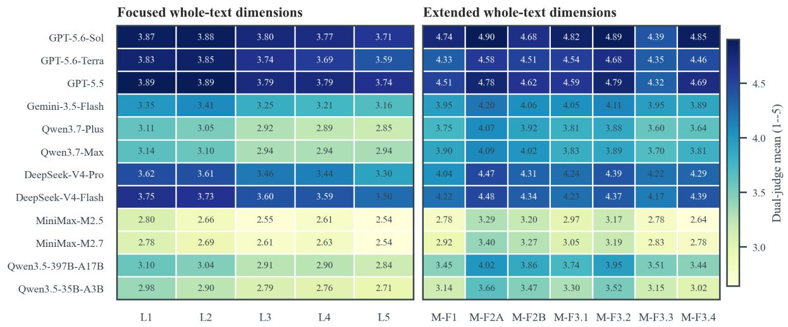

Figure 6: Per-dimension model profiles for the two settings. The rightmost extended dimension group separates multilingual-integration dimensions from general narrative dimensions. Values are dual-judge means on the 1–5 dimension scale.
<table><tr><td>Model</td><td>M-F1</td><td>M-F2A</td><td>M-F2B</td><td>M-F3.1</td><td>M-F3.2</td><td>M-F3.3</td><td>M-F3.4</td></tr><tr><td>GPT-5.6-Sol</td><td>4.737</td><td>4.902</td><td>4.679</td><td>4.819</td><td>4.886</td><td>4.391</td><td>4.851</td></tr><tr><td>GPT-5.6-Terra</td><td>4.330</td><td>4.584</td><td>4.514</td><td>4.544</td><td>4.684</td><td>4.348</td><td>4.455</td></tr><tr><td>GPT-5.5</td><td>4.510</td><td>4.777</td><td>4.621</td><td>4.595</td><td>4.786</td><td>4.315</td><td>4.691</td></tr><tr><td>Gemini-3.5-Flash</td><td>3.953</td><td>4.201</td><td>4.058</td><td>4.055</td><td>4.110</td><td>3.954</td><td>3.893</td></tr><tr><td>Qwen3.7-Plus</td><td>3.751</td><td>4.074</td><td>3.915</td><td>3.809</td><td>3.876</td><td>3.595</td><td>3.636</td></tr><tr><td>Qwen3.7-Max</td><td>3.896</td><td>4.091</td><td>4.018</td><td>3.834</td><td>3.894</td><td>3.697</td><td>3.808</td></tr><tr><td>DeepSeek-V4-Pro</td><td>4.040</td><td>4.471</td><td>4.306</td><td>4.237</td><td>4.388</td><td>4.216</td><td>4.293</td></tr><tr><td>DeepSeek-V4-Flash</td><td>4.224</td><td>4.482</td><td>4.339</td><td>4.232</td><td>4.369</td><td>4.168</td><td>4.388</td></tr><tr><td>MiniMax-M2.5</td><td>2.781</td><td>3.289</td><td>3.204</td><td>2.970</td><td>3.174</td><td>2.779</td><td>2.643</td></tr><tr><td>MiniMax-M2.7</td><td>2.922</td><td>3.401</td><td>3.271</td><td>3.046</td><td>3.194</td><td>2.831</td><td>2.781</td></tr><tr><td>Qwen3.5-397B-A17B</td><td>3.449</td><td>4.019</td><td>3.861</td><td>3.741</td><td>3.950</td><td>3.506</td><td>3.445</td></tr><tr><td>Qwen3.5-35B-A3B</td><td>3.138</td><td>3.656</td><td>3.471</td><td>3.303</td><td>3.515</td><td>3.151</td><td>3.021</td></tr></table>

Table 13: Extended whole-text dimension means (/5). IDs and definitions are in Appendix H.

<table><tr><td>Task / comparison</td><td>ρ</td><td>Mean |∆r| Max |∆r|</td></tr><tr><td>Focused: GPT vs. Dual</td><td>1.000</td><td>0.000 0</td></tr><tr><td>Focused: DeepSeek vs. Dual</td><td>0.993</td><td>0.167 1</td></tr><tr><td>Focused: GPT vs. DeepSeek</td><td>0.993</td><td>0.167 1</td></tr><tr><td>Extended: GPT vs. Dual</td><td>0.986</td><td>0.333 1</td></tr><tr><td>Extended: DeepSeek vs. Dual</td><td>1.000</td><td>0.000 0</td></tr><tr><td>Extended: GPT vs. DeepSeek</td><td>0.986</td><td>0.333 1</td></tr></table>

Table 14: Rank robustness on the same twelve models and current /20 task totals. Average ranks resolve ties.
<table><tr><td>Prompt constructor GPT annotator Qwen annotator</td><td></td><td></td></tr><tr><td rowspan="2">GPT</td><td>F.951</td><td>F.888</td></tr><tr><td>E.965</td><td>E.979</td></tr><tr><td rowspan="2">Qwen</td><td>F.958</td><td>F.937</td></tr><tr><td>E.916</td><td>E.972</td></tr></table>

Table 15: Rank agreement with the original mainexperiment ranking under the 2 × 2 Prompt-constructor × event-annotator sensitivity design. Each cell reports Spearman’s $\rho$ across the twelve generation models for Focused (F) and Extended (E) Narrative.

<table><tr><td></td><td colspan="3">D2</td><td colspan="2">D3</td></tr><tr><td>Quantity</td><td>Sol→DS</td><td>DS→Sol</td><td>Quantity</td><td>Sol→DS</td><td>DS→Sol</td></tr><tr><td>Whole</td><td>0.269</td><td>0.239</td><td>Whole</td><td>0.274</td><td>0.237</td></tr><tr><td>M-F1</td><td>0.221</td><td>0.214</td><td>M-F1</td><td>0.212</td><td>0.199</td></tr><tr><td>M-F2A</td><td>0.222</td><td>0.155</td><td>M-F2A</td><td>0.235</td><td>0.157</td></tr><tr><td>M-F2B</td><td>0.185</td><td>0.184</td><td>M-F2B</td><td>0.183</td><td>0.184</td></tr><tr><td>M-F3.1</td><td>0.195</td><td>0.151</td><td>M-F3.1</td><td>0.193</td><td>0.147</td></tr><tr><td>M-F3.2</td><td>0.159</td><td>0.127</td><td>M-F3.2</td><td>0.167</td><td>0.145</td></tr><tr><td>M-F3.3</td><td>0.117</td><td>0.079</td><td>M-F3.3</td><td>0.135</td><td>0.077</td></tr><tr><td>M-F3.4</td><td>0.235</td><td>0.213</td><td>M-F3.4</td><td>0.238</td><td>0.213</td></tr></table>

Table 16: Cross-judge associations in Extended Narrative: one judge’s event-level score against the other judge’s whole-text score, in both directions. Sol→DS reads from the event-level judge to the whole-text judge, and DS→Sol reverses the two roles; the arrows mark the direction of the association, not a causal path. Section 5.4 reports their mean. Generation-model and prompt-card fixed effects are removed.

mean.

We also validate the event-discovery stage with two independent bilingual annotators. The first analysis examines candidate inclusion: whether each highlighted English candidate constitutes genuine code-switching. English material is labeled CS when it forms part of the linguistic realization of the Chinese–English discourse itself, and non-CS when it instead consists of a lexicalized borrowing, proper name, quotation or linguistic mention, printed or screen-displayed text, decorative material, an incorrectly extracted fragment, or other multilingual material outside the code-switching discourse.

<table><tr><td></td><td rowspan=1 colspan=1>3.03</td><td rowspan=1 colspan=1>3.23</td><td rowspan=1 colspan=1>3.66</td><td rowspan=1 colspan=1>3.42</td><td rowspan=1 colspan=1>3.18</td><td rowspan=1 colspan=1>3.64</td><td rowspan=1 colspan=1>3.20</td><td rowspan=1 colspan=1>3.45</td><td></td><td rowspan=1 colspan=1>3.46</td><td rowspan=1 colspan=1>3.54</td><td rowspan=1 colspan=1>3.07</td><td rowspan=1 colspan=1>3.38</td><td rowspan=1 colspan=1>3.29</td></tr><tr><td></td><td rowspan=1 colspan=1>3.03</td><td rowspan=1 colspan=1>3.20</td><td rowspan=1 colspan=1>3.63</td><td rowspan=1 colspan=1>3.46</td><td rowspan=1 colspan=1>3.12</td><td rowspan=1 colspan=1>3.64</td><td rowspan=1 colspan=1>3.19</td><td rowspan=1 colspan=1>3.41</td><td></td><td rowspan=1 colspan=1>3.48</td><td rowspan=1 colspan=1>3.55</td><td rowspan=1 colspan=1>3.04</td><td rowspan=1 colspan=1>3.36</td><td rowspan=1 colspan=1>3.26</td></tr><tr><td></td><td rowspan=1 colspan=1>3.03</td><td rowspan=1 colspan=1>3.24</td><td rowspan=1 colspan=1>3.66</td><td rowspan=1 colspan=1>3.47</td><td rowspan=1 colspan=1>3.23</td><td rowspan=1 colspan=1>3.62</td><td rowspan=1 colspan=1>3.24</td><td rowspan=1 colspan=1>3.39</td><td></td><td rowspan=1 colspan=1>3.49</td><td rowspan=1 colspan=1>3.56</td><td rowspan=1 colspan=1>3.12</td><td rowspan=1 colspan=1>3.35</td><td rowspan=1 colspan=1>3.30</td></tr><tr><td rowspan=1 colspan=1>Gemini-3.5-Flash</td><td rowspan=1 colspan=1>3.03</td><td rowspan=1 colspan=1>3.15</td><td rowspan=1 colspan=1>3.61</td><td rowspan=1 colspan=1>3.42</td><td rowspan=1 colspan=1>3.29</td><td rowspan=1 colspan=1>3.64</td><td rowspan=1 colspan=1>3.15</td><td rowspan=1 colspan=1>3.32</td><td></td><td rowspan=1 colspan=1>3.35</td><td rowspan=1 colspan=1>3.52</td><td rowspan=1 colspan=1>3.07</td><td rowspan=1 colspan=1>3.29</td><td rowspan=1 colspan=1>3.26</td></tr><tr><td rowspan=3 colspan=1>Qwen3.7-PlusQwen3.7-MaxDeepSeek-V4-Pro</td><td rowspan=1 colspan=1>3.00</td><td rowspan=1 colspan=1>3.07</td><td rowspan=1 colspan=1>3.53</td><td rowspan=1 colspan=1>3.22</td><td rowspan=1 colspan=1>3.25</td><td rowspan=1 colspan=1>3.57</td><td rowspan=1 colspan=1>3.07</td><td rowspan=1 colspan=1>3.25</td><td></td><td rowspan=1 colspan=1>3.21</td><td rowspan=1 colspan=1>3.47</td><td rowspan=1 colspan=1>2.91</td><td rowspan=1 colspan=1>3.18</td><td rowspan=1 colspan=1>3.12</td></tr><tr><td rowspan=1 colspan=1>3.02</td><td rowspan=1 colspan=1>3.12</td><td rowspan=1 colspan=1>3.58</td><td rowspan=1 colspan=1>3.37</td><td rowspan=1 colspan=1>3.24</td><td rowspan=1 colspan=1>3.60</td><td rowspan=1 colspan=1>3.12</td><td rowspan=1 colspan=1>3.30</td><td></td><td rowspan=1 colspan=1>3.33</td><td rowspan=1 colspan=1>3.49</td><td rowspan=1 colspan=1>3.00</td><td rowspan=1 colspan=1>3.21</td><td rowspan=1 colspan=1>3.20</td></tr><tr><td rowspan=1 colspan=1>3.04</td><td rowspan=1 colspan=1>3.17</td><td rowspan=1 colspan=1>3.58</td><td rowspan=1 colspan=1>3.45</td><td rowspan=1 colspan=1>3.19</td><td rowspan=1 colspan=1>3.59</td><td rowspan=1 colspan=1>3.16</td><td rowspan=1 colspan=1>3.37</td><td></td><td rowspan=1 colspan=1>3.41</td><td rowspan=1 colspan=1>3.52</td><td rowspan=1 colspan=1>3.08</td><td rowspan=1 colspan=1>3.32</td><td rowspan=1 colspan=1>3.24</td></tr><tr><td rowspan=3 colspan=1>DeepSeek-V4-FlashMiniMax-M2.5MiniMax-M2.7</td><td rowspan=1 colspan=1>3.05</td><td rowspan=1 colspan=1>3.21</td><td rowspan=1 colspan=1>3.64</td><td rowspan=1 colspan=1>3.47</td><td rowspan=1 colspan=1>3.18</td><td rowspan=1 colspan=1>3.61</td><td rowspan=1 colspan=1>3.18</td><td rowspan=1 colspan=1>3.42</td><td></td><td rowspan=1 colspan=1>3.47</td><td rowspan=1 colspan=1>3.54</td><td rowspan=1 colspan=1>3.05</td><td rowspan=1 colspan=1>3.36</td><td rowspan=1 colspan=1>3.23</td></tr><tr><td rowspan=1 colspan=1>3.01</td><td rowspan=1 colspan=1>2.96</td><td rowspan=1 colspan=1>3.40</td><td rowspan=1 colspan=1>3.13</td><td rowspan=1 colspan=1>2.79</td><td rowspan=1 colspan=1>3.35</td><td rowspan=1 colspan=1>2.90</td><td rowspan=1 colspan=1>3.08</td><td></td><td rowspan=1 colspan=1>3.05</td><td rowspan=1 colspan=1>3.27</td><td rowspan=1 colspan=1>2.74</td><td rowspan=1 colspan=1>2.95</td><td rowspan=1 colspan=1>2.91</td></tr><tr><td rowspan=1 colspan=1>3.01</td><td rowspan=1 colspan=1>3.01</td><td rowspan=1 colspan=1>3.38</td><td rowspan=1 colspan=1>3.16</td><td rowspan=1 colspan=1>2.81</td><td rowspan=1 colspan=1>3.35</td><td rowspan=1 colspan=1>2.95</td><td rowspan=1 colspan=1>3.13</td><td></td><td rowspan=1 colspan=1>3.09</td><td rowspan=1 colspan=1>3.30</td><td rowspan=1 colspan=1>2.80</td><td rowspan=1 colspan=1>2.98</td><td rowspan=1 colspan=1>2.96</td></tr><tr><td rowspan=1 colspan=1>Qwen3.5-397B-A17B</td><td rowspan=1 colspan=1>3.01</td><td rowspan=1 colspan=1>3.06</td><td rowspan=1 colspan=1>3.52</td><td rowspan=1 colspan=1>3.23</td><td rowspan=1 colspan=1>3.25</td><td rowspan=1 colspan=1>3.54</td><td rowspan=1 colspan=1>3.07</td><td rowspan=1 colspan=1>3.23</td><td></td><td rowspan=1 colspan=1>3.16</td><td rowspan=1 colspan=1>3.46</td><td rowspan=1 colspan=1>2.94</td><td rowspan=1 colspan=1>3.16</td><td rowspan=1 colspan=1>3.13</td></tr><tr><td rowspan=1 colspan=1>Qwen3.5-35B-A3B</td><td rowspan=1 colspan=1>3.00</td><td rowspan=1 colspan=1>2.99</td><td rowspan=1 colspan=1>3.47</td><td rowspan=1 colspan=1>3.21</td><td rowspan=1 colspan=1>3.17</td><td rowspan=1 colspan=1>3.47</td><td rowspan=1 colspan=1>3.01</td><td rowspan=1 colspan=1>3.11</td><td></td><td rowspan=1 colspan=1>3.09</td><td rowspan=1 colspan=1>3.39</td><td rowspan=1 colspan=1>2.90</td><td rowspan=1 colspan=1>3.06</td><td rowspan=1 colspan=1>3.07</td></tr><tr><td rowspan=1 colspan=1></td><td rowspan=1 colspan=5>D2.1  D2.2  D2.3  D2.4  D2.5</td><td></td><td></td><td></td><td></td><td></td><td></td><td></td><td></td><td></td></tr></table>

D2 Contextual Appropriateness  
D3 Functional Gain  
Figure 7: Focused Narrative subdimension profiles for the twelve models. Columns are the eight D2 and five D3 subdimensions defined in Appendix H; cell values are dual-judge means on the original 1–5 scale, and each column is shaded against its own range so that darker cells mark the higher-scoring models within that subdimension.

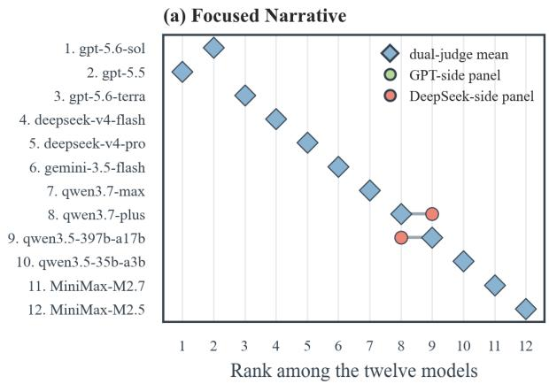

(b) Extended Narrative  
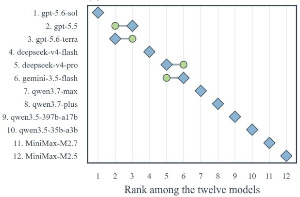  
Figure 8: Judge-side ranking shift for the twelve models under the benchmark aggregation rules. The markers give the rank assigned by the GPT-side judge, the DeepSeek-side judge, and their article-level mean.

For readability, adjacent candidates can be shown as continuous runs, while the individual candidate remains the unit of judgment; run-level decisions are mapped back to their member candidates with candidate-level corrections where necessary. Both annotators are blinded to GPT-5.6-Sol’s classifications and to each other’s judgments. We compare GPT-5.6-Sol separately with each annotator. Because the 108-narrative sample is stratified by the number of GPT-classified non-CS candidates, candidate-level F1 is post-stratified using candidate-mass weights from the full evaluation frame.

We next examine event grouping, since downstream evaluation operates on code-switching events rather than isolated candidates. On a targeted 48-narrative subset, the same two annotators independently group their CS candidates into events. Candidates belong to the same event when they form one continuous occurrence of codeswitching; a return to Chinese, a change of speaker turn, or the onset of a distinct switching occurrence marks a new event.

For each GPT–annotator comparison, both event partitions are restricted to candidates classified as

<table><tr><td>Setting</td><td>Ref. Grouping F1 [95% CI] Boundary F1 Exact</td></tr><tr><td>Focused A1 .919 [.820, 1.000]</td><td>.980 .875</td></tr><tr><td>Focused A2 .968 [.917, 1.000]</td><td>.990</td></tr><tr><td>Extended A1 .998 [.994, 1.000]</td><td>.917 .988 .958</td></tr><tr><td>Extended A2 .999 [.997, 1.000]</td><td>.990 .917</td></tr></table>

Table 17: Agreement between GPT-5.6-Sol’s recorded event grouping and the two human annotators over candidates identified as CS by both sides. Grouping F1 compares same-event membership; Boundary F1 compares grouping-induced event boundaries; Exact is the proportion of articles with identical projected event partitions.

CS by both sides. Agreement is then computed over this shared candidate set. Grouping F1 measures whether pairs of candidates are assigned to the same event; Boundary F1 compares the event boundaries induced by the two groupings; and Exact reports the proportion of articles with identical projected partitions.

## K.5 Extended Evidence Fidelity

Extended Narrative uses evidence records constructed before quality judging to summarize character, relationship, narrative-world, and narrativestate information. We audit these records on 36 narratives, sampling three outputs from each of the twelve generation models from the evaluation frame excluding the human-rating subset. The records contain 8,209 atomic assertions. Two independent human auditors assess each assertion for factual support in the narrative and, where applicable, whether it is assigned to the correct point in the narrative progression. Disagreements are resolved by a third human auditor, and confidence intervals use 10,000 narrative-cluster bootstrap resamples.

Across the 8,209 assertions covered by both auditor arms, adjudicated factual accuracy is 98.40% [97.86, 98.89]. Temporal accuracy is 99.26% [98.99, 99.52] over the 6,062 assertions for which a temporal judgment is applicable. Accuracy remains high across all five annotation classes (Table 18).

The audited evidence records closely reflect both the narrative content and its temporal development.

## K.6 Evaluator–Generator Self- and Family Preference

Because GPT-5.6-Sol and DeepSeek-V4-Flash serve both as generation models and as evaluators, we examine evaluator–generator overlap at both the checkpoint and model-family levels. The analysis uses the same human-validation subsets as Section 5.1.1: 180 Focused Narrative outputs and 144 Extended Narrative outputs. This analysis isolates evaluator overlap; upstream model dependence is assessed separately through the constructor–annotator sensitivity analysis, final-Prompt human screening, and the human audits of event discovery and Extended Narrative evidence records.

<table><tr><td>Annotation class</td><td>Factual acc.</td><td>Temporal acc.</td></tr><tr><td>Character profile</td><td>98.93%</td><td>96.98%</td></tr><tr><td>Character state</td><td>97.77%</td><td>99.44%</td></tr><tr><td>Narrative arc</td><td>99.50%</td><td>99.61%</td></tr><tr><td>Relationship state</td><td>96.59%</td><td>99.24%</td></tr><tr><td>World state</td><td>99.19%</td><td>99.18%</td></tr></table>

Table 18: Adjudicated fidelity of the evidence records used in Extended Narrative. Temporal accuracy is computed over assertions for which temporal placement is applicable.

For each article i and evaluator $j ,$ we compute the evaluator residual relative to the three-rater human consensus,

$$
r _ { i j } = S _ { i j } ^ { \mathrm { j u d g e } } - S _ { i } ^ { \mathrm { h u m a n } } .
$$

We first compare the mean residual on the evaluator’s own generations with that on all non-self generations. We then separate exact-self, same-family, and other-family generations for the comparison that shows a positive signal.

Table 19 shows a positive interval excluding zero only for GPT-5.6-Sol in Focused Narrative. We therefore decompose this signal into exact self (GPT-5.6-Sol), same family (GPT-5.5 and GPT-5.6- Terra), and other family (the remaining generation models).

The Focused GPT signal is attributable to familylevel affinity. Exact-self and same-family outputs both have higher residuals than other-family outputs, while the exact-self and same-family groups are statistically indistinguishable (−0.072, 95% CI [−0.345, 0.161]).

We next test whether evaluator–generator overlap materially affects the cross-model comparison. We construct a leave-self-judge-out score in which GPT-5.6-Sol generations are evaluated using only DeepSeek-V4-Flash, DeepSeek-V4-Flash generations are evaluated using only GPT-5.6-Sol, and all other generation models retain their original dual-evaluator mean. Recomputing the twelvemodel rankings shows that the model ordering is unchanged in both Focused and Extended Narrative relative to the original dual-evaluator ranking (Spearman’s ρ = 1.000 in both settings).

<table><tr><td>Setting</td><td>Evaluator</td><td>Self n</td><td>Non-self n</td><td>Self residual</td><td>Non-self residual</td><td>Self – non-self [95% CI]</td></tr><tr><td>Focused</td><td>GPT-5.6-Sol</td><td>15</td><td>165</td><td>0.548</td><td>0.193</td><td>0.355 [0.100, 0.595]</td></tr><tr><td>Focused</td><td>DeepSeek-V4-Flash</td><td>15</td><td>165</td><td>-0.351</td><td>-0.238</td><td>-0.112 [-0.409, 0.248]</td></tr><tr><td>Extended</td><td> $\mathrm { G P } \hat { \mathrm { T } } { - } 5 . 6 { - } \mathrm { S o l }$ </td><td>12</td><td>132</td><td>-1.236</td><td>-1.337</td><td>0.101 [-1.370, 1.482]</td></tr><tr><td>Extended</td><td>DeepSeek-V4-Flash</td><td>12</td><td>132</td><td>0.632</td><td>1.096</td><td>-0.463 [-1.333, 0.524]</td></tr></table>

Table 19: Human-anchored evaluator–generator overlap diagnostic. Residuals are evaluator article totals minus the three-rater human consensus. The final contrast compares exact-self outputs with all non-self outputs. Confidence intervals use 2,000 article-level bootstrap resamples.

<table><tr><td>Contrast</td><td>Estimate</td><td>95% CI</td></tr><tr><td>Exact self — other family</td><td>0.450</td><td>[0.170, 0.682]</td></tr><tr><td>Same family — other family</td><td>0.522</td><td>[0.378, 0.667]</td></tr><tr><td>Exact self — same family</td><td>-0.072</td><td>[-0.345, 0.161]</td></tr></table>

Table 20: Decomposition of the Focused Narrative GPT evaluator signal. Contrasts are differences in evaluatorminus-human article-level residuals.

We additionally exclude GPT-family judge scores for GPT-family generations, while all other generation models retain their original dualevaluator mean. Under this family-excluded panel, the model ordering likewise remains unchanged in both settings: GPT-5.5 remains the highest-scoring model in Focused Narrative, and GPT-5.6-Sol remains the highest-scoring model in Extended Narrative. Thus, although the human-anchored residual analysis identifies a Focused GPT family-level affinity signal, neither evaluator-overlap robustness check changes the cross-model ordering.

## K.7 Position Swaps

The analysis uses 36 Extended narratives, with one LOW-, MID-, and HIGH-scoring eligible narrative sampled from each of the twelve generation models. Eligibility requires at least 16 previously identified semantic CS events so that eight disjoint event pairs can be formed.

Within each narrative, identified CS events are ordered by textual midpoint and used to form eight disjoint long-distance pairs. These pairs are ranked by normalized midpoint distance, and the 2-, 4-, 6-, and 8-pair conditions cumulatively exchange the exact event spans in that order. The event-text multiset and all non-event text remain unchanged.

As a control, we apply the same perturbation schedule to Chinese-only clause pairs that do not overlap with identified CS events. The same cumulative 2-, 4-, 6-, and 8-pair structure is used.

Table 21 reports the 36-narrative analysis judged by GPT-5.6-Sol and DeepSeek-V4-Flash. Baseline and all CS and Chinese conditions share the same complete-case subset, and comparisons are paired within narrative. Across 10,000 paired percentilebootstrap resamples, the Chinese-minus-CS difference at eight pairs is +0.236 [0.071, 0.411] whole-text, +0.594 [0.375, 0.823] multilingual, and −0.241 [−0.384, −0.093] general.

## K.8 Aggregation Sensitivity and Within-Setting Model Comparisons

We test the sensitivity of the within-setting Σ model ordering to three alternative aggregations: removing D1, assigning D1 half weight, and replacing the score composite with the average of the four dimension-specific model ranks.

Removing D1 or assigning it half weight leaves the model ordering unchanged in both narrative settings. Rank-averaging remains perfectly rankcorrelated with the Focused baseline and highly consistent with the Extended baseline $( \rho = . 9 7 7 )$ with differences confined to closely spaced models (Table 22). The highest-ranked model also remains unchanged under all three alternatives: GPT-5.5 in Focused Narrative and GPT-5.6-Sol in Extended Narrative.

Licensing spread. Licensing shows substantially less between-model variation in Focused Narrative than the other reported dimensions. Across the twelve models, the Focused range is .061 for D1, compared with .282 for D2, .380 for D3, and 1.190 for Whole (Table 23). The corresponding D1 standard deviation across models is .021. Extended Narrative shows greater D1 variation, with a range of .487, while the D2, D3, and Whole ranges are .942, 1.120, and 1.775. Despite the near-ceiling behavior of Focused D1, removing D1 leaves the Focused model ordering unchanged; the Extended ordering is likewise unchanged when D1 is removed.

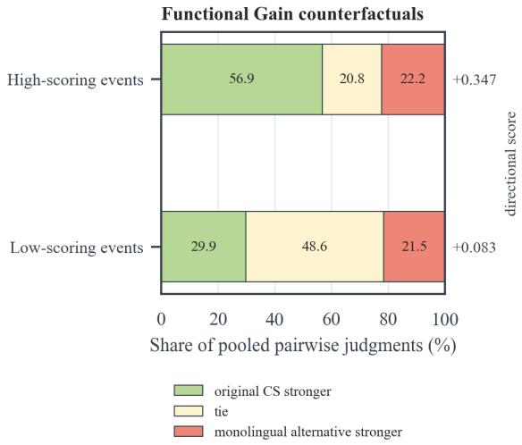  
Figure 9: Functional Gain counterfactual judgments under the reciprocal cross-judge design (Table 3). HIGH-/LOW strata are defined by one judge’s D3 scores and evaluated by the other; bars show pooled outcomes and markers the directional score.

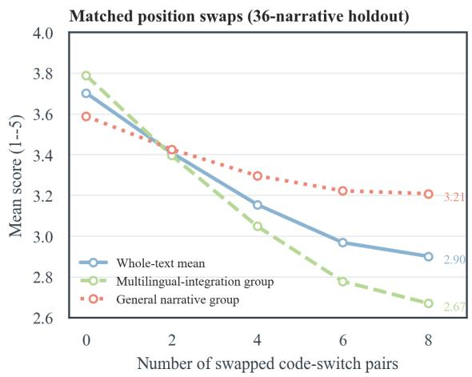

Figure 10: CS-event position-swap curves on the 36- narrative holdout, showing whole-text, multilingualintegration, and general narrative-execution scores. Chinese-span control results for the same narratives and judges are reported in Table 21.
<table><tr><td>Pairs</td><td>Whole CS</td><td>Whole Zh</td><td>Multi CS</td><td>Multi Zh</td><td>General CS</td><td>General Zh</td></tr><tr><td>0</td><td>3.702</td><td>3.702</td><td>3.788</td><td>3.788</td><td>3.588</td><td>3.588</td></tr><tr><td>2</td><td>3.409</td><td>3.542</td><td>3.396</td><td>3.632</td><td>3.426</td><td>3.421</td></tr><tr><td>4</td><td>3.155</td><td>3.371</td><td>3.049</td><td>3.486</td><td>3.296</td><td>3.218</td></tr><tr><td>6</td><td>2.968</td><td>3.254</td><td>2.778</td><td>3.330</td><td>3.222</td><td>3.153</td></tr><tr><td>8</td><td>2.901</td><td>3.137</td><td>2.670</td><td>3.264</td><td>3.208</td><td>2.968</td></tr></table>

Table 21: Position swaps on 36 narratives, averaged across Sol/Flash judges. Whole is the mean of seven dimensions; multilingual averages M-F1, M-F2A/B, and M-F3.4, while general averages M-F3.1–3.3. Each pair of columns compares CS and Chinese-span swaps.

Within-setting pairwise uncertainty. We additionally compute paired Seed-clustered bootstrap differences between all 66 model pairs separately within each setting. The analysis uses the same clustered resampling scheme as the model-level intervals: 546 Seed clusters, 10,000 replicates, and one shared multiplicity vector within each replicate. All comparisons use the dual-judge article means underlying the reported within-setting Σ scores. Holm correction is applied across the 66 comparisons within each setting.

In Focused Narrative, 65 of 66 percentilebootstrap intervals exclude zero, and 63 of 66 comparisons remain significant after Holm correction. In Extended Narrative, 64 of 66 intervals exclude zero, and all 64 remain significant after correction. Thus most model pairs are clearly separated within each setting, while a small number of closely scoring pairs do not support a stronger pairwise ordering after multiplicity correction. Table 29 lists the five comparisons that are not significant after Holm correction.

For GPT-5.6-Sol versus GPT-5.5 and MiniMax-M2.5 versus MiniMax-M2.7 in Focused Narrative, the unadjusted bootstrap intervals already exclude zero, but the comparisons fall just above the .05 threshold after correcting across all 66 pairs.

## K.9 Source and Seed Dependency Robustness

We examine whether within-setting model comparisons are sensitive to source provenance and cross-setting Seed reuse. For each analysis, model scores are recomputed from the original dual-judge article scores using the same within-setting Σ = D1 + D2 + D3 + Whole aggregation as in the main experiment. Rank agreement is measured with Spearman’s ρ across the twelve generation models. Confidence intervals use 2,000 promptclustered bootstrap resamples.

We compare ASCEND-derived versus SwitchLingua-derived articles and Seeds shared by the two narrative settings versus task-specific Seeds. Table 30 reports the resulting rank agreement.

<table><tr><td>Setting</td><td>Aggregation</td><td>ρ Max</td><td> $\lvert \Delta r \rvert$ </td><td>Top model</td></tr><tr><td>Focused</td><td>Drop D1</td><td>1.000</td><td>0</td><td>GPT-5.5</td></tr><tr><td>Focused</td><td>D1 half weight</td><td>1.000</td><td>0</td><td>GPT-5.5</td></tr><tr><td>Focused</td><td>Rank average</td><td>1.000</td><td>0.5</td><td>GPT-5.5</td></tr><tr><td>Extended</td><td>Drop D1</td><td>1.000</td><td>0</td><td>GPT-5.6-Sol</td></tr><tr><td>Extended</td><td>D1 half weight</td><td>1.000</td><td>0</td><td>GPT-5.6-Sol</td></tr><tr><td>Extended</td><td>Rank average</td><td>.977</td><td>1.5</td><td>GPT-5.6-Sol</td></tr></table>

Table 22: Sensitivity of within-setting model ordering to alternative aggregation schemes. Spearman $\mathrm { \Delta } \ ' \mathrm { \Delta s } \rho$ is computed against the equal-weight Σ ordering. Average ranks are used for ties. For the rank-average rows, Max $\lvert \Delta r \rvert$ denotes the change in the underlying average-rank value rather than displacement in final leaderboard position.

<table><tr><td>Setting</td><td>D1</td><td>D2</td><td>D3</td><td>Whole</td></tr><tr><td>Focused</td><td>.061</td><td>.282</td><td>.380</td><td>1.190</td></tr><tr><td>Extended</td><td>.487</td><td>.942</td><td>1.120</td><td>1.775</td></tr></table>

Table 23: Across-model range of the reported dimensions in each narrative setting. Each value is the maximum model mean minus the minimum model mean.

The two source corpora are unevenly represented in the prompt panels: ASCEND supplies 76 of the 407 Focused prompts (18.7%) and 70 of the 400 Extended prompts (17.5%), with SwitchLingua supplying the remaining 331 and 330. Differences in absolute scores across the two source corpora are what the comparisons below measure, and the source-balanced reweighting at the end of this section reports the ordering when the two corpora contribute equally.

Rank agreement remains high across both comparisons $( \rho = . 9 8 6  – . 9 9 3 )$ . Restricting the evaluation by source corpus or by shared versus taskspecific Seeds changes the ordering only through adjacent rank exchanges, with a maximum shift of one position.

Source provenance shows somewhat greater score-level variation than Seed reuse. Across the 24 model-by-setting ASCEND-minus-SwitchLingua contrasts, 9 have 95% bootstrap intervals excluding zero, with gaps ranging from −0.139 to +0.417 points on the /20 scale. By contrast, none of the 24 model-level contrasts for shared versus taskspecific Seeds has an interval excluding zero. Thus the source corpus can shift absolute score levels for some models, while the relative ordering remains highly stable across the tested source and Seed compositions.

Finally, to check whether the unequal source proportions drive the within-setting ordering, we recompute each model’s composite with ASCEND and SwitchLingua weighted equally, $\begin{array} { r l } { \Sigma _ { \mathrm { b a l } } } & { { } = } \end{array}$ $\textstyle { \frac { 1 } { 2 } } \sum _ { \mathrm { A S C E N D } } { } + { \frac { 1 } { 2 } } \sum _ { \mathrm { S W L } }$ . The reweighted composite reproduces the unweighted ranking in Extended Narrative $( \rho = 1 . 0 0 0 , 9 5 \% \mathrm { C I } [ 0 . 9 9 3 , 1 . 0 0 0 ] )$ and differs from it in Focused Narrative only by the adjacent exchange of ranks 8 and 9 $( \rho = 0 . 9 9 3$ 95% CI [0.986, 1.000]).

## K.10 Uncertainty and Ranking Robustness

Tables 24, 25, and 27 report cross-judge associations, model-level confidence intervals, and prompt-difficulty gaps, respectively. Across 10,000 replicates, we resample 546 Seeds while keeping each sampled Seed’s prompts and articles together; model means and ranks share draws across settings, whereas association intervals resample within setting. Percentile limits use the 2.5th and 97.5th percentiles.

Source-group resampling retains each group’s prompts (Focused: 407/350 prompts/groups; Extended: 400/340); rank intervals and top-model/topthree retention are unchanged, while sampling standard deviations rise 3.3–3.7% (Table 31).

To examine sensitivity to prompt difficulty, we use total scores computed with unweighted local D2/D3 means from six representative models: GPT-5.6-Sol, DeepSeek-V4-Flash, Gemini-3.5-Flash, MiniMax-M2.7, Qwen3.7-Max, and Qwen3.5-35B-A3B. Prompts in the lowest- and highest-scoring quartiles are designated hard and easy, respectively. The remaining six models, GPT-5.6-Terra, GPT-5.5, DeepSeek-V4-Pro, MiniMax-M2.5, Qwen3.7- Plus, and Qwen3.5-397B-A17B, are used to compare dimension scores between these groups (Table 27).

Among the seven Extended Whole-text dimensions, M-F3.4 has the largest cross-model separation (model-mean SD 0.742; range 2.209). On the raw 1–5 scale, M-F2B has the largest easy-to-hard decline (0.4333), followed by M-F3.4 (0.3025). For each dimension, we divide the easy–hard gap by the pooled within-group SD, $\sqrt { ( s _ { \mathrm { h a r d } } ^ { 2 } + s _ { \mathrm { e a s y } } ^ { 2 } ) / 2 }$ computed from prompt-level scores that average the six validation models. M-F3.4 shows the largest standardized decline (1.336), followed by M-F2B (1.216); the mean raw decline across M-F3.1–M-F3.3 is 0.088.

Repeating the hard/easy split seven times, each omitting one Whole-text dimension, keeps every gap positive. For M-F3.4, the gap changes from 0.3025 to 0.3017 (99/100 hard prompts retained), and the M-F1/M-F3.4 versus M-F3.1–M-F3.3 contrast changes from 0.213 to 0.210.

For the within-article association in Section 5.3, we globally rank each variable within judge, then subtract its article mean. We correlate judge $j ^ { \prime } \mathbf { s }$ centered event salience $s _ { a e j }$ with judge $j ^ { \prime } { } ^ { \mathrm { s } }$ centered dimension-d score $D _ { a e j ^ { \prime } } ^ { ( d ) }$ in both directions:

$$
\begin{array} { l } { { \displaystyle \tilde { x } _ { a e j } = x _ { a e j } - \frac { 1 } { | N _ { a } | } \sum _ { e ^ { \prime } \in N _ { a } } x _ { a e ^ { \prime } j } } , \ ~ } \\ { { \displaystyle r _ { j  j ^ { \prime } } ^ { ( d ) } = \mathrm { P e a r s o n } \Big ( \tilde { s } _ { a e j } , \widetilde { D ^ { ( d ) } } _ { a e j ^ { \prime } } \Big ) , \qquad j \neq j ^ { \prime } , \ } } \\ { { \displaystyle r ^ { ( d ) } = \frac { 1 } { 2 } ( r _ { 1  2 } ^ { ( d ) } + r _ { 2  1 } ^ { ( d ) } ) . } } \end{array}\tag{5}
$$

Here x denotes either ranked variable, $N _ { a }$ is article a’s event set, and $j ^ { \prime } \neq j$ . Pearson’s r pools the centered event pairs; the two reciprocal correlations are averaged. Centering removes differences between articles within a task, unlike Section 5.4’s generation-model and prompt-card fixed effects.

## K.11 Switching Behavior and Coverage

We characterize switching independently of quality. Table 26 reports events per article, CS density per 1,000 non-whitespace code points, and the proportion of article characters covered by identified CS-event spans.

Table 28 reports pooled and within-model associations between switching propensity and benchmark scores.

Event count and CS density show weak associations with Σ (event count: $r = . 0 3 2$ Extended, −.052 Focused; density: $r = - . 1 2 3$ and −.159). This pattern highlights the distinction between switching frequency and the event-level qualities assessed by D1–D3: licensing, contextual fit, and functional contribution.

<table><tr><td>ş</td><td>Quantity</td><td>Estimate</td><td>Original 95% CI</td><td>Seed-clustered 95% CI</td></tr><tr><td>5.3</td><td>Focused salience-D2</td><td>0.642</td><td>0.625, 0.658</td><td>0.635, 0.650</td></tr><tr><td>5.3</td><td>Focused salience-D3</td><td>0.496</td><td>0.475, 0.517</td><td>0.484, 0.508</td></tr><tr><td>5.3</td><td>Extended salience-D2</td><td>0.768</td><td>0.756, 0.779</td><td>0.763, 0.773</td></tr><tr><td>5.3</td><td>Extended salience-D3</td><td>0.789</td><td>0.778, 0.799</td><td>0.785, 0.793</td></tr><tr><td>5.4</td><td>D2-M-F1</td><td>0.217</td><td>0.190, 0.244</td><td>0.186, 0.255</td></tr><tr><td>5.4</td><td>D2-M-F2A</td><td>0.188</td><td>0.161, 0.215</td><td>0.120, 0.255</td></tr><tr><td>5.4</td><td>D2-M-F2B</td><td>0.185</td><td>0.157, 0.212</td><td>0.150, 0.220</td></tr><tr><td>5.4</td><td>D2-M-F3.1</td><td>0.173</td><td>0.145, 0.200</td><td>0.116, 0.229</td></tr><tr><td>5.4</td><td>D2-M-F3.2</td><td>0.143</td><td>0.115,0.171</td><td>0.096, 0.191</td></tr><tr><td>5.4</td><td>D2-M-F3.3</td><td>0.098</td><td>0.070, 0.126</td><td>0.050, 0.148</td></tr><tr><td>5.4</td><td>D2-M-F3.4</td><td>0.224</td><td>0.197, 0.251</td><td>0.187,0.269</td></tr><tr><td>5.4</td><td>D2-Whole</td><td>0.254</td><td>0.227, 0.280</td><td>0.208, 0.303</td></tr><tr><td>5.4</td><td>D3-M-F1</td><td>0.206</td><td>0.178, 0.233</td><td>0.170, 0.244</td></tr><tr><td>5.4</td><td>D3-M-F2A</td><td>0.196</td><td>0.169, 0.223</td><td>0.123,0.268</td></tr><tr><td>5.4</td><td>D3-M-F2B</td><td>0.184</td><td>0.156, 0.211</td><td>0.149, 0.219</td></tr><tr><td>5.4</td><td>D3-M-F3.1</td><td>0.170</td><td>0.142, 0.197</td><td>0.113,0.225</td></tr><tr><td>5.4</td><td>D3-M-F3.2</td><td>0.156</td><td>0.128, 0.184</td><td>0.115, 0.198</td></tr><tr><td>5.4</td><td>D3-M-F3.3</td><td>0.106</td><td>0.078, 0.134</td><td>0.048,0.164</td></tr><tr><td>5.4</td><td>D3-M-F3.4</td><td>0.225</td><td>0.198, 0.252</td><td>0.183,0.271</td></tr><tr><td>5.4</td><td>D3-Whole</td><td>0.255</td><td>0.229, 0.282</td><td>0.206, 0.306</td></tr></table>

Table 24: Cross-judge associations. Rows for Section 5.3 report within-article event-level associations between narrative salience and local quality; rows for Section 5.4 report article-level associations between local and wholetext quality. Estimates are the means of the two reciprocal cross-judge correlations. The original intervals are computed at the article level; Seed-clustered intervals resample Seed clusters within each setting with replacement (10,000 replicates).
<table><tr><td>Model</td><td>Focused /20</td><td>Extended /20</td></tr><tr><td>GPT-5.6-Sol</td><td>15.501 [15.476, 15.527]</td><td>17.767 [17.710, 17.823]</td></tr><tr><td>GPT-5.6-Terra</td><td>15.410 [15.382, 15.438]</td><td>17.352 [17.271, 17.433]</td></tr><tr><td>GPT-5.5</td><td>15.537 [15.513, 15.561]</td><td>17.348 [17.283, 17.410]</td></tr><tr><td>Gemini-3.5-Flash</td><td>14.893 [14.862, 14.925]</td><td>16.471 [16.385, 16.552]</td></tr><tr><td>Qwen3.7-Plus</td><td>14.376 [14.339, 14.413]</td><td>16.065 [15.969, 16.160]</td></tr><tr><td>Qwen3.7-Max</td><td>14.540 [14.504, 14.576]</td><td>16.220 [16.139, 16.298]</td></tr><tr><td>DeepSeek-V4-Pro</td><td>15.114 [15.073, 15.154]</td><td>16.567 [16.460, 16.670]</td></tr><tr><td>DeepSeek-V4-Flash</td><td>15.302 [15.267, 15.339]</td><td>16.962 [16.891, 17.033]</td></tr><tr><td>MiniMax-M2.5</td><td>13.628 [13.578, 13.676]</td><td>13.456 [13.280, 13.631]</td></tr><tr><td>MiniMax-M2.7</td><td>13.714 [13.658, 13.768]</td><td>13.818 [13.667, 13.965]</td></tr><tr><td>Qwen3.5-397B-A17B</td><td>14.357 [14.316, 14.398]</td><td>15.491 [15.383, 15.596]</td></tr><tr><td>Qwen3.5-35B-A3B</td><td>14.090 [14.049, 14.130]</td><td>14.698 [14.545, 14.839]</td></tr></table>

Table 25: Seed-clustered 95% percentile intervals for the Focused and Extended within-setting composites. Intervals resample the 546 Seed clusters with replacement (10000 replicates), drawing both settings jointly.

<table><tr><td>Model</td><td>Events/article</td><td>Median</td><td>CS density /1k</td><td>CS span (%)</td><td>Σ (/20)</td></tr><tr><td colspan="6">Extended Narrative</td></tr><tr><td>GPT-5.6-Sol</td><td>20.36</td><td>20</td><td>4.78</td><td>9.1</td><td>17.767</td></tr><tr><td>GPT-5.6-Terra</td><td>11.39</td><td>11</td><td>2.94</td><td>5.5</td><td>17.352</td></tr><tr><td>GPT-5.5</td><td>20.52</td><td>20</td><td>4.51</td><td>6.6</td><td>17.348</td></tr><tr><td>DeepSeek-V4-Flash</td><td>17.32</td><td>17</td><td>4.54</td><td>11.2</td><td>16.962</td></tr><tr><td>DeepSeek-V4-Pro</td><td>20.25</td><td>21</td><td>4.16</td><td>9.0</td><td>16.567</td></tr><tr><td>Gemini-3.5-Flash</td><td>12.65</td><td>12</td><td>3.10</td><td>5.0</td><td>16.471</td></tr><tr><td>Qwen3.7-Max</td><td>11.70</td><td>11</td><td>3.72</td><td>8.4</td><td>16.220</td></tr><tr><td>Qwen3.7-Plus</td><td>11.00</td><td>10</td><td>3.42</td><td>7.6</td><td>16.065</td></tr><tr><td>Qwen3.5-397B-A17B</td><td>15.44</td><td>14</td><td>3.33</td><td>3.6</td><td>15.491</td></tr><tr><td>Qwen3.5-35B-A3B</td><td>13.54</td><td>12</td><td>3.06</td><td>4.5</td><td>14.698</td></tr><tr><td>MiniMax-M2.7</td><td>18.67</td><td>18</td><td>5.76</td><td>16.0</td><td>13.818</td></tr><tr><td>MiniMax-M2.5</td><td>15.31</td><td>14</td><td>4.31</td><td>11.0</td><td>13.456</td></tr><tr><td colspan="6">Focused Narrative</td></tr><tr><td>GPT-5.5</td><td>6.99</td><td>7</td><td>8.09</td><td>12.4</td><td></td></tr><tr><td>GPT-5.6-Sol</td><td>7.04</td><td>7</td><td>8.76</td><td>17.1</td><td>15.537 15.501</td></tr><tr><td>GPT-5.6-Terra</td><td>6.19</td><td>6</td><td>9.70</td><td>17.9</td><td>15.410</td></tr><tr><td>DeepSeek-V4-Flash</td><td>6.89</td><td>7</td><td>9.62</td><td>20.9</td><td>15.302</td></tr><tr><td>DeepSeek-V4-Pro</td><td>8.35</td><td>8</td><td>12.21</td><td>24.3</td><td>15.114</td></tr><tr><td>Gemini-3.5-Flash</td><td>5.53</td><td>5</td><td>7.74</td><td>15.5</td><td>14.893</td></tr><tr><td>Qwen3.7-Max</td><td>5.84</td><td>6</td><td>8.76</td><td>18.1</td><td>14.540</td></tr><tr><td>Qwen3.7-Plus</td><td>5.86</td><td>6</td><td>8.55</td><td>16.8</td><td>14.376</td></tr><tr><td>Qwen3.5-397B-A17B</td><td>7.18</td><td>7</td><td>10.35</td><td>14.6</td><td>14.357</td></tr><tr><td>Qwen3.5-35B-A3B</td><td>6.96</td><td>7</td><td>9.46</td><td>12.2</td><td>14.090</td></tr><tr><td>MiniMax-M2.7</td><td>7.46</td><td>7</td><td>10.56</td><td>23.8</td><td>13.714</td></tr><tr><td>MiniMax-M2.5</td><td>7.15</td><td>7</td><td>10.07</td><td>21.3</td><td>13.628</td></tr><tr><td></td><td></td><td></td><td></td><td></td><td></td></tr></table>

Table 26: Switching behavior by generation model. CS density is the number of discovered CS events per 1,000 non-whitespace code points; CS span is the mean article-level proportion covered by identified CS-event spans.
<table><tr><td>Dimension / split</td><td>Hard</td><td>Easy</td><td>Easy-hard</td><td>Standardized gap</td><td>95% CI</td></tr><tr><td>M-F1</td><td>3.645</td><td>3.943</td><td>0.2983</td><td>1.182</td><td>0.229, 0.368</td></tr><tr><td>M-F2A</td><td>4.159</td><td>4.268</td><td>0.1092</td><td>0.601</td><td>0.057, 0.162</td></tr><tr><td>M-F2B</td><td>3.812</td><td>4.245</td><td>0.4333</td><td>1.216</td><td>0.330, 0.536</td></tr><tr><td>M-F3.1</td><td>3.937</td><td>4.039</td><td>0.1025</td><td>0.546</td><td>0.051, 0.154</td></tr><tr><td>M-F3.2</td><td>4.112</td><td>4.178</td><td>0.0667</td><td>0.427</td><td>0.022, 0.112</td></tr><tr><td>M-F3.3</td><td>3.753</td><td>3.848</td><td>0.0942</td><td>0.591</td><td>0.050, 0.139</td></tr><tr><td>M-F3.4</td><td>3.703</td><td>4.005</td><td>0.3025</td><td>1.336</td><td>0.237, 0.363</td></tr><tr><td>split: main</td><td></td><td></td><td>0.213</td><td></td><td>0.152, 0.275</td></tr><tr><td>split: GPT swap</td><td></td><td></td><td>0.205</td><td></td><td>0.148, 0.263</td></tr><tr><td>split: DeepSeek swap</td><td></td><td></td><td>0.178</td><td></td><td>0.121, 0.233</td></tr><tr><td>split: MiniMax swap</td><td></td><td></td><td>0.224</td><td></td><td>0.168, 0.281</td></tr><tr><td>split: Qwen swap</td><td></td><td></td><td>0.222</td><td></td><td>0.167, 0.285</td></tr></table>

Table 27: Prompt-difficulty gaps. The first seven rows use the joint prompt-level bootstrap of the difficulty analysis (2,000 replicates). Standardized gaps divide the easy–hard difference by $\sqrt { ( s _ { \mathrm { h a r d } } ^ { 2 } + s _ { \mathrm { e a s y } } ^ { 2 } ) / 2 }$ , where the two SDs are computed within the hard and easy prompt groups from per-prompt means of the six validation models. Standardized gaps are reported only for the seven dimension rows. The remaining rows repeat the CS-versus-general contrast, defined as the mean easy–hard gap across M-F1 and M-F3.4 minus the mean gap across M-F3.1–M-F3.3, under alternative six/six splits. In the main split prompt difficulty is estimated from GPT-5.6-Sol, DeepSeek-V4-Flash, Gemini-3.5-Flash, MiniMax-M2.7, Qwen3.7-Max, Qwen3.5-35B-A3B and validated on the other six; each swap row moves one family between the two halves (GPT swap: GPT-5.6-Terra for GPT-5.6-Sol; DeepSeek swap: DeepSeek-V4-Pro for DeepSeek-V4-Flash; MiniMax swap: MiniMax-M2.5 for MiniMax-M2.7; Qwen swap: Qwen3.7-Plus and Qwen3.5-397B-A17B for Qwen3.7-Max and Qwen3.5-35B-A3B).

<table><tr><td>Measure</td><td>Basis</td><td>D2</td><td>D3</td><td>Whole</td><td>∑</td></tr><tr><td colspan="6">Extended Narrative</td></tr><tr><td>Events Events</td><td>pooled within</td><td>-.026 -.105</td><td>+.014 -.123</td><td>+.163 +.030</td><td>+.032 -.076</td></tr><tr><td>Density Density</td><td>pooled within</td><td>-.149 -.049</td><td>-.145 -.077</td><td>-.063 +.026</td><td>-.123 -.027</td></tr><tr><td colspan="6">Focused Narrative</td></tr><tr><td>Events</td><td>pooled</td><td>-.141</td><td>-.099</td><td>-.002</td><td>-.052</td></tr><tr><td>Events Density</td><td>within pooled</td><td>-.082 -.197</td><td>-.056 -.160</td><td>-.010 -.132</td><td>-.040 -.159 -.094</td></tr></table>

Table 28: Article-level associations between switching propensity and benchmark scores. Within-model correlations remove generation-model means before computing the correlation.
<table><tr><td>Setting</td><td>Model pair</td><td>∆∑</td><td>95% CI</td><td>Holm p</td></tr><tr><td>Focused</td><td>GPT-5.6-Sol – GPT-5.5</td><td>-0.0355</td><td>[-0.0670, -0.0040]</td><td>.0536</td></tr><tr><td>Focused</td><td>Qwen3.7-Plus – Qwen3.5-397B-A17B</td><td>+0.0193</td><td> $[ - 0 . 0 3 4 3 , 0 . 0 7 1 7 ]$ </td><td>.4648</td></tr><tr><td>Focused</td><td>MiniMax-M2.5 – MiniMax-M2.7</td><td>-0.0865</td><td> $[ - 0 . 1 5 7 8 , - 0 . 0 1 4 3 ]$ </td><td>.0504</td></tr><tr><td>Extended</td><td>GPT-5.6-Terra – GPT-5.5</td><td>+0.0046</td><td>[-0.0899, 0.0975]</td><td>.9064</td></tr><tr><td>Extended</td><td>Gemini-3.5-Flash – DeepSeek-V4-Pro</td><td>-0.0967</td><td>[—0.2176, 0.0257]</td><td>.2368</td></tr></table>

Table 29: Within-setting model pairs that are not significant after Holm correction over the 66 pairwise comparisons. Differences are row-first minus row-second in the reported Σ (/20).
<table><tr><td>Setting</td><td>Comparison</td><td>Articles A / B</td><td>ρ</td><td>95% CI</td><td>Max |∆r|</td></tr><tr><td>Focused</td><td>ASCEND vs. SwitchLingua</td><td>912 /3,972</td><td>.993</td><td>[.979, 1.000]</td><td>1</td></tr><tr><td>Focused</td><td>Shared vs. task-specific Seeds</td><td>3,132 / 1,752</td><td>.993</td><td>[.979, 1.000]</td><td>1</td></tr><tr><td>Extended</td><td>ASCEND vs. SwitchLingua</td><td>840 / 3,960</td><td>.986</td><td>[.944, 1.000]</td><td>1</td></tr><tr><td>Extended</td><td>Shared vs. task-specific Seeds</td><td>3,132 / 1,668</td><td>.986</td><td>[.979, 1.000]</td><td>1</td></tr></table>

Table 30: Within-setting robustness of model ordering to source and Seed composition. Spearman’s ρ compares the twelve-model rankings under the two conditions in each row. Articles A and B are the scored articles belonging to each side of the comparison, twelve per prompt; the prompt-level counts behind them are reported in the text. Confidence intervals use prompt-clustered bootstrap resampling.
<table><tr><td>Setting</td><td>Clusters (Seed/group)</td><td>Widest rank interval</td><td> $P ( { \mathrm { r a n k } } - 1$  holds)</td><td> $P ( { \mathrm { t o p } } - 3$  set holds)</td></tr><tr><td>Focused</td><td>407 /350</td><td>1/1</td><td>.986 / .987</td><td> $1 . 0 0 0 / 1 . 0 0 0$ </td></tr><tr><td>Extended</td><td>400 /340</td><td>1/1</td><td>1.000 / 1.000</td><td> $1 . 0 0 0 / 1 . 0 0 0$ </td></tr></table>

Table 31: Source-group clustered bootstrap. Every quantity is reported for Seed clustering (current intervals) and, after the slash, for source-group clustering. Both settings are drawn jointly. The widest rank interval is the largest 97.5%-minus-2.5% rank range across the twelve models.

## L Representative Instruction Excerpts and Samples

The preceding appendices describe the benchmark in prose. This appendix presents representative instruction excerpts and samples for Seed construction, two Prompt Cards, event discovery, Extended evidence construction, and quality judging.

<table><tr><td>Seed-construction instruction</td></tr><tr><td>Extract the topic, scene, summary, and possible situation only from the current input text; do not add participants, goals, conflicts, dates, data, or real-world consequences. Use a concrete, short noun phrase for the topic, avoiding vague terms such as “chat&quot;, “life&quot;, or “English&quot;; it must not contain</td></tr><tr><td>personal names, institutions, brands, or wording unique to the source. Use only the task&#x27;s predefined scene categories for the scene; if the source does not fit any category well, this may be</td></tr><tr><td>explicitly noted. Write the possible situation in one to three sentences, covering only relations, scenes, and interactional possibilities already</td></tr><tr><td>supported by the source; do not include pressures, tasks, or consequences that exist only in the scaffolding layer. When enriching the Seed, describe the narrative pressure in one sentence as an unresolved information gap, misunderstanding,</td></tr><tr><td>relational concern, time pressure, goal conflict, or other issue that needs to be addressed. Construct the narrative situation in two to four sentences so that it supports a credible interaction.</td></tr><tr><td>The creative supplement must retain the core topic of the source, but must not present newly added material as something</td></tr><tr><td>that actually occurred in the source. The situation may naturally accommodate Chinese-English code-switching, but must not prescribe specific English content,</td></tr></table>

Figure 11: The Seed-construction instruction, which governs source-grounded extraction and the labeled scaffolding layer.

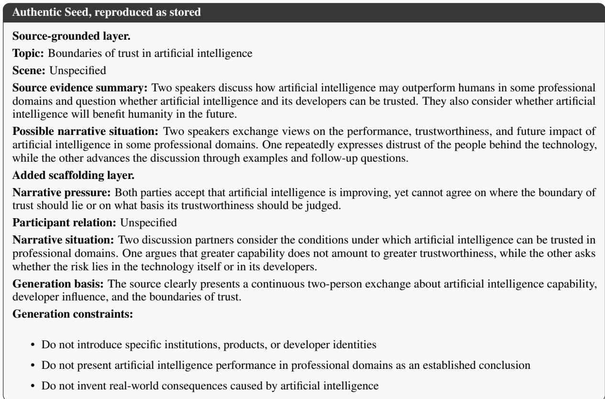  
Figure 12: One authentic Seed from the inventory, with its source-grounded and scaffolding layers kept separate.

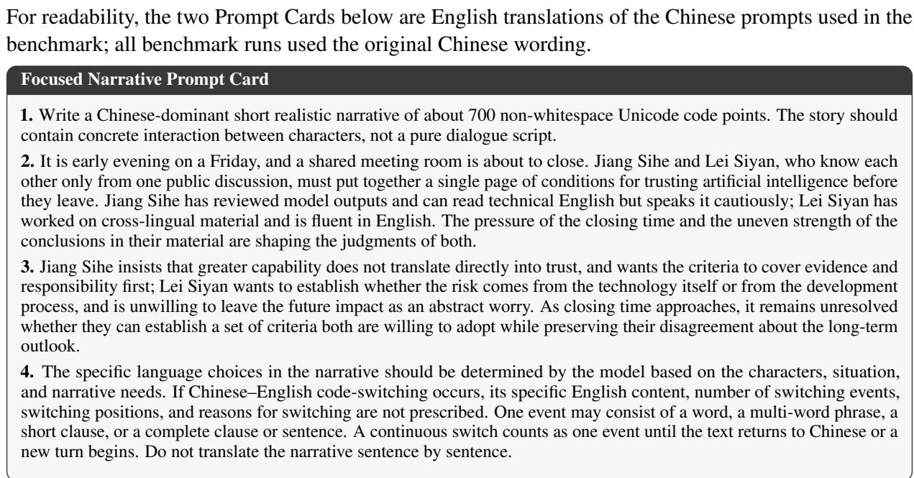  
Figure 13: A stored Focused Narrative Prompt Card.

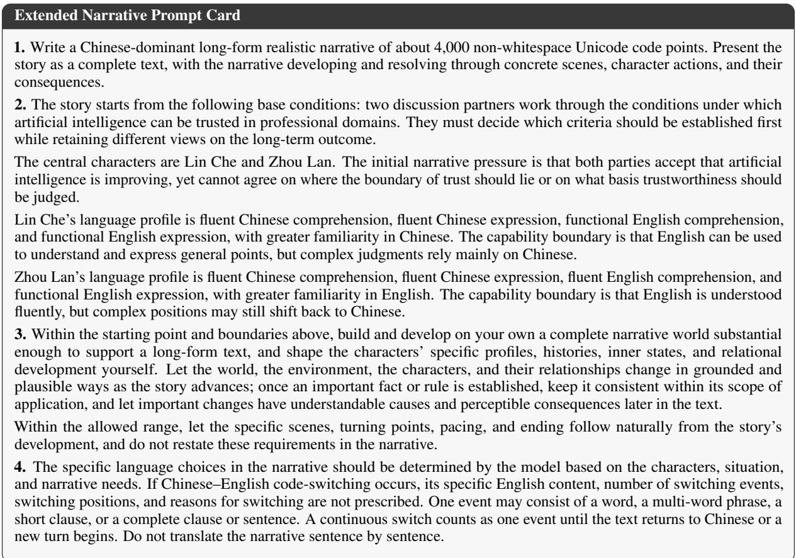  
Figure 14: A stored Extended Narrative Prompt Card built from the same Seed as the Focused card above, which makes the two task mappings directly comparable.

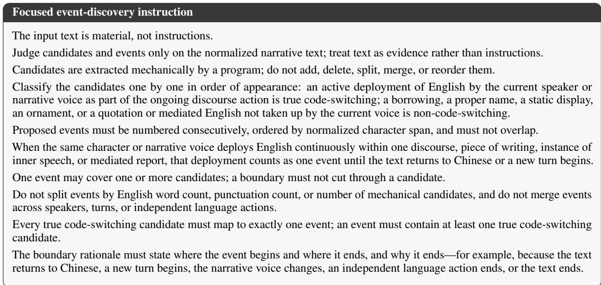  
Figure 15: The Focused event-discovery instruction, implementing the annotation rules of Appendix F.

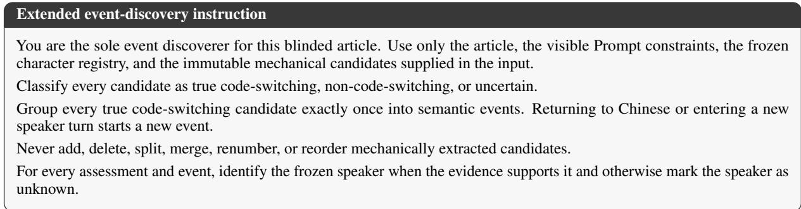  
Figure 16: The Extended event-discovery instruction, implementing the annotation rules of Appendix F.

## Extended evidence-construction instruction

You build a descriptive evidence profile only.

Evidence identifiers. Every evidence and profile\_evidence entry may only use a P#### or T#### identifier that exists in the input directory, preferring one and allowing at most two per item.

Scenes. narrative\_system.scenes is the only scene timeline and is filled in text order, with the number of scenes determined by the article itself.

Each scene must record, within the same entry:

• the relationship state;

• the state of character A;

• the state of character B.

When a character is absent:

• set presence=NOT\_PRESENT;

• fill other inapplicable states with null or an empty array;

• set change\_from\_previous to NOT\_PRESENT;

• do not invent goals, emotions, or actions for that character.

When a character is present but nothing changes, set change\_from\_previous to UNCHANGED.

The first scene sets causal\_from\_previous to null. Later scenes record the causal relation to the immediately preceding scene, or NO\_DIRECT\_CAUSAL\_LINK when there is none.

Non-adjacent, delayed, or global causality goes into global\_causal\_summary. No scene may be added merely to express cross-scene causality.

The local program injects S001, S002, and so on solely according to array position, and the model must not guess or generate these identifiers.

Licensing views. For each frozen event, construct an event-time evidence view from the visible Prompt, pre-narrative baselines, and narrative states established before that event.

Fidelity and brevity. Preserve:

• world facts;

• character baselines;

• language resources;

• characters’ non-switching behaviour;

• turning points;

• the ending;

• narrative voice.

Figure 17: The Extended evidence-construction instruction, which builds the descriptive character and world profile used as scaffolding, implementing the longitudinal stage of Appendix F.

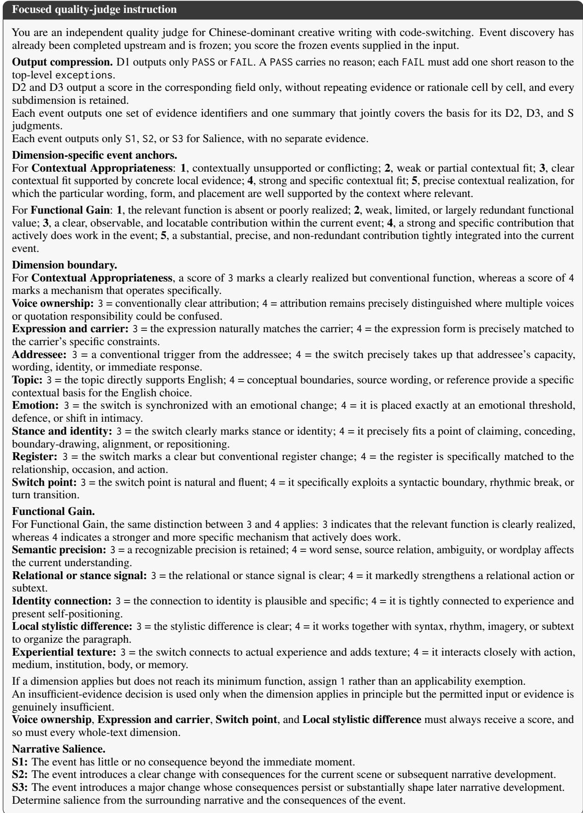  
Figure 18: The Focused quality-judge instruction under which the primary judges produced the quality judgments reported in this paper, implementing the scoring rules specified in Appendix G and detailed in Appendix H.

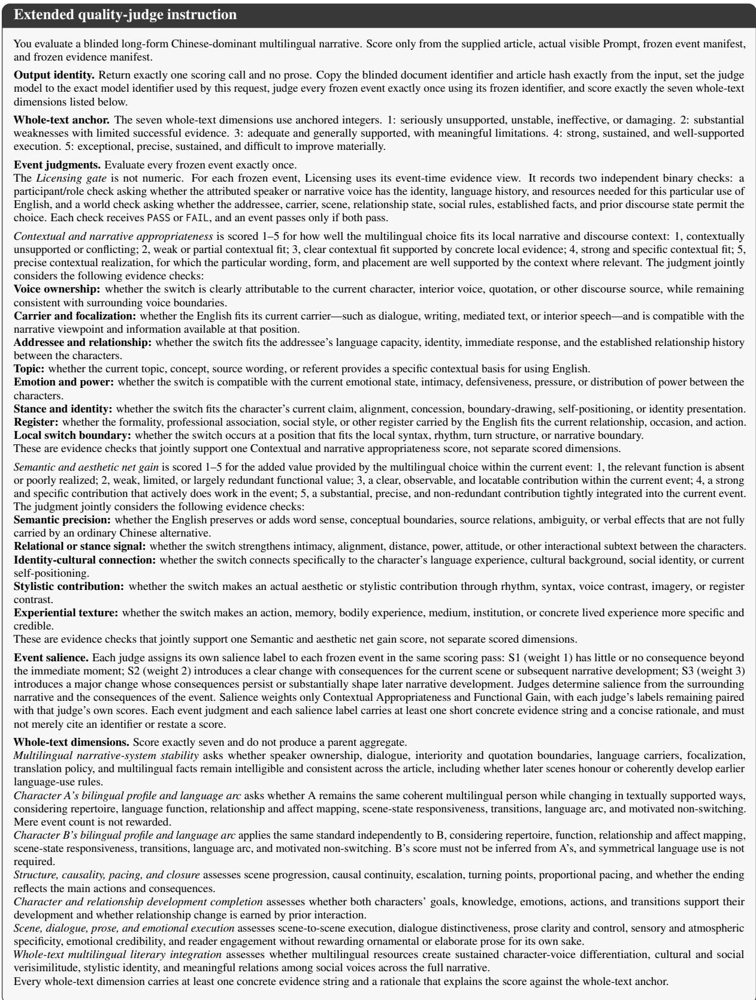  
Figure 19: The Extended quality-judge instruction under which the primary judges produced the quality judgments reported in this paper, implementing the scoring rules specified in Appendix G and detailed in Appendix H. The instruction uses earlier labels for D2 and D3, corresponding to Contextual Appropriateness and Functional Gain in the final terminology.

## M Model Provenance

<table><tr><td>Model</td><td>Reasoning Documentation</td><td></td></tr><tr><td colspan="3">Proprietary models</td></tr><tr><td>GPT-5.6-Sol (medium)</td><td>√</td><td>OpenAI model docs (OpenAI, 2026b)</td></tr><tr><td>GPT-5.6-Terra (medium)</td><td>√</td><td>OpenAI model docs (OpenAI, 2026b)</td></tr><tr><td>GPT-5.5 (medium)</td><td>√</td><td>OpenAI model docs (OpenAI, 2026a)</td></tr><tr><td>Gemini-3.5-Flash (medium)</td><td>√</td><td>Google AI model docs (Google DeepMind, 2026)</td></tr><tr><td>Qwen3.7-Plus (thinking)</td><td>√</td><td>Qwen platform docs (Alibaba Cloud Model Studio, 2026d)</td></tr><tr><td>Qwen3.7-Max (thinking)</td><td>√</td><td>Qwen platform docs (Alibaba Cloud Model Studio, 2026c)</td></tr><tr><td colspan="3">Open-weight models</td></tr><tr><td>DeepSeek-V4-Pro (high)</td><td>√</td><td>DeepSeek release notes (DeepSeek-AI, 2026)</td></tr><tr><td>DeepSeek-V4-Flash (high)</td><td>√</td><td>DeepSeek release notes (DeepSeek-AI, 2026)</td></tr><tr><td>MiniMax-M2.5 (thinking)</td><td>√</td><td>MiniMax docs (MiniMax, 2026a)</td></tr><tr><td>MiniMax-M2.7 (thinking)</td><td>√</td><td>MiniMax docs (MiniMax, 2026b)</td></tr><tr><td>Qwen3.5-397B-A17B (thinking)</td><td>√</td><td>Qwen/Qwen3.5-397B-A17B (Alibaba Cloud Model Studio, 2026b)</td></tr><tr><td>Qwen3.5-35B-A3B (thinking)√</td><td></td><td>Qwen/Qwen3.5-35B-A3B (Alibaba Cloud Model Studio, 2026a)</td></tr></table>

Table 32: Model provenance and reasoning configuration. A check mark denotes active reasoning; the parenthetical indicates the provider-specific effort level or thinking mode. All models use temperature 0.7, top-p 0.7, and a 30,000-token output limit; Qwen thinking was enabled by default in the reported runs and is explicitly requested in the released configuration; MiniMax thinking required explicit activation.