# Cascaded Retrieval with Cross-Modal Query Refinement for Efficient Visual Document Search

Diana Turmakhan♡ Aseem Srivastava♡ Vivek Gupta⋄ Iryna Gurevych♡¶ Thamar Solorio♡

♡ Mohamed bin Zayed University of Artificial Intelligence ⋄ Arizona State University

¶ Ubiquitous Knowledge Processing Lab (UKP Lab), Department of Computer Science

## Abstract

Retrieving information from visually rich documents requires matching queries against pages that contain complex evidence in tables, figures, and layout-dependent structures. Current vision-language retrievers address this but incur query-time costs that grow with corpus size and are impractical to scale. We propose SCOUT, a cascaded two-track retrieval framework that separates retrieval performance from exhaustive search. The visual track first uses a lightweight parent retriever to filter the corpus to a compact candidate pool, then applies a stronger multi-vector reranker only to those candidates. In parallel, a semantic track retrieves over hierarchical page and document summaries generated offline to provide a signal complementary to visual matching. The outputs are fused through cross-modal query refinement, which uses semantic scores to adjust the visual query representation before final ranking. We evaluate SCOUT on 4 major benchmarks against 6 baselines and observe a significant query-time latency improvement up to 80.7× (28.8× on average) relative to the best baseline, while exceeding state-of-the-art retrieval performance by up to 7.8% NDCG across all benchmarks.

## 1 Introduction

Document retrieval is a well-studied problem (Abootorabi et al., 2025; Tanaka et al., 2025), yet retrieving visually rich documents remains challenging in open-domain settings that require searching across an entire corpus rather than a predefined collection. As illustrated in Figure 1, a query may require evidence distributed across multiple pages of a large report collection. This evidence often appears in tables, figures, or layout-dependent passages, while many pages in the corpus may share similar visual structures. Consequently, even a strong visual retriever that scores every page can fail to place all relevant pages within a practical retrieval window. This setting highlights two requirements for a practical retriever: (a) matching fine-grained evidence within each page, and (b) doing so at a query-time cost that remains affordable as the corpus grows.

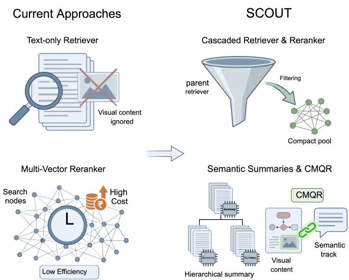  
Figure 1: Accurate visual retrieval without exhaustive search. Text-only retrievers ignore visual content, and multi-vector retrievers match every page at high query-time cost. SCOUT applies late interaction only to a compact candidate pool and refines the visual query with offline summaries.

This challenge is relevant to enterprise collections that contain complex information in tables, figures, and layout-dependent structures that text extraction does not preserve completely (Huang et al., 2022; Cho et al., 2025). Consequently, textbased retrieval can operate on incomplete representations. Our experiments show that retrieving over extracted page text rather than page images reduces NDCG@10 by up to 13.5 points when using the same embedding backbone (Table 2). Recent vision-language retrievers address this limitation by embedding document pages directly as images and have achieved strong performance on visual document retrieval benchmarks (Faysse et al., 2025; Yu et al., 2025; Nomic Team, 2025). However, their high query-time latency remains a practical bottleneck for real-world use cases. In typical enterprise settings, documents are indexed infrequently, while retrieval may occur several times per user request (Wang et al., 2025). Retrieval costs therefore accumulate continuously, raising the question of how such systems can scale. Table 1 highlights three major gaps in the existing approaches: (a) cost: multi-vector visual retrievers match every query against every page, so query cost grows with the corpus (Lee et al., 2023; Santhanam et al., 2022; Bruch et al., 2024), while lighter single-vector models are faster but lose fine-grained accuracy (Nussbaum et al., 2025); (b) recall: cascades cut cost by filtering before reranking, but a page missed by the filter cannot be recovered later (Qu et al., 2021), which is most likely when many pages look alike; and (c) fusion: textual evidence complements visual matching, but rank-level fusion discards how that evidence relates to the query, and query-level refinement (Uzan et al., 2026) still applies multivector scoring to the full corpus.

Our observation is that these gaps can be closed together because the signals are complementary and exhaustive token-level matching is needed only to separate a few visually similar candidates. We therefore propose SCOUT1, a cascaded two-track multimodal retrieval framework. Track A is a visual cascade: a lightweight single-vector retriever filters the corpus to a small pool of K pages, which a stronger multi-vector model then reranks with late interaction. Track B retrieves over hierarchical document- and page-level summaries generated once offline, so pages missed by Track A can still enter the pool. The two tracks are combined through cross-modal query refinement (CMQR) (Uzan et al., 2026), which uses the semantic scores to adjust the visual query representation at test time before the final ranking. The costly late-interaction and refinement phases are independent of corpus size and work on a fixed candidate pool. We evaluate SCOUT on four benchmarks, ViDoRe (eight domain-specific subsets), ViDoSeek, SlideVQA, and REAL-MM-RAG (four domain-specific subsets), against six baseline methods. SCOUT matches or exceeds the strongest exhaustive retriever in retrieval quality (+3.1% average NDCG@10) while improving query latency by 28.8× on average (up to 80.7×). These gains carry over to downstream answer generation and hold under query rephrasing. We summarize our contributions as follows:

<table><tr><td>Approach</td><td>Vis.</td><td>Txt.</td><td>Fus.</td><td>Cost</td></tr><tr><td colspan="5">Single signal</td></tr><tr><td>Text dense (OCR / summ.)</td><td>X</td><td>√</td><td></td><td>一</td></tr><tr><td>Single-vector visual Multi-vector visual</td><td>page</td><td>×</td><td></td><td></td></tr><tr><td></td><td>token</td><td>×</td><td></td><td>O(N)</td></tr><tr><td colspan="5">Efficiency-oriented</td></tr><tr><td>Efficient multi-vector index token</td><td></td><td>×</td><td></td><td>O(N′)</td></tr><tr><td>Text cascade</td><td>X</td><td>√</td><td></td><td>O(K)</td></tr><tr><td colspan="5">Multimodal</td></tr><tr><td>Rank-level hybrid (RRF)</td><td>token</td><td>V</td><td>rank</td><td>O(N)</td></tr><tr><td>GQR</td><td>token</td><td>√</td><td>query</td><td>O(N)</td></tr><tr><td>SCOUT (ours)</td><td>token</td><td></td><td>query</td><td>O(K)</td></tr></table>

Table 1: Taxonomy of prior approaches. Vis./Txt.: visual/textual evidence used (page: one vector per page; token: token- or patch-level). Fus.: how modalities are combined (rank: rank-level; query: query-level refinement). Cost: number of pages on which the costly stage (late interaction or reranking) runs, where N is the corpus size, N′ < N the candidates kept by index pruning, and K ≪ N the first-stage pool.

• We propose SCOUT, a cascaded two-track multimodal retrieval framework that reduces querytime latency up to 80.7× (28.8× on average) over exhaustive multi-vector search.

• SCOUT outperforms retrieval performance across all 4 benchmarks, with gains of up to 7.8% NDCG@5 in a fraction of the query-time cost.

• We present a thorough analysis of our findings through ablations, candidate-pool sensitivity, robustness to perturbation, and a case study.

## 2 Related Work

Textual and Visual Retrieval for Document RAG. Visual document retrieval (VDR) aims to retrieve relevant pages from visually rich documents containing dense layouts, figures, tables, and charts. Traditional pipelines rely on OCR or extracted text followed by lexical or dense retrieval (Karpukhin et al., 2020; Tanaka et al., 2021); recent dense models such as Linq-Embed, Qwen3- Embedding, and Jina-Text provide strong OCR- or summary-based text baselines (Choi et al., 2024; Zhang et al., 2025; Günther et al., 2025). However, text-only retrieval can miss evidence encoded in layout and visual structure (Huang et al., 2022). Native visual and multimodal retrievers such as Jina Vision and ColNomic-7B embed page images directly, while late-interaction models such as ColEmbed-3B-v2 use MaxSim-style token- or patch-level scoring (Günther et al., 2025; Nomic Team, 2025; de Souza P. Moreira et al., 2026). Our pipeline is built in this direction where we rerank a compact set of candidate pages and fuse the results with summary-based feedback, avoiding fullcorpus multi-vector scoring.

Hybrid Fusion and Query Refinement. Hybrid retrieval combines complementary retrievers, such as lexical, dense-text, and visual models (Dos Santos et al., 2015; Kuzi et al., 2020). Reciprocal Rank Fusion (RRF) is a simple rank-level method for combining retrieval outputs (Cormack et al., 2009), but it does not use the geometry of the embedding spaces. Test-time query refinement instead updates the query representation using retrieved evidence, building on pseudo-relevance feedback in dense retrieval (Yu et al., 2021; Sung et al., 2023). Guided Query Refinement (GQR) refines visual query embedding using feedback from a complementary text retriever (Uzan et al., 2026). We apply this idea in a cascaded setting, where a lightweight first stage forms the candidate pool before ColEmbed-style reranking and Qwen3-guided refinement.

Efficient Cascaded Multi-Vector Retrieval. Cascaded retrieval balances efficiency and accuracy by using a fast first-stage retriever followed by a stronger reranker (Wang et al., 2011; Nogueira and Cho, 2019). This is especially important for multi-vector retrieval, where late-interaction scoring over the full corpus is expensive. Prior work such as PLAID and EMVB improves efficiency within multi-vector indexes through pruning, clustering, or quantization (Santhanam et al., 2022; Nardini et al., 2024).

In summary, prior work addresses efficiency, recall, or multimodal evidence in isolation (c.f. Table 1). Multi-vector indexes speed up scoring within a single modality, cascades are limited by first-stage recall, and hybrid fusion adds textual evidence but still scores the full corpus. SCOUT brings novelty by cascading this pipeline for optimized retrieval. Cheap visual filtering and offline textual summaries select a small pool of K pages, so costly late interaction and query refinement run only on that pool and their cost is independent of corpus size, while the textual evidence both recovers missed pages and shapes the final ranking.

## 3 Methodology

In this section, we describe SCOUT, whose full pipeline is illustrated in Figure 2.

Problem Formulation. Let $\mathcal { D } = \{ d _ { 1 } , \ldots , d _ { N } \}$ denote a corpus of N documents. Each document $d _ { i }$ is an ordered sequence of pages $d _ { i } \ =$ $( p _ { i , 1 } , \hdots , p _ { i , m _ { i } } )$ , where $m _ { i }$ is the number of pages in document i. The full set of pages is

$$
\mathcal { P } = \bigcup _ { i = 1 } ^ { N } \{ p _ { i , 1 } , . . . , p _ { i , m _ { i } } \}\tag{1}
$$

Each page $p \in \mathcal P$ is represented as a rendered image, preserving the original visual layout. Given a query q, the retriever produces a ranked list of pages $\pi _ { q } = ( p _ { \sigma ( 1 ) } , p _ { \sigma ( 2 ) } , . . . )$ such that pages relevant to q appear at the top. We denote the gold relevance set for query q as $\mathcal { R } _ { q } \subseteq \mathcal { P }$

## 3.1 Proposed Framework: SCOUT

SCOUT is a cascaded framework for visual document retrieval. To decouple the cost of corpus processing from query-time computation, we segregate the framework into two phases, online and offline. In the offline phase, we construct a compressed representation of the corpus by generating hierarchical textual summaries for each document and page, as described next. In the online phase, a query is processed through two parallel tracks: (a) Track A is a cascaded visual track that operates on rendered page images (Section 3.1.1), and (b) Track B is a semantic track that operates on the pre-computed summaries (Section 3.1.2). The outputs of both tracks are jointly refined to produce the final ranked list.

Corpus Distillation. At first, each document $d _ { i }$ and each of its pages $p _ { i , j }$ are independently passed to a VLM to generate textual summaries. This step yields two levels of representation: (a) a documentlevel summary $\delta _ { i }$ to capture the global topic, structure, and key content of document $d _ { i } ; ( \mathsf { b } )$ a pagelevel summary $\phi _ { i , j }$ to capture the local content of page $p _ { i , j }$ , including its tables, figures, and named entities. The working summary text for each page is formed by concatenating the two levels:

$$
\sigma _ { i , j } = \big [ \delta _ { i } \parallel \phi _ { i , j } \big ] ,\tag{2}
$$

The document-level summary $\delta _ { i }$ is prepended to each page summary to provide document context that a page-level description alone may lack, particularly relevant for multi-hop queries. Each summary $\sigma _ { i , j }$ is encoded into a dense vector ${ \bf e } _ { i , j } ^ { \mathrm { s u m } } \in$ $\mathbb { R } ^ { D _ { s } }$ using Qwen3-Embedding (Zhang et al., 2025) and indexed for retrieval. In parallel, each page image $p _ { i , j }$ is encoded and indexed for the visual track. We present the prompts used for summary generation in Fig. 9 and Fig. 10 (c.f. Appendix).

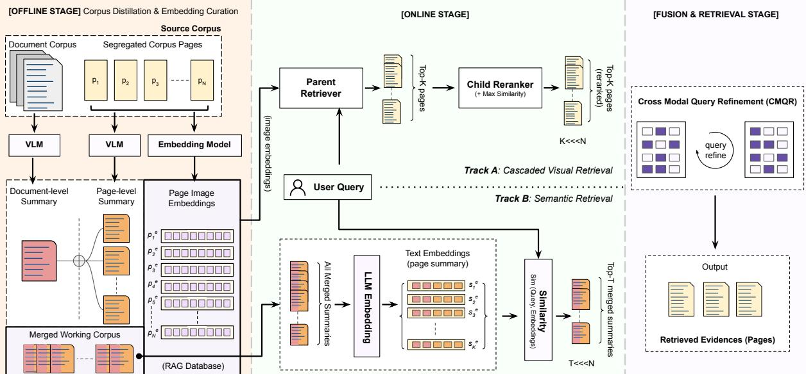  
Figure 2: Architecture of SCOUT. Left (offline phase): each page in the corpus is dual-encoded as (a) a concatenated doc-level + page-level summary embedding and (b) a single visual embedding. Center (online phase): a single query q goes through two parallel tracks: Track A performs an efficient single-vector retrieval to top-K candidates, then applies expensive multi-vector reranking + max-similarity on the same top-K pages. Track B retrieves top-T summaries through cosine similarity between summary embeddings and query. Right: Their union enters Cross-Modal Query Refinement (CMQR), where semantic scores form a soft target that refines the visual multi-vector query; the refined query gets re-scored for the final ranking of evidence pages.

## 3.1.1 Cascaded Visual Track (Track A)

The visual track retrieves and reranks pages using rendered page images in two stages.

Stage 1: Parent Retriever Each page $p \in \mathcal P$ is encoded offline into a single-vector visual embedding using a lightweight vision-language retriever. At query time, the query $q$ is encoded into $\mathbf { e } _ { q } ^ { 1 B }$ and pages are ranked by cosine similarity:

$$
s ^ { 1 B } ( q , p ) = \frac { \mathbf { e } _ { q } ^ { 1 B ^ { \intercal } } \mathbf { e } _ { p } ^ { 1 B } } { \vert \vert \mathbf { e } _ { q } ^ { 1 B } \vert \vert \vert \mathbf { e } _ { p } ^ { 1 B } \vert \vert } .\tag{3}
$$

The top-K pages are retained as the visual candidate set:

$$
\mathcal { C } _ { q } ^ { \mathrm { v i s } } = \mathrm { T o p  – K } _ { p \in \mathcal { P } } \ s ^ { 1 B } ( q , p ) .\tag{4}
$$

Since each page contributes a single vector, scoring over the full corpus reduces to one dense inner product computation per query, making this stage efficient at corpus scale.

Stage 2: Child Reranker. The candidate set $\mathcal { C } _ { q } ^ { \mathrm { v i s } }$ is reranked using a state-of-the-art late-interaction multi-vector visual retriever $f _ { \mathrm { m v } }$ , following the Col-BERT paradigm (Khattab and Zaharia, 2020). For each page $p ,$ the encoder produces a sequence of per-token embeddings:

$$
\mathbf { V } _ { p } = [ \mathbf { v } _ { p } ^ { ( 1 ) } , \ldots , \mathbf { v } _ { p } ^ { ( L _ { p } ) } ] \in \mathbb { R } ^ { L _ { p } \times d } .\tag{5}
$$

The query is encoded as $\mathbf { Q } _ { q } = [ \mathbf { q } ^ { ( 1 ) } , \dots , \mathbf { q } ^ { ( L _ { q } ) } ]$ ∈ $\mathbb { R } ^ { L _ { q } \times d }$ . Relevance is computed via MaxSim:

$$
s ^ { \mathrm { v i s } } ( q , p ; \mathbf { Q } _ { q } ) = \frac { 1 } { L _ { q } } \sum _ { i = 1 } ^ { L _ { q } } \operatorname* { m a x } _ { j \in [ L _ { p } ] } \mathbf { q } ^ { ( i ) \top } \mathbf { v } _ { p } ^ { ( j ) } .\tag{6}
$$

Since late-interaction scoring is applied only over $ { \mathcal { C } } _ { q } ^ { \mathrm { v i s } }$ , the computational cost of this stage is bounded by $O ( K )$ regardless of corpus size. The reranked candidate set forms the visual output $\mathcal { O } _ { q } ^ { \mathrm { v i s } }$ , with $| \mathcal { O } _ { q } ^ { \mathrm { v i s } } | \leq K$

## 3.1.2 Semantic Retrieval (Track B)

We retrieve pages based on their hierarchical summaries $\sigma _ { i , j }$ , complementary to the visual track for fine-grained nuances that visual matching may not surface. To address this, the query q is encoded into $\mathbf { e } _ { q } ^ { \mathrm { s u m } } \in \mathbb { R } ^ { D _ { s } }$ using the same embedding model used for indexing. Each page is scored by cosine similarity against its stored summary embedding.

$$
s ^ { \mathrm { s u m } } ( q , p ) = \frac { \mathbf { e } _ { q } ^ { \mathrm { s u m } \top } \mathbf { e } _ { p } ^ { \mathrm { s u m } } } { \| \mathbf { e } _ { q } ^ { \mathrm { s u m } } \| \| \mathbf { e } _ { p } ^ { \mathrm { s u m } } \| } .\tag{7}
$$

The top-T pages by summary score act as the semantic output $\mathcal { O } _ { q } ^ { \mathrm { s u m } }$

## 3.1.3 Cross-Modal Query Refinement.

SCOUT’s two parallel tracks yield complementary rankings: the visual track captures layout, figures, and spatial structure; the semantic track captures textual and numerical content surfaced through the summaries. Traditionally, combining these at the rank level discards information about how semantic scores relate to individual visual query token representations. Hence, we apply a novel representationlevel fusion using Cross Modal Query Refinement (CMQR) adapted from Guided Query Refinement (Uzan et al., 2026), which uses the semantic track’s scores to refine the visual query embedding before final scoring.

Let $\mathcal { U } _ { q } = \mathcal { O } _ { q } ^ { \mathrm { v i s } } \cup \mathcal { O } _ { q } ^ { \mathrm { s u m } }$ be the union of the two tracks’ outputs. Starting from the initial multivector query embedding $\mathbf { \bar { Q } } _ { q } ^ { ( 0 ) }$ produced by the visual encoder, the semantic scores over $\mathcal { U } _ { q }$ are converted into a soft target distribution:

$$
\mathbf { t } _ { q } = ( 1 - \alpha ) \cdot \rho _ { \tau } ( \mathbf { s } ^ { \mathrm { v i s } , 0 } ) + \alpha \cdot \rho _ { \tau } ( \mathbf { s } ^ { \mathrm { s u m } } )\tag{8}
$$

where, $\begin{array} { r l r } { \rho _ { \tau } ( \mathbf { x } ) } & { { } = } & { \mathrm { s o f t m a x } ( \mathbf { x } / \tau ) } \end{array}$ denote the temperature-scaled softmax and $\mathbf { S } ^ { \mathrm { { v i s , 0 } } }$ and $\mathbf { s } ^ { \mathrm { s u m } }$ are the visual and semantic score vectors over $\mathcal { U } _ { q } , \tau$ controls distribution sharpness, and α balances the two signals. The query embedding is optimized so that the resulting visual score distribution agrees with $\mathbf { t } _ { q } ,$ yielding a refined embedding $\mathbf { Q } _ { q } ^ { \star } .$ . The final ranked list is produced by rescoring $\mathcal { U } _ { q }$ with the refined query:

$$
\pi _ { q } ^ { \mathrm { f i n a l } } = \mathrm { r a n k } _ { p \in \mathcal { U } _ { q } } \ s ^ { \mathrm { v i s } } ( q , p ; \ \mathbf { Q } _ { q } ^ { \star } ) .\tag{9}
$$

The optimization operates only over $\mathcal { U } _ { q }$ , which contains at most $K + T$ pages, keeping the cost of this stage independent of corpus size. Each page in $\pi _ { q } ^ { \mathrm { f i n a l } }$ carries an index $( i , j )$ from the offline phase, which maps directly to both the structured summary $\sigma _ { i , j }$ and the original page image $p _ { i , j }$ , allowing either to be returned as evidence for downstream tasks.

## 4 Experiments

In this section, we summarize benchmark, baseline, and metric selection.

Datasets. We evaluate on ViDoRe v3 (Loison et al., 2026), a domain-diverse visual document retrieval benchmark spanning multiple document types and application areas. To test robustness across different document collections, we additionally evaluate on ViDoSeek (Wang et al., 2025), refined SlideVQA (Tanaka et al., 2023), and REAL-MM-RAG (Wasserman et al., 2025). These datasets cover visually rich pages with tables, figures, charts, slides, and dense layouts, making them suitable for comparing text-only, visual, and multivector retrieval methods.

Evaluation. We evaluate efficiency using average query latency (ms/query), measured over online retrieval, reranking, fusion, and refinement after offline indexing. Retrieval quality is measured using NDCG@5 and NDCG@10.

Baselines. We compare against dense text, visual, and multi-vector retrieval baselines. For text-only retrieval, we evaluate Linq-Embed-Mistral (Choi et al., 2024), Qwen3-Embedding (Zhang et al., 2025), and Jina-v4 text (Günther et al., 2025) embeddings using OCR-derived text. For visual retrieval, we evaluate models that operate on page images, including Jina-v4 vision, ColNomic-7B (Nomic Team, 2025) and ColEmbed-3B-v2 (Xu et al., 2025). Table 16 in summarizes all methods.

## 5 Results

In this section, we report retrieval performance, analyze the contribution of each module in SCOUT, and examine the resulting accuracy–latency tradeoffs. Additional details are provided in Appendix 8.

## 5.1 Performance Comparison

The performance of SCOUT across four benchmarks is summarized in Table 2. SCOUT outperforms (or levels up) SOTA performance across all benchmarks while retrieving at a fraction of its querytime cost. SOTA (in our case, ColEmbed-3Bv2) suffers with latencies between 4.5–32.8 sec/- query depending on corpus size. SCOUT limits late-interaction scoring to Top-K candidate pages, reducing latency to 387-553 milliseconds/query across all benchmarks. This is a gain of 8.4× on ViDoRe-HR to 80.7× on SlideVQA, with an average of 28.8× across all benchmarks (c.f. Table 15). The Pareto boundary in Figure 3 (a) and the latency breakdown in Figure 3 (b) illustrate this efficiency advantage. Also, we report the per-dataset index footprint comparison in Table 8.

Overall, SCOUT demonstrates consistent improvement across all benchmarks. On ViDoRe 3, SCOUT achieves NDCG@5 of 58.85 and NDCG@10 of 61.31, compared to 56.65 and 58.99 for SOTA, an average improvement of +3.9% respectively.

<table><tr><td rowspan="2">Model</td><td colspan="2">ViDoSeek</td><td colspan="2">SlideVQA</td><td colspan="2">ViDoRe 3</td><td colspan="2">R-MM-RAG</td></tr><tr><td>@5</td><td>@10</td><td>@5</td><td>@10</td><td>@5</td><td>@10</td><td>@5</td><td>@10</td></tr><tr><td>Qwen3-8B</td><td>74.84</td><td>77.10</td><td>89.01</td><td>90.24</td><td>48.18</td><td>50.63</td><td>57.61</td><td>60.35</td></tr><tr><td>Jina-v4 (t)</td><td>75.24</td><td>77.09</td><td>91.53</td><td>92.32</td><td>51.30</td><td>53.94</td><td>52.39</td><td>55.41</td></tr><tr><td>Linq-Emb.</td><td>78.20</td><td>80.15</td><td>91.12</td><td>92.05</td><td>46.77</td><td>49.44</td><td>57.36</td><td>60.09</td></tr><tr><td>Jina-v4 (v)</td><td>85.48</td><td>86.46</td><td>93.75</td><td>94.34</td><td>53.01</td><td>55.66</td><td>66.11</td><td>68.87</td></tr><tr><td>ColNomic</td><td>83.48</td><td>85.03</td><td>94.06</td><td>94.57</td><td>55.44</td><td>58.02</td><td>70.60</td><td>72.60</td></tr><tr><td>ColEmbed</td><td>84.76</td><td>85.76</td><td>94.58</td><td>94.86</td><td>56.65</td><td>58.99</td><td>72.43</td><td>74.56</td></tr><tr><td>SCOUT</td><td>87.41</td><td>88.29</td><td>94.72</td><td>95.01</td><td>58.85</td><td>61.31</td><td>75.06</td><td>76.72</td></tr><tr><td>(Std. error)</td><td>±0.79</td><td>±0.71</td><td>±0.32</td><td>±0.30</td><td>±3.71</td><td>±3.73</td><td>±4.48</td><td>±4.14</td></tr><tr><td>∆(%)</td><td>↑2.3%</td><td>↑2.1%</td><td>↑0.1%</td><td>↑0.2%</td><td>↑3.9%</td><td>↑3.9%</td><td>↑3.6%</td><td>↑2.9%</td></tr></table>

Table 2: Retrieval performance comparison on Vi-DoSeek, SlideVQA, ViDoRe 3, and REAL-MM-RAG benchmarks. ∆(%) shows the relative improvement wrt best baseline (underlined).

On ViDoSeek, NDCG@5 improves from 85.48 to 87.41 (∆= + 2.3%) when compared with the best performer (Jina-vis). On SlideVQA, where the strongest baseline is already near saturation, the gain is modest, but SCOUT still provides a substantial latency reduction (see Table 2). To evaluate SCOUT’s performance in downstream tasks, we report performance on the Vidore V3 benchmark in Table 14 (c.f. Appendix B.7).

Generalization Across Domains and Languages. Beyond the primary benchmarks, SCOUT demonstrates strong generalization across multilingual and domain-specific retrieval settings. Table 5 summarizes findings on ViDoRe benchmark, where it SCOUT achieves the best performance across all English and French domain subsets, with improvements of up to 5.7% over the strongest baseline. Whereas on REAL-MM-RAG benchmark, as shown in Table 6, SCOUT achieves the best results on three of four subsets, with gains of up to 7.8%. Detailed results are provided in Appendix B.6.

## 5.2 Ablation Study

We present experiments to show module-wise contribution and selection of candidate pool depth (K).

Module-wise Contribution. Table 3 shows the contribution of each module in SCOUT evaluated on the average NDCG@10 over ViDoRe 3 dataset. The child reranker module contributes the most to the performance, removal of which causes the steepest 20.90% drop in NDCG@10. This also attests that while the Parent Retriever efficiently filters the candidate pool, the late-interaction scoring of the child reranker is where the visual track’s accuracy is realized. We see consistent behavior for other modules. Without Track A, the performance drops by 12.35% and shows that the visual track carries the primary retrieval signal. Similarly, removing Track B alone results in a 7.01% drop. At last, replacing CMQR with common fusion method, RRF, yields a 6.28% drop and indicates that ranklevel fusion discards as much signal as the absence of the semantic track, whereas CMQR preserves it at the representation level. We discuss the inclusion of summary vs traditional OCR text in Section 6.

<table><tr><td>Variant</td><td>Avg. NDCG@10 (∆%)</td></tr><tr><td>SCOUT</td><td>61.31 (reference)</td></tr><tr><td>w/o Track A</td><td>53.73 (↓ 12.35%)</td></tr><tr><td>w/o Track B</td><td>57.00 (↓ 7.01%)</td></tr><tr><td>↔ w/o Child Reranker</td><td>48.49 (↓ 20.90%)</td></tr><tr><td>Replace (Track B): Summary→ OCR Replace (Fusion): CMQR→ RRF</td><td>59.08 (↓ 3.6%) 57.45 (↓ 6.28%)</td></tr></table>

Table 3: Ablation Study. Top-down ablation on the major SCOUT modules: Track A (cascaded visual track containing parent retriever and child reranker) and Track B (semantic retriever) in comparison with SCOUT’s performance on ViDoRe 3. Additional benchmark ablation in Appendix (c.f. Table 12).

Candidate Pool Depth. Figure 4 shows mean NDCG@10 against query latency for both SCOUT and its variant without CMQR across candidate pool sizes K ∈ {5, 10, 25, 50, 100}. Findings show that SCOUT reaches near-peak performance at K=10 and remains stable through K=50 matching this within 0.04 points, and slightly drops at K=100. At the same time, reducing K from 50 to 25 lowers reranking latency from ∼1,213 ms to ∼724 ms, a 40% reduction. The gap between SCOUT and the variant without CMQR narrows as K grows, from 12.5 points at K=5 to 3.1 points at K=50. The non-CMQR variant depends more on larger candidate pools to maintain quality, while CMQR achieves stronger rankings from smaller pools by semantically reordering visual candidates. Across all depths, SCOUT consistently outperforms the variant without CMQR, indicating that representation-level refinement improves candidate ordering. All hyperparameters, including the summary depth T=20, are selected on a held-out validation split; the search spaces and a sensitivity sweep over T are reported in Appendix B.5.

## 6 Analysis

In this section, we analyze the reasoning behind the SCOUT’s performance, efficiency, and a case study.

Latency Analysis. SCOUT achieves 468.2 ms/- query versus 13, 464.4 ms/query for ColEmbed-3B-v2, a 28.8× efficiency at higher retrieval yield.

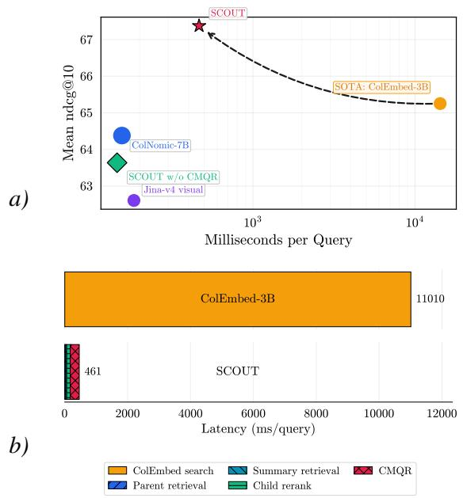  
Figure 3: (a) Latency-quality trade-off for visual retrieval methods. Each point reports macro-averaged NDCG@10 and per-query latency. (b) Per-query latency breakdown comparing exhaustive ColEmbed-3Bv2 retrieval with our cascaded pipeline averaged over the ViDoRe subsets.

The latency breakdown in Figure 3(a) shows that the dominant cost is CMQR refinement (∼287 ms, 61% of total) over the K=25 candidate pages, with ColEmbed reranking and Nemotron-Embed-VL-1B (de Souza P. Moreira et al., 2026) parent retrieval contributing substantially less. Figure 6 illustrates the latency breakdown on additional benchmarks. CMQR is responsible for per-dataset gains of Finance +4.40, HR +4.58, Industrial +5.04, Finance-FR +7.78, Physics +3.42, Energy +4.24, and CS +2.48 NDCG@10 points over the cascade alone (c.f. Table 12). Since both reranking and CMQR operate on at most Top-K pages rather than the full corpus, their cost is independent of corpus size, and the latency improvement is an inherent property of the cascade architecture.

On the other hand, Table 15 contextualizes this against the competing retrievers. ColNomic occupies the efficient but lower-quality region at 155.5 ms/query with NDCG@10= 64.38, while ColEmbed defines the slow but strong benchmark at 14, 286.4 ms/query with NDCG@10= 65.26. Evidently, Figure 3(a) shows that our pipeline sits well above on the Pareto curve at NDCG@10= 67.37. Further supporting the quality-latency tradeoff under varying K is also analyzed in Section 5.2, and retrieval index footprints are discussed in the Appendix, highlighting active storage reduction between 104-337× (c.f. Table 8). We also present the one-time offline summarization cost in Appendix B.4, incurring \$45 for the full ViDoRe corpus and under \$100 across all evaluated corpora (Table 10). We further discuss the practical considerations of such a system in Appendix C.

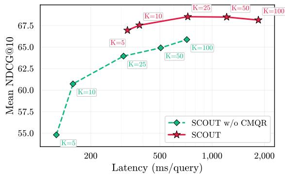  
Figure 4: Candidate-depth sweep: Mean NDCG@10 versus latency for different reranker depths K.

Robustness to Query Perturbation. We evaluate robustness to perturbed queries in Table 4. SCOUT achieves the highest NDCG@10 on the perturbed queries on all four benchmarks and the smallest drop on three of them, losing 4.6 points on average compared with 6.7 for ColEmbed and 6.3 for ColNomic. The gap is largest on REAL-MM-RAG, a benchmark specially built to test robustness to perturbation, where SCOUT loses 14.14 points against 17.25 and 17.26. On ViDoSeek it is almost unaffected (0.07 points), and on ViDoRe it loses 2.69 points against 4.64 and 3.64. On SlideVQA, queries are straightforward (NDCG@10 near 97) and perturbation barely removes any vocabulary, so all methods change only marginally.

Case Study. Figure 5 presents a query from the ViDoRe-Energy corpus whose answer spans three pages (pg1, pg2, pg3) out of 2,255, making it a case where no single retrieved page suffices as evidence. The retriever has to fetch all three evidence pages at high ranks, the answer requires numerical precision that visual matching alone may not resolve, and the relevant pages constitute only 0.13% of the corpus. ColEmbed-3B-v2 ranks pg1 at 3rd, pg2 at 42nd, and pg3 at 6th, which recovers pg1 and pg3 reasonably but places pg2 outside any practical retrieval window. ColNomic-7B improves on pg2 (rank 9th) but degrades on pg3 (rank 14th) and fails to consistently surface all three.

For SCOUT, the parent retriever alone ranks pg2 and pg3 poorly (33rd and 42nd) but yields a candidate pool containing all three pages. The child reranker improves pg2 and pg3 substantially (15th and 6th; pg1 moves from 2nd to 3rd), showing that multi-vector late interaction over the pool captures fine-grained visual and textual nuances that singlevector scoring misses. Adding the summary track (Track B) raises pg2 to 7th and pg3 to 2nd, showing that hierarchical summaries supply evidence the visual track alone misses. The full pipeline with CMQR ranks pg1, pg2, and pg3 at 1st, 3rd, and 2nd, placing all three gold pages in the top 3.

<table><tr><td>Model</td><td>ViDoSeek</td><td>SlideVQA</td><td>ViDoRe 3</td><td>R-MM-RAG</td></tr><tr><td>ColNomic</td><td>88.73 (↓3.34)</td><td>95.22 (↓0.75)</td><td>57.41 (↓3.64)</td><td>72.60 (↓17.26)</td></tr><tr><td>ColEmbed</td><td>89.23 (↓3.13)</td><td>95.29 (↓1.67)</td><td>58.14 (↓4.64)</td><td>74.56 (↓17.25)</td></tr><tr><td>SCOUT</td><td>91.00 (↓0.07)</td><td>95.52 (↓1.58)</td><td>59.94 (↓2.69)</td><td>76.72 (↓14.14)</td></tr></table>

Table 4: Robustness to query perturbation. The table includes NDCG@10 points on the perturbed queries and the shift from the original scores. Values closer to zero indicate greater robustness. Best scores are in bold and second best are underlined.

RRF vs. CMQR. We compare two fusion strategies over the same candidate union $\mathcal { U } _ { q } \mathrm { . }$ : reciprocal rank fusion (RRF) and our CMQR (built on GQR). CMQR adds a modest refinement cost but improves the final ranking on every ViDoRe 3 subset and on all four benchmarks (Table 12; further results in Appendix D). The gap grows as the two tracks’ top-10 rankings diverge (Figure 8): CMQR’s gain over ColEmbed rises from +1.9% to +5.7%, whereas RRF falls from −1.2% to −8.9%. The same pattern holds across subsets: CMQR’s gain over RRF is largest where the rankings diverge most (Finance-FR +17.37%, Industrial +12.86%, REAL FinReport +14.49%; Spearman ρ = 0.79 between gain and divergence). We attribute this to when the two signals interact. RRF merges the rankings only after each track has ranked pages independently, so semantic evidence never influences visual matching. CMQR instead uses the semantic scores as soft supervision to refine the visual query token representations directly, so textual evidence guides visual matching before final scoring.

Summary vs Earlier OCR Approaches. Replacing the VLM-generated hierarchical summaries with raw page text obtained via OCR (Most et al., 2025; Huang et al., 2022) reduces average NDCG@10 by −3.6% while latency remains comparable at ∼547 ms. This gap isolates the contribution of the offline distillation step. Raw OCR text preserves some of this information but loses structure and injects noise from layout artifacts and extraction errors.

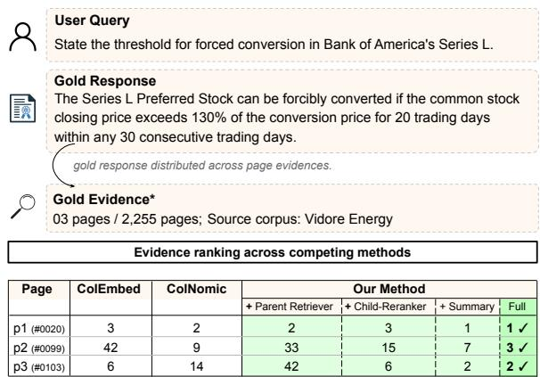

<table><tr><td rowspan=1 colspan=1>Page</td><td rowspan=1 colspan=1>ColEmbed</td><td rowspan=1 colspan=1>ColNomic</td><td></td><td rowspan=1 colspan=1>Our Method</td><td rowspan=1 colspan=1></td><td rowspan=1 colspan=1></td></tr><tr><td rowspan=1 colspan=1>p1 (#0020)</td><td rowspan=1 colspan=1>3</td><td rowspan=1 colspan=1>2</td><td rowspan=1 colspan=1>2</td><td rowspan=1 colspan=1>3</td><td rowspan=1 colspan=1>1</td><td rowspan=1 colspan=1>1√</td></tr><tr><td rowspan=1 colspan=1>p2 (#0099)</td><td rowspan=1 colspan=1>42</td><td rowspan=1 colspan=1>9</td><td rowspan=1 colspan=1>33</td><td rowspan=1 colspan=1>15</td><td rowspan=1 colspan=1>7</td><td rowspan=1 colspan=1>3√</td></tr><tr><td rowspan=1 colspan=1>p3 (#0103)</td><td rowspan=1 colspan=1>6</td><td rowspan=1 colspan=1>14</td><td rowspan=1 colspan=1>42</td><td rowspan=1 colspan=1>6</td><td rowspan=1 colspan=1>2</td><td rowspan=1 colspan=1>2√</td></tr></table>

Figure 5: Case Study. A query and its response with evidence distributed across 3 pages out of 2,255 in Vidore-Energy corpus. Rankings are shown at each stage of SCOUT against ColEmbed-3B-v2 and ColNomic-7B methods. Our full framework retrieves all three gold pages within the top-3 ranks (✓).

## 7 Conclusion

Exhaustive multi-vector search over large document corpora performs well, but is impractical at scale; SCOUT addresses this with a cascaded two parallel track framework that combines bounded late-interaction visual retrieval with offline hierarchical summarization and cross-modal query refinement. Across 4 benchmarks, SCOUT reduces query-time latency up to 80.7× (28.8× on average) while exceeding state-of-the-art accuracy by up to 7.8% NDCG. Our findings show that the child reranker lifts retrieval performance by 20.9% over the parent retriever alone, and CMQR adds up to 7.78 NDCG@10 points over the visual cascade by refining the query representation using semantic scores. We close with practical considerations showing that SCOUT is robust to component choice with interchangeable retrievers.

## 8 Limitations and Ethical Considerations

Limitations. SCOUT can only rank pages that enter its candidate pool. Track B recovers many pages missed by the parent retriever, but pages ranked low by both tracks remain unrecoverable. The semantic track relies on offline summaries from a proprietary VLM (Gemini 2.5 Flash), which may omit or misrepresent page content. Additionally, the semantic track depends on offline VLM-generated summaries, which may occasionally omit or misrepresent page content; higher-quality summarization models can be substituted as they become available, given the modular design of SCOUT. Offline indexing is a one-time cost excluded from query-time latency and amortizes over all queries, though it may need to be refreshed for frequently updated corpora (which is a lesser frequency practice in enterprise).

Ethical Considerations. SCOUT is a retrieval framework that does not generate content or model artifacts. Visual document collections may contain sensitive enterprise, financial, legal, or personal information; practitioners should ensure appropriate access control, data retention policies, and privacy-preserving indexing when deploying SCOUT in such settings as per the organization policies. As with any retrieval system, retrieved pages should be treated as evidence candidates rather than guaranteed ground truth, and human oversight is encouraged in high-stakes decision-making contexts. Future work should explore privacy-preserving indexing strategies and end-to-end evaluation under realistic user-facing RAG workflows.

## References

Mohammad Mahdi Abootorabi, Amirhosein Zobeiri, Mahdi Dehghani, Mohammadali Mohammadkhani, Bardia Mohammadi, Omid Ghahroodi, Mahdieh Soleymani Baghshah, and Ehsaneddin Asgari. 2025. Ask in any modality: A comprehensive survey on multimodal retrieval-augmented generation. In Findings of the Association for Computational Linguistics: ACL 2025, pages 16776–16809, Vienna, Austria. Association for Computational Linguistics.

Sebastian Bruch, Franco Maria Nardini, Cosimo Rulli, and Rossano Venturini. 2024. Efficient inverted indexes for approximate retrieval over learned sparse representations. In Proceedings of the 47th International ACM SIGIR Conference on Research and Development in Information Retrieval, SIGIR ’24, page 152–162, New York, NY, USA. Association for Computing Machinery.

Jaemin Cho, Debanjan Mahata, Ozan Irsoy, Yujie He, and Mohit Bansal. 2025. M3docvqa: Multi-modal multi-page multi-document understanding. In Proceedings ofthe IEEE/CVF International Conference on Computer Vision, pages 6178–6188.

Chanyeol Choi, Junseong Kim, Seolhwa Lee, Jihoon Kwon, Sangmo Gu, Yejin Kim, Minkyung Cho, and Jy-yong Sohn. 2024. Linq-embed-mistral technical report. arXiv preprint arXiv:2412.03223.

Gheorghe Comanici, Eric Bieber, Mike Schaekermann, Ice Pasupat, Noveen Sachdeva, Inderjit Dhillon, Marcel Blistein, Ori Ram, Dan Zhang, Evan Rosen, et al. 2025. Gemini 2.5: Pushing the frontier with advanced reasoning, multimodality, long context, and next generation agentic capabilities. arXiv preprint arXiv:2507.06261.

Gordon V Cormack, Charles LA Clarke, and Stefan Buettcher. 2009. Reciprocal rank fusion outperforms condorcet and individual rank learning methods. In Proceedings of the 32nd international ACM SIGIR conference on Research and development in information retrieval, pages 758–759.

Gabriel de Souza P. Moreira, Ronay Ak, Mengyao Xu, Oliver Holworthy, Benedikt Schifferer, Zhiding Yu, Yauhen Babakhin, Radek Osmulski, Jiarui Cai, Ryan Chesler, Bo Liu, and Even Oldridge. 2026. Nemotron colembed v2: Top-performing late interaction embedding models for visual document retrieval.

Cicero Dos Santos, Luciano Barbosa, Dasha Bogdanova, and Bianca Zadrozny. 2015. Learning hybrid representations to retrieve semantically equivalent questions. In Proceedings of the 53rd Annual Meeting of the Association for Computational Linguistics and the 7th International Joint Conference on Natural Language Processing (Volume 2: Short Papers), pages 694–699.

Manuel Faysse, Hugues Sibille, Tony Wu, Bilel Omrani, Gautier Viaud, CELINE HUDELOT, and Pierre Colombo. 2025. Colpali: Efficient document retrieval with vision language models. In International Conference on Learning Representations, volume 2025, pages 61424–61449.

Michael Günther, Saba Sturua, Mohammad Kalim Akram, Isabelle Mohr, Andrei Ungureanu, Bo Wang, Sedigheh Eslami, Scott Martens, Maximilian Werk, Nan Wang, and Han Xiao. 2025. jina-embeddingsv4: Universal embeddings for multimodal multilingual retrieval. In Proceedings of the 5th Workshop on Multilingual Representation Learning (MRL 2025), pages 531–550, Suzhuo, China. Association for Computational Linguistics.

Yupan Huang, Tengchao Lv, Lei Cui, Yutong Lu, and Furu Wei. 2022. Layoutlmv3: Pre-training for document ai with unified text and image masking. In Proceedings of the 30th ACM international conference on multimedia, pages 4083–4091.

Vladimir Karpukhin, Barlas Oguz, Sewon Min, Patrick Lewis, Ledell Wu, Sergey Edunov, Danqi Chen, and Wen-tau Yih. 2020. Dense passage retrieval for opendomain question answering. In Proceedings of the 2020 conference on empirical methods in natural language processing (EMNLP), pages 6769–6781.

Omar Khattab and Matei Zaharia. 2020. Colbert: Efficient and effective passage search via contextualized late interaction over bert. In Proceedings ofthe 43rd International ACM SIGIR conference on research and development in Information Retrieval, pages 39– 48.

Saar Kuzi, Mingyang Zhang, Cheng Li, Michael Bendersky, and Marc Najork. 2020. Leveraging semantic and lexical matching to improve the recall of document retrieval systems: A hybrid approach. arXiv preprint arXiv:2010.01195.

Jinhyuk Lee, Zhuyun Dai, Sai Meher Karthik Duddu, Tao Lei, Iftekhar Naim, Ming-Wei Chang, and Vincent Zhao. 2023. Rethinking the role of token retrieval in multi-vector retrieval. In Advances in Neural Information Processing Systems, volume 36, pages 15384–15405. Curran Associates, Inc.

António Loison, Quentin Macé, Antoine Edy, Victor Xing, Tom Balough, Gabriel Moreira, Bo Liu, Manuel Faysse, Céline Hudelot, and Gautier Viaud. 2026. Vidore v3: A comprehensive evaluation of retrieval augmented generation in complex real-world scenarios. arXiv preprint arXiv:2601.08620.

Alexander Most, Joseph Winjum, Manish Bhattarai, Shawn Jones, Nishath Rajiv Ranasinghe, Ayan Biswas, and Dan O’Malley. 2025. Lost in ocr translation? vision-based approaches to robust document retrieval. In Proceedings of the 2025 ACM Symposium on Document Engineering, pages 1–10.

Franco Maria Nardini, Cosimo Rulli, and Rossano Venturini. 2024. Efficient multi-vector dense retrieval with bit vectors. In European Conference on Information Retrieval, pages 3–17. Springer.

Rodrigo Nogueira and Kyunghyun Cho. 2019. Passage re-ranking with bert. arXiv preprint arXiv:1901.04085.

Nomic Team. 2025. Nomic embed multimodal: Interleaved text, image, and screenshots for visual document retrieval. Accessed: 2026-05-19.

Zach Nussbaum, John X. Morris, Brandon Duderstadt, and Andriy Mulyar. 2025. Nomic embed: Training a reproducible long context text embedder.

NVIDIA Ingest Development Team. 2024. NVIDIA Ingest: An accelerated pipeline for document ingestion. https://github.com/NVIDIA/NeMo-Retriever. Accessed: 2026-05-21.

Yingqi Qu, Yuchen Ding, Jing Liu, Kai Liu, Ruiyang Ren, Wayne Xin Zhao, Daxiang Dong, Hua Wu, and

Haifeng Wang. 2021. RocketQA: An optimized training approach to dense passage retrieval for opendomain question answering. In Proceedings of the 2021 Conference of the North American Chapter of the Associationfor Computational Linguistics: Human Language Technologies, pages 5835–5847, Online. Association for Computational Linguistics.

Keshav Santhanam, Omar Khattab, Christopher Potts, and Matei Zaharia. 2022. Plaid: an efficient engine for late interaction retrieval. In Proceedings of the 31st ACM International Conference on Information & Knowledge Management, pages 1747–1756.

Mujeen Sung, Jungsoo Park, Jaewoo Kang, Danqi Chen, and Jinhyuk Lee. 2023. Optimizing test-time query representations for dense retrieval. In Findings of the Association for Computational Linguistics: ACL 2023, pages 5731–5746, Toronto, Canada. Association for Computational Linguistics.

Ryota Tanaka, Taichi Iki, Taku Hasegawa, Kyosuke Nishida, Kuniko Saito, and Jun Suzuki. 2025. Vdocrag: Retrieval-augmented generation over visually-rich documents. In Proceedings of the IEEE/CVF Conference on Computer Vision and Pattern Recognition (CVPR), pages 24827–24837.

Ryota Tanaka, Kyosuke Nishida, Kosuke Nishida, Taku Hasegawa, Itsumi Saito, and Kuniko Saito. 2023. Slidevqa: A dataset for document visual question answering on multiple images. In Proceedings of the AAAI Conference on Artificial Intelligence, volume 37, pages 13636–13645.

Ryota Tanaka, Kyosuke Nishida, and Sen Yoshida. 2021. Visualmrc: Machine reading comprehension on document images. In Proceedings ofthe AAAI Conference on Artificial Intelligence, volume 35, pages 13878– 13888.

Omri Uzan, Asaf Yehudai, roi pony, Eyal Shnarch, and Ariel Gera. 2026. Guided query refinement: Multimodal hybrid retrieval with test-time optimization. In The Fourteenth International Conference on Learning Representations.

Bin Wang, Chao Xu, Xiaomeng Zhao, Linke Ouyang, Fan Wu, Zhiyuan Zhao, Rui Xu, Kaiwen Liu, Yuan Qu, Fukai Shang, et al. 2024. Mineru: An opensource solution for precise document content extraction. arXiv preprint arXiv:2409.18839.

Lidan Wang, Jimmy Lin, and Donald Metzler. 2011. A cascade ranking model for efficient ranked retrieval. In Proceedings ofthe 34th international ACM SIGIR conference on Research and development in Information Retrieval, pages 105–114.

Qiuchen Wang, Ruixue Ding, Zehui Chen, Weiqi Wu, Shihang Wang, Pengjun Xie, and Feng Zhao. 2025. Vidorag: Visual document retrieval-augmented generation via dynamic iterative reasoning agents. In Proceedings of the 2025 Conference on Empirical Methods in Natural Language Processing, pages 9124– 9145.

Navve Wasserman, Roi Pony, Oshri Naparstek, Adi Raz Goldfarb, Eli Schwartz, Udi Barzelay, and Leonid Karlinsky. 2025. REAL-MM-RAG: A real-world multi-modal retrieval benchmark. In Proceedings of the 63rd Annual Meeting of the Association for Computational Linguistics (Volume 1: Long Papers), pages 31660–31683, Vienna, Austria. Association for Computational Linguistics.

Mengyao Xu, Gabriel de Souza Pereira Moreira, Ronay Ak, Radek Osmulski, Yauhen Babakhin, Zhiding Yu, Benedikt Schifferer, and Even Oldridge. 2025. Llama nemoretriever colembed: Top-performing textimage retrieval model. CoRR, abs/2507.05513.

HongChien Yu, Chenyan Xiong, and Jamie Callan. 2021. Improving query representations for dense retrieval with pseudo relevance feedback. In Proceedings of the 30th ACM International Conference on Information & Knowledge Management, pages 3592–3596.

Shi Yu, Chaoyue Tang, Bokai Xu, Junbo Cui, Junhao Ran, Yukun Yan, Zhenghao Liu, Shuo Wang, Xu Han, Zhiyuan Liu, and Maosong Sun. 2025. Visrag: Vision-based retrieval-augmented generation on multi-modality documents. In International Conference on Learning Representations, volume 2025, pages 21074–21098.

Yanzhao Zhang, Mingxin Li, Dingkun Long, Xin Zhang, Huan Lin, Baosong Yang, Pengjun Xie, An Yang, Dayiheng Liu, Junyang Lin, et al. 2025. Qwen3 embedding: Advancing text embedding and reranking through foundation models. arXiv preprint arXiv:2506.05176.

## Appendix

## A Additional Results

## B Implementation Details.

All experiments are run on an NVIDIA RTX 6000 GPU.

## B.1 Datasets

We evaluate on four visual document retrieval benchmarks (Table 7). In all of them, the retrieval unit is a rendered page, and each query must be answered by retrieving its relevant page(s) from the full corpus.

## B.2 Document Retrieval Models

Visual document retrieval methods fall into two families. Text-mediated retrieval first converts each page into a textual surrogate-via OCR, layout parsing, or VLM-generated descriptions-and then retrieves with a standard text encoder. This reuses mature text retrievers, but the conversion step discards spatial layout and visual content, and extraction errors propagate into the index. Imagenative multi-vector retrieval removes the conversion step: a vision-language backbone encodes the page as patch-level token embeddings, the query is encoded as text tokens by the same model, and relevance is the late-interaction (MaxSim) sum introduced by ColBERT (Khattab and Zaharia, 2020) and brought to images by ColPali (Faysse et al., 2025). This preserves layout and requires no OCR at query time, and has since been instantiated on several backbones. Its weakness is cost: representing each page with hundreds to thousands of token vectors makes exhaustive search expensive at scale. Table 16 lists the retrievers we evaluate across both families.

## B.3 Offline Indexing

For each dataset and retrieval model, we build pagelevel indices before evaluation. The rendered page is the atomic retrieval unit: visual embeddings, OCR/page text, and summary embeddings are all keyed by the same page identifier. All page embeddings are pre-computed offline; reported latency therefore measures only query-time encoding, retrieval, reranking, fusion, and refinement.

For visual retrievers, we encode rendered page images directly. For text-only baselines, we index one OCR/page-text string per page. For ViDoRe v3, we use the benchmark-provided page-level Markdown text processed by the NeMo Retriever extraction service (NVIDIA Ingest Development Team, 2024). For ViDoSeek and SlideVQA we use page text extracted with MinerU(Wang et al., 2024).

For the summary-based retrieval branch, we construct an additional structured textual view for each page. We generate page-level summaries using Gemini 2.5 Flash(Comanici et al., 2025) and concatenate each page summary with the corresponding document-level description.

Table 8 reports the resulting index footprints. We distinguish total stored embeddings from the active footprint-the representations that must be resident at query time. ColEmbed-3B retrieval keeps the full multi-vector index active, scaling to hundreds of gigabytes even on these modestly sized corpora. In contrast, SCOUT keeps only the lightweight firststage index resident for corpus-wide search and accesses multi-vector embeddings solely for the bounded top-K candidate set, reducing the active footprint.

## B.4 Offline Summarization Cost

SCOUT generates hierarchical page and document summaries once per corpus, at indexing time. Table 10 reports this one-time cost for all evaluated corpora using Gemini 2.5 Flash. Summarization costs roughly \$0.0023 and 300 ms of wall-clock time per page (with 12 parallel API workers). Indexing the full ViDoRe 3 corpus (19,256 pages) costs \$44.81 and takes about 1h 40m, and all four corpora (41,245 pages) together cost under \$100. The cost is incurred offline and never affects querytime latency, which makes it practical for enterprise settings where corpora are static or slowly updated. For frequently updated corpora, only newly added pages need to be summarized, so the update cost scales with the number of changed pages rather than with corpus size.

## B.5 Hyperparameter Selection

We optimize only two hyperparameters for the Guided Query Refinement (GQR) module: the learning rate $( \eta )$ and the number of optimization steps $( N _ { \mathrm { s t e p s } } )$ . We perform a grid search over the following parameter space:

$$
\begin{array} { r l } & { \eta \in \{ 1 \times 1 0 ^ { - 5 } , 5 \times 1 0 ^ { - 5 } , 1 \times 1 0 ^ { - 4 } , } \\ & { \quad 5 \times 1 0 ^ { - 4 } , 1 \times 1 0 ^ { - 3 } , 5 \times 1 0 ^ { - 3 } \} , } \\ & { \quad \quad N _ { \mathrm { s t e p s } } \in \{ 1 0 , 2 5 , 5 0 \} . } \end{array}
$$

<table><tr><td rowspan="3">Model</td><td colspan="9">English</td><td colspan="6">French</td></tr><tr><td colspan="2">CS</td><td colspan="2">Finance</td><td colspan="2">Pharma</td><td colspan="2">HR</td><td colspan="2">Ind.</td><td colspan="2">Finance</td><td colspan="2">Energy</td><td colspan="2">Physics</td></tr><tr><td>@5</td><td>@10</td><td>@5</td><td>@10</td><td>@5</td><td>@10</td><td>@5</td><td>@10</td><td>@5</td><td>@10</td><td>@5</td><td>@10</td><td>@5</td><td>@10</td><td>@5</td><td>@10</td></tr><tr><td>Qwen3-8B</td><td>70.43</td><td>72.45</td><td>46.52</td><td>48.85</td><td>57.41</td><td>59.50</td><td>46.31</td><td>49.37</td><td>38.31</td><td>40.19</td><td>29.08</td><td>31.38</td><td>53.36</td><td>57.07</td><td>44.06</td><td>46.24</td></tr><tr><td>Jina-v4 (Text)</td><td>66.61</td><td>69.08</td><td>54.68</td><td>57.25</td><td>54.01</td><td>55.89</td><td>53.34</td><td>56.27</td><td>41.13</td><td>43.17</td><td>40.63</td><td>44.21</td><td>59.25</td><td>62.17</td><td>40.77</td><td>43.44</td></tr><tr><td>Linq-Embed</td><td>66.39</td><td>69.21</td><td>47.88</td><td>50.85</td><td>56.52</td><td>59.20</td><td>45.79</td><td>48.76</td><td>31.96</td><td>34.12</td><td>31.93</td><td>33.97</td><td>50.81</td><td>54.33</td><td>42.91</td><td>45.11</td></tr><tr><td>Jina-v4 (Vis)</td><td>69.63</td><td>71.91</td><td>52.85</td><td>56.03</td><td>60.32</td><td>62.04</td><td>53.83</td><td>57.00</td><td>45.84</td><td>47.70</td><td>39.70</td><td>43.39</td><td>58.11</td><td>61.10</td><td>43.81</td><td>46.10</td></tr><tr><td>ColNomic-7B</td><td>74.18</td><td>76.93</td><td>54.29</td><td>56.88</td><td>61.07</td><td>62.89</td><td>56.83</td><td>59.91</td><td>47.69</td><td>49.56</td><td>42.19</td><td>45.89</td><td>61.10</td><td>63.69</td><td>46.18</td><td>48.44</td></tr><tr><td>ColEmbed-3B-v2</td><td>74.88</td><td>77.22</td><td>60.81</td><td>63.40</td><td>63.79</td><td>65.47</td><td>58.61</td><td>61.32</td><td>48.46</td><td>49.85</td><td>40.31</td><td>43.38</td><td>61.37</td><td>64.17</td><td>44.93</td><td>47.10</td></tr><tr><td>SCOUT (ours)</td><td>75.65</td><td>78.13</td><td>64.27</td><td>66.86</td><td>64.69</td><td>66.99</td><td>61.49</td><td>64.12</td><td>49.87</td><td>51.09</td><td>44.42</td><td>47.58</td><td>62.29</td><td>65.21</td><td>48.09</td><td>50.46</td></tr><tr><td>(Std. error)</td><td>±0.71</td><td>±0.64</td><td>±0.79</td><td>±0.74</td><td>±0.72</td><td>±0.67</td><td>±0.76</td><td>±0.71</td><td>±0.99</td><td>±0.94</td><td>±0.89</td><td>±0.84</td><td>±0.86</td><td>±0.81</td><td>±0.83</td><td>±0.77</td></tr><tr><td>∆% vs. Best</td><td></td><td></td><td></td><td></td><td></td><td></td><td>↑ 1.0% ↑ 1.2% ↑5.7% ↑5.5% ↑1.4% ↑2.3% ↑ 4.9% ↑ 4.6% ↑ 2.9% ↑ 2.5% ↑ 5.3% ↑ 3.7%</td><td></td><td></td><td></td><td></td><td></td><td>↑1.5% ↑1.6% ↑4.1% ↑4.2%</td><td></td><td></td><td></td></tr></table>

Table 5: Fine-grained retrieval performance on multilingual ViDoRe subsets across English and French domains. Results are reported using NDCG@{5,10}. SCOUT achieves the best performance across all domains and shows generalization to multilingual and domain-specific retrieval settings. Consolidated results are in Table 2.

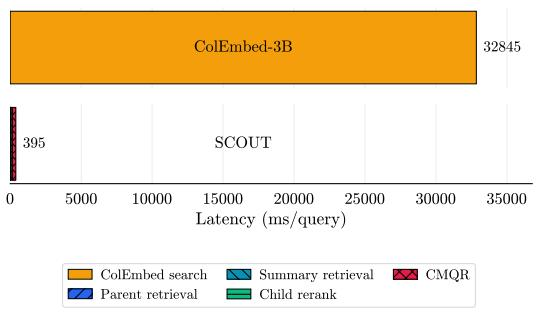  
(a)  
(b)

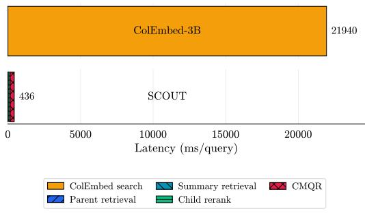  
Figure 6: Per-query latency breakdown comparing exhaustive ColEmbed-3B-v2 retrieval with our cascaded pipeline averaged over the (a) SlideVQA and (b) Vidoseek subsets.

<table><tr><td rowspan="3">Model</td><td colspan="4">Finance</td><td colspan="4">Technical</td></tr><tr><td colspan="2">FinSlides</td><td colspan="2">FinReport</td><td colspan="2">TechReport</td><td colspan="2">TechSlides</td></tr><tr><td>@5</td><td>@10</td><td>@5</td><td>@10</td><td>@5</td><td>@10</td><td>@5</td><td>@10</td></tr><tr><td>Qwen3-8B</td><td>54.76</td><td>58.13</td><td>54.16</td><td>57.03</td><td>52.49</td><td>55.20</td><td>69.04</td><td>71.03</td></tr><tr><td>Jina-v4 (Text)</td><td>49.28</td><td>52.67</td><td>43.36</td><td>46.82</td><td>51.47</td><td>54.59</td><td>65.44</td><td>67.55</td></tr><tr><td>Linq-Embed</td><td>60.72</td><td>63.45</td><td>49.22</td><td>52.50</td><td>49.82</td><td>53.01</td><td>69.70</td><td>71.39</td></tr><tr><td>Jina-v4 (Vis)</td><td>54.47</td><td>58.40</td><td>57.62</td><td>60.77</td><td>71.99</td><td>74.47</td><td>80.36</td><td>81.84</td></tr><tr><td>ColNomic</td><td>60.85</td><td>63.57</td><td>60.02</td><td>62.45</td><td>75.95</td><td>77.67</td><td>85.58</td><td>86.72</td></tr><tr><td>ColEmbed</td><td>60.12</td><td>63.16</td><td>66.45</td><td>68.92</td><td>77.07</td><td>79.08</td><td>86.07</td><td>87.08</td></tr><tr><td>SCOUT (ours)</td><td>65.46</td><td>67.87</td><td>71.61</td><td>73.58</td><td>76.49</td><td>77.97</td><td>86.67</td><td>87.47</td></tr><tr><td>(Std. error)</td><td>±1.24</td><td>±1.14</td><td>±1.34</td><td>±1.23</td><td>±1.01</td><td>±0.93</td><td>±0.79</td><td>±0.73</td></tr><tr><td>∆% vs. Best</td><td>↑7.6%</td><td>↑6.8%</td><td>↑7.8%</td><td>↑6.8%</td><td>↓0.8%</td><td>↓1.4%</td><td>↑0.7%</td><td>↑0.4%</td></tr></table>

Table 6: Fine-grained retrieval performance on the REAL-MM-RAG subsets.

As shown in Table 11 for each dataset, the optimal combination is selected based on NDCG@10 performance on a held-out 5% validation split and subsequently fixed for the final evaluation. Following the average-consensus formulation of GQR (Uzan et al., 2026), we fix the mixture weight to $\alpha = 0 . 5$ , assigning equal importance to the primary visual distribution and the Qwen3 guidance distribution. We also fix the softmax temperature to T = 1.0. No hyperparameters are tuned on the final evaluation split.

<table><tr><td>Benchmark</td><td>Subset</td><td>Lang.</td><td>#Docs</td><td>#Pages</td></tr><tr><td rowspan="9">ViDoRe 3</td><td>Finance (EN)</td><td>en</td><td>6</td><td>2,942</td></tr><tr><td>Comp. Science</td><td>en</td><td>2</td><td>1,360</td></tr><tr><td>Pharma</td><td>en</td><td>52</td><td>2,313</td></tr><tr><td>HR</td><td>en</td><td>14</td><td>1,110</td></tr><tr><td>Industrial</td><td>en</td><td>27</td><td>5,244</td></tr><tr><td>Physics</td><td>fr</td><td>42</td><td>1,674</td></tr><tr><td>Finance (FR)</td><td>fr</td><td>5</td><td>2,384</td></tr><tr><td>Energy</td><td>fr</td><td>41</td><td>2,225</td></tr><tr><td></td><td>en</td><td>292</td><td>5,385</td></tr><tr><td>ViDoSeek SlideVQA</td><td></td><td>en</td><td>400</td><td>8,000</td></tr><tr><td rowspan="5">REAL-MM-RAG</td><td>FinReport</td><td>en</td><td>19</td><td>2,687</td></tr><tr><td>FinSlides</td><td>en</td><td>65</td><td>2,280</td></tr><tr><td>TechReport</td><td>en</td><td>17</td><td>1,674</td></tr><tr><td>TechSlides</td><td>en</td><td>61</td><td>1,963</td></tr><tr><td></td><td></td><td>1,043</td><td>41,241</td></tr></table>

Table 7: Statistics of the evaluation corpora. Language refers to the documents.

<table><tr><td>Index Footprint</td><td>ViDoRe 3 (19,252 pages)</td><td>ViDoSeek (5,385 pages)</td><td>SlideVQA (8,000 pages)</td></tr><tr><td>Nemotron-Embed-VL-1B</td><td>0.08 GB</td><td>0.02 GB</td><td>0.03 GB</td></tr><tr><td>ColEmbed-3B-v2</td><td>213.1 GB</td><td>59.6 GB</td><td>88.6 GB</td></tr><tr><td>SCOUT Active</td><td>0.63 GB</td><td>0.58 GB</td><td>0.59 GB</td></tr><tr><td>Reduction</td><td>337×</td><td>104×</td><td>151×</td></tr><tr><td>Parent retriever</td><td>Index (GB)</td><td>NDCG@10</td><td>Latency (ms)</td></tr><tr><td>Nemotron-Embed-VL-1B</td><td>0.23</td><td>67.37</td><td>465.3</td></tr><tr><td>ColNomic-7B</td><td>6.35</td><td>67.70</td><td>777.7</td></tr></table>

Table 8: Estimated active retrieval index footprint across corpora.

Table 9: Parent retriever ablation across 3 benchmarks: ViDoRe 3, SlideVQA, and ViDoSeek.
<table><tr><td>Dataset</td><td>#Docs</td><td>#Pages</td><td>Time</td><td>Time/page</td><td>Cost/page</td><td>Total cost</td></tr><tr><td>ViDoRe 3</td><td>189</td><td>19,252</td><td>1h 40m</td><td>312 ms</td><td>$0.0023</td><td>$44.81</td></tr><tr><td>SlideVQA</td><td>400</td><td>8,000</td><td>40m</td><td>300 ms</td><td>$0.0022</td><td>$17.78</td></tr><tr><td>ViDoSeek</td><td>292</td><td>5,385</td><td>25m</td><td>279 ms</td><td>$0.0024</td><td>$12.78</td></tr><tr><td>REAL-MM-RAG</td><td>162</td><td>8,604</td><td>45m</td><td>314 ms</td><td>$0.0025</td><td>$21.56</td></tr><tr><td>Total</td><td>1,043</td><td>41,241</td><td>3h 30m</td><td>一</td><td>一</td><td>$96.93</td></tr></table>

Table 10: One-time offline cost of generating hierarchical page and document summaries with Gemini 2.5 Flash. Time is effective wall-clock time using 12 parallel API workers. Only newly added pages require summarization, so updates to a corpus scale with the number of changed pages rather than corpus size.

Summary depth T. We also select the number of summary pages T that the semantic track contributes to the candidate pool on the validation split (Figure 7). Performance improves from $T { = } 1$ to T=10 (about +1.2 NDCG@10) as more summary candidates enter the refinement pool, then plateaus: all settings with $T \geq 1 0$ stay within 0.2 points of the peak at T=20. We therefore use T=20, which gives the best validation performance at negligible additional latency compared with the visual reranking and CMQR stages.

Optimizer and loss. GQR optimizes the multivector query embedding z using Adam $( \beta _ { 1 } = 0 . 9$ $\beta _ { 2 } ~ = ~ 0 . 9 9 9 , \epsilon ~ = ~ 1 0 ^ { - 8 } )$ . The loss minimizes $\mathrm { K L } ( p _ { \mathrm { m i x } } \| p _ { 1 } ( z ^ { ( t ) } ) )$ , where the consensus $p _ { \mathrm { m i x } } =$ $\frac { 1 } { 2 } ( p _ { 1 } ( z ^ { ( 0 ) } ) + p _ { 2 } )$ is computed once at t=0 and held fixed (matching the reference implementation). The initial $z ^ { ( 0 ) }$ is the ColEmbed-3B-v2 query embedding of the unmodified question.

## B.6 Domain and Language Generalization

Table 5 shows ViDoRe-Finance, SCOUT achieves NDCG@5 of 64.27 against 60.81 for SOTA $\left( \Delta = \mathrm { ~ + ~ } 5 . 7 \% \right)$ at 22× lower latency. The performance gain is consistent across the remaining ViDoRe subsets. On ViDoRe-Physics, NDCG@10 improves from 48.44 to 50.46 (∆= + 4.2%); on ViDoRe-Finance (FR), NDCG@5 improves from 42.19 to 44.42 $( \Delta = \mathrm { ~ + ~ } 5 . 3 \% )$ as compared to the ColNomic; on ViDoRe-HR, NDCG@5 increases from 58.61 to 61.49 (∆= + 4.6%); and on ViDoRe-Pharma, NDCG@10 improves from 65.47 to 66.99 (∆= + 2.3%). Gains on ViDoRe-Industrial, ViDoRe-CS, and

<table><tr><td>Dataset</td><td>η</td><td>Steps</td><td>α</td><td>T</td><td>NDCG@10</td></tr><tr><td>ViDoRe (English)</td><td></td><td></td><td></td><td></td><td></td></tr><tr><td>CS</td><td> $1 \times 1 0 ^ { - 4 }$ </td><td>10</td><td>0.5</td><td>1.0</td><td>78.13</td></tr><tr><td>Finance</td><td> $5 \times 1 0 ^ { - 5 }$ </td><td>50</td><td>0.5</td><td>1.0</td><td>66.86</td></tr><tr><td>Pharmaceuticals</td><td> $1 \times 1 0 ^ { - 3 }$ </td><td>25</td><td>0.5</td><td>1.0</td><td>66.99</td></tr><tr><td>HR</td><td> $5 \times 1 0 ^ { - 5 }$ </td><td>25</td><td>0.5</td><td>1.0</td><td>64.12</td></tr><tr><td>Industrial</td><td> $1 \times 1 0 ^ { - 4 }$ </td><td>10</td><td>0.5</td><td>1.0</td><td>51.09</td></tr><tr><td>ViDoRe (French)</td><td></td><td></td><td></td><td></td><td></td></tr><tr><td>Finance</td><td> $1 \times 1 0 ^ { - 4 }$ </td><td>25</td><td>0.5</td><td>1.0</td><td>47.58</td></tr><tr><td>Energy</td><td> $5 \times 1 0 ^ { - 5 }$ </td><td>50</td><td>0.5</td><td>1.0</td><td>65.21</td></tr><tr><td>Physics</td><td> $1 \times 1 0 ^ { - 4 }$ </td><td>25</td><td>0.5</td><td>1.0</td><td>50.46</td></tr><tr><td>REAL-MM-RAG</td><td></td><td></td><td></td><td></td><td></td></tr><tr><td>FinSlides</td><td> $5 \times 1 0 ^ { - 5 }$ </td><td>25</td><td>0.5</td><td>1.0</td><td>67.87</td></tr><tr><td>FinReport</td><td> $5 \times 1 0 ^ { - 5 }$ </td><td>25</td><td>0.5</td><td>1.0</td><td>73.58</td></tr><tr><td>TechReport</td><td> $1 \times 1 0 ^ { - 4 }$ </td><td>10</td><td>0.5</td><td>1.0</td><td>77.97</td></tr><tr><td>TechSlides</td><td> $1 \times 1 0 ^ { - 5 }$ </td><td>25</td><td>0.5</td><td>1.0</td><td>87.47</td></tr><tr><td>Other Benchmarks</td><td></td><td></td><td></td><td></td><td></td></tr><tr><td>ViDoSeek</td><td> $1 \times 1 0 ^ { - 3 }$ </td><td>50</td><td>0.5</td><td>1.0</td><td>88.29</td></tr><tr><td>SlideVQA</td><td> $1 \times 1 0 ^ { - 5 }$ </td><td>25</td><td>0.5</td><td>1.0</td><td>95.01</td></tr></table>

Table 11: Validation-selected CMQR hyperparameters across datasets at the main configuration (K=25, top-T summary feedback = 20). η denotes the learning rate and T the softmax temperature.

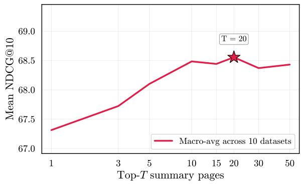  
Figure 7: Validation-set sweep over summary depth: mean NDCG@10 (macro-average over 3 datasets: Vi-DoRe 3, SlideVQA, and ViDoSeek.) for varying numbers of retrieved summary pages T.

ViDoRe-Energy are more modest at +2.9%, +1.0%, and +1.5% NDCG@5 points respectively, but remain positive throughout. SCOUT’s performance validates that the cascade architecture does not compromise retrieval quality for efficiency (c.f. Table 5).

Table 6 shows that SCOUT achieves the largest gains on the Finance subsets of REAL-MM-RAG. On FinReport, NDCG@5 improves from 66.45 to 71.61 (∆= + 7.8%) over ColEmbed, and on FinSlides from 60.85 to 65.46 $( \Delta = + 7 . 6 \% )$ over ColNomic, the strongest baseline on that subset. On the Technical subsets, where the baselines are already near ceiling, SCOUT remains on par: TechSlides improves slightly (+0.7%

<table><tr><td>Dataset</td><td>SCOUT</td><td>w/o Track A</td><td>w/o Track B</td><td>w/o Child</td><td>CMQR→RRF</td></tr><tr><td colspan="6">ViDoRe 3</td></tr><tr><td>Computer Science</td><td>78.13</td><td>69.76 (↓ 12.00%)</td><td>75.65 (↓ 3.28%)</td><td>68.65 (↓ 13.81%)</td><td>74.66 (↓ 4.65%)</td></tr><tr><td>Energy</td><td>65.21</td><td>58.67 (↓ 11.15%)</td><td>60.97 (↓6.95%)</td><td>50.42 (↓ 29.33%)</td><td>61.91 (↓ 5.33%)</td></tr><tr><td>Finance</td><td>66.86</td><td>57.58 (↓ 16.12%)</td><td>62.46 (↓ 7.04%)</td><td>52.72 (↓ 26.82%)</td><td>63.09 (↓ 5.98%)</td></tr><tr><td>Finance (fr)</td><td>47.58</td><td>38.84 (↓ 22.50%)</td><td>39.80 (↓ 19.55%)</td><td>30.05 (↓ 58.34%)</td><td>40.54 (↓ 17.37%)</td></tr><tr><td>HR</td><td>64.12</td><td>54.03 (↓ 18.67%)</td><td>59.54 (↓ 7.69%)</td><td>49.49 (↓ 29.56%)</td><td>58.59 (↓ 9.44%)</td></tr><tr><td>Industrial</td><td>51.09</td><td>40.82 (↓ 25.16%)</td><td>46.05 (↓ 10.94%)</td><td>35.73 (↓ 42.99%)</td><td>45.27 (↓ 12.86%)</td></tr><tr><td>Pharma</td><td>66.99</td><td>63.44 (↓ 5.60%)</td><td>64.48 (↓ 3.89%)</td><td>58.28 (↓ 14.95%)</td><td>66.87 (↓ 0.18%)</td></tr><tr><td>Physics</td><td>50.46</td><td>46.66 (↓ 8.14%)</td><td>47.04 (↓ 7.27%)</td><td>42.61 (↓ 18.42%)</td><td>48.67 (↓ 3.68%)</td></tr><tr><td colspan="6">REAL-MM-RAG</td></tr><tr><td>FinSlides</td><td>67.87</td><td>54.03 (↓ 25.63%)</td><td>62.27 (↓ 8.99%)</td><td>48.02 (↓ 41.36%)</td><td>62.13 (↓ 9.24%)</td></tr><tr><td>FinReport</td><td>73.58</td><td>53.57 (↓ 37.37%)</td><td>66.83 (↓ 10.10%)</td><td>49.59 (↓ 48.38%)</td><td>64.27 (↓ 14.49%)</td></tr><tr><td>TechReport</td><td>77.97</td><td>59.84 (↓ 30.30%)</td><td>74.97 (↓ 4.00%)</td><td>58.95 (↓ 32.26%)</td><td>69.62 (↓ 11.99%)</td></tr><tr><td>TechSlides</td><td>87.47</td><td>73.41 (↓ 19.15%)</td><td>85.72 (↓ 2.05%)</td><td>76.11 (↓ 14.93%)</td><td>82.34 (↓ 6.23%)</td></tr><tr><td>ViDoSeek</td><td>88.29</td><td>86.28 (↓ 2.33%)</td><td>85.60 (↓ 3.14%)</td><td>81.41 (↓ 8.45%)</td><td>88.19 (↓ 0.11%)</td></tr><tr><td>SlideVQA</td><td>95.01</td><td>91.76 (↓ 3.54%)</td><td>94.79 (↓ 0.23%)</td><td>92.79 (↓ 2.39%)</td><td>94.79 (↓ 0.23%)</td></tr><tr><td>Overall Average</td><td>70.05</td><td>60.62 (↓ 15.55%)</td><td>66.16 (↓ 5.88%)</td><td>56.77 (↓ 23.38%)</td><td>65.78 (↓ 6.48%)</td></tr></table>

Table 12: Component ablation across datasets (NDCG@10) comparing our full model to variants.

NDCG@5), while TechReport shows a small drop (−0.8% NDCG@5) relative to ColEmbed. Textonly retrievers trail the visual models on every subset except FinSlides, where Linq-Embed is within 0.13 points of the best visual baseline. Overall, SCOUT matches or exceeds the strongest baseline on three of four subsets, with the largest gains on finance documents, whose pages are dense with tables and visually similar layouts.

## B.7 Downstream Performance

To assess whether retrieval gains carry over to downstream answer quality, we run an end-toend QA evaluation with Qwen3-VL-8B-Instruct. According to Table 14), SCOUT improves over ColEmbed-3B-v2 on every subset, raising the average to 66.48 (+4.4% relative), with the largest gains on Finance (+7.5%) and French Finance (+8.1%).

## C Practical Considerations

SCOUT is designed to be modular and deploymentfriendly. The parent retriever is interchangeable depending on enterprise requirements. Table 9 shows how performance varies with different retrievers, at the cost of a 27× larger storage (0.23 GB vs. 6.35 GB). For storage-constrained deployments, a smaller model (e.g. Nemotron-Embed-VL-1B) is a practical choice, however even replacing it with larger models (e.g. ColNomic-7B), the performance sees only a bare minimum gain. Likewise, the child reranker can be replaced by any enterprise-specific reranker, with the only constraint that it produces embeddings to support the downstream similarity function in CMQR. This storage-latency trade-off gives a clear axis for tuning SCOUT with deployment constraints.

## D Reciprocal Rank Fusion

We use Reciprocal Rank Fusion (RRF) as a nonparametric rank-level fusion baseline between the visual retrieval branch and the summary-based text retrieval branch. Given two ranked lists of pages, $\pi _ { q } ^ { \mathrm { v i s } }$ and $\pi _ { q } ^ { \mathrm { s u m } }$ , RRF assigns each candidate page p the score

$$
s _ { \mathrm { R R F } } ( q , p ) = \sum _ { \pi \in \{ \pi _ { q } ^ { \mathrm { v i s } } , \pi _ { q } ^ { \mathrm { s u m } } \} } \frac { 1 } { k + \mathrm { r a n k } _ { \pi } ( p ) } ,\tag{10}
$$

where rankπ(p) is the 1-indexed rank of page p in list $\pi ,$ and k is a smoothing constant. We set $k = 6 0$ , following the standard RRF setting. RRF is applied to the union of pages appearing in either list, and pages are sorted by $s _ { \mathrm { R R F } } ( q , p )$ to obtain the fused ranking. The report analysis compared to CMQR shown in Table12.

<table><tr><td>Split</td><td>Dataset</td><td>Method</td><td>NDCG@10</td></tr><tr><td rowspan="3">Single-hop</td><td>SlideVQA</td><td>Parent retrieval +Child reranker SCOUT</td><td>93.87 95.44 95.59</td></tr><tr><td>ViDoRe 3</td><td>Parent retrieval + Child reranker SCOUT</td><td>49.37 58.05 62.41</td></tr><tr><td>ViDoSeek</td><td>Parent retrieval + Child reranker SCOUT</td><td>76.82 81.33 86.11</td></tr><tr><td rowspan="3">Multi-hop</td><td>SlideVQA</td><td>Parent retrieval + Child reranker SCOUT</td><td>89.72 92.92 93.37</td></tr><tr><td>ViDoRe 3</td><td>Parent retrieval + Child reranker SCOUT</td><td>39.69 46.03 49.67</td></tr><tr><td>ViDoSeek</td><td>Parent retrieval + Child reranker SCOUT</td><td>87.46 91.22 91.17</td></tr></table>

Table 13: Single-hop and multi-hop performance analysis (NDCG@10) across SlideVQA, ViDoRe, and Vi-DoSeek. ViDoRe values are macro-averaged across its 8 sub-datasets.

## D.1 Single-hop vs. Multi-hop Complexity

To examine how SCOUT behaves under different query complexities, we evaluate three stages of the pipeline—parent retrieval, the child reranker, and the full SCOUT—on single-hop and multi-hop query subsets separately (Table 13).

Across both query types, the child reranker consistently improves over parent retrieval, confirming the value of bounded late-interaction reranking. On ViDoRe single-hop queries, NDCG@10 increases from 49.37 to 58.05 after reranking $( \Delta = + 8 . 6 8 )$ and the full pipeline further improves to 62.41 $( \Delta = + 4 . 3 6$ over the reranker). The same trend holds on ViDoRe multi-hop queries, where performance rises from 39.69 to 46.03 and then to 49.67. SlideVQA shows a similar pattern, with the full pipeline achieving the best score on both singlehop and multi-hop subsets. On ViDoSeek, SCOUT improves strongly over parent retrieval on both splits, although on the multi-hop subset the full pipeline is effectively tied with the child reranker (91.17 vs. 91.22).

Multi-hop queries are harder on ViDoRe and SlideVQA, where full-pipeline NDCG@10 drops from 62.41 to 49.67 and from 95.59 to 93.37, respectively. ViDoSeek is an exception: its multihop subset scores higher than its single-hop subset across all stages, suggesting that query difficulty is dataset-dependent rather than determined only by hop count. Overall, the cascade remains effective across both regimes, with the largest gains appearing on the more challenging ViDoRe 3 split.

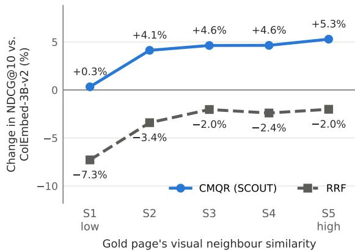

(a) By the gold page’s visual neighbour similarity.  
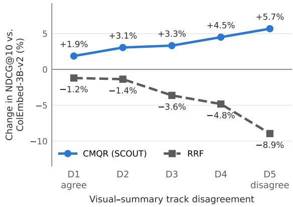  
(b) By visual–summary track disagreement.  
Figure 8: Relative NDCG@10 change over full-corpus ColEmbed-3B-v2 for CMQR (SCOUT) and RRF on the same candidate union, by quintile (computed within each of the 12 subsets; 17,162 queries).

Robustness experiment setup. We test how retrieval changes when the same query is reworded, keeping gold pages, corpus and hyperparameters identical to the main experiments. For REAL-MM-RAG, we use the released level-3 rephrasings of all 4,099 evaluation queries. For ViDoRe 3, Vi-DoSeek and SlideVQA, which release no rephrasings, we select the queries whose wording overlaps most with the gold page’s text, excluding names, numbers and titles (100 queries per ViDoRe 3 subset, 300 each for ViDoSeek and SlideVQA). This text-only criterion is fixed before rephrasing. GPT-5.2 rephrases each query with REAL-MM-RAG’s level-3 prompt. We keep a rephrasing only if it preserves all numbers and identifiers and a GPT-5.2 as a verifier judges it equivalent, non-leaking and meaningfully reworded (Figure 11); we resample a failed rephrasing up to three times. This leaves 792, 296 and 293 queries, whose rephrasings remove 22-34% of the query words that match the gold page (35% for REAL-MM-RAG). Each method is run on both the original and the rephrased version of every query, and we test whether the drop in NDCG@10 differs between methods.

<table><tr><td>Model</td><td>CS</td><td>Finance</td><td>Pharma</td><td>HR</td><td>Ind.</td><td>Fin. (FR)</td><td>Energy</td><td>Physics</td><td>Avg.</td></tr><tr><td>ColEmbed-3B-v2</td><td>79.76</td><td>58.69</td><td>65.46</td><td>60.25</td><td>58.97</td><td>52.08</td><td>64.73</td><td>69.23</td><td>63.65</td></tr><tr><td>SCOUT + page summaries</td><td>82.52</td><td>63.09</td><td>68.01</td><td>63.74</td><td>59.85</td><td>56.28</td><td>67.83</td><td>70.49</td><td>66.48</td></tr><tr><td>∆% vs. ColEmbed</td><td>↑3.5%</td><td>↑7.5%</td><td>↑3.9%</td><td>↑5.8%</td><td>↑1.5%</td><td>↑8.1%</td><td>↑4.8%</td><td>↑1.8%</td><td>↑4.4%</td></tr></table>

Table 14: End-to-end answer quality on the ViDoRe 3 subsets, measured as the average judge score (Correct = 1, Partially correct = 0.5, Incorrect = 0). Generator: Qwen3-VL-8B-Instruct, top-5 retrieved pages; judge: GPT-5.2.

## E Generative AI Use

We used generative AI assistants for grammatical revision, stylistic polishing, and as a coding assistant. Our use of generative AI did not amount to any substantive outsourcing of the intellectual work.

<table><tr><td>Benchmark</td><td>Subset</td><td>Method</td><td>NDCG@10 (↑)</td><td>Latency (ms) (↓)</td></tr><tr><td rowspan="2">SlideVQA</td><td rowspan="2"></td><td>SCOUT</td><td>95.01</td><td>406.89</td></tr><tr><td>ColNomic-7B ColEmbed-3B-v2</td><td>94.57 94.86</td><td>331.01 32,844.94</td></tr><tr><td rowspan="10">ViDoRe</td><td>cs</td><td>SCOUT ColNomic-7B</td><td>78.13 76.93</td><td>387.43 98.89</td></tr><tr><td>energy</td><td>ColEmbed-3B-v2 SCOUT ColNomic-7B</td><td>77.22 65.21</td><td>7,088.78 553.34</td></tr><tr><td>finance</td><td>ColEmbed-3B-v2 SCOUT ColNomic-7B</td><td>63.69 64.17 66.86</td><td>108.45 10,234.83 530.34</td></tr><tr><td>finance_fr</td><td>ColEmbed-3B-v2 SCOUT</td><td>56.88 63.41 47.58</td><td>134.24 12,149.66 456.57</td></tr><tr><td>hr</td><td>ColNomic-7B ColEmbed-3B-v2 SCOUT</td><td>45.89 43.38 64.12</td><td>125.14 12,047.96</td></tr><tr><td>industrial</td><td>ColNomic-7B ColEmbed-3B-v2 SCOUT ColNomic-7B</td><td>59.91 61.32 51.09 49.56</td><td>539.79 72.35 4,554.36 454.68</td></tr><tr><td>pharma</td><td>ColEmbed-3B-v2 SCOUT</td><td>49.85 66.99</td><td>207.64 21,511.19 448.69</td></tr><tr><td rowspan="3">physics</td><td>ColNomic-7B ColEmbed-3B-v2</td><td>62.89 65.47</td><td>111.86 11,757.60</td></tr><tr><td>SCOUT</td><td>50.46</td><td>422.87</td></tr><tr><td>ColNomic-7B</td><td>48.44</td><td>93.00</td></tr><tr><td rowspan="3"></td><td>ColEmbed-3B-v2</td><td></td><td></td></tr><tr><td></td><td>47.18</td><td>8,735.13</td></tr><tr><td>SCOUT</td><td>88.29</td><td>452.64</td></tr><tr><td rowspan="2"></td><td></td><td>ColNomic-7B ColEmbed-3B-v2</td><td>85.03 85.76</td><td>272.17 21,939.95</td></tr><tr><td>FinSlides</td><td></td><td></td><td></td></tr><tr><td rowspan="9">REAL-MM-RAG</td><td rowspan="2"></td><td>SCOUT</td><td>67.87</td><td>466.64</td></tr><tr><td>ColNomic-7B</td><td>63.57</td><td>109.90</td></tr><tr><td rowspan="3">FinReport</td><td>ColEmbed-3B-v2</td><td>63.16</td><td>10,965.30</td></tr><tr><td>SCOUT</td><td>73.58</td><td>531.46</td></tr><tr><td>ColNomic-7B</td><td>62.45</td><td>196.00</td></tr><tr><td rowspan="3">TechReport</td><td>ColEmbed-3B-v2</td><td>68.92</td><td>15,199.30</td></tr><tr><td>SCOUT</td><td></td><td>452.66</td></tr><tr><td>ColNomic-7B</td><td>77.97 77.67</td><td></td></tr><tr><td rowspan="3">TechSlides</td><td>ColEmbed-3B-v2</td><td>79.08</td><td>106.40 9,025.10</td></tr><tr><td>SCOUT</td><td></td><td></td></tr><tr><td>ColNomic-7B</td><td>87.47 86.72</td><td>450.60</td></tr><tr><td rowspan="3">Average</td><td>ColEmbed-3B-v2</td><td>87.08</td><td>152.80 10,447.00</td></tr><tr><td>SCOUT</td><td></td><td></td></tr><tr><td>ColNomic-7B</td><td>70.05 66.73</td><td>468.19 151.42</td></tr><tr><td rowspan="3"></td><td></td><td>ColEmbed-3B-v2</td><td></td><td>13,464.36</td></tr><tr><td>SCOUT</td><td></td><td>67.92</td><td>28.76×</td></tr><tr><td></td><td>一</td><td></td><td>88.92×</td></tr><tr><td colspan="2">Speedup vs. ColEmbed</td><td>ColNomic-7B ColEmbed-3B-v2</td><td></td><td>1.00×</td></tr></table>

Table 15: Retrieval performance, latency, and relative speedups grouped by dataset and method.

<table><tr><td>Model alias</td><td>Full model name</td><td>Size (Params)</td><td>Vecs/Pg</td><td>Dim</td><td>Footprint (GiB/1M Pgs)</td><td>HF Identifier</td></tr><tr><td>Linq-Embed</td><td>Linq-Embed-Mistral</td><td>7.1B</td><td>1</td><td>4096</td><td>7.6</td><td>Linq-AI-Research/Linq-Embed-Mistral</td></tr><tr><td>Qwen3-8B</td><td>Qwen3-Embedding-8B</td><td>8B</td><td>1</td><td>4096</td><td>7.6</td><td>Qwen/Qwen3-Embedding-8B</td></tr><tr><td>Jina-v4 (Text)</td><td>jina-embeddings-v4</td><td>3.8B</td><td>1</td><td>2048</td><td>3.8</td><td>jinaai/jina-embeddings-v4</td></tr><tr><td>Jina-v4 (Vision)</td><td>jina-embeddings-v4</td><td>3.8B</td><td>~755</td><td>128</td><td>180.0</td><td>jinaai/jina-embeddings-v4</td></tr><tr><td>ColNomic-7B</td><td>ColNomic-Embed-Multimodal-7B</td><td>7B</td><td>~755</td><td>128</td><td>180.0</td><td>nomic-ai/colnomic-embed-multimodal-7b</td></tr><tr><td>ColEmbed-3B-v2</td><td>Llama-Nemotron-ColEmbed-VL-3B-v2</td><td>3B</td><td>1,802</td><td>3072</td><td>10,311.1</td><td>nvidia/1lama-nemotron-colembed-vl-3b-v2</td></tr><tr><td>Nemotron-Embed-VL-1B</td><td>Llama-Nemotron-Embed-VL-1B-v2</td><td>1B</td><td>1</td><td>2048</td><td>3.8</td><td>nvidia/1lama-nemotron-embed-vl-1b-v2</td></tr></table>

Table 16: Specification of the evaluated retrieval models. We list model aliases, full model names, parameter counts, page-level embedding structure, estimated index footprint, and Hugging Face repositories. Footprint is estimated for one million pages using 16-bit precision and excludes metadata, file-system, and indexing overhead.

## F Document-Level Summary Prompt

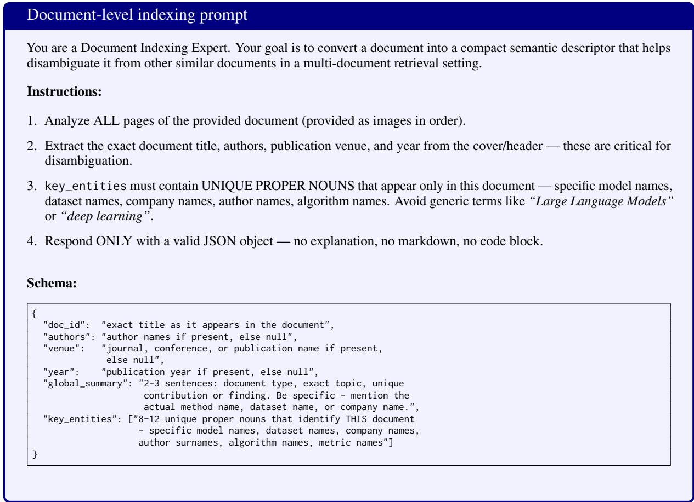  
Figure 9: Prompt used to generate document-level semantic summaries. At indexing time, the JSON fields shown are concatenated and prepended to each page summary before embedding; global\_summary is truncated to 300 characters and key\_entities to the first 15 entries.

## G Page-Level Summary Prompt

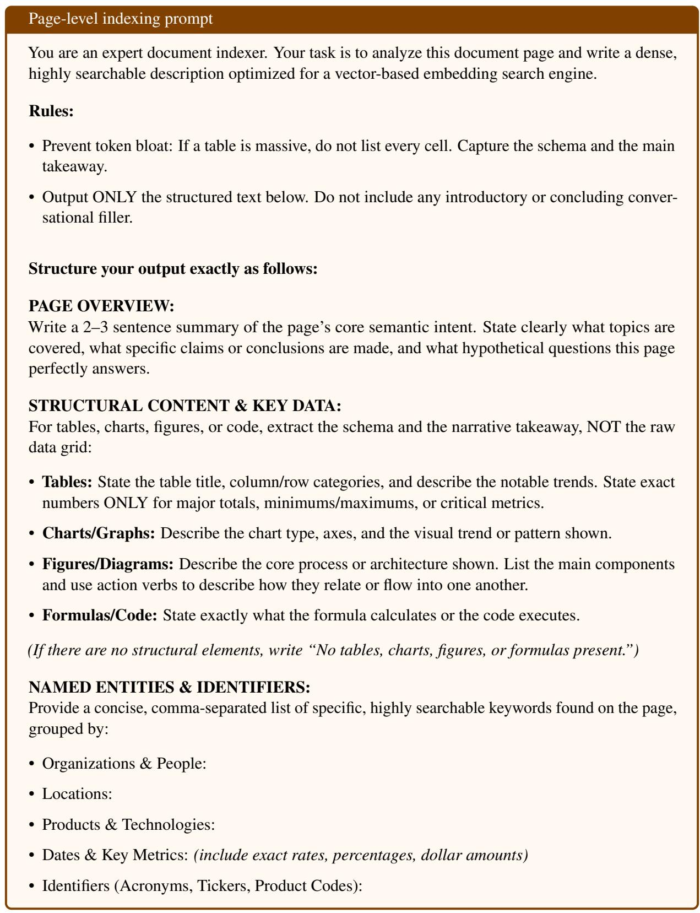  
Figure 10: Prompt used to generate page-level semantic summaries for vector-based retrieval. Each page is summarized into a structured text representation comprising a high-level overview, schema-level descriptions of tables/charts/figures, and grouped named entities.

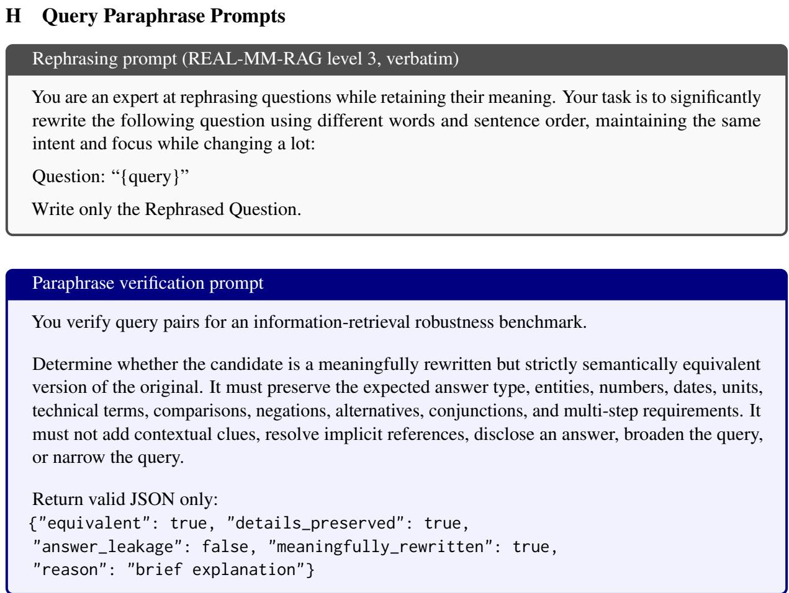  
Figure 11: Prompts used to construct the rephrasing-robustness evaluation sets for ViDoRe 3, ViDoSeek and SlideVQA. Each original query is rewritten with REAL-MM-RAG’s level-3 rephrasing prompt, used verbatim (top). A candidate is kept only if it preserves every number and identifier of the original and passes an independent verification call (bottom); otherwise it is regenerated, up to three attempts, and queries without an accepted rephrasing are discarded. Both prompts use GPT-5.2. REAL-MM-RAG itself is evaluated with the benchmark’s released level-3 rephrasings.