# ChronoCulture: Evaluating Cultural Awareness Across Time in Large Language Models

Rusali Saha Nitya Khurana Ruihong Huang Kuan-Hao Huang

Texas A&M University

{rs0921,nityakhurana,huangrh,khhuang}@tamu.edu

## Abstract

Cultural attitudes and social norms evolve over time, yet most cultural benchmarks for large language models (LLMs) treat culture as a static attribute of a country or region. We introduce ChronoCulture, a benchmark of 10,360 temporal pairs built from longitudinal survey data across 72 countries. Each pair contains the same survey question asked in the same country in an older and a newer year, with full population response distributions as ground truth. Across six LLMs, we find that models can often predict a country’s attitudes at one point in time but do not reliably capture how those attitudes change. Their predictions for different years tend to stay close together, failing to capture much of the observed change. Specifying the intended year in the prompt also offers little overall improvement in alignment with survey responses. These findings suggest that models often present a largely static picture of cultural attitudes, highlighting the need to evaluate cultural awareness across time.

## 1 Introduction

Large language models (LLMs) are increasingly deployed in settings that require cultural awareness, from globalized communication and education to social science and anthropology research. This has motivated a growing line of benchmarks that test whether models can represent cultural views and social norms across diverse countries and communities (Myung et al., 2024; Chiu et al., 2025; Alwajih et al., 2025a; Li et al., 2024). However, most existing benchmarks treat culture as a fixed rather than evolving characteristic of a country or community, thereby evaluating models against a single cultural snapshot.

In reality, cultural attitudes and social norms are not static. They may evolve over time in response to economic development, generational change, and political transformation (Inglehart, 1997, 2018). The extent of this change can also vary across societies: attitudes toward religion, gender roles, or trust may remain relatively stable in some countries while changing substantially in others (Inglehart and Baker, 2000). This raises a central question: can language models represent how cultural attitudes evolve over time?

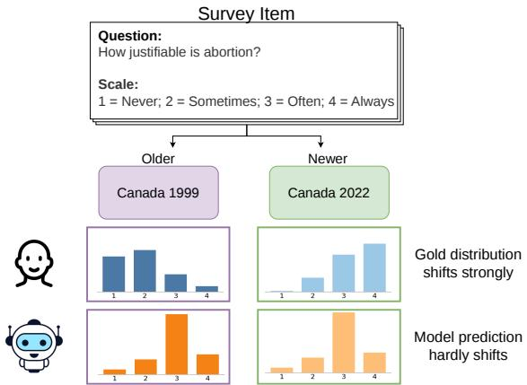  
Figure 1: Limited temporal sensitivity: survey responses in Canada shift between 1999 and 2022, while Llama-3.3-70B predicts similar distributions for both years.

Figure 1 illustrates a key motivation for our work. Survey data show that attitudes toward abortion in Canada shifted markedly between 1999 and 2022, yet the model produces similar predictions for both periods. Evaluating a model against a single point in time provides only a partial view of its cultural awareness. A more complete evaluation requires comparing predictions for the same question and country across multiple time periods.

To address this gap, we introduce ChronoCulture, a benchmark for evaluating whether LLMs capture cultural change over time. ChronoCulture is built from two long-running international survey programs, the World Values Survey (WVS) (Haerpfer et al., 2022) and the International Social Survey Programme (ISSP) (International Social Survey Programme, 2026), covering 72 countries between 1985 and 2022. Its basic unit is a temporal pair: the same survey question asked in the same country in an older and a newer year, with the full distribution of population responses for each year as ground truth. We ask models to predict these distributions for each year and compare their predictions with the observed survey responses.

Across six LLMs, we find that models can often predict a country’s attitudes at one point in time, but do not reliably capture how they change. Their predictions for different years tend to stay close together despite observed change, and specifying the intended year in the prompt does not consistently improve alignment. These findings suggest that model predictions often present a static picture of cultural attitudes, rather than an account of how those attitudes evolve. Our contributions are as follows:

1. We introduce ChronoCulture, a benchmark of 10,360 temporal pairs across 72 countries that evaluates whether LLMs capture cultural change, using full population response distributions rather than single answers.

2. We develop an evaluation framework that assesses whether LLMs accurately predict both periods, capture cultural change and stability, and benefit from specifying the intended year.

3. We release code to rebuild the benchmark and run all evaluations, for future research.1

## 2 Related Works

Socio-Cultural Knowledge Evaluation for Large Language Models Existing cultural benchmarks evaluate LLMs on everyday knowledge and commonsense (Myung et al., 2024; Chang et al., 2025; Singh et al., 2025), cultural values and norms (Naous et al., 2024; Chiu et al., 2025; Rao et al., 2025; Qiu et al., 2025), and multimodal cultural knowledge (Schneider et al., 2025; Li et al., 2026; Tan et al., 2026; Faraz et al., 2026). However, these benchmarks largely treat culture as a static attribute of a country, language, or region (Zhou et al., 2025; Alkhamissi et al., 2026). We instead treat culture as evolving over time and examine whether LLMs capture changes in cultural attitudes.

Temporal-Aware Question Answering Temporal QA benchmarks primarily focus on changing factual knowledge, such as historical events and entity attributes (Chen et al., 2021; Tang et al., 2025; Hu et al., 2025; Piryani et al., 2026; Jiang et al., 2026). Related vision-language research examines whether models can interpret cultural content from different historical periods, including films, artifacts, and cultural heritage images (Jajoo et al., 2025; Ghaboura et al., 2025; Ranjan et al., 2026). We instead evaluate whether text-based LLMs capture changes in population attitudes, using longitudinal survey responses.

Survey-based Opinion and Value Alignment OpinionQA, GlobalOpinionQA, and WorldValues-Bench compare LLM outputs with survey-based human opinions across demographic groups and countries (Santurkar et al., 2023; Durmus et al., 2024; Zhao et al., 2024). Liu et al. (2026) extend this comparison across WVS waves, finding that LLMs align more with contemporary opinions. While these works examine which population group or survey wave model responses most closely resemble, we evaluate whether models capture how the same population’s attitudes change over time.

Concurrent with our work, Daryani et al. (2026) study cultural change using the Inglehart–Welzel map, which summarizes a country’s survey responses along two cultural dimensions. They find that LLMs capture only part of the observed change, consistent with our results. While they track changes in a country’s overall cultural position, ChronoCulture compares full response distributions for individual survey questions within each country, across time. This allows us to identify changes that may be hidden when multiple questions are combined into an aggregate measure.

## 3 Benchmark Creation

We introduce ChronoCulture, a benchmark for evaluating whether LLMs can represent cultural attitudes at different time periods and capture how those attitudes change. It contains survey questions asked in the same countries at different time periods, so that each cultural topic can be examined over time within the same country.

We construct the benchmark using three design principles. First, we ground cultural attitudes in people’s survey responses for a given country and year, drawing on surveys conducted across countries over multiple years. Second, we use full response distributions as ground truth rather than a single mean or majority answer, preserving the diversity of opinions within each population. Third, we compare the same question within the same country across time, forming temporal pairs of response distributions from two survey years.

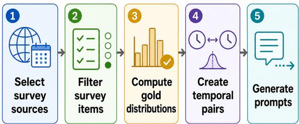  
Figure 2: Overview: Benchmark construction pipeline.

The second design principle is particularly important for capturing cultural change. Several existing cultural benchmarks evaluate MCQs based on a single correct answer (Myung et al., 2024; Romanou et al., 2025; Alwajih et al., 2025b; Kim et al., 2024; Koto et al., 2024). As we show in Section 3.6 and Figure 4, a single correct answer can obscure how cultural attitudes change.

The following subsections describe how we select and process survey data to construct temporal pairs. Figure 2 summarizes this process.

## 3.1 Data Sources

We construct the benchmark from two international survey programs that collect longitudinal data on social attitudes and values across countries: the World Values Survey (WVS) (Haerpfer et al., 2022) and the International Social Survey Programme (ISSP) (International Social Survey Programme, 2026). Each record contains an individual’s response to a question, with the country and survey year. We use WVS Waves 3–7 (1995–2022) and ISSP data spanning 1985–2022 (Appendix A.1).

## 3.2 Variable Selection

We define a variable as a survey question repeated in at least two waves with a consistent, ordered response scale. Ordered options are required by our evaluation method (Section 3.5). Variables cover topics such as trust, religion, gender roles, and environmental attitudes. We exclude demographic metadata, behavioral frequency items, and countryspecific questions that are not comparable across nations. We require at least 500 respondents for each question within each country and wave. These criteria yield 408 longitudinal variables across 72 countries. Appendix A.1 lists the topic categories.

## 3.3 Gold Response Distribution

For each variable in a given country and year, we remove invalid responses such as “don’t know” and calculate the proportion of people choosing each response option. The survey sample may differ in demographic composition from the country’s population. To account for this, we use survey-provided weights to adjust the response proportions so that overrepresented or underrepresented demographic groups better match their shares in the national population. These weighted proportions form the gold response distribution $G _ { t } ,$ , that represents the population’s responses for that question, country, and survey year t. Appendix $\mathrm { A } . 2$ provides details on the survey weights and the calculation.

## 3.4 Temporal Pairs

For each variable observed in a country at both an older and a newer time point, we create one temporal pair. Each pair consists of two instances of the same survey question for the same country: one specifies the older survey year and the other specifies the newer survey year. We denote the corresponding gold response distributions by $G _ { \mathrm { o l d } }$ and $G _ { \mathrm { n e w } }$ , respectively. The newer year is the most recent year (ISSP) or Wave 7 (WVS), and the older year is the oldest available year for that variable and country. This yields 10,360 temporal pairs across 72 countries, thus creating 20,720 dated prompts overall. Figure 3 shows an example from ISSP.

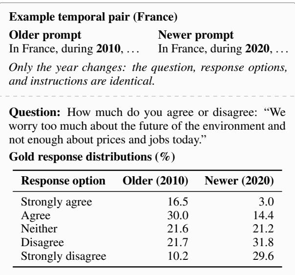  
Figure 3: Example temporal pair from ISSP: two prompts that differ only in the year, each with its own gold response distribution.

## 3.5 Categorization of Temporal Pairs

To evaluate the temporal awareness of LLMs, we first measure how much cultural attitudes changed within each temporal pair. This allows us to assess whether models capture the extent of that change. We measure this change using the Wasserstein distance (Villani, 2009; Peyré and Cuturi, 2019) between $G _ { \mathrm { o l d } }$ and $G _ { \mathrm { n e w } }$ , which takes the order of response options into account. Because questions have different numbers of response options, we normalize the distance to a common [0, 1] range. We denote this normalized Wasserstein distance by W and define the human shift, $d _ { h }$ , as:

$$
d _ { h } = W \left( G _ { \mathrm { o l d } } , G _ { \mathrm { n e w } } \right) .\tag{1}
$$

Larger values indicate greater changes in cultural attitudes. Appendix A.3 provides the calculation.

We use $d _ { h }$ to group temporal pairs into four categories: stable, moderate, strong, and very strong shifts. This allows us to compare model behavior across different levels of cultural change. Table 1 reports the thresholds and the number of pairs in each category, and Appendix F.1 shows that our findings hold under alternative thresholds.

<table><tr><td>Shift category</td><td>Human shift  $d _ { h }$ </td><td>Total pairs</td></tr><tr><td>Stable</td><td> $d _ { h } \leq 0 . 0 3$ </td><td>2,607</td></tr><tr><td>Moderate shift</td><td> $0 . 0 3 < d _ { h } < 0 . 1 0$ </td><td>5,535</td></tr><tr><td>Strong shift</td><td> $0 . 1 0 \leq d _ { h } < 0 . 2 0$ </td><td>1,828</td></tr><tr><td>Very strong shift</td><td> $d _ { h } \geq 0 . 2 0$ </td><td>390</td></tr><tr><td>Total</td><td></td><td>10,360</td></tr></table>

Table 1: Human-shift thresholds and temporal-pair counts for each category.

## 3.6 Why Distribution Evaluation?

Following our second design principle, we evaluate cultural change using full response distributions, since evaluations based on a single correct answer may miss shifts in population attitudes. To examine this limitation, we construct an MCQ version of our benchmark, treating each response option as a choice and the most common population response (the mode) as the correct answer.

Figure 4 illustrates two limitations. A substantial shift in the response distribution may leave the mode unchanged, causing the MCQ evaluation to miss the shift (false negative). Conversely, a slight shift may change the mode, causing the evaluation to overstate the change (false positive). Thus, modal answers alone cannot reliably measure the magnitude of cultural change.

<table><tr><td colspan="4">(a) False negative: large shift, unchanged mode Bangladesh: &quot;Is having the army rule a good or bad way of governing this country?&quot;</td></tr><tr><td></td><td>1996</td><td>2018</td><td></td></tr><tr><td>1 2 3 4</td><td>Very good Fairly good Fairly bad Very bad</td><td>1.0 5.8 23.1 70.1</td><td>13.1 W = 0.251 25.9 22.2 38.9</td></tr><tr><td colspan="4">(b) False positive: little shift, changed mode United States: “How much conflict is there between the</td></tr><tr><td colspan="4">unemployed and people with jobs?&quot;</td></tr><tr><td></td><td></td><td>1987</td><td>1992</td></tr><tr><td>1</td><td>Very strong conflict</td><td>9.8 39.2</td><td>12.6 40.4</td></tr><tr><td>2</td><td>Strong conflict</td><td></td><td></td></tr><tr><td>3</td><td></td><td>43.3</td><td>38.8</td></tr><tr><td></td><td>Not very strong</td><td></td><td></td></tr><tr><td></td><td></td><td></td><td></td></tr><tr><td></td><td></td><td></td><td></td></tr><tr><td></td><td></td><td></td><td></td></tr><tr><td></td><td></td><td></td><td></td></tr><tr><td>4</td><td></td><td>7.7</td><td>8.2</td></tr><tr><td></td><td>No conflict</td><td></td><td></td></tr><tr><td></td><td></td><td></td><td></td></tr><tr><td></td><td></td><td></td><td></td></tr><tr><td></td><td></td><td></td><td></td></tr><tr><td></td><td></td><td></td><td></td></tr><tr><td></td><td></td><td></td><td></td></tr><tr><td></td><td></td><td></td><td></td></tr><tr><td></td><td></td><td></td><td></td></tr><tr><td></td><td></td><td></td><td></td></tr><tr><td></td><td></td><td></td><td></td></tr><tr><td></td><td></td><td></td><td></td></tr><tr><td></td><td></td><td></td><td></td></tr><tr><td></td><td></td><td></td><td></td></tr><tr><td></td><td></td><td></td><td></td></tr><tr><td></td><td></td><td></td><td></td></tr><tr><td></td><td></td><td></td><td></td></tr><tr><td></td><td></td><td></td><td></td></tr><tr><td></td><td></td><td></td><td></td></tr><tr><td></td><td></td><td></td><td></td></tr><tr><td></td><td></td><td></td><td></td></tr><tr><td></td><td></td><td></td><td></td></tr><tr><td></td><td></td><td></td><td></td></tr><tr><td></td><td></td><td></td><td></td></tr><tr><td></td><td></td><td></td><td></td></tr><tr><td></td><td></td><td></td><td></td></tr><tr><td></td><td></td><td></td><td></td></tr><tr><td></td><td></td><td></td><td></td></tr><tr><td></td><td></td><td></td><td></td></tr><tr><td></td><td></td><td></td><td></td></tr><tr><td></td><td></td><td></td><td></td></tr><tr><td></td><td></td><td></td><td></td></tr><tr><td></td><td></td><td></td><td></td></tr><tr><td></td><td></td><td></td><td></td></tr><tr><td></td><td></td><td></td><td></td></tr><tr><td></td><td></td><td></td><td></td></tr><tr><td></td><td></td><td></td><td></td></tr><tr><td></td><td></td><td></td><td></td></tr><tr><td></td><td></td><td></td><td></td></tr><tr><td></td><td></td><td></td><td></td></tr><tr><td></td><td></td><td></td><td></td></tr><tr><td></td><td></td><td></td><td></td></tr><tr><td></td><td></td><td></td><td></td></tr><tr><td></td><td></td><td></td><td></td></tr></table>

Figure 4: The most common answer (mode) can misrepresent cultural change: (a) “Very bad” falls from 70.1% to 38.9% but remains the mode. (b) mode changes despite little distributional change. Bold marks the mode.

Both cases are frequent in our data. Among pairs whose distribution has shifted, 68.2% keep the same mode in both periods, and 8.5% of stable pairs change mode despite little distributional change. A benchmark scored on modal answers would therefore misrepresent how culture changed for most of our data. For this reason, we evaluate full response distributions, which account for changes across all response options. Appendix A.5 reports model results for the MCQ format.

## 3.7 Prompt Construction and Prediction

Recent work has explored direct prompting of response distributions from LLMs, asking models to output numerical distributions over answer options in structured formats (Suzuki et al., 2025; Meister et al., 2025). Meister et al. (2025) compare multiple methods of distribution extraction, including verbalized distributions, sampling-based outputs, and model log-probabilities. They show that directly prompting an LLM for a response distribution outperforms repeated individual querying (Meister et al., 2025; Gong et al., 2026). We adopt this direct distribution-prompting approach.

For each temporal pair, we construct two prompts, one for the older year and one for the newer year. Each prompt includes the country, year, survey question, and response options. We ask models to predict the percentage of people who would choose each option. Figure 3 shows the question pair, Appendix A.4 provides the full prompt.

We denote the prediction for survey year t by $P _ { t }$ . An accurate prediction should closely match the gold distribution $G _ { t } ,$ giving a small normalized Wasserstein distance $W ( P _ { t } , G _ { t } )$ . For each temporal pair, we denote the predictions for the older and newer years by $P _ { \mathrm { o l d } }$ and $P _ { \mathrm { n e w } }$ , respectively.

## 4 Experiments and Results

A temporally aware model should reflect cultural attitudes as they change over time, while producing similar predictions when those attitudes remain stable. We first apply a knowledge filter to retain questions for which models show baseline cultural knowledge (Section 4.1). We then present three Research Findings (RFs): (1) predicting both periods accurately becomes harder as cultural change increases (Section 4.2), (2) models follow the direction of larger cultural shifts but underestimate their magnitude (Section 4.3) and (3) naming a year does not consistently improve alignment (Section 4.4). Finally, in Section 4.5, we examine how temporal performance varies across topics and regions.

We evaluate six LLMs using the same prompts and applying the knowledge filter separately to each: Llama-3.3-70B (Grattafiori et al., 2024), GPT-4o (Hurst et al., 2024), GPT-5.4 (OpenAI, 2026), Qwen3.5-35B-A3B (Qwen Team, 2026a), Qwen3.8-Flash-Next (Qwen Team, 2026b), and DeepSeek-V3 (DeepSeek-AI, 2024).

## 4.1 Cultural Knowledge Filter

Our goal is to evaluate whether models can accurately predict cultural attitudes across different time periods. However, poor predictions could also imply limited knowledge, rather than an inability to track how cultural attitudes change. Thus, before evaluating temporal awareness, we apply a filter to only retain questions for which the model shows some evidence of baseline knowledge.

To apply this filter, we estimate the model’s baseline knowledge by comparing its predictions with observed survey responses. For each question– country combination, we prompt the model to predict the response distribution without specifying a year, giving the undated prediction $P _ { \mathrm { u n d a t e d } }$ We compute the Wasserstein distance between $P _ { \mathrm { u n d a t e d } }$ and the gold distribution for each available survey year, and define K as the minimum of these distances. A small K means the model’s prediction aligns with the cultural attitudes of at least one year, suggesting some baseline knowledge.

We apply the knowledge filter separately to each model, retaining the 75% of question–country combinations with the smallest K values (approximately 7,700 temporal pairs per model). Appendix B.2 provides further details on the selection process and retention statistics.

## 4.2 RF1: Predicting Both Periods Accurately Becomes Harder as Cultural Change Increases

We examine whether models accurately predict both periods of a temporal pair. Across all six models, the share of pairs accurately predicted in both periods declines as human shift increases (Figure 5), while the share with only one accurate prediction rises. Moreover, both predictions are usually closer to the same year’s gold distribution than each to its own (Figure 6).

Setup. For each temporal pair, we obtain two predicted distributions: $P _ { \mathrm { o l d } }$ for the older year and $P _ { \mathrm { n e w } }$ for the newer year. We measure prediction errors using the distance W to the corresponding gold distributions:

$$
\begin{array} { r l } & { d _ { \mathrm { o l d } } = W \left( P _ { \mathrm { o l d } } , G _ { \mathrm { o l d } } \right) , } \\ & { d _ { \mathrm { n e w } } = W \left( P _ { \mathrm { n e w } } , G _ { \mathrm { n e w } } \right) . } \end{array}\tag{2}
$$

Averaging the prediction errors $d _ { \mathrm { o l d } }$ and $d _ { \mathrm { n e w } }$ across temporal pairs does not clearly reveal whether both predictions are accurate within the same pair. To assess accuracy at the pair level, we compare these errors against a tolerance of $\tau = 0 . 1 0$ . Each pair is then classified as both, older only, newer only, or neither, depending on which predictions fall within the tolerance. Appendix C.2 reports results for other settings of τ .

Results. Figure 5(a) shows that, across all six models, the proportion of temporal pairs where both $P _ { \mathrm { o l d } }$ and $P _ { \mathrm { n e w } }$ are accurate declines as human shift increases. In contrast, the share of pairs where only one prediction is accurate rises, exceeding 50% for strong and very strong shifts (Figure 5(b)).

Alignment of predictions. Accuracy alone does not show whether each prediction is closer to its own year’s gold distribution than to the other’s. To examine this, we compare each prediction with both $G _ { \mathrm { o l d } }$ and $G _ { \mathrm { n e w } }$ . We focus on pairs with moderate or larger human shifts. Pairs are separated when each prediction is closer to its own year’s gold distribution, and reversed when each is closer to the opposite year’s. They are older-aligned or newer-aligned when both predictions are closer to $G _ { \mathrm { o l d } }$ or $G _ { \mathrm { n e w } }$ , respectively.

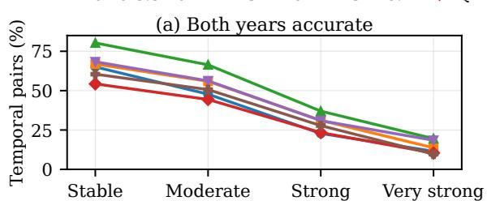

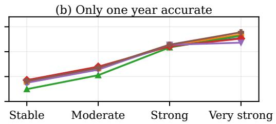  
Figure 5: As human shift increases, for all six models: (a) pairs with both predictions within $\tau = 0$ .10 of their gold distributions decline (b) pairs with exactly one such prediction rise. Full results in Appendix C.1.

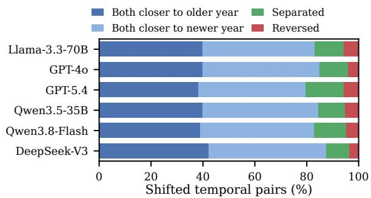  
Figure 6: In most shifted pairs (moderate or larger), both of a model’s predictions are closer to the same year’s gold distribution (either shade of blue), rather than matching its own year (green). Reversed pairs (red) are rare. Breakdown by shift category in Appendix C.3.

Alignment results. Figure 6 shows that, across all six models, $P _ { \mathrm { o l d } }$ and $P _ { \mathrm { n e w } }$ are closer to the same gold distribution for most shifted pairs. The olderaligned and newer-aligned categories account for 80–87% of these pairs, compared with only 9–15% in the separated category (Appendix C.3). Although separated pairs become more common as human shift increases, most pairs still align with the same gold distribution. Reversed pairs are rare.

## 4.3 RF2: Models Follow the Direction of Larger Cultural Shifts but Underestimate Their Magnitude

RF1 showed that models are less likely to predict both periods accurately as human shift increases, while $P _ { \mathrm { o l d } }$ and $P _ { \mathrm { n e w } }$ often resemble the same gold distribution. We now examine whether the change between these predictions matches the observed cultural shift in magnitude and direction. The predicted change may be too small, absent, in the opposite direction, or too large, Appendix D.6 shows each case for Llama-3.3-70B.

Across all six models, $P _ { \mathrm { o l d } }$ and $P _ { \mathrm { n e w } }$ sometimes remain identical despite observed cultural change, although this becomes less common as human shift increases (Figure 7(a)). When human shift increases, predictions capture a smaller proportion of the observed cultural change (Figure 7(b)), while directional alignment improves (Figure 7(c)). Thus, better directional alignment does not ensure that models capture the magnitude of cultural change.

Magnitude of change. For each temporal pair, we define the model shift, $d _ { m }$ , as the normalized Wasserstein distance between $P _ { \mathrm { o l d } }$ and $P _ { \mathrm { n e w } }$

$$
d _ { m } = W \left( P _ { \mathrm { o l d } } , P _ { \mathrm { n e w } } \right) .\tag{3}
$$

To assess how much of the observed change the model captures, we compute the magnitude ratio $r = d _ { m } / d _ { h }$ , where $d _ { h }$ is the human shift (Equation 1). A ratio of 1 indicates that the predicted and observed changes are equal in magnitude. Values below 1 indicate underestimation, while values above 1 indicate overestimation. We report median r over all temporal pairs with non-zero model shift $( d _ { m } > 0 )$ . Appendix D.2 reports median r when pairs with identical model predictions are included.

Results for magnitude. Figure 7(a) shows that identical predictions $( d _ { m } = 0 )$ become less common as human shift increases, but persist even for very strong shifts across all six models. For pairs with non-zero model shift $( d _ { m } > 0 )$ , median magnitude ratio r remains below 1, and decreases as human shift increases (Figure 7(b)). Even GPT-5.4, which produces identical predictions least often, still underestimates observed cultural change. Appendix D.7 shows examples of limited model change, while Appendix D.5 compares $d _ { m }$ and $d _ { h }$ across pairs.

Direction of change. The magnitude ratio r does not indicate whether the change from $P _ { \mathrm { o l d } }$ to $P _ { \mathrm { n e w } }$ follows the same direction as the change from $G _ { \mathrm { o l d } }$ to $G _ { \mathrm { n e w } } .$ . Because answer options are ordered (see Figure 3), we use cumulative proportions to describe changes along the response scale. At each option, we calculate the share of responses at or below that option. For example, on a scale ordered from strongly agree to strongly disagree, the cumulative proportion at agree is the combined share of responses from strongly agree and agree.

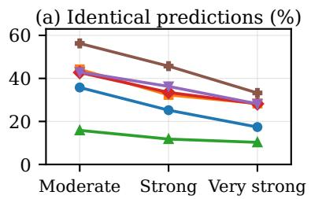

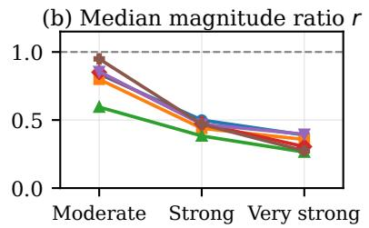

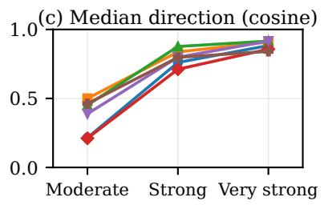  
Figure 7: As human shift increases, for all six models: (a) identical predictions become less common but persist, (b) median magnitude ratio $r = d _ { m } / d _ { h }$ decreases (dashed line: r = 1): amount of observed change captured decreases (c) median cosine similarity: directional alignment improves. Full results in Table 11, Appendix D.1.

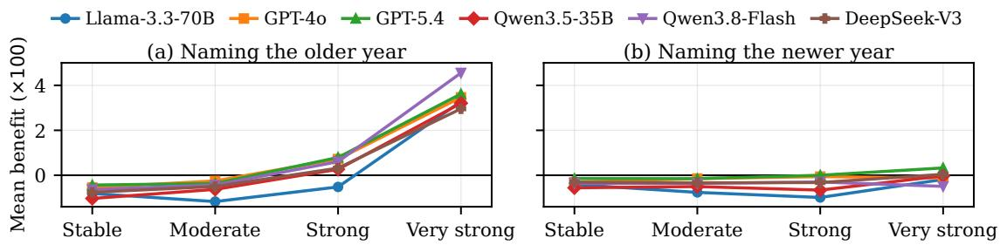  
Figure 8: Mean benefit (reduction in W, ×100) by human shift. Positive values mean better alignment. (a) Naming the older year helps most for very strong shifts, (b) naming the newer year helps little. Full results in Appendix E.4.

Subtracting the older year’s cumulative proportions from the newer year’s gives a vector showing how the distribution changes along the response scale. We construct this vector separately for the gold distributions and model predictions:

$$
\begin{array} { r } { \mathbf { g } = F ( G _ { \mathrm { n e w } } ) - F ( G _ { \mathrm { o l d } } ) , } \\ { \mathbf { p } = F ( P _ { \mathrm { n e w } } ) - F ( P _ { \mathrm { o l d } } ) , } \end{array}\tag{4}
$$

where F denotes the vector of cumulative response proportions. We measure directional alignment using cosine similarity between g and p: values near 1, 0, and −1 indicate similar directions, little alignment, and opposing directions, respectively. We exclude pairs with identical model predictions (10–56% of shifted pairs; Figure 7(a)), since their direction of change is undefined.

Results for direction. Among pairs with $d _ { m } > 0 .$ median directional alignment increases with human shift across all models (Figure 7), unlike the magnitude ratio. For stable temporal pairs, models also predict noticeable change in 29.9–35.5% of cases, despite little observed change (Appendix D.3).

## 4.4 RF3: Naming a Year Does Not Consistently Improve Cultural Alignment

We examine which survey year a prediction most closely resembles when no year is mentioned in the prompt, and whether naming the intended year improves alignment with that year’s gold distribution. Across all models, undated predictions resemble an earlier year rather than the newest year’s gold distribution in over half of cases. Naming a year offers little or no improvement on average. However, for very strong cultural shifts, specifying the older year improves alignment on average (Figure 8a).

Default period. For each retained question– country combination, we find the survey year whose $G _ { t }$ is closest to $P _ { \mathrm { u n d a t e d } }$ (Section 4.1) across all available years, including intermediate years not used in temporal pairs. We define the default survey year as the year with the smallest distance W between $P _ { \mathrm { u n d a t e d } }$ and $G _ { t }$ . Next, we record whether the default survey year is the oldest, an intermediate, or the newest available survey year.

Results: Undated predictions often resemble earlier years. Across all models, the newest year is the closest match in only 46–48% of cases $( \mathsf { A p } \cdot$ pendix E.1). In more than half of cases, predictions are closer to an earlier survey year. Thus, undated predictions do not necessarily reflect the most recent cultural attitudes.

Effect of naming a period. To evaluate the importance of temporal cues, we next ask whether specifying a year improves predictions for that period. Each temporal pair contains two dated prompts, one older and one newer, which we call items. For each item, we compare the dated prediction $P _ { t }$ and the undated prediction $P _ { \mathrm { u n d a t e d } }$ against the same gold distribution $G _ { t } ,$ , and define the benefit of specifying year $t \in \{ \mathrm { o l d } , \mathrm { n e w } \}$ as:

$$
b _ { t } = W ( P _ { \mathrm { u n d a t e d } } , G _ { t } ) - W ( P _ { t } , G _ { t } )\tag{5}
$$

A positive benefit means naming the year reduces prediction error, and a negative benefit means it increases error. We label each item helped, hurt, or unchanged by the sign of its benefit, and report mean benefit separately for older and newer items.

Results: Limited overall benefit from specifying a year. Across models, specifying a year helps 20–44% of items but hurts a similar share, so mean benefit is near zero or slightly negative. $P _ { t }$ is also identical to $P _ { \mathrm { u n d a t e d } }$ for 11–54% of items, more often for newer items (Appendix E.3).

We next examine mean benefit by human shift magnitude (Figure 8). For stable and moderate shifts, mean benefit is slightly negative for both older and newer items across all six models, so specifying a year offers no advantage. As human shift grows, however, specifying the older year begins to help: mean benefit for older items is positive in most models for strong shifts and in all six for very strong shifts. By contrast, specifying the newer year offers little benefit across shift levels.

## 4.5 Findings by Topic and Region

We now highlight key findings on temporal awareness across topics and regions. Appendix C.4 provides the full results.

For strong and very strong cultural shifts, predictions are less accurate for political and economic topics than for family and personal life. For example, both-period accuracy for democracy and social inequality is roughly half that for family and life priorities. Likewise, models predict the observed direction of change in only about 50% of cases for democracy and social inequality, compared with 82–94% for family and life priorities. Notably, democracy is among the most accurately predicted WVS topics for stable pairs (71%), yet its accuracy drops to 17% for larger shifts.

Regional differences grow with the magnitude of cultural shift. For stable WVS pairs, we find that Western countries, the Middle East and North Africa (MENA), and Sub-Saharan Africa show similar accuracy (71–73%). Under strong and very strong shifts, however, both-period accuracy is higher in Western countries (35%) than in MENA and South and Southeast Asia (16% on average). This gap between countries under larger shifts is smaller in ISSP, with 30% accuracy in Western countries versus 23–29% in other regions. Thus, models predict stable attitudes quite accurately across all regions, but for larger shifts, accuracy declines more sharply outside Western countries.

## 5 Conclusion

We asked whether language models can represent not only what a population believes, but also how those beliefs change over time. Across six models, this ability remains limited. Models often capture a country’s attitudes at one point in time, yet present its evolving culture as largely static: their predictions for different years tend to stay close together. Furthermore, when attitudes shift strongly, models capture the direction of change better than its magnitude. This gap appears across all topics and regions, and is widest for political and economic topics and for many non-Western populations.

The gap matters because LLMs are increasingly used to simulate survey responses (Argyle et al., 2023). Naming a year, the most direct way to ask about a period, does not reliably help. A model matching one survey wave may appear culturally aware while missing how that culture has changed. ChronoCulture makes this distinction measurable by comparing full response distributions for the same question and country across time.

Our findings point to several directions for improving temporal cultural awareness. Future work could explore training on temporal sources, learning to predict changes between survey response distributions, and expanding data coverage for populations where models show weaker temporal alignment. Together, these directions could help models better represent cultures as they evolve over time.

## 6 Limitations

ChronoCulture evaluates cultural attitudes using longitudinal survey data from the WVS and ISSP, so its coverage is limited to the countries, topics, and years included in these programs. At the time of writing, Wave 8 of the WVS has not been released, and our benchmark therefore does not capture changes in cultural attitudes after 2022. We also focus on questions with consistent, ordered response options across survey years, examining changes in reported attitudes and values rather than other aspects of culture, such as everyday customs and material culture.

We represent each population by its countrylevel response distribution. Although these distributions preserve the diversity of opinions within a country, they can hide differences between demographic, regional, or cultural groups within countries. Future extensions of ChronoCulture could incorporate newer survey waves and finer-grained population data to examine cultural change across more periods and communities.

## References

Mai Alkhamissi, Yunze Xiao, Badr AlKhamissi, and Mona T. Diab. 2026. Hire your anthropologist! rethinking culture benchmarks through an anthropological lens. In Findings ofthe Associationfor Computational Linguistics: EACL 2026, pages 1218–1235, Rabat, Morocco. Association for Computational Linguistics.

Fakhraddin Alwajih, Abdellah El Mekki, Samar Mohamed Magdy, AbdelRahim A. Elmadany, Omer Nacar, El Moatez Billah Nagoudi, Reem Abdel-Salam, Hanin Atwany, Youssef Nafea, Abdulfattah Mohammed Yahya, Rahaf Alhamouri, Hamzah A. Alsayadi, Hiba Zayed, Sara Shatnawi, Serry Sibaee, Yasir Ech-chammakhy, Walid Al-Dhabyani, Marwa Mohamed Ali, Imen Jarraya, and 25 others. 2025a. Palm: A culturally inclusive and linguistically diverse dataset for Arabic LLMs. In Proceedings of the 63rd Annual Meeting of the Association for Computational Linguistics (Volume 1: Long Papers), pages 32871–32894, Vienna, Austria. Association for Computational Linguistics.

Fakhraddin Alwajih, Abdellah El Mekki, Hamdy Mubarak, Majd Hawasly, Abubakr Mohamed, and Muhammad Abdul-Mageed. 2025b. PalmX 2025: The first shared task on benchmarking LLMs on Arabic and Islamic culture. In Proceedings ofThe Third Arabic Natural Language Processing Conference: Shared Tasks, Suzhou, China. Association for Computational Linguistics.

Lisa P. Argyle, Ethan C Busby, Nancy Fulda, Joshua R Gubler, Christopher Rytting, and David Wingate. 2023. Out of one, many: Using language models to simulate human samples. Political Analysis, 31(3):337–351.

Tyler A. Chang, Catherine Arnett, Abdelrahman Eldesokey, Abdelrahman Sadallah, Abeer Kashar, Abolade Daud, Abosede Grace Olanihun, Adamu Labaran Mohammed, Adeyemi Praise, Adhikarinayum Meerajita Sharma, Aditi Gupta, Afitab Iyigun, Afonso Simplí- cio, Ahmed Essouaied, Aicha Chorana, Akhil Eppa, Akintunde Oladipo, Akshay Ramesh, Aleksei Dorkin, and 317 others. 2025. Global PIQA: Evaluating physical commonsense reasoning across 100+ languages and cultures. arXiv preprint arXiv:2510.24081.

Wenhu Chen, Xinyi Wang, and William Yang Wang. 2021. A dataset for answering time-sensitive questions. In Thirty-fifth Conference on Neural Information Processing Systems Datasets and Benchmarks Track (Round 2).

Yu Ying Chiu, Liwei Jiang, Bill Yuchen Lin, Chan Young Park, Shuyue Stella Li, Sahithya Ravi, Mehar Bhatia, Maria Antoniak, Yulia Tsvetkov, Vered Shwartz, and Yejin Choi. 2025. CulturalBench: A robust, diverse and challenging benchmark for measuring LMs’ cultural knowledge through human-AI red-teaming. In Proceedings of the 63rd Annual Meeting of the Association for Computational Linguistics (Volume 1: Long Papers), pages 25663– 25701, Vienna, Austria. Association for Computational Linguistics.

Yalda Daryani, Miranda Bogen, and Madeleine I. G. Daepp. 2026. Accurate in space, unreliable in time: How LLMs represent national cultural change. Preprint, arXiv:2609.01902.

DeepSeek-AI. 2024. DeepSeek-V3 technical report. arXiv preprint arXiv:2412.19437.

Esin Durmus, Karina Nguyen, Thomas Liao, Nicholas Schiefer, Amanda Askell, Anton Bakhtin, Carol Chen, Zac Hatfield-Dodds, Danny Hernandez, Nicholas Joseph, Liane Lovitt, Sam McCandlish, Orowa Sikder, Alex Tamkin, Janel Thamkul, Jared Kaplan, Jack Clark, and Deep Ganguli. 2024. Towards measuring the representation of subjective global opinions in language models. In First Conference on Language Modeling.

Ali Faraz, Akash, Shaharukh Khan, Raja Kolla, Akshat Patidar, Suranjan Goswami, Abhinav Ravi, Chandra Khatri, and Shubham Agarwal. 2026. Indicvisionbench: Benchmarking cultural and multilingual understanding in VLMs. In The Fourteenth International Conference on Learning Representations.

Sara Ghaboura, Ketan Pravin More, Ritesh Thawkar, Wafa Al Ghallabi, Omkar Thawakar, Fahad Shahbaz Khan, Hisham Cholakkal, Salman Khan, and

Rao Muhammad Anwer. 2025. Time travel: A comprehensive benchmark to evaluate LMMs on historical and cultural artifacts. In Findings of the Association for Computational Linguistics: ACL 2025, pages 23627–23641, Vienna, Austria. Association for Computational Linguistics.

Eric Gong, Nathan E Sanders, and Bruce Schneier. 2026. Characterizing the ability of LLMs to recapitulate Americans’ distributional responses to public opinion polling questions across political issues. arXiv preprint arXiv:2603.20229.

Aaron Grattafiori and 1 others. 2024. The Llama 3 herd of models. arXiv preprint arXiv:2407.21783.

Christian Haerpfer, Ronald Inglehart, Alejandro Moreno, Christian Welzel, Kseniya Kizilova, Jaime Diez-Medrano, Marta Lagos, Pippa Norris, Eduard Ponarin, and Bi Puranen. 2022. World values survey time-series (1981–2022) cross-national data-set. Data File Version 4.0.0.

Qianyi Hu, Xinhui Tu, Cong Guo, and Shunping Zhang. 2025. Time-aware ReAct agent for temporal knowledge graph question answering. In Findings of the Associationfor Computational Linguistics: NAACL 2025, pages 6028–6039, Albuquerque, New Mexico. Association for Computational Linguistics.

Aaron Hurst and 1 others. 2024. GPT-4o system card. arXiv preprint arXiv:2410.21276.

Ronald Inglehart. 1997. Modernization and Postmodernization: Cultural, Economic, and Political Change in 43 Societies. Princeton University Press.

Ronald Inglehart. 2018. Culture shift in advanced industrial society. Princeton University Press.

Ronald Inglehart and Wayne E. Baker. 2000. Modernization, cultural change, and the persistence of traditional values. American Sociological Review, 65(1):19–51.

International Social Survey Programme. 2026. International Social Survey Programme (ISSP). https: //www.gesis.org/en/issp. Accessed: 2026-05- 20.

ISSP Research Group. 2020. International social survey programme: National identity i-iii - issp 1995-2003- 2013. (ZA5960; Version 1.0.0) [Data set]. GESIS, Cologne. https://doi.org/10.4232/1.13471.

ISSP Research Group. 2023. International social survey programme: Role of government i-v issp 1985-1990-1996-2006-2016. (ZA4747; Version 2.1.0) [Data set]. GESIS, Cologne. https://doi.org/10.4232/1.14113.

ISSP Research Group. 2024a. International social survey programme: Health and health care i-ii cumulation. (ZA8794; Version 1.0.0) [Data set]. GESIS, Cologne. https://doi.org/10.4232/1.14438.

ISSP Research Group. 2024b. International social survey programme: Social inequality i-v cumulation. (ZA8790; Version 1.0.0) [Data set]. GESIS, Cologne. https://doi.org/10.4232/1.14226.

ISSP Research Group. 2024c. International social survey programme: Work orientations i-iv cumulation. (ZA8797; Version 1.0.0) [Data set]. GESIS, Cologne. https://doi.org/10.4232/1.14391.

ISSP Research Group. 2025. International social survey programme: Religion i-iv cumulation. (ZA8792; Version 2.0.0) [Data set]. GESIS, Cologne. https://doi.org/10.4232/1.14482.

ISSP Research Group. 2026a. International social survey programme: Environment i-iv cumulation. (ZA8793; Version 1.1.0) [Data set]. GESIS, Cologne. https://doi.org/10.4232/1.14767.

ISSP Research Group. 2026b. International social survey programme: Family and changing gender roles i-v cumulation. (ZA8795; Version 1.0.0) [Data set]. GESIS, Cologne. https://doi.org/10.4232/1.14750.

Gautam Jajoo, Harsh Deshpande, Hamna, and Pranjal A Chitale. 2025. Cultureshift: Mapping temporal cultural evolution in vision-language models. In CVPR 2025 Workshop Vision Language Models For All.

Xunyi Jiang, Dingyi Chang, Julian McAuley, and Xin Xu. 2026. When benchmarks age: Temporal misalignment through large language model factuality evaluation. In Proceedings of the 19th Conference of the European Chapter of the Association for Computational Linguistics (Volume 2: Short Papers), pages 500–512, Rabat, Morocco. Association for Computational Linguistics.

Eunsu Kim, Juyoung Suk, Philhoon Oh, Haneul Yoo, James Thorne, and Alice Oh. 2024. CLIcK: A benchmark dataset of cultural and linguistic intelligence in Korean. In Proceedings of the 2024 Joint International Conference on Computational Linguistics, Language Resources and Evaluation (LREC-COLING 2024), pages 3335–3346, Torino, Italia. ELRA and ICCL.

Fajri Koto, Rahmad Mahendra, Nurul Aisyah, and Timothy Baldwin. 2024. IndoCulture: Exploring geographically influenced cultural commonsense reasoning across eleven Indonesian provinces. Transactions of the Association for Computational Linguistics, 12:1703–1719.

Cheng Li, Damien Teney, Linyi Yang, Qingsong Wen, Xing Xie, and Jindong Wang. 2024. CulturePark: Boosting cross-cultural understanding in large language models. In Advances in Neural Information Processing Systems 37 (NeurIPS 2024).

Jiaang Li, Yifei Yuan, Wenyan Li, Mohammad Aliannejadi, Daniel Hershcovich, Anders Søgaard, Ivan Vulic, Wenxuan Zhang, Paul Pu Liang, Yang Deng,´

and Serge Belongie. 2026. RAVENEA: A benchmark for multimodal retrieval-augmented visual culture understanding. In The Fourteenth International Conference on Learning Representations.

Yang Liu, Masahiro Kaneko, and Chenhui Chu. 2026. On the alignment of large language models with global human opinion. In Proceedings ofthe AAAI Conference on Artificial Intelligence, volume 40, pages 37673–37681.

Nicole Meister, Carlos Guestrin, and Tatsunori Hashimoto. 2025. Benchmarking distributional alignment of large language models. In Proceedings of the 2025 Conference ofthe Nations ofthe Americas Chapter of the Association for Computational Linguistics: Human Language Technologies (Volume 1: Long Papers), pages 24–49, Albuquerque, New Mexico. Association for Computational Linguistics.

Junho Myung, Nayeon Lee, Yi Zhou, Jiho Jin, Rifki A Putri, Dimosthenis Antypas, Hsuvas Borkakoty, Eunsu Kim, Carla Perez-Almendros, Abinew A Ayele, and 1 others. 2024. BLEnD: A benchmark for LLMs on everyday knowledge in diverse cultures and languages. In Advances in Neural Information Processing Systems 37 (NeurIPS 2024) Datasets and Benchmarks Track, pages 78104–78146.

Tarek Naous, Michael J Ryan, Alan Ritter, and Wei Xu. 2024. Having beer after prayer? measuring cultural bias in large language models. In Proceedings of the 62nd Annual Meeting ofthe Associationfor Computational Linguistics (Volume 1: Long Papers), pages 16366–16393, Bangkok, Thailand. Association for Computational Linguistics.

OpenAI. 2026. GPT-5.4 thinking system card.

Gabriel Peyré and Marco Cuturi. 2019. Computational optimal transport. Foundations and Trends in Machine Learning, 11(5–6):355–607.

Bhawna Piryani, Abdelrahman Abdallah, Jamshid Mozafari, Avishek Anand, and Adam Jatowt. 2026. It’s high time: A survey of temporal question answering. In Proceedings of the 64th Annual Meeting of the Associationfor Computational Linguistics (Volume 1: Long Papers). Association for Computational Linguistics.

Haoyi Qiu, Alexander Fabbri, Divyansh Agarwal, Kung-Hsiang Huang, Sarah Tan, Nanyun Peng, and Chien-Sheng Wu. 2025. Evaluating cultural and social awareness of LLM web agents. In Findings of the Association for Computational Linguistics: NAACL 2025, pages 3978–4005, Albuquerque, New Mexico. Association for Computational Linguistics.

Qwen Team. 2026a. Qwen3.5: Towards native multimodal agents.

Qwen Team. 2026b. Qwen3.8-Flash-Next: A new architecture, towards ultimate cost-efficiency.

Mukul Ranjan, Prince Jha, Khushboo Kumari, and Zhiqiang Shen. 2026. On the cultural anachronism and temporal reasoning in vision language models. In Findings of the Association for Computational Linguistics: ACL 2026, pages 30294–30310. Association for Computational Linguistics.

Abhinav Rao, Akhila Yerukola, Vishwa Shah, Katharina Reinecke, and Maarten Sap. 2025. NormAd: A framework for measuring the cultural adaptability of large language models. In Proceedings ofthe 2025 Conference of the Nations of the Americas Chapter ofthe Associationfor Computational Linguistics: Human Language Technologies (Volume 1: Long Papers), pages 2373–2403, Albuquerque, New Mexico. Association for Computational Linguistics.

Angelika Romanou, Negar Foroutan, Anna Sotnikova, Sree Harsha Nelaturu, Shivalika Singh, Rishabh Maheshwary, Micol Altomare, Zeming Chen, Mohamed A. Haggag, Snegha A, Alfonso Amayuelas, Azril Hafizi Amirudin, Danylo Boiko, Michael Chang, Jenny Chim, Gal Cohen, Aditya K. Dalmia, Abraham Diress, Sharad Duwal, and 38 others. 2025. INCLUDE: Evaluating multilingual language understanding with regional knowledge. In International Conference on Learning Representations (ICLR).

Shibani Santurkar, Esin Durmus, Faisal Ladhak, Cinoo Lee, Percy Liang, and Tatsunori Hashimoto. 2023. Whose opinions do language models reflect? In Proceedings of the 40th International Conference on Machine Learning, volume 202 of Proceedings ofMachine Learning Research, pages 29971–30004. PMLR.

Florian Schneider, Carolin Holtermann, Chris Biemann, and Anne Lauscher. 2025. GIMMICK: Globally inclusive multimodal multitask cultural knowledge benchmarking. In Findings of the Association for Computational Linguistics: ACL 2025, pages 9605– 9668, Vienna, Austria. Association for Computational Linguistics.

Shivalika Singh, Angelika Romanou, Clémentine Fourrier, David Ifeoluwa Adelani, Jian Gang Ngui, Daniel Vila-Suero, Peerat Limkonchotiwat, Kelly Marchisio, Wei Qi Leong, Yosephine Susanto, Raymond Ng, Shayne Longpre, Sebastian Ruder, Wei-Yin Ko, Antoine Bosselut, Alice Oh, Andre Martins, Leshem Choshen, Daphne Ippolito, and 4 others. 2025. Global MMLU: Understanding and addressing cultural and linguistic biases in multilingual evaluation. In Proceedings ofthe 63rd Annual Meeting of the Association for Computational Linguistics (Volume 1: Long Papers), pages 18761–18799, Vienna, Austria. Association for Computational Linguistics.

Toma Suzuki, Ayuki Katayama, Seiji Gobara, Ryo Tsujimoto, Hibiki Nakatani, Kazuki Hayashi, Yusuke Sakai, Hidetaka Kamigaito, and Taro Watanabe. 2025. Reliability of distribution predictions by LLMs: Insights from counterintuitive pseudo-distributions. In Proceedings ofthe 2025 Conference ofthe Nations

of the Americas Chapter of the Association for Computational Linguistics: Human Language Technologies (Volume 4: Student Research Workshop), pages 538–550, Albuquerque, USA. Association for Computational Linguistics.

Bryan Chen Zhengyu Tan, Weihua Zheng, Zhengyuan Liu, Nancy Chen, Hwaran Lee, Kenny Tsu Wei Choo, and Roy Ka-Wei Lee. 2026. Blend-vis: Benchmarking multimodal cultural understanding in vision language models. In Proceedings of the 19th Conference ofthe European Chapter ofthe Associationfor Computational Linguistics (Volume 1: Long Papers), pages 4647–4669.

Wei Tang, Yixin Cao, Yang Deng, Jiahao Ying, Bo Wang, Yizhe Yang, Yuyue Zhao, Qi Zhang, Xuanjing Huang, Yu-Gang Jiang, and Yong Liao. 2025. EvoWiki: Evaluating LLMs on evolving knowledge. In Proceedings of the 63rd Annual Meeting of the Associationfor Computational Linguistics (Volume 1: Long Papers), pages 948–964, Vienna, Austria. Association for Computational Linguistics.

Cédric Villani. 2009. Optimal Transport: Old and New, volume 338 of Grundlehren der mathematischen Wissenschaften. Springer.

Wenlong Zhao, Debanjan Mondal, Niket Tandon, Danica Dillion, Kurt Gray, and Yuling Gu. 2024. World-ValuesBench: A large-scale benchmark dataset for multi-cultural value awareness of language models. In Proceedings ofthe 2024 Joint International Conference on Computational Linguistics, Language Resources and Evaluation (LREC-COLING 2024), pages 17696–17706.

Naitian Zhou, David Bamman, and Isaac L Bleaman. 2025. Culture is not trivia: Sociocultural theory for cultural NLP. In Proceedings of the 63rd Annual Meeting of the Association for Computational Linguistics (Volume 1: Long Papers), pages 25869– 25886.

## A Benchmark

## A.1 Data Sources and Topic Coverage

The WVS contains seven 3–5 year waves of survey data from 1981 to 2022. We use waves 3–7, covering 1995 to 2022, because these waves provide repeated survey items across many countries and allow older-to-newer temporal comparisons. The years covered by each wave are listed in Table 2.

Each annual ISSP module focuses on one topic. Topics are repeated roughly every decade, and ISSP provides harmonized longitudinal datasets that make it possible to compare responses to the same questions across different time periods, covering 1985 to 2022 (ISSP Research Group, 2020, 2024b, 2025, 2026a, 2024a, 2026b, 2024c, 2023).

<table><tr><td>WVS wave</td><td>Fieldwork years</td></tr><tr><td>Wave 3</td><td>1995-1998</td></tr><tr><td>Wave 4</td><td>1999-2004</td></tr><tr><td>Wave 5</td><td>2005-2009</td></tr><tr><td>Wave 6</td><td>2010-2014</td></tr><tr><td>Wave 7</td><td>2017-2022</td></tr></table>

Table 2: World Values Survey waves used as temporal survey context.
<table><tr><td>ISSP topic module</td><td>Survey years in benchmark</td></tr><tr><td>Role of Government</td><td>1985, 1990, 1996, 2006, 2016</td></tr><tr><td>Social Inequality</td><td>1987, 1992, 1999, 2009, 2019</td></tr><tr><td>Family and Gender Roles</td><td>1988, 1994, 2002, 2012, 2022</td></tr><tr><td>Work Orientations</td><td>1989, 1997, 2005, 2015</td></tr><tr><td>Religion</td><td>1991, 1998, 2008, 2018</td></tr><tr><td>Environment</td><td>1993, 2000, 2010, 2020</td></tr><tr><td>National Identity</td><td>1995, 2003, 2013</td></tr><tr><td>Health and Health Care</td><td>2011,2021</td></tr></table>

Table 3: ISSP repeated-topic modules represented in the benchmark.

The years covered by each topic are listed in Table 3.

Table 4 details our questions by broad topic category, harmonized across WVS and ISSP since the two programs use different topic label wording.

<table><tr><td>Topic category</td><td>Questions</td></tr><tr><td>Government, democracy, and institutions</td><td>106</td></tr><tr><td>Religion and national identity</td><td>99</td></tr><tr><td>Social inequality, work, and economic values</td><td>83</td></tr><tr><td>Family, health, and social attitudes</td><td>74</td></tr><tr><td>Environment, science, and technology</td><td>46</td></tr><tr><td>Total</td><td>408</td></tr></table>

Table 4: Question distribution by broad topic category.

## A.2 Computing Gold Response Distributions

For each survey question, country, and year, we remove invalid responses such as “don’t know.” We then use the respondent weights provided by the survey to calculate the proportion choosing each response option:

$$
\mathrm { P r o p o r t i o n } = \frac { \mathrm { c h o o s i n g ~ t h e ~ o f ~ r e s p o n d e n t s } } { \mathrm { T o t a l ~ w e i g h t ~ o f ~ r e s p o n d e n t s } } .
$$

These proportions sum to one and together form the gold response distribution.

For illustration, consider three respondents with valid answers to a question:

<table><tr><td>Respondent</td><td>Answer</td><td>Weight</td></tr><tr><td>Person 1</td><td>Agree</td><td>1</td></tr><tr><td>Person 2</td><td>Agree</td><td>1</td></tr><tr><td>Person 3</td><td>Disagree</td><td>2</td></tr></table>

The total weight for “Agree” is $1 + 1 = 2 ,$ and the total weight for “Disagree” is 2. Dividing each by the total weight of 4 gives:
<table><tr><td>Response option</td><td>Calculation</td><td>Proportion</td></tr><tr><td>Agree</td><td>2/4</td><td>50%</td></tr><tr><td>Disagree</td><td>2/4</td><td>50%</td></tr></table>

Although two respondents selected “Agree” and one selected “Disagree,” the third respondent’s weight makes their answer count twice as much as either of the others. The resulting gold response distribution therefore assigns equal proportions to both options.

## A.3 Wasserstein Distance Metric

We calculate our normalized Wasserstein distance metric to compare distributions as follows:

For two distributions p and q over ordered response options $a _ { 1 } < a _ { 2 } < \cdots < a _ { K }$ , let the cumulative distribution be

$$
F _ { p } ( a _ { j } ) = \sum _ { \ell = 1 } ^ { j } p ( a _ { \ell } ) .\tag{6}
$$

Using the above definition, the one-dimensional Wasserstein distance is

$$
W _ { 1 } ( p , q ) = \sum _ { j = 1 } ^ { K - 1 } | F _ { p } ( a _ { j } ) - F _ { q } ( a _ { j } ) | ( a _ { j + 1 } - a _ { j } ) .\tag{7}
$$

Because survey questions use different scale lengths, we normalize by the maximum possible distance on the scale to calculate a normalized distance W:

$$
W ( p , q ) = \frac { W _ { 1 } ( p , q ) } { a _ { K } - a _ { 1 } } .\tag{8}
$$

## A.4 Prompt Example

Figure 9 portrays an example of our verbalized distribution prompt style. Each temporal pair consists of two prompts. The newer-period prompt for this example is identical except that the target year is 2020, and the corresponding undated prompts detailed in Section 4.1 simply exclude the year altogether. The same prompts were used for inference across all models.

Example prompt for distribution inference   
In France in 2010, how much do you agree or disagree:   
We worry too much about the future of the environ  
ment and not enough about prices and jobs today. Use   
this response scale: 1 means ‘strongly agree’, 2 means   
‘agree’, 3 means ‘neither agree nor disagree’, 4 means   
‘disagree’, and 5 means ‘strongly disagree’.   
Instead of choosing one answer, estimate the distribu  
tion of responses among people in this country and   
time period.   
Return percentages for every valid response option: 1,   
2, 3, 4, 5. The percentages must be non-negative and   
should sum to 100.   
Return only a JSON object in exactly this key format:   
{"1": <percentage>, "2": <percentage>,   
"3": <percentage>, "4": <percentage>, "5":   
<percentage>}  
Figure 9: Example prompt for distribution inference. The newer-year prompt is identical except that the year is 2020.

## A.5 Modal-Answer Evaluation

Section 3.6 argues that modal answers cannot capture how survey distributions change. For completeness, we also evaluate Llama-3.3-70B, our reference model, in a modal-answer format. This analysis demonstrates its limitations.

Construction. We reuse the temporal pairs from Section 3.4, but ask the model to choose a single answer instead of predicting a distribution. The response options serve as answer choices, and the mode of each gold distribution serves as the label (Figure 10). A modal label is only meaningful when one option is clearly ahead, so we keep only pairs in which the two most common responses differ by at least 10 percentage points. We use stable pairs and strong or very strong pairs whose modes change between periods, and exclude moderate pairs, whose changes are usually spread across the distribution without a change in mode. Analogous to the knowledge filter, we then keep only pairs where the model answers at least one period correctly. These filters leave 1,351 pairs (1,129 stable, 151 strong, and 71 very strong).

Results. Table 5 shows the share of pairs where the model selects the correct mode for both periods. Accuracy is high for stable pairs (86.3%) and falls sharply for shifted pairs (11.9% for strong and 14.8% for very strong shifts), matching the distributional results in Section 4.2. However, a correct label can hide substantial error. In 24.4% of shifted pairs, the model selects the correct mode while capturing less than half of the distributional shift. Together with the failure cases in Figure 4, this is why we treat modal-answer accuracy as a supplementary diagnostic rather than a primary measure.

<table><tr><td>Gold survey shift Both correct (%)</td><td></td></tr><tr><td>Stable</td><td>86.3</td></tr><tr><td>Strong</td><td>11.9</td></tr><tr><td>Very strong</td><td>14.8</td></tr></table>

Table 5: Modal-answer accuracy (Llama-3.3-70B): accuracy falls sharply for shifted pairs. Both correct is the share of pairs where the model selects the correct mode for both periods.

Example modal-answer prompt   
In France, during {time period}, how much do most   
people agree or disagree:   
“We worry too much about thefuture ofthe environment   
and not enough about prices andjobs today.”   
Choices. (A) Strongly agree; (B) Agree; (C) Neither;   
(D) Disagree; (E) Strongly disagree.   
Task. Choose the response option expected to be most   
common. Return only one valid option code.   
Gold answer. 2010: B 2020: D

Figure 10: Example modal-answer prompt. The label is the modal response of the corresponding survey distribution.

## B Experimental Setup

## B.1 Models and Inference Settings

Inference configuration. GPT-4o and GPT-5.4 were accessed through the OpenAI API. The other models were hosted locally with vLLM on NVIDIA H100 NVL GPUs: Llama-3.3- 70B (vLLM 0.9.2, 2 GPUs), Qwen3.5-35B-A3B-FP8 and Qwen3.8-Flash-Next-FP8 (vLLM 0.30.0, 2 GPUs each), and DeepSeek-V3-0324-AWQ (vLLM 0.9.2, 4 GPUs). All models used temperature 0, top-p 1.0, at most 120 output tokens, and one generation per prompt.

System prompt. All models received the same system message: “You estimate survey response distributions. Return only valid JSON. Do not include explanations, markdown, or extra text.”

Output parsing and normalization. We instructed models to return a JSON object containing response percentages for each provided answer option. If JSON parsing failed, we extracted percentage outputs using regular expressions.

Parsed values were converted to floating-point numbers, with negative values clipped to zero. We then normalized the resulting values to sum to one, including when the original percentages did not sum to 100. Outputs missing response options, containing nonnumeric values, or having a nonpositive or nonfinite total after clipping were considered invalid. Appendix F.3 shows, for Llama-3.3-70B, that repeated runs give nearly identical predictions and that our findings hold under alternative prompt instructions.

## B.2 Cultural Knowledge Filter: Scores and Retention

This section gives details of the filter described in Section 4.1.

Nearest-survey distance. For each question– country combination, let $T$ be the set of all available survey years, $G _ { t }$ the gold distribution for year t, and $P _ { \mathrm { u n d a t e d } }$ the model’s prediction obtained without specifying a year. We define

$$
K = \operatorname* { m i n } _ { t \in T } W \left( P _ { \mathrm { u n d a t e d } } , G _ { t } \right) ,\tag{9}
$$

the distance to the survey year that most closely matches the undated prediction. The comparison includes every available survey year, not only the two years of the temporal pair. A small K means the undated prediction closely matches at least one observed survey distribution.

Selection. Combinations with more available years have more chances to find a close match, so K tends to fall as coverage grows: for Llama-3.3-70B, the median K is 0.079 for combinations with two available years and 0.053 for those with five. We therefore rank combinations separately within each survey and within each group sharing the same number of available years, and retain the 75% with the smallest K in each group. The retained combinations from both surveys are then pooled. Selection uses only undated predictions, and dated predictions are reserved for the temporal evaluation.

Distribution and retention. Figure 11 shows the distribution of K for Llama-3.3-70B. Most combinations fall below 0.12, with a long tail beyond 0.30, where no survey year resembles the undated prediction. The distribution has no natural break, so we choose a retention level. Table 6 reports retention for all models, and Table 7 shows how the shift categories change at other retention levels. Below 50%, the very strong category falls under 100 pairs, too few for category-level comparison.

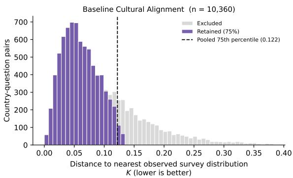  
Figure 11: Distribution of the nearest-survey distance K for Llama-3.3-70B across WVS and ISSP. Purple marks retained and gray excluded combinations. The dashed line marks the pooled 75th percentile (0.122) for reference only, since selection is done within survey and available-year groups.

<table><tr><td>Model</td><td>WVS</td><td>ISSP</td><td>Total</td></tr><tr><td>Llama-3.3-70B</td><td>2,420/3,228</td><td>5,347/7,132</td><td>7,767</td></tr><tr><td>GPT-40</td><td>2,420/3,228</td><td>5,347/7,132</td><td>7,767</td></tr><tr><td>GPT-5.4</td><td>2,420/3,228</td><td>5,347/7,132</td><td>7,767</td></tr><tr><td>Qwen3.5-35B</td><td>2,420/3,228</td><td>5,347/7,132</td><td>7,767</td></tr><tr><td>Qwen3.8-Flash</td><td>2,420/3,228</td><td>35,347/7,1327,767</td><td></td></tr><tr><td>DeepSeek-V3</td><td>2,420/3,2285,347/7,132</td><td></td><td>7,767</td></tr></table>

Table 6: Knowledge-filter retention by model. WVS and ISSP entries show retained/scored pairs, and Total shows pooled retained pairs. Approximately 75% are retained per survey.

<table><tr><td>Retained</td><td>Stable</td><td>Mod.</td><td>Strong</td><td>V. Str.</td><td>Total</td></tr><tr><td>100%</td><td>2,607</td><td>5,535</td><td>1,828</td><td>390</td><td>10,360</td></tr><tr><td>75%</td><td>1,887</td><td>4,115</td><td>1,443</td><td>322</td><td>7,767</td></tr><tr><td>50%</td><td>1,192</td><td>2,771</td><td>1,041</td><td>173</td><td>5,177</td></tr><tr><td>25%</td><td>609</td><td>1,452</td><td>462</td><td>64</td><td>2,587</td></tr></table>

Table 7: Temporal pairs retained at each level for Llama-3.3-70B, by shift category.

## C RF1: Accuracy and Temporal Alignment

## C.1 Full Period-Accuracy Results

Table 8 reports the full results summarized in Figure 5, including the split between older-only and newer-only accuracy for each model. For reference, on the same retained pairs, a uniform prediction (equal shares for every response option) is accurate for both periods in 8–11% of stable pairs and in none of the very strong pairs. As a static reference, using each model’s undated prediction for both years is accurate for both periods in 64–88% of stable and 48–68% of moderate pairs, above the dated predictions, but in only 16–25% of strong and no very strong pairs, where dated predictions reach 23–37% and 10–20%. Bootstrap 95% intervals over temporal pairs (1,000 resamples) extend about 2 points on either side of the estimate for stable and moderate pairs and about 4 points for very strong pairs, so the decline with human shift is much larger than sampling variation.

## C.2 Sensitivity to Accuracy Tolerance

We repeat the accuracy analysis from Section 4.2 using four error tolerances: $\tau \_ { \in }$ {0.05, 0.10, 0.15, 0.20}. A prediction counts as accurate when its distance to the corresponding gold distribution is within τ . A smaller tolerance therefore requires a closer match, while a larger tolerance allows a greater difference. For all six models, both-period accuracy falls from stable to very strong shifts at every tolerance. We report detailed results for Llama-3.3-70B. Figure 12 shows the scale of these distances: (a) the distribution of distances between each prediction and its gold distribution, with $\tau = 0 . 1 0$ marked, and (b) the distances for the older and newer predictions of each pair.

Table 9 reports accuracy for the older and newer periods separately, along with the four outcomes for each temporal pair. Both means that both predictions are accurate, older only and newer only mean that only the prediction for that period is accurate, and neither means that neither prediction is accurate.

## C.3 Temporal Alignment

Table 10 reports the alignment categories defined in Section 4.2 for all models. The analysis includes all retained moderate, strong, and very strong human shift pairs, including those with zero model shift. Alignment depends on which gold distribution each prediction more closely resembles, rather than the accuracy tolerance used in Section 4.2. Equal-distance cases are identified using a numerical tolerance of $1 0 ^ { - 1 2 }$ , none occurred.

Both predictions favor the same survey period in most pairs. Correct separation becomes more common as human shift increases, but remains a minority outcome in every category. Reversed pairs are comparatively uncommon throughout.

<table><tr><td></td><td colspan="4">Both</td><td colspan="4">Older only</td><td colspan="4">Newer only</td></tr><tr><td>Model</td><td>Stab.</td><td>Mod.</td><td>Str.</td><td>V. str.</td><td>Stab.</td><td>Mod.</td><td>Str.</td><td>V. str.</td><td>Stab.</td><td>Mod.</td><td>Str.</td><td>V. str.</td></tr><tr><td>Llama-3.3-70B</td><td>65.1</td><td>47.8</td><td>22.8</td><td>11.5</td><td>8.4</td><td>14.0</td><td>25.6</td><td>31.1</td><td>10.6</td><td>19.1</td><td>30.4</td><td>32.6</td></tr><tr><td>GPT-40</td><td>66.9</td><td>55.9</td><td>31.1</td><td>13.7</td><td>9.3</td><td>14.1</td><td>22.5</td><td>26.4</td><td>10.9</td><td>19.3</td><td>34.0</td><td>40.8</td></tr><tr><td>GPT-5.4</td><td>80.3</td><td>66.4</td><td>37.0</td><td>19.5</td><td>4.8</td><td>10.5</td><td>23.7</td><td>27.7</td><td>7.6</td><td>15.9</td><td>30.6</td><td>38.4</td></tr><tr><td>Qwen3.5-35B</td><td>54.3</td><td>44.4</td><td>23.4</td><td>10.4</td><td>9.6</td><td>16.2</td><td>24.3</td><td>27.3</td><td>11.9</td><td>18.8</td><td>31.0</td><td>35.9</td></tr><tr><td>Qwen3.8-Flash</td><td>68.3</td><td>56.2</td><td>30.9</td><td>18.5</td><td>8.1</td><td>13.9</td><td>25.6</td><td>26.2</td><td>10.7</td><td>18.0</td><td>31.3</td><td>32.9</td></tr><tr><td>DeepSeek-V3</td><td>60.5</td><td>50.7</td><td>27.8</td><td>9.7</td><td>7.9</td><td>15.1</td><td>25.2</td><td>29.9</td><td>12.6</td><td>18.6</td><td>31.9</td><td>39.6</td></tr></table>

Table 8: RF1 accuracy by human shift: accuracy on both periods falls for every model, and newer only exceeds older only. Cells are the % of temporal pairs whose predictions are within $\tau = 0 . 1 0$ of gold for both, only the older, or only the newer period (Stab. = stable, Mod. = moderate, Str. = strong, V. str. = very strong).

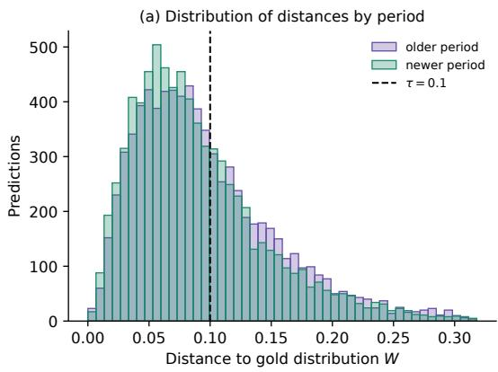

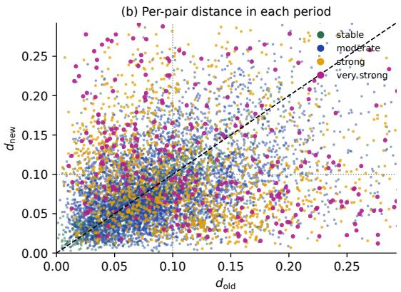

Figure 12: Per-period prediction errors (Llama-3.3-70B): overall error distributions are similar, but many pairs have very different errors for the two periods. (a) Distances to gold, with $\tau = 0 . 1 0$ marked. (b) $d _ { \mathrm { o l d } } \ \mathrm { v s . } \ d _ { \mathrm { n e w } }$ for each temporal pair; points far from the diagonal have a larger error for one period.
<table><tr><td></td><td></td><td colspan="2">Accurate (%)</td><td colspan="4">Pair outcomes (%)</td></tr><tr><td>T</td><td>Human shift</td><td>Older</td><td>Newer</td><td>Both</td><td>Older only</td><td>Newer only</td><td>Neither</td></tr><tr><td>0.05</td><td>Stable</td><td>28.3</td><td>30.7</td><td>19.0</td><td>9.3</td><td>11.7</td><td>60.0</td></tr><tr><td></td><td>Moderate</td><td>21.9</td><td>24.2</td><td>7.8</td><td>14.1</td><td>16.4</td><td>61.7</td></tr><tr><td></td><td>Strong</td><td>18.2</td><td>20.0</td><td>2.6</td><td>15.6</td><td>17.4</td><td>64.4</td></tr><tr><td></td><td>Very strong</td><td>17.4</td><td>14.0</td><td>1.2</td><td>16.1</td><td>12.7</td><td>69.9</td></tr><tr><td></td><td>All</td><td>22.6</td><td>24.6</td><td>9.3</td><td>13.3</td><td>15.3</td><td>62.1</td></tr><tr><td>0.10</td><td>Stable</td><td>73.5</td><td>75.7</td><td>65.1</td><td>8.4</td><td>10.6</td><td>15.9</td></tr><tr><td></td><td>Moderate</td><td>61.8</td><td>66.9</td><td>47.8</td><td>14.0</td><td>19.1</td><td>19.1</td></tr><tr><td></td><td>Strong</td><td>48.4</td><td>53.2</td><td>22.8</td><td>25.6</td><td>30.4</td><td>21.3</td></tr><tr><td></td><td>Very strong</td><td>42.5</td><td>44.1</td><td>11.5</td><td>31.1</td><td>32.6</td><td>24.8</td></tr><tr><td></td><td>All</td><td>61.3</td><td>65.5</td><td>45.8</td><td>15.5</td><td>19.7</td><td>19.0</td></tr><tr><td>0.15</td><td>Stable</td><td>92.0</td><td>93.7</td><td>89.1</td><td>2.9</td><td>4.7</td><td>3.3</td></tr><tr><td></td><td>Moderate</td><td>84.7</td><td>88.2</td><td>77.9</td><td>6.8</td><td>10.3</td><td>5.0</td></tr><tr><td></td><td>Strong</td><td>72.3</td><td>76.4</td><td>55.6</td><td>16.7</td><td>20.8</td><td>6.9</td></tr><tr><td></td><td>Very strong</td><td>60.9</td><td>64.0</td><td>34.2</td><td>26.7</td><td>29.8</td><td>9.3</td></tr><tr><td></td><td>All</td><td>83.2</td><td>86.4</td><td>74.7</td><td>8.5</td><td>11.7</td><td>5.1</td></tr><tr><td>0.20</td><td>Stable</td><td>97.4</td><td>98.3</td><td>96.5</td><td>0.9</td><td>1.8</td><td>0.8</td></tr><tr><td></td><td>Moderate</td><td>95.1</td><td>96.3</td><td>92.4</td><td>2.7</td><td>3.9</td><td>0.9</td></tr><tr><td></td><td>Strong</td><td>88.4</td><td>88.5</td><td>78.4</td><td>10.0</td><td>10.1</td><td>1.5</td></tr><tr><td></td><td>Very strong</td><td>76.1</td><td>78.3</td><td>57.5</td><td>18.6</td><td>20.8</td><td>3.1</td></tr><tr><td>All</td><td></td><td>93.6</td><td>94.6</td><td>89.3</td><td>4.3</td><td>5.3</td><td>1.1</td></tr></table>

Table 9: RF1 accuracy across error tolerances (Llama-3.3-70B): at every tolerance, accuracy on both periods falls as human shift grows. Older and newer accuracy include pairs counted under both. The four pair outcomes are mutually exclusive and sum to about 100% per row.

<table><tr><td rowspan="2">Model</td><td colspan="3">Separated (%)</td><td colspan="3">Same period (%)</td><td colspan="4">All shifted (%)</td></tr><tr><td>Mod.</td><td>Str.</td><td>V. str.</td><td>Mod.</td><td>Str.</td><td>V. str.</td><td>Sep.</td><td>Older-al.</td><td>Newer-al.</td><td>Rev.</td></tr><tr><td>Llama-3.3-70B</td><td>8.8</td><td>15.2</td><td>26.7</td><td>85.5</td><td>79.1</td><td>68.9</td><td>11.3</td><td>39.8</td><td>43.2</td><td>5.7</td></tr><tr><td>GPT-40</td><td>8.7</td><td>15.0</td><td>23.9</td><td>87.2</td><td>81.0</td><td>73.9</td><td>11.1</td><td>39.8</td><td>45.1</td><td>4.0</td></tr><tr><td>GPT-5.4</td><td>11.8</td><td>19.6</td><td>29.8</td><td>82.0</td><td>75.5</td><td>67.1</td><td>14.6</td><td>38.3</td><td>41.4</td><td>5.7</td></tr><tr><td>Qwen3.5-35B</td><td>8.5</td><td>13.1</td><td>19.6</td><td>85.9</td><td>81.8</td><td>77.7</td><td>10.3</td><td>39.8</td><td>44.6</td><td>5.3</td></tr><tr><td>Qwen3.8-Flash</td><td>10.0</td><td>16.0</td><td>27.9</td><td>84.9</td><td>79.7</td><td>69.5</td><td>12.4</td><td>38.9</td><td>43.9</td><td>4.8</td></tr><tr><td>DeepSeek-V3</td><td>7.4</td><td>11.3</td><td>19.0</td><td>88.8</td><td>85.4</td><td>78.9</td><td>9.0</td><td>42.3</td><td>45.2</td><td>3.5</td></tr></table>

Table 10: Period alignment of predictions: for every model, most shifted pairs align with a single period, and separated pairs remain a minority. Same period is older- plus newer-aligned; All shifted covers moderate to very strong pairs. Pairs with zero model shift are included.

## C.4 Results by Topic and Region

We break down all three analyses by survey topic and by world region to test whether the main findings are confined to particular subjects or populations. Topics follow each survey’s own labels, so WVS and ISSP topics are reported separately. Countries are grouped into seven regions: Western (Western Europe, North America, Australia, and New Zealand), Eastern Europe and Central Asia, Latin America, East Asia, South and Southeast Asia, the Middle East and North Africa (MENA), and Sub-Saharan Africa. Because some groups contain few very strong shifts, we combine strong and very strong shifts into a single category, strong+. Each cell is computed per model on that model’s retained pairs, and cells with fewer than 20 pairs are left blank. We report the mean across models and the range from the lowest to the highest model. To measure whether models agree on which groups are hardest, we rank the groups within each model and compute Kendall’s W across the six rankings, where W = 1 means identical rankings. These breakdowns use the same pair-level results as Section 4.

Main findings hold in every group. For every model, topic, and region, both-period accuracy is lower for strong+ shift pairs than for stable pairs (Figures 13 and 14). In all but one of the model, topic, and region combinations, the median r is lower for strong+ shifts than for moderate shifts, and for strong+ shifts models capture between a third and two thirds of the observed change. Naming a period changes accuracy little in every group. These patterns are not explained by some groups changing more than others. The mean human shift within strong+ is broadly similar across WVS topics (0.15–0.17) and WVS regions (0.154–0.188), and ranges from 0.12 to 0.17 across ISSP topics.

Political and economic topics are the hardest. Under strong+ shifts, the least accurate topics concern politics and the economy. In WVS, democracy and political engagement (17%, range 11–23%) and work, economy, and technology (19%) rank last. In ISSP, social inequality (20%), role of government (22%), and work orientations (25%) are among the least accurate. Topics about family and personal life are more accurate: family (40%) and health (30%) in ISSP, and life priorities and wellbeing (30%) and gender roles and family (30%) in WVS. The same divide appears in RF2. On democracy and political engagement, social inequality, and work orientations, models move in the right direction for only 45–52% of strong+ pairs, compared with 94% for family and 82% for life priorities. On these political and economic topics, models also often leave their prediction unchanged across periods, with zero model shift in 34–51% of strong+ pairs, compared with 11% for family. Naming the older period helps most for family (+4.4, ×100) and religion and moral attitudes in WVS (+2.6), and slightly hurts for social inequality (−1.0).

These differences are not explained by the size of the shifts. For ISSP, family is the most accurate topic even though its strong+ pairs have the largest mean shift among ISSP topics (0.17). Health is the exception. Its strong+ pairs have the smallest mean shift (0.12), which may partly explain its accuracy. Topic difficulty also differs from topic knowledge. Models disagree about which topics they represent best for stable pairs (W = 0.16 in WVS, 0.37 in ISSP) but agree more closely on which are hardest under strong+ shifts (W = 0.68 and 0.75). Democracy and political engagement shows this most clearly. It is the second most accurate WVS topic for stable pairs (71%) and the least accurate for strong+ shifts.

Western countries are tracked best under large change. In WVS, models are about equally accurate for Western countries (71%), MENA (72%), and Sub-Saharan Africa (73%) when attitudes are stable. Under strong+ shifts, accuracy is 35% for Western countries, 29% for Latin America, 28% for Eastern Europe and Central Asia, 21% for East Asia, 19% for Sub-Saharan Africa, and 16% for both South and Southeast Asia and MENA. Every model is more accurate for Western countries than for South and Southeast Asia and MENA, and the regional ranking is highly consistent across models $( W = 0 . 8 3 )$ . The gap remains when each country is weighted equally (33% for Western countries vs. 16–17% for South and Southeast Asia and MENA), so it is not driven by a few countries with many pairs. The mean human shift within strong+ is slightly larger for MENA (0.188) than for Western countries (0.154) but similar for South and Southeast Asia (0.17). The same ordering appears in RF2. Models move in the right direction for 75–77% of strong+ pairs in Western countries and Latin America, compared with 58% in South and Southeast Asia and 43% in Sub-Saharan Africa. Naming the older period also helps most for Western countries (+2.2).

In ISSP, regional differences are smaller. Under strong+ shifts, accuracy is 30% for Western countries and 23–29% for East Asia, Latin America, Eastern Europe and Central Asia, and South and Southeast Asia, and the regional ranking is less consistent across models $( W = 0 . 3 2 )$ . Models still move in the right direction most often for Western countries (82% of strong+ pairs). Sub-Saharan Africa has too few strong+ pairs for a model-level estimate, and MENA has too few pairs to appear in the ISSP figure.

Summary. The difficulty of tracking change appears in every topic and region, but it is not uniform. Models track change best for family and personal life and for Western countries, and worst for political and economic topics and for populations in South and Southeast Asia, MENA, and Sub-Saharan Africa. Because models represent these populations about as well as Western ones when attitudes are stable, the gap reflects how well models track change rather than how well they know each population at a single point in time.

D RF2: Magnitude, Direction, and Stability

D.1 Full Magnitude and Direction Results Table 11 reports the full results summarized in Figure 7.

## D.2 Magnitude Ratios Including Identical Predictions

Section 4.3 reports median magnitude ratios among pairs with nonzero model shift. Here, we also include pairs with identical predictions, which have a ratio of zero. Across all six models, the median ratio including these pairs is at most 0.46 in every human-shift category, so underestimation holds for every model. The decline across categories is clearest among pairs with nonzero model shift. Table 12 shows both medians for Llama-3.3-70B. Among pairs with nonzero model shift, its median ratio decreases as human shift increases, while including identical predictions it stays close to 0.30 in every category.

## D.3 Stability Preservation and False Drift

The magnitude analysis in Section 4.3 focuses on temporal pairs whose cultural attitudes changed. Stable pairs require a different comparison because their human shift is close to zero, making the magnitude ratio less informative. We therefore examine the model shift $d _ { m }$ directly to determine whether the model also keeps its predictions stable when the observed attitudes remain stable.

Setup. We consider stable temporal pairs $( d _ { h } \le$ 0.03). For each pair, $d _ { m } .$ defined in Equation 3, measures how much the older and newer model predictions differ. We apply the same stability boundary to the model shift. A pair preserves stability when $d _ { m } \leq 0 . 0 3$ . When $d _ { m } > 0 . 0 3$ , the model predicts change beyond this boundary even though the corresponding gold distributions remain stable. We call this false drift, distinguishing small false drift $( 0 . 0 3 < d _ { m } < 0 . 1 0 )$ from large false drift $( d _ { m } \ge 0 . 1 0 )$ . The 0.03 boundary matches the variation expected from survey sampling alone (Appendix F.4). Appendix D.4 reports these results separately for WVS and ISSP.

Results. Table 13 shows that all six models preserve stability in 64.5–70.1% of stable pairs. The remaining 29.9–35.5% exhibit false drift, with small false drift more common than large false drift for every model. Thus, although stability preservation is the most common behavior, models still introduce noticeable change for a substantial fraction of pairs whose observed attitudes remain stable.

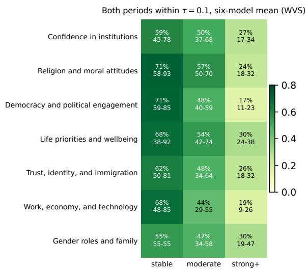

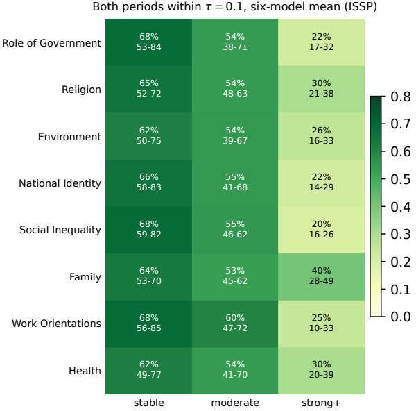

Figure 13: Both-period accuracy by topic: political and economic topics are the hardest to track under large change, and family and personal life the easiest. Accuracy falls from stable to strong+ in every topic. Cells show the mean % of pairs with both periods within τ = 0.10 across models with at least 20 pairs, with the model range below. Strong+ combines strong and very strong.  
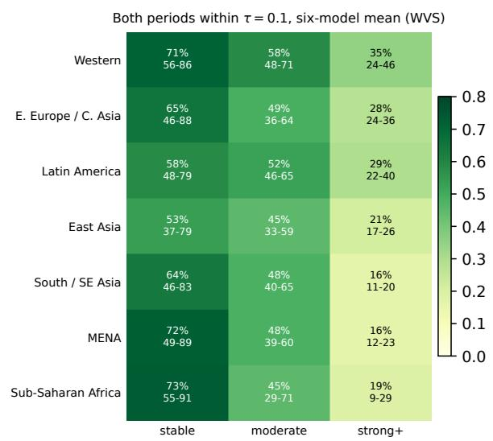

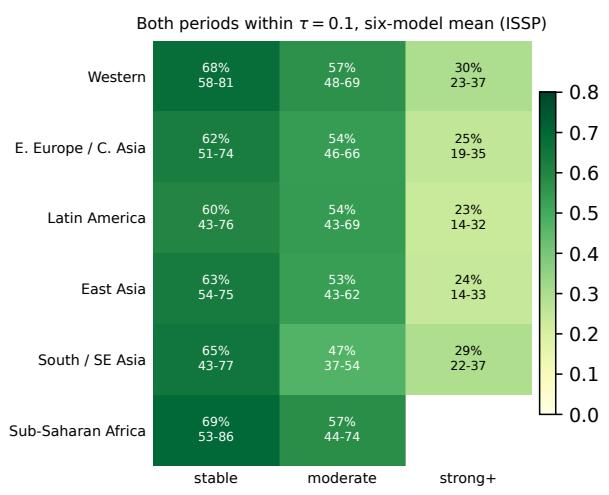

Figure 14: Both-period accuracy by region: Western countries are tracked best under large change. In WVS, regions are similar for stable pairs, but for strong+ shifts Western countries are about twice as accurate as South and Southeast Asia and MENA. The gap is smaller in ISSP. Cells as in Figure 13.
<table><tr><td></td><td colspan="3">Zero model shift (%)</td><td colspan="3">Median ratio r</td><td colspan="3">Median cosine</td></tr><tr><td>Model</td><td>Mod.</td><td>Str.</td><td>V. str.</td><td>Mod.</td><td>Str.</td><td>V. str.</td><td>Mod.</td><td>Str.</td><td>V. str.</td></tr><tr><td>Llama-3.3-70B</td><td>35.8</td><td>25.2</td><td>17.4</td><td>0.84</td><td>0.50</td><td>0.39</td><td>0.22</td><td>0.76</td><td>0.88</td></tr><tr><td>GPT-40</td><td>44.2</td><td>32.3</td><td>28.3</td><td>0.80</td><td>0.44</td><td>0.36</td><td>0.50</td><td>0.84</td><td>0.91</td></tr><tr><td>GPT-5.4</td><td>15.8</td><td>11.8</td><td>10.3</td><td>0.60</td><td>0.38</td><td>0.26</td><td>0.45</td><td>0.88</td><td>0.92</td></tr><tr><td>Qwen3.5-35B</td><td>42.7</td><td>33.5</td><td>28.2</td><td>0.85</td><td>0.47</td><td>0.30</td><td>0.21</td><td>0.71</td><td>0.86</td></tr><tr><td>Qwen3.8-Flash</td><td>43.0</td><td>36.3</td><td>28.2</td><td>0.86</td><td>0.47</td><td>0.40</td><td>0.39</td><td>0.80</td><td>0.91</td></tr><tr><td>DeepSeek-V3</td><td>56.3</td><td>45.7</td><td>33.2</td><td>0.95</td><td>0.47</td><td>0.27</td><td>0.46</td><td>0.80</td><td>0.84</td></tr></table>

Table 11: RF2 magnitude and direction by human shift: as shift grows, identical predictions become rarer, the median ratio falls, and the median cosine rises. Ratio and cosine use pairs with nonzero model shift.

<table><tr><td rowspan="2">Human shift</td><td colspan="2">Median ratio</td></tr><tr><td>Nonzero shift</td><td>All pairs</td></tr><tr><td>Moderate</td><td>0.838</td><td>0.320</td></tr><tr><td>Strong</td><td>0.500</td><td>0.295</td></tr><tr><td>Very strong</td><td>0.390</td><td>0.304</td></tr></table>

Table 12: Median magnitude ratio with and without identical predictions (Llama-3.3-70B): underestimation persists when identical predictions are included.

These results complement the magnitude findings in Section 4.3. There, models often underestimate change when the gold distributions shift. Here, they can also introduce change when the gold distributions remain stable. A small model shift on a stable pair therefore should not by itself be interpreted as evidence that the model has correctly recognized stability. More generally, the amount of predicted change is not consistently calibrated to the amount of observed cultural change.

<table><tr><td>Model</td><td>Preserves (%)</td><td>Small (%)</td><td>Large (%)</td></tr><tr><td>Llama-3.3-70B</td><td>64.5</td><td>26.2</td><td>9.2</td></tr><tr><td>GPT-40</td><td>67.6</td><td>28.6</td><td>3.9</td></tr><tr><td>GPT-5.4</td><td>67.0</td><td>30.2</td><td>2.8</td></tr><tr><td>Qwen3.5-35B</td><td>68.6</td><td>21.9</td><td>9.5</td></tr><tr><td>Qwen3.8-Flash</td><td>67.2</td><td>24.5</td><td>8.3</td></tr><tr><td>DeepSeek-V3</td><td>70.1</td><td>22.9</td><td>7.0</td></tr></table>

Table 13: Model behavior on stable pairs (%): most stable pairs keep a steady prediction, but 29.9–35.5% show false drift. Preserves: $d _ { m } \leq 0 . 0 3 ;$ small drift: $0 . 0 3 < d _ { m } < 0 . 1 0 ;$ large drift: $d _ { m } \geq 0 . 1 0$

## D.4 Stability Preservation by Survey

We separate the stable-pair analysis in Appendix D.3 by survey to examine whether the pooled results reflect similar behavior in WVS and ISSP. Both surveys use the same definitions: stable gold pairs have $d _ { h } \leq 0 . 0 3$ , and model predictions preserve stability when $d _ { m } \leq 0 . 0 3$ . Small false drift corresponds to $0 . 0 3 < d _ { m } < 0 . 1 0$ , and large false drift to $d _ { m } \geq 0 . 1 0$

Table 14 shows that false drift is more frequent in WVS. Stability preservation exceeds combined false drift in both surveys, but only narrowly in WVS (50.6% vs. 49.4%). Large false drift is also more than twice as frequent in WVS. Since ISSP contributes more stable pairs, the pooled percentages are closer to its results.

<table><tr><td>Behavior</td><td>WVS</td><td>ISSP</td><td>Pooled</td></tr><tr><td>Preserves stability</td><td>50.6%</td><td>68.5%</td><td>64.5%</td></tr><tr><td>Small false drift</td><td>33.9%</td><td>24.1%</td><td>26.2%</td></tr><tr><td>Large false drift</td><td>15.5%</td><td>7.5%</td><td>9.2%</td></tr></table>

Table 14: Stable-pair behavior by survey (Llama-3.3- 70B): false drift is more frequent in WVS than in ISSP. Percentages may not sum to 100 due to rounding.

## D.5 Human and Model Shift Across Temporal Pairs

Figure 15 complements the magnitude analysis in Section 4.3. Each point represents a temporal pair, with human shift $d _ { h }$ on the horizontal axis and model shift $d _ { m }$ on the vertical axis. Points below the diagonal indicate that the model predicts less change than observed, while points above it indicate more change. The diagonal represents equal magnitudes but does not indicate whether the direction of change is correct. Stable pairs are included for context.

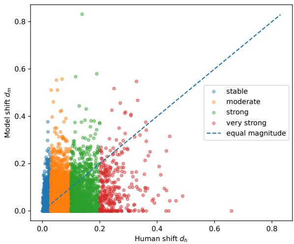  
Figure 15: Human shift $d _ { h }$ and model shift $d _ { m }$ for Llama-3.3-70B on individual temporal pairs, colored by human shift category. The dashed diagonal marks equal magnitudes $( d _ { m } = d _ { h } )$ . Points below it indicate underestimation of the amount of cultural change.

## D.6 Illustrative Patterns of Predicted Change

Figure 16 illustrates the four outcomes discussed in Section 4.3, using one survey question in four countries for Llama-3.3-70B. For readability, each arrow shows the change in the mean response on the original answer scale between the older and newer year. This is a simplified view: our direction measure in Section 4.3 compares changes across the full response distribution, not only the mean.

How important is religion in most people's lives?  
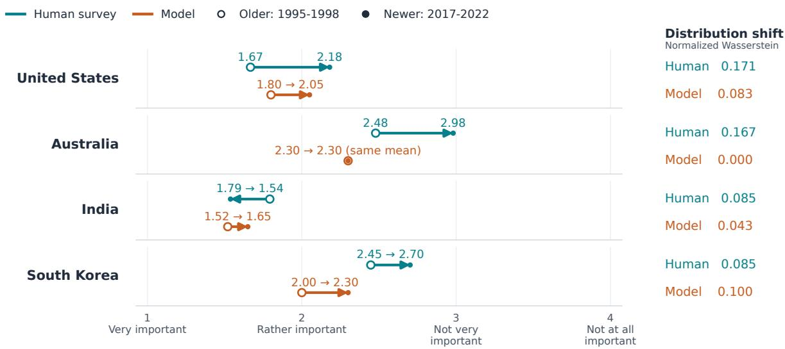  
Mean response on the original answer scale

Figure 16: Four patterns of predicted change (Llama-3.3-70B). Arrows show the change in mean response from the older to the newer year. In the United States, the model moves in the same direction as human responses but underestimates the change. In Australia, it predicts no change despite an observed shift. In India, model and human responses move in reverse direction, and in South Korea, the model overestimates the change.

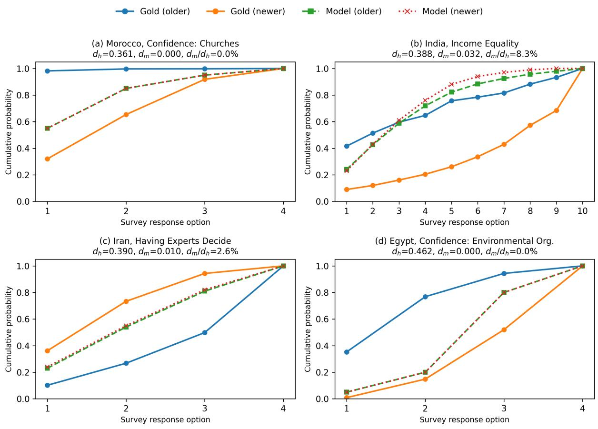  
Figure 17: Selected examples of limited model change for Llama-3.3-70B despite substantial human shift: (a) Morocco, confidence in churches, (b) India, income equality, (c) Iran, having experts decide, and (d) Egypt, confidence in environmental organizations. Curves show cumulative response distributions. The annotations report human shift $d _ { h }$ , model shift $d _ { m }$ , and the magnitude ratio $d _ { m } / d _ { h }$ expressed as a percentage. Overlapping model curves indicate identical predictions for the older and newer periods.

<table><tr><td>Model</td><td>Oldest</td><td>Interm.</td><td>Newest</td></tr><tr><td>Llama-3.3-70B</td><td>37.6</td><td>16.5</td><td>45.9</td></tr><tr><td>GPT-40</td><td>36.6</td><td>16.1</td><td>47.3</td></tr><tr><td>GPT-5.4</td><td>37.0</td><td>17.1</td><td>45.9</td></tr><tr><td>Qwen3.5-35B</td><td>38.3</td><td>15.5</td><td>46.2</td></tr><tr><td>Qwen3.8-Flash</td><td>36.5</td><td>15.8</td><td>47.7</td></tr><tr><td>DeepSeek-V3</td><td>37.7</td><td>16.4</td><td>45.8</td></tr></table>

Table 15: Default survey year of undated predictions: the newest year is the most common, but earlier years account for more than half of items in every model. Cells are the % of items whose undated prediction is closest to the oldest, an intermediate, or the newest available year.

<table><tr><td>Available years</td><td>Default survey year</td><td></td><td>Observed Equal-choice</td></tr><tr><td>Exactly two</td><td>Oldest</td><td>45.36%</td><td>50.00%</td></tr><tr><td rowspan="2"></td><td>Newest</td><td>54.64%</td><td>50.00%</td></tr><tr><td>Oldest</td><td>29.10%</td><td>30.94%</td></tr><tr><td rowspan="2">Three or more</td><td>Intermediate</td><td>34.57%</td><td>38.12%</td></tr><tr><td>Newest</td><td>36.33%</td><td>30.94%</td></tr></table>

Table 16: Default survey year by survey coverage (Llama-3.3-70B, WVS and ISSP pooled): the newest year is selected only slightly more often than under equal choice. Equal-choice percentages are computed per item and averaged within groups. Items with two years have no intermediate year.

## D.7 Examples of Limited Model Change

Figure 17 illustrates the behavior examined in Section 4.3 using four selected country-question pairs. Each panel shows the older and newer gold distributions alongside the corresponding model predictions, plotted as cumulative response proportions.

Across these examples, the gold distributions differ substantially, while the model predictions overlap or remain close together. Morocco and Egypt illustrate identical predictions for the two periods, while India and Iran illustrate small model changes relative to the human shift. These examples make the limited model change visible at the level of the response distributions.

## E RF3: Default Period and Temporal Cues

## E.1 Default Period of Undated Predictions

Table 15 reports the default survey year of undated predictions. Appendix E.2 compares these rates with the rates expected if a year were chosen at random.

## E.2 Equal-Choice Comparison

The number of available survey years differs across country-question items. To help interpret which years the undated predictions most closely resemble, we introduce an equal-choice baseline. This baseline describes the expected matching percentages if one available survey year were selected at random for each item, with every year having an equal chance.

For example, an item with two survey years has a 50% chance of selecting the oldest year and a 50% chance of selecting the newest. An item with four years has a 25% chance for each year: 25% for the oldest, 25% for the newest, and 50% for the two intermediate years combined.

We calculate these probabilities separately for each item and average them across items to obtain the baseline percentages. Comparing the observed matching percentages with this baseline shows whether a category is matched more or less often than under random year selection.

Table 16 reports this comparison for Llama-3.3- 70B, separately for items with exactly two available survey years and those with three or more.

## E.3 Overall Effect of Naming a Year

Table 17 portrays the overall effect of naming a year.

## E.4 Effect of Naming a Year by Human Shift

Table 18 reports mean benefit by human shift for all six models, as plotted in Figure 8. Bootstrap 95% intervals over temporal pairs (1,000 resamples) confirm these patterns. For stable and moderate shifts, the intervals for naming either year lie below zero in all six models. For very strong shifts, the interval for naming the older year lies above zero in all six models, while the interval for naming the newer year includes zero in five models and lies below zero for Qwen3.8-Flash. This benefit (about 0.03 in W) is small in absolute terms; we read it as a consistent direction rather than a large improvement. For Llama-3.3-70B, Table 19 and Figure 18 also report the share of items helped, unchanged, and hurt, using the definitions in Section 4.4. Table 20 reports the shares helped and hurt for very strong shifts in all six models.

## F Robustness Analyses

This section tests whether our findings depend on the human-shift thresholds (Appendix F.1), the knowledge-filter retention level (Appendix F.2), repeated runs and prompt instructions (Appendix F.3), and survey sampling noise (Appendix F.4).

<table><tr><td></td><td colspan="5">Naming the older year</td><td colspan="5">Naming the newer year</td></tr><tr><td>Model</td><td>Benefit</td><td>Helped</td><td>Unch.</td><td>Hurt</td><td>Ident.</td><td>Benefit</td><td>Helped</td><td>Unch.</td><td>Hurt</td><td>Ident.</td></tr><tr><td>Llama-3.3-70B</td><td>-0.78</td><td>34.4</td><td>23.9</td><td>41.7</td><td>22.7</td><td>-0.69</td><td>33.3</td><td>26.0</td><td>40.7</td><td>24.6</td></tr><tr><td>GPT-40</td><td>+0.02</td><td>31.9</td><td>36.4</td><td>31.6</td><td>34.3</td><td>-0.17</td><td>22.8</td><td>51.6</td><td>25.6</td><td>50.0</td></tr><tr><td>GPT-5.4</td><td>-0.02</td><td>44.2</td><td>12.1</td><td>43.7</td><td>10.6</td><td>-0.10</td><td>41.7</td><td>18.0</td><td>40.3</td><td>16.5</td></tr><tr><td>Qwen3.5-35B</td><td>-0.39</td><td>30.3</td><td>38.6</td><td>31.0</td><td>37.9</td><td>-0.52</td><td>26.2</td><td>42.8</td><td>31.0</td><td>41.9</td></tr><tr><td>Qwen3.8-Flash</td><td>-0.09</td><td>31.8</td><td>37.4</td><td>30.8</td><td>36.5</td><td>-0.36</td><td>22.3</td><td>50.8</td><td>26.9</td><td>50.0</td></tr><tr><td>DeepSeek-V3</td><td>-0.25</td><td>26.5</td><td>44.2</td><td>29.3</td><td>42.6</td><td>-0.31</td><td>20.4</td><td>54.9</td><td>24.7</td><td>53.7</td></tr></table>

Table 17: Overall effect of naming a year: it helps and hurts similar shares of items, so the mean benefit (×100) is near zero for every model. Helped, Unch. (unchanged), and Hurt are % of items and sum to 100; Ident. is the % of items whose dated prediction equals the undated one.
<table><tr><td rowspan="3">Model</td><td colspan="4">Naming the older year</td><td colspan="4">Naming the newer year</td></tr><tr><td>Stab.</td><td>Mod.</td><td>Str.</td><td>V. str.</td><td>Stab.</td><td>Mod.</td><td>Str.</td><td>V. str.</td></tr><tr><td>Llama-3.3-70B</td><td>-0.81</td><td>-1.17</td><td>-0.52</td><td>+3.28</td><td>-0.41</td><td>-0.76</td><td>-0.99</td><td>-0.19</td></tr><tr><td>GPT-40</td><td>-0.55</td><td>-0.25</td><td>+0.72</td><td>+3.47</td><td>-0.31</td><td>-0.15</td><td>-0.06</td><td>-0.12</td></tr><tr><td>GPT-5.4</td><td>-0.43</td><td>-0.37</td><td>+0.79</td><td>+3.62</td><td>-0.15</td><td>-0.15</td><td>0.00</td><td>+0.33</td></tr><tr><td>Qwen3.5-35B</td><td>-1.03</td><td>-0.63</td><td>+0.26</td><td>+3.20</td><td>-0.56</td><td>-0.50</td><td>-0.66</td><td>-0.03</td></tr><tr><td>Qwen3.8-Flash</td><td>-0.63</td><td>-0.43</td><td>+0.61</td><td>+4.55</td><td>-0.36</td><td>-0.36</td><td>-0.30</td><td>-0.49</td></tr><tr><td>DeepSeek-V3</td><td>-0.76</td><td>-0.50</td><td>+0.32</td><td>+2.96</td><td>-0.31</td><td>-0.34</td><td>-0.32</td><td>+0.04</td></tr></table>

Table 18: Mean benefit (×100) by human shift: naming the older year helps after very strong shifts in every model, while naming the newer year helps little at any level. Plotted in Figure 8.

<table><tr><td>Human shift</td><td></td><td>Period Mean Helped Unchanged Hurt benefit</td><td></td><td></td></tr><tr><td rowspan="2">Stable</td><td>Older</td><td>-0.81</td><td>33.7%</td><td>26.6% 39.7%</td></tr><tr><td>Newer</td><td>-0.41</td><td>36.1%</td><td>25.0% 38.9%</td></tr><tr><td rowspan="2">Moderate</td><td>Older</td><td>-1.17</td><td>32.2%</td><td>24.2%43.6%</td></tr><tr><td>Newer</td><td>-0.76</td><td>32.8%</td><td>25.6%41.6%</td></tr><tr><td rowspan="2">Strong</td><td>Older</td><td>-0.52</td><td>37.6%</td><td>21.1% 41.4%</td></tr><tr><td>Newer</td><td>-0.99</td><td>30.2%</td><td>27.9% 41.9%</td></tr><tr><td rowspan="2">Very strong</td><td>Older</td><td>+3.28</td><td>53.7%</td><td>17.7% 28.6%</td></tr><tr><td>Newer</td><td>-0.19</td><td>37.3%</td><td>28.0% 34.8%</td></tr></table>

Table 19: Naming outcomes by human shift (Llama-3.3-70B): naming either year helps more often than it hurts only for very strong shifts. Mean benefit is ×100; helped, unchanged, and hurt mean positive, zero, and negative benefit. Percentages may not sum to 100 due to rounding.

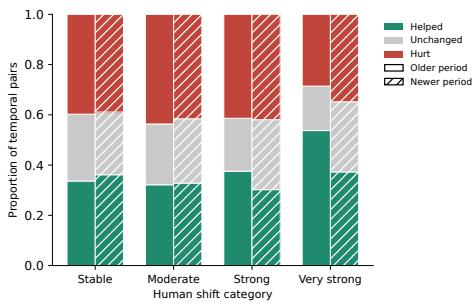  
Figure 18: Naming outcomes by human shift (Llama-3.3-70B): for very strong shifts, naming either period helps more often than it hurts.

<table><tr><td></td><td colspan="2">Older year</td><td colspan="2">Newer year</td></tr><tr><td>Model</td><td>Helped</td><td>Hurt</td><td>Helped</td><td>Hurt</td></tr><tr><td>Llama-3.3-70B</td><td>53.7</td><td>28.6</td><td>37.3</td><td>34.8</td></tr><tr><td>GPT-40</td><td>52.5</td><td>21.7</td><td>23.2</td><td>25.8</td></tr><tr><td>GPT-5.4</td><td>63.7</td><td>29.1</td><td>47.9</td><td>39.7</td></tr><tr><td>Qwen3.5-35B</td><td>49.0</td><td>21.7</td><td>30.3</td><td>30.3</td></tr><tr><td>Qwen3.8-Flash</td><td>54.4</td><td>19.8</td><td>20.1</td><td>31.2</td></tr><tr><td>DeepSeek-V3</td><td>53.2</td><td>20.5</td><td>25.7</td><td>26.0</td></tr></table>

Table 20: Items helped and hurt by naming each period, very strong shifts (%): naming the older year helps more often than it hurts in every model.

## F.1 Robustness to Human-Shift Thresholds

The four human-shift categories (Table 1) depend on three boundaries.

To check that our conclusions do not depend on where these boundaries are drawn, we repeat the main analyses for all six models under a tighter and a looser set of boundaries (Table 21). Only the category assignment changes, and all predictions and distances stay the same. For stable pairs, the boundary for keeping a prediction steady moves with the stable boundary.

Tables 22–25 report the results.

<table><tr><td>Set</td><td>Stable</td><td>Moderate</td><td>Strong</td><td>Very strong</td></tr><tr><td>Tighter</td><td> $\leq 0 . 0 2$ </td><td>0.02-0.075</td><td>0.075-0.15</td><td> $\geq 0 . 1 5$ </td></tr><tr><td>Default</td><td> $\leq 0 . 0 3$ </td><td>0.03-0.10</td><td>0.10-0.20</td><td> $\geq 0 . 2 0$ </td></tr><tr><td>Looser</td><td> $\leq 0 . 0 4$ </td><td>0.04–0.125</td><td>0.125-0.25</td><td> $\geq 0 . 2 5$ </td></tr></table>

Table 21: Human-shift boundaries $( d _ { h } )$ used in the robustness check. The default set is the one used in the main paper.

Moving the boundaries changes the levels of each measure, since each category then covers a different range of shifts, but not the trends: under every boundary set and for every model, accuracy on both periods falls as human shift grows, separated pairs become more common but remain a minority, the median magnitude ratio falls while the median cosine rises, and most stable pairs keep a steady prediction. Two details depend on the boundaries. Under the looser set, the share of pairs with only one accurate period falls slightly from strong to very strong shifts for four models, where the very strong category is small. Under the tighter set, the median ratio for moderate shifts exceeds 1 for four models, so underestimation is clearest for strong and very strong shifts.

## F.2 Robustness to Knowledge-Filter Retention

The knowledge filter retains 75% of question– country combinations (Section 4.1). To check that our findings do not depend on this choice, we repeat the main analyses for Llama-3.3-70B at 50% and 100% retention, using the same predictions and human-shift thresholds. Only the set of retained combinations changes. Tables 26 and 27 report the results.

Retaining fewer combinations generally raises accuracy, since the remaining combinations are those for which the model shows the strongest baseline knowledge. The trends, however, are unchanged. At every retention level, accuracy on both periods falls as human shift grows, separated pairs become more common but remain a minority, and the median cosine rises. The median magnitude ratio stays below 1 and is lower for strong and very strong shifts than for moderate ones. Undated predictions match the newest year in 46–47% of cases, specifying a year yields mean benefit near zero or slightly negative, and most stable pairs keep a steady prediction (63.7–66.9%).

## F.3 Robustness to Repeated Runs and Prompt Instructions

We examine inference stability and sensitivity to elicitation instructions using Llama-3.3-70B on 300 temporal pairs, sampled equally across the four human-shift categories without applying the knowledge filter. First, we repeat each original prompt five times. Predictions are identical to the first run in 90.5% of comparisons, with a mean distance of 0.0026, indicating limited run-to-run variation. Second, we test two alternative instructions that frame the task as estimating responses from a nationally representative survey or from 100 adults. The survey questions and response options remain unchanged, and within each temporal pair only the year differs. Although these instructions affect individual predictions (mean distances of 0.069 and 0.060 from the original instruction), the main temporal patterns persist. Under all three instructions, both-period accuracy declines with human shift, median magnitude ratios remain below 1 and are lower for strong and very strong shifts than for moderate shifts, and directional alignment is highest for very strong shifts. Identical predictions between periods also persist, although their frequency varies across instructions.

## F.4 Survey Sampling Noise

Gold distributions are estimated from samples of respondents, so some difference between years can arise from sampling alone. To estimate this noise, we assume for each temporal pair that the older gold distribution did not change, draw two independent samples of 500 respondents from it (the minimum sample size in our benchmark), and compute the distance between them, repeating this 200 times. Sampling alone produces a median distance of 0.016, and the 95th percentile of these distances has a median of 0.034 across pairs. Our stable threshold of 0.03 therefore corresponds to differences that sampling alone can produce. All strong and very strong shifts and 90.1% of moderate shifts exceed the 95th percentile of their own pair. Since most surveys include more than 500 respondents, these estimates are conservative.

<table><tr><td></td><td></td><td colspan="4">Both periods accurate (%)</td><td colspan="4">One period only (%)</td></tr><tr><td>Model</td><td>Set</td><td>Stab.</td><td>Mod.</td><td>Str.</td><td>V. str.</td><td>Stab.</td><td>Mod.</td><td>Str.</td><td>V. str.</td></tr><tr><td>Llama-3.3-70B</td><td>Tighter</td><td>70.3</td><td>52.7</td><td>31.3</td><td>14.6</td><td>15.4</td><td>28.3</td><td>49.3</td><td>61.9</td></tr><tr><td></td><td>Default</td><td>65.1</td><td>47.8</td><td>22.8</td><td>11.5</td><td>19.0</td><td>33.2</td><td>55.9</td><td>63.7</td></tr><tr><td></td><td>Looser</td><td>62.2</td><td>42.6</td><td>18.0</td><td>9.2</td><td>20.9</td><td>38.2</td><td>60.1</td><td>58.8</td></tr><tr><td>GPT-40</td><td>Tighter</td><td>70.6</td><td>60.0</td><td>40.3</td><td>19.0</td><td>16.6</td><td>28.4</td><td>50.0</td><td>63.5</td></tr><tr><td></td><td>Default</td><td>66.9</td><td>55.9</td><td>31.1</td><td>13.7</td><td>20.2</td><td>33.4</td><td>56.5</td><td>67.2</td></tr><tr><td></td><td>Looser</td><td>66.4</td><td>50.9</td><td>25.0</td><td>6.7</td><td>21.5</td><td>38.2</td><td>62.0</td><td>64.2</td></tr><tr><td>GPT-5.4</td><td>Tighter</td><td>82.6</td><td>71.6</td><td>47.9</td><td>24.9</td><td>10.9</td><td>21.0</td><td>44.3</td><td>62.9</td></tr><tr><td></td><td>Default</td><td>80.3</td><td>66.4</td><td>37.0</td><td>19.5</td><td>12.3</td><td>26.4</td><td>54.3</td><td>66.1</td></tr><tr><td></td><td>Looser</td><td>78.4</td><td>61.1</td><td>30.7</td><td>11.2</td><td>14.6</td><td>31.5</td><td>59.5</td><td>67.3</td></tr><tr><td>Qwen3.5-35B</td><td>Tighter</td><td>56.2</td><td>48.5</td><td>30.3</td><td>14.7</td><td>19.2</td><td>30.2</td><td>48.9</td><td>61.1</td></tr><tr><td></td><td>Default</td><td>54.3</td><td>44.4</td><td>23.4</td><td>10.4</td><td>21.5</td><td>35.0</td><td>55.4</td><td>63.2</td></tr><tr><td></td><td>Looser</td><td>53.5</td><td>39.9</td><td>19.7</td><td>6.2</td><td>23.4</td><td>39.3</td><td>60.0</td><td>53.8</td></tr><tr><td>Qwen3.8-Flash</td><td>Tighter</td><td>71.5</td><td>60.4</td><td>40.9</td><td>20.5</td><td>14.2</td><td>27.9</td><td>47.0</td><td>63.0</td></tr><tr><td></td><td>Default</td><td>68.3</td><td>56.2</td><td>30.9</td><td>18.5</td><td>18.8</td><td>31.9</td><td>57.0</td><td>59.1</td></tr><tr><td></td><td>Looser</td><td>67.1</td><td>51.5</td><td>24.6</td><td>17.6</td><td>20.4</td><td>36.8</td><td>61.8</td><td>50.9</td></tr><tr><td>DeepSeek-V3</td><td>Tighter</td><td>62.8</td><td>54.2</td><td>36.9</td><td>16.1</td><td>16.9</td><td>29.2</td><td>48.5</td><td>66.5</td></tr><tr><td></td><td>Default</td><td>60.5</td><td>50.7</td><td>27.8</td><td>9.7</td><td>20.5</td><td>33.7</td><td>57.0</td><td>69.5</td></tr><tr><td></td><td>Looser</td><td>60.2</td><td>45.7</td><td>22.4</td><td>6.1</td><td>21.9</td><td>38.6</td><td>63.2</td><td>61.4</td></tr></table>

Table 22: RF1 under alternative shift boundaries: for every model and boundary set, accuracy on both periods falls as human shift grows. One period only is older only plus newer only.

<table><tr><td></td><td></td><td colspan="3">Separated (%)</td><td colspan="3">Same period (%)</td></tr><tr><td>Model</td><td>Set</td><td>Mod.</td><td>Str.</td><td>V. str.</td><td>Mod.</td><td>Str.</td><td>V. str.</td></tr><tr><td>Llama-3.3-70B</td><td>Tighter</td><td>8.3</td><td>11.5</td><td>22.3</td><td>85.9</td><td>82.8</td><td>72.2</td></tr><tr><td></td><td>Default</td><td>8.8</td><td>15.2</td><td>26.7</td><td>85.5</td><td>79.1</td><td>68.9</td></tr><tr><td></td><td>Looser</td><td>9.7</td><td>17.8</td><td>29.8</td><td>84.5</td><td>76.6</td><td>66.4</td></tr><tr><td>GPT-40</td><td>Tighter</td><td>7.1</td><td>12.7</td><td>21.1</td><td>88.9</td><td>83.1</td><td>75.0</td></tr><tr><td></td><td>Default</td><td>8.7</td><td>15.0</td><td>23.9</td><td>87.2</td><td>81.0</td><td>73.9</td></tr><tr><td></td><td>Looser</td><td>9.7</td><td>18.3</td><td>25.0</td><td>86.3</td><td>77.5</td><td>73.3</td></tr><tr><td>GPT-5.4</td><td>Tighter</td><td>10.4</td><td>15.8</td><td>26.7</td><td>82.9</td><td>79.1</td><td>68.8</td></tr><tr><td></td><td>Default</td><td>11.8</td><td>19.6</td><td>29.8</td><td>82.0</td><td>75.5</td><td>67.1</td></tr><tr><td></td><td>Looser</td><td>13.0</td><td>23.9</td><td>24.3</td><td>81.0</td><td>71.2</td><td>73.8</td></tr><tr><td>Qwen3.5-35B</td><td>Tighter</td><td>7.2</td><td>11.1</td><td>17.6</td><td>86.9</td><td>84.0</td><td>78.1</td></tr><tr><td></td><td>Default</td><td>8.5</td><td>13.1</td><td>19.6</td><td>85.9</td><td>81.8</td><td>77.7</td></tr><tr><td></td><td>Looser</td><td>9.5</td><td>15.3</td><td>15.2</td><td>84.9</td><td>80.3</td><td>83.4</td></tr><tr><td>Qwen3.8-Flash</td><td>Tighter</td><td>8.7</td><td>13.2</td><td>22.9</td><td>86.2</td><td>81.6</td><td>74.2</td></tr><tr><td></td><td>Default</td><td>10.0</td><td>16.0</td><td>27.9</td><td>84.9</td><td>79.7</td><td>69.5</td></tr><tr><td></td><td>Looser</td><td>10.9</td><td>19.1</td><td>30.6</td><td>83.8</td><td>77.3</td><td>66.7</td></tr><tr><td>DeepSeek-V3</td><td>Tighter</td><td>6.6</td><td>9.1</td><td>17.8</td><td>89.4</td><td>87.5</td><td>79.4</td></tr><tr><td></td><td>Default</td><td>7.4</td><td>11.3</td><td>19.0</td><td>88.8</td><td>85.4</td><td>78.9</td></tr><tr><td></td><td>Looser</td><td>8.1</td><td>14.4</td><td>20.5</td><td>88.2</td><td>82.8</td><td>76.5</td></tr></table>

Table 23: RF1 alignment under alternative shift boundaries: separated pairs become more common as human shift grows, but most pairs stay aligned with a single period under every set.

<table><tr><td></td><td></td><td colspan="3">Zero model shift (%)</td><td colspan="3">Median ratio r</td><td colspan="3">Median cosine</td></tr><tr><td>Model</td><td>Set</td><td>Mod.</td><td>Str.</td><td>V. str.</td><td>Mod.</td><td>Str.</td><td>V. str.</td><td>Mod.</td><td>Str.</td><td>V. str.</td></tr><tr><td>Llama-3.3-70B</td><td>Tighter</td><td>37.1</td><td>29.5</td><td>20.7</td><td>1.07</td><td>0.55</td><td>0.45</td><td>0.13</td><td>0.63</td><td>0.88</td></tr><tr><td></td><td>Default</td><td>35.8</td><td>25.2</td><td>17.4</td><td>0.84</td><td>0.50</td><td>0.39</td><td>0.22</td><td>0.76</td><td>0.88</td></tr><tr><td></td><td>Looser</td><td>33.1</td><td>23.7</td><td>18.3</td><td>0.73</td><td>0.48</td><td>0.37</td><td>0.36</td><td>0.84</td><td>0.90</td></tr><tr><td>GPT-40</td><td>Tighter</td><td>46.1</td><td>37.6</td><td>27.7</td><td>0.99</td><td>0.49</td><td>0.40</td><td>0.37</td><td>0.77</td><td>0.91</td></tr><tr><td></td><td>Default</td><td>44.2</td><td>32.3</td><td>28.3</td><td>0.80</td><td>0.44</td><td>0.36</td><td>0.50</td><td>0.84</td><td>0.91</td></tr><tr><td></td><td>Looser</td><td>42.4</td><td>30.0</td><td>25.8</td><td>0.67</td><td>0.40</td><td>0.35</td><td>0.62</td><td>0.90</td><td>0.90</td></tr><tr><td>GPT-5.4</td><td>Tighter</td><td>16.4</td><td>13.7</td><td>11.5</td><td>0.73</td><td>0.42</td><td>0.32</td><td>0.30</td><td>0.82</td><td>0.91</td></tr><tr><td></td><td>Default</td><td>15.8</td><td>11.8</td><td>10.3</td><td>0.60</td><td>0.38</td><td>0.26</td><td>0.45</td><td>0.88</td><td>0.92</td></tr><tr><td></td><td>Looser</td><td>15.2</td><td>10.8</td><td>11.2</td><td>0.51</td><td>0.37</td><td>0.20</td><td>0.62</td><td>0.91</td><td>0.91</td></tr><tr><td>Qwen3.5-35B</td><td>Tighter</td><td>43.7</td><td>39.0</td><td>28.3</td><td>1.08</td><td>0.58</td><td>0.38</td><td>0.12</td><td>0.58</td><td>0.81</td></tr><tr><td></td><td>Default</td><td>42.7</td><td>33.5</td><td>28.2</td><td>0.85</td><td>0.47</td><td>0.30</td><td>0.21</td><td>0.71</td><td>0.86</td></tr><tr><td></td><td>Looser</td><td>41.0</td><td>30.6</td><td>26.2</td><td>0.73</td><td>0.42</td><td>0.25</td><td>0.30</td><td>0.78</td><td>0.79</td></tr><tr><td>Qwen3.8-Flash</td><td>Tighter</td><td>45.4</td><td>37.9</td><td>31.0</td><td>1.13</td><td>0.55</td><td>0.43</td><td>0.27</td><td>0.71</td><td>0.88</td></tr><tr><td></td><td>Default</td><td>43.0</td><td>36.3</td><td>28.2</td><td>0.86</td><td>0.47</td><td>0.40</td><td>0.39</td><td>0.80</td><td>0.91</td></tr><tr><td></td><td>Looser</td><td>41.6</td><td>33.4</td><td>28.7</td><td>0.72</td><td>0.44</td><td>0.40</td><td>0.51</td><td>0.85</td><td>0.93</td></tr><tr><td>DeepSeek-V3</td><td>Tighter</td><td>57.4</td><td>51.2</td><td>36.0</td><td>1.23</td><td>0.56</td><td>0.36</td><td>0.34</td><td>0.73</td><td>0.83</td></tr><tr><td></td><td>Default</td><td>56.3</td><td>45.7</td><td>33.2</td><td>0.95</td><td>0.47</td><td>0.27</td><td>0.46</td><td>0.80</td><td>0.84</td></tr><tr><td></td><td>Looser</td><td>53.7</td><td>41.0</td><td>28.8</td><td>0.78</td><td>0.40</td><td>0.24</td><td>0.58</td><td>0.81</td><td>0.84</td></tr></table>

Table 24: RF2 under alternative shift boundaries: for every model and boundary set, the median ratio falls and the median cosine rises as human shift grows. Ratio and cosine use pairs with nonzero model shift.

<table><tr><td>Model</td><td>Set</td><td>Preserves</td><td>Small</td><td>Large</td></tr><tr><td>Llama-3.3-70B</td><td>Tighter</td><td>59.6</td><td>32.4</td><td>8.0</td></tr><tr><td></td><td>Default</td><td>64.5</td><td>26.2</td><td>9.2</td></tr><tr><td></td><td>Looser</td><td>70.6</td><td>19.3</td><td>10.1</td></tr><tr><td>GPT-40</td><td>Tighter</td><td>63.5</td><td>32.9</td><td>3.6</td></tr><tr><td></td><td>Default</td><td>67.6</td><td>28.6</td><td>3.9</td></tr><tr><td></td><td>Looser</td><td>74.7</td><td>20.6</td><td>4.6</td></tr><tr><td>GPT-5.4</td><td>Tighter</td><td>54.7</td><td>43.3</td><td>2.0</td></tr><tr><td></td><td>Default</td><td>67.0</td><td>30.2</td><td>2.8</td></tr><tr><td>Qwen3.5-35B</td><td>Looser</td><td>73.8</td><td>22.5</td><td>3.7</td></tr><tr><td></td><td>Tighter</td><td>64.7</td><td>26.6</td><td>8.7</td></tr><tr><td></td><td>Default</td><td>68.6</td><td>21.9</td><td>9.5</td></tr><tr><td></td><td>Looser</td><td>73.4</td><td>16.6</td><td>10.0</td></tr><tr><td>Qwen3.8-Flash</td><td>Tighter</td><td>64.2</td><td>29.9</td><td>5.9</td></tr><tr><td></td><td>Default</td><td>67.2</td><td>24.5</td><td>8.3</td></tr><tr><td></td><td>Looser</td><td>72.4</td><td>18.7</td><td>9.0</td></tr><tr><td rowspan="3">DeepSeek-V3</td><td>Tighter</td><td>71.9</td><td>23.1</td><td>5.0</td></tr><tr><td>Default</td><td>70.1</td><td>22.9</td><td>7.0</td></tr><tr><td>Looser</td><td>78.2</td><td>14.3</td><td>7.5</td></tr></table>

Table 25: Stable pairs under alternative shift boundaries (%): most stable pairs keep a steady prediction under every set. Preserves uses each set’s stable boundary; large drift is $d _ { m } \geq 0 . 1 0$ throughout.

<table><tr><td></td><td colspan="4">Both accurate (%)</td><td colspan="4">Separated (%)</td><td colspan="3">Median ratio r</td><td colspan="3">Median cosine</td></tr><tr><td>Retained</td><td>Stab.</td><td>Mod.</td><td>Str.</td><td>V. str.</td><td>Mod.</td><td>Str.</td><td>V. str.</td><td>Mod.</td><td>Str.</td><td>V. str.</td><td>Mod.</td><td>Str.</td><td>V. str.</td><td></td></tr><tr><td>50%</td><td>80.7</td><td>59.9</td><td>27.0</td><td>13.9</td><td></td><td>9.8</td><td>15.9</td><td>26.0</td><td>0.84</td><td>0.50</td><td>0.39</td><td>0.23</td><td>0.75</td><td>0.89</td></tr><tr><td>75%</td><td>65.1</td><td>47.8</td><td>22.8</td><td>11.5</td><td>8.8</td><td>15.2</td><td>26.7</td><td></td><td>0.84 0.50</td><td></td><td>0.39</td><td>0.22</td><td>0.76</td><td>0.88</td></tr><tr><td>100%</td><td>48.9</td><td>36.8</td><td>18.5</td><td>10.0</td><td>7.4</td><td>13.2</td><td></td><td>24.4</td><td>0.87</td><td>0.51</td><td>0.39</td><td>0.23</td><td>0.74</td><td>0.87</td></tr></table>

Table 26: RF1 and RF2 at each knowledge-filter retention level (Llama-3.3-70B): all trends hold at every level. The 75% row matches the main results. Accuracy uses $\tau = 0 . 1 0 ;$ ratio and cosine use pairs with nonzero model shift.

<table><tr><td rowspan="2">Retained default (%)</td><td rowspan="2">Newest</td><td colspan="2">Benefit (×100) Preserves</td></tr><tr><td>Older Newer</td><td>(%)</td></tr><tr><td>50%</td><td>45.6</td><td>-1.31 -0.99</td><td>66.9</td></tr><tr><td>75%</td><td>45.9</td><td>-0.78 -0.69</td><td>64.5</td></tr><tr><td>100%</td><td>46.9</td><td>-0.01 -0.30</td><td>63.7</td></tr></table>

Table 27: RF3 and stable-pair results at each retention level (Llama-3.3-70B): the conclusions hold at every level. The 75% row matches the main results. Newest default is the % of combinations whose undated prediction is closest to the newest year; Preserves is the % of stable pairs with $d _ { m } \leq 0 . 0 3$