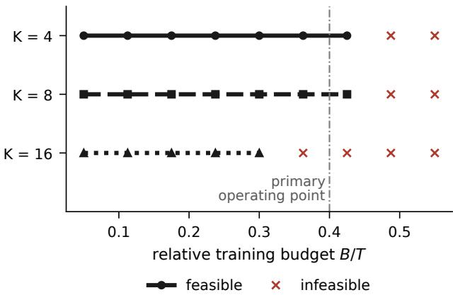
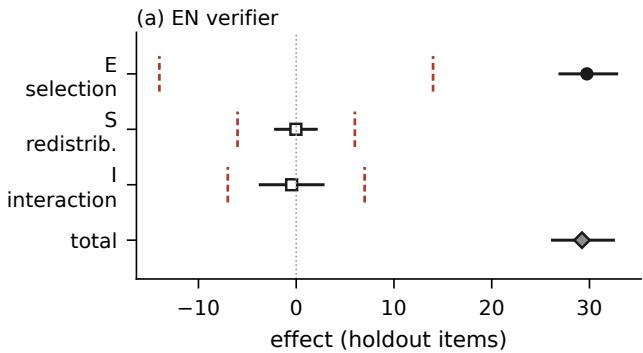
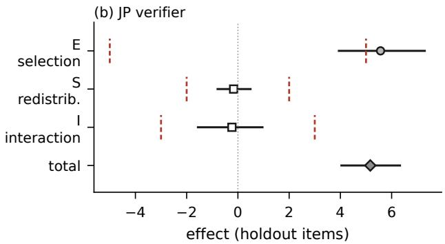
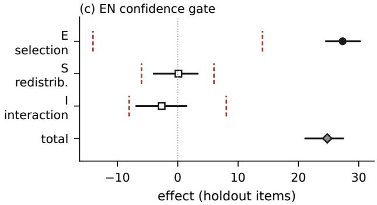

# Counterfactual Gate–Support Decomposition: Separating Selection from Redistribution in Training-Data Filtering

Hyojung Han†

Jongmin Kim

Seung-Hun Jeon

ThakiCloud

†Corresponding author: hyojung.han@thakicloud.com

2026-10-06

## Abstract

A training-data quality gate changes both which examples survive within regions of the input space and how training mass is distributed across those regions. A gate-versus-random comparison therefore does not isolate these mechanisms. We introduce Counterfactual Gate–Support Decomposition (CGSD), a fourarm, budget-matched design that crosses gate eligibility with support distribution and decomposes the observed gate efect into within-support selection, between-support redistribution, and their interaction. The practical constraint is finite-pool realizability: we characterize mass and token-assembly conditions under which the required arms can be constructed, together with a support-extinction case in which the ordinary design is undefined. On Korean–English and Korean–Japanese retrieval, the mean within-support selection component is the only one that exceeds its calibrated null band (+29.7 and +5.6 holdout items; 30/30 positive replicates), decisively in Korean–English and marginally in Korean–Japanese; redistribution and interaction remain unresolved at the available power. The same pattern holds for a second, unrelated gate family – a model-confidence threshold rather than a deterministic verifier – judged against its own null (+27.3 items, 9/9 positive), so the result is not a property of one gate’s mechanism. On a mathematics gate, zero-eligibility supports leave the ordinary design undefined at every budget, while the extended design is constructible only inside narrow budget bands that an exhaustive scan locates and that the natural operating point misses — the assembly condition separating a property of the pool from a limitation of the packer. CGSD therefore returns a decomposition, a constructible-but-underpowered design, or an explicit non-constructibility result, and says which; it prevents support redistribution from being silently interpreted as sample-level gate quality.

## 1 Introduction

Data-quality gates are deployed on the premise that removing bad examples improves the model trained on what remains. The evidence usually ofered is a comparison between a gated training set and a random subset of the same size. That comparison answers a diferent question than the one being asked, because a gate does not only choose better examples — it also reweights the distribution over whatever regions the data occupies. A gate that removes 40% of a corpus may be removing 5% of one topic and 95% of another. The downstream diference then contains a selection efect and a redistribution efect, and the comparison cannot say which one it saw.

This matters in practice because the two point at diferent levers. If the resolved gain is within-support selection, improving the within-support selection rule is the relevant intervention. If redistribution dominates, the gate is functioning as an accidental curriculum and explicit mixture control is the more direct and more controllable alternative. If the two have opposite signs, tightening the gate can make things worse in a way that looks inexplicable from the aggregate number alone.

We propose to answer the question by construction. Fix a source pool, a support representation defined on pre-gate text, and a training token budget. Build four training sets that cross two binary factors — eligibility (unrestricted vs. gate-eligible) and support distribution (source-preserved vs. gate-induced) — at the same budget. The observed gate efect then decomposes exactly, replicate by replicate, into three terms. No modelling assumption is introduced; the arms difer only in the factor being varied.

The algebra here is the familiar 2 × 2 factorial identity, and we do not claim it as new. Our contribution is making that contrast operational for finite training pools under fixed exposure, and characterizing when the arms the identity requires cannot be realized at all.

The price of that exactness is that the arms have to exist. Our main methodological finding is that existence is not a technicality. It fails in four ways whose prescriptions point in diferent directions: a support cannot supply its share, which a smaller budget fixes; a support has no eligible mass at all, which no budget fixes; the available example sizes cannot tile the per-support quotas at this budget, which is a property of the pool and not monotone in the budget; and an assembly exists but the packer does not find it, which is a property of the algorithm alone. Half of this paper is about telling them apart, because reading one as another sends you to change the wrong thing — as it did us, on our own mathematics pool.

Contributions. (i) A construction-based operationalization of the 2 × 2 gate contrast for finite training pools at fixed token exposure, separating withinsupport selection from between-support redistribution. (ii) Two independent feasibility conditions — mass and assembly — and their joint feasible region as a function of budget and support partition, with a bound linking the budget tolerance to the realized support distribution. (iii) An extension for support extinction, where the ordinary design is undefined at every positive budget, isolating the extensive margin as a signed contrast. (iv) A validation protocol — signature-locked null calibration, analytic known-truth recovery with interval coverage, infeasible controls, and extinction controls — under which we then demonstrate the method on two retrieval locales and two unrelated gate families (a deterministic verifier and a model-confidence threshold), and a feasibility audit of mathematics and text-to-SQL pools that returns extinction, empty feasible regions, and one narrow feasible band, each distinguished from the others rather than reported as a single failure.

## 2 Related work

Data filtering and selection. A large body of work asks which examples to keep. Heuristic and modelbased quality filters, deduplication [1, 16], dificulty- or margin-based pruning [24], influence-guided instance selection for a target task [27], and datamodel-driven selection [7] all improve downstream performance by discarding part of a pool. Controlled curation benchmarks make the comparison itself the object of study [9]. These methods are prescriptive: they propose a better rule. CGSD is diagnostic and takes the rule as given.

Data mixture and domain reweighting. A parallel line shows that the proportions themselves change downstream performance, independent of which individual examples are chosen: reweighting domains with a proxy model [28], generalization-estimated reweighting [8], regression- and law-based mixture search [17, 30], importance resampling toward a target distribution [29], and unified treatments of the mixing objective [5]. This literature establishes that mixture is a real and separate lever, which is precisely why a filter that silently moves the mixture is hard to interpret. CGSD is the measurement that separates the two levers for a filter that was not designed to move either one deliberately.

Attributing performance to training data. Influence functions [11, 15], gradient-trace attribution [22], datamodels [14], and Shapley-style valuation [10, 26] attribute performance to individual training examples, usually without retraining. CGSD works at a coarser grain and in the opposite direction: it retrains on deliberately constructed pools to attribute an efect to two mechanisms rather than to examples, which is why it can be run on a gate whose scoring function is opaque.

Decomposition, overlap and interference. Splitting an aggregate gap into a component due to differing composition and a component due to difering returns is the Oaxaca–Blinder decomposition [3, 18], and splitting a total efect into direct and indirect parts is the mediation literature [19]. Our mass condition is the finite-sample analogue of the positivity requirement that underlies matching and propensity methods [23, 25]: a contrast that no unit can supply is not estimable at any sample size. Because one model is trained per arm on a pooled corpus, we also inherit the interference concerns formalized for causal inference under spillover [13]; we return to this in the limitations.

Experimental rigour. Seed variance, underreported variability and fragile comparisons are well documented in ML [6, 12, 20], as are the report ing practices and interval procedures that mitigate them [2, 4, 21]. Our validation protocol (Section 6) follows that tradition and adds one element specific to this setting: a null band that is bound to the exact configuration it was measured on, so that a threshold cannot silently be reused across operating points.

## 3 The estimand

Let $D = \{ x _ { i } \}$ be a source pool. Each example carries a token count $t _ { i } ,$ a gate verdict $g _ { i } ~ \in ~ \{ 0 , 1 \}$ , and a support label $z _ { i } = \Pi ( x _ { i } )$ produced by a partition Π of the pre-gate input. We write $T = \textstyle \sum _ { i } t _ { i }$ and, for support c, $\begin{array} { r } { T _ { c } = \sum _ { i : z _ { i } = c } t _ { i } , E _ { c } = \sum _ { i : z _ { i } = c } g _ { i } t _ { i } } \end{array}$ , and $e _ { c } = E _ { c } / T _ { c }$ for the eligibility rate.

Support must be pre-gate. Π is computed from the input text only. If the support label were derived from anything the gate produces, the redistribution term would be defined in terms of the treatment and the decomposition would be circular. This is not hypothetical: in our own pipeline the most convenient available label was a gate output, and using it would have made the gate’s failure reason its own support.

Four arms. Given a token budget B, define the source share $p _ { c } = T _ { c } / T$ and the gate-induced share $\begin{array} { r } { p _ { c } ^ { G } = E _ { c } / \sum _ { c ^ { \prime } } E _ { c ^ { \prime } } } \end{array}$ . Each arm fills per-support budgets by sampling to a token target:
<table><tr><td>arm</td><td>eligibility</td><td>support share</td></tr><tr><td> $D _ { 0 0 }$   $D _ { 1 0 }$   $D _ { 0 1 }$ </td><td>unrestricted gate-eligible unrestricted</td><td> $p _ { c }$   $p _ { c }$   $p _ { c } ^ { G }$ </td></tr><tr><td> $D _ { 1 1 }$   $R$ </td><td>gate-eligible unrestricted</td><td> $p _ { c } ^ { G }$  none (budget only)</td></tr></table>

The decomposition uses the four support-controlled arms. R is a fifth, literature-facing reference: it spends the same token budget with no support control at all, which is what a plain “gate versus random subset” comparison implicitly uses as its baseline. We report $Y ( D _ { 0 0 } ) - Y ( R )$ so that the efect of imposing support control is visible separately from the gate contrast itself.

Writing $Y ( \cdot )$ for the downstream metric of a model trained on an arm,

$$
E = Y ( D _ { 1 0 } ) - Y ( D _ { 0 0 } ) ,\tag{1}
$$

$$
S = Y ( D _ { 0 1 } ) - Y ( D _ { 0 0 } ) ,\tag{2}
$$

$$
I = Y ( D _ { 1 1 } ) - Y ( D _ { 1 0 } ) - Y ( D _ { 0 1 } ) + Y ( D _ { 0 0 } ) ,\tag{3}
$$

and the identity $\Delta _ { G } = Y ( D _ { 1 1 } ) - Y ( D _ { 0 0 } ) = E + S + I$ holds exactly for every replicate, by construction rather than in expectation.

What E is not. E is the efect of restricting to gateeligible examples while holding the support distribution fixed. It is not “quality”. It does not say why eligibility helps — label correctness, length, formatting, and annotator agreement all live inside it. We keep the neutral name throughout because the temptation to read E as a quality measurement is the single easiest way to overclaim from this decomposition.

The estimand is budget- and partitionconditional. E, S and I are defined at a particular B and Π. Two operating points give two estimands, so absolute magnitudes are not comparable across pools with diferent budgets or holdout sizes. We write E(B, Π) when the dependence matters.

## 4 Feasibility: two independent conditions

## 4.1 Mass

$D _ { 1 0 }$ keeps the source share inside the eligible pool, so it needs $B p _ { c } \leq E _ { c }$ for every c, i.e. $B / T \le$ minc $e _ { c } .$ Define

$$
M ( B , \Pi ) \ = \ \operatorname* { m i n } _ { c } e _ { c } \ - \ B / T .\tag{4}
$$

$M < 0$ is a positivity violation at this budget and is repaired by lowering B.

## 4.2 Assembly

Examples are indivisible, and the four arms do not draw from the same pool: $D _ { 0 0 }$ and $D _ { 0 1 }$ draw from the unrestricted pool while $D _ { 1 0 }$ and $D _ { 1 1 }$ draw only from the gate-eligible one, at two diferent target shares. Assembly must therefore be checked per arm. Index eligibility by $a \in \{ 0 , 1 \}$ and support share by $s \in \{ 0 , 1 \}$ and let $\mathcal { A } _ { a , c }$ be the set of token sums attainable in support c from the examples eligibility level a admits. With $p _ { c } ^ { ( 0 ) } = p _ { c } , p _ { c } ^ { ( 1 ) } = p _ { c } ^ { G }$ and $b _ { c } ^ { ( s ) } = B p _ { c } ^ { ( s ) }$

$$
Q _ { a s } ( B ) = \sum _ { c } \Bigl ( b _ { c } ^ { ( s ) } - \operatorname* { m a x } \{ x \in \mathcal { A } _ { a , c } : x \leq b _ { c } ^ { ( s ) } \} \Bigr ) ,\tag{5}
$$

$$
G _ { a s } ( B , \Pi ; \tau ) = \tau B - Q _ { a s } ( B ) , \qquad G _ { \mathrm { m i n } } = \operatorname* { m i n } _ { a , s } G _ { a s } ,\tag{6}
$$

where $\tau$ is the budget matching tolerance. The constructor never overshoots a per-support target — overshooting would break the support match — so each $Q _ { a s }$ is a sum of non-negative shortfalls. $G _ { a s } \geq 0$ says an in-tolerance assembly of that arm exists. It is a property of the pool under the stated matching contract, not of the packing heuristic: a greedy packer may fail where $G _ { a s } \geq 0 .$ , and that is a separate, algorithmic problem. Reporting one as the other leads directly to requesting data that is not needed. We compute $A _ { a , c }$ exactly by a bitset subset-sum and fall back to the packer only when that is prohibitive, flagging the fallback; every feasibility verdict reported in this paper is exact, and no negative verdict rests on a heuristic packer failure.

Crucially $G _ { a s }$ is not monotone in B: it is a lattice quantity, and moving the budget slightly can flip its sign. Lowering B does not reliably repair assembly, and in general makes it worse, since $\tau B$ shrinks while $Q _ { a s }$ does not.

A tolerance on the total budget would be a weak guarantee if it allowed the realized support distribution to drift, so we record what it actually buys.

Lemma 1 (Support drift under no-overshoot). Let $\tilde { p }$ be the realized support distribution of an arm whose per-support shortfalls are non-negative and whose total shortfall is at most τB. Then $\mathrm { T V } ( \tilde { p } , p ^ { ( s ) } ) \leq \tau / ( 1 - \tau )$

Proof. Write the realized support totals as $\tilde { b } _ { c } = b _ { c } ^ { ( s ) } -$ $q _ { c }$ with $q _ { c } \geq 0$ and $\begin{array} { r } { \sum _ { c } q _ { c } = q \le \tau B _ { } } \end{array}$ , and let $\tilde { B } =$ $B - q$ . Then $\tilde { p } _ { c } - p _ { c } ^ { ( s ) } = ( b _ { c } ^ { ( s ) } - q _ { c } ) / \tilde { B } - b _ { c } ^ { ( s ) } / B$ , so $\begin{array} { r } { \mathrm { T V } = \frac { 1 } { 2 } \sum _ { c } | \tilde { p } _ { c } - p _ { c } ^ { ( s ) } | \leq \frac { 1 } { 2 } \big ( \sum _ { c } q _ { c } / \tilde { B } + \sum _ { c } b _ { c } ^ { ( s ) } ( 1 / \tilde { B } - } \end{array}$ $1 / B ) \big ) = q / \tilde { B } \le \tau B / ( B - \tau B ) = \tau / ( 1 - \tau )$ □

At $\tau = 0 . 5 \%$ this bounds realized support drift at 0.503% in total variation, so the budget tolerance and the support match are not two independent promises — the first implies the second.

## 4.3 The feasible region

$$
{ \mathcal { F } } _ { \Pi } = \{ B > 0 : M ( B , \Pi ) \geq 0 \ \wedge \ G _ { \operatorname* { m i n } } ( B , \Pi ; \tau ) \geq 0 \} .\tag{7}
$$

Both conditions depend on the partition, so feasibility is joint in exposure and support representation. Figure 1 shows $\mathcal { F } _ { \Pi }$ shrinking as the partition is refined on our retrieval pool. We deliberately write these as functions of the partition rather than of $K \colon$ two partitions with the same cardinality can have very diferent granularity.

The realization contract. It is worth separating two things that are easy to conflate. The target budget and the target support distribution define the estimand. The tolerance $\tau ,$ the no-overshoot rule and the no-crosssupport-compensation rule define the finite-pool realization contract under which we regard a constructed arm as an admissible realization of that estimand. All three could be relaxed to enlarge $\mathcal { F } _ { \Pi }$ , and each relaxation would make an infeasible domain look feasible.

We fixed $\tau = 0 . 5 \%$ before any domain-level feasibility was inspected; under the no-overshoot rule Lemma 1 shows this also bounds realized support drift at 0.503%, which is why one number can govern both matched quantities. Relaxing the contract after observing infeasibility does not repair the original audit — it defines a diferent approximation to the target counterfactual, and reports that approximation under the original name. A sensitivity analysis at $\tau = 1 \%$ is legitimate and we would report it as such; using it to rescue a domain that is infeasible at the pre-specified contract is not.

  
Figure 1: The feasible region $\mathcal { F } _ { \Pi }$ of (7) over relative training budget, for three k-means partitions of the Korean–English pool at $\tau = 0 . 5 \%$ ; “feasible” marks a budget in $\mathcal { F } _ { \Pi }$ . Refining the partition from $K { = } 8$ to $K { = } 1 6$ moves the primary operating point $B / T { = } 0 . 4 0$ outside the feasible region. For this pool the binding condition is M throughout: the pool is large enough that G stays comfortably positive (+51 to +504 tokens of slack). G binds instead on the small gated pools of Section 8.

## 5 Support extinction

Proposition 1 (Structural extinction boundary). If some source support has positive mass and zero gate eligibility, the support-preserving gate-eligible counterfactual is infeasible for every positive training budget.

Proof. $D _ { 1 0 }$ requires $B p _ { c } \leq E _ { c }$ in support c. If $E _ { c } = 0$ and $p _ { c } > 0$ , then any $B > 0$ violates it. □

This is categorically diferent from $M < 0$ , which a smaller budget repairs. Let $A = \{ c : e _ { c } > 0 \}$ and $Z = \{ c : e _ { c } = 0 \}$ . Define $D _ { 0 0 } ^ { \mathrm { a l l } }$ as the sourcepreserving arm over all supports and $D _ { 0 0 } ^ { A }$ as the arm that drops Z and renormalises the survivors’ original relative proportions, both at the same budget B. With $E _ { A } , S _ { A } , I _ { A }$ defined as in (1)–(3) but over $A ,$

$$
\begin{array} { r l } & { \Delta _ { G } = X _ { B } + E _ { A } + S _ { A } + I _ { A } , } \\ & { X _ { B } = Y ( D _ { 0 0 } ^ { A } ) - Y ( D _ { 0 0 } ^ { \mathrm { a l l } } ) , } \end{array}\tag{8}
$$

and the four terms telescope to $Y ( D _ { 1 1 } ) - Y ( D _ { 0 0 } ^ { \mathrm { a l l } } )$ exactly. No separate $D _ { 1 1 } ^ { A }$ is needed: the real gate arm already places zero mass on $Z$

$X _ { B }$ is the support-extinction contrast, or extensivemargin support efect. It is not “the value of the $\tan \mathrm { g } : D _ { 0 0 } ^ { A }$ does not merely discard the extinct mass, it returns that mass to the survivors in their original proportions, so $X _ { B }$ carries a replacement policy with it. A diferent replacement policy is a diferent $X _ { B }$ . If a cost is wanted, it is $- X _ { B }$

Reporting $E _ { A } , S _ { A } , I _ { A }$ without $X _ { B }$ silently changes the estimand from $\Delta _ { G }$ to $\Delta _ { G | A }$ , and deletes exactly the phenomenon that motivated looking at the domain. We treat $X _ { B }$ as mandatory whenever $Z \neq \emptyset$

## 6 Validation before use

The decomposition is only as good as the constructor and the estimator, so we validate both before reading any result, in layers that each fail for a diferent reason.

Invariants. Arms land within $\tau$ of $B ;$ support histograms match their targets; no holdout example or holdout query appears in any arm.

Null calibration. With eligibility replaced by a random mask of the same rate, the decomposition should return nothing. Over 200 replicates we take $\delta = q _ { 9 5 } ( | \mathrm { n u l l } | )$ per component, with a distributionfree order-statistic interval for that quantile. The null median is 0 items in both locales and the sign tests are not significant $( p = 0 . 9 4 / 0 . 8 8 / 0 . 3 8$ for EN, $0 . 2 7 / 0 . 3 8 / 0 . 5 2$ for JP).

We state the decision rule explicitly, because it is a threshold and not a level-α test: a component is called resolved when $| \hat { \theta } | > \delta ,$ , where $\hat { \theta }$ is the mean over replicates. Two caveats follow and we do not hide either. First, each null replicate is a single selection draw summarized as a median over training seeds, whereas $\hat { \theta }$ is a mean over 30 nested replicates, so the two are not the same statistic. We do not leave the direction to argument, and we do not argue it from variance alone, since a larger variance does not by itself dominate a quantile. Aggregating the stored null replicates to the same level as ˆθ — averaging ten single-draw replicates, matching the ten selection seeds and recomputing the same 95th percentile of the absolute value gives 4.6, 2.0 and 2.5 items for $E , S$ and $I ,$ against the $\delta$ we actually use of 14.0, 6.0 and 7.0. The threshold we apply is thus 2.8–3.0× the one a matched aggregation would produce: the rule is conservative, not anticonservative, and $\delta$ is correspondingly not an estimate of the standard error of ${ \hat { \theta } } .$ We keep the preregistered single-draw $\delta$ rather than switching to the matched one, because choosing the smaller threshold after seeing which components it would resolve is exactly the selective judgement the protocol exists to prevent. Second, δ is itself estimated and carries an order-statistic interval, which we report alongside it; a component whose point estimate sits inside that interval should be read as marginal. To make that reading concrete without inventing a second test, we report a conservative interval-separation diagnostic: whether the efect’s own interval clears the upper end of $\delta \mathrm { { s } }$ interval, $\mathrm { C I } _ { \mathrm { l o w e r } } > \delta _ { \mathrm { u p p e r } }$ . This charges the threshold’s estimation error against the efect rather than ignoring it. It is a diagnostic label, not a hypothesis test, and it never overrides the pre-specified rule — it only says how much room that verdict had. We apply no multiplicity correction across the six primary component tests and therefore do not attach a family-wise error rate to the pattern as a whole.

Known-efect recovery (analytic). On an outcome that is a known function of the arm composition, the model-implied $E ^ { * } , S ^ { * } , I ^ { * }$ can be computed in closed form, so the constructor, the decomposition algebra and the interval procedure can be checked against truth without involving a learner. Over 300 replicates in each of ten settings per locale — four planted conditions (E only, S only, both, and one with a planted interaction) at an interior margin, plus two of those conditions re-run at each of three frontier margins — the bias was indistinguishable from zero $( | \mathrm { b i a s } | \leq 0 . 1 8$ items, within 0.6 standard errors) and the empirical coverage of the nominal 95% intervals was 0.927–0.960 over all 60 component-settings (Monte-Carlo error ±0.01). An eleventh setting per locale is the infeasible control below, which raises rather than reports. This is the check that the hierarchical bootstrap is not anticonservative; it is performed where ground truth exists, because it cannot be performed on the trained runs.

Known-efect recovery (trained). Synthetic in terventions that plant an efect in a known component are recovered in the right component with the right sign, now with the learner in the loop.

Frontier stress. Shrinking the mass margin from $M = 0 . 0 7 \mathrm { t o } M = 0 . 0 1$ at fixed budget left bias, RMSE and coverage unchanged, so proximity to the mass boundary does not by itself degrade the estimator. It does shrink what there is to estimate: at the tightest margin the constructible support efect was under one holdout item.

Calibration signatures. A null band is only valid for the configuration it was measured on. We bind each δ to a signature over locale, partition cardinality, budget, holdout size, training seeds, the gate’s identity and its realized pass rate, endpoint, and the constructor’s source hash, and refuse to attach a verdict unless the signature matches exactly. This check first fired on our own previously reported results: a δ calibrated at one budget and seed count was being applied to runs at another. Those labels were withdrawn and both locales were recalibrated at their operating points, which is the calibration reported here. We also require every signature input to be observed or explicitly supplied; a default that fills in a missing field makes the signature assert something nobody measured.

## 7 Retrieval: the efect is withinsupport

The gate maps Korean queries onto a product taxonomy leaf and accepts a pair when both a mapping check and a translation check pass. Support is k-means on frozen embeddings of the pre-gate query, $K = 8$ . The downstream model is a static-embedding retriever and the endpoint is top-1 leaf accuracy on a held-out split. Each locale runs 10 selection seeds × 3 training seeds, and confidence intervals are hierarchical bootstraps over that nesting.

Table 1 and Figure 2 give the result. Within-support selection is the only component whose mean clears its calibrated null band in either locale; redistribution and interaction remain unresolved at the available power. The two locales difer in how much room that verdict had: EN E also satisfies the conservative separation diagnostic $\mathrm { ( C I _ { l o w e r } = + 2 6 . 8 }$ against $\delta _ { \mathrm { u p p e r } } = 1 7 )$ , while JP E does not (+3.9 against 6). Signs are $3 0 / 0 / 0$ for E and for $\Delta _ { G }$ and the per-replicate identity residual is exactly zero. An item-level three-stage bootstrap, which also resamples the evaluation set and is wider by construction, still excludes zero for $E \colon [ + 1 6 . 1 , + 4 6 . 0 ]$ for EN and $[ + 2 . 0 , + 9 . 8 ]$ for JP.1

Two qualifications belong with that sentence rather than after it. The Japanese margin is narrow: $\hat { \theta } =$ +5.6 against $\delta \ : = \ : 5 . 0$ , with $\delta \mathrm { { ^ { * } s } }$ own order-statistic interval [4.0, 6.0] containing the point estimate, and with the lower end of the efect’s own interval (+3.9) below δ. JP E therefore passes the pre-specified pointestimate rule and is marginal under the interval-based reading — a third state, not a softer version of either. We keep the pre-specified verdict rather than demoting it after seeing the result, and we decline to present it as the same kind of detection as EN. The Japanese run is a replication of the component pattern, not an independently strong detection. And the point estimates place nearly all of the observed total on E in both locales, but that is a statement about point estimates: we do not infer $S = I = 0$

A second gate family. Everything above audits one gate: a deterministic verifier whose eligibility is a map-and-translation check. Whether CGSD says anything beyond that gate’s mechanism is a question about the method, so we ran it again on a gate that shares none of it — a threshold on the generator’s own confidence score, eligible if conf $\geq 0 . 7 5$ . It is a diferent intervention in every respect that matters here: it is model-based rather than rule-based, it is continuous before it is thresholded, and it passes 60.3% of the pool against the verifier’s 47.9%. That diference in exposure is why it cannot be judged against the verifier’s band; it carries its own 200-replicate null, and the gate’s identity and realized pass rate are inputs to the calibration signature so the two can never be crossed by accident. The result is the third panel of Table 1: $E = + 2 7 . 3$ items with the interval clearing δ’s upper end, S and I unresolved, and the decomposition identity exact to the last digit. The same component carries the efect, on a gate built on a diferent principle. We do not read across the two as an efect-size comparison — the pass rates difer and that diference is not controlled — but the qualitative verdict is not a property of how the first gate decides.

Reading. What the data support is that restricting to eligible examples helps within a fixed support distribution. At the point estimates E accounts for nearly all of the observed total, but the data do not establish that redistribution is absent or unnecessary: $S$ and I are individually unresolved at this power, and no joint interval for S + I was pre-specified. The qualitative component pattern replicates in Japanese: $E$ alone crosses its pre-specified point-estimate band while S and I do not, and the JP E result remains marginal under the interval-based reading. We make no cross-locale claim about efect magnitude, because the operating points and holdout sizes difer. The Japanese run is a replication of the same gate on the same data family, not an independent domain.

For readers who want the redistribution channel as a single number, the composite $R = S + I = \Delta _ { G } - E$ is −0.5 items for EN and −0.4 for JP by point estimate. We report it as descriptive: it was not pre-specified, and it inherits the power limits of its parts.

Partition sensitivity. This is sensitivity, not robustness in the usual sense: the partition is part of the estimand, so changing it changes what is being es timated rather than perturbing a fixed target. Across $K = 4 , 8 ,$ 16 at a budget interior for all three partitions, the qualitative conclusion that the resolved component is $E$ persists, although its magnitude changes. The selection term stays positive $( + 1 6 . 0 , + 1 6 . 1 , + 9 . 8 $ items) with no shift into redistribution. A paired contrast on the same replicates gives $K { = } 1 6$ minus K=8 of −6.3 items $[ - 1 2 . 4 , - 0 . 7 ]$ for $E ,$ an interval excluding zero, with the diference appearing in $\Delta _ { G }$ rather than in S. A finer partition thus yields a materially smaller selection estimate, which is expected under a partitionindexed estimand and is a reason to report K with every number rather than to treat any one value as canonical. These sensitivity runs use three selection seeds rather than ten and are correspondingly noisier; with only three groups the between-seed variance component is not usefully estimable and we do not report it. Replacing the support-preserving baseline $D _ { 0 0 }$ with the unconstrained reference R moves the estimate by −0.5 items $[ - 5 . 1 , + 3 . 5 ]$ , so the choice of baseline does not drive the conclusion.

<table><tr><td></td><td></td><td>mean</td><td>95% CI</td><td> $n _ { + } / n _ { - } / n _ { 0 }$ </td><td>δ [CI]</td><td>evidence</td></tr><tr><td rowspan="4">EN</td><td>E</td><td>+29.7</td><td>[+26.8, +32.9]</td><td>30/0/0</td><td>14.0 [13, 17]</td><td>point + interval</td></tr><tr><td>S</td><td>-0.0</td><td>[−2.3, +2.2]</td><td>13/15/2</td><td>6.0 [5, 8]</td><td></td></tr><tr><td>I</td><td>-0.5</td><td>[−3.8, +2.9]</td><td>16/13/1</td><td>7.0 [6, 11]</td><td></td></tr><tr><td> $\Delta _ { G }$ </td><td>+29.2</td><td> $[ + 2 6 . 1 , + 3 2 . 6 ]$ </td><td>30/0/0</td><td></td><td></td></tr><tr><td rowspan="4"> $\mathrm { J P }$ </td><td>E</td><td>+5.6</td><td>[+3.9, +7.3]</td><td>30/0/0</td><td>5.0 [4, 6]</td><td>point only</td></tr><tr><td>S</td><td>-0.2</td><td>[−0.8, +0.5]</td><td>9/13/8</td><td>2.0 [2, 3]</td><td></td></tr><tr><td> $I$ </td><td>-0.2</td><td>[−1.6, +1.0]</td><td>13/13/4</td><td>3.0 [2, 3]</td><td></td></tr><tr><td> $\Delta _ { G }$ </td><td>+5.2</td><td> $[ + 4 . 0 , + 6 . 4 ]$ </td><td>30/0/0</td><td></td><td></td></tr><tr><td rowspan="4"> $\mathrm { E N } _ { \mathrm { B } }$ </td><td>E</td><td>+27.3</td><td>[+24.4, +30.3]</td><td>9/0/0</td><td>14.0 [13, 16]</td><td>point + interval</td></tr><tr><td> $S$ </td><td>+0.1</td><td>[−4.1, +3.4]</td><td>5/3/1</td><td>6.0 [5, 8]</td><td></td></tr><tr><td> $I$ </td><td>-2.7</td><td> $[ - 7 . 0 , + 1 . 6 ]$ </td><td>4/5/0</td><td>8.1 [7, 10]</td><td></td></tr><tr><td> $\Delta _ { G }$ </td><td>+24.8</td><td> $[ + 2 1 . 0 , + 2 7 . 6 ]$ </td><td>9/0/0</td><td></td><td></td></tr></table>

Table 1: Decomposition at each locale’s primary operating point, in holdout items, over 30 replicates. δ is that locale’s own null band — the 95th percentile of |null| over 200 placebo replicates at a matching calibration signature — reported with its order-statistic interval. The evidence column names three states rather than starring two, because a star in an ML table reads as “statistically significant” and $\delta$ is not a level-α threshold. point only means the pre-specified rule $\vert { \hat { \theta } } \vert > \delta$ passes; point + interval additionally means the efect’s interval clears the upper end of $\delta \mathrm { { s } }$ own interval. EN E reaches the second; JP E reaches the first and is marginal, its point estimate falling inside $\delta \mathrm { { ^ { * } s } }$ interval. A dash means the point estimate did not clear δ at this power, which is not a statement that the component is zero. $\Delta _ { G }$ is the total and has no calibrated band.

## 8 Feasibility audits: extinction, narrow bands, and empty regions

We applied the same audit to a gate over generated mathematics problems, chosen precisely because a preliminary analysis suggested the gate had removed whole problem types. The support label is the generator’s own pre-gate template tag, so it satisfies the pre-gate requirement.

Two of four supports have $e _ { c } = 0$ (Table 2). By Proposition 1 the ordinary four-arm construction is undefined at every positive budget, which we confirm empirically down to $B = 0 . 1 \%$ of T. The extinct mass is 6.1% of tokens and 9.0% of rows; we report the token figure because exposure is matched in tokens, and the two difer by a factor of 1.5 here.

Extending to (8) makes the arms definable. At the pre-registered operating point it does not yet make them constructible, and the reason turns out to be instructive. At the survivor-conditional interior budget, the survivor arms assemble with 9 tokens of slack, but $D _ { 0 0 } ^ { \mathrm { a l l } }$ has $G = - 3 \colon$ no assembly of these examples lands within tolerance, and no packer can change that, since the subset-sum here is solved exactly. The bind ing mismatch is concentrated in the extinct supports, which supply 11.9 of the 13.0 tokens of Q, or 92%. In this pool the extinct supports are also the smallest supports, so their token lattices are too coarse to satisfy the extensive-margin match. We do not claim this coincidence in general: a large support can also be wiped out entirely by a gate, and would not produce the same assembly failure.

The same audit applied to five gated text-to-SQL pools from the same generator finds no extinction but a harsher assembly picture, and — after the budget scan above — one exception. The largest pool (578 rows) has min $_ { ; } e _ { c } = 0 . 0 7 0$ , which is below the interior margin we fixed in advance; we report that as having no powersafe operating point rather than an empty $\mathcal { F } _ { \Pi }$ , since the margin is a power criterion and (7) only asks $M \geq 0$ . Scanning admissible budgets under $M \geq 0$ on a uniform grid (2,795 budgets), four of the five pools have an empty feasible region: not one budget gives $G \geq 0$ for every arm. The fifth, live-clean (99 rows), is constructible. Of the 86 grid budgets that satisfy the assembly condition we attempted all 86, and the arms build at 68, spanning $B / T \in [ 0 . 3 0 9 , 0 . 6 4 3 ]$ The 18 that fail all fail the same way, and the reason is worth stating because it bounds what G promises: $G \geq 0$ certifies that an in-tolerance assembly exists, our assembler solves the subset-sum exactly within each support, and the tolerance is checked on the total. Persupport exactness does not compose into a global one, so a budget can clear the condition and still defeat the solver. That gap — 79% of certified budgets realized

<table><tr><td>support</td><td>rows</td><td>tokens</td><td> $e _ { c }$ </td><td>status</td></tr><tr><td>poly_derivative</td><td>7</td><td>188</td><td>0.000</td><td>extinct</td></tr><tr><td>poly_expand</td><td>44</td><td>1573</td><td>1.000</td><td>surviving</td></tr><tr><td>rational_calc</td><td>2</td><td>50</td><td>0.000</td><td>extinct</td></tr><tr><td>series_sum</td><td>47</td><td>2104</td><td>0.621</td><td>surviving</td></tr></table>

Table 2: Support structure of the gated mathematics pool. Extinct supports have positive source mass and zero gate-eligible mass, so Proposition 1 applies. Extinct supports hold 6.1% of tokens (9.0% of rows). At the survivor-conditional interior budget $B = 1 { , } 9 8 9$ tokens $( M _ { \mathrm { s a f e } } = 0 . 0 8$ , tolerance 0.5%), the survivor arms assemble with $G = + 9$ while $D _ { 0 0 } ^ { \mathrm { a l l } }$ has $G = - 3$ At the pre-registered operating point the survivorconditional arms assemble and the arm that must reproduce the full source support does not. That failure is specific to this budget: see the budget scan in the text.

is a property of the algorithm, reported separately from the pool’s own limit. SQL rows average ∼ 155 tokens against ∼39 for the mathematics pool, so the same tolerance buys four times less assembly freedom, which is why the feasible band is narrow where it exists at all. Cross-domain decomposition therefore waits on data, not on further method development, and we can say by how much. A single retrieval arm is trained on 95,162 tokens; the entire mathematics pool is 3,915 tokens and the entire live-clean pool is 15,042, so one arm of the retrieval design consumes 24× and 6× their respective totals. At the feasible budget a mathematics arm sees roughly 49 rows. We could build these arms — we have — and report a decomposition from them; we do not, because a component estimate at that scale would carry an interval wide enough to contain any conclusion, and publishing it would be the failure this paper is about. The endpoint compounds the gap: answer correctness over a generative model is not the retrieval endpoint the estimator here is calibrated for, so a second calibration would be required before any verdict could be attached. What these pools establish is that the construction exists and that its feasibility conditions do the work they were introduced for; what they cannot establish is an efect.

It would be easy to stop here and report that the extended decomposition is not realizable on this pool. That conclusion does not survive our own analysis. G is a lattice quantity and is not monotone in B, so a verdict read of one budget is a verdict about that budget. Scanning every admissible integer budget exhaustively, 54 of them satisfy the same pre-registered margin and give $G \geq 0$ for all five arms, in a band just below the operating point $( B / T \in [ 0 . 4 8 0 , 0 . 4 9 5 ] )$ ); the point we had fixed, $B = 1 9 8 9$ , is the largest the margin allows and falls in a gap between such bands. Moving 50 tokens down to $B = 1 9 3 9$ flips $D _ { 0 0 } ^ { \mathrm { a l l } }$ from $G = - 3$ to $G = + 0 . 7 ;$ , and the five arms then build within tolerance (worst deviation 0.46% against $\tau = 0 . 5 \% )$ . Attempting all 54 certified budgets together with the pre-registered one, 49 of 55 build, and the six failures separate along exactly the lines the taxonomy predicts: B = 1989 reports granularity — no assembly exists — and the other five report packer — one exists and the solver does not find it. Recovering the 49 required replacing the greedy packer with an exact subset-sum assembler, randomized over the witnesses that achieve the attainable sum so that selection within a support is not quietly made a function of example length. The residual five are the same per-support-versus-global gap described below: the assembler is exact inside each support, while τ is checked on the total.

What we therefore report is narrower and, we think, more useful than the claim we set out to make: extinc tion makes the ordinary four-arm estimand undefined at every budget, and that part is structural; the extended design is constructible on this pool, but only inside narrow budget bands that the natural choice — the largest budget the power margin allows — misses. This is the assembly condition doing exactly what it was introduced for, on us. The survivor-conditional terms could be computed and would look like a result; substituting them for $\Delta _ { G }$ would silently replace the estimand with $\Delta _ { G | A }$ and delete the extinction that motivated the domain, which is the error this construction exists to prevent. We do not train on this pool.

## 9 Limitations

The retrieval evidence covers two gate families and two locales, but one backbone, one endpoint, and one data family; it is a replication across gates and languages, not a demonstration of domain generality. The second gate is also lower powered by design (3 selection seeds against 10), which is why its selection-variance component is estimated at zero: training noise dominates at that number of groups, and the one-way estimator truncates. The cross-domain claim that motivated this work — that the same gate helps retrieval and hurts mathematics — is not established here, because the mathematics side is a feasibility result rather than a negative one. Unresolved components are statements about power, not about zero; the Japanese null band is 2 items against a 1-item measurement grain. E remains uninterpreted as to mechanism. Finally, F is defined relative to the matching contract; a diferent contract is a diferent feasible region, and we regard changing it after seeing a failure as out of bounds.

## 10 Conclusion

A gate-versus-random comparison does not, by itself, isolate within-support selection from support redistribution. CGSD separates them by construction, and the price of the construction is that the arms have to exist. Making existence explicit — a mass condition, an assembly condition, and a proposition for the case that no budget repairs — turned out to be at least as informative as the efect estimates. On retrieval, the observed benefit is dominated in point estimates by within-support selection; redistribution is not resolved at the available power, which is not the same as being zero. On mathematics the honest output of the audit is not a number but a structure: extinction leaves the ordinary comparison undefined at every budget, while the extended comparison is constructible only inside narrow budget bands that the operating point we had pre-registered happens to miss. Four of five text-to-SQL pools have empty feasible regions and the fifth has a narrow band. None of that is a number a practitioner can act on, and all of it is something they need before trusting one.

## Availability

The implementation is released at https://github. com/ThakiCloud/cgsd under Apache-2.0, together with the recorded result files and the scripts that generate every figure, table and number in this paper from them. Nothing here is transcribed by hand, so a reader can rerun that pipeline and reproduce the reported values exactly. The constructor, both feasibility tests and the extinction split ship with the data-free gate harnesses used to pin them, which execute without any corpus. What is not released is the data: the source pools and evaluation splits are not ours to redistribute, so retraining the arms requires equivalent data of the reader’s own. The estimand, the decomposition identity, both feasibility conditions, the extinction proposition and the drift bound are fully specified in Sections 3–5 and can be reimplemented from the text alone.

## References

[1] Amro Abbas, Kushal Tirumala, Dániel Simig, Surya Ganguli, and Ari S. Morcos. SemDeDup: Data-eficient learning at web-scale through semantic deduplication. arXiv preprint arXiv:2303.09540, 2023.

[2] Rishabh Agarwal, Max Schwarzer, Pablo Samuel Castro, Aaron Courville, and Marc G. Bellemare. Deep reinforcement learning at the edge of the statistical precipice. In Advances in Neural Information Processing Systems (NeurIPS), volume 34, 2021.

[3] Alan S. Blinder. Wage discrimination: Reduced form and structural estimates. Journal of Human Resources, 8(4):436–455, 1973.

[4] Xavier Bouthillier, Pierre Delaunay, Mirko Bronzi, Assya Trofimov, Brennan Nichyporuk, Justin Szeto, Naz Sepah, Edward Raf, Kanika Madan, Vikram Voleti, Samira Ebrahimi Kahou, Vincent Michalski, Dmitriy Serdyuk, Tal Arbel, Chris Pal, Gaël Varoquaux, and Pascal Vincent. Accounting for variance in machine learning benchmarks. In Proceedings of Machine Learning and Systems (MLSys), volume 3, pages 747–769, 2021.

[5] Mayee F. Chen, Michael Y. Hu, Nicholas Lourie, Kyunghyun Cho, and Christopher Ré. Aioli: A unified optimization framework for language model data mixing. In International Conference on Learning Representations (ICLR), 2025.

[6] Jesse Dodge, Suchin Gururangan, Dallas Card, Roy Schwartz, and Noah A. Smith. Show your work: Improved reporting of experimental results. In Proceedings of the 2019 Conference on Empirical Methods in Natural Language Processing (EMNLP-IJCNLP), pages 2185–2194, 2019.

[7] Logan Engstrom, Axel Feldmann, and Aleksander Madry. DsDm: Model-aware dataset selection with datamodels. In Proceedings of the 41st International Conference on Machine Learning (ICML), 2024.

[8] Simin Fan, Matteo Pagliardini, and Martin Jaggi. DoGE: Domain reweighting with generalization estimation. In Proceedings of the 41st International Conference on Machine Learning (ICML), 2024.

[9] Samir Yitzhak Gadre, Gabriel Ilharco, Alex Fang, Jonathan Hayase, Georgios Smyrnis, et al. Data-Comp: In search of the next generation of multimodal datasets. In Advances in Neural Information Processing Systems (NeurIPS), Datasets and Benchmarks Track, 2023.

[10] Amirata Ghorbani and James Zou. Data shapley: Equitable valuation of data for machine learning. In Proceedings of the 36th International Conference on Machine Learning (ICML), pages 2242– 2251, 2019.

[11] Roger Grosse, Juhan Bae, Cem Anil, Nelson Elhage, Alex Tamkin, Amirhossein Tajdini, Benoit Steiner, Dustin Li, Esin Durmus, Ethan Perez, Evan Hubinger, Kamil˙e Lukoši¯ut˙e, Karina Nguyen, Nicholas Joseph, Sam McCandlish, Jared Kaplan, and Samuel R. Bowman. Studying large language model generalization with influence functions. arXiv preprint arXiv:2308.03296, 2023.

[12] Peter Henderson, Riashat Islam, Philip Bachman, Joelle Pineau, Doina Precup, and David Meger. Deep reinforcement learning that matters. In Proceedings of the Thirty-Second AAAI Conference on Artificial Intelligence (AAAI), 2018.

[13] Michael G. Hudgens and M. Elizabeth Halloran. Toward causal inference with interference. Journal of the American Statistical Association, 103(482): 832–842, 2008.

[14] Andrew Ilyas, Sung Min Park, Logan Engstrom, Guillaume Leclerc, and Aleksander Madry. Datamodels: Predicting predictions from training data. arXiv preprint arXiv:2202.00622, 2022.

[15] Pang Wei Koh and Percy Liang. Understanding black-box predictions via influence functions. In Proceedings of the 34th International Conference on Machine Learning (ICML), 2017.

[16] Katherine Lee, Daphne Ippolito, Andrew Nystrom, Chiyuan Zhang, Douglas Eck, Chris Callison-Burch, and Nicholas Carlini. Deduplicating training data makes language models better. In Proceedings of the 60th Annual Meeting of the Association for Computational Linguistics (ACL), 2022.

[17] Qian Liu, Xiaosen Zheng, Niklas Muennighof, Guangtao Zeng, Longxu Dou, Tianyu Pang, Jing Jiang, and Min Lin. RegMix: Data mixture as regression for language model pre-training. In International Conference on Learning Representations (ICLR), 2025.

[18] Ronald Oaxaca. Male-female wage diferentials in urban labor markets. International Economic Review, 14(3):693–709, 1973.

[19] Judea Pearl. Direct and indirect efects. In Proceedings of the Seventeenth Conference on Uncertainty in Artificial Intelligence (UAI), pages 411–420, 2001.

[20] David Picard. torch.manual\_seed(3407) is all you need: On the influence of random seeds in deep learning architectures for computer vision. arXiv preprint arXiv:2109.08203, 2021.

[21] Joelle Pineau, Philippe Vincent-Lamarre, Koustuv Sinha, Vincent Larivière, Alina Beygelzimer, Florence d’Alché Buc, Emily Fox, and Hugo Larochelle. Improving reproducibility in machine learning research (a report from the NeurIPS 2019 reproducibility program). Journal of Machine Learning Research, 22(164):1–20, 2021.

[22] Garima Pruthi, Frederick Liu, Mukund Sundararajan, and Satyen Kale. Estimating training data influence by tracing gradient descent. In Advances in Neural Information Processing Systems (NeurIPS), 2020.

[23] Paul R. Rosenbaum and Donald B. Rubin. The central role of the propensity score in observational studies for causal efects. Biometrika, 70 (1):41–55, 1983.

[24] Ben Sorscher, Robert Geirhos, Shashank Shekhar, Surya Ganguli, and Ari S. Morcos. Beyond neural scaling laws: Beating power law scaling via data pruning. In Advances in Neural Information Processing Systems (NeurIPS), 2022.

[25] Elizabeth A. Stuart. Matching methods for causal inference: A review and a look forward. Statistical Science, 25(1):1–21, 2010.

[26] Jiachen T. Wang, Prateek Mittal, Dawn Song, and Ruoxi Jia. Data shapley in one training run. In International Conference on Learning Representations (ICLR), 2025.

[27] Mengzhou Xia, Sadhika Malladi, Suchin Gururangan, Sanjeev Arora, and Danqi Chen. LESS: Selecting influential data for targeted instruction tuning. In Proceedings of the 41st International Conference on Machine Learning (ICML), 2024.

[28] Sang Michael Xie, Hieu Pham, Xuanyi Dong, Nan Du, Hanxiao Liu, Yifeng Lu, Percy Liang, Quoc V. Le, Tengyu Ma, and Adams Wei Yu. DoReMi: Optimizing data mixtures speeds up language model pretraining. In Advances in Neural Information Processing Systems (NeurIPS), 2023.

[29] Sang Michael Xie, Shibani Santurkar, Tengyu Ma, and Percy Liang. Data selection for language models via importance resampling. In Advances in Neural Information Processing Systems (NeurIPS), 2023.

[30] Jiasheng Ye, Peiju Liu, Tianxiang Sun, Jun Zhan, Yunhua Zhou, and Xipeng Qiu. Data mixing laws: Optimizing data mixtures by predicting language modeling performance. In International Conference on Learning Representations (ICLR), 2025.

  
Figure 2: Component means with 95% hierarchicalbootstrap confidence intervals, in holdout items, for (a) the Korean–English verifier gate, (b) the Korean–Japanese verifier gate, and (c) ENB, a modelconfidence gate on the Korean–English pool. Rows are the within-support selection term E of (1), the between-support redistribution term S of (2), the interaction I of (3), and the total $\Delta _ { G } = E + S + I$ . Vertical dashed marks are ±δ, the null band calibrated from 200 placebo replicates at that locale’s own operating point. A solid circle means the efect interval clears the upper end of δ’s own interval; a grey circle means only the point estimate clears δ, which is the pre-specified rule and the marginal case; an open square means neither. The total has no calibrated band and is drawn with a distinct marker. Panels are separate because the holdout sizes difer (3,914 vs. 1,465 items), so the two item counts are not comparable quantities.