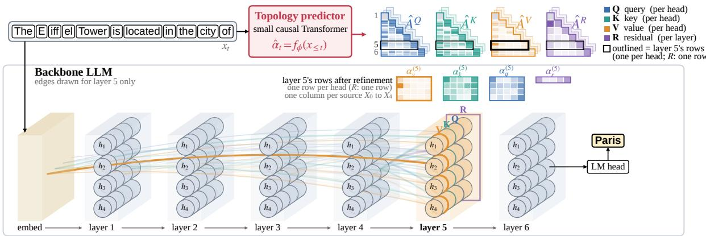
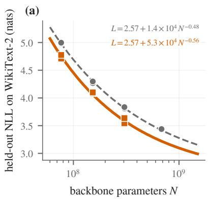
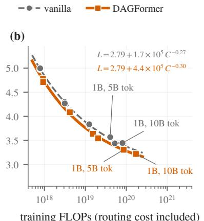
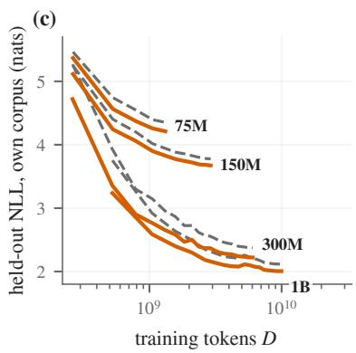
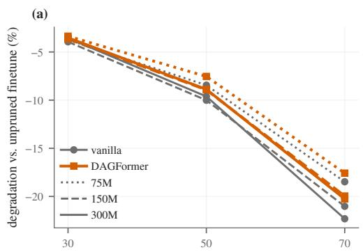
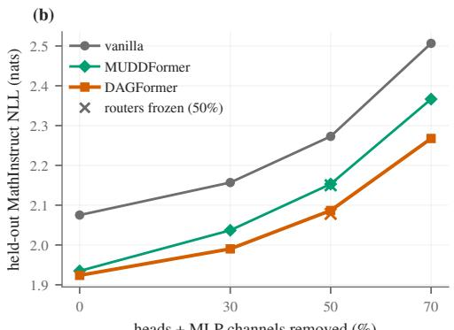
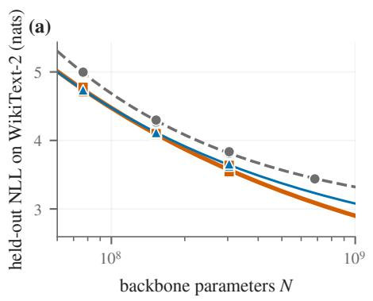
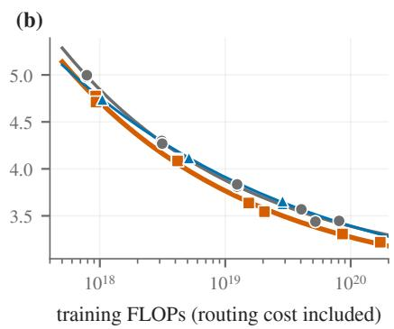

# DAGFormer: Global Topology Prediction for Transformer Cross-Layer Connections

Xiaocong Yang\* Yuren Hao\* ChengXiang Zhai

AI Interpretability @ Illinois University of Illinois Urbana-Champaign {xy51, yurenh2, czhai}@illinois.edu

## Abstract

We propose DAGFormer, a Transformer language model whose cross-layer connections are planned by a jointly trained topology predictor. Beyond the residual connections in a standard Transformer, DAGFormer adds direct connections from earlier layers to later ones, and the predictor controls the strength of every connection based on input tokens. Unlike existing cross-layer routing architectures, which set each layer’s connections separately, DAG Former plans the routing of the whole model at once. On matched OLMo-2 pairs from 75M to 1B parameters, DAGFormer lowers WikiText-2 perplexity by 17% to 25% over the vanilla Transformer, and a 1B DAGFormer trained on 5B tokens outperforms the vanilla model trained on 10B. Against four routing baselines with the same data and budget, it reaches the lowest perplexity at 75M, 300M and 1B. The gain carries over to 13 commonsense, science, reading and math evaluation tasks (2.0 to 2.5 points higher mean accuracy at 300M and 1B) and to instruction finetuning (63% to 70% AlpacaEval win rate against the vanilla Transformer, leading every routing baseline), and under structured pruning DAGFormer degrades the least in five of six settings.

## 1 Introduction

A Transformer (Vaswani et al., 2017) composes its layers through residual connections (He et al., 2016): every attention head and MLP reads the same running sum and writes back into it. Mechanistic analyses describe this residual stream as the communication channel between model components (Elhage et al., 2021). Its bandwidth is shared by every layer, so which earlier computation a layer can read is fixed by design: a late layer sees an early result only inside a sum to which every intermediate layer has added its own.

A line of work relaxes this fixed connectivity. Dense connections (Huang et al., 2017) and depthweighted averaging with learned static weights (Pagliardini et al., 2024) let a layer read earlier layers’ outputs directly. Hyper-connections (Zhu et al., 2025) widen the residual stream into several streams whose mixing weights are learned and, in the dynamic variant, input-dependent, and mHC (Xie et al., 2026) constrains those mixing matrices so the scheme trains stably at scale. Multiway dynamic dense connections (Xiao et al., 2025) compute input-dependent weights over all earlier layers’ outputs, separately for the query, key, value and residual inputs of a block. Each token can then follow its own path through the layers, and these models reach the loss of Transformers trained with substantially more budget (Zhu et al., 2025; Xiao et al., 2025).

All of the dynamic variants above, however, make the same design choice: routing is local. Each layer carries its own router, which reads the hidden state entering that layer and decides what that layer reads and, in hyper-connections and mHC, where its output is written. The cross-layer routing topology is therefore assembled greedily, one layer at a time, and no module takes a global view of it. Consequently, cross-layer coordination cannot be planned explicitly from the input, and the topology cannot be inspected as an individual object.

In this paper, we propose DAGFormer, where the global routing topology is predicted with a separate module that reads only the input tokens, before the backbone processes each token. DAGFormer implements this idea on an OLMo-2 backbone (Walsh et al., 2025) with added cross-layer connections on attention heads. Instead of reading the running residual stream, each attention head computes its query, key and value from weighted mixtures of the embedding and all earlier layer outputs. The residual input of each layer is also such a mixture.

  
Figure 1: DAGFormer. For token $x _ { t }$ the predictor outputs the planned graph as four triangular matrices ${ \hat { A } } ^ { Q } , { \hat { A } } ^ { K }$ $\hat { A } ^ { \bar { V } }$ and $\hat { A } ^ { R }$ that collect the planned weights $\hat { \pmb { \alpha } } ^ { ( l ) }$ of Eq. 1: one column per earlier output and, per layer, one row per head for $Q , K$ and V (the weights $\hat { \alpha } _ { q , h , j } ^ { ( l ) } )$ and a single row for R (the weights $\hat { \alpha } _ { r , j } ^ { ( l ) } )$ . Only the edges into layer 5, its outlined rows, are drawn, as rings on its heads (value in front; key, query and residual behind) with edge width proportional to the magnitude of the entry; every routed layer reads along its own rows in the same way, after the auxiliary local refinement of Eq. 2 (not drawn for demonstration). All weights shown are real values from a trained DAGFormer on training data.

A small causal encoder predicts all of these mixing weights: it reads the same token ids as the backbone, embedded with its own randomly initialized 256-dimensional table rather than the backbone’s embeddings, and is pretrained jointly with the backbone, as shown in Figure 1. Additionally, an auxiliary local refinement, zero-initialized, lets each layer correct the predicted weights of its own heads from its input, so the predictor plans the graph and each layer refines its rows of it.

To study this model architecture, we train matched pairs of the standard OLMo-2 Transformer (vanilla Transformer) and DAGFormer from 75M to 1B parameters on Dolma (Soldaini et al., 2024), charging the routing cost in every compute comparison. DAGFormer is better at every size and at equal compute, and a 1B DAGFormer beats the 1B vanilla Transformer trained on twice as many tokens. It also beats four routing baselines trained with the same pipeline at every size but 150M, and the gain carries over to evaluation tasks and instruction finetuning. Ablations show that the shared predictor carries most of the gain, and under structured pruning DAGFormer loses the least of all baselines in five of six settings.

## Our contributions are as follows:

• DAGFormer, a Transformer variant with dynamic cross-layer connections on attention heads, where the connections are predicted from the input tokens by a separate topology predictor which is pretrained together with an

OLMo-2 backbone from scratch (Section 2).

• A matched scaling study from 75M to 1B with the routing cost charged and with Dense-Former, hyper-connection, mHC and MUD-DFormer baselines on the same pipeline, carried through instruction finetuning and instruction-following evaluation (Section 3).

• Ablations of the routing source and a structured-pruning study showing that the learned topology makes models degrade more gracefully, without re-planning by the predictor (Sections 4, 5 and 6).

## 2 DAGFormer

DAGFormer pairs a Transformer backbone with a small topology predictor that reads the input tokens and predicts a weighted directed acyclic graph assigning every attention head and every layer its sources among the earlier outputs; the backbone computes along this graph (Figure 1). The predictor, a causal encoder over the tokens, plans the graph for the whole depth at once; an auxiliary local refinement, a tiny network at each layer, refines that layer’s planned rows from the layer’s own input.

## 2.1 Setup

Let $X _ { 0 } ( t ) \in \mathbb { R } ^ { D }$ be the embedding of token t and $X _ { l } ( t )$ the output of layer l in an L-layer decoder of width D with H attention heads; we omit t when it is clear from context. A vanilla OLMo-2 Transformer layer (Walsh et al., 2025) reads $X _ { l - 1 } 3 H { + } 1$ times: head h forms $q _ { h } = W _ { q } ^ { h } X _ { l - 1 }$ $k _ { h } = W _ { k } ^ { h } X _ { l - 1 }$ 1 and $v _ { h } = W _ { v } ^ { h } X _ { l - 1 }$ , and the residual $R _ { l } = X _ { l - 1 }$ carries the stream forward, with the update

$$
\begin{array} { r l } & { X _ { l } = R _ { l } + a _ { l } + m _ { l } , } \\ & { a _ { l } = \mathrm { N o r m } \bigl ( \mathrm { A t t n } _ { l } ( q , k , v ) \bigr ) , } \\ & { m _ { l } = \mathrm { N o r m } \bigl ( \mathrm { M L P } _ { l } ( R _ { l } + a _ { l } ) \bigr ) . } \end{array}
$$

All 3H+1 reads see the same vector, and an earlier layer’s output reaches them only inside the sum $X _ { l - 1 }$ . DAGFormer instead gives every read of a routed layer $( l \geq 2 )$ its own weight on each earlier output $X _ { 0 } , \dots , X _ { l - 1 } ;$ the (3H+1) l weights of layer l, written ${ \pmb { \alpha } } ^ { ( l ) } ( t )$ , together over all routed layers make up the graph of token $t ,$ and they fill the four triangular matrices of Figure 1, one row per read and one column per source.

## 2.2 Topology predictor

The input sequence first goes into a small network, called the topology predictor, that generates the connection graph for the backbone LLM. The predictor embeds the tokens with its own token and position embeddings of width 256, encodes them with two causal Transformer layers with four heads, passes each output vector z through a shared trunk $\bar { u } = \mathrm { G E L U } ( \bar { W _ { u } } \mathrm { L N } ( z ) ) \in \mathbb { R } ^ { 5 1 2 }$ , and ends in one linear head per routed layer, which produces that layer’s adjacency matrix, with rows for the query, key and value reads of every head and for the residual (Figure 1, top):

$$
\hat { \mathbf { \alpha } } ^ { ( l ) } = W ^ { ( l ) } u + b ^ { ( l ) } ,\tag{1}
$$

where $W ^ { ( l ) } \in \mathbb { R } ^ { ( 3 H + 1 ) l \times 5 1 2 }$ and $b ^ { ( l ) } \in \mathbb { R } ^ { ( 3 H + 1 ) l }$ are the head’s weight and bias; the $( 3 H + 1 ) l$ outputs are reshaped into the matrix. Its entries are signed mixing coefficients: unconstrained real values that, unlike attention probabilities, are not softmax-normalized, so a read can amplify a source or subtract one source from another. $\dot { W } ^ { ( l ) }$ starts at zero and every row of $b ^ { ( l ) }$ at the one-hot vector that selects $X _ { l - 1 }$ . The graph thus depends on the input and changes as the sequence grows during generation.

As an auxiliary component, each layer refines its planned matrix with a local term computed by a tiny network from the layer input $X _ { l - 1 }$

$$
\begin{array} { r } { \pmb { \alpha } ^ { ( l ) } = \hat { \pmb { \alpha } } ^ { ( l ) } + W _ { 2 } ^ { ( l ) } \mathrm { G E L U } \big ( W _ { 1 } ^ { ( l ) } \mathrm { L N } ( X _ { l - 1 } ) \big ) , } \end{array}\tag{2}
$$

where $W _ { 1 } ^ { ( l ) } \in \mathbb { R } ^ { 1 2 8 \times D }$ and $W _ { 2 } ^ { ( l ) } \in \mathbb { R } ^ { ( 3 H + 1 ) l \times 1 2 8 }$ with $W _ { 2 } ^ { ( l ) }$ initialized to zero. The refinement lets a layer correct the plan with what the backbone has computed so far, which the predictor, reading only the tokens, cannot see. It acts at the granularity of the plan, one correction per head and read, and it corrects the predicted weights rather than producing them.

Since the encoder is causal, the graph of a token never depends on later tokens, and DAGFormer generates left to right like any decoder. All layers are planned from the same encoding of the sequence, because the trunk is shared; a deeper backbone only adds linear heads. The planned term never sees the backbone and is fixed before the first layer runs, which is what lets Section 4 read the graph, average it over inputs, freeze it, and swap it between inputs with the backbone unchanged.

## 2.3 Routed layers

The backbone LLM then runs along this graph. In routed layer l, each head forms its query, key and value from weighted sums of the earlier outputs, and so does the residual:

$$
\begin{array} { r l } & { q _ { h } = \displaystyle \sum _ { j < l } \alpha _ { q , h , j } ^ { ( l ) } W _ { q } ^ { h } X _ { j } , \quad k _ { h } = \displaystyle \sum _ { j < l } \alpha _ { k , h , j } ^ { ( l ) } W _ { k } ^ { h } X _ { j } , } \\ & { v _ { h } = \displaystyle \sum _ { j < l } \alpha _ { v , h , j } ^ { ( l ) } W _ { v } ^ { h } X _ { j } , \quad R _ { l } = \displaystyle \sum _ { j < l } \alpha _ { r , j } ^ { ( l ) } X _ { j } , } \end{array}\tag{3}
$$

where $\alpha _ { q , h , j } ^ { ( l ) }$ is the entry of $\pmb { \alpha } ^ { ( l ) }$ in the row of head $h \mathbf { \bar { s } }$ query read and the column of source $X _ { j }$ , and likewise for $k ,$ v and $r .$ Other modules, attention with Q/K normalization on $q _ { h }$ and $k _ { h }$ , the MLP on $R _ { l } + a _ { l }$ , and the layer output $X _ { l } = R _ { l } + a _ { l } + m _ { l } .$ remain unchanged from the standard Transformer; at 300M and 1B, DAGFormer also applies an RM-SNorm to the mixed values $v _ { h }$ (V normalization; Table 15). In practice, each layer runs its fused query, key and value projection once over the stacked sources and then takes the weighted sums of Eq. 3 in head space. Layer 1 has the embedding as its only source and is not routed. At initialization every row of $\mathbf { \alpha } _ { \alpha } ( l )$ selects $X _ { l - 1 }$ , so Eq. 3 reduces to the vanilla layer and DAGFormer starts as exactly the vanilla OLMo-2 Transformer, up to the V normalization where enabled; predictor and backbone are then trained jointly from scratch on the language-modeling loss.

<table><tr><td></td><td colspan="5">baselines (WikiText-2 NLL ↓)</td><td></td><td></td></tr><tr><td>size</td><td>vanilla</td><td>DenseFormer</td><td>hyper-conn.</td><td>mHC</td><td>MUDDFormer</td><td>DAGFormer</td><td>gap to vanilla</td></tr><tr><td>75M</td><td>4.997</td><td>5.027</td><td>4.964</td><td>4.913</td><td>4.974</td><td>4.711</td><td>+0.29</td></tr><tr><td>150M</td><td>4.268</td><td>4.246</td><td>4.220</td><td>4.209</td><td>4.041</td><td>4.085</td><td>+0.18</td></tr><tr><td>300M</td><td>3.808</td><td>3.745</td><td>3.692</td><td>3.652</td><td>3.649</td><td>3.544</td><td>+0.26</td></tr><tr><td>1B, 5B tokens</td><td>3.569</td><td>3.513</td><td>3.492</td><td>3.438</td><td>3.423</td><td>3.307</td><td>+0.26</td></tr><tr><td>1B, 10B tokens</td><td>3.446</td><td></td><td></td><td></td><td></td><td>3.219</td><td>+0.23</td></tr><tr><td colspan="8">prefill time per token relative to vanilla ↓</td></tr><tr><td>75M</td><td>1.00</td><td>1.01</td><td>1.99</td><td>1.75</td><td>1.40</td><td>1.49</td><td></td></tr><tr><td>150M</td><td>1.00</td><td>1.02</td><td>2.11</td><td>1.78</td><td>1.48</td><td>1.61</td><td></td></tr><tr><td>300M</td><td>1.00</td><td>1.02</td><td>2.14</td><td>1.74</td><td>1.54</td><td>1.89</td><td></td></tr><tr><td>1B</td><td>1.00</td><td>1.01</td><td>1.90</td><td>1.54</td><td>1.36</td><td>1.81</td><td></td></tr></table>

Table 1: Held-out WikiText-2 NLL (nats per token); every model of a row shares recipe, data, token budget and seed. Gap to vanilla: vanilla − DAGFormer. Bottom: measured prefill time per token relative to the vanilla Transformer (a forward pass over 8 sequences of 1024 tokens); training cost in Appendix A. Bold: best per row; underlined: second best (not marked at 1B, 10B tokens, with two models). –: not run (the baselines are trained at 5B tokens only due to computing budget limit).

## 3 Experiments

## 3.1 Data

All pretraining uses Dolma v1.7 (Soldaini et al., 2024). Three tokenizations were used (a 12B-token slice for the 75M to 600M pairs, a local rebuild of it, and a 21B-token one for the 300M and 1B pairs), so every final checkpoint is re-evaluated on the same held-out sets: WikiText-2 (Merity et al., 2017), a held-out slice of MathInstruct (Yue et al., 2024), GSM8K solutions (Cobbe et al., 2021), and a source-balanced Dolma set drawn from files no training corpus consumed (Appendix B). WikiText-2 is the primary metric; the balanced set gives the same orderings with gaps 10% to 25% smaller. For instruction finetuning we use two datasets: Alpaca (Taori et al., 2023) in its cleaned release plus Dolly (Conover et al., 2023), about 67K singleturn instructions, and the smol-smoltalk subset of SmolTalk (Allal et al., 2025), about 460K conversations, the mix used to finetune SmolLM2 at 135M and 360M parameters. The held-out instruction data of Table 3 are 1% of Alpaca plus Dolly and the test split of smol-smoltalk.

## 3.2 Setup and baselines

Matched pairs. Every comparison is between a vanilla OLMo-2 Transformer and a DAGFormer with the identical backbone, tokenizer, data order, token budget and optimizer. Sizes are 75M (6 layers, D=512, 8 heads), 150M (8, 768, 12), 300M (12, 1024, 16) and 1B (16, 2048, 16), counting backbone parameters with tied embeddings; routing adds 29M to 37M parameters, 25.7M of them the predictor’s token embedding. Sequences are 1024 tokens, 524K tokens per step (Table 15). The 75M, 150M and 300M runs train for about 21 tokens per parameter, close to the compute-optimal ratio of about 20 implied by Hoffmann et al. (2022); the 1B pair trains for 5B tokens and is continued to 10B with a re-warmed schedule, giving matched pairs at both budgets. Seed 42 fixes initialization and data order; the 300M pair is repeated with a second seed.

Compute. Projecting the l sources of layer l and then mixing them, as in training, adds $\scriptstyle \sum _ { l \geq 2 } ( l - 1 )$ $3 D ^ { 2 }$ multiply-accumulates over the vanilla Transformer’s $\Sigma _ { l } ( 4 D ^ { 2 } + 3 D I )$ , plus the mixing sums, the predictor and the local refinements: 1.18× the vanilla Transformer’s FLOPs per token at 75M, rising to 2.13× at 1B; mixing per head before projecting gives the same result at 1.02 to 1.04× but is memory-bound (Appendix A.1). Compiled and in the faster order (Table 1, bottom), a DAGFormer token takes 1.5 to 1.9× the vanilla Transformer’s prefill time, the predictor 1 to 3% of it: more than MUDDFormer (1.4 to 1.5×) and, from 300M, mHC (1.5 to 1.8×), less than hyper-connections (1.9 to 2.1×); DenseFormer adds nothing measurable. MUDDFormer and the hyper-connection variants add few FLOPs (MUDDFormer reports 0.4%; Xiao et al., 2025), so most of their cost lies outside the FLOP count; none of the implementations uses hand-written kernels, with which mHC reports a 6.7% training-time overhead at four streams (Xie et al., 2026). Training costs are in Appendix A; compute-matched comparisons charge the analytic

<table><tr><td></td><td></td><td colspan="4">mean accuracy (%) per kind of task ↑</td><td></td><td></td></tr><tr><td>size</td><td>model</td><td>commonsense (5)</td><td>science (4)</td><td>reading (2)</td><td>math (2)</td><td>Mean</td><td>mean rank ↓</td></tr><tr><td>300M</td><td>vanilla</td><td>39.8</td><td>36.5</td><td>38.1</td><td>11.7</td><td>34.2</td><td>4.15</td></tr><tr><td></td><td>DenseFormer</td><td>38.9</td><td>36.5</td><td>40.8</td><td>12.7</td><td>34.4</td><td>4.23</td></tr><tr><td></td><td>hyper-conn.</td><td>38.5</td><td>38.5</td><td>38.3</td><td>12.3</td><td>34.4</td><td>3.69</td></tr><tr><td></td><td>mHC</td><td>39.2</td><td>38.8</td><td>41.8</td><td>12.9</td><td>35.4</td><td>2.54</td></tr><tr><td></td><td>MUDDFormer</td><td>39.7</td><td>38.6</td><td>40.9</td><td>11.5</td><td>35.2</td><td>3.08</td></tr><tr><td></td><td>DAGFormer</td><td>39.9</td><td>39.8</td><td>43.5</td><td>12.8</td><td>36.2</td><td>2.38</td></tr><tr><td>1B</td><td>vanilla</td><td>40.0</td><td>38.9</td><td>42.1</td><td>12.1</td><td>35.7</td><td>4.54</td></tr><tr><td>(5B)</td><td>DenseFormer</td><td>40.2</td><td>39.5</td><td>43.0</td><td>11.4</td><td>36.0</td><td>4.38</td></tr><tr><td></td><td>hyper-conn.</td><td>40.7</td><td>40.7</td><td>41.6</td><td>12.0</td><td>36.4</td><td>3.77</td></tr><tr><td></td><td>mHC</td><td>41.1</td><td>42.2</td><td>43.8</td><td>12.5</td><td>37.4</td><td>2.62</td></tr><tr><td></td><td>MUDDFormer</td><td>40.7</td><td>42.4</td><td>38.3</td><td>12.2</td><td>36.5</td><td>3.15</td></tr><tr><td></td><td>DAGFormer</td><td>41.8</td><td>43.0</td><td>44.7</td><td>12.4</td><td>38.1</td><td>2.08</td></tr><tr><td>1B</td><td>vanilla</td><td>40.5</td><td>41.0</td><td>43.0</td><td>11.5</td><td>36.6</td><td></td></tr><tr><td>(10B)</td><td>DAGFormer</td><td>42.4</td><td>44.1</td><td>47.0</td><td>12.8</td><td>39.1</td><td></td></tr></table>

Table 2: Base models on the evaluation tasks of Section 3.2: mean accuracy (%) over the commonsense (HellaSwag, PIQA, WinoGrande, CommonsenseQA, Social IQa), science (ARC-Easy/Challenge, OpenBookQA, SciQ), reading (BoolQ, LAMBADA) and math tasks (MathQA, GSM8K; close to chance at these sizes), and over all 13 (Mean). Mean rank: rank within the block, averaged over the 13 tasks (1 = best). Bold: best per block; underlined: second best per kind of task (neither marked nor ranked in the two-model block). 1B (5B), 1B (10B): pretrained on 5B and 10B tokens. Per-task accuracies in Table 8.

## training FLOPs of the training order.

Baselines. Besides the matched vanilla Transformer, we train four cross-layer baselines with the recipe, data, tokens and seed of the pair of the same size: DenseFormer (Pagliardini et al., 2024), whose cross-layer weights are static; dynamic hyper-connections with four streams (Zhu et al., 2025); manifold-constrained hyper-connections (mHC; Xie et al., 2026); and MUDDFormer (Xiao et al., 2025), whose per-layer routers read the hidden state. Implementation details, parametermatched vanilla Transformers and static hyperconnections are in Appendix C.2. We do not compare with mixture-of-experts or mixture-of-depths models, which route computation rather than connectivity.

Evaluation tasks. Base models are evaluated with the lm-evaluation-harness (Gao et al., 2024) on twelve tasks (ARC-Easy/Challenge, HellaSwag, PIQA, WinoGrande, OpenBookQA, SciQ, BoolQ, LAMBADA, CommonsenseQA, Social IQa, MathQA; Clark et al., 2018; Zellers et al., 2019; Bisk et al., 2020; Sakaguchi et al., 2020; Mihaylov et al., 2018; Welbl et al., 2017; Clark et al., 2019; Paperno et al., 2016; Talmor et al., 2019; Sap et al., 2019; Amini et al., 2019) and on GSM8K (3-shot exact match with flexible numeric extraction, on the first 200 test problems). The models finetuned on each instruction dataset (Section 3.1; hyperparameters in Appendix C.3) are compared by negative log-likelihood on held-out instruction data and by the AlpacaEval (Li et al., 2023) win rate against the vanilla Transformer of the same size and recipe, judged by gpt-5.6-sol; an MT-Bench comparison (Zheng et al., 2023) is in Appendix C.1.

<table><tr><td colspan="2"></td><td colspan="2">+Alpaca</td><td colspan="2">+SmolTalk</td></tr><tr><td>size</td><td>model</td><td>NLL↓</td><td>win↑</td><td>NLL↓</td><td>win ↑</td></tr><tr><td rowspan="5">300M</td><td>vanilla</td><td>2.392</td><td></td><td>1.760</td><td></td></tr><tr><td>DenseFormer</td><td>2.342 2.298</td><td>0.55 0.59</td><td>1.722 1.684</td><td>0.57 0.58</td></tr><tr><td>hyper-conn.</td><td>2.277</td><td></td><td>1.664</td><td></td></tr><tr><td>mHC MUDDFormer</td><td></td><td>0.58 0.63</td><td></td><td>0.62</td></tr><tr><td>DAGFormer</td><td>2.256 2.203</td><td>0.65</td><td>1.639 1.595</td><td>0.64 0.70</td></tr><tr><td rowspan="5">1B (5B)</td><td>vanilla</td><td>2.208</td><td></td><td>1.728</td><td></td></tr><tr><td>DenseFormer</td><td>2.186</td><td>0.46</td><td>1.706</td><td>0.50</td></tr><tr><td>hyper-conn.</td><td>2.150</td><td>0.51</td><td>1.673</td><td>0.56</td></tr><tr><td>mHC</td><td>2.110</td><td>0.55</td><td>1.633</td><td>0.61</td></tr><tr><td>MUDDFormer DAGFormer</td><td>2.104 2.042</td><td>0.57 0.63</td><td>1.617</td><td>0.56 0.66</td></tr><tr><td rowspan="3">1B (10B)</td><td>vanilla</td><td>2.120</td><td></td><td>1.558 1.669</td><td></td></tr><tr><td>DAGFormer</td><td>1.974</td><td>0.66</td><td>1.516</td><td>0.70</td></tr><tr><td></td><td></td><td></td><td></td><td></td></tr></table>

Table 3: Instruction following after finetuning. NLL: held-out negative log-likelihood on the instruction data. Win: AlpacaEval (Li et al., 2023) win rate against the vanilla Transformer of the same size and recipe, both answer orders judged by gpt-5.6-sol, ties half, 249 of the 805 prompts. 1B (5B), 1B (10B): the 1B models pretrained on 5B and 10B tokens.

  
Figure 2: Scaling of DAGFormer (solid) against the matched vanilla OLMo-2 Transformer (dashed). (a) Final WikiText-2 loss against backbone parameters, with power laws whose irreducible loss is shared by the two families (coefficients in the panel); the 1B runs, trained on fewer tokens per parameter, appear only in (b). (b) Loss against training FLOPs with the routing cost included, fitted likewise: the 1B DAGFormer at 5B tokens is below the 1B vanilla Transformer at 10B tokens at about the same compute. (c) Held-out loss along training for the four matched pairs: the gap opens early and persists.

## 3.3 Main results

DAGFormer has the lowest WikiText-2 loss of all baselines at every size but 150M (Table 1). It is 0.18 to 0.29 nats below the vanilla Transformer at every size (17% to 25% lower perplexity) and 0.1 to 0.2 nats below the strongest routing baseline at 75M, 300M and 1B; at 150M MUDDFormer is 0.04 nats lower (Section 6). The gap to the vanilla Transformer opens early in training (Figure 2c) and holds on the other held-out sets, a second corpus and seed, and across learning rates (Appendix C.4, Table 13). On the 13 downstream evaluation tasks, DAGFormer has the highest mean accuracy of all models at both sizes we tested (Table 2): 2.0 to 2.5 points above the vanilla Transformer and 0.7 to 0.8 points above the strongest routing baseline. It also leads on the commonsense, science and reading tasks and has the best mean rank at both sizes; on math, where MathQA and GSM8K are close to chance, mHC is 0.1 points ahead. At 1B with 10B tokens, DAGFormer is ahead of the vanilla Transformer on all 13 tasks.

We further evaluate the instruction-finetuned models on held-out instruction data and on commonly used instruction-following benchmarks (Table 3). DAGFormer has the lowest negative loglikelihood on held-out instruction data of all models at every size and under both recipes, 0.15 to 0.19 nats below the vanilla Transformer and 0.04 to 0.06 below the strongest routing baseline. On AlpacaEval it wins 0.63 to 0.70 of the comparisons against the vanilla Transformer, above every routing baseline (0.46 to 0.64). On the 80 MT-Bench first turns, judged pairwise by a second LLM, DAGFormer wins 0.56 to 0.69 of the comparisons against the vanilla Transformer, and the 95% interval excludes 0.5 in seven of ten (Table 10).

<table><tr><td></td><td></td><td></td><td colspan="4">held-out NLL ↓</td></tr><tr><td>size</td><td>model</td><td>params</td><td>WikiText</td><td>Math</td><td>GSM8K</td><td>balanced</td></tr><tr><td>75M</td><td>vanilla</td><td>77M</td><td>4.997</td><td>4.271</td><td>4.242</td><td>5.167</td></tr><tr><td></td><td>vanilla, hidden 656</td><td>107M</td><td>4.769</td><td>4.057</td><td>4.052</td><td>4.961</td></tr><tr><td></td><td>vanilla, 13 layers</td><td>106M</td><td>4.871</td><td>4.215</td><td>4.174</td><td>5.094</td></tr><tr><td></td><td>DAGFormer</td><td>106M</td><td>4.711</td><td>3.984</td><td>3.973</td><td>4.937</td></tr><tr><td>150M vanilla</td><td></td><td>153M</td><td>4.268</td><td>3.599</td><td>3.608</td><td>4.471</td></tr><tr><td></td><td>vanilla, hidden 864</td><td>182M</td><td>4.199</td><td>3.537</td><td>3.599</td><td>4.409</td></tr><tr><td></td><td>DAGFormer</td><td>183M</td><td></td><td>4.085 3.383</td><td>3.402</td><td>4.305</td></tr></table>

Table 4: Capacity controls: vanilla Transformers given DAGFormer’s routing parameters as extra width or, at 75M, as extra depth, trained with the pair’s recipe, data, tokens and seed (12B’ corpus). Params: total, including the predictor and refinement. Math: MathInstruct; balanced: the balanced Dolma set. Bold: best per size and column.

## 4 Analysis

## 4.1 Scaling with compute and parameters

For each family we fit $L = E + A N ^ { - \alpha }$ to the final WikiText-2 loss against backbone parameters N and $L = E + K C ^ { - \gamma }$ against training compute C, routing cost included, with the irreducible loss E shared by the two families (Figure 2). We share E because it estimates the entropy of the evaluation text, which does not depend on the architecture. At equal training compute the margin is larger at 300M and 1B than at the smaller sizes: on the vanilla compute fit, the vanilla Transformer needs 1.2 to 1.4× DAGFormer’s training compute to reach its loss at 75M and 150M, and 1.7 to 2.0× at 300M and 1B. DAGFormer’s fitted exponents are also larger (0.56 against 0.48 for parameters, 0.30 against 0.27 for compute), so on the fit the compute multiplier keeps growing (1.9× at 1020 FLOPs and 2.3× at $1 0 ^ { 2 \bar { 1 } } )$ , although in each fit the two exponents differ by about one standard error and nothing beyond our largest run is tested. Without any fit, the 1B DAGFormer trained on 5B tokens beats the 1B vanilla Transformer trained on 10B tokens at about the same training compute, on WikiText-2, Math-Instruct and GSM8K.

Extra parameters explain most of the gain at the smallest size and less than half at the larger one. Vanilla Transformers given DAGFormer’s routing parameters as extra width close 70 to 89% of the gap at 75M but only 4 to 42% at 150M, extra depth closes less, and DAGFormer stays ahead of every control on every held-out set (Table 4).

## 4.2 Where the gain comes from

The predictor carries most of the gain, and the refinement completes it. The routing-source ablation varies only where α comes from in one 75M backbone (Table 14, Appendix C.6). The predictor alone, which never sees a hidden state, recovers about 90% of DAGFormer’s gain over the vanilla Transformer, and adding the refinement gives the best result on every held-out set. Sharing matters: independent per-layer predictors reading the same tokens recover under 80%, with 7M more parameters.

The refinement is cheap, under 0.5% of DAG-Former’s forward multiply-accumulates, and unlike the per-layer routers of hyper-connections and MUDDFormer, which produce a layer’s weights on their own, it corrects the predictor’s plan per attention head. DAGFormer’s cost lies instead in projecting every earlier output through each layer’s query, key and value weights before mixing (Appendix A), where MUDDFormer mixes the hidden states first and projects once.

## 5 Structured pruning

If the benefit is structural, heads that read many earlier layers should lose less when units are removed, without the routers re-planning. We finetune every model of Table 1 up to 300M from its own checkpoint on MathInstruct (Yue et al., 2024) and, during finetuning, permanently remove attention heads and MLP channels (two of CoFi’s unit types; Xia et al., 2022) by first-order Taylor importance on unit gates (Michel et al., 2019; Molchanov et al., 2019) on a gradual cubic schedule (Zhu and Gupta, 2018), followed by recovery steps. Routers are never pruned, and we report backbone sparsity.

DAGFormer loses the least of all models in five of the six settings (Table 5). With half the heads and channels removed, it degrades less than the vanilla Transformer and every routing baseline at every size, and remains about as good as or better than the unpruned vanilla Transformer. With 70% removed, it degrades the least at 150M and 300M; at 75M the vanilla Transformer, DenseFormer and both hyper-connection variants lose less, although DAGFormer’s pruned loss is still the lowest. MUD-DFormer, the closest dynamic design, loses the most at every size and sparsity.

No model relies on re-planning its routing: freezing DAGFormer’s predictor, or the baselines’ routers, during pruning barely changes the result (Table 23). The advantage lies in the sources each head can draw on (Appendix G); with units removed at random both families lose much more and the gap shrinks at 75M (Appendix C.8).

## 6 Discussion

Token dependence. Most of DAGFormer’s gain lies in the learned graph, a set of cross-layer connections and their weights, rather than in re-planning it for every token: the predictor’s output can be replaced by its per-position mean at almost no cost (Appendix D), and the predictor alone recovers about 90% of the gain (Section 4.2). Input dependence, which dynamic cross-layer architectures cite to motivate their routers, matters mostly while the graph is learned: static weights trained directly (DenseFormer, static hyper-connections, an inputfree table) recover little of it (Appendix C.2). At inference the trained models still rely on the refinement’s per-token corrections, and sparsifying the graph post hoc is costly (Appendix E); distilling it into a fixed topology that a dense kernel can execute is future work.

Shared predictor and per-layer routers. A shared predictor beats per-layer predictors that read the same tokens (Section 4.2), and DAGFormer has a lower loss than hyper-connections, mHC and MUDDFormer, whose per-layer routers read the hidden state, at every size but one (MUDDFormer at 150M; one seed per model; Table 1). At this scale, loss separates the two designs only partly. A separate module also makes the graph an object of its own: it can be averaged, frozen and patched, which is how Appendix D locates the gain, and the pruned models degrade more gracefully. Whether the predictor keeps its lead at larger scale, for instance by planning routing that no single layer can see, is untested.

<table><tr><td></td><td colspan="3">75M</td><td colspan="3">150M</td><td colspan="3">300M</td></tr><tr><td>model</td><td>NLL↓ 0%</td><td>damage (%) ↓ 50%</td><td>70%</td><td>NLL↓ 0%</td><td>damage (%) ↓ 50%</td><td>70%</td><td>NLL↓ 0%</td><td>damage (%) ↓ 50%</td><td>70%</td></tr><tr><td>vanilla</td><td>2.387</td><td>9.0</td><td>17.9</td><td>1.854</td><td>9.9</td><td>21.2</td><td>1.676</td><td>7.4</td><td>17.8</td></tr><tr><td>DenseFormer</td><td>2.383</td><td>9.5</td><td>18.7</td><td>1.830</td><td>9.5</td><td>20.7</td><td>1.641</td><td>7.9</td><td>18.5</td></tr><tr><td>hyper-conn.</td><td>2.306</td><td>9.5</td><td>19.5</td><td>1.804</td><td>9.7</td><td>21.4</td><td>1.604</td><td>7.7</td><td>17.8</td></tr><tr><td>mHC</td><td>2.328</td><td>9.0</td><td>20.1</td><td>1.813</td><td>9.5</td><td>21.0</td><td>1.585</td><td>8.4</td><td>18.4</td></tr><tr><td>MUDDFormer</td><td>2.362</td><td>10.6</td><td>22.3</td><td>1.692</td><td>12.8</td><td>28.6</td><td>1.558</td><td>9.3</td><td>22.0</td></tr><tr><td>DAGFormer</td><td>2.185</td><td>7.6</td><td>22.2</td><td>1.724</td><td>9.2</td><td>20.2</td><td>1.507</td><td>6.9</td><td>16.5</td></tr></table>

Table 5: Pruning during domain finetuning on MathInstruct, every model of Table 1 from its own checkpoint (75M and 150M: 12B’ corpus; 300M: 21B): held-out NLL of the unpruned finetune (0%) and the damage (loss increase relative to it) at 50% and 70% backbone sparsity. Bold: best per column. All sparsities and the frozen-router controls: Table 23.

Inspecting the learned graph. The predictor’s output is a natural place to audit or steer an inference pass: it fixes which earlier results each head and layer combine before the backbone runs, and averaging, freezing and patching it are the causal interventions that generative interpretability asks of intermediate checkpoints (Yang, 2026). We read the graph only in aggregate (Appendix E); in the trained models the per-token variation lives mostly in the refinement, and whether the graph is meaningful to a human for a given input remains open. A larger predictor-only DAGFormer whose graph varies with the input in nameable ways, such as task or domain, could make the topology such a checkpoint, and routing among specialised modules (begun by the modular variant, Appendix H) could make module outputs readable too.

## 7 Related work

Cross-layer connectivity. After highway and residual skips (Srivastava et al., 2015; He et al., 2016), DenseNet (Huang et al., 2017) connected every layer to every earlier one, and transparent attention (Bapna et al., 2018), ELMo (Peters et al., 2018), DenseFormer (Pagliardini et al., 2024) and LAuReL (Menghani et al., 2025) learn static weights over layer outputs. Hyper-connections (Zhu et al., 2025) widen the residual stream into several streams whose connections can depend on the incoming hidden state, and mHC (Xie et al., 2026) constrains their residual-mixing matrices to be doubly stochastic. MUDDFormer (Xiao et al., 2025) generates per-position query, key, value and residual weights from each layer’s hidden state; DAGFormer shares this decomposition (per head for q, k, v) but plans the weights of all layers with one predictor over the tokens, which each layer refines per head from its input.

Conditional computation. Conditional computation runs part of a network per input (Bengio et al., 2013; Han et al., 2022): mixture-of-experts layers send each token to a few experts (Jacobs et al., 1991; Shazeer et al., 2017; Lepikhin et al., 2021; Fedus et al., 2022; Zhou et al., 2022), adaptivedepth models halt or exit early (Graves, 2016; Dehghani et al., 2019; Elbayad et al., 2020; Schuster et al., 2022), and mixture-of-depths lets tokens skip whole blocks (Raposo et al., 2024). Block-Drop (Wu et al., 2018), the closest analogue to a planned topology, picks all blocks an image skips with one policy network instead of per-layer gates (Wang et al., 2018; Veit and Belongie, 2020). These methods choose how much computation an input receives; DAGFormer keeps it fixed and chooses which earlier results each layer reads.

## 8 Conclusion

We introduced DAGFormer, a Transformer whose cross-layer connections are planned by one predictor over the input tokens, trained jointly with the backbone. From 75M to 1B it lowers loss at every size and at equal compute, beats four routing baselines at every size but 150M, carries its gain to evaluation tasks and instruction finetuning, and degrades the least under structured pruning in five of six settings. Most of the gain lies in the learned graph, which the separate predictor makes an object that can be inspected and intervened on.

## Limitations

Scale and seeds. Our largest model has 1B parameters trained on 5 to 10B tokens, below its compute-optimal budget. Every pretraining run but the 300M pair is a single seed. Repeating the 300M pair with a second pretraining seed changes a model’s held-out NLL by up to 0.08 nats per token (the vanilla Transformer on GSM8K solu tions; at most 0.03 on WikiText-2; Appendix C.4), so smaller differences are noise; the pruning cells are single runs too. Cost. Routing costs 1.18 to 2.13× the vanilla Transformer’s FLOPs per token in the order used for training, and the trained models rely on the refinement’s per-token corrections, so they cannot run with a fixed topology without retraining. Comparisons. MUDDFormer trained with our recipe beats DAGFormer at 150M and loses at the other sizes, each a single seed, so loss alone does not settle that comparison; the 1B baselines are trained at 5B tokens only, the parametermatched vanilla Transformer controls exist at 75M and 150M, and only the 75M pair was swept over learning rates. Evaluation. Models of this size sit near chance on harder benchmarks, and a single LLM judge scored the chat and AlpacaEval comparisons. Interpretability and scale. We intervene on the learned graph only as a whole and read it only in aggregate; whether its input-dependent part can be named, and whether the gains persist beyond 1B parameters, are left to follow-up work.

## Acknowledgments

We thank the INVITE Institute at the University of Illinois Urbana-Champaign and the ACCESS program, through the National Center for Supercomputing Applications (NCSA), for their support with computing credits. This material is based upon work supported by the National Science Foundation and the Institute of Education Sciences under Grant #2229612. Any opinions, findings, and conclusions or recommendations expressed in this material are those of the author(s) and do not necessarily reflect the views of National Science Foundation or the U.S. Department of Education. This work used the Delta system at the National Center for Supercomputing Applications [award

OAC 2005572] through allocations CIS251094 and CIS261897 from the Advanced Cyberinfrastructure Coordination Ecosystem: Services & Support (AC-CESS) program (Boerner et al., 2023), which is supported by U.S. National Science Foundation grants #2138259, #2138286, #2138307, #2137603, and #2138296.

## References

Loubna Ben Allal, Anton Lozhkov, Elie Bakouch, Gabriel Martín Blázquez, Guilherme Penedo, Lewis Tunstall, Andrés Marafioti, Agustín Piqueres Lajarín, Hynek Kydlícek, Vaibhav Srivastav, Joshua Lochner,ˇ Caleb Fahlgren, Xuan-Son Nguyen, Ben Burtenshaw, Clémentine Fourrier, Haojun Zhao, Hugo Larcher, Mathieu Morlon, Cyril Zakka, and 3 others. 2025. SmolLM2: When smol goes big — data-centric training of a fully open small language model. In Second Conference on Language Modeling (COLM). ArXiv:2502.02737.

Aida Amini, Saadia Gabriel, Shanchuan Lin, Rik Koncel-Kedziorski, Yejin Choi, and Hannaneh Hajishirzi. 2019. MathQA: Towards interpretable math word problem solving with operation-based formalisms. In Proceedings of the 2019 Conference of the North American Chapter of the Association for Computational Linguistics (NAACL), pages 2357– 2367. ArXiv:1905.13319.

Ankur Bapna, Mia Xu Chen, Orhan Firat, Yuan Cao, and Yonghui Wu. 2018. Training deeper neural machine translation models with transparent attention. In Proceedings of the 2018 Conference on Empirical Methods in Natural Language Processing (EMNLP). ArXiv:1808.07561.

Yoshua Bengio, Nicholas Léonard, and Aaron C. Courville. 2013. Estimating or propagating gradients through stochastic neurons for conditional computation. arXiv preprint arXiv:1308.3432.

Yonatan Bisk, Rowan Zellers, Ronan Le Bras, Jianfeng Gao, and Yejin Choi. 2020. PIQA: Reasoning about physical commonsense in natural language. In Proceedings of the AAAI Conference on Artificial Intelligence. ArXiv:1911.11641.

Timothy J. Boerner, Stephen Deems, Thomas R. Furlani, Shelley L. Knuth, and John Towns. 2023. ACCESS: Advancing innovation: NSF’s advanced cyberinfrastructure coordination ecosystem: Services & support. In Practice and Experience in Advanced Research Computing (PEARC ’23), pages 173–176. ACM.

Christopher Clark, Kenton Lee, Ming-Wei Chang, Tom Kwiatkowski, Michael Collins, and Kristina Toutanova. 2019. BoolQ: Exploring the surprising difficulty of natural yes/no questions. In Proceedings of the 2019 Conference of the North American Chapter of the Association for Computational Linguistics (NAACL). ArXiv:1905.10044.

Peter Clark, Isaac Cowhey, Oren Etzioni, Tushar Khot, Ashish Sabharwal, Carissa Schoenick, and Oyvind Tafjord. 2018. Think you have solved question answering? Try ARC, the AI2 reasoning challenge. ArXiv:1803.05457.

Karl Cobbe, Vineet Kosaraju, Mohammad Bavarian, Mark Chen, Heewoo Jun, Lukasz Kaiser, Matthias Plappert, Jerry Tworek, Jacob Hilton, Reiichiro Nakano, Christopher Hesse, and John Schulman. 2021. Training verifiers to solve math word problems. ArXiv:2110.14168.

Mike Conover, Matt Hayes, Ankit Mathur, Jianwei Xie, Jun Wan, Sam Shah, Ali Ghodsi, Patrick Wendell, Matei Zaharia, and Reynold Xin. 2023. Free dolly: Introducing the world’s first truly open instructiontuned LLM. Databricks blog, April 12, 2023.

Mostafa Dehghani, Stephan Gouws, Oriol Vinyals, Jakob Uszkoreit, and Łukasz Kaiser. 2019. Universal transformers. In International Conference on Learning Representations.

Maha Elbayad, Jiatao Gu, Edouard Grave, and Michael Auli. 2020. Depth-adaptive transformer. In International Conference on Learning Representations.

Nelson Elhage, Neel Nanda, Catherine Olsson, Tom Henighan, Nicholas Joseph, Ben Mann, Amanda Askell, Yuntao Bai, Anna Chen, Tom Conerly, Nova DasSarma, Dawn Drain, Deep Ganguli, Zac Hatfield-Dodds, Danny Hernandez, Andy Jones, Jackson Kernion, Liane Lovitt, Kamal Ndousse, and 6 others. 2021. A mathematical framework for transformer circuits. Transformer Circuits Thread.

William Fedus, Barret Zoph, and Noam Shazeer. 2022. Switch transformers: Scaling to trillion parameter models with simple and efficient sparsity. Journal of Machine Learning Research, 23(120):1–39. ArXiv:2101.03961.

Leo Gao, Jonathan Tow, Baber Abbasi, Stella Biderman, Sid Black, Anthony DiPofi, Charles Foster, Laurence Golding, Jeffrey Hsu, Alain Le Noac’h, Haonan Li, Kyle McDonell, Niklas Muennighoff, Chris Ociepa, Jason Phang, Laria Reynolds, Hailey Schoelkopf, Aviya Skowron, Lintang Sutawika, and 5 others. 2024. The language model evaluation harness. Version v0.4.3.

Alex Graves. 2016. Adaptive computation time for recurrent neural networks. arXiv preprint arXiv:1603.08983.

Yizeng Han, Gao Huang, Shiji Song, Le Yang, Honghui Wang, and Yulin Wang. 2022. Dynamic neural networks: A survey. IEEE Transactions on Pattern Analysis and Machine Intelligence, 44(11):7436–7456.

Kaiming He, Xiangyu Zhang, Shaoqing Ren, and Jian Sun. 2016. Deep residual learning for image recognition. In IEEE Conference on Computer Vision and Pattern Recognition (CVPR). ArXiv:1512.03385.

Jordan Hoffmann, Sebastian Borgeaud, Arthur Mensch, Elena Buchatskaya, Trevor Cai, Eliza Rutherford, Diego de Las Casas, Lisa Anne Hendricks, Johannes Welbl, Aidan Clark, Tom Hennigan, Eric Noland, Katie Millican, George van den Driessche, Bogdan Damoc, Aurelia Guy, Simon Osindero, Karen Simonyan, Erich Elsen, and 3 others. 2022. Training compute-optimal large language models. In Advances in Neural Information Processing Systems, volume 35, pages 30016–30030. ArXiv:2203.15556.

Gao Huang, Zhuang Liu, Laurens van der Maaten, and Kilian Q. Weinberger. 2017. Densely connected convolutional networks. In IEEE Conference on Computer Vision and Pattern Recognition (CVPR). ArXiv:1608.06993.

Robert A. Jacobs, Michael I. Jordan, Steven J. Nowlan, and Geoffrey E. Hinton. 1991. Adaptive mixtures of local experts. Neural Computation, 3(1):79–87.

Jared Kaplan, Sam McCandlish, Tom Henighan, Tom B. Brown, Benjamin Chess, Rewon Child, Scott Gray, Alec Radford, Jeffrey Wu, and Dario Amodei. 2020. Scaling laws for neural language models. ArXiv:2001.08361.

Dmitry Lepikhin, HyoukJoong Lee, Yuanzhong Xu, Dehao Chen, Orhan Firat, Yanping Huang, Maxim Krikun, Noam Shazeer, and Zhifeng Chen. 2021. GShard: Scaling giant models with conditional computation and automatic sharding. In International Conference on Learning Representations.

Xuechen Li, Tianyi Zhang, Yann Dubois, Rohan Taori, Ishaan Gulrajani, Carlos Guestrin, Percy Liang, and Tatsunori B. Hashimoto. 2023. Alpacaeval: An automatic evaluator of instruction-following models. GitHub repository.

Kevin Meng, David Bau, Alex Andonian, and Yonatan Belinkov. 2022. Locating and editing factual associations in GPT. In Advances in Neural Information Processing Systems. ArXiv:2202.05262.

Gaurav Menghani, Ravi Kumar, and Sanjiv Kumar. 2025. LAuReL: Learned augmented residual layer. In Proceedings ofthe 42nd International Conference on Machine Learning, volume 267 of Proceedings ofMachine Learning Research, pages 43826–43836. PMLR. ArXiv:2411.07501.

Stephen Merity, Caiming Xiong, James Bradbury, and Richard Socher. 2017. Pointer sentinel mixture models. In International Conference on Learning Representations (ICLR). ArXiv:1609.07843.

Paul Michel, Omer Levy, and Graham Neubig. 2019. Are sixteen heads really better than one? In Advances in Neural Information Processing Systems. ArXiv:1905.10650.

Todor Mihaylov, Peter Clark, Tushar Khot, and Ashish Sabharwal. 2018. Can a suit of armor conduct electricity? A new dataset for open book question answering. In Proceedings ofthe 2018 Conference on

Empirical Methods in Natural Language Processing (EMNLP). ArXiv:1809.02789.

Pavlo Molchanov, Arun Mallya, Stephen Tyree, Iuri Frosio, and Jan Kautz. 2019. Importance estimation for neural network pruning. In IEEE/CVF Confer ence on Computer Vision and Pattern Recognition (CVPR). ArXiv:1906.10771.

Matteo Pagliardini, Amirkeivan Mohtashami, François Fleuret, and Martin Jaggi. 2024. DenseFormer: Enhancing information flow in transformers via depth weighted averaging. In Advances in Neural Information Processing Systems, volume 37, pages 136479– 136508. Curran Associates, Inc. ArXiv:2402.02622.

Denis Paperno, Germán Kruszewski, Angeliki Lazaridou, Quan Ngoc Pham, Raffaella Bernardi, Sandro Pezzelle, Marco Baroni, Gemma Boleda, and Raquel Fernández. 2016. The LAMBADA dataset: Word prediction requiring a broad discourse context. In Proceedings of the 54th Annual Meeting of the Associationfor Computational Linguistics (ACL). ArXiv:1606.06031.

Matthew E. Peters, Mark Neumann, Mohit Iyyer, Matt Gardner, Christopher Clark, Kenton Lee, and Luke Zettlemoyer. 2018. Deep contextualized word representations. In Proceedings of the 2018 Conference of the North American Chapter of the Association for Computational Linguistics (NAACL). ArXiv:1802.05365.

Qwen Team. 2025. Qwen3-Coder-30B-A3B-Instruct model card. Hugging Face.

David Raposo, Sam Ritter, Blake Richards, Timothy Lillicrap, Peter Conway Humphreys, and Adam Santoro. 2024. Mixture-of-depths: Dynamically allocating compute in transformer-based language models. ArXiv:2404.02258.

Keisuke Sakaguchi, Ronan Le Bras, Chandra Bhagavatula, and Yejin Choi. 2020. WinoGrande: An adversarial Winograd schema challenge at scale. In Proceedings of the AAAI Conference on Artificial Intelligence, volume 34, pages 8732–8740. ArXiv:1907.10641.

Maarten Sap, Hannah Rashkin, Derek Chen, Ronan Le Bras, and Yejin Choi. 2019. Social IQa: Commonsense reasoning about social interactions. In Proceedings of the 2019 Conference on Empirical Methods in Natural Language Processing and the 9th International Joint Conference on Natural Language Processing (EMNLP-IJCNLP), pages 4463– 4473. ArXiv:1904.09728.

Tal Schuster, Adam Fisch, Jai Gupta, Mostafa Dehghani, Dara Bahri, Vinh Q. Tran, Yi Tay, and Donald Metzler. 2022. Confident adaptive language modeling. In Advances in Neural Information Processing Systems, volume 35.

Noam Shazeer, Azalia Mirhoseini, Krzysztof Maziarz, Andy Davis, Quoc Le, Geoffrey Hinton, and Jeff

Dean. 2017. Outrageously large neural networks: The sparsely-gated mixture-of-experts layer. In International Conference on Learning Representations (ICLR). ArXiv:1701.06538.

Luca Soldaini, Rodney Kinney, Akshita Bhagia, Dustin Schwenk, David Atkinson, Russell Authur, Ben Bogin, Khyathi Chandu, Jennifer Dumas, Yanai Elazar, Valentin Hofmann, Ananya Harsh Jha, Sachin Kumar, Li Lucy, Xinxi Lyu, Nathan Lambert, Ian Magnusson, Jacob Morrison, Niklas Muennighoff, and 17 others. 2024. Dolma: an open corpus of three trillion tokens for language model pretraining research. In Proceedings ofthe 62nd Annual Meeting ofthe Associationfor Computational Linguistics (Volume 1: Long Papers), pages 15725–15788, Bangkok, Thailand. Association for Computational Linguistics. ArXiv:2402.00159.

Rupesh Kumar Srivastava, Klaus Greff, and Jürgen Schmidhuber. 2015. Training very deep networks. In Advances in Neural Information Processing Systems, volume 28. ArXiv:1507.06228; extends arXiv:1505.00387 (Highway Networks).

Alon Talmor, Jonathan Herzig, Nicholas Lourie, and Jonathan Berant. 2019. CommonsenseQA: A question answering challenge targeting commonsense knowledge. In Proceedings of the 2019 Conference of the North American Chapter of the Association for Computational Linguistics (NAACL). ArXiv:1811.00937.

Rohan Taori, Ishaan Gulrajani, Tianyi Zhang, Yann Dubois, Xuechen Li, Carlos Guestrin, Percy Liang, and Tatsunori B. Hashimoto. 2023. Stanford alpaca: An instruction-following LLaMA model. GitHub repository.

Ashish Vaswani, Noam Shazeer, Niki Parmar, Jakob Uszkoreit, Llion Jones, Aidan N. Gomez, Łukasz Kaiser, and Illia Polosukhin. 2017. Attention is all you need. In Advances in Neural Information Processing Systems. ArXiv:1706.03762.

Andreas Veit and Serge Belongie. 2020. Convolutional networks with adaptive inference graphs. International Journal of Computer Vision, 128(3):730–741.

Jesse Vig, Sebastian Gehrmann, Yonatan Belinkov, Sharon Qian, Daniel Nevo, Yaron Singer, and Stuart Shieber. 2020. Investigating gender bias in language models using causal mediation analysis. In Advances in Neural Information Processing Systems.

Evan Pete Walsh, Luca Soldaini, Dirk Groeneveld, Kyle Lo, Shane Arora, Akshita Bhagia, Yuling Gu, Shengyi Huang, Matt Jordan, Nathan Lambert, Dustin Schwenk, Oyvind Tafjord, Taira Anderson, David Atkinson, Faeze Brahman, Christopher Clark, Pradeep Dasigi, Nouha Dziri, Allyson Ettinger, and 23 others. 2025. 2 OLMo 2 furious (COLM’s version). In Conference on Language Modeling (COLM). Extended version: arXiv:2501.00656.

Xin Wang, Fisher Yu, Zi-Yi Dou, Trevor Darrell, and Joseph E. Gonzalez. 2018. SkipNet: Learning dynamic routing in convolutional networks. In Computer Vision – ECCV 2018, pages 420–436.

Johannes Welbl, Nelson F. Liu, and Matt Gardner. 2017. Crowdsourcing multiple choice science questions. In Proceedings ofthe 3rd Workshop on Noisy Usergenerated Text (W-NUT). ArXiv:1707.06209.

Zuxuan Wu, Tushar Nagarajan, Abhishek Kumar, Steven Rennie, Larry S. Davis, Kristen Grauman, and Rogerio Feris. 2018. BlockDrop: Dynamic inference paths in residual networks. In Proceedings of the IEEE/CVF Conference on Computer Vision and Pattern Recognition, pages 8817–8826.

Mengzhou Xia, Zexuan Zhong, and Danqi Chen. 2022. Structured pruning learns compact and accurate models. In Proceedings of the 60th Annual Meeting of the Associationfor Computational Linguistics (ACL). ArXiv:2204.00408.

Da Xiao, Qingye Meng, Shengping Li, and Xingyuan Yuan. 2025. MUDDFormer: Breaking residual bottlenecks in transformers via multiway dynamic dense connections. In Proceedings of the 42nd International Conference on Machine Learning (ICML), volume 267 of Proceedings of Machine Learning Research, pages 68440–68458. PMLR. ArXiv:2502.12170.

Zhenda Xie, Yixuan Wei, Huanqi Cao, Chenggang Zhao, Chengqi Deng, Jiashi Li, Damai Dai, Huazuo Gao, Jiang Chang, Kuai Yu, Liang Zhao, Shangyan Zhou, Zhean Xu, Zhengyan Zhang, Wangding Zeng, Shengding Hu, Yuqing Wang, Jingyang Yuan, Lean Wang, and Wenfeng Liang. 2026. mHC: Manifoldconstrained hyper-connections. ArXiv:2512.24880.

An Yang, Anfeng Li, Baosong Yang, Beichen Zhang, Binyuan Hui, Bo Zheng, et al. 2025. Qwen3 technical report. ArXiv:2505.09388.

Xiaocong Yang. 2026. Generative interpretability via scalable neuro-symbolic models. In ACM AI Summit 2026 (AI Summit ’26), Atlanta, GA, USA. ACM.

Xiang Yue, Xingwei Qu, Ge Zhang, Yao Fu, Wenhao Huang, Huan Sun, Yu Su, and Wenhu Chen. 2024. MAmmoTH: Building math generalist models through hybrid instruction tuning. In International Conference on Learning Representations (ICLR), pages 40320–40341. ArXiv:2309.05653.

Rowan Zellers, Ari Holtzman, Yonatan Bisk, Ali Farhadi, and Yejin Choi. 2019. HellaSwag: Can a machine really finish your sentence? In Proceedings of the 57th Annual Meeting ofthe Associationfor Computational Linguistics (ACL). ArXiv:1905.07830.

Fred Zhang and Neel Nanda. 2024. Towards best practices of activation patching in language models: Metrics and methods. In International Conference on Learning Representations (ICLR). ArXiv:2309.16042.

Lianmin Zheng, Wei-Lin Chiang, Ying Sheng, Siyuan Zhuang, Zhanghao Wu, Yonghao Zhuang, Zi Lin, Zhuohan Li, Dacheng Li, Eric P. Xing, Hao Zhang, Joseph E. Gonzalez, and Ion Stoica. 2023. Judging LLM-as-a-judge with MT-bench and chatbot arena. In Advances in Neural Information Processing Systems (Datasets and Benchmarks Track). ArXiv:2306.05685.

Yanqi Zhou, Tao Lei, Hanxiao Liu, Nan Du, Yanping Huang, Vincent Zhao, Andrew M. Dai, Zhifeng Chen, Quoc V. Le, and James Laudon. 2022. Mixture-ofexperts with expert choice routing. In Advances in Neural Information Processing Systems, volume 35.

Defa Zhu, Hongzhi Huang, Zihao Huang, Yutao Zeng, Yunyao Mao, Banggu Wu, Qiyang Min, and Xun Zhou. 2025. Hyper-connections. In International Conference on Learning Representations (ICLR), pages 97183–97219. ArXiv:2409.19606.

Michael Zhu and Suyog Gupta. 2018. To prune, or not to prune: Exploring the efficacy of pruning for model compression. In International Conference on Learning Representations (ICLR), Workshop Track. ArXiv:1710.01878.

## A Compute accounting

Forward MACs per token for the vanilla Transformer backbone are $\begin{array} { r } { \sum _ { l = 1 } ^ { L } ( 4 D ^ { 2 } + 3 D I ) + V D } \end{array}$ plus attention over the context (2TD per layer at sequence length T), with D the model width, I the MLP width and V the vocabulary. In the project-then-mix order used in training, DAGFormer adds, at every routed layer $l \geq 2 ,$ the projection of l−1 extra sources through the fused q, k, v weights $( ( l - 1 ) \cdot 3 D ^ { 2 } )$ , the per-head mixing sums $( l ( 3 D + D ) )$ , the predictor (embedding lookup, 2 encoder layers of width 256, trunk and per-layer heads) and the local refinement networks (D · 128 + 128 · (3H+1) l per layer). Training FLOPs are 6× the forward MACs times tokens: the $C \approx 6 N$ per token estimate of Kaplan et al. (2020) (a backward pass costs about twice the forward), applied to all the forward MACs above, so the unembedding, attention-context and routing terms that 6N leaves out are included. The ratios are 1.18 (75M), 1.33 (150M), 1.65 (300M) and 2.13 (1B); the predictor itself is under 2% of the total, the source projections dominate. Table 6 gives the measured training cost of every model of Table 1: forward and backward passes over 2 sequences of 1024 tokens with bf16 weights, as in pretraining, on one A100-40GB, every model compiled with torch.compile (median of 20 iterations after warm-up, no optimizer step). Every cell, here and in Table 1, is the fastest of two runs; the runs agree within 1% in every cell but one, the 75M vanilla Transformer, timed first in its job (6%). The baselines are measured at random initialization, since the weights do not change the speed. DAGFormer trains at 1.44 to 1.77× the vanilla Transformer’s time in the faster of its two orders; under 300M mHC is the slowest to train. Replacing the predictor by a constant table changes DAGFormer’s time by 1 to 3%. At inference DAGFormer keeps every layer’s output for the later layers to mix, so its peak memory for 8 sequences of 1024 tokens is 1.9 vs 1.8 GB (75M) to 9.1 vs 4.2 GB (1B), close to MUDDFormer, which also keeps them (8.7 GB at 1B). Without compilation every routed model is slower, the baselines most (hyper-connections 2.3 to 2.8×, mHC 2.3 to 3.2× at inference; experiments/scaling/inference\_cost.json).

## A.1 Two exact computation orders

The q, k, v projections have no bias, so for each head h the projection of a mixture equals the mixture of projections, $\begin{array} { r } { W _ { q } ^ { h } \sum _ { j < l } \alpha _ { q , h , j } ^ { ( l ) } X _ { j } } \end{array}$ = $\begin{array} { r } { \sum _ { j < l } \alpha _ { q , h , j } ^ { ( l ) } W _ { q } ^ { h } X _ { j } } \end{array}$ (likewise for k and v), and DAGFormer can compute a layer’s inputs in either order. Project-then-mix, used in training, runs one fused q, k, v GEMM over the l stacked sources: $( l - 1 ) \cdot 3 D ^ { 2 }$ extra MACs at layer l, at full GEMM efficiency. Mix-then-project first forms one mixture of the l sources per head for each of q, k, v (3HlD MACs) and then applies each head’s slice of the projection, so the whole model needs only 1.02 to 1.04× the vanilla Transformer’s FLOPs; in exchange it writes and reads 3H vectors of width D per token and layer and runs H narrow GEMMs instead of one wide one, so it is bound by memory traffic. Per token and layer, the first order spends about D/H extra MACs, the head width, for every value the second order moves: 64 up to 300M and 128 at 1B. Consistent with this, projecting first is faster at inference up to 300M (1.49 vs 1.68× the vanilla Transformer at 75M, 1.61 vs 1.77 at 150M, 1.89 vs 1.93 at 300M) and mixing first at 1B (1.81 vs 2.38×); in training the two are within 3% up to 300M and mixing first is faster at 1B (1.65 vs 2.17×). Both orders give the same logits up to 10−4 in fp32 at every size (scripts/check\_mix\_order.py). Table 1 and Table 6 report the faster order per size and measure.

The modular variant projects 2l−1 sources per layer and costs 1.33 to 2.30×.

## B Held-out sets

The 21B-token tokenization’s held-out tail is the last windows of its last shard, and the eight tokenization workers each took a contiguous block of Dolma’s source-sorted file list, so that tail is templated instruction and Wikipedia text only; 21Bcorpus runs score about 2.2 nats on it while scoring about 3.5 on WikiText-2. The tail is used only to compare runs within that corpus (the 300M threeway and the 1B pairs, where all models see the same training mix). The 1.7B-token slice used by the locality ablation has a similar single-source tail. All cross-corpus numbers in the paper are on WikiText-2, MathInstruct and GSM8K.

## C Additional tables

This appendix gives the complete results that the body summarizes: every stage of the downstream and chat evaluations, the post-hoc baselines and learning rates, the training hyperparameters, every held-out set for the matched pairs, the routingsource ablation and the static substitution, the earlier pruning study, and the chat evaluation by category.

## C.1 Downstream and chat per stage

Table 8 gives the per-task accuracies of Table 2, Table 7 every stage of it and Table 10 every chat comparison, including the second instructionfinetuning seed of the 300M pair. Repeating the 300M instruction finetuning with a second seed moves the 12-task mean by at most 0.001 and the routed-minus-vanilla gaps by at most 0.003. Alpaca finetuning leaves the multiple-choice mean within 0.002, SmolTalk lowers it by 0.7 to 1.4 points for every model, and GSM8K bits per byte improve by 0.13 to 0.25 after SmolTalk. Absolute judge scores are about 2 of 10 for every model; judging both orders cancels the judge’s position bias (answer A wins 28 to 42% of verdicts) at the cost of many ties.

## C.2 Post-hoc baselines and learning rates

The hyper-connection baselines use one connection module per attention and MLP sub-layer, as in their papers. Hyper-connections have no official code release (the paper gives PyTorch-style pseudocode), so we use a widely used open implementation1 with the paper’s LayerNorm and initialization; mHC uses DeepSeek’s official PyTorch reference operations2 with the paper’s settings (4 streams, gating factors initialized to 0.01, 20 Sinkhorn-Knopp iterations). Alpaca is used in its cleaned release3.

<table><tr><td rowspan="2">size</td><td colspan="6">training: time per token relative to vanilla ↓</td><td>prefill</td></tr><tr><td>vanilla (tok/s)</td><td>DenseFormer</td><td>hyper-conn.</td><td>mHC</td><td>MUDDFormer</td><td>DAGFormer</td><td>vanilla (tok/s)</td></tr><tr><td>75M</td><td>108.8K</td><td>1.02</td><td>1.36</td><td>1.63</td><td>1.17</td><td>1.44</td><td>851K</td></tr><tr><td>150M</td><td>79.7K</td><td>1.03</td><td>1.50</td><td>1.66</td><td>1.21</td><td>1.57</td><td>474K</td></tr><tr><td>300M</td><td>49.1K</td><td>1.03</td><td>1.59</td><td>1.68</td><td>1.28</td><td>1.77</td><td>245K</td></tr><tr><td>1B</td><td>18.3K</td><td>1.03</td><td>1.56</td><td>1.51</td><td>1.19</td><td>1.65</td><td>76K</td></tr></table>

Table 6: Measured training cost: time per token of a forward and backward pass relative to the vanilla Transformer of the same size (every model compiled, bf16 weights, 2 sequences of 1024 tokens, one A100-40GB, median of 20 iterations, fastest of two runs; DAGFormer in the faster of its two computation orders), with the vanilla Transformer’s throughput in tokens per second for training and prefill. Prefill ratios are in Table 1.

## C.3 Training hyperparameters

Table 15 lists the architecture, token budget and optimization of every pretraining run and the instruction-tuning recipe. The routed baselines use the settings of the pair of their size (Section 3.2).

## C.4 Matched pairs on all held-out sets

Table 16 gives every matched pair on the four heldout sets of Section 3.1, including the 75M and 150M pairs on both tokenizations of the 12B-token slice and the 300M pair repeated with a second pretraining seed. DAGFormer has the lower loss in every cell. The second seed changes a model’s loss by up to 0.08 nats (the vanilla Transformer on GSM8K) and by at most 0.03 on WikiText-2.

## C.5 Gap along training

The vanilla-minus-DAGFormer gap on each run’s own held-out cache at matched steps (nats): 75M (12B’): +0.096 @ 0.26B, +0.178 @ 0.53B, +0.175 @ 0.79B, +0.141 @ 1.32B; 150M (12B’): +0.160 @ 0.53B, +0.114 @ 1.32B, +0.107 @ 2.11B, +0.103 @ 2.91B; 300M (21B): +0.343 @ 1.31B, +0.207 @ 2.88B, +0.167 @ 4.46B, +0.161 @ 6.03B; 1B (21B): +0.197 @ 2.10B, +0.133 @ 4.72B, +0.116 @ 7.34B, +0.110 @ 9.96B. The gap opens within the first quarter of each run, peaks, and narrows slowly; the 1B entry is the 5B-token run.

## C.6 Router-locality ablation on all metrics

Table 17 extends the routing-source ablation of Section 4.2 to every held-out set and to the multiplechoice mean before and after instruction tuning. The four-stream arms keep the same order on every set: the shared predictor with the local refinement (DAGFormer), the shared predictor alone, per-layer predictors, the static table and the vanilla Transformer. At 75M the multiple-choice means of all arms lie within 0.02 of each other.

## C.7 Shared-slice 75M, 150M and 300M pairs downstream

Table 18 evaluates the pairs of the earlier pruning study (Table 24) on the evaluation tasks before and after instruction tuning. At every size and stage DAGFormer has the higher multiple-choice mean and the lower bits per byte on GSM8K solutions and WikiText.

## C.8 Pruning: absolute losses, controls and immediate damage

Table 19 gives the absolute losses behind the earlier pruning study (Table 24, Figure 3), together with two controls, random instead of Taylor importance and whole-block pruning, and the highest loss right after a pruning update, before recovery.

## C.9 Static substitution on all held-out sets

Table 20 gives the substitutions of Appendix D for every model and held-out set. Replacing the predictor’s output by its per-position mean raises the loss by at most 0.005 nats anywhere, whereas replacing the refinement’s output by its mean costs 0.27 to 0.75 nats.

## C.10 Judged chat evaluation: categories and scores

Tables 21 and 22 break down the MT-Bench comparison of Table 10 (80 first turns, the same judge): the win rate per category and each model’s singleanswer score.

<table><tr><td>model</td><td>stage</td><td>MC acc. ↑</td><td>bits per byte ↓ GSM8K WikiText</td><td></td></tr><tr><td colspan="5"></td></tr><tr><td>300M, 21B corpus vanilla</td><td>base</td><td>0.369</td><td>1.458</td><td>1.128</td></tr><tr><td>DAGFormer</td><td>base</td><td>0.391</td><td>1.344</td><td>1.057</td></tr><tr><td>vanilla</td><td>+Alpaca</td><td>0.371</td><td>1.452</td><td>1.184</td></tr><tr><td>DAGFormer</td><td>+Alpaca</td><td>0.390</td><td>1.295</td><td>1.108</td></tr><tr><td>vanilla</td><td>+SmolTalk</td><td>0.364</td><td>1.269</td><td>1.309</td></tr><tr><td>DAGFormer</td><td>+SmolTalk</td><td>0.377</td><td>1.097</td><td>1.207</td></tr><tr><td colspan="5">1B, 21B corpus</td></tr><tr><td>vanilla 5B</td><td>base</td><td>0.385</td><td>1.375</td><td>1.058</td></tr><tr><td>vanilla 10B</td><td>base</td><td>0.395</td><td>1.323</td><td>1.022</td></tr><tr><td>DAGFormer 5B</td><td>base</td><td>0.411</td><td>1.242</td><td>0.990</td></tr><tr><td>DAGFormer 10B</td><td>base</td><td>0.421</td><td>1.239</td><td>0.963</td></tr><tr><td>vanilla 5B</td><td>+Alpaca</td><td>0.385</td><td>1.348</td><td>1.090</td></tr><tr><td>vanilla 10B</td><td>+Alpaca</td><td>0.394</td><td>1.290</td><td>1.052</td></tr><tr><td>DAGFormer 5B</td><td>+Alpaca</td><td>0.410</td><td>1.200</td><td>1.021</td></tr><tr><td>DAGFormer 10B</td><td>3 +Alpaca</td><td>0.421</td><td>1.182</td><td>0.993</td></tr><tr><td>vanilla 5B</td><td>+SmolTalk</td><td>0.377</td><td>1.202</td><td>1.150</td></tr><tr><td>vanilla 10B</td><td>+SmolTalk</td><td>0.388</td><td>1.153</td><td>1.106</td></tr><tr><td>DAGFormer 5B</td><td>+SmolTalk</td><td>0.402</td><td>1.038</td><td>1.067</td></tr><tr><td>DAGFormer 10B +SmolTalk</td><td></td><td>0.407</td><td>1.020</td><td>1.036</td></tr></table>

Table 7: Downstream evaluation before (base) and after each instruction-finetuning recipe, summarized (Table 9 gives per-task accuracy). MC acc.: mean accuracy over the twelve tasks (eleven multiple-choice and LAMBADA); GSM8K and WikiText: bits per byte on the gold GSM8K solutions and on WikiText (lower is better). One pretraining run per model. Repeating the 300M instruction finetuning with a second seed moves the 12-task mean by at most 0.001 and WikiText bpb by less than 0.001 (BoolQ alone by up to 0.02), and the routed-minus-vanilla gaps reproduce within 0.003, so the instruction-finetuning stage adds little noise; pretraining-seed variance is not measured. Shared-slice 75M and 150M pairs show the same pattern (Appendix C).

## D The predictor learns a static graph

What the predictor contributes is one graph per position, not per-token re-routing. Because it is a separate module, we can replace its per-token output by its mean over held-out windows (Table 20). At 300M and 1B the per-position mean costs at most 0.005 nats on WikiText-2 (3.544 vs 3.547; 3.219 vs 3.221 for the 1B at 10B tokens) and a single global mean 0.04 to 0.06, while the same replacement of the refinement’s output costs 0.4 to 0.7 nats, more than the whole gap over the vanilla Transformer. Swapping the predictor’s output between windows (activation patching; Vig et al., 2020; Meng et al., 2022; Zhang and Nanda, 2024) changes the loss by at most 0.007 nats from 75M to 300M (the refinement: 0.56 to 1.29).

The token input is needed to learn the graph, not to apply it. In the predictor-only arm the per-token output carries 0.03 to 0.08 nats, yet replacing it by its position mean costs only 0.01 to 0.02, so the model routes per-token variation through the refinement when it has one. A table of the same weights trained from scratch with no input recovers only 17 to 23% of the predictor-only arm’s gain over the vanilla Transformer (0.04 of 0.18 nats on the own cache, 0.06 of 0.39 on WikiText-2; Table 14), and DenseFormer’s learned static weights recover as little from 75M to 1B (at most 24%; Table 1). The predictor is thus a parameterization that finds a good static graph, which Appendix E analyses.

The averages and swaps above are interventions on a computation before its output exists, which ties the design to a broader aim. Post-hoc interpretability explains a computation only after it has produced its output, whereas generative interpretability asks that a model’s inference pass expose checkpoints that humans can understand and that can be causally intervened on before the output is committed (Yang, 2026). A predicted topology meets the second requirement by construction, since the backbone depends on it and replacing it is a welldefined intervention; whether it can also be made understandable to humans is a question this design opens.

## E Topology analysis

Over 128 held-out windows of each model’s own corpus we record the predictor’s and the refinement’s outputs. Averaged over tokens, most mixing mass sits on skip sources rather than the previous layer: the previous layer carries 17 to 61% of the |α| mass for queries, 12 to 45% for keys, only 2 to 24% for values and 4 to 68% for the residual (300M and 1B), and 2 to 5 sources per head exceed 5% of the head’s largest weight. Per-token spread relative to the mean is 0.05 to 0.19 for the predictor and 0.5 to 1.4 for the refinements. The graph is used densely: zeroing at inference the quarter of hyperconnection entries with the smallest mean |α| (both channels, per-token routing otherwise intact) costs 0.27 nats at 300M and 0.15 to 0.22 at 1B on WikiText-2, half of them costs about 1.8 nats, and removing every skip so that each layer reads only its predecessor raises the loss to 9 to 10 nats; sparsifying the topology for inference would need retraining rather than post-hoc masking.

<table><tr><td></td><td></td><td colspan="10">accuracy (%) ↑</td></tr><tr><td>size</td><td>model</td><td colspan="10">ARC-e ARC-c HSwag PIQA WinoG</td></tr><tr><td>300M</td><td>vanilla</td><td>38.1</td><td>20.6</td><td>27.4</td><td>61.2</td><td>52.2</td><td>OBQA SciQ 24.662.5</td><td>BoolQ LAMB</td><td></td><td></td><td></td><td></td><td>CSQA SIQA MathQA GSM8K</td><td>Mean 34.2</td></tr><tr><td></td><td>DenseFormer</td><td>37.8</td><td>21.2</td><td>27.3</td><td>60.8</td><td>51.1</td><td>22.4 64.5</td><td>56.7 60.8</td><td>19.5 20.7</td><td>20.5 19.7</td><td>37.7 35.9</td><td>22.4 22.9</td><td>1.0 2.5</td><td>34.4</td></tr><tr><td></td><td>hyper-conn.</td><td>39.6</td><td>22.5</td><td>27.8</td><td>60.8</td><td>48.6</td><td>25.8 65.9</td><td>55.0</td><td>21.6</td><td>19.7</td><td>35.8</td><td>21.6</td><td>3.0</td><td>34.4</td></tr><tr><td></td><td>mHC</td><td>38.7</td><td>22.9</td><td>27.6</td><td>61.2</td><td>50.0</td><td>26.2 67.4</td><td></td><td>61.3</td><td>22.2</td><td>19.0 38.0</td><td></td><td>23.3 2.5</td><td>35.4</td></tr><tr><td></td><td>MUDDFormer</td><td>38.3</td><td>22.6</td><td>28.5</td><td>60.8</td><td>52.2</td><td>25.0 68.4</td><td></td><td>58.7</td><td>23.0</td><td>19.7 37.3</td><td></td><td>22.0</td><td>35.2</td></tr><tr><td>DAGFormer</td><td></td><td>38.8</td><td>22.1</td><td>28.2</td><td>61.7</td><td>52.3</td><td>24.4 73.7</td><td>60.4</td><td>26.5</td><td>19.6</td><td>37.8</td><td>23.1</td><td>1.0 2.5</td><td>36.2</td></tr><tr><td>1B (5B)</td><td></td><td></td><td></td><td></td><td></td><td></td><td></td><td></td><td></td><td></td><td></td><td></td><td></td><td>35.7</td></tr><tr><td></td><td>vanilla DenseFormer</td><td>39.7 40.6</td><td>22.2 21.6</td><td>29.2 29.4</td><td>61.6 62.8</td><td>51.5 50.2</td><td>26.0 67.5</td><td>60.1</td><td>24.1</td><td>20.5</td><td>37.4</td><td>22.2</td><td>2.0</td><td>36.0</td></tr><tr><td></td><td>hyper-conn.</td><td>42.1</td><td>22.7</td><td>29.9</td><td></td><td>51.5</td><td>27.668.2 25.072.8</td><td>60.6 57.2</td><td>25.4 26.1</td><td>20.9 19.5</td><td>37.5 37.8</td><td>22.3 22.0</td><td>0.5 2.0</td><td>36.4</td></tr><tr><td>mHC</td><td></td><td>41.4</td><td>23.8</td><td>31.0</td><td>64.7 64.5</td><td>51.2</td><td>27.8 75.6</td><td>59.9</td><td>27.7</td><td>20.1</td><td>38.4</td><td>22.5</td><td>2.5</td><td>37.4</td></tr><tr><td></td><td>MUDDFormer</td><td>42.9</td><td>23.2</td><td>30.2</td><td>63.0</td><td>50.9</td><td>27.476.3</td><td>49.3</td><td>27.2</td><td>20.5</td><td>39.0</td><td>23.4</td><td>1.0</td><td>36.5</td></tr><tr><td></td><td>DAGFormer</td><td>42.1</td><td>24.0</td><td>32.1</td><td>63.7</td><td>51.0</td><td>26.6 79.3</td><td>58.9</td><td>30.5</td><td>22.9</td><td>39.3</td><td>22.8</td><td>2.0</td><td>38.1</td></tr><tr><td>1B (10B) vanilla</td><td></td><td>41.5</td><td>23.5</td><td>30.5</td><td></td><td></td><td></td><td></td><td>59.5</td><td>26.4</td><td>19.0</td><td></td><td>22.0</td><td>36.6</td></tr><tr><td></td><td>DAGFormer</td><td>43.4</td><td>24.2</td><td>33.7</td><td>63.8 65.1</td><td>50.6 51.9</td><td>26.472.6 27.8 81.0</td><td></td><td>60.6</td><td>33.3</td><td>38.4 21.5 39.6</td><td></td><td>1.0 23.1 2.5</td><td>39.1</td></tr></table>

Table 8: Per-task accuracy (%) of the base models in Table 2, normalized for ARC, HellaSwag, PIQA, OpenBookQA and MathQA, GSM8K 3-shot exact match with flexible numeric extraction on the first 200 test problems; Mean: over the 13 tasks. Between the vanilla Transformer and DAGFormer: the baselines of Table 1. Bold: best per block. 1B (5B), 1B (10B): the 1B models pretrained on 5B and 10B tokens.

## F Pruning: all runs

Table 23 lists every matched-corpus pruning run behind Table 5, and Table 24 the earlier study on the original 12B-slice pairs, which Figure 3 plots.

## G Why reading many layers may soften pruning

Figure 3 plots the results of Table 24. A head that reads several earlier layers has several routes to the information it needs, so removing one unit removes one route rather than the only one. The frozen-router result is consistent with this reading: the gain needs no re-routing, only the connections that training put in place. The random-pruning control shows its limit, since the advantage shrinks when the removed units are not the least important ones. We have not tested the redundancy hypothesis directly, for instance by counting alternative paths around removed heads.

## H The modular variant

Figure 4 places the modular variant in the scaling plots of Figure 2. In FourWay routing the sources are layer outputs, so the attention-to-MLP edge inside a layer, the block-to-everything-downstream edges and the final read-out are fixed. A modular variant makes the sources the module outputs (embedding, then each layer’s attention and MLP outputs) and adds a routed MLP input and a routed final read-out, so every intermodular edge is predicted; its routing is 2l−1 sources per layer and costs 1.33× (75M) to 2.30× (300M) the vanilla Transformer’s FLOPs. At 300M on the 21B corpus, FourWay beats modular on every held-out set (WikiText-2 3.544 vs 3.628, Dolma tail 2.221 vs 2.268, MathInstruct 2.565 vs 2.616, GSM8K 2.937 vs 3.093), and the modular compute multiplier is 1.15 at 75M and 0.81 to 0.93 at 150M to 300M (its extra FLOPs are not repaid). Modular routing is better in one setting: whole-block pruning scored by the mass of a module’s routing column, where it beats FourWay’s Taylor-pruned blocks at 150M (2.015 vs 2.044 nats at a third of the blocks removed, 2.130 vs 2.229 at half). We therefore ship FourWay and leave modular routing as an ablation.

## I Artifacts, licenses and compute

Artifacts. Every model uses the OLMo-2 architecture as implemented in Hugging Face Transformers and the OLMo-2 tokenizer (Walsh et al., 2025) (Apache 2.0), trained from random initialization; no pretrained weights are used. Pretraining uses Dolma v1.7 (ODC-By; Soldaini et al., 2024). Instruction finetuning uses the cleaned Alpaca release (CC BY 4.0 on its dataset card; the original Alpaca data are CC BY-NC 4.0; Taori et al., 2023), Dolly (CC BY-SA 3.0; Conover et al., 2023) and smol-smoltalk (Apache 2.0; Allal et al., 2025). The held-out sets are WikiText-2 (CC BY-SA 3.0; Merity et al., 2017), MathInstruct (MIT; Yue et al., 2024), GSM8K (MIT; Cobbe et al., 2021) and unused Dolma files, and the evaluation tasks are those of the lm-evaluation-harness (Gao et al., 2024), each under its own license. We use every artifact for non-commercial research, which all of these terms allow; all are English text. We collect no new data and rely on Dolma’s own content filtering and deduplication for personal and offensive content.

<table><tr><td></td><td></td><td></td><td colspan="10">accuracy (%) ↑</td></tr><tr><td>size</td><td>stage</td><td>model</td><td>ARC-e ARC-c HSwag PIQA WinoG OBQA SciQ BoolQ LAMB CSQA SIQA MathQA GSM8K Mean</td><td></td><td></td><td></td><td></td><td></td><td></td><td></td><td></td><td></td><td></td><td></td></tr><tr><td>300M base</td><td></td><td>vanilla</td><td>38.1</td><td>20.6</td><td>27.4</td><td>61.2 52.2</td><td>24.6 62.5</td><td>56.7</td><td>19.5</td><td>20.5</td><td>37.7</td><td>22.4</td><td>1.0</td><td>34.2</td></tr><tr><td></td><td></td><td>DenseFormer</td><td>37.8</td><td>21.2</td><td>27.3</td><td>60.8 51.1</td><td>22.4 64.5</td><td>60.8</td><td>20.7</td><td>19.7</td><td>35.9</td><td>22.9</td><td>2.5</td><td>34.4</td></tr><tr><td></td><td></td><td>MUDDFormer</td><td>38.3</td><td>22.6</td><td>28.5</td><td>60.8 52.2</td><td>25.0 68.4</td><td>58.7</td><td>23.0</td><td>19.7</td><td>37.3</td><td>22.0</td><td>1.0</td><td>35.2</td></tr><tr><td></td><td></td><td>DAGFormer</td><td>38.8</td><td>22.1</td><td>28.2</td><td>61.7 52.3</td><td>24.4 73.7</td><td>60.4</td><td>26.5</td><td>19.6</td><td>37.8</td><td>23.1</td><td>2.5</td><td>36.2</td></tr><tr><td></td><td>+Alpaca</td><td>vanilla</td><td>37.1</td><td>21.8</td><td>27.7</td><td>60.6 53.7</td><td>25.6 59.3</td><td>59.1</td><td>20.8</td><td>20.0</td><td>37.4</td><td>22.6</td><td>2.5</td><td>34.5</td></tr><tr><td></td><td></td><td>DenseFormer</td><td>38.5</td><td>23.6</td><td>27.4</td><td>60.9 52.1</td><td>25.6 60.2</td><td></td><td>62.0 21.9</td><td>20.6</td><td>36.9</td><td>22.1</td><td>0.5</td><td>34.8</td></tr><tr><td></td><td></td><td>MUDDFormer</td><td>39.6</td><td>23.6</td><td>28.6</td><td>60.1</td><td>51.7 26.4 67.1</td><td></td><td>59.3</td><td>24.6 20.1</td><td>38.1</td><td>21.7</td><td>0.5</td><td>35.5</td></tr><tr><td></td><td></td><td>DAGFormer</td><td>38.0</td><td>23.4</td><td>28.7</td><td>61.9 52.4</td><td>27.2 65.6</td><td></td><td>61.8 28.7</td><td>19.5</td><td>38.7</td><td>22.6</td><td>2.0</td><td>36.2</td></tr><tr><td></td><td>+SmolTalk vanilla</td><td></td><td>36.1</td><td>22.3</td><td>27.6</td><td>58.3</td><td>51.0 27.6 57.1</td><td>61.9</td><td>14.2</td><td>19.6</td><td>37.2</td><td>23.5</td><td>2.0</td><td>33.7</td></tr><tr><td></td><td></td><td>DenseFormer</td><td>37.0</td><td>21.3</td><td>27.8</td><td>59.9 51.1</td><td>25.2 59.6</td><td>59.3</td><td>15.5</td><td>20.1</td><td>35.6</td><td>23.6</td><td>0.5</td><td>33.6</td></tr><tr><td></td><td></td><td>MUDDFormer</td><td>37.1</td><td>22.5</td><td>28.8</td><td>58.8 48.9</td><td>26.8 63.6</td><td>60.5</td><td>17.1</td><td>19.8</td><td>37.3</td><td>24.9</td><td>1.5</td><td>34.4</td></tr><tr><td></td><td></td><td>DAGFormer</td><td>37.5</td><td>23.1</td><td>29.0</td><td>59.8 52.6</td><td>27.6 68.2</td><td>52.4</td><td>22.3</td><td>19.7</td><td>37.5</td><td>23.2</td><td>0.5</td><td>34.9</td></tr><tr><td>1B</td><td>base</td><td>vanilla</td><td>39.7</td><td>22.2</td><td>29.2</td><td>61.6 51.5</td><td>26.0 67.5</td><td>60.1</td><td>24.1</td><td>20.5</td><td>37.4</td><td>22.2</td><td>2.0</td><td>35.7</td></tr><tr><td></td><td></td><td>DenseFormer</td><td>40.6</td><td>21.6</td><td>29.4</td><td>62.8 50.2</td><td>27.6 68.2</td><td>60.6</td><td>25.4</td><td>20.9</td><td>37.5</td><td>22.3</td><td>0.5</td><td>36.0</td></tr><tr><td></td><td></td><td>mHC</td><td>41.4</td><td>23.8</td><td>31.0</td><td>64.5 51.2</td><td>27.8 75.6</td><td>59.9</td><td>27.7</td><td>20.1</td><td>38.4</td><td>22.5</td><td>2.5</td><td>37.4</td></tr><tr><td></td><td></td><td>MUDDFormer</td><td>42.9</td><td>23.2</td><td>30.2</td><td>63.0 50.9</td><td>27.4 76.3</td><td>49.3</td><td>27.2</td><td>20.5</td><td>39.0</td><td>23.4</td><td>1.0</td><td>36.5</td></tr><tr><td>(5B)</td><td>+Alpaca</td><td>DAGFormer</td><td>42.1</td><td>24.0</td><td>32.1</td><td>63.7 51.0</td><td>26.6 79.3</td><td>58.9</td><td>30.5</td><td>22.9</td><td>39.3</td><td>22.8</td><td>2.0</td><td>38.1</td></tr><tr><td></td><td></td><td>vanilla</td><td>40.2</td><td>24.1</td><td>29.4</td><td>61.9 50.7</td><td>27.063.1</td><td>61.8</td><td>25.5</td><td>18.5</td><td>38.1</td><td>21.9</td><td>1.5</td><td>35.7</td></tr><tr><td></td><td></td><td>DenseFormer</td><td>40.4</td><td>23.2</td><td>29.7</td><td>61.9 50.1</td><td>28.0 64.8</td><td>59.3</td><td>27.5</td><td>19.2</td><td>38.2</td><td>22.7 21.7</td><td>2.0</td><td>35.9</td></tr><tr><td></td><td></td><td>mHC</td><td>41.7</td><td>23.7</td><td>31.2</td><td>63.8 50.2</td><td>27.6 68.0</td><td>60.7</td><td>28.9</td><td>20.6</td><td>38.4</td><td></td><td>2.0</td><td>36.8</td></tr><tr><td></td><td></td><td>MUDDFormer</td><td>41.7</td><td>25.0</td><td>30.7</td><td>63.9 50.9</td><td>28.6 72.1</td><td>59.6</td><td>29.5</td><td>19.6</td><td>39.1</td><td>24.2</td><td>1.5</td><td>37.4</td></tr><tr><td>+SmolTalk vanilla</td><td></td><td>DAGFormer</td><td>42.0</td><td>24.1</td><td>32.2</td><td>63.3 50.6</td><td>29.4 76.4</td><td>56.0</td><td>33.8</td><td>22.4</td><td>40.0</td><td>22.4</td><td>1.5</td><td>38.0</td></tr><tr><td></td><td></td><td></td><td>38.2</td><td>22.5</td><td>29.3</td><td>62.1 50.4</td><td>26.6 60.4</td><td>62.1</td><td>18.8</td><td>20.8</td><td>37.8</td><td>23.7</td><td>1.0</td><td>34.9</td></tr><tr><td></td><td></td><td>DenseFormer</td><td>38.4</td><td>22.2 24.5</td><td>29.6</td><td>61.7 50.2</td><td>27.2 64.8</td><td>61.2</td><td>20.1</td><td>18.8</td><td>37.1</td><td>23.3</td><td>1.5</td><td>35.1</td></tr><tr><td></td><td>mHC</td><td></td><td>40.7</td><td></td><td>30.7 62.8</td><td>50.7</td><td>26.4 66.0</td><td>61.5</td><td>23.5</td><td>20.2</td><td>37.8</td><td>23.9</td><td>2.0</td><td>36.2</td></tr><tr><td></td><td></td><td>MUDDFormer</td><td>41.7 24.6</td><td></td><td>29.9 62.6 63.4</td><td>52.1 50.6</td><td>27.8 70.2 27.8 75.2</td><td>56.1 61.1</td><td>23.4 27.1</td><td>19.1 20.6</td><td>38.6 38.0</td><td>23.0 23.0</td><td>1.5 1.5</td><td>36.2</td></tr><tr><td></td><td></td><td>DAGFormer</td><td>41.1</td><td>22.8</td><td>32.0</td><td></td><td></td><td></td><td></td><td></td><td></td><td>22.0</td><td>1.0</td><td>37.2 36.6</td></tr><tr><td>1B</td><td>base</td><td>vanilla DAGFormer</td><td>41.5 43.4</td><td>23.5 24.2</td><td>30.5 33.7</td><td>63.8 65.1</td><td>50.6 51.9</td><td>26.4 72.6 27.8 81.0</td><td>59.5 60.6</td><td>26.4 33.3</td><td>19.0 38.4 21.5 39.6</td></table>

Table 9: The evaluation tasks of Table 2 at every stage: the base models and the same models after each instructionfinetuning recipe. The 13-task mean falls after SmolTalk for every model, vanilla and routed alike, while the same models fit the instruction data better (Table 3) and their bits per byte on the gold GSM8K solutions improve (1.344 to 1.097 for the 300M DAGFormer, 1.242 to 1.038 at 1B): instruction finetuning moves the output distribution away from zero-shot multiple choice, and the loss concentrates in LAMBADA, SciQ and BoolQ. This is why the body compares instruction-finetuned models on instruction following instead. Bold: best per stage.

Risks. The models have at most 1.3B parameters and are research artifacts. Like any language model pretrained on web text, they can generate false, biased or offensive text, and they are not meant for deployment. DAGFormer changes how the layers of a Transformer are connected, not what it is trained on or for, and we see no risk specific to the architecture.

Compute and software. The experiments reported here took about 3,700 GPU-hours, estimated from job records and training logs: about 2,250 on NVIDIA A100 (40GB), 510 on A40, 470 on RTX A5000, 350 on RTX A6000 and 80 on H100 GPUs. Pretraining the matched pairs and the modular variant took about 1,850 of them; the routed baselines, parameter-matched controls, learningrate sweep and routing-source ablation about 1,200; instruction finetuning about 400; pruning about 110; and evaluation and cost benchmarks about 90. Exploratory runs not reported in the paper are not counted. We used Python 3.10, PyTorch 2.9.0, Transformers 4.57.1, Datasets 3.6.0 and lmevaluation-harness 0.4.13 with the settings of Section 3.2; the MT-Bench judge ran with vLLM 0.30.0, and the AlpacaEval judge through its API.

  
heads + MLP channels removed (%)

  
Figure 3: Pruning during domain finetuning on MathInstruct. (a) Held-out NLL relative to the same model’s unpruned finetune with 30/50/70% of heads and MLP channels removed, the original 12B-slice pairs at three sizes: DAGFormer loses less at every budget, more so at higher sparsity. (b) 150M, common corpus: DAGFormer against MUDDFormer and the vanilla Transformer, equal unpruned; DAGFormer ahead by 0.05/0.07/0.10 nats at 30/50/70%; frozen routers (crosses) change neither.

  
Figure 4: The modular variant against DAGFormer (FourWay routing) and the vanilla OLMo-2 Transformer, as in Figure 2a and b: (a) final WikiText-2 loss against backbone parameters, (b) against training FLOPs with the routing cost included. On the same corpus, modular routing is 0.03 nats behind FourWay at 75M and 150M and 0.08 behind at 300M, and per FLOP it does not repay its extra cost above 75M.

<table><tr><td>SFT</td><td>DAGFormer vs. vanilla win rate ↑ [CI] W/L</td></tr><tr><td>Alpaca</td><td>300M vs. 300M, seed 1 0.57 [0.50, 0.64] 16/10</td></tr><tr><td>Alpaca</td><td>300M vs. 300M, seed 2 0.61 [0.54, 0.67] 19/8</td></tr><tr><td>Alpaca</td><td>1B@5B vs. 1B@5B 0.58 [0.51, 0.66] 26/12</td></tr><tr><td>Alpaca</td><td>1B@5Bvs.1B@10B 0.56 [0.48, 0.64] 23/17</td></tr><tr><td>Alpaca</td><td>1B@10B vs. 1B@10B 0.56 [0.48, 0.63] 19/14</td></tr><tr><td></td><td>SmolTalk 300M vs. 300M, seed 1 0.69 [0.63, 0.75] 27/2</td></tr><tr><td></td><td>SmolTalk 300M vs. 300M, seed 2 0.64 [0.57, 0.71] 30/5</td></tr><tr><td>SmolTalk1B@5B vs. 1B@5B</td><td>0.59 [0.52, 0.66] 23/8</td></tr><tr><td>SmolTalk 1B@5B vs. 1B@10B</td><td>0.60 [0.52, 0.67] 27/10 SmolTalk1B@10B vs. 1B@10B 0.64 [0.57, 0.72] 30/9</td></tr></table>

Table 10: Judged chat quality on the 80 MT-Bench first turns. Win rate of DAGFormer against the vanilla Transformer, judged by Qwen3-Coder-30B-A3B-Instruct (Yang et al., 2025; Qwen Team, 2025) with the MT-Bench pairwise prompts (with the reference answer for math, reasoning and coding), with ties counted as half, averaged over both answer orders, with a 95% bootstrap interval; W/L counts prompts where both orders agree. “Seed 1/2” are two independent instruction-finetuning runs of both models from the same pretrained checkpoints. The judge prefers DAGFormer in every comparison; the interval excludes 0.5 in seven of ten.

<table><tr><td rowspan="2">size</td><td rowspan="2">routed model</td><td colspan="2">+Alpaca</td><td rowspan="2"></td><td colspan="2">+SmolTalk</td></tr><tr><td>win rate</td><td>W/T/L</td><td>win rate</td><td>W/T/L</td></tr><tr><td rowspan="5">300M</td><td>DAGFormer</td><td>0.65† [0.60, 0.70]</td><td>124/69/55</td><td></td><td>0.70† [0.65, 0.75]</td><td>138/69/41</td></tr><tr><td>MUDDFormer</td><td>0.63† [0.58, 0.68]</td><td>117/78/53</td><td></td><td>0.64† [0.59, 0.69]</td><td>120/73/55</td></tr><tr><td>DenseFormer</td><td>0.55† [0.50, 0.61]</td><td>91/84/73</td><td></td><td>0.57† [0.52, 0.63]</td><td>101/81/66</td></tr><tr><td>hyper-conn.</td><td>0.59† [0.54, 0.64]</td><td>109/80/60</td><td></td><td>0.58† [0.53, 0.64]</td><td>106/76/66</td></tr><tr><td>mHC</td><td>0.58† [0.53, 0.63]</td><td>100/89/60</td><td></td><td>0.62† [0.57, 0.67]</td><td>118/73/57</td></tr><tr><td rowspan="5">1B (5B)</td><td>DAGFormer</td><td>0.63† [0.58, 0.68]</td><td>120/71/56</td><td></td><td>0.66† [0.61, 0.71]</td><td>129/66/53</td></tr><tr><td>MUDDFormer</td><td>0.57† [0.52, 0.63]</td><td>101/79/68</td><td></td><td>0.56† [0.50, 0.61]</td><td>104/71/73</td></tr><tr><td>DenseFormer</td><td>0.46 [0.41, 0.52]</td><td>75/81/91</td><td></td><td>0.50 [0.45, 0.56]</td><td>86/80/82</td></tr><tr><td>mHC</td><td>0.55 [0.49, 0.60]</td><td>94/77/76</td><td></td><td>0.61† [0.56, 0.66]</td><td>120/65/64</td></tr><tr><td>hyper-conn.</td><td>0.51 [0.46, 0.57]</td><td>85/82/80</td><td></td><td>0.56† [0.51, 0.61]</td><td>97/79/72</td></tr><tr><td>1B (10B)</td><td>DAGFormer</td><td>0.66† [0.61, 0.71]</td><td>122/79/47</td><td></td><td>0.70† [0.65, 0.75]</td><td>143/57/48</td></tr><tr><td>equal compute</td><td>DAGFormer 5B vs vanilla 10B</td><td>0.60† [0.55, 0.65]</td><td>107/75/66</td><td></td><td>0.58† [0.53, 0.63]</td><td>114/61/73</td></tr></table>

Table 11: Every judged AlpacaEval comparison, with the intervals and counts behind the win rates of Table 3: AlpacaEval (Li et al., 2023) win rate of each routed model against the vanilla Transformer of the same size and recipe, on a stratified 249-prompt subset of the 805 (sampling seed 1234). Every pair is judged in both answer orders by gpt-5.6-sol (2026-10-09); the win rate counts wins plus half the ties, averaged over the two orders and then over prompts, with a 95% bootstrap interval. W/T/L counts a prompt as a win or a loss only when both orders agree, so disagreements become ties. †: the interval excludes 0.5. Last row: DAGFormer trained on 5B tokens against the vanilla Transformer trained on 10B, at about equal compute.

<table><tr><td>run</td><td>size</td><td>WikiText-2</td><td>MathInstruct</td><td>GSM8K</td><td>balanced</td></tr><tr><td>vanilla</td><td>75M</td><td>4.997</td><td>4.271</td><td>4.242</td><td>5.167</td></tr><tr><td>vanilla, hidden 656</td><td>75M</td><td>4.769</td><td>4.057</td><td>4.052</td><td>4.961</td></tr><tr><td>vanilla, 13 layers</td><td>75M</td><td>4.871</td><td>4.215</td><td>4.174</td><td>5.094</td></tr><tr><td>DenseFormer</td><td>75M</td><td>5.027</td><td>4.303</td><td>4.249</td><td>5.196</td></tr><tr><td>hyper-connections (static)</td><td>75M</td><td>5.042</td><td>4.301</td><td>4.246</td><td>5.191</td></tr><tr><td>hyper-connections (DHC×4)</td><td>75M</td><td>4.964</td><td>4.202</td><td>4.157</td><td>5.114</td></tr><tr><td>mHC</td><td>75M</td><td>4.913</td><td>4.196</td><td>4.143</td><td>5.106</td></tr><tr><td>MUDDFormer</td><td>75M</td><td>4.974</td><td>4.269</td><td>4.130</td><td>5.166</td></tr><tr><td>DAGFormer</td><td>75M</td><td>4.711</td><td>3.984</td><td>3.973</td><td>4.937</td></tr><tr><td>vanilla</td><td>150M</td><td>4.268</td><td>3.599</td><td>3.608</td><td>4.471</td></tr><tr><td>vanilla, hidden 864</td><td>150M</td><td>4.199</td><td>3.537</td><td>3.599</td><td>4.409</td></tr><tr><td>DenseFormer</td><td>150M</td><td>4.246</td><td>3.581</td><td>3.579</td><td>4.460</td></tr><tr><td>hyper-connections (static)</td><td>150M</td><td>4.247</td><td>3.595</td><td>3.587</td><td>4.471</td></tr><tr><td>hyper-connections (DHC×4)</td><td>150M</td><td>4.220</td><td>3.546</td><td>3.620</td><td>4.426</td></tr><tr><td>mHC</td><td>150M</td><td>4.209</td><td>3.535</td><td>3.568</td><td>4.421</td></tr><tr><td>MUDDFormer</td><td>150M</td><td>4.041</td><td>3.377</td><td>3.357</td><td>4.269</td></tr><tr><td>DAGFormer</td><td>150M</td><td>4.085</td><td>3.383</td><td>3.402</td><td>4.305</td></tr><tr><td>vanilla</td><td>300M</td><td>3.808</td><td>2.742</td><td>3.232</td><td>3.832</td></tr><tr><td>DenseFormer</td><td>300M</td><td>3.745</td><td>2.714</td><td>3.249</td><td>3.782</td></tr><tr><td>hyper-connections (DHC×4)</td><td>300M</td><td>3.692</td><td>2.676</td><td>3.157</td><td>3.734</td></tr><tr><td>mHC</td><td>300M</td><td>3.652</td><td>2.639</td><td>3.137</td><td>3.706</td></tr><tr><td>MUDDFormer</td><td>300M</td><td>3.649</td><td>2.648</td><td>3.032</td><td>3.703</td></tr><tr><td>DAGFormer</td><td>300M</td><td>3.544</td><td>2.565</td><td>2.937</td><td>3.606</td></tr><tr><td>vanilla</td><td>1B, 5B tok.</td><td>3.569</td><td>2.586</td><td>3.058</td><td>3.617</td></tr><tr><td>DenseFormer</td><td>1B, 5B tok.</td><td>3.513</td><td>2.563</td><td>3.006</td><td>3.587</td></tr><tr><td>hyper-connections (DHC×4)</td><td>1B, 5B tok.</td><td>3.492</td><td>2.544</td><td>3.031</td><td>3.551</td></tr><tr><td>mHC</td><td>1B, 5B tok.</td><td>3.438</td><td>2.508</td><td>2.947</td><td>3.506</td></tr><tr><td>MUDDFormer</td><td>1B, 5B tok.</td><td>3.423</td><td>2.499</td><td>2.897</td><td>3.501</td></tr><tr><td>DAGFormer</td><td>1B, 5B tok.</td><td>3.307</td><td>2.403</td><td>2.755</td><td>3.404</td></tr></table>

Table 12: Post-hoc baselines of Table 1 on every common held-out set (NLL, nats per token). The parameter-matched vanilla Transformers carry DAGFormer’s routing parameters as extra width (hidden 656 and 864; 107M and 182M parameters) or, at 75M, as extra depth (13 layers, 106M); hyper-connections are the static 4-stream variant. All runs of a size share recipe, data, tokens and seed; the 75M and 150M runs use the 12B’ corpus and the 300M and 1B runs the 21B corpus.

<table><tr><td>75M, WikiText-2 NLL ↓ 2.5e-4</td><td></td><td>5e-4</td><td>1e-3</td><td>2e-3</td></tr><tr><td>vanilla</td><td>5.878</td><td>4.997</td><td>4.654</td><td>4.563</td></tr><tr><td>DAGFormer</td><td>5.558</td><td>4.711</td><td>4.413</td><td>4.329</td></tr><tr><td>gap</td><td>0.32</td><td>0.29</td><td>0.24</td><td>0.23</td></tr></table>

Table 13: Learning-rate sweep at 75M (12B’ corpus, 1.58B tokens; the predictor’s learning rate is 0.6× the backbone’s). Both models improve up to the largest rate; the matched-rate gap moves from 0.32 to 0.23 nats and the best-against-best gap is 0.23. The same holds on MathInstruct, GSM8K and the balanced set (bestagainst-best narrows the 5e-4 gap by 5 to 19%; 30% on the Dolma tail).

<table><tr><td rowspan="2">routing source (75M)</td><td rowspan="2">routing params</td><td colspan="4">held-out NLL ↓</td><td rowspan="2">tasks acc. ↑</td></tr><tr><td>own</td><td>WikiText</td><td>Math</td><td>GSM8K</td></tr><tr><td>none (vanilla)</td><td>0</td><td>4.213</td><td>6.593</td><td>5.373</td><td>5.404</td><td>25.7</td></tr><tr><td>static table, no input</td><td>500</td><td>4.171</td><td>6.529</td><td>5.243</td><td>5.279</td><td>n/a</td></tr><tr><td>per-layer predictors</td><td>35.6M</td><td>4.058</td><td>6.256</td><td>5.025</td><td>5.148</td><td>26.0</td></tr><tr><td>predictor only</td><td>28.7M</td><td>4.031</td><td>6.207</td><td>4.981</td><td>5.116</td><td>26.2</td></tr><tr><td>predictor + refinement</td><td>29.1M</td><td>4.014</td><td>6.163</td><td>4.932</td><td>5.080</td><td>26.5</td></tr></table>

Table 14: Routing-source ablation: one 75M backbone, granularity and 1.57B tokens of a 1.7B-token Dolma slice, varying only the source of α. Static table: one learned weight per read and source, no input; per-layer predictors: an encoder over the token ids per layer, nothing shared; predictor + refinement is DAGFormer. Own: the run’s held-out Dolma tail; Math: MathInstruct; tasks acc.: the 13-task mean of Table 2 before instruction finetuning (the static table was not run on the tasks).

<table><tr><td>size</td><td>75M</td><td>150M</td><td>300M</td><td>1B</td></tr><tr><td>layers / width / heads</td><td>6/512 / 8</td><td>8 / 768 /12</td><td>12 / 1024 / 16 16 / 2048 / 16</td><td></td></tr><tr><td>MLP width</td><td>2048</td><td>3072</td><td>4096</td><td>8192</td></tr><tr><td>backbone params (M)</td><td>76.6</td><td>152.6</td><td>304.1</td><td>1279.4</td></tr><tr><td>routing params (M)</td><td>29.1</td><td>30.0</td><td>32.3</td><td>36.7</td></tr><tr><td>steps</td><td>3000</td><td>6000</td><td>12000</td><td>9540 (+9540)</td></tr><tr><td>tokens (B)</td><td>1.57</td><td>3.15</td><td>6.29</td><td>5.0 (10.0)</td></tr><tr><td>peak LR backbone / predictor</td><td></td><td></td><td>5e-4 / 3e-4 5e-4/ 3e-4 5e-4 / 3e-4</td><td>4e-4/2e-4</td></tr><tr><td>warmup steps</td><td>300</td><td>300</td><td>300</td><td>500</td></tr><tr><td>DAGFormer V normalization (RMSNorm on mixed</td><td> $v _ { h } )$  no</td><td>no</td><td>yes</td><td>yes</td></tr><tr><td>routed FLOPs / vanilla</td><td>1.18</td><td>1.33</td><td>1.65</td><td>2.13</td></tr></table>

Table 15: Pretraining configurations. Common to all: 1024-token sequences, 512 sequences (524K tokens) per step, AdamW (0.9, 0.95), weight decay 0.1, gradient clipping 1.0, linear decay to zero, bf16, tied embeddings, vocabulary 100,352 (the OLMo-2 tokenizer). Predictor: 256-d token and position embeddings, 2 causal encoder layers with 4 heads, trunk width 512, local refinement width 128. The 1B runs were continued from 5B to 10B tokens with the schedule re-stretched and the learning rate re-warmed over 500 steps. Instruction tuning: global batch 64 sequences of 1024 tokens, cosine learning rate $2 \times 1 0 ^ { - 4 } ( 1 0 ^ { - 4 }$ at 1B), assistant-only loss, ChatML format. The 1B hyper-connections model was pretrained and instruction-tuned on four H100 GPUs, with 8 sequences per micro-batch in pretraining against 2 for the other 1B models on A100s; the 1B mHC and DenseFormer instruction tuning used 2 sequences per micro-batch instead of 4 to fit in memory. Micro-batching changes neither the global batch nor the sequences in each step.

<table><tr><td>size</td><td>corpus</td><td colspan="2">WikiText-2</td><td colspan="2">MathInstruct</td><td colspan="2">GSM8K</td><td colspan="2">balanced Dolma</td></tr><tr><td></td><td></td><td></td><td></td><td></td><td></td><td></td><td></td><td></td><td>vanilla DAGFormer vanilla DAGFormer vanilla DAGFormer vanilla DAGFormer</td></tr><tr><td>75M</td><td>12B</td><td>4.980</td><td>4.775</td><td>4.267</td><td>4.053</td><td>4.216</td><td>3.998</td><td>5.175</td><td>4.992</td></tr><tr><td>75M</td><td>12B&#x27;</td><td>4.997</td><td>4.711</td><td>4.271</td><td>3.984</td><td>4.242</td><td>3.973</td><td>5.167</td><td>4.937</td></tr><tr><td>150M</td><td>12B</td><td>4.297</td><td>4.100</td><td>3.630</td><td>3.424</td><td>3.626</td><td>3.465</td><td>4.514</td><td>4.334</td></tr><tr><td>150M</td><td>12B&#x27;</td><td>4.268</td><td>4.085</td><td>3.599</td><td>3.383</td><td>3.608</td><td>3.402</td><td>4.471</td><td>4.305</td></tr><tr><td>300M</td><td>21B</td><td>3.808</td><td>3.544</td><td>2.742</td><td>2.565</td><td>3.232</td><td>2.937</td><td>3.832</td><td>3.606</td></tr><tr><td>300M, seed 2</td><td>21B</td><td>3.835</td><td>3.530</td><td>2.774</td><td>2.562</td><td>3.308</td><td>2.897</td><td>3.855</td><td>3.608</td></tr><tr><td>1B,5B tok</td><td>21B</td><td>3.569</td><td>3.307</td><td>2.586</td><td>2.403</td><td>3.058</td><td>2.755</td><td>3.617</td><td>3.404</td></tr><tr><td>1B, 10B tok</td><td>21B</td><td>3.446</td><td>3.219</td><td>2.483</td><td>2.321</td><td>2.900</td><td>2.644</td><td>3.501</td><td>3.314</td></tr></table>

Table 16: Held-out NLL (nats per token) of every matched pair on the four cross-corpus sets (final checkpoints): WikiText-2, MathInstruct, GSM8K and a source-balanced Dolma set (64 windows from each of 14 Dolma sources, drawn from files that no training corpus consumed; books, Wikipedia and open-web-math could not be represented). DAGFormer is lower in every cell; “seed 2” is the 300M pair repeated with a second pretraining seed.

<table><tr><td>routing source</td><td></td><td></td><td>own cache WikiText-2 MathInstruct GSM8K</td><td></td><td>MC w/o BoolQ base / Alpaca / SmolTalk</td></tr><tr><td>none (vanilla)</td><td>4.213</td><td>6.593</td><td>5.373</td><td>5.404</td><td>0.269 / 0.278 / 0.293</td></tr><tr><td>static learned table (no token input)</td><td>4.176</td><td>6.529</td><td>5.243</td><td>5.279</td><td></td></tr><tr><td>per-layer predictors (unshared)</td><td>4.058</td><td>6.256</td><td>5.025</td><td>5.148</td><td>0.271 / 0.290 / 0.304</td></tr><tr><td>shared predictor only</td><td>4.031</td><td>6.207</td><td>4.981</td><td>5.116</td><td>0.274 / 0.289 / 0.301</td></tr><tr><td>shared + local (DAGFormer)</td><td>4.014</td><td>6.163</td><td>4.932</td><td>5.080</td><td>0.276 / 0.290 / 0.302</td></tr><tr><td>modular variant</td><td>3.926</td><td>6.068</td><td>4.861</td><td>4.989</td><td>0.281 / 0.295 / 0.300</td></tr><tr><td>modular + sparsity penalty</td><td>4.091</td><td>6.274</td><td>5.139</td><td>5.229</td><td>0.273 / 0.286 / 0.300</td></tr></table>

Table 17: The 75M router-locality arms (1.57B tokens of a 1.7B-token Dolma slice, 4 GPUs each) on every held-out set, and the 11-task multiple-choice mean (without BoolQ, whose majority-class flips move the 12-task mean by up to 20 points at this size) before and after instruction tuning. The modular variant, which also routes the intra-layer edge, is best on loss at 75M; its routing cost is 1.33× the vanilla Transformer here and it is not better than FourWay routing at 150M or 300M (Appendix H).

<table><tr><td>size</td><td>model</td><td>stage</td><td>MC acc. (12)</td><td>GSM8K acc. GSM8K bpb WikiText bpb</td><td></td><td></td></tr><tr><td>75M</td><td>vanilla</td><td>base</td><td>0.304</td><td>0.010</td><td>1.840</td><td>1.393</td></tr><tr><td>75M</td><td>vanilla</td><td>+Alpaca</td><td>0.309</td><td>0.010</td><td>1.801</td><td>1.459</td></tr><tr><td>75M</td><td>vanilla</td><td>+SmolTalk</td><td>0.309</td><td>0.015</td><td>1.613</td><td>1.595</td></tr><tr><td>75M</td><td>DAGFormer</td><td>base</td><td>0.316</td><td>0.025</td><td>1.759</td><td>1.347</td></tr><tr><td>75M</td><td>DAGFormer</td><td>+Alpaca</td><td>0.319</td><td>0.015</td><td>1.733</td><td>1.417</td></tr><tr><td>75M</td><td>DAGFormer +SmolTalk</td><td></td><td>0.336</td><td>0.010</td><td>1.502</td><td>1.550</td></tr><tr><td>150M vanilla</td><td></td><td>base</td><td>0.336</td><td>0.010</td><td>1.593</td><td>1.196</td></tr><tr><td>150M vanilla</td><td></td><td>+Alpaca</td><td>0.337</td><td>0.015</td><td>1.560</td><td>1.260</td></tr><tr><td>150M vanilla</td><td></td><td>+SmolTalk</td><td>0.340</td><td>0.020</td><td>1.337</td><td>1.399</td></tr><tr><td></td><td>150M DAGFormer</td><td>base</td><td>0.361</td><td>0.005</td><td>1.519</td><td>1.152</td></tr><tr><td></td><td>150M DAGFormer</td><td>+Alpaca</td><td>0.366</td><td>0.005</td><td>1.491</td><td>1.211</td></tr><tr><td></td><td>150M DAGFormer +SmolTalk</td><td></td><td>0.361</td><td>0.010</td><td>1.219</td><td>1.333</td></tr><tr><td>300M vanilla</td><td></td><td>base</td><td>0.379</td><td>0.025</td><td>1.402</td><td>1.065</td></tr><tr><td>300M vanilla</td><td></td><td>+Alpaca</td><td>0.367</td><td>0.025</td><td>1.403</td><td>1.117</td></tr><tr><td>300M vanilla</td><td></td><td>+SmolTalk</td><td>0.368</td><td>0.015</td><td>1.145</td><td>1.232</td></tr><tr><td>300M DAGFormer</td><td></td><td>base</td><td>0.397</td><td>0.015</td><td>1.331</td><td>1.022</td></tr><tr><td></td><td>300M DAGFormer</td><td>+Alpaca</td><td>0.395</td><td>0.015</td><td>1.324</td><td>1.072</td></tr><tr><td>300M DAGFormer +SmolTalk</td><td></td><td></td><td>0.393</td><td>0.010</td><td>1.055</td><td>1.165</td></tr></table>

Table 18: The original 12B-slice pairs before and after instruction tuning (the 300M DAGFormer of this slice stopped at 9000 of 12000 steps, so its margin is a lower bound). MC acc.: mean accuracy over the 12 multiple-choice tasks; GSM8K acc.: 3-shot exact match on the first 200 test problems; bpb: bits per byte of the GSM8K solutions and of WikiText.

<table><tr><td>size</td><td>setting</td><td></td><td></td><td>vanilla DAGFormer peak post-prune vanilla peak post-prune DAGFormer</td><td></td></tr><tr><td>75M</td><td>unpruned finetune</td><td>2.388</td><td>2.223</td><td></td><td></td></tr><tr><td>75M</td><td>30% heads+channels</td><td>2.478</td><td>2.298</td><td>2.749</td><td>2.578</td></tr><tr><td>75M</td><td>50% heads+channels</td><td>2.590</td><td>2.391</td><td>2.841</td><td>2.604</td></tr><tr><td>75M</td><td>70% heads+channels</td><td>2.829</td><td>2.614</td><td>3.199</td><td>2.913</td></tr><tr><td>75M</td><td>50%, random importance</td><td>3.029</td><td>2.935</td><td>4.513</td><td>4.729</td></tr><tr><td>75M</td><td>33% whole blocks</td><td>2.610</td><td>2.547</td><td>4.760</td><td>4.377</td></tr><tr><td>75M</td><td>50% whole blocks</td><td>2.832</td><td>3.452</td><td>6.232</td><td>7.981</td></tr><tr><td></td><td>150M unpruned finetune</td><td>1.883</td><td>1.743</td><td></td><td></td></tr><tr><td></td><td>150M 30% heads+channels</td><td>1.957</td><td>1.807</td><td>2.199</td><td>2.050</td></tr><tr><td></td><td>150M 50% heads+channels</td><td>2.071</td><td>1.899</td><td>2.286</td><td>2.068</td></tr><tr><td></td><td>150M 70% heads+channels</td><td>2.278</td><td>2.091</td><td>2.547</td><td>2.317</td></tr><tr><td></td><td>150M 50%, random importance</td><td>2.280</td><td>2.128</td><td>3.240</td><td>3.590</td></tr><tr><td></td><td>150M 33% whole blocks</td><td>2.200</td><td>2.170</td><td>3.945</td><td>3.726</td></tr><tr><td></td><td>150M 50% whole blocks</td><td>2.380</td><td>2.245</td><td>5.707</td><td>7.929</td></tr><tr><td></td><td>300M unpruned finetune</td><td>1.608</td><td>1.488</td><td></td><td></td></tr><tr><td></td><td>300M 30% heads+channels</td><td>1.665</td><td>1.541</td><td>1.888</td><td>1.762</td></tr><tr><td></td><td>300M 50% heads+channels</td><td>1.762</td><td>1.620</td><td>1.904</td><td>1.772</td></tr><tr><td></td><td>300M 70% heads+channels</td><td>1.967</td><td>1.790</td><td>2.087</td><td>2.176</td></tr></table>

Table 19: Final held-out MathInstruct NLL after 2000 finetuning steps for every pruning run of the shared-slice pairs, and the highest NLL observed immediately after a pruning update (before recovery). Whole-block pruning removes entire attention or MLP blocks; the 75M DAGFormer at half the blocks is the one setting where it loses (Section 5). With random unit selection both families lose far more than with Taylor importance and the DAGFormer edge shrinks at 75M.

<table><tr><td>model</td><td>set</td><td>intact</td><td>predictor → position mean</td><td>predictor → global mean</td><td>local → mean</td><td>both → mean</td></tr><tr><td>75M (locality arm, both)</td><td>wikitext2</td><td>6.164</td><td>6.161</td><td>6.162</td><td>6.582</td><td>6.595</td></tr><tr><td>75M (locality arm, both)</td><td>mathinstruct</td><td>4.933</td><td>4.928</td><td>4.934</td><td>5.267</td><td>5.272</td></tr><tr><td>75M (locality arm, both)</td><td>gsm8k</td><td>5.080</td><td>5.075</td><td>5.076</td><td>5.353</td><td>5.353</td></tr><tr><td>75M (locality arm, both)</td><td>own</td><td>4.009</td><td>4.012</td><td>4.038</td><td>4.465</td><td>4.502</td></tr><tr><td>300M</td><td>wikitext2</td><td>3.544</td><td>3.547</td><td>3.604</td><td>4.251</td><td>4.297</td></tr><tr><td>300M</td><td>mathinstruct</td><td>2.565</td><td>2.556</td><td>2.600</td><td>3.065</td><td>3.065</td></tr><tr><td>300M</td><td>gsm8k</td><td>2.937</td><td>2.903</td><td>2.961</td><td>3.550</td><td>3.527</td></tr><tr><td>300M</td><td>dolma21b</td><td>2.222</td><td>2.223</td><td>2.261</td><td>2.920</td><td>2.962</td></tr><tr><td>1B, 5B tok</td><td>wikitext2</td><td>3.307</td><td>3.310</td><td>3.364</td><td>3.996</td><td>4.027</td></tr><tr><td>1B, 5B tok</td><td>mathinstruct</td><td>2.403</td><td>2.405</td><td>2.446</td><td>2.940</td><td>2.959</td></tr><tr><td>1B, 5B tok</td><td>gsm8k</td><td>2.755</td><td>2.760</td><td>2.811</td><td>3.388</td><td>3.419</td></tr><tr><td>1B, 5B tok</td><td>dolma21b</td><td>2.076</td><td>2.077</td><td>2.117</td><td>2.782</td><td>2.812</td></tr><tr><td>1B, 10B tok</td><td>wikitext2</td><td>3.219</td><td>3.221</td><td>3.281</td><td>3.916</td><td>3.950</td></tr><tr><td>1B, 10B tok</td><td>mathinstruct</td><td>2.321</td><td>2.322</td><td>2.366</td><td>2.849</td><td>2.868</td></tr><tr><td>1B, 10B tok</td><td>gsm8k</td><td>2.644</td><td>2.649</td><td>2.704</td><td>3.264</td><td>3.295</td></tr><tr><td>1B, 10B tok</td><td>dolma21b</td><td>2.005</td><td>2.005</td><td>2.049</td><td>2.758</td><td>2.791</td></tr></table>

Table 20: Held-out NLL when one routing channel is replaced by its mean over 128 held-out windows of the model’s own corpus (‘own’ / ‘dolma21b’ is that corpus’s cache). The predictor’s per-token output is replaceable at every size and on every set; the local refinement channel’s is not.

<table><tr><td>SFT</td><td>comparison</td><td>writing roleplay reasoning</td><td></td><td></td><td></td><td>math coding extraction stem 1</td><td></td><td></td><td>humanities</td></tr><tr><td>Alpaca</td><td>300M vs. 300M</td><td>0.72</td><td>0.57</td><td>0.47</td><td>0.40</td><td>0.60</td><td>0.55</td><td>0.75</td><td>0.47</td></tr><tr><td>Alpaca</td><td>300M mod. vs. 300M</td><td>0.80</td><td>0.53</td><td>0.42</td><td>0.50</td><td>0.50</td><td>0.72</td><td>0.55</td><td>0.68</td></tr><tr><td>Alpaca</td><td>1B@5B vs. 1B@5B</td><td>0.55</td><td>0.60</td><td>0.42</td><td>0.45</td><td>0.42</td><td>0.62</td><td>0.75</td><td>0.85</td></tr><tr><td>Alpaca</td><td>1B@5B vs. 1B@10B</td><td>0.42</td><td>0.82</td><td>0.50</td><td>0.28</td><td>0.53</td><td>0.65</td><td>0.53</td><td>0.75</td></tr><tr><td>Alpaca</td><td>1B@10B vs. 1B@10B</td><td>0.40</td><td>0.75</td><td>0.42</td><td>0.33</td><td>0.65</td><td>0.65</td><td>0.53</td><td>0.75</td></tr><tr><td></td><td>SmolTalk 300M vs. 300M</td><td>0.82</td><td>0.82</td><td>0.53</td><td>0.80</td><td>0.65</td><td>0.57</td><td>0.60</td><td>0.72</td></tr><tr><td></td><td>SmolTalk 300M mod. vs. 300M</td><td>0.68</td><td>0.62</td><td>0.35</td><td>0.50</td><td>0.55</td><td>0.57</td><td>0.70</td><td>0.62</td></tr><tr><td></td><td>SmolTalk1B@5B vs. 1B@5B</td><td>0.78</td><td>0.62</td><td>0.55</td><td>0.53</td><td>0.42</td><td>0.57</td><td>0.70</td><td>0.53</td></tr><tr><td></td><td>SmolTalk1B@5B vs. 1B@10B</td><td>0.82</td><td>0.62</td><td>0.50</td><td>0.38</td><td>0.60</td><td>0.68</td><td>0.65</td><td>0.53</td></tr><tr><td></td><td>SmolTalk 1B@10B vs. 1B@10B</td><td>0.80</td><td>0.60</td><td>0.78</td><td>0.55</td><td>0.50</td><td>0.65</td><td>0.57</td><td>0.70</td></tr><tr><td>Alpaca</td><td> $3 0 0 \mathrm { M } { \mathrm { ~ s } } 2 { \mathrm { ~ v s . ~ } } 3 0 0 \mathrm { M } { \mathrm { ~ s } } 2$ </td><td>0.55</td><td>0.47</td><td>0.68</td><td>0.60</td><td>0.60</td><td>0.60</td><td>0.72</td><td>0.62</td></tr><tr><td>Alpaca</td><td>300M mod. s2 vs. 300M s2</td><td>0.90</td><td>0.57</td><td>0.57</td><td>0.53</td><td>0.42</td><td>0.65</td><td>0.70</td><td>0.47</td></tr><tr><td></td><td>SmolTalk 300M s2 vs. 300M s2</td><td>0.78</td><td>0.68</td><td>0.50</td><td>0.68</td><td>0.65</td><td>0.47</td><td>0.50</td><td>0.88</td></tr><tr><td></td><td>SmolTalk 300M mod. s2 vs. 300M s2</td><td>0.53</td><td>0.60</td><td>0.50</td><td>0.78</td><td>0.62</td><td>0.57</td><td>0.50</td><td>0.50</td></tr></table>

Table 21: Per-category win rate of DAGFormer (10 prompts per category, so ±0.15 is noise). “300M mod.” is the modular variant.

<table><tr><td>model</td><td>mean score (1–10)</td><td></td><td>answer tokens ended on end-of-turn</td></tr><tr><td>300M vanilla / Alpaca</td><td>1.91</td><td>109</td><td>0.74</td></tr><tr><td>300M DAGFormer / Alpaca</td><td>2.15</td><td>109</td><td>0.72</td></tr><tr><td>300M modular / Alpaca</td><td>1.95</td><td>114</td><td>0.71</td></tr><tr><td>1B vanilla 5B / Alpaca</td><td>2.06</td><td>103</td><td>0.74</td></tr><tr><td>1B DAGFormer 5B / Alpaca</td><td>2.14</td><td>122</td><td>0.75</td></tr><tr><td>1B vanilla 10B / Alpaca</td><td>2.19</td><td>111</td><td>0.71</td></tr><tr><td>1B DAGFormer 10B / Alpaca</td><td>2.33</td><td>122</td><td>0.70</td></tr><tr><td>300M vanilla / SmolTalk</td><td>2.12</td><td>210</td><td>0.34</td></tr><tr><td>300M DAGFormer / SmolTalk</td><td>2.52</td><td>210</td><td>0.35</td></tr><tr><td>300M modular / SmolTalk</td><td>2.34</td><td>208</td><td>0.38</td></tr><tr><td>1B vanilla 5B / SmolTalk</td><td>2.06</td><td>210</td><td>0.34</td></tr><tr><td>1B DAGFormer 5B / SmolTalk</td><td>2.35</td><td>200</td><td>0.40</td></tr><tr><td>1B vanilla 10B / SmolTalk</td><td>2.12</td><td>204</td><td>0.38</td></tr><tr><td>1B DAGFormer 10B / SmolTalk</td><td>2.52</td><td>210</td><td>0.38</td></tr><tr><td>300M vanilla seed 2 / Alpaca</td><td>1.99</td><td>117</td><td>0.66</td></tr><tr><td>300M DAGFormer seed 2 / Alpaca</td><td>2.14</td><td>112</td><td>0.71</td></tr><tr><td>300M modular seed 2 / Alpaca</td><td>2.01</td><td>107</td><td>0.74</td></tr><tr><td>300M vanilla seed 2 / SmolTalk</td><td>2.16</td><td>211</td><td>0.31</td></tr><tr><td>300M DAGFormer seed 2 / SmolTalk</td><td>2.45</td><td>199</td><td>0.41</td></tr><tr><td>300M modular seed 2 / SmolTalk</td><td>2.40</td><td>206</td><td>0.38</td></tr></table>

Table 22: Single-answer judge scores (MT-Bench single-answer prompt, same judge), mean answer length and the fraction of answers that stopped on the end-of-turn token rather than the 256-token cap. Scores sit near 2 of 10 for every model at this scale; the pairwise win rate is the informative number.

<table><tr><td></td><td></td><td colspan="4">held-out NLL ↓ at sparsity</td><td colspan="2">NLL at 50%, routers frozen</td></tr><tr><td>size</td><td>model</td><td>0%</td><td>30%</td><td>50%</td><td>70%</td><td>all routers</td><td>predictor only</td></tr><tr><td>75M</td><td>vanilla</td><td>2.387</td><td>2.475</td><td>2.602</td><td>2.815</td><td></td><td></td></tr><tr><td></td><td>DenseFormer</td><td>2.383</td><td>2.482</td><td>2.610</td><td>2.829</td><td>2.640</td><td></td></tr><tr><td></td><td>hyper-conn.</td><td>2.306</td><td>2.400</td><td>2.526</td><td>2.756</td><td>2.517</td><td></td></tr><tr><td></td><td>mHC</td><td>2.328</td><td>2.408</td><td>2.537</td><td>2.796</td><td>2.549</td><td></td></tr><tr><td></td><td>MUDDFormer</td><td>2.362</td><td>2.461</td><td>2.612</td><td>2.889</td><td>2.618</td><td></td></tr><tr><td></td><td>DAGFormer</td><td>2.185</td><td>2.258</td><td>2.350</td><td>2.669</td><td>2.371</td><td>2.365</td></tr><tr><td>150M</td><td>vanilla</td><td>1.854</td><td>1.930</td><td>2.038</td><td>2.248</td><td></td><td></td></tr><tr><td></td><td>DenseFormer</td><td>1.830</td><td>1.901</td><td>2.004</td><td>2.210</td><td>2.004</td><td></td></tr><tr><td></td><td>hyper-conn.</td><td>1.804</td><td>1.878</td><td>1.978</td><td>2.190</td><td>1.981</td><td></td></tr><tr><td></td><td>mHC</td><td>1.813</td><td>1.883</td><td>1.986</td><td>2.195</td><td>1.990</td><td></td></tr><tr><td></td><td>MUDDFormer</td><td>1.692</td><td>1.790</td><td>1.908</td><td>2.176</td><td>1.905</td><td></td></tr><tr><td></td><td>DAGFormer</td><td>1.724</td><td>1.788</td><td>1.882</td><td>2.073</td><td>1.894</td><td>1.883</td></tr><tr><td>300M</td><td>vanilla</td><td>1.676</td><td>1.722</td><td>1.799</td><td>1.975</td><td></td><td></td></tr><tr><td></td><td>DenseFormer</td><td>1.641</td><td>1.690</td><td>1.771</td><td>1.945</td><td>1.770</td><td></td></tr><tr><td></td><td>hyper-conn.</td><td>1.604</td><td>1.651</td><td>1.727</td><td>1.889</td><td>1.730</td><td></td></tr><tr><td></td><td>mHC</td><td>1.585</td><td>1.636</td><td>1.719</td><td>1.876</td><td>1.719</td><td></td></tr><tr><td></td><td>MUDDFormer</td><td>1.558</td><td>1.611</td><td>1.702</td><td>1.901</td><td>1.706</td><td></td></tr><tr><td></td><td>DAGFormer</td><td>1.507</td><td>1.549</td><td>1.610</td><td>1.756</td><td>1.635</td><td>1.613</td></tr></table>

Table 23: All matched-corpus pruning runs of Table 5: held-out MathInstruct NLL after 2000 finetuning steps of 32K tokens (units removed between steps 200 and 1400, then 600 recovery steps) at 0 to 70% sparsity, and at 50% with every router frozen during finetuning (DenseFormer’s depth weights, the hyper-connection modules, MUDDFormer’s routers, DAGFormer’s predictor and local refinement) or, for DAGFormer, only the predictor. Bold: best per size and column.

<table><tr><td></td><td></td><td colspan="4">held-out NLL ↓</td><td colspan="2">damage (%)</td><td>frozen</td></tr><tr><td>size</td><td>model</td><td>0%</td><td>30%</td><td>50%</td><td>70%</td><td>at 50%</td><td>at 70%</td><td>NLL at 50%</td></tr><tr><td>75M</td><td>vanilla</td><td>2.388</td><td>2.478</td><td>2.590</td><td>2.829</td><td>8.4</td><td>18.5</td><td></td></tr><tr><td></td><td>DAGFormer</td><td>2.223</td><td>2.298</td><td>2.391</td><td>2.614</td><td>7.5</td><td>17.6</td><td>2.388</td></tr><tr><td>150M</td><td>vanilla</td><td>1.883</td><td>1.957</td><td>2.071</td><td>2.278</td><td>10.0</td><td>21.0</td><td></td></tr><tr><td></td><td>DAGFormer</td><td>1.743</td><td>1.807</td><td>1.899</td><td>2.091</td><td>8.9</td><td>20.0</td><td>1.899</td></tr><tr><td>300M</td><td>vanilla</td><td>1.608</td><td>1.665</td><td>1.762</td><td>1.967</td><td>9.6</td><td>22.3</td><td>一</td></tr><tr><td></td><td>DAGFormer</td><td>1.488</td><td>1.541</td><td>1.620</td><td>1.790</td><td>8.9</td><td>20.3</td><td>一</td></tr><tr><td>150M*</td><td>vanilla</td><td>2.075</td><td>2.157</td><td>2.273</td><td>2.507</td><td>9.5</td><td>20.8</td><td></td></tr><tr><td></td><td>MUDDFormer</td><td>1.935</td><td>2.037</td><td>2.153</td><td>2.366</td><td>11.3</td><td>22.3</td><td>2.150</td></tr><tr><td></td><td>DAGFormer</td><td>1.924</td><td>1.990</td><td>2.087</td><td>2.268</td><td>8.5</td><td>17.9</td><td>2.078</td></tr></table>

Table 24: The earlier pruning study on the original 12B-slice pairs (75M to 300M) and a 150M comparison with MUDDFormer on a common corpus (150M∗): held-out NLL, the performance damage relative to the same model’s unpruned finetune, and the NLL at 50% with the predictor (DAGFormer) or every router (MUDDFormer) frozen. Bold: best per block and column.