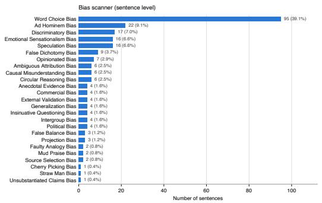
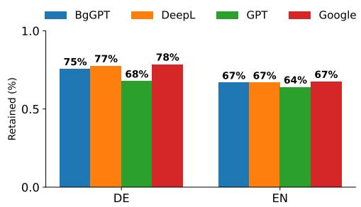
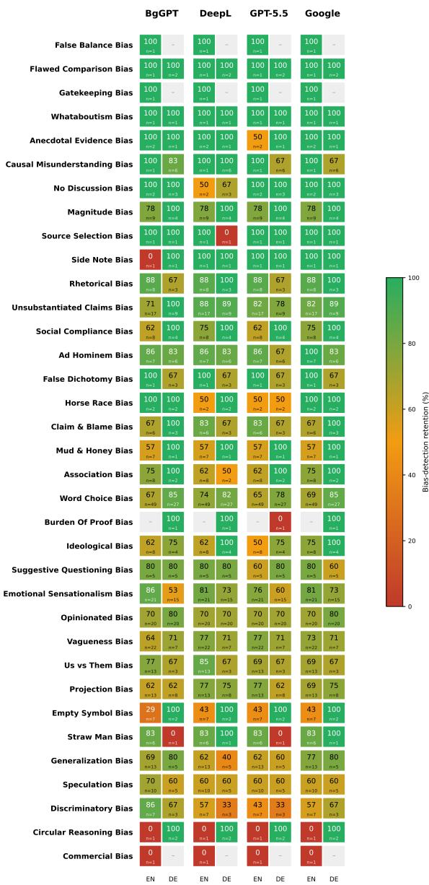
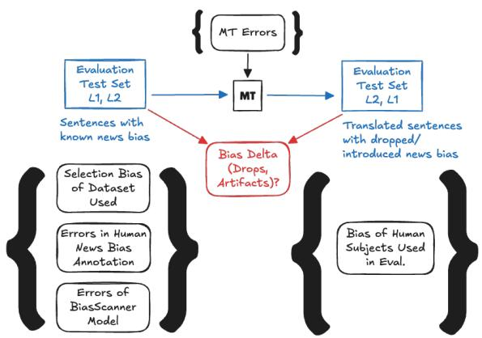

# Does Machine Translation Retain Media Bias?

Silvia V. Gargova1 Tim Menzner2,3 Jochen L. Leidner2,3

1 University of Alicante, Alicante, Spain 2 Center for Responsible Artificial Intelligence (CRAI), Coburg, Germany 3 Coburg University of Applied Sciences and Arts, Coburg, Germany

## Abstract

Within the most recent two decades, machine translation (MT) has been advanced from a research area to a mature, deployed technology for prose text and most language pairs.However, language has different dimensions of meaning, and the alluded progress has primarily been demonstrated for propositional meaning. In this small exploratory study, we investigate whether one type of affective meaning, namely different types of linguistically expressed media bias, are retained under automatic translation for two language pairs, English and German as the source languages, and Bulgarian as the target language. We evaluate four stateof-the-art translation methods to answer the question whether and to what degree a loss of non-neutral language (specifically, 27 types of media bias) can occur as a result of applying MT. Our empirical findings are consistent with the claim that MT does not fully retain existing news bias of its input source text, but also may add extra bias of its own. To the best of our knowledge, this is the first experimental study of MT media bias retention.

## 1 Introduction

## 1.1 Background and Motivation

The purpose of automatic machine translation is to generate a text document in the target language that is meaning-equivalent to the document in the source document (Koehn, 2020). While this can be challenging even for neutral, fact-centric prose text, text is often biased: media bias (also “news bias") can be defined as the conscious or unconscious deviation from neutral (impartial) reporting, e.g. by using such rhetoric devices such as framing or word choice (viz. “freedom flighter" versus “terrorist"). In Leech’s seven types of meaning system (Leech, 1981), media bias belongs to the realm of associative meaning. How can machine translation system cope with preserving the associative meaning dimension across languages?

To assess the exact position of a writer or news outlet for a language one does not read, today, we may use automatic machine translation. However, it is not clear whether various forms of media bias are retained under automatic translation or whether or to what extend such subtle information literally gets “lost in translation".

What is the right outcome? One question in the course of answering this question is what kind of behavior would users actually expect from an MT system: to translate existing bias or to take it out? We believe that the goal of MT should be to carry over as many content and cultural nuances as possible, and that includes shades of associative meaning such as news bias. The reader deserves to learn not only about the propositional content but also about the presence or absence of neutrality and the positioning and opinions of the author of the text to be translated.

## 1.2 Scope

In this paper, we investigate this question using English and German as source languages and Bulgarian as the target language. To the best of our knowledge, this is the first study to investigate whether MT retains media bias across languages:

## (RQ.) Does MT retain media bias?

We present an exploratory study of news bias retention and introduction by MT. In addition, we introduce a first small, diagnostic corpus, BiasTrans-BG-1.0-small, which we make available to the research community1.

## 2 Related Work

## 2.1 Work on Automatic Machine Translation of Associative Meaning

The aforementioned RQ is an instance of the more general question to what extent MT retains nuances of the various kinds of associative meaning.

Past MT work has dealt with the effect of MT on sarcasm (Sharma and Joshi, 2023), irony (Zheng et al., 2024) and stance towards rumours (Scarton and Li, 2021), which is different in topic but perhaps closest in spirit to our work presented here. Furthermore, there is also a large body of research on the introduction of gender bias during the automatic translation of names of professions (Stanovsky et al., 2019), because some languages make the biological sex explicit in the grammatical gender of pronouns (e.g. The doctor ... she/he ...) when in the source language the biological sex of the person referred to could remain unspecified.

We are not aware of any prior work on the retention of news bias during machine translation.

## 2.2 Work on Automatic News Bias Analysis.

Recasens et al. (2013) were the first to attempt to carry out automatic sentence-level bias detection from prose text—see Hamborg et al. (2019) for a review of early work. Lim et al. (2020) and Wessel et al. (2023) deal with the annotation of media bias. Lee et al. (2022) present a multi-document summarizer that aims to resist framing bias. (Da San Martino et al., 2020) surveys Spinde (2024)’s monograph represents the state of the art in automatic media bias detection as of late 2023. Menzner and Leidner (2024) describe a fine-tuned neural transformer model (Vaswani et al., 2017), fine-tuned for detecting 27 types of news bias.

## 2.3 Work on Media Bias for the Bulgarian Language

Azizov and co-workers described a method for cross-lingual bias-detection (Azizov et al., 2024), and they considered Bulgarian as one of several languages.

## 3 Dataset

We used a dataset from an existing news bias model deployed to the public, which permitted its users to donate stories that are interesting or that contain wrongly classified sentences for research purposes at the press of a button.(Anonymized) Besides these user submitted examples (the five most frequent sources being Tagesschau, Fox News, Bild, Die Zeit, and BBC) the dataset also includes samples from BABE(Spinde et al., 2021), Reuters/Fox News(Menzner and Leidner, 2025), and TRC2/Reuters(National Institute of Standards and Technology (ed.), 2004), resulting in 2,196 unique sentences.

Table 1: Summary Statistics of our Bias-Annotated Bilingual Corpus for the Translation Experiment.
<table><tr><td>BiasTrans-BG 1.0 Dataset</td><td>DE-Subset</td><td>EN-Subset</td></tr><tr><td>Total number of characters Number of sentences Biased / unbiased sentences Mean sentence length (char.)</td><td>43,267 213 102 / 111 203.13</td><td>36,687 233 141 / 92</td></tr></table>

  
Figure 1: Histogram of Media Bias Types (across source languages)

From this data, we selected a sample of N = 446 sentences (2 subsets with 233 English and 213 German sentences each) that were annotated with a multi-label schema (we only use isolated sentences, not full articles, to avoid copyright issues). We use the term “sentence" for simplicity, in practice, what we call a sentence can also be a cohesive union of small snippets like “massive landslide. No one can deny climate change anymore. Ban flights now!" – Table 1 provides some summary statistics on the resulting dataset used for the experiments described in this paper.

Because our news bias model used was a singleclass model, but sentences had potentially multiple labels, we ran them through the news bias model and if the output label was also included in the human annotated set, we used it as the gold label; this effectively provided an automatic mapping from a multi-class dataset to a single-class dataset, while ensuring the final label was human approved.

## 4 Method

Overall, our approach is the following: First, all sentences of our gold dataset from English (EN) or German (DE) are translated into both Bulgarian (BG) and (the German ones also into) English (EN).2 We elected to compare the machine translation capabilities of 4 automatic engines, namely: DeepL’s DeepL,3 Google Translate,4 OpenAI GPT-5.5-2026-04-23,5 and INSAIT BgGPT model bggpt-gemma-3-27b-fp8 (Alexandrov et al., 2024).6 These were applied as Web services as of 07/2026. We used the following prompt for LLM-based translations with GPT-5.5 and BgGPT:

Role: Expert translator.   
Translate the following text from   
{language} to Bulgarian. Return only the   
translation.   
Text: {text}

Next, a news bias classification model must be applied to detect sentences that exhibit some form of news bias. We use the neural transformer model from BiasScanner (Menzner and Leidner, 2024), which performs well and can deal with many languages due to neural transformers’ transfer learning ability. While it was trained and evaluated primarily on English, as part of a different study of ours, we also evaluated its quality on the Bulgarian language elsewhere (Anonymized during review, successfully completed peer review with publication TBD), where we found the Area under Curve (AUC) for distinguishing between biased and non-biased documents to be at 0.867 for Bulgarian, which is basically indistinguishable from the 0.865 scored on English.

Using his model, we conduct an automatic evaluation, i.e. essentially we check whether the automatic news bias model assigns the same category labels as the human annotator gold labels in our dataset. Where this is the case, for these sentences we can answer the research question in the affirmative. In addition, we asked a human subject (and a native speaker of Bulgarian) to validate a sample of the sentences, both regarding the correctness of the translation in general and the bias label in specific. This step was added to avoid being prone to classifier noise or bias.

Finally, we evaluated translation quality using the reference-free xCOMET metric7.(Guerreiro et al., 2024) Overall, the translations achieved high scores $( \mu = 0 . 9 1 3 9 , M = 0 . 9 6 3 2 )$

  
Figure 2: Retention of news bias gold labels after MT into BG, by source languages, and for four MT engines.

suggesting translations of high estimated quality and supporting their suitability for the bias classification task. DeepL achieved the highest mean score $( \mu = 0 . 9 2 9 1 )$ , followed by GPT-5.5 (0.9162), BgGPT (0.9086), and Google Translate (0.9019). English-to-Bulgarian translations also outperformed German-to-Bulgarian translations $( \mu \ : = \ : 0 . 9 3 0 6 \ : \mathrm { v s . } \ : 0 . 8 9 5 7 )$ , while median scores across models remained high $( M \ge 0 . 9 5 7 7 )$

## 5 Experimental Evaluation and Results

Then we compared the news bias classifications for $N = 4 4 6$ paired source sentences.8 Each dataset sentence was evaluated before and after MT into Bulgarian by BgGPT, DeepL, Google and GPT-5.5, and was used as one unit of analysis. This resulted in 243 human-validated biased sentences and 203 validated unbiased sentences, for which both the human label union and the bias model output were empty. The same dataset sentences were evaluated in five conditions (original plus 4 transl.). The observations were therefore paired and could not be treated as independent samples. We used a paired permutation test to compare the complete profiles of bias types. For one specific bias type, its presence or absence in a dataset sentence is a binary outcome. Cochran’s Q test (Cochran, 1950) was used to compare such an outcome across more than two paired conditions, and the exact McNemar test (McNemar, 1947) was used for the subsequent pairwise comparisons. Because many bias types and systems were compared, the Holm correction (Holm, 1979) was used to control the family-wise error rate. We briefly summarize our findings.

  
Figure 3: News bias (%) after translation into Bulgarian, by category, source language, and MT engine. Each cell shows n in second row; grey indicates no data.

## 5.1 Quantitative Evaluation

Across all four translation methods, between 64% and 78% of news bias is retained after a translation to BG (Figure 2). Looking at it from the other end, between one third to one quarter of news bias gets lost in the translation process. Retention is slightly higher for DE as a source language. compared to EN, despite LLMs almost certainly having seen more EN in pre-training, and inter-engine variability is clearly higher for DE than for EN.

The paired global permutation test indicated a significant difference among the type profiles of all five conditions $( T _ { \mathrm { s u m Q } } = 1 6 8 . 2 0 , p _ { \mathrm { M C } } < . 0 0 1 )$ .

Holm-adjusted pairwise permutation tests showed significant differences between the original and each of the four translations (table omitted for space reasons, see (Anonymized)). None of the six pairwise comparisons among the Bulgarian translations was significant (all $p _ { \mathrm { H o l m } } ~ = ~ 1 . 0 0 )$ Thus, the global multi-label profile of the English original differed systematically from those of the BG translations, whereas no difference in the global profile was detected among the 4 translation engines.

## 5.2 Qualitative Evaluation

Table 2 shows a couple of English and German sentences and their Bulgarian MT equivalents, as well as the news bias labels before and after translation.

Figure 3 reports, per bias category, source language, and translation engine, the share of goldlabelled biased excerpts an automatic scanner still detects as biased once translated into Bulgarian.

Retention depends on the kind of bias more than the engine (see Figure 3). Structural biases like omission, false balance, whataboutism, flawed comparisons survive translation almost perfectly (100%), because their bias comes from what the story leaves out, not how it’s phrased. Tone-dependent biases hold up less well: Circular Reasoning (50%) and Discriminatory Bias (55%) rely on nuanced wording that translation tends to smoooth. The two most frequent categories, Word Choice and Emotional Sensationalism are in the middle around 75% - better than expected, suggesting MT often preserves loaded language rather than neutralizing it. The 0% and 100% extremes are almost all driven by categories with very few instances $( n \leq 2 )$ , so they are best treated as tentative (potential noise). Observing beyond our original RQ as originally posed, the example in the second row indicates that news bias can even be introduced during MT, i.e. our line of experimentation proved more impactful than anticipated.

## 6 Summary, Conclusions and Future Work

We investigated to what extent different types of media bias “survive" going through a machine translation process. For two language pairs, EN→BG and DE→BG, we compared humanassigned class labels with machine-assigned class labels after passing through a range of alternative, state-of-the-art MT methods.

Our findings suggest that across the board, most translation engines retain between 64% and 78% of news bias in sentences; this means, at least medium to strongly biased news article will still be recognizable as such even after undergoing automatic translation (e.g. as part of a recommender engine’s preprocessing part of a news portal). To our surprise, sometimes non-neutral reporting also gets introduced during translation, which requires further investigation, and which calls for extending our research question to "To what extent does MT introduce or retain media bias?".

Table 2: Qualitative Error Analysis: Example Sentences
<table><tr><td>Source text</td><td>Translated text</td><td>Gold label</td><td>BiasScanner label text)</td><td>(source</td><td>BiasScanner label (trans- lated text)</td><td>Description</td></tr><tr><td>Die Industrie muss Gewinne erzielen, damit sie das Fliegen klimaneutral machen kann.</td><td>, 3a .</td><td>Causal Mis- understanding Bias</td><td>Causal understanding Bias</td><td>Mis-</td><td>-1-</td><td>News Bias Not Retained (Lost in Translation: FN)</td></tr><tr><td>The dissenting judges were from Russia, Cyprus and Romania.</td><td>, KOTO , , OT  .</td><td>-1-</td><td>-1-</td><td></td><td>Discriminatory Bias</td><td>MT- introduced News Bias (FP)!</td></tr><tr><td>Before we begin, re- member this is coming from a man under inves- tigation.</td><td> , ,   ,  .</td><td>Ad Hominem Bias</td><td>Ad Hominem Bias</td><td></td><td>Ad Hominem Bias</td><td>Retained News Bias</td></tr></table>

In future work, further language pairs and additional MT systems should also be investigated. MT engines should be investigated with respect to the retention of non-propositional semantic nuances other than news bias.

## 7 Limitations

Despite experimenting with data covering several hundred sentences in two language pairs and evaluating three dedicated translation models and one foundational model instructed to translate by a prompt, there remain a number of limitations: importantly, in this study, we cold not control all variables: two language pairs are not all language pairs – there exist thousands of languages and k(k − 1) pairs of them. There are also more than K = 4 models or engines that can be used to translate text. We used only one news bias models in our experiments; again, one could try more and different models.

In our task´s experimental design, ideally the following factors need to be considered and controlled as well as possible (Figure 4).

  
Figure 4: Experimental Design

• Selection News Bias of Source Document Used in Experiment. It is not clear what would be an adequate size of a corpus for an evaluation experiment the validity of which can be easily defended, but it would certainly have to be larger than ours; clear is that we want it to contain sufficient biased and unbiased sentences for all language pairs under consideration, and that it cover both directions (L1 → L2 and $L _ { 2 } \to L _ { 1 } )$ . Harder is the question what it would contain, i.e. how to sample its constituent sentences.

• Annotation Errors of Source Document´s News Bias Annotation. The source language sentences have been annotated for news bias, and the labels can be wrong or at least biased.

• Errors of the BiasScanner Model. The errors of BiasScanner´s model have been evaluated by its authors, but no specific score has been published for Bulgarian language input.

• Bias of Human Subjects Used to Evaluate. It is usually accepted that human subjects add their own issues to an experiment, and the standard way to mitigate them is to use several of them, and to report inter-annotator agreement. In this small exploratory our only available speaker of Bulgarian was author one; a larger study should use e.g. three or five subjects and report Krippendorff´s α (Krippendorff, 2004a,b).

• Machine Translation Quality Errors. The MT systems’ quality is relevant and it should be established; quality issues are adversely influencing what we measure, and they are at the same time part of what we want to measure here: dropping an instance of bias or introducing a bias artifact during MT are both examples of quality problems. We checked with xCOMET and established high MT quality across all engines used in this study.

Because of this multitude of potentially confounding forces and noise sources at play and the limited scope of this short paper, we cannot legitimately make a strong claim like (in general) "MT does not fully retain bias." or "MT causes bias." Nevertheless, we can claim that our findings are consistent with both these claims.

We believe that many or most of our observations obtained would be confirmed on larger samples, more language pairs, and/or additional news bias models, even though the shape of the bias histogram before and after translation depends on the nature of the news bias model and the exact nature of the translation engine, and we would like to encourage the research community to explore this topic neglected to date.

## 8 Ethical Considerations

Dual Use. Our study of the effect of machine translation on news bias retention is intended to answer a research question to enrich the body of scientific knowledge, an ethically legitimate goal.

Nevertheless, our study can be viewed as a dual good in the sense that a morally perturbed party could also use our method or data to study concealing or adding news bias by machine. We believe in open science for good with no censorship, in according to an open society.

To mitigate any threats, we require organizational registration before users can download our data.

Data Collection and Annotation by Human Subjects. Co-authors 1 and 2 contributed to the background (BG) review and bias annotations, respectively. Sentences selected for annotation were sampled from a dataset volunteered by anonymous web users, who acted under informed consent (we applied for a waiver letter from our local IRB, as the ethics approval process is only defined for named individuals).

AI model Use. We used AI models for code bug fixing assistance, spelling and style improvements and LATEX-formatting help.

## Acknowledgments.

We would like to gratefully acknowledge the valuable feedback received by three anonymous reviewers, whose detailed reading vastly increased the quality of this paper. All remaining errors are of course ours.

The authors would like to acknowledge the funding under the European ERASMUS+ programme (grant 2025-1-DE01-KA131-HED-000325540 awarded to the third author) that made this collaboration possible. We would also like to thank Veronika Wagner for helping to navigate the application process.

## References

Anton Alexandrov, Veselin Raychev, Dimitar I. Dimitrov, Ce Zhang, Martin Vechev, and Kristina Toutanova. 2024. BgGPT 1.0: Extending Englishcentric LLMs to other languages. Preprint, arXiv:2412.10893.

Dilshod Azizov, Zain Muhammad Mujahid, Hilal AlQuabeh, Preslav Nakov, and Shangsong Liang. 2024. SAFARI: Cross-lingual bias and factuality detection in news media and news articles. In Findings ofthe Associationfor Computational Linguistics: EMNLP 2024, pages 12217–12231, Miami, Florida, USA. Association for Computational Linguistics.

William G. Cochran. 1950. The comparison of percentages in matched samples. Biometrika, 37(3/4):256– 266.

Giovanni Da San Martino, Stefano Cresci, Alberto Barrón-Cedeño, Seunghak Yu, Roberto Di Pietro, and Preslav Nakov. 2020. A survey on computational propaganda detection. In Proceedings of the Twenty-Ninth International Joint Conference on Artificial Intelligence, IJCAI’20, pages 4826–4832. International Joint Conferences on Artificial Intelligence Organization. Survey track.

Nuno M. Guerreiro, Ricardo Rei, Daan van Stigt, Luisa Coheur, Pierre Colombo, and André F. T. Martins. 2024. xCOMET: Transparent machine translation evaluation through fine-grained error detection. Transactions of the Association for Computational Linguistics, 12:979–995.

Felix Hamborg, Karsten Donnay, and Bela Gipp. 2019. Automated identification of media bias in news articles: an interdisciplinary literature review. International Journal on Digital Libraries, 20(4):391–415.

Sture Holm. 1979. A simple sequentially rejective multiple test procedure. Scandinavian Journal ofStatistics, 6(2):65–70.

Philipp Koehn. 2020. Neural Machine Translation. Cambridge University Press, Cambridge, England, UK.

Klaus Krippendorff. 2004a. Content Analysis, an Introduction to Its Methodology, 2nd edition. Sage, Thousand Oaks, CA, USA.

Klaus Krippendorff. 2004b. Reliability in content analysis: Some common misconceptions and recommendations. Human Communication Research, 30(3):411– 433.

Nayeon Lee, Yejin Bang, Tiezheng Yu, Andrea Madotto, and Pascale Fung. 2022. NeuS: Neutral multi-news summarization for mitigating framing bias. In Proceedings ofthe 2022 Conference ofthe North American Chapter of the Association for Computational Linguistics: Human Language Technologies, pages 3131–3148, Seattle, WA, USA. Association for Computational Linguistics.

Geoffrey N. Leech. 1981. Semantics, 2nd ed. edition. Pengin, Harmondsworth, England, UK.

Sora Lim, Adam Jatowt, Michael Färber, and Masatoshi Yoshikawa. 2020. Annotating and analyzing biased sentences in news articles using crowdsourcing. In Proceedings ofthe Twelfth Language Resources and Evaluation Conference, pages 1478–1484, Marseille, France. European Language Resources Association.

Quinn McNemar. 1947. Note on the sampling error of the difference between correlated proportions or percentages. Psychometrika, 12(2):153–157.

Tim Menzner and Jochen L. Leidner. 2024. Experiments in news bias detection with pre-trained neural transformers. In Proceedings ofthe 46th European Conference in Information Retrieval (ECIR 2024), Glasgow, UK, March 24-28, 2024, volume IV of Lecture Notes in Computer Science (LNCS), 14611, pages 270–284, Cham, Switzerland. Springer Nature.

Tim Menzner and Jochen L. Leidner. 2025. Biasmitigating news search with BiasRank. In Proceedings of the 17th International Joint Conference on Knowledge Discovery, Knowledge Engineering and Knowledge Management (IC3K) - Volume 1: KDIR, pages 436–447. ScitePress.

National Institute of Standards and Technology (ed.). 2004. Reuters corpora (RCV1, RCV2, TRC2). https://trec.nist.gov/data/reuters/ reuters.html. Thomson Reuters Text Research Collection (TRC2).

Marta Recasens, Cristian Danescu-Niculescu-Mizil, and Dan Jurafsky. 2013. Linguistic models for analyzing and detecting biased language. In Proceedings of the 51st Annual Meeting of the Association for Computational Linguistics (Volume 1: Long Papers), pages 1650–1659, Sofia, Bulgaria. Association for Computational Linguistics.

Carolina Scarton and Yue Li. 2021. Cross-lingual rumour stance classification: a first study with BERT and machine translation. In Proc. Conf. on Truth and Trust Online (TTO 2021), pages 50–59.

Surbhi Sharma and Nisheeth Joshi. 2023. Analysis and translation of english sarcastic text in hindi. In International Conference on Smart Systems: Innovations in Computing, pages 549–562. Springer.

Timo Spinde. 2024. Auutomated Detection of Media Bias: From the Conceptualization ofMedia Bias to its Computational Classification. Springer, Heidelberg.

Timo Spinde, Manuel Plank, Jan-David Krieger, Terry Ruas, Bela Gipp, and Akiko Aizawa. 2021. Neural media bias detection using distant supervision with BABE – bias annotations by experts. In Findings of the Association for Computational Linguistics: EMNLP 2021, pages 1166–1177, Punta Cana, Dominican Republic. Association for Computational Linguistics.

Gabriel Stanovsky, Noah A. Smith, and Luke Zettlemoyer. 2019. Evaluating gender bias in machine translation. In Proceedings ofthe 57th Annual Meeting of the Association for Computational Linguistics, pages 1679–1684, Florence, Italy. Association for Computational Linguistics.

Ashish Vaswani, Noam Shazeer, Niki Parmar, Jakob Uszkoreit, Llion Jones, Aidan N Gomez, Ł ukasz Kaiser, and Illia Polosukhin. 2017. Attention is all you need. In Advances in Neural Information Processing Systems. Curran Associates, Inc.

Martin Wessel, Tomás Horych, Terry Ruas, Akiko Aizawa, Bela Gipp, and Timo Spinde. 2023. Introducing MBIB – the first media bias identification benchmark task and dataset collection. In Proceedings of the 46th International ACM SIGIR Conference on Research and Development in Information Retrieval, SIGIR 2023, pages 2765–2774, New York, NY, USA. Association for Computing Machinery.

Lin Chia Zheng, Michal Ptaszynski, Marzena Karpinska, Juuso Eronen, and Fumito Masui. 2024. Initial exploration into sarcasm and irony through machine translation. Natural Language Processing Journal, 9:100106.