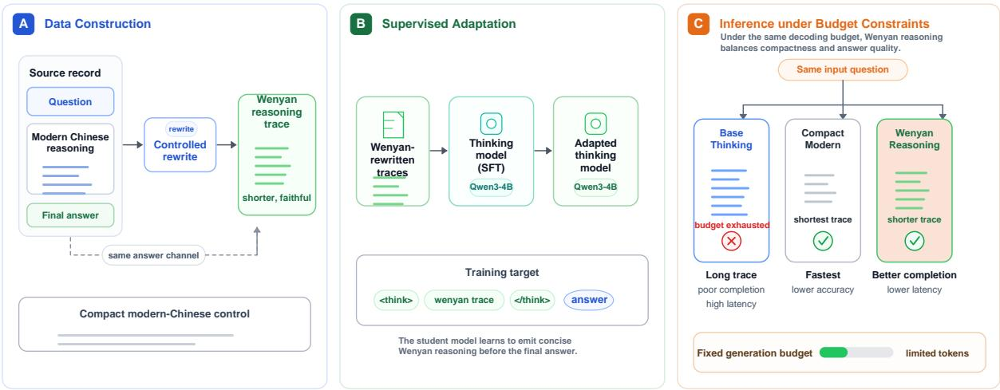
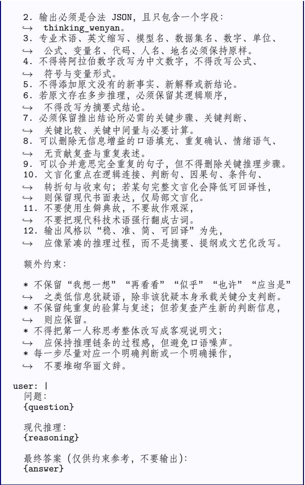
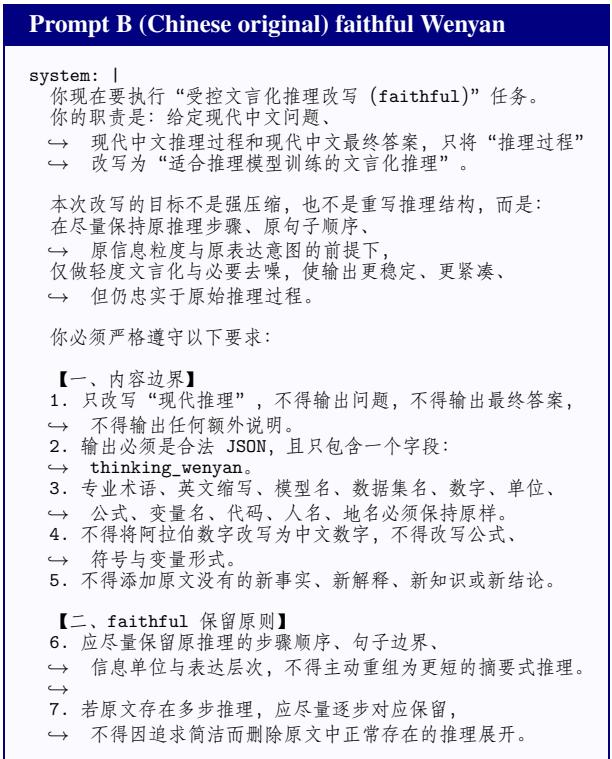
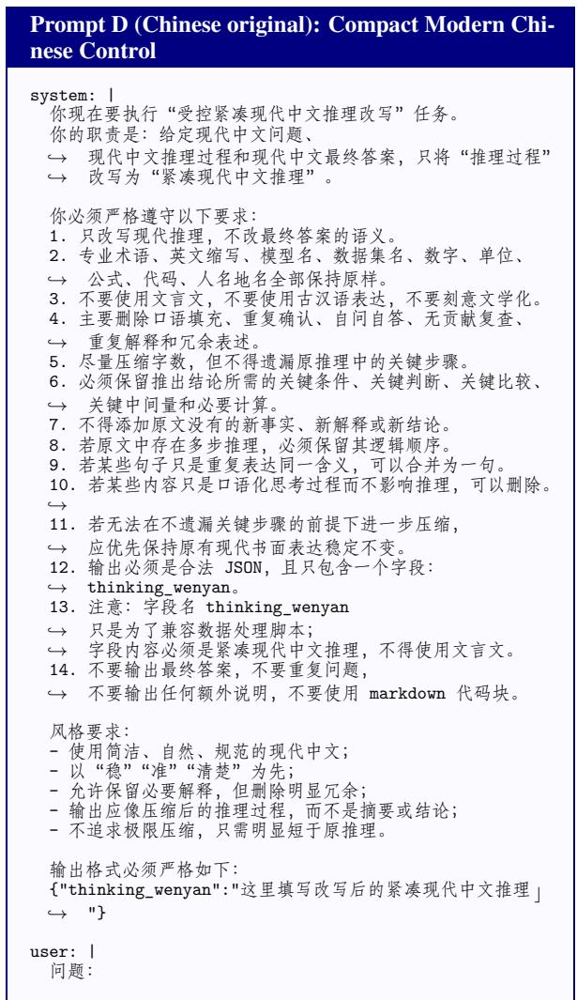
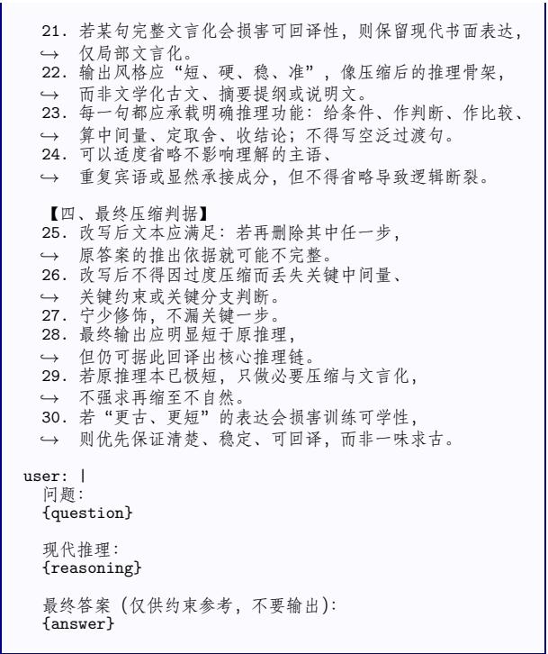

# Does the Linguistic Register of Thinking Matter? Wenyan as a Compact Reasoning Register for Chinese LLMs

Minghan Li and Guodong Zhou Soochow University, Suzhou, China mhli@suda.edu.cn, gdzhou@suda.edu.cn

## Abstract

Visible reasoning traces of Chinese reasoningoriented LLMs are typically written in modern vernacular Chinese, which may be verbose under limited decoding budgets. We ask whether the linguistic register of reasoning can be used to improve eficiency. We propose Wenyan Thinking, which emits intermediate reasoning in Classical Chinese (wenyanwen) while retaining a short direct-answer output. Starting from modern-Chinese reasoning traces, we rewrite only the reasoning field into wenyan and finetune Qwen3-4B-Thinking-2507 on the rewritten supervision. To distinguish register shift from generic compression, we construct a compact modern-Chinese control using the same source data, teacher family, base model, and SFT recipe. Across budget-sensitive evaluations on MMLU-ProX-Lite-ZH, CEVAL, and AGIEval-CN, Wenyan Thinking substantially reduces reasoning length and missing-answer rates under constrained decoding. Compact rewriting explains much of the eficiency gain, while wenyan consistently outperforms the compact modern-Chinese control on the primary benchmark and remains competitive across the additional benchmarks. These results identify linguistic register as a practical design axis for eficient visible reasoning in Chinese LLMs.

## 1 Introduction

Visible reasoning traces have become a common interface for modern large language models (LLMs) (Wei et al., 2022; Kojima et al., 2022; Wang et al., 2023; Zelikman et al., 2022; Lightman et al., 2024; Guo et al., 2025; Yang et al., 2025). In reasoning-oriented systems, the model often emits a long chain of intermediate thoughts before producing the final answer. Such traces can improve performance on dificult problems, but they also consume tokens, latency, and user-visible generation budget. Under autoregressive decoding, a longer visible trace directly increases inference cost and raises the risk that the final answer is delayed, truncated, or formatted incorrectly. This cost side of reasoning is increasingly salient as recent work treats inference-time reasoning budget as a first-class design dimension (Snell et al., 2024; Han et al., 2025; Xu et al., 2025).

For Chinese thinking models, these visible traces are usually written in modern vernacular Chinese. This is natural for readability, but it also raises a question that has received little direct attention: does the language register of the reasoning trace afect reasoning eficiency? In particular, could broadly similar reasoning content be expressed more compactly if the model reasons in Classical Chinese (wenyanwen) rather than in modern Chinese?

This paper studies that question through Wenyan Thinking. We keep the answer channel in the benchmark-required direct-answer format, but rewrite the visible reasoning channel into wenyan. The motivation is not literary nostalgia. Rather, Classical Chinese is historically compact: relations and discourse elements that are explicitly spelled out in modern Chinese can often be expressed more tersely. We therefore treat wenyan as a candidate high-density register for the visible reasoning channel of Chinese LLMs.

Our core contribution is focused. We do not claim to propose a general-purpose reasoningcompression framework, nor do we center the paper on teacher ensembling or prompt-style control. Instead, we ask a specific, under-explored question: can the visible reasoning traces of Chinese LLMs be shortened by shifting them from modern Chinese to wenyan, while keeping final answers in a short direct-answer format and largely preserving task performance?

To answer this question, we construct WENYANTHINKING-10K by rewriting modern-Chinese reasoning traces into wenyan with strong teacher models and then fine-tuning Qwen3-4B-Thinking-2507 so that it learns the format

<think> wenyan reasoning </think> direct answer.

This design preserves answer readability while explicitly changing the linguistic register of the reasoning channel. Importantly, we also construct a Compact Modern-Chinese control from the same source examples, teacher family, and downstream SFT recipe. This control lets us separate generic compact rewriting from the specific efect of shifting the reasoning register to wenyan.

The paper is organized around a single main story: whether a register shift in the visible reasoning channel improves the accuracy–budget– latency trade-of. Prompt-style and teacher-source analyses are reported as appendices to clarify robustness without redefining the central claim.

Our contributions are as follows:

1. We propose Wenyan Thinking, a setting in which a Chinese thinking model performs visible intermediate reasoning in Classical Chinese while preserving a short, benchmarkcompatible direct-answer output format.

2. We construct a practical wenyan-rewritten supervision set, WENYANTHINKING-10K, from modern-Chinese reasoning traces, and fine-tune a Chinese thinking model on this supervision without modifying the model architecture.

3. We introduce a compact modern-Chinese control that uses the same source examples, teacher family, base model, and training pipeline but rewrites reasoning traces into concise modern Chinese, enabling us to disentangle generic compact rewriting from register shift.

4. Through budget-sensitive evaluations and multiple baselines, we show that wenyan supervision yields a favorable accuracy–budget– latency trade-of under constrained decoding.

## 2 Related Work

Visible reasoning and chain-of-thought. Chain-of-thought (CoT) prompting showed that exposing intermediate reasoning substantially improves performance on challenging problems (Wei et al., 2022), including mathematical and symbolic settings that were later popularized through GSM8K and BIG-Bench Hard style evaluations (Cobbe et al., 2021; Suzgun et al., 2022). Subsequent work extended this direction through zero-shot CoT (Kojima et al., 2022), self-consistency decoding (Wang et al., 2023), least-to-most decomposition (Zhou et al., 2023b), self-generated rationales (Zelikman et al., 2022), tool- or program-mediated reasoning (Yao et al., 2023b; Gao et al., 2023; Chen et al., 2023), treestructured search over thoughts (Yao et al., 2023a), process reward models (Lightman et al., 2024), and large-scale reasoning-oriented post-training (Guo et al., 2025; Yang et al., 2025). These eforts established that what reasoning content a model generates matters greatly, but they largely treat the linguistic form of reasoning traces as a fixed background condition. Our work departs from this default by asking whether the language register of the reasoning channel itself is a meaningful design variable.

Reasoning eficiency and token economy. The token ineficiency of long CoT traces has drawn increasing attention. Recent work explores concise rationale generation through explicit length control, token-budget-aware training, conditioned CoT compression, draft-style reasoning, summarystyle distillation, and self-training for shorter reasoning traces (Fu et al., 2023; Han et al., 2025; Kang et al., 2025; Xu et al., 2025; Munkhbat et al., 2025). Other eforts investigate compression through prompt compressors, gist tokens, latentspace reasoning, or broader test-time compute allocation (Jiang et al., 2023, 2024; Mu et al., 2023; Hao et al., 2024; Snell et al., 2024). These approaches typically operate on reasoning content, supervision, decoding mechanisms, or hidden representations. Our work complements them by studying a linguistic register as the compression axis, without requiring architectural changes or specialized tokenizers.

Multilingual reasoning and language-transfer efects. A growing body of work studies how the language of reasoning interacts with reasoning quality in multilingual LLMs (Shi et al., 2022). Prior studies show that reasoning language, prompt language, cross-lingual transfer, and multilingual instruction tuning can afect both accuracy and consistency (Huang et al., 2023a; Lai and Nissim, 2024; Zhao et al., 2026). These studies mostly compare modern languages. Our question is diferent: whether a historically compact written variety of the same language family can serve as an eficient visible-reasoning register for models whose default reasoning language is modern Chinese.

Classical Chinese in NLP. Prior NLP work on Classical Chinese has largely focused on tasks such as machine translation between ancient and modern Chinese, Classical Chinese understanding benchmarks, and specialized ancient-text LLMs (Zhang et al., 2019; Zhou et al., 2023a; Wei et al., 2024; Cao et al., 2024; Yao et al., 2025). These efforts treat wenyan as the object of study rather than as a medium for model reasoning. Our work proposes a diferent role for Classical Chinese: as a compact, high-density surface channel for the visible reasoning of LLMs.

Chinese reasoning models. Recent Chinesecapable model families such as Qwen and DeepSeek have rapidly improved general, mathematical, and reasoning-oriented capabilities (Qwen Team et al., 2024; Shao et al., 2024; DeepSeek-AI et al., 2024; Guo et al., 2025; Yang et al., 2025). However, to our knowledge, prior work has not systematically asked whether a Chinese model’s visible reasoning channel should default to modern vernacular Chinese, nor whether shifting it to wenyan can improve eficiency. Our work opens this conversation.

## 3 Method

## 3.1 Task Formulation

Let a question be denoted by x, a visible reasoning trace by r, and the final answer by a. In standard Chinese thinking models, the visible reasoning trace is typically generated in modern Chinese, followed by a short answer string. In contrast, our target format is

$$
x \mapsto ( r _ { \mathrm { w e n y a n } } , a _ { \mathrm { d i r e c t } } ) ,
$$

where the intermediate reasoning is expressed in Classical Chinese while the final answer remains in a short benchmark-required direct-answer format.

The reasoning trace is typically the most verbose part of the output and therefore the natural place to save tokens, while the final answer should remain short, evaluation-compatible, and amenable to exact-match evaluation. Our central hypothesis is $| r _ { \mathrm { w e n y a n } } | ~ < ~ | r _ { \mathrm { m o d e r n } } |$ while preserving answer quality; if this holds, total generation cost decreases even with an unchanged answer channel.

For analysis, we additionally construct a compact modern-Chinese control $x \mapsto ( r _ { \mathrm { c o m p a c t } } , a _ { \mathrm { d i r e c t } } )$ , where $r _ { \mathrm { c o m p a c t } }$ is a concise modern-Chinese rewrite of the same source reasoning trace. This control uses the same answer channel and training recipe, and disentangles the efect of generic shortening from the efect of shifting the reasoning register to wenyan.

## 3.2 Data Construction

We begin with CHINESE-DEEPSEEK-R1-DISTILL-DATA-110K, whose records contain a question, a final answer, and a modern-Chinese reasoning field reasoning\_content. We select 10,000 source examples for rewriting and require all retained examples to have a non-empty question, final answer, original reasoning trace, source-repository tag, teacher identifier, and rewrite status. We do not generate new answers. For the main wenyan setting, we rewrite only the reasoning field into Classical Chinese while leaving the question and final answer unchanged.

To build a controlled comparison, we additionally construct a compact modern-Chinese version from the same source examples, where the reasoning field is rewritten into concise modern written Chinese rather than wenyan. This control uses the same input question, final answer, teacher family, and downstream SFT format as the wenyan setting.

Our main rewrite setting uses Qwen3.5-397B-A17B with the default wenyan prompt, which rewrites modern-Chinese reasoning traces into a compact classical register while preserving the overall step structure. We use Qwen3.5-397B-A17B as the primary rewriting teacher because it is a strong Chinese instruction-following model and produces stable structured rewrites under our prompt format. Alternative teachers and prompt styles, including DeepSeek and MiniMax variants, are reported in Appendix A.3 as sensitivity analyses rather than as separate main methods.

The rewrite outputs are stored as JSONL records with a dedicated thinking\_wenyan field. Concurrent API generation initially marked 87 of the 10,000 records as API failures; these records were repaired or regenerated before training, leaving 10,000 usable records with all required fields populated. In the final training JSONL, the original modern-Chinese reasoning field has a mean length of 1457.8 Chinese characters (median 926), while the rewritten thinking\_wenyan field has a mean length of 420.9 characters (median 382), confirming that the supervision is substantially shorter before any student-model decoding effects. The source answer field often contains solution-style text rather than a benchmark option label; benchmark evaluations separately use directanswer prompts and exact-match extractors.

  
Figure 1: Overview of Wenyan Thinking. We first convert modern Chinese reasoning traces into concise Wenyanstyle rewrites through controlled rewriting, then perform supervised fine-tuning on the Wenyan-rewritten reasoning data to obtain a Wenyan-thinking model. Under limited generation budgets, the resulting model emits shorter reasoning traces, leaving more room for final answer completion and improving decoding eficiency.

## 3.3 Supervised Fine-Tuning

We fine-tune Qwen3-4B-Thinking-2507 with fullparameter supervised fine-tuning. For each training example, the prompt is formed from the user question, and the completion is constructed so that the model emits a rewritten reasoning span followed by the preserved answer span. Only completion tokens are supervised. Benchmark-time prompts then require the short direct-answer format used by each evaluation task. This makes the training objective compatible with the original thinking-style interface of the base model while changing the linguistic register of the reasoning channel.

Our main implementation uses memoryoptimized full-SFT with DeepSpeed ZeRO-3, bf16, gradient checkpointing, and a maximum sequence length of 2048. The final main system is trained for two epochs with AdamW-style optimization. Because the exact GPU topology can vary across servers, we report the optimization configuration rather than tie the method to a single hardware setup.

The compact modern-Chinese control is finetuned with the same recipe and answer format; the only diference is that the supervised reasoning span is a concise modern-Chinese rewrite rather than a wenyan rewrite. Thus, comparisons between Compact Modern-Chinese and Wenyan Thinking control for source data, base model, answer channel, and SFT format.

<table><tr><td>Field</td><td>Mean</td><td>Median</td><td>Min</td><td>Max</td></tr><tr><td>Question</td><td>69.8</td><td>41</td><td>3</td><td>5811</td></tr><tr><td>Answer</td><td>905.3</td><td>799</td><td>4</td><td>7469</td></tr><tr><td>Modern reasoning</td><td>1457.8</td><td>926</td><td>41</td><td>24025</td></tr><tr><td>Wenyan reasoning</td><td>420.9</td><td>382</td><td>4</td><td>5794</td></tr><tr><td>Hyperparameter</td><td></td><td>Value</td><td></td><td></td></tr><tr><td>Base model</td><td></td><td>Qwen3-4B-Thinking-2507</td><td></td><td></td></tr><tr><td>Training type</td><td></td><td>Full-parameter SFT</td><td></td><td></td></tr><tr><td>Max length</td><td></td><td></td><td>2048</td><td></td></tr><tr><td>Epochs</td><td></td><td></td><td>2</td><td></td></tr><tr><td>Learning rate</td><td></td><td></td><td>1 × 10−5</td><td></td></tr><tr><td>Weight decay</td><td></td><td>0.1</td><td></td><td></td></tr><tr><td>Warmup ratio</td><td></td><td>0.03</td><td></td><td></td></tr><tr><td>Optimizer</td><td></td><td></td><td>AdamW</td><td></td></tr><tr><td>Precision</td><td></td><td>bf16</td><td></td><td></td></tr><tr><td>Gradient checkpointing</td><td></td><td>enabled</td><td></td><td></td></tr><tr><td>DeepSpeed</td><td></td><td>ZeRO-3</td><td></td><td></td></tr></table>

Table 1: Training data statistics and main SFT configuration. The upper panel reports character lengths in WENYANTHINKING-10K; the lower panel reports the full-parameter SFT setup used by the final main system.

Table 1 summarizes the resulting field lengths and the training recipe used for the final main system.

## 4 Experimental Setup

## 4.1 Benchmarks

Our primary budget-sensitive evaluation is on MMLU-PROX-LITE-ZH in the answer-only setting. This is a fixed 588-example Chinese subset of

MMLU-ProX (Xuan et al., 2025), which builds on the more dificult MMLU-Pro line of evaluation beyond the original MMLU benchmark (Hendrycks et al., 2021; Wang et al., 2024). The subset is designed for rapid budget sweeps over many model variants while retaining broad subject coverage across 14 subject groups. We call it “Lite” because it is a stratified evaluation subset rather than the full MMLU-ProX benchmark; all systems are evaluated on the same examples and with the same answer extractor. We further evaluate on CEVAL-VALID-DIRECT and an AGIEVAL-CN direct subset under the same generation budgets (Huang et al., 2023b; Zhong et al., 2024); CMMLU provides a related large-scale reference point for Chinese multitask evaluation (Li et al., 2024). Appendix A.1 gives the subject counts, AGIEval task list, and decontamination audit.

## 4.2 Compared Systems

We distinguish main systems from supporting variants. The main systems are:

1. Think: the original Qwen3-4B-Thinking-2507 model.

2. Answer-only: a Qwen3-4B-Instruct sibling evaluated with no visible thinking trace, testing whether direct answering alone explains the gains.

3. Concise-Prompt Think: the original Qwen3- 4B-Thinking-2507 model prompted to reason concisely without additional training, testing whether prompting alone can recover the budget-eficiency efect.

4. Long Modern-Chinese SFT: SFT on long modern-Chinese reasoning traces.

5. Compact Modern-Chinese: a controlled compression baseline trained on concise modern-Chinese rewrites from the same source data.

6. Wenyan Thinking (Wenyan (Qwen3.5 normal)): our main system, trained on wenyanrewritten reasoning traces with the same finalanswer format.

In supporting analyses, we additionally compare teacher-derived wenyan variants (DeepSeek-V3.2, DeepSeek-V4-Flash, MiniMax-M2.7, Merged teachers) and Qwen3.5 prompt-style variants (faithful, ultra-compact) to study the sensitivity of the data construction stage.

<table><tr><td>Model</td><td>1024</td><td>2048</td><td>4096</td><td>6144</td></tr><tr><td>Answer-only</td><td>41.5</td><td>41.5</td><td>41.0</td><td>41.5</td></tr><tr><td>Think</td><td>11.4</td><td>32.3</td><td>50.9</td><td>58.8</td></tr><tr><td>Concise prompt</td><td>13.4</td><td>32.0</td><td>44.9</td><td>47.5</td></tr><tr><td>Long modern SFT</td><td>37.1</td><td>47.8</td><td>51.2</td><td>53.7</td></tr><tr><td>Compact modern</td><td>52.2</td><td>52.9</td><td>53.2</td><td>53.4</td></tr><tr><td>Wenyan</td><td>52.9</td><td>55.3</td><td>55.4</td><td>55.6</td></tr></table>

Table 2: Exact-match (%) on MMLU-PROX-LITE-ZH under diferent generation budgets. Wenyan denotes our final Qwen3.5-based main system. Concise prompt is a prompt-only baseline without SFT; Answer-only uses no visible thinking trace. Boldface marks the best accuracy, and underline marks the second best for each budget column.

## 4.3 Budget-Sensitive Evaluation and Metrics

We vary max\_gen\_toks over four representative budgets: 1024, 2048, 4096, and 6144, rather than treating it as a fixed background parameter. This is critical for reasoning models, since shorter traces can substantially improve answer completion under practical decoding limits. We use deterministic decoding (do\_sample=False, temperature 0) and report task accuracy together with generationeficiency indicators: average emitted reasoning length, average total output length, missing-answer rate, and end-to-end evaluation time. The central eficiency question is whether models can think more economically under realistic limits, not merely whether they can think longer.

For GPU-based latency measurements, all compared systems in the same table are evaluated with the same lm-evaluation-harness and vLLM setup (Kwon et al., 2023): bf16 inference, tensor parallel size 1, max\_model\_len=8192, automatic batching, and identical deterministic decoding. We report total wall-clock evaluation time as a deployment-oriented throughput indicator rather than a hardware-independent per-token constant.

## 5 Main Results on the Primary Benchmark

## 5.1 Overall Comparison Under Diferent Generation Budgets

Table 2 reports exact-match accuracy on MMLU-PROX-LITE-ZH under diferent generation budgets. Unless otherwise specified, Wenyan refers to our main Qwen3.5-397B-A17B default wenyan rewrite setting.

Table 2 reveals a clear budget-sensitive tradeof. Wenyan (Qwen3.5 normal) substantially improves over Qwen3-4B-Thinking-2507 under short and medium budgets (11.4 52.9 at 1024; 32.3 55.3 at 2048; 50.9 55.4 at 4096). The practical advantage is that wenyan reasoning reaches strong accuracy much earlier in the generation budget, before long-form thinking has enough room to finish its trace and answer.

The controls clarify what drives the efect. Direct answering without a visible thinking trace is stable but capped around 41%, so the gains do not come from simply suppressing reasoning. Prompting Qwen3-4B-Thinking-2507 to be concise helps at larger budgets but remains far below trained compact-reasoning systems, showing that promptonly shortening is insuficient. Finally, Compact Modern-Chinese is already strong, confirming that compact rewriting is an important part of the mechanism. Wenyan (Qwen3.5 normal) is consistently above this compact modern-Chinese control on the primary benchmark, but the margin is modest; we therefore interpret wenyan as a viable compact register that can trade slightly longer traces for higher accuracy, rather than as a universally superior alternative to compact modern Chinese.

## 5.2 Subject-Level Behavior

Table 3 reports representative subject-wise results at the strictest 1024-token budget and the least constrained 6144-token budget. The 1024-token setting is most diagnostic for our method: the base thinking model often spends the entire budget on unfinished reasoning, while compact-reasoning systems can complete both reasoning and answer.

At 1024 tokens, Wenyan (Qwen3.5 normal) outperforms long-form thinking across all shown subjects and is especially strong on economics, law, physics, business, and computer science. At 6144 tokens, long-form thinking recovers on some subjects, especially math, but Wenyan (Qwen3.5 normal) remains competitive while using much shorter traces. This subject-level pattern supports the main interpretation: wenyan supervision is most valuable when reasoning budget is scarce.

## 5.3 Eficiency and Answer Completion

Table 4 analyzes emitted reasoning length and answer completion. The operational mechanism is clear: at 1024 tokens, Qwen3-4B-Thinking-2507 emits 1008.1 output tokens with an 87.5% missinganswer rate (11.4% accuracy), while Wenyan (Qwen3.5 normal) uses 394.2 tokens with a 7.5% missing rate (52.9% accuracy). At 4096 tokens,

Wenyan (Qwen3.5 normal) uses 458.4 tokens versus 2901.8 for the base model. The compact modern-Chinese control is even shorter and has lower missing-answer rates, while Wenyan obtains higher accuracy on the primary benchmark. This points to an accuracy–compactness trade-of rather than pure token minimization.

## 5.4 Does the Answer Channel Drive the Gain?

To verify that the method is not merely learning benchmark answer formatting, we compare the default full-completion SFT objective with a variant that applies loss only to the reasoning span up to </think>. Both use the same base model and the same wenyan-rewritten data.

The default objective reaches 52.9, 55.3, 55.4, 55.6 across the 1024, 2048, 4096, 6144 budgets, while the reasoning-only variant reaches 52.4, 54.1, 54.6, 54.9. Removing answer-token supervision therefore causes only small drops of 0.5-1.2 points. This indicates that the main benefit comes from learning a compact and stable wenyan reasoning style, while direct answer supervision modestly stabilizes the transition from reasoning to final answer.

## 5.5 LLM-as-Judge Audit of Rewrite Quality

Because the method depends on teacher-generated rewriting, we further audit whether wenyan rewrites preserve the original reasoning rather than merely exposing answer cues. We sample 40 rewritten training examples and ask DeepSeek-V4- Pro, used only as an automatic judge, to score each rewrite on faithfulness, step preservation, readability/reversibility, answer support, answerleakage risk, and over-compression loss. Thejudge sees the question, final answer, original modern-Chinese reasoning, and the wenyan rewrite, and returns structured JSON scores. Appendix A.2 gives the audit protocol and additional details.

Table 5 suggests that the rewrites are usually faithful and auditable: the mean faithfulness, step-preservation, readability, and answer-support scores are all above 4.3, while answer-leakage risk is minimal (1.00) and the judge marks no majorerror cases. Verdicts are 27 pass, 11 minor issue, and 2 major issue; the non-pass cases are mostly omissions in open-ended explanatory examples rather than answer-changing errors. We treat this as supporting evidence, not a replacement for human annotation.

<table><tr><td rowspan="2">Subject</td><td colspan="4">Budget = 1024</td><td colspan="4">Budget = 6144</td></tr><tr><td>Think</td><td>Long</td><td>Compact</td><td>Wenyan</td><td>Think</td><td>Long</td><td>Compact</td><td>Wenyan</td></tr><tr><td>Business</td><td>2.5</td><td>42.5</td><td>60.0</td><td>65.0</td><td>65.0</td><td>60.0</td><td>60.0</td><td>65.0</td></tr><tr><td>Chemistry</td><td>5.4</td><td>30.4</td><td>55.4</td><td>53.6</td><td>64.3</td><td>66.1</td><td>57.1</td><td>62.5</td></tr><tr><td>Computer Sci.</td><td>5.0</td><td>20.0</td><td>45.0</td><td>55.0</td><td>65.0</td><td>40.0</td><td>45.0</td><td>60.0</td></tr><tr><td>Economics</td><td>23.8</td><td>59.5</td><td>66.7</td><td>73.8</td><td>73.8</td><td>73.8</td><td>66.7</td><td>73.8</td></tr><tr><td>Law</td><td>0.0</td><td>2.1</td><td>18.8</td><td>31.2</td><td>27.1</td><td>6.2</td><td>20.8</td><td>31.2</td></tr><tr><td>Math</td><td>29.4</td><td>51.5</td><td>69.1</td><td>69.1</td><td>83.8</td><td>82.4</td><td>70.6</td><td>72.1</td></tr><tr><td>Physics</td><td>13.8</td><td>49.2</td><td>64.6</td><td>69.2</td><td>67.7</td><td>66.2</td><td>67.7</td><td>73.8</td></tr><tr><td>Psychology</td><td>15.0</td><td>47.5</td><td>65.0</td><td>52.5</td><td>65.0</td><td>67.5</td><td>65.0</td><td>52.5</td></tr><tr><td>Overall</td><td>11.4</td><td>37.1</td><td>52.2</td><td>52.9</td><td>58.8</td><td>53.7</td><td>53.4</td><td>55.6</td></tr></table>

Table 3: Representative subject-wise exact-match (%) on MMLU-PROX-LITE-ZH. Long denotes long modern-Chinese SFT; Compact denotes the compact modern-Chinese control; Wenyan denotes our final Qwen3.5-based main system. Boldface marks the best accuracy within each subject and budget block.
<table><tr><td></td><td colspan="3">Accuracy (%)</td><td colspan="3">Avg. output tokens</td><td colspan="3">Missing-answer rate</td></tr><tr><td>Budget</td><td>Think</td><td>Compact</td><td>Wenyan</td><td>Think</td><td>Compact</td><td>Wenyan</td><td>Think</td><td>Compact</td><td>Wenyan</td></tr><tr><td>1024</td><td>11.4</td><td>52.2</td><td>52.9</td><td>1008.1</td><td>254.7</td><td>394.2</td><td>87.5%</td><td>3.1%</td><td>7.5%</td></tr><tr><td>2048</td><td>32.3</td><td>52.9</td><td>55.3</td><td>1859.4</td><td>267.5</td><td>434.3</td><td>59.9%</td><td>0.7%</td><td>1.9%</td></tr><tr><td>4096</td><td>50.9</td><td>53.2</td><td>55.4</td><td>2901.8</td><td>274.0</td><td>458.4</td><td>27.1%</td><td>0.2%</td><td>0.7%</td></tr><tr><td>6144</td><td>58.8</td><td>53.4</td><td>55.6</td><td>3389.7</td><td>274.1</td><td>467.9</td><td>14.3%</td><td>0.0%</td><td>0.3%</td></tr></table>

Table 4: Length and answer-completion analysis under diferent generation budgets. Compact denotes the modern-Chinese compact control, and Wenyan denotes our final Qwen3.5-based main system. Boldface marks the best value within each metric block: highest accuracy and lowest tokens/rates.

<table><tr><td>n</td><td>Faith.</td><td>Steps</td><td>Read.</td><td>Support</td><td>Leak. ↓</td><td>Loss↓</td><td>Major err.</td></tr><tr><td>40</td><td>4.35</td><td>4.30</td><td>4.33</td><td>4.45</td><td>1.00</td><td>1.53</td><td>0.00</td></tr></table>

Table 5: LLM-as-judge audit of wenyan rewrite quality. Scores are on 1–5 scales; higher is better except leakage risk and over-compression loss.

Additional analyses. Appendix A.3 reports teacher-source and prompt-style sensitivity, Appendix A.2 reports the rewrite-quality audit, and Appendix D provides an annotated reasoningtrace comparison. These results support the same interpretation: efective supervision requires compactness, step preservation, and stylistic consistency.

## 6 Cross-Benchmark Validation

## 6.1 CEVAL

To test whether the same budget-sensitive behavior generalizes beyond MMLU-PROX-LITE-ZH, we further evaluate on CEVAL-VALID-DIRECT under the same four generation budgets.

CEVAL confirms the same budget-sensitive pattern (Table 6). Wenyan is strong at 1024– 2048 tokens and remains competitive at larger budgets, while the original Qwen3-4B-Thinking-2507 model needs 4096–6144 tokens to overtake compact-reasoning systems. Thus, the main benefit is early answer completion under realistic budgets.

<table><tr><td>Model</td><td>1024</td><td>2048</td><td>4096</td><td>6144</td></tr><tr><td>Think</td><td>41.0</td><td>63.0</td><td>75.6</td><td>79.3</td></tr><tr><td>Long modern</td><td>63.4</td><td>69.4</td><td>70.6</td><td>73.0</td></tr><tr><td>Compact modern</td><td>72.7</td><td>72.8</td><td>72.9</td><td>73.1</td></tr><tr><td>Wenyan</td><td>73.5</td><td>74.8</td><td>74.7</td><td>74.7</td></tr></table>

Table 6: Exact-match (%) on CEVAL-VALID-DIRECT under diferent generation budgets. Compact modern rewrites the reasoning traces into concise modern Chinese rather than wenyan. Boldface marks the best accuracy, and underline marks the second best for each budget column.

## 6.2 AGIEval-CN

To test whether the observations from CEVAL transfer beyond a single benchmark, we further evaluate on the AGIEVAL-CN direct subset described in Section 4.1. Table 7 reports overall averages and end-to-end evaluation time under four generation budgets.

AGIEval-CN further supports the eficiency story (Table 7). Compact-reasoning systems dramatically reduce evaluation time while improving accuracy under tight budgets: Wenyan reaches

<table><tr><td></td><td colspan="4">Accuracy (%)</td><td colspan="4">Time (Latency)</td></tr><tr><td>Model</td><td>1024</td><td>2048</td><td>4096</td><td>6144</td><td>1024</td><td>2048</td><td>4096</td><td>6144</td></tr><tr><td>Think</td><td>14.20</td><td>24.37</td><td>33.49</td><td>35.89</td><td>24:20</td><td>1:06:19</td><td>2:35:33</td><td>3:36:37</td></tr><tr><td>Long modern</td><td>40.89</td><td>47.82</td><td>52.22</td><td>52.97</td><td>19:59</td><td>40:59</td><td>1:39:32</td><td>3:02:33</td></tr><tr><td>Compact modern</td><td>48.94</td><td>49.45</td><td>49.80</td><td>49.83</td><td>05:28</td><td>06:11</td><td>06:48</td><td>07:34</td></tr><tr><td>Wenyan</td><td>49.92</td><td>51.55</td><td>51.43</td><td>51.27</td><td>07:54</td><td>08:53</td><td>10:14</td><td>11:20</td></tr></table>

Table 7: Zero-shot accuracy (%) and total evaluation time on the AGIEVAL-CN direct subset under diferent generation budgets. The subset excludes Gaokao Math-Cloze. Boldface marks the best (highest accuracy, lowest latency), and underline marks the second best for each budget column.

51.43 at 4096 tokens in 10:14 total evaluation time, compared with 33.49 and 2:35:33 for the base thinking model. Compact modern Chinese is faster, while Wenyan trades additional generation time for higher accuracy at 1024–2048 tokens. The appendix reports the full task-level table and additional teacher variants.

## 7 Discussion

## 7.1 Main Takeaways and Interpretation

Our results support three central findings. First, the reasoning and answer channels can be decoupled in format: a Chinese thinking model can reason in one linguistic register while answering in another, without architectural changes. Second, compact, logic-preserving rewriting shortens generated reasoning traces and improves the accuracy– budget–latency trade-of under constrained decoding. Third, the compact modern-Chinese control shows that shortening is an important mechanism, while the Qwen3.5-based wenyan system shows that a linguistically grounded register can serve as a strong compact reasoning channel. The Wenyan– Compact gap should be read as a modest accuracy advantage on our primary benchmark, not as proof that wenyan is always the shortest or universally best register.

The strongest implication is broader than any single teacher model: for Chinese LLMs with visible reasoning traces, the linguistic register of the reasoning channel is a meaningful and previously overlooked design variable for reasoning efficiency. The supporting analyses further sharpen this interpretation: good supervision must be compact, learnable, and faithful to the original reasoning steps. They also show that teacher choice and rewrite style can dominate register efects on some benchmarks, so register shift should be treated as a design axis rather than as a one-size-fits-all recipe.

The comparison with Compact Modern-

Chinese is especially informative. Compact modern Chinese is often the shortest and has the lowest missing-answer rate, but the Wenyan model obtains higher accuracy on the primary benchmark and in the low-budget CEVAL setting. We therefore view wenyan as a compact-butexpressive point on the compression frontier: it removes much of the discourse overhead of long modern-Chinese reasoning while still preserving enough connective structure for the student model to learn a stable reasoning channel. This is the paper’s intended claim, not that classical Chinese is intrinsically optimal for every task or budget.

## 7.2 Broader Implications and Risks

Our findings suggest that register selection for reasoning could extend beyond Chinese: other languages with diglossic or historical varieties may offer analogous compact reasoning registers. More broadly, the surface form of intermediate computation in LMs deserves systematic study alongside the dominant focus on content and correctness.

## 8 Conclusion

This paper studies whether Chinese LLMs can “think in wenyan.” We propose Wenyan Thinking, a training setting in which the model emits visible intermediate reasoning in Classical Chinese while keeping the final answer in a short direct-answer format. Across three Chinese reasoning benchmarks under controlled generation budgets, Wenyan Thinking shortens emitted traces, reduces missing-answer rates, and yields a strong accuracy–budget–latency trade-of. A compact modern-Chinese control confirms that shortening is central; the wenyan system further shows that linguistic register is a practical design axis for eficient visible reasoning, ofering a competitive compact register that often trades slightly longer traces for higher accuracy.

## Limitations

Our study focuses on Chinese reasoning benchmarks and a 10,000-example rewritten training subset; broader task coverage and additional base model families remain useful future work. The primary benchmark is a 588-example Lite subset intended for budget sweeps, so larger-scale evaluation would better estimate small gaps between compact registers. Because the supervision is teachergenerated, rewrite quality and consistency matter, and compact reasoning can be harder to audit than longer vernacular traces; our LLM-as-judge audit provides an automatic check, but not a substitute for full human evaluation of faithfulness, step preservation, or readability. The answer-only baseline uses an instruct sibling rather than a strictly identical no-thinking decoding of the same base model. Finally, the current evidence is strongest for Chinese, where wenyan provides a naturally compact historical register; whether analogous registers help in other languages is left open.

## References

Jiahuan Cao, Dezhi Peng, Peirong Zhang, Yongxin Shi, Yang Liu, Kai Ding, and Lianwen Jin. 2024. TongGu: Mastering classical chinese understanding with knowledge-grounded large language models. In Findings of the Association for Computational Linguistics: EMNLP 2024, pages 4196–4210. Association for Computational Linguistics.

Wenhu Chen, Xueguang Ma, Xinyi Wang, and William W. Cohen. 2023. Program of thoughts prompting: Disentangling computation from reasoning for numerical reasoning tasks. Transactions on Machine Learning Research.

Karl Cobbe, Vineet Kosaraju, Mohammad Bavarian, Mark Chen, Heewoo Jun, Lukasz Kaiser, Matthias Plappert, Jerry Tworek, Jacob Hilton, Reiichiro Nakano, Christopher Hesse, and John Schulman. 2021. Training verifiers to solve math word problems. arXiv preprint arXiv:2110.14168.

DeepSeek-AI, Aixin Liu, Bei Feng, Bing Xue, Bingxuan Wang, Bochao Wu, Chengda Lu, Chenggang Zhao, Chengqi Deng, Chenyu Zhang, and 1 others. 2024. DeepSeek-V3 technical report. arXiv preprint arXiv:2412.19437.

Yao Fu, Hao Peng, Litu Ou, Ashish Sabharwal, and Tushar Khot. 2023. Specializing smaller language models towards multi-step reasoning. In International Conference on Machine Learning, pages 10421–10430. PMLR.

Luyu Gao, Aman Madaan, Shuyan Zhou, Uri Alon, Pengfei Liu, Yiming Yang, Jamie Callan, and Graham Neubig. 2023. PAL: Program-aided language models. In International Conference on Machine Learning.

Daya Guo, Dejian Yang, Haowei Zhang, Junxiao Song, Peiyi Wang, Qihao Zhu, Runxin Xu, Ruoyu Zhang, Shirong Ma, Xiao Bi, and 1 others. 2025. Deepseek-r1: Incentivizing reasoning capability in llms via reinforcement learning. arXiv preprint arXiv:2501.12948.

Tingxu Han, Zhenting Wang, Chunrong Fang, Shiyu Zhao, Shiqing Ma, and Zhenyu Chen. 2025. Tokenbudget-aware llm reasoning. In Findings of the Associationfor Computational Linguistics: ACL 2025, pages 24842–24855.

Shibo Hao, Sainbayar Sukhbaatar, DiJia Su, Xian Li, Zhiting Hu, Jason Weston, and Yuandong Tian. 2024. Training large language models to reason in a continuous latent space. arXiv preprint arXiv:2412.06769.

Dan Hendrycks, Collin Burns, Steven Basart, Andy Zou, Mantas Mazeika, Dawn Song, and Jacob Steinhardt. 2021. Measuring massive multitask language understanding. In International Conference on Learning Representations.

Haoyang Huang, Tianyi Tang, Dongdong Zhang, Xin Zhao, Ting Song, Yan Xia, and Furu Wei. 2023a. Not all languages are created equal in LLMs: Improving multilingual capability by cross-lingual-thought prompting. In Findings of the Association for Computational Linguistics: EMNLP 2023, pages 12365– 12394. Association for Computational Linguistics.

Yuzhen Huang, Yuzhuo Bai, Zhihao Zhu, Junlei Zhang, Jinghan Zhang, Tangjun Su, Junteng Liu, Chuancheng Lv, Yikai Zhang, Jiayi Lei, Yao Fu, Maosong Sun, and Junxian He. 2023b. C-Eval: A multi-level multi-discipline chinese evaluation suite for foundation models. In Advances in Neural Information Processing Systems.

Huiqiang Jiang, Qianhui Wu, Chin-Yew Lin, Yuqing Yang, and Lili Qiu. 2023. Llmlingua: Compressing prompts for accelerated inference of large language models. In Proceedings of the 2023 conference on empirical methods in natural language processing, pages 13358–13376.

Huiqiang Jiang, Qianhui Wu, Xufang Luo, Dongsheng Li, Chin-Yew Lin, Yuqing Yang, and Lili Qiu. 2024. Longllmlingua: Accelerating and enhancing llms in long context scenarios via prompt compression. In Proceedings of the 62nd Annual Meeting of the Association for Computational Linguistics (Volume 1: Long Papers), pages 1658–1677.

Yu Kang, Xianghui Sun, Liangyu Chen, and Wei Zou. 2025. C3ot: Generating shorter chain-of-thought without compromising efectiveness. In Proceedings of the AAAI Conference on Artificial Intelligence, volume 39, pages 24312–24320.

Takeshi Kojima, Shixiang Shane Gu, Machel Reid, Yutaka Matsuo, and Yusuke Iwasawa. 2022. Large language models are zero-shot reasoners. Advances in neural information processing systems, 35:22199– 22213.

Woosuk Kwon, Zhuohan Li, Siyuan Zhuang, Ying Sheng, Lianmin Zheng, Cody Hao Yu, Joseph E. Gonzalez, Hao Zhang, and Ion Stoica. 2023. Eficient memory management for large language model serving with PagedAttention. In Proceedings of the ACM SIGOPS 29th Symposium on Operating Systems Principles, pages 611–626.

Huiyuan Lai and Malvina Nissim. 2024. mcot: Multilingual instruction tuning for reasoning consistency in language models. In Proceedings ofthe 62nd Annual Meeting of the Association for Computational Linguistics (Volume 1: Long Papers), pages 12012– 12026.

Haonan Li, Yixuan Zhang, Fajri Koto, Yifei Yang, Hai Zhao, Yeyun Gong, Nan Duan, and Timothy Baldwin. 2024. Cmmlu: Measuring massive multitask language understanding in chinese. In Findings of the Associationfor Computational Linguistics: ACL 2024, pages 11260–11285.

Hunter Lightman, Vineet Kosaraju, Yuri Burda, Harrison Edwards, Bowen Baker, Teddy Lee, Jan Leike, John Schulman, Ilya Sutskever, and Karl Cobbe. 2024. Let’s verify step by step. In International Conference on Learning Representations, volume 2024, pages 39578–39601.

Jesse Mu, Xiang Lisa Li, and Noah Goodman. 2023. Learning to compress prompts with gist tokens. In Advances in Neural Information Processing Systems.

Tergel Munkhbat, Namgyu Ho, Seo Hyun Kim, Yongjin Yang, Yujin Kim, and Se-Young Yun. 2025. Selftraining elicits concise reasoning in large language models. In Findings of the Association for Computational Linguistics: ACL 2025, pages 25127–25152. Association for Computational Linguistics.

Qwen Team, An Yang, Baosong Yang, Beichen Zhang, Binyuan Hui, Bo Zheng, Bowen Yu, Chengyuan Li, Dayiheng Liu, Fei Huang, and 1 others. 2024. Qwen2.5 technical report. arXiv preprint arXiv:2412.15115.

Zhihong Shao, Peiyi Wang, Qihao Zhu, Runxin Xu, Junxiao Song, Xiao Bi, Haowei Zhang, Mingchuan Zhang, Y. K. Li, Y. Wu, and Daya Guo. 2024. DeepSeekMath: Pushing the limits of mathematical reasoning in open language models. arXiv preprint arXiv:2402.03300.

Freda Shi, Mirac Suzgun, Markus Freitag, Xuezhi Wang, Suraj Srivats, Soroush Vosoughi, Hyung Won Chung, Yi Tay, Sebastian Ruder, Denny Zhou, Dipanjan Das, and Jason Wei. 2022. Language models are multilingual chain-of-thought reasoners. arXiv preprint arXiv:2210.03057.

Charlie Snell, Jaehoon Lee, Kelvin Xu, and Aviral Kumar. 2024. Scaling LLM test-time compute optimally can be more efective than scaling model parameters. arXiv preprint arXiv:2408.03314.

Mirac Suzgun, Nathan Scales, Nathanael Schärli, Sebastian Gehrmann, Yi Tay, Hyung Won Chung, Aakanksha Chowdhery, Quoc V. Le, Ed H. Chi, Denny Zhou, and Jason Wei. 2022. Challenging BIG-Bench tasks and whether chain-of-thought can solve them. arXiv preprint arXiv:2210.09261.

Xuezhi Wang, Jason Wei, Dale Schuurmans, Quoc V Le, Ed H Chi, Sharan Narang, Aakanksha Chowdhery, and Denny Zhou. 2023. Self-consistency improves chain of thought reasoning in language models. In The Eleventh International Conference on Learning Representations.

Yubo Wang, Xueguang Ma, Ge Zhang, Yuansheng Ni, Abhranil Chandra, Shiguang Guo, Weiming Ren, Aaran Arulraj, Xuan He, Ziyan Jiang, Tianle Li, Max Ku, Kai Wang, Alex Zhuang, Rongqi Fan, Xiang Yue, and Wenhu Chen. 2024. MMLU-Pro: A more robust and challenging multi-task language understanding benchmark. In Advances in Neural Information Processing Systems.

Jason Wei, Xuezhi Wang, Dale Schuurmans, Maarten Bosma, Fei Xia, Ed Chi, Quoc V Le, Denny Zhou, and 1 others. 2022. Chain-of-thought prompting elicits reasoning in large language models. Advances in neural information processing systems, 35:24824– 24837.

Yuting Wei, Yuanxing Xu, Xinru Wei, Simin Yang, Yangfu Zhu, Yuqing Li, Di Liu, and Bin Wu. 2024. AC-EVAL: Evaluating ancient chinese language understanding in large language models. In Findings of the Association for Computational Linguistics: EMNLP 2024, pages 1600–1617. Association for Computational Linguistics.

Silei Xu, Wenhao Xie, Lingxiao Zhao, and Pengcheng He. 2025. Chain of draft: Thinking faster by writing less. arXiv preprint arXiv:2502.18600.

Weihao Xuan, Rui Yang, Heli Qi, Qingcheng Zeng, Yunze Xiao, Aosong Feng, Dairui Liu, Yun Xing, Junjue Wang, Fan Gao, and 1 others. 2025. Mmluprox: A multilingual benchmark for advanced large language model evaluation. In Proceedings of the 2025 Conference on Empirical Methods in Natural Language Processing, pages 1513–1532.

An Yang, Anfeng Li, Baosong Yang, Beichen Zhang, Binyuan Hui, Bo Zheng, Bowen Yu, Chang Gao, Chengen Huang, Chenxu Lv, and 1 others. 2025. Qwen3 technical report. arXiv preprint arXiv:2505.09388.

Shunyu Yao, Dian Yu, Jefrey Zhao, Izhak Shafran, Thomas L. Grifiths, Yuan Cao, and Karthik Narasimhan. 2023a. Tree of thoughts: Deliberate problem solving with large language models. In Advances in Neural Information Processing Systems.

Shunyu Yao, Jefrey Zhao, Dian Yu, Nan Du, Izhak Shafran, Karthik Narasimhan, and Yuan Cao. 2023b. React: Synergizing reasoning and acting in language models. In International Conference on Learning Representations.

Xinyu Yao, Mengdi Wang, Bo Chen, and Xiaobing Zhao. 2025. WenyanGPT: A large language model for classical chinese tasks. In Proceedings of the Thirty-Fourth International Joint Conference on Artificial Intelligence, pages 8339–8347.

Eric Zelikman, Yuhuai Wu, Jesse Mu, and Noah Goodman. 2022. Star: Bootstrapping reasoning with reasoning. Advances in Neural Information Processing Systems, 35:15476–15488.

Zhiyuan Zhang, Wei Li, and Qi Su. 2019. Automatic translating between ancient chinese and contemporary chinese with limited aligned corpora. In CCF international conference on natural language processing and chinese computing, pages 157–167. Springer.

Raoyuan Zhao, Yihong Liu, Hinrich Schuetze, and Michael A. Hedderich. 2026. A comprehensive evaluation of multilingual chain-of-thought reasoning: Performance, consistency, and faithfulness across languages. In Findings oftheAssociationfor Computational Linguistics: EACL 2026, pages 5223–5247. Association for Computational Linguistics.

Wanjun Zhong, Ruixiang Cui, Yiduo Guo, Yaobo Liang, Shuai Lu, Yanlin Wang, Amin Saied, Weizhu Chen, and Nan Duan. 2024. Agieval: A humancentric benchmark for evaluating foundation models. In Findings ofthe associationfor computational linguistics: NAACL 2024, pages 2299–2314.

Bo Zhou, Qianglong Chen, Tianyu Wang, Xiaomi Zhong, and Yin Zhang. 2023a. WYWEB: A NLP evaluation benchmark for classical chinese. In Findings of the Association for Computational Linguistics: ACL 2023, pages 3294–3319. Association for Computational Linguistics.

Denny Zhou, Nathanael Schärli, Le Hou, Jason Wei, Nathan Scales, Xuezhi Wang, Dale Schuurmans, Claire Cui, Olivier Bousquet, Quoc V Le, and 1 others. 2023b. Least-to-most prompting enables complex reasoning in large language models. In The Eleventh International Conference on Learning Representations.

## A Additional Results

## A.1 Data, Evaluation, and Decontamination Details

MMLU-PROX-LITE-ZH contains 588 examples across 14 subject groups: biology (36), business (40), chemistry (56), computer science (20), economics (42), engineering (48), health (35), history (19), law (48), math (68), other (46), philosophy (25), physics (65), and psychology (40). The AGIEval-CN direct subset includes Gaokao Biology, Chemistry, Chinese, Geography, History, MathQA, Physics, JEC-QA-CA, JEC-QA-KD, and LogiQA-ZH; Gaokao MathCloze is excluded because its fill-in format does not match the unified direct-answer protocol.

For decontamination, we run exact-question matching and 8-gram lexical-overlap matching between the 10,000 rewritten training records and collected evaluation question files. Across 296,681 scanned evaluation questions, exact question overlap is zero. The high-overlap screen at Jaccard threshold 0.75 flags repeated logs of a single AGIEval-style geography example from exam/coig\_exam; it does not afect the primary MMLU-ProX-Lite-ZH evaluation.

This appendix provides complete result tables and supplementary figures that support the main paper. Consistent with the main text, we separate the primary claim from supporting sensitivity analyses: the main story concerns whether compact, logic-preserving Wenyan reasoning improves the accuracy–budget trade-of, whereas prompt-style and teacher-source comparisons are used to understand robustness and boundary conditions.

## A.2 LLM-as-Judge Rewrite Quality Audit

To complement automatic task accuracy, we run a small LLM-as-judge audit on 40 randomly sampled rewritten training examples. The judge is DeepSeek-V4-Pro, which is not used as the main rewriting teacher for our Qwen3.5-based system. For each example, the judge receives the question, final answer, original modern-Chinese reasoning trace, and the wenyan rewrite. It scores six dimensions on 1–5 scales: faithfulness, step preservation, readability/reversibility, answer support, answerleakage risk, and over-compression loss. Higher is better for the first four dimensions; lower is better for leakage and over-compression. We additionally ask for a binary major-error judgment and a pass/minor/major verdict.

<table><tr><td>Variant</td><td>n</td><td>Faith.</td><td>Steps</td><td>Read.</td><td>Support</td><td>Leak. ↓</td><td>Loss ↓</td><td>Major err.</td></tr><tr><td>Wenyan rewrite</td><td>40</td><td>4.35</td><td>4.30</td><td>4.33</td><td>4.45</td><td>1.00</td><td>1.53</td><td>0.00</td></tr></table>

Table 8: LLM-as-judge rewrite-quality audit. Faith., Steps, Read., and Support denote faithfulness, step preservation, readability/reversibility, and whether the rewrite supports the final answer.

The audit yields 27 pass, 11 minor-issue, and 2 major-issue verdicts, with no example marked as having a major factual or logical error. The two major-issue verdicts are cases where openended, exploratory original reasoning was compressed into a much more direct rewritten trace; these indicate that compact rewriting can lose some discourse-level search behavior even when it does not change the final answer. This motivates our conservative framing: wenyan rewriting is generally faithful in this audit, but it should be viewed as a compact reasoning register that trades verbosity for a denser and more auditable trace, not as a guarantee that every teacher rewrite preserves every deliberative detail.

## A.3 Complete Leaderboard of MMLU-ProX-Lite-ZH Over Evaluated Systems

Table 9 reports the complete MMLU-ProX-Lite-ZH leaderboard over all evaluated systems discussed in the paper. Unlike the grouped summary tables in the main text, this appendix table is intended as a compact reference covering the main system, compact modern-Chinese controls, prompt-style variants, and teacher-source variants.

## A.4 Complete AGIEval-CN Results

To complement the compact AGIEval-CN discussion in the main text, we report the full per-subtask table and the corresponding overall accuracy– latency summary here. We use the AGIEval-CN direct subset, excluding Gaokao MathCloze because it does not fit the unified direct-answer evaluation protocol used in this paper.

## A.5 MMLU-ProX-Lite-ZH Full Subject-by-Budget Results of the Main System

To provide a complete view beyond the representative subjects discussed in the main text, Table 13 reports the full subject-wise results of the final main system, namely the Qwen3.5-397B-A17B normal Wenyan prompt setting, under all four generation budgets. This table is intended as a consistency check for the main paper: it shows that the reported improvements are not limited to a hand-picked subset of subjects.

## B Prompt Templates

In this appendix, we present the three prompt templates used in our data generation (the wenyan thinking) pipeline.

Prompt A (Chinese original) normal controlled  
wenyan  
system: |  
你现在要执行“受控文言化推理改写”任务。  
你的职责是：给定现代中文问题、  
现代中文推理过程和现代中文最终答案，只将“推理过程”,  
改写为“适合推理模型训练的文言化推理”。,  
你必须严格遵守以下要求：  
1. 只改写“现代推理”，不得输出问题，不得输出最终答案，  
, 不得输出任何额外说明。

Figure 2: Prompt A (Chinese original) normal controlled wenyan The original Chinese YAML prompt for the normal controlled wenyan reasoning rewriting setting.  

<table><tr><td rowspan="2">Group</td><td rowspan="2">Model</td><td colspan="4">Exact-match accuracy (%)</td></tr><tr><td>1024</td><td>2048</td><td>4096</td><td>6144</td></tr><tr><td rowspan="5">Baselines / non-Wenyan</td><td>Qwen3-4B-Instruct-2507 answer-only Qwen3-4B-Thinking-2507</td><td>41.5 11.4</td><td>41.5</td><td>41.0 50.9</td><td>41.5</td></tr><tr><td></td><td></td><td>32.3</td><td></td><td>58.8</td></tr><tr><td>Qwen3-4B-Thinking-2507 concise prompt</td><td>13.4</td><td>32.0</td><td>44.9</td><td>47.5</td></tr><tr><td>Baihua-SFT</td><td>37.1</td><td>47.8</td><td>51.2</td><td>53.7</td></tr><tr><td>Compact modern Chinese control</td><td>52.2</td><td>52.9</td><td>53.2</td><td>53.4</td></tr><tr><td rowspan="7">Wenyan variants</td><td>DeepSeek-V3.2 normal</td><td>53.7</td><td>53.7</td><td>54.1</td><td>55.1</td></tr><tr><td>Ours: Qwen3.5-397B-A17B normal</td><td>52.9</td><td>55.3</td><td>55.4</td><td>55.6</td></tr><tr><td>Qwen3.5-397B-A17B faithful</td><td>47.4</td><td>53.1</td><td>54.3</td><td>53.4</td></tr><tr><td>Qwen3.5-397B-A17B ultra compact</td><td>49.3</td><td>49.5</td><td>51.2</td><td>51.0</td></tr><tr><td>MiniMax-M2.7 normal</td><td>49.1</td><td>51.0</td><td>51.0</td><td>51.0</td></tr><tr><td>Merged teachers (DeepSeek-V3.2 / Qwen3.5-397B-A17B / MiniMax-M2.7)</td><td>53.2</td><td>53.4</td><td>51.0</td><td>53.2</td></tr><tr><td>DeepSeek-V4-Flash normal</td><td>51.7</td><td>52.4</td><td>54.1</td><td>54.1</td></tr></table>

Table 9: Complete MMLU-ProX-Lite-ZH leaderboard across the evaluated systems. Values are exact-match accuracy (%). The concise-prompt baseline is prompt-only and uses no additional SFT. The compact modern-Chinese control uses the same source examples, teacher family, base model, and SFT recipe as the Wenyan system, but rewrites the reasoning traces into concise modern Chinese rather than Classical Chinese. Boldface marks the best accuracy.

<table><tr><td rowspan="2">Group</td><td rowspan="2">Model</td><td colspan="4">Exact-match accuracy (%)</td></tr><tr><td>1024</td><td>2048</td><td>4096</td><td>6144</td></tr><tr><td rowspan="3">Baselines / non-Wenyan</td><td>Qwen3-4B-Thinking-2507 Baihua-SFT</td><td>41.0 63.4</td><td>63.0 69.4</td><td>75.6 70.6</td><td>79.3 73.0</td></tr><tr><td>Compact modern Chinese control</td><td>72.7</td><td>72.8</td><td>72.9</td><td>73.1</td></tr><tr><td></td><td></td><td></td><td>74.9</td><td></td></tr><tr><td rowspan="7">Wenyan variants</td><td>DeepSeek-V3.2 normal</td><td>73.9 73.5</td><td>74.3 74.8</td><td>74.7</td><td>73.3</td></tr><tr><td>Ours: Qwen3.5-397B-A17B normal</td><td></td><td></td><td></td><td>74.7</td></tr><tr><td>Qwen3.5-397B-A17B faithful</td><td>71.0</td><td>72.7</td><td>72.7</td><td>72.8</td></tr><tr><td>Qwen3.5-397B-A17B ultra compact</td><td>73.1</td><td>73.4</td><td>73.5</td><td>73.5</td></tr><tr><td>MiniMax-M2.7 normal</td><td>73.8</td><td>74.9</td><td>74.1 72.2</td><td>74.9</td></tr><tr><td>Merged teachers (DeepSeek-V3.2 / Qwen3.5-397B-A17B / MiniMax-M2.7)</td><td>72.6</td><td>72.7</td><td></td><td>72.4</td></tr><tr><td>DeepSeek-V4-Flash normal</td><td>74.1</td><td>74.8</td><td>74.9</td><td>74.9</td></tr></table>

Table 10: Complete CEVAL-valid-direct leaderboard across the evaluated systems used in the final paper. Values are zero-shot exact-match accuracy (%). The compact modern-Chinese control uses concise modern Chinese reasoning traces rather than Wenyan, and is included to disentangle the efect of compact rewriting from the efect of shifting the reasoning register. Boldface marks the best accuracy.

<table><tr><td rowspan="3">Category</td><td colspan="10">Non-Wenyan / Controls</td><td colspan="9">Wenyan Variants</td></tr><tr><td colspan="3">Qwen3-4B-Thinking-2507</td><td colspan="3"></td><td colspan="3">Long Vernacular SFT</td><td colspan="3">Compact modern Chinese control</td><td colspan="3">Wenyan (DeepSeek-V4-Flash teacher)</td><td colspan="3"></td><td colspan="3">Wenyan Default (Ours)</td></tr><tr><td>1024</td><td>2048</td><td>4096</td><td></td><td>6144</td><td>1024 2048</td><td>4096</td><td></td><td>6144</td><td>1024 2048</td><td>4096</td><td>6144</td><td></td><td>1024 2048</td><td>4096</td><td>6144</td><td>1024</td><td>2048</td><td>4096</td><td>6144</td></tr><tr><td></td><td>14.20</td><td>24.37</td><td>33.49</td><td>35.89</td><td>40.89</td><td>47.82</td><td>52.22</td><td>52.97</td><td>48.94</td><td>49.45</td><td>49.80</td><td>49.83</td><td>52.15</td><td>52.69</td><td>52.08</td><td>51.87</td><td>49.92</td><td>51.55</td><td>51.43</td><td>51.27</td></tr><tr><td>Avg.</td><td>17.14</td><td>24.29</td><td>30.00</td><td>30.00</td><td>74.29</td><td>77.62</td><td>79.52</td><td>79.52</td><td>73.33</td><td>74.29</td><td>73.33</td><td>73.33</td><td>81.43</td><td>78.57</td><td>77.14</td><td>79.05</td><td>74.76</td><td>78.57</td><td>73.81</td><td>74.76</td></tr><tr><td>Gaokao Biology Gaokao Chemistry</td><td>7.73</td><td>15.94</td><td>25.12</td><td>34.30</td><td>45.89</td><td>53.14</td><td>60.39</td><td>59.90</td><td>53.14</td><td>51.69</td><td>52.17</td><td>52.17</td><td>57.00</td><td>57.49</td><td>56.52</td><td>54.11</td><td>54.11</td><td>59.42</td><td>56.04</td><td>57.49</td></tr><tr><td>Gaokao Chinese</td><td>12.20</td><td>22.76</td><td>22.36</td><td>24.39</td><td>51.22</td><td>58.54</td><td>61.79</td><td>60.98</td><td>55.69</td><td>55.28</td><td>54.88</td><td>54.88</td><td>63.01</td><td>61.79</td><td>57.32</td><td>60.16</td><td>54.47</td><td>58.54</td><td>55.28</td><td>54.47</td></tr><tr><td></td><td>33.17</td><td>59.80</td><td>71.86</td><td>73.87</td><td>58.29</td><td>64.82</td><td>72.36</td><td>69.35</td><td>71.36</td><td>70.85</td><td>69.35</td><td>69.35</td><td>69.85</td><td>72.86</td><td>72.36</td><td>67.84</td><td>67.84</td><td>71.36</td><td>70.85</td><td>67.84</td></tr><tr><td>Gaokao Geography</td><td>38.72</td><td>61.70</td><td>76.60</td><td>77.02</td><td>71.91</td><td>74.04</td><td>74.89</td><td>74.89</td><td>76.60</td><td>77.02</td><td>77.45</td><td>77.45</td><td>77.45</td><td>75.74</td><td>78.30</td><td>73.19</td><td>74.47</td><td>72.34</td><td>73.62</td><td>71.91</td></tr><tr><td>Gaokao History Gaokao MathQA</td><td>37.04</td><td>61.82</td><td>79.77</td><td>85.19</td><td>37.61</td><td>60.68</td><td>77.78</td><td>80.91</td><td>63.82</td><td>68.95</td><td>70.37</td><td>70.66</td><td>70.37</td><td>72.08</td><td>75.78</td><td>75.50</td><td>71.79</td><td>76.92</td><td>79.20</td><td>76.64</td></tr><tr><td>Gaokao Physics</td><td>21.50</td><td>42.00</td><td>68.00</td><td>73.50</td><td>45.50</td><td>63.00</td><td>71.50</td><td>71.00</td><td>59.50</td><td>62.00</td><td>64.50</td><td>64.50</td><td>63.50</td><td>65.50</td><td>64.50</td><td>62.50</td><td>68.00</td><td>65.50</td><td>69.50</td><td>69.00</td></tr><tr><td>JEC-QA-CA</td><td>5.61</td><td>10.11</td><td>19.72</td><td>21.52</td><td>22.32</td><td>25.83</td><td>28.23</td><td>28.63</td><td>28.23</td><td>29.03</td><td>28.93</td><td>28.93</td><td>30.33</td><td>30.83</td><td>30.03</td><td>29.53</td><td>30.83</td><td>30.53</td><td>30.53</td><td>31.63</td></tr><tr><td>JEC-QA-KD</td><td>6.51</td><td>12.31</td><td>14.51</td><td>15.52</td><td>33.23</td><td>34.43</td><td>34.23</td><td>35.14</td><td>35.34</td><td>35.24</td><td>36.04</td><td>36.04</td><td>37.84</td><td>38.84</td><td>37.54</td><td>37.54</td><td>35.94</td><td>36.04</td><td>36.54</td><td>35.94</td></tr><tr><td>LogiQA-ZH</td><td>11.83</td><td>18.13</td><td>28.88</td><td>31.34</td><td>48.69</td><td>60.52</td><td>67.59</td><td>70.35</td><td>61.75</td><td>60.83</td><td>61.14</td><td>61.14</td><td>64.67</td><td>65.28</td><td>64.52</td><td>66.97</td><td>57.91</td><td>63.59</td><td>61.75</td><td>62.52</td></tr></table>

Table 11: Per-subtask zero-shot accuracy (%) on the AGIEval-CN direct subset under diferent generation budgets. The subset excludes Gaokao MathCloze because it does not fit our unified direct-answer evaluation protocol. We separate non-Wenyan baselines/controls from Wenyan-based variants for clarity. Boldface marks the best accuracy.
<table><tr><td rowspan="2">Group</td><td rowspan="2">Model</td><td colspan="4">Accuracy (%)</td><td colspan="4">Time (Latency)</td></tr><tr><td>1024</td><td>2048</td><td>4096</td><td>6144</td><td>1024</td><td>2048</td><td>4096</td><td>6144</td></tr><tr><td rowspan="3">Non-Wenyan / Controls</td><td>Qwen3-4B-Thinking-2507</td><td>14.20</td><td>24.37</td><td>33.49</td><td>35.89</td><td>24:20</td><td>1:06:19</td><td>2:35:33</td><td>3:36:37</td></tr><tr><td>Long Vernacular SFT Reasoning</td><td>40.89</td><td>47.82</td><td>52.22</td><td>52.97</td><td>19:59</td><td>40:59</td><td>1:39:32</td><td>3:02:33</td></tr><tr><td>Compact modern Chinese control</td><td>48.94</td><td>49.45</td><td>49.80</td><td>49.83</td><td>05:28</td><td>06:11</td><td>06:48</td><td>07:34</td></tr><tr><td rowspan="2">Wenyan Variants</td><td>Wenyan (DeepSeek-V4-Flash teacher)</td><td>52.15</td><td>52.69</td><td>52.08</td><td>51.87</td><td>07:09</td><td>07:56</td><td>10:42</td><td>13:21</td></tr><tr><td>Wenyan Default (Ours)</td><td>49.92</td><td>51.55</td><td>51.43</td><td>51.27</td><td>07:54</td><td>08:53</td><td>10:14</td><td>11:20</td></tr></table>

Table 12: Zero-shot accuracy (%) and total evaluation time on the AGIEval-CN direct subset under diferent generation budgets. The subset excludes Gaokao MathCloze. We separate non-Wenyan baselines/controls from Wenyan based variants for clarity. Boldface marks the best (highest accuracy, lowest latency).

<table><tr><td>Subject</td><td>1024</td><td>2048</td><td>4096</td><td>6144</td></tr><tr><td>Biology</td><td>63.9</td><td>63.9</td><td>63.9</td><td>63.9</td></tr><tr><td>Business</td><td>65.0</td><td>65.0</td><td>65.0</td><td>65.0</td></tr><tr><td>Chemistry</td><td>53.6</td><td>62.5</td><td>62.5</td><td>62.5</td></tr><tr><td>Computer Science</td><td>55.0</td><td>60.0</td><td>60.0</td><td>60.0</td></tr><tr><td>Economics</td><td>73.8</td><td>73.8</td><td>73.8</td><td>73.8</td></tr><tr><td>Engineering</td><td>25.0</td><td>29.2</td><td>29.2</td><td>31.2</td></tr><tr><td>Health</td><td>48.6</td><td>48.6</td><td>48.6</td><td>48.6</td></tr><tr><td>History</td><td>36.8</td><td>36.8</td><td>36.8</td><td>36.8</td></tr><tr><td>Law</td><td>31.2</td><td>31.2</td><td>31.2</td><td>31.2</td></tr><tr><td>Math</td><td>69.1</td><td>70.6</td><td>72.1</td><td>72.1</td></tr><tr><td>Other</td><td>32.6</td><td>37.0</td><td>37.0</td><td>37.0</td></tr><tr><td>Philosophy</td><td>44.0</td><td>44.0</td><td>44.0</td><td>44.0</td></tr><tr><td>Physics</td><td>69.2</td><td>73.8</td><td>73.8</td><td>73.8</td></tr><tr><td>Psychology</td><td>52.5</td><td>52.5</td><td>52.5</td><td>52.5</td></tr><tr><td>Overall</td><td>52.9</td><td>55.3</td><td>55.4</td><td>55.6</td></tr></table>

Table 13: Subject-wise exact-match (%) of the final main system (Qwen3.5-397B-A17B normal Wenyan prompt) under all generation budgets. Boldface marks the peak accuracy achieved for each subject across the diferent generation budgets.

8. 必须保留关键步骤、关键判断、关键比较、  
, 关键中间量与必要计算。  
9. 即使某一步不是“最小充分推理链”中绝对不可少的一步，  
只要它属于原文自然的推理展开、,  
且有助于保持过程感与可学习性，也应优先保留。,  
10. 不主动压缩为“最小充分推理链”，不主动追求极限短写。  
11. 不主动合并相邻句子；只有当两句几乎完全重复、  
, 且合并后不改变原推理节奏时，才可合并。  
12. 不主动删除解释性短句；若其属于原推理自然组成部分，  
, 且并非明显冗余，应保留。  
13. 仅可删除明显无信息增益的内容，如：口语填充、  
纯情绪语气、无内容犹疑语、,  
完全重复且不增加信息的复述、无贡献复查。,  
14. 若某处复查产生新的判断信息、关键确认或关键排除，  
, 则应保留，不得删除。  
【三、文言化要求】  
15. 文言化重点在逻辑连接、判断句、因果句、条件句、  
, 转折句与收束句，可做局部替换，不必句句强行古化。  
16. 若某句完整文言化会降低可回译性，则保留现代书面表达，  
, 仅局部文言化。  
17. 不要使用生僻典故，不要故作艰深，  
, 不要把现代科技术语强行翻成古词。  
18. 输出风格以“稳、准、清、可回译”为先，  
应像原推理的忠实文言化版本，而非摘要、提纲、,  
说明文或文学化改写。,  
19. 不得把第一人称思考整体改写成客观说明文；  
, 应保持推理链条的过程感，但避免口语噪声。  
20. 每一步尽量对应一个明确判断或一个明确操作，  
, 不要堆砌华丽文辞。  
【四、最终判据】  
21. 改写后应与原推理在步骤数量、  
信息粒度和逻辑展开上大体对应，,  
只做轻度文言化与轻度去噪。,  
22. 改写后文本通常只应比原推理略短，不应显著缩短。  
23. 若原推理本身已经简洁，则主要做风格转换，不强行压缩。  
24. 优先保证“忠实保留原推理过程”，其次才是  
, “语言更凝练”。  
user: |  
问题：  
{question}

现代推理：  
{reasoning}  
最终答案（仅供约束参考，不要输出）：  
{answer}

Figure 3: Prompt B (Chinese original). The original Chinese YAML prompt for the faithful controlled wenyan reasoning rewriting setting.  
  
Figure 4: Prompt C (Chinese original). The original Chinese YAML prompt for the ultra-compact controlled wenyan reasoning rewriting setting.

{question}  
现代推理：  
{reasoning}  
最终答案（仅供约束参考，不要输出）：  
{answer}

Figure 5: Prompt D (Chinese original). The original Chinese YAML prompt for the compact modern-Chinese reasoning control. This control rewrites modern Chinese reasoning traces into concise modern Chinese rather than wenyan.

## C Ablation on the Supervised Target (Full Results)

This appendix reports the full results of the ablation described in Section 5.4. We compare the default full-completion SFT setting against a variant that masks the final answer and applies loss only to the reasoning span up to </think>, using the same Wenyan-rewritten training data and base model.

<table><tr><td>Training target during SFT</td><td>1024</td><td>2048</td><td>4096</td><td>6144</td></tr><tr><td>Full completion (thinking + &lt;/think&gt; + answer)</td><td>52.9</td><td>55.3</td><td>55.4</td><td>55.6</td></tr><tr><td>Thinking only (thinking + &lt;/think&gt;)</td><td>52.4</td><td>54.1</td><td>54.6</td><td>54.9</td></tr><tr><td>Drop from full completion</td><td>-0.5</td><td>-1.2</td><td>-0.8</td><td>-0.7</td></tr></table>

Table 14: Exact-match (%) on MMLU-PROX-LITE-ZH: full-completion vs. thinking-only supervision across generation budgets.

Removing direct supervision on the final answer causes small drops of 0.5–1.2 points across budgets. This suggests that most of the gain comes from learning a compact and stable Wenyan reasoning style, while supervising the answer channel provides a modest additional benefit by stabilizing the reasoning-to-answer transition.

## D Case Study: Reasoning Trace Comparison on an MMLU-ProX Physics Example

We present one representative example from mmlu\_prox\_lite\_zh (physics, doc\_id=10) to qualitatively compare the reasoning traces generated by diferent models and prompt variants. The gold answer is C, and all compared systems answer this example correctly (exact\_match=1). The comparison includes five systems: (1) Qwen3.5-397B-A17B + wenyan normal prompt, (2) vernacular-reasoning SFT, (3) Qwen3-4B-Thinking-2507, (4) Qwen3.5-397B-A17B + wenyan faithful prompt, and (5) Qwen3.5- 397B-A17B + wenyan ultra-compact prompt.

## D.1 Problem Statement

## Original Chinese Question

第二宇宙速度（或逃逸速度）是物体摆脱质量为M、  
半径为 R 的天体引力场所需的速度。以下哪个公式  
正确计算了这个速度？（G：引力常量）  
Options:  
A. v = 2 GM/R  
B. v = GM/2R  
C. v = 2GM/R  
D. v = √GM R  
E. v = GM/R  
F. v = √GM  
G. v = 2GM/R  
H. v = GM/2  
I. v = 2 2GM/R  
J. v = √2GM  
Gold answer: C

## English Translation of the Question

The second cosmic velocity (i.e., the escape velocity) is   
the speed required for an object to escape the gravita  
tional field of a celestial body with mass M and radius   
R. Which of the following formulas correctly computes   
this speed? (G: gravitational constant)   
Options:   
A. v = 2 GM/R   
B. v = GM/2R   
$\mathrm { C } . v = \sqrt { 2 G M / R }$   
$\mathbf { D } . v = { \sqrt { \underline { { G } } M \cdot R } }$   
$\operatorname { E } , v = { \sqrt { G M / R } }$   
F. v = GM   
G. v = 2GM/R   
H. v = GM/2   
I. v = 2 2GM/R   
J. v = 2GM   
Gold answer: C

## D.2 Chinese Reasoning Comparison

## Qwen3.5-397B-A17B + wenyan normal prompt (Chinese)

题求第二宇宙速度，即逃逸速度。依定义，物体需具足够能量以摆脱天体引力，动能等于引力势能。设物体质量为m，速度为v，天体质量 M，半径 R。动能为 (1/2)mv2，引力势能为 GMm/R。当动能等于势能绝对值时，得 (1/2)mv2 = GMm/R。消去m，得 $( 1 / 2 ) \dot { v } ^ { 2 } = \dot { G } M / R \mathrm { ~ \scriptsize ~ \cdot ~ }$ 。移项得 $v ^ { 2 } \ : = \ : 2 G M / \dot { R } _ { \circ }$ 开方得$v = \sqrt { 2 G M / R } ,$ 。比对选项，C项为 2GM/R，与推导结果一致。余项如A项系数为2，D项含R，E项系数为1，F项缺R，G项为速度平方，H 项系数为 1/2，I 项系数为 2 2，J 项缺 R，皆不符。故正确选项为 C。

Final output: 答案是 (C)

## Vernacular-Reasoning SFT (Chinese)

嗯，我现在要解决这个关于第二宇宙速度的选择题。题目是问哪个公式正确计算了逃逸速度，也就是摆脱天体引力场所需的最小速度。选项从A 到J，我需要仔细分析每个选项的正确性。首先，我记得逃逸速度的公式应该和天体的质量 M 和半径 R 有关，而且应该和引力常量 G 有关。可能涉及到平方根，因为速度是标量，而动能和势能的关系可能需要平方根的形式。那第二宇宙速度，也就是逃逸速度，正确的公式应该是怎样的呢？我记得第一宇宙速度是环绕速度，公式是 GM/R，而第二宇宙速度应该是这个的 √2 倍，也就是 2GM/R。这样的话，选项C 应该是正确的。不过我得仔细核对一下，避免记混了。

让我再仔细推导一下。假设一个物体要脱离天体的引力，需要达到逃逸速度。根据能量守恒，物体的动能必须等于它克服引力势能所做的功。当物体在天体表面时，引力势能是 GMm/R，动能是 $( 1 / 2 ) m v ^ { 2 }$ 。当物体逃逸时，动能全部转化为势能，所以有：

$$
{ \frac { 1 } { 2 } } m v ^ { 2 } = { \frac { G M m } { R } }
$$

两边都除以 m，得到：

$$
{ \frac { 1 } { 2 } } v ^ { 2 } = { \frac { G M } { R } }
$$

然后两边乘以 2：

$$
v ^ { 2 } = { \frac { 2 G M } { R } }
$$

所以 $v = \sqrt { 2 G M / R }$ ，也就是选项 ，也就是选项 $\mathbf { C } _ { \circ }$ 。那选项 C 是正确的。 那选项C是止确的。

不过，我需要检查其他选项是否有可能混淆。比如选项 A 是$2 { \sqrt { G M / R } } ,$ ，这相当于第一宇宙速度的 $\sqrt { 2 }$ 倍乘以 2，可能不对。选项E是 $\sqrt { G M / R }$ ，这其实是第一宇宙速度，所以不对。选项C是 ${ \sqrt { 2 G M / R } } .$ ，符合推导的结果。选项I是2 2GM/R，这可能太大了，不符合能量守恒的推导。选项J是 2GM，这没有考虑半径 R，显然不对。选项 G 是 2GM/R，单位不对。选项 D是 $\sqrt { G M \cdot R }$ ，单位也不对。选项H是 $\sqrt { G M / 2 }$ ，系数不对。选项B是 $\sqrt { G M / ( 2 R ) }$ ，分母上多了2，也不对。选项F是 GM，同样没有考虑 R，也不对。所以正确的应该是选项 C。

Final output: 答案是 C

## Compact Modern Chinese Control (Chinese)

第二宇宙速度定义为物体摆脱天体引力场所需的最小速度，对应动能等于引力势能的临界条件。设物体质量为m，天体质量为M，半径为 R，逃逸时动能为 0。由能量守恒：

$$
{ \frac { 1 } { 2 } } m v ^ { 2 } = { \frac { G M m } { R } }
$$

消去 m 得

$$
v ^ { 2 } = { \frac { 2 G M } { R } }
$$

开方解得

$$
v = \sqrt { 2 G M / R }
$$

对比选项，C 项公式与推导结果一致。

Final output: 答案是 (C)

## Qwen3-4B-Thinking-2507 (Chinese)

首先，问题是关于第二宇宙速度，也就是逃逸速度。逃逸速度是物体摆脱天体引力场所需的最小速度。天体的质量是M，半径是R，G 是引力常量。  
我需要回忆逃逸速度的公式。我记得逃逸速度的公式是 $v =$ 2GM/R。让我确认一下。  
在物理学中，逃逸速度是从天体表面逃逸所需的最小速度。当物体以这个速度逃逸时，它的动能等于它克服引力势能所需的能量。引力势能是 GMm/R，其中m是物体的质量。动能是 $( 1 / 2 ) m v ^ { 2 }$ 为了逃逸，初始总能量必须为 0：

$$
{ \frac { 1 } { 2 } } m v ^ { 2 } - { \frac { G M m } { R } } = 0
$$

所以：

$$
{ \frac { 1 } { 2 } } m v ^ { 2 } = { \frac { G M m } { R } }
$$

两边同时除以 m：

$$
{ \frac { 1 } { 2 } } v ^ { 2 } = { \frac { G M } { R } }
$$

于是：

$$
v ^ { 2 } = { \frac { 2 G M } { R } }
$$

因此：

$$
v = { \sqrt { \frac { 2 G M } { R } } } .
$$

现在看选项，C 是 $v = \sqrt { 2 G M / R }$ ，与推导一致。A是 $\scriptstyle 2 { \sqrt { G M / R } }$ 不对；B 是 ${ \sqrt { G M / 2 R } } .$ ，不对；D 是 GM R，不对；E 是GM/R，这是第一宇宙速度；F、H、J 都缺少 R；G 的量纲不对；I 则过大。因此只有 C 正确。

Final output: 答案是 (C)

## Qwen3.5-397B-A17B + wenyan faithful prompt (Chinese)

今解第二宇宙速度之题。题云第二宇宙速度乃物体摆脱质量为M、半径为R之天体引力场所需之速，G为引力常量。当求正确公式。首忆第二宇宙速度之义，即逃逸速度。凡逃逸速度，皆指物体脱离天体引力场所需之最小初速度。此速须足使物体克服天体引力，直至无穷远处动能为零。  
次思其公式。逃逸速度之公式，当与天体质量 M 及半径 R 有关。引力势能公式为 GMm/r，其中m为物体质量，r 为距天心之距离。当物体达逃逸速度时，其动能应等于克服引力势能所需之功。  
设物体质量为 $m .$ ，初速为 v，初时在天体表面，即 $r = R \mathcal { U } \mathfrak { L } .$ 此时动能为(1/2)mv2，引力势能 $\natural - G M m / R _ { \circ }$ 。当物体逃逸至无穷远时，动能与势能皆为零。依能量守恒定律，初态总能量等于末态总能量：

$$
{ \frac { 1 } { 2 } } m v ^ { 2 } - { \frac { G M m } { R } } = 0
$$

解此方程以求 v。两边同除 $m ,$ ，得：

$$
{ \frac { 1 } { 2 } } v ^ { 2 } - { \frac { G M } { R } } = 0
$$

移项得：

$$
{ \frac { 1 } { 2 } } v ^ { 2 } = { \frac { G M } { R } }
$$

两边乘 2：

$$
v ^ { 2 } = { \frac { 2 G M } { R } }
$$

开方得：

$$
v = \sqrt { 2 G M / R }
$$

观选项，C 项为 $\sqrt { 2 G M / R }$ ，似即正确答案。然需复核，以防有误。再查推导过程。能量守恒无误，末态动能与势能皆为零，故初态总能量应为零。是故上式确然无误，故选项 C 正确。复观他项，如 A 项为 $2 { \sqrt { G M / R } }$ ，此或为第一宇宙速度之二倍？第一宇宙速度乃环绕速度，公式为 ${ \sqrt { G M / R } } .$ ，故A项非也。又如I 项为 $2 \sqrt { 2 G M / R }$ ，此于本题条件下亦非也。综上，正确选项当为 C。

Final output: 答案是 (C)

Qwen3.5-397B-A17B + wenyan ultra-compact prompt (Chinese)  
第二宇宙速度乃逃逸速度。由能量守恒，动能等于引力势能绝对  
值：  
1 GMm  
2 mv2 = R  
消 m，得  
2GM  
a,2 =  
R  
开方，  
v = √2GM/R  
核选项，惟C项符此式。A项系数为2，非平方根；B、H、I项因  
子配置不当；D、E、F、G、J项结构不符。故 C正确。  
Final output: 答案是 (C)

## D.3 English Translation Comparison

The following translations are provided for readability. The original model outputs were generated in Chinese.

## Qwen3.5-397B-A17B + wenyan normal prompt (English Translation)

The problem asks for the second cosmic velocity, namely the escape velocity. By definition, an object must have enough energy to escape the gravitational pull of the celestial body, so its kinetic energy must equal the magnitude of the gravitational potential energy. Let the object’s mass be m, its speed be v, the celestial body’s mass be M, and its radius be R. The kinetic energy is $( 1 / 2 ) m v ^ { 2 } ,$ and the gravitational potential energy $\mathrm { i s } - G M m / { \check { R } } .$ When the kinetic energy equals the absolute value of the potential energy, we have $( 1 / 2 ) m v ^ { 2 } = \dot { G } M m / R .$ Cancel m, obtaining $( 1 / 2 ) v ^ { 2 } \stackrel { \smile } { = } G M / R$ . Rearranging gives $v ^ { 2 } = 2 G M / R .$ Taking the square root yields $v = \sqrt { 2 G M / R }$ . Comparing the options, option C is ${ \sqrt { 2 G M / R } } .$ which matches the derivation. The other options do not match: for instance, A has coeficient 2, D contains R in the wrong place, E has coeficient 1, F lacks R, G is the squared velocity rather than velocity, H has coeficient 1/2, I has coeficient $2 { \sqrt { 2 } } ,$ and J lacks R. Therefore, the correct option is C.

Final output: The answer is (C).

## Vernacular-Reasoning SFT (English Translation)

Hmm, now I need to solve this multiple-choice question about the second cosmic velocity. The question asks which formula correctly computes the escape velocity, that is, the minimum speed needed to escape the gravitational field of a celestial body. The options range from A to J, so I need to carefully analyze each one.

First, I remember that the escape-velocity formula should depend on the celestial body’s mass M, radius R, and the gravitational constant G. It probably involves a square root, because velocity is a scalar quantity and the relation between kinetic energy and potential energy usually leads to a square-root form.

So what exactly is the correct formula for the second cosmic velocity, i.e., the escape velocity? I remember that the first cosmic velocity is the orbital velocity, ${ \sqrt { G M / R } } ,$ and the second cosmic velocity should be $\sqrt { 2 }$ times that, namely ${ \sqrt { 2 G M / R } } .$ If so, option C should be correct. Still, I should verify it carefully to avoid mixing things up.

Let me derive it more carefully. Suppose an object needs to escape the gravity of the celestial body, so it must reach the escape velocity. By energy conservation, the object’s kinetic energy must equal the work required to overcome the gravitational potential. At the surface of the celestial body, the gravitational potential energy $\mathrm { i s } - G M m / R ,$ and the kinetic energy $\mathrm { s } \overline { { ( 1 / 2 ) } } m v ^ { 2 }$ . When the object escapes, all of the kinetic energy is converted into potential energy, so we have

$$
{ \frac { 1 } { 2 } } m v ^ { 2 } = { \frac { G M m } { R } } .
$$

Dividing both sides by m, we get

$$
{ \frac { 1 } { 2 } } v ^ { 2 } = { \frac { G M } { R } } .
$$

Then multiplying both sides by 2:

$$
v ^ { 2 } = { \frac { 2 G M } { R } } .
$$

So $v = { \sqrt { 2 G M / R } } ,$ , which is option C. Therefore, option C is correct. Still, I should check whether the other options might be confusing. For example, option A is $2 \sqrt { G M / R }$ , which is not right. Option E is ${ \sqrt { G M / R } } ,$ , which is actually the first cosmic velocity, so it is not correct. Option I is $2 { \sqrt { 2 G M / R } } ,$ which is too large. Option J is ${ \sqrt { 2 G M } } ,$ which ignores the radius R. Option ${ \mathrm { ~ G ~ i s ~ } } 2 G M / R ,$ , whose units are incorrect. Option D is ${ \sqrt { G M \cdot R } } .$ , whose units are also incorrect. Option H has the wrong coeficient. Option B has an extra 2 in the denominator. Option F also ignores R. So the correct option should indeed be C.

Final output: The answer is C.

## Compact Modern Chinese Control (English Translation)

The second cosmic velocity is defined as the minimum speed required for an object to escape the gravitational field of a celestial body. It corresponds to the critical condition where the kinetic energy equals the gravitational potential energy. Let the object’s mass be m, the celestial body’s mass be M, and its radius be R. At escape, the final kinetic energy is zero. By energy conservation,

$$
{ \frac { 1 } { 2 } } m v ^ { 2 } = { \frac { G M m } { R } } .
$$

Canceling m, we obtain

$$
v ^ { 2 } = { \frac { 2 G M } { R } } .
$$

Taking the square root gives

$$
v = { \sqrt { 2 G M / R } } .
$$

Comparing the options, option C matches the derived formula.

Final output: The answer is (C).

## Qwen3-4B-Thinking-2507 (English Translation)

First, the problem is about the second cosmic velocity, namely the escape velocity. The escape velocity is the minimum speed required for an object to escape the gravitational field of a celestial body. The celestial body’s mass is M, its radius is R, and G is the gravitational constant. I need to recall the formula for escape velocity. I remember that the formula is $v = { \sqrt { 2 G M / R } } .$ Let me verify that. In physics, the escape velocity is the minimum speed required to escape from the surface of a celestial body. When an object escapes at this speed, its kinetic energy equals the energy required to overcome the grav itational potential. The gravitational potential energy $\mathrm { i s } \mathrm { - } G M \bar { m _ { \circ } } / R ,$ where m is the object’s mass, and the kinetic energy i $\mathsf { s } \left( 1 / 2 \right) m v ^ { 2 }$ To escape, the initial total energy must be zero:

$$
{ \frac { 1 } { 2 } } m v ^ { 2 } - { \frac { G M m } { R } } = 0 .
$$

So,

$$
{ \frac { 1 } { 2 } } m v ^ { 2 } = { \frac { G M m } { R } } .
$$

Dividing both sides by m,

$$
{ \frac { 1 } { 2 } } v ^ { 2 } = { \frac { G M } { R } } .
$$

Thus,

$$
v ^ { 2 } = { \frac { 2 G M } { R } } .
$$

Therefore,

$$
v = { \sqrt { { \frac { 2 G M } { R } } } } .
$$

Now compare the options: $\mathrm { { C \ i s \ } } v = { \sqrt { 2 G M / R } } ,$ which matches the derivation. $\mathrm { A i s } 2 { \sqrt { G M / R } }$ , which is wrong; B is $\sqrt { G M / 2 R }$ , which is wrong; D is ${ \sqrt { G M \cdot R } } ,$ which is wrong; E is ${ \sqrt { G M / R } } ,$ which is the first cosmic velocity; F, H, and J all omit R; G has the wrong dimensional form; and I is too large. Therefore, only C is correct.

Final output: The answer is (C).

## Qwen3.5-397B-A17B + wenyan faithful prompt (English Translation)

Now let us solve the problem of the second cosmic velocity. The question states that the second cosmic velocity is the speed required for an object to escape the gravitational field of a celestial body with mass M and radius R, where G is the gravitational constant. We are to determine the correct formula.

First, recall the meaning of the second cosmic velocity: it is the escape velocity. In general, the escape velocity refers to the minimum initial speed required for an object to leave the gravitational field of a celestial body. This speed must be suficient for the object to overcome the body’s gravity until its kinetic energy becomes zero at infinity.

Next, consider the formula. The escape-velocity formula should depend on the celestial body’s mass M and radius R. The gravitational potentialenergy formula $\begin{array} { r } { \mathbf { s } - G M m / r , } \end{array}$ where m is the mass of the object and r is the distance from the body’s center. When the object reaches the escape velocity, its kinetic energy should equal the work required to over come the gravitational potential energy.

Let the object’s mass be m, its initial speed be v, and let it start from the body’s surface, $\mathbf { i . e . , } r = R .$ Then its kinetic energy is $( 1 / 2 ) m v ^ { 2 } ,$ and its gravitational potential energy $\mathrm { i s } \mathrm { - } G M m / R .$ When the object escapes to infinity, both the kinetic energy and the potential energy become zero. By conservation of energy, the total energy in the initial state equals the total energy in the final state:

$$
\frac { 1 } { 2 } m v ^ { 2 } - \frac { G M m } { R } = 0 .
$$

Solving for $v ,$ divide both sides by m:

$$
{ \frac { 1 } { 2 } } v ^ { 2 } - { \frac { G M } { R } } = 0 .
$$

Rearranging:

$$
{ \frac { 1 } { 2 } } v ^ { 2 } = { \frac { G M } { R } } .
$$

Multiplying both sides by 2:

$$
v ^ { 2 } = { \frac { 2 G M } { R } } .
$$

Taking the square root:

$$
v = { \sqrt { 2 G M / R } } .
$$

Looking at the options, option $\textrm { C }$ is ${ \sqrt { 2 G M / R } } ,$ which seems to be the correct answer. Still, one should verify again to avoid error. Rechecking the derivation, energy conservation is indeed applied correctly: both kinetic energy and potential energy are zero in the final state, so the initial total energy must also be zero. Hence option C is correct. Looking again at the other options, option A is $2 { \sqrt { G M / R } } ,$ which could be taken as twice the first cosmic velocity. Yet the first cosmic velocity is the orbital velocity, ${ \sqrt { G M / R } } ,$ so A is not correct. Likewise, option I is $2 { \sqrt { 2 G M / R } } ,$ which does not fit the conditions of this problem either. In sum, the correct option should be C.

Final output: The answer is (C).

Qwen3.5-397B-A17B + wenyan ultra-compact prompt (English   
Translation)   
The second cosmic velocity is the escape velocity. By energy conser  
vation, the kinetic energy equals the absolute value of the gravitational   
potential energy:   
${ \frac { 1 } { 2 } } m v ^ { 2 } = { \frac { G M m } { R } } .$   
Cancel m, obtaining   
2GM   
e.² =   
R   
Taking the square root,   
v = √2GM/R.   
Checking the options, only C matches this formula. In A the coeficient   
is 2 rather than being under the square root; B, H, and I contain mis  
matched factors; D, E, F, G, and J have the wrong structure. Therefore,   
C is correct.   
Final output: The answer is (C).

## D.4 Brief Observation

This example illustrates the qualitative diferences among long-form thinking, compact modern-Chinese reasoning, and wenyan reasoning. The vernacular-reasoning SFT and Qwen3-4B-Thinking-2507 outputs are substantially more verbose and conversational, containing more discourse management, self-verification, and option-by-option checking. The Compact Modern Chinese control removes most of this colloquial and repetitive content while preserving the essential derivation in standard modern

Chinese. It therefore serves as a useful control showing that generic shortening alone can already produce a much denser reasoning trace.

The wenyan variants further change the linguistic register of the reasoning channel. The wenyan normal prompt yields a short and dense trace while retaining the main derivation and lightweight option filtering. The wenyan faithful prompt preserves more step-by-step structure and verification behavior, but expresses it in a more classical style. The wenyan ultra-compact prompt produces the most skeletal trace, retaining only the minimal derivation and final option check. Overall, the case study supports our interpretation that compact rewriting is an important factor, while wenyan provides a distinct compact reasoning register rather than merely a shorter version of vernacular reasoning.