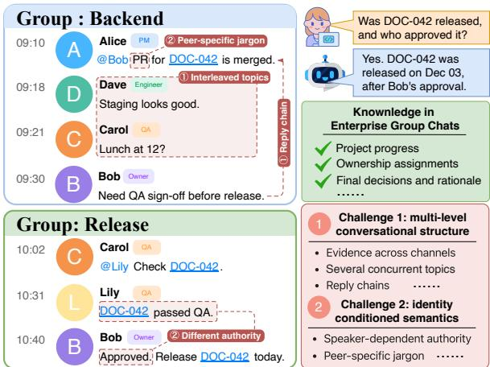
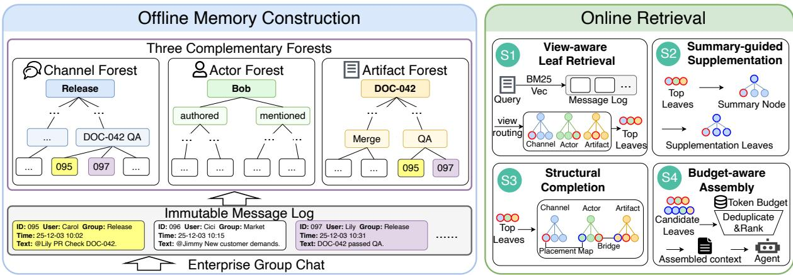
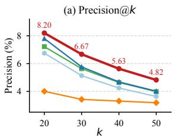
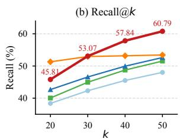

# EGCForest: Structured Agent Memory Organization for Enterprise Group Chats

Lingxi Cui<sup>1,2</sup>, Jinhao Ruan<sup>1,2</sup>, Wenqing Wei<sup>1,2</sup>, Guo Yi<sup>3</sup>, Li Rao<sup>3</sup>, Ke Chen<sup>3</sup>, Lidan Shou<sup>1,2✉</sup>

<sup>1</sup>The State Key Laboratory of Blockchain and Data Security, Zhejiang University

<sup>2</sup>Hangzhou High-Tech Zone (Binjiang) Institute of Blockchain and Data Security

<sup>3</sup>Xiaohongshu

{cuilingxi.cs, capt, chenk, should}@zju.edu.cn {zengzicheng, yutian5, liuxin6}@xiaohongshu.com

## Abstract

Enterprise group chats record project progress, decisions, task ownership, and other organizational information valuable to enterprise agents. Reliable retrieval is challenging because evidence spans interleaved threads, channels, and time, with meaning and authority condi tioned on the speaker. Neither RAG’s independent chunk retrieval nor memory systems summary-based consolidation can reliably recover such distributed evidence. We present EGCForest, a novel multi-view hierarchical memory framework for enterprise group chats. EGCForest organizes an immutable message log into three complementary forests: a Channel forest for temporal workflows, an Actor forest for speaker-conditioned context, and an Artifact forest for deliverable lifecycles. Crossview connections are enabled by a Placement Map and sparse structural bridges. Built on this memory backbone, EGCForest retrieves and assembles evidence by jointly leveraging message-level relevance, hierarchical context from forest summaries, and cross-view links, recovering distributed evidence. Experiments on three enterprise-chat benchmarks show that EGCForest consistently outperforms RAG and memory-system baselines, improving answer accuracy by up to 20.85 points over MemOS while supporting efficient online retrieval. The code is available at https://anonymous. 4open.science/r/EGCForest-MAD12/.

## 1 Introduction

Enterprise group chats have become the default medium for daily collaboration inside modern organizations (Yang et al., 2026). Beyond casual exchanges, they carry a substantial amount of taskrelated knowledge such as project progress, ownership assignments, and design rationales. Recent progress in agent systems has raised the demand for reliable enterprise knowledge sources (Sun et al., 2026), and group-chat logs provide large-scale, fine-grained evidence of organizational activity. Existing research on group chats, in contrast, has largely focused on participating in the conversation (Sapkota et al., 2025), for instance predicting the next speaker, recognizing the addressee, or disentangling interleaved threads, rather than on extracting the organizational knowledge that these conversations contain. Turning raw chat logs into an external memory that an agent can query accurately, with traceable evidence back to the original messages, therefore remains an open problem.

  
Figure 1: Enterprise group chats contain valuable organizational knowledge, but deploying them as reliable agent memory is challenging.

Two properties of enterprise group chats make this task particularly challenging. First, reliable memory for enterprise group chats must preserve their multi-level conversational structure. Messages are temporally ordered, but topics interleave within channels, reply chains mix substantive and tangential exchanges, and decision evidence may span multiple threads, channels, and time periods. As shown in Figure 1, answering an artifactstatus question requires tracing its lifecycle across two channels and four participants. Retrievalaugmented generation (RAG) systems typically treat messages as independent chunks, favoring locally similar matches while missing the full evidence chain (Karpukhin et al., 2020). Memory systems instead compress chats into facts or summaries, obscuring or conflating evidence from distinct threads and decisions (Chhikara et al., 2025).

Second, capturing speaker-conditioned semantics is challenging yet essential in enterprise group chats. Unlike dyadic conversations, single-user agent interactions, or participant-agnostic documents, group-chat participants’ roles, responsibilities, and task relations shape message interpretation. The same claim may carry different authority across speakers (e.g., a project owner versus an intern), while teams may refer to the same artifact differently. RAG systems typically represent messages as plain text and use speaker identity only as a metadata filter, thereby overlooking speakerconditioned meaning and evidential relevance (Maharana et al., 2024). Memory systems often encode identity as a namespace or auxiliary tag, which can similarly conflate claims from participants with different responsibilities (Packer et al., 2023).

We address both challenges with EGCForest, a structured external memory organized as three complementary forests over a shared message log. The Channel forest partitions each group chat into hierarchical temporal intervals, preserving local context and topic evolution. The Actor forest centers each participant, with separate branches for messages authored by that participant and messages that mention them, making identity a firstclass semantic axis rather than a passive metadata field. The Artifact forest organizes messages around deliverables and represents their lifecycle across group chats. These forests are explicitly interconnected. When a message appears in multiple forests, a Placement Map links its view-specific placements to a single immutable log entry, enabling direct cross-view correspondence without content duplication. EGCForest further adds sparse Bridges that connect distinct messages through native reply links and shared salient identifiers. Built on this backbone, a four-stage retrieval pipeline combines view-aware leaf recall, summary-guided supplementation, structural completion, and budget-aware assembly.

Contributions. We make the following contributions: (1) A novel memory framework. We propose EGCForest, a structured memory framework featuring three complementary forests to organize scattered knowledge from enterprise group chats while preserving conversational structure, speaker context, and traceability to original messages. (2) Three-view forest architecture. We construct complementary Channel, Actor, and Artifact forests that capture temporal workflow, speaker-conditioned context, and artifact lifecycles, respectively, with a Placement Map and sparse Bridges enabling efficient cross-view navigation. (3) Structure-aware evidence retrieval. We combine view-aware tree routing and evidence expansion through summaries and cross-view links to recover distributed evidence. (4) Empirical validation. Across three benchmarks, EGCForest delivers consistent improvements over strong RAG and memory-system baselines, outperforming MemOS by up to 20.85 points.

## 2 Preliminaries

## 2.1 Problem Formulation

We consider an enterprise workspace with a set of channels<sup>1</sup> C and a set of users U. A chat history is an ordered, immutable sequence of messages $\mathcal { M } = \{ m _ { 1 } , m _ { 2 } , . . . \}$ , where each message is a tuple $m = ( t _ { m } , u _ { m } , c _ { m } , r _ { m } , x _ { m } )$ with timestamp $t _ { m } ,$ sender $u _ { m } \in \mathcal { U } ,$ channel $c _ { m } \in \mathcal { C } .$ , optional reply target $r _ { m } \in \mathcal { M } \cup \{ \emptyset \}$ , and raw text $x _ { m }$

Our goal is to organize M into a structured external memory K that an agent can query. As memory quality is hard to assess directly, we use question answering as a measurable proxy for it. Concretely, given a natural-language query q posed by an asking user $u _ { q } \in \mathcal { U }$ , the task is to retrieve a compact evidence set $\mathcal { E } _ { q } = \mathcal { R } ( q , u _ { q } ; \mathcal { K } ) \subseteq \mathcal { M }$ via memory K, and feed $\mathcal { E } _ { q }$ together with q to an answer agent to produce an answer a.

## 2.2 Related Work

Agent memory systems maintain persistent memory across sessions with a single user, typically by compressing conversations into facts, summaries, or memory items (Xu et al., 2026; Kang et al., 2025; Latimer et al., 2025). MemGPT (Packer et al., 2023) treats the context window as limited main memory and swaps information with an external store, whereas Mem0 (Chhikara et al., 2025) incrementally adds, merges, or replaces memory entries. Although effective for single-user assistants, these compression-oriented designs can obscure group-chat structure by treating speaker identity as metadata, merging conflicting claims, and limiting access to raw-message evidence.

  
Figure 2: Overview of EGCForest: offline three-view memory construction and online four-stage retrieval.

Retrieval-augmented generation (RAG) typically organizes text corpora as flat text chunks, hierarchical summaries, or graph-structured representations. BM25 (Robertson and Zaragoza, 2009) and dense retrieval (Karpukhin et al., 2020) rank individual chunks by lexical or semantic relevance. Hierarchical methods such as RAP-TOR (Sarthi et al., 2024) recursively cluster and summarize chunks or retrieval across abstraction levels. GraphRAG (Edge et al., 2024), LightRAG (Guo et al., 2025), and HippoRAG (Gutierrez et al., 2024) organize entities and relations for retrieval, with GraphRAG additionally summarizing graph communities. These approaches primarily infer structure from text, whereas group chats expose native structural signals, including reply links, participant roles, and cross-channel membership, that are not fully captured by text alone.

Multi-party conversation understanding spans three directions: inferring participant states (e.g., emotion recognition (Ghosal et al., 2019)), modeling discourse structure (e.g., conversation disentanglement (Kummerfeld et al., 2019)), and summarizing group interactions (e.g., dialogue summarization (Gliwa et al., 2019), decision detection (Addlesee et al., 2023)). Recent work couples group chats with LLM agents for ongoing participation, for example by jointly generating responses and predicting the next speaker (Wang et al., 2025) or orchestrating multi-party tool use (Houde et al., 2025). In contrast, we treat completed group chats as a knowledge source and organize them into structured, evidence-grounded memory for downstream agents.

## 3 Methodology

EGCForest organizes enterprise group chats into three complementary forests over a shared, immutable message log, preserving structural signals lost when chats are compressed into summaries or treated as independent chunks (Figure 2). Offline, it constructs a Channel forest for temporal workflows, an Actorforest for speaker-conditioned context, and an Artifact forest for cross-channel deliverable lifecycles. Online, four stages retrieve message anchors, supplement them through summaries, recover linked evidence, and assemble a token-bounded context for the answer agent.

## 3.1 Structured Memory Construction

## 3.1.1 Three-View Forest Architecture

Immutable Message Log. The three forests share an immutable log of verbatim messages. Each forest leaf references a single log entry rather than copying its content, preserving traceability to the original evidence and avoiding duplication across views. For each message $m ,$ , the log stores its timestamp $t _ { m } ,$ , sender $u _ { m } ,$ channel $c _ { m } ,$ optional reply target $r _ { m }$ , and raw text $x _ { m }$ . We further derive a mention set mentions $( m ) \subseteq \mathcal { U }$ and structured identifiers, such as document codes, from $x _ { m }$ using lightweight regular expressions.

Channel forest. The Channel forest organizes each channel as a temporal hierarchy, making conversational context retrievable at multiple temporal scales. For each channel $c \in { \mathcal { C } } .$ , we construct a balanced k-ary tree $T _ { c }$ whose leaves are references to the immutable log entries of messages in c, ordered chronologically. Every k consecutive leaves or child nodes are recursively grouped into a parent until a single root remains. Each internal node summarizes its contiguous time interval, focusing on participants, workflows, decisions, commitments, blockers, and unresolved issues. Unlike semantic clustering hierarchies, this construction preserves temporal contiguity and event order, supporting retrieval of project progress and decision evolution. The running example summarizes the #backend workflow from merge to release, preserving traceability to message-level evidence, including the QA requirement that governs the transition.

/\* In all running examples, [R] denotes a root node, [N] an   
internal node with an LLM-generated summary, and [L] a leaf   
node that references an immutable log entry. \*/   
[R] #backend [channel]   
+– [N] Dec 1: merge and release gate   
| +– [L] m : @Bob, PR for DOC-042 is merged.   
| +– [L] m<sub>092</sub>: Staging looks good.   
| +– [L] m<sub>093</sub>: Lunch at 12?   
| +– [L] m<sub>094</sub>: Need QA sign-off before release.   
+– [N] Dec 3: release confirmation   
+– [L] m<sub>099</sub>: Released after Bob’s approval.

Actor forest. The Actor forest addresses speakerconditioned semantics by organizing messages around each participant, enabling cross-channel tracing of an employee’s responsibilities, commitments, interactions, and reported context. For each participant $u \in \mathcal { U } ,$ we construct an actor tree $T _ { u }$ whose root separates messages authored by u from messages that explicitly mention u. Within each branch, messages are partitioned by channel, ordered chronologically, and recursively grouped using the same k-ary construction as the Channel forest. Internal-node summaries emphasize the participant’s speech acts, responsibilities, expertise, ownership, and reporting relations. The running example aggregates Bob’s authored and mentioned messages, forming a participant-centered record of his project involvement, responsibilities, and interaction patterns.

```markdown
[R] Bob [actor]
+– [N] authored-by
| +– [N] #backend
| | +– [N] Dec 1: release requirement
| | +– [L] m : Need QA sign-off before release.
| +– [N] #release
| +– [N] Dec 3: release approval
+– [L] m : Approved. Release DOC-042 today.
+– [N] mentioned-in
+– [N] #backend
+– [N] Dec 1–3: merged and released
+– [L] m<sub>091</sub>: @Bob, PR for DOC-042 is merged.
+– [L] m : Released after Bob’s approval.
```

Artifact forest. The Artifact forest organizes messages around enterprise deliverables, enabling cross-channel tracing of an artifact’s lifecycle, status, and ownership. We identify artifacts offline by clustering messages that discuss the same artifact. We extract artifact-like identifiers, such as document codes, from messages using lightweight rules and cluster the associated messages using farthest-first clustering. Candidate clusters with highly similar centroids are merged automatically, while an LLM judge resolves borderline cases. We retain clusters with sufficient lifecycle transitions. For each retained artifact a, we construct a tree $T _ { a }$ whose leaves reference its member messages pooled across channels and ordered chronologically. Messages are recursively grouped using the same k-ary construction as the other forests. Internal-node summaries emphasize lifecycle transitions, responsible participants, and cross-channel status changes. The running example links merge, QA, approval, and release evidence from two channels into a traceable lifecycle for DOC-042.

[R] DOC-042 [artifact]   
+– [N] Dec 1: merged and awaiting QA   
| +– [L] m<sub>091</sub>: @Bob, PR for DOC-042 is merged.   
| +– [L] m<sub>094</sub>: Need QA sign-off before release.   
+– [N] Dec 3: QA passed, approved, released   
+– [L] m<sub>095</sub>: @Lily PR Check DOC-042.   
+– [L] m<sub>097</sub>: DOC-042 passed QA.   
+– [L] m<sub>098</sub>: Approved. Release DOC-042 today.   
+– [L] m<sub>099</sub>: Released after Bob’s approval.

## 3.1.2 Cross-View Connections

To surface cross-view evidence efficiently at query time, we build cross-view connections through a Placement Map and a sparse set of Bridges.

Placement Map. Each forest indexes references to messages in the same immutable message log under a different routing rule. Consequently, a message may have placements in multiple trees across views, providing a direct structural connection between them. To make this link efficiently queryable, we precompute for every message m the placement table Pl(m) = {(view, tree\_id, parent\_id, leaf\_pos)} indexed by msg\_id in a hash map. The Placement Map supports three structural retrieval primitives through direct lookup rather than tree traversal. trees\_of(m) returns the trees containing m. window $( m , T , w )$ returns the w messages adjacent to m in the leaf order of tree T. cotenants(m) returns the sibling leaves that share a parent node with m across its placements. These primitives make cross-view placements and local structural neighborhoods directly addressable, thereby supporting the multiview joins used later in retrieval.

Bridges. Whereas the Placement Map connects multiple placements of the same message, bridges connect distinct messages through strong structural or evidential relations. We construct two bridge types from native reply links and the leaf-level identifiers defined in Section 3.1.1. Reply bridges connect a message m with its explicit reply target $r _ { m }$ when $r _ { m } \neq \emptyset$ . Identifier bridges connect messages sharing a structured identifier, such as a document code or ticket ID. To avoid dense all-pairs connectivity, each message links to at most b sameidentifier messages ranked by temporal proximity. These sparse bridges connect local conversational dependencies and cross-channel artifact evidence, supporting the bridge-hop operator in retrieval.

## 3.2 Forest Retrieval

Given a query $q ,$ retrieval produces a compact evidence set $\mathcal { E } _ { q }$ under a fixed token budget through four stages. $S _ { 1 }$ retrieves primary evidence via view-aware leaf recall, $S _ { 2 }$ supplements it with summary-guided nodes, $S _ { 3 }$ completes the chain through bounded cross-view operations, and $S _ { 4 }$ assembles the final context. Before $S _ { 1 }$ , we parse $q$ into a lightweight query specification using deterministic rules that require no LLM calls. The specification records the asker and mentioned entities, including participants, channels, and artifact identifiers, to guide subsequent view selection. We detail $S _ { 1 }$ through $S _ { 4 }$ below.

## 3.2.1 $S _ { 1 }$ View-aware Leaf Retrieval

$S _ { 1 }$ combines global message seeding with viewaware tree routing. Global retrieval identifies finegrained message-level anchors, while tree routing lifts these anchors to coarser structural contexts that capture broader workflows, participant histories, and artifact lifecycles. The selected trees define the search space for subsequent summary expansion and cross-view completion.

Candidate seeding. Given a query $q ,$ we retrieve messages using BM25 for lexical matching and dense retrieval for semantic matching. We fuse the resulting rankings through reciprocal rank fusion (RRF), which combines ranks rather than raw scores with incompatible scales:

$$
s _ { \mathrm { h y b } } ( m , q ) = \frac { 1 } { \eta + \mathrm { r a n k } _ { \mathrm { b m 2 5 } } ( m ) } + \lambda _ { d } \cdot \frac { 1 } { \eta + \mathrm { r a n k } _ { \mathrm { d e n } } ( m ) } ,\tag{1}
$$

where $\eta$ is a smoothing constant and $\lambda _ { d }$ weights dense retrieval. The top-K messages under $s _ { \mathrm { h y b } } ( m , q )$ form the anchor pool. Rather than being returned directly, these anchors are projected to their forest placements to identify relevant trees and select leaf evidence within each view.

View-aware routing. Using the anchor pool, we score each candidate tree with three complementary signals. Leaf2tree projects each anchor to its host trees through $\mathrm { P l } ( \cdot )$ and aggregates weighted anchor votes. Root matches q against each tree’s root summary. Collapsed captures locally relevant content that may be obscured by a tree’s coarse root summary. It scans internal-node summaries by cosine similarity and assigns each tree the score of its best-matching summary. We rank each signal within each view rather than globally, and fuse the resulting within-view ranks using RRF. We select top-ranked trees for subsequent stages and retain anchor messages as primary leaf evidence under fixed per-view quotas, preventing larger views from crowding out complementary ones.

## 3.2.2 $S _ { 2 }$ Summary-guided Supplementation

$S _ { 2 }$ supplements the message-level evidence returned by $S _ { 1 }$ with summary-level retrieval over the trees selected in $S _ { 1 }$ . A message may weakly match $q$ in isolation even when its surrounding segment is highly relevant. We therefore score internal-node summaries against q, recovering such messages and providing layered context for the answer model. For each internal node n with summary embedding $\mathbf { s } _ { n } .$ , we compute cos $\left( \mathbf { q } , \mathbf { s } _ { n } \right)$ . To avoid overlap, we retain only the highest-scoring node on each rootto-leaf path and expand it into a bounded number of descendant leaves. These leaves are appended with their ancestor summary chain as navigation headers. We place $S _ { 2 }$ leaves after $S _ { 1 }$ messages rather than merging raw scores, as RRF and cosine similarity are not directly comparable.

## 3.2.3 $S _ { 3 }$ Structural Completion

$S _ { 3 }$ recovers cross-view evidence via bounded Placement Map joins and bridge hops.

Placement Map join. To avoid unnecessary expansion, $S _ { 3 }$ invokes a Placement Map join only when the query mentions at least two resolvable entities. It first locates an evidence message $m _ { A }$ for one entity A from $S _ { 1 }$ , then uses $\mathrm { P l } ( m _ { A } )$ to enter a related placement in the selected view. For queries with an explicit temporal cue, candidates are restricted to leaves occurring before or after $m _ { A }$ . Candidates are ranked by similarity to the remaining entity $B$ and $q ,$ and the top candidate is retained only if its score exceeds a threshold.

Bridge hop. $S _ { 3 }$ expands high-confidence leaves from $S _ { 1 }$ and $S _ { 2 }$ through the sparse bridges defined in Section 3.1.2. For each candidate leaf $m .$ , we inspect its incident reply and identifier bridges, and add each reached message $m ^ { \prime }$ to the candidate pool as a bridge anchor. For each m, $S _ { 3 }$ follows at most one bridge into a tree outside the evidence pool, choosing the endpoint most relevant to $q .$ We then inspect a bounded window around the selected endpoint in that tree and adds the most query-relevant neighboring leaf. A small hop budget prevents uncontrolled expansion while recovering reply dependencies and cross-channel artifact evidence.

## 3.2.4 $S _ { 4 }$ Budget-aware Assembly

$S _ { 4 }$ merges and deduplicates candidates from $S _ { 1 }$ $S _ { 2 }$ , and $S _ { 3 }$ . Since scores are not comparable across stages, we preserve within-stage ranks and add candidates in the order $S _ { 1 } , S _ { 2 }$ , and $S _ { 3 }$ . Each stage is subject to a fixed allocation, and selection stops when the token budget is reached. Selected messages are rendered verbatim with lightweight metadata (channel, sender, lifecycle markers). Summary headers from $S _ { 2 }$ are attributed to their originating nodes and capped at a small fraction of the budget, allowing the answer model to distinguish raw evidence from generated navigation. This design preserves traceability to the original chat log.

## 4 Experiments

We evaluate EGCForest through four key questions: Q1 (Section 4.2): Does EGCForest outperform RAG and memory-system baselines? Q2 (Section 4.3): Do the Channel, Actor, and Artifact views provide complementary benefits? Q3 (Section 4.4): Does EGCForest retrieve more relevant evidence than RAG baselines, and how does each retrieval stage $( S _ { 1 } – S _ { 4 } )$ contribute? Q4 (Section 4.5): How efficient is EGCForest in terms of offline construction cost, storage footprint, and online retrieval latency?

## 4.1 Experimental Setup

Datasets. We employ EverMemBench (Hu et al., 2026), GroupMemBench (Yang et al., 2026), and a real-world internal enterprise benchmark Company. Details are in Appendix A.2.

Baselines. RAG baselines include BM25 (Robertson and Zaragoza, 2009), Dense (Karpukhin et al., 2020), their reciprocal-rank-fusion variant BM25+Dense (Cormack et al., 2009), and GraphRAG (Edge et al., 2024). Agent memorysystem baselines include MemoBase (Team, 2025), Mem0 (Chhikara et al., 2025), A-Mem (Xu et al., 2026), and MemOS (Li et al., 2025).

Metrics. We report Answer Accuracy, measured against gold answers LLMs. For Company, we additionally report Precision@k and Recall@k against gold evidence messages.

Implementation. Following the official protocol, we use GPT-5 as the answer model on GroupMem-Bench and GPT-4.1-mini on EverMemBench. We also use GPT-4.1-mini on Company. We use the frozen Qwen3-Embedding-0.6B encoder, set the branching factor to $k = 1 6 ,$ , and retrieve under a 3,000-token budget. Details are in Appendix A.3.

## 4.2 Q1: Main Results

Overall. Table 1 shows that EGCForest achieves the highest average accuracy on all three benchmarks, exceeding the strongest baseline by 4.77, 8.59, and 12.61 percentage points, respectively. These consistent gains demonstrate its robustness across diverse dialogue settings and question types.

Dataset and category analysis. EGCForest ranks first or second on most subcategories. On EverMemBench, which contains long-horizon, multi-channel project discussions, EGCForest performs especially well on Fine-grained Recall and Memory Awareness, which require linking evidence across channels and time. Profile Understanding remains difficult because Style, Skill, and Role must be inferred from diffuse behavioral patterns rather than explicit event-level evidence. On GroupMemBench, which emphasizes threaded conversations and asker-conditioned queries, EGCForest achieves 55.10 on Implicit and 40.57 on Ambiguity. Implicit questions require tracing first-person references through the asker’s history, whereas Ambiguity questions require resolving terminology across speakers. These results are consistent with the benefit of the Actor forest for retrieving asker-conditioned context. EGCForest is less dominant on Abstention (81.29), where recall-oriented retrieval may surface plausible but non-supporting messages. On Company, EGCForest reaches 61.90 on Temporal and 64.06 on Update, where the Channel forest preserves workflow chronology and the Artifact forest links lifecycle evidence across channels.

EverMemBench
<table><tr><td rowspan="2">Method</td><td colspan="3">Fine-grained Recall</td><td colspan="3">Memory Awareness</td><td colspan="3">Profile Understanding</td><td rowspan="2">Avg.</td></tr><tr><td>Single</td><td>Multi</td><td>Temp.</td><td>Const.</td><td>Proact.</td><td>Update</td><td>Style</td><td>Skill</td><td>Role</td></tr><tr><td>BM25 Dense BM25+Dense GraphRAG</td><td>87.45 86.23 81.38 69.64</td><td>5.62 6.83 4.42 5.22</td><td>11.33 14.33 14.00 14.33</td><td>70.60 79.60 75.20 79.00</td><td>62.20 70.20 68.40 49.00</td><td>37.28 59.93 49.48 52.96</td><td>30.94 31.49 32.60 38.12</td><td>43.44 45.70 46.61 45.70</td><td>53.63 55.24 57.26 50.00</td><td>44.72 49.95 47.70 44.89</td></tr><tr><td>MemoBase Mem0 A-Mem MemOS</td><td>60.09 55.40 88.26 71.36</td><td>12.85 11.24 6.83 18.88</td><td>18.00 6.33 11.67 15.67</td><td>64.68 66.17 77.20 69.90</td><td>36.77 52.46 62.20 51.99</td><td>30.60 51.87 48.78 45.15</td><td>17.05 22.73 34.81 28.98</td><td>29.59 31.36 46.61 32.54</td><td>38.78 36.22 50.00 48.47</td><td>34.27 37.09 47.37 42.55</td></tr><tr><td>OURS</td><td>89.88</td><td>17.27</td><td>33.33</td><td>81.00</td><td>70.20</td><td>61.32</td><td>38.12</td><td>45.70</td><td>55.65</td><td>54.72</td></tr><tr><td colspan="9">GroupMemBench</td><td></td><td></td></tr><tr><td>Method BM25</td><td>Multi-Hop 40.66</td><td></td><td>Update 28.04</td><td>Ambiguity 16.04</td><td>Implicit</td><td>46.94</td><td>Temporal</td><td>Abstention</td><td></td><td>Avg. 47.11</td></tr><tr><td>Dense BM25+Dense GraphRAG</td><td colspan="9">35.16 32.42 17.03</td><td>84.17 41.74</td></tr><tr><td>MemoBase Mem0 A-Mem MemOS</td><td colspan="2">15.93 23.63 31.87</td><td colspan="2">3.74 14.02 27.10</td><td colspan="2">20.41 24.49 36.73</td><td colspan="4">20.99 7.41 21.60</td></tr><tr><td>OURS</td><td colspan="2">28.57 47.25</td><td colspan="2">21.50 32.71</td><td colspan="2">18.37 55.10</td><td colspan="4">25.93 68.52</td></tr><tr><td colspan="10"></td></tr><tr><td rowspan="2">Method</td><td colspan="2">Fine-grained Recall</td><td colspan="4">Memory Awareness Update</td><td colspan="4">Profile Understanding</td></tr><tr><td colspan="2">Single Multi-hop 58.82 44.87</td><td colspan="4">Temp. Const. 41.27 75.00 47.62</td><td colspan="4">Style Skill Role Ambiguity 2.13 8.33 5.00 75.00</td></tr><tr><td>Dense BM25+Dense GraphRAG</td><td>57.98 62.18 56.30</td><td>48.72 53.85 55.13</td><td>66.25 44.44 72.50 33.33 57.50</td><td>42.19 35.94 48.44 34.38</td><td>45.05 45.05 55.86 48.65</td><td>50.00 62.50 37.50 37.50</td><td>1.06 4.26 4.26</td><td>7.14 5.95 5.95</td><td>2.50 2.50 7.50</td><td>37.45 80.00 36.58 85.00 40.70 75.00 35.71</td></tr><tr><td>MemoBase Mem0 A-Mem</td><td>36.97 52.94 59.66</td><td>34.62 23.81 39.74 33.33 52.56 47.62</td><td>37.50 63.75 67.50</td><td>29.69 34.38 39.06</td><td>34.23 42.34 48.65</td><td>12.50 37.50 62.50</td><td>0.00 2.13 3.19</td><td>5.95 10.71 7.14 5.95</td><td>3.75 5.00 6.25 2.50</td><td>60.00 24.22 70.00 33.33 75.00 38.58</td></tr><tr><td>MemOS OURS</td><td>56.30 33.33 78.15 65.38</td><td>36.51 61.90</td><td>70.00 86.25</td><td>29.69 64.06</td><td>42.34 73.87</td><td>12.50 75.00</td><td>1.06 7.45</td><td>14.29</td><td>65.00 12.50 85.00</td><td>32.46 53.31</td></tr></table>

Table 1: Main results on three enterprise group benchmarks. We use the official taxonomies for EverMemBench and GroupMemBench, and a unified group\_chat taxonomy for Company. Bold: best; underlined: second-best.

Understanding the baseline gap. Memory systems may merge claims across speakers or threads when consolidating messages into facts, profiles, or summaries, obscuring attribution, updates, and verbatim evidence. On Company, MemOS obtains only 33.33/36.51 on Multi-hop/Temporal, versus 65.38/61.90 for EGCForest. Raw-message RAG preserves message details but ranks messages independently. On Company, BM25+Dense obtains 53.85/44.44 on Multi-hop/ Temporal questions requiring evidence across channels and time. GraphRAG further abstracts messages into entityrelation graphs and community summaries, diluting reply, attribution, and workflow signals.

## 4.3 Q2: Component Study for EGCForest

Figure 3 evaluates the contribution of the three views<sup>2</sup>. The full model (V4) achieves the best weighted average on both datasets. Compared with V1, V2 improves Fine-grained Recall and Memory Awareness on the Company dataset by 8.08 and 5.32 points, respectively, showing the benefit of speaker-centered context. Compared with V1, V3 improves Fine-grained Recall by 0.87/2.31 points and Profile Understanding by 6.61/2.88 points on GroupMemBench/Company, respectively. By grouping messages about the same deliverable, the Artifact view exposes cross-channel lifecycle and ownership evidence useful for evidence recall and profile inference. Finally, V4 outperforms V2 by 0.93 points on GroupMemBench and 3.37 points on the Company dataset, confirming that Artifact evidence complements the Channel and Actor views.

(a) GroupMemBench
<table><tr><td rowspan=1 colspan=1>V1</td><td rowspan=1 colspan=1>53.20</td><td rowspan=1 colspan=1>57.97</td><td rowspan=1 colspan=1>33.96</td><td rowspan=1 colspan=1>52.35</td></tr><tr><td rowspan=1 colspan=1>V2</td><td rowspan=1 colspan=1>56.97</td><td rowspan=1 colspan=1>57.97</td><td rowspan=1 colspan=1>38.68</td><td rowspan=1 colspan=1>54.77</td></tr><tr><td rowspan=1 colspan=1>V3</td><td rowspan=1 colspan=1>54.07</td><td rowspan=1 colspan=1>55.93</td><td rowspan=1 colspan=1>40.57</td><td rowspan=1 colspan=1>52.89</td></tr><tr><td rowspan=1 colspan=1>V4</td><td rowspan=1 colspan=1>57.27</td><td rowspan=1 colspan=1>59.32</td><td rowspan=1 colspan=1>40.57</td><td rowspan=1 colspan=1>55.70</td></tr><tr><td rowspan=1 colspan=1></td><td rowspan=1 colspan=3>Fine-Memory Profilegrained</td><td rowspan=1 colspan=1>Avg.</td></tr></table>

Figure 3: Performance of different view combinations on GroupMemBench and Company. V1: Channel; V2: Channel+Actor; V3: Channel+Artifact; V4: Full.

(b) Company Dataset
<table><tr><td rowspan=1 colspan=1>57.69</td><td rowspan=1 colspan=1>65.40</td><td rowspan=1 colspan=1>13.67</td><td rowspan=1 colspan=1>44.94</td></tr><tr><td rowspan=1 colspan=1>65.77</td><td rowspan=1 colspan=1>70.72</td><td rowspan=1 colspan=1>15.47</td><td rowspan=1 colspan=1>49.94</td></tr><tr><td rowspan=1 colspan=1>60.00</td><td rowspan=1 colspan=1>63.88</td><td rowspan=1 colspan=1>16.55</td><td rowspan=1 colspan=1>46.19</td></tr><tr><td rowspan=1 colspan=1>70.38</td><td rowspan=1 colspan=1>75.28</td><td rowspan=1 colspan=1>16.55</td><td rowspan=1 colspan=1>53.31</td></tr></table>

## 4.4 Q3: Retrieval Performance

## 4.4.1 Comparison with Standard Retrieval

EGCForest achieves the strongest overall retrieval performance, attaining the highest Precision@k at every budget while maintaining competitive Recall@k<sup>3</sup>. This result is consistent with its multiview organization and structural retrieval pipeline, which consider temporal, participant, and artifact context in addition to message-level relevance. GraphRAG obtains the highest Recall@20 but at substantially lower precision, suggesting noisier expansion. Lexical and dense baselines improve more slowly as the retrieval budget increases, likely because they rank messages independently and cannot exploit multi-view structural relations.



BM25 Vec BM25+Vec GraphRAG Ours  
  
Figure 4: Retrieval Performance on Company.

## 4.4.2 Stage-wise Contribution

Table 2 shows the cumulative contribution of each retrieval stage under the same context budget. S1 reaches 40.3 R@20, suggesting that hybrid message anchors and routing through complementary Channel, Actor, and Artifact views recover much of the directly relevant evidence. S2 adds summaryguided supplementation and yields modest gains in R@20 and accuracy (40.3 → 40.8 and 45.4 → 45.8), indicating that S1 covers much of the directly relevant evidence. S3 improves P@20 from 7.1 to 8.0 and R@20 from 40.8 to 44.5 through Placement Map joins and bridge hops to recover evidence distributed across views. S4 yields small retrieval gains but improves accuracy from 47.9 to 53.3, showing that effective evidence selection and organization are crucial for downstream answering.

<table><tr><td>Variant</td><td>P@20</td><td>R@20</td><td>Acc.</td></tr><tr><td>S1: View-aware Leaf Retrieval</td><td>7.0</td><td>40.3</td><td>45.4</td></tr><tr><td>+ S2: Summary-guided Supplementation</td><td>7.1</td><td>40.8</td><td>45.8</td></tr><tr><td>+ S3: Structural Completion</td><td>8.0</td><td>44.5</td><td>47.9</td></tr><tr><td>Full (+ S4: Budget-aware Assembly)</td><td>8.2</td><td>45.8</td><td>53.3</td></tr></table>

Table 2: Stage-wise retrieval ablation of EGCForest.

## 4.5 Q4: Efficiency

EGCForest incurs moderate offline cost. Its threeforest construction is slower than lexical and dense indexing but faster than GraphRAG, MemoBase, and Mem0, with a 206 MB storage footprint. At query time, EGCForest achieves the fastest retrieval latency at 65 ms per query, enabled by cached node summaries and constant-time Placement Map lookups. Its answer-token usage is comparable to other memory systems, averaging 2,365 input and 1,300 output tokens per query.

<table><tr><td rowspan="2">Method</td><td colspan="2">Offline Construction</td><td>Online Retrieval</td><td>Online Answer</td></tr><tr><td>Build Time</td><td>Storage</td><td>Ret. Time / Q</td><td>Answer Tok. / Q</td></tr><tr><td>BM25</td><td>0.6 s</td><td></td><td>253 ms</td><td>1454/103</td></tr><tr><td>Vec</td><td>3.4 s</td><td>83 MB</td><td>72 ms</td><td>1462/112</td></tr><tr><td>BM25 + Vec</td><td>8.9 s</td><td>83 MB</td><td>710 ms</td><td>1452/106</td></tr><tr><td>GraphRAG</td><td>38200 s</td><td>641 MB</td><td>2107 ms</td><td>3936/1283</td></tr><tr><td>MemoBase</td><td>7994 s</td><td></td><td>1634 ms</td><td>3153 /1422</td></tr><tr><td>Mem0</td><td>7706 s</td><td>1.4 GB</td><td>15339 ms</td><td>492 /1249</td></tr><tr><td>A-Mem</td><td>434 s</td><td>24MB</td><td>97 ms</td><td>2305 /1311</td></tr><tr><td>MemOS</td><td>1401 s</td><td></td><td>573 ms</td><td>632/1207</td></tr><tr><td>Ours</td><td>1842 s</td><td>206 MB</td><td>65 ms</td><td>2365/1300</td></tr></table>

Table 3: Efficiency comparison on GroupMemBench.

## 5 Conclusion

As an initial exploration of agent memory for enterprise group chats, EGCForest organizes immutable message evidence through complementary Channel, Actor, and Artifact forests. This structuredmemory paradigm enables agents to navigate traceable organizational evidence across time, participants, and artifacts. Experiments on three benchmarks demonstrate consistent improvements across diverse question categories.

## Limitations

EGCForest is evaluated through question answering on three enterprise-chat benchmarks. This setting enables controlled comparison of memory quality, while leaving its benefits for broader agent workflows, such as task coordination and long-term planning, to be explored. Moreover, EGCForest’s offline construction time remains manageable at the evaluated scale, making periodic memory updates through full reconstruction feasible. For larger or more frequently updated workspaces, incremental forest construction and selective updates to summaries and cross-view connections are promising directions for balancing memory freshness with maintenance cost. Finally, our current formulation focuses on text messages and their associated metadata. Images, document attachments, and voice messages can contain relevant organizational knowledge beyond the message text. Future work could extend EGCForest to integrate these sources into a unified multimodal memory while preserving traceability to the original evidence.

## References

Angus Addlesee, Weronika Sieinska, Nancie Gunson,´ Daniel Hernandez Garcia, Christian Dondrup, and Oliver Lemon. 2023. Multi-party goal tracking with LLMs: Comparing pre-training, fine-tuning, and prompt engineering. In Proceedings ofthe 24th Annual Meeting of the Special Interest Group on Discourse and Dialogue, pages 229–241.

Prateek Chhikara, Dev Khant, Saket Aryan, Taranjeet Singh, and Deshraj Yadav. 2025. Mem0: Building production-ready ai agents with scalable long-term memory. arXiv preprint arXiv:2504.19413.

Gordon V Cormack, Charles LA Clarke, and Stefan Buettcher. 2009. Reciprocal rank fusion outperforms condorcet and individual rank learning methods. In Proceedings of the 32nd international ACM SIGIR conference on Research and development in information retrieval, pages 758–759.

Darren Edge, Ha Trinh, Newman Cheng, Joshua Bradley, Alex Chao, Apurva Mody, Steven Truitt, Dasha Metropolitansky, Robert Osazuwa Ness, and Jonathan Larson. 2024. From local to global: A graph rag approach to query-focused summarization. arXiv preprint arXiv:2404.16130.

Deepanway Ghosal, Navonil Majumder, Soujanya Poria, Niyati Chhaya, and Alexander Gelbukh. 2019. DialogueGCN: A graph convolutional neural network for emotion recognition in conversation. In Proceedings ofthe 2019 Conference on Empirical Methods in Natural Language Processing and the 9th International

Joint Conference on Natural Language Processing (EMNLP-IJCNLP), pages 154–164.

Bogdan Gliwa, Iwona Mochol, Maciej Biesek, and Aleksander Wawer. 2019. SAMSum corpus: A humanannotated dialogue dataset for abstractive summarization. In Proceedings of the 2nd Workshop on New Frontiers in Summarization, pages 70–79. Association for Computational Linguistics.

Zirui Guo, Lianghao Xia, Yanhua Yu, Tu Ao, and Chao Huang. 2025. LightRAG: Simple and fast retrievalaugmented generation. In Findings of the Association for Computational Linguistics: EMNLP 2025, pages 10746–10761.

Bernal Jimenez Gutierrez, Yiheng Shu, Yu Gu, Michihiro Yasunaga, and Yu Su. 2024. HippoRAG: Neurobiologically inspired long-term memory for large language models.

Stephanie Houde, Kristina Brimijoin, Michael Muller, Steven I Ross, Dario Andres Silva Moran, Gabriel Enrique Gonzalez, Siya Kunde, Morgan A Foreman, and Justin D Weisz. 2025. Controlling ai agent participation in group conversations: A human-centered approach. In Proceedings of the 30th International Conference on Intelligent User Interfaces, pages 390– 408.

Chuanrui Hu, Tong Li, Xingze Gao, Hongda Chen, Yi Bai, Dannong Xu, Tianwei Lin, Xiaohong Li, Yunyun Han, Jian Pei, and Yafeng Deng. 2026. Evaluating long-horizon memory for multi-party collaborative dialogues. In Proceedings of the 32nd ACM SIGKDD Conference on Knowledge Discovery and Data Mining V.2, page 9082–9090.

Jiazheng Kang, Mingming Ji, Zhe Zhao, and Ting Bai. 2025. Memory OS of AI agent. In Proceedings ofthe 2025 Conference on Empirical Methods in Natural Language Processing, pages 25961–25970, Suzhou, China. Association for Computational Linguistics.

Vladimir Karpukhin, Barlas Oguz, Sewon Min, Patrick Lewis, Ledell Wu, Sergey Edunov, Danqi Chen, and Wen-tau Yih. 2020. Dense passage retrieval for opendomain question answering. In Proceedings of the 2020 conference on empirical methods in natural language processing (EMNLP), pages 6769–6781.

Jonathan K. Kummerfeld, Sai R. Gouravajhala, Joseph J. Peper, Vignesh Athreya, Chulaka Gunasekara, Jatin Ganhotra, Siva Sankalp Patel, Lazaros C Polymenakos, and Walter Lasecki. 2019. A large-scale corpus for conversation disentanglement. In Proceedings of the 57th Annual Meeting of the Association for Computational Linguistics, pages 3846–3856. Association for Computational Linguistics.

Chris Latimer, Nicoló Boschi, Andrew Neeser, Chris Bartholomew, Gaurav Srivastava, Xuan Wang, and Naren Ramakrishnan. 2025. Hindsight is 20/20: Building agent memory that retains, recalls, and reflects. arXiv preprint arXiv:2512.12818.

Zhiyu Li, Shichao Song, Hanyu Wang, Simin Niu, Ding Chen, Jiawei Yang, Chenyang Xi, Huayi Lai, Jihao Zhao, Yezhaohui Wang, Junpeng Ren, Zehao Lin, Jiahao Huo, Tianyi Chen, Kai Chen, Kehang Li, Zhiqiang Yin, Qingchen Yu, Bo Tang, and 3 others. 2025. Memos: An operating system for memoryaugmented generation (mag) in large language models. Preprint, arXiv:2505.22101.

Adyasha Maharana, Dong-Ho Lee, Sergey Tulyakov, Mohit Bansal, Francesco Barbieri, and Yuwei Fang. 2024. Evaluating very long-term conversational memory of llm agents. In Proceedings ofthe 62nd Annual Meeting of the Association for Computational Linguistics (Volume 1: Long Papers), pages 13851– 13870.

Charles Packer, Sarah Wooders, Kevin Lin, Vivian Fang, Shishir G Patil, Ion Stoica, and Joseph E Gonzalez. 2023. Memgpt: Towards llms as operating systems. arXiv preprint arXiv:2310.08560.

Stephen Robertson and Hugo Zaragoza. 2009. The probabilistic relevance framework: Bm25 and beyond. Foundations and trends® in information retrieval, 4(1-2):1–174.

Sagar Sapkota, Mohammad Saqib Hasan, Mubarak Shah, and Santu Karmaker. 2025. Multi-party conversational agents: A survey. arXiv preprint arXiv:2505.18845.

Parth Sarthi, Salman Abdullah, Aditi Tuli, Shubh Khanna, Anna Goldie, and Christopher Manning. 2024. Raptor: Recursive abstractive processing for tree-organized retrieval. In International Conference on Learning Representations, volume 2024, pages 32628–32649.

Yiqun Sun, Pengfei Wei, and Lawrence B. Hsieh. 2026. Don’t retrieve, navigate: Distilling enterprise knowledge into navigable agent skills for QA and RAG. In First Workshop on Agent Skills.

Memodb Team. 2025. Memobase: User profile-based long-term memory for ai chatbot applications.

Xiaoyu Wang, Ningyuan Xi, Qingqing Gu, and Luo Ji. 2025. Multi-party supervised fine-tuning of language models for multi-party dialogue generation. In 2025 International Joint Conference on Neural Networks (IJCNN), pages 1–9. IEEE.

Wujiang Xu, Zujie Liang, Kai Mei, Hang Gao, Juntao Tan, and Yongfeng Zhang. 2026. A-mem: Agentic memory for llm agents. Advances in Neural Information Processing Systems, 38:17577–17604.

Jingbo Yang, Kwei-Herng Lai, Xiaowen Wang, Shiyu Chang, Yaar Harari, and Evgeniy Gabrilovich. 2026. Groupmembench: Benchmarking llm agent memory in multi-party conversations. arXiv preprint arXiv:2605.14498.

## A Appendix

## A.1 Additional Experiments

## A.1.1 Answer-Model Robustness

EGCForest consistently outperforms memorysystem baselines across all answer-model backbones, with gains of 13.83–18.52 points over the strongest baseline. While baseline rankings vary across backbones, EGCForest remains the topperforming method. It achieves 57.18% with GLM-5.3 and 55.70% with GPT-5, showing that its structured evidence remains effective across answer models.

<table><tr><td>Backbone</td><td>MemoBase Mem0 MemOS A-Mem</td><td></td><td></td><td></td><td>Ours</td></tr><tr><td>Qwen3.5-35B-A3B</td><td>25.23</td><td>24.7</td><td>32.08</td><td>33.69</td><td>47.52</td></tr><tr><td>DeepSeek-V4-Flash</td><td>28.46</td><td>26.44</td><td>32.75</td><td>37.99</td><td>52.35</td></tr><tr><td>GLM-5.3</td><td>31.01</td><td>29.66</td><td>35.44</td><td>40.54</td><td>57.18</td></tr><tr><td>GPT-5 (default)</td><td>27.92</td><td>28.19</td><td>35.70</td><td>37.18</td><td>55.7</td></tr></table>

Table 4: Agent backbone ablation on GroupMemBench.

## A.2 Dataset Details

We evaluate EGCForest on two public enterprise group-chat memory benchmarks and an internal enterprise-chat benchmark. Table 5, Table 6, and Table 7 summarize their scales and evaluation distributions.

## A.2.1 EverMemBench

EVERMEMBENCH (Hu et al., 2026) evaluates longhorizon collaborative memory over nterprise group chats spanning multiple channels. We use its official evaluation protocol and all released questionanswer pairs.

<table><tr><td>Category</td><td>Statistic</td><td>Value</td></tr><tr><td rowspan="6">Corpus</td><td>Projects</td><td>5</td></tr><tr><td>Channels per project</td><td>3</td></tr><tr><td>Participants</td><td>170</td></tr><tr><td>Time span</td><td>365 days</td></tr><tr><td>Messages</td><td>51,023</td></tr><tr><td>Dialogue tokens</td><td>4.23M</td></tr><tr><td>Fine-grained Recall</td><td>Single-hop / Multi-hop / Temporal</td><td>213 / 249 / 300</td></tr><tr><td>Memory Awareness</td><td>Constraint / Proactivity / Update</td><td>402 / 427 / 268</td></tr><tr><td>Profile Understanding</td><td>Style / Skill / Role</td><td>176 / 169 / 196</td></tr><tr><td>Evaluation</td><td>Total QA pairs</td><td>2,400</td></tr></table>

Table 5: Statistics and question distribution of EVER-MEMBENCH.

## A.2.2 GroupMemBench

GROUPMEMBENCH (Yang et al., 2026) evaluates memory over threaded enterprise group chats with user-conditioned queries. We use the official corpus and evaluation protocol.

<table><tr><td>Category</td><td>Statistic</td><td>Value</td></tr><tr><td rowspan="5">Corpus</td><td>Domains</td><td>4</td></tr><tr><td>Projects</td><td>33 125</td></tr><tr><td>Topics</td><td></td></tr><tr><td>Phases</td><td>295</td></tr><tr><td>Participants Messages</td><td>45 120,000</td></tr><tr><td rowspan="2">Message Type</td><td>Posts Threaded replies Cross-project replies</td><td>27,222 79,766</td></tr><tr><td>Decision changes Multi-Hop Update</td><td>13,012 352 182</td></tr></table>

Table 6: Statistics and evaluation-question distribution of GroupMemBench.

## A.2.3 Internal Enterprise-Chat Benchmark

Our internal benchmark is constructed from anonymized enterprise group-chat logs. It evaluates channel workflow, actor responsibility, artifact lifecycle, cross-channel tracking, and multi-hop evidence retrieval. Each question is annotated with an answer and supporting message evidence.

<table><tr><td>Category</td><td>Statistic</td><td>Value</td></tr><tr><td rowspan="4">Corpus</td><td>Persistent channels</td><td>3</td></tr><tr><td>Participants Messages</td><td>39 10,222</td></tr><tr><td>Tracked artifact clusters</td><td>22</td></tr><tr><td>Artifact-bearing messages</td><td>1,158</td></tr><tr><td rowspan="4">Evaluation</td><td>Fine-grained Recall</td><td>260</td></tr><tr><td>Memory Awareness</td><td>263</td></tr><tr><td>Profile Understanding</td><td>278</td></tr><tr><td>Total QA pairs</td><td>801</td></tr></table>

Table 7: Statistics and question distribution of the internal enterprise-chat benchmark.

## A.3 Implementation Details

This section details the implementation choices used for forest construction, retrieval, and answer generation. Unless otherwise specified, we use Qwen3-Embedding-0.6B as the frozen encoder for both message and node-summary embeddings. Table 8 summarizes the main hyperparameters and dataset-specific answer-model settings.

Baseline Evaluation. We use Qwen3- Embedding-0.6B for EGCForest and for all reproduced baselines that require embeddings. On EverMemBench, we rerun BM25, Dense, BM25+Dense, GraphRAG, and A-Mem; results for MemoBase, Mem0, and MemOS are reported from the original benchmark paper. On Group-MemBench, we rerun all methods. All baselines on Company are evaluated by us. Because the filtered evaluation subsets used in prior studies were unavailable in the public releases we accessed, our reproduced runs use the full publicly available data for the corresponding task categories.

Forest Construction. All three forests use a common branching factor of k = 16. Messages within each tree are ordered chronologically and recursively grouped into k-way internal nodes. This produces shallow trees while keeping the input to each node-summary generation step manageable. For example, a tree with approximately $1 0 ^ { 4 }$ leaves has height four. The artifact construction script has a default centroid-merge threshold of $\theta _ { \mathrm { m e r g e } } = 0 . 8 8$

The following example shows an immutable log entry and its derived fields.

msg\_id m<sub>091</sub>   
timestamp 2025-12-01 09:10   
sender alice   
channel #backend   
reply\_to m<sub>090</sub>   
text “@Bob, PR for DOC-042   
is merged.”   
mentions {bob} (derived)   
identifiers {DOC-042} (derived)   
placements channel:#backend   
actor:alice(auth)   
actor:bob(ment)   
artifact:DOC-042

Retrieval and Assembly. Table 8 reports the default settings for question answering, including a final context cap of 20 messages. For the retrieval-budget sweep in Figure 4, we adjust the final message cap to each evaluated cutoff $k \in \{ 2 0 , 3 0 , 4 0 , 5 0 \}$ . The tree-level RRF constant η<sub>tree</sub> = 0 gives reciprocal-rank weights of 1/rank. The path and leaf limits in $S _ { 2 }$ apply to candidate generation before final selection.

The expansion quota is shared by $S _ { 2 }$ and $S _ { 3 } ,$ including bridge messages. Verbatim messages are included first; summary headers use the remaining space, capped at 35% of the total token budget (1,050 tokens). This is an upper bound, not a reserved allocation. Node summaries are precomputed and cached during construction, and online LLM guidance is disabled; retrieval requires no LLM calls for query guidance, memory traversal, or summarization.

<table><tr><td>Parameter</td><td>Value</td></tr><tr><td>Encoder Branching factor k</td><td>Qwen3-Embedding-0.6B 16</td></tr><tr><td>RRF constants (message / tree) Tree weights (Root / Leaf2tree</td><td>60 / 0 0.8 / 2.0 / 0.8</td></tr><tr><td>/ Collapsed)  $S _ { 2 }$  paths / leaf cap per path Bridge fanout / depth Bridge messages/query (max.)</td><td>8/4 2 / 1 hop 2</td></tr><tr><td> $S _ { 1 }$  / expansion quotas Final messages (default max.) Context budget Header budget (max.)</td><td>14/6 20 3,000 tokens</td></tr><tr><td>Answer (GroupMemBench) Answer (EverMemBench, Company)</td><td>35% GPT-5 GPT-4.1-mini</td></tr><tr><td>Judge (GroupMemBench) Judge (EverMemBench, Company)</td><td>GPT-5 Gemini-3-Flash-Preview</td></tr></table>

Table 8: Main implementation settings for EGCForest.

## A.4 LLM Prompt Templates

We present condensed prompt templates. The answer-generation and grading templates are condensed from the official EverMemBench prompts (Hu et al., 2026). Multiple-choice questions require a single uppercase option letter and are scored by direct matching; open-ended answers use an LLM judge. Summaries are generated offline, and online retrieval uses no LLM calls.

Node summaries. Inputs specify the view, tree label, interval, level, and ordered source text: original messages at $L _ { 1 }$ , and consecutive child summaries above it.

Write a compact index entry for routing to original evidence. Preserve names, speaker attribution, dates, quantities, versions, statuses, decisions, commitments, blockers, and unresolved questions. Keep events chronological and express state changes as $\mathrm { \ddot { x }  Y ^ { \prime } }$ . Omit unsupported causes, outcomes, judgments, and advice; retain specific names rather than replacing them with vague categories.

Channel: identify participants and their contributions; keep parallel workstreams distinct. For reply-thread inputs, preserve the opening issue, reply context, and stated resolution. Actor: distinguish the person’s own speech acts from others’ claims about them; preserve channel attribution and available evidence IDs. Artifact: track lifecycle transitions, responsible speakers, versions, statuses, decisions, blockers, and channel provenance.

Non-root summaries use one paragraph, capped at 200/220/180 words for Channel/Actor/Artifact;

Actor summaries use 2–4 compact sentences. Root cards use labelled prose: Channel records span, participants, workstreams, decisions, and open threads; Actor records supported roles, channels, responsibilities, explicit decision authority, observed phrasing, others’ attributed descriptions, and at most three evidence IDs; Artifact records aliases, owners, channels, current status, lifecycle, and key decisions. Unsupported fields are omitted. Actor root cards are capped at 160 words.

## Open-ended answer generation. Input: retrieved memories and the question.

Answer using only the supplied memories. Track who said what and when; use direct evidence and prioritize the latest memory when accounts conflict. Convert relative time expressions to specific dates using message timestamps. Output only a concise answer, preferably under 5–6 words, without reasoning or extra explanation.

Open-ended answer grading. Input: the question, gold answer, and generated answer.

Judge whether the generated answer contains the gold answer’s key information. Accept equivalent wording and date formats; allow a ±1-day date difference for timezone variation. Return a JSON label of CORRECT or WRONG.

## A.5 Ethics Statement

We hereby confirm that the entire work presented in this paper, including all content, analysis, and conclusions, is the original work of the human authors. While the core research, analysis, and conclusions are entirely the work of the human authors, generative AI was consulted for the limited purpose of improving the grammar and readability of the text.