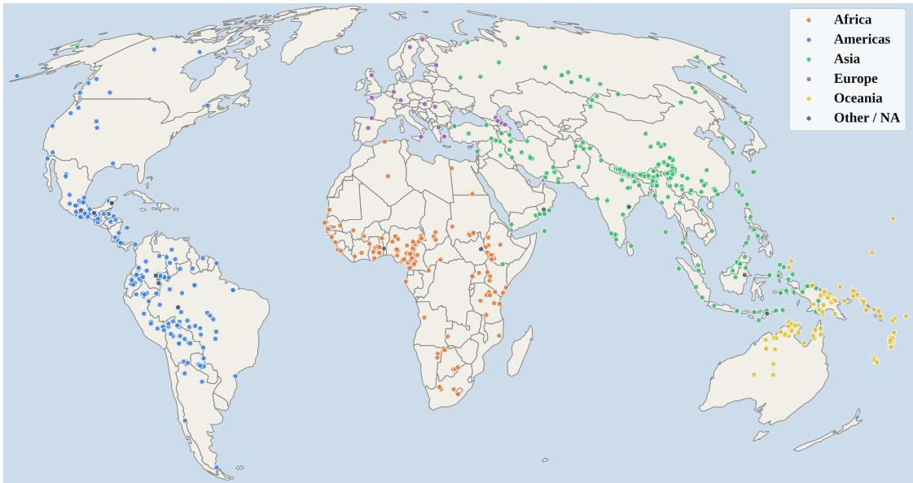
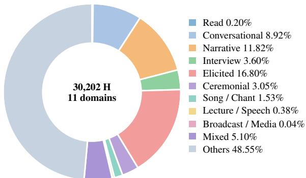
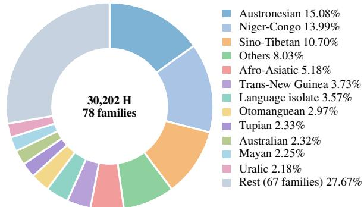
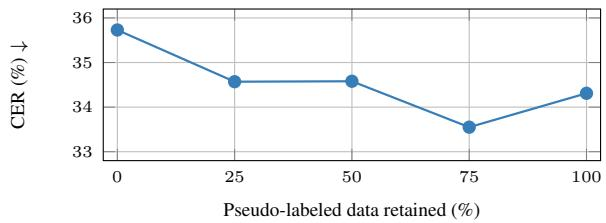
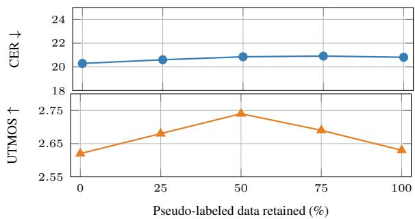
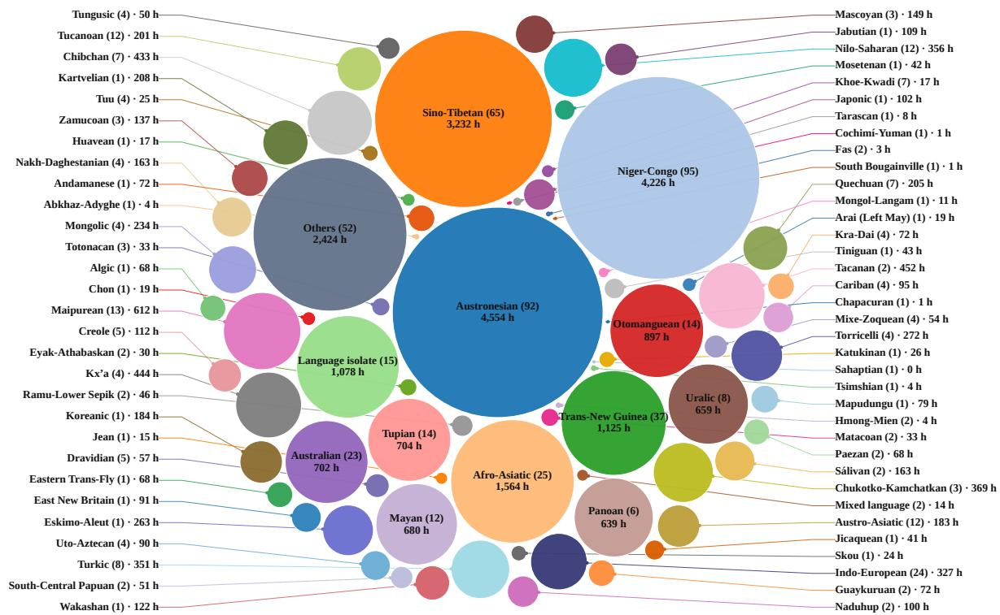
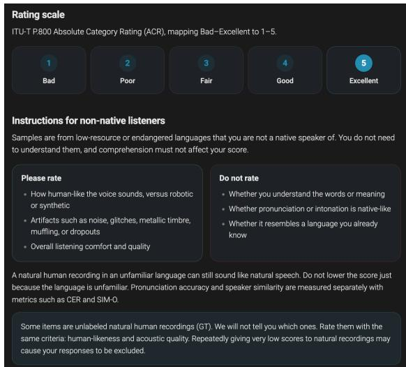

# ELARSpeech: A 30K-Hour Dataset Across 675 Underrepresented Languages for Long-Tail Multilingual Speech Technologies

Sangmin Lee1, Yejin Jeon2,3, David Ifeoluwa Adelani2,3,4

1Yonsei University, 2McGill University, 3Mila - Quebec AI Institute, 4Canada CIFAR AI Chair Correspondence: sangmin\_lee@dsp.yonsei.ac.kr,david.adelani@mila.quebec

## Abstract

Massively multilingual speech modeling has made remarkable progress in recent years, yet existing training resources and benchmarks still underrepresent much of the linguistic long tail. To address this gap, we introduce ELAR Speech, a large-scale multilingual speech resource comprising 30,202 hours of speech across 675 underrepresented languages, curated from the Endangered Languages Archive. Combining human-annotated and unlabeled recordings, the corpus spans diverse recording conditions, domains, and language families. Beyond corpus construction, our experiments show how ELARSpeech supports extending ASR and TTS capabilities to diverse underrepresented languages, with further benefits from pseudo-labeling unlabeled data. At the same time, our speech representation analysis reveals remaining limitations in transferring existing multilingual models to the linguistic long tail. Together, ELARSpeech provides both a resource and a testbed for extending multilingual speech technology further into the linguistic long tail. We publicly release the dataset, all trained ASR and TTS models, and the complete data construction pipeline to facilitate research on long-tail multilingual speech technologies.1

## 1 Introduction

Recent advances in multilingual speech modeling have dramatically expanded the linguistic coverage of speech technologies, enabling automatic speech recognition (Radford et al., 2023; Zhang et al., 2023; Pratap et al., 2024; Keren et al., 2025) and speech synthesis (Pratap et al., 2024; Zhu et al., 2026) across hundreds to thousands of languages. As modeling approaches become more sophisticated and models continue to scale successfully, continued progress toward the linguistic long tail requires multilingual speech resources to advance in both scale and diversity.

Meanwhile, parallel efforts have significantly increased the volume and language coverage of multilingual speech resources. Large-scale efforts such as MMS (Pratap et al., 2024) provide labeled speech for around 1,000 languages alongside unlabeled speech for around 3,000 languages, and recent web-crawled corpora (Chen et al., 2024) have further expanded the diversity of resources. While these advances have considerably expanded multilingual speech resources, three key challenges remain in supporting the linguistic long tail.

The first challenge is the gap between language coverage and accessibility. Publicly available corpora typically cover only a few hundred languages (Ardila et al., 2020; Valk and Alumäe, 2021; Conneau et al., 2023; Li et al., 2023), whereas datasets spanning thousands of languages (Pratap et al., 2024; Keren et al., 2025) often follow restrictive licenses or are not publicly released. Consequently, speech data for many long-tail languages remain difficult to access, limiting reproducible research further into the linguistic long tail.

The second challenge is constrained acoustic and domain diversity. Existing multilingual corpora draw heavily from a single source, such as parliamentary proceedings (Wang et al., 2021; Pfisterer et al., 2026; Asonitis et al., 2026) or Bible readings (Meyer et al., 2022; Chen et al., 2024; Guzmán et al., 2026), which naturally concentrate the resulting data around particular recording conditions, speaking styles, and domains. This leaves broader communicative settings, including spontaneous and conversational speech recorded in diverse real-world environments, less represented.

The third challenge is the lack of suitable evaluation resources for the linguistic long tail. Despite advances in multilingual speech foundation models trained on increasingly large and diverse language collections (Pratap et al., 2024; Chen et al., 2024; Keren et al., 2025), their effectiveness on underrepresented languages remains insufficiently characterized. Existing multilingual evaluations (Shi et al., 2023, 2024) tend to focus on higher-resource languages, making it challenging to systematically assess whether improvements in multilingual pretraining translate into stronger representations for long-tail languages (Boulianne, 2022; Le Ferrand et al., 2025; Li and Niehues, 2026).

To address these challenges, we introduce ELARSpeech, a massively multilingual speech corpus that extends speech resource coverage into the linguistic long tail. By drawing on field recordings from diverse languages, it enables training and evaluation of speech models on broader underrepresented languages. In terms of scale, ELARSpeech comprises 30,202 hours across 675 underrepresented languages and language varieties (hereafter, languages), making it one of the largest publicly available speech resources for underrepresented languages. This includes 2,791 hours of labeled speech-text pairs across 443 languages and 27,412 hours of unlabeled speech across 665 languages.

In experiments, we investigate automatic speech recognition (ASR) and text-to-speech (TTS) adaptation, pseudo-labeled scaling, and representation analysis using ELARSpeech. Our ASR and TTS experiments demonstrate that ELARSpeech supports effective adaptation across diverse underrepresented languages, while pseudo-labeling further improves performance by leveraging unlabeled speech. Additionally, we evaluate existing speech self-supervised models (S3Ms) on ELARSpeech, showing that advances in conventional multilingual settings do not necessarily transfer to the linguistic long tail. These findings highlight the broader utility of ELARSpeech as a resource for advancing speech technologies in underrepresented languages and a foundation for evaluating speech models across the linguistic long tail.

Our contributions are summarized as follows:

• We introduce ELARSpeech, a massively multilingual speech corpus comprising 30,202 hours of curated speech from 675 languages, encompassing both human-labeled and unlabeled subsets.

• ELARSpeech substantially extends the long tail of open multilingual speech resources while preserving the linguistic, acoustic, and domain diversity of real-world field recordings.

• We demonstrate ELARSpeech’s utility in extending ASR and TTS capabilities to underrepresented languages and uncover challenges in transferring existing S3Ms to the linguistic long tail.

<table><tr><td>Dataset</td><td>Labeled</td><td>Content</td><td># Langs.</td><td>Size (H)</td></tr><tr><td colspan="5">Closed-Source Datasets</td></tr><tr><td>Google USM MMS-Unlab</td><td>X</td><td>Variety Bible</td><td>568 2809</td><td>12.1M 8K</td></tr><tr><td>Whisper MMS-Lab ALLASR</td><td>√</td><td>Variety Bible Variety</td><td>98 1107 1690</td><td>680K 45K 121K</td></tr><tr><td colspan="5">Open-Source Datasets</td></tr><tr><td>MMS-Unlab v2 Wikitongues JesusDramas VoxLingua107</td><td>X</td><td>Bible Conversation Bible Variety</td><td>2778 700 430 107</td><td>838 70 643 7K</td></tr><tr><td>WAXAL YODAS v3 FLEURS</td><td>△</td><td>Spontaneous Variety Wikipedia Wikipedia</td><td>32 147 102</td><td>16K 1.1M 1K</td></tr><tr><td>OpenBibleTTS WorldSpeech Omnilingual ASR</td><td>√</td><td>Bible Parliament Spontaneous</td><td>42 76 348</td><td>4K 65K 3K</td></tr><tr><td colspan="5">Ours</td></tr><tr><td>ELARSpeech</td><td>△</td><td>Variety</td><td>675</td><td>30K</td></tr></table>

Table 1: Comparison of existing low-resource multilingual speech datasets. "△" indicates the mixture across labeled, pseudo-labeled, and unlabeled data.

## 2 Related Work

## 2.1 Labeled Multilingual Speech Corpora

Labeled speech corpora have advanced considerably in both language coverage and scale. Early efforts such as CommonVoice (Ardila et al., 2020) and FLEURS (Conneau et al., 2023) provide read speech through crowdsourcing and controlled recordings, respectively, while the more recent WorldSpeech (Asonitis et al., 2026) scales transcribed speech to over 65K hours. For underrepresented languages, the Omnilingual ASR corpus (Keren et al., 2025) extends ASR data to 348 languages, while OpenBibleTTS (Guzmán et al., 2026) provides TTS data for 37 languages derived from Bible recordings. Nevertheless, corpora combining broad low-resource language coverage with diverse environments still remain scarce.

## 2.2 Unlabeled Multilingual Speech Corpora

Unlabeled speech resources enable collections at even broader linguistic scales; MMS (Pratap et al., 2024) collected Bible recordings across thousands of languages, though its underlying corpus is not publicly distributed. Subsequently, XEUS (Chen et al., 2024) further improves accessibility by reconstructing the unlabeled MMS collection while crawling additional long-tail speech resources from JesusDramas and WikiTongues. Despite their broad language coverage, these resources still leave room to further diversify recording domains and conditions with real-world speech data.

(a) Global language coverage of ELARSpeech in the Mollweide projection (Snyder, 1997).  
  
(b) Domain distribution of ELARSpeech.

  
(c) Language family distribution of ELARSpeech.  
Figure 1: Geographic, domain, and language family distributions of ELARSpeech.

## 3 ELARSpeech

## 3.1 Corpus Overview

Design Objectives. We design ELARSpeech with two main objectives: (1) extending resource coverage toward underrepresented languages that remain unsupported by existing multilingual speech models, and (2) broadening acoustic and domain diversity across diverse communicative settings and recording environments.

Data Source. To meet these objectives, we select the Endangered Languages Archive2 (ELAR) as our primary data source. Specifically, ELAR is a digital archive dedicated to preserving endangered languages through multimodal language documentation, hosting diverse resources including audio and video recordings, transcriptions, and field notes contributed by language communities and field linguists. However, as ELAR is designed primarily for language documentation and preservation rather than as a training dataset, its recordings are largely uncurated, consisting of long-form audio with heterogeneous recording conditions and varying levels of transcription availability. We therefore develop a curation pipeline to transform these archival collections into a standardized speech dataset, as detailed in Sections 3.2 and 3.3. Following ELAR’s licensing requirements, ELARSpeech is distributed under the CC BY-NC-SA 4.0 license, with details on the access permissions and licensing conditions of the underlying collections provided in Appendix A.

Corpus Characteristics. ELARSpeech comprises 30,202 hours of speech spanning 675 languages, with their geographic, language-family, and domain distributions summarized in Figure 1. The corpus exhibits broad linguistic diversity while dramatically extending speech resource coverage toward the long tail. Geographically, ELARSpeech covers languages distributed across diverse continents (Figure 1a), while its linguistic coverage spans 78 language families (Figure 1c). Among the

<table><tr><td>Type</td><td>Split</td><td># Lang.</td><td># Utt. (M)</td><td>Duration (H)</td></tr><tr><td rowspan="5">Labeled</td><td>Train</td><td>409</td><td>3.09</td><td>2367.08</td></tr><tr><td>Dev</td><td>233</td><td>0.17</td><td>132.77</td></tr><tr><td>Test</td><td>233</td><td>0.35</td><td>266.14</td></tr><tr><td>Multi</td><td>82</td><td>0.04</td><td>24.82</td></tr><tr><td>Total</td><td>443</td><td>3.64</td><td>2790.81</td></tr><tr><td rowspan="3">Unlabeled</td><td>Train</td><td>592</td><td>19.14</td><td>26763.37</td></tr><tr><td>Multi</td><td>200</td><td>0.41</td><td>648.29</td></tr><tr><td>Total</td><td>665</td><td>19.56</td><td>27411.65</td></tr><tr><td>Overall</td><td></td><td>675</td><td>23.20</td><td>30202.46</td></tr></table>

Table 2: Dataset statistics of ELARSpeech. “Multi” denotes recordings categorized as multilingual.

675 languages, 259 are not supported by existing multilingual models trained on public (Chen et al., 2024) or non-public resources (Pratap et al., 2024; Keren et al., 2025), and 53 are not represented in the ISO 639-3 standard. Beyond linguistic coverage, ELARSpeech captures broad diversity in communicative domains and recording conditions inherited from archival language documentation. As shown in Figure 1b, the corpus encompasses conversations, narratives, interviews, elicitation sessions, and read speech, with considerable variation in recording environments. Detailed curation principles and additional corpus statistics are provided in Appendices B and C, respectively.

Corpus Composition. As summarized in Table 2, ELARSpeech consists of two subsets: (1) ELARSpeech-L, containing 2,791 hours of humanannotated speech across 443 languages, and (2) ELARSpeech-U, containing 27,412 hours of preprocessed unlabeled speech across 665 languages. For both subsets, recordings associated with multiple languages or those that cannot be reliably assigned to a single language are categorized as a separate multilingual split. Subsequently, ELARSpeech-L is split at the session level into training, development, and test sets with an 85/5/10 ratio, while languages with less than 5 minutes of development data are retained only in the training set. Two subsets are constructed through separate curation pipelines as described below.

## 3.2 Constructing Labeled Subset

When timestamped annotations are available, we segment recordings into utterances using timestamps and pair them with annotations to construct ELARSpeech-L through the following three stages.

Audio-Annotation Matching We first identify candidate audio-annotation pairs using filename matching. In most ELAR collections, transcription files are named after their corresponding audio recordings, occasionally with additional metadata such as the annotation date appended to the filename (e.g., AUD001\_20260101.eaf). Accordingly, we first normalize all filenames to lowercase and then pair an audio file with a transcription file whenever the annotation filename contains the audio filename as an exact substring.

Valid Annotation Parsing. The most challenging step in constructing ELARSpeech-L is identifying valid transcription tiers, as annotation tier names are not standardized across ELAR collections and vary substantially across field linguists. For example, transcriptions may appear in a dedicated tier such as tx or in tiers named after individual speakers. We therefore develop a tier selection algorithm that scores candidate tiers based on common naming conventions. High-confidence tiers are directly accepted, medium-confidence tiers undergo manual verification, and low-confidence tiers are discarded. Detailed scoring criteria, thresholds, and the algorithm are provided in Appendix D.

Speech Segmentation. After selecting valid transcription tiers, we segment each recording using the timestamps from the accepted tiers to obtain time-aligned speech-text pairs. When annotation timestamps fall outside the bounds of the corresponding recording, we interpret this as potential audio-annotation misalignment and discard all segments derived from the affected recording.

## 3.3 Constructing Unlabeled Subset

For recordings without timestamped annotations, we preprocess the long-form audio through the following pipeline to construct ELARSpeech-U.

Overlapping Recording Exclusion. First of all, we exclude all source recordings included in ELARSpeech-L from the unlabeled pool to ensure that the two subsets remain disjoint, preventing potential data leakage in downstream experiments.

Quality-Based Pruning. Subsequently, we assess the acoustic quality of each recording using Brouhaha (Lavechin et al., 2023), which estimates the signal-to-noise ratio (SNR) and speech clarity (C50). Recordings with either SNR or C50 below 0 dB are discarded to remove severely degraded audio. Unlike previous in-the-wild dataset construction pipelines (He et al., 2024; Ma et al., 2024; Ogun et al., 2024) that apply speech enhancement, we use these quality estimates solely for filtering (Kwon et al., 2026) and retain the original audio without enhancement. This preserves the original acoustic characteristics and avoids potential alterations to language-specific phonetic cues that may be crucial for underrepresented languages.

Speaker Diarization and Segmentation. We then apply the pyannote-Precision-2 (Bredin, 2017; Bredin et al., 2020; Bredin, 2023) speaker diarization pipeline to partition each recording into speaker-homogeneous regions. Overlaps shorter than 0.5 seconds are retained, as they often reflect natural conversational backchannels rather than speaker interference. For segments exceeding 30 seconds, we apply Silero VAD (Team, 2024) and recursively split them at the longest silence until the duration constraint is satisfied. Detailed segmentation algorithms are provided in Appendix E.

## 3.4 Normalization and Filtering

For both subsets, we apply the following common normalization and filtering procedures to ensure consistency across the corpus.

Speech Normalization. First, all the speech segments are resampled to 24 kHz and encoded as 16-bit PCM FLAC format. We then apply RMSbased loudness normalization to −23 dBFS, with the gain constrained to [−6, +6] dB to prevent excessive amplification or attenuation, followed by a peak ceiling of −1 dBFS to prevent clipping.

Metadata Normalization. Next, we standardize language metadata across ELAR collections, where naming conventions vary widely. Language labels are assigned based on collection-level metadata and subsequently normalized using the Ethnologue3 language catalog, mapping aliases and naming variants to canonical language identifiers.

Data Filtering. Finally, we remove sign language recordings, which typically contain little or no spoken content, and discard samples with no detectable speech using Silero VAD.

## 4 Experiments

## 4.1 Long-Tail Speech Modeling

Experimental Setup. We first investigate whether ELARSpeech can extend the language coverage of existing speech models into the linguistic long tail. Both ASR and TTS are evaluated in monolingual and multilingual settings. Monolingual adaptation focuses on 30 pivot languages across resource levels for model comparisons (Appendix F), whereas the multilingual counterpart jointly trains a single model on all 233 languages represented across the train, development, and test splits. Models are initially trained on human-annotated ELARSpeech-L, with language-specific Whisper models additionally fine-tuned for all 233 languages to pseudo-label ELARSpeech-U. Pseudo-labeled scaling is then examined by progressively augmenting the training data with pseudo-labeled ELARSpeech-U.

Models. For ASR, we fine-tune two distinct modeling paradigms: Whisper-large-v3 (Radford et al., 2023), an encoder-decoder model, and OmniASR-CTC-v2 (Keren et al., 2025), a CTC-based (Graves et al., 2006) model. For TTS, we fine-tune OmniVoice (Zhu et al., 2026), a diffusion LLMbased (Yang et al., 2025; Gong et al., 2025) multilingual model. Following prior findings on the importance of data quality in low-resource TTS (Ogun et al., 2023), we restrict TTS training data to utterances with both SNR and C50 above 20 dB.

Evaluation Metrics. For ASR, we report character error rate (CER) against human transcriptions. For TTS, we evaluate intelligibility using CER from monolingual Whisper models and perceptual quality using mean opinion score (MOS), following the evaluation protocol of Pratap et al. (2024). For evaluation across all 233 languages, we report UTMOS (Baba et al., 2024) as an automatic proxy. Details of the MOS evaluation protocol are provided in Appendix G.

Training Details. All models are optimized using AdamW (Loshchilov and Hutter, 2017) until convergence, and the checkpoint achieving the best development-set performance is selected for final evaluation. Detailed training configurations and hyperparameter settings are provided in Appendix H.

## 4.2 Long-Tail Representation Analysis

Evaluation Protocol. We subsequently investigate how well existing multilingual S3Ms generalize to the linguistic long tail represented in ELAR-Speech. Following the ML-SUPERB protocol (Shi et al., 2023), we evaluate these models under 10- minute and 1-hour supervision. We consider four tasks from the original benchmark: monolingual ASR, multilingual ASR, language identification (LID), and joint ASR with LID.

Models. We benchmark five multilingual S3Ms: XLS-R (Babu et al., 2021), w2v-BERT 2.0 (Barrault et al., 2023), MMS (Pratap et al., 2024), XEUS (Chen et al., 2024), and OmniASR-W2V (Keren et al., 2025), together with melfilterbank features as a baseline.

<table><tr><td colspan="6">Languages with ISO 639-3 Codes</td><td colspan="8">Languages without ISO 639-3 Codes</td></tr><tr><td rowspan="2">Language</td><td rowspan="2">Code</td><td rowspan="2">Data (H)</td><td colspan="2">Monolingual OmniASR</td><td colspan="2">Multilingual | Whisper</td><td rowspan="2">Language</td><td rowspan="2">Data Code (H)</td><td rowspan="2">300M</td><td rowspan="2">OmniASR</td><td colspan="2">Monolingual Whisper</td><td rowspan="2">Multilingual Whisper</td></tr><tr><td>300M</td><td>1B</td><td>Whisper 1.5B</td><td></td><td>1B</td><td>1.5B 1.5B</td></tr><tr><td>Masela, Central</td><td>mxz</td><td>136.8</td><td>|28.90</td><td>26.22</td><td>28.39</td><td>28.31</td><td>|Jitotoltec</td><td></td><td>18.6</td><td>15.16</td><td>15.25</td><td>13.31</td><td>20.84</td></tr><tr><td>Jul&#x27;hoansi</td><td>ktz</td><td>79.9</td><td>41.89</td><td>41.71</td><td>42.93</td><td>53.06</td><td>Zok</td><td></td><td>18.4</td><td>35.04</td><td>36.95</td><td>38.35</td><td>47.55</td></tr><tr><td>Yoloxóchitl Mixtec</td><td>xty</td><td>66.5</td><td>8.76</td><td>8.58</td><td>8.70</td><td>16.84</td><td>Sri Lankan Portuguese Creole</td><td></td><td>17.2</td><td>18.78</td><td>17.86</td><td>16.89</td><td>22.81</td></tr><tr><td>Tzeltal</td><td>tzh</td><td>69.9</td><td>22.92</td><td>22.03</td><td>23.20</td><td>30.05</td><td>Chiapas Zoque</td><td></td><td>12.7</td><td>16.44</td><td>16.28</td><td>17.11</td><td>23.37</td></tr><tr><td>Iñapari</td><td>inp</td><td>25.6</td><td>20.69</td><td>25.10</td><td>11.37</td><td>37.62</td><td>Caijia</td><td></td><td>10.0</td><td>31.05</td><td>32.03</td><td>28.35</td><td>37.53</td></tr><tr><td>Minyag, Eastern</td><td>emq</td><td>12.5</td><td>29.38</td><td>32.61</td><td>19.84</td><td>44.65</td><td>Muyu</td><td></td><td>6.3</td><td>23.76</td><td>23.72</td><td>23.58</td><td>27.08</td></tr><tr><td>Zenzontepec Chatino</td><td>czn</td><td>12.0</td><td>10.88</td><td>10.57</td><td>10.73</td><td>16.34</td><td>San Martín Duraznos Mixtec</td><td></td><td>6.2</td><td>39.64</td><td>39.10</td><td>47.29</td><td>50.58</td></tr><tr><td>Araona</td><td>aro</td><td>11.4</td><td>26.42</td><td>28.14</td><td>23.43</td><td>33.28</td><td>Gargarnaye</td><td></td><td>6.0</td><td>29.82</td><td>29.39</td><td>29.97</td><td>35.71</td></tr><tr><td>Abui</td><td>abz</td><td>11.0</td><td>35.64</td><td>35.62</td><td>15.90</td><td>38.20</td><td>Dzardzongke</td><td></td><td>5.4</td><td>15.73</td><td>15.47</td><td>15.70</td><td>19.63</td></tr><tr><td>Wardaman</td><td>wrr</td><td>10.9</td><td>32.40</td><td>33.56</td><td>30.26</td><td>38.56</td><td>Western Algerian Amazigh</td><td></td><td>5.2</td><td>25.73</td><td>24.77</td><td>24.24</td><td>30.58</td></tr><tr><td>Fungwa</td><td>ula</td><td>4.3</td><td>21.30</td><td>21.60</td><td>20.65</td><td>27.53</td><td>Awiakay</td><td></td><td>3.2</td><td>38.21</td><td>37.30</td><td>37.86</td><td>44.35</td></tr><tr><td>Notre</td><td>bly</td><td>4.2</td><td>29.32</td><td>31.26</td><td>19.03</td><td>44.26</td><td>Thiek</td><td></td><td>3.2</td><td>16.20</td><td>15.89</td><td>15.69</td><td>19.57</td></tr><tr><td>Ulwa</td><td>yla</td><td>4.2</td><td>17.98</td><td>18.41</td><td>17.33</td><td>21.08</td><td>Nese</td><td></td><td>2.2</td><td>28.82</td><td>30.30</td><td>30.50</td><td>33.47</td></tr><tr><td>Nheengatu</td><td>yrl</td><td>4.1</td><td>14.97</td><td>16.14</td><td>12.42</td><td>19.67</td><td>Kichwa de Chibuleo</td><td></td><td>2.2</td><td>11.21</td><td>10.42</td><td>9.57</td><td>10.56</td></tr><tr><td>Tonsawang</td><td>tnw</td><td>3.9</td><td>21.20</td><td>21.71</td><td>20.78</td><td>24.39</td><td>Jowshaqani</td><td></td><td>2.0</td><td>21.85</td><td>22.91</td><td>20.98</td><td>23.81</td></tr><tr><td colspan="2">Macro Average</td><td></td><td>24.18</td><td>24.88</td><td>20.33</td><td>31.59</td><td>Macro Average</td><td></td><td></td><td>24.50</td><td>24.51</td><td>24.63</td><td>29.83</td></tr><tr><td colspan="2">Win Rate</td><td></td><td>0.0%</td><td>33.3%</td><td>66.7%</td><td>0.0%</td><td>Win Rate</td><td></td><td></td><td>13.3%</td><td>33.3%</td><td>53.3%</td><td>0.0%</td></tr></table>

Table 3: Monolingual and multilingual ASR performance across 30 pivot languages of ELARSpeech. Languages are sorted by data duration within each category, and we report CER (%) for every result. Best and second-best results are shown in bold and underlined, respectively. Macro CER is averaged across languages, while win rate denotes the proportion of languages for which each model achieves the lowest CER.

Evaluation Metrics. Consistent with the original ML-SUPERB protocol, we report CER for ASR and accuracy for LID, with all aggregate results reported as macro averages across languages.

Training Details. We follow the original ML-SUPERB training recipe for all experiments.

## 5 Results

## 5.1 Automatic Speech Recognition

Monolingual Adaptation. Table 3 demonstrates that ELARSpeech-L enables ASR adaptation across diverse long-tail languages. In the monolingual setting, Whisper achieves the lowest CER for 18 of the 30 pivot languages, with a macro CER of 22.48. OmniASR-CTC is more competitive on languages without ISO 639-3 codes, as the 300M model attains a macro CER of 24.50, which is comparable to Whisper’s 24.63 despite having substantially fewer parameters. However, Whisper remains ahead on ISO-coded languages (20.33 vs. 24.18). This trend is consistent with prior findings on the effectiveness of CTC-based models in lowresource settings (Kim et al., 2017; Moritz et al., 2019; Nayeem et al., 2025), suggesting that their advantages may extend further into the linguistic long tail. For OmniASR-CTC variants, scaling model size from 300M to 1B parameters improves performance on 16 of the 30 languages, but the gains are not consistent across languages. Specifically, all four languages with over 60 hours of training data benefit from the larger model, while results remain mixed for lower-resource languages.

Multilingual Knowledge Transfer. In contrast, massively multilingual adaptation shows signs of linguistic interference, as the multilingual model increases macro CER from 22.48 to 30.71, outperforming the monolingual counterpart on only one of the 30 pivot languages. This suggests that scaling the number of languages alone does not necessarily yield positive cross-lingual transfer, when supervision is limited and distributed across heterogeneous long-tail languages, such as diverse language families and recording environments.

  
Figure 2: ASR performance with increasing amounts of pseudo-labeled ELARSpeech-U.

Pseudo-Labeled Scaling. Figure 2 shows how pseudo-labeled ELARSpeech-U affects ASR performance across 233 languages. Specifically, we compute the confidence of each pseudo-labeled utterance as the mean confidence across its predicted tokens and apply language-specific quartile cutoffs to vary the amount of retained data. Across these settings, augmenting ELARSpeech-L with pseudo-labeled speech consistently improves transcription performance, achieving up to a 6.1% relative reduction in CER. However, retaining the entire pseudo-labeled corpus does not yield the best performance, with moderate confidence filtering leading to greater improvements. This suggests that effective scaling with unlabeled speech depends not only on quantity but also on pseudo-label quality.

<table><tr><td rowspan="2">Language (Code)</td><td rowspan="2">Test</td><td colspan="3">CER↓</td></tr><tr><td>Original</td><td>+L</td><td>+LU</td></tr><tr><td colspan="6">CommonVoice 26 (CV26)</td></tr><tr><td rowspan="2">Dawoodi (dmk)</td><td>ELAR</td><td>93.99 22.68</td><td></td><td>22.72</td></tr><tr><td>CV26</td><td>4.47</td><td>4.81</td><td>5.58</td></tr><tr><td rowspan="2">Imbabura Highland Quichua (qvi)</td><td>ELAR</td><td>47.48</td><td>7.13</td><td>6.71</td></tr><tr><td>CV26</td><td>1.28</td><td>1.12</td><td>1.10</td></tr><tr><td rowspan="2">Dargwa (dar)</td><td>ELAR</td><td>46.11</td><td>11.42</td><td>11.00</td></tr><tr><td>CV26</td><td>1.63</td><td>1.69</td><td>1.56</td></tr><tr><td colspan="6">INEL Corpus (INEL)</td></tr><tr><td rowspan="2">Kalmyk-Oirat (xal)</td><td>ELAR</td><td>69.37</td><td>36.37</td><td>35.21</td></tr><tr><td>INEL</td><td>29.85</td><td>27.09</td><td>25.59</td></tr></table>

Table 4: Cross-domain ASR performance on ELAR-Speech and external test sets: CV26 and INEL.

Cross-Domain Robustness. To assess whether the benefits of ELARSpeech extend beyond its source archive, we conduct a cross-domain ASR evaluation on four languages from two external corpora (Ardila et al., 2020; Baranova, 2025). We compare models trained on the original external data, augmented with ELARSpeech-L, and further augmented with pseudo-labeled ELARSpeech-U, evaluating each on both domains. As shown in Table 4, external-only models perform notably worse on ELARSpeech, indicating a considerable domain mismatch between ELARSpeech and existing speech corpora. Moreover, augmenting the training data with ELARSpeech generally improves performance on the external domains, with gains observed in three of the four languages. Together, these results suggest that ELARSpeech broadens domain coverage without compromising performance on the original domains.

## 5.2 Text-to-Speech

Low-Resource Adaptation. Table 5 presents TTS results across the 14 pivot languages with at least 5 hours of training data after SNR/C50 filtering. Despite the limited amount of transcribed speech available for many languages, the models yield intelligible speech across a diverse set of lowresource languages, including those with only a few hours of data. In several cases, synthesized speech even achieves lower CER than the groundtruth recordings, providing further evidence of strong intelligibility under the ASR-based evaluation, although this may partly reflect the more standardized acoustic characteristics of synthesized speech relative to real-world field recordings. Overall, these results demonstrate that ELARSpeech can support TTS adaptation even for languages with extremely limited speech resources. Compared with the monolingual setting, the multilingual counterpart yields slightly higher CER overall but improves MOS for the majority of evaluated languages, suggesting a trade-off between intelligibility and perceptual quality.

<table><tr><td>Language Code</td><td></td><td>Data (H)</td><td>Reference (Ground Truth) CER ↓ MOS ↑</td><td></td><td>Monolingual OmniVoice CER↓ MOS ↑</td><td></td><td>Multilingual OmniVoice CER ↓ MOS ↑</td></tr><tr><td colspan="8">Languages with ISO 639-3 Codes</td></tr><tr><td>C. Masela</td><td>mxz</td><td>124.9</td><td>28.39</td><td>4.04</td><td>14.71</td><td>3.88</td><td>12.87 3.79</td></tr><tr><td>Y. Mixtec</td><td>xty</td><td>64.8</td><td>8.70</td><td>4.12</td><td>4.75</td><td>3.58 4.83</td><td>3.82</td></tr><tr><td>Tzeltal</td><td>tzh</td><td>19.8</td><td>23.20</td><td>3.76</td><td>12.58</td><td>3.33 12.93</td><td>3.45</td></tr><tr><td>Iñapari</td><td>inp</td><td>13.1</td><td>11.37</td><td>3.94</td><td>15.43</td><td>3.60 14.97</td><td>3.59</td></tr><tr><td>Arãona</td><td>aro</td><td>7.7</td><td>23.43</td><td>3.75</td><td>15.52</td><td>3.04 16.65</td><td>3.26</td></tr><tr><td>E. Minyag</td><td>emq</td><td>6.0</td><td>19.84</td><td>3.88</td><td>25.78</td><td>3.54 27.66</td><td>3.96</td></tr><tr><td>Jul&#x27;hoansi</td><td>ktz</td><td>5.1</td><td>42.93</td><td>3.48</td><td>41.60 2.90</td><td>46.39</td><td>2.94</td></tr><tr><td>Z. Chatino</td><td>czn</td><td>5.1</td><td>10.73</td><td>4.06</td><td>5.45 3.46</td><td>5.94</td><td>3.55</td></tr><tr><td colspan="2">Macro Average Win Rate</td><td>21.07</td><td>3.88</td><td>16.98</td><td>3.42</td><td>17.78</td><td>3.55</td></tr><tr><td colspan="2">Languages without ISO 639-3 Codes</td><td>一</td><td>一</td><td>75.0%</td><td>25.0%</td><td>25.0%</td><td>75.0%</td></tr><tr><td colspan="8"></td></tr><tr><td>Jitotoltec</td><td>12.6</td><td>13.31</td><td>3.96</td><td>9.17</td><td>3.52</td><td>10.20</td><td>3.79</td></tr><tr><td>C. Zoque</td><td>10.1</td><td>17.11</td><td>4.13</td><td>11.24 26.98</td><td>3.59 3.96</td><td>11.79</td><td>3.82</td></tr><tr><td>Caijia</td><td>6.4</td><td></td><td>28.35</td><td>4.40</td><td>6.62</td><td>27.72</td><td>4.17</td></tr><tr><td>S. L. P. C.</td><td>6.0</td><td>16.89</td><td></td><td>4.02</td><td>3.88</td><td>7.00</td><td>3.69</td></tr><tr><td>Zok</td><td></td><td>5.2</td><td>38.35</td><td>3.69</td><td>38.48 3.27</td><td>38.71</td><td>3.42</td></tr><tr><td>Muyu</td><td>5.0</td><td>23.58</td><td>3.88</td><td>14.80</td><td>3.19</td><td>15.84</td><td>3.06</td></tr><tr><td colspan="2">Macro Average Win Rate</td><td></td><td>22.93</td><td>4.01</td><td>17.88 3.57 100.0% 33.3%</td><td>18.54 0.0%</td><td>3.66 66.7%</td></tr></table>

Table 5: Monolingual and multilingual TTS performance on pivot languages with at least 5 hours of training data, with MOS ratings from non-native listeners. Multi-word language names are abbreviated.  
  
Figure 3: TTS performance with increasing amounts of pseudo-labeled ELARSpeech-U.

Pseudo-Labeled Scaling. Figure 3 shows the effect of scaling pseudo-labeled ELARSpeech-U on TTS performance. Unlike ASR, increasing the amount of pseudo-labeled speech does not improve intelligibility, with CER instead showing a slight increase as more pseudo-labeled data are added. In contrast, UTMOS initially improves with additional pseudo-labeled speech, reaches its highest score at an intermediate retention level, and declines when the entire pseudo-labeled corpus is retained. This suggests that pseudo-labeled speech can provide useful additional acoustic variation for TTS, improving perceptual quality at moderate scale despite a slight degradation in intelligibility, while lower-confidence pseudo-labels diminish these gains as more data are retained.

<table><tr><td>Model</td><td>Data (H) # Langs.</td><td></td><td>#ELAR</td><td># Params.</td><td>Mono. ASR CER↓</td><td>Multi. ASR CER↓</td><td>Multi. LID Acc. ↑</td><td>Multi. ASR + LID Acc. ↑</td><td>CER↓</td><td>Score</td></tr><tr><td>w2v-BERT 2.0†</td><td>4.5M</td><td>143</td><td></td><td>600M</td><td>41.0/29.2</td><td>24.6/20.3</td><td>70.0/86.8</td><td>83.2 / 90.6</td><td>24.2 / 20.3 </td><td></td></tr><tr><td>XLS-R†</td><td>436K</td><td>128</td><td></td><td>300M 1B</td><td>39.7/30.6 40.5/30.9</td><td>29.3 /22.0 30.4/26.3</td><td>66.9/87.9 70.9/85.8</td><td>55.6/85.6 66.4 / 87.1</td><td>28.4 /22.9 28.6/25.2</td><td></td></tr><tr><td>MMS†</td><td>491K</td><td>1,406</td><td></td><td>300M 1B</td><td>33.8 /30.5 33.3 / 25.7</td><td>28.7/24.0 21.3/18.1</td><td>62.3 / 84.3 84.8/86.1</td><td>71.9/74.3 73.3 / 74.8</td><td>31.5 /30.0 26.0/25.5</td><td></td></tr><tr><td>XEUS†</td><td>1M</td><td>4,057</td><td></td><td>600M</td><td>30.3 /25.1</td><td>21.1 /20.1</td><td>81.5/87.3</td><td>86.4/91.3</td><td>22.9/19.6 |</td><td></td></tr><tr><td>Mel-Filterbank</td><td>一</td><td>一</td><td></td><td></td><td>71.6 / 64.9</td><td>73.8 / 70.2</td><td>6.4 / 8.5</td><td>30.9 /43.3</td><td>73.0 / 69.6 |</td><td>0.0 / 0.0</td></tr><tr><td>w2v-BERT 2.0</td><td>4.5M</td><td>143</td><td>6 (4.2%)</td><td>600M</td><td>53.8 / 45.8</td><td>57.6/51.7</td><td>50.6 / 57.7</td><td>54.1 / 79.4</td><td>57.7 / 51.9 |</td><td>901.9 / 944.2</td></tr><tr><td>XLS-R</td><td>436K</td><td>128</td><td>7 (5.5%)</td><td>300M 1B</td><td>53.5 / 45.7 52.1 / 44.9</td><td>59.2 / 53.1 58.9 / 53.0</td><td>49.3 / 56.5 49.9 / 55.9</td><td>49.4 / 81.3 51.9 / 82.2</td><td>58.9 / 52.8 59.2 / 52.2</td><td>848.5 / 921.7 880.8 / 935.2</td></tr><tr><td>MMS</td><td>491K</td><td>1,406</td><td>333 (23.7%)</td><td>300M 1B</td><td>53.6 / 46.0 51.9 / 44.6</td><td>58.4 / 52.7 56.9 / 51.5</td><td>53.7 / 61.9 54.4 / 57.7</td><td>54.2 / 81.0 55.3 / 83.1</td><td>58.6 / 52.3 56.7 / 50.8</td><td>901.6 / 949.8 968.4 / 980.1</td></tr><tr><td>XEUS</td><td>1M</td><td>4,057</td><td>342 (8.4%)</td><td>600M</td><td>52.2 / 45.0</td><td>60.2 / 54.4</td><td>49.4 / 57.6</td><td>63.6 / 82.1</td><td>59.8 / 53.5</td><td>898.4 / 915.6</td></tr><tr><td>OmniASR-W2V</td><td>4.3M</td><td>1,690</td><td>140 (8.3%)</td><td>300M 1B</td><td>52.1 / 45.5 52.3 / 45.1</td><td>58.9 / 52.7 57.9/51.9</td><td>45.5 / 41.9 49.0 / 59.3</td><td>49.5 / 79.8 52.1 / 81.0</td><td>58.5 / 52.4 57.7 / 51.3</td><td>854.3 / 857.8 901.4 / 967.8</td></tr></table>

Table 6: ML-SUPERB-style evaluation on ELARSpeech. Results are reported under 10-minute / 1-hour supervision. Data and # Langs. denote the amount and reported language coverage of SSL pretraining data. # ELAR denotes the number of languages in each model’s publicly available language inventory that overlap with ELARSpeech, with the percentage relative to its reported language coverage shown in parentheses. Gray italicized rows (†) show the original (non-long-tail) ML-SUPERB results reported in Chen et al. (2024) for reference.

## 5.3 Representation Analysis

Low-Resource Representation Transfer. As shown in Table 6, all pretrained representations consistently outperform the mel-filterbank baseline across the evaluated tasks, indicating that multilingual pretraining remains beneficial for the long-tail languages in ELARSpeech. These improvements persist under both supervision budgets, suggesting that pretrained representations can provide useful features even when language-specific supervision is extremely limited.

Beyond Existing Benchmarks. However, despite these consistent gains over the baseline, the relative advantages among pretrained representations become less pronounced on ELARSpeech. For example, 10-minute monolingual ASR CER ranges from 30.3 to 41.0 on ML-SUPERB (26.1% relative difference), compared with only 51.9 to 53.8 (3.5% relative difference) on ELARSpeech. Meanwhile, all models perform consistently worse on ELARSpeech than on ML-SUPERB under matched supervision budgets. These results show that existing S3Ms exhibit weaker absolute performance on ELARSpeech, losing much of the relative advantage observed on the original benchmark across high-resource languages.

Pretraining Scale, Coverage, and Exposure. Interestingly, these differences are not well explained by pretraining scale or nominal language coverage alone. While XEUS has the largest absolute overlap with ELARSpeech, this represents only a small fraction (8.4%) of its broader language inventory; in contrast, MMS exhibits a considerably higher proportion (23.7%) of ELARSpeech languages and achieves the strongest overall performance. This suggests that effective long-tail transfer may depend less on simply scaling the number of pretraining languages and more on maintaining balanced exposure to low-resource languages, highlighting the need for linguistic long-tail resources to drive further advances in multilingual speech models.

## 6 Conclusion

In this work, we introduced ELARSpeech, a large-scale speech corpus comprising 30,202 hours across 675 underrepresented languages. Beyond its scale, ELARSpeech extends multilingual speech resources further into the linguistic long tail while preserving the acoustic and domain diversity of real-world field recordings. Subsequently, our experiments demonstrate that ELARSpeech supports effective ASR and TTS adaptation across diverse underrepresented languages, with pseudo-labeled data providing further opportunities for scaling beyond limited human annotations on long-tail languages. At the same time, representation analysis shows that pretraining scale and language coverage alone are insufficient predictors of long-tail transfer, highlighting the importance of speech resources that enable balanced exposure to low-resource languages. We anticipate ELARSpeech to serve as a foundation for advancing multilingual speech technology further into the linguistic long tail.

## Limitations

As ELARSpeech is constructed from archival collections, its language and recording metadata may contain inconsistencies or uncertainties inherited from the original deposits. While our processing pipeline standardizes and filters the collected data, it cannot fully resolve inaccuracies in archival metadata. Additionally, our MOS evaluation relies primarily on non-native listeners due to the difficulty of recruiting native speakers across hundreds of low-resource languages. Accordingly, the evaluation focuses on general perceptual qualities such as naturalness, artifacts, and listening comfort rather than linguistic accuracy or native-like pronunciation and prosody. We complement these human judgments with automatic measures of intelligibility and perceptual quality, but this aspect remains an important direction for future work.

## Ethical Statement

ELARSpeech is derived from archival recordings of endangered and underrepresented language communities, for which responsible use requires particular attention to the rights and conditions associated with the source materials. Prior to data collection, we consulted the ELAR team regarding the use of archived materials for machine-learning research and follow their guidance on access, attribution, and downstream use. We include only materials designated as Open or User Access, exclude Subscriber Access materials that require permission from collection stewards, and preserve collectionlevel provenance and attribution information. We recognize that permission to access archival materials does not remove the responsibility to respect the individuals and communities represented in them. We acknowledge the agency of language communities in determining how their linguistic resources are used and commit to honoring requests to remove materials from ELARSpeech. Accordingly, ELARSpeech is intended for non-commercial research, with downstream use subject to the applicable licensing and collection-specific conditions.

## References

Rosana Ardila, Megan Branson, Kelly Davis, Michael Kohler, Josh Meyer, Michael Henretty, Reuben Morais, Lindsay Saunders, Francis Tyers, and Gregor Weber. 2020. Common Voice: A massivelymultilingual speech corpus. In Proceedings of the

Language Resources and Evaluation Conference, pages 4218–4222.

Antonis Asonitis, Luca A Lanzendörfer, Frédéric Berdoz, and Roger Wattenhofer. 2026. Worldspeech: A multilingual speech corpus from around the world. arXiv preprint arXiv:2605.09167.

Kaito Baba, Wataru Nakata, Yuki Saito, and Hiroshi Saruwatari. 2024. The t05 system for the VoiceMOS Challenge 2024: Transfer learning from deep image classifier to naturalness MOS prediction of highquality synthetic speech. In IEEE Spoken Language Technology Workshop (SLT), pages 818–824.

Arun Babu, Changhan Wang, Andros Tjandra, Kushal Lakhotia, Qiantong Xu, Naman Goyal, Kritika Singh, Patrick Von Platen, Yatharth Saraf, Juan Pino, and 1 others. 2021. Xls-r: Self-supervised cross-lingual speech representation learning at scale. arXiv preprint arXiv:2111.09296.

Vlada Baranova. 2025. Inel kalmyk corpus.

Loïc Barrault, Yu-An Chung, Mariano Coria Meglioli, David Dale, Ning Dong, Mark Duppenthaler, Paul-Ambroise Duquenne, Brian Ellis, Hady Elsahar, Justin Haaheim, and 1 others. 2023. Seamless: Multilingual expressive and streaming speech translation. arXiv preprint arXiv:2312.05187.

Gilles Boulianne. 2022. Phoneme transcription of endangered languages: an evaluation of recent asr architectures in the single speaker scenario. In Findings of the Associationfor Computational Linguistics: ACL 2022, pages 2301–2308.

Hervé Bredin. 2017. pyannote. metrics: A toolkit for reproducible evaluation, diagnostic, and error analysis of speaker diarization systems. hypothesis, 100(60):90.

Hervé Bredin. 2023. pyannote. audio 2.1 speaker diarization pipeline: principle, benchmark, and recipe. In 24th Interspeech Conference (INTERSPEECH 2023), pages 1983–1987. ISCA.

Hervé Bredin, Ruiqing Yin, Juan Manuel Coria, Gregory Gelly, Pavel Korshunov, Marvin Lavechin, Diego Fustes, Hadrien Titeux, Wassim Bouaziz, and Marie-Philippe Gill. 2020. Pyannote. audio: neural building blocks for speaker diarization. In ICASSP 2020-2020 IEEE International conference on acoustics, speech and signal processing (ICASSP), pages 7124–7128. IEEE.

Sanyuan Chen, Chengyi Wang, Zhengyang Chen, Yu Wu, Shujie Liu, Zhuo Chen, Jinyu Li, Naoyuki Kanda, Takuya Yoshioka, Xiong Xiao, and 1 others. 2022. Wavlm: Large-scale self-supervised pretraining for full stack speech processing. IEEE Journal of Selected Topics in Signal Processing, 16(6):1505–1518.

William Chen, Wangyou Zhang, Yifan Peng, Xinjian Li, Jinchuan Tian, Jiatong Shi, Xuankai Chang, Soumi Maiti, Karen Livescu, and Shinji Watanabe. 2024. Towards robust speech representation learning for thousands of languages. In Proceedings ofthe 2024 Conference on Empirical Methods in Natural Language Processing, pages 10205–10224.

Alexis Conneau, Min Ma, Simran Khanuja, Yu Zhang, Vera Axelrod, Siddharth Dalmia, Jason Riesa, Clara Rivera, and Ankur Bapna. 2023. FLEURS: Fewshot learning evaluation of universal representations of speech. In IEEE Spoken Language Technology Workshop, pages 798–805. IEEE.

Brecht Desplanques, Jenthe Thienpondt, and Kris Demuynck. 2020. Ecapa-tdnn: Emphasized channel attention, propagation and aggregation in tdnn based speaker verification. arXiv preprint arXiv:2005.07143.

Shansan Gong, Shivam Agarwal, Yizhe Zhang, Jiacheng Ye, Lin Zheng, Mukai Li, Chenxin An, Peilin Zhao, Wei Bi, Jiawei Han, and 1 others. 2025. Scaling diffusion language models via adaptation from autoregressive models. In International Conference on Learning Representations, volume 2025, pages 5046–5073.

Alex Graves, Santiago Fernández, Faustino Gomez, and Jürgen Schmidhuber. 2006. Connectionist temporal classification: labelling unsegmented sequence data with recurrent neural networks. In Proceedings of the 23rd international conference on Machine learning, pages 369–376.

David Guzmán, Luel Hagos Beyene, Jesujoba Oluwadara Alabi, Yejin Jeon, Dietrich Klakow, and David Ifeoluwa Adelani. 2026. Openbibletts: Large-scale speech resources and tts models for low-resource languages. arXiv preprint arXiv:2606.09553.

Haorui He, Zengqiang Shang, Chaoren Wang, Xuyuan Li, Yicheng Gu, Hua Hua, Liwei Liu, Chen Yang, Jiaqi Li, Peiyang Shi, and 1 others. 2024. Emilia: An extensive, multilingual, and diverse speech dataset for large-scale speech generation. In 2024 IEEE Spoken Language Technology Workshop (SLT), pages 885– 890. IEEE.

Gil Keren, Artyom Kozhevnikov, Yen Meng, Christophe Ropers, Matthew Setzler, Skyler Wang, Ife Adebara, Michael Auli, Can Balioglu, and 1 others. 2025. Omnilingual asr: Open-source multilingual speech recognition for 1600+ languages. arXiv preprint arXiv:2511.09690.

Suyoun Kim, Takaaki Hori, and Shinji Watanabe. 2017. Joint ctc-attention based end-to-end speech recognition using multi-task learning. In 2017 IEEE international conference on acoustics, speech and signal processing (ICASSP), pages 4835–4839. IEEE.

Ki-Joong Kwon, Junho So, and Sang-Hoon Lee. 2026. Coreaspeech: Korean speech corpus via jamo-based

coreset selection for efficient and robust korean speech generation. Advances in Neural Information Processing Systems, 38.

Mingfei Lau, Qian Chen, Yeming Fang, Tingting Xu, Tongzhou Chen, and Pavel Golik. 2025. Data quality issues in multilingual speech datasets: The need for sociolinguistic awareness and proactive language planning. In Proceedings ofthe 63rd Annual Meeting of the Association for Computational Linguistics (Volume 1: Long Papers), pages 7466–7492.

Marvin Lavechin, Marianne Métais, Hadrien Titeux, Alodie Boissonnet, Jade Copet, Morgane Rivière, Elika Bergelson, Alejandrina Cristia, Emmanuel Dupoux, and Hervé Bredin. 2023. Brouhaha: Multitask training for voice activity detection, speech-tonoise ratio, and c50 room acoustics estimation. In 2023 IEEE Automatic Speech Recognition and Understanding Workshop (ASRU), pages 1–7. IEEE.

Matthew Le, Apoorv Vyas, Bowen Shi, Brian Karrer, Leda Sari, Rashel Moritz, Mary Williamson, Vimal Manohar, Yossi Adi, Jay Mahadeokar, and 1 others. 2023. Voicebox: Text-guided multilingual universal speech generation at scale. Advances in neural information processing systems, 36:14005–14034.

Éric Le Ferrand, Cian Mohamed Bashar Hauser, Joshua Hartshorne, and Emily Prud’hommeaux. 2025. Faithful transcription: Leveraging bible recordings to improve asr for endangered languages. In Proceedings of the 14th International Joint Conference on Natural Language Processing and the 4th Conference of the Asia-Pacific Chapter of the Association for Computational Linguistics, pages 333–342.

Xinjian Li, Shinnosuke Takamichi, Takaaki Saeki, William Chen, Sayaka Shiota, and Shinji Watanabe. 2023. Yodas: Youtube-oriented dataset for audio and speech. In 2023 IEEE Automatic Speech Recognition and Understanding Workshop (ASRU), pages 1–8. IEEE.

Zhaolin Li and Jan Niehues. 2026. Multimodal incontext learning for asr of low-resource languages. In Findings of the Association for Computational Linguistics: ACL 2026, pages 24745–24760.

Ilya Loshchilov and Frank Hutter. 2017. Decoupled weight decay regularization. arXiv preprint arXiv:1711.05101.

Linhan Ma, Dake Guo, Kun Song, Yuepeng Jiang, Shuai Wang, Liumeng Xue, Weiming Xu, Huan Zhao, Binbin Zhang, and Lei Xie. 2024. Wenetspeech4tts: A 12,800-hour mandarin tts corpus for large speech generation model benchmark. arXiv preprint arXiv:2406.05763.

Josh Meyer, David Ifeoluwa Adelani, Edresson Casanova, Alp Öktem, Daniel Whitenack Julian Weber, Salomon Kabongo, Elizabeth Salesky, Iroro Orife, Colin Leong, Perez Ogayo, and 1 others. 2022. Bibletts: a large, high-fidelity, multilingual,

and uniquely african speech corpus. arXiv preprint arXiv:2207.03546.

Niko Moritz, Takaaki Hori, and Jonathan Le Roux. 2019. Streaming end-to-end speech recognition with joint ctc-attention based models. In 2019 IEEE Automatic Speech Recognition and Understanding Workshop (ASRU), pages 936–943. IEEE.

Md Nayeem, Md Shamse Tabrej, Kabbojit Jit Deb, Shaonti Goswami, and Md Azizul Hakim. 2025. Automatic speech recognition in the modern era: Architectures, training, and evaluation. arXiv preprint arXiv:2510.12827.

Sewade Ogun, Vincent Colotte, and Emmanuel Vincent. 2023. Can we use common voice to train a multispeaker tts system? In 2022 IEEE Spoken Language Technology Workshop (SLT), pages 900–905. IEEE.

Sewade Ogun, Abraham T Owodunni, Tobi Olatunji, Eniola Alese, Babatunde Oladimeji, Tejumade Afonja, Kayode Olaleye, Naome A Etori, and Tosin Adewumi. 2024. 1000 african voices: Advancing inclusive multi-speaker multi-accent speech synthesis. arXiv preprint arXiv:2406.11727.

Samuel Pfisterer, Florian Grötschla, Luca Lanzendörfer, Florian Yan, and Roger Wattenhofer. 2026. Eurospeech: A multilingual speech corpus. Advances in Neural Information Processing Systems, 38.

Vineel Pratap, Andros Tjandra, Bowen Shi, Paden Tomasello, Arun Babu, Sayani Kundu, Ali Elkahky, Zhaoheng Ni, Apoorv Vyas, Maryam Fazel-Zarandi, and 1 others. 2024. Scaling speech technology to 1,000+ languages. Journal ofMachine Learning Research, 25(97):1–52.

Alec Radford, Jong Wook Kim, Tao Xu, Greg Brockman, Christine McLeavey, and Ilya Sutskever. 2023. Robust speech recognition via large-scale weak supervision. In International conference on machine learning, pages 28492–28518. PMLR.

Jiatong Shi, Dan Berrebbi, William Chen, Ho-Lam Chung, En-Pei Hu, Wei Ping Huang, Xuankai Chang, Shang-Wen Li, Abdelrahman Mohamed, Hung-yi Lee, and 1 others. 2023. Ml-superb: Multilingual speech universal performance benchmark. arXiv preprint arXiv:2305.10615.

Jiatong Shi, Shih-Heng Wang, William Chen, Martijn Bartelds, Vanya Bannihatti Kumar, Jinchuan Tian, Xuankai Chang, Dan Jurafsky, Karen Livescu, Hungyi Lee, and 1 others. 2024. Ml-superb 2.0: Benchmarking multilingual speech models across modeling constraints, languages, and datasets. arXiv preprint arXiv:2406.08641.

John P Snyder. 1997. Flattening the earth: two thousand years of map projections. University of Chicago press.

Silero Team. 2024. Silero vad: pre-trained enterprisegrade voice activity detector (vad), number detector and language classifier. https://github.com/ snakers4/silero-vad.

Jörgen Valk and Tanel Alumäe. 2021. Voxlingua107: a dataset for spoken language recognition. In 2021 IEEE spoken language technology workshop (SLT), pages 652–658. IEEE.

Changhan Wang, Morgane Riviere, Ann Lee, Anne Wu, Chaitanya Talnikar, Daniel Haziza, Mary Williamson, Juan Pino, and Emmanuel Dupoux. 2021. Voxpopuli: A large-scale multilingual speech corpus for representation learning, semi-supervised learning and interpretation. In Proceedings of the 59th Annual Meeting of the Association for Computational Linguistics and the 11th International Joint Conference on Natural Language Processing (Volume 1: Long Papers), pages 993–1003.

An Yang, Anfeng Li, Baosong Yang, Beichen Zhang, Binyuan Hui, Bo Zheng, Bowen Yu, Chang Gao, Chengen Huang, Chenxu Lv, and 1 others. 2025. Qwen3 technical report. arXiv preprint arXiv:2505.09388.

Yu Zhang, Wei Han, James Qin, Yongqiang Wang, Ankur Bapna, Zhehuai Chen, Nanxin Chen, Bo Li, Vera Axelrod, Gary Wang, and 1 others. 2023. Google usm: Scaling automatic speech recognition beyond 100 languages. arXiv preprint arXiv:2303.01037.

Han Zhu, Lingxuan Ye, Wei Kang, Zengwei Yao, Liyong Guo, Fangjun Kuang, Zhifeng Han, Weiji Zhuang, Long Lin, and Daniel Povey. 2026. Omnivoice: Towards omnilingual zero-shot text-tospeech with diffusion language models. arXiv preprint arXiv:2604.00688.

## Appendix

## A License and Terms of Use

As mentioned in Section 3.1, ELARSpeech is derived from materials archived in the Endangered Languages Archive (ELAR). Prior to data collection and processing, we contacted the ELAR team to clarify the permitted use of archived materials for machine-learning research. ELAR confirmed that such use, including model training and research outputs, is permissible provided that downstream use complies with the applicable licensing and access conditions of the source materials.

We restrict ELARSpeech to materials designated as Open or User Access, excluding all Subscriber Access materials, which involve additional permission procedures and may require explicit authorization from individual collection stewards beyond access approval from ELAR. For each included collection, we preserve its provenance, including the ELAR permanent identifier and collection steward information where available, as well as the applicable access and licensing conditions.

ELARSpeech consists of machine-learningoriented derivatives produced through our preprocessing pipeline and is released under the Creative Commons Attribution-NonCommercial-ShareAlike 4.0 International (CC BY-NC-SA 4.0) license. This license does not supersede the ownership, copyright, attribution requirements, or access conditions of the original ELAR materials. Downstream use and redistribution must comply with both the ELARSpeech license and the applicable collection-specific terms, while preserving the attribution and provenance of the source collections.

## B Dataset Design Principles

The source archival collections were created for language documentation, where language identities, varieties, and orthographic conventions are determined by the source collections and their communities. Given that language labels, orthographic conventions, and language-dialect boundaries can introduce ambiguity in massively multilingual speech datasets, particularly for low-resource languages (Lau et al., 2025), we follow several principles to avoid imposing additional assumptions during dataset construction.

Preservation Over Normalization. First, we preserve the language names, variety distinctions, and orthographic conventions provided by the original collections whenever possible. In particular, we do not normalize different orthographies or merge language varieties solely to obtain a more uniform representation. This approach prioritizes preserving the linguistic distinctions in the source archive over enforcing consistency across collections.

No Forced ISO Mapping. Second, we retain languages and varieties without ISO 639-3 codes rather than assigning them to potentially related ISO-coded languages. This approach avoids imposing standardized identifiers that may not accurately reflect the linguistic distinctions in the original collections. Consequently, the reported language coverage includes both ISO-coded entries and those identified only by their original language names.

Minimal Linguistic Intervention. Third, we do not redefine whether two documented varieties constitute distinct languages or dialects, nor do we systematically merge entries based on linguistic similarity. Such distinctions can depend on sociolinguistic, historical, and community-specific factors that cannot be reliably inferred from the recordings alone. We therefore defer to the distinctions represented in the source collections rather than introducing a new linguistic taxonomy during data processing.

Known Limitations. Aforementioned principles preserve the structure of the original archive but do not eliminate ambiguities already present in archival metadata. Language names may vary across collections, boundaries between languages and dialects may be sociolinguistically complex, and orthography may differ within or across collections. Accordingly, the language counts reported for ELARSpeech should be interpreted as reflecting the documented language and variety identities represented in the source archive, rather than as an independently verified linguistic taxonomy.

## C Detailed Statistics of ELARSpeech

We provide additional statistics on the linguistic, resource, and acoustic characteristics of ELAR-Speech. Specifically, Figure 4 presents the number of languages and total speech hours across 78 language families, illustrating the broad linguistic diversity and resource distribution of the corpus. Additionally, Table 7 provides detailed statistics for 606 canonical languages out of 675 languages, excluding the multilingual subset whose samples cannot be unambiguously assigned to a single language. The table reports the total duration per split for each language.

  
Figure 4: Language family distribution from 78 unique language families of ELARSpeech.

Algorithm 1 Automatic Transcription Tier Selection and Heuristic Scoring Rules   
(a) Transcription tier selection (b) Heuristic scoring rules   
Require: ELAN file set E, acceptance threshold τ = 70, review thresh- Category Markers and scores   
old τ = 50   
Exact source text tx, txt, text, texto, transcription   
Ensure: Accepted tiers T and tiers requiring manual review T   
(+90)   
1: T ← ∅   
Strong transcription transcription, orthography, ut   
2: T ← ∅ terance, sentence, clause, into-  
3: for all e ∈ E do nation unit (+80)   
4: C ← ∅ Weak text text, word, phrase, line (+35)   
5: for all tier t ∈ e do Structural bonus Top-level tier or transcription-  
6: nt ← NORMALIZE(TIERID(t)) like parent (+10)−   
Structural penalty   
7: lt ← NORMALIZE(LINGUISTICTYPE(t)) Speaker condition Non-native (−15); back-  
8: pt ← NORMALIZE(PARENTREF(t)) ground (−30)   
9: s(t) ← SCORETIER(nt, lt, pt) Identifiers Number, reference, ID, or clip   
10: s(t) ← min(100, max(0, s(t))) (−60)   
11: Ce ← Ce ∪ {(t, s(t))} Metadata Comment, note, or metadata   
12: end for (−70)   
Interlinear annotation Gloss, morpheme, lemma, or   
13: t∗ ← arg maxt∈Ce s(t) POS (−80)   
14: if s(t∗) ≥ τa then Translation Translation, free translation, or   
15: ${ \mathcal { T } } _ { a } ^ { ' } \gets { \mathcal { T } } _ { a } \cup \{ ( e , t ^ { * } ) \}$ literal translation (−100)   
16: else if $s ( t ^ { * } ) \geq \bar { \tau _ { r } }$ then   
Scoring. All applicable rules are accumulated, and the resulting   
17: Tr ← Tr ∪ {(e, t∗)} score is clipped to [0, 100]. For labels such as tx@Speaker1,   
18: else the substring preceding @ is additionally compared with   
19: REJECTCANDIDATE(e, t∗) conventional source-text labels.   
20: end if   
21: end for

## D Automatic Annotation Tier Selection

As described in Section 3.2, ELAR’s annotation files exhibit heterogeneous tier naming and contain multiple annotation types, including transcriptions, translations, glosses, and metadata, requiring automatic identification of valid transcription tiers.

To automatically identify time-aligned transcription tiers, we assign each annotation tier a heuristic score based on its tier ID, linguistic type, and parent-tier information. The scoring function incorporates both positive indicators associated with source transcriptions (e.g., transcription, tx, and utterance) and negative indicators associated with auxiliary annotations (e.g., translation, gloss, and note). Scores from all applicable rules are accumulated and clipped to the range [0, 100]. For each ELAN file, the highest-scoring tier is selected as the candidate transcription tier.

Algorithm 1 summarizes the complete tier selection procedure and heuristic scoring rules. Candidate tiers with scores of at least 70 are accepted automatically, while those scoring between 50 and 70 are manually verified. Candidates scoring below 50 are discarded. This combination of heuristic ranking and selective manual verification enables us to accommodate heterogeneous annotation conventions across ELAR collections without requiring manual inspection of every annotation file.

Specifically, across 39,338 unique annotation tiers, 7,144 received scores of 70 or higher, 3,936 received scores between 50 and 70, and 28,258 received scores below 50. We automatically accept tiers scoring at least 70, manually review those scoring between 50 and 70, and reject those scoring below 50. Manual validation estimated a 99.3% precision for automatically accepted tiers, with 993 of 1,000 randomly sampled tiers confirmed as valid transcriptions, while 99.9% of automatically rejected tiers were confirmed to be invalid (999 of 1,000). Among the 3,936 intermediate-score tiers, manual review identified 1,035 as valid transcription tiers (26.3%).

## E Unlabeled Data Segmentation

Algorithm 2 describes the procedure used to transform long-form recordings into training-ready clips for ELARSpeech-U. Following the diarization postprocessing described in Section 3.3, the resulting speaker-homogeneous segments are used as input to the segmentation pipeline.

We first discard segments shorter than or equal to 0.3 seconds, as such short clips are unlikely to contain sufficient speech content for reliable model training. Subsequently, segments of at most 30 seconds are directly retained, while longer segments are recursively split using Silero VAD.

For each segment exceeding 30 seconds, we prioritize the longest silence that leaves at least 0.3 seconds of audio on both sides. If no silence exists, we use the nearest valid VAD boundary; if no valid boundary is available, the segment midpoint is used as a fallback. This procedure is recursively applied until all resulting clips are at most 30 seconds long. Overlap information is retained as metadata to enable flexible filtering in downstream use.

Algorithm 2 Clip Extraction with Recursive Split   
Require: Merged segments M, audio root $\overline { { \mathcal { D } _ { \mathrm { i n } } } } ,$ output   
root $\mathcal { D } _ { \mathrm { o u t } } , \tau _ { \mathrm { m i n } } = 0 . 3 \mathrm { s } , T = 3 0 \mathrm { s } , \mathrm { V A D }$ threshold   
$\theta$   
Ensure: Final clips ${ \mathcal F } ,$ excluded set X   
1: $\mathcal { F }  \emptyset , \mathcal { X }  \emptyset$   
2: // Stage 1: discard short spans, write initial clips   
3: for all recording f with $\hat { \mathcal { G } } _ { f } \subseteq { \mathcal { M } }$ do   
4: $\mathcal { A }  \{ s \in \bar { \mathcal { G } } _ { f } : d ( s ) \stackrel { \cdot } { > } \tau _ { \operatorname* { m i n } } \}$   
5: $\mathcal { X }  \mathcal { \dot { X } } \cup ( \mathcal { \dot { G } } _ { f } \setminus \mathcal { \dot { A } } ) , \mathcal { L }  \emptyset$   
6: for all $s \in { \mathcal { A } }$ do   
7: $\mathbf { W } _ { \mathrm { R I T E C L I P } } ( f , s , \mathcal { D } _ { \mathrm { o u t } } )$   
8: if $\cdot d ( s ) \leq T$ then ${ \mathcal { F } } \gets { \mathcal { F } } \cup \{ s \}$ else $\mathcal { L } $   
${ \mathcal { L } } \cup \{ s \}$   
9: end for   
10: // Stage 2: recursively split clips longer than $T$   
11: if $\ b { \mathscr { L } } \neq \emptyset$ then $\mathcal { V }  \mathrm { S I L E R O V A D } ( f , \theta )$   
12: for all $s \in { \mathcal { L } }$ do   
13: P ← SPLITSEGMENT $\cdot ( s , \mathcal { V } , T , \tau _ { \mathrm { m i n } } )$   
14: WRITECLIP $( f , p , \mathcal { D } _ { \mathrm { o u t } } )$ for all $p \in { \dot { \mathcal { P } } }$   
15: ${ \mathcal { F } }  { \mathcal { F } } \cup { \mathcal { P } }$   
16: end for   
17: end for   
18: function SPLITSEGMENT(s, V, T, τmin)   
19: if $d ( s ) \leq T$ then return {s}   
20: c ← longest silence in $\nu \cap s$ with $\geq \tau _ { \mathrm { m i n } }$ on   
both sides; else nearest VAD boundary; else mid  
point of s   
21: return SPLITSEGMENT $\scriptstyle \cdot ( s _ { < c } )$ ∪ SPLITSEG-  
MEN $\Gamma ( s _ { > c } )$   
22: end function

## F Pivot Language Selection

We select 30 pivot languages to provide a representative evaluation across diverse resource levels and linguistic groups.

First, we divide ELARSpeech languages into three resource bins based on the amount of available training data: high-resource (> 20 hours), mid-resource (10-20 hours), and low-resource (< 10 hours), and sample languages across these bins to ensure diversity in resource availability.

Second, given our primary focus on long-tail and previously underrepresented languages, we select 15 of the 30 pivot languages from languages without an ISO 639-3 code. We also balance these languages across resource bins to avoid concentrating the evaluation on a particular resource level.

Finally, we maximize language-family diversity within the resulting language pool. When multiple selected languages belong to the same language family, we replace overlapping languages, where possible, with candidates from different families with comparable amounts of training data. This procedure yields 30 pivot languages spanning diverse resource levels and language families, while maintaining balanced representation of languages that are rarely covered by existing benchmarks.

  
Figure 5: Instruction page provided to participants.

## G MOS Evaluation Protocol

Participants. We recruited 36 listeners through community outreach. As the TTS evaluation covers 14 extremely low-resource languages that participants were not expected to speak, listeners were instructed to assess only acoustic naturalness and listening quality, considering human-likeness, audible artifacts (e.g., noise, glitches, metallic timbre, muffling, or dropouts), and overall listening comfort. They were explicitly instructed not to consider intelligibility, pronunciation or intonation, or familiarity with the language, which were evaluated separately using automatic metrics. Ratings were collected on a 5-point scale. The detailed evaluation instructions are shown in Figure 5.

Evaluation Procedure. We constructed a pool of 210 utterances by sampling five clips for each of 42 system-language pairs (three systems × 14 languages). Each utterance was rated by 9 listeners. Participants were required to listen in a quiet environment over headphones or earphones; loudspeakers were not allowed, to reduce variability in acoustic presentation.

## H Training Details

Automatic Speech Recognition. For monolingual ASR, Whisper-large-v3 and OmniASR-CTCv2 are fine-tuned for 25 and 50 epochs, respectively, with a batch size of 32. For multilingual ASR, Whisper-large-v3 is fine-tuned for 150K steps with a batch size of 128. The two models also require different strategies to accommodate languages unsupported during pretraining. Whisper uses a BPEbased vocabulary together with language-ID tokens.

Since its BPE vocabulary can represent text in the newly introduced languages, no vocabulary expansion is required. For languages without a pretrained language-ID token, we introduce a new language token and warm-start its embedding from that of the <en> language token before fine-tuning on the target language. In contrast, OmniASR-CTC-v2 uses a fixed output vocabulary for CTC decoding. When the training data contain tokens absent from its original vocabulary, we extend the vocabulary with the missing tokens and expand the corresponding linear head, randomly initializing the newly added rows.

Text-to-Speech. Unlike the utterance-based batching used for ASR, OmniVoice employs packed-sequence training to improve training efficiency. Accordingly, monolingual TTS models are fine-tuned for 50 epochs with a total batch duration of 2.5 minutes, while the multilingual OmniVoice model is fine-tuned for 100K steps. Similar to ASR, we adapt OmniVoice to languages unsupported during pretraining by introducing a new language token for each language and initializing its embedding from the <en> token, as its BPE vocabulary can represent text in the newly introduced languages without expansion.

Optimization. All models are optimized using the AdamW (Loshchilov and Hutter, 2017) optimizer, with a tri-stage learning rate schedule on 8 H100 GPUs. The warmup, hold, and decay phases follow a ratio of 0.1, 0.5, and 0.4, respectively. The learning rate increases from 5e−7 to 1e−5 during warmup, remains at 1e−5 during the hold phase, and decays to 5e−7. For multilingual training, we adopt the language sampling strategy of Pratap et al. (2024); Keren et al. (2025), with sampling probabilities defined as $p _ { l } \propto ( n _ { l } / N ) ^ { \beta _ { L } }$ . Here, nl denotes the number of samples for language l, and N is the total number of samples. We set $\beta _ { L } = 0 . 5$

## I Full Evaluation Results

Tables 8 and 9 present the full ASR and TTS evaluation results, respectively, across the 233 languages included in all three data splits (train, development, and test). For the full TTS evaluation, we additionally report speaker similarity (SIM-O), computed as the cosine similarity between speaker embeddings of synthesized speech and ground-truth utterances extracted using the WavLM-based ECAPA-TDNN model (Desplanques et al., 2020; Chen et al., 2022), following VoiceBox (Le et al., 2023).

<table><tr><td>Language</td><td>ISO 639-3</td><td>Labeled (H) Train Dev Test</td></tr><tr><td>Abui</td><td>abz</td><td>10.97 0.64 1.32</td></tr><tr><td>Ainu (Saru)</td><td>aib</td><td>0.00 0.00 0.00</td></tr><tr><td>Aisi</td><td>mmq</td><td>0.00 0.00 0.00</td></tr><tr><td>Akan</td><td>aka</td><td>0.49 0.00 0.00</td></tr><tr><td>Akpes</td><td>ibe</td><td>10.80 0.63 1.25</td></tr><tr><td>Alta, Northern</td><td>aqn</td><td>2.83 0.200.35</td></tr><tr><td></td><td></td><td></td></tr><tr><td>Amba (Suwa) Amurdak</td><td>rwm</td><td>0.00 0.00 0.00 0.00 0.00 0.00</td></tr><tr><td>Angaité</td><td>amg</td><td>1.63 0.10 0.18</td></tr><tr><td></td><td>aqt</td><td></td></tr><tr><td>Anindilyakwa</td><td>aoi</td><td>0.00 0.00 0.00</td></tr><tr><td>Anus</td><td>auq</td><td>0.00 0.00 0.00</td></tr><tr><td>Apurinã</td><td>apu</td><td>3.30 0.18 0.44</td></tr><tr><td>Arandic (Family)</td><td></td><td>0.00 0.00 0.00</td></tr><tr><td>Arapaho</td><td>arp</td><td>14.40 0.84 1.72</td></tr><tr><td>Arta</td><td>atz</td><td>0.04 0.00 0.00</td></tr><tr><td>Assyrian</td><td>aii</td><td>0.71 0.00 0.00</td></tr><tr><td>Neo-Aramaic Avatime</td><td></td><td></td></tr><tr><td>Awutu</td><td>avn</td><td>3.46 0.21 0.42 0.10 0.22</td></tr><tr><td>Ayoreo</td><td>afu</td><td>1.83 1.87 0.08 0.21</td></tr><tr><td>Babanki</td><td>ayo bbk</td><td>1.59 0.00 0.00</td></tr><tr><td>Babar, Southeast</td><td>vbb</td><td>0.10 0.00 0.00</td></tr><tr><td>Bafia</td><td>ksf</td><td>0.00 0.00 0.00</td></tr><tr><td>Bai, Panyi</td><td>bfc</td><td>0.03 0.00 0.00</td></tr><tr><td>Balochi</td><td>bal</td><td>0.00 0.00 0.00</td></tr><tr><td>Bandial</td><td>bqj</td><td>9.24 0.56 1.11</td></tr><tr><td>Baniwa Barein</td><td>bwi</td><td>7.84 0.51 0.87</td></tr><tr><td>Bastimentos Creole</td><td>bva</td><td>1.74 0.09 0.20</td></tr><tr><td>English</td><td></td><td>8.58 0.51 0.99</td></tr><tr><td>Bati</td><td>btc</td><td>9.28 0.51 1.08</td></tr><tr><td>Bayot</td><td>bda</td><td>0.00 0.00 0.00</td></tr><tr><td>Beezen</td><td>bnz</td><td>0.00 0.00 0.00</td></tr><tr><td>Betta Kurumba</td><td>xub</td><td>0.00 0.00 0.00</td></tr><tr><td>Bikya</td><td>byb</td><td>0.00 0.00 0.00</td></tr><tr><td>Bitur</td><td>mcc</td><td>0.00 0.00 0.00</td></tr><tr><td>Bogo</td><td></td><td>0.00 0.00 0.00</td></tr><tr><td>Bom</td><td>bmf</td><td>0.01 0.00 0.00</td></tr><tr><td>Bongu Brem</td><td>bpu</td><td>1.42 0.10 0.16</td></tr><tr><td>Bullom So</td><td>buq</td><td>1.59 0.11 0.17 0.16 0.00 0.00</td></tr><tr><td>Bunak</td><td>buy</td><td>5.60 0.33 0.67</td></tr><tr><td>Burarra (Gun-nartpa)</td><td>bfn bvr</td><td>6.13 0.36 0.64</td></tr><tr><td>Buu</td><td>lfb</td><td>0.69 0.00 0.00</td></tr><tr><td>Cabiyarí</td><td>cbb</td><td>1.58 0.12 0.19</td></tr><tr><td>Cahuilla Calderón Highland</td><td>chl</td><td>2.44 0.17 0.31</td></tr><tr><td>Quichua</td><td>qud</td><td>19.11 1.15 2.24</td></tr><tr><td>Caquinte</td><td>cot</td><td>0.00 0.00 0.00</td></tr><tr><td>Chamalal</td><td>cji</td><td>0.01 0.00 0.00</td></tr><tr><td>Chatino, Zacatepec Cheyi</td><td>ctz</td><td>0.03 0.00 0.00</td></tr><tr><td></td><td></td><td>0.68 0.00 0.00</td></tr><tr><td>Chimalapa Zoque</td><td>zoh</td><td>9.80 0.62 1.13</td></tr><tr><td>Chini</td><td>afi</td><td>5.74 0.34 0.68</td></tr><tr><td>Chorote (Family)</td><td></td><td>0.00 0.00 0.00</td></tr><tr><td>Chulym (Melet) Chácobo</td><td>clw</td><td>1.06 0.00 0.00 20.92 1.25 2.51</td></tr><tr><td>Cineni</td><td>cao</td><td>1.66 0.00 0.00</td></tr><tr><td>Cora (Family)</td><td>cie</td><td>4.10 0.24 0.51</td></tr><tr><td>Curripaco</td><td>kpc</td><td>2.60 0.17 0.29</td></tr><tr><td>Dahalo</td><td>dal</td><td>0.00 0.00 0.00</td></tr><tr><td>Damakawa</td><td>dam</td><td>0.00 0.00 0.00</td></tr><tr><td>Dao</td><td></td><td>0.00 0.00 0.00</td></tr><tr><td>Dari</td><td>prs</td><td>0.00 0.00 0.00</td></tr><tr><td>Datooga (Asimjeeg)</td><td>tcc</td><td>27.35 1.58 3.27</td></tr><tr><td>Desano</td><td>des</td><td>0.00 0.00 0.00</td></tr><tr><td>Dhao</td><td>nfa</td><td>0.00 0.00 0.00</td></tr><tr><td>Doe</td><td>doe</td><td>0.00 0.00 0.00</td></tr><tr><td>Domari</td><td>rmt</td><td>0.00 0.00 0.00</td></tr><tr><td>Dwang</td><td>nnu</td><td>0.79 0.00 0.00</td></tr><tr><td>Dzardzongke</td><td></td><td>5.35 0.32 0.69</td></tr><tr><td>Dâw</td><td>kwa</td><td>7.17 0.37 0.84</td></tr><tr><td>Ehueun</td><td>ehu</td><td>0.06 0.000.00</td></tr><tr><td>Emae</td><td>mmw</td><td>5.51 0.30 0.66</td></tr><tr><td>Enawené-Nawé</td><td>unk</td><td>3.94 0.25 0.45</td></tr><tr><td>English</td><td>eng</td><td>0.00 0.00 0.00</td></tr><tr><td>Ersu</td><td>ers</td><td>1.75 0.10 0.20</td></tr><tr><td>Eton</td><td>etn</td><td>0.00 0.00 0.00</td></tr><tr><td>E&#x27;ñapa Woromaipu</td><td>pbh</td><td>13.35 0.79 1.53</td></tr><tr><td>Fang Farefare</td><td>fak gur</td><td>0.02 0.00 0.00 0.00 0.00 0.00</td></tr></table>

<table><tr><td rowspan="2">Language</td><td rowspan="2">ISO 639-3</td><td colspan="2">Labeled (H)</td><td rowspan="2">Unlabeled (H)</td></tr><tr><td>Train</td><td>Dev Test</td></tr><tr><td>Ainu</td><td>ain</td><td>0.00</td><td>0.00 0.00</td><td>2.78</td></tr><tr><td>Aiome</td><td>aki</td><td>0.00 0.00</td><td>0.00</td><td>0.42</td></tr><tr><td>Ajumbu</td><td>muc</td><td>0.27 0.00</td><td>0.00</td><td>62.98</td></tr><tr><td>Akha</td><td>ahk</td><td>5.49</td><td>0.33 0.64</td><td>2.29</td></tr><tr><td>Aleut</td><td>ale</td><td>0.00</td><td>0.00 0.00</td><td>263.10</td></tr><tr><td>Amami-Oshima,</td><td></td><td></td><td></td><td></td></tr><tr><td>Southern</td><td>ams</td><td>0.70</td><td>0.00 0.00</td><td>100.80</td></tr><tr><td>Ambel</td><td>wgo</td><td>5.53</td><td>0.29 0.62</td><td>137.85</td></tr><tr><td>Anal</td><td>anm</td><td>8.52</td><td>0.49 1.01</td><td>6.99</td></tr><tr><td>Animere</td><td>anf</td><td>4.98</td><td>0.26 0.54</td><td>77.32</td></tr><tr><td>Antia Whistling</td><td></td><td></td><td>0.00 0.00</td><td>0.83</td></tr><tr><td>Language</td><td></td><td>0.00</td><td></td><td></td></tr><tr><td>Apalaí</td><td>apy</td><td>0.00</td><td>0.00 0.00</td><td>5.88</td></tr><tr><td>Arabic, Judeo-Iraqi</td><td>yhd</td><td>2.35</td><td>0.14 0.28</td><td>9.68</td></tr><tr><td>Araona</td><td>aro</td><td>11.38</td><td>0.71 1.40</td><td>414.79</td></tr><tr><td>Aro</td><td>tei</td><td>6.77</td><td>0.37 0.78</td><td>26.87</td></tr><tr><td>Ashéninka, Perené</td><td>prq</td><td>0.00</td><td>0.00 0.00</td><td>18.16</td></tr><tr><td>Asuri</td><td>asr</td><td>0.00</td><td>0.00 0.00</td><td>11.68</td></tr><tr><td>Awiakay</td><td></td><td></td><td>0.18 0.41</td><td>18.07</td></tr><tr><td></td><td></td><td>3.16 0.00</td><td>0.00 0.00</td><td>112.27</td></tr><tr><td>Axamb</td><td>ahb</td><td>0.00</td><td>0.00 0.00</td><td>81.45</td></tr><tr><td>Ayutla Mixtec</td><td>miy bcd</td><td>0.03</td><td>0.00 0.00</td><td>30.24</td></tr><tr><td>Babar, North</td><td>bfq</td><td>0.00 0.00</td><td>0.00</td><td>1.66</td></tr><tr><td>Badaga</td><td>bfd</td><td>0.09 0.00</td><td>0.00</td><td>0.48</td></tr><tr><td>Bafut Bajjika</td><td>vjk</td><td>0.00 0.00</td><td>0.00</td><td>1.57</td></tr><tr><td>Banam Bay</td><td>vrt</td><td>9.13</td><td>0.53 1.10</td><td>29.56</td></tr><tr><td>Bandial (Kujireray)</td><td>bqj</td><td>1.17</td><td>0.00 0.00</td><td>0.09</td></tr><tr><td>Baram</td><td>brd</td><td>18.88</td><td>1.14 2.23</td><td>2.27</td></tr><tr><td>Baskeet</td><td></td><td>0.23 0.00</td><td>0.00</td><td>23.72</td></tr><tr><td>Bathari</td><td>bhm</td><td>0.00</td><td>0.00 0.00</td><td>132.96</td></tr><tr><td>Bauni</td><td></td><td></td><td>0.00 0.00</td><td></td></tr><tr><td>Baïnounk Gubëëher</td><td>bpe</td><td>0.00</td><td>0.00 0.00</td><td>24.00 2.70</td></tr><tr><td>Belait</td><td>beg</td><td>0.15 14.64</td><td>0.90 1.65</td><td>42.07</td></tr><tr><td>Bih</td><td>ibh</td><td>2.10 0.11</td><td>0.26</td><td>2.29</td></tr><tr><td>Bine</td><td>bon</td><td>2.90 0.17</td><td>0.32</td><td>64.73</td></tr><tr><td>Blablanga</td><td>blp</td><td>6.43 0.37</td><td>0.78</td><td>94.85</td></tr><tr><td>Bolivian Guaraní</td><td></td><td>0.00 0.00</td><td>0.00</td><td>5.97</td></tr><tr><td>Bom-Kim</td><td>bmf</td><td>0.24 0.00</td><td>0.00</td><td>13.05</td></tr><tr><td>Brahui</td><td>brh</td><td>1.11 0.00</td><td>0.00</td><td>12.58</td></tr><tr><td>Bribri</td><td>bzd</td><td>0.00 0.00</td><td>0.00</td><td>45.91</td></tr><tr><td>Bum</td><td>bmv</td><td>5.47 0.30</td><td>0.61</td><td>118.09</td></tr><tr><td>Burarra Busuu</td><td>bvr</td><td>4.42</td><td>0.28 0.55 0.00 0.00</td><td>69.17 11.80</td></tr><tr><td>Caac</td><td>bju msq</td><td>0.00 0.96</td><td>0.00 0.00</td><td>0.84</td></tr><tr><td>Cabécar</td><td>cjp</td><td>0.00</td><td>0.00 0.00</td><td>12.90</td></tr><tr><td>Caijia</td><td></td><td>10.01 0.55</td><td>1.17</td><td>160.65</td></tr><tr><td>Camsá</td><td>kbh</td><td>4.62</td><td>0.28 0.52</td><td>22.34</td></tr><tr><td>Central !Kung (Mangetti Dune)</td><td></td><td>0.71</td><td>0.00 0.00</td><td>0.00</td></tr><tr><td>Chatino, Tataltepec</td><td>cta</td><td>0.48</td><td>0.00 0.00</td><td>5.10</td></tr><tr><td>Chechen</td><td>che</td><td>0.00</td><td>0.00 0.00</td><td>2.22</td></tr><tr><td>Chiapas Zoque Chimborazo Highland</td><td></td><td>12.69 0.78</td><td>1.46</td><td>7.51</td></tr><tr><td>Quichua</td><td>qug</td><td>14.60</td><td>0.88 1.78</td><td>7.34</td></tr><tr><td>Chiquitano (Bésiro)</td><td></td><td>1.62</td><td>0.11 0.19</td><td>8.84</td></tr><tr><td>Chukchi</td><td>cax ckt</td><td>0.00</td><td>0.00 0.00</td><td>26.19</td></tr><tr><td>Chulym (Tutal)</td><td>clw</td><td>0.00 0.00</td><td>0.00</td><td>10.76</td></tr><tr><td>Cicipu</td><td>awc</td><td>6.00 0.34</td><td>0.69</td><td>146.24</td></tr><tr><td>Cofán</td><td>con</td><td>5.68 0.31</td><td>0.72</td><td>21.38</td></tr><tr><td>Cubeo Cuvok</td><td>cub</td><td>0.44</td><td>0.00 0.00 0.00 0.00</td><td>3.39 13.57</td></tr><tr><td>Dalabon</td><td>cuv</td><td>1.04 0.00</td><td>0.00 0.00</td><td>63.27</td></tr><tr><td>Danau</td><td>ngk</td><td>0.00</td><td>0.00</td><td>7.45</td></tr><tr><td>Dargwa (Chirag)</td><td>dnu dar</td><td>0.00 35.29 2.10</td><td>4.08</td><td>80.95</td></tr><tr><td>Datooga</td><td>tcc</td><td>0.12</td><td>0.24</td><td>0.00</td></tr><tr><td>Dawoodi</td><td>dmk</td><td>2.06 7.59</td><td>0.43 0.90</td><td>79.96</td></tr><tr><td>Dghwede</td><td>dgh</td><td>1.74</td><td>0.00 0.00</td><td>49.42</td></tr><tr><td>Djauan</td><td>djn</td><td>0.00 0.00</td><td>0.00</td><td>4.10</td></tr><tr><td>Dolgan</td><td>dlg</td><td>17.45 1.02</td><td>1.97</td><td>0.00</td></tr><tr><td>Drung</td><td>duu</td><td>0.22 0.00</td><td>0.00</td><td>34.15</td></tr><tr><td>Dza</td><td>jen</td><td>0.00</td><td>0.00 0.00</td><td>164.56</td></tr><tr><td>Dzongkha</td><td>dzo</td><td>0.00</td><td>0.00 0.00</td><td>15.26 0.00 3.69</td></tr><tr><td>Eastern Huasteca Nahuatl</td><td>nhe 0.00</td></table>

Continued on next page

<table><tr><td colspan="2">Language</td><td rowspan="2">Labeled (h) Train Dev Test</td></tr><tr><td>Gadaba, Bodo</td><td>gbj</td></tr><tr><td>Ganda</td><td>lug</td><td>9.47 0.57 1.15 0.45 0.00 0.00</td></tr><tr><td></td><td></td><td>6.03 0.36 0.68</td></tr><tr><td>Gargarnaye</td><td></td><td></td></tr><tr><td>Gavião of Jiparaná</td><td>gvo</td><td>0.00 0.00 0.00</td></tr><tr><td>German</td><td>deu</td><td>0.00 0.00 0.00</td></tr><tr><td>Ghulfan</td><td>ghl</td><td>0.44 0.00 0.00</td></tr><tr><td>Glavda</td><td>glw</td><td>0.00 0.00 0.00</td></tr><tr><td>Goemai</td><td>ank</td><td>1.32 0.00 0.00</td></tr><tr><td>Gongduk</td><td>goe</td><td>2.62 0.15 0.29</td></tr><tr><td></td><td></td><td></td></tr><tr><td>Gorwaa</td><td>gow</td><td>73.29 4.28 8.67</td></tr><tr><td>Griko</td><td></td><td>0.00 0.00 0.00</td></tr><tr><td>Guató</td><td>gta</td><td>4.14 0.24 0.46</td></tr><tr><td>Guernésiais</td><td>nrf</td><td>2.30 0.13 0.27</td></tr><tr><td>Gumuțească</td><td></td><td>1.11 0.00 0.00</td></tr><tr><td>Gurindji Kriol</td><td></td><td>0.35 0.00 0.00</td></tr><tr><td>Gyalsumdo</td><td>gjr</td><td>0.00 0.00 0.00</td></tr><tr><td>Hadza</td><td>gyo</td><td>4.23 0.24 0.49</td></tr><tr><td>Hahon (Ratsua)</td><td>hts hah</td><td>0.00 0.00 0.00</td></tr><tr><td>Harsusi</td><td>hss</td><td>0.79 0.00 0.00</td></tr><tr><td>Herero</td><td>her</td><td>0.00 0.00 0.00</td></tr><tr><td>Hixkaryána</td><td>hix</td><td>0.00 0.00 0.00</td></tr><tr><td>Hobyót</td><td>hoh</td><td>0.00 0.00 0.00</td></tr><tr><td>Hruso</td><td>hru</td><td>2.38 0.15 0.28</td></tr><tr><td>Huilliche</td><td>huh</td><td>8.20 0.51 0.96</td></tr><tr><td>Ibatan</td><td>ivb</td><td>16.22 0.95 1.84</td></tr><tr><td>Igbo</td><td>ibo</td><td>0.00 0.00 0.00</td></tr><tr><td>Imroing</td><td>imr</td><td>0.46 0.000.00</td></tr><tr><td>Inga</td><td>inb</td><td>1.59 0.00 0.00</td></tr><tr><td>Ipiko</td><td>ipo</td><td>0.00 0.00 0.00</td></tr><tr><td>Irántxe (Myky)</td><td>irn</td><td>0.19 0.00 0.00</td></tr><tr><td>Itelmen</td><td>itl</td><td>0.79 0.00 0.00</td></tr><tr><td>Ixcatec</td><td>ixc</td><td>1.03 0.00 0.00</td></tr><tr><td>Iñapari</td><td>inp</td><td>25.55 1.50 3.05</td></tr><tr><td>Jawe</td><td>jaz</td><td>7.82 0.42 0.90</td></tr><tr><td>Jitotoltec</td><td></td><td>18.56 1.08 2.10</td></tr><tr><td>Jul&#x27;hoansi</td><td>ktz</td><td>79.90 4.71 9.48</td></tr><tr><td>Kaapor Kadazan Dusun</td><td>urb</td><td>3.95 0.20 0.45</td></tr><tr><td>Kaike</td><td>dtp</td><td>1.37 0.00 0.00</td></tr><tr><td>Kakabe</td><td>kzq kke</td><td>2.99 0.19 0.35 4.15 0.26 0.52</td></tr><tr><td></td><td></td><td></td></tr><tr><td>Kalmyk-Oirat</td><td>xal</td><td>2.43 0.14 0.28</td></tr><tr><td>Kam</td><td>kdx</td><td>16.02 0.961.86</td></tr><tr><td>Kanamarí</td><td>knm</td><td>0.30 0.00 0.00</td></tr><tr><td>Kangjia</td><td>kxs</td><td>1.75 0.11 0.22</td></tr><tr><td>Karagas Karbi</td><td>kim</td><td>5.35 0.32 0.64</td></tr><tr><td>Katla (Julud)</td><td>mjw</td><td>1.39 0.00 0.00 0.00 0.00 0.00</td></tr><tr><td>Kerinci (Koto Keras)</td><td>kcr</td><td>3.22 0.20 0.36</td></tr><tr><td>Khamyang</td><td>ksu</td><td>0.00 0.00 0.00</td></tr><tr><td>Khengkha</td><td>xkf</td><td>0.00 0.00 0.00</td></tr><tr><td>Khoibu Naga</td><td>nkb</td><td>10.50 0.62 1.23</td></tr><tr><td>Kibala (Lubolo)</td><td>blv</td><td>0.00 0.00 0.00</td></tr><tr><td>Kimbu</td><td>kiv</td><td>0.24 0.00 0.00</td></tr><tr><td>Kiong Kol</td><td>kkm</td><td>0.19 0.00 0.00</td></tr><tr><td>Konda</td><td>ekl</td><td>4.42 0.24 0.51</td></tr><tr><td>Korana</td><td>knd</td><td>0.12 0.00 0.00</td></tr><tr><td>Koro</td><td>kqz</td><td>0.00 0.00 0.00 0.00</td></tr><tr><td>Koshin</td><td>kxr</td><td>0.00 0.00 0.00 0.00</td></tr><tr><td>Koyee</td><td>kid</td><td>0.64 0.00 0.00</td></tr><tr><td>Kuke</td><td>kkt</td><td>0.00 2.93 0.18 0.36</td></tr><tr><td>Kumarbhag Paharia</td><td>ght kmj</td><td>0.00 0.00 0.00</td></tr><tr><td>Kuna, San Blas</td><td>cuk</td><td>0.00 0.00 0.00</td></tr><tr><td>Kundal Shahi</td><td>shd</td><td>2.84 0.14 0.31</td></tr><tr><td>Kung-Ekoka</td><td>knw</td><td>0.00 0.000.00</td></tr><tr><td>Kurtokha</td><td>xkz</td><td>0.00 0.00 0.00</td></tr><tr><td>Kushi</td><td>kuh</td><td>0.00 0.00 0.00</td></tr><tr><td>Kwa</td><td>kwb</td><td>4.39 0.26 0.51</td></tr><tr><td>Kwatl</td><td></td><td>0.45 0.00 0.00</td></tr><tr><td>K&#x27;iche&#x27;</td><td>quc</td><td>15.30 0.94 1.77</td></tr><tr><td>Lachi</td><td>ibt</td><td>0.00 0.00 0.00</td></tr><tr><td>Lakurumau</td><td>lxm</td><td>12.65 0.82 1.46</td></tr><tr><td>Laz</td><td>lzz</td><td>2.22 0.12 0.28</td></tr><tr><td>Leti</td><td>lti</td><td>22.22 1.29 2.69</td></tr><tr><td>Lhokpu</td><td>lhp</td><td>0.00 0.00 0.00</td></tr><tr><td>Limassa</td><td>bme</td><td>1.15 0.00 0.00</td></tr><tr><td></td><td></td><td>1.85 0.00 0.00</td></tr><tr><td>Lundayeh Maco</td><td>lnd</td><td>0.14 0.00 0.00</td></tr><tr><td></td><td>wpc</td><td>11.57 0.60 1.26</td></tr><tr><td>Mafea</td><td>mkv</td><td>0.00 0.00 0.00</td></tr><tr><td>Mah Meri</td><td>mhe</td><td></td></tr><tr><td>Mal Paharia</td><td>mkb</td><td>1.58 0.00 0.00 0.68 0.000.00</td></tr></table>

<table><tr><td rowspan="2">Language</td><td rowspan="2">ISO 639-3</td><td rowspan="2">Labeled (h) Train</td><td rowspan="2">Test</td><td rowspan="2">Unlabeled (h)</td></tr><tr><td>Dev</td></tr><tr><td>Gadjerawang</td><td>gdh</td><td>0.22</td><td>0.00 0.00</td><td>96.25</td></tr><tr><td>Gants</td><td>gao</td><td>0.00</td><td>0.00 0.00</td><td>0.50</td></tr><tr><td>Garifuna</td><td>cab</td><td>2.68 0.19</td><td>0.33</td><td>18.48</td></tr><tr><td>Gbanziri</td><td>gbg</td><td>0.00</td><td>0.00 0.00</td><td>7.10</td></tr><tr><td>Ghanongga</td><td>ghn</td><td>5.59</td><td>0.33 0.67</td><td>14.43</td></tr><tr><td>Gitxsan</td><td>git</td><td>1.33</td><td>0.00 0.00</td><td>3.00</td></tr><tr><td>Glio-Oubi</td><td>oub</td><td>0.00</td><td>0.00 0.00</td><td>1.45</td></tr><tr><td>Golpa</td><td>lja</td><td>0.84</td><td>0.00 0.00</td><td>42.34</td></tr><tr><td>Gorap</td><td>goq</td><td>0.09</td><td>0.00 0.00</td><td>5.93</td></tr><tr><td>Great Andamanese,</td><td></td><td></td><td>0.00 0.00</td><td></td></tr><tr><td>Mixed</td><td>gac</td><td>0.00</td><td></td><td>72.00</td></tr><tr><td>Guarayu</td><td>gyr</td><td>3.62 0.18</td><td>0.43</td><td>13.94</td></tr><tr><td>Guduf-Gava</td><td>gdf</td><td>0.17 0.00</td><td>0.00</td><td>0.00</td></tr><tr><td>Gulf Arabic</td><td>afb</td><td>5.96 0.36</td><td>0.75</td><td>13.48</td></tr><tr><td>Gun</td><td>guw</td><td>0.00 0.00</td><td>0.00</td><td>1.54</td></tr><tr><td>Gweno</td><td>gwe</td><td>7.82 0.49</td><td>0.95</td><td>61.46</td></tr><tr><td>Gyeli</td><td>gyi</td><td>0.00</td><td>0.00 0.00</td><td>10.71</td></tr><tr><td>Hahon</td><td>hah</td><td>0.00</td><td>0.00 0.00</td><td>19.43</td></tr><tr><td>Hakka Chinese</td><td>hak</td><td>0.00</td><td>0.00 0.00</td><td>94.57</td></tr><tr><td>Heiyoho</td><td>auk</td><td>4.91</td><td>0.25 0.57</td><td>52.63</td></tr><tr><td>Highland Popoluca</td><td>poi</td><td>5.75</td><td>0.33 0.64</td><td>3.97</td></tr><tr><td>Hmong Daw</td><td>mww</td><td>0.10</td><td>0.00 0.00</td><td>1.77</td></tr><tr><td>Horpa</td><td>ero</td><td>0.45</td><td>0.00 0.00</td><td>38.67</td></tr><tr><td>Huastec (South Eastern)</td><td>hus</td><td>0.48</td><td>0.00 0.00</td><td>25.12</td></tr><tr><td>Hupa</td><td>hup</td><td>0.02</td><td>0.00 0.00</td><td>0.54</td></tr><tr><td>Ibibio</td><td>ibb</td><td>1.58</td><td>0.10 0.21</td><td>4.83</td></tr><tr><td>Imbabura Highland</td><td></td><td></td><td>0.83</td><td></td></tr><tr><td>Quichua</td><td>qvi</td><td>13.89</td><td>1.64</td><td>6.58</td></tr><tr><td>Inari Saami</td><td>smn</td><td>0.00</td><td>0.00 0.00</td><td>27.88</td></tr><tr><td>Ingrian</td><td>izh</td><td>2.95 0.16</td><td>0.33</td><td>459.54</td></tr><tr><td>Ipili</td><td>ipi</td><td>0.00 0.00</td><td>0.00</td><td>2.05</td></tr><tr><td>Isanzu</td><td>isn</td><td>49.18</td><td>2.92 5.80</td><td>351.44</td></tr><tr><td>Itene</td><td>ite</td><td>0.00</td><td>0.00 0.00 0.00</td><td>0.84</td></tr><tr><td>Ixil</td><td>ixl</td><td>0.00</td><td>0.00 0.75</td><td>14.29</td></tr><tr><td>Jabutí</td><td>jbt</td><td>6.51 0.37</td><td></td><td>101.01</td></tr><tr><td>Jejueo</td><td>jje</td><td>3.60 0.21</td><td>0.45</td><td>179.81</td></tr><tr><td>Jowshaqani</td><td></td><td>2.05</td><td>0.11 0.22</td><td>23.60</td></tr><tr><td>Júma</td><td>jua</td><td>1.61</td><td>0.09 0.20 0.00</td><td>19.25</td></tr><tr><td>Kabardian</td><td>kbd</td><td>1.16</td><td>0.00 0.00 0.00</td><td>2.79 0.11</td></tr><tr><td>Kagulu</td><td>kki</td><td>0.00</td><td>0.00</td><td>52.96</td></tr><tr><td>Kainji (Family)</td><td>一</td><td>0.00 0.00</td><td>0.40</td><td></td></tr><tr><td>Kakataibo-Kashibo Kalmyk-Oirat</td><td>cbr</td><td>3.41</td><td>0.19</td><td>123.56</td></tr><tr><td>(Durvud)</td><td>xal</td><td>1.94</td><td>0.11 0.21</td><td>24.59</td></tr><tr><td>Kamas</td><td>xas</td><td>34.28</td><td>1.99 4.00</td><td>0.00</td></tr><tr><td>Kandozi-Chapra</td><td>cbu</td><td>2.68 0.15</td><td>0.32</td><td>21.05</td></tr><tr><td>Kanum, Smärky</td><td>kxq</td><td>0.57 0.00</td><td>0.00</td><td>0.00</td></tr><tr><td>Karara</td><td></td><td>0.00 0.00</td><td>0.00</td><td>27.47</td></tr><tr><td>Kateviri Kelabit</td><td>bsh</td><td>0.00</td><td>0.00 0.00 0.70 1.35</td><td>4.02 1.78</td></tr><tr><td>Kgalagadi</td><td>kzi xkv</td><td>11.47 17.28</td><td>1.00 2.15</td><td>41.11</td></tr><tr><td>Khanty (Eastern)</td><td>kca</td><td>0.00 0.00</td><td>0.00</td><td>60.81</td></tr><tr><td>Khoekhoe</td><td>naq</td><td>0.00 0.00</td><td>0.00</td><td>0.77</td></tr><tr><td>Kholosi</td><td></td><td>0.00 0.00</td><td>0.00</td><td>1.70</td></tr><tr><td>Kichwa de Chibuleo</td><td></td><td>2.18</td><td>0.13 0.26 0.18</td><td>197.76</td></tr><tr><td>Kinnauri, Chitkuli</td><td>cik</td><td>3.05</td><td>0.35 0.00</td><td>4.27 12.33</td></tr><tr><td>Klon Komo</td><td>kyo xom</td><td>0.00 0.00 1.26</td><td>0.00</td><td>49.13</td></tr><tr><td>Konomala</td><td>koa</td><td>0.00 0.87</td><td>1.76</td><td>3.92</td></tr><tr><td>Koreguaje</td><td>coe</td><td>15.11 0.00 0.00</td><td>0.00</td><td>23.78</td></tr><tr><td>Koryak</td><td>kpy</td><td>24.95</td><td>1.47 2.89</td><td>312.24</td></tr><tr><td>Kove</td><td>kvc</td><td>0.80</td><td>0.00 0.00</td><td>9.24</td></tr><tr><td>Kpasham</td><td>pbn</td><td>8.08 0.48</td><td>0.96</td><td>59.78</td></tr><tr><td>Kula</td><td>tpg</td><td>4.03 0.24</td><td>0.48</td><td>27.26</td></tr><tr><td>Kumiai</td><td>dih</td><td>0.93 0.00</td><td>0.00</td><td>0.42</td></tr><tr><td>Kunbarlang Kung</td><td>wlg</td><td>1.54</td><td>0.00 0.00 0.00 0.00</td><td>67.92 6.56</td></tr><tr><td>Kursav</td><td>kfl</td><td>0.00</td><td>0.00</td><td>5.16</td></tr><tr><td>Kurudu</td><td>faj kjr</td><td>0.50 0.00 0.34</td><td>0.00</td><td>216.91</td></tr><tr><td>Kusua</td><td></td><td>0.00</td><td>0.00</td><td>185.43</td></tr><tr><td></td><td></td><td>0.00 0.00 0.00</td><td>0.00</td><td>121.48</td></tr><tr><td>Kwak&#x27;wala Kwegu Lacandon</td><td>kwk xwg</td><td>0.10 0.00</td><td>0.00 0.00 0.00 0.00</td><td>0.71 15.57</td></tr></table>

Continued on next page

<table><tr><td colspan="2">Language</td><td>ISO 639-3 Labeled (h) Train Dev Test</td></tr><tr><td>Manat</td><td>pmr</td><td>0.40 0.00 0.00</td></tr><tr><td>Manep</td><td>mkr</td><td>0.96 0.00 0.00</td></tr><tr><td>Maquiritari</td><td>mch</td><td>1.70 0.00 0.00</td></tr><tr><td>Maring Naga</td><td>nng</td><td>0.00 0.00 0.00</td></tr><tr><td>Masela, East</td><td>vme</td><td>0.01 0.00 0.00</td></tr><tr><td></td><td></td><td>22.47 1.362.68</td></tr><tr><td>Massep</td><td>mvs</td><td></td></tr><tr><td>Matses</td><td>mcf</td><td>0.00 0.00 0.00</td></tr><tr><td>Maung</td><td>mph</td><td>0.00 0.00 0.00</td></tr><tr><td>Mbukushu</td><td>mhw</td><td>0.00 0.00 0.00</td></tr><tr><td>Meakambut</td><td></td><td>0.00 0.00 0.00</td></tr><tr><td>Meitei</td><td>mni</td><td>0.00 0.00 0.00</td></tr><tr><td>Mewahang, Eastern</td><td>emg</td><td>0.53 0.00 0.00</td></tr><tr><td>Mezquital Otomi Minyag, Eastern</td><td>ote</td><td>3.74 0.22 0.43</td></tr><tr><td>Misak</td><td>emq</td><td>12.49 0.73 1.42</td></tr><tr><td>Mocho</td><td>gum</td><td>0.00 0.00 0.00 9.59 0.56 1.17</td></tr><tr><td>Mongolian,</td><td>mhc</td><td></td></tr><tr><td>Peripheral (Jirim)</td><td>mvf</td><td>8.78 0.501.00</td></tr><tr><td>Monsang Naga</td><td>nmh</td><td>0.61 0.000.00</td></tr><tr><td>Morori</td><td>mok</td><td>2.38 0.14 0.29</td></tr><tr><td>Mundabli-Mufu</td><td>boe</td><td>0.00 0.00 0.00</td></tr><tr><td>Mungbam (Ngun)</td><td>mij</td><td>2.18 0.13 0.25</td></tr><tr><td>Murut, Bookan</td><td>bnb</td><td>14.58 0.85 1.80</td></tr><tr><td>Myene</td><td>mye</td><td>3.44 0.21 0.41</td></tr><tr><td>Naki</td><td>mff</td><td>0.49 0.00 0.00</td></tr><tr><td>Nalögo</td><td>nlz</td><td>2.30 0.15 0.26</td></tr><tr><td>Nar Phu</td><td>npa</td><td>0.00 0.00 0.00</td></tr><tr><td>Nasa Nawuri</td><td>pbb</td><td>0.29 0.00 0.00</td></tr><tr><td>Negidal</td><td>naw</td><td>0.00 0.00 0.00</td></tr><tr><td>Nese</td><td>neg</td><td>0.40 0.00 0.00 2.18 0.11 0.26</td></tr><tr><td>Ngan&#x27;gityemerri</td><td>nam</td><td>1.08 0.00 0.00</td></tr><tr><td>Nigeria Mambila</td><td>mzk</td><td>1.56 0.00 0.00</td></tr><tr><td>Nila</td><td>nil</td><td>0.13 0.00 0.00</td></tr><tr><td>Nivaclé</td><td>cag</td><td>0.84 0.00 0.00</td></tr><tr><td>Nkoroo</td><td>nkx</td><td>0.13 0.00 0.00</td></tr><tr><td>North Ambrym</td><td>mmg</td><td>1.41 0.00 0.00</td></tr><tr><td>Notre</td><td></td><td>4.20 0.24 0.52</td></tr><tr><td>Nuer</td><td>bly</td><td>0.00 0.00 0.00</td></tr><tr><td>Nllng (Western)</td><td>nus</td><td>0.00 0.00 0.00</td></tr><tr><td>Oinam</td><td>ngh</td><td>0.00 0.00 0.00</td></tr><tr><td>Olekha</td><td></td><td>0.00 0.000.00</td></tr><tr><td></td><td>ole</td><td></td></tr><tr><td>Ongota</td><td>bxe</td><td>0.05 0.00 0.00</td></tr><tr><td>Oroha Otomi (Family)</td><td>ora</td><td>1.48 0.00 0.00</td></tr><tr><td>Pahari</td><td></td><td>0.00 0.00 0.00 7.02 0.43 0.82</td></tr><tr><td>Paicoca</td><td>phj</td><td>13.90 0.82 1.70</td></tr><tr><td>Panará</td><td>sey</td><td>0.96 0.00 0.00</td></tr><tr><td>Papapana</td><td>kre</td><td>6.94 0.42 0.82</td></tr><tr><td>Parecís</td><td>ppn</td><td>1.47 0.00 0.00</td></tr><tr><td>Pashai (Family)</td><td>pab</td><td>0.00 0.00 0.00</td></tr><tr><td>Pech</td><td></td><td>9.68 0.54 1.10</td></tr><tr><td>Penan, Eastern</td><td>pay pez</td><td>0.00 0.00 0.00</td></tr><tr><td>Piaroa</td><td></td><td>25.20 1.47 2.86</td></tr><tr><td>Pite Saami</td><td>pid sje</td><td>0.02 0.00 0.00</td></tr><tr><td>Pumi, Northern</td><td>pmi</td><td>0.01 0.00 0.00</td></tr><tr><td>Pushto</td><td>pus</td><td>0.00 0.00 0.00</td></tr><tr><td>Qiang, Southern</td><td>qxs</td><td>3.14 0.20 0.38</td></tr><tr><td>Queyu</td><td></td><td>0.73 0.00 0.00</td></tr><tr><td>Q&#x27;anjob&#x27;al</td><td>qvy</td><td></td></tr><tr><td>Ratahan</td><td>kjb rth</td><td>0.00 0.00 0.00 0.48 0.00 0.00</td></tr><tr><td>Rongga</td><td>ror</td><td>0.06 0.00 0.00</td></tr><tr><td>Saaroa</td><td>sxr</td><td>0.00 0.00 0.00</td></tr><tr><td>Sakapulteko</td><td>quv</td><td>0.00 0.00 0.00</td></tr><tr><td>San Martín Duraznos</td><td></td><td></td></tr><tr><td>Mixtec</td><td></td><td>6.21 0.340.73</td></tr><tr><td>Sanapaná</td><td>spn</td><td>2.58 0.16 0.29</td></tr><tr><td>Sa&#x27;ban Seenku</td><td>snv</td><td>2.28 0.14 0.27 0.17 0.45</td></tr><tr><td>Sekpele</td><td>SOS</td><td>3.36 0.48 0.00 0.00</td></tr><tr><td>Seluwasan</td><td>lip</td><td></td></tr><tr><td>(Makatian)</td><td>SWS</td><td>0.63 0.000.00</td></tr><tr><td>Serua</td><td></td><td>0.00 0.000.00</td></tr><tr><td></td><td>srw</td><td>0.00 0.000.00</td></tr><tr><td>Shabo</td><td>sbf</td><td>0.09 0.00 0.00</td></tr><tr><td>Sharanahua</td><td>mcd</td><td>1.75 0.10 0.23</td></tr><tr><td>Shehri</td><td>shv</td><td>2.12 0.11 0.23</td></tr><tr><td>Sherbro</td><td>bun</td><td></td></tr><tr><td>Shughni</td><td>sgh</td><td>0.00 0.00 0.00</td></tr><tr><td>Sibe Sikule</td><td>nco skh</td><td>0.38 0.00 0.00 0.00 0.00 0.00</td></tr></table>

<table><tr><td rowspan="2">Language</td><td rowspan="2">ISO 639-3 Train</td><td rowspan="2">Labeled (h)</td><td colspan="2">Unlabeled (h) Test</td></tr><tr><td>Dev</td><td></td></tr><tr><td>Mand</td><td>ate</td><td>0.78 0.00</td><td>0.00</td><td>14.47</td></tr><tr><td>Mansi</td><td>mns</td><td>0.00 0.00</td><td>0.00</td><td>0.57</td></tr><tr><td>Maragus</td><td>mrs</td><td>4.46 0.27</td><td>0.51</td><td>50.22</td></tr><tr><td>Masela, Central</td><td>mxz</td><td>136.79 7.95</td><td>16.03</td><td>35.61</td></tr><tr><td>Masela, West</td><td>mss</td><td>0.02 0.00</td><td>0.00</td><td>30.20</td></tr><tr><td>Matlatzinca, San</td><td></td><td></td><td>2.29</td><td>48.25</td></tr><tr><td>Francisco</td><td>mat</td><td>19.56 1.14</td><td></td><td></td></tr><tr><td>Matukar Panau</td><td>mjk</td><td>16.53 0.93</td><td>1.92</td><td>144.11</td></tr><tr><td>Mazandarani</td><td>mzn</td><td>0.00 0.00</td><td>0.00</td><td>1.56</td></tr><tr><td>Mbyá Guaraní</td><td>gun</td><td>1.74 0.13</td><td>0.18</td><td>15.82</td></tr><tr><td>Mehri</td><td>gdq</td><td>5.11 0.28</td><td>0.63</td><td>60.46</td></tr><tr><td>Mele-Fila</td><td></td><td>9.46 0.54</td><td>1.17</td><td>5.61</td></tr><tr><td>Mewahang, Western</td><td>mxe</td><td>17.18 0.96</td><td>1.96</td><td>115.08</td></tr><tr><td>Miahuatlán Zapotec</td><td>raf</td><td>0.00 0.00</td><td>0.00</td><td>19.25</td></tr><tr><td>Minyag, Western</td><td>zam</td><td>8.06 0.46</td><td>0.99</td><td>17.17</td></tr><tr><td>Mixtec (Family)</td><td>wmg</td><td>0.00 0.00</td><td>0.00</td><td>1.94</td></tr><tr><td>Mocoví</td><td></td><td>1.06 0.00</td><td>0.00</td><td>70.77</td></tr><tr><td>Monpa, Tawang</td><td>moc</td><td></td><td></td><td></td></tr><tr><td></td><td>twm</td><td>0.00 0.00</td><td>0.00</td><td>56.29</td></tr><tr><td>Mor</td><td>mhz</td><td>2.57 0.17</td><td>0.28</td><td>5.72</td></tr><tr><td>Mulao</td><td>giu</td><td>18.64 1.10</td><td>2.13</td><td>3.31</td></tr><tr><td>Mungbam</td><td>mij</td><td>1.09 0.00</td><td>0.00</td><td>194.32</td></tr><tr><td>Mursi Muyu</td><td>muz</td><td>0.00 0.00</td><td>0.00</td><td>0.63</td></tr><tr><td>Ménik</td><td></td><td>6.30 0.38</td><td>0.74</td><td>26.26</td></tr><tr><td>Nalu</td><td>tnr</td><td>0.22 0.00</td><td>0.00 0.00</td><td>4.19</td></tr><tr><td>Namuyi</td><td>naj</td><td>0.00 0.00</td><td>0.00</td><td>35.33</td></tr><tr><td>Nar Phu (Nar)</td><td>nmy</td><td>0.00 0.00 0.03 0.00</td><td>0.00</td><td>8.75 8.64</td></tr><tr><td>Nasal</td><td>npa</td><td>0.32 0.00</td><td>0.00</td><td>281.90</td></tr><tr><td>Nda&#x27;nda&#x27;</td><td>nsy</td><td>0.73 0.00</td><td>0.00</td><td>53.38</td></tr><tr><td>Nenets (Tundra)</td><td>nnz yrk</td><td>0.00 0.00</td><td>0.00</td><td>0.45</td></tr><tr><td>Ngaanyatjarra</td><td>ntj</td><td>0.00 0.00</td><td>0.00</td><td>4.56</td></tr><tr><td>Nheengatu</td><td>yrl</td><td>4.10 0.25</td><td>0.50</td><td>11.44</td></tr><tr><td>Nihali</td><td>nll</td><td>1.06 0.00</td><td>0.00</td><td>18.57</td></tr><tr><td>Ninde</td><td>mwi</td><td>0.60 0.00</td><td>0.00</td><td>31.59</td></tr><tr><td>Nkami</td><td>nkq</td><td>8.37 0.56</td><td>1.04</td><td>15.55</td></tr><tr><td>Noon</td><td>snf</td><td>1.58 0.00</td><td>0.00</td><td>1.60</td></tr><tr><td>Northern Altai</td><td>atv</td><td>2.95 0.20</td><td>0.35</td><td>65.28</td></tr><tr><td>(Teleut) Nsiteu</td><td></td><td>7.89 0.51</td><td>0.83</td><td>285.94</td></tr><tr><td>Nyenkha</td><td>bko</td><td>0.50 0.00</td><td>0.00</td><td>1.69</td></tr><tr><td>N&#x27;kep</td><td>neh sku</td><td>0.07 0.00</td><td>0.00</td><td>27.36</td></tr><tr><td>Okiek</td><td>oki</td><td>15.33 0.91</td><td>1.80</td><td>2.66</td></tr><tr><td>Olekha</td><td>ole</td><td>0.00 0.00</td><td>0.00</td><td>77.27</td></tr><tr><td>(Northeastern) Opo</td><td></td><td></td><td>0.00</td><td>19.66</td></tr><tr><td>Ososo</td><td>lgn</td><td>0.88 0.00 0.53</td><td>1.08</td><td>62.09</td></tr><tr><td>Paama</td><td>OSO</td><td>9.18 1.86 0.12</td><td>0.21</td><td>17.59</td></tr><tr><td>Pai Tavytera</td><td>pma pta</td><td>0.86 0.00</td><td>0.00</td><td>1.11</td></tr><tr><td>Palikúr</td><td>plu</td><td>0.42 0.00</td><td>0.00</td><td>8.28</td></tr><tr><td>Pantar, Western</td><td>lev</td><td>0.80 0.00</td><td>0.00</td><td>3.90</td></tr><tr><td>Parachi</td><td>prc</td><td>0.00 0.00</td><td>0.00</td><td>0.33</td></tr><tr><td>Parintintin (Family)</td><td></td><td>26.43 1.54</td><td>3.01</td><td>112.03</td></tr><tr><td>Paunaka</td><td>pnk</td><td>6.64 0.41</td><td>0.81</td><td>52.41</td></tr><tr><td>Pela</td><td>bxd</td><td>1.66 0.00</td><td>0.00</td><td>7.20</td></tr><tr><td>Phola</td><td>ypg</td><td>16.89 0.96</td><td>1.98</td><td>313.63</td></tr><tr><td>Pinghua, Southern</td><td>csp</td><td>0.00 0.00</td><td>0.00</td><td>22.67</td></tr><tr><td>Puma</td><td>pum</td><td>0.01 0.00</td><td>0.00 0.00</td><td>20.19</td></tr><tr><td>Purepecha Qabiao</td><td>tsz</td><td>0.64 0.00</td><td>0.00 0.00</td><td>7.55 1.28</td></tr><tr><td>Quetzaltepec Mixe</td><td>laq</td><td>0.00 0.00 0.00</td><td>0.00</td><td>9.34</td></tr><tr><td>Quichua, Loja</td><td>pxm</td><td></td><td></td><td></td></tr><tr><td>Highland</td><td>qvj</td><td>0.00 0.00</td><td>0.00</td><td>10.14</td></tr><tr><td>Rama</td><td>rma</td><td>0.00 0.00</td><td>0.00</td><td>4.12</td></tr><tr><td>Rengmitca Russian</td><td></td><td>0.03 0.00</td><td>0.00 0.00 0.00 0.00</td><td>2.01 7.94</td></tr><tr><td>Sadu</td><td>rus</td><td>5.54</td><td>0.33 0.70</td><td>9.04</td></tr><tr><td>Salasaca Highland</td><td></td><td>0.56</td><td>0.00 0.00</td><td>5.62</td></tr><tr><td>Quichua San Mateo del Mar</td><td>qxl</td><td></td><td></td><td></td></tr><tr><td>Huave</td><td>huv</td><td>0.98 0.00</td><td>0.00</td><td>15.94</td></tr><tr><td>Saparua</td><td>spr</td><td>13.83 0.77</td><td>1.61</td><td>265.42</td></tr><tr><td>Scots Seke</td><td>sCO</td><td>0.00 0.00</td><td>0.00 1.38</td><td>10.96 28.38</td></tr><tr><td>Seluwasan</td><td>skj</td><td>11.70 0.70 0.00 0.00</td><td>0.00</td><td>10.10</td></tr><tr><td>Serili</td><td>SWS sve 0.08</td></table>

Continued on next page

Continued from previous page
<table><tr><td rowspan=1 colspan=3>Language        ISO 639-3</td><td rowspan=1 colspan=2>Labeled (h)Train Dev Test</td><td rowspan=1 colspan=2>Unlabeled (h)</td><td rowspan=1 colspan=3>Language        ISO 639-3</td><td rowspan=1 colspan=3>Labeled (h)Train DevTest</td><td rowspan=1 colspan=2>Unlabeled (h)</td></tr><tr><td rowspan=3 colspan=3>Singpho             sgpSirionó              srqSke                ske</td><td rowspan=2 colspan=2>0.000.000.000.000.00 0.00</td><td rowspan=1 colspan=2>38.37</td><td rowspan=1 colspan=3>Siona               snn</td><td rowspan=2 colspan=3>8.690.551.020.660.000.00</td><td rowspan=3 colspan=2>4.457.0162.53</td></tr><tr><td rowspan=1 colspan=1></td><td rowspan=1 colspan=1>5.12</td><td rowspan=2 colspan=3>Sirva               sbqSmar-Skad</td><td rowspan=1 colspan=1>0.66</td></tr><tr><td rowspan=1 colspan=2>0.080.00 0.00</td><td rowspan=1 colspan=2>63.73</td><td rowspan=1 colspan=1>0.92</td><td rowspan=1 colspan=2>0.000.00</td></tr><tr><td rowspan=1 colspan=3>Somyev             kgt</td><td rowspan=1 colspan=2>0.000.000.00</td><td rowspan=1 colspan=2>0.01</td><td rowspan=1 colspan=3>Sonsorolese          SOV</td><td rowspan=1 colspan=1>17.26</td><td rowspan=1 colspan=2>1.052.05</td><td rowspan=1 colspan=2>30.96</td></tr><tr><td rowspan=1 colspan=3>Soq                mdc</td><td rowspan=1 colspan=2>0.880.00 0.00</td><td rowspan=1 colspan=2>9.35</td><td rowspan=1 colspan=3>Sotkena</td><td rowspan=1 colspan=1>0.61</td><td rowspan=1 colspan=2>0.000.00</td><td rowspan=1 colspan=2>32.53</td></tr><tr><td rowspan=1 colspan=3>Sowa              SWW</td><td rowspan=1 colspan=2>0.000.000.00</td><td rowspan=1 colspan=2>5.63</td><td rowspan=1 colspan=3>Sri LankanPortuguese Creole</td><td rowspan=1 colspan=1>17.21</td><td rowspan=1 colspan=2>1.142.09</td><td rowspan=1 colspan=2>2.23</td></tr><tr><td rowspan=1 colspan=3>Suki                sui</td><td rowspan=1 colspan=2>2.620.15 0.33</td><td rowspan=1 colspan=2>33.98</td><td rowspan=1 colspan=3>Sukur               syk</td><td rowspan=1 colspan=1>12.82</td><td rowspan=1 colspan=2>0.751.52</td><td rowspan=1 colspan=2>1.23</td></tr><tr><td rowspan=1 colspan=3>Sumi Naga           nsm</td><td rowspan=1 colspan=2>0.000.00 0.00</td><td rowspan=1 colspan=2>20.84</td><td rowspan=1 colspan=3>Sumtu Chin          csv</td><td rowspan=1 colspan=1>1.66</td><td rowspan=1 colspan=2>0.000.00</td><td rowspan=1 colspan=2>21.64</td></tr><tr><td rowspan=1 colspan=3>Sunwar (Surel)        suz</td><td rowspan=1 colspan=2>0.470.000.00</td><td rowspan=1 colspan=2>0.01</td><td rowspan=1 colspan=3>Supapya            bbw</td><td rowspan=1 colspan=1>0.00</td><td rowspan=1 colspan=2>0.000.00</td><td rowspan=1 colspan=2>0.03</td></tr><tr><td rowspan=1 colspan=3>Suruí               sru</td><td rowspan=1 colspan=2>0.000.000.00</td><td rowspan=1 colspan=2>51.25</td><td rowspan=1 colspan=3>Swati              SSW</td><td rowspan=1 colspan=1>13.67</td><td rowspan=1 colspan=2>0.831.64</td><td rowspan=1 colspan=2>103.38</td></tr><tr><td rowspan=1 colspan=2>Syuba</td><td rowspan=1 colspan=1>syw</td><td rowspan=1 colspan=2>2.090.13 0.26</td><td rowspan=1 colspan=2>23.29</td><td rowspan=1 colspan=3>Tabaq</td><td rowspan=1 colspan=1>16.54</td><td rowspan=1 colspan=2>0.902.01</td><td rowspan=1 colspan=2>14.94</td></tr><tr><td rowspan=1 colspan=2>Tagoi</td><td rowspan=1 colspan=1>tag</td><td rowspan=1 colspan=2>0.000.00 0.00</td><td rowspan=1 colspan=2>1.27</td><td rowspan=1 colspan=3>Tal                 tal</td><td rowspan=1 colspan=1>0.15</td><td rowspan=1 colspan=2>0.000.00</td><td rowspan=1 colspan=2>1.81</td></tr><tr><td rowspan=1 colspan=3>Tamang</td><td rowspan=1 colspan=2>2.630.14 0.31</td><td rowspan=1 colspan=2>32.78</td><td rowspan=1 colspan=2>Tangshang Naga(Champang)</td><td rowspan=1 colspan=1>nst</td><td rowspan=1 colspan=1>3.04</td><td rowspan=1 colspan=2>0.190.36</td><td rowspan=1 colspan=2>56.77</td></tr><tr><td rowspan=1 colspan=2>Tanimuca-Letuama</td><td rowspan=1 colspan=1>tnc</td><td rowspan=1 colspan=2>0.550.00 0.00</td><td rowspan=1 colspan=2>17.82</td><td rowspan=1 colspan=3>Taromi, Upper        tov</td><td rowspan=1 colspan=1>0.94</td><td rowspan=1 colspan=2>0.000.00</td><td rowspan=1 colspan=2>5.79</td></tr><tr><td rowspan=1 colspan=2>Tatuyo</td><td rowspan=1 colspan=1>tav</td><td rowspan=1 colspan=2>0.490.000.00</td><td rowspan=1 colspan=2>22.22</td><td rowspan=1 colspan=3>Tehuelche           teh</td><td rowspan=1 colspan=1>1.50</td><td rowspan=1 colspan=2>0.000.00</td><td rowspan=1 colspan=2>17.56</td></tr><tr><td rowspan=1 colspan=2>Teiwa</td><td rowspan=1 colspan=1>twe</td><td rowspan=1 colspan=2>0.000.000.00</td><td rowspan=1 colspan=2>9.86</td><td rowspan=1 colspan=3>Tela-Masbuar        tvm</td><td rowspan=1 colspan=1>0.23</td><td rowspan=1 colspan=2>0.000.00</td><td rowspan=1 colspan=2>16.99</td></tr><tr><td rowspan=1 colspan=2>Tena LowlandQuichua</td><td rowspan=1 colspan=1>quw</td><td rowspan=1 colspan=2>23.231.35 2.79</td><td rowspan=1 colspan=2>63.14</td><td rowspan=1 colspan=3>Teribe               tfr</td><td rowspan=1 colspan=1>16.41</td><td rowspan=1 colspan=2>0.951.89</td><td rowspan=1 colspan=2>85.07</td></tr><tr><td rowspan=1 colspan=2>Terik</td><td rowspan=1 colspan=1>tec</td><td rowspan=1 colspan=2>2.060.11 0.26</td><td rowspan=1 colspan=2>19.36</td><td rowspan=1 colspan=3>Te’un               tve</td><td rowspan=1 colspan=1>0.25</td><td rowspan=1 colspan=2>0.000.00</td><td rowspan=1 colspan=2>16.02</td></tr><tr><td rowspan=1 colspan=3>Thado Chintcz(Saihriem)</td><td rowspan=1 colspan=2>9.640.531.10</td><td rowspan=1 colspan=2>135.20</td><td rowspan=1 colspan=3>Thiek</td><td rowspan=1 colspan=1>3.17</td><td rowspan=1 colspan=2>0.180.34</td><td rowspan=1 colspan=2>130.24</td></tr><tr><td rowspan=1 colspan=3>Tidikelt-TuatTamazight             一</td><td rowspan=1 colspan=2>0.010.00 0.00</td><td rowspan=1 colspan=2>0.00</td><td rowspan=1 colspan=2>Tikar</td><td rowspan=1 colspan=1>tik</td><td rowspan=1 colspan=1>0.00</td><td rowspan=1 colspan=2>0.000.00</td><td rowspan=1 colspan=2>3.17</td></tr><tr><td rowspan=1 colspan=3>Tinigua              tit</td><td rowspan=1 colspan=2>5.350.32 0.60</td><td rowspan=1 colspan=2>36.55</td><td rowspan=1 colspan=3>Tobian              tox</td><td rowspan=1 colspan=1>0.01</td><td rowspan=1 colspan=2>0.000.00</td><td rowspan=1 colspan=2>40.55</td></tr><tr><td rowspan=1 colspan=3>Tok Pisin            tpi</td><td rowspan=1 colspan=2>0.000.00 0.00</td><td rowspan=1 colspan=2>108.85</td><td rowspan=1 colspan=3>Tol                 jic</td><td rowspan=1 colspan=1>1.35</td><td rowspan=1 colspan=2>0.000.00</td><td rowspan=1 colspan=2>39.27</td></tr><tr><td rowspan=1 colspan=3>Tom Tatar (Eushta)</td><td rowspan=1 colspan=2>1.250.000.00</td><td rowspan=1 colspan=2>68.85</td><td rowspan=1 colspan=3>Tonsawang           tnw</td><td rowspan=1 colspan=1>3.89</td><td rowspan=1 colspan=2>0.220.44</td><td rowspan=1 colspan=2>16.52</td></tr><tr><td rowspan=1 colspan=3>Totonac,Atlequizayan</td><td rowspan=1 colspan=2>0.000.00 0.00</td><td rowspan=1 colspan=2>0.27</td><td rowspan=1 colspan=3>Totonac, FilomenaMata-Coahuitlán      tlp</td><td rowspan=1 colspan=1>0.00</td><td rowspan=1 colspan=2>0.000.00</td><td rowspan=1 colspan=2>10.22</td></tr><tr><td rowspan=1 colspan=2>Totonac, Zongozotla</td><td rowspan=1 colspan=1></td><td rowspan=1 colspan=2>1.600.100.20</td><td rowspan=1 colspan=2>3.14</td><td rowspan=1 colspan=2>Totonaco del cerroXinolatépetl</td><td rowspan=1 colspan=1>tqt</td><td rowspan=1 colspan=1>0.00</td><td rowspan=1 colspan=1>0.00</td><td rowspan=1 colspan=1>0.00</td><td rowspan=1 colspan=2>7.08</td></tr><tr><td rowspan=1 colspan=2>To&#x27;abaita</td><td rowspan=1 colspan=1>mlu</td><td rowspan=1 colspan=2>0.000.00 0.00</td><td rowspan=1 colspan=2>305.07</td><td rowspan=1 colspan=2>Tshuwau</td><td rowspan=1 colspan=1>hio</td><td rowspan=1 colspan=1>2.66</td><td rowspan=1 colspan=1>0.15</td><td rowspan=1 colspan=1>0.31</td><td rowspan=1 colspan=1>11.68</td><td rowspan=1 colspan=1></td></tr><tr><td rowspan=1 colspan=2>Tsimané</td><td rowspan=1 colspan=1>cas</td><td rowspan=1 colspan=2>0.000.00 0.00</td><td rowspan=1 colspan=2>41.99</td><td rowspan=1 colspan=2>Tsúut&#x27;ínà</td><td rowspan=1 colspan=1>srs</td><td rowspan=1 colspan=1>2.45</td><td rowspan=1 colspan=1>0.15</td><td rowspan=1 colspan=1>0.29</td><td rowspan=1 colspan=1>26.22</td><td rowspan=1 colspan=1></td></tr><tr><td rowspan=1 colspan=2>Tucano</td><td rowspan=1 colspan=1>tuo</td><td rowspan=1 colspan=2>0.000.00 0.00</td><td rowspan=1 colspan=2>25.64</td><td rowspan=1 colspan=2>Tuha</td><td rowspan=1 colspan=1></td><td rowspan=1 colspan=1>0.16</td><td rowspan=1 colspan=1>0.00</td><td rowspan=1 colspan=1>0.00</td><td rowspan=1 colspan=1>0.79</td><td rowspan=1 colspan=1></td></tr><tr><td rowspan=1 colspan=2>Tujia, Southern</td><td rowspan=1 colspan=1>tjs</td><td rowspan=1 colspan=2>4.100.22 0.46</td><td rowspan=1 colspan=1></td><td rowspan=1 colspan=1>0.00</td><td rowspan=1 colspan=2>Tulehu</td><td rowspan=1 colspan=1>tlu</td><td rowspan=1 colspan=1>0.00</td><td rowspan=1 colspan=1>0.00</td><td rowspan=1 colspan=1>0.00</td><td rowspan=1 colspan=1>12.80</td><td rowspan=1 colspan=1></td></tr><tr><td rowspan=1 colspan=2>Tunen</td><td rowspan=1 colspan=1>tvu</td><td rowspan=1 colspan=1>0.00</td><td rowspan=1 colspan=1>0.000.00</td><td rowspan=1 colspan=1></td><td rowspan=1 colspan=1>1.42</td><td rowspan=1 colspan=2>Turoyo</td><td rowspan=1 colspan=1>tru</td><td rowspan=1 colspan=1>2.95</td><td rowspan=1 colspan=1>0.17</td><td rowspan=1 colspan=1>0.33</td><td rowspan=1 colspan=1>40.96</td><td rowspan=1 colspan=1></td></tr><tr><td rowspan=1 colspan=2>Turung</td><td rowspan=1 colspan=1>try</td><td rowspan=1 colspan=1>0.00</td><td rowspan=1 colspan=1>0.00 0.00</td><td rowspan=1 colspan=1></td><td rowspan=1 colspan=1>38.04</td><td rowspan=1 colspan=2>Tuvan (Dukhan)</td><td rowspan=1 colspan=1>tyv</td><td rowspan=1 colspan=1>0.13</td><td rowspan=1 colspan=1>0.00</td><td rowspan=1 colspan=1>0.00</td><td rowspan=1 colspan=1>0.00</td><td rowspan=1 colspan=1></td></tr><tr><td rowspan=1 colspan=2>Tuyuca</td><td rowspan=1 colspan=1>tue</td><td rowspan=1 colspan=1>0.81</td><td rowspan=1 colspan=1>0.000.00</td><td rowspan=1 colspan=1></td><td rowspan=1 colspan=1>5.98</td><td rowspan=1 colspan=2>Tzeltal</td><td rowspan=1 colspan=1>tzh</td><td rowspan=1 colspan=1>69.86</td><td rowspan=1 colspan=1>4.09</td><td rowspan=1 colspan=1>8.20</td><td rowspan=1 colspan=1>182.01</td><td rowspan=1 colspan=1></td></tr><tr><td rowspan=1 colspan=2>Tir (Xaa Méa)</td><td rowspan=1 colspan=1>cir</td><td rowspan=1 colspan=2>0.000.000.00</td><td rowspan=1 colspan=1></td><td rowspan=1 colspan=1>0.73</td><td rowspan=1 colspan=2>Ubang</td><td rowspan=1 colspan=1>uba</td><td rowspan=1 colspan=1>1.23</td><td rowspan=1 colspan=1>0.00</td><td rowspan=1 colspan=1>0.00</td><td rowspan=1 colspan=1>35.04</td><td rowspan=1 colspan=1></td></tr><tr><td rowspan=1 colspan=2>Ukaan</td><td rowspan=1 colspan=1>kcf</td><td rowspan=1 colspan=2>2.240.15 0.26</td><td rowspan=1 colspan=1></td><td rowspan=1 colspan=1>26.35</td><td rowspan=1 colspan=2>Ukaan (Ikaan)</td><td rowspan=1 colspan=1>kcf</td><td rowspan=1 colspan=1>25.33</td><td rowspan=1 colspan=1>1.48</td><td rowspan=1 colspan=1>3.05</td><td rowspan=1 colspan=1>114.81</td><td rowspan=1 colspan=1></td></tr><tr><td rowspan=1 colspan=2>Ulwa</td><td rowspan=1 colspan=1>yla</td><td rowspan=1 colspan=1>4.19</td><td rowspan=1 colspan=1>0.27 0.49</td><td rowspan=1 colspan=1></td><td rowspan=1 colspan=1>6.01</td><td rowspan=1 colspan=2>Urarina</td><td rowspan=1 colspan=1>ura</td><td rowspan=1 colspan=1>0.00</td><td rowspan=1 colspan=1>0.00</td><td rowspan=1 colspan=1>0.00</td><td rowspan=1 colspan=1>15.46</td><td rowspan=1 colspan=1></td></tr><tr><td rowspan=1 colspan=1>Uripiv-Wala-Rano-Atchin (Atchin)</td><td rowspan=1 colspan=1></td><td rowspan=1 colspan=1>upv</td><td rowspan=1 colspan=1>10.98</td><td rowspan=1 colspan=1>0.64 1.33</td><td rowspan=1 colspan=2>98.03</td><td rowspan=1 colspan=2>Uru-Eu-Wau-Wau</td><td rowspan=1 colspan=1>urz</td><td rowspan=1 colspan=1>1.30</td><td rowspan=1 colspan=1>0.00</td><td rowspan=1 colspan=1>0.00</td><td rowspan=1 colspan=1>11.71</td><td rowspan=1 colspan=1></td></tr><tr><td rowspan=1 colspan=1>Uruangnirin</td><td rowspan=1 colspan=1></td><td rowspan=1 colspan=1>urn</td><td rowspan=1 colspan=2>8.270.46 0.93</td><td rowspan=1 colspan=2>131.68</td><td rowspan=1 colspan=1>Uspanteko</td><td rowspan=1 colspan=1></td><td rowspan=1 colspan=1>usp</td><td rowspan=1 colspan=1>0.00</td><td rowspan=1 colspan=1>0.00</td><td rowspan=1 colspan=1>0.00</td><td rowspan=1 colspan=1>65.36</td><td rowspan=1 colspan=1></td></tr><tr><td rowspan=1 colspan=1>Vamale</td><td rowspan=1 colspan=1></td><td rowspan=1 colspan=1>mkt</td><td rowspan=1 colspan=2>1.930.12 0.25</td><td rowspan=1 colspan=2>69.87</td><td rowspan=1 colspan=1>Vurës</td><td rowspan=1 colspan=1></td><td rowspan=1 colspan=1>msn</td><td rowspan=1 colspan=1>0.64</td><td rowspan=1 colspan=1>0.00</td><td rowspan=1 colspan=1>0.00</td><td rowspan=1 colspan=1>13.39</td><td rowspan=1 colspan=1></td></tr><tr><td rowspan=1 colspan=1>Vute</td><td rowspan=1 colspan=1></td><td rowspan=1 colspan=1>vut</td><td rowspan=1 colspan=2>0.000.000.00</td><td rowspan=1 colspan=2>21.43</td><td rowspan=1 colspan=1>V&#x27;ënen Taut</td><td rowspan=1 colspan=1></td><td rowspan=1 colspan=1>nmb</td><td rowspan=1 colspan=1>5.01</td><td rowspan=1 colspan=1>0.28</td><td rowspan=1 colspan=1>0.63</td><td rowspan=1 colspan=1>2.60</td><td rowspan=1 colspan=1></td></tr><tr><td rowspan=1 colspan=2>Waata</td><td rowspan=1 colspan=1>ssn</td><td rowspan=1 colspan=2>7.760.46 0.88</td><td rowspan=1 colspan=2>53.60</td><td rowspan=1 colspan=2>Wabo</td><td rowspan=1 colspan=1>wbb</td><td rowspan=1 colspan=1>1.22</td><td rowspan=1 colspan=1>0.00</td><td rowspan=1 colspan=1>0.00</td><td rowspan=1 colspan=1>28.07</td><td rowspan=1 colspan=1></td></tr><tr><td rowspan=1 colspan=2>Waima</td><td rowspan=1 colspan=1>rro</td><td rowspan=1 colspan=2>0.000.00 0.00</td><td rowspan=1 colspan=2>6.68</td><td rowspan=1 colspan=2>Waimaha</td><td rowspan=1 colspan=1>bao</td><td rowspan=1 colspan=1>3.27</td><td rowspan=1 colspan=1>0.18</td><td rowspan=1 colspan=1>0.39</td><td rowspan=1 colspan=1>4.08</td><td rowspan=1 colspan=1></td></tr><tr><td rowspan=1 colspan=2>Wakhi</td><td rowspan=1 colspan=1>wbl</td><td rowspan=1 colspan=2>0.000.000.00</td><td rowspan=1 colspan=2>3.68</td><td rowspan=1 colspan=2>Walman</td><td rowspan=1 colspan=1>van</td><td rowspan=1 colspan=1>0.00</td><td rowspan=1 colspan=1>0.00</td><td rowspan=1 colspan=1>0.00</td><td rowspan=1 colspan=1>3.31</td><td rowspan=1 colspan=1></td></tr><tr><td rowspan=1 colspan=2>Wanano</td><td rowspan=1 colspan=1>gvc</td><td rowspan=1 colspan=2>18.021.062.18</td><td rowspan=1 colspan=2>22.00</td><td rowspan=1 colspan=2>Wancho Naga</td><td rowspan=1 colspan=1>nnp</td><td rowspan=1 colspan=1>0.00</td><td rowspan=1 colspan=1>0.00</td><td rowspan=1 colspan=1>0.00</td><td rowspan=1 colspan=2>0.06</td></tr><tr><td rowspan=1 colspan=2>Wardaman</td><td rowspan=1 colspan=1>wrr</td><td rowspan=1 colspan=1>10.90</td><td rowspan=1 colspan=1>0.671.30</td><td rowspan=1 colspan=2>72.62</td><td rowspan=1 colspan=2>Warlpiri</td><td rowspan=1 colspan=1>wbp</td><td rowspan=1 colspan=1>0.00</td><td rowspan=1 colspan=1>0.00</td><td rowspan=1 colspan=1>0.00</td><td rowspan=1 colspan=2>10.90</td></tr><tr><td rowspan=1 colspan=2>Waskia</td><td rowspan=1 colspan=1>wsk</td><td rowspan=1 colspan=1>2.01</td><td rowspan=1 colspan=1>0.13 0.27</td><td rowspan=1 colspan=1></td><td rowspan=1 colspan=1>2.35</td><td rowspan=1 colspan=2>Wayoró</td><td rowspan=1 colspan=1>wyr</td><td rowspan=1 colspan=1>2.76</td><td rowspan=1 colspan=1>0.17</td><td rowspan=1 colspan=1>0.33</td><td rowspan=1 colspan=2>32.78</td></tr><tr><td rowspan=1 colspan=2>Western AlgerianAmazigh</td><td rowspan=1 colspan=1></td><td rowspan=1 colspan=1>5.18</td><td rowspan=1 colspan=1>0.28 0.58</td><td rowspan=1 colspan=1></td><td rowspan=1 colspan=1>71.81</td><td rowspan=1 colspan=2>Western HighlandChatino</td><td rowspan=1 colspan=1>ctp</td><td rowspan=1 colspan=1>21.84</td><td rowspan=1 colspan=1>1.33</td><td rowspan=1 colspan=1>2.76</td><td rowspan=1 colspan=2>79.80</td></tr><tr><td rowspan=1 colspan=2>Western Tarahumara</td><td rowspan=1 colspan=1>tac</td><td rowspan=1 colspan=1>0.00</td><td rowspan=1 colspan=1>0.000.00</td><td rowspan=1 colspan=2>1.47</td><td rowspan=1 colspan=2>Wutunhua</td><td rowspan=1 colspan=1>wuh</td><td rowspan=1 colspan=1>0.00</td><td rowspan=1 colspan=1>0.00</td><td rowspan=1 colspan=1>0.00</td><td rowspan=1 colspan=2>12.27</td></tr><tr><td rowspan=1 colspan=2>Xicotepec de JuárezTotonac</td><td rowspan=1 colspan=1>too</td><td rowspan=1 colspan=1>0.00</td><td rowspan=1 colspan=1>0.000.00</td><td rowspan=1 colspan=2>15.68</td><td rowspan=1 colspan=2>Xârâgurè</td><td rowspan=1 colspan=1>axx</td><td rowspan=1 colspan=1>0.00</td><td rowspan=1 colspan=1>0.00</td><td rowspan=1 colspan=1>0.00</td><td rowspan=1 colspan=2>0.74</td></tr><tr><td rowspan=1 colspan=2>Yabong</td><td rowspan=1 colspan=1>ybo</td><td rowspan=1 colspan=2>4.660.300.60</td><td rowspan=1 colspan=2>63.42</td><td rowspan=1 colspan=2>Yakama</td><td rowspan=1 colspan=1>yak</td><td rowspan=1 colspan=1>0.00</td><td rowspan=1 colspan=1>0.00</td><td rowspan=1 colspan=1>0.00</td><td rowspan=1 colspan=1>0.02</td><td rowspan=1 colspan=1></td></tr><tr><td rowspan=1 colspan=2>Yakkha</td><td rowspan=1 colspan=1>ybh</td><td rowspan=1 colspan=2>1.620.000.00</td><td rowspan=1 colspan=2>1.29</td><td rowspan=1 colspan=2>Yami</td><td rowspan=1 colspan=1>tao</td><td rowspan=1 colspan=1>0.00</td><td rowspan=1 colspan=1>0.00</td><td rowspan=1 colspan=1>0.00</td><td rowspan=1 colspan=1>11.13</td><td rowspan=1 colspan=1></td></tr><tr><td rowspan=1 colspan=2>Yaminahua</td><td rowspan=1 colspan=1>yaa</td><td rowspan=1 colspan=2>1.540.09 0.18</td><td rowspan=1 colspan=2>134.09</td><td rowspan=1 colspan=2>Yan-nhangu</td><td rowspan=1 colspan=1>jay</td><td rowspan=1 colspan=1>1.70</td><td rowspan=1 colspan=1>0.09</td><td rowspan=1 colspan=1>0.21</td><td rowspan=1 colspan=1>53.38</td><td rowspan=1 colspan=1></td></tr><tr><td rowspan=1 colspan=2>Yaqay</td><td rowspan=1 colspan=1>jaq</td><td rowspan=1 colspan=2>0.890.000.00</td><td rowspan=1 colspan=2>14.58</td><td rowspan=1 colspan=2>Yaur</td><td rowspan=1 colspan=1>jau</td><td rowspan=1 colspan=1>0.23</td><td rowspan=1 colspan=1>0.00</td><td rowspan=1 colspan=1>0.00</td><td rowspan=1 colspan=1>11.91</td><td rowspan=1 colspan=1></td></tr><tr><td rowspan=1 colspan=2>Yawuno Teneyo</td><td rowspan=1 colspan=1>itr</td><td rowspan=1 colspan=2>0.540.000.00</td><td rowspan=1 colspan=2>18.45</td><td rowspan=1 colspan=2>Yei</td><td rowspan=1 colspan=1>jei</td><td rowspan=1 colspan=1>2.01</td><td rowspan=1 colspan=1>0.13</td><td rowspan=1 colspan=1>0.23</td><td rowspan=1 colspan=1>47.89</td><td rowspan=1 colspan=1></td></tr><tr><td rowspan=1 colspan=2>Yeresiam</td><td rowspan=1 colspan=1>ire</td><td rowspan=1 colspan=2>0.750.000.00</td><td rowspan=1 colspan=2>9.24</td><td rowspan=1 colspan=2>Yeretuar</td><td rowspan=1 colspan=1>gop</td><td rowspan=1 colspan=1>0.00</td><td rowspan=1 colspan=1>0.00</td><td rowspan=1 colspan=1>0.00</td><td rowspan=1 colspan=1>3.58</td><td rowspan=1 colspan=1></td></tr><tr><td rowspan=1 colspan=2>Yil</td><td rowspan=1 colspan=1>yll</td><td rowspan=1 colspan=2>0.650.000.00</td><td rowspan=1 colspan=2>174.98</td><td rowspan=1 colspan=2>Yoloxóchitl Mixtec</td><td rowspan=1 colspan=1>xty</td><td rowspan=1 colspan=1>66.49</td><td rowspan=1 colspan=1>3.87</td><td rowspan=1 colspan=1>8.01</td><td rowspan=1 colspan=1>50.38</td><td rowspan=1 colspan=1></td></tr><tr><td rowspan=1 colspan=2>Yopno</td><td rowspan=1 colspan=1>yut</td><td rowspan=1 colspan=2>0.110.00 0.00</td><td rowspan=1 colspan=2>37.82</td><td rowspan=1 colspan=2>Yucatec Maya</td><td rowspan=1 colspan=1>yua</td><td rowspan=1 colspan=1>0.54</td><td rowspan=1 colspan=1>0.00</td><td rowspan=1 colspan=1>0.00</td><td rowspan=1 colspan=2>52.26</td></tr><tr><td rowspan=1 colspan=2>Yucuna</td><td rowspan=1 colspan=1>ycn</td><td rowspan=1 colspan=2>9.080.52 1.13</td><td rowspan=1 colspan=2>133.56</td><td rowspan=1 colspan=2>Yugur, West</td><td rowspan=1 colspan=1>ybe</td><td rowspan=1 colspan=1>0.13</td><td rowspan=1 colspan=1>0.00</td><td rowspan=1 colspan=1>0.00</td><td rowspan=1 colspan=2>45.69</td></tr><tr><td rowspan=1 colspan=2>Yuhup</td><td rowspan=1 colspan=1>yab</td><td rowspan=1 colspan=2>0.330.00 0.00</td><td rowspan=1 colspan=2>60.85</td><td rowspan=1 colspan=2>Yukuben</td><td rowspan=1 colspan=1>ybl</td><td rowspan=1 colspan=1>0.00</td><td rowspan=1 colspan=1>0.00</td><td rowspan=1 colspan=1>0.00</td><td rowspan=1 colspan=2>4.97</td></tr><tr><td rowspan=1 colspan=2>Yura</td><td rowspan=1 colspan=1>mts</td><td rowspan=1 colspan=2>1.430.090.16</td><td rowspan=1 colspan=2>49.44</td><td rowspan=1 colspan=2>Yuracare</td><td rowspan=1 colspan=1>yuz</td><td rowspan=1 colspan=1>0.31</td><td rowspan=1 colspan=1>0.00</td><td rowspan=1 colspan=1>0.00</td><td rowspan=1 colspan=2>35.68</td></tr><tr><td rowspan=1 colspan=2>Zaghawa</td><td rowspan=1 colspan=1>zag</td><td rowspan=1 colspan=2>1.330.000.00</td><td rowspan=1 colspan=2>94.40</td><td rowspan=1 colspan=2>Zapotec, Yatee</td><td rowspan=1 colspan=1>zty</td><td rowspan=1 colspan=1>2.30</td><td rowspan=1 colspan=1>0.13</td><td rowspan=1 colspan=1>0.28</td><td rowspan=1 colspan=2>0.00</td></tr><tr><td rowspan=1 colspan=2>Zauzou</td><td rowspan=1 colspan=1>zal</td><td rowspan=1 colspan=2>0.290.000.00</td><td rowspan=1 colspan=2>129.27</td><td rowspan=1 colspan=2>Zayse</td><td rowspan=1 colspan=1>zay</td><td rowspan=1 colspan=1>11.48</td><td rowspan=1 colspan=1>0.69</td><td rowspan=1 colspan=1>1.39</td><td rowspan=2 colspan=2>42.433.85</td></tr><tr><td rowspan=1 colspan=2>Zenzontepec Chatino</td><td rowspan=1 colspan=1>czn</td><td rowspan=1 colspan=2>11.960.72 1.41</td><td rowspan=1 colspan=2>14.94</td><td rowspan=1 colspan=2>Zerenkel</td><td rowspan=1 colspan=1>zrn</td><td rowspan=1 colspan=1>2.31</td><td rowspan=1 colspan=1>0.17</td><td rowspan=1 colspan=1>0.27</td></tr><tr><td rowspan=2 colspan=3>ZokIGwi               gwj</td><td rowspan=1 colspan=2>18.351.08 2.17</td><td rowspan=1 colspan=2>49.86</td><td rowspan=1 colspan=2>Äiwoo</td><td rowspan=1 colspan=1>nfl</td><td rowspan=1 colspan=1>4.16</td><td rowspan=1 colspan=1>0.24</td><td rowspan=1 colspan=1>0.50</td><td rowspan=1 colspan=2>15.12</td></tr><tr><td rowspan=1 colspan=2>0.000.000.00</td><td rowspan=1 colspan=2>0.00</td><td rowspan=1 colspan=3>l&#x27;Amkhoe (Sasi)      huc</td><td rowspan=1 colspan=1>0.10</td><td rowspan=1 colspan=2>0.000.00</td><td rowspan=1 colspan=2>78.73</td></tr></table>

Table 7: Per-language hours of labeled and unlabeled speech in ELARSpeech. Labeled data are divided into train, development, and test splits, and durations below 0.01 hours are denoted as 0.00. Groups of languages within a family are denoted as “Family” in parentheses, while dialects are denoted by their dialect names in parentheses (e.g., Saru). Multilingual subsets are excluded since their durations cannot be reliably attributed to individual languages.

<table><tr><td rowspan="2">Language</td><td rowspan="2">Code Data (H)</td><td rowspan="2"></td><td colspan="2">CER↓</td></tr><tr><td></td><td>Mono Multi</td></tr><tr><td>Masela, Central</td><td>mxz</td><td>136.8</td><td>28.39</td><td>28.31</td></tr><tr><td>Jul&#x27;hoansi</td><td>ktz</td><td>79.9</td><td>42.93</td><td>53.06</td></tr><tr><td></td><td>gow</td><td>73.3</td><td>62.82</td><td>89.33</td></tr><tr><td>Gorwaa</td><td></td><td></td><td>23.20</td><td>30.05</td></tr><tr><td>Tzeltal</td><td>tzh</td><td>69.9</td><td></td><td></td></tr><tr><td>Yoloxóchitl Mixtec</td><td>xty</td><td>66.5</td><td>8.70</td><td>16.84</td></tr><tr><td>Isanzu</td><td>isn</td><td>49.2</td><td>75.03</td><td>83.02</td></tr><tr><td>Emplawas</td><td>emw</td><td>37.5</td><td>6.86</td><td>11.87</td></tr><tr><td>Dargwa (Chirag)</td><td>dar</td><td>35.3</td><td>11.28</td><td>16.85</td></tr><tr><td>Kamas</td><td>xas</td><td>34.3</td><td>10.79</td><td>19.08</td></tr><tr><td>Datooga (Asimjeeg)</td><td>tcc</td><td>27.3</td><td>13.60</td><td>23.02</td></tr><tr><td>Parintintin (Family)</td><td></td><td>26.4</td><td>4.51</td><td>22.07</td></tr><tr><td>Iñapari</td><td>inp</td><td>25.6</td><td>11.37</td><td>37.62</td></tr><tr><td>Ukaan (Ikaan)</td><td>kcf</td><td>25.3</td><td>30.13</td><td>38.03</td></tr><tr><td>Piaroa</td><td>pid</td><td>25.2</td><td>8.20</td><td>30.20</td></tr><tr><td>Koryak</td><td>kpy</td><td>24.9</td><td>32.35</td><td>43.40</td></tr><tr><td>Tena Lowland Quichua</td><td>quw 23.2</td><td></td><td>16.57</td><td>23.37</td></tr><tr><td>Massep</td><td>mvs 22.5</td><td></td><td>28.81</td><td></td></tr><tr><td>Leti</td><td>lti 22.2</td><td></td><td>3.97</td><td>34.47 23.40</td></tr><tr><td>Western Highland Chatino</td><td>ctp 21.8</td><td></td><td>27.60</td><td></td></tr><tr><td>Chácobo</td><td>cao</td><td></td><td>15.93</td><td>36.29 37.22</td></tr><tr><td></td><td>mat</td><td>20.9</td><td>14.60</td><td></td></tr><tr><td>Matlatzinca, San Francisco Calderón Highland Quichua</td><td>qud</td><td>19.6</td><td>9.59</td><td>20.22</td></tr><tr><td>Baram</td><td>brd</td><td>19.1</td><td>13.46</td><td>22.42</td></tr><tr><td></td><td>giu</td><td>18.9</td><td>88.67</td><td>17.19 92.21</td></tr><tr><td>Mulao</td><td>一</td><td>18.6</td><td>13.31</td><td></td></tr><tr><td>Jitotoltec Zok</td><td></td><td>18.6</td><td>38.35</td><td>20.84 47.55</td></tr><tr><td>Wanano</td><td>gvc</td><td>18.4</td><td>38.05</td><td>45.53</td></tr><tr><td>Dolgan</td><td>dlg</td><td>18.0 17.4</td><td>39.98</td><td>40.02</td></tr><tr><td></td><td>xkv</td><td>17.3</td><td>4.64</td><td>22.45</td></tr><tr><td>Kgalagadi</td><td>soV</td><td>17.3</td><td>29.27</td><td>86.33</td></tr><tr><td>Sonsorolese Sri Lankan Portuguese Creole</td><td>一</td><td>17.2</td><td>16.89</td><td>22.81</td></tr><tr><td>Mewahang, Western</td><td>raf</td><td>17.2</td><td>13.05</td><td>53.76</td></tr><tr><td>Phola</td><td>ypg</td><td>16.9</td><td>28.71</td><td>40.76</td></tr><tr><td>Tabaq</td><td></td><td>16.5</td><td>24.87</td><td>82.17</td></tr><tr><td>Matukar Panau</td><td>mjk</td><td>16.5</td><td>20.83</td><td>44.58</td></tr><tr><td>Teribe</td><td>tfr</td><td>16.4</td><td>34.58</td><td>38.51</td></tr><tr><td>Ibatan</td><td>ivb</td><td>16.2</td><td>20.26</td><td>26.39</td></tr><tr><td>Kam</td><td>kdx</td><td>16.0</td><td>28.01</td><td>42.49</td></tr><tr><td>Okiek</td><td>oki</td><td>15.3</td><td>18.30</td><td>25.43</td></tr><tr><td>K&#x27;iche&#x27;</td><td>quc</td><td>15.3</td><td>18.59</td><td>23.45</td></tr><tr><td>Konomala</td><td>koa</td><td>15.1</td><td>4.10</td><td>8.32</td></tr><tr><td>Belait</td><td>beg</td><td>14.6</td><td>25.80</td><td>50.40</td></tr><tr><td>Chimborazo Highland Quichua</td><td>qug</td><td>14.6</td><td>10.42</td><td>25.86</td></tr><tr><td>Murut, Bookan</td><td>bnb</td><td>14.6</td><td>61.59</td><td>64.90</td></tr><tr><td>Arapaho</td><td>arp</td><td>14.4</td><td>23.88</td><td>33.21</td></tr><tr><td>Paicoca</td><td>sey</td><td>13.9</td><td>17.84</td><td>23.49</td></tr><tr><td>Imbabura Highland Quichua</td><td>qvi</td><td>13.9</td><td>6.88</td><td>17.25</td></tr><tr><td>Saparua</td><td>spr</td><td>13.8</td><td>26.39</td><td>33.78</td></tr><tr><td>Swati E&#x27;ñapa Woromaipu</td><td>SSW pbh</td><td>13.7</td><td>32.84 48.45</td><td>36.03</td></tr><tr><td>Even</td><td>eve</td><td>13.4</td><td>5.07</td><td>69.68</td></tr><tr><td>Sukur</td><td>syk</td><td>12.8</td><td>14.84</td><td>20.77</td></tr><tr><td>Chiapas Zoque</td><td></td><td>12.8 12.7</td><td>17.11</td><td>19.32 23.37</td></tr><tr><td>Lakurumau</td><td>lxm</td><td>12.6</td><td>15.64</td><td>19.21</td></tr><tr><td>Minyag, Eastern</td><td>emq</td><td>12.5</td><td>19.84</td><td>44.65</td></tr><tr><td>Zenzontepec Chatino</td><td>czn</td><td>12.0</td><td>10.73</td><td>16.34</td></tr><tr><td>Seke</td><td>skj</td><td>11.7</td><td>28.53</td><td>33.34</td></tr><tr><td>Mafea</td><td>mkv</td><td>11.6</td><td>10.80</td><td>17.00</td></tr><tr><td>Zayse</td><td>zay</td><td>11.5</td><td>23.23</td><td>36.58</td></tr><tr><td>Kelabit</td><td>kzi</td><td>11.5</td><td>8.17</td><td>12.29</td></tr><tr><td>Araona</td><td>aro</td><td>11.4</td><td>23.43</td><td>33.28</td></tr><tr><td>Uripiv-Wala-Rano-Atchin (Atchin)</td><td>upv</td><td>11.0</td><td>4.87</td><td>19.29</td></tr><tr><td>Abui</td><td>abz</td><td>11.0</td><td>15.90</td><td>38.20</td></tr><tr><td>Wardaman</td><td>wrr</td><td>10.9</td><td>30.26</td><td>38.56</td></tr><tr><td>Akpes</td><td>ibe</td><td>10.8</td><td>20.46</td><td>27.87</td></tr><tr><td>Khoibu Naga</td><td>nkb</td><td>10.5</td><td>34.21</td><td>41.00</td></tr><tr><td>Caijia</td><td></td><td>10.0</td><td>28.35</td><td>37.53</td></tr><tr><td>Chimalapa Zoque</td><td>zoh</td><td>9.8</td><td>14.94 28.73</td><td>18.18 36.71</td></tr><tr><td>Pech</td><td>pay 9.7 tcz 9.6</td></table>

<table><tr><td rowspan="2">Language</td><td rowspan="2">Code Data (H)</td><td colspan="3">CER↓</td></tr><tr><td></td><td>Mono</td><td>Multi</td></tr><tr><td>Eibela</td><td>ail 8.9</td><td>10.35</td><td>32.72</td><td></td></tr><tr><td>Mongolian, Peripheral (Jirim)</td><td>mvf 8.8</td><td>45.09</td><td>48.78</td><td></td></tr><tr><td></td><td>snn 8.7</td><td>34.99</td><td>32.91</td><td></td></tr><tr><td>Siona</td><td>8.6</td><td>55.60</td><td>49.91</td><td></td></tr><tr><td>Bastimentos Creole English</td><td>8.5</td><td>37.23</td><td>43.47</td><td></td></tr><tr><td>Anal</td><td>anm</td><td>28.92</td><td></td><td></td></tr><tr><td>Nkami</td><td>nkq 8.4</td><td>8.55</td><td>37.94</td><td></td></tr><tr><td>Uruangnirin</td><td>urn 8.3</td><td></td><td>18.51</td><td></td></tr><tr><td>Huilliche</td><td>huh 8.2</td><td>8.24</td><td>20.10</td><td></td></tr><tr><td>Kpasham</td><td>pbn 8.1</td><td>24.44</td><td>33.12</td><td></td></tr><tr><td>Minyag, Western</td><td>wmg 8.1</td><td>24.56</td><td>29.07</td><td></td></tr><tr><td>Nsiteu</td><td>bko 7.9</td><td>31.67</td><td>38.42</td><td></td></tr><tr><td>Baniwa</td><td>bwi 7.8</td><td>20.18</td><td>32.86</td><td></td></tr><tr><td>Gweno</td><td>gwe 7.8</td><td>50.31</td><td>66.57</td><td></td></tr><tr><td>Jawe</td><td>jaz 7.8</td><td>14.59</td><td>24.66</td><td></td></tr><tr><td>Waata</td><td>ssn 7.8</td><td>12.23</td><td>32.16</td><td></td></tr><tr><td>Dawoodi</td><td>dmk 7.6</td><td>22.87</td><td>40.62</td><td></td></tr><tr><td>Makuráp</td><td>mpu 7.3</td><td>17.35</td><td>24.91</td><td></td></tr><tr><td>Dâw</td><td>kwa 7.2</td><td>81.68</td><td>68.63</td><td></td></tr><tr><td>Pahari</td><td>phj 7.0</td><td>26.68</td><td>41.63</td><td></td></tr><tr><td>Papapana</td><td>ppn 6.9</td><td>30.91</td><td>37.45</td><td></td></tr><tr><td>Aro</td><td>tei 6.8</td><td>12.03</td><td>15.40</td><td></td></tr><tr><td>Paunaka</td><td>pnk 6.6</td><td>26.50</td><td>32.12</td><td></td></tr><tr><td>Jabutí</td><td>jbt 6.5</td><td>31.51</td><td>34.88</td><td></td></tr><tr><td>Blablanga</td><td>blp 6.4</td><td>16.78</td><td>22.29</td><td></td></tr><tr><td>Muyu</td><td>6.3</td><td>23.58</td><td>27.08</td><td></td></tr><tr><td>San Martín Duraznos Mixtec</td><td>一 6.2</td><td>47.29</td><td>50.58</td><td></td></tr><tr><td>Burarra (Gun-nartpa)</td><td>bvr 6.1</td><td>16.29</td><td></td><td>30.37</td></tr><tr><td>Gargarnaye</td><td>6.0</td><td>29.97</td><td></td><td>35.71</td></tr><tr><td>Cicipu</td><td>awc 6.0</td><td>32.22</td><td>41.24</td><td></td></tr><tr><td>Gulf Arabic</td><td>afb 6.0</td><td>22.28</td><td>29.91</td><td></td></tr><tr><td>Highland Popoluca</td><td>poi 5.8</td><td>17.82</td><td></td><td>23.45</td></tr><tr><td>Chini</td><td>afi 5.7</td><td>66.23</td><td></td><td>72.94</td></tr><tr><td>Cofán</td><td>con 5.7</td><td>26.48</td><td></td><td>33.99</td></tr><tr><td>Bunak</td><td>bfn 5.6</td><td>68.18</td><td></td><td>49.78</td></tr><tr><td>Ghanongga</td><td>ghn 5.6</td><td>8.82</td><td></td><td>11.05</td></tr><tr><td>Sadu</td><td>5.5</td><td>124.35</td><td></td><td>107.87</td></tr><tr><td>Ambel</td><td>wgo 5.5</td><td>22.84</td><td></td><td>29.34</td></tr><tr><td>Emae</td><td>mmw 5.5</td><td>14.23</td><td></td><td>17.19</td></tr><tr><td>Akha Bum</td><td>ahk 5.5 5.5</td><td>14.92 10.40</td><td>27.01</td><td>19.63</td></tr><tr><td>Karagas</td><td>bmv kim 5.4</td><td>29.64</td><td>38.39</td><td></td></tr><tr><td>Dzardzongke</td><td>5.4</td><td>15.70</td><td>19.63</td><td></td></tr><tr><td>Tinigua</td><td>tit 5.3</td><td>27.87</td><td>31.81</td><td></td></tr><tr><td>Western Algerian Amazigh</td><td>5.2</td><td>24.24</td><td></td><td>30.58</td></tr><tr><td>Mehri</td><td>gdq 5.1</td><td>21.86</td><td></td><td>30.80</td></tr><tr><td>V’ënen Taut</td><td>nmb 5.0</td><td>20.98</td><td></td><td>31.32</td></tr><tr><td>Animere</td><td>anf 5.0</td><td>38.98</td><td></td><td>42.29</td></tr><tr><td>Heiyoho</td><td>auk 4.9</td><td>18.38</td><td></td><td>29.10</td></tr><tr><td>Simbali</td><td>smg 4.9</td><td>104.50</td><td></td><td>102.67</td></tr><tr><td>Yabong</td><td>ybo 4.7</td><td>11.06</td><td></td><td>13.09</td></tr><tr><td>Camsá</td><td>kbh 4.6</td><td>24.12</td><td></td><td>27.31</td></tr><tr><td>Maragus</td><td>mrs 4.5</td><td>14.88</td><td></td><td>20.54</td></tr><tr><td>Burarra</td><td>bvr 4.4</td><td>20.48</td><td></td><td>25.04</td></tr><tr><td>Kol</td><td>ekl 4.4</td><td>15.36</td><td></td><td>23.05</td></tr><tr><td>Kwa</td><td>kwb</td><td>4.4 35.94</td><td></td><td>44.22</td></tr><tr><td>Fungwa</td><td>ula</td><td>4.3 20.65</td><td></td><td>27.53</td></tr><tr><td>Hadza</td><td>hts 4.2</td><td>36.38</td><td></td><td>83.46 44.26</td></tr><tr><td>Notre Ulwa</td><td>bly</td><td>4.2 19.03</td><td></td><td>21.08</td></tr><tr><td>Äiwoo</td><td>yla</td><td>4.2 17.33</td><td>16.47</td><td>23.52</td></tr><tr><td>Kakabe</td><td>nfl</td><td>4.2</td><td>19.44</td><td>26.22</td></tr><tr><td>Guató</td><td>kke</td><td>4.1 4.1</td><td></td><td>21.62</td></tr><tr><td>Cora (Family)</td><td>gta</td><td>14.81</td><td></td><td>35.64</td></tr><tr><td>Nheengatu</td><td></td><td>4.1 30.61</td><td></td><td>19.67</td></tr><tr><td></td><td>yrl 4.1</td><td>12.42</td><td></td><td>24.02</td></tr><tr><td>Tujia, Šouthern</td><td>tjs 4.1</td><td>20.16</td><td></td><td>29.55</td></tr><tr><td>Kula</td><td>tpg 4.0</td><td>25.60</td><td></td><td>27.69</td></tr><tr><td>Kaapor</td><td>urb 4.0</td><td>18.44</td><td></td><td>33.26</td></tr><tr><td>Lelepa</td><td>lpa 3.9</td><td>28.56</td><td></td><td></td></tr><tr><td>Enawené-Nawé Sinasina (Kere)</td><td>unk sst 3.9</td><td>3.9 27.52 22.53</td><td></td><td>63.78 27.43</td></table>

<table><tr><td rowspan="2">Language</td><td rowspan="2">Code Data (H)</td><td colspan="3">CER↓</td></tr><tr><td></td><td>Mono</td><td>Multi</td></tr><tr><td>Apurinã</td><td>apu 3.3</td><td>49.09</td><td>55.42</td><td></td></tr><tr><td>Waimaha</td><td>bao 3.3</td><td>34.65</td><td>45.13</td><td></td></tr><tr><td></td><td>fni 3.2</td><td>14.92</td><td>31.82</td><td></td></tr><tr><td>Fania</td><td>3.2</td><td>15.22</td><td></td><td></td></tr><tr><td>Kerinci (Koto Keras)</td><td></td><td></td><td>21.52</td><td></td></tr><tr><td>Thiek</td><td>3.2</td><td>15.69</td><td>19.57</td><td></td></tr><tr><td>Awiakay</td><td>3.2</td><td>37.86</td><td>44.35</td><td></td></tr><tr><td>Qiang, Southern</td><td>qxs 3.1</td><td>37.95</td><td>46.72</td><td></td></tr><tr><td>Kinnauri, Chitkuli</td><td>cik 3.0</td><td>35.43</td><td>39.03</td><td></td></tr><tr><td>Tangshang Naga (Champang)</td><td>nst 3.0</td><td>21.73</td><td>26.19</td><td></td></tr><tr><td>Kaike</td><td>kzq 3.0</td><td>29.56</td><td>32.86</td><td></td></tr><tr><td>Turoyo</td><td>tru 3.0</td><td>12.92</td><td>18.78</td><td></td></tr><tr><td>Ingrian</td><td>izh 2.9</td><td>8.65</td><td>12.30</td><td></td></tr><tr><td>Northern Altai (Teleut)</td><td>atv 2.9</td><td>89.55</td><td>89.15</td><td></td></tr><tr><td>Kuke</td><td>ght 2.9</td><td>58.05</td><td>59.91</td><td></td></tr><tr><td>Bine</td><td>bon 2.9</td><td>56.01</td><td>60.30</td><td></td></tr><tr><td>Kundal Shahi</td><td>shd 2.8</td><td>33.35</td><td>34.47</td><td></td></tr><tr><td>Alta, Northern</td><td>aqn 2.8</td><td>17.92</td><td>21.85</td><td></td></tr><tr><td>Wayoró</td><td>wyr 2.8</td><td>19.54</td><td>24.23</td><td></td></tr><tr><td>Lavatbura-Lamusong</td><td>1bv 2.7</td><td>13.75</td><td>27.88</td><td></td></tr><tr><td>Garifuna</td><td>cab 2.7</td><td>31.29</td><td>38.04</td><td></td></tr><tr><td>Kandozi-Chapra</td><td>cbu 2.7 2.7</td><td>35.60</td><td>36.45</td><td></td></tr><tr><td>Tshuwau</td><td>hio 2.6</td><td>7.84</td><td>14.06</td><td></td></tr><tr><td>Tamang</td><td></td><td>25.43</td><td>30.38</td><td></td></tr><tr><td>Gongduk</td><td>goe 2.6 2.6</td><td>15.60</td><td>20.72</td><td></td></tr><tr><td>Suki</td><td>sui</td><td>32.04</td><td>37.08</td><td></td></tr><tr><td>Curripaco</td><td>kpc</td><td>2.6 23.49</td><td>28.70</td><td></td></tr><tr><td>Sanapaná Mor</td><td>spn mhz 2.6</td><td>2.6 34.56 25.81</td><td>39.78 30.31</td><td></td></tr><tr><td>Tsúut&#x27;ínà</td><td>srs 2.4</td><td>23.23</td><td>26.07</td><td></td></tr><tr><td></td><td>chl 2.4</td><td>6.33</td><td>8.64</td><td></td></tr><tr><td>Cahuilla</td><td>xal 2.4</td><td>34.36</td><td>38.63</td><td></td></tr><tr><td>Kalmyk-Oirat</td><td>mok 2.4</td><td>27.87</td><td>34.61</td><td></td></tr><tr><td>Morori</td><td>hru 2.4</td><td>14.85</td><td>19.41</td><td></td></tr><tr><td>Hruso Arabic, Judeo-Iraqi</td><td>yhd 2.4</td><td>16.18</td><td>21.80</td><td></td></tr><tr><td>Zerenkel</td><td>zrn 2.3</td><td>22.06</td><td>24.33</td><td></td></tr><tr><td></td><td>zty 2.3</td><td>58.17</td><td>65.07</td><td></td></tr><tr><td>Zapotec, Yatee</td><td>nrf 2.3</td><td>38.98</td><td>36.06</td><td></td></tr><tr><td>Guernésiais Nalögo</td><td>nlz 2.3</td><td>20.72</td><td>27.73</td><td></td></tr><tr><td>Sa&#x27;ban</td><td>snv 2.3</td><td>10.65</td><td>15.54</td><td></td></tr><tr><td>Enxet</td><td>enx 2.3</td><td>11.36</td><td>14.49</td><td></td></tr><tr><td>Ukaan</td><td>kcf 2.2</td><td>15.88</td><td>20.54</td><td></td></tr><tr><td>Laz</td><td>lzz 2.2</td><td>7.90</td><td>10.89</td><td></td></tr><tr><td>Nese</td><td>2.2</td><td>30.50</td><td>33.47</td><td></td></tr><tr><td>Kichwa de Chibuleo</td><td></td><td>2.2 9.57</td><td></td><td>10.56</td></tr><tr><td>Mungbam (Ngun)</td><td>mij 2.2</td><td>88.31</td><td></td><td>74.66</td></tr><tr><td>Sherbro</td><td>bun 2.1</td><td>103.07</td><td></td><td>104.73</td></tr><tr><td>Bih</td><td>ibh 2.1</td><td>18.04</td><td></td><td>21.83</td></tr><tr><td>Syuba</td><td>syw 2.1</td><td>26.06</td><td></td><td>30.46</td></tr><tr><td>Datooga</td><td>tcc 2.1</td><td>16.37</td><td></td><td>23.58</td></tr><tr><td>Terik</td><td>tec 2.1</td><td>34.02</td><td></td><td>36.71</td></tr><tr><td>Jowshaqani</td><td>2.0</td><td>20.98</td><td>23.81</td><td></td></tr><tr><td>Waskia</td><td>wsk 2.0</td><td>5.99</td><td></td><td>9.71</td></tr><tr><td>Yei</td><td>jei 2.0</td><td>48.78</td><td></td><td>53.37</td></tr><tr><td>Kalmyk-Oirat (Durvud)</td><td>xal 1.9</td><td>36.05</td><td></td><td>37.92</td></tr><tr><td>Vamale</td><td>mkt 1.9 1.9</td><td>30.94</td><td></td><td>45.38 54.22</td></tr><tr><td>Ayoreo</td><td>ayo 1.9</td><td>50.45</td><td></td><td>66.92</td></tr><tr><td>Paama</td><td>pma 1.8</td><td>71.99 36.16</td><td></td><td>40.04</td></tr><tr><td>Awutu Mae</td><td>afu</td><td>19.35</td><td></td><td>23.08</td></tr><tr><td>Kangjia</td><td>mme kxs</td><td>1.8</td><td></td><td>28.68</td></tr><tr><td>Shehri</td><td>shv 1.8</td><td>1.8 24.43</td><td></td><td>30.53</td></tr><tr><td></td><td>1.7</td><td>23.55</td><td></td><td>19.65</td></tr><tr><td>Ersu</td><td>ers 1.7</td><td>15.90</td><td></td><td>27.89</td></tr><tr><td>Barein</td><td>bva</td><td>23.58</td><td></td><td>31.27</td></tr><tr><td>Mbyá Guaraní</td><td>gun 1.7</td><td>26.18</td><td></td><td>15.41</td></tr><tr><td>Yan-nhangu</td><td>jay 1.7</td><td>13.07</td><td></td><td>22.73</td></tr><tr><td>Angaité</td><td>aqt 1.6</td><td>16.79</td><td></td><td>15.78</td></tr><tr><td>Sholaga</td><td>sle 1.6</td><td>10.96</td><td></td><td></td></tr><tr><td>Chiquitano (Bésiro)</td><td>cax 1.6</td><td>6.35</td><td>10.21</td><td></td></tr><tr><td>Júma Totonac, Zongozotla</td><td>jua 1.6 1.6</td><td>1.71 24.79</td><td>4.25</td><td>22.57 17.39</td></table>

Table 8: Character Error Rate (CER) of Whisper on the ELARSpeech test set across all 233 languages. Mono denotes a monolingual Whisper model fine-tuned separately for each language; Multi denotes a single multilingual Whisper model fine-tuned on all languages. Both are evaluated on the same test utterances. Languages are sorted by training-set duration and read down each column. Data (H) denotes the amount of the human-annotated training data. Languages without an ISO 639-3 code are marked “–”.

<table><tr><td>Language Masela, Central</td><td>Code</td></tr><tr><td>Jul&#x27;hoansi Gorwaa Tzeltal Yoloxóchitl Mixtec Isanzu Emplawas</td><td>mxz ktz gow tzh xty</td></tr><tr><td>Dargwa (Chirag) Kamas Datooga</td><td>isn emw dar xas tcc</td></tr><tr><td>(Asimjeeg) Parintintin (Family) Iñapari Ukaan (Ikaan)</td><td>inp kcf pid</td></tr><tr><td>Piaroa Koryak Tena Lowland Quichua Massep Leti Western Highland</td><td>kpy quw mvs lti</td></tr><tr><td>Chatino Chácobo Matlatzinca, San Francisco Calderón Highland Quichua Baram</td><td>ctp cao mat qud</td></tr><tr><td>Mulao Jitotoltec Zok Wanano Dolgan Kgalagadi Sonsorolese Sri Lankan Portuguese Creole Mewahang,</td><td>brd giu gvc dlg xkv SOV</td></tr><tr><td>Western Phola Tabaq Matukar Panau Teribe</td><td>raf ypg mjk tfr</td></tr><tr><td>Ibatan Kam Okiek K&#x27;iche&#x27; Konomala</td><td>ivb kdx oki quc koa</td></tr><tr><td>Belait Chimborazo Highland Quichua Murut, Bookan Arapaho Paicoca Imbabura Highland Quichua Saparua</td><td>beg qug bnb arp sey</td></tr><tr><td>Swati E&#x27;ñapa Woromaipu Even Sukur Chiapas Zoque</td><td>qvi spr SSW pbh eve</td></tr><tr><td>Lakurumau Minyag, Eastern Zenzontepec Chatino Seke</td><td>syk lxm emq czn</td></tr><tr><td></td><td>skj</td></tr><tr><td>Mafea Zayse Kelabit Araona Uripiv-Wala- Rano-Atchin (Atchin) Abui Wardaman Akpes Khoibu Naga</td><td>mkv zay kzi aro upv abz wrr ibe nkb</td></tr></table>

<table><tr><td>Data (H)</td><td></td><td>Reference (Ground Truth)</td><td></td><td></td><td>OmniVoice</td><td></td></tr><tr><td></td><td></td><td>CER↓ UTMOS↑</td><td></td><td>CER↓ UTMOS↑ SIM-O↑</td><td></td><td></td></tr><tr><td>136.8| 79.9</td><td></td><td>|28.39</td><td>2.660</td><td></td><td></td><td></td></tr><tr><td>73.3 69.9</td><td></td><td>42.93 62.82</td><td>2.072 2.220</td><td>12.87 46.39</td><td>2.786 2.635</td><td>0.769 0.526</td></tr><tr><td>66.5</td><td></td><td>23.20 8.70</td><td>2.188</td><td>70.45 12.93</td><td>2.463</td><td>0.538</td></tr><tr><td>49.2 37.5 35.3</td><td></td><td>75.03</td><td>2.692</td><td>4.83</td><td>2.603</td><td>0.692</td></tr><tr><td>34.3 27.3</td><td></td><td>11.28</td><td>2.482</td><td>80.54</td><td>2.817</td><td>0.829</td></tr><tr><td></td><td></td><td></td><td>2.703</td><td>5.92</td><td>2.170</td><td></td></tr><tr><td></td><td></td><td>6.86 10.79 13.60</td><td>2.149</td><td>3.53</td><td>2.810</td><td>0.402</td></tr><tr><td></td><td></td><td>4.51</td><td>2.124</td><td>13.43</td><td>2.534 2.578</td><td>0.752 0.830</td></tr><tr><td></td><td></td><td>11.37 30.13</td><td>2.497</td><td>13.34</td><td>2.626</td><td>0.526</td></tr><tr><td></td><td></td><td></td><td>2.046</td><td>6.12</td><td></td><td>0.762</td></tr><tr><td></td><td></td><td>8.20</td><td>2.517</td><td>14.97</td><td></td><td></td></tr><tr><td>26.4</td><td></td><td>32.35 16.57</td><td>2.493 2.484</td><td>32.71</td><td>2.436 2.752</td><td>0.684</td></tr><tr><td>25.6 25.3</td><td></td><td>28.81</td><td>2.264</td><td>13.14</td><td>2.618</td><td>0.698 0.668</td></tr><tr><td>25.2 24.9</td><td></td><td>3.97</td><td>2.273</td><td>22.73</td><td>2.669</td><td>0.715</td></tr><tr><td>23.2</td><td>27.60</td><td>2.234 2.517</td><td>1.993</td><td>2.551 11.81 2.653</td><td></td><td>0.738</td></tr><tr><td>22.5 22.2</td><td>15.93 14.60</td><td>2.451 2.415</td><td></td><td>7.08 2.312 4.21 2.608</td><td></td><td>0.717 0.651</td></tr><tr><td>21.8</td><td></td><td>2.003</td><td></td><td>17.62 2.753</td><td></td><td>0.657</td></tr><tr><td>20.9</td><td>13.31</td><td></td><td></td><td>15.62 2.743 8.71 2.704</td><td></td><td>0.744 0.732</td></tr><tr><td>19.6</td><td></td><td></td><td></td><td>10.63 2.689</td><td></td><td>0.708</td></tr><tr><td>19.1 18.9</td><td></td><td>9.59 13.46</td><td></td><td>6.62 2.665 84.43 2.434 10.20 3.110</td><td></td><td>0.610</td></tr><tr><td>18.6 18.6</td><td></td><td>88.67</td><td>2.483 2.307 3.000</td><td></td><td></td><td>0.751 0.684 0.810</td></tr><tr><td>18.4 18.0 17.4</td><td>38.35</td><td>38.05 4.64</td><td>1.974 1.873</td><td>38.71 2.437 71.97 2.653</td><td></td><td>0.696 0.603</td></tr><tr><td>17.3 17.3</td><td>39.98</td><td></td><td>2.623 2.221 2.433</td><td>34.70 2.796 7.39 2.382 72.01 2.699</td><td></td><td>0.802 0.678 0.568</td></tr><tr><td>17.2</td><td>29.27 16.89</td><td></td><td>2.413</td><td>7.00 2.774</td><td></td><td>0.785</td></tr><tr><td>17.2</td><td>13.05</td><td></td><td>2.295</td><td>25.19 2.586</td><td></td><td>0.665</td></tr><tr><td>16.9 16.5</td><td>28.71 24.87</td><td>2.334</td><td>1.868</td><td>24.64 2.211 62.02 2.792</td><td></td><td>0.596</td></tr><tr><td>16.5 16.4</td><td>20.83 34.58</td><td>2.229</td><td>2.397</td><td>51.08 2.773 16.73 2.604</td><td></td><td>0.584 0.533</td></tr><tr><td>16.2</td><td>20.26</td><td>2.303</td><td></td><td>5.27 2.620</td><td></td><td>0.727 0.662</td></tr><tr><td>16.0</td><td>28.01</td><td></td><td>2.282</td><td>37.19 2.648</td><td></td><td>0.700</td></tr><tr><td>15.3 15.3</td><td>18.30</td><td>1.994</td><td>2.719</td><td>11.48 2.866</td><td></td><td>0.745</td></tr><tr><td>15.1</td><td>18.59 4.10</td><td>2.392</td><td></td><td>8.70 2.192 3.38 2.707</td><td></td><td>0.751 0.752</td></tr><tr><td>14.6</td><td>25.80</td><td>1.945 2.170</td><td></td><td>20.87 2.520</td><td></td><td>0.705</td></tr><tr><td>14.6</td><td>10.42</td><td>2.415</td><td></td><td>16.50 2.650</td><td></td><td>0.634</td></tr><tr><td>14.6 14.4</td><td>61.59 23.88</td><td>1.592</td><td>69.76</td><td>2.771 10.56 2.231</td><td></td><td>0.670</td></tr><tr><td>13.9</td><td>17.84</td><td>2.415</td><td>5.71</td><td>2.666</td><td></td><td>0.701 0.784</td></tr><tr><td>13.9</td><td>6.88</td><td>2.000</td><td>9.58</td><td>2.528</td><td></td><td>0.613</td></tr><tr><td>13.8</td><td>26.39</td><td>1.828</td><td>26.06</td><td>2.307</td><td></td><td>0.571</td></tr><tr><td>13.7</td><td>32.84</td><td>2.444</td><td>26.37</td><td>2.749</td><td></td><td>0.749</td></tr><tr><td>13.4</td><td>48.45</td><td>2.425</td><td>21.71</td><td>2.682</td><td></td><td>0.659</td></tr><tr><td>12.8</td><td>5.07</td><td>1.794</td><td>24.06</td><td>2.486</td><td></td><td>0.712</td></tr><tr><td>12.8</td><td>14.84</td><td>2.237</td><td>6.40</td><td>2.483</td><td></td><td>0.713</td></tr><tr><td>12.7</td><td>17.11</td><td>2.634 2.528</td><td>11.79</td><td>2.722</td><td></td><td>0.748</td></tr><tr><td>12.6</td><td>15.64 19.84</td><td>2.422</td><td>7.93 27.66</td><td>2.766 2.701</td><td></td><td>0.774 0.686</td></tr><tr><td>12.5 12.0</td><td>10.73</td><td>2.315</td><td>5.94</td><td>2.474</td><td></td><td>0.730</td></tr><tr><td>11.7</td><td>28.53</td><td>1.920</td><td>17.66</td><td>2.353</td><td></td><td>0.721</td></tr><tr><td>11.6</td><td>10.80</td><td>2.413</td><td>8.78</td><td>2.717</td><td></td><td>0.804</td></tr><tr><td>11.5</td><td>23.23 8.17</td><td>2.275 2.029</td><td>25.19 3.56</td><td>2.622</td><td></td><td>0.648</td></tr><tr><td>11.5 11.4</td><td>23.43</td><td>1.976</td><td>16.65</td><td>2.470 2.155</td><td></td><td>0.721 0.714</td></tr><tr><td></td><td>4.87</td><td>2.187</td><td>6.10</td><td></td><td></td><td></td></tr><tr><td></td><td></td><td></td><td></td><td>2.643</td><td></td><td></td></tr><tr><td></td><td>15.90</td><td>1.861</td><td>35.19</td><td></td><td></td><td></td></tr><tr><td></td><td>30.26</td><td></td><td>16.46</td><td>2.402</td><td></td><td></td></tr><tr><td>10.9</td><td></td><td>2.076 2.117</td><td>20.24</td><td>2.584</td><td></td><td>0.699 0.577 0.682</td></tr><tr><td>11.0 11.0</td><td></td><td></td><td></td></table>

<table><tr><td>Language Bum Karagas</td><td>Code bmv</td></tr><tr><td>Dzardzongke Tinigua Western Algerian Amazigh Mehri V&#x27;ënen Taut Animere Heiyoho Simbali</td><td>kim tit gdq nmb anf auk</td></tr><tr><td>Yabong Camsá Maragus Burarra Kol Kwa Fungwa Hadza Notre Ulwa Äiwoo</td><td>smg ybo kbh mrs bvr ekl kwb ula hts</td></tr><tr><td>Kakabe Guató Cora (Family) Nheengatu Tujia, Southern Kula Kaapor Lelepa</td><td>bly yla nfl kke gta yrl tjs tpg urb</td></tr><tr><td>Enawené-Nawé Sinasina (Kere) Tonsawang Mezquital Otomi Guarayu Jejueo Avatime Myene Kakataibo- Kashibo Seenku Apurinã Waimaha Fania Kerinci (Koto Keras) Thiek</td><td>unk sst tnw ote gyr jje avn mye cbr SOS apu bao</td></tr><tr><td>Awiakay Qiang, Southern Kinnauri, Chitkuli Tangshang Naga (Champang) Kaike Turoyo</td><td>qxs cik nst kzq tru izh atv ght bon shd aqn wyr lbv</td></tr><tr><td>Ingrian Northern Altai (Teleut) Kuke Bine Kundal Shahi Alta, Northern Wayoró Lavatbura- Lamusong Garifuna Kandozi-Chapra Tshuwau Tamang Gongduk Suki Curripaco Sanapaná</td><td>cab cbu hio goe sui kpc spn</td></tr></table>

<table><tr><td colspan="3" rowspan="2">Data (H)</td><td colspan="3">Reference (Ground Truth)</td><td colspan="3">OmniVoice CER↓ UTMOS↑ SIM-O↑ 0.589</td></tr><tr><td></td><td>10.40 29.64 15.70 27.87 24.24 21.86</td><td>CER↓ UTMOS↑ 1.715</td><td>1.905</td><td>|16.85 12.75 7.95</td><td></td><td>2.165</td></tr><tr><td>5.5</td><td></td><td>14.81 30.61</td><td>2.055</td><td></td><td></td><td></td><td>2.293</td></tr><tr><td>5.4 5.3</td><td></td><td>20.98 38.98 18.38</td><td>2.404 2.135 2.511 2.360 2.334 2.071 2.211</td><td></td><td>20.19 12.50 20.34</td><td>2.796 2.219 2.806</td></tr><tr><td>5.2 5.1 5.0 5.0 4.9</td><td>104.50</td><td></td><td></td><td>13.47 38.62 15.32</td><td>2.674 2.618</td><td>0.781 0.712 0.693 0.701 0.705</td></tr><tr><td></td><td>11.06 24.12 14.88 20.48 15.36 35.94</td><td></td><td>2.600 2.258</td><td>74.13</td><td>2.308 2.390</td><td>0.718 0.655</td></tr><tr><td></td><td></td><td></td><td>2.155 2.115 2.251</td><td>5.53 13.90 7.37</td><td></td><td></td></tr><tr><td></td><td></td><td></td><td>1.989 2.529</td><td>6.12 12.09</td><td></td><td></td></tr><tr><td></td><td></td><td></td><td>2.339</td><td>23.53</td><td></td><td></td></tr><tr><td>4.9 4.7</td><td>20.65 36.38 19.03 17.33</td><td></td><td></td><td>14.51</td><td>2.172 2.765 2.701 2.557 2.738 2.699</td><td>0.659 0.596 0.839 0.839 0.728 0.709</td></tr><tr><td>4.6 4.5 4.4</td><td>16.47 19.44</td><td></td><td></td><td></td><td>2.453 2.961 2.369</td><td>0.696 0.711</td></tr><tr><td>4.4 4.4 4.3 4.2 4.2 4.2</td><td></td><td></td><td></td><td></td><td></td><td></td></tr><tr><td>4.2 4.1</td><td></td><td></td><td>2.025</td><td>76.48 16.27</td><td>2.639 2.397 2.829 2.757 2.525</td><td>0.718 0.509 0.606 0.755 0.686</td></tr><tr><td>4.1 4.1 4.1 4.1</td><td></td><td></td><td>2.169 2.586</td><td>8.98 10.00</td><td>2.866</td><td>0.741 0.749 0.774</td></tr><tr><td></td><td></td><td></td><td>2.070 2.210</td><td>11.14 11.78</td><td></td><td></td></tr><tr><td></td><td></td><td>12.42 20.16 25.60</td><td>2.628 1.901 2.548</td><td>23.02 13.21 15.15 12.07 10.85 22.51</td><td></td><td></td></tr><tr><td>4.0 4.0 3.9</td><td></td><td>18.44 28.56</td><td>2.224 2.594 2.437</td><td></td><td>2.408 2.931 2.458</td><td>0.807 0.773 0.774</td></tr><tr><td>3.9 3.9</td><td></td><td>27.52 22.53</td><td>2.309 2.670</td><td>50.58</td><td>2.669 2.661 2.607</td><td>0.734 0.736</td></tr><tr><td>3.9 3.7 3.6 3.6 3.5 3.4</td><td></td><td>20.78 28.13 41.10 23.16</td><td>2.863</td><td>16.24 18.37</td><td>2.748</td><td>0.676 0.733</td></tr><tr><td>3.4 3.4</td><td></td><td></td><td>2.034</td><td>15.65</td><td>2.856</td><td>0.678</td></tr><tr><td>3.3 3.3 3.2</td><td></td><td></td><td>1.858 2.278</td><td>25.62 31.72</td><td>2.689 2.214</td><td>0.708 0.625</td></tr><tr><td>3.2</td><td>40.71 25.48</td><td></td><td>2.044 2.646</td><td>28.57 15.64</td><td>2.370 2.388</td><td>0.648 0.684</td></tr><tr><td></td><td></td><td></td><td>2.502</td><td>30.46 62.46 27.69 15.49 3.73</td><td>2.719</td><td>0.757</td></tr><tr><td></td><td>45.11</td><td></td><td>1.586 1.957 2.120 2.482 2.168</td><td>7.52</td><td>2.752 1.894</td><td>0.758</td></tr><tr><td></td><td>49.09 34.65</td><td></td><td>1.970</td><td>15.21 71.29</td><td>2.297</td><td>0.591 0.655</td></tr><tr><td></td><td>14.92</td><td></td><td></td><td></td><td>2.438</td><td>0.639</td></tr><tr><td>3.2</td><td>15.22</td><td></td><td></td><td>22.47</td><td>2.813</td><td>0.797</td></tr><tr><td>3.2</td><td>15.69</td><td></td><td></td><td></td><td>2.457 2.402</td><td>0.709</td></tr><tr><td>3.1</td><td>37.86 37.95</td><td></td><td>2.478</td><td>6.91</td><td>2.708</td><td>0.587 0.614</td></tr><tr><td>3.0</td><td>35.43</td><td>2.073</td><td></td><td></td><td>2.550</td><td>0.725</td></tr><tr><td>3.0</td><td>21.73</td><td>2.325</td><td></td><td>16.95</td><td>2.771</td><td></td></tr><tr><td>3.0</td><td>29.56</td><td>2.383</td><td></td><td>10.81</td><td>2.610</td><td>0.760</td></tr><tr><td>3.0</td><td></td><td>1.953</td><td></td><td>6.28</td><td>2.440 2.794</td><td>0.736 0.692 0.746</td></tr><tr><td>2.9 2.9</td><td>12.92</td><td>2.402</td><td></td><td></td><td></td><td>0.764</td></tr><tr><td>2.9</td><td>8.65 89.55 58.05</td><td>2.339</td><td></td><td>81.86</td><td>2.515</td><td>0.636</td></tr><tr><td></td><td>56.01</td><td>1.980 1.980</td><td></td><td>34.46</td><td>2.280 2.475</td><td>0.516</td></tr><tr><td>2.9</td><td>33.35</td><td>2.477</td><td>57.70</td><td></td><td>2.967</td><td>0.824</td></tr><tr><td>2.8 2.8</td><td>17.92</td><td>2.423</td><td>23.57</td><td></td><td>2.594</td><td>0.763</td></tr><tr><td>2.8</td><td>19.54</td><td>2.397</td><td>15.69</td><td></td><td>2.426</td><td>0.715</td></tr><tr><td>2.7</td><td>13.75 31.29</td><td>2.090</td><td>10.30 12.73</td><td>2.772</td><td></td><td></td></tr><tr><td></td><td></td><td></td><td></td><td></td><td></td><td></td></tr><tr><td></td><td></td><td></td><td></td><td></td><td></td><td></td></tr><tr><td></td><td></td><td></td><td></td><td></td><td></td><td></td></tr><tr><td></td><td>15.60 2.6 32.04</td><td></td><td></td><td></td><td></td><td></td></tr><tr><td></td><td>2.6</td><td></td><td></td><td></td><td></td><td></td></tr><tr><td></td><td></td><td></td><td></td><td></td><td></td><td></td></tr><tr><td></td><td></td><td></td><td></td><td></td><td></td><td></td></tr><tr><td></td><td></td><td></td><td></td><td></td><td></td><td></td></tr><tr><td></td><td></td><td></td><td></td><td></td><td></td><td></td></tr><tr><td>27</td><td></td><td></td><td></td><td></td><td></td><td></td></tr><tr><td></td><td>35.60 7.84</td><td></td><td></td><td></td><td></td><td></td></tr><tr><td></td><td></td><td>2.439 2.130 2.723</td><td></td><td></td><td></td><td>0.731</td></tr><tr><td>2.7</td><td></td><td>2.280</td><td>20.58</td><td>2.731 2.595 2.828 2.546</td><td></td><td></td></tr><tr><td></td><td>25.43</td><td></td><td>17.59</td><td></td><td></td><td>0.696 0.778 0.712 0.713 0.709</td></tr><tr><td>2.6</td><td></td><td>2.630 2.284</td><td>14.54 18.29 9.58 9.82</td><td>2.791 2.537</td><td></td></table>

Continued on next page

<table><tr><td>Language</td><td>Code</td></tr><tr><td></td><td></td></tr><tr><td>Caijia Chimalapa Zoque</td><td>zoh</td></tr><tr><td>Pech</td><td>pay</td></tr><tr><td>Thado Chin</td><td></td></tr><tr><td>(Saihriem)</td><td>tcz</td></tr><tr><td>Mocho Gadaba, Bodo</td><td>mhc</td></tr><tr><td></td><td>gbj</td></tr><tr><td>Mele-Fila</td><td>mxe</td></tr><tr><td>Bati</td><td>btc</td></tr><tr><td>Bandial</td><td>bqj</td></tr><tr><td>Ososo</td><td>OsO</td></tr><tr><td>Banam Bay Yucuna</td><td>vrt</td></tr><tr><td>Eibela</td><td>ycn ail</td></tr><tr><td>Mongolian,</td><td></td></tr><tr><td>Peripheral (Jirim)</td><td>mvf</td></tr><tr><td>Siona</td><td>snn</td></tr><tr><td>Bastimentos Creole English</td><td></td></tr><tr><td>Anal</td><td>anm</td></tr><tr><td>Nkami</td><td>nkq</td></tr><tr><td>Uruangnirin</td><td>urn</td></tr><tr><td>Huilliche</td><td>huh</td></tr><tr><td>Kpasham</td><td></td></tr><tr><td>Minyag, Western</td><td>pbn</td></tr><tr><td>Nsiteu</td><td>wmg</td></tr><tr><td></td><td>bko</td></tr><tr><td>Baniwa</td><td>bwi</td></tr><tr><td>Gweno</td><td>gwe</td></tr><tr><td>Jawe</td><td>jaz</td></tr><tr><td>Waata</td><td>ssn</td></tr><tr><td>Dawoodi</td><td>dmk</td></tr><tr><td>Makuráp Dâw</td><td>mpu kwa</td></tr><tr><td>Pahari</td><td>phj</td></tr><tr><td>Papapana</td><td>ppn</td></tr><tr><td>Aro</td><td>tei</td></tr><tr><td>Paunaka</td><td>pnk</td></tr><tr><td>Jabutí</td><td>jbt</td></tr><tr><td>Blablanga</td><td>blp</td></tr><tr><td>Muyu San Martín</td><td></td></tr><tr><td>Duraznos Mixtec</td><td></td></tr><tr><td>Burarra</td><td></td></tr><tr><td>(Gun-nartpa)</td><td>bvr</td></tr><tr><td>Gargarnaye</td><td></td></tr><tr><td>Cicipu</td><td>awc</td></tr><tr><td>Gulf Arabic</td><td></td></tr><tr><td>Highland</td><td>afb</td></tr><tr><td>Popoluca</td><td>poi</td></tr><tr><td>Chini</td><td></td></tr><tr><td></td><td>afi</td></tr><tr><td>Cofán</td><td>con</td></tr><tr><td>Bunak</td><td>bfn</td></tr><tr><td></td><td></td></tr><tr><td>Ghanongga</td><td>ghn</td></tr><tr><td></td><td></td></tr><tr><td>Sadu</td><td></td></tr><tr><td>Ambel</td><td>wgo</td></tr></table>

<table><tr><td>Data (H)</td><td colspan="2">Reference (Ground Truth)</td><td colspan="4">OmniVoice CER↓ UTMOS↑ SIM-O↑</td></tr><tr><td></td><td colspan="6">CER↓ UTMOS↑</td></tr><tr><td>10.0</td><td>28.35</td><td>2.789 2.614</td><td>27.72</td><td>2.985</td><td></td><td>0.691</td></tr><tr><td>9.8</td><td>14.94 28.73</td><td>2.060</td><td>6.00 21.84</td><td>2.895 2.566</td><td></td><td>0.812 0.721</td></tr><tr><td>9.7</td><td></td><td></td><td></td><td></td><td></td><td></td></tr><tr><td>9.6</td><td>11.75</td><td>2.111</td><td>13.81</td><td>2.305</td><td></td><td>0.603</td></tr><tr><td>9.6</td><td>25.27</td><td>2.386</td><td>25.07</td><td></td><td>2.425</td><td>0.715</td></tr><tr><td>9.5</td><td>16.82</td><td>2.013</td><td>13.83</td><td></td><td>2.464</td><td>0.668</td></tr><tr><td>9.5</td><td>11.37</td><td>2.804</td><td>7.37</td><td></td><td>3.055</td><td>0.785</td></tr><tr><td>9.3</td><td>23.44</td><td>2.311</td><td>19.63</td><td></td><td>2.630</td><td>0.662</td></tr><tr><td>9.2</td><td>26.21</td><td>2.065</td><td>16.88</td><td></td><td>2.376</td><td>0.668</td></tr><tr><td>9.2</td><td>37.38</td><td>2.355</td><td>27.70</td><td></td><td>2.738</td><td>0.783</td></tr><tr><td>9.1</td><td>32.16</td><td>2.145</td><td>22.20</td><td></td><td>2.430</td><td>0.643</td></tr><tr><td>9.1</td><td>27.39</td><td>2.633</td><td>11.72</td><td></td><td>2.979</td><td>0.764</td></tr><tr><td>8.9</td><td>10.35</td><td>1.983</td><td>19.84</td><td></td><td>2.427</td><td>0.601</td></tr><tr><td>8.8</td><td>45.09</td><td>2.203</td><td>34.77</td><td></td><td>2.455</td><td>0.626</td></tr><tr><td>8.7</td><td>34.99</td><td>2.267</td><td>22.29</td><td></td><td>2.558</td><td>0.783</td></tr><tr><td>8.6</td><td>55.60</td><td>2.607</td><td>32.90</td><td></td><td>2.984</td><td>0.594</td></tr><tr><td>8.5</td><td>37.23</td><td>2.036</td><td>20.72</td><td></td><td>2.623</td><td>0.594</td></tr><tr><td>8.4</td><td>28.92</td><td>1.881</td><td>21.35</td><td></td><td>2.517</td><td>0.641</td></tr><tr><td>8.3</td><td>8.55</td><td>2.292</td><td>12.10</td><td></td><td>2.602</td><td>0.694</td></tr><tr><td>8.2</td><td>8.24</td><td>2.391</td><td>8.12</td><td></td><td>2.785</td><td>0.716</td></tr><tr><td>8.1</td><td>24.44</td><td>2.865</td><td>19.38</td><td></td><td>3.086</td><td>0.659</td></tr><tr><td>8.1</td><td>24.56</td><td>2.538 2.028</td><td>12.15</td><td></td><td>2.777</td><td>0.747</td></tr><tr><td>7.9</td><td>31.67</td><td>2.402</td><td>23.69 10.49</td><td></td><td>2.348</td><td>0.529</td></tr><tr><td>7.8</td><td>20.18 50.31</td><td>2.325</td><td>44.95</td><td></td><td>2.775 2.549</td><td>0.761 0.717</td></tr><tr><td>7.8 7.8</td><td>14.59</td><td>2.204</td><td>9.72</td><td></td><td>2.539</td><td>0.735</td></tr><tr><td></td><td></td><td>2.176</td><td>14.78</td><td></td><td></td><td></td></tr><tr><td>7.8</td><td>12.23</td><td></td><td></td><td></td><td>2.507</td><td>0.657</td></tr><tr><td>7.6</td><td>22.87</td><td>1.939 2.171</td><td>24.26 10.96</td><td></td><td>2.326 2.427</td><td>0.851 0.759</td></tr><tr><td>7.3</td><td>17.35</td><td>2.096</td><td>65.31</td><td></td><td>2.354</td><td>0.729</td></tr><tr><td>7.2</td><td>81.68</td><td>2.160</td><td>29.04</td><td></td><td>2.450</td><td></td></tr><tr><td>7.0</td><td>26.68</td><td>2.354</td><td>25.75</td><td></td><td>2.792</td><td>0.692</td></tr><tr><td>6.9</td><td>30.91</td><td>2.254</td><td>7.71</td><td></td><td></td><td>0.716</td></tr><tr><td>6.8</td><td>12.03</td><td>2.300</td><td>11.83</td><td></td><td>2.401</td><td>0.819</td></tr><tr><td>6.6</td><td>26.50</td><td>2.365</td><td>23.17</td><td></td><td>2.873 2.449</td><td>0.658</td></tr><tr><td>6.5</td><td>31.51</td><td>2.497</td><td>23.38</td><td></td><td>2.744</td><td>0.691 0.740</td></tr><tr><td>6.4 6.3</td><td>16.78 23.58</td><td>2.269</td><td>15.84</td><td></td><td>2.513</td><td>0.677</td></tr><tr><td>6.2</td><td>47.29</td><td>2.257</td><td>31.72</td><td></td><td>2.637</td><td>0.735</td></tr><tr><td>6.1</td><td>16.29</td><td>2.338</td><td>14.40</td><td></td><td>2.639</td><td>0.671</td></tr><tr><td>6.0</td><td>29.97</td><td>2.193</td><td>18.49</td><td></td><td>2.509</td><td>0.717</td></tr><tr><td>6.0</td><td>32.22</td><td>2.571</td><td>29.94</td><td></td><td>2.721</td><td>0.677</td></tr><tr><td>6.0</td><td>22.28</td><td>2.147</td><td>13.49</td><td></td><td>2.528</td><td>0.748</td></tr><tr><td>5.8</td><td>17.82</td><td>2.415</td><td>11.37</td><td></td><td>2.556</td><td>0.756</td></tr><tr><td>5.7</td><td>66.23</td><td>2.111</td><td>73.65</td><td></td><td>2.300</td><td>0.472</td></tr><tr><td>5.7</td><td>26.48</td><td>1.920</td><td>23.33</td><td></td><td>2.358</td><td>0.686</td></tr><tr><td>5.6</td><td>68.18</td><td>2.471</td><td>54.48</td><td>2.784</td><td></td><td>0.666</td></tr><tr><td>5.6</td><td>8.82</td><td>2.475</td><td>4.65</td><td>2.722</td><td></td><td>0.778</td></tr><tr><td>5.5</td><td>124.35</td><td>2.426</td><td>112.49</td><td>2.621</td><td></td><td>0.556</td></tr><tr><td>5.5</td><td>22.84</td><td>2.065</td><td>13.38</td><td>2.579</td><td></td><td>0.718</td></tr><tr><td>5.5</td><td>14.23</td><td>2.416</td><td>11.52</td><td>2.710</td><td></td><td>0.797</td></tr><tr><td>5.5</td><td>14.92</td><td>1.996</td><td>11.94</td><td>2.213</td><td></td><td>0.785</td></tr></table>

<table><tr><td>Language</td><td>Code</td></tr><tr><td>Mor</td><td>mhz</td></tr><tr><td>Tsúut&#x27;ínà</td><td>srs</td></tr><tr><td>Cahuilla</td><td>chl</td></tr><tr><td>Kalmyk-Oirat</td><td>xal</td></tr><tr><td>Morori</td><td></td></tr><tr><td>Hruso</td><td>mok hru</td></tr><tr><td>Arabic,</td><td>yhd</td></tr><tr><td>Judeo-Iraqi</td><td></td></tr><tr><td>Zerenkel Zapotec, Yatee</td><td>zrn</td></tr><tr><td>Guernésiais</td><td>zty</td></tr><tr><td>Nalögo</td><td>nrf</td></tr><tr><td>Sa&#x27;ban</td><td>nlz</td></tr><tr><td>Enxet</td><td>snv enx</td></tr><tr><td>Ukaan</td><td></td></tr><tr><td>Laz</td><td>kcf</td></tr><tr><td>Nese</td><td>lzz</td></tr><tr><td>Kichwa de</td><td></td></tr><tr><td>Chibuleo Mungbam (Ngun)</td><td>mij</td></tr><tr><td>Sherbro</td><td>bun</td></tr><tr><td>Bih</td><td>ibh</td></tr><tr><td>Syuba</td><td>syw</td></tr><tr><td>Datooga</td><td>tcc</td></tr><tr><td>Terik</td><td>tec</td></tr><tr><td>Jowshaqani</td><td></td></tr><tr><td>Waskia</td><td></td></tr><tr><td>Yei</td><td>wsk</td></tr><tr><td>Kalmyk-Oirat</td><td>jei</td></tr><tr><td>(Durvud)</td><td>xal</td></tr><tr><td>Vamale</td><td>mkt</td></tr><tr><td>Ayoreo</td><td>ayo</td></tr><tr><td>Paama</td><td>pma</td></tr><tr><td>Awutu</td><td>afu</td></tr><tr><td>Mae</td><td>mme</td></tr><tr><td>Kangjia</td><td>kxs</td></tr><tr><td>Shehri</td><td>shv</td></tr><tr><td>Ersu</td><td>ers</td></tr><tr><td>Barein</td><td>bva</td></tr><tr><td>Mbyá Guaraní</td><td></td></tr><tr><td></td><td>gun</td></tr><tr><td>Yan-nhangu</td><td>jay</td></tr><tr><td>Angaité Sholaga</td><td>aqt</td></tr><tr><td>Chiquitano</td><td>sle</td></tr><tr><td>(Bésiro)</td><td>cax</td></tr><tr><td>Júma</td><td>jua</td></tr><tr><td>Totonac,</td><td></td></tr><tr><td>Zongozotla Sgi Bara</td><td></td></tr><tr><td>Brem</td><td>jil buq</td></tr><tr><td>Cabiyarí</td><td>cbb</td></tr><tr><td>Ibibio</td><td></td></tr><tr><td></td><td>ibb</td></tr><tr><td>Yaminahua</td><td>yaa</td></tr><tr><td>Yura</td><td>mts</td></tr><tr><td>Bongu</td><td>bpu</td></tr></table>

<table><tr><td>Data (H)</td><td colspan="2">Reference (Ground Truth)</td><td colspan="4">OmniVoice</td></tr><tr><td></td><td>CER↓ UTMOS↑</td><td></td><td></td><td></td><td>CER↓ UTMOS↑ SIM-O↑</td></tr><tr><td>2.6</td><td>25.81</td><td>2.440</td><td>|22.86</td><td>2.634</td><td>0.648</td></tr><tr><td>2.4</td><td>23.23</td><td>2.544</td><td>21.88</td><td>2.635</td><td>0.726</td></tr><tr><td>2.4</td><td>6.33</td><td>3.190</td><td>5.30</td><td>3.018</td><td>0.807</td></tr><tr><td>2.4</td><td>34.36</td><td>1.617</td><td>17.75</td><td>2.401</td><td>0.731</td></tr><tr><td>2.4</td><td>27.87</td><td>2.079</td><td>20.12</td><td>2.413</td><td>0.682</td></tr><tr><td>2.4</td><td>14.85</td><td>2.734</td><td>12.95</td><td>3.010</td><td>0.776</td></tr><tr><td>2.4</td><td>16.18</td><td>2.414</td><td>10.81</td><td>2.774</td><td>0.698</td></tr><tr><td></td><td>22.06</td><td>2.456</td><td>11.90</td><td>2.880</td><td>0.787</td></tr><tr><td>2.3</td><td>58.17</td><td>2.385</td><td>63.97</td><td>2.535</td><td>0.678</td></tr><tr><td>2.3 2.3</td><td>38.98</td><td>2.113</td><td>31.86</td><td>2.497</td><td>0.723</td></tr><tr><td>2.3</td><td>20.72</td><td>2.333</td><td>14.35</td><td>2.657</td><td>0.704</td></tr><tr><td>2.3</td><td>10.65</td><td>2.729</td><td>7.90</td><td>2.797</td><td>0.763</td></tr><tr><td>2.3</td><td>11.36</td><td>2.570</td><td>6.80</td><td>2.692</td><td>0.715</td></tr><tr><td>2.2</td><td>15.88</td><td>2.441</td><td>19.65</td><td>2.712</td><td>0.706</td></tr><tr><td>2.2</td><td>7.90</td><td>2.852</td><td>4.46</td><td>2.834</td><td>0.799</td></tr><tr><td>2.2</td><td>30.50</td><td>2.332</td><td>13.87</td><td>2.615</td><td>0.717</td></tr><tr><td>2.2</td><td>9.57</td><td>1.531</td><td>4.11</td><td>1.996</td><td>0.719</td></tr><tr><td>2.2</td><td>88.31</td><td>2.001</td><td>49.64</td><td>2.505</td><td>0.596</td></tr><tr><td>2.1</td><td>103.07</td><td>2.240</td><td>94.36</td><td>2.622</td><td>0.675</td></tr><tr><td>2.1</td><td>18.04</td><td>2.320</td><td>9.92</td><td>2.618</td><td>0.778</td></tr><tr><td>2.1</td><td>26.06</td><td>2.274</td><td>19.58</td><td>2.572</td><td>0.673</td></tr><tr><td>2.1</td><td>16.37</td><td>1.819</td><td>11.51</td><td>2.449</td><td>0.683</td></tr><tr><td>2.1</td><td>34.02</td><td>2.207</td><td>28.07</td><td>2.701</td><td>0.603</td></tr><tr><td>2.0</td><td>20.98</td><td>2.477</td><td>10.19</td><td>2.827</td><td>0.777</td></tr><tr><td>2.0 2.0</td><td>5.99 48.78</td><td>2.203 2.479</td><td>3.83 39.94</td><td>2.612</td><td>0.797 0.671</td></tr><tr><td></td><td></td><td></td><td></td><td>2.654</td><td></td></tr><tr><td>1.9</td><td>36.05</td><td>1.715</td><td>22.89</td><td>2.289</td><td>0.632</td></tr><tr><td>1.9</td><td>30.94 50.45</td><td>2.156</td><td>21.83 22.73</td><td>2.484</td><td>0.678 0.329</td></tr><tr><td>1.9</td><td>71.99</td><td>0.291 2.360</td><td>72.38</td><td>1.604</td><td>0.507</td></tr><tr><td>1.9</td><td>36.16</td><td>2.731</td><td>24.53</td><td>2.475</td><td></td></tr><tr><td>1.8</td><td>19.35</td><td>2.514</td><td>11.41</td><td>2.943</td><td>0.763</td></tr><tr><td>1.8</td><td></td><td></td><td>12.28</td><td>2.670</td><td>0.745</td></tr><tr><td>1.8</td><td>24.43</td><td>2.389</td><td>23.02</td><td>2.744</td><td>0.801</td></tr><tr><td>1.8</td><td>23.55</td><td>2.565</td><td>13.21</td><td>2.802</td><td>0.726</td></tr><tr><td>1.7</td><td>15.90</td><td>2.547</td><td>16.67</td><td>2.801</td><td>0.718</td></tr><tr><td>1.7</td><td>23.58 26.18</td><td>2.710 2.428</td><td>20.01</td><td>2.869 2.792</td><td>0.725 0.815</td></tr><tr><td>1.7</td><td></td><td></td><td></td><td></td><td></td></tr><tr><td>1.7</td><td>13.07</td><td>2.541</td><td>6.49</td><td>2.862</td><td>0.760</td></tr><tr><td>1.6</td><td>16.79 10.96</td><td>2.179</td><td>13.06 17.31</td><td>2.467 2.019</td><td>0.769 0.711</td></tr><tr><td>1.6 1.6</td><td>6.35</td><td>1.948 2.305</td><td>76.02</td><td>2.615</td><td>0.574</td></tr><tr><td>1.6</td><td>1.71</td><td>1.713</td><td>5.15</td><td>2.108</td><td>0.773</td></tr><tr><td></td><td></td><td></td><td></td><td></td><td></td></tr><tr><td>1.6</td><td></td><td></td><td></td><td></td><td></td></tr><tr><td>1.6 1.6</td><td>14.38 15.40</td><td>2.201 2.149</td><td>10.67 11.37</td><td>2.291 2.615</td><td>0.722 0.765</td></tr><tr><td>1.6</td><td>49.77</td><td>1.963</td><td>44.80</td><td>2.071</td><td>0.705</td></tr><tr><td>1.6</td><td>55.32</td><td>1.699</td><td>39.76</td><td>2.679</td><td>0.675</td></tr><tr><td>1.5</td><td>2.94</td><td>2.213</td><td>2.97</td><td>2.397</td><td>0.714</td></tr><tr><td></td><td></td><td></td><td></td><td></td><td></td></tr><tr><td>1.4</td><td>20.62</td><td>2.113</td><td>15.52</td><td>2.355</td><td>0.677</td></tr><tr><td>1.4</td><td>18.32</td><td>2.385</td><td>7.40</td><td>2.536</td><td>0.749</td></tr></table>

Table 9: CER, UTMOS, and speaker similarity (SIM-O) of the multilingual OmniVoice model on the ELARSpeech test set. UTMOS and OmniVoice results for Mezquital Otomi and Totonac, Zongozotla are unavailable because no test samples remain after SNR/C50 filtering. Languages are sorted by training-set duration and read down each column. Data (H) denotes the hours of human-annotated training data. Languages without an ISO 639-3 code are marked “–”. Reference CER and UTMOS were measured with a monolingual Whisper model and UTMOS-v2, respectively, on ground-truth speech.