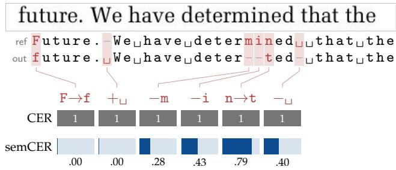
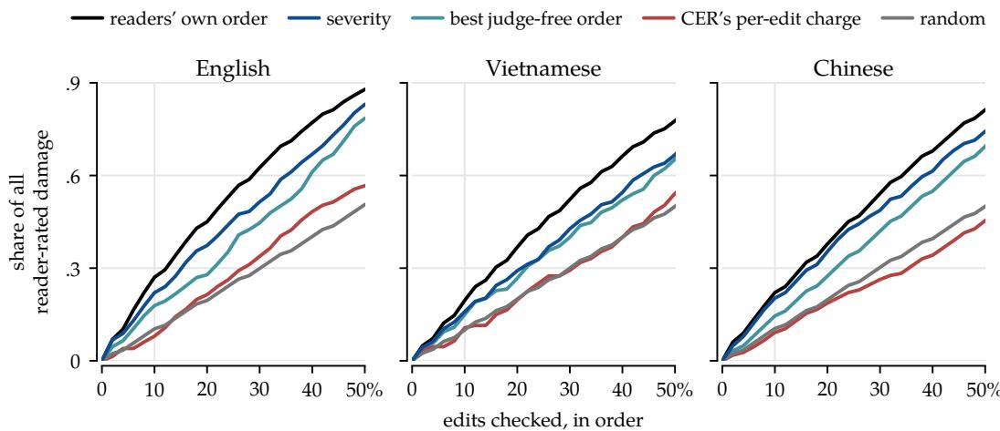
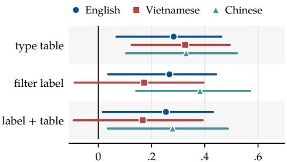
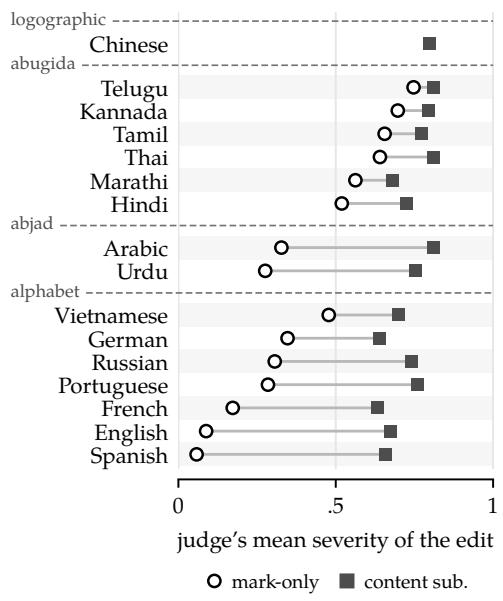
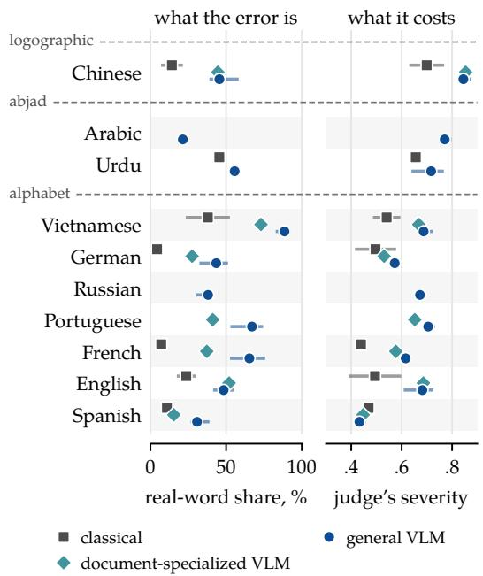
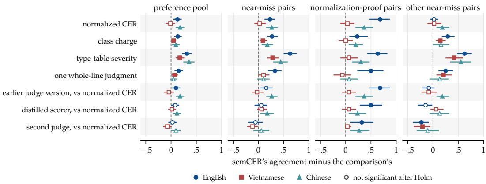

# Equal CER, Unequal Damage: Severity-Weighted Character Error Rate for OCR

Nguyen Nguyen University of Rochester n.nguyen@rochester.edu

Yongyi Zang   
Independent   
zyy0116@gmail.com

## Abstract

Character Error Rate (CER), the standard metric for OCR and vision–language models (VLMs), charges a typo as much as a wrong name. We introduce semCER, which keeps CER’s alignment and denominator and charges each grapheme edit a severity from an LLM judge, with no word segmentation. Normalized CER keeps the score of a whole transcription, where it tracks readers as well as semCER or better, and semCER breaks that score down into named edits. The charges track readers’ ratings edit by edit in English, Vietnamese, and Chinese and put the edits readers rate most severe near the top of a sorted list. On pairs drawn where CER and semCER disagreed, readers side with semCER more often than with normalized CER in English and Chinese, and equally often in Vietnamese. Across 16 languages, the judge charges a wrong diacritic or tone mark almost nothing in Spanish but nearly a wrong letter’s severity in Telugu. Where we can count real words, a general VLM’s wrong letter forms one far above chance while a classical pipeline’s stays near it. We release the 61 million judged edits, the aggregated reader ratings, and the distilled scorer at https://github.com/nguyenx2t/semcer.

<table><tr><td>Printed page scan of the reference</td><td></td><td>Reference / OCR output aligned; the edit in red</td><td>What the edit does English gloss</td><td># CER per edit</td><td>semCER per edit</td><td>0 Readers mean rating</td></tr><tr><td>EN</td><td>strategically about</td><td>strategically about strategicallv about</td><td>non-word; still readable</td><td>1</td><td>0.25</td><td>0.20</td></tr><tr><td>ZH</td><td>收入。合作社</td><td>收入。合作社 收人。合作社</td><td>&quot;income&quot; → &quot;receive people&quot;; recoverable</td><td>1</td><td>0.44</td><td>0.35</td></tr><tr><td>VI</td><td>cùa đáng thiêng</td><td>ca đng thiêng cua dáng thiêng</td><td>đng “being” → dáng &quot;worthy&quot;; recoverable</td><td>1</td><td>0.54</td><td>0.38</td></tr><tr><td>VI</td><td>Con Tăm con Cám</td><td>Con Tm con Cám Con Tám con Cám</td><td>Tm, the heroine → Tám, another name</td><td>1</td><td>0.87</td><td>1.00</td></tr><tr><td>EN</td><td>the AGFD regulations</td><td>the AGFD regulations the ACFD regulations</td><td>the agency&#x27;s acronym changes</td><td>1</td><td>0.97</td><td>0.95</td></tr><tr><td>ZH</td><td>沧州和廊坊</td><td>沧州和廊坊 沧州和聊坊</td><td>Langfang, a city → a nonexistent place</td><td>1</td><td>0.98</td><td>0.70</td></tr></table>

Figure 1: Equal edit counts can hide errors a reader cannot repair. Six single-edit errors are sorted by semCER’s charge; CER charges each one equally. The highlighted rows share one substitution: đấng (“being”) becomes the recoverable đáng (“worthy”), whereas Tấm, the heroine of Tấm Cám, becomes Tám, another Vietnamese name.

## 1 Introduction

Consider two optical character recognition (OCR) systems that each make one error on an English line (Fig. 1). One writes strategically as strategicallv, and the other misreads the agency acronym AGFD as ACFD. A reader fixes the first without hesitation but cannot fix the second, which silently renames an organization. Yet Character Error Rate (CER), the standard metric for OCR and vision–language models (VLMs) alike (Ouyang et al., 2025;

Neudecker et al., 2021; Beyene and Dancy, 2026), charges the two the same, because it counts edits and divides by the reference length, whatever each edit costs the reader.

Benchmarks and scoring toolkits soften the uniform charge by removing or folding whitespace, case, and punctuation before counting (Ouyang et al., 2025; Yang et al., 2025; Vaessen, 2025), but normalization still charges every surviving edit alike. In Fig. 1, two Vietnamese lines contain the same substitution, ấ á. Readers rate the first recoverable from its sentence and the second unrecoverable because it changes the heroine’s name, while normalization charges both the same. VLMs add a failure mode of their own, since they decode through a strong language prior and write fluent wrong words (Gardella et al., 2026; Karamolegkou et al., 2026; Liang et al., 2026; Lee et al., 2026) that CER charges no more than a typo.

Metrics that do weigh meaning either rate the whole output, as semantic similarity scores and most LLM judges do, or grade spans marked outside CER’s alignment, as MQM does (Freitag et al., 2021). Neither stays on CER’s scale. A rate that keeps CER’s form and changes its charge raises three questions. (Q1) Which unit do we charge when a script puts no spaces between words? (Q2) Are a few severity classes fine enough to choose between two transcriptions that both read almost right? (Q3) Where does a severity still help once a benchmark has normalized cosmetic edits away?

In this paper, we introduce semCER, which answers Q1 by design. It charges the grapheme clusters that CER’s alignment already produces and keeps CER’s denominator. One definition therefore applies to alphabets, abugidas, abjads, and unspaced scripts without word segmentation, and charging every edit one gives back CER exactly. For Q2, a judge rates each edit on a five-level rubric, and semCER reads the charge from the judge’s probabilities rather than its most likely level, so two edits at the same level can still differ. Whether that finer charge agrees with readers and chooses between two almost-right transcriptions better than a three-class charge does (Q2), and whether it adds to normalization (Q3), are empirical questions. We answer them by testing semCER against readers, a three-class charge, and normalized CER. The answers make semCER a tool for finding and grading errors, while normalized CER remains the score for a whole transcription. We make four contributions.

• semCER orders the errors to check. Sorted by charge, the edits readers rate most severe come near the top, an order CER cannot give. The charge tracks readers’ ratings beyond what the edit’s type predicts, and in English and Chinese beyond whether normalization would remove the edit (Section 5).

• Readers mostly side with semCER where it disagrees with CER. On pairs drawn where CER and semCER ranked two transcriptions in opposite order, readers of English and Chinese side with semCER on 71 and 78% of pairs. They side with normalized CER, the stronger baseline, on 58 and 60%, and Vietnamese readers side with the two equally often. On the same pairs, readers of all three languages side with semCER significantly more often than with a three-class charge (Section 6).

• An equal edit count hides unequal damage, set by the language and by the system. The judge’s charge for an edit varies across 16 languages with the price of the smallest edit, which costs almost nothing in Spanish and nearly a wrong letter’s severity in Telugu. Where a general VLM and EasyOCR tie on edit count, the VLM’s edits cost more in Chinese and Vietnamese and less in English, French, and Spanish. The split follows the price of the smallest edit, and at least three of the four VLMs show it in each language. The VLM’s letter errors cost more than a classical pipeline’s in every language where we can measure both, except Spanish, and they form real words where the pipeline’s form non-words, so a word-list check misses them (Section 7).

• A distilled scorer with fixed weights reproduces the judge. A 0.8B student trained on the judge’s distributions, with no human rating, comes within 0.03 of the judge’s agreement with readers and orders nine in ten clear edit pairs as the judge does (Section 8). We release it with the 61 million judged edits and the aggregated per-item reader ratings.

## 2 Related Work

Downstream harm. OCR errors matter unequally downstream. They corrupt entities and numbers in retrieval and question answering (van Strien et al., 2020; Hamdi et al., 2023; Jaud et al., 2025; Zhang et al., 2025), and a low CER can hide decision-critical errors (He et al., 2025a).

Error rates with a graded charge. Speech recognition has several error rates that keep the word error rate’s form and replace its unit charge. EmbER discounts substitutions with similar word embeddings (Bañeras Roux et al., 2022), Semantic-WER weights entities and sentiment words (Roy, 2021), and SWWER weights words by BERT-derived importance (Zhang and Ai, 2024). Three others grade each error by its efect, minED (Bañeras-Roux et al., 2024), clinicians’ impact labels (Ellis et al., 2026), and the NER accuracy rate for live subtitling (Romero-Fresco and Martínez Pérez, 2015).

Embedding similarity as semantic severity. BERTScore, BLEURT, SemDist, and H\_eval compare the whole reference and hypothesis through embeddings or learned scores (Zhang et al., 2020; Sellam et al., 2020; Kim et al., 2021; Sasindran et al., 2023), and aligned variants score token or segment pairs (Rugayan et al., 2022; Sasindran et al., 2024). They charge a similarity on a scale unrelated to CER’s, and BERTScore responds weakly to small errors in lexically close candidates, including a changed figure (Hanna and Bojar, 2021; Huang et al., 2025), which are the errors OCR makes.

Model-judged severity on spans. MQM annotates error spans by type and weights them by severity (Lommel et al., 2014; Freitag et al., 2021), and GEMBA-MQM, AutoMQM, xCOMET, and TIGERScore have a model mark and grade the spans (Kocmi and Federmann, 2023; Fernandes et al., 2023; Guerreiro et al., 2024; Jiang et al., 2024). In grammatical error correction, CLEME2.0 also weights individual edits with a language model (Ye et al., 2025). It aligns the erroneous source, the system’s correction, and the reference corrections into word chunks and scores each chunk as a hit, a wrong, a missing, or an unnecessary correction. It then weights a chunk by embedding similarity or by an LLM’s rating of how important the correction is and combines the four scores with fitted coeficients. JELV and LLM judges likewise rate a correction from its marked edits (Zhan et al., 2026; Kobayashi et al., 2024). semCER has only a reference and no erroneous source text, so it scores the recoverability of each error in the transcription, where CLEME2.0 scores the importance of each correction. It charges the graphemes of a fixed unit-cost alignment, which needs no word segmentation, and keeps CER’s denominator, so charging every edit one gives CER back.

LLM judges for document transcription. LLM judges rate extracted tables (Horn and Keuper, 2026), penalize handwritten-math transcriptions that silently correct the writer (Seong et al., 2026), and sort the errors of a text dif into minor and major (Gutteridge et al., 2026). Each scores a whole output or counts errors by class.

Normalization and cost tables. OCR benchmarks transform text diferently before scoring (Ouyang et al., 2025; Yang et al., 2025; Rice and Nartker, 1996), and in speech the choice is known to distort evaluation, since Whisper’s normalizer strips Indic vowel signs and flatters the model (Manohar and Pillai, 2024; Thennal et al., 2025). A second line of work replaces the uniform Levenshtein costs (Levenshtein, 1966) with learned or tuned ones, either a weight per operation or character pair that is fitted once and reused (Ristad and Yianilos, 1998; Oncina and Sebban, 2006; Stanchev et al., 2019) or operation probabilities from learned encodings of both strings (Libovický and Fraser, 2022). Normalization rewrites the strings before alignment, and cost tables let the costs choose the alignment. semCER instead fixes a unit-cost alignment first and charges its edits afterward.

Output-level OCR metrics. Other OCR metrics decompose page-level error by pipeline stage (Bourne et al., 2026), ignore reading order (Clausner et al., 2020), or score reconstruction fidelity against the page image (Vandepitte, 2026). SCORE, for generative parsing, adjusts the edit distance for representational variation and counts hallucinated and omitted tokens (Li et al., 2025). It normalizes the variation away before counting, while semCER charges what survives. Unit-test benchmarks replace the edit count with binary checks per page (Poznanski et al., 2025).

## 3 The semCER Metric

semCER has two parts, a definition that puts a severity in place of CER’s unit charge and a judge that supplies the severity.

## 3.1 Definition

semCER replaces each edit’s unit charge in CER with a severity, so the first choice is what counts as one edit. Like CER, it charges characters rather than words, because a script with no spaces between words yields a word error rate only after a segmentation step whose mistakes the score inherits (Thennal et al., 2025) (Q1). We treat a character in both scores as an extended grapheme cluster, following Unicode Standard Annex #29 (Unicode Consortium, 2026) under Normalization Form C, so a base letter with its accents or tone marks is one unit, as grapheme-level OCR metrics recommend (Nisfer et al., 2026). Published CER implementations often count code points instead (Vaessen, 2025), which splits a syllable of an abugida into its consonant and vowel signs and counts an accented letter as one unit or several depending on how the text was encoded. Extended grapheme clusters approximate the characters a reader perceives and give the same units whatever the encoding form, so the judge rates one kind of unit in every language. We compute every CER in this work over the same grapheme clusters, case- and whitespace-sensitive, and call it unnormalized CER.

Let the reference and output be grapheme sequences $\boldsymbol { r } = \left( \boldsymbol { r } _ { 1 } , \ldots , \boldsymbol { r } _ { m } \right)$ and $h = ( h _ { 1 } , \ldots , h _ { n } )$ An optimal Levenshtein alignment (Levenshtein, 1966; Wagner and Fischer, 1974) yields the edit sequence $\mathcal { E } ( r , h ) = ( e _ { 1 } , \ldots , e _ { q } )$ of substitutions, deletions, and insertions. We break ties among minimal alignments toward substitutions, then deletions, so the judge sees a misread glyph as one edit, and CER is unchanged. For m $> 0 ,$ , CER charges each edit one and divides by the reference length,

$$
\mathrm { C E R } ( r , h ) = \frac { 1 } { m } \sum _ { i = 1 } ^ { q } 1 = \frac { q } { m } .\tag{1}
$$

semCER keeps this form and replaces the unit charge by a severity $s _ { i } = s ( e _ { i } ; r , h ) \in [ 0 , 1 ]$ the judged cost of edit $e _ { i }$ read in its line,

$$
\mathsf { s e m C E R } ( r , h ) = \frac { 1 } { m } \sum _ { i = 1 } ^ { q } s _ { i } ,\tag{2}
$$

where zero marks a surface change, a low value a recoverable edit, and one an unrecoverable loss of content.

semCER therefore discounts the edits the judge rates recoverable. With every $s _ { i } = 1$ it is CER itself, and it never exceeds CER, since no severity exceeds one.

Figure 2 scores one line. The output’s lowercasef follows the scan where the reference capitalizes it, so it costs nothing, and so does an added space. One wrong word, which the alignment splits into three edits, carries most of the charge, and a dropped space the rest.

## 3.2 Severity from an LLM judge

Each edit’s severity comes from a large language model judge, DeepSeek-V4-Flash Preview (DeepSeek-AI, 2026). It reads the full reference and output with the target edit marked in context (Appendix A.1). It then rates how far the edit stops a reader from noticing and repairing it on the ordinal rubric of Table 1, from 0 for a surface change to 4 for an error that leaves no signal. We fit no parameter to human ratings.

  
Figure 2: The metric charges one transcription line edit by edit. A general VLM transcribes an OmniDocBench line, shown as the crop above and the aligned reference and output below. Each edit is shaded, + marks an insertion,  a deletion, and a dash an empty side. Six edits give CER 0.171 over 35 graphemes, while their severities sum to 1.90 and give semCER 0.054.

Table 1: The rubric’s five levels. The judge returns a level, and its rating $\rho _ { k } = k / 4$ is the scale of the severity and of the readers’ ratings.
<table><tr><td></td><td>Level Rating</td><td>Description</td></tr><tr><td>0</td><td>0</td><td>Cosmetic, fully recoverable</td></tr><tr><td>1</td><td>0.25</td><td>Non-word or obvious error, context recovers</td></tr><tr><td>2</td><td>0.5</td><td>Valid alternative, reader may notice</td></tr><tr><td>3</td><td>0.75</td><td>Recovery fails, but error is detectable</td></tr><tr><td>4</td><td>1</td><td>Reads perfectly, is false, no signal</td></tr></table>

The severity separates edits that share a rubric level, because we read the judge’s probabilities over the rubric rather than its most likely level, the mode. G-Eval (Liu et al., 2023) and LLM-as-a-Verifier (Kwok et al., 2026) read probabilities the same way, and judgmentdistribution studies recommend it (Wang et al., 2025a). Scores that take only the most likely level tie often, and their rankings do not reproduce (Kim, 2026). Let $p _ { k }$ be the probability the judge assigns to digit $k \in \{ 0 , \ldots , 4 \}$ at its answer position, renormalized over the five digits,

$$
\tilde { p } _ { k } = \frac { p _ { k } } { \sum _ { j = 0 } ^ { 4 } p _ { j } } .\tag{3}
$$

Each level k carries the rating $\rho _ { k } = k / 4$ of Table 1, and the severity is the expected rating under ${ \tilde { p } } ,$ which treats the rubric’s steps as equally spaced,

$$
s _ { i } = \mathbb { E } _ { k \sim \widetilde { p } } \left[ \rho _ { k } \right] = \sum _ { k = 0 } ^ { 4 } \rho _ { k } \widetilde { p } _ { k } .\tag{4}
$$

When the judge returns no digit, or puts less than half of its probability on the five digits, we ask once more and otherwise charge the edit one (Appendix A.1).

## 4 Experimental Setup

Corpus. We run the judge on the outputs of seven systems on 25 public datasets in 16 languages, 61 million edits in all, scored line by line after the filtering in Appendix A.2. The systems are of three kinds, two classical pipelines, a document-specialized VLM, and four general VLMs (Table 4).

Human annotation. Native or fluent readers of English, Vietnamese, and Chinese annotated three pools, sized in Table 5 (Appendix A.3). The single-edit pool holds about 85 edits per language, each the only edit in its line, and tests whether the judge charges an edit as a reader would. We drew it evenly from three bands of the judge’s severity, low, intermediate, and high, so the pool spans the scale. The pair-level pool, named for its reference and transcription pairs, holds about 180 whole transcriptions per language and tests the summed score. Readers rate both on the rubric’s five levels. The preference pool holds about 175 pairs of transcriptions of one line per language, drawn where CER and semCER, on the judge’s earlier severities, ranked them in opposite order, and readers choose the better OCR of the reference.

  
Figure 3: Sorted by severity, the edits readers rate most severe come first. Each panel gives the share of all reader-rated damage caught after checking a fraction of the single-edit pool in each order, over the first half of the list. The readers’ own order is the ceiling, a random order the diagonal, and the rule marks the 10% cut.

Baselines. We compare the severity with three charges that use no judge, a table built from the judge’s corpus, and two coarser readouts of the same judge. The judge-free charges are CER’s own per-edit charge, the filter label, and the real-word label. The filter label records whether an edit survives the character filter that OCR benchmarks apply before scoring, which keeps letters and digits and drops whitespace, punctuation, and symbols (Ouyang et al., 2025), and the real-word label whether the edit forms a real word. The type table charges an edit the corpus-mean severity of its type and reads the judge’s corpus but not the line. The coarser readouts are the class charge, the judge’s most likely level charged on three fixed class weights, and the whole-line judgment, one rating of the whole line. Normalized CER applies the filter and folds case before alignment.

Statistics. Intervals are 95% percentile bootstrap intervals from 10,000 draws, resampling items within band for the single-edit partial correlations and source documents elsewhere. The single-edit partial correlations control for the sampling band, since we drew that pool by the judge’s severity. A partial whose interval excludes zero therefore shows agreement within a band, which the draw alone cannot produce. We take a comparison’s p-value as twice the smaller bootstrap tail probability about zero and call a diference significant at α = 0.05 after Holm correction (Holm, 1979) within the families that Appendix A.4 names.

## 5 Per-Edit Agreement with Readers

A user who checks a transcription wants to know which errors to look at first, and a score alone does not say. semCER also orders the edits behind its score, so we first test that order against readers and then ask what the severity adds to the simpler charges an order could use.

  
partial rank correlation with readers, given the baseline

Figure 4: Severity carries information that simpler charges miss. Each row is the severity’s partial correlation with readers’ ratings within severity band, given the baseline at left. Label + table is the filter label and the type table together.  
Table 2: On pairs drawn where CER and semCER disagreed, readers mostly side with semCER. Each entry is a score’s agreement with the output that a strict majority of readers chose, a tie counting as a miss (Deutsch et al., 2023). The pool rows cover the 173, 163, and 146 pairs with a strict majority, drawn on the judge’s earlier severities. The normalization-proof rows cover the 22, 30, and 30 such pairs among them, a split made after the test. An asterisk marks a significant margin over normalized CER. Figure 7 gives every margin with its interval.
<table><tr><td></td><td>English Vietnamese</td><td></td><td>Chinese</td></tr><tr><td>Preference pool</td><td></td><td></td><td></td></tr><tr><td>semCER</td><td>0.71*</td><td>0.79</td><td>0.78*</td></tr><tr><td>normalized CER</td><td>0.58</td><td>0.80</td><td>0.60</td></tr><tr><td colspan="4">Normalization-proof pairs</td></tr><tr><td>semCER</td><td>0.77*</td><td>0.53</td><td>0.83*</td></tr><tr><td>normalized CER</td><td>0.09</td><td>0.50</td><td>0.47</td></tr></table>

## 5.1 Which errors to check first

Sorted by semCER’s charge, the edits readers rate most severe come near the top. Figure 1 is such a list. CER charges its six edits the same and so cannot order them, while the three highest severities go to the three edits that readers rate most severe.

On the single-edit pool each edit sits in its own line, so an order of the pool runs across lines. Figure 3 follows each order through the pool and shows the share of all reader-rated damage, the sum of readers’ mean ratings, caught after checking a fraction of the edits. The top-of-list share summarizes that curve over cuts at 10 to 50% of the list, scaled so that a random order scores 0 and the readers’ own order 1 (Appendix B.1).

Sorted by severity, the list scores 0.58 to 0.81 across the three languages, and its top 10% catches 81 to 92% of the damage that the readers’ own top 10% catches (Table 6). Sorted by CER’s per-edit charge, 1/m, which varies only with the line’s length, the list scores about zero, the random baseline. Its top 10% catches 29 to 55%, a gap that is significant in all three languages (Table 6). The best order that uses no judge, chosen among four sorted by the filter label, the real-word label, CER’s per-edit charge, or all three (Appendix B.2), lands about halfway. Severity’s lead over it on the share is significant in Chinese alone (Table 6).

The order holds because the charges match what readers make of each edit. On the single-edit pool, the severity correlates with readers’ mean rating in all three languages (Table 6).

## 5.2 What the severity adds

Beyond the edit’s type. A charge that ignores the line falls short, because the line changes what an edit costs. The type table looks an edit up by its operation and its reference and output graphemes and charges it the corpus-mean severity of that type, computed without the single-edit pool. For strategicallv in Fig. 1, it charges 0.59, the mean for a y v swap. The judge, which reads the line, charges 0.25, and readers give 0.20. Controlling for the table, the severity still tracks readers in all three languages (Fig. 4, type-table row).

Beyond normalization. In English and Chinese, the severity also adds to the normalization that benchmarks already apply (Q3), because it orders the edits normalization keeps. Pooled over the three bands, the filter label correlates with readers about as well as the severity does (Table 6). Within a band, the severity still adds agreement once we control for the label alone or for the label and the type table together. Its intervals lie above zero in English and Chinese (Fig. 4, bottom two rows).

Beyond the most likely level. Reading the judge’s full distribution rather than its most likely level adds agreement with readers in Vietnamese and Chinese (Table 6, severity given the mode).

## 6 Reader Preferences Where CER and semCER Disagree

On whole transcriptions, normalized CER tracks readers as well as semCER or better. Its Spearman’s ρ is 0.93, 0.90, and 0.76 against semCER’s 0.89, 0.87, and 0.76 (Table 7). semCER’s value beside CER therefore lies where the two scores rank a pair of transcriptions of one line in opposite order. We ask how often readers side with semCER there, and whether it adds to what normalization already catches.

Where the scores disagree. We drew the preference pool from such disagreements on the judge’s earlier severities, one pair per source line, and readers chose the better transcription in each. A score agrees with a pair when it picks the output a strict majority of readers chose, a tie counting as a miss. When the pool was drawn, unnormalized CER picked the other output on every pair, so its agreement was one minus semCER’s, and the baseline is therefore normalized CER, which can side with either. On the whole pool, readers of English and Chinese side with semCER on more than seven pairs in ten, against about six in ten for normalized CER. Vietnamese readers side with the two scores equally often, at about eight in ten (Table 2, top).

Near-miss pairs. Two nested subsets sharpen the test. In a near-miss pair, the output that CER rates worse is mostly right and has an error that normalization would keep (Appendix C.2). Before the test, we fixed the criterion that semCER lead normalized CER significantly in at least two languages on these pairs. It does, in English and Chinese (Table 8).

Normalization-proof pairs. A near-miss pair is normalization-proof when normalized CER picks the same output as CER, a split that uses no severity. semCER matters most here, where normalization leaves CER’s choice in place (Q3). On these pairs, normalized CER almost never agrees with English readers and agrees with Chinese readers on under half the pairs, while semCER agrees with most. In Vietnamese, both scores agree with readers on about half the pairs (Table 2, bottom). The English and Chinese margins on these pairs also hold when scored with the judge’s earlier severities, with the distilled scorer, and with the second judge of Appendix C.3 (Fig. 7).

Coarser charges. Coarser readouts of the same judge agree with readers less often than semCER (Q2). The class charge keeps the judge’s labels and charges them on the three fixed weights that severity-aware WER assigns its OK, minor, and critical classes (Wang et al., 2024). On the whole pool, it trails semCER significantly in every language, as the type table does (Fig. 7). One rating of the whole transcription is coarser still. If it suficed, the judge could rate the line once with a severity s¯, and Eq. (2) would reduce to CER s¯. This whole-line judgment trails semCER significantly in English and Vietnamese (Appendix C.2).

## 7 Severity by Language and by System

An equal edit count hides unequal damage. When two transcriptions of a line make the same number of edits, CER calls it a tie, and semCER breaks the tie by the edits’ severities. Where a general VLM and EasyOCR tie on one to five edits, the VLM’s edits cost more in Chinese and Vietnamese and less in English, French, and Spanish (Table 10). At least three of the four VLMs agree in each language, German shows no diference, and the split follows the languages’ grapheme load (Table 11). The gap is significant for 8 of the 24 pairings after correction over all 24, short of the criterion we fixed, a VLM charge above EasyOCR’s for every VLM (Appendix D.1). A count sees neither what the language charges for its smallest edit nor what kind of error the system makes.

  
Figure 5: The cost of the smallest error varies by language. The judge’s mean severity of a mark-only edit (same base letter, diferent mark) and of a content substitution, grouped by writing system (Daniels and Bright, 1996) and ordered by grapheme load (Table 11). An open circle is the mark-only edit and a filled square the content substitution.  
Figure 6: The form and cost of a letter error vary by system class. A marker is the class mean and a bar spans its systems. The left panel is the share of a system’s letter errors that form another real word, which needs no judge, and the right panel the judge’s mean severity of those errors. The documentspecialized VLM is Qianfan-OCR alone.

Language. The judge charges a wrong letter between 0.63 and 0.81 across scripts, but a wrong mark anywhere from nearly nothing in Spanish to almost a wrong letter’s severity in Telugu. We measure the cost of the smallest error with the grapheme load, the judge’s mean severity of the smallest word-changing edit that systems make. Where the script has marks, that edit changes only a mark, a diacritic, vowel sign, or tone mark on the same base letter. In Chinese it is a content substitution, one base letter for another (Fig. 5). The load depends on the marks a script writes more than on the script’s type, so Vietnamese, an alphabet with tone marks, sits near Hindi. The mean severity per edit follows the load, with a rank correlation of 0.75 across the 15 languages with marks, from 0.26 in English to 0.74 in Telugu (Table 11).

System. A general VLM’s letter error forms a real word far more often than a random letter error of the same shape would, as prior work expects of a system with a stronger language prior (Wan et al., 2020; Karamolegkou et al., 2026; Liang et al., 2026; He et al., 2025b; Gardella et al., 2026; Lee et al., 2026). EasyOCR reads by as bv, while a VLM writes has for had. The share of letter errors that form a real word needs no judge to count. In German, French, Spanish, and Vietnamese it rises from the classical pipelines through the document-specialized VLM to the general ones. In the ten languages where we can count real words, general VLM errors form them more often than random letter errors in every language and domain but one, printed, handwritten, and scene text alike. Classical errors stay within 0.10 of the random rate. In each of the eight language and domain sets where both make enough letter errors to compare, the VLM’s margin over random errors is the larger (Appendix D.3).

The judge charges these errors more. A real-word error passes a word-list check (Kukich, 1992), yet the judge charges a general VLM’s letter error more than a classical pipeline’s in every language where we can measure both, except Spanish (Fig. 6).

## 8 A Distilled Scorer with Fixed Weights

A small model with fixed weights approximates the judge, so anyone can compute semCER locally. Scoring edits through an API costs money at scale and ties the scores to whichever model the provider serves. We distill the judge into a student, Qwen3.5-0.8B-Base (Qwen Team, 2026a), which we fine-tune to read the pair with the edit marked and predict the judge’s distribution over the rubric levels, read out as in Eq. (4). We hold out every ratedpool line under every system and use no human rating for training or model selection (Appendix E). The student ships as a Python package, installed with pip install semcer.

The student nearly matches the judge’s agreement with readers. It correlates with their ratings at 0.79, 0.63, and 0.80 in English, Vietnamese, and Chinese, against the judge’s 0.81, 0.66, and 0.82. On pairs of edits whose judge severities difer by at least half a rubric step, it orders nine in ten as the judge does, and its severity difers from the judge’s by a mean absolute 0.04 per edit (Appendix E).

## 9 Conclusion

CER counts edits, and normalization decides which edits to count, but neither says what an edit costs the reader. We introduced semCER, which charges each grapheme edit a judged severity, without word segmentation, and keeps CER’s alignment and denominator. The two scores divide the work. Normalized CER tracks readers’ ratings of whole transcriptions as well as semCER or better, so it remains the score for a transcription. An equal edit count is a tie for CER, and semCER breaks it with charges that follow the language’s smallest edit and the system’s kind of error. Where the two scores order a pair of transcriptions the other way, readers of English and Chinese mostly side with semCER. They do so most of all where normalization leaves CER’s choice in place, and readers of all three languages side with semCER over a three-class charge. The score is a sum over the aligned edits, so each decision between two transcriptions breaks down into named edits and their charges. Those charges track readers’ ratings edit by edit in three languages and put the errors readers rate most severe near the top of a sorted list. We therefore recommend normalized CER for scoring a transcription. Beside it, semCER, computed locally with the distilled scorer, chooses between transcriptions where CER ties or the two scores disagree, and names the edits behind the choice.

## 10 Limitations

Languages. Readers validated the severity in three languages. In the other thirteen, the grapheme load comes from the judge alone, and the judge’s severities may shift with a language’s resource level (Joshi et al., 2020). The lowest-resource languages in our corpus all use non-Latin scripts, so we cannot separate resource level from script. We have not tested whether graphemes are the right unit in Thai, which writes no word boundaries, or in the abjads, which leave vowels unwritten.

Construct. Readers rated on the rubric’s levels, and preference readers chose after guidelines that teach the same construct. The human studies therefore test whether the judge applies the rubric as readers do and leave open whether recoverability is the right construct. The rubric’s levels depend on whether an output is a valid word, so part of the higher charge the judge places on general VLM letter errors in Section 7, which more often form real words, comes from the rubric itself. We leave semCER’s value for downstream tasks to future work.

Judge version. The provider replaced the judge’s checkpoint during this work, so a severity is comparable only within one checkpoint. Corpus severities come from the checkpoint before the replacement. In the rated pools only the edits the judge first left undecided were re-judged on the one after, and the English and Chinese margins on the preference pool and its normalization-proof pairs hold under both (Appendix C.3). The local student has fixed weights, so it avoids this boundary at the cost of approximating the judge.

Rating. Readers rated each single edit as the only edit in its line and rated whole transcriptions without marked edits, so no reader rated an edit’s severity inside a line with other damage. The judge charges each grapheme edit separately, so a wrong word that the alignment splits into several edits pays once per edit (Fig. 2).

Risks. A low semCER says that a reader could recover the errors, and a transcription with a low score still needs checking before use. A judge that undercharges an error class would hide that class.

## Use of AI Assistants

Large language models are part of the method. They judge each edit’s severity, a second one re-judges every rated transcription, and the distilled scorer is a fine-tuned language model. For this manuscript, we used the same class of tools for copy editing (grammar, clarity, and formatting) and for drafting support. We also used language models and agents for literature search, code writing, debugging, and informal discussion and brainstorming. The authors are solely responsible for the scientific content, study design, experiments, and conclusions.

## References

Saad Bin Ahmed, Saeeda Naz, Salahuddin Swati, and Muhammad Imran Razzak. 2019. Handwritten Urdu character recognition using one-dimensional BLSTM classifier. Neural Computing and Applications, 31(4):1143–1151.

ai-forever. 2022. School notebooks dataset (Russian). Hugging Face Datasets, https://huggingface. co/datasets/ai-forever/school\_notebooks\_RU.

Thibault Bañeras Roux, Mickael Rouvier, Jane Wottawa, and Richard Dufour. 2022. Qualitative evaluation of language model rescoring in automatic speech recognition. In Interspeech 2022, pages 3968–3972.

Thibault Bañeras-Roux, Mickael Rouvier, Jane Wottawa, and Richard Dufour. 2024. A paradigm for interpreting metrics and measuring error severity in automatic speech recognition. In Text, Speech, and Dialogue (TSD), pages 174–183. Springer.

Fitsum Sileshi Beyene and Christopher L. Dancy. 2026. A survey of OCR evaluation methods and metrics and the invisibility of historical documents. In ACM Conference on Fairness, Accountability, and Transparency (FAccT), pages 7675–7691.

Jonathan Bourne, Mwiza Simbeye, and Joseph Nockels. 2026. The character error vector: Decomposable errors for page-level OCR evaluation. arXiv preprint arXiv:2604.06160.

Christian Clausner, Stefan Pletschacher, and Apostolos Antonacopoulos. 2020. Flexible character accuracy measure for reading-order-independent evaluation. Pattern Recognition Letters, 131:390– 397.

Cheng Cui, Ting Sun, Manhui Lin, Tingquan Gao, et al. 2025. PaddleOCR 3.0 technical report. arXiv preprint arXiv:2507.05595.

Peter T. Daniels and William Bright, editors. 1996. The World’s Writing Systems. Oxford University Press, New York.

DeepSeek-AI. 2026. DeepSeek-V4: Towards highly eficient million-token context intelligence. arXiv preprint arXiv:2606.19348.

Daniel Deutsch, George Foster, and Markus Freitag. 2023. Ties matter: Meta-evaluating modern metrics with pairwise accuracy and tie calibration. In Proceedings of the 2023 Conference on Empirical Methods in Natural Language Processing, pages 12914–12929.

Thao Do, Dinh Phu Tran, An Vo, and Daeyoung Kim. 2025. Reference-based post-OCR processing with LLM for precise diacritic text in historical document recognition. In AAAI Conference on Artificial Intelligence, volume 39, pages 27951–27959.

Daxiang Dong, Mingming Zheng, Dong Xu, Chunhua Luo, et al. 2026. Qianfan-OCR: A unified end-to-end model for document intelligence. arXiv preprint arXiv:2603.13398.

Zachary Ellis, Jared Joselowitz, Yash Deo, Yajie He, Anna Kalygina, Aisling Higham, Mana Rahimzadeh, Yan Jia, Ibrahim Habli, and Ernest Lim. 2026. WER is unaware: Assessing how ASR errors distort clinical understanding in patient facing dialogue. In International Workshop on Spoken Dialogue Systems Technology (IWSDS).

Fachhochschule Südwestfalen. 2024. German handwriting dataset. Hugging Face Datasets, https: //huggingface.co/datasets/fhswf/german\_handwriting.

Patrick Fernandes, Daniel Deutsch, Mara Finkelstein, Parker Riley, André F. T. Martins, Graham Neubig, Ankush Garg, Jonathan H. Clark, Markus Freitag, and Orhan Firat. 2023. The devil is in the errors: Leveraging large language models for fine-grained machine translation evaluation. In Conference on Machine Translation (WMT), pages 1066–1083.

Markus Freitag, George Foster, David Grangier, Viresh Ratnakar, Qijun Tan, and Wolfgang Macherey. 2021. Experts, errors, and context: A large-scale study of human evaluation for machine translation. Transactions of the Association for Computational Linguistics (TACL), 9:1460–1474.

Marina Gardella, Camilo Mariño, Diego Belzarena, Ignacio Ramírez, Gregory Randall, and Jean-Michel Morel. 2026. When low CER is not enough: An analysis of hallucinations in vision-language OCR systems on historical Uruguayan documents. In ICDAR 2026 Workshops (ADAPDA).

Gemma Team. 2026. Gemma 4 technical report. arXiv preprint arXiv:2607.02770.

Emmanuèle Grosicki and Haikal El-Abed. 2011. ICDAR 2011 – French handwriting recognition competition. In International Conference on Document Analysis and Recognition (ICDAR), pages 1459– 1463.

Nuno M. Guerreiro, Ricardo Rei, Daan van Stigt, Luisa Coheur, Pierre Colombo, and André F. T. Martins. 2024. xCOMET: Transparent machine translation evaluation through fine-grained error detection. Transactions of the Associationfor Computational Linguistics, 12:979–995.

Benjamin Gutteridge, Matthew Thomas Jackson, Toni Kukurin, and Xiaowen Dong. 2026. Judge a book by its cover: Investigating multi-modal LLMs for multi-page handwritten document transcription. In Conference on Language Modeling (COLM).

Ahmed Hamdi, Elvys Linhares Pontes, Nicolas Sidère, Mickaël Coustaty, and Antoine Doucet. 2023. In-depth analysis of the impact of OCR errors on named entity recognition and linking. Natural Language Engineering, 29(2):425–448.

Michael Hanna and Ondřej Bojar. 2021. A fine-grained analysis of BERTScore. In Proceedings ofthe Sixth Conference on Machine Translation (WMT), pages 507–517.

Yueru He, Xueqing Peng, Yupeng Cao, Yan Wang, Lingfei Qian, Haohang Li, Yi Han, Shuyao Wang, Ruoyu Xiang, Fan Zhang, Zhuohan Xie, Mingquan Lin, Prayag Tiwari, Jimin Huang, Guojun Xiong, and Sophia Ananiadou. 2025a. FinCriticalED: A visual benchmark for financial fact-level OCR. arXiv preprint arXiv:2511.14998.

Zhentao He, Can Zhang, Ziheng Wu, Zhenghao Chen, Yufei Zhan, Yifan Li, Zhao Zhang, Xian Wang, and Minghui Qiu. 2025b. Seeing is believing? Mitigating OCR hallucinations in multimodal large language models. In Advances in Neural Information Processing Systems (NeurIPS).

Sture Holm. 1979. A simple sequentially rejective multiple test procedure. Scandinavian Journal of Statistics, 6(2):65–70.

Pius Horn and Janis Keuper. 2026. Beyond string matching: Semantic evaluation of PDF table extraction. arXiv preprint arXiv:2603.18652.

Yu-Shiang Huang, Yun-Yu Lee, Tzu-Hsin Chou, Che Lin, and Chuan-Ju Wang. 2025. FinNuE: Exposing the risks of using BERTScore for numerical semantic evaluation in finance. In CIKM 2025 Workshop on Advances in Financial AI.

IIIT Hyderabad, Centre for Visual Information Technology. 2025. ICDAR 2025 competition on Indic handwritten document recognition (IHDR). https://ilocr.iiit.ac.in/icdar\_2025\_Indic\_HDR/. Task-B per-language document sets; accessed 2026-09-09.

JaidedAI. 2020. EasyOCR. https://github.com/JaidedAI/EasyOCR.

Alexandre Jaud, Ahmed Hamdi, Antoine Doucet, Adam Jatowt, and Mickaël Coustaty. 2025. Beyond CER and WER: How does OCR really impact information retrieval? In ACM/IEEE Joint Conference on Digital Libraries (JCDL), pages 30–39.

Dongfu Jiang, Yishan Li, Ge Zhang, Wenhao Huang, Bill Yuchen Lin, and Wenhu Chen. 2024. TIGER-Score: Towards building explainable metric for all text generation tasks. Transactions on Machine Learning Research.

Pratik Joshi, Sebastin Santy, Amar Budhiraja, Kalika Bali, and Monojit Choudhury. 2020. The state and fate of linguistic diversity and inclusion in the NLP world. In Proceedings of the 58th Annual Meeting of the Association for Computational Linguistics, pages 6282–6293. Association for Computational Linguistics.

Antonia Karamolegkou, Nicolas Angleraud, Benoît Sagot, and Thibault Clérice. 2026. Reading or guessing? Visual grounding failures of vision-language models for OCR in Ancient Greek editions. arXiv preprint arXiv:2605.27750.

Donghwan Kim. 2026. LLM-as-a-judge scores are unreliable optimization signals in closed-loop table recognition. arXiv preprint arXiv:2607.13347.

Suyoun Kim, Abhinav Arora, Duc Le, Ching-Feng Yeh, Christian Fuegen, Ozlem Kalinli, and Michael L. Seltzer. 2021. Semantic distance: A new metric for ASR performance analysis towards spoken language understanding. In Interspeech, pages 1977–1981.

Masamune Kobayashi, Masato Mita, and Mamoru Komachi. 2024. Large language models are state-ofthe-art evaluator for grammatical error correction. In Workshop on Innovative Use of NLPfor Building Educational Applications (BEA), pages 68–77.

Tom Kocmi and Christian Federmann. 2023. GEMBA-MQM: Detecting translation quality error spans with GPT-4. In Conference on Machine Translation (WMT), pages 768–775.

Klaus Krippendorf. 2004. Content Analysis: An Introduction to Its Methodology, 2nd edition. Sage.

Karen Kukich. 1992. Techniques for automatically correcting words in text. ACM Computing Surveys, 24(4):377–439.

Jacky Kwok, Shulu Li, Pranav Atreya, Yuejiang Liu, Yixing Jiang, Chelsea Finn, Marco Pavone, Ion Stoica, and Azalia Mirhoseini. 2026. LLM-as-a-verifier: A general-purpose verification framework. arXiv preprint arXiv:2607.05391.

Woosuk Kwon, Zhuohan Li, Siyuan Zhuang, Ying Sheng, Lianmin Zheng, Cody Hao Yu, Joseph Gonzalez, Hao Zhang, and Ion Stoica. 2023. Eficient memory management for large language model serving with PagedAttention. In ACM Symposium on Operating Systems Principles (SOSP), pages 611–626.

Gwang Gook Lee, Kenan Emir Ak, Jay Mohta, Yan Xu, and Dimitrios Dimitriadis. 2026. Do VLMs read or rewrite? On transcription faithfulness in vision-language models. arXiv preprint arXiv:2607.21617.

Vladimir I. Levenshtein. 1966. Binary codes capable of correcting deletions, insertions, and reversals. Soviet Physics Doklady, 10(8):707–710.

Renyu Li, Antonio Jimeno Yepes, Yao You, Kamil Pluciński, Maximilian Operlejn, and Crag Wolfe. 2025. SCORE: A semantic evaluation framework for generative document parsing. arXiv preprint arXiv:2509.19345.

Yunhao Liang, Ruixuan Ying, Bo Li, Hong Li, Kai Yan, Qingwen Li, Min Yang, Satoshi Okamoto, Zhe Cui, and Shiwen Ni. 2026. Visual merit or linguistic crutch? A close look at DeepSeek-OCR. arXiv preprint arXiv:2601.03714.

Jindřich Libovický and Alexander Fraser. 2022. Neural string edit distance. In Workshop on Structured Prediction for NLP (SPNLP@ACL), pages 52–66.

Cheng-Lin Liu, Fei Yin, Da-Han Wang, and Qiu-Feng Wang. 2011. CASIA online and ofline Chinese handwriting databases. In International Conference on Document Analysis and Recognition (ICDAR), pages 37–41.

Yang Liu, Dan Iter, Yichong Xu, Shuohang Wang, Ruochen Xu, and Chenguang Zhu. 2023. G-Eval: NLG evaluation using GPT-4 with better human alignment. In Conference on Empirical Methods in Natural Language Processing (EMNLP), pages 2511–2522.

Arle Lommel, Hans Uszkoreit, and Aljoscha Burchardt. 2014. Multidimensional quality metrics (MQM): A framework for declaring and describing translation quality metrics. Tradumàtica, 12:455– 463.

Shangbang Long, Siyang Qin, Dmitry Panteleev, Alessandro Bissacco, Yasuhisa Fujii, and Michalis Raptis. 2022. Towards end-to-end unified scene text detection and layout analysis. In IEEE/CVF Conference on Computer Vision and Pattern Recognition (CVPR), pages 1039–1049.

Sabri A. Mahmoud, Irfan Ahmad, Wasfi G. Al-Khatib, Mohammad Alshayeb, Mohammad Tanvir Parvez, Volker Märgner, and Gernot A. Fink. 2014. KHATT: An open Arabic ofline handwritten text database. Pattern Recognition, 47(3):1096–1112.

Kavya Manohar and Leena G Pillai. 2024. What is lost in normalization? Exploring pitfalls in multilingual ASR model evaluations. In Conference on Empirical Methods in Natural Language Processing (EMNLP), pages 10864–10869.

Urs-Viktor Marti and Horst Bunke. 2002. The IAM-database: An English sentence database for ofline handwriting recognition. International Journal on Document Analysis and Recognition, 5(1):39–46.

Minesh Mathew, Ajoy Mondal, and C. V. Jawahar. 2024. Towards deployable OCR models for Indic languages. In International Conference on Pattern Recognition (ICPR), pages 167–182.

Nibal Nayef, Yash Patel, Michal Busta, Pinaki Nath Chowdhury, Dimosthenis Karatzas, Wafa Khlif, Jiri Matas, Umapada Pal, Jean-Christophe Burie, Cheng-lin Liu, and Jean-Marc Ogier. 2019. ICDAR2019 robust reading challenge on multi-lingual scene text detection and recognition (RRC-MLT-2019). In International Conference on Document Analysis and Recognition (ICDAR), pages 1582–1587.

Arthur F. S. Neto, Byron L. D. Bezerra, Sávio S. Araújo, Wiliane M. A. S. Souza, Kléberson F. Alves, Macileide F. Oliveira, Samara V. S. Lins, Hugo J. F. Hazin, Pedro H. V. Rocha, and Alejandro H. Toselli. 2024. BRESSAY: A Brazilian Portuguese dataset for ofline handwritten text recognition. In International Conference on Document Analysis and Recognition (ICDAR), pages 315–333.

Clemens Neudecker, Konstantin Baierer, Mike Gerber, Christian Clausner, Apostolos Antonacopoulos, and Stefan Pletschacher. 2021. A survey of OCR evaluation tools and metrics. In International Workshop on Historical Document Imaging and Processing (HIP), pages 13–18.

Hung Tuan Nguyen, Cuong Tuan Nguyen, Pham The Bao, and Masaki Nakagawa. 2018. A database of unconstrained Vietnamese online handwriting and recognition experiments by recurrent neural networks. Pattern Recognition, 78:291–306.

Nguyen Nguyen, Thu Nguyen, Vinh Tran, Minh-Triet Tran, Thanh Duc Ngo, Thien Huu Nguyen, and Minh Hoai. 2021. Dictionary-guided scene text recognition. In IEEE/CVF Conference on Computer Vision and Pattern Recognition (CVPR), pages 7379–7388.

Izzath Nisfer, Ashini Kavindya, Ovindu Atukorala, Purushoth Velayuthan, and Menan Velayuthan. 2026. grapheme-kit: Grapheme-level metrics and text processing for multilingual NLP. arXiv preprint arXiv:2607.22456.

Surapon Nonesung, Teetouch Jaknamon, Sirinya Chaiophat, Natapong Nitarach, Chanakan Wittayasakpan, Warit Sirichotedumrong, Adisai Na-Thalang, and Kunat Pipatanakul. 2025. ThaiOCRBench: A task-diverse benchmark for vision-language understanding in Thai. In Proceedings of the 14th International Joint Conference on Natural Language Processing and the 4th Conference ofthe Asia-Pacific Chapter of the Associationfor Computational Linguistics, pages 1653–1675.

Jose Oncina and Marc Sebban. 2006. Learning stochastic edit distance: Application in handwritten character recognition. Pattern Recognition, 39(9):1575–1587.

Linke Ouyang et al. 2025. OmniDocBench: Benchmarking diverse PDF document parsing with comprehensive annotations. In IEEE/CVF Conference on Computer Vision and Pattern Recognition (CVPR), pages 24838–24848.

Pongsasit. 2025. Thai\_handwriting. Hugging Face dataset Pongsasit/Thai\_handwriting. Withdrawn from the Hub by September 2026.

Jake Poznanski, Luca Soldaini, and Kyle Lo. 2025. olmOCR 2: Unit test rewards for document OCR. arXiv preprint arXiv:2510.19817.

Qwen Team. 2026a. Qwen3.5: Towards native multimodal agents.

Qwen Team. 2026b. Qwen3.6-27B: Flagship-level coding in a 27B dense model.

Qwen Team. 2026c. Qwen3.7-Flash. Model card, https://www.qwencloud.com/models/qwen3.7-flash. Accessed September 2026.

Stephen V. Rice and Thomas A. Nartker. 1996. The ISRI analytic tools for OCR evaluation. Technical Report TR-96-02, Information Science Research Institute, University of Nevada, Las Vegas.

Eric Sven Ristad and Peter N. Yianilos. 1998. Learning string-edit distance. IEEE Transactions on Pattern Analysis and Machine Intelligence, 20(5):522–532.

Pablo Romero-Fresco and Juan Martínez Pérez. 2015. Accuracy rate in live subtitling: The NER model. In Audiovisual Translation in a Global Context, pages 28–50. Palgrave Macmillan.

Somnath Roy. 2021. Semantic-WER: A unified metric for the evaluation of ASR transcript for end usability. arXiv preprint arXiv:2106.02016.

Janine Rugayan, Torbjørn Svendsen, and Giampiero Salvi. 2022. Semantically meaningful metrics for Norwegian ASR systems. In Interspeech, pages 2283–2287.

Zitha Sasindran, Harsha Yelchuri, and T. V. Prabhakar. 2024. SeMaScore: A new evaluation metric for automatic speech recognition tasks. In Interspeech, pages 4558–4562.

Zitha Sasindran, Harsha Yelchuri, T. V. Prabhakar, and Supreeth Rao. 2023. H\_eval: A new hybrid evaluation metric for automatic speech recognition tasks. In IEEE Automatic Speech Recognition and Understanding Workshop (ASRU), pages 1–7.

Thibault Sellam, Dipanjan Das, and Ankur P. Parikh. 2020. BLEURT: Learning robust metrics for text generation. In Annual Meeting of the Association for Computational Linguistics (ACL), pages 7881–7892.

Jin Seong, Wencke Liermann, Minho Kim, Jong hun Shin, and Soojong Lim. 2026. When VLMs ‘Fix’ students: Identifying and penalizing over-correction in the evaluation of multi-line handwritten math OCR. arXiv preprint arXiv:2604.22774.

Baoguang Shi, Cong Yao, Minghui Liao, Mingkun Yang, Pei Xu, Linyan Cui, Serge Belongie, Shijian Lu, and Xiang Bai. 2017. ICDAR2017 competition on reading Chinese text in the wild (RCTW-17). In International Conference on Document Analysis and Recognition (ICDAR), pages 1429–1434.

Patrick E. Shrout and Joseph L. Fleiss. 1979. Intraclass correlations: Uses in assessing rater reliability. Psychological Bulletin, 86(2):420–428.

Amanpreet Singh, Guan Pang, Mandy Toh, Jing Huang, Wojciech Galuba, and Tal Hassner. 2021. TextOCR: Towards large-scale end-to-end reasoning for arbitrary-shaped scene text. In IEEE/CVF Conference on Computer Vision and Pattern Recognition (CVPR), pages 8798–8808.

Peter Stanchev, Weiyue Wang, and Hermann Ney. 2019. EED: Extended edit distance measure for machine translation. In Conference on Machine Translation (WMT), pages 514–520.

Yipeng Sun, Zihan Ni, Chee-Kheng Chng, Yuliang Liu, Canjie Luo, Chun Chet Ng, Junyu Han, Errui Ding, Jingtuo Liu, Dimosthenis Karatzas, Chee Seng Chan, and Lianwen Jin. 2019. ICDAR 2019 competition on large-scale street view text with partial labeling (RRC-LSVT). In International Conference on Document Analysis and Recognition (ICDAR), pages 1557–1562.

D K Thennal, Jesin James, Deepa Padmini Gopinath, and Muhammed Ashraf K. 2025. Advocating character error rate for multilingual ASR evaluation. In Findings of the Associationfor Computational Linguistics: NAACL 2025, pages 4941–4950.

Unicode Consortium. 2026. Unicode standard annex #29: Unicode text segmentation. Technical report, Unicode Consortium. Revision 49, Unicode 18.0.0, https://www.unicode.org/reports/ tr29/tr29-49.html.

Nik Vaessen. 2025. JiWER: Evaluate your speech-to-text system with similarity measures such as word error rate. Version 4.0.0, https://github.com/jitsi/jiwer.

Daniel van Strien, Kaspar Beelen, Mariona Coll Ardanuy, Kasra Hosseini, Barbara McGillivray, and Giovanni Colavizza. 2020. Assessing the impact of OCR quality on downstream NLP tasks. In International Conference on Agents and Artificial Intelligence (ICAART), pages 484–496.

Ward Vandepitte. 2026. Beyond edit distance: Reference-free structural-reconstruction fidelity for document OCR. engrXiv preprint.

Andreas Veit, Tomas Matera, Lukas Neumann, Jiri Matas, and Serge Belongie. 2016. COCO-Text: Dataset and benchmark for text detection and recognition in natural images. arXiv preprint arXiv:1601.07140.

Robert A. Wagner and Michael J. Fischer. 1974. The string-to-string correction problem. Journal of the ACM, 21(1):168–173.

Zhaoyi Wan, Jielei Zhang, Liang Zhang, Jiebo Luo, and Cong Yao. 2020. On vocabulary reliance in scene text recognition. In IEEE/CVF Conference on Computer Vision and Pattern Recognition (CVPR), pages 11422–11431.

Minghan Wang, Yuxia Wang, Thuy-Trang Vu, Ehsan Shareghi, and Gholamreza Hafari. 2024. Exploring the potential of multimodal LLM with knowledge-intensive multimodal ASR. In Findings of the Association for Computational Linguistics: EMNLP 2024, pages 13274–13288.

Victor Wang, Michael J. Q. Zhang, and Eunsol Choi. 2025a. Improving LLM-as-a-judge inference with the judgment distribution. In Findings of the Association for Computational Linguistics: EMNLP 2025, pages 23173–23199.

Weiyun Wang et al. 2025b. InternVL3.5: Advancing open-source multimodal models in versatility, reasoning, and eficiency. arXiv preprint arXiv:2508.18265.

Ismet Zeki Yalniz and R. Manmatha. 2011. A fast alignment scheme for automatic OCR evaluation of books. In International Conference on Document Analysis and Recognition (ICDAR), pages 754–758.

Zhibo Yang, Jun Tang, Zhaohai Li, Pengfei Wang, Jianqiang Wan, Humen Zhong, Xuejing Liu, Mingkun Yang, Peng Wang, Shuai Bai, Lianwen Jin, and Junyang Lin. 2025. CC-OCR: A comprehensive and challenging OCR benchmark for evaluating large multimodal models in literacy. In IEEE/CVF International Conference on Computer Vision (ICCV).

Jingheng Ye, Zishan Xu, Yinghui Li, Linlin Song, Qingyu Zhou, Hai-Tao Zheng, Ying Shen, Wenhao Jiang, Hong-Gee Kim, Ruitong Liu, Xin Su, and Zifei Shan. 2025. CLEME2.0: Towards interpretable evaluation by disentangling edits for grammatical error correction. In Annual Meeting of the Association for Computational Linguistics (ACL), pages 204–222.

Tai-Ling Yuan, Zhe Zhu, Kun Xu, Cheng-Jun Li, Tai-Jiang Mu, and Shi-Min Hu. 2019. A large Chinese text dataset in the wild. Journal of Computer Science and Technology, 34(3):509–521.

Yuhao Zhan, Yuqing Zhang, Jing Yuan, Qixiang Ma, Zhiqi Yang, Yu Gu, Zemin Liu, and Fei Wu. 2026. JELV: A judge of edit-level validity for evaluation and automated reference expansion in grammatical error correction. In Proceedings of the AAAI Conference on Artificial Intelligence, volume 40, pages 34611–34619.

Junyuan Zhang et al. 2025. OCR hinders RAG: Evaluating the cascading impact of OCR on retrievalaugmented generation. In IEEE/CVF International Conference on Computer Vision (ICCV), pages 17443–17453.

Rui Zhang, Mingkun Yang, Xiang Bai, Baoguang Shi, Dimosthenis Karatzas, Shijian Lu, C. V. Jawahar, Yongsheng Zhou, Qianyi Jiang, Qi Song, Nan Li, Kai Zhou, Lei Wang, Dong Wang, and Minghui Liao. 2019. ICDAR 2019 robust reading challenge on reading Chinese text on signboard. In International Conference on Document Analysis and Recognition (ICDAR), pages 1577–1581.

Tianyi Zhang, Varsha Kishore, Felix Wu, Kilian Q. Weinberger, and Yoav Artzi. 2020. BERTScore: Evaluating text generation with BERT. In International Conference on Learning Representations (ICLR).

Yutao Zhang and Jun Ai. 2024. Semantic-weighted word error rate based on BERT for evaluating automatic speech recognition models. In 2024 11th International Conference on Dependable Systems and Their Applications (DSA), pages 189–198.

## A Setup Details

## A.1 Judge configuration

DeepSeek-V4-Flash Preview scores each marked edit at temperature 1, answering directly without a reasoning trace. It sees the full reference and output, then the edit in brackets, and returns one of the five rubric levels of Table 1.

Prompt. The system message is the text below, the same for every per-edit severity in this paper, while the whole-line judgment of Appendix B.2 uses its own prompt. The user message gives the reference and output in full as REFERENCE: and HYPOTHESIS: blocks, then the edit block in the system message’s notation with ten graphemes of context on each side and an ellipsis beyond, then the line Output exactly one digit (0, 1, 2, 3, or 4):.

You are an OCR quality evaluator. For each request, rate how much a single grapheme-level edit damages semantic   
meaning, given the surrounding context.   
TASK: You are given an edit operation and two views of the same sentence — REF with the edit position marked in   
brackets, and HYP with the edit position marked in brackets. Score the damage on integer scale 0-4 based on the   
rubric.   
1. Read REF and HYP to establish sentence-level context.   
2. Identify the operation type and locate the edit at the bracket position.   
3. Determine if the hypothesis token is a valid word/morpheme in the language.   
4. Determine if the sentence-level context signals an error and if the original is recoverable.   
5. Apply SEVERITY LEVELS strictly. Do not score on intuition.   
6. Output exactly one digit: 0, 1, 2, 3, or 4. No reasoning text.   
LANGUAGES: Any natural language. Apply identical criteria regardless of script.   
EDIT NOTATION:   
- SUB: REF contains [X], HYP contains [Y]   
- DEL: REF contains [X], HYP contains []   
- INS: REF contains [], HYP contains [Y]   
SEVERITY LEVELS:   
0 — Surface only. Case, punctuation, whitespace, or glyph variant. Meaning fully preserved; change would not be   
noticed in normal reading.   
1 — Minor. Hypothesis is a non-word but sentence-level context uniquely determines the original. Reader recovers   
with negligible effort.   
2 — Moderate. Hypothesis is a valid word but contextually plausible-but-odd in local syntax. Reader may parse at   
face value or sense an error; recovery requires noticing the mismatch.   
3 — Severe with partial recovery. Result signals an error (grammatical anomaly, format violation, collocational   
mismatch) but the original cannot be uniquely recovered from candidate set.   
4 — Total. Hypothesis is fully valid, fits surrounding context, gives no signal of error, original unrecoverable   
from this edit alone. Magnitude doesn't matter; what matters is recoverability.   
ANCHOR (Score 4):   
Operation: SUB   
REF: The team meeting will be held at [3]pm tomorrow in the conference room.   
HYP: The team meeting will be held at [8]pm tomorrow in the conference room.   
Why 4: Sentence context "team meeting ... conference room" doesn't disambiguate the time. "8pm" is fully valid.   
Reader has no path to recover "3pm". Information destroyed.   
EXAMPLES:   
Operation: SUB   
REF: I will meet you at 3p[m] tomorrow at the cafe.   
HYP: I will meet you at 3p[M] tomorrow at the cafe.   
Score: 0   
Operation: SUB   
REF: The patient is im[p]roving rapidly after surgery.   
HYP: The patient is im[b]roving rapidly after surgery.   
Score: 1   
Operation: SUB   
REF: Please turn l[e]ft at the next corner near the bank.   
HYP: Please turn l[i]ft at the next corner near the bank.   
Score: 2

Operation: SUB   
REF: She lives on the [1]3th floor of the building.   
HYP: She lives on the [2]3th floor of the building.   
Score: 3   
Operation: SUB   
REF: She was born in 19[9]9 in a small village.   
HYP: She was born in 19[8]9 in a small village.   
Score: 4   
OUTPUT FORMAT: Exactly one digit: 0, 1, 2, 3, or 4. Nothing else.

Undecided edits. When the judge returns no digit or puts less than half of its probability on the five digits, we ask it once more. If it fails again, we charge the edit one, the highest severity, the conservative choice for an edit the judge cannot decide. This imputed charge afects 0.8% of corpus edits, between 1.6 and 4.3% in the three rated languages and under 0.01% elsewhere. It enters only the corpus-level semCER scores. The analyses of Section 7 use only transcriptions the judge scored completely, and we re-judged every undecided edit in the rated pools, so no rated edit carries an imputed charge (Appendix C.3).

## A.2 Corpus, systems, and compute

Corpus. We drop non-transcription tasks, references shorter than 20 or longer than 4,000 code points, records with only numbers or bare URLs, and formula-dense text. A reference counts as formula-dense when it is under 200 code points with three or more LATEX commands, or under 100 with more than a fifth of its characters mathematical symbols. We then keep at most 15,000 lines per dataset and language for handwriting and printed documents and 3,000 lines per language for scene text, pooled across datasets (Table 3).

Systems. Qianfan-OCR and the general VLMs (Table 4) receive the prompt Read all the text visible in this image. Output only the text, nothing else. EasyOCR, PP-OCRv5, and Qianfan-OCR ran on one RTX 3090, and the four general VLMs took about 40 H100-hours in all under vLLM (Kwon et al., 2023). Judging the corpus cost about \$2,000, and the distilled scorer trained for about 30 hours on one A100.

Release. We use each dataset for research under its terms. We release severities and ratings under CC BY 4.0, with source text only where its license permits redistribution, and the scorer’s code and weights under Apache-2.0. The other sources carry labels only, keyed by line identifier to match the original datasets.

## A.3 Human studies

Readers. Readers were native or fluent speakers naive to the research, recruited through Prolific and by invitation and paid \$12 per hour, the platform’s recommended rate. They saw no system names, judge output, or study hypothesis, and no author rated items. Table 5 gives their agreement.

Consent. Readers recruited through Prolific saw a study description naming the purpose (evaluating how well OCR systems preserve meaning), the task, and its length. All readers could stop at any time and consented by starting. No ethics board reviewed the study.

Data. Readers judged transcriptions of public documents, and we asked nothing about them. We stored only pseudonymous rater IDs, ratings, optional rationales, and response times. Since the description did not mention publishing ratings, we release per-item aggregates, the mean rating or majority choice and the number of readers, and no individual responses, IDs, or rationales.

Items and sampling. A single-edit or pair-level item shows the reference and the transcription as two blocks of text under the question How severe is this OCR error? The five levels of Table 1 appear as buttons labeled by the table’s descriptions. Single-edit items mark the difering span, while pair-level items show plain text, so readers find the errors themselves. Preference items show the reference and two outputs in random order, and readers pick one. Before rating, readers study worked examples and must answer four of five severity checks correctly.

Table 3: The evaluation corpus contains 229,395 transcription lines after filtering.
<table><tr><td>Type</td><td>Datasets</td><td>Lines</td></tr><tr><td>Handwriting</td><td>IAM (Marti and Bunke, 2002), RIMES (Grosicki and El-Abed, 104,897 2011), German Handwriting (Fachhochschule Südwestfalen, 2024), CASIA-HWDB (Liu et al., 2011), KHATT (Mahmoud et al., 2014), UNHD (Ahmed et al., 2019), VNOnDB (Nguyen et al., 2018), Thai handwriting (Pongsasit, 2025), BRESSAY (Neto et al., 2024), School</td><td></td></tr><tr><td>Scene text</td><td>Centre for Visual Information Technology, 2025) HierText (Long et al., 2022), LSVT (Sun et al., 2019), RCTW-17 (Shi et al., 2017), COCO-Text (Veit et al., 2016), TextOCR (Singh et al., 2021), CTW (Yuan et al., 2019), ReCTS (Zhang et al., 2019), Vin- Text (Nguyen et al., 2021), MLT-2019 (Nayef et al., 2019), ThaiOCR- Bench (Nonesung et al., 2025)</td><td>11,380</td></tr><tr><td>Printed document</td><td>OmniDocBench (Ouyang et al., 2025), VieBookRead (Do et al., 113,118 2025), RETAS (Yalniz and Manmatha, 2011), Mozhi (Mathew et al.,</td><td></td></tr><tr><td></td><td>2024)</td><td></td></tr></table>

Table 4: The evaluation includes classical pipelines, a document-specialized VLM, and general VLMs. 26B-A4B gives the total and active parameters of a mixture-of-experts model.
<table><tr><td>System</td><td>Params Reference</td></tr><tr><td>Classical OCR</td><td></td></tr><tr><td>EasyOCR</td><td>(JaidedAI, 2020)</td></tr><tr><td>PP-OCRv5</td><td>(Cui et al., 2025)</td></tr><tr><td>Document-specialized VLM Qianfan-OCR</td><td></td></tr><tr><td>General VLMs</td><td>4B (Dong et al., 2026)</td></tr><tr><td>Gemma 4 26B-A4B</td><td>(Gemma Team, 2026)</td></tr><tr><td>InternVL3.5</td><td>38B (Wang et al., 2025b)</td></tr><tr><td>Qwen3.5</td><td>9B (Qwen Team, 2026a)</td></tr><tr><td>Qwen3.6</td><td>27B (Qwen Team, 2026b)</td></tr></table>

Sampling. The single-edit pools take near-equal thirds from three bands of the judge’s severity, [0, 0.3), [0.3, 0.7), and [0.7, 1]. The pair-level pools sample the five quintiles of unnormalized CER, weighted toward low error.

## A.4 Statistical tests

Holm correction (Holm, 1979) runs within four kinds of family.

1. In the preference test, each comparison on each set of pairs forms a family of its three languages, for semCER’s margins and for those scored with the judge’s earlier severities, the distilled scorer, and the second judge (Fig. 7 and Table 9).

2. On the pair-level pool, the contrasts with semCER form one family per language (Table 7). The class charge lies outside it, since we added it after that test, so its row carries an uncorrected interval.

3. The 24 equal-count contrasts form one family (Table 10).

Table 5: The annotation studies reach moderate to high reliability. α is Krippendorf’s alpha (Krippendorf, 2004) with ordinal weighting, and ICC(2,k) (Shrout and Fleiss, 1979) is the reliability of the readers’ mean, both over readers who rated at least half of a pool’s items.
<table><tr><td>Study</td><td>Lang</td><td></td><td>Items Readers</td><td>α</td><td>ICC(2,k)</td></tr><tr><td rowspan="3">single-edit</td><td>English</td><td>87</td><td>5</td><td>0.71</td><td rowspan="3">0.89 0.87</td></tr><tr><td>Vietnamese</td><td>80</td><td>4</td><td>0.67</td></tr><tr><td>Chinese</td><td>86</td><td>5</td><td>0.53</td></tr><tr><td rowspan="3">pair-level</td><td>English</td><td>178</td><td>4</td><td>0.79</td><td>0.81 0.92</td></tr><tr><td>Vietnamese</td><td>173</td><td>4</td><td>0.65</td><td>0.88</td></tr><tr><td>Chinese</td><td>185</td><td>3</td><td>0.68</td><td>0.84</td></tr><tr><td rowspan="3">preference</td><td>English</td><td>186</td><td>4</td><td>0.59</td><td>0.85</td></tr><tr><td>Vietnamese</td><td>169</td><td>4</td><td>0.70</td><td>0.90</td></tr><tr><td>Chinese</td><td>169</td><td>4</td><td>0.51</td><td>0.81</td></tr></table>

4. Each comparison of the severity-sorted list with a baseline forms a family of its three languages, on the top-of-list share for the best judge-free order and the type table and on the top 10% for CER’s charge (Table 6).

We compute each partial correlation on ranks after regressing both the score and the readers’ mean rating on the sampling band and the named baseline. The single-edit partials given the band alone and given the type table, the filter label, or both carry no Holm correction, since each answers a pre-specified question. The partial given the mode, added after those, is reported the same way.

## B Per-Edit Validation

## B.1 Top-of-list measure

Section 5.1 scores an order of the pool’s edits by how early it places the edits readers rate most severe. For the list sorted by a charge c, let $G _ { f } ( c )$ be the mean reader rating summed over the edits above the cut $f .$ Let $O _ { f }$ be the same sum under the readers’ own order, the most that many edits can reach, and $R _ { f }$ its expectation under a random order. The share averages the normalized gain over five cuts,

$$
{ \mathrm { s h a r e } } ( c ) = { \frac { 1 } { 5 } } \sum _ { f \in \{ 0 . 1 , 0 . 2 , 0 . 3 , 0 . 4 , 0 . 5 \} } { \frac { G _ { f } ( c ) - R _ { f } } { O _ { f } - R _ { f } } } ,\tag{5}
$$

so a random order scores 0 and the readers’ own order 1, and edits that c ties count at their group’s mean rating. The top 10% measure of Table 6 is $G _ { 0 . 1 } ( c ) / O _ { 0 . 1 }$ , the share of the damage in the readers’ own top 10% that the list’s top 10% catches. We fixed the measure and its comparisons with the best judge-free order and the type table before computing them and added the comparison with CER’s charge later.

## B.2 Baselines

An edit type that the type table of Section 5.2 lacks falls back to the mean severity of its edit class, then of the language. The judge-free orders sort the pool by the filter label, the real-word label of Appendix D.3, or CER’s per-edit charge, or by all three, each breaking the ties of the one before. The best judge-free order is the one of the four with the highest share. The class charge maps the judge’s most likely level to the three classes of severity-aware WER (Wang et al., 2024), level 0 to OK, levels 1 and 2 to minor, and levels 3 and 4 to critical. It charges them the weights 0.2, 0.6, and 1. The whole-line judgment has the judge rate the whole transcription once and scales that severity by CER.

## B.3 Full results

Table 6 collects the per-edit results. A partial correlation controls for the severity band, and for the mode, the judge’s most likely level, where named.

Table 6: Per-edit results on the single-edit pools. The first two blocks are Spearman correlations with readers’ ratings, the mode being the judge’s most likely level, and the last two the top-of-list measures of Appendix B.1. An asterisk marks a within-band partial whose interval excludes zero, and a dagger a baseline that severity leads significantly.

<table><tr><td>English Vietnamese Chinese</td></tr><tr><td>Partial correlation within band</td></tr><tr><td>severity 0.30* 0.33* 0.52* mode 0.44* 0.23* 0.29*</td></tr><tr><td>severity, given the mode 0.13 0.24* 0.45*</td></tr><tr><td>Correlation on the whole pool severity 0.81 0.66 0.82</td></tr><tr><td>mode 0.85 0.63 0.77</td></tr><tr><td>filter label 0.79 0.69 0.79 type table 0.64 0.29 0.73</td></tr><tr><td>Top-of-list share</td></tr><tr><td>severity 0.73 0.58 0.81 best judge-free order 0.51 0.48 0.49†</td></tr><tr><td>type table 0.64 0.28 0.72 ČÈR&#x27;s per-edit charge 0.09 0.03 -0.13</td></tr><tr><td></td></tr><tr><td>Top  $1 0 \% ,$  share of the readers&#x27; own top 10% 0.92</td></tr><tr><td>severity 0.82 0.81</td></tr><tr><td>best judge-free order 0.66 0.77 0.66</td></tr><tr><td>CER&#x27;s per-edit charge  $0 . 2 9 ^ { \dagger }$   $0 . 5 5 ^ { \dagger }$   $0 . 4 2 ^ { \dagger }$ </td></tr></table>

The judge’s most likely level alone leaves 70 to 81% of the pairs of edits within a band tied, and an edit’s exact substitution (over substitutions seen at least five times) explains only 39 to 58% of the variance in severity, so most of the charge comes from the line. Readers’ own within-band reliability, split-half with the Spearman–Brown correction, caps a partial at roughly 0.81, 0.85, and 0.71.

## C Whole Transcriptions and Preferences

## C.1 Whole transcriptions

On the pair-level pool, normalization matters more than how edits are weighted (Table 7). Normalized CER leads significantly in English and by 0.03 in Vietnamese, and in Chinese no convention changes agreement much. The class charge trails semCER by 0.03 in English and Vietnamese and leads it by 0.01 in Chinese, and each of these diferences has an uncorrected interval that excludes zero.

## C.2 Preference test and its subsets

The test of Section 6 uses the near-miss pairs among those with a strict reader majority. Before it, we fixed the criterion that semCER agree with readers significantly more often than normalized CER in at least two languages after Holm correction. semCER leads significantly in English and Chinese, so the test meets its criterion (Table 8).

Near-miss pairs. A pair is a near miss when its higher-CER output meets three conditions, which we defined from an earlier reading of the same pool. It (i) has an edit beyond whitespace, case, punctuation, or symbols, (ii) shares more than 0.80 of its graphemes with the reference, and (iii) keeps the reference’s whole-number tokens and its count of negations. The overlap in (ii) is the multiset intersection over the larger multiset, after folding case and diacritics and dropping whitespace and punctuation.

Table 7: Normalization drives agreement with readers over whole transcriptions. Each entry is Spearman’s ρ with readers on the pair-level pool. The first four conventions are cumulative and apply before alignment. An asterisk marks a diference from semCER that is significant after Holm correction (Appendix A.4). The class charge was added after that test, so its dagger marks an uncorrected diference from semCER whose interval excludes zero.
<table><tr><td>Score</td><td>English</td><td>Vietnamese</td><td>Chinese</td></tr><tr><td>unnormalized CER</td><td>0.777*</td><td>0.775*</td><td>0.791</td></tr><tr><td>whitespace stripped</td><td>0.857</td><td>0.807</td><td>0.796</td></tr><tr><td>character filter</td><td>0.894</td><td>0.822</td><td>0.756</td></tr><tr><td>normalized CER</td><td>0.925*</td><td>0.902</td><td>0.757</td></tr><tr><td>case-folded, punct. kept</td><td>0.838*</td><td>0.862</td><td>0.794</td></tr><tr><td>semCER</td><td>0.890</td><td>0.873</td><td>0.763</td></tr><tr><td>class charge</td><td>0.858+</td><td>0.841+</td><td>0.778†</td></tr></table>

Normalization-proof pairs. After the test, we split the near-miss pairs by whether normalized CER picks the same output as unnormalized CER, a split that uses no severity, and call the pairs where it does normalization-proof pairs.

Baselines on this pool. The class charge rarely ties on the near-miss pairs (Table 8), so ties do not explain its gap. The type table trails semCER significantly on the whole pool in every language and agrees with readers less often on the near-miss pairs. The whole-line judgment trails semCER on the preference pool, significantly in English and Vietnamese (Fig. 7).

  
Figure 7: Every margin of the preference test. Each marker is semCER’s agreement with the readers’ majority minus the comparison’s, with its interval, a tie counting as a miss. Filled markers are significant. The last panel holds the near-miss pairs that are not normalization-proof, and the last three rows score the pairs with the judge’s earlier severities, the distilled scorer, and the second judge.

## C.3 Robustness to the judge

Judge version. The provider replaced the judge’s checkpoint during the study, and we drew the preference pool on the severities from before the change. With the severities we report, semCER still ranks the two outputs opposite to CER on 61 of 70, 47 of 78, and 48 of 68 near-miss pairs. The earlier severities charged every undecided edit one instead of asking the judge again. Under them, the English margin over normalized CER on the near-miss pairs falls from 23 to 16 points and loses significance after Holm correction, the Vietnamese margin moves to 3 points, and the test misses its criterion. The diference lies in the near-miss pairs with an edit the judge first left undecided. The English and Chinese margins stay significant on the whole pool and on the normalization-proof pairs under both (Fig. 7).

Table 8: Counts behind the preference test. An asterisk marks a significant margin over normalized CER, and the last row is a single reader’s agreement with the strict majority of the other readers.
<table><tr><td>English Vietnamese Chinese</td></tr><tr><td>Pool, strict majority 173 163</td></tr><tr><td>146 Near-miss pairs 70 78 68</td></tr><tr><td>Normalization-proof pairs 22 30 30</td></tr><tr><td>Agreement with readers on near-miss pairs</td></tr><tr><td>semCER 0.87* 0.76 0.85*</td></tr><tr><td>normalized CER 0.64 0.73 0.59</td></tr><tr><td>class charge 0.60 0.67 0.68</td></tr><tr><td>Near-miss pairs tied (%)</td></tr><tr><td>class charge 3 0 0</td></tr><tr><td>One reader with the rest 0.92 0.91 0.94</td></tr></table>

Second judge. Qwen3.7-Flash (Qwen Team, 2026c) scores every rated transcription under the prompt of Appendix A.1. Its severities correlate with the first judge’s at 0.74 or more, and it reproduces the per-edit and whole-transcription results (Table 9). The preference pool was drawn where the first judge overrides CER, and the second judge overrides CER on 42 to 53% of its pairs. Readers side with it on nine in ten or more of those overrides, and on the normalization-proof pairs its margin over normalized CER is significant in English and Chinese, as the first judge’s is (Fig. 7). On all near-miss pairs the margin is not significant, since the second judge sides with CER on about half of them.

Table 9: The second judge reproduces the per-edit, whole-transcription, and normalization-proof results. Each entry is Qwen3.7-Flash’s value on the rated pools. An override is a pair with a strict reader majority where it picks the output CER rejects. The margin is its agreement with the readers majority minus normalized CER’s, a tie counting as a miss. An asterisk marks an interval that excludes zero, Holm-corrected in the margin row.
<table><tr><td>English Vietnamese Chinese</td></tr><tr><td>Single edits</td></tr><tr><td>correlation with readers 0.80 0.65 0.83</td></tr><tr><td>partial within band 0.37* 0.35* 0.57*</td></tr><tr><td>same, given the filter label 0.35* 0.20 0.51*</td></tr><tr><td>correlation with the first judge 0.81 0.74 0.83</td></tr><tr><td>Whole transcriptions</td></tr><tr><td>Spearman&#x27;s ρ with readers 0.899 0.872 0.775</td></tr><tr><td>gain over unnormalized CER 0.12* 0.10* -0.02</td></tr><tr><td>Preference pool</td></tr><tr><td>overrides of CER 92 68 63</td></tr><tr><td>readers&#x27; agreement on them 0.90 1.00 0.92</td></tr><tr><td>margin, normalization-proof pairs 0.32* 0.03 0.27*</td></tr></table>

Table 10: Equal-count contrasts, each VLM against EasyOCR. Each entry is the mean severity per edit, VLM minus EasyOCR, on lines where both make the same number of edits, one to five, with paired lines in parentheses. An asterisk marks a contrast that survives Holm correction over the 24.
<table><tr><td>VLM</td><td>Chinese</td><td>Vietnamese</td><td>German</td><td>French</td><td></td><td>English</td><td>Spanish</td></tr><tr><td>Gemma 4</td><td>+0.093* (456)</td><td>+0.045 (108)</td><td>-0.010 (479)</td><td></td><td>-0.029*(492)</td><td>-0.011* (1,431)</td><td>-0.031*(626)</td></tr><tr><td>InternVL3.5</td><td>+0.028 (343)</td><td>+0.162* (104)</td><td>+0.002 (260)</td><td></td><td>+0.003 (321)</td><td>-0.010 (1,242)</td><td>+0.004 (533)</td></tr><tr><td>Qwen3.5</td><td>+0.051 (308)</td><td>+0.038 (84)</td><td>-0.006 (473)</td><td>-0.021* (500)</td><td></td><td>−0.011* (1,395)</td><td>-0.030 (624)</td></tr><tr><td>Qwen3.6</td><td>+0.012 (297)</td><td>+0.046 (77)</td><td>-0.016 (506)</td><td>-0.037* (546)</td><td></td><td>−0.010 (1,309)</td><td>−0.026 (629)</td></tr></table>

## D Corpus Analyses

## D.1 Equal-count comparison

The pre-specified criterion for Table 10, a gap above zero that survives Holm correction for every VLM in one language, holds in no language. In Chinese and Vietnamese every gap is positive, but only one per language survives correction, and the Vietnamese pairings rest on 77 to 108 lines each. In English every gap is negative, and in German, French, and Spanish the direction varies with the system. We fixed EasyOCR as the comparator and the six languages before the first run, since elsewhere the classical pipelines make more than five edits on nearly every line.

## D.2 Grapheme load

Table 11 gives the values behind the language comparison of Section 7.

Table 11: Severity per edit follows the grapheme load. The judge’s mean severity of a mark-only edit (the grapheme load), a content substitution, and all edits, over lines with one to five edits. Chinese† has no marks, so its load is the content-substitution cost.
<table><tr><td>Language</td><td>mark-only</td><td>content sub.</td><td>per edit</td></tr><tr><td>Chinese†</td><td></td><td>0.80</td><td>0.50</td></tr><tr><td>Telugu</td><td>0.75</td><td>0.81</td><td>0.74</td></tr><tr><td>Kannada</td><td>0.70</td><td>0.80</td><td>0.70</td></tr><tr><td>Tamil</td><td>0.66</td><td>0.77</td><td>0.68</td></tr><tr><td>Thai</td><td>0.64</td><td>0.81</td><td>0.66</td></tr><tr><td>Marathi</td><td>0.56</td><td>0.68</td><td>0.62</td></tr><tr><td>Hindi</td><td>0.52</td><td>0.73</td><td>0.44</td></tr><tr><td>Vietnamese</td><td>0.48</td><td>0.70</td><td>0.38</td></tr><tr><td>German</td><td>0.35</td><td>0.64</td><td>0.39</td></tr><tr><td>Arabic</td><td>0.33</td><td>0.81</td><td>0.55</td></tr><tr><td>Russian</td><td>0.31</td><td>0.74</td><td>0.60</td></tr><tr><td>Portuguese</td><td>0.28</td><td>0.76</td><td>0.62</td></tr><tr><td>Urdu</td><td>0.28</td><td>0.75</td><td>0.54</td></tr><tr><td>French</td><td>0.17</td><td>0.63</td><td>0.35</td></tr><tr><td>English</td><td>0.09</td><td>0.67</td><td>0.26</td></tr><tr><td>Spanish</td><td>0.06</td><td>0.66</td><td>0.42</td></tr></table>

## D.3 Real-word errors

We assign each edit to its reference word, rebuild the word as the system wrote it, and call the result a real word when it occurs at least twice in the language’s references. In Chinese, we use character pairs found in the references. Chance re-corrupts each erroneous word 20 times with the same numbers of grapheme substitutions, insertions, and deletions, drawn from the language’s letter frequencies.

The counts cover the ten languages of Table 12, those with a word list and at least 30 letter errors in some domain. Figure 6 plots the same languages except Hindi, whose word list recognizes few words, and adds Chinese, for which the letter-frequency baseline is undefined. VLM letter errors form real words more often than chance predicts in every language and domain except Hindi scene text, while classical errors stay within 0.10 of chance (Table 12).

Table 12: General VLM letter errors form real words far above chance, while classical errors stay near it. Each entry is the share of letter errors that form another real word, observed / chance. An asterisk marks a diference from chance whose interval excludes zero, and a dash fewer than 30 letter errors.
<table><tr><td>Language</td><td>Domain</td><td>general VLM</td><td>classical</td></tr><tr><td>English</td><td>printed</td><td>0.14 / 0.05*</td><td>0.18 / 0.22*</td></tr><tr><td>English</td><td>handwriting</td><td>0.57 / 0.14*</td><td></td></tr><tr><td>English</td><td>scene text</td><td>0.22 / 0.12*</td><td>0.24 / 0.20*</td></tr><tr><td>German</td><td>printed</td><td>0.30 / 0.03*</td><td>0.04 / 0.05</td></tr><tr><td>German</td><td>handwriting</td><td>0.45 / 0.04*</td><td>0.05 / 0.05</td></tr><tr><td>French</td><td>printed</td><td>0.30 / 0.04*</td><td>0.07 / 0.09</td></tr><tr><td>French</td><td>handwriting</td><td>0.69 / 0.11*</td><td></td></tr><tr><td>Spanish</td><td>printed</td><td>0.29 / 0.02*</td><td>0.11 / 0.10</td></tr><tr><td>Portuguese</td><td>handwriting</td><td>0.69 / 0.13*</td><td></td></tr><tr><td>Russian</td><td>handwriting</td><td>0.40 / 0.06*</td><td></td></tr><tr><td>Vietnamese</td><td>printed</td><td>0.87 / 0.18*</td><td>0.25 / 0.20*</td></tr><tr><td>Vietnamese</td><td>handwriting</td><td>0.93 / 0.17*</td><td></td></tr><tr><td>Vietnamese</td><td>scene text</td><td></td><td>0.40 / 0.30</td></tr><tr><td>Arabic</td><td>handwriting</td><td>0.22 / 0.02*</td><td></td></tr><tr><td>Urdu</td><td>printed</td><td>0.55 / 0.12*</td><td>0.46 / 0.47</td></tr><tr><td>Urdu</td><td>handwriting</td><td>0.60 / 0.12*</td><td></td></tr><tr><td>Hindi</td><td>scene text</td><td>0.08 / 0.05</td><td>一</td></tr></table>

## E Distilled Scorer

We split the lines outside the rated pools by reference line into training, validation, and test sets, train the student as in Table 14, and fix the number of training steps before testing. Table 13 compares it with the judge. Its correlation with readers on the single-edit pools comes within 0.03 of the judge’s. Since a user sorts a line’s errors by the student’s charge, we also check that it orders them as the judge does. A clear pair is two edits whose judge severities difer by at least half a rubric step, and the student orders nine in ten as the judge does. Its severity difers from the judge’s by a mean absolute 0.04 per edit on the test lines.

Table 13: The distilled scorer tracks readers and the judge. The test lines are 1,623 sampled from the test split, up to 120 per language, each transcribed by one randomly chosen system. The pooled share is 90.3% [89.5, 91.1], and no language falls below 87%.
<table><tr><td></td><td>English Vietnamese</td><td></td><td>Chinese All 16</td></tr><tr><td colspan="4">Correlation with readers, single edits 0.79</td></tr><tr><td>student</td><td>0.63</td><td>0.80</td><td></td></tr><tr><td>0.81</td><td>0.66</td><td>0.82</td><td></td></tr><tr><td colspan="4">Clear pairs ordered as the judge does (%)</td></tr><tr><td>held-out test lines</td><td>90</td><td></td><td>93</td></tr><tr><td>rated-pool lines</td><td></td><td>90</td><td>91</td></tr></table>

Table 14: Training setup of the distilled scorer.
<table><tr><td>Data</td><td>192,897 training, 11,344 validation, and 22,683 test lines</td></tr><tr><td>Backbone</td><td>Qwen3.5-0.8B-Base (Qwen Team, 2026a), all weights trained</td></tr><tr><td>Input</td><td>marked pair, up to 2,048 tokens</td></tr><tr><td>Readout</td><td>last token and the pooled reference and output spans</td></tr><tr><td>Head</td><td>MLP, 256 hidden units, GELU, dropout 0.1, five rubric levels</td></tr><tr><td>Target</td><td>the judge&#x27;s distribution over levels</td></tr><tr><td>Loss</td><td>KL divergence + ranked probability score, balanced by gradient norm</td></tr><tr><td>Sampling</td><td>languages balanced, low severities drawn above their corpus share</td></tr><tr><td>Optimizer</td><td>AdamW, β = (0.9, 0.95), weight decay 0.1 on weight matrices</td></tr><tr><td>Learning rate Schedule</td><td> $1 0 ^ { - 5 }$  backbone,  $1 0 ^ { - 4 }$  head</td></tr><tr><td></td><td>warm-up 2k, constant to 80k, linear decay to 0 at 100k steps</td></tr><tr><td>Batch, clipping</td><td>32 edits; gradient norm 1.0</td></tr></table>