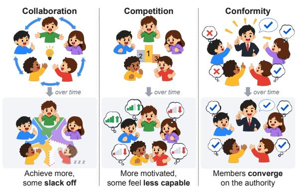
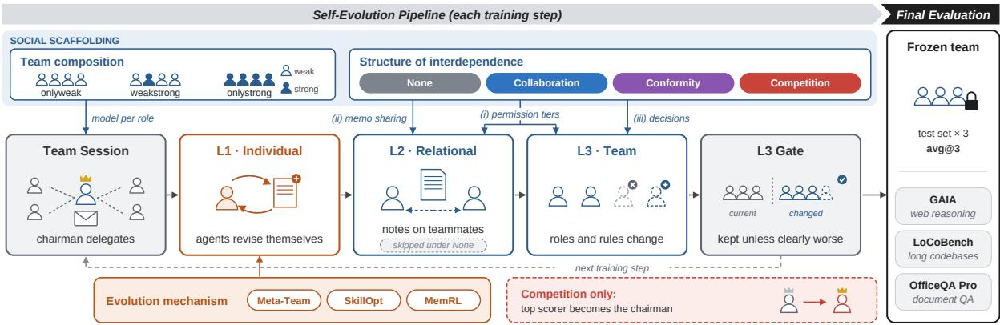

# Evolve Together, Fall into Place: How Social Scaffolding Shapes Self-Evolving Multi-Agent Systems

Seojin Hwang Chung-Ang University swiftie1230@cau.ac.kr

Youngmin Choi Chung-Ang University martinus.choi@gmail.com

Hwanhee Lee\* Chung-Ang University hwanheelee@cau.ac.kr

## Abstract

Recent work lets LLM agents evolve their own harness, up to the team itself. Yet in human groups, the same abilities achieve different outcomes under different social conditions. Borrowing the notion of scaffolding from developmental psychology, we investigate whether the social scaffolding of a self-evolving multiagent system (MAS), namely its team composition and structure of interdependence (e.g., collaboration, conformity, or competition), shapes how the team evolves. We present AGORA (Agents Growing through Organization and Relational Arrangements), a framework that varies the two axes independently across three evolution mechanisms. Across web search, codebase understanding, and document QA, we find that (1) evolution alone rarely helps, while the right scaffolding surpasses a strong agent evolved alone by up to 25 points; (2) it does so by moving authority to the most capable member while the others step back; and (3) this member, having grown within the team, outperforms the same model alone. Thus, designing a self-evolving MAS requires designing its social scaffolding, which shapes not only how its agents learn but also who gets to lead.

## 1 Introduction

As Large Language Model (LLM) agents take on increasingly complex tasks, they rarely work as bare models. They run inside a harness that shapes their performance (Meng et al., 2026). Prior work has focused on its technical design, from what a single agent sees and is allowed to do (Lee et al., 2026; Lou et al., 2026) to how LLM calls are composed into workflows (Zhang et al., 2025). The same holds for multi-agent systems (MAS) (Liu et al., 2026b), and a growing line of work goes further and lets agents evolve their own harness, by rewriting their skills, memories, and even the team itself (Hao et al., 2026; Yang et al., 2026; Zhang et al., 2026c).



Figure 1: How different social scaffolding leads to different evolutionary outcomes in human groups.

However, as shown in Figure 1, evolution in human groups never happens in a social vacuum. Organizational and evolutionary theories suggest that people with the same abilities can achieve and behave differently, depending on how they compare with those around them and how much they rely on one another (Deutsch, 1949; Johnson and Johnson, 2009). Much like a human group, a self-evolving MAS consists of agents that differ in ability, depend on one another, and change through experience. This raises a natural question: does the social layer of its harness shape how the team evolves, as social conditions dofor human groups?

Prior work on self-evolving MAS either fixes this social layer as a design (Liu et al., 2026a; Chen et al., 2025; Pan et al., 2025) or folds it into the evolution process itself (Hao et al., 2026). We instead treat this social layer as the central variable of study. We borrow the developmental-psychology notion of scaffolding, the support a learner’s social environment provides during development and withdraws once it is no longer needed (Wood et al., 1976), and call this layer social scaffolding. We operationalize it for MAS along the two factors above: team composition, which sets how capable each agent is relative to its teammates, and the structure of interdependence, which sets how agents share information and decide on team changes.

To isolate its effect on what a team evolves into, we build AGORA (Agents Growing through Organization and Relational Arrangements), a framework that extends the three-level evolution loop of Meta-Team (Hao et al., 2026). After each batch of training tasks, every agent improves itself (L1), agents take notes on their teammates when a structure of interdependence is in place (L2), and the team revises itself as a whole (L3), with each team revision checked on a held-out set.

AGORA varies the two axes independently: team composition sets the mix of agent capabilities (onlyweak, onlystrong, or weakstrong), and the structure of interdependence (none, collaboration, conformity, or competition) sets which permissions agents hold, how they share information at L2, and how team changes are decided at L3. We cross these axes with three evolution mechanisms that govern L1, Meta-Team (Hao et al., 2026), SkillOpt (Yang et al., 2026), and MemRL (Zhang et al., 2026c), holding everything else fixed so that differences can be traced to social scaffolding.

Using AGORA on three benchmarks spanning web search (GAIA), codebase understanding (Lo-CoBench), and document QA (OfficeQA Pro), we investigate three research questions: whether social scaffolding changes what a self-evolving MAS achieves (RQ1); how the team reorganizes under the right scaffolding (RQ2); and why the reorganized team outperforms the same model working alone (RQ3). Experiments yield three findings.

• Evolution alone is rarely enough (RQ1). Evolving under no structure of interdependence rarely improves a team, whereas the right social scaffolding does, surpassing a strong agent evolved alone by up to 25.0 points. Which structure helps depends on who is in the team.

• Authority moves to the most capable member (RQ2). Effective scaffolding hands the chair to the most capable member, as human groups gain from recognizing expertise, and the others step back unless they remove a bottleneck. Unlike human groups, they drop out rather than loaf.

• The team grows its leader (RQ3). The member left leading, having learned from its teammates, outperforms the same model evolved alone.

These findings show that plugging an evolution mechanism into an off-the-shelf MAS is not enough; the social scaffolding under which the team evolves matters just as much, deciding not only how its agents learn, but who gets to lead.

## 2 Related Work

## 2.1 Social Dynamics in Human Groups

In human groups, individuals with identical abilities can reach different outcomes depending on their social scaffolding. Collaboration raises achievement over competing or working alone (Deutsch, 1949; Johnson and Johnson, 2009), but members may loaf when the work is shared (Latané et al., 1979; Karau and Williams, 1993). Competition raises motivation, but equally able members feel less capable among stronger peers (Marsh, 1987). Conformity reduces individual error but can suppress innovation (Henrich and Boyd, 1998), and since people obey even wrong authority (Milgram, 1963) and groups that suppress dissent decide poorly (Janis, 1972), the outcome depends on the decision-maker.

## 2.2 Evolution and Social Dynamics in LLM Agents

Evolving agents improve their external state without updating model weights, refining memory (Zhu et al., 2026b; Choi et al., 2026b; Zhang et al., 2026c; Wang et al., 2026; Liu et al., 2026c) or skills (Zhang et al., 2026b; Zhu et al., 2026a; Zhang et al., 2026a; Yang et al., 2026), and recently agent composition and interaction (Yuan et al., 2025; Lee et al., 2025; Dang et al., 2026). MAS gain more over single agents when their sub-agents are weaker (Ke et al., 2026), suggesting that wellorganized weak agents can close much of the gap to stronger ones.

In MAS, collaboration does not always help (Tran and Kiela, 2026; Pappu et al., 2026), competition can increase systemic failure (Mori and Johnson, 2026), and conformity varies with group structure and roles (Weng et al., 2025; Cho et al., 2025; Choi et al., 2025; Bito et al., 2026; Han et al., 2026; Bellina et al., 2026; Choi et al., 2026a). Social structures are also used to improve agents through self-play, mutual checks (Liu et al., 2026a; Chen et al., 2025; Pan et al., 2025), or orchestration (Qi et al., 2026), and Meta-Team (Hao et al., 2026) jointly evolves the agents, their interactions, and the team. These methods, however, fix a single interdependence structure, often on closed-answer tasks. AGORA instead turns this social layer into a controlled variable, varying team composition and the structure of interdependence on open-ended, real-world tasks.

  
Figure 2: Overview of AGORA. After completing a task as a team (Team Session), each agent updates itself (L1) and writes memos about its peers, guided by social scaffolding (L2). Based on these memos, team-level structural changes are proposed (L3) and then retained or rejected by a held-out gate (L3 Gate). Throughout this process, we vary the social scaffolding and the evolution mechanism to examine how a self-evolving MAS evolves.

## 3 AGORA Framework

As shown in Figure 2, to test whether social scaffolding shapes how a self-evolving MAS evolves, we design AGORA as a controlled testbed. AGORA keeps the basic loop of Meta-Team (Hao et al., 2026), in which a chairman-led team evolves its external state at the individual (L1), relational (L2), and team (L3) levels, but turns its fixed social layer, where the chairman alone decides team changes, into the variable under study. AGORA varies team composition and the structure of interdependence while swapping in different L1 evolution mechanisms, separating their effects.

## 3.1 Overall Framework Formulation

## 3.1.1 Team Definition

A team is a set of role-specific agents, defined by a team configuration (e.g., chairman, team budgets), a constitution of team-wide rules that can be revised as the team evolves, and the agents themselves. Each agent has a configuration (e.g., model and tools), a prompt, and an evolution state such as a skill document or a memory bank. The chairman receives the task, calls on the other agents, and submits the final answer.

## 3.1.2 Session Execution

Each task is handled in a single team session, whose final answer from the chairman is scored. Within a session, agents operate concurrently rather than taking turns, interleaving tool calls (e.g., web search) with messages through a shared mailbox, under a budget on messages, and time that is reported after every call. Detailed limits are given in Appendices B and F.

## 3.1.3 Three-Level Operation

Under a given social scaffolding, AGORA repeats an evolution loop of a team session followed by three levels of evolution and a held-out gate (Figure 2 and Table 1). L1 improves each agent through its own evolution mechanism, L2 records what agents learn about one another, L3 revises the team as a whole, and the L3 gate reverts a revision only if it clearly hurts the team on held-out data.

L1 evolution (Individual) After completing a task as a team (Figure 2, ‘Team Session’), each agent evolves through its own evolution mechanism (Figure 2, ‘L1 · Individual’). Specifically, it updates a skill with its gate record in SkillOpt, a memory bank of Q-valued entries in MemRL, and a prompt patch with self-written skills in Meta-Team. Unlike L2 and L3, L1 operates in the same way under every social scaffolding; the scaffolding affects it only indirectly, through the trajectories and L2 memos from which the agents learn.

L2 recording (Relational) L2 models what teammates learn about one another through social interaction (Figure 2, ‘L2 · Relational’). Once L1 has finished, each agent writes a memo on every teammate it has worked with, recording strengths, weaknesses, collaboration notes, and contradictions; a judge model flags contradictions but does not block the memo. How much agents share and whether memos are reviewed before saving depend on the structure of interdependence (Section 3.3.2), and L2 is skipped under none. Memos enter the author’s system prompt in later sessions, inform L3 revisions, and are passed to the update models of SkillOpt and MemRL.

<table><tr><td>Level</td><td>What changes</td><td>Who changes it</td><td>Takes effect</td><td>Gate</td></tr><tr><td rowspan="3">L1 (individual)</td><td>Skill document</td><td>Mechanism (SkillOpt)</td><td>Next iteration</td><td>L1 gate</td></tr><tr><td>Memory bank</td><td>Mechanism (MemRL)</td><td>Next iteration</td><td>None</td></tr><tr><td>Prompt patch</td><td>Agent itself (Meta-Team)</td><td>Next task</td><td>None</td></tr><tr><td>L2 (relational)</td><td>L2 memo</td><td>Each agent, about teammates it worked with</td><td>Next iteration</td><td>None</td></tr><tr><td>L3 (team)</td><td>Roles, agent prompts and configurations, constitution</td><td>Proposed by Tier 1 agents</td><td>Next iteration, unless re- L3 gate verted by the L3 gate</td><td></td></tr></table>

Table 1: Levels of the AGORA operation. L1 and L3 evolve the agents and the team, while L2 records relations between agents only when the social scaffolding includes interdependence. Social scaffolding acts directly only on L2 and L3, and reaches L1 through the trajectories and L2 memos that every mechanism learns from.

L3 evolution (Team) After each agent has written memos on its teammates in L2, L3 evolves the team as a whole based on these memos, by adding or removing roles and revising the agents’ prompts and configurations, and the constitution. Tier 1 agents propose revisions, which are aggregated according to the social scaffolding and kept unless the L3 gate judges the revised team to be clearly worse (Figure 2, ‘L3 Gate’). Details of Tier 1 are provided in Section 3.3.2.

## 3.1.4 L3 Held-out Gate

The L3 held-out gate reverts a team revision only if it clearly harms the team. The current and revised teams each solve the same 20 validation problems with the same seeds, so that the two are compared on equal footing (Figure 2, ‘L3 Gate’). The validation set is disjoint from the train and test sets, and the gate is applied identically under every evolution mechanism and structure of interdependence.

All L3 changes of an iteration are reverted if the revised team succeeds less often and a one-sided binomial test against the current team’s success rate finds the drop significant. For example, if the current team solves 10 of the 20 problems, the changes are reverted only if the revised team solves 8 or fewer. This is because L3 revisions are decisions the team made under its own structure of interdependence; it blocks only clear harm and leaves the rest to the team. We use a relaxed α = 0.3 because re-running the same team changes the outcome of about a third of the validation problems, so a strict level would rarely catch even real degradation. Details about thresholds are in Appendix D.5. Each iteration also applies at most two role additions or deletions and two patch bundles, so that each gate judges only a few changes and the team cannot grow without bound.

## 3.2 Evolution Mechanism

As shown in Table 2, we include three L1 mechanisms that differ in what they update and what drives the update: an agent’s own reflection (Meta-Team), reflection on graded trajectories (SkillOpt), and task reward on a memory bank (MemRL). We adapt the original implementations to the multiagent setting with minimal changes. The mechanism determines only L1. Details and all changes from the original are in Appendix D.

Meta-Team Following the original design, Meta-Team runs a single iteration with its batch executed sequentially. Right after each task, each agent reflects on its own behavior and edits its own prompt patch and skills with its own model, and the edits take effect immediately without a gate.

SkillOpt SkillOpt runs for four iterations. At the end of each iteration, each role applies reflect, merge, and apply steps to its trajectories from that iteration, both successful and failed, together with their grading results, to produce a candidate skill document. The candidate replaces the current document in the role’s system prompt only if it passes the L1 gate, that is, only if it clearly improves performance on the validation set (Appendix D.5).

MemRL MemRL runs for four iterations, with a separate memory bank for each role. Before a session, up to five memories are retrieved by combining their similarity to the problem with their Q-values. At the end of each iteration, the Q-values of the retrieved memories are updated according to task success, and each trajectory, successful or not, is summarized as a procedural script and added as a new memory. Updates take effect without a gate, so the bank keeps both what worked and what failed.

<table><tr><td></td><td>Meta-Team</td><td>SkillOpt</td><td>MemRL</td></tr><tr><td>What evolves</td><td>Prompt patches and skills writ- ten by the agent</td><td>Skill document</td><td>Memory bank with Q-values</td></tr><tr><td>Injected into execu- tion</td><td>Own patches and skill list</td><td>Current skill document</td><td>Up to 5 retrieved memories (suc- cess/failure scripts)</td></tr><tr><td>Evolution timing</td><td>Right after each task</td><td>End of iteration</td><td>End of iteration</td></tr><tr><td>Evolution signal</td><td>Agent&#x27;s self-reflection</td><td>Reflection on trajectories with grading results</td><td>Task success or failure as reward</td></tr><tr><td>L1 gate</td><td>None</td><td>Held-out binomial test</td><td>None</td></tr><tr><td>Model performing the update</td><td>Agent&#x27;s own model (weak or strong)</td><td>The strong model (fixed), with L2 notes</td><td>The strong model (fixed), with L2 notes</td></tr><tr><td>Steps × batch</td><td>1 × (17/20)</td><td>4 × (17/20)</td><td>4 × (17/20)</td></tr><tr><td>Batch execution</td><td>Sequential</td><td>Concurrent</td><td>Concurrent</td></tr></table>

Table 2: Evolution mechanisms. Batch sizes are 17 for GAIA and 20 for LoCoBench and OfficeQA Pro. All mechanisms share the same L2 and L3 and the same L3 gate.

## 3.3 Social Scaffolding Implementation

In human teams, how members grow depends both on the capabilities of their teammates, including the gaps between them, and on how they depend on one another while working together. Following this, we implement social scaffolding along two axes: team composition and the structure of interdependence (Figure 2, top).

## 3.3.1 Team Composition

To realize capability differences among team members, we use two model tiers, weak and strong, drawn from the same model family so that the capability gap remains the main variable and confounds from mixing model families are avoided. As shown in ’Team composition’ in Figure 2, we compare three configurations: onlyweak, onlystrong, and weakstrong. Onlyweak and onlystrong assign the weak and strong model, respectively, to every role. Weakstrong upgrades only the bottleneck role of each benchmark to the strong model (web\_agent for GAIA, developer for LoCoBench, and reader for OfficeQA), while all other roles, including the chairman, remain weak.

On GAIA, varying which and how many roles are strong shows that which role matters far more than how many: before evolution, a strong bottleneck role alone gives 48.3, a strong non-bottleneck role at most 28.3, and further strong roles barely help (51.7–52.5). Details on model selection, bottleneck roles, role tools, and these variants are in Appendices B and K.1, and representative role prompts and the full constitution in Appendix L.

## 3.3.2 Structure of Interdependence

To realize how members depend on one another, we define four conditions: none, collaboration, conformity, and competition. As shown in Table 3, each condition differs not only in prompt wording but in tools, permissions, and decision rules, and intervenes at three corresponding points of the loop, marked (i)–(iii) in Figure 2. The three points are (i) permission tiers, which set who is Tier 1 and can read the whole team’s memos, while Tier 2 agents read only their own; (ii) L2 memos, which set how much agents share and whether memos are saved directly or staged for objection before finalized; and (iii) L3 decisions, which set who can propose, whether proposals go through peer review, and who makes the end-of-iteration decision by what rule.

None. A baseline without social interaction: all agents are Tier 1, there is no L2 (skipped under None in Figure 2), and all L3 proposals are kept at the end-of-iteration decision.

Collaboration. All agents are Tier 1 and share actively, and both memos and L3 proposals go through peer review. A memo is finalized once every teammate the author interacted with in the task has responded, and an L3 proposal passes once a majority of the participating teammates have commented on it. The end-of-iteration decision tallies the SUPPORT and OPPOSE reviews.

Conformity. Only the chairman is Tier 1 and decides alone, and agents have no tool for raising objections. In L2, agents defer to their teammates’ self-assessments, contact teammates only when stuck, and save memos directly.

<table><tr><td>Intervention</td><td>Aspect</td><td>None</td><td>Collaboration</td><td>Conformity</td><td>Competition</td></tr><tr><td rowspan="2">Permission tiers</td><td>Chairman</td><td>Fixed</td><td>Fixed</td><td>Fixed</td><td>Rotates to top scorer</td></tr><tr><td>Tier 1 roles</td><td>All roles</td><td>All roles</td><td>Chairman only</td><td>Chairman only</td></tr><tr><td rowspan="2">L2 memo</td><td>Sharing</td><td>Disabled</td><td>Active</td><td>When stuck; deferential</td><td>Minimal; scores shown</td></tr><tr><td>Finalization</td><td>Disabled</td><td>After peer review</td><td>Immediately</td><td>After peer review</td></tr><tr><td rowspan="3">L3 team config</td><td>Proposals</td><td>All roles</td><td>All roles</td><td>Chairman only</td><td>Chairman only</td></tr><tr><td>Peer review</td><td>No</td><td>Majority</td><td>No</td><td>Majority</td></tr><tr><td>Decision rule</td><td>Keep all</td><td>Review tally</td><td>Chairman alone</td><td>Chairman, given reviews</td></tr></table>

Table 3: Structures of interdependence. ‘Majority’ peer review passes once a majority of participating teammates have responded, and Tier 2 roles can only suggest L3 changes to the chairman. Details are given in Section 3.3.2.

Competition. Agents share minimally and are shown comparative scores of their own contribution. Memos and L3 proposals go through the same peer review as in collaboration, with objections citing these scores, but the chairman decides alone at the end of each iteration. The role with the sole top score then becomes Tier 1 and the chairman for the next iteration, as shown by ‘Competition only’ in Figure 2. This rotation is applied after the L3 gate, outside L3, and is not itself gated.

Shared settings. In every condition, the endof-iteration decision is made by the chairman’s own model with a fixed decision prompt (see Appendix L for the prompt), so no model outside the team decides for it.<sup>1</sup> Gate sessions run under the same condition, tiers, and chairman as training, and all conditions, including none, share the same L3 gate (Figure 2, ‘L3 Gate’) and revision cap, so that only the social layer differs. Appendix E gives the full specification of each condition.

## 4 Experimental Setup

We cross every evolution mechanism with every combination of team composition and interdependence structure on three benchmarks, comparing each evolved team with its unevolved self and a single agent of each tier (RQ1, Section 5), and then trace its final-evaluation sessions to see how it reorganizes and why (RQ2 and RQ3, Section 6).

Benchmarks We use web-based reasoning (GAIA; Mialon et al., 2024), long codebase understanding (LoCoBench; Qiu et al., 2025), and document-based numerical question answering (OfficeQA Pro; Opsahl-Ong et al., 2026), each split into non-overlapping train, val, and test sets (split sizes and task formats in Appendix A).

Models The weak and strong tiers are Qwen3- 30B-A3B-Instruct-2507 and Qwen3.6-35B-A3B, run with thinking off and temperature 0.1 (model selection in Appendix B; serving in Appendix G).

Session Budgets Each session is limited to 900 seconds and 100 team messages (50 for solo), and each agent to 50 steps. A session terminated by its time or message limit is not graded and counts as a failure (0) in every score, including both gates; only sessions that crash are excluded.

Experiment Matrix We use two kinds of baselines. Solo baselines give the whole task to one weak or strong agent with every tool. Preevolve baselines evaluate each of the five configurations (two solo setups and three team compositions) on the test set without evolution. Each benchmark thus comprises 47 experiments: five preevolve baselines, six solo runs, and 36 MAS runs.

Evaluation Tasks are scored as success or failure: exact match for GAIA, an LCBS score of at least 3.0 for LoCoBench, and a verdict from gpt-5-mini for OfficeQA Pro, a judge from a different model family to avoid self-preference.

## 5 Does Social Scaffolding Change What a Team Achieves?

To answer RQ1, we compare each team before evolution, after evolving under none, and after evolving under structure of interdependence (Table 4).

Evolution alone falls short. Evolution alone brings little across the 27 MAS settings: it raises the score by at most 4.3 points over Pre in 23 of them and even lowers it in 11, and 17 of them fall short of a single strong agent evolved with the same mechanism. Large gains appear mainly in teams of identical strong agents (13.8–16.7 points), the most expensive teams to deploy.

<table><tr><td rowspan=2 colspan=12>GAIA                           LoCoBench                        OfficeQA ProTeam     Structure  Pre</td></tr><tr><td rowspan=1 colspan=4>Meta-Team SkillOpt MemRL Pre</td><td rowspan=1 colspan=4>Meta-Team SkillOpt MemRL Pre</td><td rowspan=1 colspan=3>Meta-Team SkillOpt MemRL</td></tr><tr><td rowspan=2 colspan=1>solo_weakNone     $2 0 . 8 \pm 1 . 4$ solo_strongNone     $5 1 . 7 \pm 2 . 9$ </td><td rowspan=1 colspan=3> $2 0 . 8 \pm 5 . 2$    $2 0 . 8 \pm 5 . 2$   $2 0 . 0 \pm 0 . 0$ </td><td rowspan=1 colspan=1> $5 4 . 5 \pm 2 . 0$ </td><td rowspan=1 colspan=1> $5 0 . 8 \pm 1 . 2$ </td><td rowspan=1 colspan=1> $4 9 . 5 \pm 3 . 6 $ </td><td rowspan=1 colspan=1> $4 6 . 8 \pm 3 . 8$ </td><td rowspan=1 colspan=1> $2 . 7 \pm 0 . 9$ </td><td rowspan=1 colspan=1> $2 . 7 \pm 0 . 9$ </td><td rowspan=1 colspan=1> $5 . 9 \pm 0 . 9$ </td><td rowspan=1 colspan=1> $2 . 2 \pm 2 . 5$ </td></tr><tr><td rowspan=1 colspan=3> $5 2 . 5 \pm 5 . 0$    $4 9 . 2 \pm 1 . 4$   $5 3 . 3 \pm 5 . 2 $ </td><td rowspan=1 colspan=1> $7 3 . 1 \pm 1 . 5$ </td><td rowspan=1 colspan=1> $7 6 . 4 \pm 3 . 1$ </td><td rowspan=1 colspan=1> $7 4 . 4 \pm 2 . 5$ </td><td rowspan=1 colspan=1> $7 6 . 8 \pm 1 . 7$ </td><td rowspan=1 colspan=1> $2 8 . 5 \pm 0 . 9$ </td><td rowspan=1 colspan=1> $3 1 . 2 \pm 4 . 9$ </td><td rowspan=1 colspan=1> $3 4 . 4 \pm 0 . 9$ </td><td rowspan=1 colspan=1> $2 9 . 0 \pm 8 . 4$ </td></tr><tr><td rowspan=4 colspan=1>NoneCollab.onlyweak            $2 1 . 7 \pm 5 . 2$ Conform.Compet.</td><td rowspan=1 colspan=3> $2 1 . 7 \pm 9 . 5$    $2 0 . 0 \pm 4 . 3$ 1 $1 8 . 3 \pm 6 . 3$ </td><td rowspan=1 colspan=1></td><td rowspan=1 colspan=1> $4 3 . 4 \pm 5 . 3$ </td><td rowspan=1 colspan=1> $4 8 . 5 \pm 5 . 6 $ </td><td rowspan=1 colspan=1> $4 3 . 4 \pm 4 . 0$ </td><td rowspan=1 colspan=1></td><td rowspan=1 colspan=3> $0 . 5 \pm 0 . 9$     $0 . 5 \pm _ { 0 . 9 }$    $2 . 2 \pm 0 . 9$ </td></tr><tr><td rowspan=1 colspan=2> $2 5 . 0 \pm 4 . 3$    $1 9 . 2 \pm 6 . 3$ </td><td rowspan=1 colspan=1> $2 4 . 2 \pm 1 . 4$ </td><td rowspan=1 colspan=1> $5 2 . 9 \pm 3 . 5$ </td><td rowspan=1 colspan=1> $5 9 . 3 \pm 4 . 1 $ </td><td rowspan=1 colspan=1> ${ \pm } 4 . 9 \pm 6 . 1$ </td><td rowspan=1 colspan=1> $4 6 . 8 \pm 5 . 1$ </td><td rowspan=1 colspan=1> $1 . 1 \pm 0 . 9$ </td><td rowspan=1 colspan=1> $0 . 0 { \scriptstyle \pm 0 . 0 }$ </td><td rowspan=1 colspan=1> $0 . 5 \pm _ { 0 . 9 }$ </td><td rowspan=1 colspan=1>1.1 ±0.9</td></tr><tr><td rowspan=1 colspan=2> $2 5 . 0 \pm 2 . 5$    $2 0 . 8 \pm 1 . 4$ </td><td rowspan=1 colspan=1> $1 7 . 5 \pm 2 . 5$ </td><td rowspan=1 colspan=1></td><td rowspan=1 colspan=1> $5 4 . 2 \pm 2 . 3 $ </td><td rowspan=1 colspan=1> $4 5 . 8 \pm 6 . 7$ </td><td rowspan=1 colspan=1> $3 9 . 1 \pm 5 . 9$ </td><td rowspan=1 colspan=1></td><td rowspan=1 colspan=1> ${ \bf 1 . 1 \pm 0 . 9 }$ </td><td rowspan=1 colspan=1> $0 . 0 { \scriptstyle \pm 0 . 0 }$ </td><td rowspan=1 colspan=1>0.5 ±0.9</td></tr><tr><td rowspan=1 colspan=2> $2 7 . 5 \pm 2 . 5$    $2 8 . 3 \pm 1 . 4$ </td><td rowspan=1 colspan=1> $1 3 . 3 \pm 3 . 8$ </td><td rowspan=1 colspan=1></td><td rowspan=1 colspan=1> $2 2 . 6 \pm 1 0 . 5$ </td><td rowspan=1 colspan=1> $2 8 . 3 \pm 1 . 7$ </td><td rowspan=1 colspan=1> ${ \bf 4 9 . 8 \pm 3 . 1 }$ </td><td rowspan=1 colspan=1></td><td rowspan=1 colspan=1> $0 . 5 \pm 0 . 9$ </td><td rowspan=1 colspan=1> $2 . 2 \pm 2 . 5$ </td><td rowspan=1 colspan=1>6.5 ±3.2</td></tr><tr><td rowspan=4 colspan=1>NoneCollab.weakstrong           $4 8 . 3 \pm 1 . 4$ Conform.Compet.</td><td rowspan=1 colspan=2> $5 1 . 7 \pm 2 . 9$    $5 1 . 7 \pm 2 . 9$ </td><td rowspan=1 colspan=1>_ $5 0 . 0 \pm 4 . 3 $ </td><td rowspan=1 colspan=1></td><td rowspan=1 colspan=1> $8 1 . 1 \pm 5 . 9$ </td><td rowspan=1 colspan=1> $7 2 . 7 \pm 3 . 0 $ </td><td rowspan=1 colspan=1> $8 0 . 5 \pm 1 . 5$ </td><td rowspan=1 colspan=1></td><td rowspan=1 colspan=1> $1 8 . 8 \pm 4 . 7$ </td><td rowspan=1 colspan=1>21.5 ±2.4</td><td rowspan=1 colspan=1>14.5 ±4.3</td></tr><tr><td rowspan=1 colspan=2> $4 3 . 3 \pm 5 . 2$    $6 2 . 5 \pm 4 . 3 $ </td><td rowspan=1 colspan=1> $5 0 . 8 \pm 1 . 4$ </td><td rowspan=1 colspan=1></td><td rowspan=1 colspan=1> $8 4 . 8 \pm 2 . 0$ </td><td rowspan=1 colspan=1> $\mathbf { 8 5 . 9 \pm 5 . 6 }$ </td><td rowspan=1 colspan=1> $8 2 . 2 \pm 1 . 5$ </td><td rowspan=1 colspan=1></td><td rowspan=1 colspan=1> $1 6 . 1 \pm 3 . 2$ </td><td rowspan=1 colspan=1> $1 6 . 7 \pm 1 . 8$ </td><td rowspan=1 colspan=1> $1 5 . 1 \pm 3 . 4$ </td></tr><tr><td rowspan=1 colspan=2> $4 7 . 5 \pm 0 . 0 $    $5 0 . 8 \pm 3 . 8$ </td><td rowspan=1 colspan=1> ${ \bf 5 8 . 3 \pm 5 . 8 }$ </td><td rowspan=1 colspan=1></td><td rowspan=1 colspan=1> $8 3 . 2 \pm 3 . 5$ </td><td rowspan=1 colspan=1> $7 9 . 1 \pm 1 . 2 $ </td><td rowspan=1 colspan=1> $7 7 . 4 \pm 4 . 1$ </td><td rowspan=1 colspan=1></td><td rowspan=1 colspan=1> ${ \bf 1 9 . 4 \pm } 4 . 3$ </td><td rowspan=1 colspan=1> $8 . 6 \pm 0 . 9$ </td><td rowspan=1 colspan=1> $1 3 . 4 \pm 3 . 7$ </td></tr><tr><td rowspan=1 colspan=2> ${ \bf 6 3 . 3 \pm 7 . 6 }$    $7 4 . 2 \pm 3 . 8$ </td><td rowspan=1 colspan=1> $5 0 . 8 \pm 5 . 8$ </td><td rowspan=1 colspan=1></td><td rowspan=1 colspan=1> ${ \bf 8 6 . 5 \pm 0 . 6 }$ </td><td rowspan=1 colspan=1> $8 2 . 5 \pm 4 . 6 $ </td><td rowspan=1 colspan=1> ${ \bf 8 4 . 8 \pm } 1 . 0$ </td><td rowspan=1 colspan=1></td><td rowspan=1 colspan=1> $1 4 . 5 \pm 2 . 8$ </td><td rowspan=1 colspan=1> $1 5 . 1 \pm 3 . 3$ </td><td rowspan=1 colspan=1> $1 0 . 2 \pm 1 . 9$ </td></tr><tr><td rowspan=4 colspan=1>NoneCollab.onlystrong           $4 5 . 0 \pm 5 . 0$ Conform.Compet.</td><td rowspan=1 colspan=2> ${ \bf 6 1 . 7 \pm 2 . 9 }$    ${ \bf 6 0 . 8 \pm 5 . 8 }$ </td><td rowspan=1 colspan=1> $5 9 . 2 \pm 8 . 0 $ </td><td rowspan=1 colspan=1></td><td rowspan=1 colspan=1> $5 8 . 6 \pm 6 . 3 $ </td><td rowspan=1 colspan=1> $7 6 . 8 \pm 2 . 7$ </td><td rowspan=1 colspan=1> $6 4 . 3 \pm 4 . 2 $ </td><td rowspan=1 colspan=1></td><td rowspan=1 colspan=1> $3 4 . 4 \pm 2 . 5$ </td><td rowspan=1 colspan=1> $3 5 . 5 \pm 4 . 3 $ </td><td rowspan=1 colspan=1> $2 9 . 6 \pm 2 . 5$ </td></tr><tr><td rowspan=1 colspan=1> $5 9 . 2 \pm 1 . 4$ </td><td rowspan=1 colspan=1> $5 1 . 7 \pm 8 . 0$ </td><td rowspan=1 colspan=1> ${ \bf 6 0 . 8 \pm 1 . 4 }$ </td><td rowspan=1 colspan=1> $6 3 . 0 \pm 2 . 3$ </td><td rowspan=1 colspan=1> $7 2 . 4 \pm 1 . 2$ </td><td rowspan=1 colspan=1> $8 2 . 8 \pm 1 . 7$ </td><td rowspan=1 colspan=1> $5 9 . 3 \pm 3 . 8 $ </td><td rowspan=1 colspan=1> $3 3 . 9 \pm 2 . 8$ </td><td rowspan=1 colspan=1> $3 4 . 9 \pm 3 . 7$ </td><td rowspan=1 colspan=1> $3 6 . 0 \pm 3 . 3$ </td><td rowspan=1 colspan=1> $3 0 . 6 \pm 1 . 6$ </td></tr><tr><td rowspan=1 colspan=1> $5 5 . 0 \pm 7 . 5$ </td><td rowspan=1 colspan=1> $5 7 . 5 \pm 6 . 6$ </td><td rowspan=1 colspan=1> $5 3 . 3 \pm 3 . 8 $ </td><td rowspan=1 colspan=1></td><td rowspan=1 colspan=1> $6 4 . 0 \pm 2 . 1$ </td><td rowspan=1 colspan=1> $8 7 . 2 \pm 2 . 1 $ </td><td rowspan=1 colspan=1> $5 6 . 2 \pm 3 . 3 $ </td><td rowspan=1 colspan=1></td><td rowspan=1 colspan=1> $3 5 . 5 \pm 4 . 3$ </td><td rowspan=1 colspan=1> ${ \bf 3 6 . 6 \pm } 6 . 5$ </td><td rowspan=1 colspan=1> $2 9 . 6 \pm 3 . 4$ </td></tr><tr><td rowspan=1 colspan=1> $4 3 . 3 \pm 7 . 6$ </td><td rowspan=1 colspan=1> $5 1 . 7 \pm 5 . 2 $ </td><td rowspan=1 colspan=1> $5 4 . 2 \pm 1 . 4$ </td><td rowspan=1 colspan=1></td><td rowspan=1 colspan=1> $7 0 . 0 \pm 2 . 5$ </td><td rowspan=1 colspan=1> $8 3 . 8 \pm 1 . 0$ </td><td rowspan=1 colspan=1> ${ \bf 8 3 . 5 \pm } 1 . 2 $ </td><td rowspan=1 colspan=1></td><td rowspan=1 colspan=1> $\mathbf { 3 6 . 0 \pm 3 . 4 }$ </td><td rowspan=1 colspan=1> $3 3 . 9 \pm 1 . 6$ </td><td rowspan=1 colspan=1> $3 5 . 5 \pm 3 . 2$ </td></tr></table>

Table 4: Main results (avg@3 success rate, %) on the test set. Cell color shows the change from $P r e \colon$ rose for gains and blue for drops $( P r e ~ )$ : same team before evolution), darker for larger changes. Bold: best structure of interdependence for each team, mechanism, and benchmark. Values are mean ± SD over three rollouts.

The right scaffolding makes evolution pay off. An appropriate structure outperforms evolution alone in 24 of the 27 settings, and the best combination of team composition and structure surpasses the strong agent evolved alone on every benchmark and mechanism, by up to 25.0 points (74.2 vs. 49.2 with SkillOpt on GAIA). The same evolution mechanism thus yields far larger gains once the team is organized appropriately.

## 6.1 Authority Moves to the Most Capable Member

The best scaffolding differs from team to team. Which structure helps depends on who is in the team. On GAIA with SkillOpt, the onlystrong team is best under evolution alone (60.8), but the weakstrong team is best under competition (74.2). On LoCoBench with Meta-Team, competition lifts the onlystrong team (70.0) but collapses the onlyweak team (22.6). Gains are large both when members clearly differ in ability and when all are strong, and no structure helps when one member is near zero: on OfficeQA Pro, where the weak model scores 2.7 alone, even the best mixed team (21.5) stays below the strong agent alone (28.5). Section 6 explains why: what the right scaffolding changes is who leads the team.

The first way the team reorganizes (RQ2) is in who leads it. GAIA weakstrong starts with the weak plan\_agent as chair, which relays sub-tasks to the strong web\_agent and doubles the LLM calls of the strong agent alone (46.8 vs. 22.6). Competition removes this relay by handing the chair to the strong web\_agent under SkillOpt and Meta-Team, which then works alone at solo-level cost (74.2 and 63.3). Promoting a weak role instead backfires: on OfficeQA Pro weakstrong, competition hands the chair to a weak role and drops the team below evolution alone (15.1 vs. 21.5 with SkillOpt; Table 4). Every chair change under competition, with the score that decided it, is listed in Table 13. Like human groups, which gain from their most capable member only when they recognize it (Littlepage et al., 1997) and pay for poorly suited leaders (Milgram, 1963; Janis, 1972), competition helps only when the right role rises.

## 6.2 The Others Step Back, Unless They Remove a Bottleneck

## 6 How the Team Reorganizes, and Why It Works

To answer RQ2 and RQ3, we trace the finalevaluation sessions of the teams with the largest effects (Table 5) and relate them to human groups. Sections 6.1 and 6.2 answer RQ2, and Section 6.3 answers RQ3. Additional experiments with a much weaker model, different assignments of strong roles, and other model families lead to largely the same conclusions (Appendix K).

The second way the team reorganizes (RQ2) is in who works. Coordination pays off only when it removes a bottleneck. On LoCoBench weakstrong, the weak readers take over the reading, halving the timeouts of the strong agent alone (5.4% vs. 12.8%) and outscoring it before evolution (80.5 vs. 73.1; Table 5). Coordination beyond this costs the team: conformity raises the LLM calls per session from 80.0 to 107.3 with SkillOpt and 100.9 with MemRL, and drops the team below Pre (79.1 and 77.4), adding cost without removing any further bottleneck.

<table><tr><td colspan="5">GAIA weakstrong</td><td colspan="5">LoCoBench weakstrong chair: planner (W)</td><td colspan="5">LoCoBench onlystrong chair: planner (S)</td></tr><tr><td>Run</td><td>Chair</td><td>Agents</td><td>Calls TO</td><td>avg@3</td><td>Run</td><td>Agents</td><td>Calls</td><td></td><td>TO avg@3</td><td>Run</td><td></td><td>Agents Calls</td><td>TO</td><td>avg@3</td></tr><tr><td>Solo strong, Pre –</td><td></td><td>1.00</td><td>22.6 0.0</td><td>51.7</td><td>Solo strong, Pre</td><td></td><td>1.00</td><td>24.3 12.8</td><td>73.1</td><td>Team, Pre</td><td>3.20</td><td></td><td>73.3 23.2</td><td>63.0</td></tr><tr><td>Team, Pre</td><td>plan_agent (W)</td><td>2.76</td><td>46.8 7.5</td><td>48.3</td><td>Team, Pre</td><td>4.18</td><td>80.0</td><td>5.4</td><td>80.5</td><td>SO, none</td><td>1.40</td><td>27.012.8</td><td></td><td>76.8</td></tr><tr><td>SO, none</td><td>plan_agent (W)</td><td>2.97</td><td>39.6 3.3</td><td>51.7</td><td>SO, conform.</td><td>4.62</td><td>107.3</td><td>5.1</td><td>79.1</td><td>SO, collab.</td><td>1.00</td><td>19.7</td><td>5.1</td><td>82.8</td></tr><tr><td>SO, compet.</td><td>web_agent (S)</td><td>1.38</td><td>19.4 0.0</td><td>74.2</td><td>SO, compet.</td><td>4.55</td><td>91.5</td><td>3.4</td><td>82.5</td><td>SO, conform.</td><td>1.00</td><td>18.3</td><td>4.4</td><td>87.2</td></tr><tr><td>MT, compet.</td><td>web_agent (S)</td><td>1.01</td><td>17.0 0.8</td><td>63.3</td><td>MR, conform.</td><td>4.43</td><td>100.9</td><td>6.1</td><td>77.4</td><td>SO, compet.</td><td>1.01</td><td>21.1</td><td>3.7</td><td>83.8</td></tr><tr><td>MR, compet.</td><td>plan_agent (W)</td><td>2.98</td><td>40.07.5</td><td>50.8</td><td>MR, compet.</td><td>4.01</td><td>74.8</td><td>4.7</td><td>84.8</td><td>MR, conform.</td><td>1.17</td><td></td><td>29.311.8</td><td>56.2</td></tr></table>

Table 5: Process metrics per session in the final evaluation for the runs discussed in Section 6 (GAIA n=120, LoCoBench n=297 sessions per run; all scores in Table 4). Chair: the role holding the chair and its model; on LoCoBench, the chair stays the planner in every run shown. Agents: roles started in the session; Calls: LLM calls; TO: share of sessions stopped by the 900-second limit (%). Bold: best avg@3 in each block. (SO: SkillOpt, MT: Meta-Team, MR: MemRL; W: weak, S: strong)

In onlystrong, where every member is equally capable, splitting the work adds waiting (23.2% timeouts), so SkillOpt moves the work to the planner alone (1.00–1.40 active agents). Here conformity helps most, with the fewest LLM calls (18.3): it writes a planner-implements rule and removes the developer within two iterations, as conformity spreads one practice and preserves it (Henrich and Boyd, 1998). The same structure thus helps when it removes coordination and hurts when it adds it. Unlike humans, who may loaf beside more capable members (Latané et al., 1979; Karau and Williams, 1993), the others drop out, and the team does better.

## 6.3 The Team Grows Its Leader

<table><tr><td></td><td colspan="2">GAIA</td><td colspan="2">LoCoBench</td></tr><tr><td></td><td>Solo</td><td>Team</td><td>Solo</td><td>Team</td></tr><tr><td>avg@3</td><td>49.2</td><td>74.2</td><td>74.4</td><td>87.2</td></tr><tr><td>Skills accepted</td><td>0/4</td><td>2/4</td><td>2/4</td><td>2/4</td></tr><tr><td>Solved only here</td><td>5</td><td>35</td><td>8</td><td>46</td></tr></table>

Table 6: Team-grown agent (Team) vs. the same model alone (Solo) under SkillOpt in GAIA weakstrong (competition) and LoCoBench onlystrong (conformity). Skills accepted: this agent’s skills that passed the L1 gate, out of its candidates that reached the gate. Solved only here: (task, rollout) pairs only this agent solved.

The reorganized team outperforms the same model working alone (RQ3) because the agent left leading it has learned from its teammates. This agent outperforms the same model evolved alone (Table 6), solving 35 (task, rollout) pairs the solo agent misses against 5 the other way on GAIA, and 46 against 8 on LoCoBench. On GAIA, the strong agent alone accepts none of its four candidate skills, whereas web\_agent accepts two of its four within the team, and on LoCoBench the planner follows the workflow its team wrote into the constitution. MemRL under conformity consolidates the work without such learning and falls below Pre (56.2 vs. 63.0). The team thus acts as scaffolding in its original sense (Wood et al., 1976; Cole et al., 1978): support the leader needs while it develops and no longer needs once it has.

## 6.4 What This Means for Team Design

Taken together, the answers to RQ1–RQ3 suggest three principles for designing a self-evolving MAS. First, decide who leads before deciding how agents learn: on GAIA, the same weakstrong team scores 74.2 with the strong web\_agent in the chair but at most 62.5 while the weak plan\_agent keeps it. Second, let performance choose the leader, but check that it picks a capable role: competition helps when it promotes the strong web\_agent and hurts when it promotes a weak role, as on OfficeQA Pro (Section 6.1). Third, keep teammates only where they remove a bottleneck: readers that share a long codebase cut timeouts on LoCoBench, whereas in an onlystrong team the work moves to the planner alone and the score rises (Section 6.2).

## 7 Conclusion

We investigate whether the social layer of a selfevolving MAS shapes its evolution, as in human groups, and build AGORA to vary team composition and the structure of interdependence with all else fixed. Evolution alone rarely helps; the right scaffolding works by reorganizing the team: authority moves to the most capable member, the others step back unless they remove a bottleneck, and the member left leading, having learned from its teammates, outperforms the same model alone. An evolution mechanism alone is not enough, since the social scaffolding under which a team evolves decides how its agents learn and who gets to lead.

## Limitations

Results are partly confounded with benchmarks, so differences in task type may contribute to the patterns we attribute to ability. Our experiments that change the models (Appendix K) partially separate the two, but a full factorial design over ability and task type is left to future work. Each session has a 900-second wall-clock limit, and up to six sessions run concurrently on shared GPUs. Because more active agents can raise the server load and slow down each call, the observation that the team improves when the others step back may partly reflect this serving setup. Due to cost, we run evolution only once per condition. The reported standard deviations reflect only the noise of evaluating the same evolved team three times, not the variance of the evolution process itself.

## Acknowledgments

This work was supported by the Institute of Information & Communications Technology Planning & Evaluation (IITP) grant funded by the Korea government (MSIT) (No. 2021-0-01341, Artificial Intelligence Graduate School Program (Chung-Ang University)), the National Research Foundation of Korea (NRF) grant funded by the Korea government (MSIT) (No. RS-2026-25494299), and the “Advanced GPU Utilization Support Program” funded by the Government of the Republic of Korea (Ministry of Science and ICT).

## References

Alessandro Bellina, Giordano De Marzo, and David Garcia. 2026. Conformity and social impact on ai agents. Preprint, arXiv:2601.05384.

Mikako Bito, Keita Nishimoto, Kimitaka Asatani, and Ichiro Sakata. 2026. Large language models exhibit normative conformity. Preprint, arXiv:2604.19301.

Yixing Chen, Yiding Wang, Siqi Zhu, Haofei Yu, Tao Feng, Muhan Zhang, Mostofa Patwary, and Jiaxuan You. 2025. Multi-agent evolve: Llm self-improve through co-evolution. Preprint, arXiv:2510.23595.

Young-Min Cho, Sharath Chandra Guntuku, and Lyle Ungar. 2025. Herd behavior: Investigating peer influence in llm-based multi-agent systems. arXiv preprint arXiv:2505.21588.

Junhyuk Choi, Jeongyoun Kwon, Heeju Kim, Haeun Cho, Hayeong Jung, Sehee Min, and Bugeun Kim. 2026a. Belief in authority: Impact of authority in multi-agent evaluation framework. In Findings of the Associationfor Computational Linguistics: ACL

2026, pages 21305–21319, San Diego, California, United States. Association for Computational Linguistics.

Min Choi, Keonwoo Kim, Sungwon Chae, and Sangyeob Baek. 2025. An empirical study of group conformity in multi-agent systems. Preprint, arXiv:2506.01332.

Minseok Choi, Seungbin Yang, Dongjin Kim, Subin Kim, Jungmin Son, Yunseung Lee, Jaegul Choo, and Youngjun Kwak. 2026b. Membrane: A self-evolving contrastive safety memory for llm agent defense. arXiv preprint arXiv:2606.05743.

Michael Cole, Vera John-Steiner, Sylvia Scribner, and Ellen Souberman. 1978. Mind in society. Mind in society the development of higher psychological processes. Cambridge, MA: Harvard University Press.

Yufan Dang, Chen Qian, Xueheng Luo, Jingru Fan, Zihao Xie, Ruijie Shi, Weize Chen, Cheng Yang, Xiaoyin Che, Ye Tian, et al. 2026. Multi-agent collaboration via evolving orchestration. Advances in neural information processing systems, 38:165025–165059.

Morton Deutsch. 1949. A theory of co-operation and competition. Human relations, 2(2):129–152.

Chen Han, Jin Tan, Bohan Yu, Wenzhen Zheng, and Xijin Tang. 2026. Conformity dynamics in llm multiagent systems: The roles of topology and self-social weighting. Preprint, arXiv:2601.05606.

Zhezheng Hao, Tianfu Wang, Huanshuo Dong, Ziyan Liu, Hong Wang, Xiankun Lin, Qiang Lin, Can Wang, Hande Dong, and Jiawei Chen. 2026. Evolve as a team: Collaborative self-evolution for llm-based multi-agent systems. arXiv preprint arXiv:2605.29790.

Joe Henrich and Robert Boyd. 1998. The evolution of conformist transmission and the emergence of between-group differences. Evolution and human behavior, 19(4):215–241.

Irving L. Janis. 1972. Victims of Groupthink: A Psychological Study of Foreign-Policy Decisions and Fiascoes. Houghton Mifflin, Boston.

David W Johnson and Roger T Johnson. 2009. An educational psychology success story: Social interdependence theory and cooperative learning. Educational researcher, 38(5):365–379.

Steven J. Karau and Kipling D. Williams. 1993. Social loafing: A meta-analytic review and theoretical integration. Journal of Personality and Social Psychology, 65(4):681.

Zixuan Ke, Yifei Ming, Austin Xu, Ryan Chin, Xuan-Phi Nguyen, Prathyusha Jwalapuram, Jiayu Wang, Semih Yavuz, Caiming Xiong, and Shafiq Joty. 2026. Mas-orchestra: Understanding and improving multi-agent reasoning through holistic orchestration and controlled benchmarks. arXiv preprint arXiv:2601.14652.

Bibb Latané, Kipling Williams, and Stephen Harkins. 1979. Many hands make light the work: The causes and consequences of social loafing. Journal ofPersonality and Social Psychology, 37(6):822.

Kuang-Huei Lee, Ian Fischer, Yueh-Hua Wu, Dave Marwood, Shumeet Baluja, Dale Schuurmans, and Xinyun Chen. 2025. Evolving deeper llm thinking. arXiv preprint arXiv:2501.09891.

Yoonho Lee, Roshen Nair, Qizheng Zhang, Kangwook Lee, Omar Khattab, and Chelsea Finn. 2026. Metaharness: End-to-end optimization of model harnesses. arXiv preprint arXiv:2603.28052.

Glenn Littlepage, William Robison, and Kelly Reddington. 1997. Effects of task experience and group experience on group performance, member ability, and recognition of expertise. Organizational behavior and human decision processes, 69(2):133–147.

Bo Liu, Leon Guertler, Simon Yu, Zichen Liu, Penghui Qi, Daniel Balcells, Mickel Liu, Cheston Tan, Weiyan Shi, Min Lin, Wee Sun Lee, and Natasha Jaques. 2026a. Spiral: Self-play on zero-sum games incentivizes reasoning via multi-agent multi-turn reinforcement learning. Preprint, arXiv:2506.24119.

Hanzhi Liu, Chaofan Shou, Xiaonan Liu, Hongbo Wen, Yanju Chen, Ryan Jingyang Fang, and Yu Feng. 2026b. Synthesizing multi-agent harnesses for vulnerability discovery. arXiv preprint arXiv:2604.20801.

Jiaqi Liu, Xinyu Ye, Peng Xia, Zeyu Zheng, Cihang Xie, Mingyu Ding, and Huaxiu Yao. 2026c. Evolvemem: Self-evolving memory architecture via autoresearch for llm agents. arXiv preprint arXiv:2605.13941.

Xinghua Lou, Miguel Lázaro-Gredilla, Antoine Dedieu, Carter Wendelken, Wolfgang Lehrach, and Kevin P Murphy. 2026. Autoharness: improving llm agents by automatically synthesizing a code harness. arXiv preprint arXiv:2603.03329.

Herbert W Marsh. 1987. The big-fish-little-pond effect on academic self-concept. Journal of educational psychology, 79(3):280.

Qianyu Meng, Yanan Wang, Liyi Chen, Yihang Li, Wei Wu, Wenyuan Jiang, Qimeng Wang, Chengqiang Lu, Yan Gao, Yi Wu, et al. 2026. Agent harness for large language model agents: A survey. Preprints.

Grégoire Mialon, Clémentine Fourrier, Thomas Wolf, Yann LeCun, and Thomas Scialom. 2024. Gaia: a benchmark for general ai assistants. In International Conference on Learning Representations, volume 2024, pages 9025–9049.

Stanley Milgram. 1963. Behavioral study of obedience. The Journal of abnormal and social psychology, 67(4):371.

Dhwanil M. Mori and Neil F. Johnson. 2026. Three ai-agents walk into a bar . . . . ‘lord of the flies’ tribalism emerges among smart ai-agents. Preprint, arXiv:2602.23093.

Krista Opsahl-Ong, Arnav Singhvi, Jasmine Collins, Ivan Zhou, Cindy Wang, Ashutosh Baheti, Owen Oertell, Jacob Portes, Sam Havens, Erich Elsen, et al. 2026. Officeqa pro: An enterprise benchmark for end-to-end grounded reasoning. arXiv preprint arXiv:2603.08655.

Zhenyu Pan, Yiting Zhang, Zhuo Liu, Yolo Yunlong Tang, Zeliang Zhang, Haozheng Luo, Yuwei Han, Jianshu Zhang, Dennis Wu, Hong-Yu Chen, Haoran Lu, Haoyang Fang, Manling Li, Chenliang Xu, Philip S. Yu, and Han Liu. 2025. Advevomarl: Shaping internalized safety through adversarial co-evolution in multi-agent reinforcement learning. Preprint, arXiv:2510.01586.

Aneesh Pappu, Batu El, Hancheng Cao, Carmelo di Nolfo, Yanchao Sun, Meng Cao, and James Zou. 2026. Multi-agent teams hold experts back. Preprint, arXiv:2602.01011.

Shihao Qi, Jie Ma, Rui Xing, Wei Guo, Xiao Huang, Zhitao Gao, Jianhao Deng, Jun Liu, Lingling Zhang, Bifan Wei, Boqian Yang, Pinghui Wang, Jianwen Sun, Jing Tao, Yaqiang Wu, Hui Liu, Yu Yao, and Tongliang Liu. 2026. Beyond individual intelligence: Surveying collaboration, failure attribution, and selfevolution in llm-based multi-agent systems. Preprint, arXiv:2605.14892.

Jielin Qiu, Zuxin Liu, Zhiwei Liu, Rithesh Murthy, Jianguo Zhang, Haolin Chen, Shiyu Wang, Ming Zhu, Liangwei Yang, Juntao Tan, et al. 2025. Locobench: A benchmark for long-context large language models in complex software engineering. arXiv preprint arXiv:2509.09614.

Dat Tran and Douwe Kiela. 2026. Single-agent llms outperform multi-agent systems on multi-hop reasoning under equal thinking token budgets. Preprint, arXiv:2604.02460.

Juntong Wang, Haoyue Zhao, Xiyuan Wang, Yanbo Wang, Qiyan Deng, Muhan Zhang, et al. 2026. Sage: A self-evolving agentic graph-memory engine for structure-aware associative memory. arXiv preprint arXiv:2605.12061.

Zhiyuan Weng, Guikun Chen, and Wenguan Wang. 2025. Do as we do, not as you think: the conformity of large language models. arXiv preprint arXiv:2501.13381.

David Wood, Jerome S Bruner, and Gail Ross. 1976. The role of tutoring in problem solving. Journal of child psychology and psychiatry, 17(2):89–100.

Yifan Yang, Ziyang Gong, Weiquan Huang, Qihao Yang, Ziwei Zhou, Zisu Huang, Yan Li, Xuemei Gao, Qi Dai, Bei Liu, et al. 2026. Skillopt: Executive strategy for self-evolving agent skills. arXiv preprint arXiv:2605.23904.

Siyu Yuan, Kaitao Song, Jiangjie Chen, Xu Tan, Dongsheng Li, and Deqing Yang. 2025. Evoagent: Towards automatic multi-agent generation via evolutionary algorithms. In Proceedings ofthe 2025 Conference ofthe Nations ofthe Americas Chapter ofthe Associationfor Computational Linguistics: Human Language Technologies (Volume 1: Long Papers), pages 6192–6217.

Aimin Zhang, Jiajing Guo, Fuwei Jia, Chen Lv, Boyu Wang, and Fangzheng Li. 2026a. Evoagent: An evolvable agent framework with skill learning and multi-agent delegation. arXiv preprint arXiv:2604.20133.

Hanrong Zhang, Shicheng Fan, Henry Peng Zou, Yankai Chen, Zhenting Wang, Jiayu Zhou, Chengze Li, Wei-Chieh Huang, Yifei Yao, Kening Zheng, et al. 2026b. Coevoskills: Self-evolving agent skills via co-evolutionary verification. arXiv preprint arXiv:2604.01687.

Jiayi Zhang, Jinyu Xiang, Zhaoyang Yu, Fengwei Teng, Xionghui Chen, Jiaqi Chen, Mingchen Zhuge, Xin Cheng, Sirui Hong, Jinlin Wang, et al. 2025. Aflow: Automating agentic workflow generation. In International Conference on Learning Representations, volume 2025, pages 34040–34077.

Shengtao Zhang, Jiaqian Wang, Ruiwen Zhou, Junwei Liao, Yuchen Feng, Zhuo Li, Yujie Zheng, Weinan Zhang, Ying Wen, Zhiyu Li, et al. 2026c. Memrl: Self-evolving agents via runtime reinforcement learning on episodic memory. arXiv preprint arXiv:2601.03192.

Jie Zhu, Huaixia Dou, Shuo Jiang, Junhui Li, Lifan Guo, Feng Chen, Chi Zhang, and Fang Kong. 2026a. Esc-skills: Discovering and self-evolving skills for emotional support conversations. arXiv preprint arXiv:2605.27908.

Zixuan Zhu, Yitong Hu, Yong Dai, Junfeng Fang, Chunyang Jiang, Senkang Hu, and Yuzhi Zhao. 2026b. Unified context evolution for llm agents. arXiv preprint arXiv:2606.02304.

## A Benchmark Details

For each benchmark, we fix 20 val problems and divide the remaining problems into train and test at a 4:5 ratio (at least 40 test problems, seed 42). Gates always use val, and final evaluation always uses test. Training tasks are drawn epoch-wise: the train problems are shuffled once per epoch and consumed in consecutive, non-overlapping batches. The last batch of an epoch may be smaller, after which the problems are reshuffled. Split sizes and scoring criteria are summarized in Table 7.

For GAIA, we use only the 77 problems without attached files, and answers are scored by exact match on the text after “FINAL ANSWER:”. Web search uses the Serper API, with identical queries cached for reproducibility, and each task starts with an empty working directory. Since train has only 17 problems, the same 17 problems are repeated in a reshuffled order with the same seeds over the 4 iterations, so per-iteration batch success rates on GAIA are compared on the same problems.

For LoCoBench, we use 199 Python scenarios. Because the whole codebase has to be read, a 200ktoken context is required. A task counts as a success if its LCBS score, which is based on static analysis and ranges up to 5, is 3.0 or higher. Over the 4 iterations, each of the 80 train problems is solved once, so per-iteration batch success rates also reflect differences in problem difficulty.

For OfficeQA, the Pro set consists of 133 hard problems. One to three relevant documents are copied into each task’s working directory, and an LLM judge (openai/gpt-5-mini) compares the answer with the ground truth and returns correct or incorrect.

<table><tr><td>Benchmark</td><td>Train</td><td>Val</td><td>Test</td><td>Success criterion</td><td>Judge</td></tr><tr><td>GAIA</td><td>17</td><td>20</td><td>40</td><td>Exact match of the final answer</td><td></td></tr><tr><td>LoCoBench</td><td>80</td><td>20</td><td>99</td><td>LCBS ≥ 3.0 (out of 5)</td><td></td></tr><tr><td>OfficeQA Pro</td><td>51</td><td>20</td><td>62</td><td>Judged correct</td><td>gpt-5-mini</td></tr></table>

Table 7: Benchmark splits and scoring. The validation set (20 tasks) is fixed first; the rest is split train : test = 4 : 5 (test ≥ 40, seed 42). Gates always use the validation set and the final evaluation always uses the test set.

## B Team Configurations

Table 8 lists the roles of each benchmark, the tools assigned to each role, and which role is strong in weakstrong. In solo, a single agent uses all tools of the benchmark and has no constitution. Since it has no teammates, it evolves through L1 alone, without

L2 or L3.

We chose the weak and strong models based on the MMLU-Pro, GPQA, and SWE-bench Verified scores reported on their official model cards, although the evaluation settings there may differ from ours. The weak model, Qwen3-30B-A3B-Instruct-2507, reports 78.4 on MMLU-Pro and 70.4 on GPQA; it does not report SWE-bench Verified (43.2 on LiveCodeBench v6). The strong model, Qwen3.6-35B-A3B, reports 85.2 on MMLU-Pro, 86.0 on GPQA (Diamond), and 73.4 on SWEbench Verified. Both are MoE models with about 3B active parameters, and thinking mode is turned off for both. In weakstrong, the strong role is the bottleneck role of each benchmark, that is, the role that gathers information or writes the final output. When that role has multiple instances, all of them are made strong.

All template roles use a temperature of 0.1 and a limit of 50 steps per agent, and each task session has a time limit of 900 seconds, separate from the time budget for reflection (Appendix F). The maximum number of output tokens is 16,384 for GAIA (4,096 for answer\_agent), 10,000 for LoCoBench, and 16,384 for OfficeQA (8,192 for the readers and the calculator, and 4,096 for answer\_agent). Solo agents use 16,384 on every benchmark. The team message limit is 100 for MAS and 50 for solo, and a message sent to several recipients counts once per recipient. Representative role prompts and the full constitutions are shown in Appendix L.

## C Differences from Meta-Team

AGORA builds on the public implementation of Meta-Team (Hao et al., 2026). From it, AGORA inherits the basic loop: a chairman-led team of LLM agents solves tasks by exchanging messages, evolves only its external state rather than model weights, and revises itself at the individual (L1), relational (L2), and team (L3) levels. Table 9 summarizes what AGORA changes.

The main change is in purpose. Meta-Team uses the three-level loop to improve a single team under one fixed social design: the chairman alone proposes and applies team changes, while other members can only send suggestions. At L3, this design is closest to our conformity condition. AGORA instead treats this social layer as the variable under study. It parameterizes L2 and L3 by four structures of interdependence, adds team composition as a second axis, and makes L1 a slot for interchangeable evolution mechanisms so that their effect can be separated from that of social scaffolding.

<table><tr><td>Benchmark</td><td>Role</td><td>Tools</td><td>Model in weakstrong</td></tr><tr><td rowspan="3">GAIA</td><td>plan_agent (chairman)</td><td></td><td>weak</td></tr><tr><td>web_agent</td><td>web_search, web_fetch, bash, read_file</td><td>strong</td></tr><tr><td>file_agent answer_agent</td><td>bash, read_file, write_file bash, read_file</td><td>weak weak</td></tr><tr><td rowspan="3">LoCoBench</td><td>planner (chairman)</td><td>read_file, bash</td><td>weak</td></tr><tr><td>developer reader-1-4</td><td>read file, write file, bash</td><td>strong</td></tr><tr><td></td><td>read_file, bash</td><td>weak</td></tr><tr><td rowspan="3">OfficeQA</td><td>planner (chairman)</td><td></td><td>weak</td></tr><tr><td>reader-1, reader-2</td><td>bash, read_file, web_search, web_fetch</td><td>strong</td></tr><tr><td>calculator answer_agent</td><td>bash</td><td>weak weak</td></tr></table>

Table 8: Roles, tools, and model assignment in weakstrong for each benchmark. Weak: Qwen3-30B-A3B-Instruct-2507; strong: Qwen3.6-35B-A3B. All roles also have the messaging tools; the chairman additionally has the role-management (start\_agent / stop\_agent) and answer-submission (finalize\_task) tools. In weakstrong, only the bottleneck role is strong; OfficeQA runs this role (reader) as two identical instances, both strong.

Two further changes keep conditions comparable. First, Meta-Team applies team changes immediately, with no check on held-out data; AGORA checks SkillOpt skill revisions and every L3 revision on the same validation set (Section 3.1.4), so that no condition keeps changes that clearly hurt the team. Second, Meta-Team solves training tasks one at a time and reflects right after each task; AGORA runs sessions concurrently with explicit budgets and defers reflection until the batch is done (Appendix F). Under the Meta-Team mechanism, we keep the original sequential execution and single training pass.

<table><tr><td></td><td>Meta-Team</td><td>AGORA</td></tr><tr><td>Goal</td><td>Improve one team</td><td>Compare social conditions</td></tr><tr><td>L1 update</td><td>Agent&#x27;s own edits</td><td>Meta-Team, SkillOpt, or MemRL</td></tr><tr><td>L2</td><td>Single fixed protocol</td><td>Set by structure; off under None</td></tr><tr><td>L3 proposal</td><td>Chairman alone; others suggest</td><td>Tier 1 proposes</td></tr><tr><td>L3 decision</td><td>Applied by the chairman</td><td>Rule set by structure</td></tr><tr><td>Chairman</td><td>Fixed by default</td><td>Fixed, or rotates under Competition</td></tr><tr><td>Team composition</td><td>One model for all roles</td><td>Weak/strong per role</td></tr><tr><td>Held-out gate</td><td>None; changes apply immediately</td><td>L1 (SkillOpt) and L3, same val set</td></tr><tr><td>Execution</td><td>One task at a time</td><td>Concurrent sessions†</td></tr><tr><td>Reflection</td><td>Right after each task</td><td>Deferred until the batch ends†</td></tr></table>

Table 9: What AGORA inherits from and changes in Meta-Team. <sup>†</sup>Except under the Meta-Team mechanism, which keeps the original sequential execution and single training pass (Table 2).

## D Evolution Details

This section follows the three evolution levels in Table 1: the L1 mechanisms that update each role (Appendix D.2), the relational notes of L2, the team-level proposals of L3, and the gates that decide whether L1 and L3 changes are applied (Appendix D.5).

## D.1 Models Used at Each Stage

Table 10 lists the model that performs each stage. Everything an agent does inside a session, including its L1, L2, and L3 reflection, uses that agent’s own model, so under Meta-Team the team’s own models revise themselves. In contrast, the SkillOpt optimizer, the MemRL memory writer, and the L2 contradiction judge are fixed to the strong model regardless of team composition. In the logs of all GAIA Meta-Team runs, every L1 tool call (an edit or a skip) was made by the calling agent’s own model.

<table><tr><td>Stage</td><td>Model</td></tr><tr><td>Task execution</td><td>the role&#x27;s own model (weak or strong)</td></tr><tr><td>L1, L2, and L3 reflection in a session</td><td>the agent&#x27;s own model</td></tr><tr><td>L3 decision at the end of an iteration</td><td>the current chairman&#x27;s model</td></tr><tr><td>Gate sessions</td><td>as in task execution</td></tr><tr><td>SkillOpt analysis and edits</td><td>the strong model (fixed)</td></tr><tr><td>MemRL memory writing</td><td>the strong model (fixed)</td></tr><tr><td>L2 contradiction judge</td><td>the strong model (fixed)</td></tr><tr><td>MemRL retrieval embedding</td><td>bge-m3</td></tr><tr><td>OfficeQA scoring</td><td>openai/gpt-5-mini</td></tr></table>

Table 10: Model used at each stage. “Fixed” means the same model regardless of team composition.

## D.2 L1: Evolution Mechanisms

## D.2.1 Meta-Team

Meta-Team has no separate mechanism: right after a session, in the L1 phase, agents directly edit their own prompt patches and skills. There is no L1 gate, and as in the original design, batches run sequentially for a single iteration. L3 changes go through the same L3 gate as in the other mechanisms. The preevolve runs give Meta-Team zero iterations, so the template team is evaluated on test as is.

## D.2.2 SkillOpt

We use the reflect → merge → apply functions of the original SkillOpt without modification and run them concurrently for each role. The input to the analysis model follows the original format: trajectories that pair each action with its outcome, the grading result appended at the end (prediction, ground truth, and correctness, or the LCBS sub-scores), the failure reason, and the system prompt of that session. Each analysis call batches up to eight trajectories from the same role. If a batch exceeds the context limit, it is split evenly into the fewest smaller batches that fit, and the longest tool outputs are truncated first only when a single session alone exceeds the limit.

Each iteration uses an edit budget of 4, 16 parallel workers, and the strong model as the optimizer model. Every reflect call writes to a fresh output directory so that revisions from previous iterations are not reused, and slightly malformed JSON in analysis responses is repaired with json\_repair, a dependency of the original implementation.

The resulting candidate skill documents are adopted only if they pass the L1 gate. The L1 gate uses the same 20-problem validation set and onesided binomial test as the L3 gate (Section 3.1.4), but whereas the L3 gate keeps a revision unless it is clearly worse, the L1 gate adopts a candidate only if it is clearly better than the current skill. For example, if the current skill solves 10 of the 20 problems, a candidate must solve at least 12 to be adopted. The significance level is $\alpha = 0 . 3 .$ the same as for the L3 gate. Because merely rerunning the same team changes the outcome of about a third of the validation problems, a strict level would fail to distinguish genuine improvements from noise and would reject almost every candidate (full thresholds in Appendix D.5).

## D.2.3 MemRL

We use the query-based retrieval of the original MemRL runner. Only memories above the similarity threshold become candidates; they are ranked by $0 . 5 z ( \mathrm { s i m } ) + 0 . 5 z ( Q )$ , and up to five are selected. With probability 10%, the selection is random instead, with the random state fixed by the session seed, and memories with $Q < - 0 . 8$ 8 are excluded. All selected memories are added to the session prompt, each marked with its success or failure and its similarity. Every selected memory then receives a reward of $r = + 1$ (success) or −1 (failure), and Q is updated as $Q  ( 1 - \alpha ) Q + \alpha r \mathrm { w i t h } \alpha = 0 . 3$

To create a new memory, the trajectory, including actions but excluding the system prompt that contains the retrieved older memories, is summarized as a procedural script. Failed trajectories are also stored, as “scripts of failed attempts.” The output is capped at 12,800 tokens and each memory at 12,000 characters. If the similarity to an existing retrieval key is 0.8 or higher, the memory is attached to that key; otherwise, it is indexed under a new key. MemRL has no gate.

We made five changes to the original. First, we use a local bge-m3 embedding model instead of the original text-embedding-3-large, and therefore re-tuned the threshold per benchmark so that about 16% of val–train pairs pass, using only the unlabeled task inputs; no labels or scores were used: 0.38 for GAIA, 0.62 for LoCoBench, and 0.56 for OfficeQA (the original also uses a different value per benchmark, ranging from 0.25 to 0.62). Second, the retrieval key uses only the problem content, without the shared prompt template; with the template included, even unrelated GAIA problems reached a similarity of 0.64. Third, each role has its own memory bank, and every experiment starts with an empty bank. Fourth, updates are applied together at the end of each iteration rather than after each task, because sessions in a batch run concurrently. Finally, the model that writes memories is fixed to the strong model regardless of team composition.

## D.3 L2: Relational Notes

L2 produces two artifacts: a profile of each teammate and collaboration notes for each teammate. A profile holds at most 5 strengths, 5 weaknesses, 3 notes, and 5 recorded contradictions, newest first, together with a cumulative observation count. Tier 1 can read the notes of the whole team, while Tier 2 can read only its own. Under collaboration and competition, a staged note is finalized once every teammate the author interacted with in the task has responded; if such a teammate finishes its L2 phase without responding, the note is finalized automatically.

To check for contradictions, a strong judge is asked whether a new observation contradicts earlier ones and answers either NO or YES: <one sentence>. A contradiction is only flagged and does not block saving. Since sessions in a batch run concurrently, if the file at save time differs from the version a session saw at its start, the notes written by other sessions are kept below the new note. In SkillOpt and MemRL, L2 notes are also passed to the L1 update as reference text.

## D.4 L3: Proposals and Review

A new role is proposed as a config and prompt in a new folder, and a removal is proposed by marking the config as deleted. Proposals are not applied immediately but accumulate in a iteration buffer. Tier 2 agents cannot make proposals directly, but they can send a suggestion, which is added to the chairman’s review list.

Under collaboration and competition, proposals go through peer review. A proposal passes once a majority $( \lfloor m / 2 \rfloor + 1 )$ of the teammates who took part in the task, excluding the proposer, have commented on it. Without a majority, it still passes 180 seconds after its last edit, and teammates who did not comment are recorded as non-responses. Reviews are stored per version of each proposal file, so editing one proposal does not erase the reviews of another. However a session ends, whether by a timeout or by the chairman skipping, proposals not yet applied are passed on to the gate at the end of the iteration. As safeguards, the model of a new role is reset to the strong model in onlystrong teams and to the weak model otherwise, including weakstrong.

## D.5 Gates

Both gates score candidates on the same 20 val problems, but they point in opposite directions: L1 accepts a change only if it is clearly better, whereas L3 accepts a change unless it is clearly worse. L1 follows the original SkillOpt, which keeps a new skill only if it scores higher than the current one, and adds a binomial test against the noise of the small val set. L3 instead checks structural changes that the team itself decided under its structure of interdependence, so it blocks only changes that clearly hurt and otherwise leaves the decision to the team. Both use $\alpha = 0 . 3$ . Given the noise in 20 val problems (re-running the same team changes the outcome of about a third of the tasks), we use this relaxed threshold instead of a strict significance level. Table 11 lists the resulting thresholds for $n = 2 0 \colon$ L1 needs about two or more successes above the reference, and L3 reverts only at two or more successes below it. Gate sessions run under the same structure of interdependence, tiers, and chairman as training, except the shared iteration-0 L1 baseline, which is measured once under none (Appendix D.5.1).

<table><tr><td colspan="2">Reference</td><td>L1: accept if candidate</td><td>L3: revert if changed team</td></tr><tr><td>Successes (/20)</td><td>Rate b</td><td>≥ (/20)</td><td>≤ (/20)</td></tr><tr><td>0</td><td>0.00</td><td>2</td><td>一</td></tr><tr><td>1</td><td>0.05</td><td>2</td><td>一</td></tr><tr><td>2</td><td>0.10</td><td>4</td><td>0</td></tr><tr><td>3</td><td>0.15</td><td>5</td><td>1</td></tr><tr><td>4</td><td>0.20</td><td>6</td><td>2</td></tr><tr><td>5</td><td>0.25</td><td>7</td><td>3</td></tr><tr><td>6</td><td>0.30</td><td>8</td><td>4</td></tr><tr><td>7</td><td>0.35</td><td>9</td><td>5</td></tr><tr><td>8</td><td>0.40</td><td>10</td><td>6</td></tr><tr><td>9</td><td>0.45</td><td>11</td><td>7</td></tr><tr><td>10</td><td>0.50</td><td>12</td><td>8</td></tr><tr><td>11</td><td>0.55</td><td>13</td><td>9</td></tr><tr><td>12</td><td>0.60</td><td>14</td><td>10</td></tr></table>

Table 11: Gate thresholds for $n = 2 0$ and $\alpha = 0 . 3$ . The reference is the stored skill score for L1 and the current team’s score for L3. L1 accepts a candidate skill only if it is clearly better (about two or more tasks above the reference); L3 reverts the changes only if the changed team is clearly worse (two or more tasks below). $\ddot { \cdot } \underline { { \cdot } } \stackrel { \cdot \gamma } { . }$ never reverted.

## D.5.1 L1 Gate (SkillOpt)

Let b be the baseline success rate and s the number of successes of the candidate out of n tasks. With $p _ { 0 } = \operatorname* { m a x } ( b , 0 . 5 / n )$ and $X \sim \mathrm { B i n } ( n , p _ { 0 } )$ , the candidate is accepted $\iff s > b n \land P ( X \geq$ $s ) \leq \alpha$ . Tasks in which the role was not called are excluded, so n can be smaller than 20.

The iteration-0 baseline is measured once on val using the untrained template team under none and is shared by all SkillOpt runs with the same team composition. A fingerprint of the settings that affect the result is stored with it, and the baseline is re-measured if the fingerprint changes. After an accepted update, the baseline becomes the accepted score. For a newly added role, the baseline is set to its success rate on the tasks where it was called during L3 gate scoring.

## D.5.2 L3 Gate (single\_check)

The L3 gate first merges the proposals from all sessions of the iteration. For the same file, the last proposal wins, and the config and prompt of a new role are bundled into a single role addition. It then drops invalid proposals: removing the chairman, a new role without a config, and invalid paths. Under competition, proposals that change the chairman are also dropped, since the ranking decides the chairman.

Next, the decision rule of the team’s structure of interdependence (Table 12) determines which proposals to keep and in what order. The decision is made by the actual model of the team’s chairman, and if its response cannot be parsed, all proposals are kept. Following this order, at most two role changes and two patch bundles are kept, so that each gate judges only a few changes; this cap applies to every condition, including none. In preliminary runs without the cap, teams that started with six roles grew to as many as 17 (LoCoBench, Meta-Team weakstrong).

The current team and the team with all remaining changes applied then each solve the same 20 val problems with the same seeds (40 sessions, with a separate working directory for each team). With $s _ { b }$ successes out of $n _ { b }$ for the current team and $s _ { c }$ out of $n _ { c }$ for the modified team, let $b = s _ { b } / n _ { b }$ and $X \sim \mathrm { B i n } ( n _ { c } , b )$ . All changes are reverted $\Longleftrightarrow$ $s _ { c } < b n _ { c } \ \land \ P ( X \leq s _ { c } ) \leq \alpha ;$ otherwise, all are applied. If fewer than 10 sessions complete without crashing, nothing is applied. The team folder is backed up before changes are applied and restored if applying them fails.

## E Structure of Interdependence Specification

We confirmed over repeated calls that both the weak and strong models follow the response format of the decision prompt $( \it { / ^ { \prime \prime } } k e e p ^ { \prime \prime } \it { : } I . . . J , \it { ^ { \prime \prime } o r d e r ^ { \prime \prime } \it { : } }$ $I . . . J / )$ . Under collaboration, the decision follows an explicit rule that classifies each review as SUP-PORT, OPPOSE, or NEUTRAL and counts them, so the decision model’s own opinion is not taken into account.

## E.1 Competition: Promotion and Chairman Change

At the end of each iteration, a score is computed for each role, and the sole top scorer becomes Tier 1 and the chairman for the next iteration; in case of a tie, the current Tier 1 stays. The score depends on the mechanism. Under SkillOpt, it is the current gate score of the role’s skill (the iteration-0 baseline or the last accepted score); under MemRL, it is the mean Q of the role’s memory bank; and under Meta-Team, it is the success rate on tasks the role took part in during its single training iteration.

When the chairman changes, the original chairman is recorded in the team configuration, and a notice of the change is added to the session prompts. The new chairman is told that it has taken over the chairman’s authority (receiving the task, calling roles, and submitting the final answer) and that it can still call the original chairman as a teammate. The original chairman and the other roles are told who the chairman is and that their own duties are unchanged. In sessions without a promotion, the prompts are identical byte for byte. The promoted chairman decides on its own whom to call, and we treat this behavior itself as an object of observation.

The score has no minimum sample size, so a rarely called role can reach first place through an extreme value from a small sample (e.g., 1/1). We keep this rule and report, for every promotion, the role, its score, the sample size, and performance before and after (Table 13). Across the three benchmarks, the chairman changed 20 times in 16 of the 27 competition runs. Of the 12 changes under SkillOpt and Meta-Team, whose scores count tasks, five rested on three or fewer tasks, and on GAIA, file\_agent, which takes part in only 2–9% of sessions (Table 22), became the chairman three times. The new chairman ran on the weak model in 13 of the 20 changes, including every change in OfficeQA Pro weakstrong, where the strong roles are the readers.

## F Execution Engine Details

This section describes how sessions and reflection are run.

## F.1 Session Execution

Up to six sessions run concurrently in training batches, gate scoring, and final evaluation. Ordinary messages are delivered when the recipient is waiting, whereas a phase-transition notice, if unread, is attached to the agent’s next tool result and delivered immediately. If an agent sends the same recipient a message identical to its previous one, or retries a send that just failed (to a nonexistent recipient, to itself, or without content), the message is not sent and the agent waits until a new message arrives. Without this safeguard, agents never waited; they repeated the same message hundreds to thousands of times without ever receiving a reply.

The remaining steps, team messages, and time are given as the last message of each call and are not stored in the conversation history, and the system prompt stays fixed throughout a session to keep the prefix cache. Once the history exceeds 151 messages, only the latest 120 are kept. Only when the next call would exceed the model limit (200k minus the role’s output allowance minus an 8k margin) are older tool outputs shortened, step by step; the system prompt, the task, and the agent’s own messages are never truncated. Sessions terminated by the time or message limit are not graded and count as failures, since their working directories may be left half-written; a session in which agents stop on their own is graded on its final output (the chairman’s last answer, or the files in solution/ on LoCoBench).

<table><tr><td></td><td>None</td><td>Collaboration</td><td>Conformity</td><td>Competition</td></tr><tr><td>L2 sharing</td><td>Disabled</td><td>Active</td><td>Only when blocked</td><td>Minimal</td></tr><tr><td>L2 note commit</td><td></td><td>Stage → challenge → commit</td><td>Direct write</td><td>Stage → challenge → commit</td></tr><tr><td>Comparative scores shown</td><td></td><td></td><td></td><td>Yes</td></tr><tr><td>Tier 1</td><td>All roles</td><td>All roles</td><td>Chairman</td><td>Top scorer</td></tr><tr><td>L3 proposal right</td><td>All roles</td><td>All roles</td><td>Chairman</td><td>Tier 1</td></tr><tr><td>L3 challenge tool</td><td>No</td><td>Yes</td><td>No</td><td>Yes</td></tr><tr><td>Peer review</td><td>No</td><td>Majority, 180 s</td><td>No</td><td>Majority, 180 s</td></tr><tr><td>End-of-step decision</td><td>Keep all</td><td>Drop if OPPOSE &gt; SUPPORT</td><td>Chairman alone</td><td>Chairman alone</td></tr><tr><td>Order under the cap</td><td>Arrival</td><td>SUPPORT-OPPOSE</td><td>Chairman&#x27;s priority</td><td>Chairman&#x27;s priority</td></tr><tr><td>Chairman change</td><td>No</td><td>No</td><td>No</td><td>Top scorer, every step</td></tr></table>

Table 12: Full specification of the structure of interdependence. Scoring and revert rules are identical across conditions. Gate sessions run under the same condition, tiers, chairman, and constitution as training sessions.

## F.2 Deferred Reflection

Reflection is deferred: sessions in a batch wait after finishing their task, and reflection starts once every task in the batch is done, three sessions at a time. Reflection has its own time budget, separate from task time: 300 seconds for L1, 900 for L2, and 900 for L3 (at most 2,160 seconds per session in total, including a margin). Debates are capped at 20 rounds in L2 and 30 in L3. Meta-Team is excluded, since its batch runs sequentially and it reflects right after each task.

We defer reflection because, when it ran right after each task, finished sessions entering L2 reprefilled their whole history while other sessions were still solving tasks. The resulting prefill load raised timeouts even in gate sessions (48/120 vs. 21/120 at step 0 in one LoCoBench run).

## F.3 Seeds and Repeated Evaluation

Training and gate sessions are seeded by task ID, and final evaluation by a hash of (task ID, run), so all experiments share the same set of seeds. Since outcomes still vary across repeats (Appendix G), we report avg@3 with its SD. The SD reflects evaluation noise only, not the variance of the single evolution run per condition. Going from three to five passes would shrink the standard error only modestly (from 2.9 to 2.25 points on the 99 Lo-CoBench test problems) at 67% more cost.

## G Infrastructure and Validation

We serve the models on sets of two GPUs. In each set, one GPU hosts the weak model (memory fraction 0.90) and the bge-m3 embedding model (0.03), and the other hosts the strong model (0.90). Each of the four sets runs one experiment behind its own LiteLLM proxy. Calls to the strong model are about 1.1–1.3 times slower than calls to the weak model, measured by time to first token.

To validate the FP8 KV cache, we ran Lo-CoBench solo\_weak preevolve on the 99 test problems with BF16 and FP8 KV caches, using the same seeds and time limit. The success rate was 0.444 with BF16 and 0.545 with FP8 (paired McNemar p = 0.11), so we found no evidence of degradation. On the 67 problems with no timeout under either setting, the median session time dropped from 333 to 215 seconds, and the KV cache capacity of the weak model grew from about 298k to 578k tokens.

Even with seeds fixed per task, repeating the same experiment three times changed the outcome of 32 of the 99 LoCoBench test problems, likely due to numerical differences from GPU batch composition and the timing of asynchronous execution. This is why we report avg@3. The main GAIA, LoCoBench, and OfficeQA experiments ran on machines with eight NVIDIA RTX PRO 6000 Blackwell GPUs (96 GB), and the analysis experiments (Appendix J) on eight RTX PRO 6000 Blackwell Workstation Edition GPUs (team composition and capability gap) and four RTX PRO 6000 Blackwell Server Edition GPUs (model family). We used vLLM 0.28.0 with FlashInfer 0.6.16.post3, Transformers 5.18.0, and PyTorch 2.13, and LiteLLM 1.101.0 as the proxy; the Mistral models ran on a separate install with vLLM 0.31.0. Each model server handles up to 16 concurrent sequences with a 200k-token context (131,072 tokens in the Gemma experiment). Thinking is turned off on every request through the chat template (enable\_thinking=false), which overrides any server default. The Mistral tokenizer does not accept this argument, so it is omitted for the Mistral models, whose reasoning is off by default (reasoning\_effort=none). The wall-clock time of one experiment on one GPU set was 4.5–16.0 hours for SkillOpt, 3.4–9.1 hours for MemRL, and 2.1–4.9 hours for Meta-Team on GAIA, and 14.5– 37.2 hours for SkillOpt on LoCoBench.

<table><tr><td colspan="7"></td><td colspan="2">New chairman Runner-up</td><td></td><td>Batch success (%)</td><td>avg@3</td></tr><tr><td>Bench.</td><td>Mechanism Team</td><td></td><td>Step</td><td>Chairman change</td><td>Model</td><td>score</td><td>n</td><td>score (n)</td><td>before → after</td><td></td><td>(%)</td></tr><tr><td>GAIA</td><td>SkillOpt</td><td>onlyweak</td><td>1</td><td>plan_agent → verifier_agent†</td><td>W</td><td>0.67</td><td>3</td><td>0.20 (20)</td><td>11.8 → 32.4</td><td></td><td>28.3</td></tr><tr><td>GAIA</td><td>SkillOpt</td><td>weakstrong</td><td>0</td><td>plan_agent → web_agent</td><td>S</td><td>0.56</td><td>16</td><td>0.50 (20)</td><td>58.8 → 88.2</td><td></td><td>74.2</td></tr><tr><td>GAIA</td><td>SkillOpt</td><td>onlystrong</td><td>0</td><td>plan_agent → file_agent</td><td>S</td><td>1.00</td><td>1</td><td>0.75 (20)</td><td></td><td>64.7 → 47.1</td><td>51.7</td></tr><tr><td>GAIA</td><td>MemRL</td><td>onlyweak</td><td>2</td><td>plan_agent → answer_agent</td><td>W</td><td>-0.218</td><td>48</td><td>−0.220 (49)</td><td></td><td>23.5 → 41.2</td><td>13.3</td></tr><tr><td>GAIA</td><td>MemRL</td><td>onlyweak</td><td>3</td><td>answer_agent → file_agent</td><td>W</td><td>0.023</td><td>7</td><td>−0.203 (63)</td><td></td><td>41.2 → −</td><td></td></tr><tr><td>GAIA</td><td>Meta-Team</td><td>weakstrong</td><td>0</td><td>plan_agent → web_agent</td><td>S</td><td>0.69</td><td>16</td><td>0.65 (17)</td><td></td><td>64.7 → −</td><td>63.3</td></tr><tr><td>GAIA</td><td>Meta-Team</td><td>onlystrong</td><td>0</td><td>plan_agent → file_agent</td><td>S</td><td>1.00</td><td>1</td><td>0.71 (17)</td><td></td><td>70.6 → -</td><td>43.3</td></tr><tr><td>LoCoBench</td><td>SkillOpt</td><td>onlyweak</td><td>1</td><td>planner → verifier†</td><td>W</td><td>1.00</td><td>1</td><td>0.70 (20)</td><td></td><td>70.0 → 35.0</td><td>28.3</td></tr><tr><td>LoCoBench</td><td>MemRL</td><td>onlystrong</td><td>1</td><td>planner → developer</td><td>S</td><td>0.101</td><td>17</td><td>0.022 (33)</td><td></td><td>45.0 → 77.5</td><td>83.5</td></tr><tr><td>LoCoBench</td><td>Meta-Team</td><td>onlyweak</td><td>0</td><td>planner → reader-1</td><td>W</td><td>0.53</td><td>19</td><td>0.50 (20)</td><td></td><td>50.0 → −</td><td>22.6</td></tr><tr><td>OfficeQA Pro</td><td>SkillOpt</td><td>onlyweak</td><td>0</td><td>planner → answer_agent</td><td>W</td><td>0.14</td><td>7</td><td>0.10 (10)</td><td></td><td>10.0 → 8.3</td><td>2.2</td></tr><tr><td>OfficeQA Pro</td><td>SkillOpt</td><td>weakstrong</td><td>0</td><td>planner → calculator</td><td>W</td><td>0.38</td><td>13</td><td>0.35 (20)</td><td></td><td>15.0 → 22.4</td><td>15.1</td></tr><tr><td>OfficeQA Pro</td><td>SkillOpt</td><td>weakstrong</td><td>1</td><td>calculator → answer_agent</td><td>W</td><td>1.00</td><td>2</td><td>0.38 (13)</td><td></td><td>20.0 → 23.6</td><td></td></tr><tr><td>OfficeQA Pro</td><td>SkillOpt</td><td>onlystrong</td><td>1</td><td>planner → calculator</td><td>S</td><td>0.62</td><td>13</td><td>0.50 (2)</td><td></td><td>50.0 → 35.7</td><td>33.9</td></tr><tr><td>OfficeQA Pro</td><td>MemRL</td><td>onlyweak</td><td>1</td><td>planner → reader-2</td><td>W</td><td>0.000</td><td>9</td><td>−0.027 (11)</td><td></td><td>0.0 → 7.0</td><td>6.5</td></tr><tr><td>OfficeQA Pro</td><td>MemRL</td><td>onlyweak</td><td>3</td><td>reader-2 → reader-1</td><td>W</td><td>-0.250</td><td>15</td><td>−0.266 (15)</td><td></td><td>5.0 → −</td><td></td></tr><tr><td>OfficeQA Pro</td><td>MemRL</td><td>weakstrong</td><td>1</td><td>planner → answer_agent</td><td>W</td><td>0.080</td><td>25</td><td>0.077 (20)</td><td></td><td>35.0 → 19.5</td><td>10.2</td></tr><tr><td>OfficeQA Pro</td><td>MemRL</td><td>weakstrong</td><td>2</td><td>answer_agent → verifier†</td><td>W</td><td>0.000</td><td>11</td><td>-0.027 (31)</td><td></td><td>9.1 → 30.0</td><td></td></tr><tr><td>OfficeQA Pro</td><td>MemRL</td><td>onlystrong</td><td>3</td><td>planner → calculator</td><td>S</td><td>0.039</td><td>54</td><td>0.012 (57)</td><td></td><td>40.0 → −</td><td>35.5</td></tr><tr><td>OfficeQA Pro</td><td>Meta-Team</td><td>weakstrong</td><td>0</td><td>planner → calculator</td><td>W</td><td>0.14</td><td>14</td><td>0.13 (15)</td><td></td><td>10.0 → −</td><td>14.5</td></tr></table>

Table 13: Chairman changes under competition. Model: the model of the new chairman (W: weak, S: strong). The score that decides the ranking is the skill’s gate score for SkillOpt (n: val tasks), the mean Q of the memory bank for MemRL (n: memories), and the success rate on the role’s batch tasks for Meta-Team (n: tasks). Batch success is measured in the step of the change and averaged over the later steps; – marks a change at the last step. LoCoBench and OfficeQA Pro batches differ across steps, so their values are not directly comparable. In weakstrong teams, the change helps when the strong role takes the chair (GAIA: 74.2 and 63.3, the best structure) and hurts when a weak role does (OfficeQA Pro: 15.1, 10.2, and 14.5, at or near the bottom). No other competition run changed its chairman. <sup>†</sup>Role added by L3 in an earlier step.

## H Patterns by Ability Band

The results in Table 4 follow how capable each agent is on the task. Before evolution, the weak model scores 2.7, 20.8, and 54.5 alone on OfficeQA Pro, GAIA, and LoCoBench, and the strong model 28.5, 51.7, and 73.1. Grouping agents into bands by this solo score (0–20, 20–50, 50–70, and 70+) reveals five main patterns in the best social scaffolding; the two remaining teams are discussed in Appendix H.1.

• P1. A near-zero member (OfficeQA Pro onlyweak and weakstrong). No structure rescues the team; even the best mixed team (21.5) stays below the strong agent alone (28.5).

• P2. Identical 20–50 agents (GAIA onlyweak, OfficeQA Pro onlystrong). Structures help little, adding at most 8.3 points over evolution.

• P3. 20–50 mixed with 50–70 (GAIA weakstrong). Competition helps most with SkillOpt and Meta-Team, lifting the team to 74.2 and 63.3, well above any other structure; with MemRL, where competition leaves the chair weak, the best structure adds only 8.3 points over evolution, no more than in P2.

• P4. 50–70 mixed with 70+ (LoCoBench weakstrong). Already strong before evolution, the team gains 1.7–6.0 points over Pre under collaboration and competition, while conformity ranks last among the three structures under every mechanism.

• P5. Identical 70+ agents (LoCoBench onlystrong). Every mechanism has a structure that helps strongly, but a different one: conformity with SkillOpt (87.2), collaboration with Meta-Team (72.4), and competition with

## H.1 Teams of Identical 50–70 Agents

The two teams of identical 50–70 agents fit none of the five patterns above. Evolution alone already lifts GAIA onlystrong by 14.2–16.7 points, and no structure adds to it under Meta-Team or SkillOpt, whereas LoCoBench onlyweak gains most from collaboration under Meta-Team and SkillOpt (59.3 and 54.9) and collapses under competition (22.6 and 28.3).

## I Process Metrics

Social scaffolding can change final performance only through what happens during evolution. We therefore trace its effect in stages: the structure of interdependence changes how agents reflect, reflection changes the team structure, and the team structure changes how agents collaborate and how efficiently they solve tasks, which in turn determines performance. We define metrics for each stage so that a difference in performance can be attributed to a specific change in process. All metrics are computed from three records kept for every experiment: per-session event logs, which record every message, tool call, LLM call with its token counts, timeout, and session duration; per-iteration snapshots of the team, including its roles, prompts, and iteration result; and the decisions of the L1 and L3 gates.

## I.1 Reflection

The structure of interdependence acts most directly on reflection (Table 14). Under none, L2 is skipped and L3 proposals are kept without discussion, so the metrics that depend on peer interaction are defined only for collaboration, conformity, and competition.

<table><tr><td>Metric</td><td>Definition</td></tr><tr><td>Challenge rate</td><td>Challenges to a teammate&#x27;s note or reflection, divided by the number of proposals</td></tr><tr><td>Withdrawal rate</td><td>Notes withdrawn by their author, divided by the num- ber of notes</td></tr><tr><td>Reflection adoption rate Skip rate</td><td>Reflections applied, divided by reflections proposed Share of sessions in which the agent skips L2 or L3</td></tr><tr><td></td><td>reflection Team-improvement sug- Suggestions sent to the chairman by Tier 2 agents</td></tr><tr><td>gestions Teammate-model</td><td></td></tr><tr><td>dates</td><td>up- Updates to teammate profiles and collaboration notes</td></tr></table>

Table 14: Reflection metrics, counted per session and averaged per iteration.

Table 15 lists the metrics for changes made through L3. Proposals are counted in units of one role addition, one role removal, one constitution patch, or one patch to an existing role, matching the units that the L3 gate merges and caps (Appendix D.5). Initial team sizes differ across benchmarks (Table 8), so we report team size both as an absolute number and relative to the initial team.

<table><tr><td>Metric</td><td>Definition</td></tr><tr><td>Roles added and removed</td><td>Per iteration and cumulative, counting only changes that pass the L3 gate</td></tr><tr><td>Final team size</td><td>Number of roles after the last iteration</td></tr><tr><td>Proposals and adoption rate</td><td>Proposals made, proposals kept by the decision rule, and proposals applied after the gate</td></tr><tr><td>Change types</td><td>Shares of role additions, constitution patches, and patches to existing roles</td></tr><tr><td>Gate margin</td><td>Validation successes of the current and modified teams and the p-value of each L3 gate</td></tr><tr><td>Usage of added roles</td><td>Share of later sessions in which an added role is actu- ally called</td></tr></table>

Table 15: Team-structure metrics for L3.

## I.3 Role-level Updates

L1 updates are recorded per role and per iteration: for SkillOpt, the number of candidate skills accepted by the L1 gate and each role’s gate score over iterations; for MemRL, the size of each role’s memory bank, its mean $Q .$ , and the number of value updates. Under competition, we also record each chairman change, its step, and the score margin (Table 13).

## I.4 Collaboration

Collaboration metrics describe how a team solves a single task (Table 16). Under competition, the chairman can change across iterations, so chairmanmediated messages are counted with respect to the chairman of that session.

<table><tr><td>Metric</td><td>Definition</td><td>What it indicates</td></tr><tr><td>Messages</td><td>Messages sent per session</td><td>Volume of communica- tion</td></tr><tr><td>Active roles Speaker</td><td>Roles called per session</td><td>Team size in use</td></tr><tr><td>concentra- tion</td><td>Gini coefficient of each role&#x27;s share of messages</td><td>Hierarchical vs. flat</td></tr><tr><td>Chairman share</td><td>Share of messages between the chair- Hub vs. mesh man and a teammate, among all mes- sages</td><td></td></tr><tr><td>Coordination over- head</td><td>Calls to wait for replies or check team- Waiting relative to work- mates&#x27; status, divided by calls to work tools (file, shell, web search)</td><td>ing</td></tr><tr><td>Communication fail- ures</td><td>Sends blocked as repeats and sends to roles that do not exist</td><td>Confusion as the team changes</td></tr></table>

Table 16: Collaboration metrics, computed per session.

## I.5 Efficiency and Failures

Table 17 lists the efficiency and failure metrics. Timeouts and session durations are reported separately for training and final evaluation.

<table><tr><td>Metric</td><td>Definition</td></tr><tr><td>Batch success rate</td><td>Success rate of each training batch</td></tr><tr><td>Timeout rate</td><td>Sessions that hit the 900-second limit, divided by all sessions</td></tr><tr><td>Session duration</td><td>Median and 90th percentile of session time</td></tr><tr><td>Cost per session</td><td>Messages, LLM calls, and input and output tokens</td></tr><tr><td>Abnormal endings</td><td>Sessions in which the chairman exits without submit- ting an answer, and sessions whose last message is</td></tr><tr><td>Context trimming</td><td>used as a fallback answer Times per session that older tool outputs are shortened (Appendix F)</td></tr></table>

Table 17: Efficiency and failure metrics.

The batch success rate is not comparable across iterations, because each iteration solves different problems (except on GAIA, Appendix A) and the last batch of an epoch is smaller (11 problems at iteration 2 of OfficeQA). We use it only as a secondary signal.

Table 18 lists the batch success rate at each iteration and Table 19 the efficiency of the final evaluation. On GAIA, where every iteration solves the same problems, the batch success of SkillOpt weakstrong under competition jumps from 58.8 to 94.1 right after competition hands the chair to web\_agent (Table 13), whereas the other structures stay between 41.2 and 70.6. In the final evaluation, timeouts fall most where performance rises most: in LoCoBench onlystrong they drop from 23.2% before evolution to 3.7–12.8% under SkillOpt (Table 5), while the score rises from 63.0 to 76.8–87.2.

## I.6 Linking Process to Performance

We connect the process metrics to performance in three ways. First, across all evolved conditions of the three benchmarks, we correlate the change in avg@3 from the preevolve baseline with the change in team size, timeout rate, and messages per session. Second, we compare outcomes task by task before and after evolution, which is less affected by evaluation noise than comparing means (Appendix F.3). Third, for conditions with large effects, we compare the evolved skills and team configurations directly with the templates. Where performance is near the floor, as for the OfficeQA onlyweak team, differences in avg@3 carry little information, and we describe these conditions through the process metrics instead.

Across the 108 evolved runs, a larger gain over Pre goes with a smaller team and fewer timeouts (Table 20; pooled Spearman ρ = −0.32 and −0.42). The link is strongest on LoCoBench, where the change in timeouts alone tracks the change in score (ρ = −0.83), and absent on OfficeQA Pro, where most teams stay near their floor. Messages per session follow performance on Lo-CoBench but not on GAIA, where the best runs replace the relay through the chairman with a single working agent.

Task by task (Table 21), the best structure solves more (task, rollout) pairs than evolution alone in 24 of the 27 settings, and the difference is significant (p < 0.05, exact McNemar test) in 7 of them. These are exactly the settings where Appendix H reports that structure matters: P3 with SkillOpt and Meta-Team (competition), P4 with SkillOpt (collaboration), P5 with all three mechanisms, and LoCoBench onlyweak with Meta-Team (collaboration; Appendix H.1). None falls in P1 or P2, where we report that structures help little or not at all, and P3 with MemRL, whose best structure is conformity because competition leaves the chair weak, is not significant (p = 0.12). Evolution alone differs significantly from Pre in 7 settings: it helps the three GAIA onlystrong teams and LoCoBench SkillOpt onlystrong, and hurts LoCoBench Meta-Team and MemRL onlyweak and SkillOpt weakstrong. Because the best structure is chosen after the fact from three and the three rollouts of a task are not independent, these p-values are optimistic; we read them as a check on which effects stand out from evaluation noise rather than as confirmatory tests.

## J Additional Experiment Setup

The three additional experiments use the same harness, hyperparameters, splits, and seeds as the main experiments. The team-composition and capabilitygap experiments run on GAIA, and the modelfamily experiment runs on GAIA with Gemma-4 and on LoCoBench with Mistral. Only the models or the assignment of strong roles change, as described below, and web access is not restricted, as in the main experiments.

Team composition. The main weakstrong team makes only web\_agent strong (1 strong : 3 weak). To make more roles strong, we add strong roles in order of workload, measured on the scored test sessions of the untrained onlyweak, weakstrong, and onlystrong teams (Table 22). web\_agent consumes the largest share of input tokens, plan\_agent takes part in every session and produces a large share of the output tokens, answer\_agent takes part in almost every session but does little work, and file\_agent takes part in only 2–9% of sessions. The 2:2 team therefore makes web\_agent and plan\_agent strong, and the 3:1 team additionally makes answer\_agent strong; file\_agent stays weak in all teams. Because plan\_agent is the chairman, the L3 decision in these two teams is made by the strong model. Workload alone does not show which role gains most from a stronger model, so we also evaluate, without evolution, a team in which only plan\_agent is strong and a team in which only answer\_agent is strong, and compare them with the main weakstrong team. The 2:2 and 3:1 teams are trained with all three mechanisms under all four structures.

<table><tr><td></td><td colspan="2">Solo</td><td colspan="4">onlyweak</td><td colspan="4"></td><td colspan="4">onlystrong</td></tr><tr><td></td><td>Mechanism Step Weak Strong</td><td></td><td></td><td></td><td>None Collab. Conform.</td><td>Compet.</td><td>None</td><td></td><td>Collab. Conform.</td><td>Compet.</td><td></td><td>None Collab.</td><td>Conform. Compet.</td><td></td></tr><tr><td colspan="9">GAIA (17 problems per step, the same at every step)</td><td></td><td></td><td></td><td></td><td></td><td></td></tr><tr><td>SkillOpt</td><td>SO S1 S2 S3</td><td>29.4 35.3 29.4 41.2</td><td>70.6 58.8 70.6 70.6</td><td>5.9 35.3 29.4 17.6 29.4 23.5 35.3 29.4</td><td>11.8 23.5 23.5 11.8</td><td>17.6 11.8 23.5 41.2</td><td>58.8 41.2 58.8 52.9</td><td>41.2 41.2 58.8 70.6</td><td>47.1 58.8 58.8 52.9</td><td>58.8 94.1 88.2 82.4</td><td>58.8 70.6 70.6 64.7</td><td>70.6 76.5 76.5 82.4</td><td>82.4 82.4 70.6 88.2</td><td>64.7 35.3 47.1 58.8</td></tr><tr><td>MemRL</td><td>SO S1 S2</td><td>35.3 41.2 35.3</td><td>70.6 70.6 82.4</td><td>11.8 17.6 41.2 29.4 17.6 35.3</td><td>29.4 11.8 23.5</td><td>11.8 29.4 23.5</td><td>35.3 58.8 58.8</td><td>47.1 70.6 64.7</td><td>58.8 52.9 52.9</td><td>47.1 76.5 76.5</td><td>64.7 76.5 70.6</td><td>52.9 82.4 76.5</td><td>52.9 76.5 70.6</td><td>52.9 64.7 70.6</td></tr><tr><td>Meta-Team</td><td>S3 SO</td><td>47.1 23.5</td><td>70.6 70.6</td><td>41.2 41.2 11.8 23.5</td><td>17.6 17.6</td><td>41.2 29.4</td><td>64.7 52.9</td><td>76.5 52.9</td><td>58.8 52.9</td><td>70.6 64.7</td><td>82.4 52.9</td><td>41.2 64.7</td><td>76.5 58.8</td><td>70.6 70.6</td></tr><tr><td colspan="9">LoCoBench (20 problems per step)</td><td></td><td></td><td></td><td></td><td></td></tr><tr><td>SkillOpt</td><td>SO S1 S2</td><td>75.0 80.0 60.0 85.0 55.0 90.0 45.0 80.0</td><td>40.0 40.0 35.0 45.0</td><td>50.0 70.0 40.0 50.0</td><td>60.0 50.0 60.0 40.0</td><td>45.0 70.0 35.0 35.0</td><td>85.0 70.0 65.0 80.0</td><td>75.0 80.0 95.0 90.0</td><td>85.0 80.0 90.0 85.0</td><td>85.0 75.0 95.0</td><td>50.0 65.0 75.0</td><td>55.0 75.0 75.0</td><td>55.0 70.0 90.0 85.0</td><td>65.0 60.0 90.0 75.0</td></tr><tr><td>MemRL</td><td>S3 SO S1 S2</td><td>55.0 70.0 55.0 75.0 60.0 70.0 55.0</td><td>50.0 25.0 45.0 85.0 35.0</td><td>40.0 50.0 55.0</td><td>55.0 50.0 30.0</td><td>60.0 60.0 45.0</td><td>70.0 90.0 80.0</td><td>70.0 85.0 95.0</td><td>90.0 80.0 90.0</td><td>80.0 70.0 85.0 75.0</td><td>65.0 60.0</td><td>55.0 55.0</td><td>60.0 60.0 60.0</td><td>65.0 45.0 75.0</td></tr><tr><td colspan="9">S3 Meta-Team S0</td><td>90.0 85.0</td><td>80.0 55.0</td><td>65.0 75.0</td><td>60.0</td><td>80.0 70.0</td></tr><tr><td>OfficeQA Pro (20 problems per step; 11 at S2)</td><td></td><td>65.0 90.0 25.0</td><td>85.0 5.0</td><td>55.0 5.0</td><td>65.0</td><td>50.0 10.0</td><td>75.0 15.0</td><td>85.0</td><td>85.0</td><td>85.0</td><td>80.0</td><td>65.0</td><td>65.0</td><td>40.0</td></tr><tr><td>SkillOpt</td><td>SO 0.0 S1 10.0 S2 9.1 S3 5.0</td><td>40.0 36.4 35.0</td><td>5.0 0.0 0.0</td><td>0.0 0.0 0.0</td><td>5.0 0.0 9.1 0.0</td><td>20.0 0.0 5.0</td><td>30.0 18.2 25.0</td><td>25.0 25.0 27.3 30.0</td><td>15.0 15.0 9.1 15.0</td><td>15.0 20.0 27.3 20.0</td><td>30.0 55.0 54.5 35.0</td><td>25.0 55.0 63.6 50.0</td><td>35.0 45.0 45.5 50.0</td><td>50.0 36.4 35.0</td></tr><tr><td>MemRL</td><td>SO 5.0 S1 0.0 S2 0.0 S3 0.0</td><td>20.0 65.0 63.6 35.0</td><td>5.0 0.0 0.0 5.0</td><td>5.0 0.0 0.0 0.0</td><td>0.0 0.0 9.1 0.0</td><td>5.0 0.0 9.1 5.0</td><td>5.0 30.0 18.2 15.0</td><td>10.0 35.0 18.2 20.0</td><td>20.0 25.0 27.3 30.0</td><td>20.0 35.0 9.1</td><td>40.0 55.0 63.6 55.0</td><td>30.0 60.0 63.6</td><td>20.0 55.0 63.6</td><td>35.0 65.0 54.5</td></tr><tr><td>Meta-Team SO</td><td>5.0</td><td>40.0</td><td></td><td>0.0 0.0</td><td>5.0</td><td>0.0</td><td>10.0</td><td>30.0</td><td>15.0</td><td>30.0 10.0</td><td>25.0</td><td>55.0 40.0</td><td>40.0 35.0</td><td>40.0 30.0</td></tr></table>

Table 18: Training batch success rate (%) at each step (S0–S3); Meta-Team runs a single step. On GAIA every step solves the same 17 train problems in a new order, so steps are comparable; on LoCoBench and OfficeQA Pro each step solves different problems, and step 2 of OfficeQA Pro has only 11 problems (Appendix A).

Capability gap. The weak model is replaced by Qwen3.5-2B (thinking off, as for all models), and the strong model is unchanged. On its official model card, Qwen3.5-2B reports 55.3 on MMLU-Pro and 51.6 on GPQA (measured in thinking mode), so the gap to the strong model grows from 6.8 to 29.9 points on MMLU-Pro and from 15.6 to 34.4 points on GPQA. We evaluate solo\_weak and weakstrong without evolution and train weakstrong with SkillOpt, Meta-Team, and MemRL under all

four structures.

Model family. The weak and strong models are replaced by Gemma-4 E4B and Gemma-4 26B-A4B. Their model cards report 69.4 and 82.6 on MMLU-Pro and 58.6 and 82.3 on GPQA Diamond (measured in thinking mode), gaps of 13.2 and 23.7 points. The two models are served under the same names as in the main experiments, so every stage fixed to the strong model (Table 10) uses Gemma-4 26B-A4B. Since E4B supports a 128K context, both models are served with a 131,072- token limit instead of 200k; in the main GAIA runs, only 0.57% of sessions grew long enough to be affected by this limit. This experiment uses SkillOpt only, with solo\_weak and solo\_strong under none and onlyweak, weakstrong, and onlystrong under all four structures.

With thinking off, the Gemma-4 chat template starts each model turn with an empty thought block, and Gemma-4 26B-A4B often keeps emitting further empty thought blocks (<|channel>thought<channel|>) until it reaches the output limit, without calling a tool. This happened mostly to the chairman: without evolution, 78 of the 120 test sessions of the onlystrong team hit the 900- second limit, and the team scored 20.0. Removing the empty block from the template did not stop the loop. We therefore suppress the token that opens a thought block (<|channel>) for the strong model with a logit bias of −100, which keeps thinking off; with this, the same team scored 58.3. The weak model showed no such loop and is left unchanged. All reported Gemma runs that involve the strong model use this suppression.

<table><tr><td></td><td></td><td colspan="4">GAIA</td><td colspan="4">LoCoBench</td><td colspan="4">OfficeQA Pro</td></tr><tr><td>Team</td><td>Structure</td><td>TO</td><td>Time</td><td>Calls</td><td>Msgs</td><td>TO</td><td>Time</td><td>Calls</td><td>Msgs</td><td>TO</td><td>Time</td><td>Calls</td><td>Msgs</td></tr><tr><td rowspan="5">onlyweak</td><td>Pre</td><td>11.7</td><td>257</td><td>45.8</td><td>15.4</td><td>17.8</td><td>530</td><td>106.6</td><td>26.9</td><td>79.6</td><td>902</td><td>96.5</td><td>17.2</td></tr><tr><td>None</td><td>8.6</td><td>271</td><td>66.7</td><td>13.1</td><td>23.4</td><td>581</td><td>112.6</td><td>27.0</td><td>53.2</td><td>728</td><td>90.5</td><td>19.9</td></tr><tr><td>Collab.</td><td>5.0</td><td>226</td><td>60.3</td><td>9.1</td><td>19.1</td><td>575</td><td>99.3</td><td>26.4</td><td>46.8</td><td>773</td><td>79.1</td><td>14.8</td></tr><tr><td>Conform.</td><td>8.3</td><td>259</td><td>48.2</td><td>8.2</td><td>26.1</td><td>619</td><td>127.4</td><td>33.5</td><td>86.4</td><td>908</td><td>77.0</td><td>14.7</td></tr><tr><td>Compet.</td><td>5.3</td><td>168</td><td>75.0</td><td>18.7</td><td>35.5</td><td>738</td><td>142.3</td><td>40.6</td><td>41.7</td><td>692</td><td>106.8</td><td>27.3</td></tr><tr><td rowspan="5">weakstrong</td><td>Pre</td><td>7.5</td><td>132</td><td>46.8</td><td>20.4</td><td>5.4</td><td>341</td><td>80.0</td><td>19.6</td><td>44.6</td><td>772</td><td>109.8</td><td>15.1</td></tr><tr><td>None</td><td>3.1</td><td>66</td><td>41.6</td><td>6.6</td><td>7.8</td><td>374</td><td>93.1</td><td>23.2</td><td>36.0</td><td>634</td><td>110.7</td><td>19.1</td></tr><tr><td>Collab.</td><td>3.3</td><td>57</td><td>36.3</td><td>5.2</td><td>4.6</td><td>327</td><td>81.9</td><td>19.6</td><td>39.1</td><td>750</td><td>129.7</td><td>21.9</td></tr><tr><td>Conform.</td><td>1.7</td><td>139</td><td>55.7</td><td>8.3</td><td>5.6</td><td>395</td><td>98.9</td><td>23.2</td><td>42.6</td><td>712</td><td>113.7</td><td>17.8</td></tr><tr><td>Compet.</td><td>2.8</td><td>48</td><td>25.5</td><td>2.3</td><td>3.9</td><td>342</td><td>78.7</td><td>18.0</td><td>23.8</td><td>301</td><td>128.8</td><td>33.2</td></tr><tr><td rowspan="5">onlystrong</td><td>Pre</td><td>22.5</td><td>182</td><td>42.4</td><td>6.0</td><td>23.2</td><td>534</td><td>73.3</td><td>4.8</td><td>34.4</td><td>525</td><td>91.9</td><td>11.8</td></tr><tr><td>None</td><td>14.5</td><td>136</td><td>38.6</td><td>5.5</td><td>22.7</td><td>545</td><td>56.8</td><td>3.7</td><td>33.1</td><td>336</td><td>81.4</td><td>12.1</td></tr><tr><td>Collab.</td><td>15.0</td><td>150</td><td>43.2</td><td>5.7</td><td>16.1</td><td>471</td><td>37.4</td><td>1.7</td><td>25.4</td><td>355</td><td>88.9</td><td>12.4</td></tr><tr><td>Conform.</td><td>15.3</td><td>169</td><td>40.6</td><td>6.1</td><td>14.7</td><td>447 444</td><td>43.4</td><td>2.1 1.9</td><td>26.9</td><td>373</td><td>78.4</td><td>12.5</td></tr><tr><td>Compet.</td><td>20.8</td><td>159</td><td>45.1</td><td>5.1</td><td>11.9</td><td></td><td>35.6</td><td></td><td>30.3</td><td>129</td><td>51.3</td><td>7.1</td></tr></table>

Table 19: Efficiency in the final evaluation. TO: sessions stopped by the 900-second limit (%); Time: median session time (s); Calls: LLM calls per session; Msgs: messages sent per session. Evolved rows average the Meta-Team, SkillOpt, and MemRL runs of each structure; Pre is the same team before evolution.

<table><tr><td></td><td>n</td><td>∆Team size</td><td>∆TO</td><td>∆Messages</td><td>∆Calls</td></tr><tr><td>GAIA</td><td>36</td><td>-0.59</td><td>-0.46</td><td>0.06</td><td>-0.28</td></tr><tr><td>LoCoBench</td><td>36</td><td>-0.45</td><td>-0.83</td><td>-0.65</td><td>-0.67</td></tr><tr><td>OfficeQA Pro</td><td>36</td><td>-0.17</td><td>-0.22</td><td>0.00</td><td>-0.16</td></tr><tr><td>Pooled</td><td>108</td><td>-0.32</td><td>-0.42</td><td>-0.36</td><td>-0.33</td></tr></table>

Table 20: Spearman correlation between the change in avg@3 from Pre and the change in each process metric, over all evolved runs (36 per benchmark). Bold: $p < 0 . 0 5$

On LoCoBench, the weak and strong models are replaced by Ministral-3-8B and Mistral-Small-4-119B-A6B (NVFP4). Their model cards report no benchmark on which both were evaluated in the same setting, so we characterize the pair by its solo scores on LoCoBench (58.2 and 77.4), which fall in the same 50–70 and 70+ bands as the

Qwen pair. As with Gemma-4, every stage fixed to the strong model uses Mistral-Small-4, and the experiment uses SkillOpt only, with solo\_weak and solo\_strong under none and onlyweak, weakstrong, and onlystrong under all four structures.

## K Additional Experiment Results

This section reports the three analysis experiments whose setup is given in Appendix J. Each table reads its columns against the same team’s Pre, as in Table 4. Appendix H.1 additionally discusses two teams from the main results. The results support the reading of Section 6: a structure of interdependence helps when it routes the work to a capable role, and which role is strong matters more than how many roles are strong.

## K.1 Team Composition

Before evolution, the choice of the strong role matters far more than the number of strong roles (Table 23). Making only web\_agent strong gives 48.3, whereas making only plan\_agent strong gives 28.3 and making only answer\_agent strong gives 25.0, close to the onlyweak team (21.7). Adding strong roles on top of web\_agent barely helps: the 2:2 team scores 52.5 and the 3:1 team 51.7.

After evolution, the structure that helps most shifts once the chairman is strong (Table 24). In the 1:3 team, where the weak plan\_agent chairs, competition is the best structure for SkillOpt and

<table><tr><td colspan="4"></td><td colspan="2">Best structure vs. none</td><td colspan="2">None vs. Pre</td></tr><tr><td>Bench.</td><td>Mechanism</td><td>Team</td><td>Best structure</td><td>+1-</td><td>p</td><td>+1-</td><td>p</td></tr><tr><td>GAIA</td><td>Meta-Team</td><td>onlyweak</td><td>Compet.</td><td>+17/-10</td><td>0.248</td><td>+14/-14</td><td>1.000</td></tr><tr><td>GAIA</td><td>Meta-Team</td><td>weakstrong</td><td>Compet.</td><td>+26/-12</td><td>0.034</td><td>+23/-19</td><td>0.644</td></tr><tr><td>GAIA</td><td>Meta-Team</td><td>onlystrong</td><td>Collab.</td><td>+15/-18</td><td>0.728</td><td>+28/-8</td><td>0.001</td></tr><tr><td>GAIA</td><td>SkillOpt</td><td>onlyweak</td><td>Compet.</td><td>+17/-7</td><td>0.064</td><td>+10/-12</td><td>0.832</td></tr><tr><td>GAIA</td><td>SkillOpt</td><td>weakstrong</td><td>Compet.</td><td>+34/-7</td><td>&lt;0.001</td><td>+21/-17</td><td>0.627</td></tr><tr><td>GAIA</td><td>SkillOpt</td><td>onlystrong</td><td>Conform.</td><td>+13/-17</td><td>0.585</td><td>+25/-6</td><td>&lt;0.001</td></tr><tr><td>GAIA</td><td>MemRL</td><td>onlyweak</td><td>Collab.</td><td>+18/-11</td><td>0.265</td><td>+11/-15</td><td>0.557</td></tr><tr><td>GAIA</td><td>MemRL</td><td>weakstrong</td><td>Conform.</td><td>+22/-12</td><td>0.121</td><td>+17/-15</td><td>0.860</td></tr><tr><td>GAIA</td><td>MemRL</td><td>onlystrong</td><td>Collab.</td><td>+16/-14</td><td>0.856</td><td>+25/-8</td><td>0.005</td></tr><tr><td>LoCoBench</td><td>Meta-Team</td><td>onlyweak</td><td>Collab.</td><td>+93/-46</td><td>&lt;0.001</td><td>+50/-78</td><td>0.017</td></tr><tr><td>LoCoBench</td><td>Meta-Team</td><td>weakstrong</td><td>Compet.</td><td>+41/-25</td><td>0.064</td><td>+39/-37</td><td>0.909</td></tr><tr><td>LoCoBench</td><td>Meta-Team</td><td>onlystrong</td><td>Collab.</td><td>+70/-29</td><td>&lt;0.001</td><td>+40/-53</td><td>0.213</td></tr><tr><td>LoCoBench</td><td>SkillOpt</td><td>onlyweak</td><td>Collab.</td><td>+78/-59</td><td>0.124</td><td>+59/-72</td><td>0.294</td></tr><tr><td>LoCoBench</td><td>SkillOpt</td><td>weakstrong</td><td>Collab.</td><td>+59/-20</td><td>&lt;0.001</td><td>+36/-59</td><td>0.023</td></tr><tr><td>LoCoBench</td><td>SkillOpt</td><td>onlystrong</td><td>Conform.</td><td>+45/-14</td><td>&lt;0.001</td><td>+69/-28</td><td>&lt;0.001</td></tr><tr><td>LoCoBench</td><td>MemRL</td><td>onlyweak</td><td>Compet.</td><td>+76/-57</td><td>0.118</td><td>+54/-82</td><td>0.020</td></tr><tr><td>LoCoBench</td><td>MemRL</td><td>weakstrong</td><td>Compet.</td><td>+38/-25</td><td>0.130</td><td>+43/-43</td><td>1.000</td></tr><tr><td>LoCoBench</td><td>MemRL</td><td>onlystrong</td><td>Compet.</td><td>+72/-15</td><td>&lt;0.001</td><td>+46/-42</td><td>0.749</td></tr><tr><td>OfficeQA Pro</td><td>Meta-Team</td><td>onlyweak</td><td>Conform.</td><td>+2/-1</td><td>1.000</td><td>+0/-1</td><td>1.000</td></tr><tr><td>OfficeQA Pro</td><td>Meta-Team</td><td>weakstrong</td><td>Conform.</td><td>+16/-15</td><td>1.000</td><td>+11/-8</td><td>0.648</td></tr><tr><td>OfficeQA Pro</td><td>Meta-Team</td><td>onlystrong</td><td>Compet.</td><td>+25/-22</td><td>0.771</td><td>+16/-15</td><td>1.000</td></tr><tr><td>OfficeQA Pro</td><td>SkillOpt</td><td>onlyweak</td><td>Compet.</td><td>+4/-1</td><td>0.375</td><td>+1/-2</td><td>1.000</td></tr><tr><td>OfficeQA Pro</td><td>SkillOpt</td><td>weakstrong</td><td>Collab.</td><td>+15/-24</td><td>0.200</td><td>+20/-12</td><td>0.215</td></tr><tr><td>OfficeQA Pro</td><td>SkillOpt</td><td>onlystrong</td><td>Conform.</td><td>+22/-20</td><td>0.878</td><td>+19/-16</td><td>0.736</td></tr><tr><td>OfficeQA Pro</td><td>MemRL</td><td>onlyweak</td><td>Compet.</td><td>+11/-3</td><td>0.057</td><td>+4/-2</td><td>0.688</td></tr><tr><td>OfficeQA Pro</td><td>MemRL</td><td>weakstrong</td><td>Collab.</td><td>+13/-12</td><td>1.000</td><td>+10/-15</td><td>0.424</td></tr><tr><td>OfficeQA Pro</td><td>MemRL</td><td>onlystrong</td><td>Compet.</td><td>+28/-17</td><td>0.135</td><td>+12/-20</td><td>0.215</td></tr></table>

Table 21: Task-level paired comparison on the 120 (GAIA), 297 (LoCoBench), and 186 (OfficeQA Pro) (task, rollout) pairs of the test set, which share seeds across runs. +/−: pairs solved only by the first / only by the second run; p: exact McNemar test. Best structure: the best of collaboration, conformity, and competition. Bold: $p < 0 . 0 5$

<table><tr><td>Role</td><td>Sessions</td><td>Input tokens</td><td>Output tokens</td><td>Tool calls</td></tr><tr><td>web_agent</td><td>78-80</td><td>50-78</td><td>28-52</td><td>33-54</td></tr><tr><td>plan_agent (chairman)</td><td>100</td><td>15-32</td><td>39-58</td><td>30-42</td></tr><tr><td>answer_agent</td><td>97-99</td><td>5-15</td><td>9-12</td><td>12-22</td></tr><tr><td>file_agent</td><td>2-9</td><td>0-2</td><td>0-4</td><td>0-3</td></tr></table>

Table 22: Workload of each GAIA role (%): share of sessions it joins and of the team’s tokens and tool calls, given as the range over the three teams before evolution.

<table><tr><td colspan="2">Strong role Pre</td></tr><tr><td>web_agent (main weakstrong) plan_agent answer_agent</td><td> $4 8 . 3 \pm 1 . 4$   $2 8 . 3 \pm 2 . 9$ </td></tr><tr><td>web + plan (2:2)  ${ \mathrm { w e b } } + { \mathrm { p l a n } } + { \mathrm { a n s w e r } } \left( 3 { : } 1 \right)$ </td><td> $5 2 . 5 \pm 6 . 6$   $5 1 . 7 \pm 3 . 8$ </td></tr></table>

Table 23: Which role is strong matters (GAIA, no evolution, avg@3, %; mean ± SD over three rollouts). Each row makes the listed role(s) strong and the rest weak.

Meta-Team (74.2 and 63.3) because it moves the chair to the strong web\_agent (Section 6.1). In the 2:2 and 3:1 teams, plan\_agent is already strong, so competition has no weak chair to replace. With SkillOpt it moves the chair from one strong role to another (plan\_agent to web\_agent) and gains little (54.2 and 55.0); with Meta-Team it moves the chair to the weak file\_agent and gives the lowest score of its column (44.2 and 49.2); with MemRL the chair does not change. Instead, collaboration becomes the best structure for Meta-Team (60.8 and 63.3), for SkillOpt (57.5 and 56.7), and for MemRL in the 2:2 team (61.7). More strong roles do not raise the ceiling: the best 2:2 and 3:1 teams (61.7 and 63.3) stay below the 1:3 team under SkillOpt competition (74.2).

<table><tr><td></td><td colspan="4">1:3 main (strong: web)</td><td colspan="4">2:2 (strong: web + plan)</td><td colspan="4">3:1 (strong: web + plan + answer)</td></tr><tr><td>Structure</td><td>Pre</td><td>|Meta-Team SkillOpt MemRL</td><td></td><td></td><td>Pre</td><td>|Meta-Team SkillOpt MemRL</td><td></td><td></td><td>Pre</td><td>Meta-Team SkillOpt MemRL</td><td></td><td></td></tr><tr><td>None</td><td></td><td> $5 1 . 7 \pm 2 . 9$ </td><td>51.7 ±2.9</td><td> $5 0 . 0 \pm 4 . 3 $ </td><td></td><td>56.7 ±1.4</td><td> $4 9 . 2 \pm 5 . 2 $ </td><td> $5 7 . 5 \pm 2 . 5$ </td><td rowspan="4"></td><td>58.3 ±2.9</td><td> $5 5 . 8 \pm 8 . 0$ </td><td>56.7 ±7.6</td></tr><tr><td>Collab.</td><td> $4 8 . 3 \pm 1 . 4$ </td><td> $4 3 . 3 \pm 5 . 2$ </td><td>62.5 ±4.3</td><td> $5 0 . 8 \pm 1 . 4$ </td><td>60.8 ±3.8  $5 2 . 5 \pm 6 . 6 $ </td><td> ${ \pm 7 . 5 \pm 2 . 5 }$ </td><td>61.7 ±3.8</td><td> $5 1 . 7 \pm 3 . 8$ </td><td>63.3 ±7.6</td><td> ${ \bf 5 6 . 7 \pm 3 . 8 }$ </td><td> $5 4 . 2 \pm 5 . 8$ </td></tr><tr><td>Conform.</td><td></td><td> $4 7 . 5 \pm 0 . 0$ </td><td> $5 0 . 8 \pm 3 . 8$ </td><td>58.3 ±5.8</td><td> $5 8 . 3 \pm 1 . 4$ </td><td></td><td> $5 5 . 0 \pm 6 . 6$ </td><td> $5 8 . 3 \pm 5 . 2 $ </td><td> $5 4 . 2 \pm 3 . 8$ </td><td> $4 8 . 3 \pm 2 . 9$ </td><td> $5 5 . 0 \pm 2 . 5$ </td></tr><tr><td>Compet.</td><td></td><td> ${ \bf 6 3 . 3 \pm 7 . 6 }$ </td><td>74.2 ±3.8</td><td> $5 0 . 8 \pm 5 . 8$ </td><td> $4 4 . 2 \pm 1 . 4$ </td><td></td><td> $5 4 . 2 \pm 7 . 2 $ </td><td> $5 7 . 5 \pm 2 . 5$ </td><td> $4 9 . 2 \pm 5 . 2 $ </td><td> $5 5 . 0 \pm 2 . 5$ </td><td>60.0 ±6.6</td></tr></table>

Table 24: Team composition on GAIA (avg@3, %, mean ± SD over three rollouts): the ratio of strong to weak roles in the weakstrong team. Strong roles are added in order of measured workload (web > plan > answer). Colors show the change from Pre of the same team as in Table 4; bold marks the best structure of interdependence in each column.
<table><tr><td rowspan="2">Team</td><td rowspan="2">Structure</td><td colspan="4"> $\mathbf { M a i n \ g a p _ { \alpha } ( w e a k = Q w e n 3 - 3 0 B { - } A 3 B ) }$ </td><td colspan="4">Larger gap (weak = Qwen3.5-2B)</td></tr><tr><td>Pre</td><td> $\mathbf { M e t a - T e a m }$ </td><td> $\mathrm { { S k i l l O p t } }$ </td><td>MemRL</td><td>Pre</td><td>Meta-Team</td><td> $\mathrm { { S k i l l o p t } }$ </td><td>MemRL</td></tr><tr><td>solo_weak</td><td>None</td><td> $2 0 . 8 \pm 1 . 4$ </td><td> $2 0 . 8 \pm 5 . 2$ </td><td> $2 0 . 8 \pm 5 . 2$ </td><td> $2 0 . 0 \pm 0 . 0$ </td><td> $1 6 . 7 \pm 5 . 8$ </td><td> $1 4 . 2 \pm 5 . 8$ </td><td> $1 5 . 0 { \pm } 6 . 6 $ </td><td>8.3 ±3.8</td></tr><tr><td rowspan="4">weakstrong</td><td>None</td><td rowspan="4"> $4 8 . 3 \pm 1 . 4$ </td><td> $5 1 . 7 \pm 2 . 9$ </td><td> $5 1 . 7 \pm 2 . 9$ </td><td> $5 0 . 0 \pm 4 . 3$ </td><td rowspan="4"> $3 . 3 \pm 3 . 8$ </td><td> $4 . 2 \pm 1 . 4$ </td><td> $5 . 0 \pm 5 . 0$ </td><td> $5 . 8 \pm 2 . 9$ </td></tr><tr><td>Collab.</td><td> $4 3 . 3 \pm 5 . 2$ </td><td> $6 2 . 5 \pm 4 . 3 $ </td><td>__  $5 0 . 8 \pm 1 . 4$ </td><td> $4 . 2 \pm 3 . 8$ </td><td> $1 . 7 \pm 2 . 9$ </td><td> $5 . 0 \pm 2 . 5$ </td></tr><tr><td>Conform.</td><td> $4 7 . 5 \pm 0 . 0$ </td><td> $5 0 . 8 \pm 3 . 8$ </td><td> ${ \pm 8 . 3 \pm 5 . 8 }$ </td><td> $3 . 3 \pm 1 . 4$ </td><td> ${ \bf 5 . 8 \pm 6 . 3 }$ </td><td> $1 . 7 \pm 1 . 4$ </td></tr><tr><td>Compet.</td><td> ${ \bf 6 3 . 3 \pm } 7 . 6$ </td><td> $7 4 . 2 \pm 3 . 8$ </td><td> $5 0 . 8 \pm 5 . 8$ </td><td> $3 . 3 \pm 1 . 4$ </td><td> $0 . 0 \pm 0 . 0$ </td><td> ${ \bf 6 5 . 8 \pm } 6 . 3$ </td></tr></table>

Table 25: Larger weak–strong gap on GAIA (avg@3, %, mean ± SD over three rollouts). The strong model is Qwen3.6-35B-A3B in both settings; only the weak model changes. Colors show the change from Pre of the same team as in Table 4; bold marks the best structure of interdependence in each column.

## K.2 Capability Gap

<table><tr><td rowspan=2 colspan=5>Qwen (main)         Gemma-4Team     Structure   Pre  |SkillOpt   Pre</td></tr><tr><td rowspan=1 colspan=1>SkillOpt</td></tr><tr><td rowspan=2 colspan=1>solo_weak None    20.8 ±1.4solo_strongNone     $5 1 . 7 \pm 2 . 9$ </td><td rowspan=1 colspan=1>20.8 ±5.2</td><td rowspan=2 colspan=2>27.5 ±0.044.2 ±5.2</td><td rowspan=2 colspan=1>28.3 ±3.843.3 ±3.8</td></tr><tr><td rowspan=1 colspan=1>49.2±1.4</td></tr><tr><td rowspan=2 colspan=1>NoneCollab.onlyweak            21.7 ±5.2Conform.Compet.</td><td rowspan=1 colspan=1>20.0 ±4.319.2 ±6.320.8 ±1.4</td><td rowspan=1 colspan=2>20.0 ±7.5</td><td rowspan=1 colspan=1>19.2 ±3.820.8 ±7.621.7 ±6.3</td></tr><tr><td rowspan=1 colspan=1>28.3±1.4</td><td rowspan=1 colspan=2></td><td rowspan=1 colspan=1>30.0 ±6.6</td></tr><tr><td rowspan=4 colspan=1>NoneCollab.weakstrong            $4 8 . 3 \pm 1 . 4$ Conform.Compet.</td><td rowspan=1 colspan=1>51.7 ±2.9</td><td rowspan=1 colspan=2></td><td rowspan=1 colspan=1>37.5 ±0.0</td></tr><tr><td rowspan=2 colspan=1>62.5 ±4.350.8 ±3.8</td><td rowspan=2 colspan=1>35.8±3.8</td><td></td><td rowspan=1 colspan=1>30.8 ±5.2</td></tr><tr><td></td><td rowspan=1 colspan=1>25.8 ±8.0</td></tr><tr><td rowspan=1 colspan=1>74.2±3.8</td><td rowspan=1 colspan=2></td><td rowspan=1 colspan=1>32.5 ±5.0</td></tr><tr><td rowspan=4 colspan=1>NoneCollab.onlystrong Conform.  $4 5 . 0 \pm 5 . 0$ Compet.</td><td rowspan=1 colspan=1>60.8±5.8</td><td rowspan=3 colspan=2> $5 8 . 3 \pm 5 . 8 $ </td><td rowspan=1 colspan=1>54.2 ±3.8</td></tr><tr><td rowspan=1 colspan=1>51.7 ±8.0</td><td rowspan=2 colspan=1>56.7 ±5.259.2±10.1</td></tr><tr><td rowspan=1 colspan=1>57.5 ±6.6</td><td rowspan=1 colspan=1>36.5 ±5.</td></tr><tr><td rowspan=1 colspan=1>51.7 ±5.2</td><td rowspan=1 colspan=2></td><td rowspan=1 colspan=1>50.0 ±6.6</td></tr></table>

As shown in Table 25, with Qwen3.5-2B as the weak model, the solo weak agent scores 16.7, in the 0–20 band of P1, and evolving it alone does not help (14.2, 15.0, and 8.3 with Meta-Team, SkillOpt, and MemRL). The weakstrong team falls to 3.3 before evolution, far below both its own weak agent alone and the strong agent alone (51.7). The 2B chairman fails to lead: in 47 of the 120 test sessions the team hits the 900-second limit, and in 61 the chairman never submits an answer, repeatedly starting agents and sending messages without the required fields. Evolution leaves the team near zero (0.0–5.8) in 11 of the 12 settings, as P1 predicts. The exception is MemRL under competition, which hands the chair to the weak answer\_agent in the second iteration and to the strong web\_agent in the third; the training batch success then jumps from 17.0 to 82.0, web\_agent solves 118 of the 120 final sessions alone, and the team reaches 65.8, above even the strong agent alone. SkillOpt competition instead moves the chair only to answer\_agent, in the last iteration, and scores 0.0, and Meta-Team competition does not change the chair (3.3). The same team thus scores near zero under a weak chair and 65.8 once the strong role takes the chair, the extreme case of Section 6.1.

Table 26: Different model family on GAIA (avg@3, %, mean ± SD over three rollouts), SkillOpt only. Gemma-4: weak = E4B, strong = 26B-A4B; the SkillOpt optimizer is the family’s strong model. Colors show the change from Pre of the same team as in Table 4; bold marks the best structure of interdependence in each column.

## K.3 Model Family

In Table 26, both Gemma-4 agents fall in the 20–50 band on GAIA (27.5 and 44.2 alone), so the weakstrong team is a P2-like mix rather than the P3 mix of the Qwen pair, and Appendix H predicts small effects of evolution and structure. This holds across the teams. In weakstrong, evolution alone adds 1.7 points (37.5) and no structure helps further (30.8, 25.8, and 32.5 under collaboration, conformity, and competition); competition moves the chair after the first iteration, but to the weak answer\_agent rather than the strong web\_agent, and the team ends below none, as in OfficeQA Pro weakstrong (Section 6.1). The onlystrong team already outscores the strong agent alone before evolution (58.3 vs 44.2), but evolution barely changes it under any structure (50.0–59.2). In onlyweak, every structure stays within 1.7 points of Pre (20.0) except competition (30.0), which hands the chair to web\_agent, the role that does most of the work; in the main GAIA onlyweak team, competition is likewise the best structure with SkillOpt and Meta-Team (28.3 and 27.5). Evolving either agent alone does not help either (28.3 and 43.3).

<table><tr><td rowspan="2">Team</td><td rowspan="2">Structure</td><td colspan="2">Qwen (main)</td><td colspan="2">Mistral</td></tr><tr><td>Pre</td><td>SkillOpt</td><td>Pre</td><td>SkillOpt</td></tr><tr><td rowspan="2">solo_weak solo_strong</td><td>None</td><td>54.5 ±2.0</td><td>49.5 ±3.6</td><td rowspan="2">58.2 ±1.5</td><td>67.3 ±3.5</td></tr><tr><td>None</td><td>73.1 ±1.5</td><td>74.4±2.5</td><td>77.4 ±3.5 80.5 ±3.5</td></tr><tr><td rowspan="4">onlyweak</td><td>None Collab.</td><td rowspan="4">52.9 ±3.5</td><td>48.5 ±5.6</td><td rowspan="4">68.0 ±3.2</td><td>71.4 ±2.1</td></tr><tr><td></td><td>54.9 ±6.1</td><td>70.0 ±3.1</td></tr><tr><td>Conform.</td><td>45.8 ±6.7</td><td>63.6 ±2.0</td></tr><tr><td>Compet.</td><td>28.3 ±1.7</td><td>45.5 ±3.6</td></tr><tr><td rowspan="4">weakstrong</td><td rowspan="4">None Collab. Conform.</td><td rowspan="4">80.5 ±1.5</td><td>72.7 ±3.0</td><td rowspan="4">78.5 ±2.9</td><td>83.5 ±2.5</td></tr><tr><td>85.9 ±5.6</td><td>83.8 ±3.0</td></tr><tr><td></td><td>83.2 ±2.3</td></tr><tr><td>79.1 ±1.2 82.5 ±4.6</td><td>61.6 ±4.4</td></tr><tr><td rowspan="4">onlystrong</td><td rowspan="4">None Collab. Conform.</td><td rowspan="4">63.0 ±2.3</td><td>76.8 ±2.7</td><td rowspan="4">55.2 ±3.8</td><td>45.8 ±5.2</td></tr><tr><td></td><td></td></tr><tr><td>82.8 ±1.7</td><td>58.9±4.7</td></tr><tr><td>87.2 ±2.1 83.8 ±1.0</td><td>31.3 ±5.6 33.0 ±2.9</td></tr></table>

Table 27: Different model family on LoCoBench (avg@3, %, mean ± SD over three rollouts), SkillOpt only. Mistral: weak = Ministral-3-8B, strong = Mistral-Small-4-119B-A6B (NVFP4); teams that use only the strong model serve it on two GPUs. Colors show the change from Pre of the same team as in Table 4; bold marks the best structure of interdependence.

On LoCoBench, the Mistral pair (58.2 and 77.4 alone) falls in the same bands as the Qwen pair (Table 27). Two results carry over: collaboration is again the best or tied-best structure for the weakstrong and onlystrong teams (83.8 and 58.9), and competition again collapses the onlyweak team (45.5 vs. 71.4 under none, cf. 28.3 with Qwen). Unlike with Qwen, competition also lowers the weakstrong team (61.6 vs. 78.5 before evolution), and no structure consolidates the onlystrong team. Instead of moving the work to one role as in P5, the team grows from six to eight to eleven roles, and the share of final sessions that time out rises from 30% before evolution to 43–53% under none, conformity, and competition (45.8, 31.3, and 33.0). Only collaboration keeps timeouts at the Pre level (29%) and improves on Pre. As in Section 6.2, added roles pay off only when they remove a bottleneck; here they mostly add waiting.

## L Prompt Examples

We show the prompts that define the task, the team, and each structure of interdependence. All prompts are copied verbatim from the experiment code; values filled in by the code appear as placeholders in braces (e.g., {partner\_name}), and the first line of each box gives the source file and line. Role prompts and constitutions are the weakstrong templates; across team compositions, only the model: line of each role differs, except that the OfficeQA weakstrong constitution adds a Model split paragraph. The prompts of SkillOpt and MemRL are used without modification from their public implementations and are omitted.

## L.1 Task Prompts

GAIA and OfficeQA require a FINAL ANSWER: line, while LoCoBench is scored on the files written to solution/. OfficeQA answers are judged by openai/gpt-5-mini with the official HLE grading prompt.

```csv
Task prompts (GAIA, LoCoBench)
# source:
,→ core/evolution_mechanisms/task_source.py:520-532
,→ (_GAIA_USER_PROMPT), 628-646
,→ (LightweightGAIASource._to_tasks), 1389-1422
,→ (LightweightLoCoBenchSource._build_task_text),
,→ 1424-1438 (LightweightLoCoBenchSource._to_tasks);
,→ core/runner.py:591 (chairman's first user message),
,→ 486-529 (_TIME_BUDGET_CONSEQUENCE, time_budget_line);
,→ core/agent.py:1162-1199 (per-turn budget message)
# Used in: the first user message of the chairman's
,→ session (task phase), for every training,
,→ held-out-gate and final-evaluation session. Teammates
,→ do not receive it directly; the chairman forwards
,→ work via send_message.
#######################################################
,→ #####################
## 0. Wrapper (core/runner.py:591)
####################################################### <sub>⌋</sub>
,→ #####################
## Task
{task_text}
####################################################### <sub>⌋</sub>
,→ #####################
## 1. GAIA {task_text} (_GAIA_USER_PROMPT.format(level,
,→ question))
#######################################################
,→ #####################
## Question (Level {level})
{question}
## Answer Format
YOUR FINAL ANSWER should be a number OR as few words as
possible OR a comma separated list of numbers and/or,→
strings.,→
- If asked for a number: don't use comma to write your
number, don't use units such as $ or percent sign,→
unless specified otherwise.,→
```

→ #####################   
## 1. OfficeQA task prompt   
,→ (\_OFFICEQA\_USER\_PROMPT.format(question, file\_list))   
####################################################### <sub>⌋</sub>

abbreviations (e.g. for cities), write digits in,→   
plain text unless specified otherwise.,→   
- Example: respond with 'Saint Louis' instead of 'St.   
,→ Louis'; respond with '17' instead of '17m'.   
State your final answer clearly as: "FINAL ANSWER: <your   
,→ answer>"   
# Scoring: text after the first "final answer:"   
,→ (case-insensitive) in the chairman's   
# finalize\_task output, lower-cased and stripped of   
,→ non-alphanumerics, must equal the   
# equally normalized reference answer. Self-contained   
,→ GAIA subset only (no attached files);   
# each task gets an empty scratch workspace for   
,→ computation.   
####################################################### <sub>⌋</sub>   
,→ #####################   
## 2. LoCoBench {task\_text} (\_build\_task\_text)   
####################################################### <sub>⌋</sub>   
,→ #####################   
## Task: {title}   
\*\*Category\*\*: {task\_category, underscores -> spaces,   
,→ Title Case}   
\*\*Difficulty\*\*: {difficulty}   
\*\*Language\*\*: {language}   
{description}   
{task\_prompt}   
The following source code files are available in your   
,→ workspace under \`context/\`:   
\`context/{file\_1}   
- \`context/{file\_2}   
... and {n - 50} more files (only if more   
,→ than 50 files)   
\*\*Workspace location\*\*: \`{workspace}\`   
- Context files: \`{workspace}/context/...   
- Write solutions to: \`{workspace}/solution/...   
- {evaluation\_criterion\_1}   
- {evaluation\_criterion\_2}   
Write your solution code files into the \`solution/   
,→ directory using \`write\_file\`   
(e.g. \`write\_file(path="solution/main.py",   
,→ content="...")\`). Create complete,   
working {language} code files that address all   
,→ requirements.   
\*\*IMPORTANT\*\*: You MUST write at least one file to   
,→ \`solution/\` before finishing.   
An empty solution scores 0.   
# Categories used: feature\_implementation +   
,→ cross\_file\_refactoring (Python).   
# Scoring: static-analysis LCBS score of the files in   
,→ solution/; success iff LCBS >= 3.0 (of 5).   
# LoCoBench has no FINAL ANSWER instruction (the output   
,→ graded is the solution/ directory).   
#######################################################   
,→ #####################   
## 3. Per-turn budget message (--show-time-budget)   
#######################################################   
,→ #####################   
# Sent to every agent before each LLM call as a trailing   
,→ user message that is not   
# stored in the conversation (so the system-prompt prefix   
,→ stays cache-stable).   
# The step line is always present; the team-message line   
# the time line only with --show-time-budget   
,→ (AGORA\_SHOW\_TIME\_BUDGET=1).   
[Budget status -- automatic, not a message from a   
,→ teammate]   
[Your budget: {remaining\_steps} of {max\_steps} steps   
,→ remaining]

```ini
[Team budget: {remaining_messages} of {max_messages}
,→ messages remaining]
[Time: {M}m {SS}s of {M}m {SS}s remaining {label}]
,→ {consequence}
{label}: "for the task" (task phase) | "in this phase"
,→ (L1/L2/L3 reflection)
{consequence}, task_execution:
If time runs out before the task is finalized, the task is
,→ scored as failed -- work done so far is not graded.
{consequence}, l1_reflection and l2_reflection:
When this phase's time runs out, it ends for everyone and
the session moves to the next phase; anything not yet,→
finalized is not carried over.,→
{consequence}, l3_reflection:
When this phase's time runs out, the session ends;
,→ anything not yet finalized is not carried over.
# Example (task phase, max_seconds 900):
# [Time: 12m 05s of 15m 00s remaining for the task] If
time runs out before the task is finalized, the task,→
is scored as failed -- work done so far is not graded.,→
```

## OfficeQA task prompt and LLM judge prompt

# source:   
core/evolution\_mechanisms/task\_source.py:893-922,→   
(\_OFFICEQA\_USER\_PROMPT), 1038-1049,→   
(LightweightOfficeQASource.\_to\_tasks), 775-803,→   
(\_HLE\_JUDGE\_PROMPT), 1051-1071 (score),→   
# Used in: OfficeQA (Pro and Full). The task prompt is   
the chairman's first message (wrapped in "##,→   
Task\n\n{task\_text}" like the other benchmarks); the,→   
1-3 source documents are copied into the task,→   
workspace under documents/. MemRL retrieval key = the,→   
question text only (content-only key).,→

The question above specifies its OWN required answer   
,→ format (units,   
rounding, ordering, whether to wrap multiple values in   
,→ brackets, etc.) --   
follow it exactly as stated in the question text, not a   
,→ generic   
convention. State your final answer clearly as:   
"FINAL ANSWER: <your answer, formatted exactly as the   
,→ question asks>"

```prolog
find specific facts, with source URLs.
**answer_agent** -- synthesises all findings, applies
,→ strict GAIA
format rules, and returns the single-line `FINAL
↔ ANSWER· < >
to PlanAgent.
## SOP (mirrors MASFly `workflow`)
1. User -> PlanAgent
2. PlanAgent -> FileAgent [if file is provided]
3. PlanAgent -> WebAgent [if web search is
,→ needed]
4. FileAgent -> AnswerAgent [via PlanAgent]
5. WebAgent -> AnswerAgent [via PlanAgent]
6. AnswerAgent -> PlanAgent [returns "FINAL ANSWER:

7. PlanAgent -> set_final_output + terminate
## Core Principles
1. **Plan before acting** -- PlanAgent decomposes the
,→ question and writes
an explicit dispatch plan before recruiting.
2. **Specialists do specialist work** -- FileAgent does
,→ *only* file work;
WebAgent does *only* web work. Cross-tool work (e.g.
,→ "search the web
then process a downloaded file") stays under
,→ PlanAgent's coordination.
3. **AnswerAgent enforces format** -- the GAIA grader is
,→ unforgiving.
AnswerAgent re-reads the question, applies the rules,
,→ returns the
`FINAL ANSWER:` line.
4. **PlanAgent submits after AnswerAgent confirms**
→ only the chairman
calls `set_final_output` / `finalize_task`, and only
,→ **after**
`answer_agent` has replied with a message containing a
`FINAL ANSWER:` line. The value PlanAgent submits MUST
,→ be copied
verbatim from AnswerAgent's reply. PlanAgent MUST NOT
,→ fabricate,
paraphrase, or extract an answer directly from
,→ FileAgent's or
WebAgent's findings -- routing through AnswerAgent is
,→ mandatory,
even when the raw findings look conclusive.
,→ Specialists never
submit.
5. **Cite sources** -- WebAgent attaches URLs to each
,→ fact; FileAgent
attaches sheet/page/section locations.
6. **Compute. never estimate** -- use `bash`+Python for
,→ any arithmetic,
unit conversion, or aggregation.
## Available Tools (per Agent)
`plan_agent`:
(chairman primitives `list_pool`, `start_agent`,
,→ `send_message`,
`wait_for_replies`, `set_final_output`, `terminate`
,→ are auto-injected)
`file_agent`: bash, read_file, write_file
`web_agent`: web_search, web_fetch, bash, read_file
`answer_agent`: bash, read_file
## Critical Answer Format
YOUR FINAL ANSWER should be a number OR as few words as
,→ possible OR a
comma-separated list of numbers and/or strings.
- **Number**: no commas, no units unless specified (`17`
,→ not `17m`).
- **String**: no articles, no abbreviations (`Saint
,→ Louis` not
`St. Louis`); digits in plain text unless asked
,→ otherwise.
- **List**: apply per-element rules, separated by
- The grader normalises both sides as `lowercase + strip
non-alphanumerics` and checks exact equality. Brevity
,→ wins.
```

```csv
fil li li fil "
,→ `documents/{file_name}`"
#######################################################
→ #####################
## 2. LLM judge (single user message, judge model
openai/gpt-5-mini via OpenRouter, temperature 0.0,,→
max_tokens 1024),→
## Mirrors the HLE reference judge prompt used by
,→ MemRL's hle_runner verbatim.
## success = the judge's "correct: yes"; the
,→ extracted_final_answer is logged.
####################################################### <sub>⌋</sub>
,→ #####################
Judge whether the following [response] to [question] is
correct or not based on the precise and unambiguous,→
[correct_answer] below.,→
[question]: {question}
[response]: {response}
Your judgement must be in the format and criteria
,→ specified below:
extracted_final_answer: The final exact answer extracted
from the [response]. Put the extracted answer as,→
'None' if there is no exact, final answer to extract,→
from the response.,→
[correct_answer]: {correct_answer}
reasoning: Explain why the extracted_final_answer is
correct or incorrect based on [correct_answer],,→
focusing only on if there are meaningful differences,→
between [correct_answer] and the,→
extracted_final_answer. Do not comment on any,→
background to the problem, do not attempt to solve,→
the problem, do not argue for any answer different,→
than [correct_answer], focus only on whether the,→
answers match.,→
correct: Answer 'yes' if extracted_final_answer matches
the [correct_answer] given above, or is within a,→
small margin of error for numerical problems. Answer,→
'no' otherwise, i.e. if there is any inconsistency,,→
ambiguity, non-equivalency, or if the extracted,→
answer is incorrect.,→
confidence: The extracted confidence score between 0% and
100% from [response]. Put 100 if there is no,→
confidence score available.,→
```

## L.2 Constitutions and Chairman Prompts

The chairman is plan\_agent in GAIA and planner in LoCoBench and OfficeQA. Prompts of the other roles are in the code repository.

GAIA constitution   
# GAIA 4-Agent Team -- Constitution   
## Mission   
Answer real-world, knowledge-intensive GAIA questions   
,→ through a 4-agent   
collaboration that mirrors the MASFly multi-agent setup:   
\*\*PlanAgent -> FileAgent / WebAgent -> AnswerAgent\*\*.   
## Team   
- \*\*plan\_agent\*\* \*(Chairman)\* -- analyses the question,   
,→ decides which   
specialists to recruit, dispatches sub-tasks,   
,→ aggregates results,   
hands off to AnswerAgent, then submits the final answer.   
- \*\*file\_agent\*\* -- extracts and summarises relevant data   
,→ from any   
attached file (xlsx, csv, pdf, docx, pptx, zip, jsonld,   
,→ txt, py, ...).   
- \*\*web\_agent\*\* -- performs targeted web searches and   
,→ page fetches to

## Submission Format   
Only \`plan\_agent\` submits, exactly once:   
set\_final\_output(output="FINAL ANSWER: <concise answer>")   
terminate(reason="task completed")

## GAIA plan\_agent (chairman)

```markdown
# PlanAgent -- Question Analyst & Coordinator (Chairman)
## Your Role
You are a general AI assistant and the **Chairman** of
,→ this 4-agent
GAIA team. Your job is purely **planning, routing, and
,→ final submission**.
You **do not have any information-gathering tools
,→ yourself** -- no
`web_search`, no `web_fetch`, no `bash`, no `read_file`,
,→ no `write_file`.
You **must** delegate concrete work to your specialists:
- File reading / parsing -> `file_agent` (has `bash` +
,→ `read_file`).
- Web searching / page fetching -> `web_agent` (has
,→ `web_search` +
`web_fetch` + `bash`).
- Final answer synthesis with strict format ->
,→ `answer_agent`.
This forced separation mirrors MASFly's 4-Agent SOP and
```

```ocaml
1. User -> PlanAgent (you)
2. PlanAgent -> FileAgent [if file is provided]
3. PlanAgent -> WebAgent [if web search is needed]
4. FileAgent -> AnswerAgent [via PlanAgent]
5. WebAgent -> AnswerAgent [via PlanAgent]
6. AnswerAgent -> PlanAgent [returns "FINAL ANSWER:
7. PlanAgent -> set_final_output + terminate
```

```markdown
### Step 1 -- Read the question carefully
Identify:
- What exactly is being asked?
- What answer format? (number / a few words /
,→ comma-separated list)
- Is a file attached? What type? (xlsx, pdf, csv, docx,
,→ pptx, zip, ...)
- Is web information required? Is computation required?
### Step 2 -- Write an explicit dispatch plan
Briefly state your plan in your thoughts, e.g.:
- "Need to read the xlsx -> recruit file_agent."
- "Need 2024 Wikipedia fact -> recruit web_agent."
- "Both file + web -> recruit both, then synthesise via
,→ answer_agent."
- "Always recruit answer_agent for final synthesis."
### Step 3 -- Recruit the right teammates
list_pool()
start_agent(name="file_agent") # only if file is
,→ attached
start_agent(name="web_agent") # only if web info
,→ needed
start_agent(name="answer_agent") # ALWAYS, for the
,→ final synthesis
### Step 4 -- Dispatch sub-tasks with `send_message`
Be concrete:
- **To `file_agent`** -- include:
- the absolute path of the file in the workspace,
- the original question,
```

```prolog
- which slice (sheet / page / column / row) probably
,→ contains the
answer, if you can guess,
- what specific fact / aggregate to extract.
- **To `web_agent`** -- include:
- the original question,
- 2-4 candidate English search queries (comma-separated
,→ form is fine),
- the exact fact (number / name / date) you need,
- any high-priority sources (Wikipedia, official site,
,→ paper venue).
- **To `answer_agent`** -- include:
- the original question verbatim,
- the **complete findings** from `file_agent` and/or
,→ `web_agent`,
- a reminder of the GAIA answer format constraints.
### Step 5 -- Wait for replies
Use `wait_for_replies(from_agents=["file_agent","web_ag <sub>⌋</sub>
,→ ent"])` to block
until they report back. Then forward their findings to
,→ `answer_agent`
and `wait_for_replies(from_agents=["answer_agent"])`.
### Step 6 -- Receive the synthesised `FINAL ANSWER:`
,→ from answer_agent
Verify it follows the format rules below. If it looks
,→ wrong (still has
units, articles, abbreviations, or doesn't match the
,→ question's exact
ask), send another message to `answer_agent` asking for a
,→ corrected
single-line answer.
```

Before calling \`set\_final\_output\` / \`finalize\_task\`,   
,→ verify \*\*all\*\* of   
the following:   
1. \`answer\_agent\` has been recruited and has replied to   
,→ you.   
2. AnswerAgent's reply contains a line starting with   
,→ \`FINAL ANSWER:\`.   
3. The value you are about to submit is \*\*copied   
,→ verbatim\*\* from   
the text after \`FINAL ANSWER:\` in AnswerAgent's reply   
,→ -- not   
extracted, rephrased, or inferred from FileAgent or   
,→ WebAgent   
messages.   
If any check fails, do \*\*not\*\* submit. Instead: dispatch   
,→ \`answer\_agent\`   
(or re-dispatch with clearer inputs / a corrected   
,→ format), then   
\`wait\_for\_replies(from\_agents=["answer\_agent"])\` again.   
Even when FileAgent's or WebAgent's findings already look   
,→ conclusive   
(e.g. they state "the answer is X"), you must still route   
,→ through   
\`answer\_agent\` -- that agent's job is precisely to verify   
,→ and format.   
Skipping it is a protocol violation and will produce a   
,→ wrong answer.   
Once all checks pass:   
set\_final\_output(output="FINAL ANSWER: <value copied from   
,→ answer\_agent>")   
terminate(reason="task completed")   
## You Have NO Information-Gathering Tools   
If you find yourself thinking "let me just search this   
,→ myself" or "let   
me read the xlsx myself" -- \*\*stop\*\*. You can't. You only   
,→ have:   
\`list\_pool\`, \`start\_agent\`, \`stop\_agent\`,   
,→ \`send\_message\`,   
\`read\_messages\`, \`wait\_for\_replies\`,   
,→ \`check\_agent\_status\`,   
\`set\_final\_output\`, \`terminate\`.

## Delegate to specialists. That is your job.

## ## Critical Answer Format

In \`set\_final\_output\`, your output \*\*must\*\* start with ,→ \`FINAL ANSWER:\`

on its own line and contain a single concise answer.

- \*\*Number\*\*: no commas, no units unless specified. \`17\`   
,→ not \`17,000\` or \`17m\`.   
- \*\*String\*\*: no articles, no abbreviations. \`Saint   
,→ Louis\` not \`St. Louis\`.

\- \*\*Comma-separated list\*\*: apply per-element rules, ,→ separated by \`, \`.

,→ non-alphanumerics and checks exact equality. Brevity wins.

## ## Tips for Effective Coordination

## - It is forbidden to bounce a task right back to the ,→ agent who sent it → agent who sent it

without making any attempt yourself -- but for you ,→ "attempt" means

\- Always pass the \*\*original question text\*\* to

just raw findings, or it cannot judge the format.

\- If \`file\_agent\` or \`web\_agent\` reports failure, send ↔ refined ,→ refined

instructions, or recruit the other specialist as a ,→ fallback.

\- For trivially simple questions (one-step lookup), you ,→ still must st111 must

recruit \`answer\_agent\` to enforce the answer format. ,→ The grader is

## LoCoBench constitution

## # LoCoBench -- Long-Context Code Engineering Team

## ## Mission

Analyze large codebases (10-100+ files) provided as

context, understand architecture and logic, then,→

complete a software engineering task.,→

## ## Environment

\- \*\*Context files\*\*: In \`context/\` directory. Use ,→ \`read\_file(path="context/...")\`.

\- \*\*Solution output\*\*: Write to \`solution/\` directory

,→ using \`write\_file(path="solution/...")\`.

\- \*\*No Docker\*\*: All tools operate on the local ,→ workspace.

## ## Team Strategy

The key challenge is \*\*long context\*\* -- 15-50 source

,→ files totaling 50K-200K+ tokens.

\*\*Divide and conquer\*\*: Planner splits files -> Readers

,→ read in parallel -> Developer writes solution.

## ## Hard Constraints

\- \*\*ALWAYS\*\* write output to \`solution/\` directory - \*\*NEVER\*\* try to execute the context code

\- \*\*Be selective\*\* with file reading

\- For ANALYSIS tasks: write \`.py\` files with analysis as ,→ comments, NOT markdown

## ## Reflection Note

During reflection phases, ignore any references to

\`docker\_bash\` or \`git diff\` -- those are for other,→

benchmarks. Your tools are \`read\_file\`, \`write\_file\`,,→

and \`bash\`. Your task validation shows LCBS scores,→

(SE/FC/CQ/LCU dimensions) -- use these to guide your,→ reflection.,→

## LoCoBench planner (chairman)

## # Planner -- Task Coordinator

You coordinate a team to analyze large codebases and

,→ complete software engineering tasks.

## ## Your Team

\- \*\*reader-1 .. reader-4\*\* -- Read source files and

,→ report findings \*\*directly to developer\*\*.

\- \*\*developer\*\* -- Writes solution files based on reader ,→ reports.

## ## Your Workflow

## ### Step 1: Analyze (2-3 steps)

Read the task description. Examine the context file list. Decide which files are relevant and split them into,→ groups.,→

## ### Step 2: Recruit All Agents (1 step)

start\_agent(name="reader-1")

start\_agent(name="reader-2")

## ### Step 3: Brief Developer (1 step)

Send developer the task requirements and tell it to ,→ \*\*wait for reader reports\*\* before writing code:

description]. Wait for reader-1 and reader-2 to send,→

you code analysis, then write the solution to,→

solution/. Key requirements: ..."),→

## ### Step 4: Dispatch Readers (1 step per reader)

,→ directly to developer\*\* (NOT to you):

## send\_message(to="reader-1", content="Read these files and

context/src/main.py, context/src/auth.py. Include,→

actual code snippets of key functions."),→

send\_message(to="reader-2", content="Read these files and

send your findings DIRECTLY to developer:,→

context/src/api/routes.py, context/src/db/models.py.,→

Include actual code snippets."),→

## ### Step 5: Wait and Submit (2-3 steps)

wait\_for\_replies(from\_agents=["developer"])

When developer reports solution files written, submit the ,→ result and end the task.

## ## Key Principles

\- \*\*Readers report to developer, NOT to you\*\* --

,→ eliminates information relay loss

\- \*\*You are a dispatcher, not a relay\*\* -- brief

,→ developer once, dispatch readers, then wait

\- Scale readers: 1-8 files->1 reader, 9-20->2, 21-35->3, ,→ 36+->4

\- Spend minimal steps on coordination -- most value is in ,→ reading and writing

## OfficeQA constitution (weakstrong)

## # OfficeQA 5-Agent Team -- Constitution (weakstrong)

## ## Model split

\`reader-1\`/\`reader-2\` = qwen-strong (the

,→ highest-judgment role -- finding

the right figure in a dense, irregularly-formatted OCR'd ,→ document is

where mistakes actually originate; a bad extraction ,→ poisons every

downstream step regardless of how strong

,→ calculator/answer\_agent are).

\`planner\`/\`calculator\`/\`answer\_agent\` = qwen-weak -- ,→ calculator always

executes via code rather than mental arithmetic, so ,→ correct formula

selection on already-clean inputs doesn't need the strong ,→ model the way

extraction does. Mirrors GAIA's weakstrong split

,→ (web\_agent=strong, the

evidence-gathering role, not answer\_agent).

## ## Mission

Answer OfficeQA Pro questions (Databricks,

,→ arXiv:2603.08655) that require

finding and combining precise figures buried in dense ,→ Treasury Bulletin

documents (each \~68K tokens, some questions cite 2-3 ,→ issues across

different years) and computing question-specific derived ,→ statistics

(CAGR, geometric mean, elasticity, etc.) exactly. ,→ Frontier agents with

full document access still only average \~34% on this ,→ benchmark -- the

difficulty is real, not an artifact of missing context.

## ## Team

\- \*\*planner\*\* \*(Chairman)\* -- reads the question, decides ,→ which

document(s) each reader should search and for what ,→ specific figure,

dispatches readers, forwards their extracted raw ,→ figures to

\`calculator\`, forwards the computed result to ,→ \`answer\_agent\`, submits.

\- \*\*reader-1\*\*, \*\*reader-2\*\* -- each searches ONE ,→ assigned source document

(via \`bash\`/grep, never reading the whole file) for the ,→ SPECIFIC raw

figures planner asked for, and reports them verbatim ,→ with the exact

line/table they came from (no computation, no rounding ,→ -- that is

calculator's job, not theirs). If a question cites 3 ,→ documents, planner

assigns reader-1 a second document after its first ,→ report.

\- \*\*calculator\*\* -- takes the raw figures reader(s) ,→ extracted and performs

the EXACT computation the question asks for (CAGR, ,→ geometric mean,

percentage change, elasticity, sums/differences across ,→ years, etc.) via

\`bash\`+Python -- never estimates or does arithmetic in ,→ its head.

\- \*\*answer\_agent\*\* -- formats calculator's numeric result ,→ into the EXACT

shape the question itself specifies (units, rounding, ,→ bracket/ordering

requirements) -- every question states its own format, ,→ there is no

single fixed convention to memorize.

## ## Why split reading from computing

Early failure mode to guard against: an agent that both ,→ reads a raw

figure AND immediately computes/rounds it tends to ,→ silently propagate

transcription errors (misread digit) straight into a ,→ "confident" final

number with no independent check. Splitting extraction ,→ (reader) from

computation (calculator) means calculator only trusts ,→ figures it was

explicitly handed, and can flag back to planner if a ,→ figure looks

suspicious (e.g. wrong order of magnitude) rather than ,→ computing through it.

## ## SOP

1. User -> Planner

2. Planner -> Reader(s) [dispatch: which document,

3. Reader(s) -> Planner [raw figures + sourceline/tableverbatim]

4. Planner -> Calculator [question's requested

5. Calculator-> Planner [computed result]

6. Planner -> AnswerAgent [original question +

7. AnswerAgent -> Planner [FINAL ANSWER: ...,

,→ formatted per the question's own spec]

8. Planner -> set\_final\_output + terminate

## OfficeQA planner (chairman)

\# Planner -- Coordinator (Chairman)

## ## Your Role

You are the \*\*Chairman\*\*. Your job is purely \*\*planning, ,→ routing, and

final submission\*\* -- you have \*\*no tools\*\*. The question ,→ prompt already

lists which document(s) are in your workspace under ,→ \`documents/\`; you

never read them yourself.

## You \*\*must\*\* delegate:

\- Searching a specific document for a specific figure -> ,→ \`reader-1\` / \`reader-2\`.

\- Turning raw figures into the exact computation the ,→ question asks for -> \`calculator\`.

\- Formatting the final answer to spec -> \`answer\_agent\`.

## ## Workflow

## \`\`\`

1. User -> Planner (you)

2. Planner -> reader-1 [, reader-2] [one document +

,→ one specific figure each]

3. Reader(s) -> Planner

,→ verbatim, with source line]

4. Planner -> Calculator

5. Calculator -> Planner [computed

6. Planner -> AnswerAgent [original

7. AnswerAgent -> Planner [FINAL ANSWER:

8. Planner -> set\_final\_output + terminate

## ## Step-by-Step Procedure

\### Step 1 -- Read the question carefully

Identify: exactly which figure(s) are needed, from which ,→ document(s)

(the question prompt lists them), what computation (if ,→ any) combines

them, and what output format the question itself ,→ specifies (units,

rounding, brackets, ordering of multiple values).

\### Step 2 -- Assign documents to readers

list\_pool()

start\_agent(name="reader-1")

start\_agent(name="reader-2") # only if a second ,→ document is needed

If the question cites 3 documents, dispatch 2 to start, ,→ then re-dispatch

reader-1 (or reader-2) to the third document after it ,→ reports back -- do

not try to force 3 documents onto 2 readers in one ,→ message.

## To each reader, be concrete:

\- The exact document filename (from \`documents/\`).

\- The EXACT figure/row/column/date you need -- not just ,→ "read the file."

\- Ask them to report the value verbatim plus where they ,→ found it.

## ### Step 3 -- Route to Calculator

Forward the question's exact requested computation (paste →the relevant

sentence from the question) plus every raw figure ,→ reader(s) reported,

unedited, to \`calculator\`. Never do arithmetic yourself.

## ### Step 4 -- Route to AnswerAgent

Send \`answer\_agent\` the original question verbatim +

,→ calculator's

computed result.

```markdown
### Step 5 -- Submit
Before `set_final_output`, verify:
1. Every document the question cites was actually
,→ assigned to a reader.
2. `calculator` was used for any arithmetic (never
,→ approximate yourself).
3. `answer_agent` replied with a `FINAL ANSWER:` line,
,→ copied verbatim.
set_final_output(output="FINAL ANSWER: <value copied from
,→ answer_agent>")
terminate(reason="task completed")
## Rules
- You have no tools -- you cannot open `documents/`
,→ yourself. If you find
yourself thinking "let me just check the file", stop
,→ and dispatch a reader.
- Never skip `calculator` for questions that need
,→ arithmetic, even simple
ones (e.g. a single subtraction) -- this project's
,→ convention is
"never estimate, always compute."
```

## L.3 Structure of Interdependence

Each structure of interdependence differs in how agents discuss L2 notes, who decides on L3 changes, and, under competition, who leads.

L2 discussion. Under none, L2 is skipped.

```markdown
L2 discussion protocol: collaboration
### Discussion Protocol
**Default action: Share, don't skip.** Even if
collaboration went smoothly with no concrete problem,,→
proactively reach out to your partners and share how,→
you approached the task -- your reasoning, what you,→
checked, what you'd do differently next time. The,→
goal is for the whole team to learn from each other's,→
process, not just to flag failures.,→
- **If you are the initiator** for a partner: Send them a
short message about your approach and invite them to,→
do the same. Then use `wait_for_replies` to collect,→
their response.,→
- **If you are waiting** for a partner: Do NOT send them a
message first. Wait for them to reach out, then reply,→
thoughtfully and share your own approach in return.,→
- **Independent verification is encouraged**: if a
partner's result affected your work, briefly say,→
whether you independently checked it and what you,→
found -- this helps the team calibrate trust over,→
time.,→
**Important**: Do not send discussion messages to
partners you are assigned to wait for. This prevents,→
duplicate crossed conversations.,→
- **Share by default** -- Even smooth collaboration is
,→ worth discussing so the team learns from it.
```

```markdown
### Discussion Protocol
**Default action: Defer to your partner's
self-assessment.** If a partner has already shared,→
their own evaluation of their work (via a message, a,→
status report, or their side of the task), accept it,→
and build your `update_correlation` /,→
`update_teammate_profile` notes on top of it rather,→
than independently re-checking or re-litigating it.,→
Assume they already verified their own claims -- you,→
do not need to double-check them.,→
```

```csv
- **If you are the initiator** for a partner: Only reach
out if there is a concrete problem that cannot be,→
resolved by accepting their self-assessment. Keep,→
pushback minimal.,→
- **If you are waiting** for a partner: Do NOT send them
a message first. If they reach out, agree with their,→
framing where reasonable rather than raising,→
counter-points.,→
- **Do not independently re-verify** a partner's reported
results unless something is clearly broken -- treat,→
disagreement as costly and to be avoided.,→
**Important**: Do not send discussion messages to
partners you are assigned to wait for. This prevents,→
duplicate crossed conversations.,→
- **Skip by default, and don't push back** -- Only raise
an issue if it's impossible to proceed without doing,→
so.,→
```

### Discussion Protocol   
\*\*Default action: Minimize information sharing.\*\* You are   
being evaluated on your own track record (acceptance,→   
rate, error-catch rate, output quality), not on how,→   
much you help teammates. Only reach out to a partner,→   
when a concrete problem directly blocks your own work,→   
-- not to help them improve, and not to share your,→   
reasoning process.,→   
\*\*If your "Your L2 Discussion Assignments" section below   
includes a \`[comparative signal -- ...]\` tag for a,→   
partner\*\*, that's a real number showing how you and,→   
that partner currently stack up (see the tag's own,→   
note for exactly what it measures and its limits --,→   
it is not always a clean apples-to-apples individual,→   
performance score). Use it as competitive context for,→   
how you approach that partner, but don't overstate,→   
its precision beyond what its note says.,→   
- \*\*If you are the initiator\*\* for a partner: Send only   
the minimum needed to resolve the specific blocking,→   
problem. Do not volunteer extra context about your,→   
own approach.,→   
- \*\*If you are waiting\*\* for a partner: Do NOT send them   
a message first. If they reach out, answer only,→   
what's asked.,→   
- \*\*Treat \`update\_correlation\` /   
\`update\_teammate\_profile\` as your own private,→   
record\*\*, not as a collaboration aid -- note what,→   
helps \*you\* predict and work around this partner, not,→   
what would help them.,→   
\*\*Important\*\*: Do not send discussion messages to   
partners you are assigned to wait for. This prevents,→   
duplicate crossed conversations.,→   
- \*\*Skip by default, and keep exchanges minimal\*\* --   
Treat every interaction as a cost, not an investment,→   
in the team.,→

L3 proposals and decisions. The chairman receives the structure prompt below. At the end of each iteration, the actual model of the chairman decides which proposals to keep in a single call (temperature 0); under none, all proposals are kept without a call.

```markdown
L3 structure prompt (sent to the chairman)
## L3 Reflection -- Team Structure & Configuration
,→ (Chairman Only)
You are now in the **L3 Reflection phase**. Your job is
,→ to evolve the team so it performs better next round.
### Goal
```

## Evolve the team. You can change team membership

(add/remove agents), update rules (constitution), or,→

modify agent configurations. \*\*Active experimentation,→

## ### Step 1: Evaluate the Team

## First, consider your team size: how many agents do you

implementation, and verification without overloading,→ anyone?,→

## Then think about these questions based on your own

## \*\*Team Membership:\*\*

,→ dedicated agent handle it better?

\- Did one agent have to do too many different types of

,→ work? Would splitting responsibilities help?

\- Was there a verification gap -- nobody caught problems ,→ before submission?

\- Could any work have been done in parallel with separate ,→ agents?

,→ replaced with something more useful?

## \*\*When to add a new agent\*\* (instead of adding more ,→ rules):

\- If the same type of failure keeps happening despite

,→ constitution/prompt updates -> a dedicated agent is ,→ more reliable than rules

\- If verification is consistently missing -> a

verification agent is better than a "remember to,→ ,→ verify" rule

\- If the planner is doing too much analysis -> an

,→ analysis agent can work in parallel

,→ test-specialist agent can handle it

## \*\*Workflow & Rules:\*\*

\- Were there bottlenecks? Did agents wait too long for ,→ instructions?

\- Are the team's principles (constitution) still serving ,→ us well?

\- Should any agent's prompt or tools be updated?

## ### Step 2: Gather Team Feedback

suggestions from your team members. \*\*Read ALL,→

suggestions before taking any action\*\* -- workers may,→

submit suggestions after you start reading.,→

## ### Step 3: Decide and Act

## Based on \*\*your evaluation (Step 1)\*\* and \*\*team

## \*\*Prefer structural changes\*\* (adding/removing agents)

over rule changes (constitution/prompt edits) -- a,→

new agent with its own step budget is a more durable,→

improvement than a new paragraph in the constitution.,→

1. Use \`view\_current\_config(target\_file)\` to see current ,→ content before editing

2. Use \`propose\_reflection(target\_file, content, reason) ,→ for each change

3. Call \`apply\_reflection(confirmation="apply")\` once to,→ apply all proposals

## \*\*Skip only if\*\* BOTH: your team submitted zero

suggestions AND you yourself cannot identify any,→

improvement. Call \`skip\_reflection(reason)\` with a,→

## ### How to Add a New Agent

## Propose both config.yaml and prompt.md:

SAME \`model:\` value your existing teammates use\*\*,→

(check their config.yaml via \`view\_current\_config\` if,→

unsure) -- do not invent or substitute a different,→

## \`\`\`

## propose\_reflection(

target\_file="<name>/config.yaml",

content="name: <agent\_name>\ndescription: \"One

sentence about this agent's role\"\nmodel:,→

[]\ntemperature: []\nmax\_tokens: []\nmax\_steps:,→

[]\ntools:\n - []\n - read\_file",,→

## )

## \*\*prompt.md\*\* -- copy, modify, and propose:

## propose\_reflection(

target\_file="<name>/prompt.md",

content="# <Agent Name>\n\nYou are a <role

description>.\n\n## Your Mission\n\n<What this,→

agent does and why it exists.>\n\n##,→

Workflow\n\n1. Wait for instructions from the,→

planner via message\n2. <Main work steps>\n3.,→

Report results back to the planner via,→

send\_message\n\n## Key Principles\n\n- <Principle,→

1>\n- <Principle 2>",,→

## ### How to Remove an Agent

## \`\`\`

```python
,→ content="__REMOVE__", reason="...")
```

## Cannot remove the Chairman.

## ### How to Modify Constitution

## When modifying \`constitution.md\`:

\- \*\*Preserve existing foundational sections\*\* (Mission, ,→ Environment, Hard Constraints)

,→ also prune rules that are no longer relevant

\- Include ALL existing content plus your changes

,→ (propose\_reflection requires full file content)

\- Always \`view\_current\_config("constitution.md")\` before ,→ proposing

## ### Rules

\- \*\*Always view before edit\*\* -- Use

\`view\_current\_config\` before every,→

\- \*\*Evidence-based\*\* -- Reference specific observations ,→ from recent tasks

\- \*\*Batch proposals\*\* -- Submit ALL \`propose\_reflection\`

,→ calls first, then call \`apply\_reflection\` exactly ,→ once

\- Changes are written to the \*\*session copy\*\* -- original

,→ source files are not modified until persistence

## ### CRITICAL

\*\*You MUST complete L3 by calling one of\*\*:

\`propose\_reflection\` + \`apply\_reflection\`, or,→

## Decision: collaboration

\# source: scripts/train\_agora.py:1221-1247,1468-1509

(\_L3\_DECISION\_INSTRUCTIONS, \_llm\_decide\_l3; called,→

## === PROMPT (user message) ===

You are aggregating your team's own reviews of the

structural changes proposed this step; you do not,→

judge the proposals yourself. For each proposal,,→

classify every teammate review listed under it as,→

SUPPORT (agrees, or says it looks fine), OPPOSE,→

(argues against it) or NEUTRAL ("no\_response", or no,→

clear stance). Then apply this rule exactly: if,→

OPPOSE reviews outnumber SUPPORT reviews, drop the,→

proposal; otherwise keep it (a tie, or no reviews at,→

all -> keep). Order the kept proposals by SUPPORT,→

minus OPPOSE, highest first.,→

unit), "remove <role>", "patch <role>" (config.yaml   
,→ and/or prompt.md of an existing   
role), "patch constitution.md", "patch pool.yaml".   
=== CALL / RESPONSE HANDLING ===   
One single-turn user message (no system prompt) on the   
,→ chairman's own model   
(the \`model:\` of <chairman>/config.yaml), temperature   
,→ 0.0, max\_tokens 300.   
Expected response: {"keep": [...], "order": [...]} (a   
,→ bare JSON list is also   
accepted and read as keep, in order). If the reply cannot   
,→ be parsed, every   
proposal is kept in arrival order. Kept proposals are   
,→ then capped in this   
order (max 2 add/remove units, max 2 patch groups per   
,→ step) and tested together   
in ONE paired held-out check (current team vs. changed   
,→ team, same tasks); the   
changes are applied unless the changed team is clearly   
,→ worse (one-sided   
binomial test, alpha = 0.3; not applied if either side   
,→ has fewer than 10   
sessions that complete without crashing).

# source: scripts/train\_agora.py:1221-1247,1468-1509   
(\_L3\_DECISION\_INSTRUCTIONS, \_llm\_decide\_l3; called,→   
from run\_l3\_gate\_single\_check:1512-1583),→   
# condition: competition (--l3-gate-mode single\_check;   
,→ end of every training step)   
# {chairman\_name} = the current chairman, i.e. the role   
,→ holding Tier 1 after the   
# previous step's competition rotation. Before this call,   
,→ any proposal whose   
# pool.yaml would name a different chairman is dropped   
# (reason "chairman\_set\_by\_competition\_tiers").

=== FORMAT OF EACH ENTRY IN {proposal\_list} (entries   
,→ separated by a blank line) ===

Proposals:   
{proposal\_list}   
Reply with ONLY a JSON object: {"keep": [indices of   
proposals to keep], "order": [the kept indices,,→   
highest priority first]}. Example: {"keep": [2, 0],,→   
"order": [2, 0]}. An empty keep list is allowed.,→   
=== FORMAT OF EACH ENTRY IN {proposal\_list} (entries   
,→ separated by a blank line) ===   
[{index}] {unit\_label}   
proposed\_by: {proposed\_by}   
reason: {target\_file}: {reason}; {target\_file\_2}:   
,→ {reason\_2}   
(No review block under conformity: there is no   
,→ challenge\_reflection tool.)   
{unit\_label} is one of: "add <role>" (new role: its   
,→ config.yaml + prompt.md as one

"order": [2, 0]}. An empty keep list is allowed.,→

[{index}] {unit\_label}   
proposed\_by: {proposed\_by}   
reason: {target\_file}: {reason}; {target\_file\_2}:   
,→ {reason\_2}   
teammate reviews:   
- {teammate\_name}: "{challenge\_reflection\_comment}"   
- {teammate\_name}: (no response)

=== CALL / RESPONSE HANDLING ===   
One single-turn user message (no system prompt) on the   
,→ chairman's own model   
(the \`model:\` of <chairman>/config.yaml), temperature   
,→ 0.0, max\_tokens 300.   
Expected response: {"keep": [...], "order": [...]} (a   
,→ bare JSON list is also   
accepted and read as keep, in order). If the reply canno   
,→ be parsed, every   
proposal is kept in arrival order. Kept proposals are   
,→ then capped in this   
order (max 2 add/remove units, max 2 patch groups per   
,→ step) and tested together   
in ONE paired held-out check (current team vs. changed   
,→ team, same tasks); the   
changes are applied unless the changed team is clearly   
,→ worse (one-sided   
binomial test, alpha = 0.3; not applied if either side   
has fewer than 10 sessions that complete without,→   
crashing).,→

## Decision: conformity

and it does not conflict with another kept proposal;,→

drop it otherwise. Order the kept proposals by,→

## Decision: competition

## === PROMPT (user message) ===

listed below; teammate reviews are attached as,→

reference. You alone decide which to adopt. Weigh the,→

reviews, but the call is yours. Keep or drop each,→

proposal and order the kept ones by priority.,→

## Proposals:

{proposal\_list}

"order": [2, 0]}. An empty keep list is allowed.,→

reason: {target\_file}: {reason}; {target\_file\_2}:

role), "patch constitution.md", "patch pool.yaml".

accepted and read as keep, in order). If the reply cannot ,→ be parsed, every

proposal is kept in arrival order. Kept proposals are

```prolog
order (max 2 add/remove units, max 2 patch groups per
,→ step) and tested together
in ONE paired held-out check (current team vs. changed
,→ team, same tasks); the
changes are applied unless the changed team is clearly
,→ worse (one-sided
binomial test, alpha = 0.3; not applied if either side
,→ has fewer than 10
sessions that complete without crashing).
```

Chairman change under competition. When another role becomes the chairman, each agent receives a notice; only the authority to lead passes to the new chairman.

## Chairman change notice

```markdown
# source: core/runner.py:1158-1205
,→ (Runner._leadership_note; appended as the last
,→ "---"-separated section of the session context by
,→ _build_chairman_context:1086-1138 and
,→ _build_agent_context:1207-1243). Trigger:
,→ scripts/train_agora.py:140-158 (write_pool_chairman
records `original_chairman` in pool.yaml) and,→
:616-628 (competition promotes the Tier-1 role to,→
chairman).,→
# condition: competition only, and only while a promotion
is in effect (current chairman != pool.yaml,→
`original_chairman`, and the original role still,→
exists). Otherwise the notice is empty and no section,→
is added.,→
# Placeholders: {new_chairman} = current (promoted)
chairman; {original_chairman} = pool.yaml,→
original_chairman.,→
# {duties} is the fixed string:
# receiving the task, recruiting and dismissing
teammates (`start_agent`/`stop_agent`), and,→
submitting the team's final answer (`finalize_task`),→
=== BRANCH A: recipient is the promoted chairman
,→ ({new_chairman}) ===
## Chairman change
You have been promoted to Chairman for this task
(competition). You keep your own role as,→
{new_chairman}; {original_chairman} keeps its own,→
role as well. The Chairman duties -- receiving the,→
task, recruiting and dismissing teammates,→
(`start_agent`/`stop_agent`), and submitting the,→
team's final answer (`finalize_task`) -- are now,→
yours. Where the constitution or the instructions,→
,→ call {original_chairman} the Chairman, or give
{original_chairman} those duties, they now mean you.,→
,→ Everything else stays as written: the steps the
workflow assigns to {original_chairman} are still,→
done by {original_chairman}, so recruit,→
{original_chairman} and pass it the task where the,→
workflow starts with it, recruit the teammates it,→
asks for, and submit the final answer yourself.,→
=== BRANCH B: recipient is the original chairman
,→ ({original_chairman}) ===
## Chairman change
The Chairman for this task is **{new_chairman}**
(promoted in competition), not you. You keep your own,→
role as {original_chairman}. The Chairman duties --,→
,→ receiving the task, recruiting and dismissing
,→ teammates (`start_agent`/`stop_agent`), and
submitting the team's final answer (`finalize_task`),→
,→ -- belong to {new_chairman}: ask {new_chairman} to
,→ recruit the teammates you need, and where your
instructions say you submit the final answer, send it,→
to {new_chairman} instead. Everything else in your,→
instructions stays as written.,→
=== BRANCH C: recipient is any other teammate ===
## Chairman change
```

```csv
The Chairman for this task is **{new_chairman}**
(promoted in competition); {original_chairman}, named,→
as Chairman in the constitution and instructions,,→
keeps its own role as {original_chairman}. The,→
Chairman duties -- receiving the task, recruiting and,→
dismissing teammates (`start_agent`/`stop_agent`),,→
and submitting the team's final answer,→
(`finalize_task`) -- belong to {new_chairman}: where,→
the constitution or your instructions mean the,→
Chairman, read {new_chairman}. Everything else stays,→
as written, including your own role and which,→
teammate you send each kind of work to.,→
```

## L.4 Meta-Team Self-Reflection

Under Meta-Team, each agent edits its own prompt patches and skills after a session with the prompt below.

L1 self-reflection prompt   
## L1 Reflection -- Individual Agent Self-Improvement   
You are now in the \*\*L1 Reflection phase\*\*. The task has   
been completed. Reflect on YOUR OWN performance,→   
during this task and identify improvements for the,→   
future.,→   
### Goal   
Improve your own prompt and skills that would make you   
,→ more effective in future tasks.   
### SUBMISSION IS LOCKED   
\*\*Your code submission has been frozen.\*\* The patch for   
evaluation was captured before this reflection phase,→   
began. Any changes you make to the codebase now will,→   
NOT affect the evaluation score. \*\*Do NOT edit source,→   
,→ code, write new code, or attempt to fix bugs during   
reflection.\*\* This phase is purely for learning and,→   
self-improvement.,→   
\*\*If the task was truly trivial\*\* (required no   
significant decisions or effort), you can choose to,→   
skip L1. But if you applied any noteworthy strategy,→   
or learned something useful, record it even if the,→   
task succeeded.,→   
### Step 1: Self-Reflection   
Reflect deeply on your own behavior during this task. You   
may use read-only environment commands as evidence to,→   
support your reflection, but the focus is on your,→   
\*\*decision-making process\*\*, not on diagnosing the,→   
code.,→   
Think honestly about:   
1. \*\*What did I do well?\*\* -- Which decisions,   
strategies, or habits contributed positively?,→   
Learning from success is just as important as,→   
learning from failure.,→   
2. \*\*Where did I go wrong?\*\* -- What mistakes did I make?   
Where did my reasoning break down? Did I make,→   
incorrect assumptions?,→   
3. \*\*What was inefficient?\*\* -- Even if the task   
succeeded, did I waste steps? Over-explore?,→   
Under-delegate? Miss a faster path?,→   
4. \*\*What would I do differently next time?\*\* -- If I   
faced a similar (but not identical) task tomorrow,,→   
what would I change about my strategy?,→   
### Step 2: Identify Reusable Patterns   
Your goal is to identify \*\*patterns and strategies\*\* that   
will help on future similar tasks -- not to record,→   
what happened on this specific task.,→   
\*\*The key question\*\*: Would this insight help me if I   
encountered a similar (but not identical) task in,→   
this codebase? If yes, it's worth recording.,→

- \*\*\`update\_prompt\_patch(action, patch/patches)\`\*\* --   
Manage your behavioral patches (rules injected into,→   
your system prompt in future sessions).,→   
- \`action="add", patch="..."\` -- Append one new patch   
,→ to your current list   
- \`action="replace\_all", patches=[...]\` -- Replace the   
entire list (use to merge duplicates, remove,→   
outdated patches, or reorganize),→   
- The tool always shows your \*\*FULL current patch   
list\*\* after the operation, so you can see what you,→   
already have.,→   
- \*\*Review your existing patches\*\* before adding new   
ones. If you have 5+ patches, consider using,→   
\`replace\_all\` to merge related ones.,→

```csv
- **`update_skill(skill_name, content)`** -- Create or
update a reusable skill file. **Skills are your,→
PRIMARY self-improvement tool** -- use them for:,→
- Multi-step procedures or checklists you discovered
,→ during the task
- Reusable workflows that would help in similar future
,→ tasks
- Complex decision trees or validation sequences
```

- \`skip\_l1\_reflection(reason)\` -- Call this to \*\*mark L1   
as complete\*\*. Use it after making any updates, or,→   
immediately if no improvements are needed.,→

```csv
**IMPORTANT**: `update_prompt_patch` and `update_skill`
do NOT mark L1 as complete. You can call them,→
multiple times. When you are finished with ALL your,→
updates, you MUST call `skip_l1_reflection` to mark,→
completion.,→
```

```csv
**GOOD** -- reusable work patterns you'd want to follow
,→ on future tasks, for example:
- "After implementing a fix, run `git diff --stat` and
verify the changed files match your intent -- if a,→
file you edited doesn't appear, the edit wasn't,→
applied",→
- "When a PR changes a function signature, grep for all
callers and update every one before testing --,→
partial caller updates cause partial test failures",→
- "Run the failing tests locally before implementing to
verify they actually fail -- if a test doesn't exist,→
locally, the test file may need to be created as part,→
of the task",→
- "In projects with an installed package and a source
tree, check which one Python imports before editing,→
-- edits to the wrong copy have no effect",→
```

When your improvement involves a \*\*multi-step workflow\*\*,   
\*\*checklist\*\*, or \*\*decision procedure\*\*, create a,→   
\*\*skill\*\* instead of a text patch. Skills are,→   
structured, reusable, and more powerful than,→   
single-line rules.,→   
\*\*Use a patch\*\* for: simple behavioral rules ("Always X   
,→ before Y")   
\*\*Use a skill\*\* for: procedures with multiple steps,   
,→ conditional logic, or detailed checklists

```prolog
### Rules
- **Do NOT modify code** -- The submission is locked. No
editing files, no writing code, no running tests.,→
Read-only diagnosis only.,→
- **Be efficient** -- If nothing noteworthy happened,
call `skip_l1_reflection` to skip this phase,→
immediately.,→
- Focus on **your own behavior** -- later phases will
,→ handle teammate observations
- Patches are **additive** -- they supplement your base
,→ prompt, not replace it
- **Do NOT send messages** to other agents during L1 --
,→ save collaboration feedback for L2
- **Do NOT spend too much time on environment
interaction** -- This is reflection, not a debugging,→
session.,→
### CRITICAL
**You MUST call `skip_l1_reflection`** after making all
desired updates (or immediately if no improvements,→
are needed). After calling it, you will wait in idle,→
until the system advances to L2.,→
```

## M Usage of AI Assistants

All content of this paper was written by the authors. We used an AI assistant (ChatGPT) only to polish the language, such as improving clarity, correcting grammar, and enhancing readability. It was not involved in developing research ideas, designing experiments, interpreting results, or generating any content.