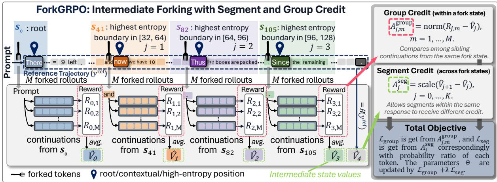
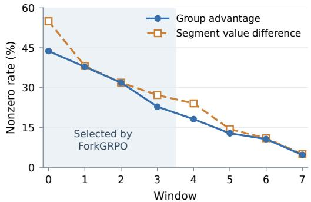
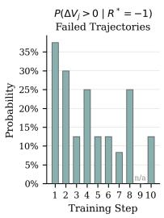
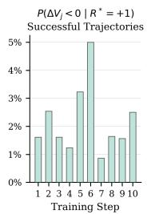
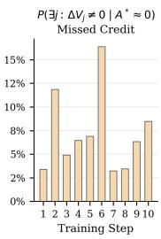

# FORKGRPO: Efficient Exploration and Fine-Grained Credit Assignment for Diffusion Language Models

Zhaoyan Jia<sup>1,\*</sup> Chengwei Zhou<sup>2,\*</sup> Gourav Datta<sup>2</sup> Massoud Pedram<sup>1</sup>

<sup>1</sup>University of Southern California, Los Angeles, USA

<sup>2</sup>Case Western Reserve University, Cleveland, USA

Equal contribution.

## Abstract

Diffusion large language models (dLLMs) have advanced rapidly, yet strengthening their reasoning through reinforcement learning (RL) remains an open challenge. Any-order generation can suffer from entropy degradation, which narrows the reasoning paths available for explo ration. Recent work mitigates this issue by applying standard GRPO with left-to-right generation. However, independently generating every rollout from the input prompt can leave alternative continuations from intermediate states underexplored, while trajectory-level advantages assign uniform credit to all tokens without distinguishing the contributions of individual reasoning segments. We propose FORKGRPO, an RL framework that couples efficient exploration with fine-grained segment-level credit assignment. It samples multiple continuations from high-entropy intermediate states along a reference trajectory, prioritizing textual boundaries and reusing shared prefixes. The contin uations provide complementary learning signals: within-state group-relative advantages guide which continuations to reinforce, while Monte Carlo state-value differences indicate which reasoning segments improve expected outcomes. Among the evaluated architecture preserving RL methods, FORKGRPO achieves the best performance on three of four bench marks, while improving over the directly com parable JustGRPO by up to 1.2 percentage points and using up to 27.8% fewer generated tokens. FORKGRPO-FAST further achieves a 2.49× training wall-clock speedup with negligible accuracy loss.

## 1 Introduction

Diffusion large language models (dLLMs) have advanced rapidly, emerging as a promising alternative to autoregressive (AR) language models with competitive language modeling and downstream capabilities (Nie et al., 2025). Their iterative denoising process supports parallel token generation and flexible decoding orders, but how to turn these capabilities into stronger reasoning through RL remains an open challenge. Recent work has shown that any-order decoding suffers from entropy degradation: uncertain decisions are deferred until other generated tokens have constrained their possible outcomes, narrowing the reasoning paths available for exploration (Ni et al., 2026). JustGRPO mitigates this issue by enforcing left-to-right generation during RL, requiring the model to sample at uncertain logical forks before subsequent context constrains the available reasoning paths (Ni et al., 2026). This provides a promising starting point for dLLM reasoning, but leaves an important question: how can training explore the solution space more efficiently and thoroughly, and how can finergrained credit assignment lead to better reasoning trajectories?

However, standard GRPO still has two limitations. First, exploration relies on independent rollouts from the input prompt. Although left-to-right generation preserves alternative reasoning paths, it does not ensure that these possibilities are sufficiently explored. Under a finite sampling budget, rollouts may repeatedly follow common paths, leaving alternative continuations from intermediate states underexplored. Revisiting these states and sampling multiple continuations could allocate the budget more effectively and improve coverage of the available solution space.

Second, credit is assigned at the trajectory level. GRPO computes a relative advantage from the final reward and applies the same advantage to every token in a response (Shao et al., 2024). This signal compares complete responses but does not distinguish progress made by individual reasoning segments. A segment that increases the likelihood of eventual success may receive a negative advantage because a later mistake leads to an incorrect answer. Conversely, all segments in a response with a positive advantage are reinforced together, regardless of their individual contributions. Estimating how the expected final reward changes across a segment could provide more fine-grained credit assignment and help the model learn better reasoning trajectories. Together, these limitations motivate sampling alternative continuations from shared intermediate states and deriving segment-level credit from their terminal rewards.

We propose FORKGRPO, an RL framework for dLLMs that combines exploration from intermediate states with segment-level credit assignment. ForkGRPO samples a group of responses and uses one as the reference trajectory, along which it selects high-entropy fork states while prioritizing textual boundaries. It samples multiple continuations from each fork state, exploring alternative reasoning paths without generating every response from the beginning. Their average terminal rewards estimate state values, whose changes provide segment-level advantages along the reference trajectory. Combined with group-relative advantages among continuations from each fork state, these provide complementary learning signals that guide both progress along a reasoning trajectory and the choice of continuations from its intermediate states. We further introduce FORKGRPO-FAST to reduce sampling and optimization costs. Adaptive rollout adjusts continuation counts based on pilot reward diversity, while sparse branch replay and state subsampling reduce gradient computation over collected branches and generation states.

Our methods outperform all compared RL methods for dLLM on mathematical reasoning benchmarks. FORKGRPO outperforms JustGRPO on all four benchmarks by an average of 0.75 percentage points, while using at most 81.3% of its tokengeneration budget on GSM8K. FORKGRPO-FAST further achieves a 2.49× training speedup over full FORKGRPO while retaining 90.3% accuracy on GSM8K. These results highlight the benefits of jointly improving exploration and credit assignment for dLLM reasoning.

## 2 Related Work

Diffusion language models. Diffusion language models formulate text generation as an iterative denoising process that recovers clean sequences from corrupted inputs. Discrete diffusion methods extend this framework to categorical token spaces (Austin et al., 2021a; Lou et al., 2024), while masked diffusion models learn to reconstruct masked tokens at varying noise levels (Sahoo et al.,

2024). Recent models such as LLaDA and Dream scale this approach to large language models, using bidirectional context to support parallel token generation and flexible decoding orders (Nie et al., 2025; Ye et al., 2025). Block Diffusion combines autoregressive dependencies across blocks with diffusion within each block, supporting variablelength generation and efficient inference (Arriola et al., 2025). These developments motivate studying how RL can further strengthen the reasoning capabilities of dLLMs.

Reinforcement learning for diffusion language models. Masked dLLMs generate text through iterative denoising, making the evaluation of generation probabilities a central challenge for RL (Nie et al., 2025; Ye et al., 2025). Diffu-GRPO uses a mean-field approximation and single-forwardpass probability estimates (Zhao et al., 2025), while wd1 reduces reliance on likelihood ratios through a weighted log-likelihood objective (Tang et al., 2026). GDPO and ESPO use ELBO-based sequence-level surrogates (Rojas et al., 2026; Ou et al., 2026), and SPG combines lower and upper likelihood bounds to handle positive and negative advantages (Wang et al., 2026). DiSPO instead defines a state-conditioned filling objective, sampling alternative completions from cached logits under a factorized policy (Oba et al., 2026). The accuracy of likelihood approximations remains an important concern: single-pass estimates can omit dependencies introduced during generation, and token-level ELBO contributions do not generally represent conditional log-probabilities (Ou et al., 2026; Pan et al., 2026). JustGRPO adopts leftto-right generation to align rollout sampling with policy optimization, allowing exact evaluation of next-token probabilities under the sequential rollout policy while retaining bidirectional attention (Ni et al., 2026). However, it still samples complete responses independently and assigns the same advantage to all tokens within each response. FORK-GRPO builds on this policy with entropy-guided forking to explore alternative reasoning paths more efficiently and thoroughly, and segment-level credit assignment to provide finer feedback on reasoning progress.

Fine-grained credit assignment and branching. For autoregressive LLMs, VinePPO and SPOchain obtain intermediate credit through Monte Carlo value estimation using auxiliary continuations (Kazemnejad et al., 2025; Guo et al., 2025).

FORKGRPO additionally trains on these continuations through within-state group-relative updates, using the sampling budget for both value estimation and policy learning. SPO-tree and d-TreeRPO reuse samples through recursive rollout trees (Guo et al., 2025; Pan et al., 2026), while TreePO, TreeRL and TreeAdv use uncertaintyguided branching (Li et al., 2026; Hou et al., 2025; Cao et al., 2026). FORKGRPO combines entropyguided branching with Monte Carlo value estimation using nonrecursive groups of full sequential continuations along a reference trajectory. This design concentrates sampling on uncertain reasoning decisions while reusing existing reasoning. The resulting segment credit measures changes in expected terminal reward, rather than redistributing trajectory-level advantages as in TreeAdv or relying on one-step greedy value proxies as in EGSPO-SA (Kunde et al., 2026). Segment-level credit and within-state comparisons provide complementary feedback on which segments improve expected outcomes and which continuations to reinforce.

## 3 Method

In this section, we present FORKGRPO, illustrated in Figure 1. We first describe how fixed windows, textual boundaries, and predictive entropy guide branching along a reference trajectory. We then derive within-state group-relative credit and acrossstate segment credit from the sampled continuations and combine them in the training objective. Finally, we introduce FORKGRPO-FAST to reduce rollout generation and gradient replay costs.

## 3.1 Boundary-Aware Forking of a Reference Trajectory

Intermediate states and reference trajectory. We collect trajectories using left-to-right sequential unmasking while retaining the model’s bidirectional attention over the partially masked sequence, following the rollout protocol of JustGRPO (Ni et al., 2026) for RL training of masked dLLMs. This ordering requires the model to resolve uncertain reasoning decisions before proceeding to subsequent content, while allowing alternative continuations to be explored from intermediate states. For a completed response y of length L for a given prompt q, we define the state immediately before revealing position i, where $0 \leq i < L$ , as

$$
s _ { i } ( q , y ) = ( q , y _ { < i } , [ \mathrm { M A S K } ] ^ { L - i } ) .\tag{1}
$$

Thus, every position along a response defines an intermediate state with a committed prefix and an unresolved masked suffix.

For each prompt, we sample M complete responses from the fixed rollout policy $\pi _ { \mathrm { o l d } }$ and take the first as the reference trajectory $y ^ { \mathrm { r e f } }$ . FORK-GRPO selects K intermediate states along this trajectory from which to sample alternative continuations.

Windowing. To determine where to sample intermediate continuations, we first partition the early portion of the response into K non-overlapping windows,

$$
\mathcal { W } _ { j } = \{ j W , \dotsc , ( j + 1 ) W - 1 \} , \quad j = 1 , \dotsc , K .\tag{2}
$$

Windowing prevents a small number of locally uncertain positions from consuming the entire branching budget and provides rollouts at multiple stages of the trajectory. We focus these windows on earlier portions of the response, where alternative continuations retain a longer horizon over which they can diverge or recover. Consistent with this intuition, later forks empirically exhibit substantially higher rates of zero group advantage (Section 4.3.3).

Boundary-aware forking. Within each window, not every token position provides a meaningful intermediate reasoning state. Forking inside a phrase or local expression may primarily perturb lexical realization rather than a completed reasoning decision. We therefore prioritize textual transition points and define $\mathcal { P } _ { j } \subseteq \mathcal { W } _ { j }$ as positions immediately following a newline or sentence-ending punctuation. If no such position exists, we fall back to $\mathcal { P } _ { j } = \mathcal { W } _ { j }$ . The boundary delimiters are specified in Appendix C.3.

We further rank these fork position candidates by predictive entropy. This choice is motivated by the observation of JustGRPO (Ni et al., 2026) that highuncertainty tokens often occur at branching points in reasoning, where different token choices can lead to different downstream solution paths. Consistent with this view, we also observe that branching from high-entropy states can recover correct continuations even when the reference trajectory ultimately fails. For revealing reference token i, we compute $\begin{array} { r } { H _ { i } ^ { \mathrm { r e f } } \ = \ - \sum _ { v \in \mathcal { V } } p _ { i } ( v ) } \end{array}$ log $p _ { i } ( v )$ , where V is the token vocabulary, $v \in \mathcal V$ denotes a candidate token, and $p _ { i } ( v ) = \pi _ { \mathrm { o l d } } ( v \mid s _ { i } ^ { \mathrm { r e f } } )$ is its conditional probability. The selected fork is

$$
a _ { j } = \arg \operatorname* { m a x } _ { i \in \mathcal { P } _ { j } } H _ { i } ^ { \mathrm { r e f } } .\tag{3}
$$

For sequential masked generation, this uncertainty signal is available directly from the token distribution at each partially masked state and requires no auxiliary model. At each selected state $s _ { a _ { j } } ^ { \mathrm { r e f } }$ , we keep $y _ { < a } ^ { \mathrm { r e f } }$ fixed and sample M independent continuations starting from position $a _ { j }$ , so that the selected token itself is resampled. Together with the root state $a _ { 0 } = 0 $ , this produces K + 1 continuation groups. We denote completion m from group j by $y ^ { ( j , m ) }$ and its terminal reward by $R _ { j , m }$

  
Figure 1: Overview of FORKGRPO. FORKGRPO samples multiple continuations from high-entropy intermediate states along a reference trajectory and uses their terminal rewards to estimate intermediate state values. These samples provide two complementary credit signals for joint policy optimization: within-state relative credit among sibling continuations and segment-level credit derived from the change in value between successive fork states.

## 3.2 Within-State Group-Relative Credit

Each fork state produces a group of continuations that share the same reference prefix but explore different future trajectories. These sibling continuations provide a natural within-state comparison: their terminal rewards reveal which alternatives are preferable when starting from the same intermediate state. We compute the group mean and sample variance as

$$
\begin{array} { l } { \displaystyle \bar { R } _ { j } = \frac 1 M \sum _ { m = 1 } ^ { M } R _ { j , m } , } \\ { \displaystyle \widehat \sigma _ { j } ^ { 2 } = \frac 1 { M - 1 } \sum _ { m = 1 } ^ { M } ( R _ { j , m } - \bar { R } _ { j } ) ^ { 2 } . } \end{array}\tag{4}
$$

The corresponding group-relative advantage is

$$
A _ { j , m } ^ { \mathrm { g r o u p } } = \frac { R _ { j , m } - R _ { j } } { \widehat { \sigma } _ { j } + \epsilon _ { A } } ,\tag{5}
$$

where $\epsilon _ { A } > 0$ is a numerical stabilizer. This advantage is shared by all newly generated tokens in response $y ^ { ( j , m ) }$ . Because all continuations within a group start from the same intermediate state, this advantage isolates variation among alternative futures rather than differences in their preceding prefixes. It therefore provides the credit for learning which continuations should be made more or less likely.

## 3.3 Across-State Segment Credit

Group-relative credit distinguishes alternative continuations from the same state, but it does not indicate how the reference trajectory itself changes the prospect of eventual success as generation proceeds. FORKGRPO obtains this complementary signal by interpreting the mean reward of each fork group as a Monte Carlo estimate of intermediate state value.

Specifically, for fork state $j ,$ we define

$$
\widehat { V } _ { j } = \bar { R } _ { j } = \frac { 1 } { M } \sum _ { m = 1 } ^ { M } R _ { j , m } , \quad j = 0 , \ldots , K .\tag{6}
$$

Let $a _ { K + 1 } = L$ denote the terminal boundary. For each segment $\mathcal { T } _ { j } = \{ a _ { j } , \ldots , a _ { j + 1 } - 1 \}$ , we measure the change in expected terminal outcome between its two boundaries:

$$
\Delta V _ { j } = \left\{ \begin{array} { l l } { \widehat { V } _ { j + 1 } - \widehat { V } _ { j } , } & { j = 0 , \ldots , K - 1 , } \\ { R ( q , y ^ { \mathrm { r e f } } ) - \widehat { V } _ { j } , } & { j = K . } \end{array} \right.\tag{7}
$$

A positive $\Delta V _ { j }$ indicates that, after traversing segment $\mathcal { T } _ { j }$ , subsequent continuations achieve a higher expected terminal reward, whereas a negative value indicates that the segment decreases the estimated prospect of success.

This state-to-state comparison addresses a limitation of response-level credit assignment. A single response-level advantage assigns identical credit to every segment of a trajectory, even when different segments have different effects on the expected terminal reward (Kazemnejad et al., 2025). If the underlying segment value changes differ, no single shared advantage can represent all of them accurately, resulting in an irreducible granularity error. In contrast, FORKGRPO estimates each $\Delta V _ { j }$ separately. Under our sampling assumptions, the mean squared estimation error of these segmentlevel estimates decreases as $O ( 1 / M )$ and, for sufficiently large M, becomes lower than that of a shared response-level advantage. We formalize this result in Appendix B (Theorem 1).

Noise-aware shrinkage. The finer granularity, however, introduces Monte Carlo uncertainty because each state value is estimated from only finitely many continuations. Under the same assumptions, the mean squared error of $\Delta V _ { j }$ is bounded by $u _ { j } = 2 \nu ^ { 2 } / M$ for intermediate segments and $\nu ^ { 2 } /  M$ for the terminal segment, where $\nu ^ { 2 } = ( r _ { \operatorname* { m a x } } - r _ { \operatorname* { m i n } } ) ^ { 2 } / 4$ denotes the global variance upper bound. We therefore use $u _ { j }$ as a noise scale and attenuate value changes that are small relative to their estimation uncertainty:

$$
\alpha _ { j } = \frac { ( \Delta V _ { j } ) ^ { 2 } } { ( \Delta V _ { j } ) ^ { 2 } + u _ { j } + \epsilon _ { s } } , \quad A _ { j } ^ { \mathrm { s e g } } = \alpha _ { j } \Delta V _ { j } ,\tag{8}
$$

where $\epsilon _ { s } > 0$ stabilizes the denominator. Consequently, segment value changes that are large relative to their uncertainty are largely preserved, whereas weak, potentially noise-dominated estimates are shrunk toward zero. The properties and potential bias of this shrinkage rule are discussed in Appendix B.4. The resulting $A _ { j } ^ { \mathrm { s e g } }$ serves as the segment-level advantage used to optimize the corresponding portion of the reference trajectory.

## 3.4 ForkGRPO Objective

FORKGRPO combines the two complementary credit signals introduced above. The group-relative advantage $A _ { j , m } ^ { \mathrm { g r o u p } }$ compares alternative continuations sampled from the same intermediate state, whereas the segment advantage $A _ { j } ^ { \mathrm { s e g } }$ measures the value change between successive states along the reference trajectory. We optimize both signals using the same clipped policy objective, but apply them to different parts of the sampled trajectories.

For token i of continuation $y ^ { ( j , m ) }$ , we define the policy ratio

$$
\rho _ { i } ^ { ( j , m ) } = \frac { \pi _ { \theta } ( y _ { i } ^ { ( j , m ) } \mid s _ { i } ^ { ( j , m ) } ) } { \pi _ { \mathrm { o l d } } ( y _ { i } ^ { ( j , m ) } \mid s _ { i } ^ { ( j , m ) } ) } ,\tag{9}
$$

where $s _ { i } ^ { ( j , m ) } ~ = ~ s _ { i } ( q , y ^ { ( j , m ) } )$ . Following the clipped GRPO objective, we write

$$
\ell ( \rho , A ) = \operatorname* { m i n } \{ \rho A , \exp ( \rho , 1 - \epsilon , 1 + \epsilon ) A \} ,\tag{10}
$$

where ϵ controls the clipping range.

Group objective. For each fork group, $A _ { j , m } ^ { \mathrm { g r o u p } }$ is applied only to tokens generated after its fork state; the shared reference prefix is not replayed with group-relative credit. The resulting objective is

$$
\mathcal { L } _ { \mathrm { g r o u p } } = - \frac { 1 } { N _ { \mathrm { t o k } } } \sum _ { j = 0 } ^ { K } \sum _ { m = 1 } ^ { M } \sum _ { i = a _ { j } } ^ { L - 1 } \ell \Bigl ( \rho _ { i } ^ { ( j , m ) } , A _ { j , m } ^ { \mathrm { g r o u p } } \Bigr ) ,
$$

(11) where $\begin{array} { r } { N _ { \mathrm { t o k } } = M \sum _ { j = 0 } ^ { K } ( L - a _ { j } ) } \end{array}$ is the total number of newly generated tokens.

Segment objective. The segment advantage is instead applied to the corresponding portion of the reference trajectory. Denoting the reference-policy ratio at position i by $\rho _ { i } ^ { \mathrm { r e f } }$ , we optimize

$$
\mathcal { L } _ { \mathrm { s e g } } = - \frac { 1 } { L } \sum _ { j = 0 } ^ { K } \sum _ { i \in \mathbb { Z } _ { j } } \ell \Big ( \rho _ { i } ^ { \mathrm { r e f } } , A _ { j } ^ { \mathrm { s e g } } \Big ) .\tag{12}
$$

Thus, different portions of the same reference response receive different policy updates according to their estimated changes in continuation value.

The final FORKGRPO objective is

$$
\mathcal { L } _ { \mathrm { F o r k G R P O } } = \mathcal { L } _ { \mathrm { g r o u p } } + \lambda \mathcal { L } _ { \mathrm { s e g } } ,\tag{13}
$$

where $\lambda$ controls the contribution of segmentlevel credit. The reference response participates in both objectives: its root-group advantage provides within-state relative credit, while $A _ { j } ^ { \mathrm { s e g } }$ assigns segment-specific credit along the same trajectory.

## 3.5 ForkGRPO-Fast: Adaptive Rollout and Sparse Replay

FORKGRPO uses conditional continuations for two purposes: exploring alternative outcomes to estimate credit, and replaying sampled trajectories to compute policy gradients. These two stages need not use the same computational budget. We therefore introduce FORKGRPO-FAST, which reduces cost at three levels: adaptive rollout avoids unnecessary continuation sampling, sparse branch replay reduces the number of continuations revisited with gradients, and state subsampling further reduces the number of replayed states within each retained continuation.

Adaptive rollout. For each root or fork state, we first sample $M _ { \mathrm { p i l o t } } < M$ continuations. If every pilot group is homogeneous and all groups share the same observed reward, both group-relative and segment credit vanish under the pilot samples, so we stop rollout collection for that prompt. Otherwise, only groups with reward variation are expanded to the full size M:

$$
M _ { j } = \left\{ { \begin{array} { l l } { M , } & { { \mathrm { i f ~ } } \mathrm { g r o u p ~ } j { \mathrm { ~ r e w a r d ~ v a r i e s } } , } \\ { M _ { \mathrm { { p i l o t } } } , } & { { \mathrm { o t h e r w i s e . } } } \end{array} } \right.\tag{14}
$$

All value estimates and group statistics use the samples actually collected. Because group expansion depends on observed pilot outcomes, adaptive rollout introduces a slight selection bias relative to fixed-M sampling (Appendix E.2). However, experimentally this approximation reduces rollout overhead by 1.76× while maintaining task accuracy.

Sparse branch replay. Adaptive rollout reduces exploration cost; once rewards have been collected, we can separately reduce the cost of gradient replay. For binary-reward tasks, responses with the same reward within a group also share the same standardized group-relative advantage. It is therefore unnecessary to replay every branch from the same reward class. We uniformly retain a small number of representatives and weight them by their class multiplicity. We consider 1+1 replay, retaining at most one positive and one negative branch. Conditioned on the collected rollout set, this multiplicity correction preserves the full group gradient in expectation. We apply this optimization only to binary-reward tasks; experiments with non-binary code rewards retain all sampled branches.

State subsampling. For each retained branch, we replay only a fraction $\rho$ of the generated states after the fork position. Random stratified subsampling uses inverse retention weighting. The two replay mechanisms reduce local replay cost approximately as $\begin{array} { r } { \frac { C _ { \mathrm { f a s t } } } { C _ { \mathrm { f u l l } } } \approx \frac { r _ { b } } { M } \rho . } \end{array}$ , where $r _ { b }$ is the number of replayed branches. With M = 8, 1+1 replay, and $\rho = 0 . 2 5$ this retains at most 6.25% of the original branch– state replay operations.

Overall, FORKGRPO-FAST separates the budget used to discover useful credit from the computation used to optimize it: adaptive rollout reduces unnecessary exploration, while branch and state replay sparsify the subsequent gradient computation.

## 4 Experiments

## 4.1 Experimental Setup

We use LLaDA-8B-Instruct (Nie et al., 2025) as the base model and evaluate on GSM8K (Cobbe et al., 2021) and MATH-500 (Lightman et al., 2024) for mathematical reasoning, and HumanEval (Chen et al., 2021) and MBPP (Austin et al., 2021b) for code generation. We report exact-match accuracy for mathematics and pass@1 for code, with a fixed response length of 256 tokens. Full reward definitions, decoding settings, FORK-GRPO/FORKGRPO-FAST configurations, and optimization hyperparameters are provided in Appendix C.

Table 1: Main results at generation length 256. We report accuracy (%) on GSM8K and MATH-500 and pass@1 (%) on HumanEval and MBPP. † indicates architecture modifications; ‡ indicates training with substantially more private data.
<table><tr><td>Method</td><td colspan="4">GSM8KMATH-500 HumanEvalMBPP</td></tr><tr><td>LLaDA-1.5‡ (Zhu et al., 2026)</td><td>83.3</td><td></td><td>39.6</td><td>39.9</td></tr><tr><td>LLaDOU† (Huang et al., 2025)</td><td>88.1</td><td>41.1</td><td>59.1</td><td>51.6</td></tr><tr><td>d1 (Zhao et al., 2025)</td><td>81.1</td><td>38.6</td><td></td><td></td></tr><tr><td>DMPO (Zhu et al., 2025)</td><td>82.4</td><td>38.2</td><td></td><td></td></tr><tr><td>wd1 (Tang et al., 2026)</td><td>80.8</td><td>34.4</td><td></td><td></td></tr><tr><td>d-TreeRPO (Pan et al., 2026)</td><td>81.2</td><td>37.7</td><td></td><td></td></tr><tr><td>ESPO (Ou et al., 2026)</td><td>82.3</td><td>39.0</td><td>42.1</td><td>44.6</td></tr><tr><td>GDPO (Rojas et al., 2Ó26)</td><td>82.8</td><td>39.6</td><td>39.6</td><td>50.6</td></tr><tr><td>PAPO (Shao et al., 2026)</td><td>82.4</td><td>35.6</td><td>34.8</td><td>43.2</td></tr><tr><td>StableDRL (Zhong et al., 2026)</td><td>86.2</td><td>45.2</td><td></td><td></td></tr><tr><td>SPG (Wang et al., 2026)</td><td>86.1</td><td>40.0</td><td></td><td></td></tr><tr><td>JustGRPO (Ni et al., 2026)</td><td>89.6</td><td>46.0</td><td>50.6</td><td>48.6</td></tr><tr><td>ForkGRPO</td><td>90.4</td><td>46.6</td><td>51.8</td><td>49.0</td></tr><tr><td>ForkGRPO-Fast</td><td>90.3</td><td>46.8</td><td>51.8</td><td>48.8</td></tr></table>

## 4.2 Main Results

Table 1 compares FORKGRPO with prior dLLM reasoning methods at a generation length of 256 tokens. For JustGRPO, we use the LoRA results reported in its official repository,<sup>1</sup> whose LoRA configuration we also adopt for FORKGRPO. Results for the remaining baselines are taken from their corresponding papers.

FORKGRPO improves over JustGRPO on all four benchmarks, achieving 90.4%, 46.6%, 51.8%, and 49.0% on GSM8K, MATH-500, HumanEval, and MBPP, respectively. These correspond to gains of 0.8, 0.6, 1.2, and 0.4 percentage points over Just-GRPO. The improvement is observed on both mathematical reasoning and code generation, suggesting that conditional branching and finer-grained credit assignment complement the sequential RL formulation rather than benefiting only a particular task family. FORKGRPO-FAST preserves nearly all of this performance despite its reduced training cost.

## 4.3 Ablation Studies

All ablations in this section are conducted on GSM8K. Each variant starts from the same public JustGRPO checkpoint and undergoes 10 additional optimizer updates under each of five training seeds.

Table 2: Component ablation on GSM8K. Forked variants share the same sampling configuration and differ only in their training objective.
<table><tr><td>Method</td><td>Fork</td><td>Credit</td><td>Acc. (%)</td></tr><tr><td>JustGRPO</td><td>No</td><td>group</td><td> $8 8 . 8 1 \pm 0 . 5 3 $ </td></tr><tr><td> $\mathrm { F o r k + G r o u p }$ </td><td>Yes</td><td>group</td><td> $8 9 . 6 9 \pm 0 . 2 1$ </td></tr><tr><td> $\mathrm { F o r k } + \mathrm { S e g m e n t }$ </td><td>Yes</td><td>segment</td><td> $8 9 . 4 5 \pm 0 . 2 9$ </td></tr><tr><td>ForkGRPO</td><td>Yes</td><td>segment + group</td><td> ${ \bf 9 0 . 3 1 \pm 0 . 0 6 }$ </td></tr></table>

We report mean accuracy ± sample standard deviation across the five runs. This shared initialization and fixed update budget enable controlled comparisons of component contributions within our computational budget. Further details are provided in Appendix C.5, while the ablation of FORKGRPO-FAST is reported separately in Appendix F.

## 4.3.1 Forking and Credit Assignment

We compare four variants in Table 2. JustGRPO samples 16 complete responses per prompt without forking. All forked variants use Entropy Boundary selection with $K = 3$ fork states and $M = 8 { \mathrm { ~ r e } } .$ sponses per group, yielding 32 scored completions per prompt, as in the main experiments. Their sampling configuration is fixed, and only the training objective varies. Fork + Group uses only ${ \mathcal { L } } _ { \mathrm { g r o u p } }$ to train on root responses and forked suffixes. Fork + Segment uses continuation rewards to estimate segment advantages but updates only the reference response through $\mathcal { L } _ { \mathrm { s e g } }$ . ForkGRPO combines both objectives.

Full FORKGRPO achieves the highest mean accuracy, outperforming either objective alone. This supports the complementary roles of within-state group comparisons and segment-level credit along the reference trajectory.

## 4.3.2 Fork-State Selection

We compare four fork-state selection strategies while fixing the full FORKGRPO objective and sampling configuration $( K = 3 , M = 8 )$ . Each strategy selects one branching position from each of the three 32-token windows: [32, 64), [64, 96), and [96, 128). Fixed selects the center of each window. Random Boundary samples uniformly from the boundary candidates defined in Section 3.1. Max Entropy selects the highest-entropy position within each window without a boundary constraint. Entropy Boundary, our proposed strategy, selects the highest-entropy boundary candidate.

Table 3 shows that Entropy Boundary achieves the highest mean accuracy, outperforming both

Table 3: Fork-state selection on GSM8K. All variants differ only in how branching positions are selected within each window.
<table><tr><td>Selection</td><td>Boundary</td><td>Entropy</td><td>Acc. (%)</td></tr><tr><td>Fixed</td><td>No</td><td>No</td><td> $8 9 . 1 0 \pm 0 . 3 3 $ </td></tr><tr><td>Random Boundary</td><td>Yes</td><td>No</td><td> $8 9 . 2 5 \pm 0 . 2 1$ </td></tr><tr><td>Max Entropy</td><td>No</td><td>Yes</td><td> $8 9 . 6 7 \pm 0 . 1 6$ </td></tr><tr><td>Entropy Boundary</td><td>Yes</td><td>Yes</td><td> ${ \bf 9 0 . 3 1 \pm 0 . 0 6 }$ </td></tr></table>

  
Figure 2: Nonzero rates of group advantages and window segment value differences, averaged over the first 10 training steps on GSM8K with LLaDA-8B-Instruct. Both signals become substantially sparser at later segments. Shading indicates the first four 32-token windows covered by the default FORKGRPO configuration $( K = 3 )$ .

Random Boundary and Max Entropy. This supports combining predictive uncertainty with textual boundaries to target uncertain reasoning transitions, where alternative continuations may explore different solution paths.

## 4.3.3 Credit Density and Sampling Allocation

Credit density across windows. We next examine how the usefulness of branching changes across the fixed window defined in Section 3.1. With $W = 3 2$ , each candidate fork window spans 32 consecutive response positions. Figure 2 reports the fraction of training examples with nonzero group advantages and nonzero segment value differences at each window. Both signals become progressively sparser in later windows, indicating that forks placed later in the trajectory yield fewer effective policy-gradient signals (Yu et al., 2025). This trend motivates concentrating the branching budget in the early portion of the response. Our default configuration $( K = 3 )$ selects one intermediate fork state from each of the windows [32, 64), [64, 96), and [96, 128). These three fork states, together with the root state at position 0, lie within the first four 32-token windows highlighted in Figure 2, where credit signals remain relatively dense.

Table 4: Sampling allocation on GSM8K.
<table><tr><td> $K$ </td><td> $M$ </td><td>Groups</td><td>Acc. (%)</td></tr><tr><td>0</td><td>32</td><td>1</td><td> $8 9 . 1 4 \pm 0 . 3 8$ </td></tr><tr><td>1</td><td>16</td><td>2</td><td> $8 9 . 3 6 \pm 0 . 1 9$ </td></tr><tr><td>3</td><td>8</td><td>4</td><td> ${ \bf 9 0 . 3 1 \pm 0 . 0 6 }$ </td></tr><tr><td>7</td><td>4</td><td>8</td><td> $8 9 . 9 3 \pm 0 . 1 1$ </td></tr></table>

Sampling allocation. We next study how performance changes when the same number of responses is distributed across different numbers of branching states. Table 4 keeps $( K + 1 ) M = 3 2$ scored responses while varying K and M. All candidate windows retain the fixed width $W = 3 2 ;$ for a given K, we use the first K windows following the root. The best performance is obtained with $K = 3 , M = 8$ , reaching a mean accuracy of 90.31%. Smaller K provides less intermediatestate coverage, whereas larger K reduces the number of continuations per state and extends branching into later windows with sparser credit signals. These results support $K = 3 , M = 8$ as a favorable balance between branching coverage and per-state estimation.

## 4.4 Sampling Efficiency

We compare the sampling efficiency of FORK-GRPO with the officially reported JustGRPO-LoRA baseline on GSM8K. Both methods use the same LoRA configuration, base model, training data, optimizer settings, global prompt batch size, response length, and evaluation protocol to ensure a fair comparison.

JustGRPO-LoRA samples 16 full responses per prompt and trains for 200 steps. With $L = 2 5 6$ each prompt requires $1 6 L = 4 0 9 6$ newly generated tokens. FORKGRPO samples 8 initial responses and 8 continuations from each of 3 branching states, and trains for 100 steps.

Our branching windows give $a _ { 1 } \in [ 3 2 , 6 3 ] , a _ { 2 } \in$ [64, 95], and $a _ { 3 } \in [ 9 6 , 1 2 7 ]$ . The number of newly generated tokens per prompt therefore satisfies

$$
N _ { \mathrm { t o k } } = 8 \left( 4 L - \sum _ { j = 1 } ^ { 3 } a _ { j } \right) \in [ 5 9 1 2 , 6 6 5 6 ] .\tag{15}
$$

With equal prompt batch sizes, the cumulative generation budget of FORKGRPO, normalized to JustGRPO-LoRA, lies in the range

$$
\left[ { \frac { 1 0 0 \times 5 9 1 2 } { 2 0 0 \times 4 0 9 6 } } , { \frac { 1 0 0 \times 6 6 5 6 } { 2 0 0 \times 4 0 9 6 } } \right] \approx [ 0 . 7 2 1 7 , 0 . 8 1 2 5 ] .\tag{16}
$$

Even the upper bound is below the baseline budget, corresponding to a reduction of 18.75–27.83% in cumulative generated tokens.

Table 5: Sampling efficiency on GSM8K. Both methods use LoRA. Total token budgets are normalized to JustGRPO-LoRA; ranges denote analytical bounds.
<table><tr><td>Metric</td><td>JustGRPO</td><td>ForkGRPO</td></tr><tr><td>Training updates</td><td>200</td><td>100</td></tr><tr><td>Scored responses / prompt</td><td>16</td><td>32</td></tr><tr><td>New tokens / prompt</td><td>4096</td><td>5912-6656</td></tr><tr><td>Total token budget</td><td>1.0000</td><td>[0.7217, 0.8125]</td></tr><tr><td>GSM8K accuracy (%)</td><td>89.6</td><td>90.4</td></tr></table>

FORKGRPO achieves 90.4% accuracy on GSM8K, surpassing JustGRPO-LoRA by 0.8 percentage points while using 18.75–27.83% fewer newly generated tokens. These results show that conditional branching can provide finer-grained exploration without requiring a larger cumulative generation budget.

FORKGRPO-FAST can further reduce the generation budget through adaptive rollout. Each continuation group starts with $M _ { \mathrm { p i l o t } } = 4$ samples and is expanded to M = 8 only when the pilot samples exhibit reward variation. Its exact token budget is therefore data dependent: stronger base-model performance or easier tasks may produce more homogeneous groups and require fewer expansions, whereas more challenging tasks may approach the full FORKGRPO budget. Thus, FORKGRPO-FAST uses no more generation than FORKGRPO and typically reduces it, while retaining comparable task performance.

## 5 Conclusion

We introduced FORKGRPO, an RL framework that integrates intermediate-state exploration with fine-grained credit assignment for masked dLLMs. FORKGRPO branches from high-entropy states along a reference trajectory, prioritizing textual boundaries and reusing shared prefixes. The resulting continuations provide complementary learning signals through within-state group comparisons and Monte Carlo estimates of segment value changes. Experiments across four benchmarks demonstrate improvements in mathematical reasoning and code generation, while ablations support the contributions of both learning signals and the proposed branching strategy. FORKGRPO-FAST further reduces rollout and gradient replay costs, achieving substantial training acceleration on GSM8K with negligible accuracy loss. These results support conditional branching and finer-grained credit assignment as practical tools for improving the accuracy and efficiency of dLLM post-training.

## Limitations

The computational cost of RL post-training limits the scope of our empirical evaluation. Our main results for FORKGRPO and FORKGRPO-FAST are based on a single training run per method and task, so their variability across training seeds remains unmeasured. We complement these experiments with GSM8K ablations averaged over 5 training seeds using short continuation runs from a shared public JustGRPO checkpoint. This protocol enables controlled comparisons of individual components within our computational budget. Extending these comparisons to full training runs across multiple seeds would provide a more comprehensive assessment of training stability and component contributions.

## References

Marianne Arriola, Aaron Gokaslan, Justin T. Chiu, Zhihan Yang, Zhixuan Qi, Jiaqi Han, Subham Sekhar Sahoo, and Volodymyr Kuleshov. 2025. Block diffusion: Interpolating between autoregressive and diffusion language models. In The Thirteenth International Conference on Learning Representations.

Jacob Austin, Daniel D. Johnson, Jonathan Ho, Daniel Tarlow, and Rianne van den Berg. 2021a. Structured denoising diffusion models in discrete state-spaces. In Advances in Neural Information Processing Systems, volume 34, pages 17981–17993.

Jacob Austin, Augustus Odena, Maxwell Nye, Maarten Bosma, Henryk Michalewski, David Dohan, Ellen Jiang, Carrie Cai, Michael Terry, Quoc Le, and Charles Sutton. 2021b. Program synthesis with large language models. arXiv preprint arXiv:2108.07732.

Lang Cao, Hui Ruan, Yongqian Li, Peng Chao, Wu Ning, Haonan Song, Renhong Chen, and Yitong Li. 2026. TreeAdv: Tree-structured advantage redistribution for group-based RL. Preprint, arXiv:2601.03703.

Mark Chen, Jerry Tworek, Heewoo Jun, Qiming Yuan, Henrique Ponde de Oliveira Pinto, Jared Kaplan, Harri Edwards, Yuri Burda, Nicholas Joseph, Greg Brockman, Alex Ray, Raul Puri, Gretchen Krueger, Michael Petrov, Heidy Khlaaf, Girish Sastry, Pamela Mishkin, Brooke Chan, Scott Gray, and 39 others. 2021. Evaluating large language models trained on code. Preprint, arXiv:2107.03374.

Karl Cobbe, Vineet Kosaraju, Mohammad Bavarian, Mark Chen, Heewoo Jun, Lukasz Kaiser, Matthias Plappert, Jerry Tworek, Jacob Hilton, Reiichiro Nakano, Christopher Hesse, and John Schulman. 2021. Training verifiers to solve math word problems. Preprint, arXiv:2110.14168.

Yiran Guo, Lijie Xu, Jie Liu, Dan Ye, and Shuang Qiu. 2025. Segment policy optimization: Effective segment-level credit assignment in RL for large language models. In Advances in Neural Information Processing Systems, volume 38.

Zhenyu Hou, Ziniu Hu, Yujiang Li, Rui Lu, Jie Tang, and Yuxiao Dong. 2025. TreeRL: LLM reinforcement learning with on-policy tree search. In Proceedings of the 63rd Annual Meeting of the Association for Computational Linguistics (Volume 1: Long Papers), pages 12355–12369. Association for Computational Linguistics.

Edward J. Hu, Yelong Shen, Phillip Wallis, Zeyuan Allen-Zhu, Yuanzhi Li, Shean Wang, Lu Wang, and Weizhu Chen. 2022. LoRA: Low-rank adaptation of large language models. In International Conference on Learning Representations.

Zemin Huang, Zhiyang Chen, Zijun Wang, Tiancheng Li, and Guo-Jun Qi. 2025. Reinforcing the diffusion chain of lateral thought with diffusion language models. In Advances in Neural Information Processing Systems, volume 38.

Amirhossein Kazemnejad, Milad Aghajohari, Eva Portelance, Alessandro Sordoni, Siva Reddy, Aaron Courville, and Nicolas Le Roux. 2025. VinePPO: Refining credit assignment in RL training of LLMs. In Proceedings of the 42nd International Conference on Machine Learning, volume 267 of Proceedings ofMachine Learning Research, pages 29557–29590. PMLR.

Vishnu Teja Kunde, Fatemeh Doudi, Mahdi Farahbakhsh, Dileep Kalathil, Krishna Narayanan, and Jean-Francois Chamberland. 2026. Reinforcement learning for diffusion LLMs with entropy-guided step selection and stepwise advantages. Preprint, arXiv:2603.12554.

Yizhi Li, Qingshui Gu, Zhoufutu Wen, Ziniu Li, Ruibin Yuan, Tianshun Xing, Shuyue Guo, Tuney Zheng, Xin Zhou, Xingwei Qu, Wangchunshu Zhou, Zheng Zhang, Wei Shen, Wei Xue, Qian Liu, Chenghua Lin, Jian Yang, Ge Zhang, and Wenhao Huang. 2026. TreePO: Enhancing policy efficacy and inference efficiency with tree modeling. In Proceedings of the 43rd International Conference on Machine Learning, volume 306 of Proceedings of Machine Learning Research, pages 66963–66976. PMLR.

Hunter Lightman, Vineet Kosaraju, Yuri Burda, Harrison Edwards, Bowen Baker, Teddy Lee, Jan Leike, John Schulman, Ilya Sutskever, and Karl Cobbe. 2024. Let’s verify step by step. In The Twelfth International Conference on Learning Representations.

Ilya Loshchilov and Frank Hutter. 2019. Decoupled weight decay regularization. In International Conference on Learning Representations.

Aaron Lou, Chenlin Meng, and Stefano Ermon. 2024. Discrete diffusion modeling by estimating the ratios of the data distribution. In Proceedings of the 41st

International Conference on Machine Learning, volume 235 of Proceedings of Machine Learning Research, pages 32819–32848. PMLR.

Zanlin Ni, Shenzhi Wang, Yang Yue, Tianyu Yu, Weilin Zhao, Yeguo Hua, Tianyi Chen, Jun Song, Cheng Yu, Bo Zheng, and Gao Huang. 2026. The flexibility trap: Rethinking the value of arbitrary order in diffusion language models. In Proceedings of the 43rd International Conference on Machine Learning, volume 306 of Proceedings ofMachine Learning Research, pages 93000–93015. PMLR.

Shen Nie, Fengqi Zhu, Zebin You, Xiaolu Zhang, Jingyang Ou, Jun Hu, Jun Zhou, Yankai Lin, Ji-Rong Wen, and Chongxuan Li. 2025. Large language diffusion models. In Advances in Neural Information Processing Systems, volume 38.

Daisuke Oba, Hiroki Furuta, and Naoaki Okazaki. 2026. Diffusion-state policy optimization for masked diffusion language models. Preprint, arXiv:2602.06462.

Jingyang Ou, Jiaqi Han, Minkai Xu, Shaoxuan Xu, Jianwen Xie, Stefano Ermon, Yi Wu, and Chongxuan Li. 2026. Principled RL for diffusion LLMs emerges from a sequence-level perspective. In International Conference on Learning Representations.

Leyi Pan, Shuchang Tao, Yunpeng Zhai, Zheyu Fu, Liancheng Fang, Minghua He, Lingzhe Zhang, Zhaoyang Liu, Bolin Ding, Aiwei Liu, and Lijie Wen. 2026. d-TreeRPO: Towards more reliable policy optimization for diffusion language models. In Proceedings of the 64th Annual Meeting of the Associationfor Computational Linguistics (Volume 1: Long Papers), pages 21801–21822, San Diego, California, United States. Association for Computational Linguistics.

Kevin Rojas, Jiahe Lin, Kashif Rasul, Anderson Schneider, Yuriy Nevmyvaka, Molei Tao, and Wei Deng. 2026. Improving reasoning for diffusion language models via group diffusion policy optimization. In The Fourteenth International Conference on Learning Representations.

Subham Sekhar Sahoo, Marianne Arriola, Yair Schiff, Aaron Gokaslan, Edgar Marroquin, Justin T Chiu, Alexander Rush, and Volodymyr Kuleshov. 2024. Simple and effective masked diffusion language models. In Advances in Neural Information Processing Systems, volume 37.

Yawen Shao, Jie Xiao, Kai Zhu, Yu Liu, Hongchen Luo, Xueyang Fu, Yang Cao, Wei Zhai, and Zheng-Jun Zha. 2026. Back on track: Aligning rewards and states for reasoning in diffusion large language models. arXiv preprint arXiv:2606.08501.

Zhihong Shao, Peiyi Wang, Qihao Zhu, Runxin Xu, Junxiao Song, Xiao Bi, Haowei Zhang, Mingchuan Zhang, Y. K. Li, Y. Wu, and Daya Guo. 2024. DeepSeekMath: Pushing the limits of mathematical reasoning in open language models. Preprint, arXiv:2402.03300.

Xiaohang Tang, Rares Dolga, Sangwoong Yoon, and Ilija Bogunovic. 2026. wd1: Weighted policy optimization for reasoning in diffusion language models. In The Fourteenth International Conference on Learning Representations.

Chenyu Wang, Paria Rashidinejad, Andy (DiJia) Su, Song Jiang, Sid Wang, Siyan Zhao, Cai Zhou, Shannon Shen, Feiyu Chen, Tommi Jaakkola, Yuandong Tian, and Bo Liu. 2026. SPG: Sandwiched policy gradient for masked diffusion language models. In The Fourteenth International Conference on Learning Representations.

Jiacheng Ye, Zhihui Xie, Lin Zheng, Jiahui Gao, Zirui Wu, Xin Jiang, Zhenguo Li, and Lingpeng Kong. 2025. Dream 7B: Diffusion large language models. Preprint, arXiv:2508.15487.

Qiying Yu, Zheng Zhang, Ruofei Zhu, Yufeng Yuan, Xiaochen Zuo, Yu Yue, Weinan Dai, Tiantian Fan, Gaohong Liu, Juncai Liu, Lingjun Liu, Xin Liu, Haibin Lin, Zhiqi Lin, Bole Ma, Guangming Sheng, Yuxuan Tong, Chi Zhang, Mofan Zhang, and 17 others. 2025. DAPO: An open-source LLM reinforcement learning system at scale. In Advances in Neural Information Processing Systems, volume 38.

Siyan Zhao, Devaansh Gupta, Qinqing Zheng, and Aditya Grover. 2025. d1: Scaling reasoning in diffusion large language models via reinforcement learning. In Advances in Neural Information Processing Systems, volume 38.

Jianyuan Zhong, Kaibo Wang, Ding Ding, Zijin Feng, Haoli Bai, Yang Xiang, Jiacheng Sun, and Qiang Xu. 2026. Stabilizing reinforcement learning for diffusion language models. arXiv preprint arXiv:2603.06743.

Fengqi Zhu, Rongzhen Wang, Shen Nie, Xiaolu Zhang, Chunwei Wu, Jun Zhou, Yankai Lin, Ji-Rong Wen, and Chongxuan Li. 2026. LLaDA 1.5: Variancereduced preference optimization for large language diffusion models. In Proceedings of the 64th Annual Meeting of the Association for Computational Linguistics (Volume 1: Long Papers), pages 11425– 11460. Association for Computational Linguistics.

Yuchen Zhu, Wei Guo, Jaemoo Choi, Petr Molodyk, Bo Yuan, Molei Tao, and Yongxin Chen. 2025. Enhancing reasoning for diffusion LLMs via distribution matching policy optimization. arXiv preprint arXiv:2510.08233.

## A Why ForkGRPO for Masked Diffusion Language Models?

The core mechanism of FORKGRPO, branching from an intermediate state, sampling multiple conditional continuations, and using their terminal rewards for finer-grained credit assignment, is not inherently restricted to masked diffusion language models (MDMs). In principle, an autoregressive (AR) model could similarly branch from a prefix and estimate the value of that prefix from multiple sampled suffixes. Our focus on MDMs is therefore not based on an exclusivity claim, but on a training problem that is particularly natural and consequential in the MDM setting.

MDMs expose a distinctive exploration problem. Unlike AR models, whose generation order is intrinsically left-to-right, MDMs can resolve masked positions in flexible orders. Recent work shows that this flexibility can be detrimental to reasoning during RL: uncertain decisions may be deferred until surrounding tokens constrain their possible outcomes, reducing opportunities to explore alternative reasoning paths (Ni et al., 2026). Sequential unmasking alleviates this issue by forcing such decisions to be resolved before later context is available. FORKGRPO builds directly on this observation. Once an uncertainty-sensitive intermediate state is exposed along the sequential rollout, FORK-GRPO revisits that state and explicitly samples multiple possible futures rather than relying only on independent prompt-level trajectories.

Conditional forking is especially natural for partially denoised states. At generation position i, an MDM state has the form given in Eq. (1), which explicitly represents a partially resolved sequence and an unresolved remainder. Forking from this state probes alternative futures under the same committed content, enabling both within-state comparison and estimation of how the expected terminal reward changes as additional content becomes fixed.

More generally, this value-based view is not restricted to left-to-right prefixes. Native MDM states may contain committed tokens at arbitrary positions, with unresolved regions conditioned on context from the left, the right, or both. Conditional rollouts can therefore quantify the value change associated with committing any newly resolved portion of the sequence, rather than only extending a prefix as in an AR model. While we use sequential unmasking here to obtain controlled reasoning trajectories, the underlying credit-assignment view naturally extends to more general MDM decoding orders.

Relation to autoregressive models. The core idea of forking is not restricted to MDMs: an AR model could similarly branch from a prefix, sample multiple suffixes, and estimate prefix-level value changes. Our focus on MDMs instead follows from the structure of their generation process. Flexible decoding orders can defer high-uncertainty decisions, making intermediate-state exploration particularly relevant, while partially denoised states are not inherently limited to left-to-right prefixes and may contain committed context at arbitrary positions. FORKGRPO therefore studies conditional exploration and credit assignment in this broader state space, using sequential unmasking as a controlled instance in our experiments. We expect FORKGRPO to be plausibly applicable to AR models as well, although its theoretical motivation is less distinctive in the AR setting, where generation is already restricted to left-to-right prefix states.

## B Theoretical Analysis of Segment Credit

We analyze the estimation of segment value changes under the fixed rollout policy. The comparison concerns raw differences $\Delta V _ { j }$ , before shrinkage, and a response-level advantage shared across segments.

## B.1 Estimation Guarantee

Theorem 1 (Accuracy of segment credit). Fix a prompt q, a policy $\pi _ { \mathrm { o l d } }$ , and integers $K \geq 1$ and $M \geq 2 .$ . Assume that the initial M responses are $i . i . d .$ under $\pi _ { \mathrm { o l d } } .$ , with the first response designated as $y ^ { \mathrm { r e f } }$ . The branching positions $a _ { 1 } < \cdots < a _ { K }$ are selected from the reference response alone using afixed rule that does not depend on M. Conditional on the initial responses, all auxiliary continuations are sampled independently under $\pi _ { \mathrm { o l d } }$ from their selected states. Assume rewards lie in $[ r _ { \operatorname* { m i n } } , r _ { \operatorname* { m a x } } ]$ , and let $\nu ^ { 2 } = ( r _ { \operatorname* { m a x } } - r _ { \operatorname* { m i n } } ) ^ { 2 } / 4$

For $j = 0 , \ldots , K$ , let $V _ { j }$ be the expected terminal reward from the state before position $a _ { j }$ in the reference response, where $a _ { 0 } = 0 .$ . Let $\widehat { V } _ { j }$ be the mean reward of group j, including all M initial responses when $j = 0 .$ . Let $a _ { K + 1 } = L$ and set $\begin{array} { r } { V _ { K + 1 } = \widehat { V } _ { K + 1 } = R ( q , y ^ { \mathrm { r e f } } ) } \end{array}$ . For each segment $\mathcal { T } _ { j } = \{ a _ { j } , \ldots , a _ { j + 1 } - 1 \}$ , define

$$
\begin{array} { c } { { d _ { j } = V _ { j + 1 } - V _ { j } , } } \\ { { \Delta V _ { j } = \widehat { V } _ { j + 1 } - \widehat { V } _ { j } , \quad j = 0 , \ldots , K . } } \end{array}\tag{17}
$$

For every such segment,

$$
\begin{array} { r } { \mathbb { E } [ \Delta V _ { j } - d _ { j } \mid q ] = 0 , } \\ { \mathbb { E } [ ( \Delta V _ { j } - d _ { j } ) ^ { 2 } \mid q ] \le u _ { j } , } \end{array}\tag{18}
$$

where $u _ { j } = 2 \nu ^ { 2 } / M f o r j = 0 , \ldots , K - 1$ and $u _ { K } = \nu ^ { 2 } / M ,$ , as defined in Section 3.3.

To compare these estimates with a shared response-level advantage, define

$$
\begin{array} { c } { \displaystyle \bar { d } = \frac { 1 } { K + 1 } \sum _ { j = 0 } ^ { K } d _ { j } , } \\ { \displaystyle H ( { q } ) = \mathbb { E } [ \frac { 1 } { K + 1 } \sum _ { j = 0 } ^ { K } ( d _ { j } - \bar { d } ) ^ { 2 } |  q  ] . } \end{array}\tag{19}
$$

For any scalar advantage C shared across these segments,

$$
\mathbb { E } \left[ \frac { 1 } { K + 1 } \sum _ { j = 0 } ^ { K } ( C - d _ { j } ) ^ { 2 } \Bigg | \mathfrak { q } \right] \geq H ( \mathfrak { q } ) .\tag{20}
$$

The advantage C may depend on the reference and arbitrarily many prompt rollouts. In contrast,

$$
\mathbb { E } \left[ \frac { 1 } { K + 1 } \sum _ { j = 0 } ^ { K } ( \Delta V _ { j } - d _ { j } ) ^ { 2 } \Bigg | \thinspace q \right] \leq \frac { 2 \nu ^ { 2 } } { M } .\tag{21}
$$

Consequently, $i f H ( q ) > 0$ and

$$
{ \cal M } > \frac { 2 \nu ^ { 2 } } { H ( q ) } ,\tag{22}
$$

the raw segment estimates have strictly lower average mean squared error than any advantage shared across these segments.

All expectations conditioned only on q average over reference, initial-group, and auxiliary sampling. The target is the vector of segment value changes $( d _ { 0 } , \ldots , d _ { K } )$ . If $H ( q ) = 0$ , the estimation bound still holds, but the strict comparison does not apply.

## B.2 Proof

Proof. Let $Y _ { 0 } = ( y ^ { ( 0 , 1 ) } , \dots , y ^ { ( 0 , M ) } )$ denote the initial responses and define $e _ { j } = \hat { V } _ { j } - V _ { j }$ for j = $0 , \ldots , K + 1$ . By the terminal-value definition,

$e _ { K + 1 } = 0 .$ . Conditioning on $Y _ { 0 }$ fixes the reference and all branching states. For $1 \le j \le K$ , the auxiliary rewards are conditionally i.i.d., so

$$
\begin{array} { l } { { \mathbb { E } [ e _ { j } \mid q , Y _ { 0 } ] = 0 , } } \\ { { \ } } \\ { { \mathbb { E } [ e _ { j } ^ { 2 } \mid q , Y _ { 0 } ] = \displaystyle \frac { \sigma _ { j } ^ { 2 } } { M } \leq \displaystyle \frac { \nu ^ { 2 } } { M } , } } \end{array}\tag{23}
$$

where $\sigma _ { j } ^ { 2 }$ is the conditional reward variance. The inequality follows because a reward supported on $[ r _ { \operatorname* { m i n } } , r _ { \operatorname* { m a x } } ]$ has variance at most $\nu ^ { 2 }$

At the prompt state, the initial rewards are i.i.d. with variance $\sigma _ { 0 } ^ { 2 } .$ Thus,

$$
\begin{array} { l } { { \mathbb E [ e _ { 0 } \mid q ] = 0 , } } \\ { { \mathbb E [ e _ { 0 } ^ { 2 } \mid q ] = { \frac { \sigma _ { 0 } ^ { 2 } } { M } } \leq { \frac { \nu ^ { 2 } } { M } } . } } \end{array}\tag{24}
$$

For $1 \le j < K$ , conditional independence of the auxiliary batches and their conditional zero means imply $\mathbb { E } [ e _ { j } e _ { j + 1 } \mid q , Y _ { 0 } ] = 0$ . For $j = 0$ , the error $e _ { 0 }$ is fixed given $Y _ { 0 } ,$ , while $\mathbb { E } [ e _ { 1 } \mid q , Y _ { 0 } ] = 0$ Taking expectations therefore gives

$$
\mathbb { E } [ e _ { j } e _ { j + 1 } ~ | ~ q ] = 0 , ~ j = 0 , \dots , K - 1 .\tag{25}
$$

For $j = 0 , \ldots , K - 1$ , since $\Delta V _ { j } - d _ { j } = e _ { j + 1 } - e _ { j }$

$$
\begin{array} { r l } & { \mathbb { E } [ \Delta V _ { j } - d _ { j } \mid q ] = 0 , } \\ & { \mathbb { E } [ ( \Delta V _ { j } - d _ { j } ) ^ { 2 } \mid q ] = \mathbb { E } [ e _ { j + 1 } ^ { 2 } \mid q ] + \mathbb { E } [ e _ { j } ^ { 2 } \mid q ] } \\ & { \qquad \leq \cfrac { 2 \nu ^ { 2 } } { M } . } \end{array}
$$

For the final segment, $\Delta V _ { K } - d _ { K } = - e _ { K } ,$ , so

(26)

$$
\begin{array} { r l } & { \mathbb { E } [ \Delta V _ { K } - d _ { K } \mid q ] = 0 , } \\ & { \mathbb { E } [ ( \Delta V _ { K } - d _ { K } ) ^ { 2 } \mid q ] \le \cfrac { \nu ^ { 2 } } { M } = u _ { K } . } \end{array}\tag{27}
$$

This proves Eq. (18). Averaging these bounds over the $K + 1$ segments and using $u _ { j } \leq 2 \nu ^ { 2 } / M$ for every j gives Eq. (21).

For the shared-advantage comparison, the following identity holds for every realized reference and every scalar C:

$$
\begin{array} { c } { { \displaystyle \frac 1 { K + 1 } \sum _ { j = 0 } ^ { K } ( C - d _ { j } ) ^ { 2 } = \displaystyle \frac 1 { K + 1 } \sum _ { j = 0 } ^ { K } ( d _ { j } - \bar { d } ) ^ { 2 } } } \\ { { + ( C - \bar { d } ) ^ { 2 } . } } \end{array}\tag{28}
$$

The cross term vanishes because $\textstyle \sum _ { j = 0 } ^ { K } ( d _ { j } - { \bar { d } } )$ 0. Dropping the final nonnegative term and taking expectations proves Eq. (20), without requiring independence between C and the reference.

Because the reference is the first i.i.d. response and its branching positions depend only on it through a rule independent of M, $H ( q )$ does not change with M. If $H ( q ) ~ > ~ 0$ , condition (22) makes the upper bound for the raw segment estimates strictly smaller than the lower bound for every shared advantage. □

## B.3 Interpretation and Scope

The comparison measures how accurately a credit signal represents each segment’s change in expected terminal reward. When these changes differ across segments, a shared response-level advantage cannot represent all of them accurately. Increasing the number of complete rollouts can improve estimation of the shared advantage, but does not resolve this limitation in granularity. Sampling continuations from intermediate states allows the corresponding values, and hence segment-level value changes, to be estimated separately.

The result concerns estimation error relative to segment-level value changes. It does not compare against methods that also construct segmentspecific estimates from complete rollouts, establish policy-gradient unbiasedness, or guarantee improved training performance.

Including the reference response in the initial group does not invalidate the prompt-conditioned bound. Conditional on a fixed reference, however,

$$
\mathbb { E } [ e _ { 0 } \mid q , y ^ { \mathrm { r e f } } ] = \frac { R ( q , y ^ { \mathrm { r e f } } ) - V _ { 0 } } { M } .\tag{29}
$$

The unbiasedness statement for the first segment in Eq. (18) therefore also averages over reference sampling. Conditional on the reference and selected fork states, auxiliary continuations are sampled independently from their corresponding states. $\mathtt { S e } \mathrm { . }$ lecting fork states using entropy along the reference thus preserves the unbiasedness of these auxiliary value estimates; no stopping-time assumption is required.

The raw segment differences telescope:

$$
\sum _ { j = 0 } ^ { K } \Delta { V } _ { j } = R ( q , y ^ { \mathrm { r e f } } ) - \widehat { V } _ { 0 } .\tag{30}
$$

The segment advantages after shrinkage need not satisfy this identity.

## B.4 Noise-Aware Shrinkage

The scale $u _ { j }$ bounds the prompt-averaged mean squared estimation error; it is not the exact conditional variance for an individual reference. We

use this conservative noise scale to attenuate small estimated value changes:

$$
\begin{array} { c } { { \displaystyle \alpha _ { j } = \frac { ( \Delta V _ { j } ) ^ { 2 } } { ( \Delta V _ { j } ) ^ { 2 } + u _ { j } + \epsilon _ { s } } , } } \\ { { \displaystyle A _ { j } ^ { \mathrm { s e g } } = \alpha _ { j } \Delta V _ { j } , } } \end{array}\tag{31}
$$

where $\epsilon _ { s } > 0$ . Since $0 \leq \alpha _ { j } < 1$

$$
| A _ { j } ^ { \mathrm { s e g } } | \leq | \Delta V _ { j } | .\tag{32}
$$

Nonzero value changes retain their signs. When $( \Delta V _ { j } ) ^ { 2 }$ is small relative to $u _ { j } + \epsilon _ { s }$

$$
A _ { j } ^ { \mathrm { s e g } } \approx \frac { ( \Delta V _ { j } ) ^ { 3 } } { u _ { j } + \epsilon _ { s } } .\tag{33}
$$

When $( \Delta V _ { j } ) ^ { 2 }$ is large relative to this scale, $\alpha _ { j }$ approaches one and the raw value change is largely preserved.

For a segment with zero true value change, shrinkage reduces the squared magnitude of spurious credit relative to the raw estimate $\Delta V _ { j }$ . For nonzero true changes, it can introduce bias, so no uniform mean squared error improvement is claimed for $A _ { j } ^ { \mathrm { s e g } }$ . Theorem 1 applies to the raw estimates $\Delta V _ { j }$ , rather than the nonlinear advantages after shrinkage.

Shrinkage affects only segment-level credit. The within-state group-relative advantages remain unchanged, and λ controls the contribution of the segment objective to the combined loss.

## B.5 Distributed Loss Normalization

At accumulation microstep $h ,$ worker c processes one prompt with $( K + 1 ) M$ responses. For standard FORKGRPO, the number of newly generated tokens for this prompt is

$$
N _ { \mathrm { t o k } } ^ { ( h , c ) } = M \sum _ { j = 0 } ^ { K } ( L - a _ { j } ^ { ( h , c ) } ) ,\tag{34}
$$

where $a _ { 0 } ^ { ( h , c ) } ~ = ~ 0$ . This count includes tokens from responses with zero group-relative advantage. Copied prefixes in auxiliary responses are excluded, while all tokens of the initial responses are included.

For clarity, we suppress the worker and microstep indices in the per-prompt objectives below. Using the clipped surrogate ℓ defined in the main text, the group objective is

$$
\mathcal { L } _ { \mathrm { g r o u p } } = - \frac { 1 } { N _ { \mathrm { t o k } } } \sum _ { j = 0 } ^ { K } \sum _ { m = 1 } ^ { M } \sum _ { i = a _ { j } } ^ { L - 1 } \ell \Bigl ( \rho _ { i } ^ { ( j , m ) } , A _ { j , m } ^ { \mathrm { g r o u p } } \Bigr ) .\tag{35}
$$

The segment objective is normalized by the reference length:

$$
\mathcal { L } _ { \mathrm { s e g } } = - \frac { 1 } { L } \sum _ { j = 0 } ^ { K } \sum _ { i \in \mathbb { Z } _ { j } } \ell \Big ( \rho _ { i } ^ { \mathrm { r e f } } , A _ { j } ^ { \mathrm { s e g } } \Big ) .\tag{36}
$$

The reference response contributes to the group objective through the initial response group and receives additional segment-level credit through $\mathcal { L } _ { \mathrm { s e g } }$ . The combined per-prompt loss is

$$
\mathcal { L } _ { \mathrm { F o r k G R P O } } = \mathcal { L } _ { \mathrm { g r o u p } } + \lambda \mathcal { L } _ { \mathrm { s e g } } .\tag{37}
$$

Gradients are averaged across the C workers and summed over $H$ accumulation microsteps, corresponding to

$$
\mathcal { L } _ { \mathrm { s t e p } } = \sum _ { h = 1 } ^ { H } \frac { 1 } { C } \sum _ { c = 1 } ^ { C } \mathcal { L } _ { \mathrm { F o r k G R P O } } ^ { ( h , c ) } .\tag{38}
$$

No additional factor of $1 / H$ is applied. Token normalization is performed separately for each prompt before worker averaging and gradient accumulation.

## C Experimental Details

## C.1 Benchmarks

GSM8K. We use GSM8K for grade-school mathematical reasoning and follow the standard train/test split. During RL training, the final answer is extracted from each generated response and compared against the ground-truth answer. A response receives terminal reward +1 if the extracted answer is correct and −1 otherwise. Evaluation reports exact-match accuracy.

MATH-500. We train on the MATH training split, comprising 7,500 problems, and evaluate on the 500-problem MATH-500 test set. Mathematical responses use the same binary terminal reward as GSM8K. We report exact-match accuracy after answer normalization.

HumanEval and MBPP. Following Just-GRPO (Ni et al., 2026), we use ACECODE-HARD for RL post-training and report pass@1 on HumanEval and MBPP using their standard unit tests. We adopt the JustGRPO code reward,

$$
R _ { \mathrm { c o d e } } = R _ { \mathrm { f m t } } + \mathbb { 1 } [ R _ { \mathrm { f m t } } = 1 ] R _ { \mathrm { e x e c } } ,\tag{39}
$$

where $R _ { \mathrm { f m t } } \in \{ 0 , 0 . 5 , 1 \}$ rewards valid code-block formatting and Python syntax, and $R _ { \mathrm { e x e c } } \in [ 0 , 1 ]$ is the fraction of unit tests passed. Only syntactically valid programs are executed.

## C.2 Model and Decoding

The main experiments initialize FORKGRPO and FORKGRPO-FAST directly from LLaDA-8B-Instruct (Nie et al., 2025). The ablations in Section 4.3 instead initialize from a shared public Just-GRPO checkpoint, as detailed in Appendix C.5. Following JustGRPO (Ni et al., 2026), RL trajectories reveal response tokens sequentially from left to right. The underlying masked dLLM retains bidirectional self-attention over the partially masked sequence.

We use a fixed response length of $L = 2 5 6$ for both training and evaluation. Training rollouts are sampled from the fixed rollout policy with temperature 1. At evaluation time, we use the standard LLaDA decoding procedure with block size 32, low-confidence remasking, 256 denoising steps, and temperature 0 (greedy decoding). The same evaluation configuration is used for all models in our experiments.

EOS and padding. Generation does not stop at EOS, and no EOS-based loss mask is applied during training. Prompt tokens are excluded from the loss, and no response padding is added.

## C.3 ForkGRPO Configuration

ForkGRPO. The default configuration uses $K =$ 3 intermediate fork states and M = 8 continuations per group. Together with the root group, each prompt contains four continuation groups and 32 terminally scored completions.

For L = 256, the three fork windows are

$$
[ 3 2 , 6 4 ) , \qquad [ 6 4 , 9 6 ) , \qquad [ 9 6 , 1 2 8 ) .
$$

Within each window, we first identify candidate positions immediately following a newline or sentence-ending punctuation mark. If no such position exists, all positions in the window are used as candidates. We then select the candidate with the highest predictive entropy,

$$
a _ { j } = \arg \operatorname* { m a x } _ { i \in \mathcal { P } _ { j } } H _ { i } ^ { \mathrm { r e f } } ,\tag{40}
$$

where $\mathcal { P } _ { j }$ denotes the candidate set in window $j .$ The selected state is immediately before position $a _ { j }$ , so that the selected token itself is resampled by all continuations from that fork. Forked continuations reuse the committed reference prefix, sample only the remaining suffix, and do not recursively fork. We set the segment-loss coefficient to $\lambda = 0 . 2 5$ throughout the main experiments.

Boundary delimiters. We identify textual boundaries using newlines (\n), the punctuation marks ., !, ?, and ;, the ideographic full stop (U+3002), and the fullwidth exclamation mark (U+FF01), question mark (U+FF1F), and semicolon (U+FF1B). Periods between two digits are excluded. After a delimiter, we skip consecutive delimiters and intervening whitespace to locate the next token containing non-whitespace text. Only cuts aligned with token boundaries are eligible: delimiters remain in the fixed prefix, and each continuation resamples the next content token. Random Boundary and Entropy Boundary use the same delimiter set and eligibility rules (Section 4.3.2).

ForkGRPO-Fast. The fast variant retains the full group size $M = 8$ but first samples $M _ { \mathrm { p i l o t } } = 4 \ : \mathrm { p i \cdot }$ lot continuations at each root or fork state. If every pilot group is homogeneous and all groups share the same observed reward, rollout collection for that prompt terminates after the pilot stage. Otherwise, only groups exhibiting reward variation are expanded to $M = 8$ , while homogeneous groups remain at $M _ { \mathrm { p i l o t } } = 4$ . All value estimates and advantages are computed from the samples actually collected at each state.

For binary-reward mathematical tasks, we further use 1+1 sparse branch replay, retaining one representative from each observed reward class with multiplicity correction. Homogeneous groups require no group-relative replay. For non-binary code rewards, all collected branches are retained. For both mathematical reasoning and code generation, we apply random state subsampling with retention ratio $\rho = 0 . 2 5$ and inverse-retention weighting.

Adaptive rollout reduces continuation sampling, while sparse branch replay and state subsampling reduce gradient replay. Their estimator properties are analyzed in Appendix E.

## C.4 Optimization

Our implementation builds on the official Just-GRPO codebase (Ni et al., 2026), which is distributed under the MIT License. Our code release will retain its copyright notice and license text.

All training runs use 8 NVIDIA H200 GPUs, with one prompt per GPU per microbatch and gradient accumulation over 8 microbatches. Each training step consists of one optimizer update with a global batch of 64 prompts. Under the default FORKGRPO configuration, each prompt yields 32 scored completions: 8 initial responses and 8 continuations from each of the 3 fork states. The main experiments use 100 optimizer updates with a learning rate of $5 \times 1 0 ^ { - 5 }$ . The ablations in Section 4.3 use 10 additional optimizer updates from the Just-GRPO checkpoint.

We set the policy-ratio clipping threshold to $\epsilon =$ 0.2, the group-advantage numerical stabilizer to $\epsilon _ { A } = 1 0 ^ { - 4 }$ , and the shrinkage numerical stabilizer $\mathrm { t o } ~ \epsilon _ { s } = 1 0 ^ { - 1 2 }$

We use AdamW (Loshchilov and Hutter, 2019) with $\beta _ { 1 } = 0 . 9 , \beta _ { 2 } = 0 . 9 9 9 , \epsilon _ { \mathrm { A d a m } } = 1 0 ^ { - 8 }$ , no weight decay, and gradient clipping at 1.0. The model is adapted using LoRA (Hu et al., 2022) with rank 128, scaling parameter $\alpha = 6 4$ , and dropout 0.05.

For each optimizer update, the rollout policy $\pi _ { \mathrm { o l d } }$ is held fixed while the root and forked continuation groups are sampled and terminal rewards are computed. Monte Carlo state values, segment-level credit, and within-state group-relative advantages are then constructed from these rewards. The token log-probabilities required by the training objective are recomputed under the trainable policy $\pi _ { \theta } ,$ , followed by backpropagation and a single optimizer update.

Gradients are accumulated across 8 prompt microbatches. Rollout generation is performed under torch.no\_grad() and does not retain the sampling computation graph. Intermediate rollout data store only token IDs, fork locations, terminal rewards, and the statistics required to construct the training objective.

## C.5 Controlled Continuation Protocol for Ablations

Initialization. We initialize the ablations in Section 4.3 from the JustGRPO checkpoint for GSM8K publicly released by its authors on Hugging Face.<sup>2</sup> All variants and training seeds start from the same checkpoint, which is reloaded independently before each continuation run.

Training and evaluation. Each variant is trained for 10 additional optimizer updates with each of 5 distinct random seeds. We evaluate the checkpoint after the tenth update and report the mean accuracy and sample standard deviation across the 5 runs. The training data, reward definition, and evaluation procedure follow Appendices C.1 and C.2. Unless explicitly varied by the ablation, optimization





  
Figure 3: Diagnosis of segment-level credit over the first 10 training steps on GSM8K. Left: $P ( \Delta V _ { j } >$ $0 \mid R ( q , y ^ { \mathrm { r e f } } ) = - 1 )$ , measuring segments that improve continuation value despite an unsuccessful final response. Middle: $P ( \Delta V _ { j } < 0 \mid { \cal R } ( q , y ^ { \mathrm { r e f } } ) = + 1 )$ measuring segments that reduce continuation value despite a successful final response. Right: $P ( \exists j : \Delta V _ { j } \neq$ 0 | $A _ { \mathrm { r e f } } ^ { \mathrm { t r a j } } \approx 0 )$ , measuring segment-level signals missed by trajectory-level credit.

## hyperparameters follow Appendix C.4.

Scope. This protocol compares the incremental effects of individual components from a common trained policy under a fixed update budget. The main results in Table 1 are obtained separately through training initialized directly from LLaDA-8B-Instruct.

## D Analysis of Segment-Level Credit Assignment

We examine whether a single trajectory-level advantage faithfully represents the contributions of different parts of a response. Using the conditional continuations already collected by FORKGRPO, we estimate the value of each root or fork state as

$$
\widehat { V } _ { j } = \frac { 1 } { M } \sum _ { m = 1 } ^ { M } R _ { j , m } , \qquad j = 0 , \ldots , K ,\tag{41}
$$

and define

$$
\widehat V _ { K + 1 } = { \cal R } ( q , y ^ { \mathrm { r e f } } ) .\tag{42}
$$

The value change assigned to segment j is therefore

$$
\Delta V _ { j } = \widehat { V } _ { j + 1 } - \widehat { V } _ { j } , \qquad j = 0 , \ldots , K .\tag{43}
$$

Misassigned credit. A trajectory-level advantage assigns the same outcome-dependent credit to all tokens in a response, although individual segments can have different effects on the expected terminal reward. We diagnose two forms of sign mismatch:

$$
P \Big ( \Delta V _ { j } > 0 \mid R ( q , y ^ { \mathrm { r e f } } ) = - 1 \Big )\tag{44}
$$

and

$$
P \Big ( \Delta V _ { j } < 0 \mid R ( q , y ^ { \mathrm { r e f } } ) = + 1 \Big ) .\tag{45}
$$

As shown in Fig. 3, approximately 8%–38% of segments within failed trajectories nevertheless have positive value change. Thus, a uniformly negative trajectory-level signal can suppress segments that improve the prospect of eventual success. The reverse case is less frequent but remains present: approximately 1%–5% of segments within successful trajectories have negative value change and would otherwise receive positive trajectory-level credit.

Missed credit. Trajectory-level group-relative credit can also vanish even when meaningful within-trajectory changes remain. We measure

$$
P \Big ( \exists j : \Delta V _ { j } \neq 0 \ | \ A _ { \mathrm { r e f } } ^ { \mathrm { t r a j } } \approx 0 \Big ) ,\tag{46}
$$

where $A _ { \mathrm { r e f } } ^ { \mathrm { t r a j } }$ denotes the response-level advantage assigned to the reference trajectory. Figure 3 shows that approximately 3%–17% of such trajectories still contain at least one segment with nonzero value change. These cases receive little or no trajectory-level update despite containing identifiable intermediate credit.

Implication. The diagnostic reveals two distinct limitations of trajectory-level credit:

$$
\begin{array} { r l } { \mathrm { m i s a s s i g n e d ~ c r e d i t : ~ } } & { \mathrm { s i g n } ( \Delta V _ { j } ) \ne \mathrm { s i g n } ( A _ { \mathrm { r e f } } ^ { \mathrm { t r a j } } ) , } \\ { \mathrm { m i s s e d ~ c r e d i t : ~ } } & { A _ { \mathrm { r e f } } ^ { \mathrm { t r a j } } \approx 0 , \quad \exists j : \Delta V _ { j } \ne 0 . } \end{array}\tag{47}
$$

FORKGRPO instead uses changes in continuation value to assign credit at the segment level, recovering learning signals that can be incorrectly signed or absent under a single response-level advantage.

## D.1 Reliability of Monte Carlo State Values

Segment credit depends on differences between Monte Carlo estimates of successive state values. We therefore examine how many continuations are needed for these estimates to become stable on GSM8K. For a held-out set of intermediate states, we sample $M _ { \mathrm { m a x } } = 3 2$ continuations and use the resulting estimates as a high-sample reference. For each $M \in \{ 2 , 4 , 8 , 1 6 \}$ , we repeat the subsampling procedure 20 times and report the average valueestimation error and sign agreement of adjacent value differences. Specifically, we measure

$$
\mathrm { M A E } \left( { \widehat { V } } ^ { ( M ) } , { \widehat { V } } ^ { ( M _ { \mathrm { m a x } } ) } \right)\tag{48}
$$

Table 6: Monte Carlo value-estimation reliability.
<table><tr><td>M</td><td>Value MAE↓</td><td>∆V Agree. ↑</td></tr><tr><td>2</td><td>0.29</td><td>74.4</td></tr><tr><td>4</td><td>0.22</td><td>84.1</td></tr><tr><td>8</td><td>0.07</td><td>92.3</td></tr><tr><td>16</td><td>0.06</td><td>94.8</td></tr></table>

and

$$
\operatorname* { P r } \left[ \mathrm { s i g n } \left( \Delta V _ { j } ^ { ( M ) } \right) = \mathrm { s i g n } \left( \Delta V _ { j } ^ { ( M _ { \mathrm { m a x } } ) } \right) \right]\tag{49}
$$

Table 6 shows that Monte Carlo state-value estimates stabilize rapidly as M increases. From $M = 2 \mathrm { t o } M = 8 .$ value MAE decreases from 0.29 to 0.07, while $\Delta V$ sign agreement rises from 74.4% to 92.3%. Increasing to $M = 1 6$ provides only modest additional gains, supporting $M = 8$ as a favorable trade-off between reliable segment credit and branching coverage. Sign agreement is particularly important because it determines the direction of the segment-level update.

## E Analysis of ForkGRPO-Fast

We analyze the three efficiency mechanisms in FORKGRPO-FAST. Random branch and state replay sparsify gradient computation after rollouts have been collected, whereas adaptive rollout reduces the number of continuations collected in the first place.

## E.1 Sparse Gradient Replay

We first condition on a fixed set of collected rollouts. Under this conditioning, all rewards, grouprelative advantages, and normalization terms are fixed.

Branch replay. For binary-reward tasks, responses with the same reward within a group share the same standardized group-relative advantage. Let $\mathcal { G } _ { j } ^ { c }$ denote the branches in reward class $c \in \{ + , - \}$ , with $k _ { j } ^ { c } = | \mathcal { G } _ { j } ^ { c }$ |, and let $g _ { j , m }$ denote the complete gradient contribution of branch m to the group objective.

Suppose we uniformly sample $r _ { j } ^ { c } \leq k _ { j } ^ { c }$ branches without replacement, yielding $\widetilde { \mathcal { G } } _ { j } ^ { c }$ , and apply multiplicity correction:

$$
\widehat { G } _ { j } ^ { c } = \frac { k _ { j } ^ { c } } { r _ { j } ^ { c } } \sum _ { m \in \widetilde { \mathcal { G } } _ { j } ^ { c } } g _ { j , m } .\tag{50}
$$

Proposition 1 (Unbiased branch replay). Conditioned on the collected rollout set,

$$
\mathbb { E } [ \widehat { G } _ { j } ^ { c } ] = \sum _ { m \in { \mathcal { G } _ { j } ^ { c } } } g _ { j , m } .\tag{51}
$$

Proof. Each branch in $\mathcal { G } _ { j } ^ { c }$ is included with probability $r _ { j } ^ { c } / k _ { j } ^ { c }$ . Therefore,

$$
\begin{array} { c } { \mathbb { E } [ \widehat { G } _ { j } ^ { c } ] = \displaystyle \frac { k _ { j } ^ { c } } { r _ { j } ^ { c } } \sum _ { m \in { \mathcal { G } } _ { j } ^ { c } } \frac { r _ { j } ^ { c } } { k _ { j } ^ { c } } g _ { j , m } } \\ { = \displaystyle \sum _ { m \in { \mathcal { G } } _ { j } ^ { c } } g _ { j , m } . } \end{array}\tag{52}
$$

Summing over the two reward classes therefore preserves the complete group gradient in expectation. A homogeneous binary-reward group has zero group-relative advantage and requires no group replay. This optimization is used only for binaryreward tasks.

State subsampling. Consider a retained branch with n replay states and let $g _ { i }$ denote the gradient contribution of state i. The full contribution is

$$
G = \sum _ { i = 1 } ^ { n } g _ { i } .\tag{53}
$$

If r states are sampled uniformly without replacement, we use

$$
\widehat { G } = \frac { n } { r } \sum _ { i \in \widetilde { \mathcal { S } } } g _ { i } .\tag{54}
$$

Proposition 2 (Unbiased random state replay). Uniform state subsampling with inverse-retention correction preserves thefull state-level gradient in expectation:

$$
\mathbb { E } [ \widehat { G } ] = G .\tag{55}
$$

Proof. Each state is included with probability $r / n ,$ giving

$$
\mathbb { E } [ \widehat { G } ] = \frac { n } { r } \sum _ { i = 1 } ^ { n } \frac { r } { n } g _ { i } = \sum _ { i = 1 } ^ { n } g _ { i } .\tag{56}
$$

The same argument applies independently within each stratum under stratified uniform sampling. □

Corollary 1 (Unbiased sparse replay). Conditioned on the collected rollout set, multiplicitycorrected random branch replay followed by inverse-retention random state subsampling is an unbiased estimator ofthefull FORKGRPO group gradient.

This follows by applying conditional expectation first over state sampling and then over branch sampling. Thus, 1+1 or 2+2 branch replay can be combined with random state subsampling without changing the expected gradient update.

## E.2 Adaptive Rollout

Adaptive rollout changes the sampling stage rather than the gradient replay stage. For each root or fork state, FORKGRPO-FAST first collects $M _ { \mathrm { p i l o t } }$ continuations. If every pilot group is homogeneous and all groups share the same observed reward c, then under the pilot samples

$$
A _ { j , m } ^ { \mathrm { g r o u p } } = 0 , \qquad \widehat { V } _ { j } = c , \qquad \Delta V _ { j } = 0\tag{57}
$$

for all groups and segments. The pilot samples therefore contain neither within-state nor segmentlevel credit, and rollout collection for that prompt is terminated.

Otherwise, only groups exhibiting reward variation are expanded to the full budget $M ;$ homogeneous groups remain at $M _ { \mathrm { p i l o t } }$ . All subsequent statistics are computed using the number of continuations actually collected at each state.

Unlike sparse replay, this procedure is not generally unbiased with respect to fixed-M FORKGRPO because the number of collected samples depends on the observed pilot rewards. We therefore treat adaptive rollout as an efficiency approximation. In contrast, random branch and state replay remain unbiased conditioned on whatever rollout set adaptive sampling produces.

## F Ablation of ForkGRPO-Fast

We study the efficiency–performance trade-off of FORKGRPO-FAST on GSM8K. All variants use the same LLaDA-8B-Instruct initialization, training data, LoRA configuration, optimizer, prompt batch size, response length, training schedule, hardware, and evaluation protocol. Each ablation enables only the efficiency mechanism indicated in Table 7, while keeping the remaining FORKGRPO configuration unchanged.

We measure wall-clock time at the granularity of one complete training step and report the average over five measured steps for each configuration. For each step, we separately record rollout generation time, gradient-replay time, and total step time. Because rollout collection is stochastic, the relative time spent in rollout and replay can vary across configurations and training steps. We therefore measure the overall speedup directly from total step time rather than deriving it from a fixed stagewise time ratio. For reference, full FORKGRPO spends on average 59% of its measured wall-clock time on rollout generation and 41% on gradient replay.

Table 7: Ablation of FORKGRPO-FAST on GSM8K. Wall-clock measurements are averaged over five training steps. Rollout, replay, and overall speedups are measured directly relative to full FORKGRPO; overall speedup is computed from total step time.
<table><tr><td>Variant</td><td>Acc.</td><td>Rollout</td><td>Replay</td><td>Overall</td></tr><tr><td>FORKGRPO</td><td>90.4</td><td>1.00×</td><td>1.00×</td><td>1.00×</td></tr><tr><td>+ Adaptive rollout</td><td>90.3</td><td>1.76×</td><td>1.00×</td><td>1.37×</td></tr><tr><td>+ Branch replay  $( 1 + 1 )$ </td><td>90.3</td><td>1.00×</td><td>2.26×</td><td>1.24×</td></tr><tr><td>+ State subsampling  $\scriptstyle \left( \rho = 0 . 2 5 \right)$ </td><td>90.2</td><td>1.00×</td><td>2.43×</td><td>1.34×</td></tr><tr><td>FORKGRPO-FAST</td><td>90.3</td><td>1.76×</td><td>5.32×</td><td>2.49×</td></tr></table>

Adaptive rollout. We first enable adaptive rollout alone while leaving gradient replay unchanged. Each continuation group starts with $M _ { \mathrm { p i l o t } } = 4$ samples and expands to the full $M = 8$ only when the pilot rewards exhibit variation. This reduces rollout time by 1.76× and yields a directly measured 1.37× overall speedup, while accuracy decreases by only 0.1 points $( 9 0 . 4 \%  9 0 . 3 \% )$ . The result indicates that many continuation groups do not require the full rollout budget to provide useful credit signals.

Sparse gradient replay. We next keep the rollout procedure unchanged and sparsify only gradient replay. On GSM8K, 1+1 branch replay retains one representative from each observed binary reward class within a mixed group. It accelerates replay by 2.26× and the complete training step by 1.24×, while retaining 90.3% accuracy. Random state subsampling with $\rho = 0 . 2 5$ provides a 2.43× replay speedup and a 1.34× overall speedup, with 90.2% accuracy. These results show that dense gradient replay over every sampled branch and generation state is not necessary for effective optimization.

Combined acceleration. Finally, FORKGRPO-FAST combines adaptive rollout, 1+1 branch replay, and random state subsampling with $\rho = 0 . 2 5$ The combined configuration achieves a 1.76× rollout speedup and a 5.32× replay speedup, resulting in a directly measured 2.49× overall training speedup. Despite this substantial reduction in wall-clock cost, accuracy remains 90.3%, only 0.1 points below full FORKGRPO. This result supports the central design of FORKGRPO-FAST: the sampling needed to identify informative credit can be decoupled from the amount of gradient computation required to learn from it.

"question":   
" Toulouse has twice as many sheep as Charleston.   
Charleston has 4 times as many sheep as Seattle. How   
many sheep do Toulouse, Charleston, and Seattle have   
together if Seattle has 20 sheep? "   
"response":   
"To determine the total number of sheep that Toulouse,   
Charleston, and Seattle have together, we will follow these   
steps:\n\n\*\*Step 1: Determine the number of sheep   
Charleston has.\*\*\n- We know Seattle has 20 sheep.\n-  
Charleston has 4 times as many sheep as Seattle.\n-  
Therefore, Charleston has \\( 4 \\times 20 = 80 \\)   
sheep.\n\n\*\*Step 2: Determine the number of sheep   
Toulouse has.\*\*\n- Toulouse has twice as many sheep as   
Charleston.\n- Therefore, Toulouse has \\( 2 \\times 80 = 160   
\\) sheep.\n\n\*\*Step 3: Calculate the total number of   
sheep.\*\*\n- Seattle has 20 sheep.\n- Charleston has 80   
sheep.\n- Toulouse has 160 sheep.\n- The total number of   
sheep is \\( 20 + 80 + 160 = 260 \\).\n\nThus, the total number   
of sheep that Toulouse, Charleston, and Seattle have   
together is \\(\\boxed{260}\\).",

Figure 4: Representative ForkGRPO generation on GSM8K. The model correctly propagates the multiplicative relations among the three quantities, obtaining 80 sheep for Charleston and 160 for Toulouse, before producing the correct total of 260.  
”task":   
" Write a function to find the median of two sorted lists of   
same size.\n\nYour code must pass these tests:\nassert   
get\_median([1, 12, 15, 26, 38], [2, 13, 17, 30, 45], 5) ==   
16.0\nassert get\_median([2, 4, 8, 9], [7, 13, 19, 28], 4) ==   
8.5\nassert get\_median([3, 6, 14, 23, 36, 42], [2, 18, 27, 39,   
49, 55], 6) == 25.0\n\nThink through the solution if needed.   
When you give the final answer, put the complete Python   
code in this exact format:\n[BEGIN]\nfinal Python code   
only\n [DONE] "   
"response":   
" [BEGIN]\ndef get\_median(list1, list2, n):\n merged =   
sorted(list1 + list2)\n return (merged[n - 1] + merged[n]) /   
2.0\n[DONE]",  
Figure 5: Representative ForkGRPO generation on MBPP. The model constructs a valid implementation by merging the two input lists, sorting the combined sequence, and averaging its two central elements. The resulting function satisfies all provided unit tests.

## G Generation Examples

Figures 4 and 5 show representative generations from FORKGRPO on mathematical reasoning and code generation. In the GSM8K example, the model maintains the required numerical dependencies across multiple reasoning steps and arrives at the correct final answer. In the MBPP example, it translates the task specification into a compact executable program that correctly computes the median of two equal-sized sorted lists and passes all provided tests. Together, these examples qualitatively illustrate the coherent reasoning and task completion behavior learned through RL posttraining, complementing the aggregate benchmark results reported above.

```latex
Algorithm 1 FORKGRPO
Require: Prompt batch B, policies $\pi _ { \mathrm { o l d } } , \pi _ { \boldsymbol { \theta } } ,$ fork windows
$\{ \mathcal { W } _ { j } \} _ { j = 1 } ^ { K } ,$ group size M, length $L ,$ coefficient λ
1: for all ${ \dot { \boldsymbol { q } } } \in { \boldsymbol { B } }$ do
2: Sample M initial responses; use the first as $y ^ { \mathrm { r e f } }$
3: Record pre-sampling entropies $\{ H _ { t } ^ { \mathrm { r e f } } \}$
4: Set $a _ { 0 } \overset { \_ } { = } 0$ and $\stackrel { - } { a } _ { K + 1 } = L$
5: for $j = 1 , \ldots , K$ do
6: Construct boundary-preferred candidates $\mathcal { P } _ { j }$ in
${ \mathcal { W } } _ { j }$
7: Select $a _ { j } = \arg \operatorname* { m a x } _ { t \in \mathcal { P } _ { j } } H _ { t } ^ { \mathrm { r e f } }$
8: Sample M continuations from $s _ { a _ { j } } ( q , y ^ { \mathrm { r e f } } )$
9: end for
10: Evaluate terminal rewards $R _ { j , m }$
11: Estimate $\widehat { V } _ { 0 } , \ldots , \widehat { V } _ { K }$ from group means
12: Set $\widehat V _ { K + 1 } = R ( q , y ^ { \mathrm { r e f } } )$
13: Compute $\Delta V _ { j }$ and shrunk advantages $A _ { i } ^ { \mathrm { s e g } }$
14: Compute within-state advantages $\stackrel { \mathrm { { g r o u p } } ^ { \prime } } { A _ { i . m } ^ { \mathrm { { i } g r o u p } } }$
15: Recompute token log probabilities under π<sub>θ</sub>
16: Accumulate gradients of $\mathcal { L } _ { \mathrm { g r o u p } } + \lambda \mathcal { L } _ { \mathrm { s e g } }$
17: end for
18: Update θ using accumulated gradients
```

```latex
Algorithm 2 FORKGRPO-FAST
Require: Inputs of Algorithm 1, pilot size $M _ { \mathrm { p i l o t } } \leq M ,$
replay mode R, retention ratio ρ
1: for all $q \in B$ do
2: Sample $M _ { \mathrm { p i l o t } }$ initial responses; use the first as $y ^ { \mathrm { r e f } }$
3: Select fork states as in Algorithm 1
4: Sample $M _ { \mathrm { p i l o t } }$ responses per fork and score all
responses
5: if all pilot rewards across groups are identical then
6: continue
7: end if
8: Expand and score mixed-reward groups to size M
9: Compute ${ \widehat { V } } _ { j } , A _ { j } ^ { \mathrm { s e g } } ,$ , and $A _ { j , m } ^ { \mathrm { g r o u p } }$
10: Fix loss normalizers using all samples
11: Select replay branches using R
12: Randomly retain a fraction $\rho$ of their generated states
13: Compute weighted $\widehat { \mathcal { L } } _ { \mathrm { g r o u p } }$
14: Compute $\mathcal { L } _ { \mathrm { s e g } }$ on $y ^ { \mathrm { r e f } }$ separately
15: Accumulate gradients of $\widehat { \mathcal { L } } _ { \mathrm { g r o u p } } + \lambda \mathcal { L } _ { \mathrm { s e g } }$
16: end for
17: Update θ using accumulated gradients
```

## H ForkGRPO Pseudocode

All responses are sampled under the fixed rollout policy $\pi _ { \mathrm { o l d } }$ without gradient tracking, and their token log probabilities are stored. The reference is selected independently of reward. Forked continuations resample from position $a _ { j }$ , and only newly generated tokens contribute to their group objective. Value estimates and objectives follow Sections 3.3 and 3.4; gradient accumulation follows Appendix B.5.

FORKGRPO-FAST expands only groups with differing pilot rewards. All collected responses contribute to value and advantage estimation using their actual group sizes $M _ { j }$ . The group-loss denominator is $\begin{array} { r } { N _ { \mathrm { t o k } } = \sum _ { i = 0 } ^ { K } M _ { j } ( L - a _ { j } ) } \end{array}$ and remains fixed during sparse replay.

For binary rewards, $\mathcal { R } = 1 { + } 1$ uniformly retains one response per reward class and weights it by the class size. $\mathcal { R } = \mathrm { F U L I }$ retains all responses and is used for nonbinary rewards. Random state subsampling uses inverse-inclusion weights, preserving the group-objective gradient in expectation conditional on the collected samples. The reference contributes to the segment objective regardless of branch selection.

Setting $M _ { \mathrm { p i l o t } } = M , \mathcal { R } = \mathrm { F U L L }$ , and $\rho = 1$ recovers standard FORKGRPO. Prompts skipped because all rewards are identical have zero group and segment advantages.