# FUNCTION-SPACE TEMPORAL SELF-DISTILLATION FOR POLICY OPTIMIZATION

Aryan Das∗1 Arnab Bhattacharya1 Vinay Kumar Verma∗1

1 Indian Institute of Technology Kanpur, India

## ABSTRACT

Reinforcement Learning with Verifiable Rewards (RLVR) improves reasoning in language models, but scalar outcomes provide coarse supervision over response trajectories. Self-distillation offers denser token-level guidance by comparing an unassisted policy with a feedback-informed self-teacher, yet the teacher evolves with the student, creating unstable targets and motivating additional regularization. We introduce Function-Space Policy Optimization (FSPO), a single-policy framework that combines current privileged adaptation with function-space temporal consolidation. FSPO stores sparse historical next-token distributions as fixed temporal targets, providing temporal separation without maintaining a persistent teacher model. It further introduces privileged disagreement correction to explicitly suppress locally overvalued actions, reliability-adaptive grounding that strengthens reference supervision when self-generated evidence repeatedly fails, and qualityand coverage-aware temporal memory that retains verified behaviors and improves privileged demonstrations. Across reasoning and tool-use benchmarks, FSPO achieves the highest average accuracy under a 5-hour training budget, improving over the strongest baseline by approximately 4% points on average while reducing peak memory from about 70 GB to 56 GB on Olmo3-7B-Instruct.

## 1 INTRODUCTION

RLVR has become a paradigm for post-training Large Language Models (LLMs), driving substantial improvements in reasoning, problem solving, code generation, and tool use Shao et al. (2024); Team et al. (2025); Lambert et al. (2024). Most RLVR methods still reduce an entire response to a single scalar outcome, despite decisions of varying quality along the trajectory. This creates a difficult credit-assignment problem, particularly when rewards are sparse or when all sampled responses for a problem receive the same outcome Kazemnejad et al. (2024); Hubotter et al. (2026). Recent self-distillation methods offer a compelling alternative by extracting richer supervision from the model’s own behavior rather than relying solely on scalar advantages or a separate expert teacher Agarwal et al. (2023); Shenfeld et al. (2026); Zhao et al. (2026). In particular, Self-Distillation Policy Optimization (SDPO) Hubotter

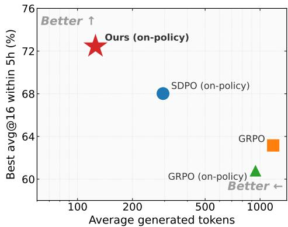  
Figure 1: Average Generated Tokens vs. avg@16 Accuracy (Olmo3-7B-Instruct, 5h) across five tasks. Ours reaches the highest accuracy with the fewest tokens.

et al. (2026) shows that a single policy can serve as both student and self-teacher, first generating a response independently and then re-evaluating it using additional feedback. The difference between these views provides token-level supervision for finer credit assignment than outcome rewards.

SDPO has several limitations that arise from its reliance on a continuously evolving self-teacher. Because the student and self-teacher are instantiated from the same policy, the teacher distribution changes whenever the policy parameters are updated. Although stop-gradient prevents gradient flow through the teacher within an optimization step, it does not provide temporal separation across training iterations, creating a moving-target problem that can weaken the stability of the distillation signal. SDPO therefore relies on stabilization mechanisms such as EMA or trust-region regularization; the EMA variant requires an additional persistent parameter copy, introducing memory overhead that grows with model size. SDPO also treats student–teacher disagreement primarily through distribution matching and does not explicitly distinguish ordinary mismatch from cases where the student strongly overvalues a candidate rejected by the privileged view. Such severe local disagreements may require more targeted directional correction. In addition, SDPO lacks a mechanism for adapting supervision according to the reliability of the policy’s behavior on individual problems. Examples that the policy repeatedly fails to solve are therefore not explicitly differentiated, in supervision strength, from those for which reliable self-generated guidance is consistently available. Finally, SDPO primarily relies on the current feedback-conditioned policy and does not maintain an explicit temporal memory of useful privileged predictions discovered earlier in training. As a result, informative past behaviors are not systematically preserved and replayed, nor are historical experiences selected to balance solution quality with structural diversity. These limitations restrict stable temporal supervision, targeted local correction, reliability-aware learning, and preservation of complementary behaviors across training.

Can we achieve temporally stable and reliability-aware self-distillation without maintaining a separate teacher model, while preserving useful knowledge from earlier stages of training?

FSPO addresses these limitations through a unified self-distillation framework that improves temporal stability, strengthens local correction, adapts supervision to policy reliability, and preserves useful historical knowledge. To mitigate the moving-target problem, informative privileged predictions from earlier optimization steps are materialized as sparse next-token distributions and retained as fixed temporal targets. Because these historical function values remain unchanged while the current policy evolves, they provide temporal separation across training iterations without requiring a persistent EMA teacher or an additional resident parameter copy. FSPO also goes beyond distribution-level matching by identifying candidates that the unassisted policy strongly prefers but the privileged view rejects, and explicitly suppressing these locally overvalued decisions. This distinguishes severe privileged disagreement from ordinary distribution mismatch and provides a more targeted directional learning signal. Supervision is further adapted according to the reliability of the policy on each problem over time. A smoothed estimate of rollout performance distinguishes problems on which the policy repeatedly fails from those for which it consistently produces reliable solutions. When the policy repeatedly fails and its own evidence becomes unreliable, the reference loss is strengthened; as the policy improves and begins to solve the problem consistently, this supervision is progressively reduced. FSPO additionally maintains a temporal memory of useful privileged behaviors discovered earlier in training. This memory provides fixed historical targets for consolidation and stronger demonstrations when the current rollout group lacks a verified successful response. By retaining trajectories according to both solution quality and structural complementarity, FSPO preserves diverse, nonredundant solution strategies and enables the policy to benefit from complementary historical knowledge throughout optimization. As shown in Figure 1, these design choices translate into the highest average accuracy across the five tasks while requiring the fewest generated tokens. Our contributions are summarized as follows:

• Preserves temporal knowledge through sparse historical next-token distributions while combining current privileged adaptation with historical function-space consolidation, enabling temporally separated supervision with a single resident policy.

• Introduces targeted privileged disagreement correction that suppresses candidates strongly overvalued by the unassisted policy but rejected by the privileged view, providing stronger directional correction beyond distribution matching.

• Adapts reference supervision to the reliability of self-generated guidance, strengthening it when the policy repeatedly fails and reducing it as reliable solutions emerge. Quality- and coverage-aware temporal memory further preserves diverse, nonredundant behaviors.

• Achieves approximately 4% points higher average accuracy than the strongest baseline across reasoning and tool-use benchmarks, while reducing peak memory from about 70 GB to 56 GB for Olmo3-7B-Instruct by eliminating the persistent EMA teacher.

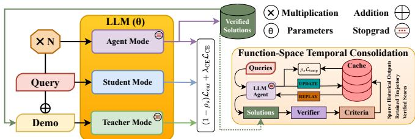

Figure 2: FSPO Overview. For each query, the policy samples rollouts in Agent mode; a successful verified rollout is used as a demo. The Student mode predicts from the query alone, while the Teacher mode conditions on the query with a demo, producing token-level supervision. Verified solutions are then stored as sparse function-space targets in a cache and later replayed for temporal consolidation, preserving useful past behavior without maintaining a separate parameter-space teacher.  
Algorithm 1 FSPO Training   
Require: $\pi _ { \boldsymbol { \theta } } , \mathcal { D } , \hat { r } _ { p } \gets 0 ,$ memory $\mathcal { M } $   
reference seeds   
1: for $\cdot s = 1 , \dots , T$ do   
2: Draw G rollouts $y _ { p , j } ,$ score $r _ { p , j }$   
3: Demo $d _ { p , j } \colon \mathrm { s i b l i n g } \to \tilde { y } _ { p } \to g _ { p }$   
4: Student $p _ { p , j , t } ,$ teacher $q _ { p , j , t }$   
5: Keep top- ${ \cdot } K _ { \mathrm { c u r } }$ support $S _ { p , j , t }$   
6: Overvalued set $\mathcal { N } _ { p , j , t }$ via margin γ   
7: $\mathcal { L } _ { \mathrm { c u r } }  \mathcal { L } _ { \mathrm { d i s t i l l } } + \lambda _ { \mathrm { n e g } } \mathcal { L } _ { \mathrm { n e g } }$   
8: Update $\hat { r } _ { p } ^ { ( s ) } , w _ { p } ^ { ( s ) }$ ; get LCE   
9: Replay $\mathcal { R } _ { s } \subset \mathcal { M }$ by group   
10: $\mathcal { L } _ { \mathrm { t e m p } }$ vs. fixed targets $\tilde { q } _ { p , t }$   
11: Set $\rho _ { s }$ by cyclic schedule   
12: Update $\theta _ { s }$ by minimizing $\mathcal { L } ( \theta _ { s } )$   
13: Retain verified rollouts (quality/coverage)   
14: Store $( \tilde { S } _ { p , t } , \tilde { q } _ { p , t } )$ in M   
15: if s mod $F = 0$ then   
16: Refresh ζ of entries aged > H   
17: end if   
18: end for

## 2 FUNCTION-SPACE POLICY OPTIMIZATION

Self-distillation provides dense supervision by comparing an unassisted policy with a privileged self-teacher conditioned on stronger evidence. However, because both views evolve with the same policy, the teacher remains a moving target across optimization steps. FTSD addresses this by preserving informative historical policy outputs directly in function space rather than maintaining a persistent parameter-space teacher. Let $\pi _ { \theta _ { i } }$ denote the policy at step s, with

$$
F _ { \theta _ { s } } ( c ) = \pi _ { \theta _ { s } } ( \cdot \mid x , y _ { < t } )\tag{1}
$$

for prefix $c = ( x , y _ { < t } )$ . Selected privileged predictions are materialized as sparse next-token distributions and retained as temporal targets, providing temporal separation as the policy evolves. FTSD further combines current privileged adaptation with targeted disagreement correction for strongly overvalued actions, quality- and coverage-aware temporal consolidation of complementary historical behaviors, and reliability-adaptive reference grounding. Reference supervision is strengthened when self-generated evidence fails and progressively reduced as reliable behavior emerges, yielding stable, selective, and adaptive self-distillation within a single-policy framework. Figure 2 illustrates the overall framework, while Algorithm 1 summarizes the complete training procedure.

## 2.1 PRIVILEGED ADAPTATION AND DISAGREEMENT CORRECTION

We first construct dense supervision by comparing the current policy under an unassisted view and a privileged view with access to stronger evidence. Let $\mathcal { D } = \{ ( \boldsymbol { x _ { p } } , \boldsymbol { \dot { g } _ { p } } ) \} _ { p = 1 } ^ { N }$ denote the training set, where $g _ { p }$ is the verified reference solution. For each problem, the policy samples G responses,

$$
y _ { p , j } \sim \pi _ { \theta _ { s } } ( \cdot \mid x _ { p } ) , \qquad r _ { p , j } = R ( x _ { p } , y _ { p , j } , g _ { p } ) \in [ 0 , 1 ] .\tag{2}
$$

An unsuccessful rollout reveals where the policy fails, but not how its local token decisions should change. We therefore construct a privileged demonstration using the strongest reliable evidence available:

$$
d _ { p , j } = { \left\{ \begin{array} { l l } { y _ { p , k } , } & { { \exists } k \neq j : { r _ { p , k } } \geq { \tau _ { \mathrm { { s u c c } } } } , } \\ { { \tilde { y } } _ { p } , } & { { \mathrm { i f ~ a ~ v e r i f i e d ~ t e m p o r a l ~ t r a j e c t o r y ~ i s ~ a v a i l a b l e } } , } \\ { g _ { p } , } & { { \mathrm { o t h e r w i s e } } . } \end{array} \right. }\tag{3}
$$

This hierarchy, with success threshold $\tau _ { \mathrm { s u c c } } > 0 .$ , prioritizes a verified sibling response, followed by previously retained policy behavior, while using the reference solution as a reliable fallback. At each response position $t ,$ the unassisted student and privileged self-teacher evaluate the same response prefix,

$$
\begin{array} { r } { p _ { p , j , t } = \pi _ { \theta _ { s } } ( \cdot  { \left| \begin{array} { l } { x _ { p } , y _ { p , j , < t } } \end{array} \right) } , \qquad q _ { p , j , t } = \mathrm { s t o p g r a d } \left[ \pi _ { \theta _ { s } } ( \cdot  { \left| \begin{array} { l } { x _ { p } \oplus d _ { p , j } , y _ { p , j , < t } } \end{array} \right)  } . } \end{\right|array} \end{array}\tag{4}
$$

Since both views share the same policy and response history, their disagreement reflects how privileged evidence changes the next-token prediction at the same response state.

To avoid matching the full vocabulary distribution, we retain the $K _ { \mathrm { c u r } }$ highest-probability student tokens and aggregate the remaining probability mass into a tail category:

$$
\Phi _ { S } ( a ) = \left( \{ a ( v ) \} _ { v \in S } , 1 - \sum _ { v \in S } a ( v ) \right) .\tag{5}
$$

where a is a probability distribution over the vocabulary, a(v) is the probability that distribution assigns to token v and S is a fixed subset of the vocabulary. Specifically it’s the top-K highest-probability tokens under the student’s distribution. Φ $\mathinner { \cdot } _ { S } ( a )$ reduces the full distribution a down to: its values on that subset $\{ a ( v ) \} _ { v \in S }$ , plus one extra "tail" bucket holding all the leftover mass $\begin{array} { r } { 1 - \sum _ { v \in S } a ( v ) } \end{array}$

Let $S _ { p , j , t }$ denote the student support and $M _ { p , j , t }$ indicate valid response positions. We transfer privileged information using generalized Jensen-Shannon divergence (JSD),

$$
\mathcal { L } _ { \mathrm { d i s t i l } } = \frac { 1 } { Z _ { \mathrm { c u r } } } \sum _ { p , j , t } M _ { p , j , t } \times J S D \left( \Phi _ { S _ { p , j , t } } ( p _ { p , j , t } ) , \Phi _ { S _ { p , j , t } } ( q _ { p , j , t } ) \right) , \qquad Z _ { \mathrm { c u r } } = \sum _ { p , j , t } M _ { p , j , t } .\tag{6}
$$

This provides a distinct privileged target at every response position, yielding dense local supervision rather than a single outcome-level signal.

Some disagreements, however, provide a stronger directional signal. When the student assigns substantially more probability to a token than the privileged view, that candidate is locally overvalued. We identify such tokens as

$$
\begin{array} { r } {  { \mathcal { N } } _ { p , j , t } = \left\{ v \in S _ { p , j , t } : \log p _ { p , j , t } ( v ) - \log q _ { p , j , t } ( v ) > \gamma \right\} , } \end{array}\tag{7}
$$

and penalize them using

$$
\ell _ { \mathrm { n e g } } ( p , j , t ) = \frac { 1 } { \operatorname* { m a x } ( 1 , | \mathcal { N } _ { p , j , t } | ) } \sum _ { v \in \mathcal { N } _ { p , j , t } } \left[ \log p _ { p , j , t } ( v ) - \mathrm { s t o p g r a d } ( \log q _ { p , j , t } ( v ) ) - \gamma \right] _ { + } ,\tag{8}
$$

$$
\mathcal { L } _ { \mathrm { { n e g } } } = \frac { 1 } { Z _ { \mathrm { { c u r } } } } \sum _ { p , j , t } M _ { p , j , t } \ell _ { \mathrm { { n e g } } } ( p , j , t ) .\tag{9}
$$

The privileged adaptation objective is therefore

$$
\mathcal { L } _ { \mathrm { c u r } } = \mathcal { L } _ { \mathrm { d i s t i l l } } + \lambda _ { \mathrm { n e g } } \mathcal { L } _ { \mathrm { n e g } } .\tag{10}
$$

This provides dense token-level supervision while explicitly correcting local decisions that are strongly contradicted by privileged evidence.

## 2.2 FUNCTION-SPACE TEMPORAL CONSOLIDATION

Privileged adaptation provides supervision at the current optimization step, but its target evolves together with the policy. Thus, stop-gradient separates the student and self-teacher within an update, but does not provide temporal separation across updates. We address this by preserving selected privileged predictions from earlier stages as fixed function-space targets rather than maintaining a persistent historical teacher.

For each problem p, the temporal memory stores a retained trajectory $\tilde { y } _ { p }$ , its verifier score ${ \tilde { r } } _ { p } ,$ structural signature $\sigma _ { p } ,$ and sparse privileged predictions $\{ \tilde { S } _ { p , t } , \tilde { q } _ { p , t } \} _ { t }$ . To improve the usefulness of this memory, trajectories are retained based on both verifier quality and structural complementarity rather than reward alone. This discourages repeatedly storing similar solution patterns and promotes broader coverage of distinct behaviors. A candidate replaces the stored trajectory when its retention score, which combines verifier quality with the coverage of its structural signature, exceeds that of the stored entry. During consolidation, memories are also sampled evenly across structural groups, preventing dominant signatures from overwhelming replay.

Let $\theta _ { p } ^ { \mathrm { s r c } }$ denote the policy state from which a temporal target is materialized. We use $\tilde { d } _ { p } = \tilde { y } _ { p }$ when $\tilde { r } _ { p } \geq \tau _ { \mathrm { s u c c } }$ and $\tilde { d } _ { p } = g _ { p }$ otherwise. The source policy produces

$$
\bar { q } _ { p , t } = \mathrm { s t o p g r a d } \left[ \pi _ { \theta _ { p } ^ { \mathrm { s r c } } } ( \cdot  { | } x _ { p } \oplus \tilde { d } _ { p } , \tilde { y } _ { p , < t } ) \right] .\tag{11}
$$

Rather than retaining the source parameters, we store only its dominant predictions,

$$
\tilde { S } _ { p , t } = \mathrm { T o p K } ( \bar { q } _ { p , t } , K _ { \mathrm { t e m p } } ) , \qquad \tilde { q } _ { p , t } = \Phi _ { \tilde { S } _ { p , t } } ( \bar { q } _ { p , t } ) ,\tag{12}
$$

which remain fixed while the current policy evolves.

At optimization step $s ,$ let $\mathcal { R } _ { s }$ denote the temporal memories selected for consolidation. The current policy evaluates each retained trajectory under the original problem context and is matched against its fixed historical privileged target:

$$
\mathcal { L } _ { \mathrm { t e m p } } = \frac { 1 } { Z _ { \mathrm { t e m p } } } \sum _ { p \in \mathcal { R } _ { s } } \sum _ { t } \tilde { M } _ { p , t } D _ { \alpha } \left( \Phi _ { \tilde { S } _ { p , t } } \left[ \pi _ { \theta _ { s } } ( \cdot \left. \ x _ { p } , \tilde { y } _ { p , \le t } \right) \right] , \tilde { q } _ { p , t } \right) , \qquad Z _ { \mathrm { t e m p } } = \sum _ { p \in \mathcal { R } _ { s } , t } \tilde { M } _ { p , t } .\tag{13}
$$

Unlike the current privileged target, $\tilde { q } _ { p , t }$ remains fixed while the policy evolves. Privileged adaptation therefore captures what should be learned from current evidence, whereas temporal consolidation preserves behavior that was informative at earlier stages of training.

To avoid stale targets without collapsing temporal separation, we use delayed and staggered refresh. A stored target becomes eligible for refresh after H optimization steps, and a fraction $\zeta$ of eligible entries is updated every $F$ steps. This maintains temporal targets of different ages while allowing the memory to gradually track policy improvement.

## 2.3 RELIABILITY-ADAPTIVE REFERENCE GROUNDING

Privileged adaptation and temporal consolidation primarily rely on supervision generated by the policy itself. However, this signal can be unreliable for problems that the policy repeatedly fails to solve. We therefore use the reference solution as an adaptive grounding signal whose strength depends on the reliability of self-generated behavior.

For problem $p ,$ we measure the current rollout reliability and its smoothed estimate as

$$
r _ { p } ^ { ( s ) } = \frac { 1 } { G } \sum _ { j = 1 } ^ { G } r _ { p , j } , \qquad \hat { r } _ { p } ^ { ( s ) } = ( 1 - \nu ) \hat { r } _ { p } ^ { ( s - 1 ) } + \nu r _ { p } ^ { ( s ) } ,\tag{14}
$$

where ν controls the influence of recent outcomes. Given a target reliability $\tau ,$ the reference weight is

$$
w _ { p } ^ { ( s ) } = \mathrm { c l i p } \left( \frac { \tau - \hat { r } _ { p } ^ { ( s ) } } { \tau } , 0 , 1 \right) .\tag{15}
$$

Thus, reference supervision is strongest when the policy repeatedly fails and its own evidence remains unreliable, and gradually decreases as the policy begins to solve the problem consistently.

Let $g _ { p } = ( g _ { p , 1 } , \ldots , g _ { p , L _ { p } } )$ be the tokenized reference solution, $B _ { s } ^ { \mathrm { C E } } = \{ p \in B _ { s } : w _ { p } ^ { ( s ) } > 0 \}$ the grounded problems, and $\langle \mathcal { A } _ { p , t } \in \{ 0 , 1 \}$ a mask over valid reference tokens excluding prompt and padding positions. The grounding objective is

$$
\mathcal { L } _ { \mathrm { C E } } = - \frac { 1 } { Z _ { \mathrm { C E } } } \sum _ { p \in \mathcal { B } _ { s } ^ { \mathrm { C E } } } \sum _ { t } w _ { p } ^ { ( s ) } A _ { p , t } \log \pi _ { \theta _ { s } } ( g _ { p , t } \mid x _ { p } , g _ { p , < t } ) , \qquad Z _ { \mathrm { C E } } = \sum _ { p \in \mathcal { B } _ { s } ^ { \mathrm { C E } } , t } A _ { p , t } .\tag{16}
$$

The reference therefore acts as a reliability-dependent grounding signal rather than uniform supervised training: it supports problems for which self-generated evidence is weak and progressively vanishes as reliable self-supervision emerges.

## 2.4 UNIFIED ADAPTATION AND CONSOLIDATION OBJECTIVE

The complete objective combines current privileged adaptation, historical consolidation, and reliability-adaptive grounding:

$$
\begin{array} { r } { \mathcal { L } ( \theta _ { s } ) = ( 1 - \rho _ { s } ) \mathcal { L } _ { \mathrm { c u r } } + \rho _ { s } \mathcal { L } _ { \mathrm { t e m p } } + \lambda _ { \mathrm { C E } } \mathcal { L } _ { \mathrm { C E } } , } \end{array}\tag{17}
$$

Table 1: Comparison of FSPO with GRPO and SDPO across benchmarks. We report the highest avg@16 achieved within 1-hour and 5-hour wall-clock training budgets for Qwen3-8B and Olmo3- 7B-Instruct, with baseline results for GRPO, on-policy GRPO, and SDPO taken from SDPO Hubotter et al. (2026). The final column reports the average performance across all five benchmarks at the 5-hour budget. FSPO follows the SDPO training and evaluation setting on 4 NVIDIA GH200 GPUs.
<table><tr><td></td><td colspan="2">Chemistry</td><td colspan="2">Physics</td><td colspan="2">Biology</td><td colspan="2">Materials</td><td colspan="2">Tool use</td><td>Avg@5h</td></tr><tr><td></td><td>1h</td><td>5h</td><td>1h</td><td>5h</td><td>1h</td><td>5h</td><td>1h</td><td>5h</td><td>1h</td><td>5h</td><td></td></tr><tr><td>Qwen3-8B</td><td colspan="2">41.2</td><td colspan="2">59.2</td><td colspan="2">30.8</td><td colspan="2">58.9</td><td colspan="2">57.5</td><td>49.5</td></tr><tr><td>+ GRPO</td><td>65.9</td><td>74.5</td><td>63.8</td><td>72.7</td><td>35.1</td><td>59.9</td><td>74.3</td><td>77.1</td><td>64.9</td><td>67.7</td><td>70.4</td></tr><tr><td>+ GRPO (on-policy)</td><td>63.3</td><td>63.4</td><td>63.6</td><td>63.6</td><td>49.8</td><td>49.8</td><td>73.9</td><td>74.1</td><td>60.2</td><td>65.7</td><td>63.3</td></tr><tr><td>+ SDPO (on-policy)</td><td>73.2</td><td>80.9</td><td>66.6</td><td>75.6</td><td>50.6</td><td>56.8</td><td>72.1</td><td>78.4</td><td>68.0</td><td>68.5</td><td>72.0</td></tr><tr><td>+ FSPO (on-policy)</td><td>81.8</td><td>83.4</td><td>66.7</td><td>76.0</td><td>71.2</td><td>71.2</td><td>81.7</td><td>81.7</td><td>66.6</td><td>68.5</td><td>76.2</td></tr></table>

<table><tr><td rowspan="2">Olmo3-7B-Instruct + GRPO</td><td colspan="2">22.8</td><td colspan="2">37.7</td><td colspan="2">16.2</td><td colspan="2">36.7</td><td colspan="2">39.3</td><td>30.5 63.2</td></tr><tr><td>39.7</td><td>56.7</td><td>55.3</td><td>63.3</td><td>35.6</td><td>55.8</td><td>70.9</td><td>75.0</td><td>56.4</td><td>65.0</td></tr><tr><td>+ GRPO (on-policy)</td><td>51.4</td><td>57.5</td><td>62.7</td><td>62.7</td><td>49.8</td><td>49.8</td><td>73.3</td><td>73.5</td><td>56.8 60.6</td><td>60.8</td></tr><tr><td>+ SDPO (on-policy)</td><td>68.0</td><td>80.0</td><td>59.9</td><td>66.1</td><td>48.0 52.8</td><td>73.7</td><td>79.1</td><td>60.8</td><td>62.1</td><td>68.0</td></tr><tr><td>+ FSPO (on-policy)</td><td>81.0</td><td>83.3</td><td>66.4</td><td>70.1</td><td>62.3 62.3</td><td>76.3</td><td>79.9</td><td>57.6</td><td>66.6</td><td>72.4</td></tr></table>

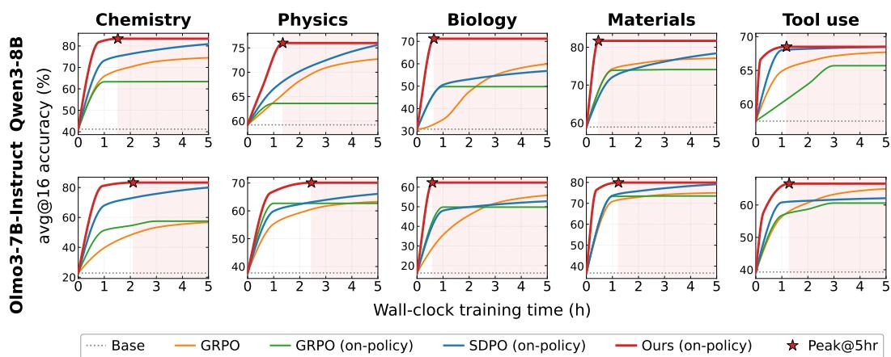  
Figure 3: Convergence of best-within-window avg@16 accuracy over wall-clock training time for Qwen3-8B (top row) and Olmo3-7B-Instruct (bottom row) across five tasks.

Here, $\rho _ { s } \in [ 0 , 1 ]$ controls the balance between acquiring current privileged information and consolidating useful historical behavior, while $\lambda _ { \mathrm { n e g } }$ and $\lambda _ { \mathrm { C E } }$ determine the strengths of disagreement correction and reference grounding.

Rather than fixing this balance throughout training, we periodically shift emphasis from adaptation toward consolidation:

$$
\rho _ { s } = \rho _ { \mathrm { m i n } } + \left( \rho _ { \mathrm { m a x } } - \rho _ { \mathrm { m i n } } \right) \frac { \left( s - 1 \right) \mathrm { m o d } \ : C } { \mathrm { m a x } \left( 1 , C - 1 \right) } ,\tag{18}
$$

where C is the cycle length. Since memory is pre-seeded with reference trajectories, temporal consolidation starts immediately. Each cycle initially favors current privileged supervision and progressively increases the weight of historical targets, balancing adaptation with retention.

## 3 EXPERIMENTS

We evaluate FSPO across scientific reasoning and tool-use tasks to determine whether solutionconditioned self-distillation improves learning while eliminating the persistent teacher used by EMA-stabilized on-policy distillation. We compare against verifier-based policy optimization and teacher-based dense supervision under matched wall-clock training budgets.

## 3.1 EXPERIMENTAL SETTING

We evaluate four level-3 reasoning subsets of SciKnowEval Feng et al. (2024): Chemistry, Physics, Biology, and Materials science, together with ToolAlpaca (Tool use) Tang et al. (2023) for structured tool use. We use Qwen3-8B Yang et al. (2025) and Olmo3-7B-Instruct Ettinger et al. (2025) as initial checkpoints and construct disjoint train–test splits for each task. Performance is measured using avg@16 on the held-out split. We use a single hyperparameter setting across all models and datasets (Appendix A.4), without dataset specific tuning.

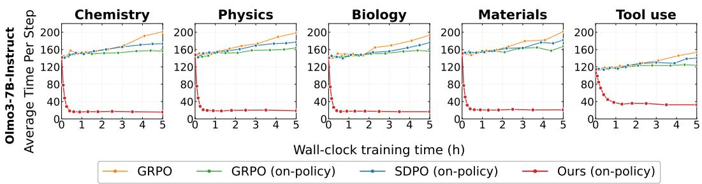

Figure 4: Average time per training step over wall-clock time for Olmo3-7B-Instruct across five tasks.  
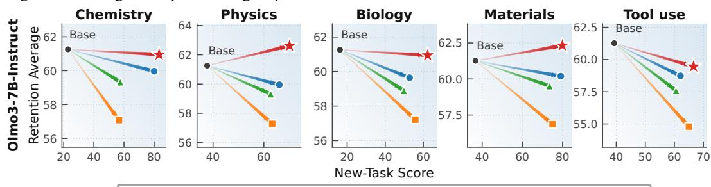  
Base model GRPO GRPO (on-policy) SDPO Ours  
Figure 5: Catastrophic-forgetting trade-off on Olmo3-7B-Instruct. Each panel corresponds to training on one task, with the horizontal axis showing the best avg@16 achieved on that task within 5 h and the vertical axis showing the mean score on the 5 prior-capability benchmarks.

We compare FSPO against GRPO Shao et al. (2024), on-policy GRPO, and on-policy SDPO Hubotter et al. (2026), with baseline results taken from SDPO. All methods use the same initialization and hardware budget. Each run is performed on four NVIDIA GH200 GPUs, and we report the highest accuracy obtained within 1-hour and 5-hour wall-clock training budgets. On-policy GRPO, SDPO, and FSPO perform one gradient update per generation batch, whereas GRPO performs four off-policy mini-batch updates.

## 3.2 MAIN RESULTS

We first examine whether the proposed temporal self-distillation strategy translates into consistent improvements across tasks, model backbones, and training budgets. Table 1 shows that FSPO achieves the highest Avg@5h for both Qwen3-8B and Olmo3-7B-Instruct, with the best 5-hour performance on every scientific reasoning task. The improvements remain consistent across Chemistry, Physics, Biology, and Materials, suggesting that the gains are not tied to a particular domain or backbone. The margin is smaller on Tool use, where the baselines already reach performance close to ours within the same budget. Even in this setting, FSPO remains competitive at the 5-hour budget, matching the strongest Qwen3-8B result and improving over the baselines on Olmo3-7B-Instruct, although SDPO is stronger at the 1-hour budget on both backbones.

The same behavior becomes clearer when considering optimization over time. As shown in Figure 3, FSPO obtains a large fraction of its final improvement early in training and approaches its peak substantially faster than the baselines across most tasks. Figure 4 further shows that this faster learning is accompanied by a rapid reduction in per-step cost. Privileged supervision and disagreement correction provide stronger local guidance by suppressing overvalued token choices, while temporal consolidation reinforces previously successful solution patterns. As these signals accumulate, the policy increasingly produces shorter responses, which contributes to its lower generation cost. In contrast, GRPO and SDPO tend to generate longer trajectories as training progresses, causing their generation-dominated step time to gradually increase.

## 3.3 LEARNING WITHOUT FORGETTING

Improving performance on a target task can degrade behaviors acquired from other domains, making cross-task retention an important measure of stable post-training. Figure 5 examines this trade-off by comparing new-task gains with performance retained on five prior-capability benchmarks. FSPO improves the trained task while exhibiting consistently higher retention than the baselines. We attribute this to function-space temporal consolidation, which replays fixed historical predictions. This mechanism regularizes updates toward previously useful behavior and reduces catastrophic forgetting during continued adaptation. Detailed cross-task scores are provided in Appendix A.2.

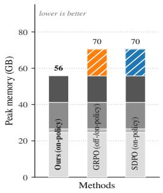  
(a) Olmo3-7B-Instruct

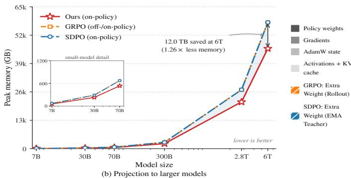  
Figure 6: Comparison of Memory Footprint. (a) Breakdown for Olmo3-7B-Instruct: policy weights, gradients, AdamW state, and activations plus KV cache are common to all methods. GRPO adds a synced colocated rollout copy, and SDPO adds a persistent EMA teacher copy. FSPO needs no extra model copy, since on-policy rollouts reuse the model being trained. (b) Projecting the same accounting to larger models, the absolute gap grows with parameter count.

## 3.4 MEMORY AND COMPUTATIONAL PROPERTIES

Temporal regularization stabilizes selfdistillation, but additional model copies become increasingly costly at scale. FSPO addresses this by storing temporal information as sparse function-space targets rather than as a persistent network. Historical response tokens, selected token probabilities, and pooled tail mass are retained in host memory, while only the current policy remains resident during optimization. Figure 6 illustrates the resulting difference. For Olmo3-7B-Instruct, the common training state occupies approximately 56 GB, whereas GRPO and SDPO reach 70 GB because of an additional rollout copy and EMA teacher, respectively. Since FSPO reuses the current policy for generation and privileged evaluation, it avoids these persistent model-sized copies, at the cost of additional activations for temporal replay. Under the same accounting, eliminating one bf16 parameter copy corresponds to roughly 12 TB of aggregate memory at 6T parameters. It is also worth noting that although the cache grows during training, its peak memory overhead remains negligible at about 5 MB (Appendix A.5).

Table 2: Ablation study of FSPO on Olmo3-7B-Instruct across Biology and Tool Use. Shaded rows marked (ours) denote the setting used in the full model; unless stated otherwise.
<table><tr><td rowspan="2">Cases</td><td rowspan="2">Setting</td><td colspan="3">Accuracy (%) ↑</td></tr><tr><td>Biology</td><td>Tool Use</td><td>Avg.</td></tr><tr><td rowspan="6">Case 1</td><td>Full objective (ours)</td><td>62.3</td><td>66.6</td><td>64.5</td></tr><tr><td>Ldistill only</td><td>54.9</td><td>57.2</td><td>56.0</td></tr><tr><td>w/o Lneg</td><td>61.9</td><td>65.8</td><td>63.8</td></tr><tr><td>w/o Ltemp</td><td>59.9</td><td>60.3</td><td>60.1</td></tr><tr><td>w/o  $\mathcal { L } _ { \mathrm { C E } } \mathrm { ~ }$ </td><td>59.1</td><td>64.3</td><td>61.7</td></tr><tr><td> $\mathrm { w } / \mathrm { o } \mathcal { L } _ { \mathrm { t e m p } } \& \mathcal { L } _ { \mathrm { C E } }$ </td><td>54.4</td><td>53.8</td><td>54.1</td></tr><tr><td rowspan="5">Case 2</td><td>Sibling → ¯p → reference (ours)</td><td>62.3</td><td>66.6</td><td>64.5</td></tr><tr><td>Reference only</td><td>41.8</td><td>39.1</td><td>40.5</td></tr><tr><td>Verified sibling only</td><td>57.9</td><td>60.2</td><td>59.0</td></tr><tr><td>wlo yp</td><td>58.8</td><td>62.6</td><td>60.7</td></tr><tr><td>Function-space cache (ours)</td><td>62.3</td><td></td><td>64.5</td></tr><tr><td rowspan="5">Case 3</td><td>Parameter snapshot (every H steps)</td><td>59.4</td><td>66.6</td><td>58.8</td></tr><tr><td>EMA teacher (µ = 0.99)</td><td>62.3</td><td>58.1 64.2</td><td>63.2</td></tr><tr><td>EMA teacher (µ = 0.999)</td><td>61.3</td><td>61.3</td><td>61.3</td></tr><tr><td>Frozen initial policy</td><td>56.8</td><td>56.1</td><td>56.5</td></tr><tr><td>CE replay of yp</td><td>58.7</td><td>58.3</td><td>58.5</td></tr><tr><td rowspan="5"></td><td>Quality + coverage retention (ours)</td><td>62.3</td><td>66.6</td><td>64.5</td></tr><tr><td>Reward-only retention</td><td>59.8</td><td>64.1</td><td>61.9</td></tr><tr><td>Case 4 Coverage-only retention</td><td>56.3</td><td>57.8</td><td>57.0</td></tr><tr><td>Uniform sampling</td><td>58.9</td><td>62.4</td><td>60.6</td></tr><tr><td>Random retention + uniform sampling</td><td>54.8</td><td>59.4</td><td>57.1</td></tr><tr><td rowspan="4">Case 5</td><td>Reliability-adaptive w() (ours)</td><td></td><td></td><td></td></tr><tr><td>Constant  $\begin{array} { r } { \dot { w } _ { p } ^ { ( s ) } = 1 } \end{array}$ </td><td>62.3</td><td>66.6</td><td>64.5</td></tr><tr><td>Binary w(s)</td><td>60.2 60.6</td><td>65.1</td><td>62.6 63.0</td></tr><tr><td>Cyclic, adaptation → consolidation (ours)</td><td></td><td>65.4</td><td></td></tr><tr><td rowspan="4">Case 6</td><td>Fixed</td><td>62.3</td><td>66.6</td><td>64.5</td></tr><tr><td> $\rho _ { s } = 0 . 4$  Monotonic ramp</td><td>60.6</td><td>65.1</td><td>62.8</td></tr><tr><td></td><td>60.8</td><td>64.2</td><td>62.5</td></tr><tr><td>Reverse cyclic, consolidation → adaptation</td><td>57.6</td><td>61.7</td><td>59.7</td></tr><tr><td>Base</td><td>Olmo3-7B-Instruct (zero-shot)</td><td>16.2</td><td>39.3</td><td>27.8</td></tr><tr><td>FSPO</td><td>Complete Method</td><td>62.3</td><td>66.6</td><td>64.5</td></tr></table>

## 3.5 ABLATION STUDY

We ablate the main components of FSPO on Olmo3-7B-Instruct across Biology and Tool Use to assess their contributions. As shown in Table 2, we ablate the objective, privileged demonstrations, temporal supervision, memory retention, and adaptive grounding while keeping all other settings fixed. Together, these components raise average accuracy from 27.8% for the zero-shot base model to 64.5%, reflecting their complementary contributions. Additional analyses of the choices are provided in Appendix A.3.

Effective supervision. Case 1 first reveals that FSPO benefits from combining complementary forms of supervision rather than relying solely on privileged distillation. Temporal consolidation and reference grounding account for the largest gains, particularly on Tool Use, while disagreement correction provides a smaller but consistent improvement. Importantly, these signals depend on one another: retaining disagreement correction after removing both temporal and reference anchors performs worse than distillation alone, suggesting that aggressive local correction is useful only when the evolving self-teacher is sufficiently stabilized. The source of privileged evidence is equally important. Reference-only supervision leads to a substantial drop, whereas verified siblings and retained trajectories remain closer to the policy’s response distribution. Their combination in the full hierarchy therefore provides the strongest current supervision (Case 2).

Temporal stability. The remaining ablations show that temporal stability depends not simply on retaining past information, but on what is preserved and how it is reused. Sparse function-space targets outperform parameter snapshots, EMA teachers, frozen policies, and trajectory-level CE replay; several of these alternatives even fall below removing temporal consolidation altogether (Case 3). Within the memory itself, retaining trajectories by both quality and coverage performs better than either criterion alone, while uniform or random replay further weakens the historical signal (Case 4). This selective preservation is complemented by reliability-adaptive grounding, which improves over constant or binary reference weighting by adjusting supervision as the policy becomes more reliable (Case 5). Finally, cyclic adaptation followed by consolidation performs best, whereas reversing this order causes a marked degradation, supporting the intended progression from acquiring new privileged information to stabilizing it over time (Case 6).

## 4 RELATED WORK

Policy-gradient methods (Williams, 2004; Schulman et al., 2017) underpin modern RLVR, with GRPO (Shao et al., 2024) and its variants (Yu et al., 2025; Liu et al., 2025) improving reasoning, coding, tool use, and visual grounding (Team et al., 2025; Lambert et al., 2024; El-Kishky et al., 2025; Khatri et al., 2025; Karim & Verma, 2026). However, trajectory-level rewards provide coarse credit when feedback is sparse or uniform across rollouts (Kazemnejad et al., 2024; Chen et al., 2025b). Prior work addresses this through step-level verifiers (Lightman et al., 2023; Wang et al., 2024; Setlur et al., 2024), dense reward redistribution (Cui et al., 2025; Chan et al., 2024; Cao et al., 2025b), and selective updates at high-entropy decisions (Wang et al., 2025). Richer supervision has also emerged through critiques (Scheurer et al., 2023; Luo et al., 2025; Song et al., 2026), selfreflection (Shinn et al., 2023; Madaan et al., 2023; Lee et al., 2024), hindsight (Andrychowicz et al., 2017; Liu et al., 2023; Zhang et al., 2023), context distillation (Snell et al., 2022; Choi et al., 2022; Kujanpää et al., 2024), and verified self-training (Zelikman et al., 2022; Yang et al., 2024). On-policy self-distillation brings these ideas together by conditioning the same policy on references (Zhao et al., 2026), demonstrations (Shenfeld et al., 2026), or feedback and successful siblings (Hubotter et al., 2026), and SALD (Das et al., 2026c) extends a similar self-referenced objective, akin to SDPO and SDFT, to text-to-image diffusion models (Das et al., 2026a;b; 2025); yet the resulting teacher evolves with the student and can suppress useful uncertainty (Kim et al., 2026; Das et al., 2026d). FTSD retains this single-policy setting while introducing temporally fixed historical supervision.

Knowledge distillation transfers teacher distributions to a student (Hinton et al., 2015; Romero et al., 2014), with sequence-level and on-policy variants extending it to language models (Kim & Rush, 2016; Gu et al., 2023; Agarwal et al., 2023). Student-generated trajectories reduce train–inference mismatch (Ross et al., 2010), while divergence choice governs how teacher behavior is matched (Amini et al., 2025). Evolving targets are commonly stabilized through target networks (Mnih et al., 2015), EMA teachers (Grill et al., 2020; Tarvainen & Valpola, 2017), trust regions (Schulman et al., 2015), or expert iteration (Anthony et al., 2017). In parallel, on-policy adaptation can reduce forgetting (Shenfeld et al., 2025; Chen et al., 2025a), while continual learning relies on parameter regularization (Kirkpatrick et al., 2016), output distillation (Li & Hoiem, 2016), and experience replay (Rolnick et al., 2018). Closest to FTSD are function-space approaches that preserve previous outputs (Benjamin & Kording, 2018; Pan et al., 2020), including stored-logit replay (Buzzega et al., 2020). FTSD adapts this principle to LLM self-distillation through sparse privileged distributions used only during training, rather than memory-augmented inference (Behrouz et al., 2024; Cao et al., 2025a), learned context representations (Eyuboglu et al., 2025), or persistent model copies common in RL systems (Sheng et al., 2024).

## 5 CONCLUSION

We introduced FSPO, a single-policy self-distillation framework that preserves historical behavior via sparse function-space targets rather than a persistent teacher model. By combining privileged adaptation with disagreement correction, reliability-adaptive grounding, and quality- and coverageaware temporal memory, FSPO provides stable supervision while retaining verified behaviors across training. Across scientific reasoning and tool-use tasks on two model backbones, FSPO achieves the highest average accuracy under a 5-hour wall-clock budget, converges faster, and better preserves prior capabilities, while reducing estimated peak memory from about 70 GB to 56 GB on Olmo3- 7B-Instruct. The ablations further show that these gains arise from the interaction between current adaptation, temporal consolidation, and adaptive grounding rather than any single component. Overall, the results suggest that temporal knowledge can be preserved effectively in function space, enabling more memory-efficient and stable self-distillation for continual post-training.

## REFERENCES

Rishabh Agarwal, Nino Vieillard, Yongchao Zhou, P. Stanczyk, Sabela Ramos, Matthieu´ Geist, and Olivier Bachem. On-policy distillation of language models: Learning from self-generated mistakes. In International Conference on Learning Representations, 2023. URL https://www.semanticscholar.org/paper/ a57ef1f5c3af185af79751855b8033b7fc6d89b3.

Afra Amini, Tim Vieira, and Ryan Cotterell. Better estimation of the kullback–leibler divergence between language models. In Advances in Neural Information Processing Systems 38, 2025. doi: 10.52202/085713-3745. URL https://doi.org/10.52202/085713-3745.

Marcin Andrychowicz, Dwight Crow, Alex Ray, Jonas Schneider, Rachel Fong, Peter Welinder, Bob McGrew, Joshua Tobin, P. Abbeel, and Wojciech Zaremba. Hindsight experience replay. In Neural Information Processing Systems, 2017. URL https://www.semanticscholar. org/paper/429ed4c9845d0abd1f8204e1d7705919559bc2a2.

Thomas W. Anthony, Zheng Tian, and D. Barber. Thinking fast and slow with deep learning and tree search. In Neural Information Processing Systems, 2017. URL https://www.semanticscholar.org/paper/ 745c614dbd23bc1e3def79f600680b88cee28700.

Ali Behrouz, Peilin Zhong, and V. Mirrokni. Titans: Learning to memorize at test time. In Neural Information Processing Systems, 2024. URL https://www.semanticscholar. org/paper/5e7a795d89910634f001cc3a631023f1dd4e2e23.

Ari S. Benjamin and Konrad Paul Kording. Improving generalization by regularizing in l2 function space. 2018. URL https://www.semanticscholar.org/paper/ cc6dfb0b9a1c7ff877fba5be80c139b4d4de42e4.

Pietro Buzzega, Matteo Boschini, A. Porrello, Davide Abati, and S. Calderara. Dark experience for general continual learning: a strong, simple baseline. In Neural Information Processing Systems, 2020. URL https://www.semanticscholar.org/paper/ e10b7cb072737b1fbdcba7948e573268b3573ae9.

Bowen Cao, Deng Cai, and Wai Lam. Infiniteicl: Breaking the limit of context window size via long short-term memory transformation. In Findings ofthe Associationfor Computational Linguistics: ACL 2025, 2025a. doi: 10.18653/v1/2025.findings-acl.595. URL https://doi.org/10. 18653/v1/2025.findings-acl.595.

Meng Cao, Shuyuan Zhang, Xiao-Jun Chang, and D. Precup. Scar: Shapley credit assignment for more efficient rlhf. arXiv.org, 2025b. URL https://www.semanticscholar.org/ paper/2109255b50868c453d397bc732fc44d8e83a164f.

Alex J. Chan, Hao Sun, Samuel Holt, and M. Schaar. Dense reward for free in reinforcement learning from human feedback. In International Conference on Machine Learning, 2024. URL https://www.semanticscholar.org/paper/ 9732c864d1d4161fcb106f2961d9a80dd4fffc9a.

Howard Chen, Noam Razin, Karthik R. Narasimhan, and Danqi Chen. Retaining by doing: The role of on-policy data in mitigating forgetting. arXiv.org, 2025a. URL https://www.semanticscholar.org/paper/ e6f4a5f8a271f3830d0aea0b071986d87ed72999.

Zhiqi Chen, Rui Lu, Andrew Zhao, Zhaokai Wang, Yang Yue, Shiji Song, and Gao Huang. Does reinforcement learning really incentivize reasoning capacity in llms beyond the base model? In Advances in Neural Information Processing Systems 38, 2025b. doi: 10.52202/085713-1933. URL https://doi.org/10.52202/085713-1933.

Eunbi Choi, Yongrae Jo, Joel Jang, and Minjoon Seo. Prompt injection: Parameterization of fixed inputs. arXiv.org, 2022. URL http://arxiv.org/pdf/2206.11349.

Ganqu Cui, Lifan Yuan, Zefan Wang, Hanbin Wang, Yuchen Zhang, Wendi Li, Bingxiang He, Yuchen Fan, Tianyu Yu, Qi-Xin Xu, Weize Chen, Jiarui Yuan, Huayu Chen, Kaiyan Zhang, Xingtai Lv, Shuo Wang, Yuan Yao, Xu Han, Hao Peng, Yu Cheng, Zhiyuan Liu, Maosong Sun, Bowen Zhou, and Ning Ding. Process reinforcement through implicit rewards. Trans. Mach. Learn. Res., 2025. URL https://www.semanticscholar.org/paper/ e23379a9752f57732d311f7a97af2c69af6fae7b.

Aryan Das, Rajul Mahto, Wentao Wang, Ali Jamali, Pravendra Singh, and Swalpa Kumar Roy. A generative framework for detection and classification of plant leaf disease using diffusion network. Applied Soft Computing, 177:113152, 2025. ISSN 1568-4946. doi: https://doi.org/10.1016/ j.asoc.2025.113152. URL https://www.sciencedirect.com/science/article/ pii/S1568494625004636.

Aryan Das, Koushik Biswas, Moloud Abdar, and Vinay Kumar Verma. Unity: Attention flow networks for adaptive conditioning in diffusion, 2026a. URL https://arxiv.org/abs/ 2606.20971.

Aryan Das, Koushik Biswas, Swalpa Kumar Roy, Badri Narayana Patro, and Vinay Kumar Verma. Efficient text-guided convolutional adapter for the diffusion model, 2026b. URL https:// arxiv.org/abs/2602.14514.

Aryan Das, Surjo Dey, Koushik Biswas, Swalpa Kumar Roy, Moloud Abdar, Arnab Bhattacharya, and Vinay Kumar Verma. Sald: Self-referenced advantage learning for diffusion models, 2026c. URL https://arxiv.org/abs/2610.01496.

Aryan Das, Tanishq Rachamalla, Koushik Biswas, Swalpa Kumar Roy, and Vinay Kumar Verma. Uncertainty-aware vision-language segmentation for medical imaging. In 2026 IEEE/CVF Winter Conference on Applications ofComputer Vision (WACV), pp. 8490–8499, 2026d. doi: 10.1109/ WACV61042.2026.00819.

Ahmed El-Kishky, Alexander Z. Wei, Andre Saraiva, Borys Minaev, Daniel Selsam, David Dohan, Francis Song, H. Lightman, Ignasi Clavera, J. Pachocki, Jerry Tworek, Lorenz Kuhn, Lukasz Kaiser, Mark Chen, Max Schwarzer, Mostafa Rohaninejad, Nat McAleese, Other Contributors, O. Murk, Rhythm Garg, Rui Shu, Szymon Sidor, V. Kosaraju, and Wenda Zhou. Competitive programming with large reasoning models. arXiv.org, 2025. URL https://www.semanticscholar. org/paper/fe2864e9ed7fd1256e52ed17282914d1ddf3fd85.

Allyson Ettinger, Amanda Bertsch, Bailey Kuehl, David W. Graham, David Heineman, Dirk Groeneveld, Faeze Brahman, Finbarr Timbers, Hamish Ivison, Jacob Daniel Morrison, Jake Poznanski, Kyle Lo, Luca Soldaini, Matt Jordan, Mayee F. Chen, Michael Noukhovitch, Nathan Lambert, Pete Walsh, Pradeep Dasigi, Robert Berry, Saumya Malik, Saurabh Shah, Scott Geng, Shane Arora, Shashank Gupta, Taira Anderson, Teng Xiao, Tyler C. Murray, Tyler Romero, Victoria Graf, Akari Asai, Akshita Bhagia, Alexander Wettig, Alisa Liu, Aman Rangapur, Chloe Anastasiades, Costa Huang, Dustin Schwenk, Harsh M. Trivedi, Ian Magnusson, Jaron Lochner, Jiacheng Liu, Lester James Validad Miranda, Maarten Sap, Malia Morgan, Michaela Schmitz, Michal Guerquin, Michael Wilson, Regan Huff, Ronan Le Bras, Rui Xin, Rulin Shao, Sam Skjonsberg, Shannon Zejiang Shen, Shuyue Stella Li, Tucker Wilde, Valentina Pyatkin, William Merrill, Yapei Chang, Yuling Gu, Zhi yuan Zeng, Ashish Sabharwal, Luke Zettlemoyer, Pang Wei Koh, Ali Farhadi, Noah A. Smith, and Hannaneh Hajishirzi. Olmo 3. 2025. URL https://api.semanticscholar.org/CorpusID:283908770.

Sabri Eyuboglu, Ryan Ehrlich, Simran Arora, Neel Guha, Dylan Zinsley, Emily Liu, Will Tennien, Atri Rudra, James Zou, Azalia Mirhoseini, and Christopher Ré. Cartridges: Lightweight and general-purpose long context representations via selfstudy. In arXiv.org, 2025. URL https://www.semanticscholar.org/paper/ d1427999c5cd8e9645c81f5dd3c1fb5260514138.

Kehua Feng, Xin-Yi Shen, Weijie Wang, Zhuang Xiang, Yuqi Tang, Qiang Zhang, and Keyan Ding. Sciknoweval: Evaluating multi-level scientific knowledge of large language models. 2024. URL https://api.semanticscholar.org/CorpusID:281887235.

Jean-Bastien Grill, Florian Strub, Florent Altch’e, Corentin Tallec, Pierre H. Richemond, Elena Buchatskaya, Carl Doersch, B. ’. Pires, Z. Guo, M. G. Azar, Bilal Piot, K. Kavukcuoglu, R. Munos, and Michal Valko. Bootstrap your own latent: A new approach to self-supervised learning. In Neural Information Processing Systems, 2020. URL https://www.semanticscholar. org/paper/38f93092ece8eee9771e61c1edaf11b1293cae1b.

Yu-Xian Gu, Li Dong, Furu Wei, and Minlie Huang. Minillm: On-policy distillation of large language models. 2023. URL https://api.semanticscholar.org/CorpusID:259164722.

Geoffrey E. Hinton, Oriol Vinyals, and Jeffrey Dean. Distilling the knowledge in a neural network. ArXiv, abs/1503.02531, 2015. URL https://api.semanticscholar.org/CorpusID: 7200347.

Jonas Hubotter, Frederike Lubeck, L. Behric, Anton Baumann, M. Bagatella, Daniel Marta, Ido Hakimi, Idan Shenfeld, Thomas Kleine Buening, Carlos Guestrin, and Andreas Krause. Reinforcement learning via self-distillation, 2026. URL https://www.semanticscholar.org/ paper/89e83ee3eb95843292b1f75f0e50b89e7667b828.

Mohammed Asad Karim and Vinay Kumar Verma. Focus: Forcing in-context object localization through visual support constraints and policy optimization, 2026. URL https://arxiv.org/ abs/2605.31145.

Amirhossein Kazemnejad, Milad Aghajohari, Eva Portelance, Alessandro Sordoni, Siva Reddy, Aaron Courville, and N. L. Roux. Vineppo: Refining credit assignment in rl training of llms. In International Conference on Machine Learning, 2024. URL https://www.semanticscholar. org/paper/ab116ae3e6bc3aedfd1b6ec165e59a8219a5d2f5.

Devvrit Khatri, Lovish Madaan, Rishabh Tiwari, Rachit Bansal, Sai Surya Duvvuri, M. Zaheer, Inderjit S. Dhillon, David Brandfonbrener, and Rishabh Agarwal. The art of scaling reinforcement learning compute for llms. In arXiv.org, 2025. URL https://www.semanticscholar. org/paper/b1762ae7d8d999213f17856c7f250aa99ab19e5e.

Jeonghye Kim, Xufang Luo, Minbeom Kim, Sangmook Lee, Dohyung Kim, Jiwon Jeon, Dongsheng Li, and Yuqing Yang. Why does self-distillation (sometimes) degrade the reasoning capability of llms? In arXiv.org, 2026. URL https://www.semanticscholar.org/paper/ 9f5901fa33e9e66791bcf38f83cf9fba5c036187.

Yoon Kim and Alexander M. Rush. Sequence-level knowledge distillation. In Conference on Empirical Methods in Natural Language Processing, 2016. doi: 10.18653/v1/D16-1139. URL https://doi.org/10.18653/v1/D16-1139.

J. Kirkpatrick, Razvan Pascanu, Neil C. Rabinowitz, J. Veness, Guillaume Desjardins, Andrei A. Rusu, Kieran Milan, John Quan, Tiago Ramalho, A. Grabska-Barwinska, D. Hassabis, C. Clopath, D. Kumaran, and R. Hadsell. Overcoming catastrophic forgetting in neural networks. Proceedings ofthe National Academy ofSciences ofthe United States ofAmerica, 2016. doi: 10.1073/pnas. 1611835114. URL https://doi.org/10.1073/pnas.1611835114.

Kalle Kujanpää, Pekka Marttinen, Harri Valpola, and Alexander Ilin. Efficient knowledge injection in llms via self-distillation, 2024. URL https://www.semanticscholar.org/paper/ 90d454b3bc86ae8018e79276919e2046e24bc9cd.

Nathan Lambert, Jacob Daniel Morrison, Valentina Pyatkin, Shengyi Huang, Hamish Ivison, Faeze Brahman, Lester James Validad Miranda, Alisa Liu, Nouha Dziri, Xinxi Lyu, Yuling Gu, Saumya Malik, Victoria Graf, Jena D. Hwang, Jiangjiang Yang, Ronan Le Bras, Oyvind Tafjord, Christopher Wilhelm, Luca Soldaini, Noah A. Smith, Yizhong Wang, Pradeep Dasigi, and Hanna Hajishirzi. TÜlu 3: Pushing frontiers in open language model posttraining. In arXiv.org, 2024. URL https://www.semanticscholar.org/paper/ 6a7c29829227bfd65ae0ffec294a874bb9ea0871.

Kyungjae Lee, Dasol Hwang, Sunghyun Park, Youngsoo Jang, and Moontae Lee. Reinforcement learning from reflective feedback (rlrf): Aligning and improving llms via fine-grained self-reflection. arXiv.org, 2024. URL https://www.semanticscholar.org/paper/ 553c86ba967f55db9caffe08240061b1282da893.

Zhizhong Li and Derek Hoiem. Learning without forgetting. IEEE Transactions on Pattern Analysis and Machine Intelligence, 2016. doi: 10.1007/978-3-319-46493-0\_37. URL https://doi. org/10.1007/978-3-319-46493-0\_37.

H. Lightman, V. Kosaraju, Yura Burda, Harrison Edwards, Bowen Baker, Teddy Lee, Jan Leike, John Schulman, I. Sutskever, and K. Cobbe. Let’s verify step by step. In International Conference on Learning Representations, 2023. URL http://arxiv.org/pdf/2305.20050.

Hao Liu, Carmelo Sferrazza, and P. Abbeel. Chain of hindsight aligns language models with feedback. International Conference on Learning Representations, 2023. URL https://arxiv.org/ pdf/2302.02676.

Zichen Liu, Changyu Chen, Wenjun Li, Penghui Qi, Tianyu Pang, Chao Du, W. Lee, and Min Lin. Understanding r1-zero-like training: A critical perspective. In arXiv.org, 2025. URL https://www.semanticscholar.org/paper/ de23d38bc2604dcf334dcc46aff217eb6bcd1fe1.

Renjie Luo, Zichen Liu, Xiang-Yan Liu, Chao Du, Min Lin, Wenhu Chen, Wei Lu, and Tianyu Pang. Language models can learn from verbal feedback without scalar rewards. arXiv.org, 2025. URL https://www.semanticscholar.org/paper/ df0a07beb75eea9c71ca70344726e5c822974c40.

Aman Madaan, Niket Tandon, Prakhar Gupta, Skyler Hallinan, Luyu Gao, Sarah Wiegreffe, Uri Alon, Nouha Dziri, Shrimai Prabhumoye, Yiming Yang, et al. Self-refine: Iterative refinement with self-feedback. Advances in neural information processing systems, 36:46534–46594, 2023. URL https://proceedings.neurips.cc/paper\_files/paper/2023/ hash/91edff07232fb1b55a505a9e9f6c0ff3-Abstract-Conference.html.

Volodymyr Mnih, K. Kavukcuoglu, David Silver, Andrei A. Rusu, J. Veness, Marc G. Bellemare, Alex Graves, Martin A. Riedmiller, A. Fidjeland, Georg Ostrovski, S. Petersen, Charlie Beattie, Amir Sadik, Ioannis Antonoglou, Helen King, D. Kumaran, Daan Wierstra, S. Legg, and D. Hassabis. Human-level control through deep reinforcement learning, 2015. URL https://doi.org/ 10.1038/nature14236.

Pingbo Pan, S. Swaroop, Alexander Immer, Runa Eschenhagen, Richard E. Turner, and M. E. Khan. Continual deep learning by functional regularisation of memorable past. In Neural Information Processing Systems, 2020. URL https://www.semanticscholar.org/paper/ a61fbcf925485f5b42e0dd185776342862836932.

David Rolnick, Arun Ahuja, Jonathan Schwarz, T. Lillicrap, and Greg Wayne. Experience replay for continual learning. In Neural Information Processing Systems, 2018. URL https://www.semanticscholar.org/paper/ d9ff7a9344dd5d6653bd7a02bfd704422bb29951.

Adriana Romero, Nicolas Ballas, Samira Ebrahimi Kahou, Antoine Chassang, C. Gatta, and Yoshua Bengio. Fitnets: Hints for thin deep nets. In International Conference on Learning Representations, 2014. URL https://www.semanticscholar.org/paper/ 8604f376633af8b347e31d84c6150a93b11e34c2.

S. Ross, Geoffrey J. Gordon, and J. Bagnell. A reduction of imitation learning and structured prediction to no-regret online learning, 2010. URL https://www.semanticscholar. org/paper/79ab3c49903ec8cb339437ccf5cf998607fc313e.

J’er’emy Scheurer, Jon Ander Campos, Tomasz Korbak, Jun Shern Chan, Angelica Chen, Kyunghyun Cho, and Ethan Perez. Training language models with language feedback at scale. arXiv.org, 2023. URL http://arxiv.org/pdf/2303.16755.

John Schulman, Sergey Levine, P. Abbeel, Michael I. Jordan, and Philipp Moritz. Trust region policy optimization. In International Conference on Machine Learning, 2015. URL https: //api.semanticscholar.org/CorpusID:16046818.

John Schulman, Filip Wolski, Prafulla Dhariwal, Alec Radford, and Oleg Klimov. Proximal policy optimization algorithms. ArXiv, abs/1707.06347, 2017. URL https://api. semanticscholar.org/CorpusID:28695052.

Amrith Rajagopal Setlur, Chirag Nagpal, Adam Fisch, Xinyang Geng, Jacob Eisenstein, Rishabh Agarwal, Alekh Agarwal, Jonathan Berant, and Aviral Kumar. Rewarding progress: Scaling automated process verifiers for llm reasoning. In International Conference on Learning Representations, 2024. URL https://www.semanticscholar.org/paper/ 66d9550a51cb493aaeeae72d396b0bdb1ca47fe9.

Zhihong Shao, Peiyi Wang, Qihao Zhu, Runxin Xu, Jun-Mei Song, Mingchuan Zhang, Y. K. Li, Yu Wu, and Daya Guo. Deepseekmath: Pushing the limits of mathematical reasoning in open language models. arXiv.org, 2024. URL https://www.semanticscholar.org/paper/ 35b142ea69598e6241f0011312128031df55895c.

Idan Shenfeld, Jyothish Pari, and Pulkit Agrawal. Rl’s razor: Why online reinforcement learning forgets less. In arXiv.org, 2025. URL https://www.semanticscholar.org/paper/ ad74032137b4129b54c5c06be208843d73792e7f.

Idan Shenfeld, Mehul Damani, Jonas Hübotter, and Pulkit Agrawal. Self-distillation enables continual learning. arXiv.org, 2026. URL https://www.semanticscholar.org/paper/ 370a293b5dcf9d456ba7f805b5b0a3d8e984ff6e.

Guangming Sheng, Chi Zhang, Zilingfeng Ye, Xi-Bin Wu, Wang Zhang, Ru Zhang, Yanghua Peng, Haibin Lin, and Chuan Wu. Hybridflow: A flexible and efficient rlhf framework, 2024. URL https://doi.org/10.1145/3689031.3696075.

Noah Shinn, Federico Cassano, Beck Labash, A. Gopinath, Karthik Narasimhan, and Shunyu Yao. Reflexion: language agents with verbal reinforcement learning. In Neural Information Processing Systems, 2023. doi: 10.52202/075280-0377. URL https://doi.org/10.52202/ 075280-0377.

Charles Burton Snell, D. Klein, and Ruiqi Zhong. Learning by distilling context. arXiv.org, 2022. URL http://arxiv.org/pdf/2209.15189.

Yu-Da Song, Lili Chen, Fahim Tajwar, Rémi Munos, Deepak Pathak, J. Bagnell, Aarti Singh, and Andrea Zanette. Expanding the capabilities of reinforcement learning via text feedback. arXiv.org, 2026. URL https://www.semanticscholar.org/paper/ 89e0ab207c62915b5d6d0ae058811bf97fabf171.

Qiaoyu Tang, Zi-Liang Deng, Hongyu Lin, Xianpei Han, Qiao Liang, Boxi Cao, and Le Sun. Toolalpaca: Generalized tool learning for language models with 3000 simulated cases. arXiv.org, 2023. URL https://arxiv.org/pdf/2306.05301.

Antti Tarvainen and Harri Valpola. Mean teachers are better role models: Weight-averaged consistency targets improve semi-supervised deep learning results. In Neural Information Processing Systems, 2017. URL https://www.semanticscholar.org/paper/ 7493389667058116dbc7e808987f129325ee60d7.

Kimi Team, Angang Du, Bofei Gao, Bowei Xing, Changjiu Jiang, Cheng Chen, Cheng Li, Chenjun Xiao, Chenzhuang Du, Chonghua Liao, Chuning Tang, Congcong Wang, Dehao Zhang, Enming Yuan, Enzhe Lu, Feng Tang, Flood Sung, Guangda Wei, Guokun Lai, Haiqing Guo, Han Zhu, Haochen Ding, Hao-Xing Hu, Haoming Yang, Hao Zhang, Haotian Yao, Hao-Dong Zhao, Haoyu Lu, Hao-Ze Li, Hao Yu, Hongcheng Gao, Huabin Zheng, Huan Yuan, Jia Chen, Jianhang Guo, Jianling Su, Jianzhou Wang, Jie Zhao, Jin Zhang, Jingyuan Liu, Junjie Yan, Junyan Wu, Li-Na Shi, Li-Tao Ye, Long Yu, Meng-xiao Dong, Neo Y. Zhang, Ning Ma, Qi Pan, Qucheng Gong, Shaowei Liu, Shen Ma, Shu-Yan Wei, S. Cao, Si-Da Huang, Tao Jiang, Wei-Wei Gao, Weiming Xiong, Weiran He, Weixiao Huang, Wenhao Wu, Wen He, Xian-sen Wei, Xian-Xian Jia, Xingzhe Wu, Xinran Xu, Xinxing Zu, Xinyu Zhou, Xue-biao Pan, Y. Charles, Yang Li, Yan-Ling Hu, Yangyang Liu, Yanru Chen, Ye-Jia Wang, Yi-Bo Liu, Yidao Qin, Yifeng Liu, Yingbo Yang, Yiping Bao, Yulun Du, Yuxin Wu, Yuzhi Wang, Zaida Zhou, Zhaoji Wang, Zhaowei Li, Zhengxin Zhu, Zheng Zhang, Zhe-Xu Wang, Zhilin Yang, Zhiqi Huang, Zi-Hao Huang, Ziya Xu, and Zong-Han Yang. Kimi k1.5: Scaling reinforcement learning with llms, 2025. URL https://www.semanticscholar. org/paper/668075792a7ab40457d92e09da28d35c879271c3.

Peiyi Wang, Lei Li, Zhihong Shao, Runxin Xu, Damai Dai, Yifei Li, Deli Chen, Yu Wu, and Zhifang Sui. Math-shepherd: Verify and reinforce llms step-by-step without human annotations. In Proceedings of the 62nd Annual Meeting of the Association for Computational Linguistics (Volume 1: Long Papers), 2024. doi: 10.18653/v1/2024.acl-long.510. URL https://doi.org/10. 18653/v1/2024.acl-long.510.

Shenzhi Wang, Le Yu, Chang Gao, Chujie Zheng, Shixuan Liu, Rui Lu, Kai Dang, Xiong-Hui Chen, Jianxin Yang, Zhenru Zhang, Yuqiong Liu, An Yang, Andrew Zhao, Yang Yue, Shiji Song, Bowen Yu, Gao Huang, and Junyang Lin. Beyond the 80/20 rule: High-entropy minority tokens drive effective reinforcement learning for llm reasoning. In Advances in Neural Information Processing Systems 38, 2025. doi: 10.52202/085713-3850. URL https://doi.org/10. 52202/085713-3850.

Ronald J. Williams. Simple statistical gradient-following algorithms for connectionist reinforcement learning, 2004. URL https://doi.org/10.1023/A:1022672621406.

An Yang, An-Feng Li, Baosong Yang, Beichen Zhang, Binyuan Hui, Bo Zheng, Bo-Wen Yu, Chang Gao, Chengen Huang, Chenxu Lv, Chujie Zheng, Dayiheng Liu, Fan Zhou, Fei Huang, Feng Hu, Hao Ge, Haoran Wei, Huan Lin, Jialong Tang, Jian Yang, Jianhong Tu, Jianwei Zhang, Jianxin Yang, Jiaxin Yang, Jingren Zhou, Jingren Zhou, Junyan Lin, K. Dang, Keqin Bao, Ke-Pei Yang, Le Yu, Li-Chun Deng, Mei Li, Min Xue, Ming-Ze Li, Pei Zhang, Peng Wang, Qin Zhu, Rui Men, Ruize Gao, Shixuan Liu, Shuang Luo, Tianhao Li, Tian-Yi Tang, Wenbiao Yin, Xingzhang Ren, Xinyu Wang, Xinyu Zhang, Xuancheng Ren, Yang Fan, Yang Su, Yi-Chao Zhang, Ying-Er Zhang, Yu Wan, Yuqiong Liu, Zekun Wang, Zeyu Cui, Zhen-Ru Zhang, Zhipeng Zhou, and Zihan Qiu. Qwen3 technical report, 2025. URL https://www.semanticscholar.org/ paper/d2d84d56f730f81d276a02b48d5d44db5bde0b4a.

Zhaorui Yang, Tianyu Pang, Haozhe Feng, Han Wang, Wei Chen, Minfeng Zhu, and Qian Liu. Self-distillation bridges distribution gap in language model fine-tuning. In Proceedings of the 62nd Annual Meeting ofthe Associationfor Computational Linguistics (Volume 1: Long Papers), 2024. doi: 10.18653/v1/2024.acl-long.58. URL https://doi.org/10.18653/v1/2024. acl-long.58.

Qiying Yu, Zheng Zhang, Ruofei Zhu, Yufeng Yuan, Xiaochen Zuo, Yu Yue, Weinan Dai, Tiantian Fan, Gaohong Liu, Lingjun Liu, Xin Liu, Haibin Lin, Zhiqi Lin, Bole Ma, Guangming Sheng, Yuxuan Tong, Chi Zhang, Mofan Zhang, Wang Zhang, Hang Zhu, Jinhua Zhu, Jiaze Chen, Jiangjie Chen, Chengyi Wang, Hongli Yu, Yuxuan Song, Xiangpeng Wei, Hao Zhou, Jingjing Liu, Wei-Ying Ma, Ya-Qin Zhang, Lin Yan, Mu Qiao, Yonghui Wu, and Mingxuan Wang. Dapo: An open-source llm reinforcement learning system at scale, 2025. URL https://arxiv.org/ abs/2503.14476.

Eric Zelikman, Yuhuai Wu, Jesse Mu, and Noah D. Goodman. STaR: Bootstrapping reasoning with reasoning. In Advances in Neural Information Processing Systems 35, 2022. doi: 10.52202/ 068431-1126. URL https://doi.org/10.52202/068431-1126.

Tianjun Zhang, Fangchen Liu, Justin Wong, P. Abbeel, and Joseph E. Gonzalez. The wisdom of hindsight makes language models better instruction followers. In International Conference on Machine Learning, 2023. URL http://arxiv.org/pdf/2302.05206.

Siyan Zhao, Zhihui Xie, Mengchen Liu, Jing Huang, Guan Pang, Feiyu Chen, and Aditya Grover. Self-distilled reasoner: On-policy self-distillation for large language models. arXiv.org, 2026. URL https://www.semanticscholar.org/paper/ 06571d39f14fbd771423bf57c9a237faaf7994bf.

## A APPENDIX

## A.1 COMPLETE TRAINING PROCEDURE

Algorithm 2 expands Algorithm 1 into the complete training loop of FSPO, using the notation of Section 2. Each step follows six stages: the policy explores the problem, learns from current privileged evidence, is grounded on the reference solution when it remains unreliable, consolidates fixed historical targets, updates its parameters, and finally refreshes its temporal memory. For readability, mean denotes the average over valid response positions, matching the normalizers $Z _ { \mathrm { c u r } } ,$ $Z _ { \mathrm { t e m p } } { \mathrm { . } }$ , and $Z _ { \mathrm { C E } } ,$ , and $D _ { \alpha }$ denotes the same generalized JSD $( \alpha = 0 . 5 )$ used in ${ \mathcal { L } } _ { \mathrm { d i s t i l l } } .$

Each memory entry holds a retained trajectory $\tilde { y } _ { p } ,$ its verifier score ${ \tilde { r } } _ { p } ,$ its structural signature $\sigma _ { p }$ (the invoked action sequence for Tool Use, the predicted option for multiple-choice tasks), and its sparse targets $\{ \tilde { S } _ { p , t } , \tilde { q } _ { p , t } \} _ { t }$ . Memory is seeded with reference solutions for the problems in the initial batches, marked with $\tilde { r } _ { p } = 0$ so that they serve only as fallback targets and are not used as verified demonstrations. Verified rollouts are added for problems not yet in memory and replace an existing entry when their retention score, which combines verifier quality with signature coverage using a coverage weight of 0.5, exceeds that of the stored trajectory.

Algorithm 2 FSPO: Complete Training Procedure   
Require: Training set $\mathcal { D } = \{ ( x _ { p } , g _ { p } ) \} _ { p = 1 } ^ { N }$ , policy $\pi _ { \boldsymbol { \theta } _ { 1 } }$ , verifier R, hyperparameters in Table 5   
1: Initialize memory M with reference solutions for the initial batches and STORE their targets   
2: for $s = 1 , \ldots , \dot { T }$ do   
3: Sample a question batch $\mathcal { B } _ { s } \subset \mathcal { D }$   
$/ / l .$ Explore   
4: Sample $y _ { p , j } \sim \pi _ { \theta _ { s } } ( { \cdot } \mid x _ { p } )$ and score $r _ { p , j } = R ( x _ { p } , y _ { p , j } , g _ { p } )$ for $j = 1 , \dots , G$   
// 2. Learnfrom current privileged evidence   
5: Choose demonstration $d _ { p , j } \colon$ verified sibling → retained $\tilde { y } _ { p } $ reference $g _ { p }$   
6: Student $p _ { p , j , t } = \pi _ { \theta _ { s } } ( \cdot \mid x _ { p } , y _ { p , j , < t } ) .$ , teacher $q _ { p , j , t } = \mathfrak { s }$ topgrad $[ \pi _ { \theta _ { s } } ( \cdot \stackrel { \cdot } { | } \dot { x } _ { p } \oplus d _ { p , j } , y _ { p , j , < t } ) ]$   
7: Ldistill $\gets \mathrm { m e a n ~ J { \bar { S } D } } \big ( \Phi _ { S } \big ( p _ { p , j , t } ^ { \mathrm { ~ . ~ . ~ } } \big ) , \Phi _ { S } \big ( q _ { p , j , t } \big ) \big ) , \quad \bar { S } = \mathrm { T o p K } \big ( p _ { p , j , t } ^ { \mathrm { ~ . ~ . ~ } } , \dot { K } _ { \mathrm { c u r } } \big )$   
8: $\mathcal { L } _ { \mathrm { { n e g } } } \gets \operatorname* { m e a n } \left[ \log p _ { p , j , t } ( v ) - \log q _ { p , j , t } ( v ) - \gamma \right] +$ over overvalued tokens v $\ u _ { \cdot } \in \mathcal { N } _ { p , j , t }$   
9: $\mathcal { L } _ { \mathrm { c u r } }  \mathcal { L } _ { \mathrm { d i s t i l l } } + \lambda _ { \mathrm { n e g } } \mathcal { L } _ { \mathrm { n e g } }$   
// 3. Ground on the reference when the policy is unreliable   
10: $\begin{array} { r } { \hat { r } _ { p } \gets ( 1 - \nu ) \hat { r } _ { p } + \nu \cdot \frac { 1 } { G } \sum _ { j } r _ { p , j , } \hat { w _ { p } } \gets \mathrm { \ddot { c l i p } } \left( ( \tau - \hat { r } _ { p } ) / \tau , 0 , 1 \right) } \end{array}$   
11: LCE ← − mean $\boldsymbol { w } _ { p } \log \pi _ { \boldsymbol { \theta } _ { s } } \left( \boldsymbol { g } _ { p , t } \ \middle | \ \boldsymbol { x } _ { p } , \boldsymbol { g } _ { p , < t } \right)$   
// 4. Consolidatefixed historical targets   
12: Sample $\mathcal { R } _ { s } \subset \dot { \mathcal { M } }$ evenly across signature groups   
13: $\mathcal { L } _ { \mathrm { t e m p } } $ mean $D _ { \alpha } \big ( \Phi _ { \tilde { S } _ { p , t } } [ \pi _ { \theta _ { s } } ( \cdot \cdot \mid x _ { p } , \tilde { y } _ { p , < t } ) ] , \tilde { q } _ { p , t } \big )$ for $p \in \mathcal { R } _ { s }$   
14: $\rho _ { s } \gets \rho _ { \mathrm { m i n } } + \left( \rho _ { \mathrm { m a x } } - \rho _ { \mathrm { m i n } } \right) \frac { \left( s - 1 \right) \mathrm { m o d } \ : C } { \mathrm { m a x } ( 1 , C - 1 ) }$   
// 5. Update the policy   
15: $\mathcal { L } ( \theta _ { s } ) ^ { ' }  ( 1 - \hat { \rho } _ { s } ) \mathcal { L } _ { \mathrm { c u r } } + \rho _ { s } \mathcal { L } _ { \mathrm { t e m p } } + \lambda ,$ CELCE   
16: $\theta _ { s + 1 } \gets \mathrm { A d a m W } \left( \theta _ { s } , \nabla _ { \theta } \mathcal { L } ( \theta _ { s } ) \right)$   
// 6. Update the temporal memory   
17: for each $p \in B _ { s }$ with a verified rollout $y _ { p , j ^ { \star } } \ ( r _ { p , j ^ { \star } } \geq \tau _ { \mathrm { s u c c } } )$ do   
18: $\mathbf { i f } p \notin { \mathcal { M } }$ or $y _ { p , j ^ { \star } }$ has a higher retention score than $\tilde { y } _ { p }$ then   
19: $( \tilde { y } _ { p } , \tilde { r } _ { p } , \sigma _ { p } ) \gets ( y _ { p , j ^ { \star } } , r _ { p , j ^ { \star } } , \sigma ( y _ { p , j ^ { \star } } ) )$ and STORE(p)   
20: end if   
21: end for   
22: if s mod $F = 0$ then   
23: STORE(p) again for a fraction $\zeta$ of entries older than H steps ▷ staggered refresh   
24: end if   
25: end for   
26: procedure STORE(p) ▷ materialize fixed targets with the current policy $\theta _ { p } ^ { \mathrm { s r c } }$   
27: $\tilde { d } _ { p } \gets \tilde { y } _ { p } \mathrm { ~ i f ~ } \tilde { r } _ { p } \geq \tau _ { \mathrm { s u c c } } ,$ else gp   
28: $\dot { q } _ { p , t } \longleftarrow \mathrm { s t o p g r a d } [ \pi _ { \theta _ { p } ^ { \mathrm { s r c } } } ( \cdot \mid x _ { p } \oplus \tilde { d } _ { p } , \tilde { y } _ { p , < t } ) ]$   
29: $\tilde { S } _ { p , t } \gets \mathrm { T o p K } ( \bar { q } _ { p , t } , { K } _ { \mathrm { t e m p } } ) , \tilde { q } _ { p , t } \gets \Phi _ { \tilde { S } _ { p , t } } ( \bar { q } _ { p , t } )$ ▷ kept fixed in host memory   
30: end procedure

## A.2 ADDITIONAL DETAILS ON CATASTROPHIC FORGETTING

Table 3 provides a broader view of how task-specific adaptation affects capabilities already present in the base model. Across all five adaptation datasets, standard GRPO produces the largest degradation on the retained benchmarks, indicating substantial drift toward the newly optimized task. On-policy GRPO reduces this degradation, while SDPO further improves retention through dense self-distillation. FSPO consistently provides the strongest overall retention among the adapted models, achieving the highest average score for every training dataset. On the scientific tasks, its average performance remains close to or exceeds the original Olmo3-7B-Instruct checkpoint: Chemistry and Biology reach 60.95 and 60.94 compared with the base score of 61.26, while Physics and Materials improve to 62.61 and 62.32, respectively. These results indicate that preserving historical behavior in function space can limit catastrophic forgetting without preventing beneficial transfer from the newly learned task.

The benchmark-wise results further reveal how this behavior varies across prior capabilities. HumanEval shows the clearest positive transfer under scientific adaptation with FSPO, increasing from 47.56 in the base model to 51.83–58.54 across Chemistry, Physics, Biology, and Materials, with the largest improvement observed after Physics training. MMLU is comparatively stable, remaining close to the original 58.77 and slightly exceeding it after Materials and Tool-use adaptation. In contrast, HellaSwag, Winogrande, and TruthfulQA generally remain below their respective base-model scores, indicating that these capabilities are more susceptible to task-specific adaptation. Tool-use training represents the most challenging setting, where FSPO attains an average retention score of 59.45 compared with 61.26 for the base model. Nevertheless, it still outperforms GRPO (54.79), on-policy GRPO (57.58), and SDPO (58.73) in overall retention. Taken together, these results show that function-space temporal consolidation substantially reduces destructive behavioral drift while still allowing improvements learned during adaptation to transfer to compatible prior capabilities.

## A.3 ADDITIONAL ABLATION STUDY

Table 3: Prior-capability retention on Olmo3-7B-Instruct. Performance for each method on 5 priorcapability benchmarks after training on each task dataset.
<table><tr><td>Method</td><td>Dataset</td><td>HumanEval</td><td>MMLU</td><td>HellaSwag</td><td>Winogrande</td><td>TruthfulQA</td><td>Avg.</td></tr><tr><td>Olmo3-7B-Instruct</td><td>一</td><td>47.56</td><td>58.77</td><td>76.04</td><td>66.14</td><td>57.79</td><td>61.26</td></tr><tr><td rowspan="5">GRPO</td><td>Chemistry</td><td>43.90</td><td>54.18</td><td>71.42</td><td>62.51</td><td>53.37</td><td>57.08</td></tr><tr><td>Physics</td><td>44.51</td><td>53.95</td><td>70.88</td><td>63.14</td><td>53.92</td><td>57.28</td></tr><tr><td>Biology</td><td>42.68</td><td>54.58</td><td>71.95</td><td>63.69</td><td>53.14</td><td>57.21</td></tr><tr><td>Materials</td><td>43.29</td><td>53.82</td><td>70.61</td><td>62.75</td><td>53.85</td><td>56.86</td></tr><tr><td>Tool use</td><td>38.41</td><td>52.94</td><td>69.95</td><td>60.77</td><td>51.88</td><td>54.79</td></tr><tr><td rowspan="5">GRPO (on-policy)</td><td>Chemistry</td><td>45.73</td><td>56.28</td><td>74.31</td><td>64.25</td><td>56.08</td><td>59.33</td></tr><tr><td>Physics</td><td>44.51</td><td>56.75</td><td>74.62</td><td>64.33</td><td>56.41</td><td>59.32</td></tr><tr><td>Biology</td><td>45.12</td><td>55.98</td><td>73.85</td><td>63.77</td><td>55.72</td><td>58.89</td></tr><tr><td>Materials</td><td>46.34</td><td>56.52</td><td>74.24</td><td>64.17</td><td>56.33</td><td>59.52</td></tr><tr><td>Tool use</td><td>40.85</td><td>55.37</td><td>73.42</td><td>63.30</td><td>54.95</td><td>57.58</td></tr><tr><td rowspan="5">SDPO (on-policy)</td><td>Chemistry</td><td>46.95</td><td>57.48</td><td>73.82</td><td>65.19</td><td>56.42</td><td>59.97</td></tr><tr><td>Physics</td><td>45.73</td><td>57.92</td><td>74.35</td><td>64.88</td><td>56.85</td><td>59.95</td></tr><tr><td>Biology</td><td>46.34</td><td>57.15</td><td>73.58</td><td>64.64</td><td>56.51</td><td>59.64</td></tr><tr><td>Materials</td><td>46.95</td><td>57.68</td><td>74.12</td><td>65.27</td><td>56.92</td><td>60.19</td></tr><tr><td>Tool use</td><td>43.29</td><td>56.82</td><td>73.65</td><td>64.01</td><td>55.88</td><td>58.73</td></tr><tr><td rowspan="5">FSPO (on-policy)</td><td>Chemistry</td><td>51.83</td><td>58.23</td><td>74.59</td><td>64.80</td><td>55.32</td><td>60.95</td></tr><tr><td>Physics</td><td>58.54</td><td>57.93</td><td>74.47</td><td>64.80</td><td>57.31</td><td>62.61</td></tr><tr><td>Biology</td><td>51.83</td><td>56.90</td><td>74.79</td><td>64.96</td><td>56.22</td><td>60.94</td></tr><tr><td>Materials</td><td>56.10</td><td>58.97</td><td>74.64</td><td>64.80</td><td>57.07</td><td>62.32</td></tr><tr><td>Tool use</td><td>42.68</td><td>58.87</td><td>75.63</td><td>64.96</td><td>55.11</td><td>59.45</td></tr></table>

Table 4 continues the ablation study of Section 3.5 with sensitivity analyses over the rollout group size, matching objective, disagreement correction, target refresh, reference grounding, and schedule parameters. As in Table 2, each case modifies a single factor while keeping all other settings identical to the full model.

Table 4: Additional ablations of FSPO on Olmo3-7B-Instruct across Biology and Tool Use. Shaded rows marked (ours) denote the setting used in the full model; unless stated otherwise, all other settings follow the full model.
<table><tr><td rowspan="2">Cases</td><td rowspan="2">Setting</td><td colspan="3">Accuracy (%) ↑</td></tr><tr><td>Biology</td><td>Tool Use</td><td>Avg.</td></tr><tr><td rowspan="4">Case 7</td><td>G = 4</td><td>59.6</td><td>63.9</td><td>61.8</td></tr><tr><td>G = 8 (ours)</td><td>62.3</td><td>66.6</td><td>64.5</td></tr><tr><td>G = 16</td><td>61.4</td><td>66.7</td><td>64.0</td></tr><tr><td>Forward KL</td><td>59.4</td><td>64.2</td><td>61.8</td></tr><tr><td rowspan="5">Case 8</td><td> $\mathrm { J S D } , \alpha = 0 . 2 5$ </td><td>60.8</td><td>65.3</td><td>63.0</td></tr><tr><td> $\mathrm { J S D } , \alpha = 0 . 5 \ : ( o u r s )$ </td><td>62.3</td><td>66.6</td><td>64.5</td></tr><tr><td> $\mathrm { J S D } , \alpha = 0 . 7 5$ </td><td>61.1</td><td>65.9</td><td>63.5</td></tr><tr><td>Reverse KL</td><td>60.2</td><td>62.7</td><td>61.5</td></tr><tr><td>γ = 0.0</td><td></td><td></td><td>62.5</td></tr><tr><td rowspan="11">Case 9</td><td></td><td>60.9 61.6</td><td>64.1</td><td>63.9</td></tr><tr><td>γ = 0.3 γ = 0.5 (ours)</td><td>62.3</td><td>66.2</td><td>64.5</td></tr><tr><td>γ = 1.0</td><td>61.3</td><td>66.6 64.8</td><td>63.0</td></tr><tr><td></td><td></td><td></td><td></td></tr><tr><td> $\lambda _ { \mathrm { n e g } } = 0 . 0 5$ </td><td>61.7</td><td>66.3</td><td>64.0 64.5</td></tr><tr><td> $\lambda _ { \mathrm { n e g } } = 0 . 1 ( o u r s )$  λneg = 0.5</td><td>62.3 62.3</td><td>66.6 65.3</td><td>63.8</td></tr><tr><td> $\overset { \sim } { \lambda } _ { \mathrm { n e g } } = 1 . 0$ </td><td>59.4</td><td>62.2</td><td>60.8</td></tr><tr><td>Immediate refresh (H = 1)</td><td>56.6</td><td>57.3</td><td>57.0</td></tr><tr><td>H = 2</td><td>60.3</td><td>63.9</td><td>62.1</td></tr><tr><td>H = 4 (ours)</td><td>62.3</td><td>66.6</td><td>64.5</td></tr><tr><td>H = 8</td><td>58.8</td><td>63.3</td><td>61.0</td></tr><tr><td>Case 10 ζ = 0.1</td><td>No refresh (H = ∞)</td><td>58.4</td><td>61.8</td><td>60.1</td></tr><tr><td></td><td></td><td>60.3</td><td>64.6</td><td>62.4</td></tr><tr><td>ζ = 0.25</td><td></td><td>60.8</td><td>63.8</td><td>62.3</td></tr><tr><td>ζ = 0.5 (ours)</td><td></td><td>62.3</td><td>66.6</td><td>64.5</td></tr><tr><td>Synchronous refresh (ζ = 1)</td><td></td><td>60.2</td><td>63.2</td><td>61.7</td></tr><tr><td rowspan="11">Case 11</td><td colspan="2">ν = 0.1</td><td>60.4</td><td>64.6 62.5</td></tr><tr><td colspan="2">ν = 0.3 (ours)</td><td>62.3</td><td>66.6</td><td>64.5</td></tr><tr><td colspan="2">ν = 0.5</td><td>61.3</td><td>64.6</td><td>62.9</td></tr><tr><td colspan="2">No smoothing (ν = 1)</td><td>58.8</td><td>63.4</td><td>61.1</td></tr><tr><td colspan="2">τ = 0.25</td><td>61.3</td><td>65.9</td><td>63.6</td></tr><tr><td colspan="2">τ = 0.6 (ours)</td><td>62.3</td><td>66.6</td><td>64.5</td></tr><tr><td colspan="2">τ = 0.75</td><td>61.3</td><td>64.8</td><td>63.0</td></tr><tr><td colspan="2">τ = 1.0</td><td>59.3</td><td>63.4</td><td>61.3</td></tr><tr><td colspan="2">λCE = 0.05</td><td>60.2</td><td>64.1</td><td>62.1</td></tr><tr><td colspan="2"> $\lambda _ { \mathrm { C E } } = 0 . 1 ( o u r s )$   $\lambda _ { \mathrm { C E } } = 0 . 5$ </td><td>62.3</td><td>66.6</td><td>64.5</td></tr><tr><td colspan="2"></td><td>58.4</td><td>60.4</td><td>59.4</td></tr><tr><td rowspan="8">Case 12</td><td colspan="2"> $\lambda _ { \mathrm { C E } } = 1 . 0$ </td><td>54.8</td><td>55.8</td><td>55.3</td></tr><tr><td colspan="2">C = 2</td><td>60.2</td><td>63.7</td><td>62.0</td></tr><tr><td colspan="2"> $C = 5 ( o u r s )$ </td><td>62.3</td><td>66.6</td><td>64.5</td></tr><tr><td colspan="2">C = 10</td><td>61.9</td><td>65.9</td><td>63.9</td></tr><tr><td colspan="2"></td><td></td><td></td><td>62.2</td></tr><tr><td> $( \rho _ { \mathrm { m i n } } , \rho _ { \mathrm { m a x } } ) = ( 0 . 1 , 0 . 3 )$  </td><td> $( \rho _ { \mathrm { m i n } } , \rho _ { \mathrm { m a x } } ) = ( 0 . 3 , 0 . 5 ) ( o u r s )$ </td><td>60.1</td><td>64.2</td><td>64.5</td></tr><tr><td></td><td></td><td>62.3</td><td>66.6</td><td></td></tr><tr><td> $( \rho _ { \mathrm { m i n } } , \rho _ { \mathrm { m a x } } ) = ( 0 . 5 , 0 . 7 )$   $( \rho _ { \mathrm { m i n } } , \rho _ { \mathrm { m a x } } ) = ( 0 . 1 , 0 . 7 )$ </td><td></td><td>60.8 61.8</td><td>63.4 65.4</td><td>62.1 63.6</td></tr></table>

Rollout size and matching objective. A group size of $G = 8$ provides enough rollouts to find verified siblings for most problems, while $\bar { G } = \bar { 1 6 }$ yields no further gain under the fixed wall-clock budget (Case 7). The matching objective consistently favors intermediate choices: symmetric JSD outperforms both forward and reverse KL (Case 8), and a moderate correction margin and weight help, whereas aggressive correction $( \lambda _ { \mathrm { n e g } } = 1 . 0 )$ falls below removing $\mathcal { L } _ { \mathrm { n e g } }$ entirely (Case 9).

Table 5: Training configuration of FSPO.
<table><tr><td>Parameters</td><td>Value</td></tr><tr><td>General</td><td></td></tr><tr><td>Model</td><td>Qwen/Qwen3-8B</td></tr><tr><td>Thinking</td><td>allenai/Olmo3-7B-Instruct False</td></tr><tr><td>Data</td><td></td></tr><tr><td>Max. prompt length</td><td>2048</td></tr><tr><td>Max. reprompt (teacher) length</td><td>10240</td></tr><tr><td>Max. response length</td><td>8192</td></tr><tr><td>Batching</td><td></td></tr><tr><td>Question batch size</td><td>32</td></tr><tr><td>Mini batch size</td><td>32</td></tr><tr><td>Number of rollouts</td><td>8</td></tr><tr><td>Rollout</td><td></td></tr><tr><td>Inference engine</td><td>HF Transformers (resident policy)</td></tr><tr><td>Temperature</td><td>1.0</td></tr><tr><td>Top-p</td><td>1.0</td></tr><tr><td>Validation</td><td></td></tr><tr><td>Inference engine</td><td>vLLM</td></tr><tr><td>Number of rollouts</td><td>16</td></tr><tr><td>Temperature</td><td>0.6</td></tr><tr><td>Top-p</td><td>0.95</td></tr><tr><td>Distillation loss</td><td></td></tr><tr><td>Top-K distillation  $( K _ { \mathrm { c u r } } )$ </td><td>100</td></tr><tr><td>Distillation divergence</td><td>Jensen–Shannon (α = 0.5)</td></tr><tr><td>Training</td><td></td></tr><tr><td>Optimizer</td><td> $\mathrm { A d a m W } \left( \beta _ { 1 } = 0 . 9 , \beta _ { 2 } = 0 . 9 9 9 \right)$ </td></tr><tr><td>Learning rate</td><td> $1 \times 1 0 ^ { - 5 }$ </td></tr><tr><td></td><td></td></tr><tr><td>Warmup steps</td><td>10</td></tr><tr><td>Weight decay</td><td>0.01</td></tr><tr><td>Gradient clip norm Precision</td><td>1.0</td></tr><tr><td></td><td>bf16</td></tr><tr><td>FSPO-specific Temporal cache  $\mathsf { t o p } { - } K \left( K _ { \mathsf { t e m p } } \right)$ </td><td></td></tr><tr><td>Success threshold</td><td>32</td></tr><tr><td> $\tau _ { \mathrm { s u c c } }$  Refresh delay H</td><td>0.5</td></tr><tr><td></td><td>4</td></tr><tr><td>Staggered refresh period F / fraction ζ</td><td>10/ 0.5</td></tr><tr><td>Coverage weight in memory retention</td><td>0.5</td></tr><tr><td>Replayed trajectories per step</td><td>1 × local batch</td></tr><tr><td>Disagreement margin  $\gamma /$  weight  $\lambda _ { \mathrm { n { e g } } }$ </td><td>0.5 / 0.1</td></tr><tr><td>Grounding weight λCE</td><td>0.1</td></tr><tr><td>Target reliability τ / smoothing ν</td><td>0.6 / 0.3</td></tr><tr><td></td><td></td></tr><tr><td>Schedule range  $\left( \rho _ { \mathrm { m i n } } , \rho _ { \mathrm { m a x } } \right)$  I cycle C</td><td>(0.3, 0.5) / 5</td></tr></table>

Target refresh. Refresh exhibits a trade-off between freshness and temporal separation. Refreshing targets too early $( H = 1 )$ weakens temporal separation, absent refresh leaves targets stale, and a delayed, staggered update $( H = 4 , \zeta = 0 . 5 )$ performs best (Case 10).

Grounding and schedule parameters. Smoothing the reliability estimate is important, as reacting to single-step outcomes (ν = 1) degrades performance, and an overly strict target reliability $( \tau = 1 . 0 )$

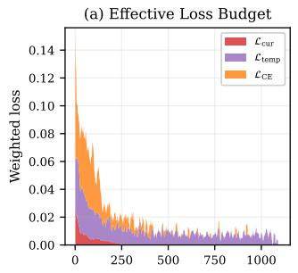

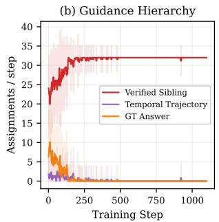

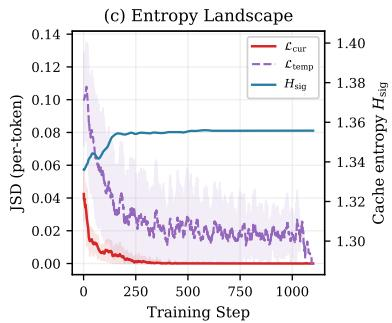

(d) Cache Growth  
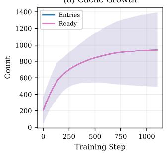

(e) Rollout Quality  
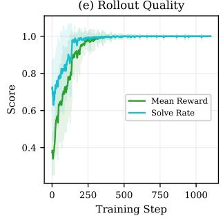

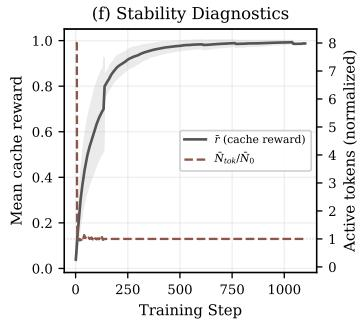  
Figure 7: Training dynamics of FSPO averaged across five tasks on Olmo3-7B-Instruct. Metrics are reported as mean ± 1 σ over Biology, Chemistry, Materials, Physics, and Tool Use. When a task’s training completes before the longest run, its final values are held constant so that all five tasks contribute to the average at every step. (a) Weighted contributions of the current, temporal, and reference-grounding objectives under the cyclic $\rho$ schedule. (b) Number of guidance-tier assignments per training step. (c) Per-token JSD divergence for the current and temporal components, with cache signature entropy $H _ { \mathrm { s i g } }$ (right axis; science tasks only). (d) Growth of the temporal cache, showing total and ready entries. (e) Mean rollout reward and per-problem solve rate. (f) Mean cache reward and active-token length normalized to its steady-state baseline.

keeps grounding active on problems the policy already solves. Strong grounding sharply degrades performance by overriding useful self-generated behavior, with $\lambda _ { \mathrm { C E } } ~ = ~ 1 . 0$ falling close to the $\mathcal { L } _ { \mathrm { d i s t i l l } } { \mathbf { - o n l y } }$ variant (Case 11). For the schedule, a moderate cycle length and consolidation range work best, while the wide range (0.1, 0.7) remains competitive (Case 12).

## A.4 TRAINING CONFIGURATION

Table 5 lists the training configuration of FSPO. We follow the SDPO setting without environment feedback (Hubotter et al., 2026), from which our baseline results are taken, for the backbones, data limits, batching, rollout sampling, validation protocol, distillation objective, and optimizer, so that the comparison isolates the effect of the proposed objective. Because FSPO performs rollouts and privileged evaluation with the single resident policy, it requires neither an EMA teacher nor rollout importance-sampling correction. Hyperparameters specific to FSPO are listed in the lower block and follow the full-model settings of Table 2.

## A.5 TRAINING DYNAMICS

Final performance alone does not reveal how the components of FSPO interact during optimization. We therefore examine the training dynamics in Figure 7, following how supervision evolves as the policy moves from unreliable early rollouts toward stable self-generated guidance. The analysis tracks how the strength and source of supervision change over time, how temporal disagreement is preserved, how the cache matures, and how these mechanisms translate into improved rollout quality and more stable generations. Figure 8 then complements this view by showing that the historical memory supporting temporal consolidation remains negligible in cost even as the cache grows.

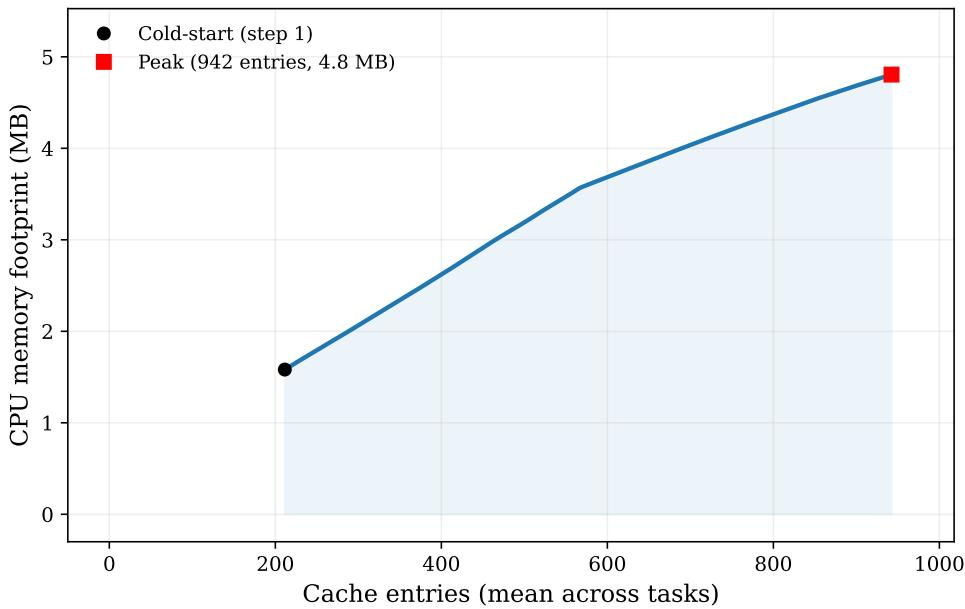  
Figure 8: Memory footprint of the temporal cache during training. CPU memory of ready cache entries plotted against cache size, averaged across the same five tasks as in Figure 7(d). The black marker denotes the seeded cache at step 1, and the red marker denotes the largest observed cache. Each individual task cache is non-decreasing; completed runs are held at their final value so that the cross-task average grows monotonically.

Figure 7(a) first shows how the effective loss budget changes over this transition. Reference grounding contributes strongly at the beginning, when rollout quality is still low and the adaptive weight $w _ { p } ^ { ( s ) }$ therefore places greater emphasis on $\mathcal { L } _ { \mathrm { C E } }$ . Its contribution then falls rapidly as the policy begins to produce reliable evidence on its own. The current privileged objective follows a similar decline as the student aligns with its contemporaneous self-teacher. Temporal consolidation, in contrast, remains active for longer because cached targets were produced by earlier policy states and therefore continue to disagree with the evolving student. The smaller recurrent fluctuations later in training reflect the cyclic $\rho _ { s }$ schedule, which repeatedly rebalances adaptation and consolidation rather than fixing their relative importance throughout optimization.

The source of this privileged guidance evolves accordingly in Figure 7(b). Verified siblings already account for a substantial portion of guidance early in training and soon become dominant as successful rollouts become more frequent. Reference answers serve mainly as a fallback during the least reliable stage, but their use quickly declines once the policy can generate sufficiently good evidence itself. Retained temporal trajectories occupy the intermediate tier of the hierarchy: they are selected when the current rollout group lacks a verified sibling but useful historical behavior is available in memory. Their contribution therefore remains smaller and gradually becomes rare. The occasional later spikes in the fallback tiers correspond to isolated batches in which verified siblings are unavailable, rather than a reversal of the broader movement toward self-supported supervision.

Figure 7(c) clarifies why temporal supervision remains useful after current adaptation has mostly converged. The current JSD falls rapidly toward zero as the unassisted and privileged predictions become aligned at the same policy state. Temporal JSD starts substantially higher and decays more slowly, preserving a nontrivial gap long after the current divergence becomes small. This sustained mismatch is precisely what temporal consolidation is meant to preserve: cached distributions remain fixed while the policy continues to evolve, so the student continues to receive a historical correction signal until those targets are refreshed. At the same time, the cache signature entropy $H _ { \mathrm { s i g } }$ rises during early memory formation and then stabilizes. Since the signature on these tasks is the predicted option, the plateau near ln 4 indicates that the memory remains balanced across answer options rathe than collapsing toward a single one.

The memory underlying this process is shown directly in Figure 7(d). The cache does not start empty: before the first update it is seeded with reference trajectories and sparse teacher targets, so temporal consolidation is active from the beginning of training. From this initial pool, the cache grows steadily within each task as new verified behaviors are admitted or existing entries are replaced, while the number of ready entries closely tracks the total count. This close coupling indicates that most retained experiences quickly become usable temporal targets. The gradual flattening of the averaged curve as tasks complete simply reflects that finished runs hold their final cache size while the remaining tasks continue to grow. The narrowing variance band likewise reflects the convergence of cache sizes across tasks as each run reaches its dataset limit.

Figure 8 translates this expansion into actual memory cost. As the number of retained entries increases, the footprint grows gradually from the seeded cache at step 1 to 942 mean entries and 4.8 MB across five tasks. The growth remains small because each entry stores only sparse functionspace information, including trajectory tokens, a top-K teacher distribution, and pooled tail mass, rather than any model-sized state. Each task’s cache size is non-decreasing; completed runs are held at their final value so the averaged curve reflects cumulative growth across all five tasks. Even at its peak, the cache occupies only about 5 MB of CPU memory, confirming that the temporal memory remains negligible relative to the resident model state.

The effect of these mechanisms on policy quality becomes visible in Figure 7(e). Both mean rollout reward and solve rate improve sharply during the early phase, but the solve rate rises faster and saturates sooner. This separation follows from how the two quantities are defined: a problem is counted as solved once one successful rollout appears within its group, whereas mean reward averages performance across all G sampled trajectories. Early in training, the policy can therefore discover one correct trajectory while still producing several unsuccessful alternatives, yielding a high solve rate but a lower average reward. As training progresses, successful behavior becomes more consistent across the rollout group, narrowing this gap and reducing the variance across tasks. The resulting plateau indicates that rapid early improvement gives way to a stable regime rather than continued oscillation.

Finally, Figure 7(f) shows how the quality of retained behavior and generation structure evolve together. Mean cache reward rises rapidly as stronger verified trajectories replace weaker initial memories and then approaches a stable high-quality regime. Active-token length follows a different pattern: it exhibits a brief spike at the very beginning, when the unadapted policy can generate substantially longer trajectories, but then quickly contracts toward its steady-state level and remains stable thereafter. This sharp early correction suggests that the policy is learning to produce more task-sufficient responses rather than simply generating longer ones. Together with the rise in cache reward, this indicates that improved solution quality emerges alongside increasingly compact and stable generations, rather than being driven by uncontrolled expansion of trajectory length.