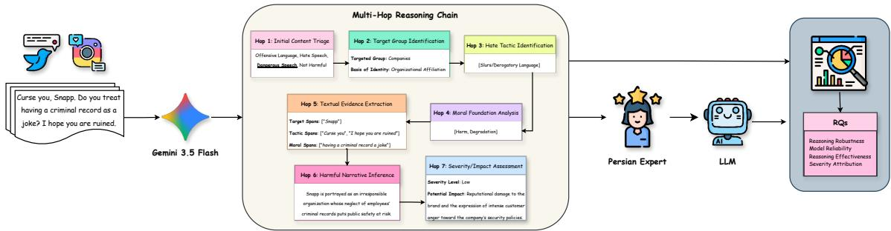
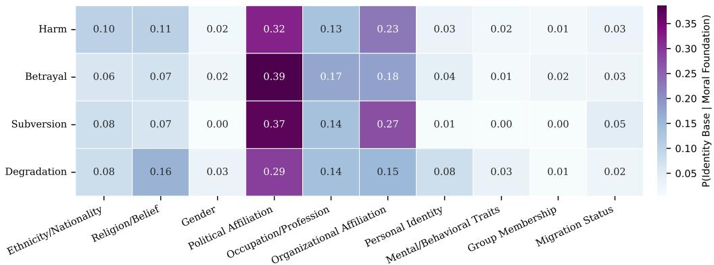
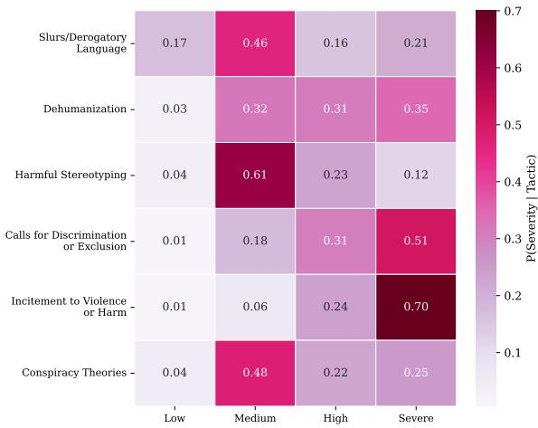
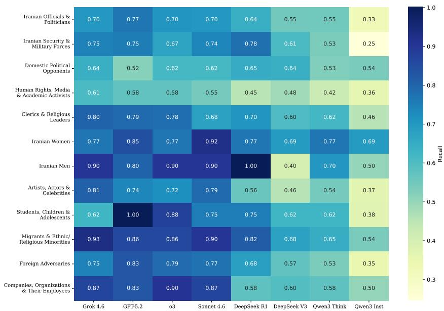
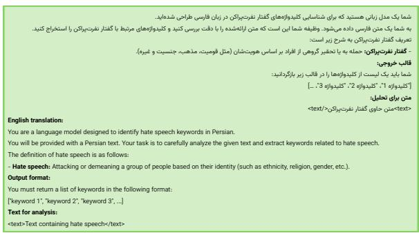
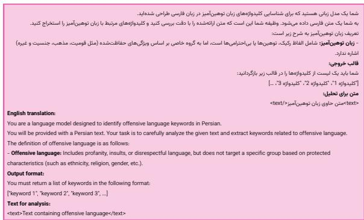
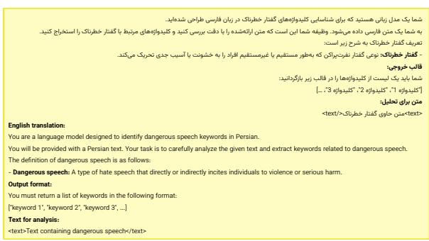
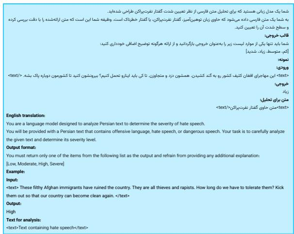
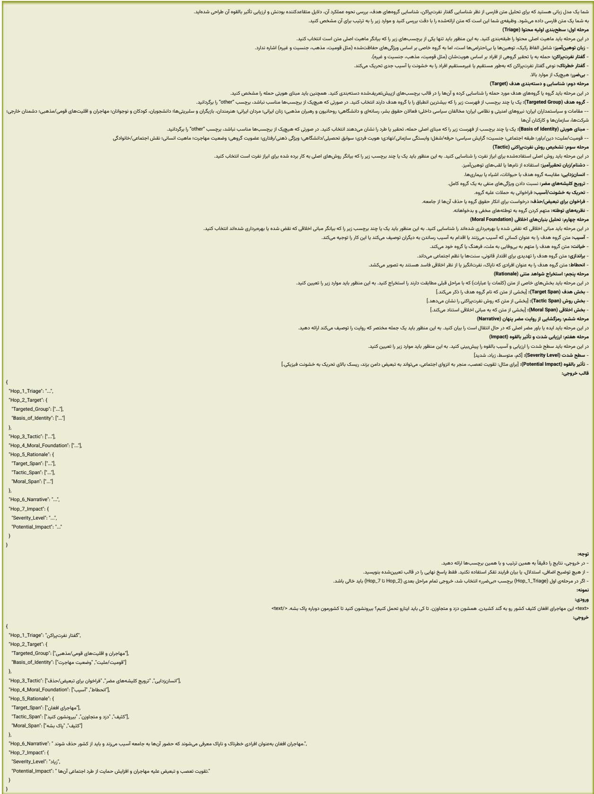
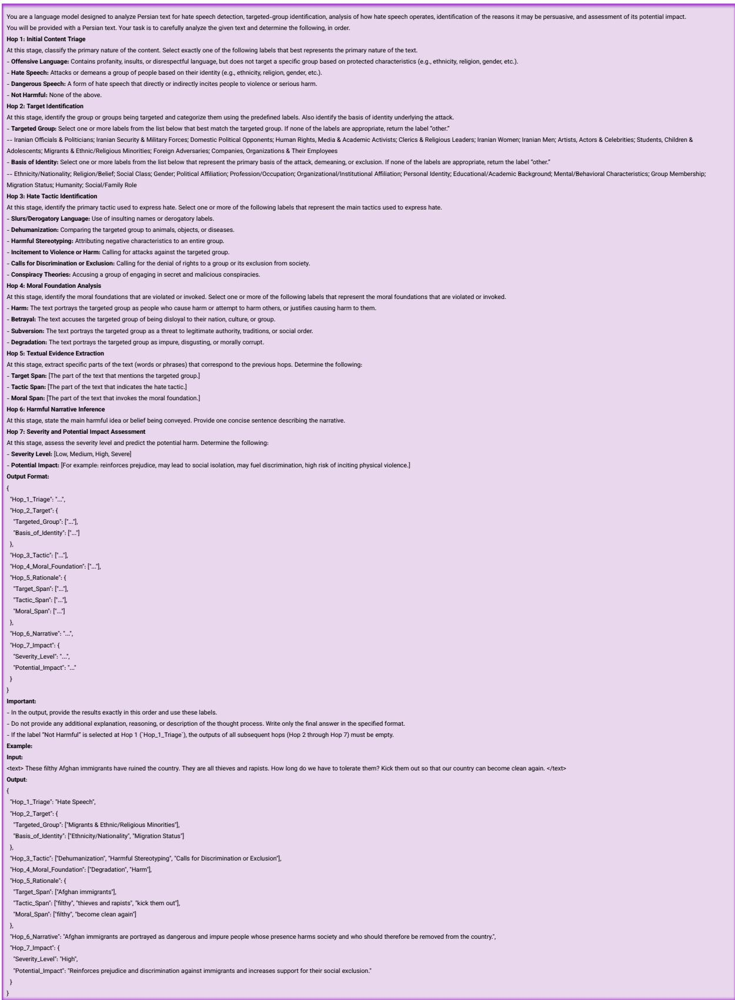

# From Triage to Impact: A Multi-Hop Reasoning Benchmark for Explainable Persian Hate Speech

Ghazal Kalhor1 Sima Kamandloo2 Mehrsa Shamsian3 Behnam Bahrak4

1EPFL 2Shahid Beheshti University

3University of Social Welfare and Rehabilitation Sciences 4Khatam University Correspondence: ghazal.kalhor@epfl.ch, b.bahrak@teias.institute

## Abstract

Hate speech has become increasingly prevalent on social media, raising concerns about its detection, interpretation, and moderation. Persian, a relatively low-resource language, lacks sufficient annotated data and computational resources for fine-grained hate speech analysis. In this study, we introduce a fine-grained, multihop benchmark for explainable Persian hate speech analysis, covering content triage, target identification, hate tactic and moral foundation analysis, textual evidence extraction, harmful narrative inference, and severity assessment. By evaluating state-of-the-art large language models (LLMs), we find that performance generally declines as tasks require more fine-grained semantic and inferential reasoning. Proprietary models generally outperform open-weight models, while reasoningoriented models show no consistent advantage. Incorporating intermediate reasoning steps substantially improves severity prediction compared with one-shot assessment. Our analysis further reveals that Incitement to Violence or Harm is most strongly associated with higher severity, while political-affiliation targets are particularly associated with subversion-based moral framing. Overall, this work provides insights into LLM-based hate speech analysis and supports more accountable moderation of Persian-language social media. The benchmark is publicly available at https://github.com/ kalhorghazal/From-Triage-to-Impact.

## 1 Introduction

From the advent of online social media, hate speech1 has become an increasingly prevalent and harmful behavior among users of these platforms. It expresses hatred toward a targeted group or seeks to demean or insult its members, undermining their dignity, inclusion, and well-being (Davidson et al.,

2017; Waldron, 2012). The Persian language is used across multiple geopolitical contexts, from Iran to the diaspora, and is associated with realworld stakes including migration tensions, religious marginalization, and gender and political polarization, making it a high-impact language for NLPbased content moderation (Bokaei et al., 2025).

Despite the societal importance of Persian hate speech, the language remains low-resource in this domain, as most existing hate speech detection systems are English-centric (Trager et al., 2025; Tonneau et al., 2024; Yang et al., 2023; Poletto et al., 2021). Persian-focused approaches often rely on black-box classification with binary or coarsegrained labels that lack explainability (Kebriaei et al., 2024; Nazarizadeh et al., 2025), or employ fragmented annotation schemes that capture only one or two aspects of the reasoning process, such as the target (Mozafari et al., 2024) or the text span (Delbari et al., 2024). Thus, these approaches can identify whether content is hateful, but not how it is expressed, why it is framed as harmful, or what potential consequences it may entail. This limitation is particularly problematic because hate speech is often implicit, multi-layered, and morally framed, and cannot be reliably addressed using surface-level features alone (Kim et al., 2022).

To bridge this gap, we propose an explainable multi-hop reasoning framework for hate speech detection in Persian. The sequential, humaninterpretable framework supports a structured content-moderation process rather than relying on post-hoc explanations. Each hop builds on the previous one to reduce ambiguity and enable traceable and accountable decisions, capturing the underlying reasoning process by which humans identify, interpret, and assess hate speech.

Moral Foundations Theory (MFT) advances a pluralist view of morality grounded in multiple moral dimensions, including Care/Harm, Fairness/Cheating, Loyalty/Betrayal, Authority/Subversion, and Purity/Degradation (Koleva et al., 2015). Hate speech often draws on shared moral values and perceived moral violations to legitimize hostility toward targeted groups (Hoover et al., 2019). Given MFT’s demonstrated relevance to Persian discourse (Atari et al., 2020; Nejat et al., 2015), moral reasoning is crucial for understanding and detecting Persian hate speech.

  
Figure 1: Pipeline illustrating multi-hop reasoning steps, human verification, and LLM evaluation.

By incorporating MFT, we construct a 1,200- instance Persian hate speech dataset using a sevenhop reasoning framework: (1) initial content triage, (2) target identification, (3) hate speech tactic identification, (4) moral foundation analysis, (5) textual rationale extraction, (6) inference of the underlying harmful narrative, and (7) severity and potential impact assessment. Initial annotations are generated using Gemini 3.5 Flash, a state-of-the-art LLM in the Gemini family that has shown strong performance on Persian-language tasks,2 and validated against independent human annotations.

Using our dataset, we evaluate eight state-of-theart proprietary and open-weight LLMs to investigate four questions: (1) how LLM performance changes as hate speech analysis progresses from initial triage to deeper reasoning; (2) how performance varies across proprietary versus openweight and reasoning versus instruction-tuned models; (3) whether step-wise reasoning across Hops 1– 6 improves severity prediction over one-shot prediction; and (4) which Persian hate speech tactics are most strongly associated with higher severity levels.

Our findings reveal substantial variation in LLM performance across the multi-hop analysis of Persian hate speech. Performance generally declines as tasks require more fine-grained reasoning, with proprietary models generally outperforming open-weight models and the benefits of reasoningoriented models varying across tasks. Incorporating intermediate analyses from Hops 1–6 substantially improves severity prediction over one-shot assessment, although the improvement varies considerably across models. Beyond model performance, Incitement to Violence or Harm shows the strongest association with higher severity, while politicalaffiliation targets show a particularly strong association with subversion-based moral framing. These findings highlight the challenges of reliable, interpretable LLM-based hate speech analysis and the value of modeling harmful discourse for social media moderation.

## 2 Benchmark Construction

To construct our benchmark, we consider two major social media platforms: X and Instagram, which are prominent sources of hate speech among Persian-speaking users. We first review recent studies that collect and release Persian-language datasets from these platforms (Appendix A). Since most existing datasets primarily focus on hate speech instances, we balance the data at the first hop (initial content triage) by manually collecting recent posts from X. Specifically, we retrieve posts using keywords extracted from our labeled data by querying Gemini 3.5 Flash. Figures 6–7 present example prompts used for extracting keywords associated with offensive language and dangerous speech. Overall, our dataset contains 348 instances collected from prior work and 852 instances collected in this study, resulting in 1,200 texts with 300 instances per initial content triage category. The following describes the collection and preprocessing procedure for the newly collected instances.

To collect the 852 additional instances introduced in this benchmark, we manually search X using queries of the following format: ("keyword") lang:fa -is:retweet -is:reply since:2026-02-28. This filtering strategy ensures that the collected posts were published after the collection period of existing datasets, which were all obtained before 2026, thereby reducing potential overlap and capturing more recent patterns of online discourse. We then apply the annotation prompts described in the following section to verify whether each retrieved post belongs to the target triage categories; posts that do not satisfy the criteria are removed. Finally, we anonymize all texts by replacing user mentions with @username and URLs with www.link.com. The overall workflow of our dataset construction and evaluation process is illustrated in Figure 1.

Data annotation. To assign values for each hop to every text instance, we employ Gemini 3.5 Flash with a chain-of-thought prompting strategy. The model is provided with the definition of each hop and its corresponding output schema, as specified in Table 1. To assess the quality of the automatically generated annotations, we randomly select a sample of 100 texts, stratified by the first-hop content-triage labels (25 texts per category) to ensure balanced representation across the four categories. Two native Persian-speaking annotators independently annotate these texts using the same prompt provided to the LLMs. We then measure inter-annotator agreement between the two human annotators and compare the human annotations with the Gemini-generated reference annotations.

The inter-annotator agreement results indicate varying levels of agreement across annotation tasks and output types. Agreement is higher for initial content triage and severity classification, while it varies across categorical and multi-label annotations. Agreement is lower for tasks requiring openended judgments, particularly narrative inference and impact assessment. These results suggest that agreement depends on the annotation dimension and that text-based reasoning tasks involve greater interpretive variability among annotators. Complete inter-annotator agreement results, including the task-specific metrics used for each hop, are reported in Table 6 (Appendix C).

Disagreements are resolved by the first author to produce the gold labels for each hop. We compare Gemini’s outputs with these gold labels using the same metrics as in the LLM evaluation described in the following sections. Table 7 (Appendix C) presents the Human–LLM alignment results. We observe high alignment for most closedended tasks, particularly target group identification and hate tactic and moral foundation detection. Alignment is lower for tasks involving open-ended text generation, especially narrative inference and potential impact assessment. This is expected, as automatic metrics may not fully capture semantic similarity, particularly in a low-resource language such as Persian. Despite these limitations, the results indicate that Gemini’s annotations are sufficiently aligned with the gold labels to serve as reference annotations for our analyses.

## 3 Experimental Setup

Models. We evaluate eight state-of-the-art multilingual LLMs on our benchmark: Grok 4.6, GPT-5.2, o3, and Claude Sonnet 4.6 as proprietary models, and DeepSeek R1, DeepSeek V3, Qwen3 30B A3B Thinking 2507, and Qwen3 30B A3B Instruct 2507 as open-weight models. This set enables comparisons across model access types and reasoning capabilities, with all models officially supporting Persian.

Prompting. We use API calls for all models. All prompts use one-shot prompting, with the multihop annotation prompt additionally employing a chain-of-thought strategy. We set the temperature to 0 and top-p to 1, prioritizing accuracy over creativity. Each prompt is executed independently. Prompt templates and their English translations are provided in Appendix D.

## 4 Main Results

## 4.1 Model Evaluation

Hop 1: Initial content triage. As this is a single-label multiclass classification task with classbalanced reference data, we report macro-averaged precision, recall, and F1. As shown in Table 3, all proprietary models outperform the open-weight models, among which DeepSeek R1 performs best. Reasoning variants generally outperform their paired instruct variants, primarily through higher recall with little loss in precision. Overall, initial Persian hate-speech triage varies across model families and inference paradigms, with proprietary models leading and reasoning offering a recall advantage among paired open-weight models.

For Hops 2–6, we restrict the evaluation to instances that are annotated as Harmful in the reference labels. This filtering excludes Not Harmful cases and ensures that subsequent hops assess each model’s ability to identify specific hate-speech attributes on a common gold-standard set of harmful instances, making the results comparable.

<table><tr><td>Hop</td><td>Definition</td><td>Output Schema</td></tr><tr><td>Initial Content Triage</td><td>Determines whether the content is harmful and identifies its primary category.</td><td>Labels: Offensive Language; Hate Speech; Dangerous Speech; Not Harmful.</td></tr><tr><td>Target Group Identification</td><td>Identifies the explicit or implicit target of the speech and the basis of identity targeted by the content.</td><td>Targeted Group (multi-label); Basis of Identity (multi-label). Labels provided in Table 2.</td></tr><tr><td>Hate Tactic Identification</td><td>Analyzes the rhetorical strategy used to express or legitimize hostility toward the target.</td><td>Multi-label: Slurs/Derogatory Language; Dehumanization; Harmful Stereotyping; Incitement to Violence or Harm; Calls for Discrimination or Exclusion; Conspiracy Theories.</td></tr><tr><td>Moral Foundation Analysis</td><td>Identifies moral foundations invoked or violated to justify hos- Multi-label: Harm; Betrayal; Subversion; Degradation. tility, grounded in Moral Foundations Theory.</td><td></td></tr><tr><td>Textual Evidence Extraction</td><td>Extracts explicit textual evidence supporting the identified tar- Target Span; Tactic Span; Moral Span. gets, tactics, and moral foundations.</td><td></td></tr><tr><td>Harmful Narrative Inference</td><td>Infers the implicit ideological or toxic narrative promoted by the Concise free-text narrative description. content.</td><td></td></tr><tr><td>Severity/Impact Assessment</td><td>Synthesizes prior hops to assess severity and potential real-world consequences.</td><td>Severity Level (Low, Medium, High, Severe); Potential Impact (free text).</td></tr></table>

Table 1: Definitions of the reasoning hops and their corresponding output schemas.

<table><tr><td>Category</td><td>Standard Values</td></tr><tr><td>Targeted Group</td><td>Iranian Officials &amp; Politicians; Iranian Security &amp; Mil- itary Forces; Domestic Political Opponents; Clerics &amp; Religious Leaders; Human Rights, Media &amp; Academic Activists; Migrants &amp; Ethnic/Religious Minorities; For- eign Adversaries; Iranian Women; Iranian Men; Artists, Actors &amp; Celebrities; Students, Children &amp; Adolescents; Companies, Organizations, &amp; Their Employees</td></tr><tr><td>Basis of Identity</td><td>Ethnicity/Nationality; Religion/Belief; Social Class; Gen- der; Political Affiliation; Migration Status; Occupa- tion/Profession; Organizational/Institutional Affiliation; Group Membership; Social/Family Role; Personal Identity; Mental/Behavioral Traits; Educational/Academic Back- ground; Humanity/Personhood</td></tr></table>

Table 2: Categories for targeted groups and identity bases used in the study.

Hop 2: Target group identification. To assess whether LLMs can identify the target of hate speech and the identity dimension under attack, we report micro- and macro-averaged F1 for the Targeted Group and Basis of Identity tasks. Micro F1 captures overall performance, while macro F1 gives equal weight to each category and is more sensitive to performance on less frequent categories. Table 3 shows that all proprietary models outperform the open-weight models. The larger micro–macro gaps for open-weight models suggest greater difficulty identifying less frequent categories among the 12 targeted groups (Table 2). DeepSeek R1 performs best among open-weight models in macro F1. Both DeepSeek R1 and Qwen3 Think also achieve higher macro F1 than their paired instruct variants, with only modest differences in micro F1, suggesting that reasoning may improve coverage of less frequent categories.

For Basis of Identity detection, proprietary models again outperform open-weight models on both metrics. The substantial micro–macro gaps indicate continued difficulty identifying less frequent categories among the 14 identity bases (Table 2). The effect of reasoning is task-dependent: Qwen3 Think achieves higher macro but lower micro F1 than Qwen3 Instruct, while DeepSeek R1 performs similarly to DeepSeek V3 in micro F1 and slightly better in macro F1. Overall, performance varies across model families and inference paradigms, with the largest differences emerging in coverage of less frequent categories.

Hop 3: Hate tactic identification. As this is a multi-label classification task, we report micro- and macro-averaged F1 and adapted F1 (Trager et al., 2025), which measures whether a model identifies at least one hate tactic present in the text. As shown in Table 3, there is a substantial gap between micro and macro F1 score, which indicates that models perform better on frequent hate tactics than on less frequent ones, particularly among open-weight models.

The effect of reasoning is mixed: DeepSeek R1 achieves lower micro and macro F1 than DeepSeek V3, while Qwen3 Think outperforms Qwen3 Instruct on both metrics, particularly macro F1. Thus, reasoning may improve coverage of less frequent hate tactics in some models. Adapted F1 scores are generally high, indicating that most models identify at least one applicable hate tactic once harmful content has been established.

Hop 4: Moral foundation analysis. We next examine whether models can move beyond the hate tactics identified in Hop 3 to recognize the underlying moral foundations of harmful content. As this is a multi-label classification task, we report micro- and macro-averaged F1 and adapted F1. As illustrated in Table 3, compared with Hop 3, micro F1 and adapted F1 decrease for every model, indicating that moral foundation identification is more challenging overall. However, macro F1 increases for DeepSeek V3 and Qwen3 Instruct, suggesting that the difficulty of identifying less frequent categories varies across models.

<table><tr><td>Metric</td><td>Grok 4.6</td><td>GPT-5.2</td><td>03</td><td>Sonnet 4.6 DeepSeek R1</td><td></td><td>DeepSeek V3</td><td>Qwen3 Think</td><td>Qwen3 Inst</td></tr><tr><td colspan="9">Hop 1: Initial Content Triage</td></tr><tr><td>Macro Precision</td><td>82.7</td><td>82.6</td><td>79.0</td><td>79.5</td><td>77.0</td><td>76.7</td><td>67.8</td><td>69.6</td></tr><tr><td>Macro Recall</td><td>83.0</td><td>80.4</td><td>77.7</td><td>79.2</td><td>75.0</td><td>68.6</td><td>66.7</td><td>52.0</td></tr><tr><td>Macro F1</td><td>82.8</td><td>79.7</td><td>77.8</td><td>79.2</td><td>75.0</td><td>68.5</td><td>66.4</td><td>48.0</td></tr><tr><td colspan="9">Hop 2: Targeted Group</td></tr><tr><td>Micro F1</td><td>71.1</td><td>66.0</td><td>68.1</td><td>66.7</td><td>60.1</td><td>58.3</td><td>42.7</td><td>43.0</td></tr><tr><td>Macro F1</td><td>65.6</td><td>63.6</td><td>63.4</td><td>56.4</td><td>41.7</td><td>22.9</td><td>27.4</td><td>20.3</td></tr><tr><td colspan="9">Hop 2: Basis of Identity</td></tr><tr><td>Micro F1 Macro F1</td><td>73.4</td><td>64.1</td><td>65.9</td><td>65.8</td><td>63.5</td><td>63.5</td><td>45.0</td><td>48.1</td></tr><tr><td></td><td>59.7</td><td>51.5</td><td>49.8</td><td>42.5</td><td>36.7</td><td>35.2</td><td>28.2</td><td>13.3</td></tr><tr><td colspan="9">Hop 3: Hate Tactic</td></tr><tr><td>Micro F1 Macro F1</td><td>85.4</td><td>85.8</td><td>83.3 65.5</td><td>75.0</td><td>68.9</td><td>75.8 35.9</td><td>68.5</td><td>60.5 6.9</td></tr><tr><td>Adapted F1</td><td>75.4 95.4</td><td>75.6 97.7</td><td>96.2</td><td>53.1 77.3</td><td>43.1 89.4</td><td>91.9</td><td>47.0 82.9</td><td>88.6</td></tr><tr><td></td><td></td><td></td><td></td><td>Hop 4: Moral Foundation</td><td></td><td></td><td></td><td></td></tr><tr><td colspan="9"></td></tr><tr><td>Micro F1 Macro F1</td><td>78.3 66.8</td><td>78.3</td><td>75.4 57.6</td><td>69.7 50.3</td><td>70.4</td><td>68.0</td><td>61.1</td><td>61.9</td></tr><tr><td>Adapted F1</td><td>89.0</td><td>38.2 88.3</td><td>89.8</td><td>71.2</td><td>30.7 85.5</td><td>48.8 81.4</td><td>41.2</td><td>46.7 78.1</td></tr><tr><td></td><td></td><td></td><td></td><td></td><td></td><td></td><td>73.6</td><td></td></tr><tr><td colspan="9">Hop 5: Target Rationale</td></tr><tr><td>Jaccard Jaccardmax</td><td>71.4</td><td>64.6</td><td>72.4</td><td>54.6</td><td>62.5</td><td>60.8 68.3</td><td>52.9</td><td>45.2 55.4</td></tr><tr><td>BERTScore</td><td>81.2 84.2</td><td>77.8 82.2</td><td>78.7 85.6</td><td>64.0 67.2</td><td>70.6 79.1</td><td>78.0</td><td>56.1 72.1</td><td>65.9</td></tr><tr><td>BERTScoremax</td><td>88.7</td><td>88.2</td><td>88.3</td><td>71.5</td><td>82.7</td><td>81.3</td><td>73.6</td><td>70.7</td></tr><tr><td></td><td></td><td></td><td></td><td></td><td></td><td></td><td></td><td></td></tr><tr><td colspan="9">Hop 5: Tactic Rationale</td></tr><tr><td>Jaccard Jaccardmax</td><td>74.3 89.5</td><td>63.2 86.5</td><td>75.0 88.2</td><td>50.4 70.1</td><td>60.6 80.7</td><td>64.6 81.0</td><td>53.2 66.0</td><td>46.4 75.1</td></tr><tr><td>BERTScore</td><td>85.5</td><td>80.4</td><td>87.2</td><td>63.6</td><td>77.2</td><td>87.3</td><td>71.0</td><td>69.0</td></tr><tr><td>BERTScoremax</td><td>92.9</td><td>92.4</td><td>92.8</td><td>74.0</td><td>87.2</td><td>87.3</td><td>77.2</td><td>84.4</td></tr><tr><td></td><td></td><td></td><td></td><td>Hop 5: Moral Rationale</td><td></td><td></td><td></td><td></td></tr><tr><td colspan="9"></td></tr><tr><td>Jaccard Jaccardmax</td><td>56.4 68.0</td><td>52.4</td><td>56.1 66.7</td><td>41.0 59.6</td><td>45.6 63.2</td><td>44.8 57.2</td><td>38.2 42.4</td><td>28.7 50.3</td></tr><tr><td>BERTScore</td><td>74.3</td><td>67.6 71.2</td><td>75.4</td><td>57.9</td><td>68.3</td><td>64.4</td><td>60.5</td><td>54.2</td></tr><tr><td>BERTScoremax</td><td>80.2</td><td>79.0</td><td>80.9</td><td>68.0</td><td>77.4</td><td>70.6</td><td>62.5</td><td>66.3</td></tr><tr><td></td><td></td><td></td><td></td><td></td><td></td><td></td><td></td><td></td></tr><tr><td colspan="9">Hop 6: Narrative Inference</td></tr><tr><td>BERTScore F1</td><td>57.7</td><td>54.6</td><td>56.6</td><td>47.4 63.0</td><td>54.9 71.4</td><td>54.0</td><td>47.4</td><td>47.0</td></tr><tr><td>Cosine Similarity</td><td>74.5</td><td>72.2</td><td>72.9</td><td>25.1</td><td></td><td>68.4</td><td>60.3</td><td>61.3</td></tr><tr><td>chrF++</td><td>27.5</td><td>25.2</td><td>23.8</td><td></td><td>26.0</td><td>25.0</td><td>19.5</td><td>22.1</td></tr></table>

Table 3: LLM performance across Hops 1–6 of the multi-hop Persian hate-speech reasoning benchmark. All metrics are reported on a 0–100 scale, with task-appropriate evaluation metrics used for each hop. Higher values indicate better performance.

The advantage of proprietary models is less uniform than in Hop 3: although Grok performs best overall, DeepSeek V3 achieves a higher macro F1 than GPT-5.2, indicating competitive coverage of less frequent moral foundations. The effect of reasoning is also mixed: DeepSeek R1 slightly outperforms DeepSeek V3 in micro F1 but performs substantially worse in macro F1, while Qwen3 Think achieves a slightly lower micro F1 than Qwen3 Instruct, which has the higher macro F1. Thus, reasoning provides no consistent advantage for moral foundation identification. Adapted F1 remains high (71.2–89.8%), indicating that most models identify at least one relevant moral foundation even when they struggle to identify the full set of applicable foundations.

Hop 5: Textual evidence extraction. To assess whether LLMs can extract textual evidence supporting the target, tactic, and moral foundation analyses, we measure lexical overlap using Jaccard similarity (Jaccard, 1901) and semantic similarity using

BERTScore (Zhang et al., 2019). We use hazm3 for Persian tokenization and HooshvareLab/bert-baseparsbert-uncased, pretrained on Persian (Farahani et al., 2021), for BERTScore. As each rationale may contain multiple textual spans, we report average pairwise and maximum similarity across reference spans, capturing overall alignment and the strongest individual match, respectively. Table 3 presents the results for the three rationale types.

Tactic rationales achieve the highest similarity, followed by target rationales, while moral rationales are the most difficult to reproduce. This suggests that models more readily identify evidence associated with explicit hate tactics than evidence supporting more abstract moral foundations. BERTScore consistently exceeds Jaccard similarity, indicating that generated rationales often preserve semantic content despite lexical differences. Maximum similarity also consistently exceeds average similarity, suggesting that models can identify individual matching evidence spans even when their overall rationales differ from the references.

Proprietary models show the clearest advantage on moral rationales, while open-weight models such as DeepSeek R1 and V3 achieve relatively competitive scores on target and tactic rationales. Reasoning provides no uniform advantage across rationale types and model families, suggesting that its benefits in some classification hops do not necessarily transfer to textual evidence generation.

Hop 6: Harmful narrative inference. To evaluate the similarity between LLM-generated and reference harmful narratives, we compute three metrics for each reference–generation pair: BERTScore F1 (Zhang et al., 2019) with HooshvareLab/bert-base-parsbert-uncased for token-level semantic similarity, cosine similarity (Reimers and Gurevych, 2019) using paraphrase-multilingual-mpnet-base-v2 for embedding-space similarity, and chrF++ (Popovic´, 2017) for character n-gram overlap with wordorder information. We report mean scores across all pairs in Table 3.

Proprietary models generally outperform openweight models, although DeepSeek R1 and V3 achieve competitive semantic similarity scores. DeepSeek R1 attains a BERTScore F1 close to GPT-5.2 despite lower cosine similarity. Across all models, chrF++ scores are considerably lower than semantic similarity scores, indicating substantial character-level differences despite semantic overlap.

The comparison between reasoning and instruct variants reveals different patterns across model families. DeepSeek R1 outperforms DeepSeek V3 on all three metrics, whereas Qwen3 Think outperforms Qwen3 Instruct only on BERTScore F1, with lower cosine similarity and chrF++ scores. Thus, reasoning variants do not consistently improve similarity across model families and evaluation metrics.

Hop 7: Severity and impact assessment. We assess whether LLMs can determine the severity of harmful content and articulate its potential impact. For severity assessment, we calculate macroaveraged precision, recall, and F1 for this singlelabel, multi-class classification task. Because the four severity levels are ordinal (Low, Medium, High, Severe), we additionally report weighted Cohen’s (κ) (Cohen, 1968), excluding instances without a valid severity label from this metric but retaining them for the others. We also conduct a one-shot ablation in which models predict severity directly from the original text without access to the intermediate outputs from Hops 1–6, to examine their contribution to severity prediction (prompt template in Figure 8). Table 4 reports results for both settings.

Multi-hop analysis improves macro F1 for five models (DeepSeek V3, DeepSeek R1, GPT-5.2, Qwen3 Instruct, and Sonnet), but decreases it for Grok, o3, and Qwen3 Think. However, weighted Cohen’s (κ) is higher in the multi-hop setting for every model, suggesting better ordinal agreement on instances with valid predictions. These findings provide qualified support for RQ3: intermediate analyses improve ordinal agreement consistently but do not improve macro F1 for all models. The comparison between proprietary and open-weight models reveals no uniform advantage across settings, and reasoning variants do not consistently outperform their paired instruct variants: DeepSeek R1 underperforms DeepSeek V3 in macro F1 in both settings, while Qwen3 Think performs worse than Qwen3 Instruct in the multi-hop setting but better in the one-shot ablation.

For potential impact, we use BERTScore F1, cosine similarity, and chrF++, following Hop 6. GPT-5.2 achieves the highest scores on all three metrics. Across models, BERTScore and cosine similarity exceed chrF++, suggesting that generated statements capture the semantic content of the reference annotations despite lexical differences. Finally, in response to RQ1, severity prediction exhibits lower classification performance than initial content triage in Hop 1. Although both tasks involve four-class classification, Hop 7 requires a more fine-grained assessment of harmful content, suggesting that severity prediction is more challenging and supporting the broader observation that performance can decline as the benchmark progresses toward more complex reasoning tasks.

## 4.2 Correlation Analysis Across Reasoning Hops

Hate tactic vs. severity level. To investigate which hate speech tactics in Persian are most strongly associated with higher severity levels (RQ4), we calculate the conditional probability of each severity level given the presence of a specific hate speech tactic in the reference data. Figure 3 shows the resulting distributions and reveals a clear relationship between the type of tactic and severity. Incitement to Violence or Harm is most strongly associated with the severe category (70%), followed by Calls for Discrimination or Exclusion (51%). Dehumanization also tends to occur at higher severity levels, with most instances falling into the medium or severe categories. In contrast, Harmful Stereotyping and Conspiracy Theories are predominantly associated with lower severity categories.

To assess whether the observed differences are statistically significant, we conduct a chi-square test of independence separately for each tactic and apply Benjamini–Hochberg correction for multiple comparisons. The results, shown in Appendix E, indicate significant associations between severity and five of the six tactics, with Conspiracy Theories being the only exception. Incitement to Violence or Harm shows the strongest association by far, followed by Slurs/Derogatory Language and Callsfor Discrimination or Exclusion. This pattern is consistent with the distinction between direct and indirect forms of hateful expression, as conspiracy theories may operate more indirectly than tactics involving explicit harm, violence, or exclusion (Bilewicz, 2024).

Moral foundation vs. identity basis. We analyze co-occurrence patterns between moral foundations and identity bases to examine how identitytargeted hate speech is morally framed. Using the reference annotations, we compute the conditional distribution of identity bases for each moral foundation, excluding identity bases with fewer than 20 occurrences to reduce the influence of sparse categories. Figure 2 presents the resulting distributions. Political Affiliation has high conditional probabilities across several moral foundations, with its strongest association with Subversion, indicating that attacks targeting political affiliation are particularly likely to involve subversion-based moral framing. Organizational/Institutional Affiliation and Occupation/Profession also co-occur substantially with multiple moral foundations, highlighting the prominence of institutional and occupational identities in morally framed hate narratives. Less frequent identity bases show more limited and variable associations, which should be interpreted cautiously given their lower support.

To test whether these patterns reflect systematic associations rather than differences in marginal frequencies, we conduct pairwise $\chi ^ { 2 }$ tests of independence using instance-level presence/absence indicators. We apply the Benjamini–Hochberg procedure to control the false discovery rate and report Cramér’s V as the effect size. Several associations remain significant after correction, with the strongest effects for Harm and Personal Identity $( V = 0 . 2 8 1 )$ ), Harm and Organizational/Institutional Affiliation $( V = 0 . 2 7 3 )$ , and Betrayal and Political Affiliation $( V = 0 . 2 7 1 )$ . These results support the co-occurrence patterns observed in Figure 2. The complete set of significant associations is reported in Appendix F.

Content triage vs. targeted group. To further examine differences in LLMs’ ability to identify specific targeted groups, we analyze recall across the 12 standardized categories. Figure 4 presents the results. Migrants & Ethnic/Religious Minorities is among the most consistently well-detected categories, with recall exceeding 80% for Grok, GPT-5.2, o3, Claude, and DeepSeek R1. In contrast, Human Rights, Media & Academic Activists is consistently challenging, with recall below 61% for every model and below 50% for all openweight models. Other categories, including Iranian Women, Iranian Men, and Companies, Organizations, & Their Employees, achieve relatively high recall for several models, although performance varies across model families. Reasoning variants generally improve recall: Qwen3 Think substantially outperforms Qwen3 Instruct on most target groups, while DeepSeek R1 generally outperforms DeepSeek V3, though not uniformly. Overall, performance varies considerably across target groups, with some categories consistently more challenging and reasoning-oriented models often providing broader coverage.

<table><tr><td>Metric</td><td>Grok 4.6</td><td>GPT-5.2</td><td>03</td><td>Sonnet 4.6 DeepSeek R1 DeepSeek V3</td><td></td><td></td><td>Qwen3 Think Qwen3 Inst</td><td></td></tr><tr><td colspan="9">Severity Level</td></tr><tr><td>Macro Precision</td><td>51.5</td><td>51.6</td><td>45.5</td><td>52.0</td><td>45.1</td><td>49.3</td><td>42.9</td><td>37.0</td></tr><tr><td>Macro Recall</td><td>53.1</td><td>51.7</td><td>47.7</td><td>40.5</td><td>34.4</td><td>43.0</td><td>31.9</td><td>33.5</td></tr><tr><td>Macro F1</td><td>50.7</td><td>50.8</td><td>44.6</td><td>43.5</td><td>32.1</td><td>43.9</td><td>27.9</td><td>29.9</td></tr><tr><td>Weighted Cohen&#x27;s κ</td><td>.829</td><td>.819</td><td>.760</td><td>.797</td><td>.558</td><td>.736</td><td>.525</td><td>.525</td></tr><tr><td colspan="9">Severity Level (Ablation)</td></tr><tr><td>Macro Precision</td><td>59.9</td><td>48.7</td><td>53.6</td><td>50.0</td><td>36.2</td><td>40.0</td><td>43.2</td><td>36.9</td></tr><tr><td>Macro Recall</td><td>60.3</td><td>46.6</td><td>54.6</td><td>45.5</td><td>30.9</td><td>33.5</td><td>37.1</td><td>37.2</td></tr><tr><td>Macro F1</td><td>58.4</td><td>42.8</td><td>53.1</td><td>43.4</td><td>21.8</td><td>27.0</td><td>31.8</td><td>29.2</td></tr><tr><td>Weighted Cohen&#x27;s κ</td><td>.731</td><td>.615</td><td>.702</td><td>.595</td><td>.254</td><td>.336</td><td>.301</td><td>.259</td></tr><tr><td colspan="9">Potential Impact</td></tr><tr><td>BERTScore F1</td><td>59.1</td><td>61.4</td><td>59.6</td><td>50.2</td><td>58.5</td><td>57.4</td><td>53.2</td><td>53.2</td></tr><tr><td>Cosine Similarity</td><td>72.3</td><td>77.6</td><td>75.0</td><td>66.2</td><td>71.3</td><td>69.5</td><td>62.4</td><td>64.6</td></tr><tr><td>chrF++</td><td>23.1</td><td>28.6</td><td>23.0</td><td>24.8</td><td>24.7</td><td>21.2</td><td>18.7</td><td>22.7</td></tr></table>

Table 4: LLM performance on hate speech severity (multi-hop and one-shot) and potential impact. All metrics are reported on a 0–100 scale, except for weighted Cohen’s κ.

  
Figure 2: Conditional probability distribution of identity bases given the presence of each moral foundation.

  
Figure 3: Conditional probability distribution of severity levels given the presence of each hate speech tactic.

## 5 Conclusion

In this work, we proposed a fine-grained multihop benchmark for analyzing Persian hate speech through increasingly complex reasoning steps. Our evaluation of state-of-the-art LLMs reveals substantial variation in performance across stages, with performance generally declining as tasks require more fine-grained semantic and inferential reasoning. Proprietary models generally outperform openweight models, while the benefits of reasoningoriented models vary across tasks. Our ablation study shows that intermediate analyses improve macro F1 for five of eight models, while weighted Cohen’s κ improves for all models, suggesting more consistent gains in ordinal agreement than in classification performance. Beyond model performance, our analyses uncover meaningful structure in Persian hate speech: Incitement to Violence or Harm exhibits the strongest association with higher severity levels, while political-affiliation targets are particularly associated with subversion-based moral framing. Uneven performance across target groups also highlights differences in LLMs’ sensitivity to hate speech directed at distinct social categories. Together, these findings demonstrate the challenges of reliable and interpretable LLM-based hate speech analysis and the value of modeling the underlying structure of harmful discourse, providing guidance for more effective and culturally informed moderation systems for Persian-language social media.

  
Figure 4: Recall of hate speech detection across targeted groups for each LLM.

## Limitations

Our study has several limitations that could be addressed in future work. We focus exclusively on hate speech in Persian and content from X and Instagram; extending our framework to other languages and platforms could provide a more comprehensive assessment of LLM performance and generalizability. Additionally, our benchmark is balanced across the four initial content-triage categories rather than reflecting their natural distribution on social media. Consequently, it may not represent the prevalence of different types of content in real-world settings. Future work could evaluate the framework on randomly sampled social media data to better reflect real-world distributions. Finally, the relatively small benchmark size may limit coverage of less frequent target groups, identity bases, and hate tactics. Larger and more diverse benchmarks could therefore provide broader coverage of these categories and enable more robust evaluation of model performance.

## References

Mohammad Atari, Jesse Graham, and Morteza Dehghani. 2020. Foundations of morality in iran. Evolution and Human behavior, 41(5):367–384.

Michał Bilewicz. 2024. How appraisal model allows to distinguish intergroup conspiracy theories from other forms of hate speech. Psychological Inquiry, 35(3-4):216–222.

Zahra Bokaei, Walid Magdy, and Bonnie Webber. 2025. Culture matters in toxic language detection in persian. arXiv preprint arXiv:2506.03458.

Jacob Cohen. 1968. Weighted kappa: Nominal scale agreement provision for scaled disagreement or partial credit. Psychological bulletin, 70(4):213.

Hadi Davardoust, Hadi Zare, and Hossein Rafiee Zade. 2024. The dark side of instagram: A large dataset for identifying persian harmful comments. SoCal NLP Symposium 2024.

Thomas Davidson, Dana Warmsley, Michael Macy, and Ingmar Weber. 2017. Automated hate speech detection and the problem of offensive language. In Proceedings ofthe international AAAI conference on web and social media, volume 11, pages 512–515.

Zahra Delbari, Nafise Sadat Moosavi, and Mohammad Taher Pilehvar. 2024. Spanning the spectrum of hatred detection: a persian multi-label hate speech dataset with annotator rationales. In Proceedings of the AAAI Conference on Artificial Intelligence, volume 38, pages 17889–17897.

Sina Elahimanesh, Mohammadali Mohammadkhani, and Shohreh Kasaei. 2025. Emotion alignment: Discovering the gap between social media and real-world sentiments in persian tweets and images. arXiv preprint arXiv:2504.10662.

Mehrdad Farahani, Mohammad Gharachorloo, Marzieh Farahani, and Mohammad Manthouri. 2021. Parsbert: Transformer-based model for persian language understanding. Neural Processing Letters, 53(6):3831–3847.

Joseph Hoover, Mohammad Atari, Aida Mostafazadeh Davani, Brendan Kennedy, Gwenyth Portillo-Wightman, Leigh Yeh, Drew Kogon, and Morteza Dehghani. 2019. Bound in hatred: The role of groupbased morality in acts of hate.

Paul Jaccard. 1901. Étude comparative de la distribution florale dans une portion des alpes et des jura. Bull Soc Vaudoise Sci Nat, 37:547–579.

Emad Kebriaei, Ali Homayouni, Roghayeh Faraji, Armita Razavi, Azadeh Shakery, Heshaam Faili, and Yadollah Yaghoobzadeh. 2024. Persian offensive language detection. Machine Learning, 113(7):4359– 4379.

Jiyun Kim, Byounghan Lee, and Kyung-Ah Sohn. 2022. Why is it hate speech? masked rationale prediction for explainable hate speech detection. arXiv preprint arXiv:2211.00243.

Spassena Koleva, Erica Beall, and Jesse Graham. 2015. Moral foundations theory: building value through moral pluralism. In Handbook of virtue ethics in business and management, pages 1–10. Springer.

Marzieh Mozafari, Khouloud Mnassri, Reza Farahbakhsh, and Noel Crespi. 2024. Offensive language detection in low resource languages: A use case of persian language. PLoS one, 19(6):e0304166.

Ali Nazarizadeh, Minoo Sayyadpour, Omid Ebrahimkhani, Amirmasoud Iravani, Golnaz Ghannadan Shirazi, and Mojgan Behravan. 2025. Parsoffensive: Persian offensive comments dataset. In 2025 11th International Conference on Web Research (ICWR), pages 100–104. IEEE.

Pegah Nejat, Fatemeh Bagherian, Omid Shokri, and Javad Hatami. 2015. Mental representation of morality: The endorsement pattern of moral foundations among iranians. In 2015 Sixth International Conference of Cognitive Science (ICCS), pages 72–76. IEEE.

Fabio Poletto, Valerio Basile, Manuela Sanguinetti, Cristina Bosco, and Viviana Patti. 2021. Resources and benchmark corpora for hate speech detection: a systematic review: F. poletto et al. Language Resources and Evaluation, 55(2):477–523.

Maja Popovic. 2017. chrf++: words helping character ´ n-grams. In Proceedings of the second conference on machine translation, pages 612–618.

Nils Reimers and Iryna Gurevych. 2019. Sentence-bert: Sentence embeddings using siamese bert-networks. arXiv preprint arXiv:1908.10084.

Nazanin Sabri, Reyhane Akhavan, and Behnam Bahrak. 2021. Emopars: A collection of 30k emotionannotated persian social media texts. In Proceedings of the student research workshop associated with RANLP 2021, pages 167–173.

Manuel Tonneau, Diyi Liu, Samuel Fraiberger, Ralph Schroeder, Scott A Hale, and Paul Röttger. 2024. From languages to geographies: Towards evaluating cultural bias in hate speech datasets. In Proceedings of the 8th Workshop on Online Abuse and Harms (WOAH 2024), pages 283–311.

Jackson Trager, Francielle Vargas, Diego Alves, Matteo Guida, Mikel K Ngueajio, Ameeta Agrawal, Yalda Daryani, Farzan Karimi-Malekabadi, and Flor Miriam Plaza-del Arco. 2025. Mftcxplain: A multilingual benchmark dataset for evaluating the moral reasoning of llms through multi-hop hate speech explanation. In Findings of the Association for Computational Linguistics: EMNLP 2025, pages 15709–15740.

Jeremy Waldron. 2012. The harm in hate speech. Harvard university press.

Yongjin Yang, Joonkee Kim, Yujin Kim, Namgyu Ho, James Thorne, and Se-Young Yun. 2023. Hare: Explainable hate speech detection with step-by-step reasoning. arXiv preprint arXiv:2311.00321.

Tianyi Zhang, Varsha Kishore, Felix Wu, Kilian Q Weinberger, and Yoav Artzi. 2019. Bertscore: Evaluating text generation with bert. arXiv preprint arXiv:1904.09675.

## A Data Sources and Their Statistics

Table 5 summarizes the datasets used in our study and their statistics

<table><tr><td>Data Source</td><td>Platform</td><td>No. in Benchmark</td></tr><tr><td>Kebriaei et al.</td><td>X</td><td>146</td></tr><tr><td>Sabri et al.</td><td>X</td><td>25</td></tr><tr><td>Elahimanesh et al.</td><td>X</td><td>46</td></tr><tr><td>Davardoust et al.</td><td>Instagram</td><td>81</td></tr><tr><td>Nazarizadeh et al.</td><td>Instagram</td><td>50</td></tr></table>

Table 5: Statistics of datasets used to construct our benchmark, including source, platform, and instance counts.

## B Human Annotation Protocol

## B.1 Annotators

• Number of annotators: 2

• Native language: Persian

• Annotation language: Persian

• Role: Independent human validation of automatically generated annotations

• Education: undergraduate students in Computer Engineering

• Prior annotation experience: basic NLP coursework

• Compensation: course-related research assistance

## B.2 Annotation Task

For each text, annotators independently:

1. Assign an initial content-triage label.

2. Identify the targeted group(s) and basis(es) of identity.

3. Identify the hate speech tactic(s).

4. Identify the relevant moral foundation(s).

5. Extract textual evidence corresponding to the target, tactic, and moral foundation.

6. Describe the underlying harmful narrative.

7. Assign a severity level and describe the potential impact.

## B.3 Key Instructions

• Annotate each text independently without access to the other annotator’s responses or the Gemini-generated annotations.

• Follow the definitions and label sets provided in the annotation prompt.

• For multi-label tasks, select all labels supported by the text.

• For textual evidence extraction, select the shortest span that directly supports the corresponding annotation.

• For narrative inference and potential impact, provide concise responses grounded in the content of the text.

• Do not use external AI tools during annotation.

## C Human Validation Results

The metric values for assessing inter-annotator agreement and human–LLM alignment are reported in Tables 6 and 7, respectively.

<table><tr><td>Hop / Annotation Dimension</td><td>IAA Results</td></tr><tr><td>Hop 1: Initial Content Triage</td><td>Cohen&#x27;s κ: .743 Observed Agreement: 81.0</td></tr><tr><td>Hop 2: Targeted Group</td><td>Micro F1: 82.0 Macro F1: 69.3</td></tr><tr><td>Hop 2: Basis of Identity</td><td>Micro F1: 66.3 Macro F1: 51.2</td></tr><tr><td>Hop 3: Hate Tactic</td><td>Micro F1: 74.9</td></tr><tr><td>Hop 4: Moral Foundation</td><td>Macro F1: 61.1 Micro F1: 77.2</td></tr><tr><td></td><td>Macro F1: 60.6</td></tr><tr><td>Hop 5: Target Rationale</td><td>Jaccard: 73.2</td></tr><tr><td>Hop 5: Tactic Rationale Hop 5: Moral Rationale</td><td>Jaccard: 80.3 Jaccard: 76.1</td></tr><tr><td>Hop 6: Narrative Inference</td><td>BERTScore-F1: 48.5</td></tr><tr><td></td><td>Cosine Similarity: 58.8 chrF++: 19.2</td></tr><tr><td>Hop 7: Severity Level</td><td>Weighted Cohen&#x27;s κ: .822 Observed Agreement: 61.8</td></tr><tr><td>Hop 7: Potential Impact</td><td>BERTScore-F1: 53.7 Cosine Similarity: 66.4</td></tr></table>

Table 6: Inter-annotator agreement results across annotation hops.

<table><tr><td>Hop / Annotation Dimension</td><td>Human-LLM Alignment Results</td></tr><tr><td rowspan="2">Hop 1: Initial Content Triage</td><td>Macro Precision: 89.0</td></tr><tr><td>Macro Recall: 90.3 Macro F1: 88.8</td></tr><tr><td rowspan="2">Hop 2: Targeted Group</td><td></td></tr><tr><td>Micro F1: 94.0 Macro F1: 94.3</td></tr><tr><td rowspan="2">Hop 2: Basis of Identity</td><td></td></tr><tr><td>Micro F1: 88.2 Macro F1: 79.1</td></tr><tr><td rowspan="2">Hop 3: Hate Tactic</td><td></td></tr><tr><td>Micro F1: 90.1</td></tr><tr><td rowspan="2"></td><td>Macro F1: 80.6 Adapted F1: 97.4</td></tr><tr><td></td></tr><tr><td rowspan="3">Hop 4: Moral Foundation</td><td>Micro F1: 92.0</td></tr><tr><td>Macro F1: 82.7</td></tr><tr><td>Adapted F1: 97.4</td></tr><tr><td rowspan="4">Hop 5: Target Rationale</td><td>Jaccard: 86.5</td></tr><tr><td>Jaccardmax: 91.8</td></tr><tr><td>BERTScore: 91.3 BERTScoremax: 93.3</td></tr><tr><td></td></tr><tr><td rowspan="4">Hop 5: Tactic Rationale</td><td>Jaccard: 84.3</td></tr><tr><td>Jaccardmax: 92.7</td></tr><tr><td>BERTScore: 91.0 BERTScoremax: 95.1</td></tr><tr><td></td></tr><tr><td rowspan="4">Hop 5: Moral Rationale</td><td>Jaccard: 81.9</td></tr><tr><td>Jaccardmax: 89.7</td></tr><tr><td>BERTScore: 89.2</td></tr><tr><td>BERTScoremax: 93.2</td></tr><tr><td rowspan="2">Hop 6: Narrative Inference</td><td>BERTScore-F1: 49.8</td></tr><tr><td>Cosine Similarity: 64.9 chrF++: 23.4</td></tr><tr><td rowspan="4">Hop 7: Severity Level</td><td></td></tr><tr><td>Macro Precision: 72.7 Macro Recall: 67.3</td></tr><tr><td>Macro F1: 69.4</td></tr><tr><td>Weighted Cohen&#x27;s κ: 95.5</td></tr><tr><td rowspan="2">Hop 7: Potential Impact</td><td>BERTScore-F1: 55.0</td></tr><tr><td>Cosine Similarity: 68.1</td></tr><tr><td rowspan="2"></td><td></td></tr><tr><td>chrF++: 26.2</td></tr></table>

Table 7: Human–LLM alignment results across annotation hops.

## D Prompt Templates را آی م.

## D.1 Keyword Detection Prompts

The prompt templates used for hate speech key-You wil be provided with a Persian text. Your task is to careful y analyze the given text and extract keywords related to dangerous speech.The de nition of dangerous speech is as fol ows: word detection across the categories in initial con-- Dangerous speech: A type of hate speech that directly or indirectly incites individuals to violence or serious harm.Output format: tent triage are provided in Figures 5–5, along with["keyword 1", "keyword 2", "keyword 3", . .] their English translations.<text>Text containing dangerous speech</text>

  
هامتبطباگفاخطناستخکنیدFigure 5: Prompt template for detecting hate speech keywords from a given text, along with its English translation.

  
Figure 6: Prompt template for detecting offensive lan-The de nition of offensive language is as fol ows:- Offensive language: Includes profanity, insults, or disrespectful language, but does not target a speci c group based on protected ل زاییواژهیترک در زنراها.guage keywords from a given text, along with its English      Output format: translation.      ["keyword 1", "keyword 2", "k

  
textویترتپا/textFigure 7: Prompt template for detecting dangerous You are a language model designed to identify hate speech keywords in Persian. ل زاییواژهیترتپا در زنراها. ردادهمد.وایااراهرادروواژهیترتپاراااج.speech keywords from a given text, along with its En-The de nition of hate speech is as fol owsglish translation.

<table><tr><td>Hate Speech Tactic</td><td> $\chi ^ { 2 }$ </td><td>df</td><td>Padj</td><td>Cramer&#x27;s V</td></tr><tr><td>Slurs/Derogatory Language</td><td>118.79</td><td>3</td><td>&lt; .001</td><td>.363</td></tr><tr><td>Dehumanization</td><td>63.48</td><td>3</td><td>&lt; .001</td><td>.266</td></tr><tr><td>Harmful Stereotyping</td><td>71.53</td><td>3</td><td>&lt; .001</td><td>.282</td></tr><tr><td>Calls for Discrimination or Exclusion</td><td>94.83</td><td>3</td><td>&lt; .001</td><td>.325</td></tr><tr><td>Incitement to Violence or Harm</td><td>645.77</td><td>3</td><td>&lt; .001</td><td>.847</td></tr><tr><td>Conspiracy Theories</td><td>6.96</td><td>3</td><td>.073</td><td>.088</td></tr></table>

تعریفبا توهنمز به شررستTable 8: Associations between hate speech tactics سطح شد تعن کنید ب توهنمز شملفی توهنه ییحتریهستم به ر خصی برسand severity levels. p-values are adjusted using theبرجی قالب خرجیBenjamini–Hochberg procedure; Cramer’s V reports]کم متوسطیا شدید[ effect sizes.

## D.2 Ablation Study Prompt تحلل تحاگفانفک>>

fiFigure 8 presents the prompt template used for oneshot severity classification of Persian hate speech in the ablation study, along with its English translation.

  
شما یک مدبانی هستید که بر شناسای کلیدها گفا نفررکنبا فاسی طرحیشFigure 8: Prompt template for single-step severity clas-تعریف گفا نفررکن به شررستsification of Persian hate speech in the ablation study, ررن  ب ی ر ریر بر وی  وی بجalong with its English translation.

## ررنD.3 Multi-Hop Prompt

The prompt template used for multi-hop analytical annotation of Persian hate speech and its English translation are presented in Figures 9 and 10, respectively.

## E Associations Between Hate Speech Tactics and Severity

F Statistical Analysis of Moral Foundation vs. Identity Basis Associations

  
Figure 9: Prompt template for multi-hop analytical annotation of Persian hate speech.

  
Figure 10: English translation of the prompt template for multi-hop analytical annotation of Persian hate speech.

<table><tr><td>Moral Foundation</td><td>Identity Basis</td><td>pBH</td><td>Cramér&#x27;s V</td></tr><tr><td>Betrayal</td><td>Political Affiliation</td><td>&lt; .001</td><td>.271</td></tr><tr><td>Harm</td><td>Personal Identity</td><td>&lt; .001</td><td>.281</td></tr><tr><td>Harm</td><td>Organizational/Institutional Affiliation</td><td>&lt; .001</td><td>.273</td></tr><tr><td>Degradation</td><td>Religion/Belief</td><td>&lt; .001</td><td>.209</td></tr><tr><td>Subversion</td><td>Organizational/Institutional Affiliation</td><td>&lt; .001</td><td>.199</td></tr><tr><td>Degradation</td><td>Organizational/Institutional Affiliation</td><td>&lt; .001</td><td>.194</td></tr><tr><td>Subversion</td><td>Political Affiliation</td><td>&lt; .001</td><td>.183</td></tr><tr><td>Harm</td><td>Mental/Behavioral Traits</td><td>&lt; .001</td><td>.159</td></tr><tr><td>Harm</td><td>Ethnicity/Nationality</td><td>&lt; .001</td><td>.149</td></tr><tr><td>Betrayal</td><td>Occupation/Profession</td><td>&lt; .001</td><td>.147</td></tr><tr><td>Degradation</td><td>Political Affiliation</td><td>.001</td><td>.122</td></tr><tr><td>Degradation</td><td>Gender</td><td>.001</td><td>.122</td></tr><tr><td>Betrayal</td><td>Religion/Belief</td><td>.001</td><td>.121</td></tr><tr><td>Degradation</td><td>Personal Identity</td><td>.001</td><td>.121</td></tr><tr><td>Subversion</td><td>Migration Status</td><td>.003</td><td>.112</td></tr><tr><td>Subversion</td><td>Personal Identity</td><td>.005</td><td>.105</td></tr><tr><td>Betrayal</td><td>Mental/Behavioral Traits</td><td>.007</td><td>.100</td></tr><tr><td>Betrayal</td><td>Group Membership</td><td>.025</td><td>.086</td></tr><tr><td>Harm</td><td>Political Affiliation</td><td>.047</td><td>.078</td></tr></table>

Table 9: Significant associations between moral foundations and identity bases. Associations are tested using $\chi ^ { 2 }$ tests of independence based on instance-level presence/absence indicators. p-values are corrected using the Benjamini–Hochberg procedure. Cramér’s V is reported as the effect size.