# GRAY-BOX HALLUCINATION DETECTION IN LLMS WITH TOKEN IDENTITIES

Shaked Goldshtein shakedgoldshtein@gmail.com Technion

Fabrizio Frasca Technion

Guy Bar-Shalom Technion

Yitzchak Grunbaum itzick.grin@gmail.com Technion

Haggai Maron Technion

## ABSTRACT

Large language models often produce fluent but factually incorrect output. Graybox detectors identify such hallucinations from the token-probability statistics emitted during generation, avoiding the need for white-box access to hidden states that frontier models do not provide. These detectors, however, typically rely only on probability-derived representations and ignore the identities of the candidate tokens. They can therefore observe how uncertain the model is, but not what it is uncertain about. Consequently, they cannot distinguish between a model that is torn between “big” and “small” and one that is torn between “big” and “huge” when the two pairs receive the same probability distribution. We introduce GURI (Graybox Uncertainty Representations with Identity), a lightweight gray-box hallucination detector that combines candidate-token probabilities with per-token vector identifiers. This exposes which alternatives the model considered while preserving the accessibility and transferability of the gray-box setting. Across three open-weight models and three question-answering benchmarks, GURI increases mean test ROC-AUC from 72.09% to 79.09% over a probability-only baseline. On the closed-source GPT-4.1 model, mean ROC-AUC increases from 67.39% to 71.84%. Among the three open-weight models, GURI outperforms transferred probability-only baseline in 17 of 18 directed cross-model transfers without finetuning. For the three open-weight models, cross-dataset transfer between HotpotQA and TriviaQA with the model held fixed improves mean ROC-AUC over transferred LOS-Net by 3.76 points.

## 1 INTRODUCTION

Large language models can produce fluent but factually incorrect responses, motivating methods for detecting hallucinations (Ji et al., 2023; Huang et al., 2025; Maynez et al., 2020). White-box detectors use internal model signals, whereas black-box methods assess generated text, often using additional model calls. Gray-box detection uses token probabilities exposed during generation and can operate without internal activations or additional sampling (OpenAI, n.d.; Google, n.d.).

Probability-only gray-box methods range from summary statistics of actual-token probabilities (Malinin & Gales, 2020; Ren et al., 2022) to learned detectors such as LOS-Net (Bar-Shalom et al., 2026), which processes actual-token probabilities and ranked candidate distributions across the response. Its formulation can approximate a broad family of probability-based scoring functions.

A blind spot in probability-only representations. Despite this progression, probability-only gray-box detectors use probability values while discarding the identities of the tokens carrying them. Consequently, they reveal how uncertain the model is, but not what it is uncertain about. Two decoding states may have the same numerical probability profile while assigning that probability mass to entirely different tokens. A probability-only detector maps these states to the same representation, discarding potentially useful information about the alternatives considered by the model.

Figure 1 illustrates this problem. Both decoding states have exactly the same ranked candidate token probabilities. They differ only in the tokens carrying those probabilities: one (left panel) contains competing factual answers, whereas the other (right panel) contains alternative, yet semantically equivalent, ways to complete the sentence – potentially indicating a lower risk of hallucination. This distinction is visible only when candidate token identities are taken into account and is currently absent from all previous gray-box detectors that rely on probability-only representations.

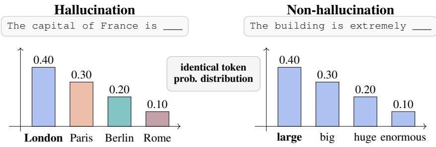  
Figure 1: Identical numerical profiles can conceal different candidate structures. Both cases share the same token distribution, so a probability-only detector receives the same input. Candidate identities reveal competing factual answers on the left and paraphrastic alternatives on the right. The emitted token is shown in bold.

Our approach. GURI is a lightweight gray-box detector that combines token identity codes with their probabilities and aggregates the resulting representations across the answer. The fusion and prediction components are trained jointly for answer-level hallucination detection.

Code vectors may be pretrained, learned, or fixed random. We use fixed random codes by default, as they match or outperform pretrained embeddings (Section 4.4.1). To support cross-model transfer, we retokenize candidate strings with a shared external tokenizer and aggregate their subtoken vectors into identity codes. This common encoding also supports closed-source models exposing candidate strings and probabilities, without requiring their tokenizer or embedding table. See Section 3 for encoding and architecture details and Figure 2 for the pipeline.

Results. Across three open-weight models and three question-answering benchmarks, GURI outperforms both the Confidence baseline and LOS-Net in all nine model–dataset combinations. Mean test ROC-AUC increases from 72.09% for LOS-Net to 79.09% for GURI (Table 1). On GPT-4.1, mean ROC-AUC increases from 67.39% to 71.84%, with an 8.14-point gain on NQ-WC (Table 2). Among the three open-weight models, GURI outperforms transferred LOS-Net in 17 of 18 directed cross-model transfers without target fine-tuning. For the three open-weight models, cross-dataset transfer between HotpotQA and TriviaQA with the model held fixed improves mean ROC-AUC over transferred LOS-Net by 3.76 points (Section 4.3). Channel ablations with random codes fur ther show that retaining only non-actual candidate identities preserves the performance of the full detector.

Contributions. Our contributions are threefold: (1) We identify token identity as a missing signal in probability-only gray-box detection. (2) We introduce GURI, a token-identity aware, transferable, gray-box detector applicable to both open- and closed-source models. (3) We demonstrate consistent empirical gains and show that identities provide predictive information beyond token probabilities.

## 2 PREVIOUS WORK.

Definitions and scope. The term “hallucination” has been used to describe several types of erroneous model behavior (Liu et al., 2022; Huang et al., 2025; Ji et al., 2023; Rawte et al., 2023).

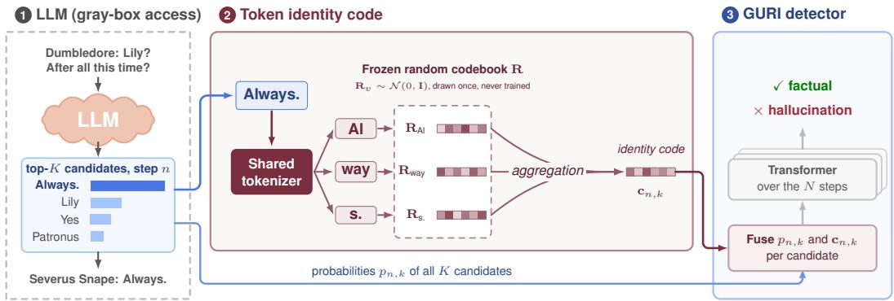  
Figure 2: GURI pipeline. At each generation step, a shared external tokenizer splits each top-K candidate into subtokens whose codes are aggregated. Fusion modules combine these identity codes with candidate probabilities, and a response-level Transformer processes the resulting sequence. Both components are trained jointly for answer-level hallucination detection.

Surveys distinguish factual inaccuracies from failures of faithfulness, including contradictions and content unsupported by the provided context (Ji et al., 2023; Huang et al., 2025). Following the broad usage in error-detection research (Orgad et al., 2025), we use the term to encompass factual errors, reasoning mistakes, and inconsistencies in model outputs.

Hallucination detection. One class of approaches consists of black-box methods, which operate on the model’s prompts and generated text. SelfCheckGPT compares a response against additional sampled passages to identify unsupported statements (Manakul et al., 2023). Semantic-uncertainty methods group sampled responses by meaning before measuring disagreement (Kuhn et al., 2023; Farquhar et al., 2024). Discrete semantic entropy estimates group probabilities from sampling frequencies, allowing text-only detection (Farquhar et al., 2024). White-box methods leverage internal model signals. These range from probing classifiers (Belinkov, 2022) trained on hidden representations to predict correctness (Azaria & Mitchell, 2023; Orgad et al., 2025; Snyder et al., 2024), to more complex architectures that process activation tensors across layers and tokens (Bar-Shalom et al., 2025), or combine activations and attention patterns (Frasca et al., 2026). INSIDE provides another approach, measuring the diversity of internal representations across sampled responses through their covariance spectrum (Chen et al., 2024).

Between these access settings, Gray-box methods use output-token probabilities without hidden states or attention matrices. Earlier approaches include length-normalized sequence likelihood for hallucination detection in machine translation (Guerreiro et al., 2022) and P(True), the probability of an affirmative response when the model is asked to verify an answer (Kadavath et al., 2022). Related pipelines trigger external validation at low confidence (Varshney et al., 2023) or combine and calibrate detection scores (Valentin et al., 2024). Semantics-aware methods include TokenSAR, which weights generated-token log-probabilities by the semantic effect of token removal (Duan et al., 2024), and Claim-Conditioned Probability (CCP), which combines alternative-word probabilities with entailment and contradiction judgments to estimate claim-level uncertainty (Fadeeva et al., 2024). Learnable methods include lightweight classifiers using summary statistics of evaluatormodel probabilities (Quevedo et al., 2024). LOS-Net (Bar-Shalom et al., 2026) processes sequences of actual-token probabilities and ranked candidate distributions with a tailored architecture whose formulation can approximate a broad family of prior probability-based scoring functions.

GURI combines single-generation gray-box access with a learned detector over candidate-token identities and probabilities. Its fixed random identity codes retain information absent from probability-only representations, without requiring the explicit semantic similarity or entailment computations used by prior semantics-based method.

## 3 GURI: IDENTITY-AWARE GRAY-BOX DETECTION

This section presents GURI. We first fix notation for the signals a gray-box interface exposes, then show that existing detectors discard part of them, and finally describe how GURI recovers and uses the discarded part - token identities.

## 3.1 SETUP, MOTIVATION AND OVERVIEW OF THE APPRAOCH

Task and observable signals. Given an input query q and a response $\hat { g } = ( w _ { 1 } , \dotsc , w _ { N } )$ generated by a target language model, our goal is to predict an answer-level binary label indicating whether gˆ is factual or hallucinated. At generation step t, the target model defines the next-token distribution

$$
p _ { t } ( \cdot ) = p ( \cdot \mid q , w _ { < t } ) .
$$

Let $c _ { t , j }$ denote the candidate token at generation step t with probability rank $j ,$ for $j = 1 , \ldots , K$ The gray-box interface exposes the top-K candidate probabilities $X _ { t , j } ^ { \dot { K } } ,$ , where the superscript K indicates the number of retained candidates, and the probability $a _ { t }$ of the generated token wt:

$$
X _ { t , j } ^ { K } = p _ { t } ( c _ { t , j } ) , \qquad a _ { t } = p _ { t } ( w _ { t } ) , \qquad X _ { t , 1 } ^ { K } \geq \cdots \geq X _ { t , K } ^ { K } .\tag{1}
$$

Across the N generation steps, these values form the top-K Token Distribution Sequence $\mathbf { X } ^ { K } \in \mathbb { R } ^ { N \times K }$ and the Actual Token Probability sequence $\mathbf { a } \in \mathbb { R } ^ { N }$ , which we abbreviate as TDS-K and ATP, respectively. Together, $( \mathbf { X } ^ { K } , \mathbf { a } )$ constitute the top-K version of the LLM Output Signature (LOS) representation introduced We focus on this restricted representation because it reflects a realistic deployment setting, where the interface exposes only a limited number of candidate probabilities. Figure 3 illustrates the distinction between TDS-K and ATP.

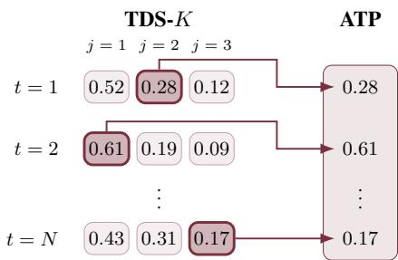

Importantly, the gray-box interface exposes more than these numerical sequences: every probability is accompanied by the identity of the token carrying it. We represent the complete observable generation trace as

Figure 3: TDS-K and ATP inputs.

$$
\mathcal { O } = \left( \left\{ ( c _ { t , j } , X _ { t , j } ^ { K } ) \right\} _ { j = 1 } ^ { K } , ( w _ { t } , a _ { t } ) \right) _ { t = 1 } ^ { N } .\tag{2}
$$

Motivation for using token identities. A main limitation in previous gray-box detectors, like (Bar-Shalom et al., 2026) and its predecessors, is that they do not process O directly. Instead, they operate on the projection $\pi ( \mathcal { O } ) = \mathbf { \bar { \Gamma } } ( \mathbf { X } ^ { K } , \mathbf { a } )$ , which retains the probability values while discarding the token identities and their assignment to those values. This projection is not injective. Two distinct traces may satisfy $\mathcal { O } \neq \mathcal { O } ^ { \prime } , \bar { \pi } ( \mathcal { O } ) = \pi ( \mathcal { O } ^ { \prime } )$ , in which case every probability-only detector h must satisfy $h ( \bar { \pi } ( \mathcal { O } ) ) \overset { \cdot } { = } h ( \pi ( \mathcal { O } ^ { \prime } ) )$ . The resulting ambiguity, illustrated in Figure 1, is a property of the representation rather than of any particular detector: no (deterministic) downstream architecture can recover distinctions that its input has removed.

GURI encodes token strings, fuses their codes with probabilities, and aggregates the resulting sequence to predict answer factuality (Figure 2).

## 3.2 TOKEN-IDENTITY CODES

To combine token identities with probabilities, we retokenize each token string using a shared external tokenizer and aggregate its subtoken codes into one vector. This ensures that the same string receives the same representation across generation steps, answers, and target models.

From candidate strings to codes via an external tokenizer. Alongside each exposed probability, we retain the string of the corresponding token. We denote the candidate strings by $s _ { t , j } = \mathrm { t e x t } ( c _ { t , j } )$ the $j$ ranked candidate token string. And the actual-token string by $s _ { t } ^ { \mathrm { w } } = \dot { \mathrm { t e x t } } \dot { ( } w _ { t } \dot { ) }$ . These strings can originate from models with different native vocabularies and tokenizers. GURI therefore maps every observed string through a shared external tokenizer.

Formally, let $\mathcal { T } : \Sigma ^ { * } \to V _ { \mathrm { e x t } } ^ { * }$ map an arbitrary string s to a sequence of external (sub)tokens $\mathcal { T } ( s ) =$ $\left( v _ { 1 } , \ldots , v _ { m } \right)$ . Given a fixed code table $C : V _ { \mathrm { e x t } } { \mathrm { \overline { { \Omega } } } } \to \mathbb { R } ^ { d }$ , our default random-code configuration represents the original string by mean-pooling its subtoken codes and $\ell _ { 2 } \cdot$ -normalizing the result:

$$
\bar { e } _ { C } ( s ) = \frac 1 m \sum _ { i = 1 } ^ { m } C ( v _ { i } ) , \qquad e _ { C } ( s ) = \frac { \bar { e } _ { C } ( s ) } { \| \bar { e } _ { C } ( s ) \| _ { 2 } } , \qquad m > 0 .\tag{3}
$$

This construction maps tokens from different target vocabularies into a common representation space without requiring any alignment between their native token IDs. The shared encoding $e _ { C }$ assigns the same representation to every occurrence of a given token string. Other realizations of $e _ { C }$ are possible, for instance, replacing the mean-pooling step with a small learned network over the subtoken codes. We used this construction for the default random codes. For pretrained embeddings, we used the unnormalized subtoken mean (Appendix A.6).

Instantiations of code tables. The construction in Equation 3 requires only a fixed vector for every external subtoken. Our primary GURI configuration uses a random table sampled once and then frozen. The resulting vectors provide identifiers but contain no pretrained geometric or semantic relationships between tokens. Pretrained embeddings provide another possible choice of code table, but do not outperform fixed random codes in our experiments (Section 4.4.1).

## 3.3 ARCHITECTURE

We now describe the architecture that processes the probabilities and the identity codes together. In short, GURI combines each probability with the identity code of the token carrying it, and aggregates the fused sequence across the generated answer using a transformer.

Creating ATP and TDS aligned identity tensors. The first step is to arrange the identity codes so that each one sits alongside the probability it belongs to. Applying $e _ { C }$ to every observed token string yields the candidate identity tensor and actual-token identity sequence

$$
{ \bf E } _ { t , j } ^ { K } = e _ { C } ( s _ { t , j } ) , \qquad { \bf E } _ { t } ^ { \mathrm { w } } = e _ { C } ( s _ { t } ^ { \mathrm { w } } ) ,\tag{4}
$$

where $\mathbf { E } ^ { K } \in \mathbb { R } ^ { N \times K \times d }$ is aligned entry by entry with the k-TDS $\mathbf { X } ^ { K }$ , and $\mathbf { E } ^ { \mathrm { w } } \in \mathbb { R } ^ { N \times d }$ is aligned with the ATP sequence a.

Fusing probability and identity information. In the next step, GURI combines each probability with the identity code of the token carrying it. Separate shared MLPs process the candidate and actual-token channels:

$$
\begin{array} { r } { \widetilde { X } _ { t , j } = f _ { \mathrm { c a n d } } \left( [ X _ { t , j } ^ { K } ; \mathbf { E } _ { t , j } ^ { K } ] \right) , \qquad \widetilde { a } _ { t } = f _ { \mathrm { a c t } } \left( [ a _ { t } ; \mathbf { E } _ { t } ^ { \mathrm { w } } ] \right) , } \end{array}\tag{5}
$$

where $[ \cdot ; \cdot ]$ denotes concatenation and $f _ { \mathrm { c a n d } } , f _ { \mathrm { a c t } } : \mathbb { R } ^ { d + 1 }  \mathbb { R }$ . The same candidate MLP is applied to every rank and generation step, and the same actual-token MLP is applied throughout the response. Scalar fusion preserves the probability-only input shapes. We also evaluate 256- dimensional token representations using an alternating Transformer (Section 4.4.2).

GURI’s backbone architecture. Our response-level encoder follows the architecture of LOS-Net (Bar-Shalom et al., 2026), which we briefly describe here for completeness. A Transformer $H _ { \theta }$ aggregates $\widetilde { \mathbf { X } }$ and ae across the $N$ generation steps to predict answer factuality:

$$
\widehat { \boldsymbol { y } } = H _ { \boldsymbol { \theta } } \left( \widetilde { \mathbf { X } } , \widetilde { \mathbf { a } } \right) .\tag{6}
$$

Here, $\widehat { y }$ is the predicted probability that the complete response is factual. The candidate-fusion MLP, actual-token-fusion MLP, and Transformer are optimized jointly under the answer-level training objective; only the external code table remains fixed.

Table 1: Hallucination-detection performance on the $3 \times 3$ evaluation suite. Values are test ROC-AUC (%). Learned detectors report the mean and standard deviation over all 36 hyperparameter– seed combinations. GURI uses a fixed random code table.
<table><tr><td>Dataset</td><td>Target model</td><td>Confidence</td><td>LOS-Net</td><td>GURI</td></tr><tr><td rowspan="3">HotpotQA</td><td>Ministral</td><td>64.98</td><td> $7 0 . 6 8 _ { \pm 0 . 9 7 }$ </td><td> ${ \bf 7 7 . 1 8 _ { \pm 1 . 3 7 } }$ </td></tr><tr><td>Gemma</td><td>61.13</td><td> $7 4 . 1 1 { \scriptstyle \pm 1 . 3 0 }$ </td><td> $\mathbf { 8 3 . 9 3 _ { \pm 0 . 6 6 } }$ </td></tr><tr><td>Llama</td><td>60.94</td><td> $8 0 . 4 8 { \scriptstyle \pm 1 . 0 1 }$ </td><td> $\mathbf { 8 6 . 3 6 _ { \pm 0 . 5 8 } }$ </td></tr><tr><td rowspan="3">NQ-WC</td><td>Ministral</td><td>59.28</td><td> $6 5 . 0 1 { \scriptstyle \pm 1 . 0 0 }$ </td><td> ${ \bf 7 3 . 3 2 _ { \pm 0 . 8 4 } }$ </td></tr><tr><td>Gemma</td><td>55.29</td><td> $6 5 . 8 8 { \scriptstyle \pm 1 . 1 9 }$ </td><td> $\mathbf { 7 8 . 1 8 _ { \pm 0 . 5 6 } }$ </td></tr><tr><td>Llama</td><td>53.27</td><td> $6 3 . 3 6 { \scriptstyle \pm 0 . 5 8 }$ </td><td> ${ \bf 7 3 . 0 6 _ { \pm 0 . 3 9 } }$ </td></tr><tr><td rowspan="3">TriviaQA</td><td>Ministral</td><td>64.40</td><td> $7 3 . 9 1 _ { \pm 0 . 7 9 }$ </td><td> ${ \bf 7 6 . 0 2 _ { \pm 0 . 7 2 } }$ </td></tr><tr><td>Gemma</td><td>67.29</td><td> $7 7 . 7 5 { \scriptstyle \pm 0 . 4 9 }$ </td><td> $\mathbf { 8 1 . 8 0 _ { \pm 0 . 6 6 } }$ </td></tr><tr><td>Llama</td><td>55.08</td><td> $7 7 . 6 3 { \scriptstyle \pm 0 . 8 1 }$ </td><td> $\mathbf { 8 1 . 9 9 _ { \pm 0 . 1 5 } }$ </td></tr></table>

## 4 EXPERIMENTS

## 4.1 EXPERIMENTAL SETUP

Models, tasks, and labels. We evaluate three open-weight target models: Gemma-4-12B-IT, Llama-3.2-3B-Instruct, and Ministral-3-8B-Instruct. Our evaluation uses three question-answering benchmarks—HotpotQA, TriviaQA, and Natural Questions with context (NQ-WC)—for a total of nine model–dataset combinations. HotpotQA and TriviaQA are evaluated in a closed-book setting without supporting passages, whereas NQ-WC supplies the model with the associated context.

Unless otherwise stated, all detectors use the top K = 10 candidates at each generation step.

Main GURI configuration. Unless otherwise stated, GURI uses the Phi-4-mini tokenizer as its shared external tokenizer and assigns a fixed random code to every subtoken in its vocabulary. Each candidate string is retokenized with this tokenizer, and the resulting subtoken codes are mean-pooled and ℓ2-normalized as in Equation 3. The same tokenizer and random code table are used for every target model, allowing tokens from different native vocabularies to be represented in a common space. The code table remains frozen throughout training; only the probability–identity fusion networks and the sequence encoder are optimized.

Baselines. We compare GURI with two probability-only baselines. Confidence represents classical confidence scoring: for each model–dataset combination, we select on the validation set the strongest of the mean, minimum, and maximum of the ATP probabilities and log-probabilities. LOS-Net is the strongest learned probability-only gray-box baseline. It processes the TDS-K and ATP sequences across the generated answer but receives no token identities.

Evaluation protocol. Our primary metric is test ROC-AUC, reported in percent. For the main comparison, we report the mean and standard deviation of test ROC-AUC across all 36 hyperparameter–seed combinations in the grid (Appendix A.5). Checkpoints are selected using ROC-AUC on the held-out validation set. Confidence baselines are deterministic once the validation-selected statistic has been chosen. Permutation experiments keep the trained detector fixed. Channel-removal experiments retrain it.

## 4.2 MAIN RESULTS

Open-weight models. Table 1 compares the default random-code GURI with the probability-only baselines. GURI improves over LOS-Net in all nine displayed model–dataset combinations, with an average gain of approximately 7.00 ROC-AUC points. The improvements range from 2.11 points on Ministral/TriviaQA to 12.30 points on Gemma/NQ-WC.

These results show that fixed token codes provide predictive information that is systematically absent from the numerical probability profile.

Closed-source model. We additionally evaluate GURI on GPT-4.1, for which neither hidden states nor the target embedding table are available. In the currently available experiments, GURI increases mean ROC-AUC from 67.39 to 71.84. The improvement is substantial on HotpotQA and NQ-WC, while performance on TriviaQA is approximately unchanged.

Table 2: Test ROC-AUC (%) on the closed-source GPT-4.1 model.
<table><tr><td>Dataset</td><td>LOS-Net</td><td>GURI</td><td>Difference</td></tr><tr><td>HotpotQA</td><td> $6 4 . 2 0 _ { \pm 0 . 4 3 }$ </td><td> ${ \bf 7 0 . 1 2 _ { \pm 0 . 3 6 } }$ </td><td>+5.92</td></tr><tr><td>TriviaQA</td><td> $\mathbf { 7 2 . 4 9 _ { \pm 0 . 3 9 } }$ </td><td> $7 1 . 7 8 _ { \pm 0 . 7 4 }$ </td><td>-0.71</td></tr><tr><td>NQ-WC</td><td> $6 5 . 4 9 _ { \pm 0 . 2 3 }$ </td><td> ${ \bf 7 3 . 6 3 _ { \pm 0 . 6 1 } }$ </td><td>+8.14</td></tr><tr><td>Mean</td><td>67.39</td><td>71.84</td><td>+4.45</td></tr></table>

## 4.3 TRANSFER ACROSS MODELS AND DATASETS

Cross-model transfer. We evaluated cross-model transfer within each dataset, applying a detector trained on one model’s responses to another model’s test responses without fine-tuning (zero-shot). GURI used the shared unit-norm random codes.

Figure 4 summarizes GURI’s cross-model transfer results. Complete numerical results for both GURI and LOS-Net are reported in Figure 8 in Appendix A.10, alongside the evaluation protocol.

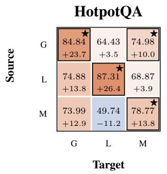

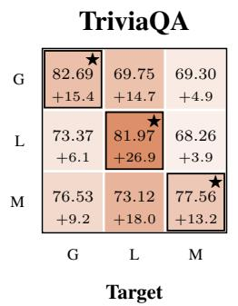

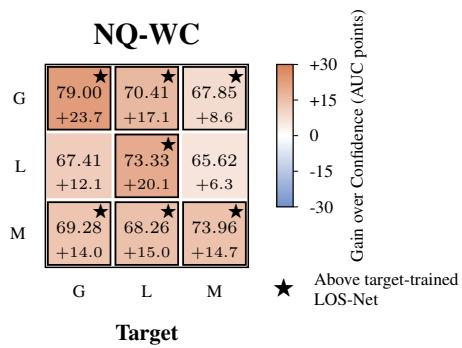  
Figure 4: Cross-model transfer of GURI with unit-norm random codes. Rows and columns denote source and target models: $\mathrm { G } , \mathrm { L } ,$ and M denote Gemma, Llama, and Ministral. Each row uses one source-validation-selected checkpoint. Bold values show test ROC-AUC (%). Colors and signed values show gains over target-model Confidence (AUC points). Stars and outlines mark scores above target-trained LOS-Net, not statistical significance.

Among the three open-weight models, GURI outperformed transferred LOS-Net in 17 of 18 directed cross-model transfers. Its mean advantage was 13.52 ROC-AUC points on NQ-WC, 11.93 on HotpotQA, and 11.27 on TriviaQA. It exceeded target-model Confidence in 17 of 18 transfers (LOS-Net: 7 of 18) and target-trained LOS-Net in five.

Cross-dataset and joint transfer. We also evaluated transfer between datasets, either keeping the target model fixed or changing both model and dataset. Between HotpotQA and TriviaQA, GURI improved over LOS-Net by 3.76 ROC-AUC points on average with the model fixed, and by 4.94 points when the model also changed. For transfers involving NQ-WC, GURI achieved mean ROC-AUCs of 52.94% and 50.99%, respectively, compared with 52.97% and 51.56% for LOS-Net. Joint model–dataset transfer did not exceed the target-model Confidence baseline on average in either dataset group. Since NQ-WC supplied context while HotpotQA and TriviaQA did not, these comparisons do not isolate dataset changes from changes in context availability. Table 5 summarizes these results. Appendix A.10 provides the full matrices and protocol.

## 4.4 ANALYSIS AND ABLATIONS

## 4.4.1 DOES THE SOURCE OF THE CODES MATTER?

We initially hypothesized that pretrained embeddings would improve detection by providing semantic relationships between tokens. We compare fixed random codes with pretrained Phi-4-mini embeddings using the same external tokenizer, mean-pooling, detector architecture, and training protocol. Random codes are unit-normalized; Phi embeddings are not (Appendix A.6). Section 4.4.2 additionally examines vector-valued representations using an alternating Transformer.

Table 3: Test ROC-AUC (%) for code-source and architecture variants. Random codes were unitnormalized; Phi-4-mini embeddings were not. Bold indicates the highest mean in each row, including ties at the reported precision.
<table><tr><td>Dataset</td><td></td><td></td><td></td><td></td><td>Target model GURI: Random GURI: Phi Alternating: Phi Alternating: Random</td></tr><tr><td rowspan="3">HotpotQA</td><td>Ministral</td><td> $\mathbf { 7 7 . 1 8 _ { \pm 1 . 3 7 } }$ </td><td> $7 6 . 8 2 { \scriptstyle \pm 0 . 7 8 }$ </td><td> $\mathbf { 7 7 . 1 8 _ { \pm 1 . 3 5 } }$ </td><td> $7 6 . 8 5 { \scriptstyle \pm 1 . 2 4 }$ </td></tr><tr><td>Gemma</td><td> $8 3 . 9 3 { \scriptstyle \pm 0 . 6 6 }$ </td><td> $8 1 . 7 0 { \scriptstyle \pm 0 . 6 0 }$ </td><td> $8 2 . 9 1 { \scriptstyle \pm 0 . 5 0 }$ </td><td> $\mathbf { 8 4 . 6 1 _ { \pm 0 . 1 4 } }$ </td></tr><tr><td>Llama</td><td> $8 6 . 3 6 { \scriptstyle \pm 0 . 5 8 }$ </td><td> $8 5 . 6 0 { \scriptstyle \pm 0 . 5 6 }$ </td><td> $8 6 . 1 9 { \scriptstyle \pm 0 . 1 8 }$ </td><td> $\mathbf { 8 7 . 5 5 } _ { \pm 0 . 1 0 }$ </td></tr><tr><td rowspan="3">NQ-WC</td><td>Ministral</td><td> $\mathbf { 7 3 . 3 2 _ { \pm 0 . 8 4 } }$ </td><td> $7 0 . 5 3 { \scriptstyle \pm 1 . 0 4 }$ </td><td> $7 1 . 1 4 { \scriptstyle \pm 0 . 4 0 }$ </td><td> $7 2 . 9 4 { \scriptstyle \pm 0 . 6 4 }$ </td></tr><tr><td>Gemma</td><td> $\mathbf { 7 8 . 1 8 _ { \pm 0 . 5 6 } }$ </td><td> $7 6 . 5 8 { \scriptstyle \pm 0 . 6 7 }$ </td><td> $7 6 . 7 2 { \scriptstyle \pm 0 . 8 4 }$ </td><td> $7 6 . 9 9 { \scriptstyle \pm 1 . 2 5 }$ </td></tr><tr><td>Llama</td><td> $7 3 . 0 6 { \scriptstyle \pm 0 . 3 9 }$ </td><td> $6 9 . 8 7 { \scriptstyle \pm 0 . 8 5 }$ </td><td> $6 9 . 6 2 { \scriptstyle \pm 0 . 5 1 }$ </td><td> $\mathbf { 7 3 . 4 3 _ { \pm 0 . 7 1 } }$ </td></tr><tr><td rowspan="3">TriviaQA</td><td>Ministral</td><td> $7 6 . 0 2 { \scriptstyle \pm 0 . 7 2 }$ </td><td> $7 5 . 8 4 { \scriptstyle \pm 1 . 0 0 }$ </td><td> ${ \bf 7 6 . 8 4 _ { \pm 0 . 8 4 } }$ </td><td> $7 5 . 1 3 { \scriptstyle \pm 1 . 0 6 }$ </td></tr><tr><td>Gemma</td><td> $8 1 . 8 0 { \scriptstyle \pm 0 . 6 6 }$ </td><td> $8 0 . 9 0 { \scriptstyle \pm 0 . 3 4 }$ </td><td> $8 1 . 0 1 _ { \pm 0 . 4 9 }$ </td><td> $\mathbf { 8 3 . 3 0 _ { \pm 0 . 1 2 } }$ </td></tr><tr><td>Llama</td><td> $8 1 . 9 9 _ { \pm 0 . 1 5 }$ </td><td> $8 1 . 1 0 { \scriptstyle \pm 0 . 4 4 }$ </td><td> $8 0 . 8 6 _ { \pm 0 . 3 3 }$ </td><td> $\mathbf { 8 2 . 0 4 _ { \pm 0 . 2 1 } }$ </td></tr></table>

With scalar fusion, random codes achieve higher mean ROC-AUC than pretrained Phi embeddings in all nine settings (Table 3). Pretrained embeddings are therefore not required for the gains observed with this architecture.

## 4.4.2 DOES EARLY SCALAR COMPRESSION LIMIT GAINS?

Inspired by ACT-ViT’s processing of structured activation tensors (Bar-Shalom et al., 2025), we evaluate an alternating Transformer with fixed random codes and Phi embeddings to examine whether early scalar compression limits their usefulness.

We view this variant as a natural extension of probability-only sequence models to vector-valued candidate representations, with attention alternating across generation positions and candidate slots. Architectural details are provided in Appendix A.8.

We compare each alternating variant with scalar-fusion GURI using the corresponding code source.

Retaining 256-dimensional token representations does not yield a consistent improvement over scalar fusion across code sources. Random codes also outperform Phi embeddings in seven of nine alternating settings, providing no evidence that scalar fusion masks a benefit of pretrained embeddings.

## 4.4.3 THE ROLE OF ACTUAL AND NON-ACTUAL TOKEN IDENTITIES

Actual-token identities describe the generated sequence; non-actual identities describe its alternatives. We retrain GURI with either channel alone or both. All probability inputs remain unchanged, and removed identity codes are set to zero. Evaluation-time permutation experiments are reported in Appendix A.9.

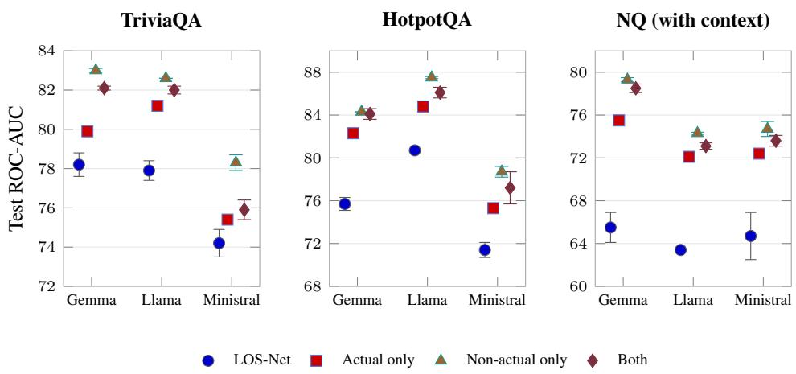  
Figure 5: Non-actual identities alone match or exceed the full model in all nine settings. Test ROC-AUC after retraining with unit-norm random codes and actual only, non-actual only, or both identity channels, retaining all probability inputs. Markers and error bars show the mean and standard deviation over three training seeds. LOS-Net was retrained with the same hyperparameters. Actual identities alone recover only part of the gain.

Figure 5 shows the outcome. In all nine model–dataset combinations the ordering is the same: nonactual only ≥ both > actual only > LOS-Net. A detector that never sees the identity of the actual token matches or slightly exceeds the full model, whereas a detector that sees only the actual token stays 0.5 to 3 points below it.

Repeating the experiment with pretrained Phi-4-mini embeddings (Fig. 7) changes the picture in one specific place: the non-actual only detector drops by 2 to 7 points in every cell, while the actual only detector moves by at most 3. With pretrained codes the two channels become complementary, and on NQ-WC the actual token alone is worth more than the non-actual candidates; the full model nevertheless stays below its random-code counterpart in every cell.

## 5 DISCUSSION AND LIMITATIONS

Our results support token identity as a useful predictive signal beyond next-token probabilities.

The random-code results also require careful interpretation. The main random construction retains the compositional structure induced by the external tokenizer: target tokens that share external subtokens also share code components. Accordingly, the experiments establish that pretrained semantic geometry is unnecessary for the main gains, not that every form of lexical or tokenization structure is irrelevant.

The channel analyses cover the nine model–dataset combinations of our suite under a single training configuration, and the ordering between the two identity channels depends on the code table: with random codes the non-actual candidates carry the larger value, with pretrained embeddings the two channels are complementary. The ordering should therefore not be read as a universal property of the channels. Evaluation-time permutations additionally create shifted inputs and measure reliance, whereas retraining measures what a channel can learn when available from the beginning; the two interventions answer different questions.

Finally, the evaluation relies on automatic string-match labels, which may reward a correct substring inside an otherwise incorrect response and penalize appropriate abstention. In the open-weight experiments, detector inputs and labeling included continuation after end tokens; the effect of stopping at the first end token remains unevaluated (Appendix A.2). The method also assumes access to can didate token strings and probabilities, which are not exposed by every commercial API. Future work should evaluate identity-aware detection under human factuality labels, additional generation protocols, and broader model and task families.

## 6 CONCLUSION

GURI augments probability-only gray-box detection with fixed token-identity codes while preserving its access and efficiency advantages. Across our evaluation suite, it consistently improves over LOS-Net. Fixed random codes perform comparably to pretrained embeddings, showing that the gains do not require pretrained semantic geometry. Channel ablations show that non-actual candidate identities alone preserve full performance with random codes. These results demonstrate the value of token identities for hallucination detection beyond probability statistics.

## ACKNOWLEDGMENTS

HM is supported by the Israel Science Foundation through a personal grant (ISF 264/23) and an equipment grant (ISF 532/23), and by the Career Advancement Chairs in Artificial Intelligence – Schmidt Futures.

G.B. is supported by the Jacobs Qualcomm PhD Fellowship.

F.F. conducted this work supported by an Aly Kaufman Post-Doctoral Fellowship.

## REFERENCES

Amos Azaria and Tom Mitchell. The internal state of an llm knows when it’s lying. In Findings of the Association for Computational Linguistics: EMNLP 2023, pp. 967–976, 2023.

Guy Bar-Shalom, Fabrizio Frasca, Yaniv Galron, Yftah Ziser, and Haggai Maron. Beyond token probes: Hallucination detection via activation tensors with act-vit. volume 38, pp. 85531–85561, 2025.

Guy Bar-Shalom, Fabrizio Frasca, Derek Lim, Yoav Gelberg, Yftah Ziser, Ran El-Yaniv, Gal Chechik, and Haggai Maron. Beyond next token probabilities: Learnable, fast detection of hallucinations and data contamination on llm output distributions. 40(36):30058–30066, 2026.

Yonatan Belinkov. Probing classifiers: Promises, shortcomings, and advances. Computational Linguistics, 48(1):207–219, 2022.

Chao Chen, Kai Liu, Ze Chen, Yi Gu, Yue Wu, Mingyuan Tao, Zhihang Fu, and Jieping Ye. Inside: Llms’ internal states retain the power of hallucination detection. In International Conference on Learning Representations, volume 2024, pp. 3056–3076, 2024.

Jinhao Duan, Hao Cheng, Shiqi Wang, Alex Zavalny, Chenan Wang, Renjing Xu, Bhavya Kailkhura, and Kaidi Xu. Shifting attention to relevance: Towards the predictive uncertainty quantification of free-form large language models. In Proceedings of the 62nd Annual Meeting of the Association for Computational Linguistics (Volume 1: Long Papers), pp. 5050–5063, 2024.

Ekaterina Fadeeva, Aleksandr Rubashevskii, Artem Shelmanov, Sergey Petrakov, Haonan Li, Hamdy Mubarak, Evgenii Tsymbalov, Gleb Kuzmin, Alexander Panchenko, Timothy Baldwin, et al. Fact-checking the output of large language models via token-level uncertainty quantification. In Findings of the Association for Computational Linguistics: ACL 2024, pp. 9367–9385, 2024.

Sebastian Farquhar, Jannik Kossen, Lorenz Kuhn, and Yarin Gal. Detecting hallucinations in large language models using semantic entropy. Nature, 630(8017):625–630, 2024.

Fabrizio Frasca, Guy Bar-Shalom, Yftah Ziser, and Haggai Maron. Neural message-passing on attention graphs for hallucination detection. In International Conference on Learning Representations, volume 2026, pp. 449–475, 2026.

Google. Gemini API Reference: Generating content, n.d. URL https://ai.google.dev/ api/generate-content. Accessed September 25, 2026.

Nuno M Guerreiro, Elena Voita, and André FT Martins. Looking for a needle in a haystack: A comprehensive study of hallucinations in neural machine translation. arXiv preprint arXiv:2208.05309, 2022.

Lei Huang, Weijiang Yu, Weitao Ma, Weihong Zhong, Zhangyin Feng, Haotian Wang, Qianglong Chen, Weihua Peng, Xiaocheng Feng, Bing Qin, et al. A survey on hallucination in large language models: Principles, taxonomy, challenges, and open questions. ACM transactions on information systems, 43(2):1–55, 2025.

Ziwei Ji, Nayeon Lee, Rita Frieske, Tiezheng Yu, Dan Su, Yan Xu, Etsuko Ishii, Ye Jin Bang, Andrea Madotto, and Pascale Fung. Survey of hallucination in natural language generation. ACM computing surveys, 55(12):1–38, 2023.

Saurav Kadavath, Tom Conerly, Amanda Askell, Tom Henighan, Dawn Drain, Ethan Perez, Nicholas Schiefer, Zac Hatfield-Dodds, Nova DasSarma, Eli Tran-Johnson, et al. Language mod els (mostly) know what they know. arXiv preprint arXiv:2207.05221, 2022.

Lorenz Kuhn, Yarin Gal, and Sebastian Farquhar. Semantic uncertainty: Linguistic invariances for uncertainty estimation in natural language generation. 2023.

Tianyu Liu, Yizhe Zhang, Chris Brockett, Yi Mao, Zhifang Sui, Weizhu Chen, and William B Dolan. A token-level reference-free hallucination detection benchmark for free-form text generation. In Proceedings ofthe 60th Annual Meeting ofthe Associationfor Computational Linguistics (Volume 1: Long Papers), pp. 6723–6737, 2022.

Andrey Malinin and Mark Gales. Uncertainty estimation in autoregressive structured prediction. 2020.

Potsawee Manakul, Adian Liusie, and Mark Gales. Selfcheckgpt: Zero-resource black-box hallucination detection for generative large language models. In Proceedings ofthe 2023 conference on empirical methods in natural language processing, pp. 9004–9017, 2023.

Joshua Maynez, Shashi Narayan, Bernd Bohnet, and Ryan McDonald. On faithfulness and factuality in abstractive summarization. In ACL, 2020.

OpenAI. OpenAI API Reference: Chat completions, n.d. URL https://developers. openai.com/api/reference/resources/chat. Accessed September 25, 2026.

Hadas Orgad, Michael Toker, Zorik Gekhman, Roi Reichart, Idan Szpektor, Hadas Kotek, and Yonatan Belinkov. Llms know more than they show: On the intrinsic representation of llm hallucinations. In International Conference on Learning Representations, volume 2025, pp. 66880– 66913, 2025.

Ernesto Quevedo, Jorge Yero Salazar, Rachel Koerner, Pablo Rivas, and Tomas Cerny. Detecting hallucinations in large language model generation: A token probability approach. pp. 154–173, 2024.

Vipula Rawte, Swagata Chakraborty, Agnibh Pathak, Anubhav Sarkar, SM Towhidul Islam Tonmoy, Aman Chadha, Amit P Sheth, and Amitava Das. The troubling emergence of hallucination in large language models-an extensive definition, quantification, and prescriptive remediations. In Proceedings of the 2023 conference on empirical methods in natural language processing, pp. 2541–2573, 2023.

Jie Ren, Jiaming Luo, Yao Zhao, Kundan Krishna, Mohammad Saleh, Balaji Lakshminarayanan, and Peter J Liu. Out-of-distribution detection and selective generation for conditional language models. 2022.

Ben Snyder, Marius Moisescu, and Muhammad Bilal Zafar. On early detection of hallucinations in factual question answering. In Proceedings of the 30th ACM SIGKDD Conference on Knowledge Discovery and Data Mining, pp. 2721–2732, 2024.

Simon Valentin, Jinmiao Fu, Gianluca Detommaso, Shaoyuan Xu, Giovanni Zappella, and Bryan Wang. Cost-effective hallucination detection for llms. arXiv preprint arXiv:2407.21424, 2024.

Neeraj Varshney, Wenlin Yao, Hongming Zhang, Jianshu Chen, and Dong Yu. A stitch in time saves nine: Detecting and mitigating hallucinations of llms by validating low-confidence generation. arXiv preprint arXiv:2307.03987, 2023.

## A ADDITIONAL EXPERIMENTAL DETAILS

## A.1 DATASETS AND SPLITS

For HotpotQA, we used the distractor configuration of hotpotqa/hotpot\_qa. We sampled 10,000 indices with replacement from each of its training and validation splits using seed 0; the latter served as our test set. For TriviaQA, we used unfiltered-web-train.json and unfiltered-web-dev.json, subsampling 10,000 examples from each with random state 42.

For NQ-WC, we used the question, answer, and context fields of the LLMsKnow CSV. Removing rows with missing fields left 20,770 examples, which were partitioned into 10,000 training and 10,770 test examples with random state 42. Generation attempted 10,000 examples per split. The resulting data contained 9,674 training-pool examples and 9,694 test examples. The 326 and 306 failed examples, respectively, were the examples with the longest contexts. Thus, the retained NQ-WC data excluded the longest-context cases.

Detector training and validation used a label-stratified split constructed with StratifiedKFold, five folds, shuffling, and random state 42. Only the first fold was used for validation; the remaining folds were used for training. This gave an 8,000/2,000 split for HotpotQA and TriviaQA. We did not perform five-fold cross-validation. Because correctness labels depended on the target model, the example-to-fold assignments could differ across models.

## A.2 PROMPTS AND GENERATION

The open-weight target models were mistralai/Ministral-3-8B-Instruct-2512, meta-llama/Llama-3.2-3B-Instruct, and google/gemma-4-12b-it. Each prompt consisted of one user message without a system message, formatted using the target model’s chat template with add\_generation\_prompt=True. HotpotQA and TriviaQA prompts contained only the question. NQ-WC prompts contained the context, a newline, and the question; the context was not truncated before generation.

Generation used greedy decoding with max\_new\_tokens=100 and eos\_token\_id=None, which disabled stopping on end tokens. The models could still emit end tokens, but decoding continued to the 100-token cap. All stored responses in the nine model–dataset combinations contained exactly 100 generated tokens. Detector inputs used the full recorded sequences, including any continuation after the first end token.

The generation pipeline retained full-vocabulary log-probabilities. Preprocessing retained the top K = 10 candidates at each position. For detector input, candidate and actual-token log-probabilities were standardized using the mean and standard deviation of the finite log-probabilities over the full vocabulary at that position. Consequently, these inputs were standardized log-probabilities, rather than probabilities. This preprocessing required full-vocabulary statistics in the open-weigh experiments.

## A.3 CORRECTNESS LABELS AND CLASS BALANCE

We followed the automatic answer-matching evaluation used in prior work (Bar-Shalom et al., 2026; 2025). A response received label 1 (factual) if its lowercased text contained a lowercased reference answer, and label 0 (hallucination) otherwise. For TriviaQA, any official answer alias was accepted. HotpotQA and NQ-WC used a single reference string. No punctuation removal, whitespace normalization, or stemming was applied. The detector output represented P(factual).

There was no separate refusal detector: a refusal received label 0 when it contained no reference match. Matching was performed over the complete generated response. In the open-weight experiments, this included the decoded text of all 100 generated tokens, including any continuation after the first end token. A reference match occurring only in this continuation was sufficient for a factual label. Short reference strings could also match within unrelated words. For context-based questions, repeating an answer string from the supplied passage could also receive credit without establishing that the response answered the question correctly. These labels therefore did not verify every claim in a response.

Table 4: Responses labeled factual (%) in each dataset. Train pool denotes the data before the training/validation split.
<table><tr><td rowspan="2">Model</td><td colspan="2">HotpotQA</td><td colspan="2">TriviaQA</td><td colspan="2">NQ-WC</td></tr><tr><td>Train pool</td><td>Test</td><td>Train pool</td><td>Test</td><td>Train pool</td><td>Test</td></tr><tr><td>Ministral</td><td>33.60</td><td>29.98</td><td>60.99</td><td>60.87</td><td>54.77</td><td>54.62</td></tr><tr><td>Llama</td><td>28.45</td><td>24.97</td><td>58.32</td><td>60.23</td><td>60.74</td><td>60.52</td></tr><tr><td>Gemma</td><td>30.27</td><td>26.56</td><td>58.69</td><td>58.70</td><td>62.65</td><td>62.82</td></tr></table>

The factual-label percentages in the stored data are shown below. “Train pool” denotes the data before the detector training/validation split.

## A.4 DETECTOR ARCHITECTURE AND TRAINING

GURI used two independent fusion MLPs, one shared across candidate slots and one for the actualtoken branch. Each concatenated a 3,072-dimensional identity code with one standardized logprobability feature and applied

$$
\operatorname { L i n e a r } ( 3 0 7 3 , 3 8 4 ) \to \operatorname { R e L U } \to \operatorname { D r o p o u t } ( 0 . 1 ) \to \operatorname { L i n e a r } ( 3 8 4 , 1 ) .
$$

The identity-code tables remained fixed.

The response encoder used a hidden dimension of 256. The ten candidate features were projected to 128 dimensions; the actual-token feature and its rank supplied the other 128 dimensions through learned scaling vectors. Rank encoding used $1 - 2 r / V$ , where r was the zero-based actual-token rank and V the target vocabulary size. The encoder used a learned classification token, learned positional embeddings, eight attention heads, a feedforward dimension of 256, and dropout 0.1. Classification used the classification-token representation followed by a linear layer and sigmoid.

Training used AdamW, binary cross-entropy, batch size 48, and at most 100 epochs. The learningrate schedule was linear with 10% warm-up, with its length set from the planned 100 epochs. Early stopping monitored validation ROC-AUC with patience 20.

## A.5 HYPERPARAMETER SEARCH

The configured grid crossed training seeds {0, 1, 2}, encoder depths {2, 3, 4}, learning rates $\{ 1 0 ^ { - 4 } , 5 \times 1 0 ^ { - 5 } \}$ , and weight decays $\{ 1 0 ^ { - 3 } , \overset { \cdot } { 3 } \times 1 \overset { \cdot } { 0 } ^ { - 3 } \}$ , giving 36 combinations. The hidden dimension, attention heads, dropout, batch size, and stopping rule were held fixed as specified in Appendix A.4. Within each run, checkpoint selection used validation ROC-AUC. For the main comparison, we evaluated test ROC-AUC at each run’s selected checkpoint and reported the mean and standard deviation across all 36 runs. These statistics therefore reflected variation across both hyperparameter configurations and training seeds.

The channel-retraining experiments used a fixed configuration instead of this grid, as described in Appendix A.9.

## A.6 IDENTITY-CODE TABLES

Both code sources used the tokenizer of microsoft/Phi-4-mini-instruct. Each target token was decoded to a string using its source tokenizer and retokenized with the external tokenizer.

For random codes, we sampled a 3,072-dimensional standard Gaussian vector for every external subtoken and normalized each vector to unit $\ell _ { 2 }$ norm. We mean-pooled the vectors of a string’s subtokens and normalized the pooled vector again. The generator seed was derived from the constant PHI\_SCAFFOLD\_V1 using BLAKE2b with an eight-byte digest. The resulting table was shared across target models. Only one random codebook was used; sensitivity to different codebook draws was not evaluated. Tokens that could not be decoded or retokenized received the zero vector.

For pretrained codes, we mean-pooled the corresponding 3,072-dimensional Phi-4-mini input embeddings in float32. These pooled vectors were not ℓ -normalized. The comparison therefore differed in both code source and normalization and did not isolate pretrained semantics.

## A.7 GPT-4.1 GENERATION SETUP

We queried the Chat Completions API with model gpt-4.1, temperature=0, max\_tokens=50, logprobs=True, and top\_logprobs=10. Each request contained one user message and no system message. Unlike the open-weight pipeline, the API supplied only the returned candidate log-probabilities rather than a full-vocabulary distribution. Missing candidate slots were padded with log-probability −109. The generation cap was 50 tokens, compared with 100 tokens in the open-weight experiments.

## A.8 ALTERNATING TRANSFORMER ARCHITECTURE

At each of N generation positions, the model represented the K = 10 candidates and a separate actual-token slot. For each slot, an MLP projected a fixed 3,072-dimensional code (unit-norm random or unnormalized Phi-4-mini) to 254 dimensions, using a hidden dimension of 384, ReLU, and dropout 0.1. Two features were then concatenated: the standardized log-probability and the probability. A learned indicator marked the actual-token slot. Layer normalization produced an $\mathbf { \bar { \boldsymbol { N } } } \times ( \mathbf { \boldsymbol { K } } + 1 ) \times 2 5 6$ representation.

Each alternating layer first applied attention across generation positions for each slot, using positional embeddings, and then across slots at each position. There were no candidate-position embed dings. After these layers, masked mean pooling over generation positions produced K + 1 vectors. A further Transformer processed these vectors, followed by mean pooling over slots and an MLP with sigmoid output. The input codes remained fixed; the other components were trained jointly.

The model used eight attention heads and dropout 0.1. The optimizer, batch size, schedule, epoch limit, and early-stopping rule followed Appendix A.4. The search crossed the same depths, learning rates, weight decays, and training seeds listed in Appendix A.5.

## A.9 CHANNEL EXPERIMENTS

Retraining. Each condition used three Transformer layers, hidden dimension 256, eight attention heads, dropout 0.1, classification-token pooling, and scale rank encoding. Training used K = 10, batch size 48, AdamW with learning rate $1 0 ^ { - \overline { { 4 } } }$ and weight decay 10−3, binary cross-entropy, and a linear schedule with 10% warm-up. Runs lasted at most 100 epochs, with early stopping on validation ROC-AUC and patience 20. The train/validation split was the same as in the corresponding main experiment.

We trained each condition with seeds 0, 1, and 2 and reported the mean and standard deviation of test ROC-AUC at each run’s best-validation checkpoint. Evaluation used the full retained test set: 10,000 examples for HotpotQA and TriviaQA and 9,694 for NQ-WC. The probability-only baseline was retrained with the same configuration and seeds.

The full condition retained both identity channels. The actual-only condition replaced all non-actual candidate codes with zeros at data-loading time. The non-actual-only condition replaced the actual token code with zeros in both its separate branch and every candidate slot with the same token ID. Token-ID matching identified these slots; the procedure did not assume a fixed rank. Probability features were unchanged. The random and pretrained code constructions followed Appendix A.6.

Evaluation-time permutation. For each model–dataset combination and code source, we selected the full-condition checkpoint with the highest validation ROC-AUC among the three training seeds and froze its parameters. We replaced the token-ID-to-code mapping with a derangement over the token IDs observed in the test split, so that no included ID retained its original assignment.

We applied this mapping to actual-token entries, non-actual candidate entries, or all entries. Actualtoken interventions included both the separate actual-token branch and matching candidate slots. All probability features remained unchanged. We evaluated the full test set with permutation seeds 0, 1, and 2 and reported the mean and standard deviation of the ROC-AUC decrease relative to the unpermuted evaluation of the same checkpoint. The Phi variant used the same procedure with pretrained codes computed on demand.

These interventions measured the fitted detector’s response to altered code assignments. They did not measure performance after retraining without the corresponding channel.

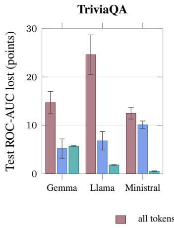

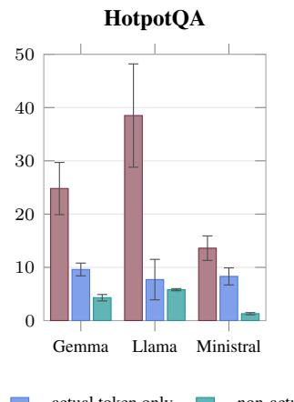  
NQ (with context)

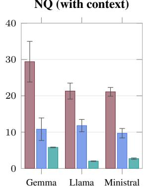

Figure 6: The fitted detector relies on both identity channels. Test ROC-AUC lost when, with the trained GURI frozen, the token-to-code correspondence is permuted at evaluation time (a derangement of all token identities) in every slot, in the actual-token channel only (its ATP entry and its candidate slot at every step), or in the non-actual candidates’ slots only. Unit-norm random codes, three LLMs, three datasets, bars are the mean over 3 permutation seeds and error bars one standard deviation. Both channels cost AUC in every cell, and the joint loss exceeds the sum of the two everywhere, by a wide margin in most cells: neither channel is read in isolation. The fitted detector leans more on the actual token (the larger loss in eight of nine cells), yet a permutation loss measures what this detector depends on, not what a channel is worth: retrained without one channel (Fig. 5), the non-actual candidates alone match the full model while the actual token alone does not.

Figure 6 shows that performance decreases when either channel is perturbed: the fitted detector relies on both actual-token and non-actual candidate identities. The substantially larger losses under joint permutation are non-additive and do not by themselves establish an interaction between the two channels. Moreover, this experiment measures reliance by a fixed detector; it does not determine how well a model can perform when trained without one of the channels.

## A.10 TRANSFER EVALUATION DETAILS

We evaluated LOS-Net and GURI with unit-norm random codes across three models (Gemma, Llama, and Ministral) and three datasets (NQ-WC, HotpotQA, and TriviaQA).

For each method and source model–dataset pair, we selected the checkpoint with the highest validation ROC-AUC among its 36 training runs. We evaluated that checkpoint on all nine target pairs without fine-tuning or target-validation selection. Input features, labels, and identity codes came from the target data. GURI used the shared random code table described in Appendix A.6. Evaluation used 10,000 test examples for HotpotQA and TriviaQA and 9,694 for NQ-WC.

Each method had 81 evaluations: nine without a shift, 18 changing only the model, 18 changing only the dataset, and 36 changing both. Each score came from one selected checkpoint, so diagonal values need not equal the averages in Table 1.

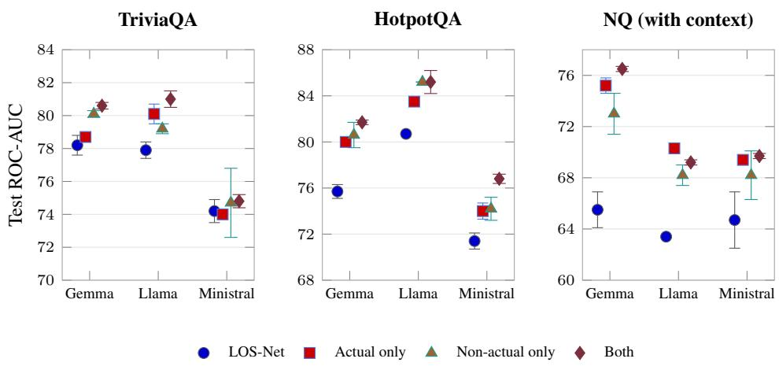  
Figure 7: The same retraining with pretrained Phi-4-mini embeddings in place of random codes. Layout and hyper-parameters as in Fig. 5; each token’s vector is the mean of the Phi-4-mini input embeddings of its sub-tokens. The non-actual-only detector is lower than with random codes in every cell (by 2 to 7 AUC points), so the full model now needs the actual-token channel to reach its best value, and on NQ the actual token alone is worth more than the non-actual candidates. The full model itself is below its random-code counterpart in all nine cells. Mean over 3 training seeds, error bars one standard deviation.

Table 5: Mean test ROC-AUC (%) under dataset shifts. H, T, and N denote HotpotQA, TriviaQA, and NQ-WC. “Same” and “Different” indicate whether the source and target models coincide; n is the number of directed transfers. Confidence uses the target-specific baseline scores, averaged over the same target cells. Means summarize transfer settings, not repeated training runs.
<table><tr><td>Dataset transfer</td><td>Model</td><td>n</td><td>Confidence</td><td>LOS-Net</td><td>GURI</td></tr><tr><td> $H  T$ </td><td>Same</td><td>6</td><td>62.30</td><td>69.55</td><td>73.31</td></tr><tr><td> $H  T$ </td><td>Different</td><td>12</td><td>62.30</td><td>57.18</td><td>62.11</td></tr><tr><td> $N  \{ H , T \}$ </td><td>Same</td><td>12</td><td>59.13</td><td>52.97</td><td>52.94</td></tr><tr><td> $N  \{ H , T \}$ </td><td>Different</td><td>24</td><td>59.13</td><td>51.56</td><td>50.99</td></tr></table>

Table 5 reports unweighted means over the dataset-shift conditions. HotpotQA and TriviaQA supplied only the question, whereas NQ-WC also supplied context. Thus, transfers involving NQ-WC changed both the dataset and context availability. Figure 8 reports all individual scores.

For the HotpotQA transfer from Ministral to Llama, GURI achieved 49.74 ROC-AUC, compared with 68.87 in the reverse direction. A check confirmed that the low-scoring evaluation loaded the 3,072-dimensional target identity codes. This ruled out missing identity codes as the explanation, but did not explain the result.

## A.11 COMPUTE

Experiments were run on an NVIDIA DGX system equipped with eight A100-SXM4 GPUs with 40 GB memory each, 256 CPU cores, and 1,007 GB system memory. The system used NVIDIA driver 555.42.06 and CUDA 12.5.

LOS-Net
<table><tr><td rowspan=1 colspan=9>61.13   60.94   64.98   67.29   55.08   64.40   55.29   53.27   59.28</td></tr><tr><td rowspan=2 colspan=1>77.93+16.8</td><td rowspan=2 colspan=1>54.09-6.9</td><td rowspan=2 colspan=1>55.99-9.0</td><td rowspan=1 colspan=1>74.94</td><td rowspan=1 colspan=1>67.55</td><td rowspan=1 colspan=1>59.63</td><td rowspan=1 colspan=1>50.41</td><td rowspan=1 colspan=1>51.07</td><td rowspan=2 colspan=1>52.82-6.5</td></tr><tr><td rowspan=1 colspan=1>+7.7</td><td rowspan=1 colspan=1>+12.5</td><td rowspan=1 colspan=1>-4.8</td><td rowspan=1 colspan=1>-4.9</td><td rowspan=1 colspan=1>-2.2</td></tr><tr><td rowspan=1 colspan=1>43.64–17.5</td><td rowspan=1 colspan=1>82.05+21.1</td><td rowspan=1 colspan=1>59.74-5.2</td><td rowspan=1 colspan=1>39.23–28.1</td><td rowspan=1 colspan=1>70.29+15.2</td><td rowspan=1 colspan=1>52.28–12.1</td><td rowspan=1 colspan=1>47.44-7.8</td><td rowspan=1 colspan=1>56.64+3.4</td><td rowspan=1 colspan=1>52.97-6.3</td></tr><tr><td rowspan=1 colspan=1>62.29+1.2</td><td rowspan=1 colspan=1>59.55-1.4</td><td rowspan=1 colspan=1>70.30+5.3</td><td rowspan=1 colspan=1>67.98+0.7</td><td rowspan=1 colspan=1>64.24+9.2</td><td rowspan=1 colspan=1>70.16+5.8</td><td rowspan=1 colspan=1>49.67-5.6</td><td rowspan=1 colspan=1>45.77-7.5</td><td rowspan=1 colspan=1>48.79–10.5</td></tr><tr><td rowspan=1 colspan=1>68.31+7.2</td><td rowspan=1 colspan=1>48.78–12.2</td><td rowspan=1 colspan=1>55.94-9.0</td><td rowspan=1 colspan=1>78.74+11.5</td><td rowspan=1 colspan=1>57.29+2.2</td><td rowspan=1 colspan=1>59.25-5.2</td><td rowspan=1 colspan=1>50.27-5.0</td><td rowspan=1 colspan=1>49.44-3.8</td><td rowspan=1 colspan=1>56.95-2.3</td></tr><tr><td rowspan=1 colspan=1>59.35-1.8</td><td rowspan=1 colspan=1>67.87+6.9</td><td rowspan=1 colspan=1>56.30-8.7</td><td rowspan=1 colspan=1>60.90-6.4</td><td rowspan=1 colspan=1>79.17+24.1</td><td rowspan=1 colspan=1>57.88-6.5</td><td rowspan=1 colspan=1>50.27-5.0</td><td rowspan=1 colspan=1>60.15+6.9</td><td rowspan=1 colspan=1>48.40-10.9</td></tr><tr><td rowspan=1 colspan=1>62.91+1.8</td><td rowspan=1 colspan=1>51.91-9.0</td><td rowspan=1 colspan=1>65.73+0.8</td><td rowspan=1 colspan=1>68.96+1.7</td><td rowspan=1 colspan=1>58.42+3.3</td><td rowspan=1 colspan=1>74.29+9.9</td><td rowspan=1 colspan=1>49.83-5.5</td><td rowspan=1 colspan=1>47.16-6.1</td><td rowspan=1 colspan=1>52.02-7.3</td></tr><tr><td rowspan=1 colspan=1>49.07–12.1</td><td rowspan=1 colspan=1>57.35-3.6</td><td rowspan=1 colspan=1>53.12–11.9</td><td rowspan=1 colspan=1>41.82–25.5</td><td rowspan=1 colspan=1>54.04-1.0</td><td rowspan=1 colspan=1>50.00–14.4</td><td rowspan=1 colspan=1>68.27+13.0</td><td rowspan=1 colspan=1>53.60+0.3</td><td rowspan=1 colspan=1>51.73-7.6</td></tr><tr><td rowspan=1 colspan=1>55.62-5.5</td><td rowspan=1 colspan=1>58.29-2.7</td><td rowspan=1 colspan=1>53.14-11.8</td><td rowspan=1 colspan=1>54.11-13.2</td><td rowspan=1 colspan=1>62.15+7.1</td><td rowspan=1 colspan=1>48.49–15.9</td><td rowspan=1 colspan=1>57.76+2.5</td><td rowspan=1 colspan=1>63.98+10.7</td><td rowspan=1 colspan=1>53.02-6.3</td></tr><tr><td rowspan=1 colspan=1>61.62+0.5</td><td rowspan=1 colspan=1>36.87–24.1</td><td rowspan=1 colspan=1>54.17-10.8</td><td rowspan=1 colspan=1>62.15-5.1</td><td rowspan=1 colspan=1>49.15-5.9</td><td rowspan=1 colspan=1>51.85–12.5</td><td rowspan=1 colspan=1>53.28-2.0</td><td rowspan=1 colspan=1>58.32+5.1</td><td rowspan=1 colspan=1>66.98+7.7</td></tr></table>

GURI: unit-norm random codes
<table><tr><td rowspan="2">Target</td><td colspan="6">closed-book</td><td colspan="3">open-book</td></tr><tr><td>G/H 61.13</td><td>L/H 60.94</td><td>M/H 64.98</td><td>G/T 67.29</td><td>L/T 55.08</td><td>M/T 64.40</td><td>G/N 55.29</td><td>L/N 53.27</td><td>M/N 59.28</td></tr><tr><td>Confidence G/H</td><td>84.84* +23.7</td><td>64.43 +3.5</td><td>74.98* +10.0</td><td>77.51 +10.2</td><td>61.42 +6.3</td><td>67.98 +3.6</td><td>54.13 -1.2</td><td>52.27 -1.0</td><td>48.80 –10.5</td></tr><tr><td>L/H</td><td>74.88 +13.8</td><td>87.31*</td><td>68.87</td><td>68.01</td><td>76.67</td><td>58.18 -6.2</td><td>55.31</td><td>54.91 +1.6</td><td>52.00</td></tr><tr><td>M/H</td><td>73.99</td><td>+26.4 49.74</td><td>+3.9 78.77*</td><td>+0.7 73.30</td><td>+21.6 43.22</td><td>70.28</td><td>+0.0 59.36</td><td>55.18</td><td>-7.3 49.99</td></tr><tr><td>G/T</td><td>+12.9 72.44 +11.3</td><td>–11.2 54.25 -6.7</td><td>+13.8 62.87</td><td>+6.0 82.69 K</td><td>–11.9 69.75 +14.7</td><td>+5.9 69.30</td><td>+4.1 53.48</td><td>+1.9 51.13</td><td>-9.3 44.99</td></tr><tr><td>Souuce L/T</td><td>65.12 +4.0</td><td>76.55 +15.6</td><td>-2.1 61.93</td><td>+15.4 73.37</td><td>81.97*</td><td>+4.9 68.26</td><td>-1.8 58.42</td><td>-2.1 58.07</td><td>–14.3 47.44</td></tr><tr><td>M/T</td><td>66.11 +5.0</td><td>62.94</td><td>-3.1 66.41</td><td>+6.1 76.53</td><td>+26.9 73.12</td><td>+3.9 77.56*</td><td>+3.1 53.76</td><td>+4.8 51.98</td><td>–11.8 51.04</td></tr><tr><td>G/N</td><td>58.72</td><td>+2.0 42.09</td><td>+1.4 47.48</td><td>+9.2 54.41</td><td>+18.0 54.50</td><td>+13.2 45.79</td><td>-1.5 79.00</td><td>-1.3 70.41</td><td>-8.2 67.85*</td></tr><tr><td>L/N</td><td>-2.4 56.70</td><td>–18.9 45.63</td><td>–17.5 46.87</td><td>–12.9 55.64</td><td>-0.6 55.80</td><td>–18.6 48.05</td><td>+23.7 67.41</td><td>+17.1 73.33*</td><td>+8.6 65.62</td></tr><tr><td>M/N</td><td>-4.4 51.38 -9.8</td><td>–15.3 40.87 –20.1</td><td>–18.1 47.72 –17.3</td><td>–11.7 52.92 –14.4</td><td>+0.7 50.79 -4.3</td><td>-16.3 51.37 -13.0</td><td>+12.1 69.28* +14.0</td><td>+20.1 68.26* +15.0</td><td>+6.3 73.96* +14.7</td></tr></table>

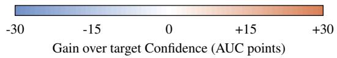  
Figure 8: Complete transfer results. Rows and columns denote source and target model–dataset pairs: G, L, M denote Gemma, Llama, Ministral. H and T are closed-book; N denotes open-book NQ-WC. Bold values show test ROC-AUC (%); signed values and colors show differences from target Confidence, listed above the columns. Stars and outlines mark GURI scores above targettrained LOS-Net, not statistical significance. Diagonal dataset blocks correspond to the withindataset cross-model panels in Figure 4. Each row uses one source-validation-selected checkpoint without target fine-tuning.