# GraphRAG-LTM: A Layered Threat Modeling Framework for Attacks on Graph Retrieval-Augmented Generation

Yining Tang1 Junyu Zhang1 Haomiao Qiu2,3 Yongchao Liu4 Jiajun Zheng4 Zhao Wang1 Ziyue Qiao3,† Chao Wu1,†

1Zhejiang University 2Harbin Institute of Technology, Shenzhen

3Great Bay University 4Ant Group

†Corresponding authors: zyqiao@gbu.edu.cn, chao.wu@zju.edu.cn

## Abstract

Graph retrieval-augmented generation (GraphRAG) uses document-derived knowl edge graphs to assemble evidence for large language model (LLM) answers. Its security depends on both the seed chunks retrieved for a query and the graph evidence assembled from them, yet attacks on this evidence path remain underexplored. We introduce GraphRAG-LTM, a Layered Threat Modeling framework that tests three nested levels of attacker access. BB Query uses ranking feedback to make query edits under a semantic-similarity constraint and demote relevant seed chunks. WB Query uses retriever gradients for the same objective. Graph-aware WB keeps the white-box adversarial query and deletes bridge triplets from the query-specific evidence graph, disrupting multi-hop evidence propagation through localized graph edits. Across datasets, retrievers, and LLM backbones, rank feedback alone reduces answer quality, gradient access strengthens query attacks, and bridge-triplet deletion further impairs supporting-fact retrieval. Further analyses show how seed retrieval and graph evidence jointly contribute to these failures.

## 1 Introduction

Retrieval-augmented generation (RAG) grounds large language model (LLM) answers in external evidence (Lewis et al., 2020; Gao et al., 2024; Fan et al., 2024). Recent GraphRAG methods further use document-derived knowledge graphs to organize inter-chunk dependencies and support multihop context construction (Wang et al., 2024; Edge et al., 2024; Zhu et al., 2025). In these pipelines, retrieved seed chunks determine which pre-extracted triplets enter a query-specific evidence graph and, ultimately, which evidence reaches the generator.

Existing attacks have studied corpus poisoning, malicious document injection, and indirect prompt injection (Zhong et al., 2023; Cao et al., 2024; Gre-

Flat RAG-BGE

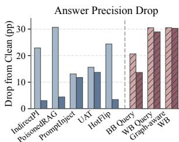  
GraphRAG-BGE

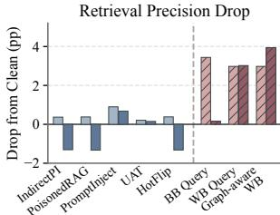

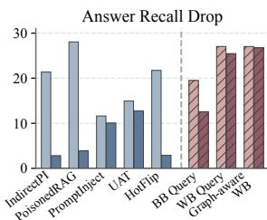

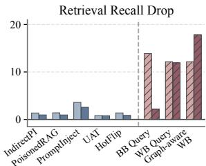  
Figure 1: Answer and supporting-fact retrieval precision and recall drops (percentage points from Clean) on HotpotQA-Distractor with BGE and LLaMA3-8B. Blue bars show prior baselines; red hatched bars show our BB Query, WB Query, and Graph-aware WB attacks. Lighter and darker shades denote Flat RAG and GraphRAG, respectively. Several baselines cause substantially larger drops in answer precision and recall on Flat RAG than on GraphRAG, whereas our attacks remain effective on GraphRAG.

shake et al., 2023), mostly in Flat RAG with unstructured retrieval. In GraphRAG, a shifted seed ranking can also alter graph expansion and the final context, allowing retrieval errors to propagate through evidence selection. Figure 1 reports our experiments applying prior attacks and our proposed perturbations to Flat RAG and GraphRAG on the same questions. Several prior attacks produce large drops in answer precision and recall in Flat RAG but substantially smaller drops in GraphRAG, whereas perturbations to seed retrieval and graph evidence continue to degrade GraphRAG.

These observations raise the question of how adversarial perturbations at different stages of GraphRAG’s evidence pipeline affect the evidence it retrieves and the answers it generates. Figure 2 frames this question through three nested attacker access levels, labeled BB Query, WB Query, and Graph-aware WB. At the first level, the attacker observes rank feedback; at the second, the attacker additionally accesses retriever gradients; at the third, the attacker can further inspect and edit KG triplets.

<table><tr><td colspan="3">Increasing Attacker Access</td></tr><tr><td></td><td>WB Query ∇θ</td><td>Graph-aware WB Query-WBKG Attack</td></tr><tr><td>n Query-BB 3</td><td>Query-WB ２3</td><td>-X-- Chunk A Chunk B</td></tr><tr><td colspan="3">Access BB Query WB Query</td></tr><tr><td>Rank feedback</td><td>√</td><td>Graph-aware WB</td></tr><tr><td>Retriever gradient</td><td>x</td><td>√ √</td></tr><tr><td>KG triplets</td><td>√ x</td><td>√</td></tr></table>

Figure 2: Three nested attacker access levels in GraphRAG-LTM, from rank feedback to query-specific graph editing. The diagram shows attack components; the table lists each tier’s permissions.

We introduce GraphRAG-LTM to instantiate these access levels with corresponding attacks. At the first two levels, a ranking-guided query attack uses semantically constrained substitutions to demote originally retrieved seed chunks, relying on rank feedback or retriever gradients according to the available access. At the third level, the attack reuses the white-box adversarial query and deletes bridge triplets in the query-specific evidence graph. This matched design measures the added effect of graph edits beyond query perturbation. Our evaluation across multiple datasets, retrievers, LLM backbones, and graph-retrieval mechanisms reveals a layered failure pattern: rank feedback alone can degrade answer generation, retriever gradients strengthen query attacks, and bridge-triplet deletion further impairs supporting-fact retrieval. Our contributions are summarized as follows:

❶ Layered Threat Modeling for GraphRAG. The contrasting effects of several existing attacks in Flat RAG and GraphRAG motivate a threat model centered on GraphRAG’s evidence pipeline. We formulate three nested access levels and evaluate a corresponding attack at each level to distinguish what rank feedback, retriever gradients, and graph-triplet access each enable.

❷ Ranking-guided Query Attack on Graphconstruction Anchors. Seed chunks anchor the query-specific evidence graph and downstream context selection. We develop a ranking-guided query attack that demotes them through semantically constrained edits. It uses ranking feedback in the black-box setting and retriever gradients in the white-box setting.

❸ Graph-aware Extension via Bridge Triplets. To examine what graph access adds to the query attack, we delete bridge triplets while keeping the white-box adversarial query fixed across the paired conditions. This comparison isolates the additional effect of graph edits on evidence retrieval, which we further examine under two alternative graph-retrieval mechanisms that differ in how they select and organize evidence.

## 2 Related Work

LLM safety. Hallucination and factuality remain central LLM reliability concerns (Huang et al., 2025; Yehuda et al., 2024; Kryscinski et al., 2020), motivating the use of retrieved evidence to ground generation. Other work studies misuse and failures across the model lifecycle (Wang et al., 2025; McGuffie and Newhouse, 2020; Ma et al., 2023). Guardrails, rule-guided feedback, and selfcorrection address model behavior (Rebedea et al., 2023; Mu et al., 2024; Gou et al., 2023); retrievalbased systems also depend on the reliability of external evidence supplied at inference time.

Retrieval-augmented generation. RAG augments LLMs with retrieved documents to ground answers and access external knowledge across a broad range of tasks (Lewis et al., 2020; Guu et al., 2020; Izacard et al., 2023). Noisy or misranked passages can displace relevant evidence and harm generation (Karpukhin et al., 2020; Izacard et al., 2021; Cuconasu et al., 2024). Query refinement, rankingfeedback rewriting, and active retrieval aim to improve evidence selection (Chan et al., 2024; Mao et al., 2024; Jiang et al., 2023). GraphRAG systems organize text and graph evidence for multi-hop reasoning or query-focused summarization (Edge et al., 2024; Jin et al., 2024; Mavromatis and Karypis, 2024; Zhu et al., 2025), using different mechanisms to select and compose evidence.

Adversarial attacks on LLMs and RAG. Prompt injection places adversarial instructions in text read by the generator (Liu et al., 2023; Greshake et al., 2023). Corpus poisoning inserts malicious passages, while prompt perturbations and coordinated prompt–corpus attacks provide other ways to steer generated answers (Zou et al., 2024; Hu et al., 2024; Jiao et al., 2025). At the text level, synonym substitutions use semantic-similarity constraints (Ren et al., 2019; Jin et al., 2020), while HotFlip uses gradients to identify discrete edits (Ebrahimi et al., 2018). Query-level RAG studies also show that small query variations can affect retrieval and downstream QA (Perçin et al., 2025). We examine how constrained query edits shift seed rankings and how graph-triplet edits further change evidence retrieval under stronger attacker access.

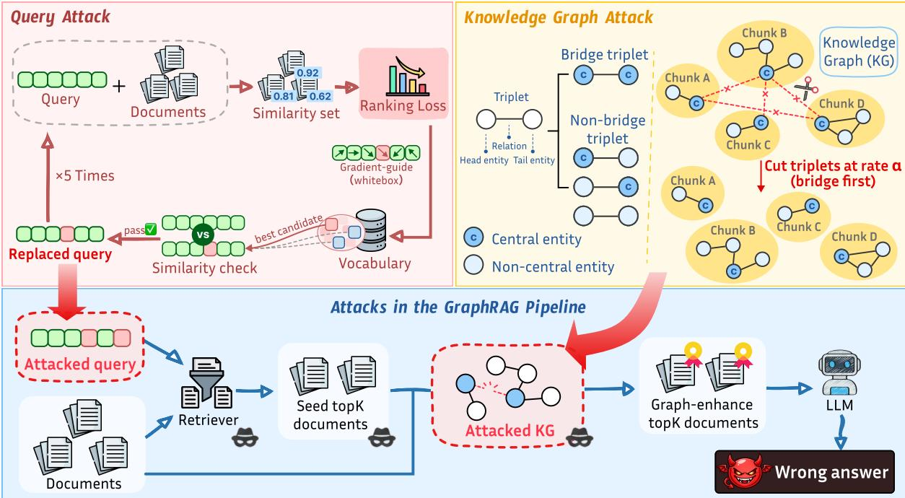  
Figure 3: Attack components across the three access tiers of GraphRAG-LTM. The upper-left panel shows the query attacks of Tiers 1 and 2: BB Query uses ranking feedback, whereas WB Query uses the gradient-guided edits shown; both aim to demote seed chunks. Tier 3 retains WB Query and adds the bridge-triplet cuts shown in the upper-right panel. The bottom panel maps these interventions onto the GraphRAG pipeline: query edits affect seed retrieval at all three tiers, while bridge-triplet cuts affect graph-based evidence expansion only at Tier 3.

## 3 Problem Settings and Threat Models

## 3.1 GraphRAG Pipeline

We study GraphRAG pipelines that organize retrieved evidence with document-derived knowledge triplets. Given text chunks $\mathcal { D } = \{ c _ { i } \} _ { i = 1 } ^ { n }$ , the system extracts triplets (h, r, t) from each chunk and forms a knowledge graph T , where triplets remain linked to their source chunks. For a query Q, a semantic retriever returns the top-K seed chunks from the document collection, $S _ { Q } = \pi _ { K } ( Q ; { \mathcal { D } } )$ where $\pi _ { K } ( \cdot )$ denotes the retriever ranking.

The system then constructs a seed subgraph by collecting triplets associated with $ { \boldsymbol { S } } _ { Q }$ and expands it through graph traversal or reranking to obtain a query-specific evidence graph $\mathcal { G } _ { Q }$ . A context organizer selects the final context $C _ { Q }$ from the retrieved chunks and graph-expanded evidence, and the generator M produces $A = { \mathcal { M } } ( Q , C _ { Q } )$ . The attack objective is to degrade the final answer quality, measured by the discrepancy between A and the gold answer. Unlike Flat RAG, the seed chunks in GraphRAG not only provide initial textual evidence but also determine the downstream evidence graph and final context. Therefore, studying attacks along the query-to-graph pathway is critical for understanding the robustness of GraphRAG systems.

## 3.2 Layered Threat Models

We consider three progressively stronger attacker access levels at different stages of the GraphRAG pipeline, as illustrated in Figure 2.

Black-box Ranking-feedback Query Attack. The attacker observes retrieved rankings or top-K results and perturbs the seed retrieval anchor without accessing retriever internals or graph triplets. This setting models an external user of a GraphRAG service that exposes ranked source passages or retrieval results.

White-box Gradient-guided Query Attack. The attacker uses retriever gradients to guide query edits but cannot inspect or modify graph triplets. This setting applies when retriever parameters are available to the attacker, as in an open-source system or a compromised retrieval service.

Graph-aware White-box Propagation Attack. Building on WB Query, the attacker can inspect and cut bridge triplets in the query-specific evidence graph. This setting models an insider or compromised graph-processing component with access to per-query graph artifacts, without control of the full corpus or global graph.

## 4 The Proposed GraphRAG-LTM

## 4.1 Overview

GraphRAG-LTM demotes originally relevant seed chunks through constrained query edits, so ranking shifts can propagate into graph expansion and final context selection. Its BB Query and WB Query variants share a retrieval-anchor objective but use rank feedback and retriever gradients, respectively; Graph-aware WB adds bridge-triplet perturbation to the same white-box query. Figure 3 shows where these interventions enter the GraphRAG pipeline.

## 4.2 Retrieval-anchor Ranking Objective

The query-side attack targets the graphconstruction anchor of GraphRAG. Let ${ \cal T } _ { \mathrm { o r i g } } ~ = ~ \pi _ { \cal K } ( Q )$ denote the top-K seed chunks retrieved by the clean query $Q .$ Our goal is to construct an adversarial query $Q ^ { \prime }$ such that chunks in $\mathcal { T } _ { \mathrm { o r i g } }$ are demoted under the adversarial ranking $\pi _ { K } ( Q ^ { \prime } )$ , while limiting semantic drift, sim $( Q , Q ^ { \prime } ) \ge \theta _ { \mathrm { s i m } }$ . Similar minimum-similarity constraints are used in adversarial text editing, including TextFooler (Jin et al., 2020). This objective is shared by BB Query, WB Query, and the query-side component of Graph-aware WB.

Only the top-K retrieved chunks seed graph expansion. We therefore factor the loss contribution of each original seed $d _ { i } \in \mathcal { I } _ { \mathrm { o r i g } }$ into three terms: ① a clean-rank importance weight $w _ { i } ;$ ② a prominence score $\phi _ { i }$ measuring how highly it remains ranked under $Q ^ { \prime } { \mathrm { ; } }$ and $\textcircled{3}$ a selection mask $\omega _ { i }$ emphasizing whether it remains in the top-K results. The ranking loss is:

$$
\mathcal { L } _ { \mathrm { r a n k } } ( Q ^ { \prime } ) = \frac { 1 } { K } \sum _ { d _ { i } \in \mathcal { I } _ { \mathrm { o r i g } } } w _ { i } \cdot \phi _ { i } \cdot \omega _ { i } .\tag{1}
$$

Minimizing this loss suppresses the original seed evidence, thereby shifting both retrieval and downstream graph construction.

Importance Weight. Both BB Query and WB Query use the same importance weight $w _ { i } .$ , which depends only on the clean-query ranking and gives larger weights to higher-ranked chunks. Let $r _ { i } ( Q )$ denote the clean rank of $d _ { i }$ . We use a DCG-inspired weighting scheme:

$$
w _ { i } = \left\{ \begin{array} { l l } { \frac { 2 ^ { K - r _ { i } ( Q ) + 1 } - 1 } { \sum _ { j = 1 } ^ { K } ( 2 ^ { K - j + 1 } - 1 ) } } & { { \mathrm { i f } } \ r _ { i } ( Q ) \leq K , } \\ { 0 } & { \mathrm { o t h e r w i s e } . } \end{array} \right.\tag{2}
$$

This prioritizes suppressing highly ranked clean evidence, since these chunks are more likely to anchor the evidence graph.

## 4.3 BB Query: Rank-only Black-box Attack

At the first access tier, BB Query instantiates Eq. 1 with a discrete proxy computed from observed ranks. Let $r _ { i } ( Q ^ { \prime } )$ be the observed rank of target chunk $d _ { i }$ under the adversarial query. If $d _ { i }$ does not appear in the retrieved list, its contribution is set to zero for that candidate query. The black-box prominence and mask are defined as:

$$
\phi _ { i } ^ { \mathrm { b b } } = \operatorname* { m a x } ( K - r _ { i } ( Q ^ { \prime } ) + 1 , 0 ) ,
$$

$$
\omega _ { i } ^ { \mathrm { b b } } = \mathbf { 1 } [ r _ { i } ( Q ^ { \prime } ) \leq K ] .\tag{3}
$$

(4)

The black-box ranking loss is:

$$
\mathcal { L } _ { \mathrm { r a n k } } ^ { \mathrm { b b } } ( Q ^ { \prime } ) = \frac { 1 } { K } \sum _ { d _ { i } \in \mathcal { T } _ { \mathrm { o r i g } } } w _ { i } \cdot \phi _ { i } ^ { \mathrm { b b } } \cdot \omega _ { i } ^ { \mathrm { b b } } .\tag{5}
$$

Starting from $Q ^ { \prime } = Q$ , we iteratively generate word-level substitution candidates from a synonym set, such as WordNet. For each candidate query ${ \widetilde { Q } } .$ , we query the retriever, compute $\mathcal { L } _ { \mathrm { r a n k } } ^ { \mathrm { b b } } ( \widetilde { Q } )$ , and accept the substitution only if sim $( Q , \widetilde { Q } ) \ge \theta _ { \mathrm { s i m } }$ and $\bar { \mathcal { L } } _ { \mathrm { r a n k } } ^ { \mathrm { b b } } ( \widetilde { Q } ) < \mathcal { L } _ { \mathrm { r a n k } } ^ { \mathrm { b b } } ( Q ^ { \prime } )$ . The process stops after reaching the substitution budget $T _ { \mathrm { m a x } }$ or when no valid edit further reduces the discrete loss. This gives a rank-only attack that perturbs the seed retrieval anchor without accessing model internals.

## 4.4 WB Query: Retriever White-box Attack

At the second access tier, WB Query optimizes the retrieval-anchor objective with gradients from the target retriever. Since exact ranks are nondifferentiable, we first approximate the rank of each target chunk using pairwise comparisons. Let ${ \mathcal { T } } _ { \mathrm { a d v } } = \pi _ { K + M } ( Q ^ { \prime } )$ be the candidate pool retrieved by the adversarial query, where M provides additional candidates beyond the top-K. For each target chunk $d _ { i } ,$ let $s _ { i } = \langle q ^ { \prime } , d _ { i } \rangle$ be its similarity score with the adversarial query representation $q ^ { \prime }$ We approximate its adversarial rank as:

$$
\hat { r } _ { i } ( Q ^ { \prime } ) = 1 + \sum _ { j \in \mathcal { T } _ { \mathrm { a d v } } , j \neq i } \sigma \left( \frac { s _ { j } - s _ { i } } { \tau } \right) ,\tag{6}
$$

where $\tau$ is a temperature parameter. We then define the differentiable prominence and mask as:

$$
\phi _ { i } = \operatorname* { m a x } ( K - \hat { r } _ { i } ( Q ^ { \prime } ) + 1 , 0 ) ,\tag{7}
$$

$$
\omega _ { i } = \sigma \left( \frac { K - \hat { r } _ { i } ( Q ^ { \prime } ) } { \epsilon } \right) .\tag{8}
$$

Substituting these terms into Eq. 1 yields a differentiable ranking loss for white-box optimization.

Starting from $Q ^ { \prime } = Q .$ , we compute the gradient of the ranking loss for each token position k as $\mathbf { g } _ { k } = \nabla _ { \mathbf { e } _ { k } } \mathcal { L } _ { \mathrm { r a n k } } ( Q ^ { \prime } )$ , where $\mathbf { e } _ { k }$ is the embedding of the current token. For each candidate replacement token $v \in \mathcal V$ with embedding $\mathbf { e } _ { v } .$ , we estimate the first-order effect of substitution by:

$$
\begin{array} { r } { s _ { k , v } = - ( { \bf e } _ { v } - { \bf e } _ { k } ) ^ { \top } { \bf g } _ { k } . } \end{array}\tag{9}
$$

A larger $s _ { k , v }$ indicates a stronger expected reduction of the ranking loss.

At each step, we select the candidate pair $( k , v )$ with the largest score and construct a candidate query ${ \widetilde { Q } } .$ The substitution is accepted only if $\sin ( Q , \ddot { Q } ) \ge \theta _ { \mathrm { s i m } }$ and $\mathcal { L } _ { \mathrm { r a n k } } ^ { w b } ( \widetilde { Q } ) \ < \ \mathcal { L } _ { \mathrm { r a n k } } ^ { w b } ( Q ^ { \prime } )$ The optimization stops after $T _ { \mathrm { m a x } }$ successful substitutions or when no valid candidate further reduces the loss. The white-box query optimization procedure is summarized in Algorithm 1.

## 4.5 Graph-aware WB: Bridge-Triplet Cuts

At the third access tier, the attacker can access the query-specific evidence graph and combine WB Query with bridge-triplet cuts to disrupt multi-hop evidence propagation across retrieved chunks.

GraphRAG often relies on cross-chunk triplets to connect evidence from chunks. We distinguish such connectors from local intra-chunk relations. Let ${ \mathcal { E } } _ { \mathrm { d o c s } }$ denote document-level central entities. A triplet $T _ { i } = ( h , r , t )$ is defined as a bridge triplet with respect to a central entity ent if it connects ent to another document-level entity:

$$
\begin{array} { r l r } & { } & { \mathrm { i s \_ b r i d g e } ( T _ { i } , \mathrm { e n t } ) = \big ( \mathrm { e n t } \in \{ h , t \} \big ) \wedge \qquad ( 1 0 ) } \\ & { } & { \big ( \{ h , t \} \ \backslash \ \{ \mathrm { e n t } \} \subseteq { \mathcal E } _ { \mathrm { d o c s } } \big ) . \quad } \end{array}
$$

Algorithm 1 WB Query Perturbation   
Require: Query $Q ,$ retriever ${ \mathcal { R } } ,$ max edits $T _ { \mathrm { m a x } }$ , similarity   
threshold $\theta _ { \mathrm { s i m } } ,$ vocabulary V   
Ensure: Adversarial query $\dot { Q ^ { \prime } }$   
1: Initialize $Q ^ { \prime }  Q ^ { \ i }  \bar { 0 } ,$ modified positions $M \gets \emptyset$   
2: while $t < T _ { \operatorname* { m a x } }$ and $| { \mathcal { M } } | < | Q |$ do   
3: for each position k /∈ M do   
4: Compute $\mathbf { g } _ { k } = \dot { \nabla } _ { \mathbf { e } _ { k } } \mathcal { L } _ { \mathrm { r a n k } } ( Q ^ { \prime } )$   
5: for each candidate token $v \in \dot { \mathcal { V } } \mathbf { d o }$   
6: Compute $s _ { k , v } = - ( \mathbf { e } _ { v } - \mathbf { e } _ { k } ) ^ { \top } \mathbf { g } _ { k }$   
7: end for   
8: end for   
9: Select $( k ^ { * } , v ^ { * } ) = \arg \operatorname* { m a x } _ { k , v } s _ { k , \iota }$   
10: Construct $\widetilde { Q }$ by replacing token $k ^ { * }$ with $v ^ { * }$   
11: if sim $( Q , \tilde { Q } ) \ge \theta _ { \mathrm { s i m } }$ and $\mathcal { L } _ { \mathrm { r a n k } } ( \widetilde { Q } ) \ : < \ : \mathcal { L } _ { \mathrm { r a n k } } ( Q ^ { \prime } )$   
then   
12: $Q ^ { \prime } \gets \widetilde Q ; t \gets t + 1$   
13: $\dot { \mathcal { M } } \gets \dot { \mathcal { M } } \cup \{ k ^ { * } \}$   
14: else   
15: Mark $k ^ { * }$ as failed; add it to M if retry limit is   
reached   
16: end if   
17: end while   
18: return $Q ^ { \prime }$

Bridge triplets serve as connectors for multi-hop evidence propagation across chunks.

Given the query-specific subgraph $\mathcal { T } _ { S }$ and a deletion ratio α, we first identify the bridge-triplet set $\mathcal { T } _ { \mathrm { b r i d g e } }$ according to Eq. 10. We set the deletion budget to $N _ { \mathrm { d e l e t e } } = \lfloor \alpha \lvert \mathcal { T } _ { S } \rvert \rfloor$ . We prioritize sampling from $\mathcal { T } _ { \mathrm { b r i d g e } }$ to target cross-chunk evidence connections. If the number of bridge triplets is insufficient, we sample additional non-bridge triplets from ${ \mathcal { T } } _ { S } \setminus \mathcal { T } _ { \mathrm { b r i d g e } }$ to meet the budget. The selected triplets are cut to obtain the perturbed subgraph $\mathcal { T } _ { S } ^ { \prime }$

## 5 Experiments

In this section, we conduct experiments under different attacker access levels to evaluate the adversarial robustness of GraphRAG systems. Our study focuses on whether perturbing the retrieval anchor and graph structure can effectively degrade graphenhanced retrieval and downstream answer generation. Specifically, our experiments are designed to answer the following research questions: (RQ1) How does attacker access level, from rank-only feedback to retriever gradients and graph-aware access, affect the vulnerability of GraphRAG? (RQ2) How does bridge-triplet perturbation affect graph-enhanced retrieval and evidence propagation? (RQ3) When does the attack take effect, and does its impact persist across perturbation budgets, graph deletion ratios, and generator backbones? (RQ4) Does the graph-side effect persist under other graph-based evidence retrieval mechanisms?

<table><tr><td rowspan="2">Method</td><td colspan="3">HotpotQA-Distractor</td><td colspan="3">MuSiQue</td><td colspan="3">2WikiMultihopQA</td><td>Overall</td></tr><tr><td>Contriever</td><td>BGE</td><td>mxbai</td><td>Contriever</td><td>BGE</td><td>mxbai</td><td>Contriever</td><td>BGE</td><td>mxbai</td><td>Avg.</td></tr><tr><td colspan="9">LLaMA3-8B</td><td></td></tr><tr><td>Clean</td><td>52.3</td><td>55.8</td><td>55.2</td><td>23.9</td><td>25.6</td><td>24.8</td><td>13.3</td><td>12.6</td><td>13.4</td><td>30.8</td></tr><tr><td>PromptInject</td><td> $4 2 . 7 _ { \downarrow 9 . 6 }$ </td><td> $4 4 . 8 _ { \downarrow 1 1 . 0 }$ </td><td> $4 5 . 3 _ { \downarrow 9 . 9 }$ </td><td> $1 9 . 1 _ { \perp 4 . 8 }$ </td><td> $1 9 . 8 _ { \downarrow 5 . 8 }$ </td><td> $2 0 . 2 _ { \downarrow 4 . 6 }$ </td><td> $6 . 6 _ { \perp 6 . 7 }$ </td><td> $6 . 7 _ { \perp 5 . 9 }$ </td><td> $7 . 5 _ { \downarrow 5 . 9 }$ </td><td> $2 3 . 6 _ { \downarrow 7 . 2 }$ </td></tr><tr><td>UAT</td><td> $3 9 . 2 _ { \downarrow 1 3 . 1 }$ </td><td> $4 2 . 6 _ { \perp 1 3 . 2 }$ </td><td> $4 1 . 4 _ { \downarrow 1 3 . 8 }$ </td><td> $1 4 . 0 _ { \perp 9 . 9 }$ </td><td> $1 5 . 1 _ { \downarrow 1 0 . 5 }$ </td><td> $1 5 . 3 _ { \downarrow 9 . 5 }$ </td><td> $6 . 0 _ { \downarrow 7 . 3 }$ </td><td> $6 . 9 _ { \downarrow 5 . 7 }$ </td><td> $7 . 0 _ { \downarrow 6 . 4 }$ </td><td> $2 0 . 8 _ { \downarrow 1 0 . 0 }$ </td></tr><tr><td>IndirectPI</td><td> $4 9 . 4 _ { \downarrow 2 . 9 }$ </td><td> $5 3 . 0 _ { \downarrow 2 . 8 }$ </td><td> $5 2 . 2 _ { \downarrow 3 . 0 }$ </td><td> $1 6 . 5 _ { \perp 7 . 4 }$ </td><td> $1 7 . 6 _ { \downarrow 8 . 0 }$ </td><td> $1 7 . 2 _ { \downarrow 7 . 6 }$ </td><td> $1 1 . 7 _ { \downarrow 1 . 6 }$ </td><td> $1 1 . 7 _ { \downarrow 0 . 9 }$ </td><td> $1 2 . 2 _ { \downarrow 1 . 2 }$ </td><td> $2 6 . 8 _ { \downarrow 4 . 0 }$ </td></tr><tr><td>PoisonedRAG</td><td> $4 9 . 0 _ { \perp 3 . 3 }$ </td><td> $5 1 . 6 _ { \perp 4 . 2 }$ </td><td> $5 1 . 6 _ { \downarrow 3 . 6 }$ </td><td> $1 3 . 3 _ { \downarrow 1 0 . 6 }$ </td><td> $1 4 . 4 _ { \downarrow 1 1 . 2 }$ </td><td> $1 3 . 7 _ { \downarrow 1 1 . 1 }$ </td><td> $1 2 . 5 _ { \downarrow 0 . 8 }$ </td><td>12.6</td><td> $1 2 . 6 _ { \downarrow 0 . 8 }$ </td><td> $2 5 . 7 _ { \perp 5 . 1 }$ </td></tr><tr><td>HotFlip</td><td> $4 9 . 4 _ { \perp 2 . 9 }$ </td><td> $5 2 . 6 _ { \perp 3 . 2 }$ </td><td> $5 2 . 5 _ { \downarrow 2 . 7 }$ </td><td> $1 7 . 0 _ { \downarrow 6 . 9 }$ </td><td> $1 8 . 4 _ { \downarrow 7 . 2 }$ </td><td> $1 7 . 8 _ { \downarrow 7 . 0 }$ </td><td> $1 2 . 5 _ { \downarrow 0 . 8 }$ </td><td> $1 2 . 1 _ { \downarrow 0 . 5 }$ </td><td> $1 2 . 6 _ { \downarrow 0 . 8 }$ </td><td> $2 7 . 2 _ { \downarrow 3 . 6 }$ </td></tr><tr><td>RandKD</td><td> $5 2 . 4 _ { \uparrow 0 . 1 }$ </td><td> $5 5 . 3 _ { \downarrow 0 . 5 }$ </td><td> $5 5 . 1 _ { \downarrow 0 . 1 }$ </td><td> $2 3 . 9$ </td><td> $2 5 . 6$ </td><td>24.8</td><td> $1 3 . 4 _ { \uparrow 0 . 1 }$ </td><td> $1 3 . 1 _ { \uparrow 0 . 5 }$ </td><td> $1 3 . 7 _ { \cdot \cdot 0 . 3 }$ </td><td>30.8</td></tr><tr><td>BB Query</td><td> $3 7 . 6 _ { \downarrow 1 4 . 7 }$ </td><td> $4 2 . 8 _ { \downarrow 1 3 . 0 }$ </td><td> $3 9 . 2 _ { \downarrow 1 6 . 0 }$ </td><td> $1 1 . 6 _ { \downarrow 1 2 . 3 }$ </td><td> $1 1 . 9 _ { \downarrow 1 3 . 7 }$ </td><td> $1 3 . 0 _ { \downarrow 1 1 . 8 }$ </td><td> $6 . 6 _ { \downarrow 6 . 7 }$ </td><td> $8 . 0 _ { \downarrow 4 . 6 }$ </td><td> $7 . 5 _ { \downarrow 5 . 9 }$ </td><td> $1 9 . 8 _ { \downarrow 1 1 . 0 }$ </td></tr><tr><td>WB Query</td><td> $2 6 . 2 _ { \downarrow 2 6 . 1 }$ </td><td> $2 8 . 6 _ { \perp 2 7 . 2 }$ </td><td> $3 2 . 3 _ { \downarrow 2 2 . 9 }$ </td><td> $7 . 6 _ { \perp 1 6 . 3 }$ </td><td> $9 . 4 _ { \downarrow 1 6 . 2 }$ </td><td> $1 1 . 7 _ { \downarrow 1 3 . 1 }$ </td><td> $5 . 1 _ { \downarrow 8 . 2 }$ </td><td> ${ \bf 5 . 1 } _ { \downarrow 7 . 5 }$ </td><td> $6 . 0 _ { \downarrow 7 . 4 }$ </td><td> $1 4 . 7 _ { \downarrow 1 6 . 1 }$ </td></tr><tr><td>Graph-aware WB</td><td> $2 3 . 7 _ { \perp 2 8 . 6 }$ </td><td> $2 7 . 4 _ { \perp 2 8 . 4 }$ </td><td> $3 0 . 5 _ { \perp 2 4 . 7 }$ </td><td> $7 . 4 _ { \perp 1 6 . 5 }$ </td><td> $9 . 2 _ { \downarrow 1 6 . 4 }$ </td><td> $1 1 . 4 _ { \downarrow 1 3 . 4 }$ </td><td> ${ \bf 4 . 0 _ { \perp 9 . 3 } }$ </td><td> $5 . 5 _ { \downarrow 7 . 1 }$ </td><td> ${ \bf 5 . 9 } _ { \perp 7 . 5 }$ </td><td> ${ \bf 1 3 . 9 } _ { \perp 1 6 . 9 }$ </td></tr></table>

<table><tr><td colspan="10">Qwen3-8B-Base</td></tr><tr><td>Clean</td><td>49.1</td><td>52.7</td><td>52.6</td><td>33.2</td><td>35.6</td><td>35.5</td><td>21.6</td><td>23.8</td><td>23.8</td><td>36.4</td></tr><tr><td>PromptInject</td><td> $2 7 . 5 _ { \downarrow 2 1 . 6 }$ </td><td> $3 0 . 3 _ { \downarrow 2 2 . 4 }$ </td><td> $3 0 . 1 _ { \downarrow 2 2 . 5 }$ </td><td> $1 8 . 6 _ { \downarrow 1 4 . 6 }$ </td><td> $1 9 . 7 _ { \downarrow 1 5 . 9 }$ </td><td> $2 0 . 5 _ { \downarrow 1 5 . 0 }$ </td><td> $5 . 9 _ { \downarrow 1 5 . 7 }$ </td><td> ${ \bf 6 . 9 } _ { \perp 1 6 . 9 }$ </td><td> ${ \bf 6 . 6 } _ { \perp 1 7 . 2 }$ </td><td> $1 8 . 5 _ { \downarrow 1 7 . 9 }$ </td></tr><tr><td>UAT</td><td> $4 2 . 7 _ { \downarrow 6 . 4 }$ </td><td> $4 6 . 6 _ { \downarrow 6 . 1 }$ </td><td> $4 6 . 6 _ { \downarrow 6 . 0 }$ </td><td> $2 3 . 8 _ { \perp 9 . 4 }$ </td><td> $2 6 . 2 _ { \downarrow 9 . 4 }$ </td><td> $2 6 . 1 _ { \downarrow 9 . 4 }$ </td><td> $1 6 . 2 _ { \downarrow 5 . 4 }$ </td><td> $1 8 . 4 _ { \perp 5 . 4 }$ </td><td> $1 8 . 5 _ { \downarrow 5 . 3 }$ </td><td> $2 9 . 5 _ { \perp 6 . 9 }$ </td></tr><tr><td>IndirectPI</td><td> $4 3 . 6 _ { \downarrow 5 . 5 }$ </td><td> $4 8 . 3 _ { \perp 4 . 4 }$ </td><td> $4 7 . 7 _ { \downarrow 4 . 9 }$ </td><td> $2 4 . 4 _ { \downarrow 8 . 8 }$ </td><td> $2 4 . 8 _ { \downarrow 1 0 . 8 }$ </td><td> $2 5 . 6 _ { \perp 9 . 9 }$ </td><td> $1 7 . 4 _ { \downarrow 4 . 2 }$ </td><td> $2 2 . 0 _ { \downarrow 1 . 8 }$ </td><td> $2 1 . 1 _ { \downarrow 2 . 7 }$ </td><td> $3 0 . 5 _ { \perp 5 . 9 }$ </td></tr><tr><td>PoisonedRAG</td><td> $4 1 . 5 _ { \downarrow 7 . 6 }$ </td><td> $4 6 . 5 _ { \perp 6 . 2 }$ </td><td> $4 6 . 2 _ { \downarrow 6 . 4 }$ </td><td> $2 2 . 0 _ { \downarrow 1 1 . 2 }$ </td><td> $2 3 . 3 _ { \downarrow 1 2 . 3 }$ </td><td> $2 2 . 3 _ { \downarrow 1 3 . 2 }$ </td><td> $1 8 . 5 _ { \perp 3 . 1 }$ </td><td> $2 1 . 6 _ { \downarrow 2 . 2 }$ </td><td> $2 2 . 4 _ { \downarrow 1 . 4 }$ </td><td> $2 9 . 4 _ { \downarrow 7 . 0 }$ </td></tr><tr><td>HotFlip</td><td> $4 2 . 6 _ { \downarrow 6 . 5 }$ </td><td> $4 6 . 8 _ { \perp 5 . 9 }$ </td><td> $4 7 . 2 _ { \downarrow 5 . 4 }$ </td><td> $2 1 . 2 _ { \downarrow 1 2 . 0 }$ </td><td> $2 6 . 0 _ { \downarrow 9 . 6 }$ </td><td> $2 5 . 3 _ { \downarrow 1 0 . 2 }$ </td><td> $1 8 . 4 _ { \downarrow 3 . 2 }$ </td><td> $2 2 . 4 _ { \downarrow 1 . 4 }$ </td><td> $2 1 . 5 _ { \downarrow 2 . 3 }$ </td><td> $3 0 . 1 _ { \downarrow 6 . 3 }$ </td></tr><tr><td>RandKD</td><td> $4 8 . 9 _ { \perp 0 . 2 }$ </td><td> $5 2 . 6 _ { \perp 0 . 1 }$ </td><td> $5 2 . 6$ </td><td> $3 3 . 2$ </td><td> $3 5 . 6$ </td><td> $3 5 . 5$ </td><td> $2 2 . 6 _ { \cdot 1 . 0 }$ </td><td> $2 5 . 3 _ { \uparrow 1 . 5 }$ </td><td> $2 5 . 4 _ { \uparrow 1 . 6 }$ </td><td> $3 6 . 9 _ { \uparrow 0 . 5 }$ </td></tr><tr><td>BB Query</td><td> $3 3 . 2 _ { \downarrow 1 5 . 9 }$ </td><td> $3 3 . 4 _ { \downarrow 1 9 . 3 }$ </td><td> $3 4 . 2 _ { \downarrow 1 8 . 4 }$ </td><td> $1 5 . 1 _ { \downarrow 1 8 . 1 }$ </td><td> $1 5 . 2 _ { \downarrow 2 0 . 4 }$ </td><td> $1 5 . 9 _ { \downarrow 1 9 . 6 }$ </td><td> $1 0 . 4 _ { \downarrow 1 1 . 2 }$ </td><td> $9 . 9 _ { \downarrow 1 3 . 9 }$ </td><td> $1 0 . 0 _ { \downarrow 1 3 . 8 }$ </td><td> $1 9 . 7 _ { \downarrow 1 6 . 7 }$ </td></tr><tr><td>WB Query</td><td> $2 3 . 7 _ { \downarrow 2 5 . 4 }$ </td><td> $2 6 . 6 _ { \downarrow 2 6 . 1 } ~ 2 7 . 8 _ { \downarrow 2 4 . 8 }$ </td><td></td><td> $9 . 8 _ { \downarrow 2 3 . 4 }$ </td><td> $1 2 . 5 _ { \perp 2 3 . 1 }$ </td><td> $1 3 . 4 _ { \downarrow 2 2 . 1 }$ </td><td> ${ \ 5 . 3 } _ { \perp 1 6 . 3 }$ </td><td> $8 . 4 _ { \downarrow 1 5 . 4 }$ </td><td> $7 . 9 _ { \downarrow 1 5 . 9 }$ </td><td> $1 5 . 0 _ { \downarrow 2 1 . 4 }$ </td></tr><tr><td>Graph-aware WB</td><td> $2 \mathbf { 0 . 9 } _ { \perp 2 8 . 2 }$ </td><td></td><td> $2 5 . 4 _ { \downarrow 2 7 . 3 } ~ 2 6 . 7 _ { \downarrow 2 5 . 9 }$ </td><td> $9 . 2 _ { \perp 2 4 . 0 }$ </td><td> ${ \bf 1 2 . 1 _ { \perp 2 3 . 5 } }$ </td><td> ${ \bf 1 3 . 1 } _ { \downarrow 2 2 . 4 }$ </td><td> $5 . 6 _ { \perp 1 6 . 0 }$ </td><td> $7 . 2 _ { \downarrow 1 6 . 6 }$ </td><td> $7 . 0 _ { \downarrow 1 6 . 8 }$ </td><td> ${ \bf 1 4 . 1 } _ { \perp 2 2 . 3 }$ </td></tr></table>

Table 1: Answer F1 (%) across three datasets and three retrievers under two LLM settings. Arrows show percentagepoint changes from the corresponding Clean score. Within each LLM setting, dark/light blue highlight the lowest/second-lowest attacked F1 in each column, and the associated two declines are bold. Avg. is the unweighted mean of the nine dataset–retriever scores. Corresponding Retrieval F1 results are in Appendix A.1.

## 5.1 Experiment Setup

extraction and generation prompt templates, reproduced in Appendix C. Further implementation details and retrieval settings are provided in $\mathsf { A p - }$ pendix B.

Datasets and Metrics. Our main evaluation uses 7,405 questions from HotpotQA-Distractor (Yang et al., 2018), 2,417 from MuSiQue (Trivedi et al., 2022), and a fixed 1,000-question development subset from 2WikiMultihopQA (Ho et al., 2020), with graphs built from document text for all three datasets. We report Answer F1 and Supporting-fact F1 as primary metrics; dataset preprocessing and evaluation details appear in Appendix B.

Attacks and Baselines. All attacks are applied at inference time. For all main-result tables, we set the query-attack iteration budget to $T _ { \mathrm { m a x } } { = } 5$ under semantic similarity threshold $\theta _ { \mathrm { s i m } } = 0 . 8$ . For graphaware evaluation, Bridge Edge Cut removes α=5% of triplets from the query-specific evidence graph. We compare with Clean, PoisonedRAG (Zou et al., 2024), HotFlip corpus poisoning (Ebrahimi et al., 2018; Zhong et al., 2023), Indirect Prompt Injection (Greshake et al., 2023), PromptInject (Perez and Ribeiro, 2022), Universal Adversarial Triggers (Wallace et al., 2019), and Random KG Deletion. Full attack and baseline details are in Appendix B.

GraphRAG Setup. For the main experiments, we instantiate GraphRAG with KG2RAG (Zhu et al., 2025). This pipeline extracts documentderived triplets, retrieves the top-K=10 seed chunks, expands evidence through the graph, and selects the top 10 context chunks for generation. We evaluate three retrievers: Contriever (Izacard et al., 2021), BGE-large-en-v1.5 (Xiao et al., 2024), and mxbai-embed-large. The main tables use two separate triplet-extraction and answer-generation settings, LLaMA3-8B (Grattafiori et al., 2024) and Qwen3-8B-Base (Yang et al., 2025); other ablation studies and analyses use LLaMA3-8B unless otherwise stated. Both model settings use the same

## 5.2 Main Results by Attacker Access Level

To answer RQ1, Table 1 reports Answer F1 for the three main datasets, three retrievers, and two generator models. The corresponding supporting-fact Retrieval F1 results are reported in Appendix A.1 (Table 3). We use these results to examine how attacker access affects the generated answer and evidence retrieved by GraphRAG under increasingly permissive threat models.

Our attacks produce larger and more consistent degradation than the existing baselines. Even BB Query, which uses only ranking feedback, yields lower Answer F1 than most of the six attack baselines in every evaluated dataset–retriever–generator setting. WB Query and Graph-aware WB further reduce the overall average Answer F1, with Graphaware WB achieving the lowest average under both generators. Several baselines substantially affect answers while changing supporting-fact retrieval only slightly; in contrast, our attacks reduce both Answer F1 and Retrieval F1. The concurrent declines provide initial evidence that seed-ranking perturbations may affect downstream evidence selection for subsequent answer generation.

Greater access provides additional ways to disrupt the retrieval pipeline. For example, on HotpotQA-Distractor with Contriever and LLaMA3-8B, Answer F1 falls from 52.3 in the clean setting to 37.6 under BB Query, 26.2 under WB Query, and 23.7 under Graph-aware WB. Across all 18 dataset–retriever–generator settings, WB Query yields lower Answer F1 than BB Query, indicating that retriever gradients strengthen the seed-ranking attack. Adding bridge-triplet cuts also lowers supporting-fact Retrieval F1 relative to WB Query in every setting. The three tiers expose successive points of vulnerability: ranking feedback guides query edits, gradients sharpen them, and graph access disrupts evidence propagation through the query-specific evidence graph.

These patterns extend across the three datasets, all three retrievers, and both generator models. The magnitude of the decline varies by setting, but ranking feedback alone is sufficient to weaken GraphRAG, while access to retriever gradients and graph structure increases the overall impact. The observed vulnerability is therefore not tied to any single dataset, retriever, or generator model.

## 5.3 Query–Graph Interaction Analysis

To address RQ2, we analyze the role of graph-side perturbation in GraphRAG. The main GraphRAG-LTM evaluation includes three attack settings: BB Query, WB Query, and Graph-aware WB. Here, we additionally introduce two diagnostic variants, Graph-only and BB Query + Graph, to isolate the effect of bridge-triplet perturbation and examine how it interacts with query-side attacks. We conduct controlled experiments on HotpotQA-Distractor, a noisy multi-hop reasoning setting. Figure 4 reports Answer F1, Retrieval F1, and the average number of retrieved chunks.

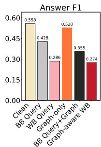

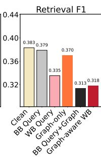

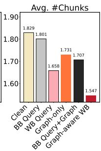  
Figure 4: Component ablation on HotpotQA-Distractor. Bars show Answer F1, supporting-fact Retrieval F1, and mean retrieved chunks under clean, query-only, graphonly, and combined attacks.

With BGE and LLaMA3-8B, the clean system has an Answer F1 of 0.558, a Retrieval F1 of 0.383, and 1.829 retrieved chunks on average. Queryside attacks cause substantial degradation: WB Query reduces Answer F1 to 0.286 and Retrieval F1 to 0.335, while BB Query lowers Answer F1 but leaves Retrieval F1 nearly unchanged at 0.379. Graph-only yields an Answer F1 of 0.528 and a Retrieval F1 of 0.370. These results establish the reference points for assessing what changes when query and graph perturbations are combined.

The combined effect on retrieval is particularly clear for BB Query. Adding bridge-triplet cuts reduces Retrieval F1 from 0.379 under BB Query alone to 0.313 under BB Query + Graph; by comparison, Graph-only reduces it from 0.383 to 0.370. The white-box combination also strengthens the attack: relative to WB Query, Graph-aware WB lowers Answer F1 from 0.286 to 0.274 and Retrieval F1 from 0.335 to 0.318. In this setting, bridge-triplet cuts have a greater effect on evidence retrieval when paired with a perturbed query.

One plausible explanation for this observed interaction is that graph expansion can partly recover relevant evidence after a mild query shift, as suggested by the nearly unchanged Retrieval F1 under BB Query alone. Cutting bridge triplets may weaken these recovery paths, making the combined intervention more consequential for evidence selection. Thus, the ablation supports a complementary role for query edits and graph cuts in disrupting GraphRAG’s evidence propagation.

## 5.4 Attack Behavior and Robustness

To address RQ3, we examine how GraphRAG-LTM behaves across substitution budgets, bridge-triplet deletion ratios, and LLM backbones.

Effect of Query Substitution Budget. Figure 5 shows that Answer F1 decreases as query substitutions increase, with gradient-guided WB updates producing a steeper decline than BB updates. The effect levels off at larger budgets. ROUGE-L remains relatively high, indicating that the edited queries retain lexical overlap alongside the embedding-similarity constraint.

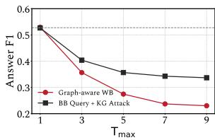

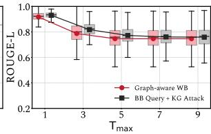  
Figure 5: Answer F1 and ROUGE-L versus query substitution budget on HotpotQA-Distractor. Both variants use 5% bridge-triplet cuts, paired with WB Query (Graph-aware WB) or BB Query (BB Query + KG Attack). Main-table results use $T _ { \mathrm { m a x } } = 5$

Effect of Graph Deletion Ratio. Figure 6 shows that Bridge Edge Cut reduces Answer F1 and supporting-fact Retrieval F1 more than random deletion at matched budgets, before the effect levels off. Bridge triplets form only a small fraction of each query-specific graph; together with Section 5.3, this suggests that cutting these connectors weakens evidence recovery after query-side retrieval shifts.

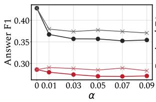

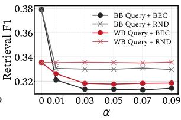  
Figure 6: Answer F1 and supporting-fact Retrieval F1 versus graph deletion ratio α on HotpotQA-Distractor (BGE, LLaMA3-8B; $T _ { \mathrm { m a x } } ~ = ~ 5 )$ . BEC cuts bridge triplets; RND deletes the same number randomly.

Robustness Across LLM Backbones. Beyond the LLaMA3-8B and Qwen3-8B-Base settings, we evaluate five answer generators: Vicuna-7B, Gemma-2B, Llama-3.2-1B, Phi-3.5-mini-instruct, and GPT-J-6B. On HotpotQA-Distractor, Graphaware WB causes substantial Answer F1 declines across all five models relative to their clean settings (Appendix A.3, Figure 7), showing that its impact extends beyond the main-table generators.

## 5.5 Transfer Across Graph Pipelines

To address RQ4, we compare two graphbased evidence-selection mechanisms using the same document-extracted graph and HotpotQA-Distractor questions. PPR propagates relevance from retrieved entities, whereas the community variant selects passages through extractive Louvain reports. We evaluate the same attack conditions under both mechanisms.

<table><tr><td rowspan="2">Method</td><td colspan="2">PPR</td><td colspan="2">Community</td></tr><tr><td>Ans F1</td><td>SP F1</td><td>Ans F1</td><td>SP F1</td></tr><tr><td>Clean</td><td>50.12</td><td>29.62</td><td>54.16</td><td>32.51</td></tr><tr><td>PromptInject</td><td>39.23↓10.89</td><td>28.87↓0.7543.26↓10.90</td><td></td><td>31.93↓0.58</td></tr><tr><td>UAT</td><td></td><td></td><td>36.05↓14.0729.35↓0.2740.69↓13.4732.43↓0.08</td><td></td></tr><tr><td>IndirectPI</td><td></td><td></td><td>40.81↓9.31 28.60↓1.0242.77↓11.39 31.94↓0.57</td><td></td></tr><tr><td>PoisonedRAG</td><td></td><td></td><td>36.68↓13.44 28.14↓1.4838.41↓15.7531.73↓0.78</td><td></td></tr><tr><td>HotFlip</td><td></td><td></td><td>39.52↓10.60 27.95↓1.6742.47↓11.69 31.69↓0.82</td><td></td></tr><tr><td>RandKD</td><td>49.96↓0.1629.59↓0.03</td><td></td><td>54.14↓0.0232.47↓0.04</td><td></td></tr><tr><td>BB Query</td><td>35.29↓14.83 27.15↓2.47 37.47↓16.69</td><td></td><td></td><td>28.58↓3.93</td></tr><tr><td>WB Query</td><td></td><td></td><td>27.96↓22.16 26.94↓2.68 30.73↓23.43</td><td>29.20↓3.31</td></tr><tr><td>Graph-aware WB</td><td>27.32↓22.80</td><td> $2 5 . 9 1 \downarrow 3 . 7 1$ </td><td> $2 9 . 6 5 \downarrow 2 4 . 5 1$ </td><td>28.27↓4.24</td></tr></table>

Table 2: Transfer F1 (%) on HotpotQA-Distractor $( N =$ 7,405). Arrows beside scores show changes from Clean; blue shades mark the two lowest attacked scores, and bold changes mark the two largest drops in each column.

Table 2 shows that all three access-tier attacks reduce Answer F1 and supporting-fact Retrieval F1 under both mechanisms, with larger drops than the compared baselines. Graph-aware WB produces the largest declines, whereas random graph deletion remains close to Clean. The pattern suggests that the attack effect is not specific to the evidenceselection rule used in the main experiments.

## 6 Conclusion

We examined GraphRAG’s evidence path through three nested attacker access levels. Across three multi-hop QA datasets, three retrievers, and two extraction-and-generation model settings, ranking feedback alone was sufficient to degrade answers, while retriever gradients strengthened the query attack. When the adversarial query was held fixed, bridge-triplet cuts consistently reduced supportingfact retrieval; the component ablation suggests that these cuts weaken evidence recovery after seed rankings shift. The attacks also remained effective under PPR and community-based evidence selection on the same extracted graph. These findings identify seed retrieval and graph evidence propagation as connected vulnerabilities in GraphRAG.

## 7 Limitations

Our findings are bounded by the three attacker access levels and GraphRAG configurations evaluated here. They suggest two directions for improving robustness. At seed retrieval, independent retrieval signals and seed-evidence checks could reduce reliance on a single ranking before graph expansion. At graph processing, verifying triplet provenance and retaining alternative evidence paths could help detect missing bridge relations and recover supporting evidence. Evaluating these directions against adaptive attacks and across independently constructed graphs, languages, and tasks would clarify their generality.

## 8 Ethical Considerations

This work investigates adversarial vulnerabilities in GraphRAG under three levels of attacker access. We acknowledge that security research is dual-use. Our experiments use public benchmarks to study failures in seed retrieval and graph-based evidence selection; they do not target deployed products or collect user data.

The main experiments use HotpotQA, MuSiQue, and 2WikiMultihopQA and involve no human participants. Language models are used for knowledge-triplet extraction and answer generation. We reuse precomputed graphs and batch inference where possible to reduce repeated computation. The paper and appendix describe the evaluated models and datasets, attacker permissions, intervention locations, attack settings, and evaluation procedures so that the reported results can be examined in context.

During manuscript preparation, generative AI tools assisted with language editing, sentence-level rewriting, and organization. All scientific claims, experimental results, numerical values, methodological descriptions, and citations were checked and approved by the authors. The authors remain responsible for the accuracy, interpretation, and presentation of the paper.

## References

Yang Cao, Yangsong Lan, Feiyan Zhai, and Piji Li. 2024. 5w1h extraction with large language models. In 2024 International Joint Conference on Neural Networks (IJCNN), pages 1–8. IEEE.

Chi-Min Chan, Chunpu Xu, Ruibin Yuan, Hongyin Luo, Wei Xue, Yike Guo, and Jie Fu. 2024. Rq-rag: Learn-

ing to refine queries for retrieval augmented generation. arXiv preprint arXiv:2404.00610.

Florin Cuconasu, Giovanni Trappolini, Federico Siciliano, Simone Filice, Cesare Campagnano, Yoelle Maarek, Nicola Tonellotto, and Fabrizio Silvestri. 2024. The power of noise: Redefining retrieval for rag systems. In Proceedings ofthe 47th International ACM SIGIR Conference on Research and Development in Information Retrieval, pages 719–729.

Javid Ebrahimi, Anyi Rao, Daniel Lowd, and Dejing Dou. 2018. Hotflip: White-box adversarial examples for text classification. In Proceedings of the 56th Annual Meeting of the Association for Computational Linguistics (Volume 2: Short Papers), pages 31–36. Association for Computational Linguistics.

Darren Edge, Ha Trinh, Newman Cheng, Joshua Bradley, Alex Chao, Apurva Mody, Steven Truitt, Dasha Metropolitansky, Robert Osazuwa Ness, and Jonathan Larson. 2024. From local to global: A graph rag approach to query-focused summarization. arXiv preprint arXiv:2404.16130.

Wenqi Fan, Yujuan Ding, Liangbo Ning, Shijie Wang, Hengyun Li, Dawei Yin, Tat-Seng Chua, and Qing Li. 2024. A survey on rag meeting llms: Towards retrieval-augmented large language models. In Proceedings of the 30th ACM SIGKDD conference on knowledge discovery and data mining, pages 6491– 6501.

Yunfan Gao, Yun Xiong, Xinyu Gao, Kangxiang Jia, Jinliu Pan, Yuxi Bi, Yi Dai, Jiawei Sun, Meng Wang, and Haofen Wang. 2024. Retrieval-augmented generation for large language models: A survey. Preprint, arXiv:2312.10997.

Zhibin Gou, Zhihong Shao, Yeyun Gong, Yelong Shen, Yujiu Yang, Nan Duan, and Weizhu Chen. 2023. Critic: Large language models can self-correct with tool-interactive critiquing. arXiv preprint arXiv:2305.11738.

Aaron Grattafiori, Abhimanyu Dubey, Abhinav Jauhri, Abhinav Pandey, Abhishek Kadian, Ahmad Al-Dahle, Aiesha Letman, Akhil Mathur, Alan Schelten, Alex Vaughan, et al. 2024. The llama 3 herd of models. arXiv preprint arXiv:2407.21783.

Kai Greshake, Sahar Abdelnabi, Shailesh Mishra, Christoph Endres, Thorsten Holz, and Mario Fritz. 2023. Not what you’ve signed up for: Compromising real-world llm-integrated applications with indirect prompt injection. In Proceedings of the 16th ACM workshop on artificial intelligence and security, pages 79–90.

Kelvin Guu, Kenton Lee, Zora Tung, Panupong Pasupat, and Mingwei Chang. 2020. Retrieval augmented language model pre-training. In International conference on machine learning, pages 3929–3938. PMLR.

Xanh Ho, Anh-Khoa Duong Nguyen, Saku Sugawara, and Akiko Aizawa. 2020. Constructing a multi-hop

qa dataset for comprehensive evaluation of reasoning steps. In Proceedings ofthe 28th International Conference on Computational Linguistics, pages 6609– 6625, Barcelona, Spain (Online). International Committee on Computational Linguistics.

Zhibo Hu, Chen Wang, Yanfeng Shu, Hye-Young Paik, and Liming Zhu. 2024. Prompt perturbation in retrieval-augmented generation based large language models. In Proceedings ofthe 30th ACM SIGKDD Conference on Knowledge Discovery and Data Mining, pages 1119–1130.

Lei Huang, Weijiang Yu, Weitao Ma, Weihong Zhong, Zhangyin Feng, Haotian Wang, Qianglong Chen, Weihua Peng, Xiaocheng Feng, Bing Qin, et al. 2025. A survey on hallucination in large language models: Principles, taxonomy, challenges, and open questions. ACM Transactions on Information Systems, 43(2):1– 55.

Gautier Izacard, Mathilde Caron, Lucas Hosseini, Sebastian Riedel, Piotr Bojanowski, Armand Joulin, and Edouard Grave. 2021. Unsupervised dense information retrieval with contrastive learning. arXiv preprint arXiv:2112.09118.

Gautier Izacard, Patrick Lewis, Maria Lomeli, Lucas Hosseini, Fabio Petroni, Timo Schick, Jane Dwivedi-Yu, Armand Joulin, Sebastian Riedel, and Edouard Grave. 2023. Atlas: Few-shot learning with retrieval augmented language models. Journal of Machine Learning Research, 24(251):1–43.

Zhengbao Jiang, Frank F Xu, Luyu Gao, Zhiqing Sun, Qian Liu, Jane Dwivedi-Yu, Yiming Yang, Jamie Callan, and Graham Neubig. 2023. Active retrieval augmented generation. In Proceedings ofthe 2023 Conference on Empirical Methods in Natural Language Processing, pages 7969–7992.

Yang Jiao, Xiaodong Wang, and Kai Yang. 2025. Prattack: Coordinated prompt-rag attacks on retrievalaugmented generation in large language models via bilevel optimization. In Proceedings ofthe 48th International ACM SIGIR Conference on Research and Development in Information Retrieval, pages 656– 667.

Bowen Jin, Chulin Xie, Jiawei Zhang, Kashob Kumar Roy, Yu Zhang, Zheng Li, Ruirui Li, Xianfeng Tang, Suhang Wang, Yu Meng, et al. 2024. Graph chain-ofthought: Augmenting large language models by reasoning on graphs. arXiv preprint arXiv:2404.07103.

Di Jin, Zhijing Jin, Joey Tianyi Zhou, and Peter Szolovits. 2020. Is BERT really robust? a strong baseline for natural language attack on text classification and entailment. In Proceedings ofthe AAAI Conference on Artificial Intelligence, volume 34, pages 8018–8025.

Vladimir Karpukhin, Barlas Oguz, Sewon Min, Patrick SH Lewis, Ledell Wu, Sergey Edunov, Danqi Chen, and Wen-tau Yih. 2020. Dense passage retrieval for open-domain question answering. In EMNLP (1), pages 6769–6781.

Wojciech Kryscinski, Bryan McCann, Caiming Xiong, and Richard Socher. 2020. Evaluating the Factual Consistency of Abstractive Text Summarization. In Proceedings of the 2020 Conference on Empirical Methods in Natural Language Processing (EMNLP), pages 9332–9346, Online. Association for Computational Linguistics.

Patrick Lewis, Ethan Perez, Aleksandra Piktus, Fabio Petroni, Vladimir Karpukhin, Naman Goyal, Heinrich Küttler, Mike Lewis, Wen-tau Yih, Tim Rocktäschel, et al. 2020. Retrieval-augmented generation for knowledge-intensive nlp tasks. Advances in neural information processing systems, 33:9459–9474.

Yi Liu, Gelei Deng, Yuekang Li, Kailong Wang, Zihao Wang, Xiaofeng Wang, Tianwei Zhang, Yepang Liu, Haoyu Wang, Yan Zheng, et al. 2023. Prompt injection attack against llm-integrated applications. arXiv preprint arXiv:2306.05499.

Huan Ma, Changqing Zhang, Huazhu Fu, Peilin Zhao, and Bingzhe Wu. 2023. Adapting large language models for content moderation: Pitfalls in data engineering and supervised fine-tuning. arXiv preprint arXiv:2310.03400.

Shengyu Mao, Yong Jiang, Boli Chen, Xiao Li, Peng Wang, Xinyu Wang, Pengjun Xie, Fei Huang, Huajun Chen, and Ningyu Zhang. 2024. Rafe: Ranking feedback improves query rewriting for rag. arXiv preprint arXiv:2405.14431.

Costas Mavromatis and George Karypis. 2024. Gnnrag: Graph neural retrieval for large language model reasoning. arXiv preprint arXiv:2405.20139.

Kris McGuffie and Alex Newhouse. 2020. The radicalization risks of gpt-3 and advanced neural language models. arXiv preprint arXiv:2009.06807.

Tong Mu, Alec Helyar, Johannes Heidecke, Joshua Achiam, Andrea Vallone, Ian Kivlichan, Molly Lin, Alex Beutel, John Schulman, and Lilian Weng. 2024. Rule based rewards for language model safety. Advances in Neural Information Processing Systems, 37:108877–108901.

Sezen Perçin, Xin Su, Qutub Sha Syed, Phillip Howard, Aleksei Kuvshinov, Leo Schwinn, and Kay-Ulrich Scholl. 2025. Investigating the robustness of retrieval-augmented generation at the query level. In Proceedings ofthe Fourth Workshop on Generation, Evaluation and Metrics, pages 439–457.

Fábio Perez and Ian Ribeiro. 2022. Ignore previous prompt: Attack techniques for language models. arXiv preprint arXiv:2211.09527.

Traian Rebedea, Razvan Dinu, Makesh Sreedhar, Christopher Parisien, and Jonathan Cohen. 2023. Nemo guardrails: A toolkit for controllable and safe llm applications with programmable rails. arXiv preprint arXiv:2310.10501.

Shuhuai Ren, Yihe Deng, Kun He, and Wanxiang Che. 2019. Generating natural language adversarial examples through probability weighted word saliency. In Proceedings of the 57th Annual Meeting of the Associationfor Computational Linguistics, pages 1085– 1097.

Harsh Trivedi, Niranjan Balasubramanian, Tushar Khot, and Ashish Sabharwal. 2022. Musique: Multihop questions via single-hop question composition. Transactions of the Association for Computational Linguistics, 10:539–554.

Eric Wallace, Shi Feng, Nikhil Kandpal, Matt Gardner, and Sameer Singh. 2019. Universal adversarial triggers for attacking and analyzing nlp. arXiv preprint arXiv:1908.07125.

Kun Wang, Guibin Zhang, Zhenhong Zhou, Jiahao Wu, Miao Yu, Shiqian Zhao, Chenlong Yin, Jinhu Fu, Yibo Yan, Hanjun Luo, et al. 2025. A comprehensive survey in llm (-agent) full stack safety: Data, training and deployment. arXiv preprint arXiv:2504.15585.

Yu Wang, Nedim Lipka, Ryan A Rossi, Alexa Siu, Ruiyi Zhang, and Tyler Derr. 2024. Knowledge graph prompting for multi-document question answering. In Proceedings ofthe AAAI conference on artificial intelligence, volume 38, pages 19206–19214.

Shitao Xiao, Zheng Liu, Peitian Zhang, Niklas Muennighoff, Defu Lian, and Jian-Yun Nie. 2024. C-pack: Packed resources for general chinese embeddings. In Proceedings of the 47th International ACM SIGIR Conference on Research and Development in Information Retrieval, pages 641–649.

An Yang, Anfeng Li, Baosong Yang, et al. 2025. Qwen3 technical report. Preprint, arXiv:2505.09388.

Zhilin Yang, Peng Qi, Saizheng Zhang, Yoshua Bengio, William W Cohen, Ruslan Salakhutdinov, and Christopher D Manning. 2018. Hotpotqa: A dataset for diverse, explainable multi-hop question answering. arXiv preprint arXiv:1809.09600.

Yakir Yehuda, Itzik Malkiel, Oren Barkan, Jonathan Weill, Royi Ronen, and Noam Koenigstein. 2024. Interrogatellm: Zero-resource hallucination detection in llm-generated answers. arXiv preprint arXiv:2403.02889.

Zexuan Zhong, Ziqing Huang, Alexander Wettig, and Danqi Chen. 2023. Poisoning retrieval corpora by injecting adversarial passages. arXiv preprint arXiv:2310.19156.

Xiangrong Zhu, Yuexiang Xie, Yi Liu, Yaliang Li, and Wei Hu. 2025. Knowledge graph-guided retrieval augmented generation. arXiv preprint arXiv:2502.06864.

Wei Zou, Runpeng Geng, Binghui Wang, and Jinyuan Jia. 2024. PoisonedRAG: Knowledge corruption attacks to retrieval-augmented generation of large language models. Preprint, arXiv:2402.07867.

<table><tr><td>Method</td><td colspan="3">HotpotQA-Distractor Contriever BGE</td><td colspan="3">MuSiQue Contriever BGE</td><td colspan="3">2WikiMultihopQA</td><td>Overall</td></tr><tr><td></td><td></td><td></td><td>mxbai</td><td></td><td></td><td>mxbai</td><td>Contriever BGE</td><td></td><td>mxbai</td><td>Avg.</td></tr><tr><td>LLaMA3-8B</td><td></td><td></td><td></td><td></td><td></td><td></td><td></td><td></td><td></td><td></td></tr><tr><td>Clean</td><td>33.4</td><td></td><td>38.3 38.3</td><td> $3 7 . 4$ </td><td>40.4</td><td>40.5</td><td>29.9</td><td>35.8</td><td>35.7</td><td>36.6</td></tr><tr><td>PromptInject</td><td> $3 2 . 2 _ { \perp 1 . 2 }$ </td><td></td><td> $3 7 . 3 _ { \scriptstyle \downarrow 1 . 0 } 3 7 . 6 _ { \scriptstyle \downarrow 0 . 7 }$ </td><td> $3 6 . 8 _ { \perp 0 . 6 }$ </td><td></td><td> $3 9 . 3 _ { \scriptstyle \downarrow 1 . 1 } 3 9 . 5 _ { \scriptstyle \downarrow 1 . 0 }$ </td><td> $2 7 . 0 _ { \downarrow 2 . 9 }$ </td><td> $3 5 . 2 _ { \downarrow 0 . 6 } 3 4 . 7 _ { \downarrow 1 . 0 }$ </td><td></td><td> $3 5 . 5 _ { \perp 1 . 1 }$ </td></tr><tr><td>UAT</td><td> $3 2 . 4 _ { \downarrow 1 . 0 }$ </td><td></td><td> $3 8 . 1 _ { \downarrow 0 . 2 } ~ 3 8 . 0 _ { \downarrow 0 . 3 }$ </td><td> $3 6 . 4 _ { \perp 1 . 0 }$ </td><td></td><td> $3 9 . 9 _ { \downarrow 0 . 5 } ~ 4 0 . 0 _ { \downarrow 0 . 5 }$ </td><td> $2 9 . 2 _ { \downarrow 0 . 7 }$ </td><td> $3 5 . 9 _ { \uparrow 0 . 1 }$ </td><td> $3 5 . 8 _ { \uparrow 0 . 1 }$ </td><td> $3 6 . 2 _ { \downarrow 0 . 4 }$ </td></tr><tr><td>IndirectPI</td><td> $3 4 . 0 _ { \cdot \mathrm { { 0 . 6 } } }$ </td><td></td><td> $3 9 . 7 _ { \uparrow 1 . 4 } \ 3 9 . 7 _ { \uparrow 1 . 4 }$ </td><td> $3 8 . 0 _ { \cdot \mathrm { { 0 . 6 } } }$ </td><td></td><td> $4 1 . 1 _ { \uparrow 0 . 7 } \ 4 0 . 9 _ { \uparrow 0 . 4 }$ </td><td> $2 9 . 4 _ { \downarrow 0 . 5 }$ </td><td> $3 6 . 7 _ { \cdot \mathrm { { \uparrow 0 . 9 } } }$ </td><td> $3 6 . 4 _ { \uparrow 0 . 7 }$ </td><td> $3 7 . 3 _ { \uparrow 0 . 7 }$ </td></tr><tr><td>PoisonedRAG</td><td> $3 4 . 0 _ { \uparrow 0 . 6 }$ </td><td> $3 9 . 7 _ { \uparrow 1 . 4 }$ </td><td> $3 9 . 8 _ { \uparrow 1 . 5 }$ </td><td> $3 7 . 8 _ { \uparrow 0 . 4 }$ </td><td></td><td> $4 0 . 9 _ { \uparrow 0 . 5 } \ 4 0 . 9 _ { \uparrow 0 . 4 }$ </td><td> $2 9 . 4 _ { \downarrow 0 . 5 }$ </td><td> $3 6 . 7 _ { \cdot \mathrm { \uparrow 0 . 9 } }$ </td><td> $3 6 . 5 _ { \uparrow 0 . 8 }$ </td><td> $3 7 . 3 _ { \uparrow 0 . 7 }$ </td></tr><tr><td>HotFlip RandKD</td><td> $3 4 . 1 _ { \uparrow 0 . 7 }$ </td><td> $3 9 . 8 _ { \uparrow 1 . 5 }$ </td><td> $3 9 . 8 _ { \uparrow 1 . 5 }$ </td><td> $3 7 . 9 _ { \uparrow 0 . 5 }$ </td><td> $4 1 . 1 _ { \uparrow 0 . 7 }$ </td><td> $4 1 . 0 _ { \uparrow 0 . 5 }$ </td><td> $2 9 . 5 _ { \downarrow 0 . 4 }$ </td><td> $3 6 . 7 _ { \cdot \mathrm { { \uparrow 0 . 9 } } }$ </td><td> $3 6 . 5 _ { \uparrow 0 . 8 }$ </td><td> $3 7 . 4 _ { \uparrow 0 . 8 }$ </td></tr><tr><td></td><td> $3 3 . 4$ </td><td> $3 8 . 4 _ { \uparrow 0 . 1 }$ </td><td>38.3</td><td> $3 7 . 4$ </td><td> $4 0 . 4$ </td><td>40.5</td><td> $2 9 . 7 _ { \perp 0 . 2 }$ </td><td> $3 5 . 6 _ { \perp 0 . 2 }$ </td><td>35.7</td><td>36.6</td></tr><tr><td>BB Query</td><td> $2 9 . 0 _ { \downarrow 4 . 4 }$ </td><td> $3 7 . 8 _ { \perp 0 . 5 }$ </td><td> $3 3 . 7 _ { \downarrow 4 . 6 }$ </td><td>33.7 ↓3.7</td><td></td><td> $3 5 . 7 _ { \downarrow 4 . 7 } 3 5 . 6 _ { \downarrow 4 . 9 }$ </td><td> $2 6 . 8 _ { \downarrow 3 . 1 }$ </td><td> $3 3 . 2 _ { \downarrow 2 . 6 }$ </td><td> $3 2 . 9 _ { \downarrow 2 . 8 }$ </td><td> $3 3 . 2 _ { \downarrow 3 . 4 }$ </td></tr><tr><td>WB Query</td><td> $2 8 . 6 _ { \perp 4 . 8 }$ </td><td> $3 3 . 5 _ { \perp 4 . 8 }$ </td><td> $3 4 . 8 _ { \downarrow 3 . 5 }$ </td><td> $3 2 . 9 _ { \downarrow 4 . 5 }$ </td><td></td><td> $3 6 . 3 _ { \downarrow 4 . 1 } \ 3 7 . 5 _ { \downarrow 3 . 0 }$ </td><td> $2 5 . 4 _ { \downarrow 4 . 5 }$ </td><td> $3 2 . 7 _ { \downarrow 3 . 1 }$ </td><td>33.1 ↓2.6</td><td> $3 2 . 8 _ { \downarrow 3 . 8 }$ </td></tr><tr><td>Graph-aware WB</td><td> ${ \bf 2 6 . 1 } _ { \perp 7 . 3 }$ </td><td> $\mathbf { 3 1 . 8 } _ { \downarrow 6 . 5 }$ </td><td> $3 3 . 3 _ { \perp 5 . 0 } \AA$ </td><td> $\mathbf { 3 2 . 0 } _ { \downarrow 5 . 4 }$ </td><td></td><td> $3 6 . 0 _ { \downarrow 4 . 4 } \ 3 7 . 1 _ { \downarrow 3 . 4 }$ </td><td> $2 2 . 4 _ { \downarrow 7 . 5 }$ </td><td> ${ \bf 2 9 . 3 _ { \perp 6 . 5 } }$ </td><td>29.8↓5.9</td><td> $\mathbf { 3 0 . 9 } _ { \downarrow 5 . 7 }$ </td></tr></table>

<table><tr><td colspan="11">Qwen3-8B-Base</td></tr><tr><td>Clean</td><td>34.3</td><td>38.4</td><td>38.3</td><td>37.9</td><td>40.7</td><td>40.7</td><td>31.4 38.8</td><td>38.9</td><td></td><td>37.7</td></tr><tr><td>PromptInject</td><td> $3 3 . 0 _ { \perp 1 . 3 }$ </td><td> $3 7 . 8 _ { \downarrow 0 . 6 } \ 3 7 . 9 _ { \downarrow 0 . 4 }$ </td><td></td><td> $3 7 . 3 _ { \perp 0 . 6 }$ </td><td> $3 9 . 8 _ { \downarrow 0 . 9 } \ 3 9 . 7 _ { \downarrow 1 . 0 }$ </td><td></td><td> $2 8 . 3 _ { \perp 3 . 1 }$ </td><td> $3 8 . 4 _ { \perp 0 . 4 }$ </td><td> $3 8 . 1 _ { \perp 0 . 8 }$ </td><td> $3 6 . 7 _ { \perp 1 . 0 }$ </td></tr><tr><td>UAT</td><td> $3 3 . 4 _ { \downarrow 0 . 9 }$ </td><td> $3 8 . 3 _ { \downarrow 0 . 1 } \ 3 8 . 2 _ { \downarrow 0 . 1 }$ </td><td></td><td> $3 6 . 8 _ { \perp 1 . 1 }$ </td><td> $4 0 . 0 _ { \downarrow 0 . 7 } ~ 4 0 . 2 _ { \downarrow 0 . 5 }$ </td><td></td><td> $3 0 . 7 _ { \downarrow 0 . 7 }$ </td><td> $3 9 . 1 _ { \uparrow 0 . 3 }$ </td><td> $3 8 . 7 _ { \perp 0 . 2 }$ </td><td> $3 7 . 3 _ { \downarrow 0 . 4 }$ </td></tr><tr><td>IndirectPI</td><td> $3 4 . 0 _ { \downarrow 0 . 3 }$ </td><td>39.5</td><td>39.4 ↑1.1</td><td> $3 8 . 4 _ { \uparrow 0 . 5 }$ </td><td>41.210.5</td><td>41.1 ↑0.4</td><td> $3 0 . 3 _ { \scriptstyle \downarrow 1 . 1 }$ </td><td> $3 8 . 9 _ { \uparrow 0 . 1 }$ </td><td>38.9</td><td> $3 8 . 0 _ { \uparrow 0 . 3 }$ </td></tr><tr><td>PoisonedRAG</td><td> $3 4 . 0 _ { \downarrow 0 . 3 }$ </td><td> $3 9 . 5 _ { \cdot 1 . 1 } \ 3 9 . 3 _ { \cdot 1 . 0 }$ </td><td></td><td> $3 8 . 3 _ { \uparrow 0 . 4 }$ </td><td> $4 1 . 3 _ { \uparrow 0 . 6 } \ 4 1 . 0 _ { \uparrow 0 . 3 }$ </td><td></td><td> $3 0 . 3 _ { \scriptstyle \downarrow 1 . 1 }$ </td><td>38.8</td><td>38.9</td><td> $3 7 . 9 _ { \uparrow 0 . 2 }$ </td></tr><tr><td>HotFlip</td><td> $3 4 . 1 _ { \perp 0 . 2 }$ </td><td> $3 9 . 5 _ { \uparrow 1 . 1 } \ 3 9 . 4 _ { \uparrow 1 . 1 }$ </td><td></td><td> $3 8 . 4 _ { \uparrow 0 . 5 }$ </td><td> $4 1 . 4 _ { \uparrow 0 . 7 } \ 4 1 . 1 _ { \uparrow 0 . 4 }$ </td><td></td><td> $3 0 . 1 _ { \perp 1 . 3 }$ </td><td>38.8</td><td> $3 9 . 0 _ { \uparrow 0 . 1 }$ </td><td> $3 8 . 0 _ { \uparrow 0 . 3 }$ </td></tr><tr><td>RandKD</td><td> $3 4 . 2 _ { \downarrow 0 . 1 }$ </td><td> $3 8 . 4$ </td><td> $3 8 . 4 _ { \uparrow 0 . 1 }$ </td><td> $3 7 . 9$ </td><td>40.7</td><td>40.7</td><td> $3 1 . 1 _ { \perp 0 . 3 }$ </td><td> $3 8 . 7 _ { \perp 0 . 1 }$ </td><td> $3 8 . 7 _ { \perp 0 . 2 }$ </td><td> $3 7 . 6 _ { \downarrow 0 . 1 }$ </td></tr><tr><td>BB Query</td><td> $2 9 . 5 _ { \downarrow 4 . 8 }$ </td><td> $3 5 . 2 _ { \perp 3 . 2 }$ </td><td> $3 3 . 8 _ { \downarrow 4 . 5 }$ </td><td> $3 4 . 1 _ { \downarrow 3 . 8 }$ </td><td>35.9 ↓4.8</td><td>35.8 ↓4.9</td><td> $2 7 . 9 _ { \downarrow 3 . 5 }$ </td><td> $3 5 . 5 _ { \downarrow 3 . 3 }$ </td><td> $3 5 . 2 _ { \downarrow 3 . 7 }$ </td><td> $3 3 . 7 _ { \downarrow 4 . 0 }$ </td></tr><tr><td>WB Query</td><td> $2 9 . 1 _ { \perp 5 . 2 }$ </td><td> $3 4 . 8 _ { \downarrow 3 . 6 } 3 4 . 7 _ { \downarrow 3 . 6 }$ </td><td></td><td> $3 3 . 3 _ { \downarrow 4 . 6 }$ </td><td> $3 6 . 9 _ { \downarrow 3 . 8 } 3 7 . 7 _ { \downarrow 3 . 0 }$ </td><td></td><td> $2 6 . 4 _ { \downarrow 5 . 0 }$ </td><td> $3 4 . 6 _ { \perp 4 . 2 }$ </td><td> $3 5 . 4 _ { \downarrow 3 . 5 }$ </td><td> $3 3 . 7 _ { \perp 4 . 0 }$ </td></tr><tr><td>Graph-aware WB</td><td> $\mathbf { 2 6 . 8 } _ { \perp 7 . 5 }$ </td><td> $3 3 . 6 _ { \perp 4 . 8 } 3 3 . 6 _ { \perp 4 . 7 }$ </td><td></td><td> $3 2 . 1 _ { \perp 5 . 8 }$ </td><td> $3 6 . 5 _ { \perp 4 . 2 } \ 3 7 . 2 _ { \perp 3 . 5 }$ </td><td></td><td> $2 3 . 7 _ { \perp 7 . 7 }$ </td><td>31.9 6.9 32.1</td><td>↓6.8</td><td> $\mathbf { 3 1 . 9 } _ { \downarrow 5 . 8 }$ </td></tr></table>

Table 3: Supporting-fact Retrieval F1 (%) across three datasets and retrievers. Avg. is the unweighted mean of nine settings; arrows show change from Clean within each model. Dark/light blue mark the lowest/second-lowest reported attack scores per column.

## A Supplementary Results

## A.1 Supporting-fact Retrieval F1

Table 3 complements the main Answer F1 table. It uses the same questions, retrievers, attack conditions, and separate LLaMA3-8B and Qwen3-8B-Base triplet-extraction and answer-generation settings.

<table><tr><td rowspan=1 colspan=1>Method</td><td rowspan=1 colspan=3>Contriever   BGE    mxbai</td></tr><tr><td rowspan=1 colspan=1>Clean</td><td rowspan=1 colspan=2>22.6        $\overline { { 2 2 . 6 } }$ </td><td rowspan=1 colspan=1> $\overline { { 2 1 . 8 } }$ </td></tr><tr><td rowspan=1 colspan=1>PromptInject</td><td rowspan=1 colspan=1> $1 9 . 1 _ { \perp 3 . 5 }$ </td><td rowspan=1 colspan=1> $1 7 . 4 _ { \perp 5 . 2 }$ </td><td rowspan=1 colspan=1> $^ { 1 8 . 1 } \downarrow 3 . 7$ </td></tr><tr><td rowspan=1 colspan=1>UAT</td><td rowspan=1 colspan=1> ${ \bf 6 . 2 _ { \perp 1 6 . 4 } }$ </td><td rowspan=1 colspan=1> $7 . 6 _ { \scriptstyle \perp 1 5 . 0 }$ </td><td rowspan=1 colspan=1> $7 . 5 _ { \perp 1 4 . 3 }$ </td></tr><tr><td rowspan=1 colspan=1>IndirectPI</td><td rowspan=1 colspan=1> $2 1 . 5 _ { \perp 1 . 1 }$ </td><td rowspan=1 colspan=1> $2 3 . 4 _ { \uparrow 0 . 8 }$ </td><td rowspan=1 colspan=1> $2 1 . 2 _ { \downarrow 0 . 6 }$ </td></tr><tr><td rowspan=1 colspan=1>PoisonedRAG</td><td rowspan=1 colspan=1> $2 3 . 0 _ { \uparrow 0 . 4 }$ </td><td rowspan=1 colspan=1> $2 2 . 8 _ { \uparrow 0 . 2 }$ </td><td rowspan=1 colspan=1> $2 3 . 8 _ { \uparrow 2 . 0 }$ </td></tr><tr><td rowspan=1 colspan=1>HotFlip</td><td rowspan=1 colspan=1> $2 2 . 0 _ { \downarrow 0 . 6 }$ </td><td rowspan=1 colspan=1> $1 9 . 9 _ { \downarrow 2 . 7 }$ </td><td rowspan=2 colspan=1> $2 0 . 5 _ { \perp 1 . 3 }$  $2 0 . 9 _ { \perp 0 . 9 }$ </td></tr><tr><td rowspan=1 colspan=1>RandKD</td><td rowspan=1 colspan=1> $2 3 . 3 _ { \uparrow 0 . 7 }$ </td><td rowspan=1 colspan=1> $2 2 . 9 _ { \uparrow 0 . 3 }$ </td></tr><tr><td rowspan=1 colspan=1>BB Query</td><td rowspan=1 colspan=1> $1 5 . 1 _ { \perp 7 . 5 }$ </td><td rowspan=1 colspan=1> $1 3 . 5 _ { \perp 9 . 1 }$ </td><td rowspan=1 colspan=1> $1 2 . 2 _ { \downarrow 9 . 6 }$ </td></tr><tr><td rowspan=1 colspan=1>WB Query</td><td rowspan=1 colspan=1> $9 . 6 _ { \perp 1 3 . 0 }$ </td><td rowspan=1 colspan=1> $7 . 2 _ { \perp 1 5 . 4 }$ </td><td rowspan=1 colspan=1> $8 . 1 _ { \perp 1 3 . 7 }$ </td></tr><tr><td rowspan=1 colspan=1>Graph-aware WB</td><td rowspan=1 colspan=2> $9 . 5 _ { \perp 1 3 . 1 }$     $^ { 7 . 7 } \bot 1 4 . 9$ </td><td rowspan=1 colspan=1> $8 . 0 _ { \downarrow 1 3 . 8 }$ </td></tr></table>

## A.2 TriviaQA

Table 4 reports supplementary Answer F1 on 100 TriviaQA questions with LLaMA3-8B extraction and generation. TriviaQA lacks native sentence-level supporting-fact annotations, so we omit converted-label Retrieval F1.

Table 4: Supplementary TriviaQA Answer F1 (%) on 100 questions with LLaMA3-8B across three retrievers. Arrows show changes from Clean; dark/light blue mark the lowest/second-lowest attacked scores per column.

## A.3 Additional Answer Generators

## B Experimental Protocol

Figure 7 reports Answer F1 on HotpotQA-Distractor with five additional readers, holding the earlier LLaMA3-8B graph-extraction setting fixed. These are reader substitutions, whereas the Qwen3- 8B-Base main-table setting changes both extraction and generation.

Data and graph construction. We follow the KG2RAG preprocessing protocol (Zhu et al., 2025) for HotpotQA-Distractor (7,405 questions), MuSiQue (2,417), and TriviaQA (100). The 2WikiMultihopQA evaluation uses a fixed 1,000- question development subset converted to the same paragraph-and-sentence schema. Across datasets, triplets $( h , r , t )$ are extracted from document text and linked to source chunks; gold evidence and answers are excluded from graph construction.

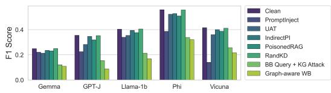  
Figure 7: Answer F1 on HotpotQA-Distractor with five additional readers under the LLaMA3-8B graph extraction setting.

Retrieval and models. KG2RAG retrieves K = 10 seed chunks, expands their linked triplets, and reranks candidate chunks with bge-reranker-large; the final context has at most 10 chunks. At this fixed K, the exponential importance weights in Eq. 2 do not overflow; a larger-K implementation can evaluate the same normalized weights with rescaling or in log space. We evaluate Contriever, BGE-large-en-v1.5, and mxbai-embed-large. The two main-table model settings use LLaMA3-8B or Qwen3-8B-Base for both triplet extraction and answer generation. Other analyses use LLaMA3-8B unless stated otherwise. Appendix C reproduces the prompts.

Attack settings and baselines. The main queryattack budget is $T _ { \mathrm { m a x } } = 5$ iterations. Accepted substitutions must reduce the ranking loss and satisfy cosine similarity ≥ 0.8 under all-MiniLM-L6-v2. BB Query uses observed rankings and WordNet candidate substitutions; WB Query uses retriever gradients over a top-(K + M) candidate pool with M = 50. Graph-aware WB deletes 5% of triplets in the query-specific evidence graph, prioritizing bridges; Random KG Deletion uses the same deletion budget. HotFlip is a corpus-poisoning baseline: it optimizes one injected passage per question with at most 20 token-replacement steps and 32 candidates per step, capped at 96 tokens. It does not edit the query. The remaining baseline implementations follow their cited attacks.

Evaluation. Answer F1 uses normalized token overlap with the gold answer; yes, no, and noanswer require exact matching. Supporting-fact F1 uses exact matching of (title, sentence-index) pairs. We report means of question-level F1 values, so F1 need not equal the harmonic mean of separately averaged Precision and Recall. For paired uncertainty analyses, bootstrap resampling uses questions as the unit.

## C Prompt Templates

The same templates are used for LLaMA3-8B and Qwen3-8B-Base; the text chunk, retrieved context, and question replace the placeholders below.

## C.1 Triplet Extraction Prompt

Extract triplets informative from the text   
following the examples. Make sure the   
triplet texts are only directly from the   
given text! Complete directly and strictly   
following the instructions without any   
additional words, line break nor space!   
Text: Scott Derrickson (born July 16, 1966) is   
an American director, screenwriter and   
producer.   
Triplets:<Scott Derrickson##born in##1966>\$\$<   
Scott Derrickson##nationality##America>\$\$<   
Scott Derrickson##occupation##director>\$\$<   
Scott Derrickson##occupation##screenwriter   
>\$\$<Scott Derrickson##occupation##producer   
>\$\$   
Text: A Kiss for Corliss is a 1949 American   
comedy film directed by Richard Wallace   
and written by Howard Dimsdale. It stars   
Shirley Temple in her final starring role   
as well as her final film appearance.   
Shirley Temple was named United States   
ambassador to Ghana and to Czechoslovakia   
and also served as Chief of Protocol of   
the United States.   
Triplets:<A Kiss for Corliss##cast member##   
Shirley Temple>\$\$<Shirley Temple##served   
as##Chief of Protocol>\$\$   
Text: {ctx\_text}   
Triplets:

## C.2 Answer Generation Prompt

Context information:

{context\_str}

A: Yes

Q: Who was born earlier, Emma Bull or Virginia Woolf?

A: Adeline Virginia Woolf

Q: The arena where the Lewiston Maineiacs played their home games can seat how many people?

A: 3,677 seated

Q: What government position was held by the woman who portrayed Corliss Archer in the film Kiss and Tell?

A: Chief of Protocol

Q: Which U.S. state has the capital city named Helena?

A: Montana

Q: {query\_str}

A: