# INTACT: INDUCING LATENT REASONING ON A FROZEN BACKBONE

Kutay Tire\* Atula Tejaswi Haris Vikalo Sujay Sanghavi The University of Texas at Austin

## ABSTRACT

Latent reasoning replaces natural-language chains of thought with compact continuous “soft-token” representations, reducing the number of intermediate tokens that must be decoded autoregressively. We use a small external encoder to induce latent reasoning in a frozen backbone model. The encoder iteratively maps the backbone’s hidden states to new latent blocks, constructing a latent reasoning prefix, after which the frozen model writes its remaining reasoning and its answer as text. Our method, INTACT, trains this encoder through distillation to reproduce the effect of written reasoning steps while keeping the model’s behavior close to that of the frozen backbone, and then reinforces it on answer correctness. Across four frozen backbones from 1B to 8B, INTACT improves both GSM8K and average out-of-domain accuracy, including GSM8K gains from 75.8% to 79.3% on LLAMA-3.2-3B and from 77.6% to 79.7% on QWEN2.5-3B. It also reduces end-to-end latency per problem by 19% on LLAMA-3.2-3B and outperforms the evaluated latent-reasoning baselines at the 3B and 8B scales. Beyond the mathematics setting, the same recipe trained on a multi-domain corpus improves the frozen backbone on twelve evaluation benchmarks spanning mathematics, science, and commonsense, without task-specific adaptation.

## 1 Introduction

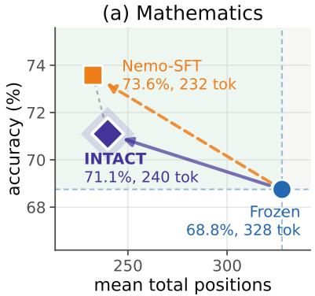

(b) Science  
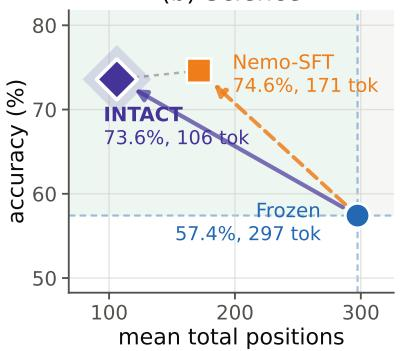

(c) Commonsense  
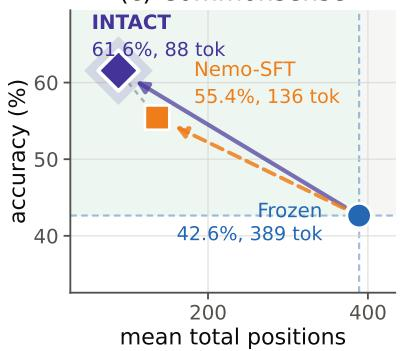  
Figure 1: Accuracy and total positions across three reasoning domains. A single INTACT encoder is evaluated on mathematics, science and commonsense benchmarks. INTACT and Nemo-SFT are both trained on the Llama-Nemotron mixture. INTACT trains only the encoder and leaves LLAMA-3.2-3B frozen, whereas Nemo-SFT updates the language model via supervised fine-tuning. Section 4.5 describes the datasets and evaluation setup.

Language models are increasingly applied to complex problems across domains such as mathematics, code, and commonsense reasoning, where the answer follows from a sequence of dependent steps rather than from recall (Cobbe et al., 2021; Hendrycks et al., 2021b; Jain et al., 2025). In such settings, chain-of-thought prompting draws out the intermediate steps in natural language and substantially improves accuracy (Wei et al., 2022; Kojima et al., 2022;

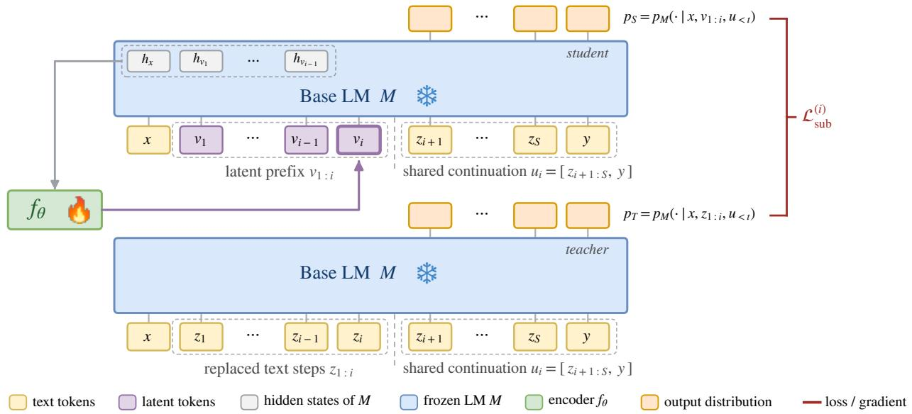  
Figure 2: Stage 1, progressive substitution via distillation. The language model M is frozen and only the encoder $f _ { \theta }$ is trained. At depth i, the encoder produces $\mathbf { v } _ { i }$ from $M \mathrm { { s } }$ states over x and the preceding blocks $\mathbf { v } _ { 1 : i - 1 }$ , completing the student prefix $[ \mathbf { x } , \mathbf { v } _ { 1 : i } ]$ against the teacher’s $\left[ \mathbf { x } , \mathbf { z } _ { 1 : i } \right] .$ . The substitution loss $\mathcal { L } _ { \mathrm { s u b } }$ distills $p _ { T }$ into p over the shared continuation ${ \bf { u } } _ { i } ,$ without directly aligning $\mathbf { v } _ { j }$ and $\mathbf { z } _ { j }$ . Stage 2, latent-policy refinement, not shown, then refines the same encoder for answer correctness using group-relative policy gradients, leaving M frozen.

Wang et al., 2023). That accuracy is paid for in the output sequence, since every intermediate token must be decoded autoregressively before the answer appears, and the cost grows with reasoning depth (Chen et al., 2025b; Snell et al., 2025).

Latent reasoning proposes to move part of this computation out of language space, replacing some or all of the written steps with continuous vectors that the model consumes directly (Hao et al., 2025; Shen et al., 2025). These vectors may provide compact representations of longer textual traces, and recent work has learned such representations by distilling from an explicit reasoner (Shen et al., 2025; Wei et al., 2026), by multiplexing several reasoning threads into one sequence (Suleymanzade et al., 2026), or by looping a transformer over its own latent state (Fan et al., 2026; Saunshi et al., 2025).

Yet most latent-reasoning methods update the backbone alongside the latent mechanism (Hao et al., 2025; Shen et al., 2025; Fan et al., 2026; Suleymanzade et al., 2026). On capable backbones, such updates risk eroding existing reasoning abilities, including those needed for tasks beyond the fine-tuning data (Xu et al., 2025). Freezing the backbone leaves the original model intact and recoverable, but places the burden on the latent interface to produce inputs the frozen model can use. One response to this constraint is SoftCoT, which derives soft thoughts from the question with a small assistant (Xu et al., 2025). We instead condition a small encoder on the backbone’s hidden states over the question and preceding latent blocks. This leads to our central question: Can we induce latent reasoning on afrozen backbone, improving both its accuracy and its efficiency?

We propose INTACT, illustrated in Figure 2. An encoder reads the frozen language model’s final-layer states and produces K latent blocks of c vectors each (K = 4 and c = 4 in our experiments). During training, the first j blocks learn to replace the first j reasoning steps. Block j is generated from the question representation together with the frozen model’s representation of blocks $1 , \ldots , j - 1$ . At inference, the resulting Kc vectors are inserted after the question in place of the corresponding initial textual reasoning, after which the frozen model generates a solution in its own words.

Training proceeds in two stages. Stage 1 trains each block to reproduce the effect of the written reasoning step it replaces, while a preservation term keeps the latent-conditioned model’s behavior close to the frozen model’s own. Stage 2 then refines the encoder against answer correctness using group-relative advantages. Across four backbones from 1B to 8B, INTACT improves upon the frozen backbone while reducing the number of generated tokens, and it surpasses the evaluated latent-reasoning methods at the 3B and 8B scales. We summarize our contributions as follows:

1. Frozen-backbone latent inference. INTACT constructs a latent prefix sequentially in K blocks. Each block is produced from the frozen model’s hidden states over the question and preceding blocks, thereby conditioning the encoder on the model’s representation of the prefix constructed so far. Once the prefix is complete, the frozen model generates its textual reasoning and answer without further encoder calls.

2. Two-stage encoder training. Progressive substitution distills the effect of successive written reasoning steps into latent blocks, while on-policy preservation constrains their effect on generated continuations. A second stage refines the encoder on answer correctness using group-relative policy gradients.

3. Accuracy with fewer tokens. Under mathematics training on GSM8K-Aug, INTACT improves frozenmodel accuracy while generating fewer tokens across four Llama and Qwen backbones from 1B to 8B. It also outperforms the evaluated latent-reasoning baselines at the 3B and 8B scales (Section 4.2).

4. Multi-domain transfer. Under multi-domain training on Llama-Nemotron, INTACT improves accuracy and generates fewer tokens across twelve evaluation benchmarks without benchmark-specific adaptation, including commonsense, a domain absent from training (Figure 1, Section 4.5).

## 2 Related Work

Chain-of-thought and test-time scaling. Prompting or training models to produce intermediate steps before answering improves accuracy on hard problems (Wei et al., 2022; Kojima et al., 2022), and the gains grow with the language-space computation spent, whether by aggregating sampled chains (Wang et al., 2023), scaling test-time compute (Snell et al., 2025; Muennighoff et al., 2025), or reinforcement learning that elicits extended traces (DeepSeek-AI et al., 2025). The cost of these tokens has in turn motivated work on overthinking and reasoning efficiency (Chen et al., 2025b).

Latent and continuous reasoning. A complementary line moves reasoning into non-linguistic computation. Pause and filler tokens add computation without content (Goyal et al., 2024; Pfau et al., 2024), and implicit-CoT methods distill the trace away entirely (Deng et al., 2023, 2024). Coconut feeds last hidden states back as input embeddings, unrolling a chain of continuous thoughts (Hao et al., 2025), which may encode superpositions of parallel search paths (Zhu et al., 2025a). CODI compresses the chain by self-distillation (Shen et al., 2025) and SIM-CoT adds step-level supervision (Wei et al., 2026), while Soft Thinking replaces sampled tokens with probability-weighted mixtures at inference (Zhang et al., 2025), although the benefits of this training-free approach have been contested (Wu et al., 2025). Others make continuous chains trainable with reinforcement learning (Butt et al., 2025), move the reasoning loop inside the network (Saunshi et al., 2025; Geiping et al., 2025), or pretrain with continuous concepts (Tack et al., 2026). Zhu et al. (2025b) survey the area. Many of these methods update the backbone, and most stop the model from writing its own reasoning.

Compression and frozen-backbone latents. Text-space compression shortens prompts and traces while keeping the medium fixed (Jiang et al., 2023). Compressed chain-of-thought generates dense contemplation tokens as trace surrogates (Cheng & Van Durme, 2024), Token Assorted mixes discrete latent codes with text (Su et al., 2025), and latent diffusion methods denoise reasoning steps in a learned space that is co-trained for noise tolerance (Kang et al., 2026; Li et al., 2022). SoftCoT prepends soft tokens from a small assistant model to a frozen backbone and still generates language-space reasoning afterwards (Xu et al., 2025). Appendix A compares INTACT with individual prior methods.

## 3 Method

Notation. Let M be a language model with vocabulary V and input-embedding dimension $d _ { M }$ , and let $\nu ^ { * }$ denote sequences of tokens in V. For a token string $\mathbf { x } \in \mathcal { V } ^ { * }$ , let $E ( \mathbf { x } )$ denote the corresponding sequence of token embeddings. We consider inputs to M that mix a token sequence x with a sequence v of non-token vectors, and we write such inputs in embedding space, so that the concatenation of the two is $[ E ( \mathbf { x } ) , \mathbf { v } ]$ . We write $H ( \cdot )$ for the final-layer hidden states M produces on a mixed input of this kind, so $\mathbf { h } = H ( [ E ( \bar { \mathbf { x } } ) , \dot { \mathbf { v } } ] )$ denotes its states over the whole sequence. Where the embedding map is clear from context we abbreviate $[ E ( \mathbf { x } ) , \mathbf { \bar { v } } ]$ as $[ \mathbf { x } , \mathbf { v } ] .$ , and we write conditioning on such an input as $p _ { M } ( \cdot \mathbf { \epsilon } \mid \mathbf { x } , \mathbf { v } )$ . A training example is a triple $\left( \mathbf { x } , \mathbf { z } _ { 1 : S } , \mathbf { y } \right)$ , where x is a question, $\mathbf { z } _ { 1 : S } = ( \mathbf { z } _ { 1 } , \ldots , \mathbf { z } _ { S } )$ is a reference reasoning trace of S steps with $\mathbf { z } _ { i } \in \mathcal { V } ^ { n _ { i } }$ , and y is the final answer. Without a latent prefix, the unmodified backbone generates a continuation $\hat { \mathbf { y } } \sim p _ { M } ( \cdot \mid \mathbf { x } )$ containing its own reasoning and a final answer $\operatorname { A n s } ( \hat { \mathbf { y } } )$ , requiring an autoregressive decoding step for every token in it. Table 9 collects the remaining symbols.

Algorithm 1 INTACT inference. The language model M is frozen and the encoder $f _ { \theta }$ is fixed.   
Require: question x; frozen LM M; trained encoder f ; K=4 blocks of c=4 vectors   
H(·) denotes the final-layer states M produces on an embedding-space input, as in Section 3   
1: for $\acute { j } = 1 , \ldots , K$ do   
2: $\mathbf { v } _ { j }  f _ { \theta } ^ { ( j ) } \big ( H ( [ E ( \mathbf { x } ) , \mathbf { v } _ { 1 : j - 1 } ] ) \big )$ ▷ one block per call, c vectors at a time   
3: end for   
4: $\hat { \mathbf { y } } \sim p _ { M } . ( \cdot \mid [ E ( \mathbf { x } ) , \mathbf { v } _ { 1 : K } ] )$ ▷ no further encoder calls   
5: return Ans(yˆ)

## 3.1 Latent Encoder $f _ { \theta }$

The latent encoder $f _ { \theta }$ maps a sequence of hidden states h to a block of c continuous vectors. Vectors within a block are generated jointly in a single encoder pass, whereas blocks are constructed sequentially. To produce block $j ,$ the encoder reads the frozen model’s final-layer states over the question and the preceding latent blocks:

$$
\begin{array} { r } { \mathbf { v } _ { j } = f _ { \theta } ^ { ( j ) } \big ( H ( [ E ( \mathbf { x } ) , \mathbf { v } _ { 1 : j - 1 } ] ) \big ) \in \mathbb { R } ^ { c \times d _ { M } } . } \end{array}
$$

For $j = 1$ , the input consists only of the question states, $H ( E ( \mathbf { x } ) )$ . After each block is appended, the frozen model processes the extended prefix, providing the hidden states used to generate the next block. This recurrence is mediated by the frozen model’s representations of the preceding blocks, rather than by feeding their raw vectors directly back to the encoder. The encoder therefore builds the latent prefix from representations supplied by M, without learning a separate question encoder.

Example. For a 60-token question, the frozen model supplies the states $H ( E ( \mathbf { x } ) )$ to the encoder, which returns the first block   
${ \bf v } _ { 1 } = f _ { \boldsymbol \theta } ^ { ( 1 ) } ( H ( E ( { \bf x } ) ) )$ of $c = 4$ vectors. These are appended to the input, so the model reads $[ E ( \mathbf { x } ) , \mathbf { v } _ { 1 } ]$ and produces   
$H ( [ E ( \mathbf { x } ) , \mathbf { v } _ { 1 } ] )$ . The encoder reads the sequence of 64 hidden states to produce $\mathbf { v } _ { 2 } = f _ { \theta } ^ { ( 2 ) } ( H ( [ E ( \mathbf { x } ) , \mathbf { v } _ { 1 } ] ) )$ , and so on:   
Prefix positions: $6 0 \xrightarrow { + \mathbf { v } _ { 1 } } 6 4 \xrightarrow { + \mathbf { v } _ { 2 } } 6 8 \xrightarrow { + \mathbf { v } _ { 3 } } 7 2 \xrightarrow { + \mathbf { v } _ { 4 } } 7 6 .$   
After $K = 4$ blocks the prefix holds 76 positions, 60 question tokens and 16 latent vectors, and the model generates its   
reasoning and answer with no further encoder calls.

Encoder architecture. The encoder projects the context from $d _ { M }$ to a hidden dimension of $d = 1 0 2 4$ . It then applies six Transformer layers, each consisting of cross-attention from the c queries to the context, self-attention among the queries, and a feed-forward network, with pre-normalization and residual connections throughout. A final linear layer projects each output to $d _ { M }$ . Each output vector is normalized and rescaled by a shared learned scalar. The encoder has 107M parameters. All parameters are shared across blocks except for the queries $q _ { j }$

Inference. Given a question x, the encoder is invoked K times, after which M generates its reasoning and answer autoregressively from $\left[ E ( \mathbf { x } ) , \mathbf { v } _ { 1 : K } \right]$ without further encoder calls. Algorithm 1 states the procedure.

## 3.2 Training

Training proceeds in two stages, neither of which updates the language model. Every parameter of M remains fixed, and although gradients pass through it, only θ is updated, which separates learning the latent interface from relearning the reasoning behavior of the backbone. Stage 1 trains through distillation to replace written reasoning steps with latent blocks, and Stage 2 then refines the same encoder against answer correctness. Algorithm 2 summarizes both stages.

Stage 1: progressive substitution. Stage 1 trains successive latent blocks to reproduce the effect of corresponding written reasoning steps. At substitution depth i, the teacher context contains the first i reference steps, $C _ { i } ^ { \mathrm { T } } = \left[ \mathbf { x } , \mathbf { z } _ { 1 : i } \right]$ while the student context replaces them with latent blocks, $C _ { i } ^ { \mathrm { S } } = [ { \bf x } , { \bf v } _ { 1 : i } ]$ . Both are followed by the same continuation $\mathbf { u } _ { i } = [ \mathbf { z } _ { i + 1 : S } , \mathbf { y } ]$ . For two contexts A and B, we define the continuation-level behavioral divergence

$$
D ( A \| B ; { \mathbf { u } } ) = \frac { 1 } { | { \mathbf { u } } | } \sum _ { t } { \mathrm { K L } } ( p _ { M } ( \cdot \mid A , { \mathbf { u } } _ { < t } ) \| p _ { M } ( \cdot \mid B , { \mathbf { u } } _ { < t } ) ) .
$$

The substitution loss at depth i is $\mathcal { L } _ { \mathrm { s u b } } ^ { ( i ) } = D ( C _ { i } ^ { \mathrm { T } } \Vert C _ { i } ^ { \mathrm { S } } ; \mathbf { u } _ { i } )$ , self-distillation through one frozen model, with the reference steps supplying the behavior to reproduce and both distributions evaluated under teacher forcing on the shared continuation. The written steps occupy more positions than the latent blocks that replace them, so we shift the latent span to keep the continuation at the same positions in both. Appendix C.1 gives the position assignment and the stages it applies to. We optimize depths $i = 1 , \ldots , K$ in order, using the substitution loss only for examples with $S > i ,$ and take one encoder update at each depth. After every update, $\mathbf { v } _ { 1 : i }$ is regenerated with the new parameters before constructing depth $i + 1$ . Gradients pass through the preceding blocks and the fixed language model, but only the shared encoder parameters θ are updated.

Algorithm 2 INTACT training. The language model M is frozen throughout; only θ is learned.   
Require: example $( \mathbf { x } , \mathbf { z } _ { 1 : S } , \mathbf { y } ) ;$ frozen LM M; encoder $f _ { \theta } ; K { = } 4$ blocks of c=4 vectors   
H(·) denotes the final-layer states M produces on an embedding-space input, as in Section 3   
$\begin{array} { r } { D \big ( \dot { A } \| B ; { \mathbf { u } } \big ) = \frac { 1 } { | { \mathbf { u } } | } \sum _ { t } \mathrm { K } \dot { \mathrm { L } } \big ( p _ { M } ( \cdot | A , \dot { \mathbf { u } _ { < t } } ) \| p _ { M } ( \cdot | B , \mathbf { u } _ { < t } ) \big ) } \end{array}$   
Stage 1: distill the chain into latents   
1: for minibatch, then $i = 1 , \ldots , K$ do ▷ $\mathcal { L } _ { \mathrm { s u b } }$ uses examples with $S > i$   
2: $\mathbf v _ { j } \gets f _ { \theta } ^ { ( j ) } \big ( H ( [ E ( \mathbf x ) , \mathbf v _ { 1 : j - 1 } ] ) \big ) , j = 1 , \dots , i$   
3: $\mathcal { L } \gets D \big ( [ \mathbf { x } , \mathbf { z } _ { 1 : i } ] \| [ \mathbf { x } , \mathbf { v } _ { 1 : i } ] ; [ \mathbf { z } _ { i + 1 : S } , \mathbf { y } ] \big )$ ▷ $\mathcal { L } _ { \mathrm { { s u b } } } \mathrm { { : } }$ i latent blocks replace i text steps   
4: $\mathbf { i f } \ i = K$ then   
5: $\hat { \mathbf { y } } \sim p _ { M } ( \cdot \mid \mathbf { x } , \mathbf { v } _ { 1 : K } ) ; \quad \mathcal { L }  \mathcal { L } + \beta D \big ( \mathbf { x } \| [ \mathbf { x } , \mathbf { v } _ { 1 : K } ] ; \hat { \mathbf { y } } \big )$ ▷ $. \mathcal { L } _ { \mathrm { p r e } } .$ match unsteered M   
6: end if   
7: $\theta \gets \theta - \eta \nabla _ { \theta } \mathcal { L }$ ▷ backprop through fixed M; update θ only   
8: end for   
Stage 2: reinforce with answer reward   
9: for minibatch do   
10: $\mathbf v _ { j } \gets f _ { \theta } ^ { ( j ) } \big ( H ( [ E ( \mathbf x ) , \mathbf v _ { 1 : j - 1 } ] ) \big ) , j = 1 , \dots , K ;$ sample $\hat { \mathbf { y } } ^ { 1 } , \ldots , \hat { \mathbf { y } } ^ { G } \sim p _ { M } ( \cdot \mid \mathbf { x } , \mathbf { v } _ { 1 : K } )$   
11: $r ^ { \dot { g } } \gets \check { R } ( { \hat { \mathbf { y } } } ^ { \dot { g } } , \mathbf { y } ) , \quad \dot { A } ^ { g } \gets ( r ^ { \dot { g } } - \bar { r } ) / ( \sigma _ { r } + \epsilon )$ ▷ group-relative advantage   
12: $\begin{array} { r } { \theta \xleftarrow { } \theta + \eta \frac { 1 } { G } \sum _ { g } \frac { A ^ { g } } { | \hat { \mathbf { y } } ^ { g } | } \sum _ { t } \nabla _ { \theta } \log p _ { M } \left( \hat { y } _ { t } ^ { g } \mid \mathbf { x } , \mathbf { v } _ { 1 : K } , \hat { \mathbf { y } } _ { < t } ^ { g } \right) } \end{array}$ ▷ per-sequence mean   
13: end for

On-policy preservation. Because $\mathcal { L } _ { \mathrm { s u b } }$ is teacher-forced, it cannot see failures that appear only when the model generates freely. We therefore sample a rollout under the complete prefix, $\hat { \mathbf { y } } \sim p _ { M } ( \cdot \mathbf { \mu } | \mathbf { x } , \mathbf { v } _ { 1 : K } )$ , and penalize the intervention’s effect along it with $\mathcal { L } _ { \mathrm { p r e } } = D ( \mathbf { x } \| [ \mathbf { x } , \mathbf { v } _ { 1 : K } ] ; \hat { \mathbf { y } } )$ . The sampled continuation is held fixed, and the unsteered model supplies the target distribution, regularizing the latent-conditioned model on prefixes encountered during free generation. Preservation applies only at $i = K$ , so the Stage 1 loss of Algorithm 2 is $\dot { \mathcal { L } } _ { \mathrm { S 1 } } ^ { ( i ) } = \mathcal { L } _ { \mathrm { s u b } } ^ { ( i ) } + \mathbf { 1 } [ i = K ] \beta \dot { \mathcal { L } } _ { \mathrm { p r e } } .$

Stage 2: latent-policy refinement. Stage 1 learns from the behavior induced by reference traces. Stage 2 instead refines the encoder against answer correctness. The encoder and frozen model together define $\pi _ { \boldsymbol { \theta } } ( \hat { \mathbf { y } } \mid \mathbf { x } ) = p _ { M } ( \hat { \mathbf { y } } \mid$ $\mathbf { x } , \mathbf { v } _ { 1 : K } )$ with the K blocks $\mathbf { v } _ { 1 : K }$ built sequentially by the encoder $f _ { \theta } ,$ , which alone is updated. For each question, we sample G completions $\hat { \mathbf { y } } ^ { 1 } , \hdots , \hat { \mathbf { y } } ^ { G }$ and assign the binary correctness reward $r ^ { g } = \bar { R ( \mathbf { y } ^ { g } , \mathbf { y } ) }$ , where R indicates whether the extracted answer matches the reference under the answer-comparison protocol of Appendix C.4. We standardize rewards within the group to obtain $A ^ { g } = ( r ^ { g } - \bar { r } ) / ( \sigma _ { r } + \epsilon )$ and minimize the per-sequence-normalized policy loss

$$
\mathcal { L } _ { \mathrm { R L } } = - \frac { 1 } { G } \sum _ { g = 1 } ^ { G } A ^ { g } \frac { 1 } { | \hat { \mathbf { y } } ^ { g } | } \sum _ { t } \log p _ { M } ( \hat { y } _ { t } ^ { g } \mid \mathbf { x } , \mathbf { v } _ { 1 : K } , \hat { \mathbf { y } } _ { < t } ^ { g } ) .
$$

Groups in which every completion receives the same reward have zero advantage and make no update. The Stage 2 block of Algorithm 2 summarizes this update.

## 4 Experiments

## 4.1 Setup

INTACT variants. We consider two training settings, on separate corpora and never mixed. Each encoder reads one backbone’s hidden states and is trained for that backbone alone.

• Mathematics training on GSM8K-Aug follows prior latent-reasoning work and uses 385K examples (Deng et al., 2023) whose solutions are sequences of compact arithmetic steps. It is trained separately for each of the four backbones and evaluated in domain on the GSM8K test set (Cobbe et al., 2021) and out of domain on SVAMP, GSM-Hard and MultiArith, over which we report an unweighted macro-average.

• Multi-domain training on Llama-Nemotron uses the Llama-Nemotron post-training corpus (Bercovich et al., 2025), approximately 64% mathematics, 21% science and 14% code. It is trained once, on LLAMA-3.2-3B-INSTRUCT, and evaluated on twelve held-out mathematics, science and commonsense benchmarks.

The four backbones are LLAMA-3.2-1B-INSTRUCT, LLAMA-3.2-3B-INSTRUCT, LLAMA-3.1-8B-INSTRUCT (Grattafiori et al., 2024), and the base QWEN2.5-3B (Yang et al., 2024). INTACT uses K = 4 blocks of c = 4 vectors in both settings, with the same encoder architecture and objectives throughout and the language model frozen. Appendix C.2 gives the diverse-domain corpus selection and segmentation into steps, and Appendix E the twelve evaluation benchmarks.

Baselines. We compare against the unchanged Frozen LM, and against three supervised baselines that update the language model and so measure what the same supervision achieves when changing the backbone is allowed. No-CoT trains on the answer alone. Aug-SFT trains on GSM8K-Aug, whose steps are compact symbolic traces, primarily calculator expressions. Nemo-SFT instead trains on the Llama-Nemotron mixture, whose steps are complete naturallanguage worked solutions. We further compare with CODI (Shen et al., 2025), LOTUS (Fan et al., 2026), and MUX (Suleymanzade et al., 2026), which replace written reasoning with continuous or recurrent computation but likewise update the language model. Appendix C.3 describes how each baseline was trained or, where a result is quoted, which table it is taken from.

Evaluation. We evaluate on full test splits with generation caps of 768 tokens for mathematics and 2,048 for the multi-domain setting, whose natural-language solutions are longer. We report answer accuracy and mean generated tokens. Wherever total token use is shown, INTACT is also charged for its 16 latent positions. Accuracy for INTACT is averaged over three encoder seeds, with ± giving the sample standard deviation where it is shown. Token counts are measured on the single seed that initializes Stage 2, so the two stages stay comparable. Ablations and controls use one encoder seed. Quoted baselines retain their source protocols. Appendix C.4 specifies the prompts, decoding parameters, and answer extraction.

## 4.2 Main Results

Against the frozen backbone. Table 1 reports accuracy at the 768-token cap, where both stages improve GSM8K and out-of-domain accuracy over the frozen backbone on all four models. Stage 2 further improves six of the eight Stage 1 scores. It is 0.3 points lower on 3B out-of-domain accuracy and 0.1 points lower on 8B GSM8K. The largest Stage 1 gains occur at 8B, where the bare-prompt frozen model often continues generating after producing its answer. To separate this formatting issue from reasoning accuracy, we also evaluate the frozen model

Table 1: Accuracy (%) at a 768-token generation cap across four backbones. Both INTACT stages are trained on GSM8K-Aug. OOD is the average on SVAMP, GSM-Hard and MultiArith.
<table><tr><td rowspan="2"></td><td colspan="2">Frozen</td><td colspan="2">INTACT Stage 1</td><td colspan="2">INTACT Stage 2</td></tr><tr><td>GSM8K↑ OOD↑</td><td></td><td>GSM8K↑</td><td>OOD↑</td><td>GSM8K↑</td><td>OOD↑</td></tr><tr><td>Llama-3.2-1B</td><td>44.0</td><td>47.8</td><td>44.2</td><td>51.3</td><td>48.7</td><td>54.5</td></tr><tr><td>Llama-3.2-3B</td><td>75.8</td><td>66.5</td><td>77.9</td><td>69.1</td><td>79.3</td><td>68.8</td></tr><tr><td>Llama-3.1-8B</td><td>72.3</td><td>53.9</td><td>83.7</td><td>71.1</td><td>83.6</td><td>72.1</td></tr><tr><td>Qwen2.5-3B</td><td>77.6</td><td>74.6</td><td>78.0</td><td>75.0</td><td>79.7</td><td>75.1</td></tr></table>

with its native chat template. This restores reliable termination and raises its accuracy to 78.4, but leaves it below both stages of INTACT. Table 12 reports the comparison. The size of the gain varies widely across backbones. Relative to the frozen backbone, Stage 2 adds 11.3 points on GSM8K at 8B and 2.1 on QWEN2.5-3B, the strongest frozen baseline in the table. At 1B the Stage 1 encoder is flat on GSM8K (44.2 against 44.0) while gaining 3.5 out of domain. Appendix Table 11 reports the complete budget sweep and seed variation.

Comparison with latent methods. Table 2 reports accuracy on the four backbones. At LLAMA-3.2-1B, INTACT remains below Aug-SFT and the latent baselines, reaching 48.7 on GSM8K and 54.5 out of domain, compared with 61.6 and 60.5 for Aug-SFT. This ordering reverses at 3B, where INTACT reaches 79.3 and 68.8, outperforming the strongest published latent baseline by 9.3 and 4.7 points and Aug-SFT by 7.8 and 6.7 points. The advantage over Aug-SFT persists at 8B (83.6/72.1 versus 74.2/67.0) and on QWEN2.5-3B (79.7/75.1 versus 74.8/69.5), showing that it extends beyond the Llama family. The margin over the latent baselines therefore widens with scale, from −8.6 on GSM8K at 1B to +9.3 at 3B and +18.2 at 8B. Aug-SFT is strongest at 1B, whereas Nemo-SFT leads on GSM8K and the out-of-domain average at 3B and above, exceeding Stage 2 by 2.1–3.7 and 1.3–1.7 points, respectively. Thus, IN-TACT does not uniformly outperform supervised fine-tuning. It improves the frozen model and achieves the strongest GSM8K and average results among the evaluated latent methods at 3B and above, without modifying the language model.

Table 2: Accuracy (%) on four mathematics benchmarks. Our Frozen, SFT, and INTACT evaluations use a 768-token cap. CODI, MUX, and LOTUS use their source protocols, including reproductions. † and ‡ mark results quoted from MUX (Suleymanzade et al., 2026) and LOTUS (Fan et al., 2026), respectively. OOD is the mean of SVAMP, GSM-Hard, and MultiArith. Shading marks INTACT, with ± denoting standard deviation over three encoder seeds. Best and second-best latent methods are bold and underlined. A dash marks a configuration for which no comparable trained checkpoint is available at that scale.
<table><tr><td>Backbone</td><td>Method</td><td>GSM8K↑</td><td>SVAMP↑</td><td>GSM-Hard ↑</td><td>MultiArith↑</td><td>OOD↑</td></tr><tr><td rowspan="6">LLAMA-3.2-1B</td><td> $\overline { { { \mathrm { N o - C o T } } ^ { \dag } } }$ </td><td>30.9</td><td>44.1</td><td>7.1</td><td>70.9</td><td>40.7</td></tr><tr><td> $\scriptstyle \mathbf { A u g - S F T } ^ { \dag }$ </td><td>61.6</td><td>66.7</td><td>15.6</td><td>99.3</td><td>60.5</td></tr><tr><td>Nemo-SFT</td><td>53.1</td><td>59.3</td><td>15.0</td><td>92.8</td><td>55.7</td></tr><tr><td> $\mathrm { L O T U S ^ { \ddagger } }$ </td><td>57.3</td><td>60.9</td><td>12.7</td><td>98.3</td><td>57.3</td></tr><tr><td>MUX†</td><td>56.7</td><td>63.6</td><td>13.0</td><td>98.5</td><td>58.4</td></tr><tr><td>CODI†</td><td>55.6</td><td>61.1</td><td>12.8</td><td>96.1</td><td>56.7</td></tr><tr><td></td><td>INTACT Stage 1</td><td> $4 4 . 2 \pm 1 . 0$ </td><td> $5 5 . 3 \pm 2 . 3$ </td><td> $1 3 . 1 \pm 0 . 6$ </td><td> $8 5 . 6 \pm 0 . 1$ </td><td> $5 1 . 3 \pm 1 . 0$ </td></tr><tr><td rowspan="6">LLAMA-3.2-3B</td><td>INTACT Stage 2</td><td> $4 8 . 7 \pm 1 . 3$ </td><td> $5 9 . 8 \pm 1 . 3$ </td><td> $\overline { { 1 3 . 7 } } \pm 0 . 3$ </td><td> $8 9 . 9 \pm 0 . 2$ </td><td> $5 4 . 5 \pm 0 . 4$ </td></tr><tr><td> $\overline { { \mathrm { N o - C o T } ^ { \dag } } }$ </td><td>38.3</td><td>52.9</td><td>9.5</td><td>88.7</td><td>50.4</td></tr><tr><td> $\scriptstyle \mathbf { A u g - S F T } ^ { \dag }$ </td><td>71.5</td><td>71.0</td><td>17.0</td><td>98.3</td><td>62.1</td></tr><tr><td>Nemo-SFT</td><td>82.9</td><td>83.5</td><td>30.3</td><td>97.8</td><td>70.5</td></tr><tr><td> $\mathrm { L O T U S ^ { \ddagger } }$ </td><td>70.0</td><td>75.7</td><td>16.0</td><td>99.9</td><td>63.9</td></tr><tr><td> $\mathbf { M } \mathbf { U } \mathbf { X } ^ { \dagger }$ </td><td>65.0</td><td>77.1</td><td>15.2</td><td>100.0</td><td>64.1</td></tr><tr><td></td><td>CODI† INTACT Stage 1</td><td>60.8  ${ \underline { { 7 7 . 9 \pm 0 . 3 } } }$ </td><td>73.3 81.1 ± 0.6</td><td>14.3  $2 7 . 9 \pm 0 . 2$ </td><td>98.7  $9 8 . 3 \pm 0 . 5$ </td><td>62.1 69.1 ± 0.3</td></tr><tr><td rowspan="4"></td><td>INTACT Stage 2</td><td> $7 9 . 3 \pm 0 . 4$ </td><td>81.8 ± 0.9</td><td> $2 7 . 0 \pm 0 . 7$ </td><td> $9 7 . 7 \pm 0 . 3$ </td><td> $6 8 . 8 \pm 0 . 2$ </td></tr><tr><td>No-CoT</td><td></td><td>57.2</td><td></td><td></td><td></td></tr><tr><td>Aug-SFT</td><td>26.5 74.2</td><td>77.3</td><td>7.5 26.5</td><td>79.8 97.3</td><td>48.2</td></tr><tr><td>Nemo-SFT</td><td>87.3</td><td>86.3</td><td>35.9</td><td></td><td>67.0</td></tr><tr><td rowspan="6">LLAMA-3.1-8B</td><td></td><td></td><td></td><td></td><td>98.0</td><td>73.4</td></tr><tr><td>LOTUS</td><td></td><td></td><td></td><td></td><td></td></tr><tr><td>MUX</td><td>65.4</td><td>77.8</td><td>16.1</td><td>100.0</td><td>64.6</td></tr><tr><td>CODI</td><td></td><td></td><td></td><td></td><td></td></tr><tr><td>INTACT Stage 1</td><td> ${ \bf 8 3 . 7 \pm 0 . 6 }$ </td><td> $\underline { { 8 2 . 8 \pm 1 . 6 } }$ </td><td> ${ \underline { { 3 3 . 2 \pm 0 . 7 } } }$ </td><td> $9 7 . 4 \pm 1 . 1$ </td><td> $\underline { { 7 1 . 1 \pm 1 . 1 } }$ </td></tr><tr><td>INTACT Stağe 2 No-CoT</td><td> $\underline { { 8 3 . 6 \pm 0 . 7 } }$ </td><td> ${ \pm } 4 . 6 \pm 1 . 1$ </td><td> $3 3 . 4 \pm 1 . 3$ </td><td> $\underline { { 9 8 . 4 \pm 0 . 6 } }$ </td><td> $\overline { { 7 2 . 1 } } \pm 0 . 7$ </td></tr><tr><td rowspan="6">QWEN2.5-3B</td><td>Aug-SFT</td><td>27.6</td><td>52.5</td><td>8.7</td><td>63.7</td><td>41.6</td></tr><tr><td></td><td>74.8</td><td>76.2</td><td>34.6</td><td>97.7</td><td>69.5</td></tr><tr><td>Nemo-SFT</td><td>81.8</td><td>86.8</td><td>45.3</td><td>97.5</td><td>76.5</td></tr><tr><td>LOTUS</td><td>66.7</td><td>71.6</td><td>17.9</td><td>100.0</td><td>63.2</td></tr><tr><td>MUX</td><td></td><td></td><td></td><td></td><td></td></tr><tr><td>CODI</td><td></td><td></td><td></td><td></td><td></td></tr><tr><td rowspan="3"></td><td>INTACT Stage 1</td><td> $\underline { { 7 8 . 0 \pm 2 . 0 } }$ </td><td> ${ \bf 8 7 . 1 \pm 0 . 4 }$ </td><td> $4 0 . 8 \pm 2 . 2$ </td><td> $9 7 . 0 \pm 0 . 6 $ </td><td> $\underline { { 7 5 . 0 \pm 1 . 0 } }$ </td></tr><tr><td>INTACT Stage 2</td><td> $7 9 . 7 \pm 0 . 5$ </td><td> $8 5 . 5 \pm 0 . 1$ </td><td> $4 1 . 4 \pm 1 . 1$ </td><td> $9 8 . 5 \pm 0 . 6$ </td><td> $\overline { { 7 5 . 1 } } \pm 0 . 5$ </td></tr><tr><td></td><td></td><td></td><td></td><td></td><td></td></tr></table>

## 4.3 Inference Efficiency

Accuracy–generation cost. We measure cost in total positions, defined as generated tokens plus IN-TACT’s 16 latent positions, excluding the question. Figure 3 compares operating points on LLAMA-3.2- 3B. INTACT reaches 79.3 accuracy at 211 positions, compared with 75.8 at 261 for the frozen backbone. Aug-SFT, CODI, and MUX occupy more compressed operating points, but reach only 71.5, 60.8, and 65.0 accuracy, respectively. Unlike CODI and MUX, IN-TACT retains a textual reasoning continuation, and unlike all three it improves the accuracy–efficiency trade-off without updating the backbone.

Effect of the two stages. Table 3 reports generated tokens across backbones. Both stages shorten generation in every case, and which contributes more depends on the backbone. The effect is particularly pronounced at 8B, where generation falls from 754 tokens

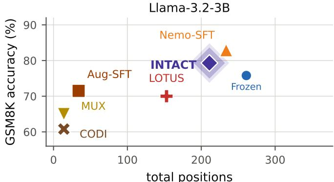  
Figure 3: GSM8K accuracy versus total positions on LLAMA-3.2-3B, with INTACT trained on GSM8K-Aug. Frozen, INTACT, and Nemo-SFT use a 768-token cap. CODI, MUX, and LOTUS follow their source protocols. Counts include latent positions where applicable.

Table 3: Mean generated tokens at a 768-token cap, for encoders trained on GSM8K-Aug. Both stages shorten generation on every backbone, in domain and out, and Stage 2 is shorter than Stage 1 in every row. OOD is the average over SVAMP, GSM-Hard and MultiArith.
<table><tr><td rowspan="2">Backbone</td><td colspan="2">Frozen LM</td><td colspan="2">INTACT Stage 1</td><td colspan="2">INTACT Stage 2</td></tr><tr><td>GSM8K↓</td><td>OOD↓</td><td>GSM8K↓</td><td>O0D↓</td><td>GSM8K↓</td><td>OOD↓</td></tr><tr><td>LLAMA-3.2-1B</td><td>252</td><td>210</td><td>241</td><td>202</td><td>215</td><td>171</td></tr><tr><td>LLAMA-3.2-3B</td><td>261</td><td>224</td><td>225</td><td>190</td><td>195</td><td>165</td></tr><tr><td>LLAMA-3.1-8B</td><td>754</td><td>745</td><td>269</td><td>207</td><td>182</td><td>155</td></tr><tr><td>QWEN2.5-3B</td><td>273</td><td>203</td><td>246</td><td>196</td><td>145</td><td>121</td></tr></table>

Table 4: Mean end-to-end latency per GSM8K problem on LLAMA-3.2-3B, measured over the full test split at batch 1 on one H100 NVL. The saving comes from emitting fewer tokens, not from faster decoding.
<table><tr><td>System</td><td>Tokens↓</td><td>ms/token</td><td>Prefix ms↓</td><td>Generation ms ↓</td><td>Total ms ↓</td></tr><tr><td>Frozen backbone</td><td>260.8</td><td>16.03</td><td></td><td>4,179.6</td><td>4,179.6 (1.00×)</td></tr><tr><td>INTACT</td><td>195.5</td><td>16.67</td><td>127.5</td><td>3,258.1</td><td> $\mathbf { 3 } , \mathbf { 3 8 5 . 6 \ ( 0 . 8 1 \times ) }$ </td></tr></table>

for the frozen backbone to 269 after Stage 1 and 182 after Stage 2. This shortening does not generally come at the expense of accuracy. Stage 2 improves six of the eight in-domain and out-of-domain measurements reported in Table 1.

End-to-end latency. Token counts provide an implementation-independent measure of generation cost, but do not directly determine wall-clock time. We therefore measure latency on the full GSM8K test split using LLAMA-3.2-3B at batch size one on one H100 NVL. As Table 4 shows, INTACT reduces mean latency from 4,180 to 3,386 ms per problem, a 19% reduction that includes latent-prefix construction. Constructing the prefix costs 127.5 ms, while the longer context raises measured decoding cost from 16.03 to 16.67 ms per generated token. Emitting 65 fewer tokens more than offsets these costs, showing that the reduction in generation length translates into a measurable, though not proportional, reduction in latency. Both systems generate under the same bare prompt. Table 12 reports how the frozen backbone’s token cost changes under its chat template.

## 4.4 Ablations

Each ablation isolates one design decision and holds the rest of the recipe fixed. The preservation and capacity ablations use QWEN2.5-3B, while the substitution-depth sweep and the architecture and prefix controls of Table 5 use LLAMA-3.1-8B. All are scored under the protocol of Section 4.1 with a 768-token cap.

Preservation anchor. Because $\mathcal { L } _ { \mathrm { s u b } }$ is scored on a reference continuation, it does not constrain the model on its own free generations. The variants below differ only in the continuation u on which $\mathcal { L } _ { \mathrm { p r e } } ( \mathbf { u } )$ is scored, and we compare omitting the term with three choices of u.

• Gold chain. $\mathbf { u } = [ \mathbf { z } _ { 1 : S } , \mathbf { y } ]$ , the written trace itself, so $\mathbf { v } _ { 1 : K }$ is scored while the model is given the very steps it replaces.

• Frozen rollout. $\mathbf { u } \sim p _ { M } ( \mathbf { \cdot } \mid \mathbf { x } )$ , free generation from the backbone without the latent prefix.

• Student rollout. $\mathbf { u } \sim p _ { M } ( \cdot \mathbf { \mu } | \mathbf { x } , \mathbf { v } _ { 1 : K } )$ , free generation from the latent-conditioned model, the continuations it actually produces.

In Figure 4 (left), omitting preservation collapses the output to 80 tokens, so its apparent efficiency is degraded generation rather than compression. The gold chain stabilizes training but stays below the backbone on both accuracy measures. A frozen rollout removes that teacher forcing and gives the best out-of-domain accuracy of the four an chors, but remains off-policy for the latent-conditioned model and lengthens generation to 309 tokens. Only the student rollout improves on the backbone in accuracy and in length at once.

Substitution depth. Stage 1 supervises every available depth, so each block is learned in the context created by its predecessors. The sweep holds the encoder fixed and varies only the number of blocks supplied at inference. On

<table><tr><td colspan="4">GSM8K↑ O0D↑</td></tr><tr><td>Frozen backbone</td><td>77.6</td><td>74.6</td><td>273</td></tr><tr><td colspan="4">Preservation anchor u</td></tr><tr><td>None (β = 0)</td><td>42.9</td><td>54.5</td><td>80</td></tr><tr><td>Gold chain</td><td>74.0</td><td>69.1</td><td>240</td></tr><tr><td>Frozen rollout</td><td>76.2</td><td>76.2</td><td>309</td></tr><tr><td>Student rollout</td><td>78.8</td><td>75.5</td><td>246</td></tr><tr><td colspan="4">Block width c (at K=4)</td></tr><tr><td>c = 1 (4 pos.)</td><td>73.7</td><td>72.7</td><td>207</td></tr><tr><td>c = 2 (8 pos.)</td><td>78.0</td><td>76.4</td><td>285</td></tr><tr><td>c = 4 (16 pos.)</td><td>78.8</td><td>75.5</td><td>246</td></tr><tr><td>c = 8 (32 pos.)</td><td>73.7</td><td>72.2</td><td>316</td></tr></table>

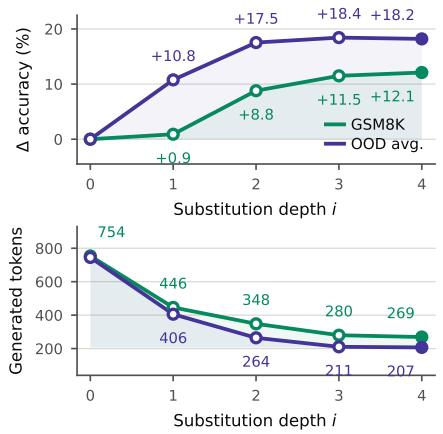  
Figure 4: Left: ablations on QWEN2.5-3B. Each block varies one design decision, and shaded rows indicate settings used by INTACT. Right: substitution depth sweep on LLAMA-3.1-8B. At depth i only the first i of K blocks are supplied, so i = 0 is the frozen backbone and i = K the full Stage 1 prefix. Both panels use one encoder seed. OOD is the macro-average over the three held-out benchmarks.

Table 5: Architecture and prefix controls on LLAMA-3.1-8B. Architecture variants retrain the encoder with the latent blocks constructed differently. Prefix interventions instead modify a trained Stage 1 prefix only at inference. OOD averages SVAMP, GSM-Hard and MultiArith. Each trained arm uses one encoder seed.
<table><tr><td></td><td colspan="2">GSM8K</td><td colspan="2">OOD</td></tr><tr><td></td><td>Acc. ↑</td><td>Tokens↓</td><td>Acc. ↑</td><td>Tokens↓</td></tr><tr><td colspan="5">Reference systems</td></tr><tr><td>Frozen backbone</td><td>72.3</td><td>754</td><td>53.9</td><td>745</td></tr><tr><td>INTACT Stage 1</td><td>84.4</td><td>269</td><td>72.1</td><td>207</td></tr><tr><td>INTACT Stage 2</td><td>83.7</td><td>182</td><td>72.8</td><td>155</td></tr><tr><td colspan="5">Architecture variants (retrained)</td></tr><tr><td>Independently built blocks</td><td>82.4</td><td>767</td><td>69.9</td><td>761</td></tr><tr><td>Jointly built blocks</td><td>82.0</td><td>522</td><td>70.1</td><td>598</td></tr><tr><td colspan="5">Prefix interventions (Stage 1, inference only)</td></tr><tr><td>Within-question block shuffle</td><td>77.0</td><td>438</td><td>67.3</td><td>401</td></tr><tr><td>Cross-question prefix</td><td>70.9</td><td>513</td><td>64.5</td><td>480</td></tr></table>

LLAMA-3.1-8B (Figure 4, right), increasing the prefix from i = 0 to i = K raises GSM8K accuracy by 12.1 points and the out-of-domain average by 18.2, while reducing generation from 754 to 269 tokens on GSM8K and from 745 to 207 on the out-of-domain average. Accuracy therefore depends on the depth supplied, not only on the presence of a latent prefix.

Latent capacity. The available substitution depth is min $( K , S - 1 )$ , and only 8% of GSM8K-Aug chains support five steps. We therefore fix K = 4 and vary the block width c, giving 4c latent positions. Performance is non-monotonic: $c = 1$ provides insufficient capacity, while c = 8 reduces accuracy and lengthens generation. Among the narrower variants, c = 1 saves tokens at the cost of accuracy, whereas c = 2 improves accuracy but generates more tokens than the backbone. Only c = 4 improves on the frozen backbone while also generating fewer tokens, providing the best accuracy–efficiency balance.

Encoder construction. Table 5 isolates two components of the encoder architecture. Building the four blocks jointly, in a single encoder call, so that they can coordinate with each other but receive no feedback from the blocks already placed, reduces GSM8K accuracy from 84.4 to 82.0 and raises generation from 269 to 522 tokens, reaching the cap on 52.5% of problems. This variant keeps the four progressive substitution depths and differs from its reference only in building the blocks together. Appendix C.1 records what is held fixed. Building the blocks independently, so that every block uses only the backbone’s hidden states over the question and not those induced by preceding latent blocks, leaves accuracy at 82.4 but increases generation from 269 to 767 tokens, comparable to the frozen backbone’s 754.

Both variants retain most of the accuracy of the full construction. The clearer difference is in generation length, where the full construction uses 269 tokens against 767 and 522, so it reaches higher accuracy while generating substantially less.

Prefix order and specificity. Table 5 also tests the trained Stage 1 prefix through inference-only interventions. Shuffling its blocks reduces GSM8K and OOD accuracy from 84.4/72.1 to 77.0/67.3, while replacing it with a prefix generated for another question reduces them to 70.9/64.5. Both interventions also lengthen generation substantially. The prefix is therefore sensitive to both block order and the source question, rather than acting as a generic learned prompt.

## 4.5 One Encoder Across Diverse Reasoning Domains

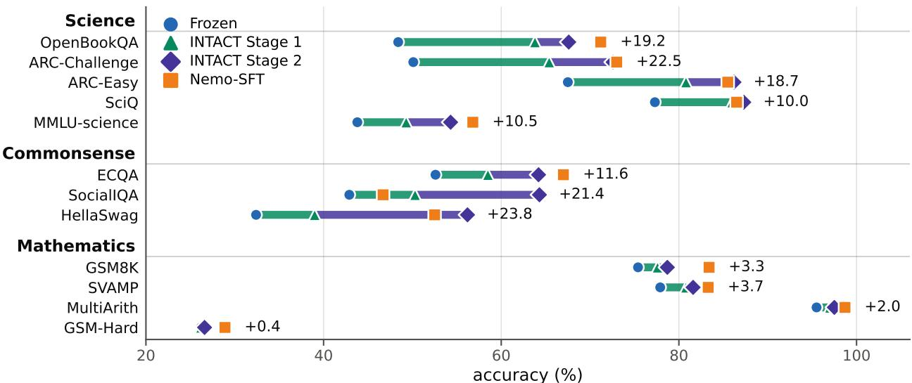  
Figure 5: One encoder across twelve benchmarks. Accuracy on LLAMA-3.2-3B across mathematics, science, and commonsense. Each benchmark line connects the frozen backbone to Stage 2, with Stage 1 marking the intermediate result. Both Nemo-SFT and INTACT are trained on the Llama-Nemotron mixture. The same INTACT encoder is used on every benchmark.

Setup. We next test whether a single latent encoder can improve reasoning across domains beyond GSM8K-Aug. We train on the mathematics, science, and code solutions in Llama-Nemotron and evaluate the same encoder, without benchmark-specific adaptation, on twelve mathematics, science, and commonsense benchmarks. Commonsense evaluation tests transfer beyond the domains explicitly represented in training. Every system in this setting is scored at the 2,048-token budget of Appendix C.4, which the long natural-language solutions of this mixture require. All systems in this setting see the same prompt.

Results. Figure 5 shows that one encoder improves the frozen backbone on all twelve benchmarks. Gains are largest in science and commonsense, reaching 22.5 points on ARC-Challenge and 23.8 on HellaSwag, while mathematics gains range from 0.4 to 3.7 points. The commonsense result is particularly notable because that domain is absent from training. The improvements are largest where the frozen backbone is weakest, with the exception of GSM-Hard, on which no system improves substantially. Compared with Nemo-SFT, INTACT is nearly tied on science (1.0 point lower) and trails on mathematics (2.5 points), but leads on commonsense (6.2 points) in domain-average accuracy, while leaving the backbone frozen.

Table 6: Conditioned encoder versus a learned constantprefix control in the diverse-domain setting on LLAMA-3.2-3B. Results use the full test splits. Math, Science and Comm. are macro-averages over four, five and three benchmarks respectively.
<table><tr><td>System</td><td>Math↑</td><td>Science↑</td><td>Comm.↑</td></tr><tr><td>Frozen backbone</td><td>68.8</td><td>57.4</td><td>42.6</td></tr><tr><td>INTACT Stage 1</td><td>70.4</td><td>69.1</td><td>49.3</td></tr><tr><td>Constant prefix, Stage 1</td><td>70.0</td><td>59.9</td><td>44.9</td></tr><tr><td>INTACT Stage 2</td><td>71.1</td><td>73.6</td><td>61.6</td></tr><tr><td>Constant preix, Stage 2</td><td>70.9</td><td>64.6</td><td>48.5</td></tr></table>

Constant-prefix control. To test whether the gains arise from a generic learned prompt, we replace the encoder outputs with Kc learned vectors shared across all questions and train them with the same objective. This prefix can learn common formatting and termination behavior but cannot encode question-specific information. Table 6 reports it after each stage, with the checkpoint for each selected by the same procedure as INTACT’s. The conditioned encoder leads it on science by 9.2 points after Stage 1 and 9.0 after Stage 2, and on commonsense by 4.4 and 13.1, while the two score similarly on mathematics at both stages. Conditioning therefore helps where the gain over the frozen backbone is largest, and its commonsense advantage widens with Stage 2 rather than narrowing. The mathematics tie is not evidence that the prefix carries nothing question-specific there. Replacing a trained prefix with one generated for a different question reduces GSM8K accuracy to 70.9 on LLAMA-3.1-8B, below the frozen backbone’s 72.3 (Table 5).

Extraction and truncation. We test whether the gains reflect answer-extraction failures or truncation of the frozen backbone. Answer extraction succeeds for 99.2–100% of frozen generations on all benchmarks except ECQA (89.3%). Some generations reach the token cap, but truncation rarely prevents scoring. HellaSwag exhibits the most truncation, yet 99.2% of its generations still yield an extractable answer. These artifacts therefore do not explain the overall gains, although extraction failures may contribute on ECQA.

## 5 Conclusion

We studied whether latent reasoning can improve a capable language model without updating its backbone. INTACT trains a small encoder that reads the frozen model’s own hidden states to reproduce the effect of early written reasoning steps, first through distillation and then through latent-policy refinement, while the language model remains frozen. Across four backbones, it improves accuracy and reduces generation relative to the frozen model, and it outperforms the evaluated latent-reasoning baselines on larger backbones. One encoder trained on mathematics, science, and code also improves the same frozen backbone on held-out mathematics, science, and commonsense benchmarks without task-specific adaptation. Together, these results show that latent reasoning can complement a capable model’s existing reasoning, rather than depend on rewriting its weights or maximizing compression.

Limitations. One limitation is that the latent blocks cannot be directly interpreted as the written steps they replace. Another is that the backbone still decodes autoregressively, so shorter generations do not necessarily produce proportional wall-clock savings (Section 4.3). INTACT also still retains language-space reasoning, so it remains more expensive than methods that compress reasoning into a handful of tokens.

## References

Shourya Aggarwal, Divyanshu Mandowara, Vishwajeet Agrawal, Dinesh Khandelwal, Parag Singla, and Dinesh Garg. Explanations for CommonsenseQA: New dataset and models. In Proceedings of the 59th Annual Meeting of the Associationfor Computational Linguistics (ACL), pp. 3050–3065, 2021.

Akhiad Bercovich, Itay Levy, Izik Golan, et al. Llama-nemotron: Efficient reasoning models. arXiv preprint arXiv:2505.00949, 2025.

Natasha Butt, Ariel Kwiatkowski, Ismail Labiad, Julia Kempe, and Yann Ollivier. Soft tokens, hard truths. arXiv preprint arXiv:2509.19170, 2025.

Xinghao Chen, Anhao Zhao, Heming Xia, Xuan Lu, Hanlin Wang, Yanjun Chen, Wei Zhang, Jian Wang, Wenjie Li, and Xiaoyu Shen. Reasoning beyond language: A comprehensive survey on latent chain-of-thought reasoning. arXiv preprint arXiv:2505.16782, 2025a.

Xingyu Chen, Jiahao Xu, Tian Liang, Zhiwei He, Jianhui Pang, Dian Yu, Linfeng Song, Qiuzhi Liu, Mengfei Zhou, Zhuosheng Zhang, Rui Wang, Zhaopeng Tu, Haitao Mi, and Dong Yu. Do not think that much for 2+3=? On the overthinking of long reasoning models. In International Conference on Machine Learning, 2025b.

Jeffrey Cheng and Benjamin Van Durme. Compressed chain of thought: Efficient reasoning through dense representations. arXiv preprint arXiv:2412.13171, 2024.

Peter Clark, Isaac Cowhey, Oren Etzioni, Tushar Khot, Ashish Sabharwal, Carissa Schoenick, and Oyvind Tafjord. Think you have solved question answering? try ARC, the AI2 reasoning challenge. arXiv preprint arXiv:1803.05457, 2018.

Karl Cobbe, Vineet Kosaraju, Mohammad Bavarian, Mark Chen, Heewoo Jun, Lukasz Kaiser, Matthias Plappert, Jerry Tworek, Jacob Hilton, Reiichiro Nakano, et al. Training verifiers to solve math word problems. arXiv preprint arXiv:2110.14168, 2021.

DeepSeek-AI, Daya Guo, Dejian Yang, Haowei Zhang, Junxiao Song, Ruoyu Zhang, Runxin Xu, Qihao Zhu, Shirong Ma, Peiyi Wang, Xiao Bi, et al. DeepSeek-R1: Incentivizing reasoning capability in LLMs via reinforcement learning. Nature, 645:633–638, 2025.

Yuntian Deng, Kiran Prasad, Roland Fernandez, Paul Smolensky, Vishrav Chaudhary, and Stuart Shieber. Implicit chain of thought reasoning via knowledge distillation. arXiv preprint arXiv:2311.01460, 2023.

Yuntian Deng, Yejin Choi, and Stuart Shieber. From explicit CoT to implicit CoT: Learning to internalize CoT step by step. arXiv preprint arXiv:2405.14838, 2024.

Ying Fan, Anej Svete, and Kangwook Lee. Bridging the gap between latent and explicit reasoning with looped transformers. arXiv preprint arXiv:2606.31779, 2026.

Luyu Gao, Aman Madaan, Shuyan Zhou, Uri Alon, Pengfei Liu, Yiming Yang, Jamie Callan, and Graham Neubig. PAL: Program-aided language models. In International Conference on Machine Learning, volume 202 of PMLR, pp. 10764–10799, 2023.

Jonas Geiping, Sean McLeish, Neel Jain, John Kirchenbauer, Siddharth Singh, Brian R. Bartoldson, Bhavya Kailkhura, Abhinav Bhatele, and Tom Goldstein. Scaling up test-time compute with latent reasoning: A recurrent depth approach. In Advances in Neural Information Processing Systems, 2025.

Sachin Goyal, Ziwei Ji, Ankit Singh Rawat, Aditya Krishna Menon, Sanjiv Kumar, and Vaishnavh Nagarajan. Think before you speak: Training language models with pause tokens. In International Conference on Learning Repre sentations, 2024.

Aaron Grattafiori, Abhimanyu Dubey, Abhinav Jauhri, et al. The Llama 3 herd of models. arXiv preprint arXiv:2407.21783, 2024.

Shibo Hao, Sainbayar Sukhbaatar, DiJia Su, Xian Li, Zhiting Hu, Jason Weston, and Yuandong Tian. Training large language models to reason in a continuous latent space. In Conference on Language Modeling, 2025.

Dan Hendrycks, Collin Burns, Steven Basart, Andy Zou, Mantas Mazeika, Dawn Song, and Jacob Steinhardt. Measuring massive multitask language understanding. In International Conference on Learning Representations, 2021a.

Dan Hendrycks, Collin Burns, Saurav Kadavath, Akul Arora, Steven Basart, Eric Tang, Dawn Song, and Jacob Stein hardt. Measuring mathematical problem solving with the MATH dataset. In Advances in Neural Information Processing Systems, Datasets and Benchmarks Track, 2021b.

Naman Jain, King Han, Alex Gu, Wen-Ding Li, Fanjia Yan, Tianjun Zhang, Sida Wang, Armando Solar-Lezama, Koushik Sen, and Ion Stoica. LiveCodeBench: Holistic and contamination free evaluation of large language models for code. In International Conference on Learning Representations, 2025.

Huiqiang Jiang, Qianhui Wu, Chin-Yew Lin, Yuqing Yang, and Lili Qiu. LLMLingua: Compressing prompts for accelerated inference of large language models. In Conference on Empirical Methods in Natural Language Processing, pp. 13358–13376, 2023.

Haoqiang Kang, Yizhe Zhang, Nikki Lijing Kuang, Nicklas Majamaki, Navdeep Jaitly, Yi-An Ma, and Lianhui Qin. LaDiR: Latent diffusion enhances LLMs for text reasoning. In International Conference on Learning Representations, 2026.

Takeshi Kojima, Shixiang Shane Gu, Machel Reid, Yutaka Matsuo, and Yusuke Iwasawa. Large language models are zero-shot reasoners. In Advances in Neural Information Processing Systems, volume 35, pp. 22199–22213, 2022.

Anna Kuzina, Maciej Pioro, and Babak Ehteshami Bejnordi. KaVa: Latent reasoning via compressed KV-cache´ distillation. In International Conference on Learning Representations, 2026.

Brian Lester, Rami Al-Rfou, and Noah Constant. The power of scale for parameter-efficient prompt tuning. In Conference on Empirical Methods in Natural Language Processing, pp. 3045–3059, 2021.

Xiang Li, John Thickstun, Ishaan Gulrajani, Percy S Liang, and Tatsunori B Hashimoto. Diffusion-LM improves controllable text generation. In Advances in Neural Information Processing Systems, volume 35, pp. 4328–4343, 2022.

Hunter Lightman, Vineet Kosaraju, Yura Burda, Harri Edwards, Bowen Baker, Teddy Lee, Jan Leike, John Schulman, Ilya Sutskever, and Karl Cobbe. Let’s verify step by step. In International Conference on Learning Representations, 2024.

Todor Mihaylov, Peter Clark, Tushar Khot, and Ashish Sabharwal. Can a suit of armor conduct electricity? a new dataset for open book question answering. In Conference on Empirical Methods in Natural Language Processing, pp. 2381–2391, 2018.

Niklas Muennighoff, Zitong Yang, Weijia Shi, Xiang Lisa Li, Li Fei-Fei, Hannaneh Hajishirzi, Luke Zettlemoyer, Percy Liang, Emmanuel Candes, and Tatsunori Hashimoto. s1: Simple test-time scaling. In \` Conference on Empirical Methods in Natural Language Processing, 2025.

Maxwell Nye, Anders Johan Andreassen, Guy Gur-Ari, Henryk Michalewski, Jacob Austin, David Bieber, David Dohan, Aitor Lewkowycz, Maarten Bosma, David Luan, Charles Sutton, and Augustus Odena. Show your work: Scratchpads for intermediate computation with language models. arXiv preprint arXiv:2112.00114, 2021.

Arkil Patel, Satwik Bhattamishra, and Navin Goyal. Are NLP models really able to solve simple math word problems? In Conference of the North American Chapter of the Association for Computational Linguistics, pp. 2080–2094, 2021.

Jacob Pfau, William Merrill, and Samuel R Bowman. Let’s think dot by dot: Hidden computation in transformer language models. In First Conference on Language Modeling, 2024.

Subhro Roy and Dan Roth. Solving general arithmetic word problems. In Conference on Empirical Methods in Natural Language Processing, pp. 1743–1752, 2015.

Maarten Sap, Hannah Rashkin, Derek Chen, Ronan Le Bras, and Yejin Choi. Social IQa: Commonsense reasoning about social interactions. In Conference on Empirical Methods in Natural Language Processing, 2019.

Nikunj Saunshi, Nishanth Dikkala, Zhiyuan Li, Sanjiv Kumar, and Sashank J Reddi. Reasoning with latent thoughts: On the power of looped transformers. In International Conference on Learning Representations, 2025.

Zhenyi Shen, Hanqi Yan, Linhai Zhang, Zhanghao Hu, Yali Du, and Yulan He. CODI: Compressing chain-of-thought into continuous space via self-distillation. In Conference on Empirical Methods in Natural Language Processing, Suzhou, China, 2025.

Charlie Snell, Jaehoon Lee, Kelvin Xu, and Aviral Kumar. Scaling LLM test-time compute optimally can be more effective than scaling parameters for reasoning. In International Conference on Learning Representations, 2025.

DiJia Su, Hanlin Zhu, Yingchen Xu, Jiantao Jiao, Yuandong Tian, and Qinqing Zheng. Token assorted: Mixing latent and text tokens for improved language model reasoning. In International Conference on Machine Learning, 2025.

Ayhan Suleymanzade, Halil Alperen Gozeten, Michael Bronstein, ˙Ismail ˙Ilkan Ceylan, and Jinwoo Kim. MUX: Continuous reasoning via multiplexed tokens. arXiv preprint arXiv:2607.18264, 2026.

Jihoon Tack, Jack Lanchantin, Jane Yu, Andrew Cohen, Ilia Kulikov, Janice Lan, Shibo Hu, Yuandong Tian, Jason Weston, and Xian Li. LLM pretraining with continuous concepts. In International Conference on Learning Representations, 2026.

Xuezhi Wang, Jason Wei, Dale Schuurmans, Quoc Le, Ed Chi, Sharan Narang, Aakanksha Chowdhery, and Denny Zhou. Self-consistency improves chain of thought reasoning in language models. In International Conference on Learning Representations, 2023.

Jason Wei, Xuezhi Wang, Dale Schuurmans, Maarten Bosma, Brian Ichter, Fei Xia, Ed Chi, Quoc V Le, and Denny Zhou. Chain-of-thought prompting elicits reasoning in large language models. In Advances in Neural Information Processing Systems, volume 35, pp. 24824–24837, 2022.

Xilin Wei, Xiaoran Liu, Yuhang Zang, Xiaoyi Dong, Yuhang Cao, Jiaqi Wang, Xipeng Qiu, and Dahua Lin. SIM-CoT: Supervised implicit chain-of-thought. In International Conference on Learning Representations, 2026.

Johannes Welbl, Nelson F. Liu, and Matt Gardner. Crowdsourcing multiple choice science questions. In Workshop on Noisy User-generated Text, 2017.

Chunhung Wu, Jinliang Lu, Zixuan Ren, Gangqiang Hu, Zhi Wu, Dai Dai, and Hua Wu. LLMs are single-threaded¨ reasoners: Demystifying the working mechanism of soft thinking. arXiv preprint arXiv:2508.03440, 2025.

Yige Xu, Xu Guo, Zhiwei Zeng, and Chunyan Miao. SoftCoT: Soft chain-of-thought for efficient reasoning with LLMs. In Proceedings of the 63rd Annual Meeting of the Association for Computational Linguistics (Volume 1: Long Papers), pp. 23336–23351, Vienna, Austria, 2025.

An Yang, Baosong Yang, Beichen Zhang, Binyuan Hui, Bo Zheng, Bowen Yu, Chengyuan Li, Dayiheng Liu, Fei Huang, Haoran Wei, et al. Qwen2.5 technical report. arXiv preprint arXiv:2412.15115, 2024.

Rowan Zellers, Ari Holtzman, Yonatan Bisk, Ali Farhadi, and Yejin Choi. HellaSwag: Can a machine really finish your sentence? In Annual Meeting ofthe Associationfor Computational Linguistics, 2019.

Zhen Zhang, Xuehai He, Weixiang Yan, Ao Shen, Chenyang Zhao, Shuohang Wang, Yelong Shen, and Xin Eric Wang. Soft thinking: Unlocking the reasoning potential of LLMs in continuous concept space. In Advances in Neural Information Processing Systems, 2025.

Hanlin Zhu, Shibo Hao, Zhiting Hu, Jiantao Jiao, Stuart Russell, and Yuandong Tian. Reasoning by superposition: A theoretical perspective on chain of continuous thought. In Advances in Neural Information Processing Systems, 2025a.

Rui-Jie Zhu, Tianhao Peng, Tianhao Cheng, Xingwei Qu, Jinfa Huang, Dawei Zhu, Hao Wang, Kaiwen Xue, Xuanliang Zhang, Yong Shan, et al. A survey on latent reasoning. arXiv preprint arXiv:2507.06203, 2025b.

## Appendix

A Extended Related Work 16   
A.1 From Written to Latent Reasoning 16   
A.2 Positioning of INTACT 16   
B Notation 18   
C Experimental Details 18   
C.1 INTACT Training 18   
C.2 Diverse-Domain Training and Evaluation . 20   
C.3 Baselines . 20   
C.4 Evaluation Protocol 21   
D Extended Results 22   
D.1 INTACT and the Frozen Backbone Across Budgets 22   
D.2 Accuracy–Efficiency Operating Points 23   
D.3 Efficiency 25   
D.4 Diverse-Domain Generalization 26   
E Datasets and Evaluation Splits 27   
E.1 Training Corpora 27   
E.2 Evaluation Benchmarks and Splits 27

## A Extended Related Work

Section 2 introduces the work most directly connected to INTACT. Here we organize the broader literature by what happens to the written reasoning chain. It may remain in language, be removed, or be represented by continuous state. This distinction matters for INTACT, which replaces only an opening segment and leaves a frozen language model to produce the continuation.

## A.1 From Written to Latent Reasoning

Scratchpads and chain-of-thought make intermediate computation explicit (Nye et al., 2021; Wei et al., 2022; Kojima et al., 2022). More language-space computation can improve accuracy through sampled chains (Wang et al., 2023), test-time compute allocation (Snell et al., 2025; Muennighoff et al., 2025), process supervision (Lightman et al., 2024), or reinforcement learning on verifiable answers (DeepSeek-AI et al., 2025). Its cost is autoregressive decoding, and long-reasoning models can spend unnecessary computation on easy problems (Chen et al., 2025b). Prompt compression reduces this cost while retaining a discrete, readable input (Jiang et al., 2023). After its latent prefix, INTACT likewise returns to language-space generation.

Other methods remove or replace the written chain. Implicit chain-of-thought distills a reasoning teacher into a student that answers directly (Deng et al., 2023), while stepwise internalization progressively deletes reasoning steps from the training target (Deng et al., 2024). Pause and filler tokens instead reserve computation without assigning those positions linguistic content (Goyal et al., 2024; Pfau et al., 2024). Compressed chain-of-thought predicts dense contemplation tokens as a surrogate for a trace (Cheng & Van Durme, 2024), and Token Assorted combines discrete codes with text (Su et al., 2025). These approaches reduce or eliminate the written intermediate sequence. INTACT is trained to re-encode its first K steps and preserves a written continuation.

Continuous reasoning admits several constructions. Coconut feeds the model’s last hidden state back as its next input embedding (Hao et al., 2025); CODI adds self-distillation between explicit and latent reasoning modes (Shen et al., 2025); and SIM-CoT supervises individual latent steps with an auxiliary decoder (Wei et al., 2026). Soft Thinking is training-free and replaces a sampled token with a probability-weighted mixture of embeddings (Zhang et al., 2025), although subsequent work questions whether this mixture provides genuinely parallel computation (Wu et al., 2025). Related architectures spend depth rather than generated tokens (Saunshi et al., 2025; Geiping et al., 2025). LOTUS jointly refines padded latent blocks through a looped backbone and supervises their token-level readout (Fan et al., 2026); MUX generates latent tokens sequentially but gives each a locally decodable target that multiplexes a span of the reference trace (Suleymanzade et al., 2026); and KaVa uses a compressed teacher KV-cache as its distillation target (Kuzina et al., 2026). LaDiR instead denoises blocks in a variational latent space whose frozen decoder reconstructs readable reasoning steps (Kang et al., 2026). Surveys by Zhu et al. (2025b) and Chen et al. (2025a) provide broader taxonomies.

## A.2 Positioning of INTACT

INTACT is defined by two choices. The language model remains frozen, and the latents replace written steps rather than merely adding a task-specific prompt. Prompt tuning also keeps the model frozen, but learns one constant prefix per task (Lester et al., 2021). SoftCoT is the closest input-dependent alternative: a small frozen assistant reads the question and a learned projection maps its hidden states into soft tokens for a frozen backbone (Xu et al., 2025). It emits those tokens in one pass and uses them as additional context. INTACT instead derives each block from the backbone’s own states, conditions it on the blocks already placed, and trains it to replace the effect of written steps.

Table 7 sets out the design choices that separate these methods. Frozen means the language model’s parameters never change; reads M’s states, that the latents are computed from its hidden states rather than from its output distribution or from the question alone; recurrent substitution, that they are produced in sequence, each conditioned on those already placed, and stand in for written steps rather than supplementing them; interpretable, that the paper recovers token-level content from intermediate latents; and multi-domain artifact, that one trained artifact is evaluated across reasoning domains without per-task adaptation. The last two columns record reported evidence, not an intrinsic limitation of methods without a checkmark.

The methods that update the backbone answer a different experimental question. Coconut, CODI, SIM-CoT, LOTUS, and MUX jointly learn a latent mechanism and alter the language model, whereas INTACT isolates the interface by propagating gradients through fixed model weights. LOTUS also differs structurally. Its blocks are refined jointly rather than emitted as recurrent substitutes. CODI, SIM-CoT, LOTUS, and MUX report token-level probes or readouts of their latents. INTACT does not make an interpretability claim.

Table 7: Design properties of representative latent-reasoning methods. Checkmarks record reported design choices or evidence, not a ranking of the methods.
<table><tr><td>Method</td><td>Frozen</td><td>Reads M&#x27;s states</td><td>Recurrent subst.</td><td>Interpretable</td><td>Multi-domain artifact</td></tr><tr><td>Coconut (Hao et al., 2025)</td><td>×</td><td>√</td><td>√</td><td>X</td><td>×</td></tr><tr><td>CODI (Shen et al., 2025)</td><td>×</td><td>√</td><td>√</td><td>√</td><td>×</td></tr><tr><td>SIM-CoT (Wei et al., 2026)</td><td>×</td><td>√</td><td>√</td><td>√</td><td>×</td></tr><tr><td>LOTUS (Fan et al., 2026)</td><td>×</td><td>√</td><td>X</td><td>√</td><td>×</td></tr><tr><td>MUX (Suleymanzade et al., 2026)</td><td>×</td><td>√</td><td>√</td><td>√</td><td>×</td></tr><tr><td>Soft Thinking (Zhang et al., 2025)</td><td>√</td><td>X</td><td>√</td><td>√</td><td>×</td></tr><tr><td>SoftCoT (Xu et al., 2025)</td><td>√</td><td>×</td><td>×</td><td>X</td><td>X</td></tr><tr><td>INTACT</td><td>√</td><td>√</td><td>√</td><td>X</td><td>√</td></tr></table>

Among the methods in Table 7, INTACT alone combines a frozen backbone, backbone-state feedback, and recurrent replacement of written steps. Soft Thinking is frozen and sequential, but constructs each soft token from an output distribution over the vocabulary rather than from hidden states. INTACT is also the only method in the table evaluated as one trained artifact across reasoning domains. These distinctions describe the intervention being evaluated. They do not imply that updating the backbone or making latents directly readable is undesirable.

Against SoftCoT. SoftCoT is the closest prior learned latent interface that also keeps the language model frozen. We use the authors’ training script to train SoftCoT on LLAMA-3.1-8B-INSTRUCT. For a like-for-like comparison, both methods are evaluated under the SoftCoT protocol. The INTACT row is therefore a separate single-checkpoint evaluation and is not directly comparable to the three-seed results in Tables 1 and 2. Table 8 reports both accuracy and token use.

Table 8: Comparison with SoftCoT on LLAMA-3.1-8B-INSTRUCT under the SoftCoT evaluation protocol. Each entry reports accuracy (%)/mean total tokens, including latent and generated tokens. OOD is the macro-average over SVAMP, GSM-Hard, and MultiArith. Every entry is measured here. We train SoftCoT with the authors’ script and evaluate both methods under their protocol. INTACT uses mathematics training (GSM8K-Aug).
<table><tr><td>Method</td><td>GSM8K</td><td>SVAMP</td><td>GSM-Hard</td><td>MultiArith</td><td>OOD</td></tr><tr><td>SoftCoT</td><td>81.0/250</td><td>81.0/187</td><td>30.6/327</td><td>95.5/145</td><td>69.0/220</td></tr><tr><td>INTACT</td><td>82.3/192</td><td>83.5/143</td><td>30.2/231</td><td>96.3/128</td><td>70.0/167</td></tr></table>

INTACT uses fewer total tokens on every benchmark and achieves a higher OOD average, although SoftCoT remains slightly more accurate on GSM-Hard. The separation is wider in cost than in accuracy. INTACT leads by one point of out-of-domain accuracy and by a 24% reduction in tokens, 167 on average compared to SoftCoT’s 220. That pattern is consistent with the two designs, since SoftCoT’s assistant reads the question alone and emits its tokens in a single pass, whereas each INTACT block is computed from the frozen model’s state after the blocks already placed, and is trained to reproduce the effect of the written step it replaces rather than to supply additional context.

## B Notation

Table 9 collects the symbols used in the paper.

Table 9: Notation used in this paper.
<table><tr><td>Symbol</td><td>Meaning</td></tr><tr><td colspan="2">Model and data</td></tr><tr><td> $M , p _ { M }$   $\nu , d _ { M }$ </td><td>frozen backbone and its next-token distribution vocabulary and input-embedding dimension of  $M$ </td></tr><tr><td> $\mathbf x , \mathbf y$   $\mathbf { z } _ { 1 : S }$   $E ( \mathbf { x } )$ </td><td>token sequences representing the question and reference answer reference reasoning trace of  $S$  steps,  $\mathbf { z } _ { i } \in \mathcal { V } ^ { n _ { i } }$  token embeddings of the token string  $\mathbf { x }$ </td></tr><tr><td> ${ \hat { \mathbf { y } } } , \operatorname { A n s } ( \cdot )$ </td><td>generated reasoning-and-answer continuation and answer extraction</td></tr><tr><td>Latent interface</td><td></td></tr><tr><td colspan="2"></td></tr><tr><td> $K , c$ </td><td>number of latent blocks and vectors per block</td></tr><tr><td> $\mathbf { v } _ { 1 : K }$ </td><td>latent prefix, block  $\mathbf { v } _ { i } \in \mathbb { R } ^ { c \times d _ { M } }$ </td></tr><tr><td> $f _ { \theta } , \theta$ </td><td>latent encoder and its parameters, the only trained weights</td></tr><tr><td> $H ( \cdot )$ </td><td>final-layer states of M on an embedding-space input</td></tr><tr><td> $q _ { j }$ </td><td>learned queries specific to block j</td></tr><tr><td colspan="2">Stage 1, progressive substitution i substitution depth, running to min</td></tr><tr><td> $C _ { i } ^ { \mathrm { { T } } } , C _ { i } ^ { \mathrm { { S } } }$ </td><td> $( K , S - 1 )$  teacher  $[ { \bf x } , { \bf z } _ { 1 : i } ]$  and student  $\left[ { { \bf { x } } , { \bf { v } } _ { 1 : i } } \right]$  contexts</td></tr><tr><td> $\mathbf { u } _ { i }$   $D ( A \| B ; \mathbf { u } )$ </td><td>continuation  $\left[ \mathbf { z } _ { i + 1 : S } , \mathbf { y } \right]$  shared by both contexts mean per-token KL between contexts A and B over u</td></tr><tr><td> $\mathcal { L } _ { \mathrm { s u h } } ^ { ( i ) }$ </td><td>substitution loss at depth ¿</td></tr><tr><td> $\mathcal { L } _ { \mathrm { p r e } } , \beta$ </td><td></td></tr><tr><td colspan="2"></td></tr><tr><td></td><td>preservation loss on  $\hat { \mathbf { y } }$  and its weight</td></tr><tr><td>Stage 2, latent-policy refinement</td><td></td></tr><tr><td> $\pi _ { \theta }$ </td><td>policy  $p _ { M } ( \hat { \mathbf { y } } \mid \mathbf { x } , \mathbf { v } _ { 1 : K } )$  , optimized through θ only</td></tr><tr><td></td><td></td></tr><tr><td> $G , \hat { \mathbf { y } } ^ { g }$ </td><td>group size and the g-th sampled continuation</td></tr><tr><td> $r ^ { g } , A ^ { g }$ </td><td>binary correctness reward and its group-standardized advantage</td></tr></table>

## C Experimental Details

## C.1 INTACT Training

Data and depth sampling. For comparison against the latent-reasoning methods of Table 2, we train on the corpus they use, GSM8K-Aug, described in Appendix E. We parse its calculator annotations as ordered reasoning steps and retain the 322,712 examples containing at least two steps. For a trace of S steps, Stage 1 supervises depths $i \le \operatorname* { m i n } ( K , S - 1 )$ , leaving at least one written step in the shared continuation. Only 55.5%, 23.2%, and 8.3% of the retained examples support depths two, three, and four, respectively. We therefore divide the corpus into the four length buckets $S = \bar { 2 } , S = \bar { 3 } , S = \bar { 4 } ,$ , and $S \geq 5$ and sample them uniformly. Figure 6 illustrates a complete four-block substitution.

INTACT Stage 1. Unless otherwise stated, experiments use $K = 4$ blocks of $c = 4$ vectors. Each minibatch produces one encoder update at every depth supported by its examples. Preservation rollouts are sampled from the latent-conditioned model with temperature 0.7 and top- $- p = 0 . 9 5$ , then held fixed while $\mathcal { L } _ { \mathrm { p r e } }$ is evaluated. The preservation weights are $\beta = 0 . 2 8 , 0 . 3 0 , \mathsf { \bar { 0 } } . 3 4$ , and 0.28 for Llama-1B, Llama-3B, Llama-8B, and Qwen-3B, respectively.

Teacher and student prefixes can occupy different numbers of positions. Let $\boldsymbol { \ell } _ { z } = | \mathbf { z } _ { 1 : i } |$ and $\ell _ { v } = i c$ . We assign the latent span position IDs beginning at

$$
\mathrm { m a x } ( | \mathbf x | , | \mathbf x | + \ell _ { z } - \ell _ { v } ) ,
$$

which aligns the shared continuation whenever $\ell _ { z } \ \geq \ \ell _ { v }$ and otherwise prevents the latent span from overlapping the question. This shift applies only to Stage 1 substitution, where teacher and student are evaluated on the same continuation. Preservation, Stage 2, and inference generate without a reference trace, so the question and latent prefix use contiguous position IDs.

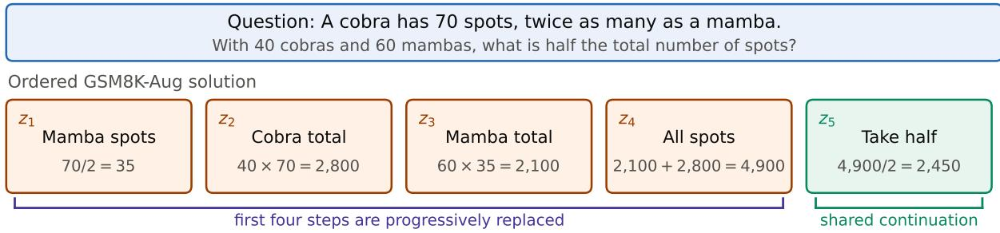  
Stage 1 at full substitution

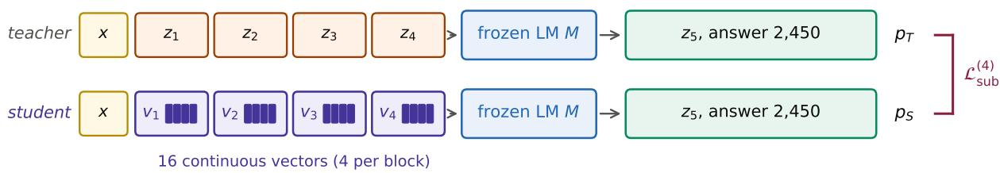

Figure 6: Progressive substitution on a mathematics example. GSM8K-Aug provides five ordered calculations. The question is shortened here for space. At full substitution, the student replaces the first four written steps z1:4 with latent blocks $v _ { 1 : 4 }$ , while the final calculation $z _ { 5 }$ and answer remain the shared continuation. The frozen language model evaluates both prefixes, and $\mathcal { L } _ { \mathrm { s u b } }$ at depth $i \ = \ 4$ matches the resulting continuation distributions. Vertical alignment denotes which written step each latent block replaces, not a claim that the latent vectors decode to that step.

On GSM8K-Aug the shift is systematic. The shortest step is 5 tokens against $c = 4$ latent slots, so $\ell _ { z } > \ell _ { v }$ at every depth and the clamp never applies. The displacement grows from 3 positions at i=1 to 14 at i=4, roughly a quarter of the prefix, so Stage 1 trains on a layout that inference does not reproduce.

Llama encoders are trained for 1,500 minibatch iterations, with checkpoints saved every 100 iterations. Qwen encoders are trained for 3,000 iterations and saved every 200. We select checkpoints by generation accuracy on 300 held-out GSM8K-Aug questions that do not overlap the GSM8K test set.

INTACT Stage 2. Each Stage 2 run begins from its selected Stage 1 checkpoint. We first evaluate four completions for each of the first 3,000 eligible training questions and retain only questions for which the completions include both a correct and an incorrect answer. This produces between 1,473 and 1,906 questions across the Stage 1 seed lineages. During training, every visit draws eight fresh completions. Questions whose rewards all agree contribute no update.

An optimizer step contains 12 questions and eight completions per question, sampled at temperature 1.0. We optimize the per-sequence-normalized objective for 800 steps using AdamW with learning rate $1 0 ^ { - 5 }$ , zero weight decay, and gradient clipping at 1.0. The reported checkpoint is selected by generation accuracy on the held-out GSM8K-Aug split.

The frozen language model is kept in bfloat16 and the encoder in float32. Gradients pass through the language model, but only the encoder is updated. Each run uses one NVIDIA H100 NVL. Table 10 summarizes the optimization settings. Reported uncertainty is the sample standard deviation over the corresponding three encoder seed lineages.

Architecture controls. The two architecture variants of Table 5 are retrained rather than modified at inference, and the jointly built variant is compared against a reference run that differs from it in one setting alone. Both draw the same GSM8K-Aug stream, take the same teacher continuations at the same four substitution depths, carry preservation weight $\beta = 0 . 3 4$ against the student’s own rollout, train for 1,500 steps at $K = 4$ and so take the same number of optimizer updates, and select a checkpoint by generation accuracy on the held-out validation split. The jointly built encoder flattens all Kc queries into one encoder pass, so its blocks attend to one another and receive the progressive losses at the same four depths. What it does not see is the backbone’s state after the preceding blocks have been placed.

Table 10: Hyperparameters for both stages. The optimizer is AdamW throughout.
<table><tr><td></td><td>LLAMA-3.2 1B-Instruct</td><td>LLAMA-3.2 3B-Instruct</td><td> $\mathrm { L L A M A } { - } 3 .$  1 QWEN2.5 8B-Instruct 3B (base)</td></tr><tr><td colspan="4">Stage 1: progressive substitution 4</td></tr><tr><td>latent blocks K</td><td></td><td>4</td><td>4</td></tr><tr><td>vectors per block c</td><td>4  $1 0 ^ { - 4 }$ </td><td>4</td><td>4</td></tr><tr><td>learning rate</td><td> $1 0 ^ { - 4 }$ </td><td> $1 0 ^ { - 4 }$ </td><td> $1 0 ^ { - 4 }$ </td></tr><tr><td>weight decay</td><td>0.01</td><td>0.01</td><td>0.01</td></tr><tr><td>minibatch size</td><td></td><td>8</td><td>8</td></tr><tr><td>gradient clipping</td><td>1.0</td><td>1.0</td><td>1.0</td></tr><tr><td>preservation weight  $\beta$ </td><td>0.30</td><td>0.34</td><td>0.28</td></tr><tr><td colspan="4">Stage 2: latent-policy refinement</td></tr><tr><td>learning rate</td><td> $1 0 ^ { - 5 }$ </td><td> $1 0 ^ { - 5 }$ </td><td> $1 0 ^ { - 5 }$ </td></tr><tr><td>weight decay</td><td></td><td>0</td><td>0</td></tr><tr><td>gradient clipping</td><td>0 1.0</td><td>1.0</td><td>1.0</td></tr><tr><td>rollouts per question</td><td>8</td><td>1.0 8</td><td>8</td></tr><tr><td>sampling temperature</td><td>1.0</td><td>8 1.0</td><td>1.0</td></tr></table>

## C.2 Diverse-Domain Training and Evaluation

Training corpus. We construct a 12,000-example training stream from Llama-Nemotron. Checkpoints are selected on 200 held-out GSM8K-Aug validation questions that are disjoint from the GSM8K test set. The resulting mixture is 64.3% mathematics, 21.4% science, and 14.3% code. For mathematics, we use the reasoning-off collection of direct solutions from LLAMA-3.3-70B-INSTRUCT. The reasoning-on collection instead places the usable solution after a substantially longer exploratory trace. The science and code examples are shared by both collections. We convert responses to ordered steps using equation-bearing spans for mathematics, sentences for science, and lines of fenced programs for code.

Training. We train the same 107M encoder architecture on LLAMA-3.2-3B-INSTRUCT, with $K = 4$ blocks of $c = 4$ vectors. Stage 1 runs for 1,500 steps with learning rate $1 0 ^ { - 4 }$ , batch size 8, a 200-step warmup, and preservation weight $\beta = 0 . 3 0$ , using all three domains. Stage 2 starts from that checkpoint and runs for 800 group-relative policygradient steps with learning rate $1 0 ^ { - 5 }$ , batch size 12, and groups of eight rollouts sampled at temperature 1.0. Its rollout pool is 75% Nemotron mathematics and 25% Nemotron science, because code is not used in Stage 2. Mathematics receives a numeric-correctness reward, and science receives an option-letter correctness reward. Rollouts are capped at 256 tokens, and no KL penalty to a reference policy is used. All other settings follow Appendix C.1 and the language model remains frozen throughout.

Evaluation. We evaluate under the sampling protocol of Appendix C.4 with a 2,048-token budget. The loose budget limits the censoring caused by unfinished frozen-model generations, which still run to the cap on a larger fraction of the mathematics examples than Stage 2 does. Reported INTACT costs include both the generated tokens and the 16 latent positions.

## C.3 Baselines

Result provenance. At LLAMA-3.2-1B and LLAMA-3.2-3B, we quote No-CoT, Aug-SFT, MUX, and CODI from Suleymanzade et al. (2026), and LOTUS from Fan et al. (2026). Measured entries at LLAMA-3.1-8B and QWEN2.5- 3B are ours. No directly comparable latent-reasoning checkpoint has been released for these backbones. Published 8B MUX and CODI results use base models, whereas our 8B backbone is instruction-tuned.

No-CoT and Aug-SFT. Our No-CoT and Aug-SFT runs at 8B and on Qwen use the same script and differ only in the supervision target. We apply rank-128 LoRA to the q,k,v,o,gate,up,down projections of every layer, with $\alpha = 2 r$ , dropout 0.05, and no bias. Training uses AdamW with learning rate $\mathrm { i 0 ^ { - 4 } }$ , zero weight decay, 100 warmup steps followed by cosine decay, gradient clipping at 1.0, sequence length 512, and effective batch size 16 in bfloat16. Both train on all 385,530 GSM8K-Aug examples, where INTACT uses the 322,712 of them that carry at least two steps (Appendix C.1). The adapters follow the same rank-128 configuration at every scale.

Nemo-SFT. We train this baseline on all four backbones using the same script and LoRA configuration as Aug-SFT, but replace GSM8K-Aug with the Llama-Nemotron mixture from Appendix C.2. Thus the two baselines differ only in their supervision. Aug-SFT uses terse calculator expressions averaging roughly 31 tokens, and Nemo-SFT uses natural-language solutions averaging roughly 750 tokens. We select the step-200 checkpoint on every backbone.

Latent-reasoning baselines. For LOTUS on QWEN2.5-3B, we run the authors’ code with $c _ { \mathrm { t h o u g h t } } = 2 5$ , six latent loops, constant AdamW learning rate $5 \times 1 0 ^ { - 5 }$ , effective batch size 128, and seven epochs. This covers the curriculum through max latent stage=6. We report the final epoch using the authors’ evaluation script. The quoted MUX results use the shared LoRA configuration reported in its Table 8: rank 128, α = 32, and dropout 0.1. The quoted CODI results come from the same codebase and configuration, with CODI’s additional hidden-size projector included in its trainable-parameter count. We also train MUX on LLAMA-3.1-8B-INSTRUCT, where no checkpoint is released. MUX’s published learning rate of $8 \times 1 0 ^ { - 4 }$ collapses on this backbone, so we use $1 0 ^ { - 4 }$ with gradient clipping at 1.0 and warmup ratio 0.10, and otherwise follow their train llama8b gsm8k aug.sh. Figure 14 additionally includes SIM-CoT at 3B. We take its GSM8K and out-of-domain accuracies from Table 2 of Suleymanzade et al. (2026) and estimate its trainable parameters as the shared rank-128 LoRA adapter plus a full auxiliary decoder with $P _ { \mathrm { d e c } } = P _ { \mathrm { \Omega } }$ following their Appendix B.4.

## C.4 Evaluation Protocol

Prompting and decoding. For numerical benchmarks, the model receives the bare question followed by a newline. Multiple-choice prompts instead use Question: followed by the question and lettered options. Neither format includes few-shot demonstrations or a model-specific chat template. Following the CODI/MUX protocol, we sample with temperature 0.1, top-k 40, and top-p 0.95. Quoted results retain the protocol of their source.

Generation budget. The GSM8K-Aug mathematics experiments use a 768-token cap for every system, and the Llama-Nemotron diverse-domain experiment uses 2,048. The larger budget reflects that mixture’s longer targets. Its steps are complete natural-language solutions rather than compact arithmetic, and at a 512-token cap the frozen backbone is truncated on up to 13.9% of mathematics problems, suppressing the reference point the gains are measured against. Appendix D.1 sweeps the cap from 128 to 768 tokens. From 512 to 768 tokens, most systems move by tenths of a point, QWEN2.5-3B still gains 1.3, and the frozen LLAMA-3.1-8B loses accuracy because it rarely terminates. Table 8 instead adopts the 1,024-token cap of the SoftCoT protocol for both of its rows. Quoted results retain the budget of their source.

Answer extraction. We discard text following a newly generated Question:, which base models sometimes emit after completing a solution. For numerical benchmarks, we extract, in order, a value following #### or ###, an explicit “answer is” phrase, a boxed value, or the final number in the remaining completion. A prediction is correct when the extracted value matches the gold answer within $1 0 ^ { - 4 }$ . For multiple-choice benchmarks, we extract an explicit answer letter first, then the last matching option text, and finally the last standalone letter. Correctness is exact match with the gold option letter.

## D Extended Results

## D.1 INTACT and the Frozen Backbone Across Budgets

Table 11: Accuracy (%) as a function of the generation budget, with the encoder trained on GSM8K-Aug. GSM8K is the matching test set and OOD averages SVAMP, GSM-Hard, and MultiArith. Stage 1 is progressive substitution alone and Stage 2 adds latent-policy refinement. Columns with ± show mean ± sample standard deviation over three encoder seeds.
<table><tr><td colspan="2"></td><td colspan="2">Frozen LM</td><td colspan="2">INTACT Stage 1</td><td colspan="2">INTACT Stage 2</td></tr><tr><td>Backbone</td><td>Budget</td><td>GSM8K↑</td><td>OOD↑</td><td>GSM8K↑</td><td>OOD↑</td><td>GSM8K↑</td><td>OOD↑</td></tr><tr><td rowspan="5"> $\mathbf { L L A M A }$  3.2-1B</td><td>128</td><td>13.2</td><td>33.4</td><td> $1 4 . 0 \pm 0 . 6$ </td><td> $3 5 . 8 \pm 0 . 2$ </td><td> $1 7 . 3 \pm 2 . 6$ </td><td> $4 2 . 1 \pm 3 . 0$ </td></tr><tr><td>256</td><td>37.8</td><td>47.3</td><td> $4 0 . 5 \pm 0 . 9$ </td><td> $5 0 . 8 \pm 0 . 9$ </td><td> $4 5 . 5 \pm 1 . 2$ </td><td> $5 4 . 1 \pm 0 . 4$ </td></tr><tr><td>384</td><td>43.7</td><td>47.8</td><td> $4 3 . 9 \pm 1 . 0$ </td><td> $5 1 . 3 \pm 1 . 0$ </td><td> $4 8 . 5 \pm 1 . 4$ </td><td> $5 4 . 4 \pm 0 . 5$ </td></tr><tr><td>512</td><td>44.0</td><td>47.8</td><td> $4 4 . 2 \pm 1 . 0$ </td><td> $5 1 . 3 \pm 0 . 9$ </td><td> $4 8 . 8 \pm 1 . 3$ </td><td> $5 4 . 5 \pm 0 . 4$ </td></tr><tr><td>768</td><td>44.0</td><td>47.8</td><td> $4 4 . 2 \pm 1 . 0$ </td><td> $5 1 . 3 \pm 1 . 0$ </td><td> $4 8 . 7 \pm 1 . 3$ </td><td> $5 4 . 5 \pm 0 . 4$ </td></tr><tr><td rowspan="5">LLAMA 3.2-3B</td><td>128</td><td>15.3</td><td>40.0</td><td> $1 5 . 2 \pm 0 . 7$ </td><td> $4 2 . 6 \pm 1 . 0$ </td><td> $2 4 . 7 \pm 1 . 7$ </td><td> $5 2 . 6 \pm 0 . 9$ </td></tr><tr><td>256</td><td>61.6</td><td>64.1</td><td> $6 5 . 0 \pm 0 . 7$ </td><td> $6 6 . 9 \pm 0 . 4$ </td><td> $7 2 . 2 \pm 0 . 9$ </td><td> $6 7 . 5 \pm 0 . 1$ </td></tr><tr><td>384</td><td>74.1</td><td>66.2</td><td> $7 6 . 4 \pm 0 . 5$ </td><td> $6 8 . 8 \pm 0 . 3$ </td><td> $7 8 . 4 \pm 0 . 3$ </td><td> $6 8 . 7 \pm 0 . 3$ </td></tr><tr><td>512</td><td>75.8</td><td>66.5</td><td> $7 7 . 6 \pm 0 . 3$ </td><td> $6 9 . 0 \pm 0 . 3$ </td><td> $7 9 . 2 \pm 0 . 3$ </td><td> $6 8 . 8 \pm 0 . 2$ </td></tr><tr><td>768</td><td>75.8</td><td>66.5</td><td> $7 7 . 9 \pm 0 . 3$ </td><td> $6 9 . 1 \pm 0 . 3$ </td><td> $7 9 . 3 \pm 0 . 4$ </td><td> $6 8 . 8 \pm 0 . 2$ </td></tr><tr><td rowspan="5">LLAMA 3.1-8B</td><td>128</td><td>14.9</td><td>38.9</td><td> $1 5 . 1 \pm 0 . 7$ </td><td> $4 1 . 0 \pm 1 . 2$ </td><td> $3 0 . 7 \pm 2 . 8$ </td><td> $5 5 . 8 \pm 1 . 6$ </td></tr><tr><td>256</td><td>62.8</td><td>63.7</td><td> $6 6 . 6 \pm 0 . 7$ </td><td> $6 8 . 2 \pm 0 . 7$ </td><td> $7 8 . 9 \pm 2 . 1$ </td><td> $7 1 . 3 \pm 0 . 4$ </td></tr><tr><td>384</td><td>76.3</td><td>62.1</td><td> $8 1 . 8 \pm 0 . 8$ </td><td> $7 0 . 9 \pm 0 . 9$ </td><td> $8 3 . 3 \pm 0 . 6$ </td><td> $7 2 . 1 \pm 0 . 7$ </td></tr><tr><td>512</td><td>75.7</td><td>57.0</td><td> $8 3 . 4 \pm 0 . 6$ </td><td> $7 1 . 1 \pm 1 . 0$ </td><td> $8 3 . 6 \pm 0 . 6$ </td><td> $7 2 . 1 \pm 0 . 7$ </td></tr><tr><td>768</td><td>72.3</td><td>53.9</td><td> $8 3 . 7 \pm 0 . 6$ </td><td> $7 1 . 1 \pm 1 . 1$ </td><td> $8 3 . 6 \pm 0 . 7$ </td><td> $7 2 . 1 \pm 0 . 7$ </td></tr><tr><td rowspan="5">QWEN 2.5-3B</td><td>128</td><td>18.5</td><td>41.9</td><td> $2 8 . 2 \pm 3 . 1$ </td><td> $4 7 . 3 \pm 2 . 5$ </td><td> $5 2 . 3 \pm 0 . 8$ </td><td> $6 8 . 4 \pm 0 . 3$ </td></tr><tr><td>256</td><td>51.6</td><td>68.1</td><td> $5 7 . 3 \pm 0 . 8$ </td><td> $6 9 . 3 \pm 0 . 2$ </td><td> $7 8 . 7 \pm 0 . 5$ </td><td> $7 4 . 8 \pm 0 . 5$ </td></tr><tr><td>384</td><td>70.3</td><td>73.1</td><td> $7 2 . 9 \pm 2 . 0$ </td><td> $7 3 . 6 \pm 1 . 0$ </td><td> $7 9 . 7 \pm 0 . 4$ </td><td> $7 5 . 1 \pm 0 . 5$ </td></tr><tr><td>512</td><td>76.3</td><td>74.3</td><td> $7 7 . 2 \pm 2 . 1$ </td><td> $7 4 . 7 \pm 1 . 0$ </td><td> $7 9 . 7 \pm 0 . 5$ </td><td> $7 5 . 1 \pm 0 . 5$ </td></tr><tr><td>768</td><td>77.6</td><td>74.6</td><td> $7 8 . 0 \pm 2 . 0$ </td><td> $7 5 . 0 \pm 1 . 0$ </td><td> $7 9 . 7 \pm 0 . 5$ </td><td> $7 5 . 1 \pm 0 . 5$ </td></tr></table>

Table 11 compares the frozen backbone with both INTACT stages at every backbone and every generation budget, of which Table 1 shows one cap. All budget values are scored from prefixes of the same generation pass. The frozen LLAMA-3.1-8B row falls as the budget grows because that model rarely terminates, reaching the cap on 97.1% of GSM8K generations against 8.6% for Stage 1 and none for Stage 2.

Prompt format. To isolate the effect of the prompt format, we re-evaluate the three instruction-tuned Llama backbones with their own chat templates, a sample of which is shown in Figure 7. The template helps at 8B, where it largely removes the termination failure and raises GSM8K accuracy from 72.3 to 78.4, but the effect is inconsistent across scales. Accuracy rises at 1B and falls at 3B. INTACT Stage 2, still scored under the bare prompt, remains more accurate than the chat-prompted frozen model on GSM8K and out of domain at all three scales, while its token cost is closer, lower at 8B and higher at 1B and 3B (Table 12).

## Bare question Bare question

John runs 60 miles in 3 days.   
How many miles per day?\n   
Llama-3.1-8B chat template   
<|begin of text|>   
<|start header id|>system<|end header id|>   
Cutting Knowledge Date: December 2023   
Today Date: 26 Jul 2024   
<|eot id|>   
<|start header id|>user<|end header id|>   
John runs 60 miles in 3 days.   
How many miles per day?<|eot id|>   
<|start header id|>assistant<|end header id|>   
Figure 7: Inputs compared for the frozen LLAMA-3.1-8B-INSTRUCT. The question is illustrative. The chat template   
adds its default system metadata and turn markers.

Table 12: Prompt sensitivity of the frozen Llama backbones at a 768-token cap. The two frozen rows differ only by prompt format. The INTACT rows are Stage 2, evaluated with the bare prompt for reference.
<table><tr><td>Backbone</td><td>Condition</td><td>GSM8K↑</td><td>OOD↑</td><td>Tok.↓</td></tr><tr><td rowspan="3">LLAMA-3.2-1B</td><td>Frozen (bare)</td><td>44.0</td><td>47.8</td><td>252</td></tr><tr><td>Frozen (chat)</td><td>47.3</td><td>52.2</td><td>165</td></tr><tr><td>INTACT (bare)</td><td>48.7</td><td>54.5</td><td>215</td></tr><tr><td rowspan="3">LLAMA-3.2-3B</td><td>Frozen (bare)</td><td>75.8</td><td>66.5</td><td>261</td></tr><tr><td>Frozen (chat)</td><td>71.6</td><td>66.1</td><td>172</td></tr><tr><td>INTACT (bare)</td><td>79.3</td><td>68.8</td><td>195</td></tr><tr><td rowspan="3">LLAMA-3.1-8B</td><td>Frozen (bare)</td><td>72.3</td><td>53.9</td><td>754</td></tr><tr><td>Frozen (chat)</td><td>78.4</td><td>69.6</td><td>186</td></tr><tr><td>INTACT (bare)</td><td>83.6</td><td>72.1</td><td>182</td></tr></table>

## D.2 Accuracy–Efficiency Operating Points

Figures 8–10 compare accuracy with total positions. Upper left is better, and INTACT counts include all 16 latent positions. Figures 11–13 instead sweep the generation budget, with dashed curves updating the language model and solid curves keeping it frozen. LLAMA-3.2-1B is omitted because it was not evaluated on the finer budget grid these panels require. At 8B, no comparable CODI or LOTUS checkpoint is available and the MUX point is our reproduction (Appendix C.3).

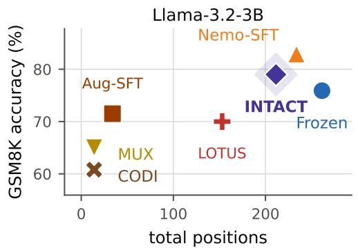

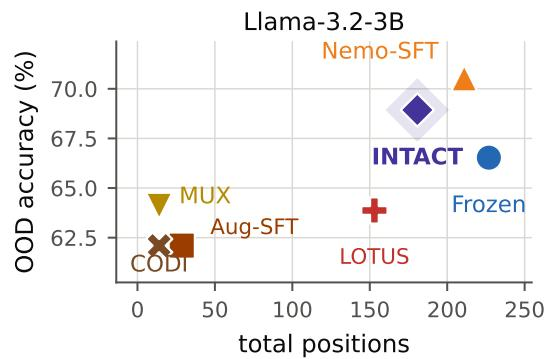  
Figure 8: LLAMA-3.2-3B: accuracy against total positions on GSM8K (left) and the out-of-domain macro-average (right). Upper left is better. Frozen and Nemo-SFT are evaluated at the 768-token cap, and every other system at the operating point it reports.

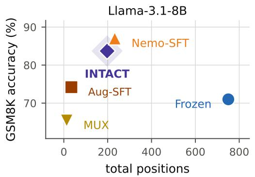

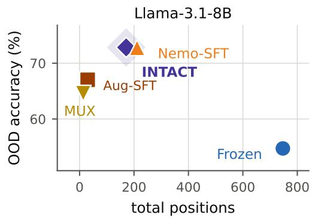  
Figure 9: LLAMA-3.1-8B: accuracy against total positions on GSM8K (left) and the out-of-domain macro-average (right). Upper left is better. Frozen and Nemo-SFT are evaluated at the 768-token cap, and every other system at the operating point it reports.

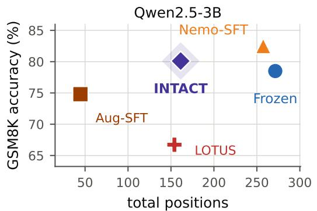

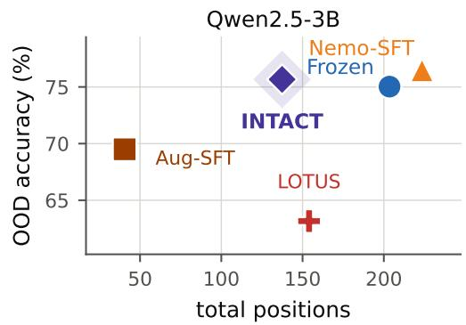  
Figure 10: QWEN2.5-3B: accuracy against total positions on GSM8K (left) and the out-of-domain macro-average (right). Upper left is better. Frozen and Nemo-SFT are evaluated at the 768-token cap, and every other system at the operating point it reports.

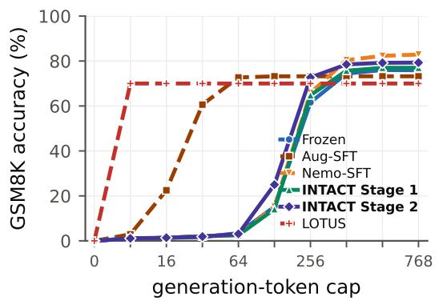

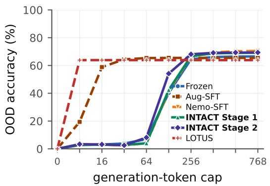  
Figure 11: LLAMA-3.2-3B: accuracy against the generation budget on GSM8K (left) and the out-of-domain macroaverage (right). Solid curves keep the language model frozen and dashed curves update it. Every budget is scored from prefixes of one generation pass, so a curve shows what that same run would have returned under a tighter cap.

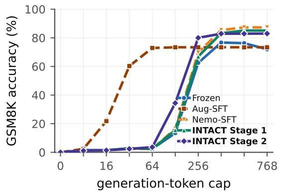

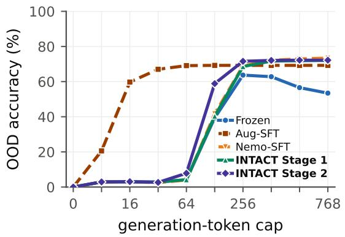  
Figure 12: LLAMA-3.1-8B: accuracy against the generation budget on GSM8K (left) and the out-of-domain macroaverage (right). Solid curves keep the language model frozen and dashed curves update it. Every budget is scored from prefixes of one generation pass, so a curve shows what that same run would have returned under a tighter cap.

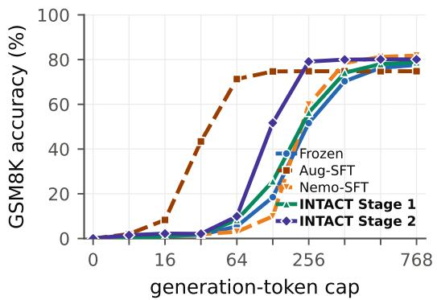

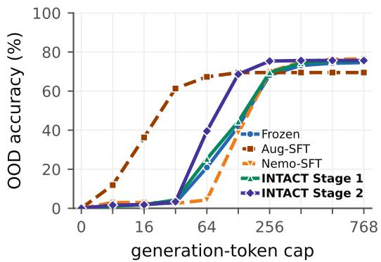  
Figure 13: QWEN2.5-3B: accuracy against the generation budget on GSM8K (left) and the out-of-domain macroaverage (right). Solid curves keep the language model frozen and dashed curves update it. Every budget is scored from prefixes of one generation pass, so a curve shows what that same run would have returned under a tighter cap.

## D.3 Efficiency

Three quantities are reported, and they are not interchangeable.

• Generated tokens. The text the backbone emits, excluding the latent prefix. Table 3 and the ablations report this.

• Total positions. Generated tokens plus INTACT’s Kc = 16 latent slots, excluding the question. The operatingpoint figures and Table 14 use this.

• End-to-end latency. Wall-clock milliseconds per problem, including both latent-prefix construction and text generation. Table 4 reports this.

Trainable parameters and training cost. Figure 14 places the LLAMA-3.2-3B systems of Table 2 against the number of parameters each trains, together with SIM-CoT. INTACT trains a 107M encoder and never updates the backbone, so it is the leftmost point in both panels and the most accurate of the methods that leave the backbone frozen. The baselines run from 194.5M for the LoRA systems to 3.40B for SIM-CoT, which trains an adapter alongside a full auxiliary decoder and so updates more than a full fine-tune does. Nemo-SFT is more accurate, but reaches that accuracy by updating 194.5M backbone parameters. No paper in this comparison reports its own trainable count, so each is derived from the method’s description. Appendix C.3 gives the sources and derivations.

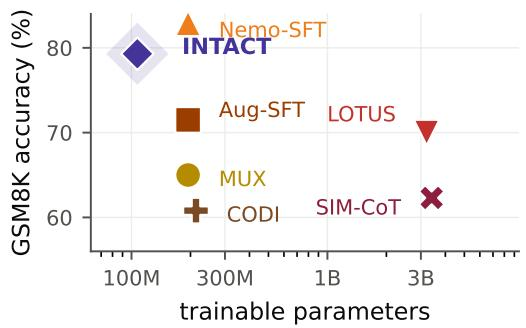

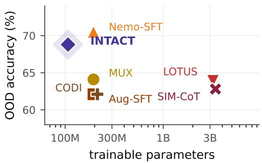  
Figure 14: Accuracy against trainable parameters on LLAMA-3.2-3B, where up and to the left is better. OOD averages SVAMP, GSM-Hard and MultiArith. INTACT trains a 107M-parameter encoder and never updates the backbone, while the baselines train between 195M and 3.40B. No method here reports a trainable count, so each is derived (Appendix C.3). Mathematics training (GSM8K-Aug), except Nemo-SFT (Llama-Nemotron).

Freezing the backbone also removes its parameter gradients and optimizer state, although its activations remain necessary for gradients to reach the encoder. On one H100 NVL and LLAMA-3.2-3B, Stage 1 takes 6.2 hours and Stage 2 a further 10.3 hours, placing the complete two-stage recipe below 17 GPU-hours.

## D.4 Diverse-Domain Generalization

Table 13: Accuracy (%) of one LLAMA-3.2-3B encoder across twelve benchmarks at a 2,048-token budget, trained on the Llama-Nemotron mixture rather than GSM8K-Aug. Each system is a single checkpoint used in every domain, not a per-domain best. ∆ is Stage 2 against the frozen backbone. Every split is scored in full. Bold is the best of the three trained systems.
<table><tr><td>Domain</td><td>Benchmark</td><td>n</td><td>Frozen</td><td>Stage 1</td><td>Stage 2</td><td>Nemo-SFT</td><td>Δ</td></tr><tr><td rowspan="5">Science</td><td>OpenBookQA</td><td>500</td><td>48.4</td><td>63.8</td><td>67.6</td><td>71.2</td><td>+19.2</td></tr><tr><td>ARC-Challenge</td><td>1172</td><td>50.1</td><td>65.4</td><td>72.6</td><td>73.0</td><td>+22.5</td></tr><tr><td>ARC-Easy</td><td>2376</td><td>67.5</td><td>80.8</td><td>86.2</td><td>85.5</td><td>+18.7</td></tr><tr><td>SciQ</td><td>1000</td><td>77.3</td><td>86.0</td><td>87.3</td><td>86.5</td><td>+10.0</td></tr><tr><td>MMLU-science</td><td>1397</td><td>43.8</td><td>49.3</td><td>54.3</td><td>56.8</td><td>+10.5</td></tr><tr><td rowspan="3">Commonsense</td><td>ECQA</td><td>2162</td><td>52.6</td><td>58.5</td><td>64.2</td><td>67.0</td><td>+11.6</td></tr><tr><td>SocialIQA</td><td>1954</td><td>42.9</td><td>50.3</td><td>64.3</td><td>46.7</td><td>+21.4</td></tr><tr><td>HellaSwag</td><td>10042</td><td>32.4</td><td>39.0</td><td>56.2</td><td>52.5</td><td>+23.8</td></tr><tr><td rowspan="4">Mathematics</td><td>GSM8K</td><td>1319</td><td>75.4</td><td>77.6</td><td>78.7</td><td>83.4</td><td>+3.3</td></tr><tr><td>SVAMP</td><td>1000</td><td>77.9</td><td>80.8</td><td>81.6</td><td>83.3</td><td>+3.7</td></tr><tr><td>MultiArith</td><td>600</td><td>95.5</td><td>97.0</td><td>97.5</td><td>98.7</td><td>+2.0</td></tr><tr><td>GSM-Hard</td><td>1319</td><td>26.2</td><td>26.2</td><td>26.6</td><td>28.9</td><td>+0.4</td></tr></table>

Accuracy by stage. Table 13 gives the accuracies behind Figure 5. The two stages divide the work differently by domain. In science, Stage 1 contributes 15.4 of the final 19.2-point gain on OpenBookQA and 15.3 of 22.5 points on ARC-Challenge. Stage 2 has its largest effect in commonsense. It adds 14.0 points on SocialIQA beyond the 7.4-point Stage 1 gain. Its contribution on mathematics is smaller but consistently positive, ranging from 0.4 to 1.1 points. Across the three commonsense benchmarks, Stage 2 reaches 61.6% compared with 55.4% for Nemo-SFT.

Table 14: Mean total positions per problem for the encoder trained on the Llama-Nemotron mixture, at a 2,048-token budget. INTACT columns include the 16 latent prefix positions as well as the tokens generated, so a number here is comparable across rows and to Figure 1. Lower is better, and bold is the cheapest system on a row.
<table><tr><td>Domain</td><td>Benchmark</td><td>n</td><td>Frozen</td><td>Stage 1</td><td>Stage 2</td><td>Nemo-SFT</td></tr><tr><td rowspan="6">Science</td><td>OpenBookQA</td><td>500</td><td>277.0</td><td>244.0</td><td>80.0</td><td>147.0</td></tr><tr><td>ARC-Challenge</td><td>1172</td><td>234.0</td><td>240.0</td><td>82.0</td><td>166.0</td></tr><tr><td>ARC-Easy</td><td>2376</td><td>262.0</td><td>237.0</td><td>98.0</td><td>153.0</td></tr><tr><td>SciQ</td><td>1000</td><td>338.0</td><td>191.0</td><td>123.0</td><td>145.0</td></tr><tr><td>MMLU-science</td><td>1397</td><td>376.0</td><td>278.0</td><td>148.0</td><td>246.0</td></tr><tr><td>Mean</td><td></td><td>297.4</td><td>238.0</td><td>106.2</td><td>171.4</td></tr><tr><td rowspan="4">Commonsense</td><td>ECQA</td><td>2162</td><td>214.0</td><td>146.0</td><td>61.0</td><td>130.0</td></tr><tr><td>SocialIQA</td><td>1954</td><td>177.0</td><td>256.0</td><td>143.0</td><td>141.0</td></tr><tr><td>HellaSwag</td><td>10042</td><td>776.0</td><td>756.0</td><td>60.0</td><td>138.0</td></tr><tr><td>Mean</td><td></td><td>389.0</td><td>386.0</td><td>88.0</td><td>136.3</td></tr><tr><td rowspan="5">Mathematics</td><td>GSM8K</td><td>1319</td><td>358.0</td><td></td><td></td><td></td></tr><tr><td>SVAMP</td><td>1000</td><td>289.2</td><td>259.3 201.7</td><td>254.8 197.8</td><td>241.9 197.4</td></tr><tr><td>MultiArith</td><td>600</td><td>215.4</td><td>176.5</td><td>154.7</td><td>133.2</td></tr><tr><td>GSM-Hard</td><td>1319</td><td>448.1</td><td>388.7</td><td>352.1</td><td>357.0</td></tr><tr><td>Mean</td><td></td><td>327.7</td><td>256.6</td><td>239.8</td><td>232.4</td></tr></table>

Token cost and termination. Table 14 gives what each system spends to reach the accuracies of Table 13. Stage 2 uses fewer total positions than the frozen backbone on all twelve benchmarks while improving accuracy on each. Stage 1 is cheaper on ten of twelve but is more expensive on ARC-Challenge and SocialIQA. The shortening is therefore not imposed mechanically by the latent prefix. It emerges most consistently after latent-policy refinement.

The 2,048-token budget reduces but does not eliminate truncation of frozen-model generations. Their reported means consequently remain more sensitive to the evaluation cap than those of INTACT and Nemo-SFT, which terminate more consistently.

## E Datasets and Evaluation Splits

## E.1 Training Corpora

The experiments use two training corpora, each for a separate encoder.

GSM8K-Aug. The main mathematics experiments of Section 4.1 use GSM8K-Aug (Deng et al., 2023), a 385Kexample augmentation of GSM8K whose solutions consist of ordered, compact arithmetic steps. This structure directly supports progressive substitution. Latent block i replaces written step i without additional segmentation.

Llama-Nemotron. The diverse-domain experiment of Section 4.5 uses Llama-Nemotron post-training data (Bercovich et al., 2025), which combines mathematics, science, and code under one collection process. We use its reasoning-off subset, whose responses are direct written solutions rather than search traces. Appendix C.2 describes the sampling and step extraction.

## E.2 Evaluation Benchmarks and Splits

Table 15: Evaluation benchmarks and scored split sizes, grouped by domain. Every row uses the complete evaluation split after ECQA de-duplication. Form is either a numeric answer or an m-way letter choice.

<table><tr><td>Domain</td><td>Benchmark</td><td>n</td><td>Form</td></tr><tr><td rowspan="4">Mathematics</td><td>GSM8K (Cobbe et al., 2021)</td><td>1319</td><td>number</td></tr><tr><td>GSM-Hard (Gao et al., 2023)</td><td>1319</td><td>number</td></tr><tr><td>SVAMP (Patel et al., 2021)</td><td>1000</td><td>number</td></tr><tr><td>MultiArith (Roy &amp; Roth, 2015)</td><td>600</td><td>number</td></tr><tr><td rowspan="5">Science</td><td>OpenBookQA (Mihaylov et al., 2018)</td><td>500</td><td>4-way</td></tr><tr><td>ARC-Easy (Clark et al., 2018)</td><td>2376</td><td>4-way</td></tr><tr><td>ARC-Challenge (Clark et al., 2018)</td><td>1172</td><td>4-way</td></tr><tr><td>SciQ (Welbl et al., 2017)</td><td>1000</td><td>4-way</td></tr><tr><td>MMLU-science (Hendrycks et al., 2021a)</td><td>1397</td><td>4-way</td></tr><tr><td rowspan="3">Commonsense</td><td>ECQA (Aggarwal et al., 2021)</td><td>2162</td><td>5-way</td></tr><tr><td>SocialIQA (Sap et al., 2019)</td><td>1954</td><td>3-way</td></tr><tr><td>HellaSwag (Zellers et al., 2019)</td><td>10,042</td><td>4-way</td></tr></table>

Benchmark coverage. Table 15 lists every benchmark scored in the paper. Each benchmark uses its complete evaluation split, subject only to the ECQA de-duplication described below. GSM8K is the matching test set for GSM8K-Aug. For the diverse-domain experiment, we check for overlap after case-folding the question text and removing punctuation and multiple-choice options. We find no exact question-text match between the examples used in either training stage and any of the twelve evaluation splits. No evaluation question is used for checkpoint selection. Selection uses the disjoint 200-question GSM8K-Aug validation split described in Appendix C.2. Multiple-choice benchmarks share the prompt format specified in Appendix C.4.

Dataset-specific conventions. MMLU-science is not a released split. It aggregates the eight MMLU subjects covered by Llama-Nemotron’s science data: high-school and college physics, chemistry, and biology, together with conceptual physics and astronomy. ECQA contains 32 test questions that also occur in its training split, inherited from CommonsenseQA. We remove these questions before scoring, leaving 2,162 examples.