# INTERLOCK: FROM LOCAL CORRECTNESS TO TASK COMPLETION IN LONG-HORIZON AGENTS

Linji Hao<sup>1∗</sup> Yanji He<sup>2∗</sup> Zihan Wang<sup>3∗</sup> Hansi Yang<sup>4</sup> Jiayuan Zhang<sup>4</sup> Hongyan Hao<sup>4</sup> Qi Gu<sup>4†</sup> Yan Feng<sup>4</sup> Han Wu<sup>1†</sup>

<sup>1</sup>Peking University <sup>2</sup>The Hong Kong University of Science and Technology (Guangzhou) <sup>3</sup>Tsinghua University <sup>4</sup>Meituan, China

haolinji26@stu.pku.edu.cn guqi03@meituan.com

## ABSTRACT

Large language model agents increasingly undertake long-horizon tasks in complex environments characterized by fragmented evidence, partially completed states, and dependencies across resources and artifacts. Existing agents may satisfy individual requirements while failing to maintain these relationships, producing locally correct but incomplete outcomes. These failures arise because task completion depends on relationships among environmental evidence, consequential decisions, and required effects. To address this completion gap, we propose INTERLOCK, a framework for task synthesis that represents each task as a typed completion graph. Grounding edges connect public evidence to decisions, coupling hyperedges impose joint constraints across components, and realization edges connect decisions to all required downstream effects. INTERLOCK compiles this graph into a resettable workspace, a public request, and an evaluation rubric. A source-coverage review checks whether the original requirements survive generation, while a public-input review checks whether the rubric is supported by the materials available to the solver. An agent-as-judge inspects execution artifacts and runs verification scripts, retaining trajectories judged to satisfy all mandatory requirements. To evaluate training utility, we fine-tune two Qwen3.6 backbones on their own accepted trajectories. Across the two backbones, training improves AutomationBench task pass rates by 4.00–4.50 percentage points, JobBench weighted scores by 3.20–6.64 points, and Harvey LAB criterion pass rates by 3.89–4.16 percentage points. These results demonstrate the training utility of the synthesized experience across external task environments.

## 1 INTRODUCTION

Long-horizon agents increasingly work with records, rules, resources, and partially completed artifacts. A short request can require reconciling conflicting evidence, determining which objects need attention, selecting a feasible plan, and updating several related results. The environment supplies the facts and constraints that determine this work. A decision can also activate further obligations: deferring an action may require an explanation and a handoff, while changing an allocation may require corresponding revisions to schedules and budgets. These obligations can outlive the interaction in which they are discovered: after many intervening reads, computations, and edits, the agent must still apply the earlier evidence and decisions to every affected result.

Local progress can coexist with an incomplete outcome (Figure 1). A correct decision can leave necessary consequences unfulfilled, and mutually consistent outputs can share an unsupported assumption. These failures concern the relationships that connect evidence, decisions, and the requested outcome. They motivate our central question: how can task synthesis preserve conditional obligations and turn theirfulfillment into transferable training experience?

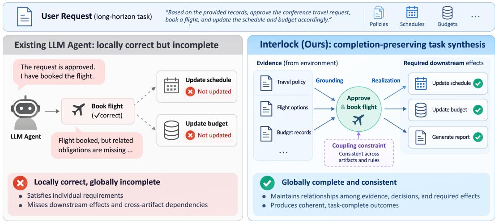  
Figure 1: From local correctness to task completion. A correct flight booking can still leave schedule and budget updates unfinished. INTERLOCK preserves grounding, coupling, and realization relations during task synthesis to connect evidence, decisions, and required downstream effects.

We characterize this structure as a typed completion graph. Grounding connects environmental evidence and rules to the decisions they support. Coupling links components that must share a feasible choice or satisfy a joint constraint. Realization connects a decision to every downstream record, artifact, or state that must reflect it. Their interaction is especially demanding over long executions: an early finding can constrain work completed many interactions later, and a revised decision can require coordinated changes to several existing artifacts.

Task synthesis and environment generation provide a scalable basis for agent training. Prior work constructs verified tool-use data (Qin et al., 2024; Liu et al., 2024), generates environments and task scenarios (Hu et al., 2025; Song et al., 2026), and composes extended tasks through tool dependencies and reusable workflows (Tu et al., 2026; Shi et al., 2026; Li et al., 2026b). Common specifications can also align instructions, environments, and verifiers (Ivanov & Rana, 2026). Our organizing unit is the complete set of conditional obligations for an outcome. It determines both the unresolved work placed in an environment and the evidence needed to accept the result.

We propose INTERLOCK to make this graph an explicit synthesis constraint. Reusable domain descriptions and archetype contracts define evidence roles, task-specific decisions and shared states, joint conditions, and downstream consumers. Three generation roles compile the same graph into a workspace, task/contract, and rubric while leaving concrete associations and decisions to the agent. A source-coverage review traces every typed relation from the original graph through these artifacts; a public-input critic independently checks whether the resulting criteria are supported by solvervisible materials and assessable from execution artifacts. Completion-filtered training then selects executions that realize every applicable effect.

Our evaluation connects task structure, execution behavior, and training utility. Statistical analyses and case studies examine dependencies and completion failures. The training protocol uses Qwen3.6-27B and Qwen3.6-35B-A3B separately, retaining each model’s own accepted rollouts for SFT of that same model. Both backbones improve on AutomationBench, JobBench Main and Easy, and Harvey LAB. Gains over the original checkpoints reach 4.00–4.50 percentage points in AutomationBench task pass rate, 3.20–6.64 points in JobBench weighted score, and 3.89–4.16 percentage points in Harvey LAB criterion pass rate. These results show that experience from complete synthetic executions transfers to independently authored tasks across different environments. Our contributions are threefold:

• A typed representation of task completion. We model long-horizon tasks as completion graphs whose grounding, coupling, and realization relations connect public evidence, consequential de cisions, joint constraints, and required effects.

• Graph-grounded synthesis and review. We compile the same graph into the environment, task specification, deliverable contract, and outcome criteria, with complementary reviews for source coverage and public support.

• Empirical validation of training utility. We evaluate the generated experience through completion-filtered fine-tuning of two backbones and measure transfer across three external benchmarks.

## 2 RELATED WORK

Task synthesis and environment generation provide a scalable source of agent experience. ToolAlpaca (Tang et al., 2023), ToolLLM (Qin et al., 2024), and ToolACE (Liu et al., 2025) broaden tool coverage and interaction diversity, while APIGen (Liu et al., 2024) incorporates format, execution, and semantic verification. Beyond tool-use data, AgentGen (Hu et al., 2025), AutoForge (Cai et al., 2025), and EnvScaler (Song et al., 2026) extend synthesis to environments and their associated planning tasks or executable scenarios. Agent-World (Dong et al., 2026) further couples environmenttask discovery with self-evolving training, and ClawGym (Bai et al., 2026) brings synthesis to persistent workspaces through persona-driven intents, skill-grounded operations, and hybrid verification. To construct extended interactions, ToolFlow (Wang et al., 2025) plans coherent tool-use dialogues, while APIGen-MT (Prabhakar et al., 2026) turns verified action blueprints into multi-turn interactions. BUTTON (Chen et al., 2025), TaskCraft (Shi et al., 2026), and AgentSynth (Xie et al., 2026) construct complex requests by composing or expanding smaller tasks. Complementary approaches, including VOYAGER (Wang et al., 2023), OS-Genesis (Sun et al., 2025), and Explorer (Pahuja et al., 2025), obtain curricula or tasks through environmental state and exploration. Alongside task complexity, another line of work addresses consistency among generated instructions, environments, and verifiers. Endless Terminals (Gandhi et al., 2026) generates containerized tasks with completion tests, while RST (Li et al., 2026b) extends verified reference solutions and realigns instructions and verifiers with the resulting workflows. CodeMidas (Ye et al., 2026) derives coding tasks from existing implementations, grounds synthesized tests in execution of the original code, and filters tasks through execution checks and agent rollouts. Anchor (Ivanov & Rana, 2026) addresses artifact drift by deriving task artifacts and certified solutions from a common constraint program. Graphguided synthesis provides more explicit control over the dependencies underlying generated tasks. ScaleEnv (Tu et al., 2026) constructs tasks from tested tool dependencies, EnvFactory (Xu et al., 2026b) uses topology-aware sampling to generate grounded queries, and SkillSynth (Fan et al., 2026) instantiates paths through a scenario-mediated skill graph. These approaches organize generation around tool connectivity and skill relationships. INTERLOCK instead uses task-completion relationships as synthesis constraints: its typed completion graph grounds decisions in evidence, imposes joint constraints, and specifies required downstream effects.

## 3 METHODOLOGY

INTERLOCK uses a special data structure, typed completion graph, to preserve the relationships among environmental evidence, agent decisions, and required effects throughout task construction and evaluation. Figure 2 outlines the workflow. Its left panel follows the graph through workspace construction, task writing, rubric compilation, and complementary source-coverage and publicsupport reviews. Its right panel shows real execution, outcome evaluation, and the collection of accepted trajectories for training. Specialized agents receive the inputs designated for their roles; Algorithm 1 in Appendix G.1 specifies task admission and the subsequent training procedure.

A task is a package $x = ( q , W _ { 0 } , V )$ , where q is the user request , $W _ { 0 }$ is the initial workspace, and V is the structured private rubric. The agent receives only $( q , W _ { 0 } )$ , while the evaluation rubric V remains outside the agent’s context and is used for requirement review and outcome evaluation.

## 3.1 TYPED COMPLETION GRAPH

Nodes and relations. Specifically, the typed completion graph records the requirements for an outcome:

$$
\mathcal { G } _ { b } = \left( \mathcal { E } _ { b } , \mathcal { D } _ { b } , \mathcal { V } _ { b } , \mathcal { R } _ { b } ^ { G } , \mathcal { R } _ { b } ^ { C } , \mathcal { R } _ { b } ^ { R } \right) .\tag{1}
$$

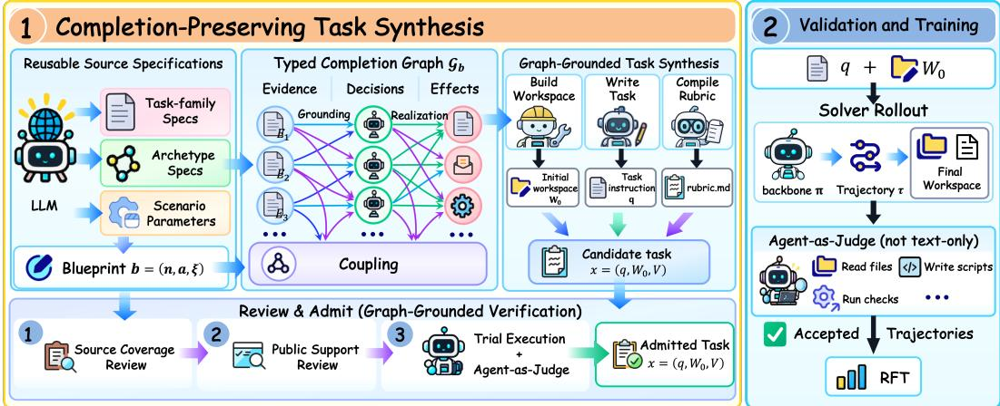  
Figure 2: INTERLOCK overview. Left: Grounding connects evidence to decision variables; Coupling imposes joint constraints across decisions and effects; Realization specifies the required consequences of each decision. These relations guide construction of the workspace $W _ { 0 } ,$ public request $q ,$ and private rubric $V ,$ followed by source-coverage and public-support review. Right: Real execution and an agent-as-judge provide evidence for task admission and trajectory selection. Each backbone is fine-tuned on its own accepted rollouts.

Here, b identifies the task specification used to construct the graph. $\mathcal { E } _ { b }$ contains evidence and rule roles, such as an authoritative record or an applicable policy. $\mathcal { D } _ { b }$ contains decisions and shared states that the solver must determine. ${ \mathcal { V } } _ { b }$ contains required effects: observable results such as a revised record, a completed artifact, or an updated workspace state. The three relation sets are

$$
\begin{array} { r l } { \mathcal { R } _ { b } ^ { G } \subseteq \mathcal { E } _ { b } \times \mathcal { D } _ { b } , \mathcal { R } _ { b } ^ { C } } & { \subseteq 2 ^ { \mathcal { D } _ { b } \cup \mathcal { D } _ { b } } \times \Psi _ { b } , \mathcal { R } _ { b } ^ { R } \subseteq \mathcal { D } _ { b } \times \mathcal { V } _ { b } , } \end{array}\tag{2}
$$

where $\Psi _ { b }$ contains the public conditions that govern joint feasibility or consistency.

Grounding specifies which evidence and rules govern a decision. It covers the decision’s factual basis and any applicable source-precedence or authorization rule. Coupling specifies a condition that several decisions or effects must satisfy together. A coupling relation $( \bar { S } , \bar { \psi } )$ connects a set of components S through a shared condition $\psi .$ . It is a hyperedge because the condition can involve more than two components. Realization specifies which effects must reflect a decision. Together, the three types determine whether the decisions are supported, their uses are jointly valid, and their required consequences are delivered.

Conditional effects. Each effect y carries four fields, $\boldsymbol { y } = ( B _ { y } , \Omega _ { y } , \alpha _ { y } , \phi _ { y } )$ $B _ { y }$ identifies the public evidence or rule that establishes the obligation. $\Omega _ { y }$ specifies the source population over which the obligation must be considered. $\alpha _ { y }$ states when it applies to an object in that population, and $\phi _ { y }$ states what must hold in the delivered outcome. An object may be an employee, an invoice, a resource, or another task-specific entity.

## 3.2 RELATION-CONSTRAINED TASK SYNTHESIS

Reusable specifications. A task domain groups tasks sharing a business or professional context. A blueprint $b = \left( n , a , \xi \right)$ combines a task family n within a domain, an archetype a, and scenario parameters $\xi . \ \mathrm { A }$ task family supplies a reusable objective and its obligation set ${ \mathcal { O } } _ { n } .$ . An archetype supplies a recurring relationship pattern $\rho _ { a } ,$ such as several outputs sharing a decision or several allocations sharing a capacity constraint. Scenario parameters instantiate the entities, source facts, and initial records. The graph is constructed as

$$
\mathcal { G } _ { b } = \mathrm { B u i l d C o m p l e t i o n G r a p h } \left( \mathcal { O } _ { n } , \rho _ { a } , \xi \right) .\tag{3}
$$

Evidence requirements produce evidence nodes, decisions produce decision nodes, and obligations produce conditional effects. Shared conditions produce coupling relations. Different archetypes induce different relation patterns. The graph records the requirements declared for the selected task family.

Task artifacts. Three specialized agents translate the graph into an executable task package. The operators below denote their respective generation stages, with the resulting artifacts passed to subsequent agents:

$$
\begin{array} { r l } & { ( W _ { 0 } , I , \mu _ { W } ) = \mathrm { B u i l d W o r k s p a c e } ( b , \mathcal { G } _ { b } ) , } \\ & { \quad ( q , H , \mu _ { T } ) = \mathrm { W r i t e T a s k } ( b , \mathcal { G } _ { b } , W _ { 0 } , I ) , } \\ & { \quad \quad ( V , \mu _ { V } ) = \mathrm { C o m p i l e R u b r i c } ( \mathcal { G } _ { b } , q , W _ { 0 } , I , H ) . } \end{array}\tag{4}
$$

The environment builder creates $W _ { 0 }$ and an evidence index I that locates the relevant public files and records. The task setter creates the request q and a private deliverable contract H: a structured inventory of required outputs and their conditions. Every obligation in H must be supported by q or the public workspace. The rubric compiler creates criteria for the decisions, joint conditions, and required effects.

The carrier maps µ<sub>W</sub>, $\mu _ { T }$ , and $\mu _ { V }$ record where a graph requirement appears in each artifact. A carrier is a concrete location, such as a policy clause, a request statement, a contract entry, or an evaluation criterion. These maps provide references for review, rather than solved assignments. We retain the construction record $c = ( b , \mathcal { G } _ { b } , x , I , H , \mu )$ , with $\mu = ( \mu _ { W } , \mu _ { T } , \mu _ { V } )$

Construction constraints. Each relation type places a concrete requirement on generation. For grounding, the controlling sources must be present and the decision must remain unresolved. For coupling, the shared condition must constrain the combined decisions or outputs. For realization, every declared downstream recipient or artifact must have an observable required effect and an outcome check.

Source conflicts, partial records, and stale outputs instantiate work that the solver must resolve through these relationships. The rubric retains their public conditions, including the rules that determine which objects require an effect.

## 3.3 REQUIREMENT REVIEW AND TASK ADMISSION

Source coverage. The source-coverage review starts from the original obligation specification and archetype requirements. It checks their representation in $\mathcal { G } _ { b }$ and then traces the graph through the workspace, task/contract, and rubric.

Let $\Gamma _ { b } = \mathcal { R } _ { b } ^ { G } \cup \mathcal { R } _ { b } ^ { C } \cup \mathcal { R } _ { b } ^ { R }$ , and let $S ( \gamma ) \subseteq \{ W , T , V \}$ specify the stages in which relation $\gamma$ must appear. Define

$$
P ( c ) = P _ { \mathrm { s p e c } } ( c ) \prod _ { \gamma \in \Gamma _ { b } } \prod _ { s \in S ( \gamma ) } P _ { s } ( \gamma ) .\tag{5}
$$

$P _ { \mathrm { s p e c } } ( c ) = 1$ when the graph covers the original specification. $P _ { s } ( \gamma ) = 1$ when the stage contains the required carrier and preserves the relation’s public basis, applicability, scope, and outcome condition. The review passes when $P ( c ) = 1$

Structural checks establish reference integrity and semantic review assesses the actual requirements and their representations. Carrier maps locate the material to inspect. This source anchor keeps an obligation in view even when both the generated request and rubric omit it.

Public support. The public-input critic receives only $( q , W _ { 0 } , V )$ . It checks that the criteria follow from the public request and workspace, that their joint requirements are consistent, and that outcomes can be judged from the specified evidence. Source coverage and public support therefore check complementary directions: the first preserves the original requirements, while the second establishes a public basis for the delivered evaluation. Both reviews return findings with evidence references and generation roles perform any required revisions.

Execution-based admission. After review, a validation policy executes the candidate from a fresh copy of $W _ { 0 } .$ . The judge examines the initial workspace, the final workspace, and their changes. It returns criterion judgments and a separate package-quality assessment. Admission requires both reviews to pass, a normally terminated validation execution, complete judgments, and a sound package assessment. It does not require that the validation solver complete the task: task admission retains valid challenges, while trajectory selection identifies accepted executions. Confirmed defects return to their producing stages, and revised packages receive fresh reviews. Rubric-only repairs may reuse a normally ended execution when the public inputs are unchanged while other repairs require a new execution. Revisions are bounded and versioned. Algorithm 1 groups these review, repair, and validation steps as ReviewAndAdmit, which returns an admitted task or ∅.

## 3.4 COMPLETION-FILTERED SELF-SUPERVISION

Rubric-based evaluation. Each generated task includes a private rubric\_spec.json file specifying its outcome criteria and verification metadata, together with its readable rendering rubric.md. We use an agent-as-judge with terminal access to evaluate each rollout τ on task x. Rather than scoring a fixed text response, the judge actively gathers and checks evidence: guided by the rubric and execution results, it inspects relevant files and, when needed, writes and executes verification scripts. These checks assess the final artifacts and workspace changes against the public request, initial workspace, and rubric. The judge returns a pass/fail judgment for each required criterion. We set $A _ { V } ( x , { \mathsf { \bar { \tau } } } ) = 1$ when all required criteria pass and any separately declared quality threshold is met, otherwise, $A _ { V } ( x , \tau ) = 0$ . Throughout the paper, an accepted trajectory is one with $A _ { V } ( x , \tau ) = 1$ . Accepted trajectories are retained for training.

Per-backbone training. We use rejection-sampling fine-tuning (RFT): each backbone generates candidate executions, and supervised fine-tuning uses its accepted subset.

For backbone $k ,$ the initial policy $\pi _ { 0 } ^ { ( k ) }$ makes M attempts per admitted task, each from a reset workspace. Let $\mathcal { T } _ { \mathrm { o k } } ^ { ( k ) }$ contain attempts with normal termination, complete judgments, and no confirmed package defect. Its training set is ${ \mathcal { D } } _ { \mathrm { R F T } } ^ { ( k ) } = \{ ( x , \tau ) \in \mathcal { T } _ { \mathrm { o k } } ^ { ( k ) } : A _ { V } ( x , \tau ) = 1 \}$ . Starting from $\pi _ { 0 } ^ { ( k ) }$ , we optimize

$$
\mathcal { L } _ { \mathrm { R F T } } ^ { ( k ) } ( \theta _ { k } ) = - \mathbb { E } _ { ( x , \tau ) \sim \mathcal { D } _ { \mathrm { R F T } } ^ { ( k ) } } \left[ \sum _ { \boldsymbol { t } \in \mathcal { I } ( \tau ) } \log \pi _ { \theta _ { k } } ( z _ { t } \mid \boldsymbol { q } , h _ { t } ) \right] .\tag{6}
$$

$\theta _ { k }$ denotes the trainable policy parameters, $\mathcal { I } ( \tau )$ the supervised assistant-token positions, $z _ { t }$ the target token, and $h _ { t }$ the preceding interaction history. Supervision covers assistant reasoning, responses, and tool calls; workspace observations remain conditioning context.

## 4 EXPERIMENTS

## 4.1 EXPERIMENTAL SETUP

Models and training. We use Qwen3.6-27B and Qwen3.6-35B-A3B as the base models and consider the following three settings: the original checkpoint, ClawGym-SFT on released demonstrations (Bai et al., 2026), and Interlock-RFT on each backbone’s own accepted rollouts. Both backbones use thinking mode during training and evaluation. The reported corpus retains 3,278 tasks with at least one accepted rollout from each backbone. Five attempts per task and backbone yield 32,780 attempts, of which 32,370 terminate normally. Each Interlock-RFT model uses 8,957 of its own accepted trajectories and approximately 154M supervised tokens, including reasoning, responses, and tool calls.

Benchmarks and metrics. We evaluate on AutomationBench (600 public tasks) (Shepard & Salimans, 2026), JobBench Main and Easy (65 tasks each) (Li et al., 2026a), and Harvey LAB (1,251 public tasks) (Harvey AI, 2026). These evaluation instances are excluded from synthesis and RFT. The respective metrics are task pass rate, task-averaged weighted score, and criterion pass rate, all on a 0–100 scale with higher values better. JobBench runs in OpenCode, and GPT-5.5 judges both JobBench and Harvey LAB. Appendix G.2 gives the detailed training and evaluation protocols and metric definitions; Appendix D reports statistics of the retained corpus.

Table 1: Main results on unseen benchmark tasks. AutomationBench and Harvey LAB report task and criterion pass rates (%), respectively; JobBench Main and Easy report weighted scores (0–100). Each panel compares training conditions within one backbone. Higher is better, and the best score within each backbone is shown in bold.
<table><tr><td rowspan="2">Base Model</td><td rowspan="2">Method</td><td rowspan="2">AutomationBench</td><td colspan="2">JobBench</td><td rowspan="2">Harvey LAB</td></tr><tr><td>Main</td><td>Easy</td></tr><tr><td rowspan="3">Qwen3.6-27B</td><td>Original</td><td>14.33</td><td>14.11</td><td>54.46</td><td>73.96</td></tr><tr><td>ClawGym-SFT</td><td>9.00</td><td>11.82</td><td>48.01</td><td>75.03</td></tr><tr><td>Interlock-RFT</td><td>18.33</td><td>18.46</td><td>61.10</td><td>77.85</td></tr><tr><td rowspan="3">Qwen3.6-35B-A3B</td><td>Original</td><td>9.00</td><td>11.81</td><td>51.86</td><td>54.18</td></tr><tr><td>ClawGym-SFT</td><td>5.17</td><td>6.25</td><td>40.66</td><td>54.97</td></tr><tr><td>Interlock-RFT</td><td>13.50</td><td>15.01</td><td>56.17</td><td>58.34</td></tr></table>

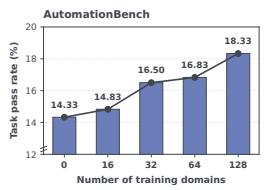

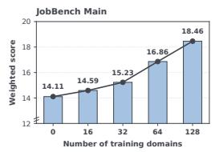

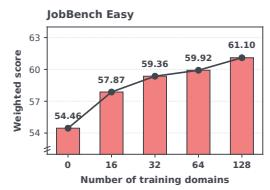

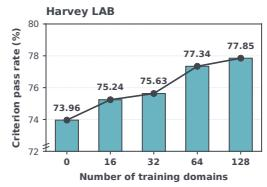  
Figure 3: Broader domain coverage improves transfer at a fixed trajectory count. The original checkpoint is labeled 0, and 128 denotes all domains in this model’s training set for the main experiment. AutomationBench reports task pass rate (%), JobBench Main and Easy report weighted scores (0–100), and Harvey LAB reports criterion pass rate (%). Lines connect the evaluated settings.

## 4.2 MAIN RESULTS

Interlock-RFT achieves the highest score in every evaluation column for both backbones (Table 1), outperforming the original checkpoints and ClawGym-SFT. Each backbone is trained on its own accepted trajectories, and the gains extend across coordinated API execution, professional deliverables, and legal work. For Qwen3.6-27B, INTERLOCK improves AutomationBench task pass rate by 4.00 percentage points, JobBench Main and Easy weighted scores by 4.35 and 6.64 points, and Harvey LAB criterion pass rate by 3.89 percentage points over the original checkpoint. For Qwen3.6-35B-A3B, the gains are 4.50 percentage points on AutomationBench, 3.20 and 4.31 score points on JobBench Main and Easy, and 4.16 percentage points on Harvey LAB. The improvements therefore cover task completion on AutomationBench, weighted rubric fulfillment on JobBench, and criterion satisfaction on Harvey LAB.

## 4.3 TASK DIVERSITY AND TRANSFER

We vary the number of training domains over 16, 32, 64, and 128. All four Interlock-RFT settings use 8,957 training trajectories, matching the Qwen3.6-27B main experiment. Tasks are grouped by domain, with each domain containing task families that share a business or professional context (Section 3.2). Domain coverage therefore measures the breadth of professional settings represented in training. Figure 3 compares Qwen3.6-27B under these Interlock-RFT settings with its original checkpoint, labeled 0. The setting covering all 128 domains corresponds to the Interlock-RFT result in Table 1. Performance increases at every successive setting on all four metrics, with 128 domains achieving the highest values. In INTERLOCK, expanding domain coverage varies the professional evidence, objectives, and constraints over which grounding, coupling, and realization must be satisfied. At a fixed trajectory count, broader domain coverage supplies more varied instances of these completion requirements. The shared gains across API execution, professional deliverables, and legal work support learning transferable completion behavior from complete executions of diverse tasks.

Table 2: Agentic verification analysis. Both filters use the same judge backbone, rubrics, and Qwen3.6-27B rollout pool. The resulting models share initialization and SFT settings. Judge output sums all verification calls and is averaged over all candidate rollouts, including accepted and rejected ones; tool returns are excluded $( \mathrm { k } = \mathrm { i } 0 ^ { 3 }$ tokens).
<table><tr><td>Trajectory filter</td><td>Judge output↓ (k tokens/rollout)</td><td>Automation Bench ↑</td><td>JobBench Main ↑</td><td>JobBench Easy ↑</td><td>Harvey LAB ↑</td></tr><tr><td>Original (no SFT)</td><td></td><td>14.33</td><td>14.11</td><td>54.46</td><td>73.96</td></tr><tr><td>LLM-as-judge</td><td>11.03</td><td>13.17</td><td>15.14</td><td>56.53</td><td>75.28</td></tr><tr><td>Agent-as-judge</td><td>12.28</td><td>18.33</td><td>18.46</td><td>61.10</td><td>77.85</td></tr></table>

## 4.4 AGENTIC VERIFICATION FOR COMPLETION-FILTERED TRAINING

We compare two trajectory judges on Qwen3.6-27B to isolate the training contribution of the trajectory judge. Both judging configurations use the same judge backbone, public task requests, rubrics, and acceptance rule (Section 3.4) to filter the fixed rollout pool underlying the Qwen3.6-27B Interlock-RFT result. The text-only LLM-as-judge receives a fixed textual representation of the initial and final workspaces and their diff, while the agent-as-judge can inspect the same snapshots and write and execute verification scripts. The agent-filtered condition reuses the main Interlock-RFT checkpoint. The text-filtered condition is fine-tuned from the same initial Qwen3.6-27B checkpoint with the same optimization settings. Verification output counts all judge-generated tokens, including verification-script and tool-call tokens, summed over all verification calls for each candidate rollout and averaged over the entire pool. Tool-returned content is excluded from this output count.

Agent-based filtering improves all four downstream metrics at the matched training budget (Table 2). Average judge output increases from approximately 11.03k to 12.28k tokens per candidate rollout, an 11.3% increase, or about 1.25k additional tokens. These gains support checking submitted artifacts through inspection and recomputation when selecting demonstrations for task completion. With the rollout pool, judge backbone, and supervision budget held fixed, executable verification improves the training value of the selected trajectories.

## 4.5 LONG-HORIZON EXECUTION ON SYNTHESIZED TASKS

The 3,278 retained tasks each receive five rollout attempts from Qwen3.6-27B and five from Qwen3.6-35B-A3B, giving 32,780 attempts. Excluding 410 non-normal executions leaves 32,370 trajectories for execution-horizon analysis. Each backbone selects 8,957 of its own accepted trajectories for training, with approximately 154M supervised tokens in each training set. We characterize execution horizon over this normally terminated pool through assistant turns, tool calls, and recorded trajectory tokens.

Figure 4 compares the 32,370 normally terminated INTERLOCK trajectories with 24,497 released ClawGym trajectories. INTERLOCK trajectories average 84,293 recorded tokens, 27.63 assistant turns, and 42.10 tool calls, compared with 14,940 tokens, 11.92 turns, and 14.76 calls for Claw-Gym. The corresponding ratios are 5.64×, 2.32×, and 2.85×. The difference extends to the centers of the distributions: median assistant turns are 25 versus 9, and median tool calls are 40 versus 12. Appendix C specifies the population and counting rules and provides the cumulative distributions and histograms. Assistant turns measure successive model responses, while tool calls measure the actions submitted during those responses. Their joint increase grounds the long-horizon characterization in repeated interaction with the task environment. These execution statistics show that INTERLOCK produces tasks that elicit sustained agent work, providing experience in carrying evidence, decisions, and required effects across many interactions.

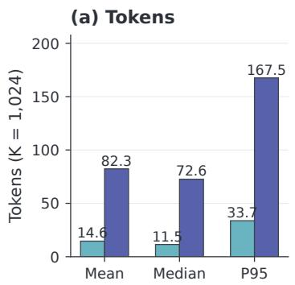

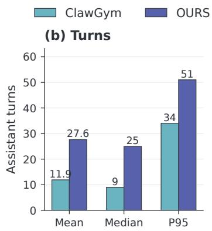

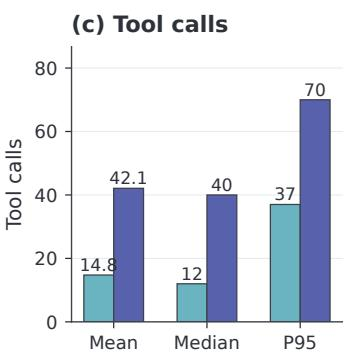  
Figure 4: Execution horizons of INTERLOCK and ClawGym trajectories. Bars report the mean, median, and 95th percentile (P95) of recorded tokens, assistant turns, and tool calls. Each trajectory has equal weight, and K = 1,024 tokens. Appendix C gives the measurement protocol.

## 4.6 GENERALIZATION ACROSS TASK ENVIRONMENTS

Figure 5 visualizes selected public task statements from INTERLOCK, AutomationBench, JobBench Main, and Harvey LAB. We encode each statement with BGE-M3 (Chen et al., 2024) and project the normalized embeddings into two dimensions using PCA followed by t-SNE (Van der Maaten & Hinton, 2008).

INTERLOCK tasks span a broad area of the projection and form multiple dispersed groups, reflecting diverse task content. This breadth extends to environment construction: the retained corpus covers 128 domains and 484 task families, with multi-file workspaces containing task-specific records, policies, and unfinished artifacts (Appendix D). These settings vary the evidence, joint constraints, and downstream obligations over which grounding, coupling, and realization must be satisfied.

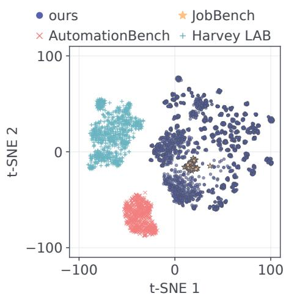

AutomationBench, JobBench, and Harvey LAB together evaluate out-of-distribution (OOD) transfer to independently authored tasks with their own materials, interfaces, and outcome requirements. Their task statements form dataset-specific groups in the projection, and their evaluation instances are excluded from synthesis and RFT. Consistent gains across all three benchmarks and both backbones (Table 1) demon-

Figure 5: Task-statement embeddings. Joint PCA–t-SNE projection of normalized BGE-M3 embeddings; “ours” denotes INTERLOCK.

strate the training value of complete synthetic executions beyond the generated task distribution. Together with the domain-diversity results (Figure 3), they support learning transferable completion behavior by connecting evidence, decisions, and required effects across varied professional settings.

## 4.7 CASE STUDIES OF TASK COMPLETION

Figure 6 traces completion requirements in two synthesized tasks using public inputs and recorded artifacts. For each task, we compare two rollout attempts of Qwen3.6-27B on identical public inputs.

Operating recovery. A four-week recovery plan must reconcile supply, order commitments, and financial effects. In attempt 1, Qwen3.6-27B allocates 970 HX units against 770 available; advancing an inbound shipment changes its arrival time, not the total supply. Its 3,920-kit plan also exceeds 3,250 shared trays, partially serves an unsplittable 230-unit order, and omits a selected \$6,800 expedite cost from contribution margin despite recording the cash outflow. In attempt 2, the same model uses 760 HX units, caps kits at 3,250, excludes the whole unsplittable order, and deducts its own selected action costs.

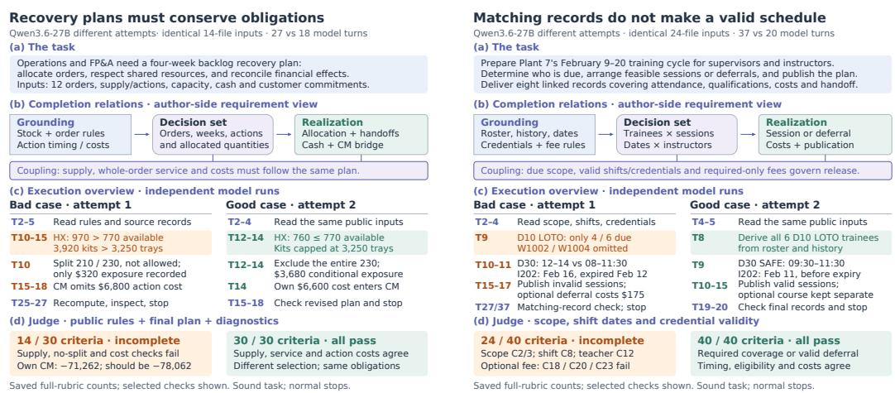  
Figure 6: Case study. Left: recovery planning couples supply, whole-order service, and action costs. Right: training schedules couple due scope, shift windows, and dated qualifications.

Training schedules. The February 2026 training cycle links due employees, shift availability, instructor credentials, and publication records. Attempt 1 of Qwen3.6-27B produces matching sched ule and publication rows but omits two of six due trainees, schedules a 12:00–14:00 class outside an 08:00–11:30 release window, and assigns an instructor on February 16 whose credential expires on February 12. Attempt 2 of the same model retains all six trainees, uses a shared 09:30–11:30 window, and schedules that instructor on February 11. Appendix F extends the analysis to field-trial protocols, charging networks, and payroll close.

## 5 CONCLUSION

INTERLOCK organizes long-horizon task synthesis around typed completion graphs. Grounding, coupling, and realization relations constrain how public evidence, consequential decisions, joint conditions, and required effects are compiled into task environments and outcome criteria. Dual-view review checks both graph preservation and public support, while completion-filtered RFT selects executions that realize every applicable graph effect. Training improves both Qwen3.6-27B and Qwen3.6-35B-A3B across AutomationBench, JobBench Main and Easy, and Harvey LAB, supporting the value of complete synthetic execution experience for transfer across task environments.

## AI USE STATEMENT

We used generative AI tools to assist with prompt design and manuscript preparation, including language polishing, bilingual editing, and the preparation of figures and captions. As described in Section 3, AI agents are integral to the task synthesis and training-data collection procedure: they generate initial workspaces, task instructions, and outcome rubrics; review task requirements and quality; execute tasks; and assess the resulting artifacts. The roles and verification procedures for these agents are documented in the methodology and experimental setup. We have manually reviewed all AI-assisted work, including manuscript revisions, prompts, generated task materials, and execution and evaluation records. We take responsibility for the final content of this work, including its text, analyses, claims, and artifacts produced with AI assistance.

## REFERENCES

Fei Bai, Huatong Song, Shuang Sun, Daixuan Cheng, Yike Yang, Chuan Hao, Renyuan Li, Feng Chang, Yuan Wei, Ran Tao, et al. Clawgym: A scalable framework for building effective claw agents. arXiv preprint arXiv:2604.26904, 2026.

Léo Boisvert, Megh Thakkar, Maxime Gasse, Massimo Caccia, Thibault L De Chezelles, Quentin Cappart, Nicolas Chapados, Alexandre Lacoste, and Alexandre Drouin. Workarena++: Towards compositional planning and reasoning-based common knowledge work tasks. Advances in Neural Information Processing Systems, 37:5996–6051, 2024.

Shihao Cai, Runnan Fang, Jialong Wu, Baixuan Li, Xinyu Wang, Yong Jiang, Liangcai Su, Liwen Zhang, Wenbiao Yin, Zhen Zhang, et al. Autoforge: Automated environment synthesis for agentic reinforcement learning. arXiv preprint arXiv:2512.22857, 2025.

Jianlv Chen, Shitao Xiao, Peitian Zhang, Kun Luo, Defu Lian, and Zheng Liu. Bge m3-embedding: Multi-lingual, multi-functionality, multi-granularity text embeddings through self-knowledge distillation. arXiv preprint arXiv:2402.03216, 4(5), 2024.

Mingyang Chen, Tianpeng Li, Fan Yang, Hao Liang, Bin CUI, Wentao Zhang, Zenan Zhou, and Weipeng Chen. Facilitating multi-turn function calling for llms via compositional instruction tuning. In International Conference on Learning Representations, volume 2025, pp. 42742– 42782, 2025.

Guanting Dong, Junting Lu, Junjie Huang, Wanjun Zhong, Longxiang Liu, Shijue Huang, Zhenyu Li, Yang Zhao, Xiaoshuai Song, Xiaoxi Li, et al. Agent-world: Scaling real-world environment synthesis for evolving general agent intelligence. arXiv preprint arXiv:2604.18292, 2026.

Zhiyuan Fan, Tinghao Yu, Yuanjun Cai, Jiangtao Guan, Yun Yang, Dingxin Hu, Jiang Zhou, Xing Wu, Zhuo Han, Feng Zhang, et al. Toward scalable terminal task synthesis via skill graphs. arXiv preprint arXiv:2604.25727, 2026.

Kanishk Gandhi, Shivam Garg, Noah D Goodman, and Dimitris Papailiopoulos. Endless terminals: Scaling rl environments for terminal agents. arXiv preprint arXiv:2601.16443, 2026.

Harvey AI. Harvey lab: The legal agent benchmark, 2026. URL https://github.com/ harveyai/harvey-labs/tree/v1.0. Announcement: https://www.harvey.ai/ blog/introducing-harveys-legal-agent-benchmark.

Mengkang Hu, Pu Zhao, Can Xu, Qingfeng Sun, Jian-Guang Lou, Qingwei Lin, Ping Luo, and Saravan Rajmohan. Agentgen: Enhancing planning abilities for large language model based agent via environment and task generation. In Proceedings ofthe 31st ACM SIGKDD Conference on Knowledge Discovery and Data Mining V. 1, pp. 496–507, 2025.

Maksim Ivanov and Abhijay Rana. Anchor: Mitigating artifact drift in agent benchmark generation. arXiv preprint arXiv:2605.26321, 2026.

Yuetai Li, Yichen Feng, Zhangchen Xu, Zixian Ma, et al. Jobbench: Aligning agent work with human will, 2026a. URL https://arxiv.org/abs/2605.26329.

Zhongzhi Li, Yucheng Shi, Zongxia Li, Ruhan Wang, Anhao Li, Zixun Huang, Junyao Yang, Lei Ke, Ninghao Liu, Haitao Mi, et al. Recursive synthesis for long-horizon terminal tasks. arXiv preprint arXiv:2608.05466, 2026b.

Zongxia Li, Zhongzhi Li, Yucheng Shi, Ruhan Wang, Junyao Yang, Zhichao Liu, Xiyang Wu, Anhao Li, Yue Yu, Ninghao Liu, et al. Long-horizon-terminal-bench: Testing the limits of agents on long-horizon terminal tasks with dense reward-based grading. arXiv preprint arXiv:2607.08964, 2026c.

Weiwen Liu, Xu Huang, Xingshan Zeng, Shuai Yu, Dexun Li, Shuai Wang, Weinan Gan, Zhengying Liu, Yuanqing Yu, Zezhong WANG, et al. Toolace: Winning the points of llm function calling. In International conference on learning representations, volume 2025, pp. 41359–41381, 2025.

Zuxin Liu, Thai Hoang, Jianguo Zhang, Ming Zhu, Tian Lan, Shirley Kokane, Juntao Tan, Weiran Yao, Zhiwei Liu, Yihao Feng, et al. Apigen: Automated pipeline for generating verifiable and diverse function-calling datasets. Advances in Neural Information Processing Systems, 37:54463– 54482, 2024.

Jiarui Lu, Thomas Holleis, Yizhe Zhang, Bernhard Aumayer, Feng Nan, Haoping Bai, Shuang Ma, Shen Ma, Mengyu Li, Guoli Yin, et al. Toolsandbox: A stateful, conversational, interactive evaluation benchmark for llm tool use capabilities. In Findings ofthe Associationfor Computational Linguistics: NAACL 2025, pp. 1160–1183, 2025.

Mike Merrill, Alexander Shaw, Nicholas Carlini, Boxuan Li, Harsh Raj, Ivan Bercovich, Lin Shi, Jeong Shin, Thomas Walshe, E Kelly Buchanan, et al. Terminal-bench: Benchmarking agents on hard, realistic tasks in command line interfaces. In International Conference on Learning Representations, volume 2026, pp. 40903–40986, 2026.

Vardaan Pahuja, Yadong Lu, Corby Rosset, Boyu Gou, Arindam Mitra, Spencer Whitehead, Yu Su, and Ahmed Hassan. Explorer: Scaling exploration-driven web trajectory synthesis for multimodal web agents. In Findings ofthe Associationfor Computational Linguistics: ACL 2025, pp. 6300– 6323, 2025.

Akshara Prabhakar, Zuxin Liu, Ming Zhu, Jianguo Zhang, Tulika Manoj Awalgaonkar, Shiyu Wang, Zhiwei Liu, Haolin Chen, Thai Hoang, Juan Carlos Niebles, et al. Apigen-mt: Agentic pipeline for multi-turn data generation via simulated agent-human interplay. Advances in Neural Information Processing Systems, 38, 2026.

Yujia Qin, Shihao Liang, Yining Ye, Kunlun Zhu, Lan Yan, Yaxi Lu, Yankai Lin, Xin Cong, Xiangru Tang, Bill Qian, et al. Toolllm: Facilitating large language models to master 16000+ real-world apis. In International Conference on Learning Representations, volume 2024, pp. 9695–9717, 2024.

Daniel Shepard and Robin Salimans. Automationbench, 2026. URL https://arxiv.org/ abs/2604.18934.

Dingfeng Shi, Jingyi Cao, Qianben Chen, Weichen Sun, Weizhen Li, Hongxuan Lu, Fangchen Dong, Tianrui Qin, Minghao Liu, Yuchen Jiang, et al. Taskcraft: Automated generation of agentic tasks. In International Conference on Learning Representations, volume 2026, pp. 43714–43734, 2026.

Xiaoshuai Song, Haofei Chang, Guanting Dong, Yutao Zhu, Ji-Rong Wen, and Zhicheng Dou. Envscaler: Scaling tool-interactive environments for llm agent via programmatic synthesis. In Findings ofthe Associationfor Computational Linguistics: ACL 2026, pp. 8326–8357, 2026.

Qiushi Sun, Kanzhi Cheng, Zichen Ding, Chuanyang Jin, Yian Wang, Fangzhi Xu, Zhenyu Wu, Chengyou Jia, Liheng Chen, Zhoumianze Liu, et al. Os-genesis: Automating gui agent trajectory construction via reverse task synthesis. In Proceedings of the 63rd Annual Meeting of the Associationfor Computational Linguistics (Volume 1: Long Papers), pp. 5555–5579, 2025.

Qiaoyu Tang, Ziliang Deng, Hongyu Lin, Xianpei Han, Qiao Liang, Boxi Cao, and Le Sun. Toolalpaca: Generalized tool learning for language models with 3000 simulated cases. arXiv preprint arXiv:2306.05301, 2023.

Harsh Trivedi, Tushar Khot, Mareike Hartmann, Ruskin Manku, Vinty Dong, Edward Li, Shashank Gupta, Ashish Sabharwal, and Niranjan Balasubramanian. Appworld: A controllable world of apps and people for benchmarking interactive coding agents. In Proceedings ofthe 62nd Annual Meeting of the Association for Computational Linguistics (Volume 1: Long Papers), pp. 16022– 16076, 2024.

Dunwei Tu, Hongyan Hao, Hansi Yang, Yihao Chen, Yi-Kai Zhang, Zhikang Xia, Yu Yang, Yueqing Sun, Xingchen Liu, Furao Shen, et al. Scaleenv: Scaling environment synthesis from scratch for generalist interactive tool-use agent training. arXiv preprint arXiv:2602.06820, 2026.

Laurens Van der Maaten and Geoffrey Hinton. Visualizing data using t-sne. Journal of machine learning research, 9(11), 2008.

Guanzhi Wang, Yuqi Xie, Yunfan Jiang, Ajay Mandlekar, Chaowei Xiao, Yuke Zhu, Linxi Fan, and Anima Anandkumar. Voyager: An open-ended embodied agent with large language models. arXiv preprint arXiv:2305.16291, 2023.

Zezhong Wang, Xingshan Zeng, Weiwen Liu, Liangyou Li, Yasheng Wang, Lifeng Shang, Xin Jiang, Qun Liu, and Kam-Fai Wong. Toolflow: Boosting llm tool-calling through natural and coherent dialogue synthesis. In Proceedings of the 2025 Conference of the Nations of the Americas Chapter of the Association for Computational Linguistics: Human Language Technologies (Volume 1: Long Papers), pp. 4246–4263, 2025.

Jingxu Xie, Dylan Xu, Xuandong Zhao, and Dawn Song. Agentsynth: Scalable task generation for generalist computer-use agents. In International Conference on Learning Representations, volume 2026, pp. 155149–155177, 2026.

Tianbao Xie, Danyang Zhang, Jixuan Chen, Xiaochuan Li, Siheng Zhao, Ruisheng Cao, Toh J Hua, Zhoujun Cheng, Dongchan Shin, Fangyu Lei, et al. Osworld: Benchmarking multimodal agents for open-ended tasks in real computer environments. Advances in Neural Information Processing Systems, 37:52040–52094, 2024.

Frank Fangzheng Xu, Yufan Song, Boxuan Li, Yuxuan Tang, Kritanjali Jain, Mengxue Bao, Zora Wang, Xuhui Zhou, Zhitong Guo, Murong Cao, et al. Theagentcompany: benchmarking llm agents on consequential real world tasks. Advances in Neural Information Processing Systems, 38, 2026a.

Minrui Xu, Zilin Wang, Mengyi Deng, Zhiwei Li, Zhicheng Yang, Xiao Zhu, Yinhong Liu, Boyu Zhu, Baiyu Huang, Chao Chen, et al. Envfactory: Scaling tool-use agents via executable environments synthesis and robust rl. arXiv preprint arXiv:2605.18703, 2026b.

Bowen Ye, Lei Li, Shicheng Li, Zihao Yue, Linghao Zhang, Hanglong Lv, Yuanxin Liu, Wenhan Ma, Hao Tian, Rang Li, et al. Codemidas: Scaling agentic coding rl environments from code itself. arXiv preprint arXiv:2609.22068, 2026.

Shuyan Zhou, Frank F Xu, Hao Zhu, Xuhui Zhou, Robert Lo, Abishek Sridhar, Xianyi Cheng, Tianyue Ou, Yonatan Bisk, Daniel Fried, et al. Webarena: A realistic web environment for build ing autonomous agents. In International Conference on Learning Representations, volume 2024, pp. 15585–15606, 2024.

## A ACCEPTANCE AND OUTCOME SCORING

Obligation representation. Let $\mathcal { R } _ { x }$ be the full set of mandatory obligations for task x. An obligation $r \in \mathcal { R } _ { x }$ consists of its public evidence $B _ { r }$ , binary applicability condition $\alpha _ { r }$ , binary outcome condition $\phi _ { r }$ , and object scope $\Omega _ { r }$ :

$$
r = ( B _ { r } , \alpha _ { r } , \phi _ { r } , \Omega _ { r } ) , \qquad \alpha _ { r } ( q , W _ { 0 } , W _ { 1 } ^ { \tau } ) = 1 \implies \phi _ { r } ( W _ { 0 } , W _ { 1 } ^ { \tau } ) = 1 .\tag{7}
$$

Here, $\alpha _ { r }$ determines whether the obligation applies given the request, initial materials, and delivered choices; $\phi _ { r }$ determines whether its required effect holds; and $\Omega _ { r }$ specifies the objects over which applicability and fulfillment are evaluated. We write $\alpha _ { r } ( \tau )$ and $\phi _ { r } ( \tau )$ as shorthand for the full arguments. Unconditional obligations have $\alpha _ { r } ~ = ~ 1$ The typed completion graph shares these obligations across its evidence, decision, and effect nodes without instantiating their correct values.

Training-set construction. For a sound task $x ,$ let ${ \mathcal { T } } _ { x } ^ { ( k ) }$ contain attempts generated by starting policy $\pi _ { 0 } ^ { \mathit { \bar { ( k ) } } }$ , and let normal(τ) equal one when execution ends normally and zero otherwise. The proposed retained set is

$$
\mathcal { D } _ { \mathrm { R F T } } ^ { ( k ) } = \{ ( x , \tau ) : \tau \in \mathcal { T } _ { x } ^ { ( k ) } , \mathrm { n o r m a l } ( \tau ) = 1 , A _ { V } ( x , \tau ) = 1 \} .\tag{8}
$$

Each backbone retains native messages and tool schemas from its own executions. Private rubrics, correspondence records, and judge feedback remain outside the training conversation.

## A.1 DIAGNOSTIC OUTCOME SCORING

The following equations define its partial-credit outcome statistics. Trajectory acceptance follows $A _ { V } ( x , \tau ) = 1$ as defined in Section 3.4.

For criterion i, the judge reports initial and final satisfaction $b _ { i } , m _ { i } \in \{ 0 , 1 \}$ . Declared support dependencies $D _ { i }$ yield

$$
\widetilde { m } _ { i } = m _ { i } \prod _ { j \in D _ { i } } \widetilde { m } _ { j } .\tag{9}
$$

The extracted criterion-dependency graphs contain no cycles or unknown references. An acyclic dependency graph is the precondition for this recursion. These depends\_on edges propagate criterion credit; they are distinct from the grounding, coupling, and realization relations that define task semantics. Applicability and exceptions are expressed in each public criterion proposition.

Let $N _ { g }$ contain the scored criteria in group $g . \mathrm { A }$ change criterion satisfied both initially and finally is excluded from $N _ { g } ;$ preservation criteria remain scored. Let $E _ { g } \subseteq N _ { g }$ contain the group’s essential criteria and let $\mathcal { G } _ { + }$ contain groups with scored criteria. Then

$$
\begin{array} { l } { { p _ { g } = \displaystyle \frac { 1 } { | N _ { g } | } \sum _ { i \in N _ { g } } \widetilde { m } _ { i } , \quad s _ { g } = p _ { g } \prod _ { i \in E _ { g } } \widetilde { m } _ { i } , } } \\ { { S _ { V } = \displaystyle \frac { \sum _ { g \in \mathcal { G } _ { + } } w _ { g } s _ { g } } { \sum _ { g \in \mathcal { G } _ { + } } w _ { g } } . } } \end{array}\tag{10}
$$

Critical groups account for at most half the rubric weight. Essential failures zero their groups. The score $S _ { V }$ summarizes partial fulfillment, while $A _ { V }$ requires every mandatory obligation to be fulfilled and any separately declared quality threshold to be met.

## B BEHAVIORAL DIAGNOSTIC PROTOCOL

A decision unit contains a publicly justified decision and the full bundle of applicable effects for its consumers. Let $u _ { i }$ indicate a correct upstream decision and $e _ { i }$ indicate fulfillment of every applicable downstream effect. The eligible units have at least one applicable downstream obligation. Followthrough is

$$
\mathrm { F T R } = \frac { \sum _ { i } { u _ { i } e _ { i } } } { \sum _ { i } { u _ { i } } } .\tag{11}
$$

The report includes $\textstyle \sum _ { i } u _ { i }$ , upstream correctness, and unconditional joint success over all eligible units. Outcomes are established from raw criteria and delivered artifacts. A paired analysis additionally reports units whose upstream decisions are correct in both checkpoints; resampling uses task families when tasks share a family and tasks otherwise, accounting for multiple units within an execution. An empty conditional denominator is reported as not applicable.

The diagnostic set is frozen outside the training data. A composition-transfer extension reserves selected domain–relationship combinations while retaining their constituent domains and relationships in other combinations. Relevant environment interventions change a public fact that affects applicability or feasibility; semantic-preserving controls reorder equivalent material. Each task version has its own quality review and permits all outcomes satisfying its public requirements. Measurements cover joint success across paired versions, correct updates to affected effects, and preservation of unaffected conditions.

## C TRAJECTORY STATISTICS AND COMPARISON

Rollout population and training selection. The experimental corpus retains 3,278 tasks on which both Qwen3.6-27B and Qwen3.6-35B-A3B have at least one accepted rollout. Five attempts per task and backbone give 32,780 attempts. Excluding 410 abnormally terminated or incomplete executions leaves 32,370 normally terminated trajectories, which define the INTERLOCK population in the execution-horizon figures. The ClawGym comparison uses all 24,497 supplied release trajectories. Appendix G.2 gives the selection protocol. Each backbone independently selects 8,957 accepted trajectories from its own normally terminated rollouts for its own RFT training, using the acceptance rule in Section 3.4. Each training set contains approximately 154M supervised tokens; the two model-specific sets contain 17,914 trajectories in total.

Measurement. An assistant turn is one recorded assistant message, including the final response. Several tool calls in one assistant message count as one turn and as multiple calls. HTTP retries and error responses do not add assistant turns. We use the same Qwen3.6-27B tokenizer for both corpora, with truncation and padding disabled. Token counts sum recorded user, assistant, and tool content, call arguments, saved reasoning, and one copy of the tool schema. Duplicate copies of saved reasoning are reconciled before counting. These counts measure recorded content, with each event counted once; they do not sum repeatedly submitted conversation contexts. Inline ClawGym toolcall text is counted once as assistant content. All distribution statistics weight trajectories equally within their respective corpora.

The supervised-token budget counts assistant positions that contribute to the training loss, including reasoning, responses, and tool calls. Input-only messages, tool observations, and tool schemas are excluded. The approximately 154M tokens per backbone therefore measure supervision in its 8,957 training trajectories; the execution-length figures measure recorded interaction content over the 32,370 normally terminated rollouts. Here, $\Breve { \mathrm { ~ M ~ } } = 1 0 ^ { 6 }$ , while the figure axes use K = 1,024 recorded tokens.

Execution-horizon statistics. The INTERLOCK mean is 84,292.51 recorded tokens, 27.63 assistant turns, and 42.10 tool calls per trajectory. The corresponding medians are 74,384.5 tokens, 25 turns, and 40 calls; the 95th percentiles are 171,549.1 tokens, 51 turns, and 70 calls. ClawGym means are 14,939.62 tokens, 11.92 turns, and 14.76 calls, yielding mean ratios of 5.64×, 2.32×, and 2.85×. These values use the same population as Figure 4. Figures 7 and 8 show the cumulative distributions and bin shares for these two rollout pools.

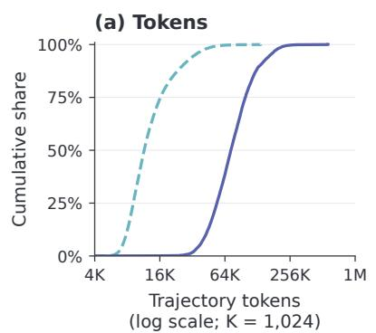

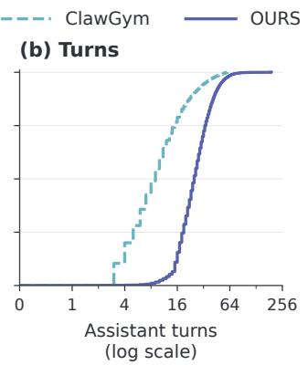

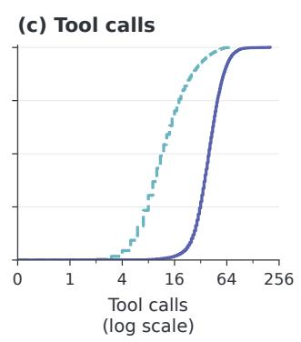  
Figure 7: Cumulative execution-horizon distributions. Horizontal axes show recorded trajectory tokens, assistant turns, and tool calls. The vertical axis is the fraction of trajectories at or below each horizontal value; a curve farther to the right indicates larger values at the same percentile. The curves use the same 32,370 INTERLOCK and $^ { 2 4 , 4 9 7 }$ ClawGym trajectories and token-counting rules as Figure $4 ; \mathrm { K } = 1 , 0 2 4$

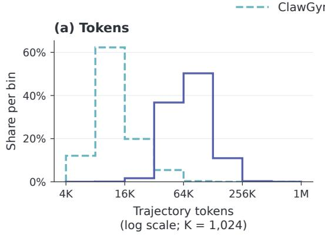

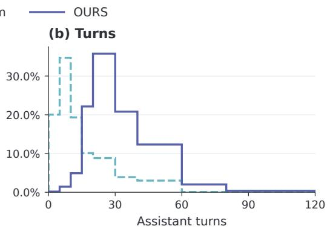  
Figure 8: Trajectory-length and assistant-turn histograms. Each vertical value is the fraction of trajectories in the corresponding bin. The two corpora share bin boundaries within each panel; the plotted values are bin shares rather than probability densities. The panels retain the full observed range of the 32,370 INTERLOCK and 24,497 ClawGym trajectories, with the same counting rules as Figure 4; $\mathrm { K } = 1 { , } 0 2 4$ tokens.

## D STATISTICS OF THE RETAINED TASK CORPUS

We analyze the 3,278 synthesized tasks retained after requiring at least one accepted rollout from each backbone (Appendix G.2). The retained corpus covers 128 domains and 484 task families, spanning eight task archetypes. Task families are defined within domains; archetypes describe recurring task structures across domains (Section 3.2). Each instance contributes once under its recorded dominant archetype. File counts consistently refer to the initial source workspace, including materials, drafts, and templates. Rubric statistics count each criterion once, without applying scoring weights; verification methods refer to the methods declared in those criteria.

Figure 9 summarizes task composition and the two artifacts that connect evidence to evaluation: the initial workspace and the outcome rubric. The median task contains 17 source files and 30 criteria. In INTERLOCK, the workspace supplies the public evidence and rules that ground decisions, while the rubric specifies conditions on those decisions, their joint consistency, and their required effects. The following figures describe how these materials and checks are distributed across the full corpus.

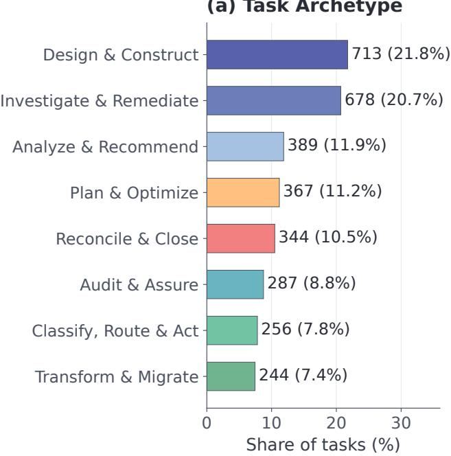

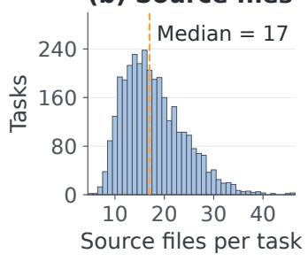

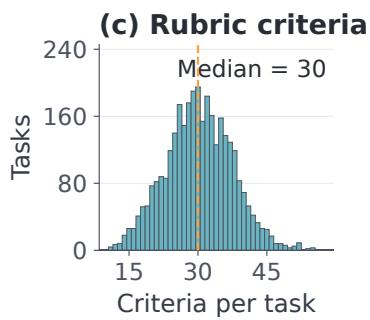  
Figure 9: Eight task archetypes with multi-file workspaces and multi-criterion rubrics. All panels cover the 3,278 retained tasks: (a) archetype shares, (b) source workspace file counts, and (c) rubric criterion counts. Orange dashed lines mark medians.

## D.1 VERIFICATION METHODS

Criterion composition. Figure 10 shows that content inspection and recomputation account for 44.04% and 40.87% of criteria. Initial–final comparison contributes 10.83%, and text matching contributes 4.25%. These methods provide complementary ways to evaluate completion: inspecting delivered content, checking derived results, comparing changes with the initial state, and verifying specified text. Their combination provides evidence for evaluating supported decisions and required outcomes within the same rubric.

## D.2 VERIFICATION ACROSS ARCHETYPES

Different compositions under a shared rubric format. Figure 11 normalizes criterion counts within each archetype. Content inspection accounts for 53.6% of Design & Construct criteria, while recomputation accounts for 56.4% of Classify, Route & Act and 58.1% of Transform & Migrate criteria. Plan & Optimize also devotes 46.3% of its criteria to recomputation. The archetypes therefore share a verification vocabulary while allocating checks differently. This pattern is consistent with compiling task-specific obligations under a common completion representation.

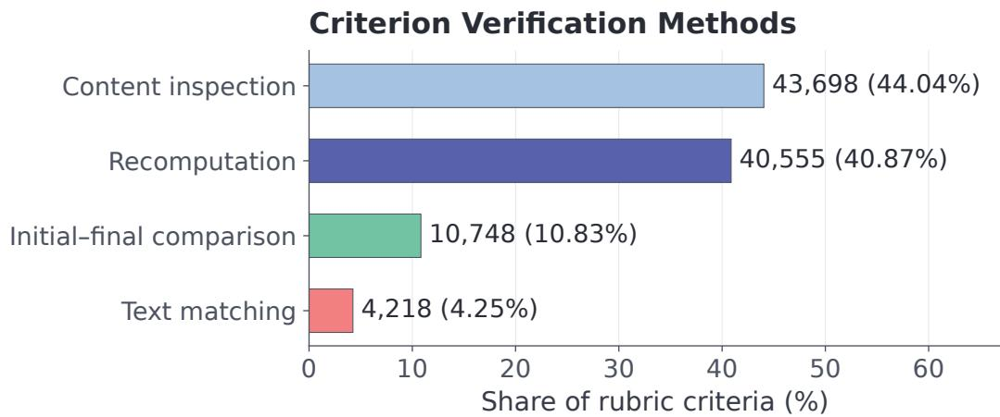  
Figure 10: Content inspection and recomputation dominate the declared checks. Bars show counts and shares of all 99,219 criteria, with each criterion counted once under its declared verification method.

Verification by Task Archetype  
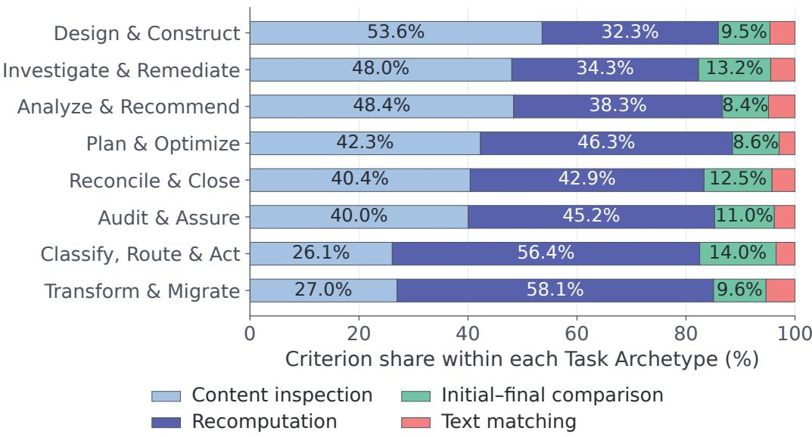  
Figure 11: Verification-method composition varies across task archetypes. Each row divides method counts by that archetype’s total criterion count and sums to 100%; criteria are unweighted by rubric scores.

## E TASK STRUCTURE AND EXECUTION LENGTH

Atomic outcome criteria are positively associated with both measures of execution length in Figure 12. Their Spearman correlations are $\rho = 0 . 3 3 6$ with recorded trajectory tokens and $\rho = 0 . 3 5 9$ with assistant turns, with 95% confidence intervals of [0.304, 0.367] and [0.325, 0.392], respectively. The binned medians rise with criterion count for both measures. Initial file counts have correlations close to zero $( \rho = - 0 . 0 3 6$ and $\rho = 0 . 0 4 1 )$ ).

This pattern aligns with INTERLOCK’s emphasis on preserving the requirements that define a complete outcome. The rubric expresses conditions on evidence-supported decisions, jointly constrained components, and required downstream effects. Grounding connects decisions to their controlling sources, Coupling requires their uses to remain jointly valid, and Realization specifies the effects that must be delivered. The positive criterion-count associations connect this explicit outcome specification to the sustained execution observed in the generated tasks.

Task-level aggregation. The analysis uses the 32,370 normally terminated rollouts on the 3,278 retained tasks and the token-counting rules in Appendix C. For each task, we take the median over repeated runs within each solver and then the arithmetic mean of the available solver-specific medians. Each task instance receives equal weight in the correlations. Confidence intervals use 2,000 bootstrap resamples clustered by source task pack, retaining all associated instances together.

## Task Structure and Execution Length

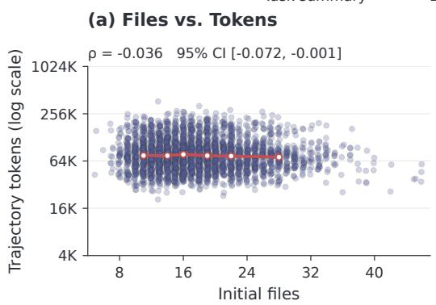

(b) Files vs. Turns  
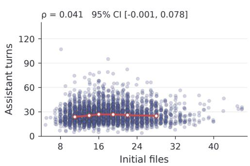

(c) Criteria vs. Tokens  
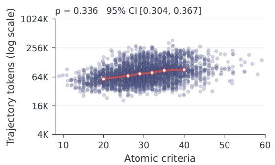

(d) Criteria vs. Turns  
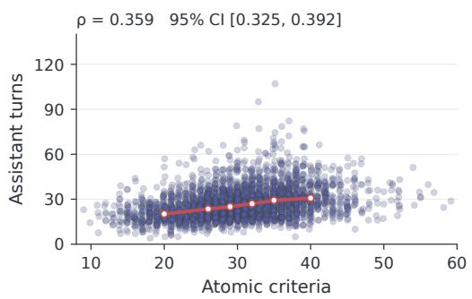  
Figure 12: More atomic outcome criteria are associated with longer executions. Points summarize the 3,278 retained tasks by averaging the available solver-specific medians over repeated runs; horizontal jitter aids display. Red curves show binned medians; shaded bands show the 25th–75th percentiles of task summaries. Annotations report Spearman correlations and 95% confidence intervals from bootstrap resampling clustered by source task. Token axes are logarithmic; K = 1,024.

## F FURTHER CASE STUDIES OF SYNTHESIZED TASKS

These cases extend Figure 6 to scientific protocols, infrastructure planning, and payroll records. Each pair compares two rollout attempts of the same Qwen backbone with identical public requests, initial workspaces, and rubrics. The field-trial case uses Qwen3.6-35B-A3B; the other four cases use Qwen3.6-27B. Attempt 1 and attempt 2 identify the displayed pair of runs. The diagrams reconstruct requirements from public sources and summarize recorded tool events and final artifacts. Counts denote passed/total binary criteria in the saved Judge reports; independent file audits are stated separately. These comparisons characterize variation across attempts on a task, while Table 1 provides the aggregate training comparison. The outcomes are plans and records delivered in task workspaces.

## F.1 FIELD-TRIAL PROTOCOL: DECISIONS MUST REMAIN EXECUTABLE AND INTERPRETABLE

The research lead needs a 2027 field-trial authorization protocol and a consistent reviewer note. In attempt 1, Qwen3.6-35B-A3B reverses the public risk condition: the confidence-interval branch flags risk when it excludes a yield loss above two bushels per acre, whereas the rule flags risk when it cannot exclude that loss. The plan also retains conditional AP7 treatment at SD-L2 despite its conflict with the associated May 9 pre-emerge constraint. This constraint applies to that operation and AP7 feasibility. Seasonal workload totals do not supply the required dated allocation of observations and staff. The protocol further makes grower-paid resprays reimbursable, and its secondary weed endpoint becomes primary in the reviewer note.

Attempt 2 of the same Qwen3.6-35B-A3B model uses four sites with AP5, preserves both required environments, and meets the public minimum of two sites per environment. It retains the risk condition, dated activities, payer boundary, and endpoint roles. The saved Judge counts for attempts 1 and 2 are 15/22 and 22/22. The five focal failures in Figure 13 connect grounded interpretation to a jointly feasible design and to the measurements and explanations that must realize it.

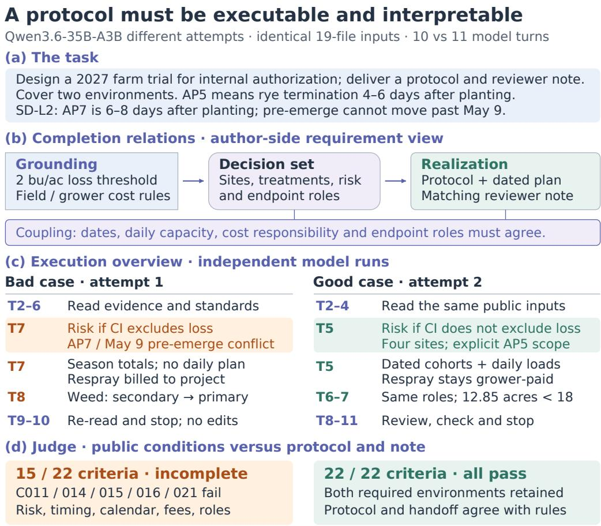  
Saved full-rubric counts; five selected failures shown. Sound task; normal stops.

Figure 13: A protocol must preserve both feasibility and interpretation. Five selected failures connect the risk rule, treatment timing, daily resources, payer boundary, and endpoint roles. AP5 and AP7 mean termination 4–6 and 6–8 days after planting, respectively; the risk threshold is two bushels per acre. Full saved Judge counts are 15/22 and 22/22 for attempts 1 and 2 of Qwen3.6- 35B-A3B, respectively; T denotes model turns.

## F.2 CHARGING NETWORKS: CAPACITY MUST STAY ATTACHED TO ITS RESOURCE

The campus charging plan couples complete demand dispositions with energy delivery, equipment ratings, and nested electrical limits. In attempt 1, Qwen3.6-27B correctly computes 53 kW of headroom for panel PA-1, then assigns 88.5 kW to that panel by using the combined headroom of PA-1 and another panel. It also omits nine demand sources, assigns the protected 144 kWh FLT-207 demand to a single 9.6 kW port that can supply at most 9.6 × 4.5 = 43.2 kWh within its service window, and records equipment nameplates inconsistent with the selected models and quantities. These choices remain in the final files after syntax repairs and a concluding check.

Attempt 2 of the same Qwen3.6-27B model preserves the nine demand dispositions and the focal panel and nameplate constraints. Its 162 kWh FLT-207 allocation is explicitly a future design. A different demand, SUR-118, still requires 612 kWh against 462 kWh of planned capacity, and both executions omit existing loads from the campus peak. Attempt 2 also retains a cost-summary mismatch. The saved Judge counts for attempts 1 and 2 are 35/44 and 41/44, with both runs incomplete. Figure 14 locates the gap between a correct local calculation and its use under the proper resource scope, while preserving the outstanding joint obligations in each plan.

## One baseline, incompatible capacity claims

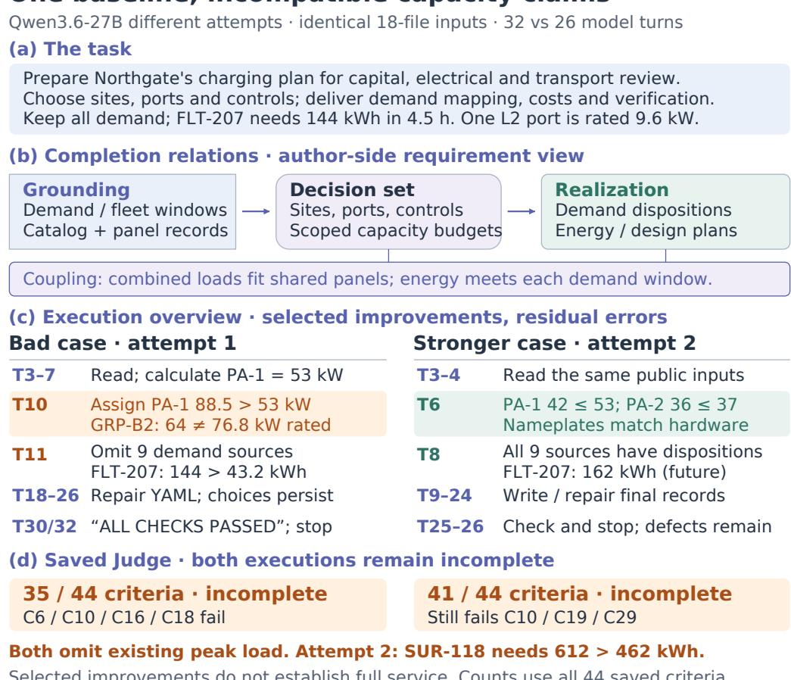  
Selected improvements do not establish full service. Counts use all 44 saved criteria.

Figure 14: Correct capacity calculations must constrain the final allocation. The diagram traces demand coverage, panel scope, energy-service windows, and hardware nameplates. Attempt 2 meets the highlighted object constraints but retains an energy deficit, missing existing peak loads, and a cost inconsistency. Both Qwen3.6-27B attempts remain incomplete, at 35/44 and 41/44 criteria; the FLT-207 counterpart is marked as future service.

## F.3 PAYROLL CLOSE: AMOUNTS, AUTHORITY, AND ACCOUNTING EFFECTS

The payroll close requires six linked deliverables for Payroll, Treasury, Accounting, and Employee Relations. In attempt 1, Qwen3.6-27B records E1004’s pending exposure as \$34.50 instead of the source-supported \$448.50, marks E1011’s \$35 refund as authorized using a time-correction approval, and omits E1005’s required \$1,760 gross-cost row while holding the \$1,296.80 net payment. Attempt 2 of the same model handles those focal obligations, including a recorded addition of the gross-cost row at turn 19 without releasing the held cash. The case connects source scope and action-specific authority to distinct payment and accounting effects.

The saved Judge reports 20/29 and 29/29 for attempts 1 and 2, while the independent file audit finds a shared off-cycle tax error. Both executions use 19.5% where the public rule requires 22%; for \$96 gross, they record \$77.28 net instead of \$74.88. Figure 15 therefore reports the saved judgments alongside this remaining artifact-level error. Handling the three displayed obligations and preserving the correct tax basis are separate completion requirements.

## Payroll decisions must reach every ledger

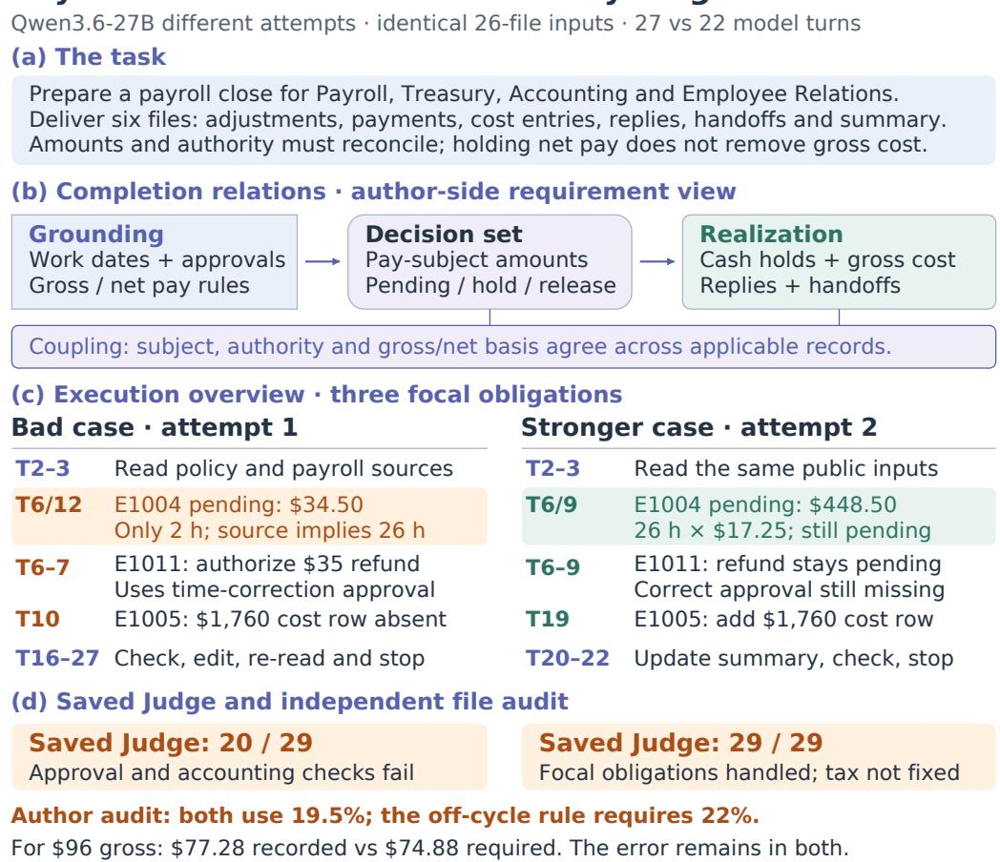  
Figure 15: Cash holds still require corresponding cost records. The three focal obligations concern E1004’s pending amount, E1011’s refund authority, and E1005’s gross-cost entry. The \$1,296.80 cash hold and \$1,760 gross cost refer to different required records. Saved Judge counts for the two Qwen3.6-27B attempts are 20/29 and 29/29; the independent audit retains the off-cycle tax error shared by both executions.

Algorithm 1 INTERLOCK: task synthesis and completion-filtered training.   
Input: Blueprints $B ,$ validation policy $\pi _ { v } ,$ backbones $\{ \pi _ { 0 } ^ { ( k ) } \}$ , attempts $M ,$ repair budget R   
Output: Admitted tasks ${ \mathcal { P } } ,$ training sets $\{ \mathcal { D } _ { \mathrm { R F T } } ^ { ( k ) } \}$ , trained policies $\{ \pi _ { \theta _ { k } } \}$   
1: $\mathbf { \hat { \boldsymbol { p } } } \gets \mathbf { \boldsymbol { \emptyset } }$   
2: for all $b \in B$ do   
3: $\mathcal { G } _ { b } $ BUILDCOMPLETIONGRAPH(b)   
4: $c \gets \mathrm { C O M P I L E T A S K P A C K } ( b , \mathcal { G } _ { b } )$ ▷ Eq. 4   
5: x ← REVIEWANDADMIT $( c , \pi _ { v } , R )$   
6: if $; \ne \emptyset$ then   
7: ${ \dot { \mathcal { P } } } \gets { \mathcal { P } } \cup \{ x \}$   
8: end if   
9: end for   
10: for all backbones k do   
11: $\mathcal { T } _ { \mathrm { o k } } ^ { ( k ) }  \mathrm { C O L L E C T A N D J U D G E } ( \pi _ { 0 } ^ { ( k ) } , \mathcal { P } , M )$   
12: $\mathcal { D } _ { \mathrm { R F T } } ^ { ( k ) }  \{ ( x , \tau ) \in \mathcal { T } _ { \mathrm { o k } } ^ { ( k ) } : A _ { V } ( \bar { x , \tau } ) = 1 \}$   
13: $\pi _ { \theta _ { k } }  \mathrm { S F T } ( \pi _ { 0 } ^ { ( k ) } , \mathcal { D } _ { \mathrm { R F T } } ^ { ( k ) } )$   
14: end for   
15: return $\mathcal { P } , \{ \mathcal { D } _ { \mathrm { R F T } } ^ { ( k ) } \} , \{ \pi _ { \theta _ { k } } \}$

## G ALGORITHM AND EXPERIMENTAL DETAILS

## G.1 TASK SYNTHESIS AND TRAINING ALGORITHM

Algorithm 1 summarizes task construction, admission, and completion-filtered training.

## G.2 DETAILED EXPERIMENTAL SETUP

Models and training conditions. We evaluate INTERLOCK on two backbones, Qwen3.6-27B and Qwen3.6-35B-A3B. For each backbone, the main experiment compares its original checkpoint, a model fine-tuned on released ClawGym trajectories, and a model trained with INTERLOCK through rejection-sampling fine-tuning (RFT). All three variants are evaluated on AutomationBench, JobBench, and Harvey LAB. The comparison examines the training value of the generated experience and its transfer to external task distributions.

Appendix D reports statistics of the retained task corpus, including archetype coverage, workspace and rubric size, and verification methods.

Original. The original checkpoint is the starting policy before either data-based training procedure.   
It provides the reference for measuring the effect of additional training within each backbone.

ClawGym-SFT. We directly use the trajectories released by ClawGym (Bai et al., 2026) for supervised fine-tuning of each starting model. This baseline represents training on an existing source of environment-grounded agent demonstrations.

Interlock-RFT. In the proposed protocol, each backbone independently executes INTERLOCK tasks and supplies its own rollout pool. Normally ended trajectories satisfying the acceptance rule in Section 3.4 are used for SFT initialized from the same backbone. Rollout generation, acceptance, and parameter updates remain separate for Qwen3.6-27B and Qwen3.6-35B-A3B. RFT denotes this combination of rejection sampling and SFT.

Task screening and rollout accounting. The reported corpus contains 3,278 synthesized tasks retained after screening. Each retained task has at least one accepted rollout from Qwen3.6-27B and at least one from Qwen3.6-35B-A3B. This criterion defines the task set used in the reported experiments. For each retained task, each backbone makes $M = 5$ rollout attempts from reset workspaces, giving $3 , 2 7 8 \times 2 \times 5 = 3 2 , 7 8 0$ attempts, or 16,390 per backbone. We exclude 410 attempts that do not terminate normally because of execution anomalies or incomplete execution, leaving 32,370 normally terminated trajectories for trajectory analysis. Normal termination concerns execution status; trajectory acceptance is determined separately by $A _ { V } ( x , \tau )$

From its own normally terminated rollout pool, Qwen3.6-27B selects 8,957 accepted trajectories for its RFT training set. Qwen3.6-35B-A3B independently selects 8,957 accepted trajectories from its own pool for its own training. The two training sets contain 17,914 trajectories in total, with approximately 154M supervised tokens per backbone $( \mathrm { M } = 1 0 ^ { 6 } )$ . Supervised tokens are assistantgenerated positions that contribute to the training loss, including reasoning, responses, and tool calls. System and user messages, tool-returned observations, and tool schemas provide conditioning context and are excluded from this supervision count.

These conditions compare the full INTERLOCK data-generation and training procedure with both the original model and a released-trajectory SFT alternative. The ClawGym baseline uses its published demonstrations, whereas INTERLOCK generates and selects demonstrations from the target backbone itself. Training-data sizes and optimization budgets are specified separately for each condition.

Implementation details. Qwen3.6-27B and Qwen3.6-35B-A3B use the same SFT configuration in Table 3. Each model is trained for five epochs on 16 NVIDIA H200 GPUs with 141 GB of memory per GPU. Both backbones use thinking mode during training and evaluation, and reasoning tokens contribute to the supervised loss. The approximately 154M supervised tokens per backbone describe the selected training data before epoch repetition.

Benchmarks and evaluation. We assess out-of-domain (OOD) generalization by transferring from the INTERLOCK synthetic task distribution to three independently constructed benchmark distributions. We use the public releases of AutomationBench and Harvey LAB. The evaluated benchmark instances are excluded from INTERLOCK’s synthesis inputs and RFT data. This setting tests whether experience acquired in generated task environments supports completion of externally specified tasks.

AutomationBench contains 600 public benchmark tasks, with 100 tasks in each of six business domains. Agents coordinate actions across applications through APIs, and programmatic assertions evaluate the final application state. We report pass rate: the percentage of task executions satisfying every required assertion (Shepard & Salimans, 2026).

Table 3: Shared SFT configuration for Qwen3.6-27B and Qwen3.6-35B-A3B.
<table><tr><td>Parameter</td><td>Value</td></tr><tr><td>Maximum sequence length</td><td>200k tokens</td></tr><tr><td>Learning rate</td><td> $2 \times 1 0 ^ { - 5 }$ </td></tr><tr><td>Batch size</td><td>64</td></tr><tr><td>Training epochs</td><td>5</td></tr><tr><td>Warmup ratio</td><td>0.03</td></tr><tr><td>Learning-rate schedule</td><td>Cosine</td></tr><tr><td>Training hardware</td><td>16× NVIDIA H200 (141 GB each)</td></tr></table>

JobBench contains 130 tasks across 35 occupations, divided into Main and Easy sets of 65 tasks each. The tasks require agents to reconcile heterogeneous reference materials and produce profes sional deliverables. Main includes more demanding reasoning and source reconciliation; Easy uses self-contained reference workspaces without web search. We run JobBench with the OpenCode harness and use GPT-5.5 to return an overall binary pass/fail judgment for each weighted rubric group (Li et al., 2026a).

Harvey LAB contains 1,251 tasks across 24 legal practice areas in the public release used in our evaluation. Tasks combine a client matter, supporting documents, and reviewable work products. We use GPT-5.5 as the judge for its deliverable-specific binary criteria, which assess factual support, legal analysis, and required content (Harvey AI, 2026).

Reported metrics. The main table reports AutomationBench task pass rate, JobBench-Main weighted score, JobBench-Easy weighted score, and Harvey LAB criterion pass rate. AutomationBench averages binary task-pass decisions. Harvey LAB criterion pass rate pools the number of passed binary criterion verdicts over the total number evaluated across the corresponding tasks and runs.

The JobBench evaluator defines a task’s weighted score as total\_score/max\_score. With valid judgments for every rubric group, we report the task-averaged weighted score

$$
\mathrm { S c o r e } _ { \mathrm { J o b B e n c h } } = \frac { 1 0 0 } { N } \sum _ { i = 1 } ^ { N } \frac { \sum _ { j } w _ { i j } b _ { i j } } { \sum _ { j } w _ { i j } } .\tag{12}
$$

Here, N is the number of evaluated tasks in the corresponding Main or Easy split, j indexes rubric groups within task $i , w _ { i j }$ is the rubric weight, and $b _ { i j } \in \{ 0 , 1 \}$ is the Judge’s overall pass indicator for that rubric group. Each task is normalized by its own total rubric weight before the task scores are averaged equally.

All metrics use a 0–100 scale, with higher values indicating better performance. JobBench improvements are reported in score points; AutomationBench and Harvey LAB rate improvements are reported in percentage points. Repeated executions and judge assessments follow the same schedule for all compared conditions. Evaluation uses each benchmark’s supplied assertions or rubrics.

Evaluation configuration. Comparisons are organized within a common benchmark version and task split. JobBench uses the OpenCode harness, and both JobBench and Harvey LAB use GPT-5.5 as the judge.

## H PROMPTS AND CONTRACTS FOR GRAPH-GROUNDED SYNTHESIS

INTERLOCK constructs tasks from a frozen source specification that retains the full task requirements. Its completion graph constrains workspace construction, task writing, and rubric compilation; separate source and public-input reviews check requirement preservation and public support. This appendix presents six selected prompt excerpts and four compact data-contract summaries. The excerpts are condensed English translations of the current implementation’s Chinese templates. Repeated self-checks and runtime boilerplate are omitted. Field names and role boundaries follow the code.

## H.1 FROZEN SOURCE AND COMPLETION GRAPH

Offline specification authoring declares explicit evidence, decision, and effect nodes, together with relation endpoints and joint conditions. Co-occurring roles or shared pivot names do not imply edges. The selected contract is frozen before the production roles run. The source snapshot retains the full task description and its intended use, all required business clauses, archetype requirements, and any selected artifact obligations or motif. This source remains available for review even when a generated graph or artifact omits an obligation.

## Contract 1: Frozen source and typed graph Contract 1: Frozen source and typed graph

source\_spec.json   
schema\_version: "completion\_source.v1"   
request   
brief   
source\_requirements: [{id, kind, content}]   
completion\_contract   
completion\_graph.json   
schema\_version: "completion\_graph.v1"   
source: {task\_id, domain\_id, neighborhood\_id,   
task\_archetype\_id}   
evidence: [...]   
decisions: [...]   
effects: [...]   
grounding: [...]   
coupling: [...]   
realization: [...]   
Common fields of every node and relation:   
id   
source\_requirement\_ids: [source requirement IDs]   
required\_stages: [workspace | task | rubric]

The records above summarize fields rather than reproduce the full JSON Schema. Source IDs distinguish the overall task request (commission:), its business requirements (requirement:), and archetype requirements (archetype:); declared artifact obligations and motifs retain their own source entries. Each entry preserves its original content.

Element Fields in addition to the common fields   
Evidence E artifact\_role\_id.   
Decision D description, and exactly one of pivot\_id or state\_id.   
Effect Y downstream\_role\_id and the four fields below.   
Grounding G evidence\_id, decision\_id.   
Coupling C member\_ids, condition, public\_basis\_role\_ids. Members are decisions or ef   
fects.   
Realization R decision\_id, effect\_id.

Effect fields: public basis, population, and conditions   
B = public\_basis\_role\_ids   
Omega = population {   
business\_object\_ids,   
source\_role\_ids,   
description   
}   
alpha = applicability   
phi = outcome\_condition

The effect fields store source references and natural-language conditions. The source population is established from public inputs; applicability and correct realizations remain to be determined from those inputs. These declarations do not contain answer values or executable graders. Python checks reference integrity and stage obligations: each relation requires rubric coverage and at least one public-input stage (workspace or task), and each effect requires rubric coverage. Coupling relations have at least two members when declared. The graph is a requirements representation, not an execution-order DAG.

## H.2 SELECTED CONSTRUCTION AND REVIEW PROMPTS

The shared graph instructions are inserted into each production prompt. The builder’s and setter’s archetype guidance comes from the frozen brief; contract fields and the rubric coverage floor are supplied from their corresponding schemas and declarations. The source judge sees the frozen specification, graph, actual artifacts, and carrier maps. The public critic sees only the public task and workspace plus the rubric under review.

Shared graph contract. This block keeps the same requirements in view throughout construction and makes the carrier mappings explicit.

Prompt 1: Shared completion-graph instructions   
Read the frozen source specification and completion graph. All three   
production stages use the same version. Do not alter its requirements,   
nodes, relations, conditions, or required stages. The graph specifies   
business relations that must hold, not the solver's execution order.   
Grounding preserves the evidence and rules supporting decisions.   
Coupling preserves joint conditions over its members. Realization   
preserves the downstream effects of decisions. Preserve each effect's   
public basis, source population, applicability, and outcome condition.   
Determine the population from public sources, not from the solver's   
eventual submission.   
Record actual carriers using graph IDs and file locations; rubric   
carriers also identify criteria. A mapping locates content and does   
not establish semantic preservation. Keep the graph and mappings   
outside the solver workspace.   
Before finishing, check preservation, actual carrier locations, and   
the write boundary of your role.

Workspace construction. The builder materializes evidence while leaving the controlling decisions and complete outcomes for the solver.

Prompt 2: World builder   
Build the workspace for the full task. The task statement and rubric   
are written by later roles and are unavailable to you. Provide the

## Prompt 2: World builder (continued)

evidence, professional methods, existing records, resources,   
authorization, and interacting constraints needed across the full   
scope of the work.   
Preserve independently identifiable sources, original conflicts,   
relevant objects and branches, and nontrivial derivations. Do not pre  
join evidence, resolve disputes, preselect objects whose applicability   
remains to be determined, or provide completed deliverables. Organize   
files by business purpose; file count is not a complexity target.   
Write only workspace/ and a private, value-free evidence\_index.json.   
Its completion\_carriers locate facts, rules, source populations, and   
existing states in the actual workspace. Controlling decisions remain   
unresolved.

Public task specification. The setter turns the full task requirements into publicly supported obligations while preserving freedom over the solution procedure.

## Prompt 3: Task setter

Read the workspace, evidence index, task brief, frozen source   
specification, and completion graph. Express every necessary   
obligation as a public requirement or an invariant needed to achieve   
the public goal.   
Write a task statement identifying the intended users, purpose,   
deliverables, constraints, and authorization boundaries. Preserve   
necessary decisions, record modifications, conditional obligations,   
and relationships between deliverables. State outcomes without   
prescribing the reading, calculation, or writing order. Do not   
disclose computed results, selected objects, or resolved conflicts.   
Write the deliverable contract and its completion\_carriers. Every   
contractual obligation must have a basis in task.md or the public   
workspace. The private contract cannot introduce additional acceptance   
requirements or sending authorization. Modify only task.md and   
deliverable\_contract.json.

Outcome rubric compilation. The compiler links required decisions, joint conditions, and effects to criteria that can be judged from public evidence and delivered artifacts.

## Prompt 4: Rubric compiler

Compile acceptance criteria from the public task and workspace, using   
the frozen graph and private indices to check coverage. Do not modify   
public inputs or generate a reference answer.   
Each criterion tests one proposition with a binary result. Identify   
its final-artifact target, concrete public basis, and appropriate   
verification method. Preserve the full object population,   
applicability conditions, exceptions, and permitted equivalent   
expressions. Recomputed criteria describe a derivation in prose   
without answer values. Cross-artifact consistency must depend on   
checks of source correctness.   
Write rubric\_spec.json and a separate rubric\_carriers.json. Every   
required effect must map to substantive outcome criteria, and joint   
constraints must remain jointly checked. Keep private graph

Prompt 4: Rubric compiler (continued)   
identifiers in the carrier map. Unpublished source obligations cannot   
directly penalize the solver.

Independent source-coverage judgment. This review starts from the original task specification, including requirements that might be jointly omitted from the graph, request, and rubric.

## Prompt 5: Source-coverage judge

Independently review preservation from the original task specification   
to the current task pack. Read the frozen specification, graph,   
actual stage artifacts, carrier maps, expected review targets, and   
prior source findings. Do not read solver trajectories or final   
outputs, public critic conclusions, or solver scores.   
Review every source requirement, including obligations jointly omitted   
from the graph and generated artifacts. Then judge every expected   
relation-stage pair from its actual carrier content. File existence,   
matching IDs, and producer declarations do not establish preservation.   
Check Grounding evidence and controlling rules, Coupling members and   
joint conditions, and Realization basis, source population,   
applicability, and outcome conditions. Do not let an omitted required   
stage or a reduced population conceal an original obligation.   
Return preserved, defective, or undetermined with evidence for each   
item. Every non-preserved judgment needs an unresolved finding.   
Explicitly reassess every historical finding, including valid findings   
retained from interrupted calls. Identify the responsible producer   
without changing inputs, writing answers, or predicting solver success   
Write only source\_review.json. Code aggregates the overall status.

Independent public-input criticism. This complementary review checks the task as supported by the materials available to the solver, without access to the source specification.

## Prompt 6: Public-input rubric critic

Review only task.md, the public workspace, and the proposed   
rubric\_spec.json. The task brief, private contracts, evidence index,   
author notes, prior reviews, and solver trajectory are unavailable. Do   
not use assumptions outside public inputs to supply missing   
acceptance grounds.   
Recover the complete public obligations, then check rubric coverage.   
Verify object scope, conditions, exceptions, authorization, joint   
consistency, and public decidability. Distinguish legitimate   
unresolved cases and equivalent expressions from missing work. Report   
duplicated predicates only when their object and condition scopes   
actually overlap.   
Write only rubric\_critique.json, with evidence and repair guidance for   
the responsible producer. Do not edit the rubric, construct reference   
deliverables, prove solvability, or predict difficulty. Return clean   
with no findings when no supported defect is found.

## H.3 CARRIER AND RUBRIC CONTRACTS

Each producer records where its graph requirements are carried. The same mapping structure appears in the evidence index $( \mu _ { W } ) .$ , deliverable contract $( \mu _ { T } )$ , and separate rubric carrier file $( \mu _ { V } ) .$ One graph element may have several carriers, and one criterion may serve several graph elements.

```yaml
Contract 2: Stage-specific carrier mappings
completion_carriers: [
{
graph_id,
carriers: [
{path, selector, criterion_id?}
]
}
]
mu_W: evidence_index.json
mu_T: deliverable_contract.json
mu_V: rubric_carriers.json
```

Question marks mark optional fields in these summaries. For a carrier pointing to rubric\_spec.json, criterion\_id is required and must name an existing criterion. Each graph element must be covered at its declared stages; each required rubric mapping must identify an actual criterion. File and reference checks are performed by code. The source judge then inspects the content to assess preservation. Future solver outputs need not exist in the initial workspace.

## Contract 3: Compact outcome rubric

schema\_version: "rubric\_spec.v6"   
quality\_floor   
rubrics: [   
{   
id, title, weight, consequence,   
criteria: [   
{   
id, criterion,   
target: {path, selector},   
public\_basis: [{path, selector}],   
verification\_method,   
importance, credit\_mode,   
derivation?, depends\_on?   
}   
]   
}   
]   
verification\_method:   
recomputed | initial\_final\_diff | text\_match | read   
importance: essential | supporting   
credit\_mode: change | preserve   
consequence: critical | forbidden | material | supporting

criterion states a binary satisfaction condition; target locates the delivered content to inspect; public\_basis identifies supporting locations in task.md or workspace/. derivation is a prose recomputation rule required for recomputed criteria and absent for other methods. depends\_on references criterion dependencies for scoring; it is distinct from the completion graph. The compiler writes the compact specification, and code renders rubric.md. Private graph mappings remain in rubric\_carriers.json.

Required criteria express mandatory public obligations, including their applicability conditions and permitted alternatives. An accepted trajectory satisfies $A _ { V } ( x , { \overline { { \tau } } } ) = \bar { 1 } { : }$ every required criterion passes and any separately declared quality threshold is met. Mandatory obligations and quality preferences are distinguished by their public meaning, as described in Appendix A. Weights, importance labels, credit modes, and criterion dependencies support the diagnostic outcome scores in Appendix A.1; they do not waive mandatory obligations.

## H.4 REVIEW RESULTS AND TASK ADMISSION

The source judge reports individual judgments rather than an aggregate pass declaration. Code constructs the expected source-requirement and relation–stage sets from the frozen inputs and checks that each target has exactly one judgment. Previous findings also require explicit dispositions.

## Contract 4: Independent source-review report

schema\_version: "source\_review.v1"   
basis: [evidence descriptions]   
requirements: [   
{requirement\_id, status, evidence}   
]   
relations: [   
{relation\_id, stage, status, evidence}   
]   
findings: [   
{   
finding\_id, status, owner\_stage,   
requirement\_ids, relation\_ids, stages,   
problem, evidence, reproduction, suggested\_change   
}   
]   
reviewed\_findings: [   
{finding\_id, disposition, evidence}   
]   
Preservation status: preserved | defective | undetermined   
New finding status: confirmed | undetermined   
Prior finding disposition: confirmed | dismissed | undetermined   
owner\_stage:   
source\_spec | completion\_graph | world\_builder |   
task\_setter | rubric\_compiler

Code aggregates the source result as passed, defective, or undetermined. An unresolved item requires an associated finding; silence in a later report does not close an earlier one. Source findings and public-input findings are kept in separate records and adjudicated using their respective evidence. The post-execution judge evaluates the public task against initial and final files and their differences, without seeing the source graph, carrier maps, source findings, or solver trajectory.

Task admission requires both a passed source-preservation review and a clean public-input critic report, a normally terminated real execution, complete criterion judgments, and a sound packagequality assessment with no outstanding confirmed or undetermined defects. The two reviews establish source coverage and public support; the post-execution judge separately assesses the resulting artifacts and package quality. Trajectory acceptance is recorded separately as $A _ { V } ( x , \tau ) = 1$ and is not required for task admission. Confirmed defects in materials, the request, or the rubric return to their responsible generation stage. Source-specification and graph defects require offline correction and keep the candidate internal. Revisions receive fresh reviews. The two review views share at most one generation-time rubric recompilation; post-execution revision follows the separately bounded quality-repair budget.

## I BENCHMARKS FOR LONG-HORIZON AGENTS

Long-horizon benchmarks provide concrete settings in which successful interaction must produce the requested outcome. WebArena (Zhou et al., 2024) and OSWorld (Xie et al., 2024) evaluate realistic web and desktop tasks with execution-based outcome checks. AppWorld (Trivedi et al., 2024) tests stateful multi-application coding and unintended changes, and ToolSandbox (Lu et al., 2025) emphasizes implicit state dependencies and intermediate milestones. These settings connect task success to environmental state and applicable rules, motivating our treatment of completion as a set of linked requirements.

WorkArena++ (Boisvert et al., 2024) targets compositional planning and reasoning in knowledge work, while TheAgentCompany (Xu et al., 2026a) combines websites, code execution, and workplace communication. Terminal-Bench (Merrill et al., 2026) couples challenging command-line tasks with dedicated environments and tests, and Long-Horizon-Terminal-Bench (Li et al., 2026c) evaluates extended workflows with graded subtasks and partial credit. Their emphasis on coordi nated work and outcome evaluation complements INTERLOCK’s focus on preserving completion requirements during task synthesis.

Our external evaluations span three forms of consequential work. AutomationBench (Shepard & Salimans, 2026) brings together cross-application orchestration, autonomous API discovery, and layered policy compliance. JobBench (Li et al., 2026a) evaluates expert-prioritized delegations in heterogeneous reference workspaces using fact-anchored chains of binary rubric criteria. Harvey LAB (Harvey AI, 2026) evaluates legal work in document-rich matter workspaces through deliverable-specific binary criteria covering factual support, analysis, and required content. Using each benchmark’s own evaluation protocol, these independently authored tasks assess the downstream value of the synthesized environments and data for agents facing new evidence, constraints, and required effects.