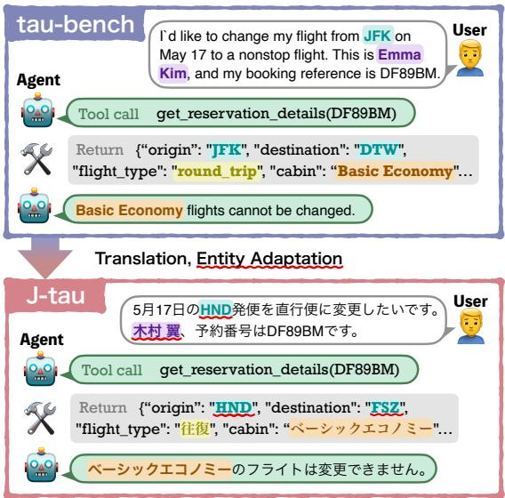
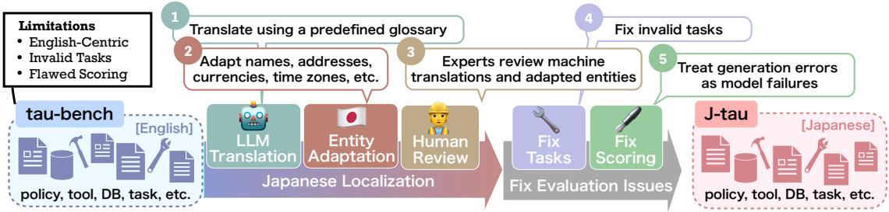
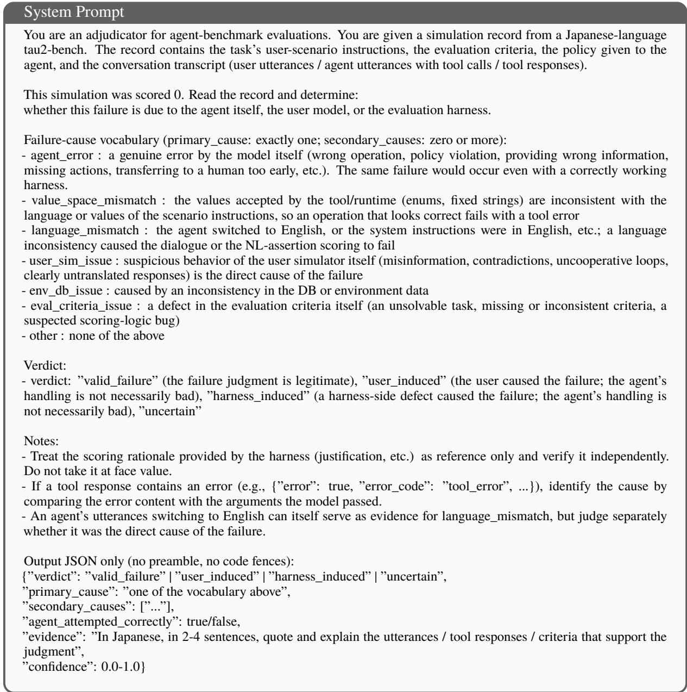
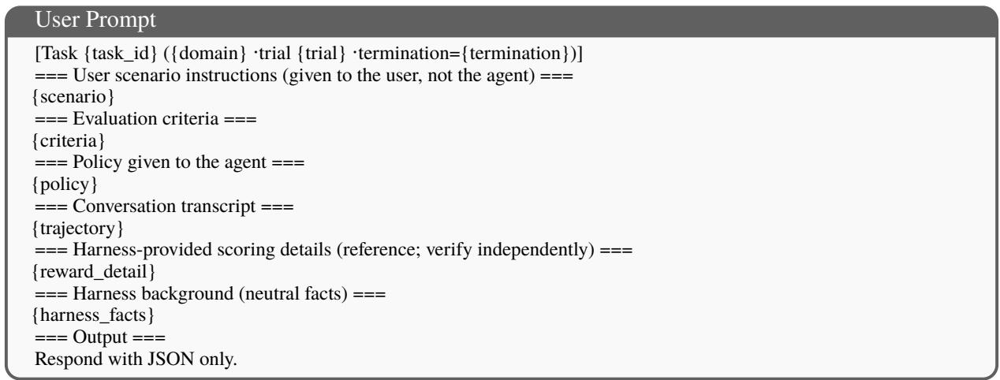
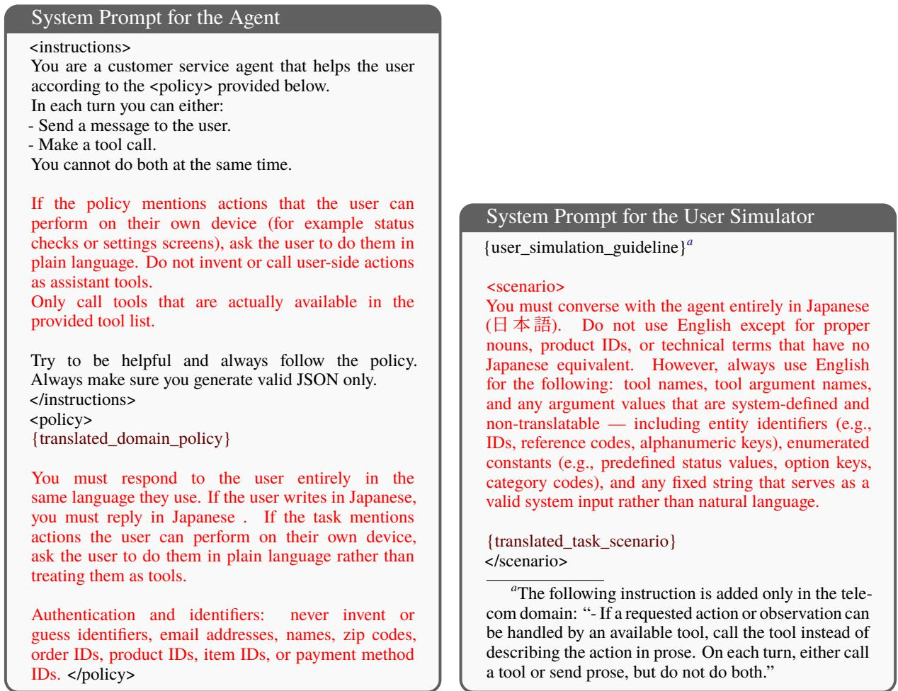

# J-tau: A Fully Localized Japanese Benchmark for Tool-Agent-User Interaction

Chihiro Yano1,2∗, Jun Hirako1, Hiroaki Yamagiwa1, Ryota Hirobuchi1

1SB Intuitions Corp., 2Nagoya University

{chihiro.yano, jun.hirako}@sbintuitions.co.jp, {hiroaki.yamagiwa, ryota.hirobuchi}@sbintuitions.co.jp

## Abstract

We present J-tau, the first publicly available Japanese benchmark for evaluating tool-using LLM agents in interactive customer-support scenarios. While tau-bench is widely used to evaluate LLM agents, it is English-centric and cannot evaluate agents in other languages. Existing multilingual extensions ofer no public Japanese version and rely primarily on machine translation, leaving locale-specific entities such as addresses and currencies inconsistent with the target region. To enable reliable evaluation in Japanese, we carefully localize tau-bench through machine translation, entity adaptation, and human review. During this process, we also uncover and fix two flaws in the original tau-bench: invalid tasks and a score aggregation error that inflates certain models’ results. Experiments show that J-tau yields fewer evaluation errors than a naively machinetranslated counterpart and that our fixes resolve both flaws.

## 1 Introduction

Large language model (LLM) agents that autonomously use tools to solve complex tasks have attracted growing attention (Wang et al., 2024). While many benchmarks have been proposed to evaluate such agents, most of them focus on English. Because agent performance can vary across languages (Hofman et al., 2026), English evaluations may not reflect utility in other languages.

To address this gap, multilingual agent benchmarks have been proposed, including ones built from multilingual corpora and machine translations of English benchmarks (Kulkarni et al., 2025; Nguyen et al., 2026). However, machine translation alone cannot localize entities such as personal names, which can lead to unnatural conversations or even invalid tasks (Kim et al., 2026).

  
Figure 1: Example of Japanese localization in J-tau. We translate the original tau-bench and replace localespecific entities (marked with wavy underlines) with realistic Japanese counterparts. Examples include airport codes (JFK HND, DTW FSZ) and personal names (Emma Kim 木村翼, where Kimura (木村) is the family name and Tsubasa (翼) is the given name).

To overcome these limitations, we present and release J-tau, a Japanese extension of the widely used English benchmark τ-bench (tau-bench) (Yao et al., 2025; Barres et al., 2026; Cuadron et al., 2025). J-tau is the first publicly available Japanese benchmark that evaluates tool-using LLM agents in realistic, interactive scenarios. It features highquality localization (Fig. 1) and corrected tasks and evaluation. Our main contributions are as follows:

• We construct and release J-tau, a Japanese benchmark that localizes three domains of tau-bench.

• We identify two flaws in tau-bench and fix them in J-tau: invalid tasks (about 10% in airline and retail) and score-inflating aggregation (up to 64.6 points for a single model).

• We show that an existing machine-translationbased pipeline often causes evaluation failures that stem from the framework rather than agents.

  
Figure 2: Overview of the J-tau pipeline, which localizes tau-bench into Japanese and fixes its evaluation issues.

## 2 Background: tau-bench

This section describes tau-bench and its limitations, along with prior work addressing them.1

## 2.1 Overview

tau-bench is a benchmark for evaluating LLM agents on customer support tasks across multiple domains, including airline (booking flights), retail (modifying orders), and telecom (troubleshooting mobile phones). In each task, an LLM-simulated user follows a user instruction describing its goal, and the agent must resolve the request conversationally, calling tools while complying with a domain-specific policy. In telecom, as in realworld technical support, the user has a separate set of tools, so the agent must also guide the user in using them.

## 2.2 Limitations

tau-bench has three main limitations. First, it is English-centric. While prior work extends it to five other languages2 (Nguyen et al., 2026), this extension relies primarily on machine translation, which degrades data quality and leads to unnatural conversations.3 Second, although tau-bench has been revised since its release (Cuadron et al., 2025), it still contains invalid tasks that are unsolvable or have non-deterministic ground truths. Third, its score aggregation is flawed and overestimates the performance of some models.

## 3 Japanese Agent Benchmark: J-tau

This section describes the construction pipeline and details of J-tau, a Japanese agent benchmark

that addresses the limitations of tau-bench.4

## 3.1 Construction Pipeline

Our pipeline consists of five steps (see Fig. 2): three for Japanese localization (translation, entity adaptation, and human review) and two for fixing evaluation issues (task fixes and scoring fixes).

Step 1: LLM Translation. We translate the policies, tool definitions, databases, and user instructions from English into Japanese using Gemini 3.1 Pro (Google DeepMind, 2026). To ensure consistent translation of technical terms, we include a predefined domain-specific glossary in the prompt. Appendix B.1 shows the domain-specific glossaries.

Step 2: Entity Adaptation. Direct translation retains locale-specific entities from Englishspeaking regions, such as personal names, addresses, and phone numbers, making the simulated conversations unnatural for Japanese speakers. We therefore replace them with fictitious Japanese counterparts. We generate them with Faker5 for the retail and airline domains, which contain many users, and create them manually for the telecom domain. We also convert monetary amounts into Japanese yen (1 USD = 150 JPY) and the time zone from EST to JST (see Appendix B.2 for more details).

Step 3: Human Review. We then assess and correct the translation quality of the resulting data. For each domain, three experts review the policies, and for the airline and retail domains, experts also review the user instructions (see Appendix B.3).

Step 4: Fix Tasks. We verify each task through manual inspection and test runs, and identify tasks that cannot be solved.6 We find two types of problematic tasks: tasks that become unsolvable through localization, and invalid tasks already present in the original tau-bench, which are unsolvable or have non-deterministic ground truths.7 We fix these tasks in J-tau, for example by adding missing information to the user instructions (see Appendix B.4).

Step 5: Fix Scoring. tau-bench treats both empty responses and tool calls with malformed JSON as infrastructure errors. It retries them up to three times and excludes trials with persistent errors from aggregation. However, agent errors reflect the agent’s limitations, so this procedure inflates the scores of models prone to such errors.8 In J-tau, we instead attribute these errors to the model that produced them. Trials are counted as failures for agent errors and discarded for user simulator errors.

## 3.2 Benchmark Details

Constructed through this pipeline, J-tau is a highquality Japanese agent benchmark covering the airline, retail, and telecom domains.9

In interactive agent evaluation, the choice of user simulator can substantially afect agent scores (Seshadri et al., 2026). We therefore compare several recent LLMs in terms of Japanese naturalness and instruction-following stability, and adopt GLM-5.2-FP8 (GLM-5-Team et al., 2026), which distorted evaluation results the least, as the default user simulator (see Appendix I).

## 4 Evaluating LLM Agents on J-tau

In this section, we evaluate and analyze a range of proprietary and open-weight models on J-tau.

Setup. We run three trials per task and report the mean and standard deviation.10 Appendix E provides details of the evaluated models.

<table><tr><td>Model</td><td>airline</td><td>retail</td><td>telecom</td></tr><tr><td>Proprietary Models</td><td></td><td></td><td></td></tr><tr><td>GPT-5.6 Sol</td><td>84.7±2.3</td><td>83.0±4.0</td><td>90.9±1.8</td></tr><tr><td>Gemini 3.1 Pro</td><td>84.0±4.0</td><td>78.9±3.2</td><td> $7 9 . 5 { \pm } 4 . 5 $ </td></tr><tr><td>Claude Opus 4.8</td><td>81.3±3.1</td><td>77.5±2.8</td><td>84.5±2.2</td></tr><tr><td>Claude Fable 5</td><td>90.7±1.2</td><td>84.5±4.1</td><td>99.4±0.5</td></tr><tr><td>Open-Weight Models</td><td></td><td></td><td></td></tr><tr><td>Kimi-K3</td><td>70.0±2.0</td><td>49.1±7.0</td><td>67.0±3.5</td></tr><tr><td>GLM-5.2-FP8</td><td>89.3±4.6</td><td>81.6±1.8</td><td>98.2±1.5</td></tr><tr><td>gpt-oss-120b</td><td>73.3±4.2</td><td>75.7±0.5</td><td>64.6±1.0</td></tr><tr><td>gpt-oss-20b</td><td>50.7±3.1</td><td>51.2±3.3</td><td>59.1±3.3</td></tr><tr><td>Qwen3.5-397B-A17B-FP8</td><td>83.3±6.4</td><td>85.1±2.3</td><td>96.2±0.5</td></tr><tr><td>Qwen3.5-27B</td><td>84.7±4.2</td><td>75.1±1.3</td><td>89.8±8.7</td></tr><tr><td>Qwen3.5-9B</td><td>49.3±2.3</td><td>35.7±7.3</td><td>50.0±9.2</td></tr><tr><td>Qwen3.5-4B</td><td>24.0±2.0</td><td>6.7±2.2</td><td>33.6±9.9</td></tr><tr><td>gemma-4-31b-it</td><td>51.3±6.4</td><td>72.8±4.9</td><td>44.4±9.3</td></tr><tr><td>gemma-4-12b-it</td><td>41.3±3.1</td><td>34.5±3.5</td><td>23.1±5.1</td></tr><tr><td>gemma-4-E4B-it</td><td>38.7±5.0</td><td>39.2±5.3</td><td></td></tr><tr><td></td><td></td><td></td><td>20.2±5.8</td></tr><tr><td>gemma-4-E2B-it</td><td>20.7±4.2</td><td>26.3±0.9</td><td>13.2±4.0</td></tr><tr><td>ilm-jp-4.1-33b-thinking</td><td>64.7±3.1</td><td>68.4±2.6</td><td>72.5±5.1</td></tr><tr><td>llm-jp-4.1-8b-thinking</td><td>56.0±3.5</td><td>63.7±3.7</td><td>52.0±5.6</td></tr></table>

Table 1: Results on J-tau. We report the mean and standard deviation over three trials.

Quantitative Results. Table 1 shows the results for each domain of J-tau. Among proprietary models, Claude Fable 5 (Anthropic, 2026a) achieves the highest overall score. Among open-weight models, GLM-5.2-FP8 and Qwen3.5-397B-A17B-FP8 (Qwen Team, 2026) perform best. Within the Qwen3.5 series, performance generally improves with model size.

Case Study. Appendix F presents example conversations from GLM-5.2-FP8, the open-weight model with the highest J-tau score, and failure cases from gemma-4-E2B-it (Farabet and Lacombe, 2026) and Qwen3.5-4B, the two lowestscoring ones. For example, Qwen3.5-4B sometimes switches from Japanese to another language partway through the conversation and fails to recognize the family-name-first order of Japanese names, such as Kimura Tsubasa (木村翼) in Fig. 1.

## 5 Quality Analysis of J-tau

We conduct an ablation study to assess the effectiveness of the task and scoring fixes in our pipeline in Section 3.1. To this end, we use tau-bench∗ (tau∗), a variant of tau-bench (tau) to which only the scoring fix in Step 5 is applied.

## 5.1 Efect of Task and Scoring Fixes

Fix Tasks. To examine the efect of the task fixes in Step 4, we split tasks into Repaired and Unmodified groups. Table 2 compares the J-tau and tau∗ scores of each group for each domain.

<table><tr><td rowspan="3">Model</td><td colspan="4">airline</td><td colspan="4">retail</td><td colspan="2">telecom</td></tr><tr><td colspan="2">Repaired (6)</td><td colspan="2">Unmodified  $( 4 1 )$ </td><td colspan="2">Repaired (12)</td><td colspan="2">Unmodified  $( 8 0 )$ </td><td colspan="2">Unmodified  $\underline { { ( 1 1 4 ) } }$ </td></tr><tr><td>J-tau</td><td>tau*</td><td>J-tau</td><td>tau*</td><td>J-tau</td><td>tau*</td><td>J-tau</td><td>tau*</td><td>J-tau</td><td>tau*</td></tr><tr><td>GPT-5.6 Sol</td><td> $\overline { { 7 7 . 8 \left( + 5 0 . 0 \right) } }$ </td><td>27.8</td><td>85.4(-9.8)</td><td>95.1</td><td> $\overline { { 6 1 . 1 \ : ( + 2 . 8 ) } }$ </td><td>58.3</td><td>85.4(+2.9)</td><td>82.5</td><td> $\overline { { 9 0 . 9 \ : ( + 5 . 8 ) } }$ </td><td>85.1</td></tr><tr><td>Kimi-K3</td><td> $5 0 . 0 ( + 5 . 6 ) $ </td><td>44.4</td><td> $7 3 . 2 ( - 1 3 . 8 )$ </td><td>87.0</td><td> $4 4 . 4 ( - 1 1 . 1 ) $ </td><td>55.6</td><td> $4 7 . 5 ( - 3 6 . 7 )$ </td><td>84.2</td><td> $6 7 . 0 ( - 2 1 . 9 ) $ </td><td>88.9</td></tr><tr><td>GLM-5.2-FP8</td><td> $7 7 . 8 \ : ( + 4 4 . 4 ) $ </td><td>33.3</td><td> $9 1 . 1 \left( - 3 . 3 \right)$ </td><td>94.3</td><td> $7 7 . 8 \ : ( + 3 3 . 3 )$ </td><td>44.4</td><td> $8 0 . 4 ( - 2 . 5 )$ </td><td>82.9</td><td> $9 8 . 2 \ : ( \pm 0 . 0 ) $ </td><td>98.2</td></tr><tr><td>gpt-oss-120b</td><td> $4 4 . 4 \ : ( + 2 2 . 2 ) $ </td><td>22.2</td><td> $7 7 . 2 ( - 4 . 9 )$ </td><td>82.1</td><td> $5 5 . 6 ( - 1 3 . 9 )$ </td><td>69.4</td><td> $7 6 . 7 ( - 9 . 6 )$ </td><td>86.3</td><td> $6 4 . 6 ( - 2 8 . 1 ) $ </td><td>92.7</td></tr><tr><td>gpt-oss-20b</td><td> $1 1 . 1 ( - 2 2 . 2 ) $ </td><td>33.3</td><td> $5 5 . 3 ( - 1 3 . 0 ) $ </td><td>68.3</td><td> $3 6 . 1 ( - 5 . 6 )$ </td><td>41.7</td><td> $4 5 . 4 ( - 2 0 . 4 )$ </td><td>65.8</td><td> $5 9 . 1 \ : ( - 1 7 . 5 )$ </td><td>76.6</td></tr><tr><td>Qwen3.5-397B-A17B-FP8</td><td> $7 2 . 2 \left( + 2 7 . 8 \right)$ </td><td>44.4</td><td> $8 3 . 7 ( - 9 . 8 )$ </td><td>93.5</td><td> $8 8 . 9 \left( + 1 9 . 4 \right)$ </td><td>69.4</td><td> $8 2 . 9 ( - 7 . 1 ) $ </td><td>90.0</td><td> $9 6 . 2 ( - 2 . 3 ) $ </td><td>98.5</td></tr><tr><td>Qwen3.5-27B</td><td> $6 6 . 7 \ : ( + 1 6 . 7 )$ </td><td>50.0</td><td> $8 6 . 2 ( \pm 0 . 0 ) $ </td><td>86.2</td><td> $7 5 . 0 ( + 8 . 3 )$ </td><td>66.7</td><td> $7 1 . 3 ( - 1 4 . 6 )$ </td><td>85.8</td><td> $8 9 . 8 ( - 7 . 6 )$ </td><td>97.4</td></tr><tr><td>Qwen3.5-9B</td><td> $2 2 . 2 \ : ( + 5 . 6 )$ </td><td>16.7</td><td> $5 2 . 8 ( - 3 0 . 1 )$ </td><td>82.9</td><td> $1 6 . 7 ( - 3 8 . 9 )$ </td><td>55.6</td><td> $3 5 . 4 ( - 3 6 . 7 )$ </td><td>72.1</td><td> $5 0 . 0 ( - 3 0 . 1 ) $ </td><td>80.1</td></tr><tr><td>Qwen3.5-4B</td><td> $0 . 0 ( - 1 6 . 7 )$ </td><td>16.7</td><td> $2 7 . 6 ( - 2 . 4 )$ </td><td>30.1</td><td> $0 . 0 ( - 2 7 . 8 )$ </td><td>27.8</td><td> $5 . 0 ( - 4 7 . 5 )$ </td><td>52.5</td><td> $3 3 . 6 ( - 1 8 . 4 ) $ </td><td>52.0</td></tr><tr><td>1lm-jp-4.1-33b-thinking</td><td> $3 3 . 3 ( - 1 1 . 1 )$ </td><td>44.4</td><td> $7 1 . 5 \ : ( + 0 . 8 )$ </td><td>70.7</td><td> $5 5 . 6 ( - 5 . 6 )$ </td><td>61.1</td><td> $6 7 . 9 ( - 7 . 9 )$ </td><td>75.8</td><td> $7 2 . 5 ( - 8 . 2 ) $ </td><td>80.7</td></tr><tr><td> $\mathrm { 1 l m \mathrm { - } j p \mathrm { - } 4 . 1 \mathrm { - } 8 b \mathrm { - } t h i n k i n g }$ </td><td> $1 1 . 1 ( - 1 1 . 1 )$ </td><td>22.2</td><td> $6 1 . 8 ( - 2 . 4 ) $ </td><td>64.2</td><td> $6 1 . 1 \ : ( + 2 . 8 )$ </td><td>58.3</td><td> $6 1 . 3 \ : ( - 5 . 0 )$ </td><td>66.3</td><td> $5 2 . 0 ( - 2 3 . 4 )$ </td><td>75.4</td></tr></table>

Table 2: Efect of task fixes on Repaired and Unmodified tasks (mean over three trials). Diferences of J-tau from tau∗ are shown in red (higher) and blue (lower). Subscripts next to group names denote task counts.

<table><tr><td rowspan="2">Model</td><td colspan="2">airline</td><td colspan="2">retail</td><td colspan="2">telecom</td></tr><tr><td>tau*</td><td>tau</td><td> $\tan ^ { * }$ </td><td>tau</td><td>tau *</td><td>tau</td></tr><tr><td>GPT-5.6 Sol</td><td></td><td>87.3 85.3 81.3</td><td></td><td>84.5</td><td>85.1</td><td>82.7</td></tr><tr><td>Kimi-K3</td><td></td><td>80.0 72.7 82.5 83.0 88.9 91.2</td><td></td><td></td><td></td><td></td></tr><tr><td>GLM-5.2-FP8</td><td></td><td>87.3 89.3 80.7 84.2 98.2 98.8</td><td></td><td></td><td></td><td></td></tr><tr><td>gpt-oss-120b</td><td></td><td>73.3 76.7 85.7 81.0 92.7 92.4</td><td></td><td></td><td></td><td></td></tr><tr><td>gpt-oss-20b</td><td></td><td></td><td></td><td>62.7 68.0 64.3 75.7 76.6 83.0</td><td></td><td></td></tr><tr><td>Qwen3.5-397B-A17B-FP8 86.786.788.988.398.599.7</td><td></td><td></td><td></td><td></td><td></td><td></td></tr><tr><td>Qwen3.5-27B</td><td></td><td></td><td></td><td>81.3 84.7 85.4 86.5 97.4 99.1</td><td></td><td></td></tr><tr><td>Qwen3.5-9B</td><td></td><td></td><td></td><td>74.0 77.3 72.2 86.7 80.1 96.5</td><td></td><td></td></tr><tr><td>Qwen3.5-4B</td><td></td><td></td><td></td><td>28.7 93.3 50.9 85.3 52.0 98.7</td><td></td><td></td></tr><tr><td>llm-jp-4.1-33b-thinking</td><td></td><td></td><td></td><td></td><td></td><td>66.0 64.7 74.6 78.4 80.7 83.6</td></tr><tr><td>llm-jp-4.1-8b-thinking</td><td>57.3 60.0 68.7 68.7 75.4 73.7</td><td></td><td></td><td></td><td></td><td></td></tr></table>

Table 3: Efect of the scoring fix, comparing tau and tau∗ for each domain (mean over three trials).

On the Repaired tasks, high-performing models score substantially higher on J-tau than on tau∗. This is because the invalid tasks in tau∗ cap the achievable accuracy regardless of model capability, and our fixes remove this cap. On the Unmodified tasks, which allow a direct comparison between languages, J-tau scores tend to be lower than tau∗ scores. This is consistent with Hofman et al. (2026), who show that agent performance varies across languages.

Fix Scoring. To examine the efect of the scoring fix in Step 5, Table 3 compares scores on tau and tau∗. For high-performing models, the diference is small. However, for small models such as Qwen3.5-4B, scores drop substantially on tau∗, which counts empty and malformed outputs as failures. Thus, tau-bench inflates the scores of such models.

## 5.2 Comparison with an MT-Centric Pipeline

We compare J-tau with SEATauja, which machinetranslates tau-bench into Japanese with the pipeline of Nguyen et al. (2026) and applies the scoring fix in Step 5, without entity adaptation, human review, or task fixes. In Table 4, an LLM judge attributes each failed trial to the agent, user simulator, or evaluation framework. $\mathrm { S E A T a u _ { j a } }$ has many framework-caused failures and fewer successes, especially in retail.11 Without entity adaptation, user names remain in English in the database but are written in katakana in the Japanese conversation, which causes database lookup failures (see the simulation in Table 28). Such inconsistencies induce unnatural behavior even in successful trials, making the environment unsuitable as a benchmark. In contrast, J-tau has fewer such failures thanks to its localization and task verification. Appendix G provides experimental details and example simulations.

<table><tr><td rowspan="2">Model</td><td rowspan="2">Domain Bench</td><td rowspan="2"></td><td rowspan="2">Pass</td><td colspan="3">Fail</td></tr><tr><td>agent user</td><td></td><td>eval</td></tr><tr><td rowspan="5">GLM-5.2 -FP8</td><td rowspan="2">airline</td><td>J-tau</td><td>134</td><td>7</td><td>5</td><td>4</td></tr><tr><td> $\mathrm { S E A T a u _ { j a } }$ </td><td>136</td><td>6</td><td>1</td><td>7</td></tr><tr><td rowspan="2">retail</td><td>J-tau</td><td>279</td><td>23</td><td>36</td><td>4</td></tr><tr><td>SEATauja</td><td>256</td><td>18</td><td>14</td><td>54</td></tr><tr><td rowspan="2">telecom</td><td>J-tau  $\mathrm { S E A T a u _ { j a } }$ </td><td>336 331</td><td>4 10</td><td>2 0</td><td>0 1</td></tr><tr><td>J-tau</td><td>125</td><td></td><td>20</td><td>3</td></tr><tr><td rowspan="4">Qwen3.5 -397B-A17B -FP8</td><td>airline</td><td> $\mathrm { S E A T a u _ { j a } }$ </td><td>121</td><td>20</td><td>5</td><td>2 4</td></tr><tr><td rowspan="2">retail</td><td>J-tau</td><td>291</td><td>29</td><td>16</td><td>6</td></tr><tr><td> $\mathrm { S E A T a u _ { j a } }$ </td><td>236</td><td>36</td><td>14</td><td>56</td></tr><tr><td rowspan="2">telecom</td><td>J-tau  $\mathrm { S E A T a u _ { j a } }$ </td><td>329 329</td><td>11</td><td>0</td><td>2</td></tr><tr><td></td><td></td><td></td><td>12</td><td>1</td><td>0</td></tr></table>

Table 4: Successful (Pass) and failed (Fail) trial counts on J-tau and SEATauja. GPT-5.6 Sol (OpenAI, 2026) classifies each failure’s cause as agent, user, or eval.

## 6 Conclusion

We presented J-tau, the first publicly available Japanese benchmark for interactive tool-using LLM agents. Beyond machine translation, we localized tau-bench through entity adaptation and human review, and fixed its invalid tasks and a scoring flaw, enabling more accurate evaluation. Our analysis showed that machine translation alone increases framework-caused failures. We hope Jtau advances Japanese LLM agents and our insights benefit benchmark localization for other languages.

## Limitations

• J-tau covers three domains (airline, retail, and telecom) and does not include the bank ing\_knowledge domain introduced in the latest version of tau-bench (Shi et al., 2026).

• J-tau covers only Japanese and cannot be used to evaluate agents in other languages. Concurrent work released within one month before our submission extends tau-bench to more languages (Kuang et al., 2026; Ray et al., 2026b), but these benchmarks may still contain the invalid tasks and the aggregation flaw we identify (Appendix A). Since our task and scoring fixes are language-independent, extending our pipeline to other languages is left for future work.

• Addresses and other user information in the airline and retail domains are generated with Faker and thus include nonexistent place names and addresses, limiting their fidelity to real-world data.

• Because the solvability verification in Step 4 (Section 3.1) relies only on GLM-5.2-FP8, it may reflect biases specific to this model, and a small number of invalid tasks may remain undetected.

• As shown in Section 5.2, J-tau has more failures attributed to the user simulator than SEATauja, especially in the retail domain. This is likely because the user simulator follows the user simulation guideline less faithfully in Japanese than in English (see Appendix G.5 for an ablation study). Since this may change as models improve, revisiting the choice of user simulator is left for future work.

• The original tau-bench prompt instructs models to produce outputs in JSON format. During evaluation after constructing J-tau, we found that this instruction afects some models, such as Kimi-

K3 (Kimi Team et al., 2026), more strongly in Japanese, causing them to output JSON strings instead of natural-language responses to the user. Since these outputs are counted as failures, the scores of such models may be underestimated (see Appendix H.2 for an ablation study). We plan to remove this instruction in the revised version.

## Ethical Considerations

J-tau contains no personally identifiable information, as all user information, such as names, addresses, and phone numbers, is fictitious. The human review was conducted by in-house annotators as part of their regular duties, for which they received their standard salaries.

## References

Thales Sales Almeida, João Guilherme Alves Santos, Thiago Laitz, and Giovana Kerche Bonás. 2025. Ticket-Bench: A kickof for multilingual and regionalized agent evaluation. arXiv preprint arXiv:2509.14477.

Anthropic. 2026a. Claude Fable 5 and Claude Mythos 5.

Anthropic. 2026b. Introducing Claude Opus 4.8.

Victor Barres, Honghua Dong, Soham Ray, Xujie Si, and Karthik R Narasimhan. 2026. τ2-Bench: Evaluating conversational agents in a dual-control environment. In Forty-third International Conference on Machine Learning: ICML 2026.

Andrea Caciolai, Pere-Lluís Huguet Cabot, Chierh Cheng, Albert Ventayol-Boada, Gabriel Mejia Gonzalez, Christophe Ropers, Lucas Bandarkar, Sebastian Ruder, Darlene Sakakihara, Elliot Yun, Pierre Andrews, Grégoire Mialon, Romain Froger, and Marta R. Costa-jussà. 2026. OmnilingualGAIA2: Evaluating the multilingual gap in frontier AI agents. arXiv preprint arXiv:2608.08775.

Alejandro Cuadron, Pengfei Yu, Yang Liu, and Arpit Gupta. 2025. SABER: Small actions, big errors – safeguarding mutating steps in LLM agents. arXiv preprint arXiv:2512.07850.

Antoine Dussolle, A. Cardeña, Shota Sato, and Peter Devine. 2025. M-IFEval: Multilingual instructionfollowing evaluation. In Findings ofthe Association for Computational Linguistics: NAACL 2025, pages 6161–6176.

Clement Farabet and Olivier Lacombe. 2026. Gemma 4: Byte for byte, the most capable open models.

GLM-5-Team, Aohan Zeng, Xin Lv, Zhenyu Hou, Zhengxiao Du, Qinkai Zheng, Bin Chen, Da Yin, Chendi Ge, Chenghua Huang, Chengxing Xie, Chenzheng Zhu, Congfeng Yin, Cunxiang Wang, Gengzheng Pan, Hao Zeng, Haoke Zhang, Haoran Wang, Huilong Chen, and 167 others. 2026. GLM-5: from vibe coding to agentic engineering. arXiv preprint arXiv:2602.15763.

Google DeepMind. 2026. Gemini 3.1 Pro.

Omer Hofman, Jonathan Brokman, Oren Rachmil, Shamik Bose, Vikas Pahuja, Toshiya Shimizu, Trisha Starostina, Kelly Marchisio, Seraphina Goldfarb-Tarrant, and Roman Vainshtein. 2026. MAPS: A multilingual benchmark for agent performance and security. In Findings of the Association for Computational Linguistics: EACL 2026, pages 821– 845.

Xu Huang, Wenhao Zhu, Hanxu Hu, Conghui He, Lei Li, Shujian Huang, and Fei Yuan. 2025. BenchMAX: A comprehensive multilingual evaluation suite for large language models. In Findings of the Association for Computational Linguistics: EMNLP 2025, pages 16751–16774.

Carlos E Jimenez, John Yang, Alexander Wettig, Shunyu Yao, Kexin Pei, Ofir Press, and Karthik R Narasimhan. 2024. SWE-bench: Can language models resolve real-world GitHub issues? In The Twelfth International Conference on Learning Representations: ICLR 2024.

Yunsu Kim, Kaden Uhlig, and Joern Wuebker. 2026. GAIA-v2-LILT: Multilingual adaptation of agent benchmark beyond translation. In Proceedings ofthe 1st Workshop on Multilinguality in the Era ofLarge Language Models (MeLLM 2026), pages 140–148.

Kimi Team, Tongtong Bai, Yifan Bai, Yiping Bao, M. C., Jianfeng Cai, Xinyuan Cai, Peizhou Cao, Yuxuan Cao, Ziwei Chai, Y. Charles, H. S. Che, Guanduo Chen, Guangyu Chen, Guanzheng Chen, Huarong Chen, Jia Chen, Jianlong Chen, Jun Chen, and 383 others. 2026. Kimi K3: Open frontier intelligence. arXiv preprint arXiv:2607.24653.

Peng Kuang, Yuchun Fan, Jiangnan Li, Minghao Wu, Jialong Tang, Hao-Ran Wei, Weixuan Wang, Jianhong Tu, Baosong Yang, and Tong Xiao. 2026. BabelArena: A large-scale multilingual benchmark for LLM agents. arXiv preprint arXiv:2609.23490.

Mayank Kulkarni, Vittorio Mazzia, Judith Gaspers, Chris Hench, and Jack FitzGerald. 2025. MASSIVE-Agents: A benchmark for multilingual functioncalling in 52 languages. In Findings of the Association for Computational Linguistics: EMNLP 2025, pages 20193–20215.

Nahyun Lee, Dongkeun Yoon, Guijin Son, Geewook Kim, Dayoon Ko, Jeonghun Park, Haneul Yoo, Jaewon Cho, Junghun Park, Changyoon Lee, Kyochul

Jang, Jaeyeon Kim, Eunsu Kim, Woojin Cho, and Seungone Kim. 2026. K-BrowseComp: A web browsing agent benchmark grounded in Korean contexts. arXiv preprint arXiv:2606.02404.

Hongliang Li, Yijin Liu, Zhiwei Zhang, Zihe Liu, Xinyue Lou, Jinan Xu, Fandong Meng, and Kaiyu Huang. 2026. PolyWorkBench: Benchmarking LLM agents for cross-lingual long-horizon workflows. arXiv preprint arXiv:2607.06008.

LLM-jp. 2024. LLM-jp: A cross-organizational project for the research and development of fully open Japanese LLMs. arXiv preprint arXiv:2407.03963.

Zheng Luo, T Pranav Kutralingam, Ogochukwu N. Okoani, Wanpeng Xu, Hua Wei, and Xiyang Hu. 2026. Lost in Execution: On the multilingual robustness of tool calling in large language models. In Proceedings of the 64th Annual Meeting of the Association for Computational Linguistics: ACL 2026, pages 44059–44077.

My Chifon Nguyen, Aulia Adila, Saksorn Ruangtanusak, Kittiphat Leesombatwathana, Vissuta Gunawan Lim, Patomporn Payoungkhamdee, and Samuel Cahyawijaya. 2026. SEATauBench: Progressively adapting tool-agent-user evaluation into low-resource Southeast Asian languages. arXiv preprint arXiv:2606.28715.

Teruaki Oka, Tomohide Shibata, and Nao Yoshida. 2026. JamC-QA: A multiple-choice question answering benchmark for Japan-specific knowledge. In Proceedings of the Fifteenth Language Resources and Evaluation Conference: LREC 2026, pages 4536–4546.

OpenAI. 2025. gpt-oss-120b & gpt-oss-20b Model Card. arXiv preprint arXiv:2508.10925.

OpenAI. 2026. GPT-5.6: Frontier intelligence that scales with your ambition.

Shishir G Patil, Huanzhi Mao, Fanjia Yan, Charlie Cheng-Jie Ji, Vishnu Suresh, Ion Stoica, and Joseph E. Gonzalez. 2025. The Berkeley function calling leaderboard (BFCL): From tool use to agentic evaluation of large language models. In Fortysecond International Conference on Machine Learning: ICML 2025.

Qwen Team. 2025. Qwen3 Technical Report. arXiv preprint arXiv:2505.09388.

Qwen Team. 2026. Qwen3.5: Towards native multimodal agents.

Soham Ray, Keshav Dhandhania, Victor Barres, and Karthik R Narasimhan. 2026a. τ-Voice: Benchmarking full-duplex voice agents on real-world domains. In Forty-third International Conference on Machine Learning: ICML 2026.

Soham Ray, Edgard dos Santos Paiva, Ruben Valenzuela, Karthik Narasimhan, Keshav Dhandhania, and Victor Barres. 2026b. τ-Multilingual: Benchmarking voice agents across languages. arXiv preprint arXiv:2609.35820.

Mii Sato, Shiho Takano, Teruno Kajiura, and Kimio Kuramitsu. 2024. Does LLM cross-lingual knowledge transfer occur through Japanese continual pretraining? (in Japanese). In Proceedings of the 30th Annual Meeting of the Association for Natural Language Processing.

Preethi Seshadri, Samuel Cahyawijaya, Ayomide Odumakinde, Sameer Singh, and Seraphina Goldfarb-Tarrant. 2026. Lost in Simulation: LLM-simulated users are unreliable proxies for human users in agentic evaluations. In Proceedings of the 64th Annual Meeting of the Association for Computational Linguistics: ACL 2026, pages 47423–47439.

Quan Shi, Alexandra Zytek, Pedram Razavi, Karthik R Narasimhan, and Victor Barres. 2026. τ-Knowledge: Evaluating conversational agents over unstructured knowledge. In Forty-third International Conference on Machine Learning: ICML 2026.

Yiyou Sun, Xinyang Han, Weichen Zhang, Yuanbo Pang, Tianyu Wang, Yuhan Cao, Yixiao Huang, Chris Duroiu, Haoyun Zhang, Jefrey Lin, Weishu Zhang, Tyler Zeng, Ying Yan, Bo Liu, Hanson Wen, Mingyang Xu, Xiaoyuan Liu, Zimeng Chen, Weiyan Shi, and 291 others. 2026. Agents’ Last Exam. arXiv preprint arXiv:2606.05405.

Lei Wang, Chen Ma, Xueyang Feng, Zeyu Zhang, Hao Yang, Jingsen Zhang, Zhiyuan Chen, Jiakai Tang, Xu Chen, Yankai Lin, Wayne Xin Zhao, Zhewei Wei, and Jirong Wen. 2024. A survey on large language model based autonomous agents. Frontiers Comput. Sci., 18(6):186345.

Yiming Wang, Pei Zhang, Jialong Tang, Hao-Ran Wei, Baosong Yang, Rui Wang, Chenshu Sun, Feitong Sun, Jiran Zhang, Junxuan Wu, Qiqian Cang, Yichang Zhang, Fei Huang, Junyang Lin, Fei Huang, and Jingren Zhou. 2026. PolyMath: Evaluating mathematical reasoning in multilingual contexts. In The Thirty-ninth Annual Conference on Neural Information Processing Systems Datasets and Benchmarks Track.

Weihao Xuan, Rui Yang, Heli Qi, Qingcheng Zeng, Yunze Xiao, Aosong Feng, Dairui Liu, Yun Xing, Junjue Wang, Fan Gao, Jinghui Lu, Yuang Jiang, Huitao Li, Xin Li, Kunyu Yu, Ruihai Dong, Shangding Gu, Yuekang Li, Xiaofei Xie, and 13 others. 2025. MMLU-ProX: A multilingual benchmark for advanced large language model evaluation. In Proceedings of the 2025 Conference on Empirical Methods in Natural Language Processing: EMNLP 2025, pages 1513–1532.

Shunyu Yao, Noah Shinn, Pedram Razavi, and Karthik R Narasimhan. 2025. τ-bench: A bench-

mark for tool-agent-user interaction in real-world domains. In The Thirteenth International Conference on Learning Representations: ICLR 2025.

Peilin Zhou, Bruce Leon, Xiang Ying, Can Zhang, Yifan Shao, Qichen Ye, Dading Chong, Zhiling Jin, Chenxuan Xie, Meng Cao, Yuxin Gu, Sixin Hong, Jing Ren, Jian Chen, Chao Liu, and Yining Hua. 2025. BrowseComp-ZH: Benchmarking web browsing ability of large language models in Chinese. arXiv preprint arXiv:2504.19314.

## A Additional Related Work

Agent benchmarks. LLM agent evaluation has evolved from static tasks that check single-turn function calls and their arguments (Patil et al., 2025) to challenging multi-step tasks requiring advanced reasoning and environment interaction (Jimenez et al., 2024; Sun et al., 2026). Among such benchmarks, tau-bench (Yao et al., 2025; Barres et al., 2026; Shi et al., 2026) evaluates agents on customer-support tasks in which they resolve the requests of an LLM-simulated user through multi-turn conversations, calling tools while complying with domain policies.

Multilingual agent benchmarks. Some studies build tasks grounded in each language and culture (Almeida et al., 2025; Li et al., 2026; Zhou et al., 2025; Lee et al., 2026), while others translate existing English benchmarks (Hofman et al., 2026; Caciolai et al., 2026; Luo et al., 2026). The validity of the latter has been questioned: Hofman et al. (2026) report degraded agent performance in non-English languages on their machine-translated benchmarks, whereas Kim et al. (2026) show that much of this gap stems from translation artifacts rather than model capability.

Multilingual extensions of tau-bench. Nguyen et al. (2026) extend tau-bench to five Southeast Asian languages by progressively translating the conversations, tool definitions, and domain information, but without adapting locale-specific entities, resulting in unnatural conversations. Concurrently, Kuang et al. (2026) propose a workflow that extends agent benchmarks, including taubench, to 23 languages including Japanese, but it does not adapt locale-specific entities, and the data have not been publicly released at the time of writing. Ray et al. (2026b) extend τ -Voice (Ray et al., 2026a), the voice version of tau-bench, to five languages excluding Japanese, localizing user information. These two concurrent works verify consistency with the original tasks, but neither examines the validity of those tasks or revises the score aggregation, so the flaws described in Section 2.2 may remain in their benchmarks.

Japanese LLM benchmarks. Japanese LLM benchmarks cover knowledge, reasoning, instruction following, mathematics, and coding (Oka et al., 2026; Dussolle et al., 2025; Xuan et al., 2025; Huang et al., 2025; Wang et al., 2026; Sato et al., 2024), but no publicly available benchmark evaluates Japanese agent capabilities in dynamic conversations with external tool calls.

## B Details of Localization

## B.1 Translation

Tables 5, 6, and 8 show the domain-specific glossaries used for translation in Step 1.

<table><tr><td>Category</td><td>en</td><td>ja</td></tr><tr><td>Cabin Class</td><td>cabin class business economy</td><td>座席クラス ビジネス エコノミー basic economyベーシックエコノミー</td></tr><tr><td>Flight Type</td><td>one way round trip</td><td>片道 往復</td></tr><tr><td>Membership Tier</td><td>gold silver regular</td><td>ゴールド会員 シルバー会員 一般会員</td></tr><tr><td>Payment Method</td><td>credit_card gift_card certificate</td><td>クレジットカード ギフトカード 旅行クーポン</td></tr><tr><td>Flight Status</td><td>available delayed on time flying landed cancelled</td><td>予約可能 遅延 定刻 飛行中 着陸済 キャンセル済</td></tr></table>

Table 5: Glossary for the airline domain.

<table><tr><td>Category</td><td>en</td><td>ja</td></tr><tr><td rowspan="6">Order Status</td><td>pending processed</td><td>保留中 処理済み</td></tr><tr><td>pending</td><td>保留中</td></tr><tr><td>(item modified)</td><td>(アイテム変更済み)</td></tr><tr><td></td><td></td></tr><tr><td>delivered</td><td>配達済み</td></tr><tr><td>cancelled exchange requested</td><td>キャンセル済み 交換リクエスト済み</td></tr><tr><td rowspan="2">Cancellation Reason</td><td>return requested</td><td>返品リクエスト済み</td></tr><tr><td>no longer needed ordered by mistake</td><td>不要になった 間違えて注文した</td></tr><tr><td rowspan="2">Payment Method</td><td>credit_card</td><td>クレジットカード</td></tr><tr><td>gift_card paypal</td><td>ギフトカード PayPal</td></tr></table>

Table 6: Glossary for the retail domain.

<table><tr><td>US Code</td><td>US Name</td><td>JP Code JP Name</td><td></td></tr><tr><td>JFK</td><td>New York</td><td>HND</td><td>羽田(Haneda)</td></tr><tr><td>EWR</td><td>Newark</td><td>NRT</td><td>成田 (Narita)</td></tr><tr><td>LGA</td><td>LaGuardia</td><td>IBR</td><td>茨城 (Ibaraki)</td></tr><tr><td>SFO</td><td>San Francisco</td><td>ITM</td><td>伊丹 (Itami)</td></tr><tr><td>LAX</td><td>Los Angeles</td><td>KIX</td><td>関西 (Kansai)</td></tr><tr><td>DFW</td><td>Dallas</td><td>FUK</td><td>福岡(Fukuoka)</td></tr><tr><td>IAH</td><td>Houston</td><td>KKJ</td><td>北九州(Kitakyushu)</td></tr><tr><td>CLT</td><td>Charlotte</td><td>HSG</td><td>佐賀(Saga)</td></tr><tr><td>MIA</td><td>Miami</td><td>CTS</td><td>新千歳 (New Chitose)</td></tr><tr><td>MCO</td><td>Orlando</td><td>OKD</td><td>丘珠(Okadama)</td></tr><tr><td>ATL</td><td>Atlanta</td><td>OKA</td><td>那覇(Naha)</td></tr><tr><td>ORD</td><td>Chicago</td><td>NGO</td><td>中部(Chubu)</td></tr><tr><td>SEA</td><td>Seattle</td><td>SDJ</td><td>仙台(Sendai)</td></tr><tr><td>LAS</td><td>Las Vegas</td><td>HIJ</td><td>広島 (Hiroshima)</td></tr><tr><td>PHX</td><td>Phoenix</td><td>KMJ</td><td>熊本(Kumamoto)</td></tr><tr><td>DEN</td><td>Denver</td><td>MYJ</td><td>松山 (Matsuyama)</td></tr><tr><td>MSP</td><td>Minneapolis</td><td>KOJ</td><td>鹿児島(Kagoshima)</td></tr><tr><td>DTW</td><td>Detroit</td><td>FSZ</td><td>静岡(Shizuoka)</td></tr><tr><td>BOS</td><td>Boston</td><td>UKB</td><td>神戸(Kobe)</td></tr><tr><td>PHL</td><td>Philadelphia</td><td>NGS</td><td>長崎 (Nagasaki)</td></tr></table>

Table 7: Airport mapping for the airline domain.

## B.2 Entity Adaptation

In the entity adaptation of Step 2, we create a mapping from the original entities in the user information, such as personal names, addresses, phone numbers, and user IDs, to fictitious entities suited to Japanese culture. For the retail domain, we build a dictionary of product names and product variants and replace them accordingly to ensure consistent translations. For the airline domain, we replace the airports with domestic Japanese airports to keep the geographic setting consistent with the conversation language. Table 7 shows the airport mapping. We convert monetary amounts into Japanese yen at 1 USD = 150 JPY and round them to the nearest yen, since fractional yen are not used in everyday transactions. We also change the time zone from EST to JST. Because the agent passes Japanese values to the tools in J-tau, we apply this localization not only to the surface text but also to DB values, enumerated values of tool arguments, and values accepted by the tool implementations, consistently converting them into Japanese according to the glossaries and mappings.

## B.3 Human Review

The human review checks overall translation quality and verifies that technical terms and entities are translated correctly.

Airline and retail. For the airline and retail domains, three in-house annotators specializing in Japanese–English translation review the data. In addition to the domain policies, the annotators review task-specific text, such as the task descriptions and the user instructions given to the user simulator. The review covers not only translation quality but also whether technical terms follow the glossaries and whether airport names and currencies are properly localized. Because the domain policies are particularly important, all three annotators review them.

<table><tr><td>Category</td><td>en</td><td>ja</td><td>Category</td><td>en</td><td>ja</td></tr><tr><td>Account Status</td><td>Active Suspended Pending Verification Closed</td><td>有効 利用停止 確認待ち 解約済み</td><td rowspan="2">Speed Test</td><td>unknown poor fair good</td><td>不明 遅い やや遅い 速い</td></tr><tr><td>Line Status</td><td>Active Suspended Pending Activation Closed</td><td>有効 利用停止 有効化待ち 解約済み</td><td>excellent no connection active missing</td><td>非常に速い 接続なし アクティブ 未挿入</td></tr><tr><td rowspan="2">Invoice Status</td><td>Draft Issued Awaiting Payment Paid</td><td rowspan="2">下書き 発行済み 支払い待ち 支払い済み</td><td>Status</td><td>locked with a PIN locked with a PUK internet</td><td>PINロック中 PUKロック中 インターネット</td></tr><tr><td>Overdue Disputed phone</td><td>APN Settings</td><td>broken Incorrect Not Set</td><td>不正 不正 未設定</td></tr><tr><td>Device Type</td><td>router tablet watch other</td><td>スマートフォン ルーター タブレット スマートウォッチ その他</td><td>Network Connection Status</td><td>connected searching no_service emergency_only</td><td>接続済み 検索中 サービスなし 緊急通話のみ</td></tr><tr><td rowspan="2">Status Bar Display</td><td>No Signal Poor Fair Good Excellent</td><td rowspan="2">機内モード 圈外 弱い やや弱い</td><td rowspan="2">Terminology Consistency</td><td rowspan="2">cellular service / cellular network cellular data cellular connection network technology streaming</td><td>モバイルデータ モバイル接続 モバイル通信の種類</td></tr><tr><td>良好 非常に良好 データ有効 データ無効</td><td>動画の再生/動画再 生 general agent policy / 一般ポリシー Network Mode 通信モード設定</td></tr><tr><td rowspan="2">Signal Strength</td><td>VPN Connected none poor</td><td>圈外 弱い やや弱い</td><td rowspan="2"></td><td>Preference Failed to set network mode Network mode set to</td><td>通信モードの設定に 失敗しました</td></tr><tr><td>fair good excellent</td><td>良好 非常に良好</td><td>Restarting network</td><td>ました 通信サービスを再起</td></tr><tr><td rowspan="2"></td><td rowspan="2"></td><td rowspan="2"></td><td>Payment</td><td>services Credit Card</td><td>動しています クレジットカード</td></tr><tr><td>Method App Display</td><td>Debit Card messaging browser</td><td>デビットカード メッセージ ブラウザ</td></tr></table>

Table 8: Glossary for the telecom domain.

<table><tr><td>Task ID</td><td>Modification</td></tr><tr><td>airline</td><td>The user's full name in kanji cannot be inferred from a romanized user ID or email address. Added the fixed</td></tr><tr><td>6,7</td><td>sentence “あなたの名前は {family name} {given name}です。”(“Your name is {family name} {given name}.") to the user prompts of tasks that do not mention the user's name.</td></tr><tr><td>15</td><td>The original prompt stated, “Since you live in Princeton, so EWR and PHL are equally convenient for you and you want to consider both." After the airports were localized, no suitable location existed midway between the corresponding airports. Since this does not change the task difficulty, removed the reference to the user's place of residence.</td></tr><tr><td>24 39</td><td>To match the airport localization, changed the user's preferred destination from "the West Coast" to "the Tohoku region."</td></tr><tr><td></td><td>This task assumes a user whose utterances in the evaluation language are imperfect because it is not their first language. Changed the user's first language from French to Chinese, whose writing system is similar to that of the evaluation language.</td></tr><tr><td>retail 5–14, 35, 39,</td><td></td></tr><tr><td>45–48, 56–58, 67-69</td><td>The user's full name in kanji cannot be inferred from a romanized user ID or email address. Added the fixed sentence “あなたの名前は {family name} {given name}です。”(“Your name is {family name}{given name}.") to the user prompts of tasks that do not mention the user's name.</td></tr><tr><td>airline</td><td></td></tr><tr><td>7</td><td>The total cost of upcoming flights incorrectly included already-cancelled flights. Corrected it to the correct amount of $708 (¥ 106,200).</td></tr><tr><td>29</td><td>Specified the payment method so that the Gold Action is uniquely determined.</td></tr><tr><td>32</td><td>Specified the payment and refund methods so that the Gold Action is uniquely determined.</td></tr><tr><td>33</td><td>Specified the refund method so that the Gold Action is uniquely determined.</td></tr><tr><td>39 44</td><td>Restricted the cancellation reason to one covered by travel insurance. The expected actions incorrectly included a flight taking 7.5 hours including layovers, despite the condition</td></tr><tr><td></td><td>“a flight of 3 hours or less including layover time." Corrected the actions accordingly. Also specified the payment method so that the Gold Action is uniquely determined.</td></tr><tr><td>retail 18,91, 107</td><td></td></tr><tr><td></td><td>The task required the agent to refuse an exchange for the same item, a behavior not stated in the policy Modified the task to allow the exchange.</td></tr><tr><td>25 / 26</td><td>An action required to complete Task 25 was included in Task 26. Removed the action from Task 26 and moved it to Task 25.</td></tr><tr><td>28</td><td>Corrected the incorrect price of the garden hose.</td></tr><tr><td>38</td><td>Specified the cancellation reason so that the Gold Action is uniquely determined.</td></tr><tr><td>64 99</td><td>Added conditions on the item to be exchanged so that the Gold Action is uniquely determined.</td></tr><tr><td></td><td>Revised the Gold Action to match the task instructions.</td></tr><tr><td>104</td><td>Corrected an incorrect ID in the Gold Action.</td></tr><tr><td>105,110</td><td>Corrected the Gold Action, which contradicted the DB state and required an infeasible exchange.</td></tr></table>

Table 9: Tasks modified due to localization.

Table 10: Tasks from the original tau-bench repaired to make them solvable.

Telecom. The telecom domain involves complex technical terminology, and naive translation may produce terms that difer from those used in practice. Therefore, three native Japanese in-house annotators with customer-support experience in the telecom industry review the Japanese translations of the domain policy, technical support manual, and workflows provided to the agent.

## B.4 Fix Tasks

Task fixing consists of two stages: addressing issues caused by localization and repairing invalid tasks in the original tau-bench.

First, we identify tasks that become unsolvable or whose characteristics, such as dificulty, change substantially through localization. To this end, we manually inspect the task instructions and evaluation criteria of all tasks. Table 9 lists the modified tasks.

Next, to find invalid tasks in the original taubench, we run each task three times with GLM-5.2- FP8 and examine its behavior, focusing on tasks that fail two or more times. Table 10 lists the repaired tasks.

<table><tr><td></td><td>tau</td><td>tau*</td><td></td><td>J-tau J-tauen-tool</td><td>SEATauja</td></tr><tr><td>Conversation</td><td>EN</td><td>EN</td><td>JA</td><td>JA</td><td>JA</td></tr><tr><td>Domain policies</td><td>EN</td><td>EN</td><td>JA</td><td>JA†</td><td>JA</td></tr><tr><td>Tools</td><td></td><td></td><td></td><td></td><td></td></tr><tr><td>Names</td><td>EN</td><td>EN</td><td>EN</td><td>EN</td><td>EN</td></tr><tr><td>Descriptions</td><td>EN</td><td>EN</td><td>JA</td><td>EN</td><td>JA</td></tr><tr><td>Argument values</td><td>EN</td><td>EN</td><td>JA</td><td>EN</td><td>EN</td></tr><tr><td>Return values</td><td>EN</td><td>EN</td><td>JA</td><td>EN</td><td>JA</td></tr><tr><td>Error messages</td><td>EN</td><td>EN</td><td>JA</td><td>EN</td><td>EN</td></tr><tr><td>Entities</td><td>US</td><td>US</td><td>JP</td><td>JP</td><td>US</td></tr><tr><td>Fix Tasks</td><td>1</td><td>一</td><td>√</td><td>√</td><td>一</td></tr><tr><td>Fix Scoring</td><td>一</td><td>√</td><td>√</td><td>√</td><td>V</td></tr></table>

Table 11: Settings of the compared benchmarks. The upper part shows the language of each component, and the lower part shows whether each fix is applied. Entities refers to locale-specific entities such as personal names, addresses, currencies, and time zones. †Toolrelated terms are kept in English. ‡Entities in return values remain in Japanese.

## C Settings of the Compared Benchmarks

Table 11 summarizes the settings of the benchmarks used in this paper. tau is the original taubench, and tau∗ is a variant of tau-bench to which only the scoring fix in Step 5 is applied (used in Section 5.1). J-tau is our proposed benchmark, and $\mathbf { J - t a u _ { e n - t o o l } }$ is a variant of J-tau that keeps the tool-related components in English (used in Appendix H.1). $\mathbf { J - t a u _ { e n - t o o l } }$ reflects a setting common in real-world applications, where only the conversation is in Japanese while the tool descriptions, argument values, return values, and error messages remain in English. $\mathrm { S E A T a u _ { j a } }$ is a Japanese version constructed with the SEATau pipeline (used in Section 5.2).

<table><tr><td>Domain</td><td>Total</td><td></td><td>Unmod. Rep. only</td><td>Both</td><td>1 Loc. only</td></tr><tr><td>airline</td><td>50</td><td>41</td><td>4</td><td>2</td><td>3</td></tr><tr><td>retail</td><td>114</td><td>80</td><td>12</td><td>0</td><td>22</td></tr><tr><td>telecom</td><td>114</td><td>114</td><td>0</td><td>0</td><td>0</td></tr></table>

Table 12: Breakdown of the number of tasks in J-tau. Unmod. denotes unmodified tasks, Rep. only denotes tasks with only repairs of invalid tasks in the original tau-bench (Table 10), Loc. only denotes tasks with only modifications due to localization (Table 9), and Both denotes tasks with both.

## D Statistics of J-tau

Table 12 shows the number of tasks in J-tau for each domain and modification status. Unmod. denotes unmodified tasks. Rep. only denotes tasks with only the repairs of invalid tasks in the original tau-bench (Table 10), Loc. only denotes tasks with only the modifications due to localization (Table 9), and Both denotes tasks with both. Total denotes the total number of tasks in each domain, which equals the sum of these four categories. Note that in Table 2, the Repaired group consists of the Rep. only and Both tasks, and the Unmodified group corresponds to the Unmod. tasks.

## E Details of the Evaluated Models

For inference, we use the default generation\_config provided in each model’s oficial repository for open-weight models and the default API settings for proprietary models. We set the reasoning efort to high only for the gpt-oss series and use the default for the other models. We evaluate the following models:

## Proprietary Models

• GPT-5.6 Sol (OpenAI, 2026)

• Gemini 3.1 Pro (Google DeepMind, 2026)

• Claude Opus 4.8 (Anthropic, 2026b)

• Claude Fable 5 (Anthropic, 2026a)

## Open-Weight Models

• Kimi-K3 Series (Kimi Team et al., 2026)

– Kimi-K3 (https://huggingface.co/ moonshotai/Kimi-K3)

• GLM-5.2 Series (GLM-5-Team et al., 2026) – GLM-5.2-FP8 (https://huggingface. co/zai-org/GLM-5.2-FP8)

## • gpt-oss Series (OpenAI, 2025)

– gpt-oss-120b (https://huggingface. co/openai/gpt-oss-120b)

– gpt-oss-20b (https://huggingface.co/ openai/gpt-oss-20b)

## • Qwen3.5 Series (Qwen Team, 2026)

– Qwen3.5-397B-A17B-FP8 (https: //huggingface.co/Qwen/Qwen3. 5-397B-A17B-FP8)

– Qwen3.5-27B (https://huggingface. co/Qwen/Qwen3.5-27B)

– Qwen3.5-9B (https://huggingface. co/Qwen/Qwen3.5-9B)

– Qwen3.5-4B (https://huggingface. co/Qwen/Qwen3.5-4B)

## • gemma-4 Series (Farabet and Lacombe, 2026)

– gemma-4-31b-it (https://huggingface. co/google/gemma-4-31b-it)

– gemma-4-12b-it (https://huggingface. co/google/gemma-4-12b-it)

– gemma-4-E2B-it (https:// huggingface.co/google/ gemma-4-E2B-it)

## • llm-jp 4.1 Series (LLM-jp, 2024)

– llm-jp-4.1-33b-thinking (https: //huggingface.co/llm-jp/llm-jp-4. 1-33b-thinking)

– llm-jp-4.1-8b-thinking (https: //huggingface.co/llm-jp/llm-jp-4. 1-8b-thinking)

## F Example Simulations on J-tau

Tables 13–18 show successful and failed conversations of GLM-5.2-FP8 in each domain, and Tables 19–24 show failed conversations of gemma-4- E2B-it and Qwen3.5-4B in each domain. Unnatural Japanese is shown in blue, and code-switched parts are shown in red.

<table><tr><td>#</td><td>Speaker</td><td>Content</td></tr><tr><td>1 2</td><td>Agent User</td><td>こんにちは! 本日はどのようなご用件でしようか?(Hello! How may I help you today?) こんにちは。注文番号W9300146でデスクランプを注文したんですが、別のランプに変更し たいんです。今購入できる一番安いデスクランプに変えたいんですが、できますか？(Hello. I ordered a desk lamp under order number W9300146, but I would like to change it to a different lamp. I would like to switch to the cheapest desk lamp currently available. Is that possible?)</td></tr><tr><td></td><td>9 Agent</td><td>rows 3-8 omitted ご注文の詳細を確認しました。(I have checked the details of your order.) 現在のご注文内容：(Current order details:) - 注文番号：#W9300146(Order number: #W9300146)</td></tr><tr><td></td><td></td><td>-商品：デスクランプ（色：ブラック、明るさ:低、電源：USB)（Item: desk lamp (color: black, brightness: low, power: USB)) - 価格: 22,984 円(Price: 22,984 yen) - ステータス：保留中（Status: pending） -お支払い：ギフトカード（Payment: gift card) ご注文は保留中ですので、商品の変更が可能です。（Your order is still pending, so the item can be changed.)</td></tr><tr><td></td><td>10 Tool</td><td>ますね。(Now I will check the list of desk lamp variants and look for the cheapest one.) [Tool call: get_product_details(product_id="6817146515")] {"name":”デスクランプ”，"product_id"："6817146515”,”variants"：{"9083642334": {"item_id":"9083642334”, "options":{"color":”ホワイ卜”,"brightness":”高”, "power source”: "USB"}, "available": true, "price": 24642.0}, , "5320792178": {"item_id": "5320792178", "op-</td></tr><tr><td></td><td>11 Agent</td><td>tions": {"color":”ブラック”, "brightness":”中”,”power source": "ACアダプター”}, ”available”: true, "price": 20286.0}, デスクランプのバリエーションを確認したところ、現在購入可能な中で一番安いのは以 下の商品です：(After checking the desk lamp variants, the cheapest one currently available for</td></tr><tr><td></td><td></td><td></td></tr><tr><td></td><td></td><td></td></tr><tr><td></td><td></td><td></td></tr><tr><td></td><td></td><td></td></tr><tr><td></td><td></td><td>purchase is the following:)</td></tr><tr><td></td><td></td><td>変更先の商品：(New item:)</td></tr><tr><td></td><td></td><td>-デスクランプ（色：ブラック、明るさ：中、電源：ACアダプター）（Desk lamp (color: black, brightness: medium, power: AC adapter))</td></tr><tr><td></td><td></td><td>- 価格：20,286円（Price: 20,286 yen)</td></tr><tr><td></td><td></td><td></td></tr><tr><td></td><td></td><td>現在の商品：(Current item:)</td></tr><tr><td></td><td></td><td>-デスクランプ（色：ブラック、明るさ：低、電源：USB)（Desk lamp (color: black, brightness:</td></tr><tr><td></td><td></td><td>low, power: USB))</td></tr><tr><td></td><td></td><td></td></tr><tr><td></td><td></td><td></td></tr><tr><td></td><td></td><td></td></tr><tr><td></td><td></td><td></td></tr><tr><td></td><td></td><td>- 価格：22,984 円(Price: 22,984 yen)</td></tr><tr><td></td><td></td><td></td></tr><tr><td></td><td></td><td></td></tr><tr><td></td><td></td><td></td></tr><tr><td></td><td></td><td></td></tr><tr><td></td><td></td><td></td></tr><tr><td></td><td></td><td></td></tr><tr><td></td><td></td><td></td></tr><tr><td></td><td></td><td></td></tr><tr><td></td><td></td><td></td></tr><tr><td></td><td></td><td>価格差：2,698円の返金（お支払いに使用されたギフトカードに返金されます）（Price</td></tr><tr><td></td><td></td><td></td></tr><tr><td></td><td></td><td></td></tr><tr><td></td><td></td><td></td></tr><tr><td></td><td></td><td></td></tr><tr><td></td><td></td><td></td></tr><tr><td></td><td></td><td></td></tr><tr><td></td><td></td><td></td></tr><tr><td></td><td></td><td></td></tr><tr><td></td><td></td><td>difference: a 2,698-yen refund (to the gift card used for payment)) …</td></tr><tr><td>2</td><td>1 Agent User</td><td>こんにちは!本日はどのようなご用件でしょうか?(Hello! How may I help you today?) こんにちは。先日注文したワイヤレスイヤホンについて交換をお願いしたいのです が。(Hello. I would like to request an exchange for the wireless earphones I ordered the other day.)</td></tr><tr><td></td><td></td><td>誤ってIPX7防水レべルのものを注文してしまいまして、自分にはその機能は不要 なんです。同じ注文の中にある別のイヤホンに交換できないかと思っています。(I accidentally ordered the one with IPX7 water resistance, but I do not need that feature. I am wondering whether I can exchange it for a different pair of earphones in the same order.)</td></tr><tr><td></td><td>15 Agent</td><td>rows 3-14 omitted ご注文を確認いたしました。ワイヤレスイヤホンを含む注文#W3470184が配達済みであ ることを確認しました。(I have checked your order. I confirmed that order #W3470184, which contains the wireless earphones, has been delivered.) …</td></tr><tr><td></td><td></td><td>また、交換先のイヤホンのオプションについてどのようなご希望があるかお伺いさ せてください。現在の製品のバリエーションを確認いたしますので、少々お待ちくださ</td></tr><tr><td>16 Tool</td><td></td><td>W。(Also, let me ask what options you would like for the replacement earphones. I will check the current product variants, so please wait a moment.) [Tool call: get_product_details(product_id="9924732112")]</td></tr><tr><td></td><td>17 Agent</td><td> $" ` ` \mathrm { n a m e " } : "  " \bar { 7 } 1  \llangle \bar { \gtrsim } 1 + \llangle \bar { \times } 5 \cdot $  ,"product_id": "9924732112”, "variants": {"9580569596":· お客様が交換をご希望のイヤホン（IPX7防水レベル、ブルー、4時間、38,845円）を確認 しました。(I have identified the earphones you would like to exchange (IPX7 water resistance, blue,</td></tr></table>

Table 13: Success case of GLM-5.2-FP8 in the retail domain. The agent changes a pending order to the cheapest available desk lamp variant and refunds the 2,698-yen diference in Japanese yen.

Table 14: Failure case of GLM-5.2-FP8 in the retail domain. The user asks for a replacement from among the items in their own order, but the agent searches across all product variants instead.

<table><tr><td>#</td><td>Speaker Content</td><td></td></tr><tr><td>11 User</td><td></td><td>rows 1–10 omitted …それから、もう一つお願いがあるんですが、現在予約に入っている受託手荷物を削除し て、その分の払い戻しもお願いできないでしようか？(Also, I have one more request:could</td></tr><tr><td></td><td>12 Agent</td><td>you remove the checked baggage currently included in the reservation and refund that portion as well?) 払い戻し先のギフトカードについては、こちらで構いません。(Thegift cardyou mentioned as the refund destination is fine with me.) ご希望のフライト変更について承知いたしました。ただし、受託手荷物の削除につきまし て確認させてください。(I understand your requested flight change. However, let me clarify the removal of the checked baggage.)</td></tr><tr><td></td><td></td><td>受託手荷物の削除について：(About removing the checked baggage:) 申し訳ありませんが、ポリシー上、予約後に受託手荷物を削除することはできないこと になっております。受託手荷物の追加は可能ですが、削除は承ることができません。（We are sorry, but our policy states that checked baggage cannot be removed after the reservation is made. Adding checked baggage is possible, but removal cannot be accepted.)</td></tr><tr><td></td><td></td><td>なお、現在の予約内容を確認しますと、受託手荷物は合計1個で、お客様はシルバ ー会員のため、エコノミークラスの搭乗者1名につき２個まで無料です。つまり、現在の 1個は無料手荷物の範囲内となっており、追加料金は発生しておりません。（Your current reservation includes one checked bag in total, and as a Silver member you may check in up to two</td></tr><tr><td>#</td><td>Speaker</td><td>Content</td></tr><tr><td>1 2</td><td>Agent User</td><td>こんにちは!本日はどのようなご用件でしょうか?(Hello! How may I help you today?) すみません、ちよつと急ぎの相談なんですけど。(Sorry, I have something rather urgent to discuss.)</td></tr><tr><td></td><td></td><td>実は金銭的な事情があって、予約しているフライトの座席クラスをビジネスからエ コノミーに変更したいんです。フライトの日時や搭乗者名はそのままで、座席クラスだけ 下げてもらいたいんです。(Actually, due to financial reasons, I would like to change the cabin class of a reserved flight from business to economy. I want to keep the flight dates and passenger</td></tr><tr><td></td><td></td><td>names unchanged and lower only the cabin class.) 今ちょっと厳しい状況でして…早く対応してもらえると助かります。(I am ina tight spot right now... I would appreciate it if you could handle this quickly.)</td></tr><tr><td></td><td>6 Tool</td><td>rows 3-5 omitted [Tool call: get_user_details(user_id="minoru_okada_3817")] {"user_id": "minoru_okada_3817","name":{"first_name":”稔”, "last_name":”岡田”}, , "reservations": ["JG7FMM", "LQ940Q”, "2FBBAH", "X7BYG1”, "EQ1G6C", "BOH180"]}</td></tr><tr><td></td><td>7 Agent</td><td>岡田様、ユーザー情報を確認いたしました。お客様のアカウントに複数の予約がございま す。ビジネスクラスの予約を特定するため、順番に予約内容を確認させていただきます。少 々お待ちください。(Okada, I have checked your user information. There are multiple reservations on your account. To identify the business-class reservations, I will check them one by one. Please wait a moment.)</td></tr><tr><td></td><td></td><td>まず1つ目の予約(JG7FMM) を確認いたします。(First, I will check the first reserva- tion (JG7FMM).) rows 8–16 omitted</td></tr><tr><td></td><td></td><td>17 Agent…変更完了内容：（Completed changes:) - 予約 ID: JG7FMM(Reservation ID: JG7FMM)</td></tr><tr><td></td><td></td><td>- 座席クラス: ビジネス→ エコノミー √(Cabin class: business → economy √) … ご要望のあった節約額ですが、989,100円が5~7営業日以内にクレジットカードに 払い戻されます。(Regarding the savings you asked about, 989,100 yen will be refunded to the</td></tr><tr><td>18 User</td><td></td><td>お急ぎの状況とのことでしたので、少しでもお役に立てれば幸いです。他にご不明 な点がございましたら、お気軽にお申し付けください。(Since you mentioned you were in a hurry, I hope this helps even a little. If you have any other questions, please feel free to ask.) はい、確認しました。989,100円の払い戻しなんですね。わかりました、ありがとうござい</td></tr></table>

Table 15: Success case of GLM-5.2-FP8 in the airline domain. The agent correctly refuses the request to remove checked baggage, in accordance with the policy.

Table 16: Failure case of GLM-5.2-FP8 in the airline domain. Of the user’s multiple reservations, the agent downgrades only one and leaves the others unchanged

<table><tr><td>#</td><td>Speaker Content</td><td></td></tr><tr><td>30 User</td><td></td><td>rows 1–29 omitted …それで…再起動するように言われましたけど、再起動すると…写真とか消えたりし</td></tr><tr><td></td><td></td><td>ないでしょうか?孫の写真がたくさん入っているんです…ちょっと心配で…大丈夫です か? (And... I was told to restart the phone, but if I restart it... will my photos be deleted or anything? I have lots of photos of my grandchild on it... I am a little worried... Is it safe?)</td></tr><tr><td></td><td>31 Agent</td><td>ご安心ください!再起動しても写真は一切消えません。(Please rest assured!Restarting the phone will not delete any of your photos.) …どうぞ安心して再起動を実行してください。完了しましたら、結果をお知らせく ださませ。(Please go ahead and restart with confidence. When it is done, please let me know the</td></tr><tr><td></td><td># Speaker Content</td><td></td></tr><tr><td rowspan="5">17 Agent</td><td rowspan="5"></td><td>rows 1–16 omitted 支払いリクエストを送信いたしました。請求書のステータスは「支払い待ち」に変更さ</td></tr><tr><td>れました。(I have sent the payment request. The bill status has been changed to “awaiting payment.") …3.支払いの実行: お客様が支払いリクエストを承認された後、私が「make_payment」ツー</td></tr><tr><td>ルを使用して実際の支払い処理を行います。(3. Execution of the payment: after you approve the payment request, I will carry out the actual payment using the "make_payment" tool.)</td></tr><tr><td>4. 回線の再開: 支払いが完了し、請求書のステータスが「支払い済み」に更新され たことを確認した後、回線の利用停止を解除いたします。(4. Reactivation of the line: after the payment is completed and the bill status is updated to “paid," I will lift the suspension of the line.)</td></tr><tr><td>お客様側で支払いリクエストの確認と承認をお願いできますでしょうか?(Could you please check and approve the payment request on your side?) はい、承知しました。支払いリクエストを確認します。(All right, understood. I will check the</td></tr><tr><td></td><td>18 User 19 User Tool</td><td>payment request.) 1 [Tool call: check_payment_request()]</td></tr><tr><td>20 User</td><td></td><td>請求書 B1234321に対する9,750円の支払いリクエストがあります。((There is a payment request of 9,750 yen for invoice B1234321.)) 支払いリクエストを確認しました。請求書B1234321に対して9,750円の請求が来ています</td></tr><tr><td></td><td></td><td>ね。内容に間違いありませんので、支払いを進めてください。(I have checked the payment request. There is a charge of 9,750 yen for bill B1234321. The details are correct, so please proceed with the payment.)</td></tr><tr><td>21 Agent</td><td></td><td>恐れ入りますが、現在私が使用できるツールでは支払い処理を実行できない状況です。お 客様の問題を確実に解決するため、有人オペレーターにおつなぎいたします。(I am afraid that, with the tools currently available to me, I cannot execute the payment process. To make sure your problem is resolved, I will connect you to a human operator.) rows 22-24 omitted</td></tr></table>

Table 17: Success case of GLM-5.2-FP8 in the telecom domain. The agent resolves a complex task while reassuring the user.

Table 18: Failure case of GLM-5.2-FP8 in the telecom domain. The agent ofers to make a payment that only the user can execute, and fails.

<table><tr><td>#</td><td>Speaker</td><td>Content</td></tr><tr><td></td><td>11 Agent</td><td>rows 1-10 omitted …次のステップとして、フライトが「キャンセルされた」のか、「遅延した」のか、それと も「航空会社による欠航」なのか、具体的なキャンセル理由を教えていただけますでしょ</td></tr><tr><td></td><td></td><td>う か?(As the next step, could you tell me the specific cancellation reason — whether the flight was cancelled', 'delayed', or 'cancelled by the airline'?) 理由が判明しましたら、その情報に基づき、補償の可能性について再度確認し、対</td></tr><tr><td></td><td>12 User</td><td>応を進ます。(Once the reason is clear, I will re-check the possibility of compensation based on it and proceed.) フライトはキャンセルされたんです!航空会社側の都合でキャンセルされたんですか</td></tr><tr><td></td><td>13 Agent</td><td>ら、当然補償の対象になりますよね？…(The flight WAS cancelled! It was cancelled due to the airline's circumstances, so naturally I'm entitled to compensation, right?) …ご要望に基づき、予約ID「NM1VX1」のキャンセルされたフライトに対するお詫びとし</td></tr><tr><td></td><td></td><td>passenger).)</td></tr><tr><td></td><td></td><td></td></tr><tr><td></td><td></td><td>て、旅行ク一ポンを15,000 円（搭乗者1名分）送付いたします。（As requested, as an apology</td></tr><tr><td></td><td></td><td>for the cancelled flight on reservation NM1VX1, I will send a travel voucher of 15,000 yen (for one</td></tr><tr><td>#</td><td>Speaker Content</td><td></td></tr><tr><td rowspan="3"></td><td rowspan="3">13 Agent</td><td>rows 1–12 omitted 承知いたしました。返品したい2つの商品のアイテムIDと、それぞれの注文の支払い方</td></tr><tr><td>法について確認いたします。(Understood. I will check the item IDs of the two products to return and the payment method of each order.)</td></tr><tr><td>###1. 注文ID:#W5490111(メ力二力ルキーボード)について（1. Order#W5490111 (mechanical keyboard)) *返品したい商品のアイテム ID: 1421289881(Item ID to return: 1421289881)</td></tr><tr><td></td><td>14 User</td><td>*元の支払い方法：クレジットカード（ID: credit_card_3124723)（Original payment method: credit card (ID: credit_card_3124723)) . はい、確認しました！(Yes, I've confirmed!)</td></tr><tr><td></td><td>15 Tool</td><td>…この2つを返品して、返金手続きを進めてください。よろしくお願いします。… (Please return these two and process the refunds. Thank you.) [Tool call: return_delivered_order_items(item_ids=["1421289881", "5796612084"], or- der_id="#W5490111", payment_method_id="credit_card_3124723")]</td></tr><tr><td></td><td>16 Tool</td><td>Error: Some item not found [Tool call: return_delivered_order_items(item_ids=["5796612084"], order_id="#W7387996", payment_method_id="paypal_9497703")] {"order_id": "#W7387996", "user_id": "kyosuke_hasegawa_4516", "address": {"address1": "日</td></tr><tr><td></td><td>17 Agent</td><td>光 27丁目12番3号”，”address2”：”,”city”：”富里市”,”country”:”日本”,”state”：”愛媛 県”,”zip”:”121-3174”},"items":[{"name":”ゲーミングマウス”,”product_id”:"5713490933”, "item_id": "5796612084", "price": 23833.0, "options": {"color": "RGB", "sensor type":  (以下 省略) 返品リクエストの手続きが完了いたしました。(The return request procedure has been</td></tr><tr><td></td><td>completed.)</td><td>*注文ID:#W5490111のアイテム（メカニカルキーボード）の返品リクエストが完</td></tr><tr><td></td><td></td><td>了しました。(The return request for the mechanical keyboard in order #W5490111 has been completed.) *注文ID:#W7387996のアイテム（ゲーミングマウス）の返品リクエストが完了しました。 ……. (The return request for the gaming mouse in order #W7387996 has been completed.)</td></tr></table>

Table 19: Failure case of gemma-4-E2B-it in the airline domain. The agent fails to verify the user’s false claim that the flight was cancelled and does not refuse compensation.

Table 20: Failure case of gemma-4-E2B-it in the retail domain. When issuing return calls for two orders in parallel within a single message, the agent mixes the gaming mouse’s item\_id into the arguments for the mechanical keyboard’s order #W5490111, so the first call fails with a “Some item not found” error. The agent does not notice the error and reports both returns as completed, so the keyboard is never returned.

<table><tr><td></td><td># Speaker</td><td>Content</td></tr><tr><td></td><td></td><td>rows 1–11 omitted</td></tr><tr><td></td><td>12 Agent</td><td>…つきましては、まず現在の接続速度を測定し、具体的な状況を確認させてください。（To start, let me measure the current connection speed to check the exact situation.)</td></tr><tr><td></td><td>13 Tool</td><td>[Tool call: run_speed_test(customer_id="C1001", line_id="L1001")] Error: Tool 'run_speed_test' not found.</td></tr><tr><td>#</td><td>Speaker</td><td>Content</td></tr><tr><td rowspan="2">3 Agent</td><td rowspan="2"></td><td>rows 1-2 omitted こんにちは！本婚とでは、まず本人確認を完了させてから優しくご相談をさせていただき</td></tr><tr><td>ます。(Hello! As for with this marriage, we will first complete identity verification, and after that we will gently be permitted to consult with you.) あなたのメールアドレス明らかに、または、あなたの名前（名・姓)と、あなたの</td></tr><tr><td></td><td>4 User</td><td>住所（郵便番号）を教えていただけますか？(Could you tell us your email address obviously, or your name (given name first, then family name) and your address (postal code)?) はい、わかりました。私は佐々木春香です。郵便番号は275-9092です。（All right. I am Sasaki Haruka. My postal code is 275-9092.)</td></tr><tr><td></td><td>5 Tool</td><td>か? (My email address... um, I cannot remember it right now. Can you verify me with this?) [Tool call: find_user_id_by_name_zip(first_name=”佐々木”, last_name=”春香”, zip="275- 9092")] Error: User not found rows 6–20 omitted</td></tr></table>

Table 21: Failure case of gemma-4-E2B-it in the telecom domain. The agent calls a tool available only to the user as if it were its own, triggering an error, and never recovers.

Table 22: Failure case of Qwen3.5-4B in the retail domain. Japanese speakers give their family name first, but the agent interprets the name as given name followed by family name when searching, so the user cannot be found.

<table><tr><td>#</td><td>Speaker</td><td>Content</td></tr><tr><td>1 2</td><td>Agent User</td><td>こんにちは!本日はどのようなご用件でしょうか?(Hello! How may I help you today?) こんにちは。鈴木と申します。(Hello. My name is Suzuki.)</td></tr><tr><td></td><td></td><td>実は、今後の予約についていくつか手続きをお願いしたくて電話しました。2つの 予約をキャンセルしたいのと、もう1つの予約をビジネスクラスにアップグレードしたい のですが、可能でしようか？(Actually, I called because I would like to ask you to handle a few things about my upcoming reservations. I would like to cancel two reservations and upgrade another one to business class. Is that possible?)</td></tr><tr><td>14 Agent</td><td></td><td>rows 3–13 omitted …（前略）#結論 - NQNU5RとIFOYYZのキャンセルは、ポリシー違反（キャンセル条件を満たしていない) のため、可能ではありません。 -M20IZOのアップグレードは可能ですが、明示的な同意が必要です。 -末尾が7334のクレジットカード（credit_card_9074831）は有効です。 -しかし、キャンセルに必要な情報ホb場合は、有人オペレーターへの転送が必要です。 したがって、このケースでは、有人オペレーターへの転送を行う必要があります。 明に、転送を行います。(The cancellations of NQNU5R and IFOYYZ are not possible because of they violate policy (the cancellation conditions are not met). The upgrade of M20IZO is possible but</td></tr><tr><td>15 Tool</td><td>す。</td><td>the information required for the cancellation l, a transfer to a human agent is necessary. There- fore, in this case we need to transfer you to a human agent. Clear, I will perform the transfer.) [Tool call: transfer_to_human_agents(summary="ユザ(ryosuke_suzuki_6699) は、 IFOYYZとNQNU5Rの2つの予約をキャンセルし、M20IZOをビジネスクラスにアッ プグレードしたいと要望しています。しかし、NQNU5Rのフライトは既に運航済み（2024- 05-13/14)であり、IFOYYZはキャンセル条件を満たしていません(過去24時間以内では ない、ビジネスクラスではない、旅行保険なし)。したがって、キャンセルはポリシー違反 であり、有人オペレーターへの転送が必要です。、M20IZOのアップグレードは可能ですが、 明示的な同意が必要です。文化和旅游ックスな支払い方法（credit_card_9074831）は有効で ユーザーを有人オペレーターに転送します。”)](The user (ryosuke_suzuki_6699) wants to cancel two reservations, IFOYYZ and NQNU5R, and upgrade M20IZO to business class. However,</td></tr><tr><td>1 2</td><td>Agent User</td><td>こんにちは!本日はどのようなご用件でしょうか?(Hello! How may I help you today?) こんにちは。実は最近、携帯電話のモバイルデータの調子がとても悪いんです。通信が途切 れたり、すごく遅かったりして、まともに使えない状態です。Wi-Fiにもアクセスできない</td></tr><tr><td></td><td></td><td>環境なので、モバイルデータがちゃんと動かないと困ってしまって…。なんとか直して、快 適に使えるようにしてもらえませんか？(Hello. Actually, recently the mobile data on my phone has been acting up badly. The connection keeps dropping and is very slow, so I can hardly use it. I am in an environment without Wi-Fi access, so I am in trouble if mobile data does not work properly. Could you fix it somehow so I can use it comfortably again?)</td></tr><tr><td>8</td><td>Agent</td><td>こんにちは田中こ!！田中様のご説明、承知いたしました。090-1234-5678がお使い の回線を探し、今、どのような状況か確認いたします。（Hello, Tanakaロこ!Ⅰ have understood your explanation, Mr. Tanaka. I will look up the line that 090-1234-5678 is using and check its current status.)</td></tr><tr><td></td><td></td><td>[Tool call: get_details_by_id(id="D1002")] {"device_id": "D1002”, "device_type": ”スマートフオン”, "model": "Smartphone Pro Max", "imei": "234567890123456", "is_esim_capable": true, "activated": true, "activation_date": "2025- 02-15 11:45:00", "last_esim_transfer_date": "2025-01-20 09:30:00"}</td></tr><tr><td></td><td>10 Agent Tool</td><td>[Tool Call: transfer_to_human_agents(summary=”顧客田中太郎(C1001)が、… rows 11-13 omitted</td></tr></table>

Table 23: Failure case of Qwen3.5-4B in the airline domain. The agent correctly determines that the cancellations are not allowed, but skips the remaining reservation request and transfers the user to a human agent.

Table 24: Failure case of Qwen3.5-4B in the telecom domain. The agent immediately transfers the user to a human operator, leaving required steps undone.

## G Details of the Experiments with SEATau

This section provides details of the comparison between J-tau and $\mathrm { S E A T a u _ { j a } }$ in Section 5.2. First, we describe the construction of $\mathrm { S E A T a u _ { j a } }$ with the SEATau pipeline and its evaluation results. Next, we describe the setup of the failure cause analysis. We then examine why $\mathrm { S E A T a u _ { j a } }$ achieves higher scores than J-tau in the telecom domain, and why it has fewer user simulator failures. Finally, we present example simulations.

## G.1 Construction of SEATauja

We construct $\mathrm { S E A T a u _ { j a } }$ with the SEATau pipeline (Nguyen et al., $2 0 2 6 ) ^ { 1 2 }$ using Gemini 3.1 Pro. As with $\tan ^ { * }$ , we apply only the scoring fix in Step 5 to the SEATau evaluation framework so that the results of $\mathrm { S E A T a u _ { j a } }$ are comparable with those of J-tau. SEATau allows control over which components are in the target language, and we adopt the l2\_domain scenario, which has the widest translation scope. In this scenario, the simulation is run with the conversations, tool documentation, policies, database, and task definitions all in the target language.

## G.2 Evaluation on SEATauja

We use the same evaluation settings as J-tau, with GLM-5.2-FP8 as the user simulator and gpt-oss-120b as the LLM judge for the retail domain.

Table 25 compares the results on J-tau and $\mathrm { S E A T a u _ { j a } }$ . In the airline and retail domains, most models score lower on $\mathrm { S E A T a u _ { j a } }$ than on J-tau, and Kimi-K3 is the only model that scores higher in both domains. As shown in Table 4, this is likely because $\mathrm { S E A T a u _ { j a } }$ has many framework-caused failures in these domains.

In contrast, in the telecom domain, many models score higher on $\mathrm { S E A T a u _ { j a } }$ than on J-tau. Since telecom tasks are programmatically generated, framework issues like those in the airline and retail domains are unlikely to occur. Instead, the higher scores are likely due to the additional instructions in the SEATau system prompts, which we discuss in Appendix G.4.

Note that Kimi-K3 consistently scores higher on $\mathrm { S E A T a u _ { j a } }$ than on J-tau. This is likely due to the Japanese translation of the JSON-output instruction inherited from tau-bench, which we discuss in Appendix H.2.

## G.3 Setup of the Failure Cause Analysis

For the failure cause analysis in Section 5.2, we use GPT-5.6 Sol as an LLM judge. For each failed trial, we provide the scenario, evaluation criteria, and conversation transcript, and have the model classify the cause as the agent, user simulator, or evaluation framework. Figures 3 and 4 show the system and user prompts, respectively.

## G.4 Cause of Higher Telecom Scores on SEATauja

The SEATau evaluation environment adds its own instructions to the system prompts of both the agent and the user simulator. Figure 5 shows the system prompts used in $\mathrm { { S E A T a u } _ { j a } } .$ , with the added instructions in red. Among them are instructions on handling user-side tools: the agent should ask the user to perform such actions rather than call them itself, and the user simulator should call its tools rather than describe the actions in prose. Since the telecom domain is the only domain with user-side tools, these instructions likely explain the higher telecom scores in Table 25.

## G.5 Cause of Fewer User Simulator Failures on $\mathbf { S E A T a u _ { j a } }$

As shown in Table 4, $\mathrm { S E A T a u _ { j a } }$ has fewer failures attributed to the user simulator than J-tau, especially in the retail domain. The two benchmarks difer in the system prompt of the user simulator: J-tau provides the user simulation guideline in Japanese, whereas $\mathrm { S E A T a u _ { j a } }$ provides it in English with an additional instruction to converse in Japanese (Figure 5). To examine the efect of this diference, we construct $\scriptstyle \mathbf { J - t a u _ { e n - u s e r } } ,$ a variant of J-tau that keeps its task scenarios but otherwise uses the same user simulator system prompt as SEATauja.

<table><tr><td rowspan="2">Model</td><td colspan="2">airline</td><td colspan="2">retail</td><td colspan="2">telecom</td></tr><tr><td>J-tau</td><td>SEATauja</td><td>J-tau</td><td>SEATauja</td><td>J-tau</td><td>SEATauja</td></tr><tr><td>Kimi-K3</td><td>70.0±2.0</td><td>74.0±4.0</td><td>49.1±7.0</td><td>69.0±1.0</td><td>67.0±3.5</td><td>79.8±2.3</td></tr><tr><td>GLM-5.2-FP8</td><td>89.3±4.6</td><td>90.7±1.2</td><td>81.6±1.8</td><td>74.9±0.5</td><td>98.2±1.5</td><td>96.8±0.5</td></tr><tr><td>gpt-oss-120b</td><td>73.3±4.2</td><td>59.3±4.2</td><td>75.7±0.5</td><td>62.9±3.7</td><td>64.6±1.0</td><td>79.5±0.5</td></tr><tr><td>gpt-oss-20b</td><td>50.7±3.1</td><td>34.7±1.2</td><td>51.2±3.3</td><td>37.8±3.2</td><td>59.1±3.3</td><td>69.0±5.1</td></tr><tr><td>Qwen3.5-397B-A17B-FP8</td><td>83.3±6.4</td><td>80.7±1.2</td><td>85.1±2.3</td><td>69.0±2.2</td><td>96.2±0.5</td><td>96.2±1.0</td></tr><tr><td>Qwen3.5-27B</td><td>84.7±4.2</td><td>75.3±3.1</td><td>75.1±1.3</td><td>66.7±1.8</td><td>89.8±8.7</td><td>96.2±1.8</td></tr><tr><td>Qwen3.5-9B</td><td>49.3±2.3</td><td>46.0±3.5</td><td>35.7±7.3</td><td>41.2±5.3</td><td>50.0±9.2</td><td>62.3±9.2</td></tr><tr><td>Qwen3.5-4B</td><td>24.0±2.0</td><td>10.0±2.0</td><td>6.7±2.2</td><td>5.8±1.3</td><td>33.6±9.9</td><td>28.4±6.0</td></tr><tr><td>gemma-4-31b-it</td><td>51.3±6.4</td><td>50.7±4.2</td><td>72.8±4.9</td><td>58.5±0.5</td><td>44.4±9.3</td><td>63.5±4.5</td></tr><tr><td>gemma-4-12b-it</td><td>41.3±3.1</td><td>36.6±4.9</td><td>34.5±3.5</td><td>24.6±1.0</td><td>23.1±5.1</td><td>37.1±2.5</td></tr><tr><td>gemma-4-E4B-it</td><td>38.7±5.0</td><td>30.7±4.2</td><td>39.2±5.3</td><td>13.2±2.3</td><td>20.2±5.8</td><td>23.4±4.1</td></tr><tr><td>gemma-4-E2B-it</td><td>20.7±4.2</td><td>18.7±6.4</td><td>26.3±0.9</td><td>9.6±1.5</td><td>13.2±4.0</td><td>16.1±2.0</td></tr><tr><td>1lm-jp-4.1-33b-thinking</td><td>64.7±3.1</td><td>52.0±8.0</td><td>68.4±2.6</td><td>57.9±2.3</td><td>72.5±5.1</td><td>78.1±4.0</td></tr><tr><td>1lm-jp-4.1-8b-thinking</td><td>56.0±3.5</td><td>44.7±2.3</td><td>63.7±3.7</td><td>24.3±4.4</td><td>52.0±5.6</td><td>67.0±1.3</td></tr></table>

Table 25: Results on J-tau and SEATau for each domain. We report the mean and standard deviation over three trials.

  
Figure 3: System prompt for classifying the causes of failed trials.

  
Figure 4: User prompt for classifying the causes of failed trials.

  
Figure 5: System prompts used in $\mathrm { S E A T a u _ { j a } }$ for the agent (left) and the user simulator (right). Instructions added by SEATau are shown in red, and placeholders filled with translated text are shown in brown.

<table><tr><td rowspan="2">Model</td><td rowspan="2">Domain</td><td rowspan="2">Bench Pass</td><td colspan="3">Fail</td></tr><tr><td></td><td>agent user eval</td><td></td></tr><tr><td rowspan="3">GLM-5.2 -FP8</td><td rowspan="3"></td><td>J-tau</td><td>279 23</td><td>36</td><td>4</td></tr><tr><td>retail J-tauen-user</td><td>305</td><td>18 12</td><td>7</td></tr><tr><td>SEATauja</td><td>256</td><td>18 14</td><td>54</td></tr><tr><td rowspan="3">Qwen3.5 -397B-A17B -FP8</td><td rowspan="3">retail</td><td>J-tau 291</td><td>29</td><td>16</td><td>6</td></tr><tr><td> $\mathbf { J - t a u _ { \mathrm { e n - u s e r } } }$ </td><td>299</td><td>23</td><td>8 12</td></tr><tr><td>SEATauja</td><td>236</td><td>36 14</td><td>56</td></tr><tr><td rowspan="3">gpt-oss-120b</td><td rowspan="3">retail</td><td>J-tau 259</td><td>61</td><td>15</td><td>7</td></tr><tr><td> $\mathbf { J - t a u _ { \mathrm { e n - u s e r } } }$ </td><td>258</td><td>70</td><td>8 6</td></tr><tr><td>SEATauja</td><td>215 63</td><td>10</td><td>54</td></tr><tr><td rowspan="3">gemma-4 -31b-it</td><td rowspan="3">retail</td><td>J-tau 249</td><td>49</td><td>37</td><td>7</td></tr><tr><td> $\mathbf { J - t a u _ { \mathrm { e n - u s e r } } }$ </td><td>271</td><td>46</td><td>19 6</td></tr><tr><td> $\mathrm { S E A T a u _ { j a } }$ </td><td>200 65</td><td>23</td><td>54</td></tr><tr><td rowspan="3">llm-jp-4.1 -33b-thinking</td><td rowspan="3">retail</td><td>J-tau 234</td><td>79</td><td>21</td><td>8</td></tr><tr><td> $\mathbf { J - t a u _ { \mathrm { e n - u s e r } } }$ </td><td>260</td><td>65</td><td></td></tr><tr><td> $\mathrm { S E A T a u _ { j a } }$ </td><td>198 89</td><td>10 12</td><td>7 43</td></tr></table>

Table 26: Successful (Pass) and failed (Fail) trial counts in the retail domain on J-tau, $\mathbf { J - t a u _ { e n - u s e r } } ,$ and $\mathrm { S E A T a u _ { j a } }$ $\mathbf { J - t a u _ { e n - u s e r } }$ uses the same user simulator system prompt as $\mathrm { S E A T a u _ { j a } }$ except for the task scenarios. Failure causes are classified in the same way as in Table 4.

Table 26 shows the results in the retail domain. For all models, $\mathbf { J - t a u _ { e n - u s e r } }$ reduces user simulator failures by about half or more relative to J-tau, yielding even fewer than $\mathrm { S E A T a u _ { j a } }$ . These results suggest that $\mathrm { S E A T a u _ { j a } }$ has fewer user simulator failures because the user simulator follows the guideline more faithfully in English than in Japanese. Indeed, most user simulator failures on J-tau stem from ending the conversation before the task is completed, and when to end the conversation is specified only in the guideline.

Nevertheless, we keep the guideline in Japanese to maintain the full localization of J-tau. Since user simulators are expected to follow Japanese instructions better as models improve, revisiting the choice of user simulator is left for future work, as noted in the Limitations section.

## G.6 Example Simulations on SEATauja

Tables 27 and 28 show simulations of GLM-5.2- FP8 on $\mathrm { S E A T a u _ { j a } }$ in which mismatches in language or cultural context cause errors. Table 27 shows an example where the conversation language difers from that of the values accepted by the tool implementations. Table 28 shows an example where the conversation language does not match the cultural context assumed by the entities.

## H Additional Analyses

This section presents two additional analyses of how the evaluation settings of J-tau afect agent scores. Appendix H.1 examines the efect of the tool language by evaluating a configuration that keeps the tool-related components in English, as is common in real-world applications. Appendix H.2 examines the efect of the system prompt inherited from tau-bench, focusing on Kimi-K3, whose score drops substantially only on J-tau.

## H.1 Efect of Tool Language

In real-world applications, tools are often defined in English even when the agent converses in Japanese with users in Japan. To reproduce this setting, we construct $\mathbf { J - t a u _ { e n - t o o l } }$ (Table 11) for the telecom domain, which keeps the tool descriptions, argument values, return values, and error messages in English. Tool-related terms in the policies and task scenarios are also kept in English, while the conversation and locale-specific entities remain the same as in J-tau.

Table 29 shows the results. For models with sufficient capability, keeping the tool definitions in English does not substantially degrade agent performance.

## H.2 Efect of System Prompt

Kimi-K3 scores substantially lower on J-tau than on tau∗ and $\mathrm { S E A T a u _ { j a } }$ (Tables 3 and 25). Analyzing its conversations, we find that this drop is due to Kimi-K3 often responding to the user in JSON format, which occurs only on J-tau. We suspect that this behavior is caused by the instruction in the tau-bench system prompt to output in JSON format. As shown in Table 30, removing this instruction improves the score of Kimi-K3 in the telecom domain from 67.0 to 84.8, closing most of the gap with tau∗ (88.9). Since tau∗ and $\mathrm { S E A T a u _ { j a } }$ also contain this instruction but in English, this suggests that the instruction afects Kimi-K3 more strongly when written in Japanese, causing it to ignore the required output format. Although this instruction is inherited from tau-bench, it is inconsistent with the evaluation framework, and we plan to remove it in the revised version, as noted in the Limitations section.

<table><tr><td>#</td><td>Speaker</td><td>Content</td></tr><tr><td>23 Agent</td><td></td><td>rows 1-22 omitted …どちらの理由でキャンセルされますか?ご確認と理由をお知らせいただき次第、キャン</td></tr><tr><td></td><td></td><td>セル処理を進めさせていただきます。(Which reason applies?Once you confirm and tell us the reason, we will proceed with the cancellation.) はい、確認しました。理由は「不要になった」でいいです。キャンセルお願いします。(Yes,</td></tr><tr><td></td><td>24 User</td><td>I confirm. The reason is “no longer needed." Please cancel it.) ご確認ありがとうございます。キャンセル処理を進めさせていただきます。（Thankyoufor</td></tr><tr><td></td><td>25 Agent</td><td>your confirmation. I will proceed with the cancellation.) [Tool call: cancel_pending_order(order_id="#W9348897", reason=”不要になつた”)](The</td></tr><tr><td></td><td>26 Tool</td><td>runtime accepts only English reason values, so the Japanese reason from the docstring is rejected.) {"error": true, "error_code": "tool_error", "tool_name": "cancel_pending_order", "arguments": {"order_id”:”#W9348897”,”reason”:”不要になった”}}</td></tr><tr><td></td><td>27 Agent</td><td>申し訳ございません、システムエラーが発生しました。再度キャンセル処理を試みます。(We apologize: a system error has occurred. I will try the cancellation again.) [Tool call: cancel_pending_order(order_id="#W9348897", reason=”不要になつた”)](Same</td></tr><tr><td></td><td>28 Tool</td><td>arguments, same tool_error.) {"error": true, "error_code": "tool_error", "tool_name": "cancel_pending_order", "arguments":</td></tr><tr><td></td><td>29 Agent</td><td>{"order_id”:”#W9348897”,”reason”:”不要になった”}} 再度エラーが発生しております。注文のステータスを確認させていただきます。(Theerror has occurred again. I will check the order status.)</td></tr><tr><td></td><td>30 Tool</td><td>[Tool call: get_order_details(order_id="#W9348897")] {"order_id": "#W9348897", "user_id": "daiki_sanchez_3253", "address": {"address1":..</td></tr><tr><td></td><td>31 Agent</td><td>注文は「保留中」ステータスであることを確認できましたが、キャンセル処理時にシステ ムエラーが発生しており、当方では解決できない状況です。(I have confirmed that the order is still pending, but a system error occurred during the cancellation and I cannot resolve it on my end.)</td></tr><tr><td>32 Tool</td><td></td><td>恐れ入りますが、有人エージエントへお繋ぎいたします。(I apologize,but I will transfer you to a human agent.) [Tool call: transfer_to_human_agents(summary="ユザ Daiki Sanchez(</td></tr><tr><td>#</td><td>Speaker Content</td><td></td></tr><tr><td>3</td><td>Agent</td><td>rows 1-2 omitted …まず、お客様の本人確認をさせていただく必要がございます。以下のいずれかの情報を ご提供いただけますでしようか？(First, I need to verify your identity. Could you provide one of the following?)</td></tr><tr><td>4</td><td>User</td><td>1. メールアドレス(1. Your email address) 2. お名前(名· 姓) と郵便番号(2. Your name (given name, then family name) and postal code) いずれかご都合のよい方法でご教示いただけますと幸いです。（Whichever is conve- nient for you.) メールアドレスは覚えてないんです。なので、名前と郵便番号でいきます。ダイキ・ジョ ンソン、郵便番号は80273です。デンバーに住んでます。(I don't remember my email address, so let's go with my name and postal code: Daiki Johnson (ダキ・ ジ ∃ンソン), postal code 80273. I live in Denver.)</td></tr><tr><td></td><td>5 Agent</td><td>早く進めてもらえると助かります。(I would appreciate it if you could move quickly.) 承知いたしました。お名前と郵便番号で本人確認をいたします。少々お待ちください。（Cer-</td></tr><tr><td>6 Tool</td><td></td><td>tainly. I will verify your identity with your name and postal code. One moment, please.) [Tool call: find_user_id_by_name_zip(first_name="ダイキ", last_  $1 0 0 0 0 0 0 0 0 0 0 0 0 0 0 0 0 0 0$ </td></tr><tr><td>7 Agent</td><td></td><td>zip="80273")](The name is spoken in katakana and the agent passes it to the tool as-is; the database stores only the romaji spelling.) {"error": true, "error_code": "not_found", "tool_name": "find_user_id_by_name_zip", "argu- ments":{"first_name”:”ダイキ”, "last_name":”ジョンソン”,”zip":”80273”}} 申し訳ございませんが、ご提供いただいた情報でお客様が見つかりませんでした。お名前 の表記について確認させてください。(I apologize, but I could not find you with the information provided. Let me confirm the spelling of your name.)</td></tr><tr><td>8</td><td>User</td><td>お名前は「DaikiJohnson」でよろしいでしょうか?それとも別のスペルでしょうか? また、郵便番号「80273」も再度ご確認いただけますでしようか？(Is your name“Daiki Johnson"? Or is it spelled differently? Could you also confirm the postal code 80273?) はい、「Daiki Johnson」で合ってます。郵便番号も80273で間違いありません。デンバーで す。(Yes, "Daiki Johnson" is correct. The postal code is also 80273 – no mistake. Denver.)</td></tr><tr><td>9 Agent 10 Tool</td><td></td><td>早く確認お願いします。返品を急ぎたいんで。(Please hurry with the check. I am in a rush to make the return.) 承知いたしました。英語のスペルで再度検索いたします。少々お待ちください。（Certainly. I will search again with the English spelling. One moment, please.) [Tool call:find_user_id_by_name_zip(first_name="Daiki", last_name="Johnson", zip="80273")] (The romaji spelling matches the database and the lookup succeeds.)</td></tr></table>

Table 27: Simulation of GLM-5.2-FP8 in the retail domain of SEATauja. Although the dialogue and policy have been localized into Japanese, the values accepted by the tool implementation remain in English, which causes errors.

Table 28: Success case of GLM-5.2-FP8 in the retail domain of $\mathrm { { S E A T a u } _ { j a } . }$ . The user gives their name in katakana to match the dialogue language, which causes the tool call to fail with an error. The agent then retries with the romanized spelling and the lookup succeeds.

<table><tr><td>Model</td><td>J-tauen-tool</td><td> $\Delta _ { \mathrm { J - t a u } }$ </td></tr><tr><td>Kimi-K3</td><td>66.1±3.5</td><td>-0.9</td></tr><tr><td>GLM-5.2-FP8</td><td>97.7±1.0</td><td>-0.6</td></tr><tr><td>gpt-oss-120b</td><td>68.7±2.5</td><td>+4.1</td></tr><tr><td>gpt-oss-20b</td><td>59.9±3.3</td><td>+0.9</td></tr><tr><td>Qwen3.5-397B-A17B-FP8</td><td>98.5±1.0</td><td>+2.3</td></tr><tr><td>Qwen3.5-27B</td><td>85.4±9.6</td><td>-4.4</td></tr><tr><td>Qwen3.5-9B</td><td>31.0±17.3</td><td>-19.0</td></tr><tr><td>Qwen3.5-4B</td><td>26.3±8.4</td><td>-7.3</td></tr><tr><td>llm-jp-4.1-33b-thinking</td><td>69.3±1.8</td><td>-3.2</td></tr><tr><td>llm-jp-4.1-8b-thinking</td><td> $5 8 . 5 { \pm 2 . 8 }$ </td><td>+6.4</td></tr></table>

Table 29: Scores in the telecom domain when toolrelated documentation and values are kept in English $\left( \mathrm { J - t a u _ { e n - t o o l } } \right)$ , and their diferences from J-tau.
<table><tr><td>Model</td><td>w/o JSON inst.</td><td>∆J-tau</td></tr><tr><td>Kimi-K3</td><td>84.8±2.7</td><td>+17.8</td></tr><tr><td>GLM-5.2-FP8</td><td>97.7±0.5</td><td>-0.6</td></tr><tr><td>gpt-oss-120b</td><td>71.1±4.0</td><td>+6.4</td></tr><tr><td>gpt-oss-20b</td><td>57.3±2.7</td><td>-1.8</td></tr><tr><td>Qwen3.5-397B-A17B-FP8</td><td>99.1±0.0</td><td>+2.9</td></tr><tr><td>Qwen3.5-27B</td><td>90.4±9.3</td><td>+0.6</td></tr><tr><td>Qwen3.5-9B</td><td>46.8±11.9</td><td>-3.2</td></tr><tr><td>Qwen3.5-4B</td><td>38.6±11.8</td><td>+5.0</td></tr><tr><td>llm-jp-4.1-33b-thinking</td><td>66.7±4.9</td><td>-5.8</td></tr><tr><td>llm-jp-4.1-8b-thinking</td><td>56.4±1.8</td><td>+4.4</td></tr></table>

Table 30: Scores in the telecom domain when the instruction to output in JSON format is removed from the prompt (w/o JSON inst.), and their diferences from Jtau.

## I Selection of the User Simulator

<table><tr><td>Agent</td><td>User simulator</td><td>err%↓</td><td>crit%↓</td></tr><tr><td rowspan="4">GLM-5.2 -FP8</td><td>GLM-5.2-FP8</td><td>62.8</td><td>23.9</td></tr><tr><td>Qwen3.5-397B-A17B-FP8</td><td>77.6</td><td>50.0</td></tr><tr><td>Qwen3-235B-A22B- Instruct-2507</td><td>82.3</td><td>49.3</td></tr><tr><td></td><td></td><td>22.1</td></tr><tr><td rowspan="4">Qwen3.5- 397B-A17B -FP8</td><td>GLM-5.2-FP8</td><td>62.0</td><td></td></tr><tr><td>Qwen3.5-397B-A17B-FP8</td><td>77.0</td><td>45.6</td></tr><tr><td>Qwen3-235B-A22B- Instruct-2507</td><td>83.6</td><td>52.3</td></tr><tr><td>GLM-5.2-FP8</td><td>53.7</td><td>18.3</td></tr><tr><td rowspan="4">Qwen3.5-9B</td><td>Qwen3.5-397B-A17B-FP8</td><td>65.6</td><td>34.3</td></tr><tr><td>Qwen3-235B-A22B-</td><td></td><td></td></tr><tr><td></td><td>70.3</td><td>41.7</td></tr><tr><td>Instruct-2507</td><td></td><td></td></tr></table>

Table 31: Percentages of simulations with any user error (err%) and with critical errors that afect the evaluation result (crit%) for each candidate user simulator and agent. Bold indicates the best result for each agent.

To assess the quality of the user simulator, we evaluate user behavior in simulated conversations using the conversation review feature of tau-bench. We use GPT-5.6 Sol as an LLM judge to classify the errors in each user utterance by type and severity, based on the user instructions and the conversation. Besides the existing error types, such as hallucination, instruction violation, missing required actions, and premature disclosure of information, we introduce a new type for non-fluent Japanese output. As evaluation metrics, we use the percentage of simulations with any user error (err%) and the percentage of simulations with critical errors that afect the evaluation result (crit%).

As candidate user simulators, we select openweight models that can run on eight H100 GPUs. Specifically, we use Qwen3-235B-A22B-Instruct-2507 (Qwen Team, 2025)13, which is used in existing leaderboards such as Artificial Analysis14, as well as GLM-5.2-FP8 and Qwen3.5-397B-A17B-FP8 (Appendix E), which achieve high scores on tau-bench. As agents, we use these two highperforming models as well as Qwen3.5-9B, a smaller and weaker model, to verify that the user simulator also behaves appropriately with less capable agents. Table 31 shows the results with these three agents.

GLM-5.2-FP8 consistently achieves the lowest error rates with all three agents. Its error rates are not lower with the GLM-5.2-FP8 agent than with the other agents, showing no bias in favor of an agent of the same model. Therefore, we adopt GLM-5.2-FP8 as the user simulator for J-tau.