# LATENT COMPACTION WITH TEST-TIME TRAINING

Yingfa Chen, Xingyu Shen, Chaojun Xiao, Xu Han NLP Group, DCST, IAI, BNRIST, Tsinghua University, Beijing, China chenyingfa1999@gmail.com

## ABSTRACT

Long contexts enlarge key–value (KV) caches, increasing memory use and attention costs during generation. Compressing these caches must preserve information for unseen questions. We introduce Latent Compaction, which learns a compact document-specific cache through test-time training. We initialize cache entries using reconstruction importance, teacher attention, and key-space diversity. Training first fits attention outputs and log-normalizers to those of the full cache, with reconstruction-selected entries held fixed. It then jointly optimizes the entire cache through end-to-end distillation from the full-cache model. Model weights remain frozen throughout, and training uses only generic prompts about the document, without access to downstream questions or answers. Experiments on RULER, LongBench, and Phonebook Lookup demonstrate substantial gains over budgetmatched compression baselines. On a RULER, for example, our method achieves 96.7% accuracy at 32× compression, compared with 40.0% for KVZip+. The method also transfers across model scales and families, with retrieval gains on both Qwen3 and MiniCPM5. These results show that treating the KV cache as a neural network and optimizing it with test-time training can preserve retrieval accuracy under aggressive compression.<sup>1</sup>

## 1 INTRODUCTION

Large key–value (KV) caches are a major bottleneck to efficient LLM inference: long contexts limit batch sizes and increase memory-bandwidth demands at each decoding step (Zhang et al., 2023; Liu et al., 2024), motivating context compression.

Frontier-model platforms already offer context compaction to sustain conversations beyond a single context window (Anthropic, 2026; OpenAI, 2026). Claude, for example, replaces older context with a text summary. Summaries can omit details whose importance only becomes clear later (Anthropic, 2025), motivating compression of the model’s KV representation directly. We study document compression before downstream questions arrive: the cache must preserve information for unseen queries, while preparation costs can be amortized across repeated use.

Eviction methods select original KV entries using attention or reconstruction (Li et al., 2024; Cai et al., 2025; Kim et al., 2025). Cartridges learns compact caches through self-study (Eyuboglu et al., 2025), while Attention Matching fits attention outputs and mass (Zweiger et al., 2026). These approaches motivate test-time training of document memory (Sun et al., 2020): can gradient descent on a compact KV cache preserve document information under an aggressive memory budget?

We introduce Latent Compaction, which trains a document-specific KV cache with frozen model weights. Initialization combines globally selected preservers with anchors and diversifiers. Stage 1 fixes preservers and fits the other entries to full-cache attention outputs and log-normalizers. Stage 2 jointly optimizes all entries using the model’s predictions on generic document prompts. Downstream questions and answers are excluded; the trained cache is fixed during reuse. For a 4K document at 32× compression, each layer/head averages 96 preservers and 32 anchors and diversifiers.

Experiments on RULER, LongBench, and Phonebook Lookup demonstrate the benefits of Latent Compaction across synthetic retrieval and natural-document understanding tasks. The method substantially improves retrieval accuracy over budget-matched compression baselines across context lengths and compression ratios, while LongBench results show gains on broader long-context tasks. Additional Phonebook Lookup experiments demonstrate transfer across model scales and families: the retrieval advantages extend to multiple Qwen3 model sizes and MiniCPM5 models. Ablations identify the roles of initialization, both training stages, and attention normalization. These results concern logical KV-pair budgets rather than measured memory savings or inference speedups.

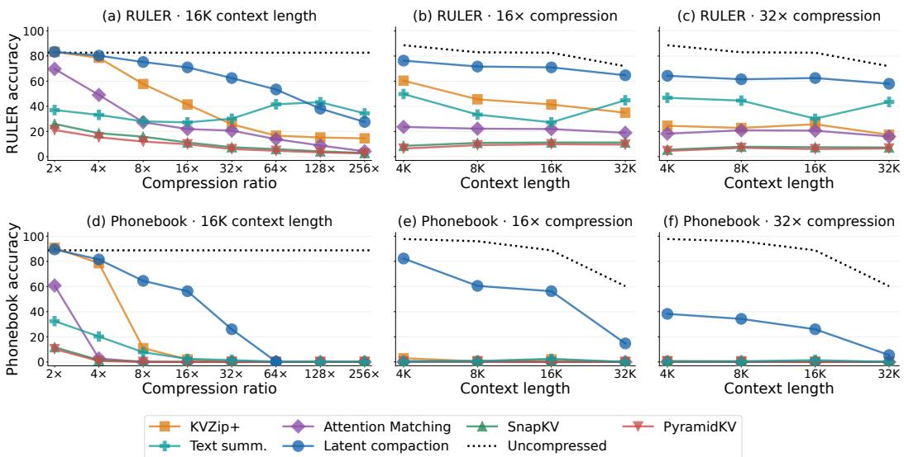  
Figure 1: Latent Compaction and baselines across compression ratios and context lengths on RULER and Phonebook Lookup with Qwen3-1.7B.

Our contributions are:

• A novel method for learning compact context representation trained with gradient descent and initialized through complementary selection rules.

• A document-specific test-time training procedure that learns from the frozen model’s attention and predictions without access to downstream questions or answers.

• Superior performance on a wide range of empirical downstream evaluation across three benchmarks and multiple model scales and families, with ablations of initialization, training, and attention normalization.

## 2 RELATED WORK

KV-Cache Eviction and Budget Allocation. Eviction methods retain selected original KV pairs. $_ \mathrm { H _ { 2 } O }$ combines recent and high-attention tokens (Zhang et al., 2023), while SnapKV selects posi tions using an observation window (Li et al., 2024). PyramidKV varies budgets across layers (Cai et al., 2025), and Ada-KV adapts budgets across heads (Feng et al., 2025). KVZip scores each entry by its maximum attention weight during context reconstruction (Kim et al., 2025). KVZip+, introduced by Jegou & Jeblick (2026), rescales each weight by the projected value norm divided by the´ input hidden-state norm before taking the maximum. This accounts for each value’s relative contribution to the residual stream. Their KVzap method learns lightweight predictors of these scores to accelerate pruning. We use KVZip+ scores to initialize preservers before cache optimization. We evaluate query-agnostic SnapKV and PyramidKV adaptations that withhold downstream questions.

Learned Context Representations. Prefix-tuning optimizes continuous prefixes with frozen model weights (Li & Liang, 2021). AutoCompressors and the In-context Autoencoder learn compression mechanisms across examples, producing compact summary vectors or memory slots (Chevalier et al., 2023; Ge et al., 2024). Cartridges instead optimizes a compact KV cache for an individual corpus through self-study and context distillation (Eyuboglu et al., 2025). Attention Matching fits full-cache attention outputs and mass through key selection, biases, and values (Zweiger et al., 2026). Our related stage-1 loss is followed by end-to-end refinement of all entries. RestoreKV generates restoration entries using a shared LoRA mechanism (Baek et al., 2026); we optimize document-specific slots directly.

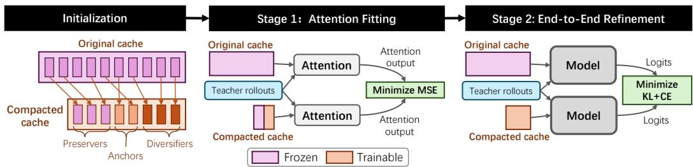  
Figure 2: Latent Compaction training pipeline. Preservers, anchors, and diversifiers are initialized from the original cache. Stage 1 freezes preservers and fits anchors and diversifiers to full-cache attention outputs. Stage 2 refines all entries through end-to-end distillation.

Test-Time Training. Test-time training (TTT) adapts model parameters using a self-supervised objective on an unlabeled test input before prediction (Sun et al., 2020). For language models, Hardt & Sun (2024) fine-tune model weights on retrieved nearest-neighbor text for each test input. TTT layers make an online-learned model the recurrent hidden state (Sun et al., 2025), while TTT-E2E updates Transformer weights on the input context through next-token prediction, with a meta-learned initialization (Tandon et al., 2025). Latent Compaction instead updates document-specific KV slots in an existing frozen Transformer, using full-cache teacher attention and predictions. It prepares the compact cache before downstream questions are known and reuses that cache across questions without further optimization.

## 3 METHOD: LATENT COMPACTION

Latent Compaction constructs a compact, trainable KV cache for a document before downstream questions arrive. Model weights remain frozen throughout, and the optimized cache is reused across questions.

In what follows, Section 3.1 defines the memory architecture and its interaction with subsequent tokens. Section 3.2 explains the preserver, anchor, and diversifier initialization and budget allocation. Sections 3.3 and 3.4 describe attention fitting and end-to-end refinement, respectively. Section 3.5 details the generic teacher rollouts that provide supervision for both stages.

Preliminaries: Attention and KV Caching. Consider a query head and its associated KV head in one Transformer layer. Let $q , k _ { i } , v _ { i } \in \mathbb { R } ^ { d }$ denote the query and the key and value at cache entry $i ,$ where d is the head dimension. Let I index entries causally visible to $q \mathrm { : }$ document entries plus any question or generated-token entries at or before its position. The attention output $A ( q ) \in  { \mathbb { R } } ^ { d }$ and scalar normalizer $Z ( q ) > 0$ are

$$
A ( q ) = \frac { \sum _ { i \in \mathcal { I } } \exp \left( q ^ { \top } k _ { i } / \sqrt { d } \right) v _ { i } } { Z ( q ) } , \qquad Z ( q ) = \sum _ { i \in \mathcal { I } } \exp \left( q ^ { \top } k _ { i } / \sqrt { d } \right) ,\tag{1}
$$

Queries and keys include positional encoding. An N-token document stores 2LHNd key/value scalars across $L$ layers and H KV heads; grouped-query attention shares each KV head among multiple query heads. We compress this document cache for reuse across questions. Below, $s =$ $1 / { \sqrt { d } }$ is the attention scale.

## 3.1 MEMORY ARCHITECTURE

Given an average budget of B KV pairs per layer and KV head, we initialize LHB KV slots in total. The number of slots may vary across layer–head pairs. Each slot also carries a scalar attention bias to compensate for the change in attention mass caused by compression.

Attention Biases. For one layer and KV head, let n be its number of compacted document entries. Omitting layer/head indices, let $K _ { \mathrm { c m p } } , V _ { \mathrm { c m p } } \in \mathbb { R } ^ { n \times d }$ contain their keys and values as rows, and let $b _ { \mathbf { c m p } } \in \mathbf { \bar { \mathbb { R } } } ^ { n }$ contain their biases, initialized to zero. For a query head associated with this KV head, $q \in \mathbb { R } ^ { d }$ . Following Attention Matching (Zweiger et al., 2026), biases adjust attention mass:

$$
\ell ( q ) = s K _ { \mathrm { c m p } } q + b _ { \mathrm { c m p } } ,\tag{2}
$$

$$
A _ { \mathrm { c m p } } ( q ) = V _ { \mathrm { c m p } } ^ { \top } \mathrm { s o f t m a x } ( \ell ( q ) ) .\tag{3}
$$

The score vector $\ell ( q ) \in \mathbb { R } ^ { n }$ and its softmax weights have one component per compacted entry; $A _ { \mathrm { c m p } } ( q ) \in \mathbb { R } ^ { d }$ is the resulting per-head attention output. A bias $b _ { j } \in \mathbb { R }$ multiplies entry $j ^ { \circ } \mathbf { s }$ unnormalized weight by $e ^ { b _ { j } }$ , adjusting both its relative contribution and the document’s total attention mass. Cache parameters are learned per document and fixed during downstream inference.

Handling Subsequent Tokens. Question and generated tokens append ordinary, unbiased KV pairs directly after the document, outside its budget and without renumbering positions. For a query $q _ { t } \in \mathbb { R } ^ { d }$ at token position $t ,$ define the scalar compressed-cache attention normalizer

$$
Z _ { \mathrm { c m p } } ( q _ { t } ) = \mathbf { 1 } _ { n } ^ { \top } \exp ( \ell ( q _ { t } ) ) .\tag{4}
$$

Here $\mathbf { 1 } _ { n } \in \mathbb { R } ^ { n }$ is the all-ones vector and exponentiation is elementwise. Let $A _ { \mathrm { n e w } , t } \ \in \ \mathbb { R } ^ { d }$ and $Z _ { \mathrm { n e w } , t } ~ \ge ~ 0$ be the attention output and scalar normalizer over causally accessible question and generated-token entries for $q _ { t }$ (taking both as zero if there are none). The combined output $A _ { t } \in \mathbb { R } ^ { d }$ is

$$
A _ { t } = \frac { Z _ { \mathrm { c m p } } ( q _ { t } ) A _ { \mathrm { c m p } } ( q _ { t } ) + Z _ { \mathrm { n e w } , t } A _ { \mathrm { n e w } , t } } { Z _ { \mathrm { c m p } } ( q _ { t } ) + Z _ { \mathrm { n e w } , t } } .\tag{5}
$$

This equals a single softmax over compressed and subsequent entries, with learned biases applied only to the former. Normalizers and mixture weights are computed in log-space.

## 3.2 INITIALIZATION

We initialize compact caches from original KV pairs using three complementary kinds of entries:

• Preserver. We rank the KVZip+ reconstruction scores of all original KV pairs from every layer and KV head together (Kim et al., 2025; Jegou & Jeblick, 2026). The highest-scoring ´ pairs fill one total preserver budget, so layer–head pairs can receive different counts.

• Anchor. One quarter of the anchor–diversifier budget uses original pairs with high normalized teacher attention. We also include the first document position as a potential attention sink (Xiao et al., 2024).

• Diversifier. In each layer and KV head, choose each new key farthest from its nearest anchor or previously selected diversifier. Preservers are excluded from the distance reference set.

Preservers are frozen in stage 1; all entries train in stage 2. Anchors and diversifiers also train in stage 1. The rules combine high-scoring original entries with attention-informed seeds and broad key-space coverage.

Budget Allocation With an average budget of B entries per layer and KV head, we reserve $M \bar { = } B / 4$ per head for anchors and diversifiers. The other $L H ( \mathbf { \bar {  { B } } } - M )$ slots come from one ranking of KVZip+ scores across all layers, KV heads, and document positions. One quarter of each head’s M slots are anchors: the first document entry and the highest-scoring remaining entries under maximum teacher attention,

$$
a _ { i } = \operatorname* { m a x } _ { q \in \mathcal { Q } } \left[ \operatorname { s o f t m a x } ( s K q ) \right] _ { i } ,\tag{6}
$$

where $i \in \{ 1 , \ldots , N \}$ indexes the original document positions, $K \in \mathbb { R } ^ { N \times d }$ contains their keys for the corresponding layer and KV head, $s = 1 / \sqrt { d } .$ , and $\mathcal { Q } \subset \mathbb { R } ^ { d }$ contains teacher queries from the associated query heads (Section 3.5). Thus $a _ { i }$ is a scalar score for document position i. The first entry counts as an anchor.

The remaining entries are diversifiers, which are selected by farthest-first traversal (Gonzalez, 1985). Starting with the set of anchor indices $S \subseteq \{ 1 , \ldots , N \}$ , we repeatedly add

$$
i ^ { \star } = \arg \operatorname* { m a x } _ { i \notin { \cal S } } \operatorname* { m i n } _ { j \in { \cal S } } \| k _ { i } - k _ { j } \| _ { 2 } ^ { 2 }\tag{7}
$$

until $| S | = M$ , where $k _ { i }$ is row i of K. The set S starts with anchors and grows only with diversifiers, never with preserver selections. Selected keys keep their original values; stage 2 optimizes all entries.

## 3.3 TRAINING STAGE 1: ATTENTION FITTING

We fit each layer independently using captured teacher queries. The attention outputs and lognormalizers are computed over the complete document cache, including the frozen preservers:

$$
\mathcal { L } _ { \mathrm { a t t n } } = \mathrm { M S E } \left( \widehat { A } _ { \mathrm { c m p } } , \widehat { A } _ { \mathrm { f u l l } } \right) + \mathrm { M S E } \left( \widehat { \log Z } _ { \mathrm { c m p } } , \widehat { \log Z } _ { \mathrm { f u l l } } \right) .\tag{8}
$$

For each captured query, $A _ { \mathrm { c m p } } , A _ { \mathrm { f u l l } } \in \mathbb { R } ^ { d }$ are compressed- and full-document attention outputs, while log $Z _ { \mathrm { c m p } } , \log Z _ { \mathrm { f u l l } } \in \mathbb { R }$ are their log-normalizers. MSE averages over captured queries and the relevant output dimensions. Hats denote standardization using fixed teacher statistics per query head: output statistics are computed over query positions and channels, and log-normalizer statistics over query positions. Standard deviations are floored at $1 0 ^ { - 4 }$ . Matching log-normalizers calibrates document attention relative to subsequent tokens. Anchor and diversifier keys, values, and biases receive updates; preserver keys, values, and biases remain frozen in stage 1.

## 3.4 TRAINING STAGE 2: END-TO-END REFINEMENT

We refine all cache entries jointly. At step $t \in \{ 1 , \ldots , T \}$ of a length-T teacher continuation, $p _ { t } , r _ { t } \in [ 0 , 1 ] ^ { | \mathcal { V } | }$ are the full-cache and compressed-cache probability vectors over vocabulary V under the same text prefix; $p _ { t , v }$ and $\boldsymbol { r } _ { t , \imath }$ denote their components for token v. We retain the teacher’s top-20 token set $\mathcal { T } _ { t } ~ \subset ~ \mathcal { V }$ individually and group the rest into a tail category with probabilities $\begin{array} { r } { p _ { t , \mathrm { t a i l } } = 1 - \sum _ { v \in \mathcal { T } _ { t } } p _ { t , v } } \end{array}$ and $\begin{array} { r } { r _ { t , \mathrm { t a i l } } = 1 - \sum _ { v \in \mathcal { T } _ { t } } r _ { t , v } } \end{array}$ . Both models use the teacher’s token set, without renormalizing the top-20 probabilities. We minimize

$$
\mathcal { L } _ { \mathrm { K L } } = \frac { 1 } { T } \sum _ { t = 1 } ^ { T } \left[ \sum _ { v \in \mathcal { T } _ { t } } p _ { t , v } \log \frac { p _ { t , v } } { r _ { t , v } } + p _ { t , \mathrm { t a i l } } \log \frac { p _ { t , \mathrm { t a i l } } } { r _ { t , \mathrm { t a i l } } } \right] ,\tag{9}
$$

$$
\mathcal { L } _ { \mathrm { L M } } = - \frac { 1 } { T } \sum _ { t = 1 } ^ { T } \log r _ { t , c _ { t } } , \qquad \mathcal { L } _ { \mathrm { s t a g e 2 } } = \mathcal { L } _ { \mathrm { K L } } + \mathcal { L } _ { \mathrm { L M } } .\tag{10}
$$

The two terms inside the brackets match the retained tokens and the total tail mass, respectively; individual tail tokens are not distinguished. The standard LM loss $\mathcal { L } _ { \mathrm { L M } }$ increases the compressedcache model’s full-vocabulary probability of the teacher’s greedy token $c _ { t } = \arg \operatorname* { m a x } _ { v } p _ { t , v }$ . The two losses have equal weight and are averaged across sequences; cache size remains fixed.

## 3.5 TEACHER ROLLOUTS FOR DOCUMENT-SPECIFIC SUPERVISION

A teacher rollout is the frozen model’s response to a generic prompt about document D. Let $C _ { D } ^ { \mathrm { f u l l } }$ be the cache obtained by prefilling $D ,$ and let $\{ u _ { j } \} _ { j = 1 } ^ { J }$ be the fixed bank of $J = 4 8 0$ text prompts (24 document requests paired with 20 response instructions; Appendix D). The prompts exclude downstream evaluation questions and answers.

Generating Rollouts. Each prompt starts from an independent fork of $C _ { D } ^ { \mathrm { f u l l } }$ <sup>l</sup>. With frozen model weights θ, the teacher distribution and greedy continuation are

$$
\begin{array} { r l } & { p _ { j , t } ( v ) = P _ { \theta } ( v \mid C _ { D } ^ { \mathrm { f u l l } } , u _ { j } , y _ { j , < t } ) , } \\ & { \qquad y _ { j , t } = \arg \operatorname* { m a x } _ { v } p _ { j , t } ( v ) , \qquad 1 \leq t \leq T _ { j } \leq 2 4 . } \end{array}\tag{11}
$$

Generation stops at an end-of-sequence token or after 24 tokens; prompts never share continuation history.

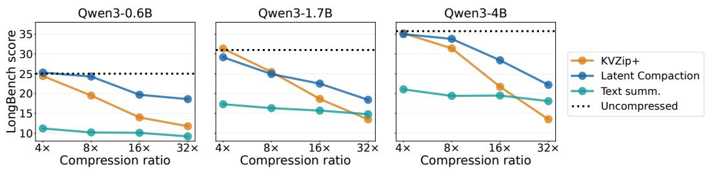  
Figure 3: Comparison of compression methods on LongBench.

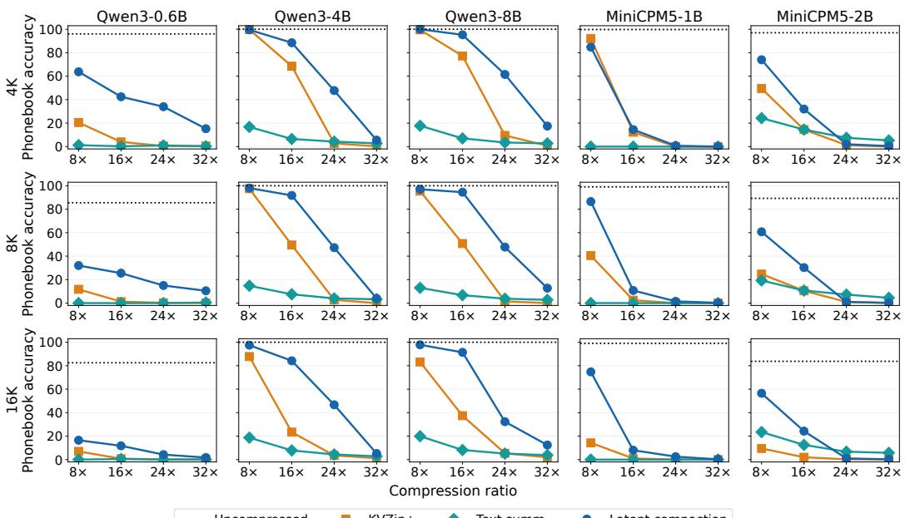  
Figure 4: Phonebook Lookup results for additional Qwen3 model sizes and MiniCPM5 models. Each model uses its own document-specific cache optimization.

Using the Rollouts. Let $q _ { \ell , h } ^ { ( j , s ) } \in \mathbb { R } ^ { d }$ be the teacher query at position s while processing prompt $u _ { j }$ and continuation $y _ { j }$ in layer ℓ and query head h. Stage 1 collects

$$
\mathcal { Q } _ { \ell , h } ( D ) = \{ q _ { \ell , h } ^ { ( j , s ) } : 1 \leq j \leq J , 1 \leq s \leq | u _ { j } | + T _ { j } \} .\tag{12}
$$

It matches full- and compressed-document attention outputs and log-normalizers on these queries using Equation $^ { 8 , }$ with preservers frozen. In stage 2, the compressed cache $C _ { D } ^ { \mathrm { c m p } }$ predicts under the same teacher-generated prefix:

$$
r _ { j , t } ( \boldsymbol { v } ) = P _ { \theta } ( \boldsymbol { v } \mid C _ { D } ^ { \mathrm { c m p } } , u _ { j } , y _ { j , < t } ) , \qquad \mathcal { L } _ { D } = \frac { 1 } { J } \sum _ { j = 1 } ^ { J } \mathcal { L } _ { \mathrm { s t a g e 2 } } \big ( ( p _ { j , t } , r _ { j , t } ) _ { t = 1 } ^ { T _ { j } } \big ) .\tag{13}
$$

Thus the student receives teacher tokens rather than its own predictions (teacher forcing). Equation 10 defines each rollout loss. Stored teacher top-20 logits and the vocabulary log-normalizer recover its top-20 probabilities and tail mass; both stages use the same fixed rollouts.

## 4 EXPERIMENTS

## 4.1 EXPERIMENTAL SETUP

Model and Training. Unless otherwise stated, we use Qwen3-1.7B with frozen model weights, BF16 model computation, and an FP32 KV cache. Each document receives 480 generic teacher prompts with continuations of up to 24 tokens. We use 1,000 attention-fitting (stage 1) updates per layer and 1,000 end-to-end refinement (stage 2) updates, with constant AdamW learning rates of $3 \times 1 0 ^ { - 3 }$ and $1 0 ^ { - 4 }$ , respectively. We use one paired seed per document and fixed schedules without downstream-question-based checkpoint selection. Appendix A gives implementation details.

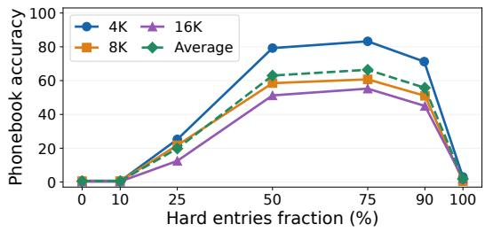

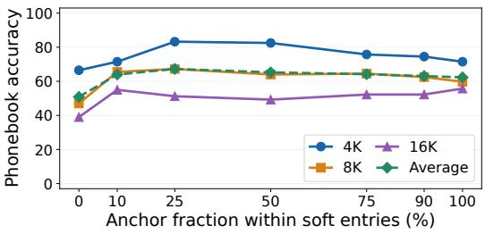  
Figure 5: Phonebook Lookup (4K, 8K, and 16K context lengths) accuracy of Latent Compaction at 16× compression ratio with different fractions of slots allocated to preservers, and different anchor fractions within the combined anchor and diversifier budget.

Table 1: Initialization ablations on Phonebook Lookup with Qwen3-1.7B at 16× compression.
<table><tr><td>Configuration</td><td>4K</td><td>8K</td><td>16K</td><td> $\operatorname { A v g } .$ </td></tr><tr><td>Latent Compaction (25% anchors + 75% diversifiers)</td><td>87.75</td><td>83.75</td><td>70.50</td><td>80.67</td></tr><tr><td>→ Replace diversifiers with random document KVs</td><td>29.25</td><td>20.00</td><td>12.25</td><td>20.50</td></tr><tr><td> Replace diversifiers with Gaussian random vectors</td><td>27.50</td><td>17.50</td><td>14.25</td><td>19.75</td></tr><tr><td> Replace diversifiers with first document KVs</td><td>65.50</td><td>42.50</td><td>22.50</td><td>43.50</td></tr><tr><td>→ Replace anchors with KVZip+</td><td>69.25</td><td>58.75</td><td>43.50</td><td>57.17</td></tr></table>

Baselines and Budgets. We compare KVZip+, Attention Matching, SnapKV, and PyramidKV (Kim et al., 2025; Jegou & Jeblick, 2026; Zweiger et al., 2026; Li et al., 2024; Cai et al., 2025), plus´ full-cache and text-summary references. Our Attention Matching baseline uses the repeat-prefill, highest-attention-key variant. Every method compresses the document before seeing the evaluation question. SnapKV and PyramidKV therefore use query-agnostic adaptations. Text summaries may fall below the target token budget; summaries that exceed it are truncated to that budget. For target context length $\bar { N } _ { 0 }$ and compression ratio r, the source budget is $B = N _ { 0 } / r \mathrm { K V }$ pairs per layer and KV head, counting all three entry types for Latent Compaction. Reported ratios use this target length; for an actual document length N, the KV-pair compression ratio is $N / B$ . Question and generated-token caches are excluded. This is a logical KV-pair budget; physical memory also depends on precision, biases, and padding.

## 4.2 EVALUATION BENCHMARKS AND METRICS

We evaluate on three benchmarks:

• RULER (Hsieh et al., 2024). This suite contains 13 synthetic long-context tasks. For each compression ratio, we evaluate 20 documents per task–length pair and report aggregate and per-task scores. Appendix E reports the per-task results.

• LongBench (Bai et al., 2024). We use this benchmark to evaluate long-context understanding on natural documents. We vary the compression ratio while keeping the evaluation documents fixed and report LongBench scores.

• Phonebook Lookup (Jelassi et al., 2024). Each document maps names to phone numbers. Given a name, the model must retrieve the corresponding number. We report lookup accuracy.

Most ablations use Phonebook Lookup with 20 questions per document. Reusing each optimized document cache across these questions reduces evaluation cost. We use greedy decoding in all experiments to ensure reproducibility.

Table 2: Stage-1 ablation results on Phonebook Lookup with Qwen3-1.7B at 16× compression.
<table><tr><td>Method</td><td>4K</td><td>8K</td><td>16K</td><td>Avg.</td></tr><tr><td>Latent Compaction</td><td>87.75</td><td>83.75</td><td>70.50</td><td>80.67</td></tr><tr><td> Remove stage 1</td><td>13.75</td><td>13.25</td><td>14.75</td><td>13.92</td></tr><tr><td>→ Remove frozen preserver KVs in stage 1</td><td>83.25</td><td>60.75</td><td>43.50</td><td>62.50</td></tr><tr><td>→ Preserver KVs are trainable in stage 1</td><td>43.75</td><td>32.25</td><td>24.25</td><td>33.42</td></tr><tr><td>→ Remove log Z MSE loss term</td><td>42.50</td><td>38.00</td><td>29.00</td><td>36.50</td></tr></table>

## 4.3 MAIN RESULTS

RULER and Phonebook Lookup Figure 1 compares methods across compression ratios at 16K context and across context lengths at 16× and 32× compression. Latent Compaction generally retains more accuracy than the compression baselines, with particularly large gains on Phonebook Lookup at 16× compression. The advantage is not uniform: text summarization outperforms Latent Compaction on RULER at the most aggressive ratios, and all compressed methods approach zero Phonebook Lookup accuracy at 64× compression and beyond.

LongBench Figure 3 compares LongBench scores for Qwen3-0.6B, 1.7B, and 4B at 4×–32× compression. Latent Compaction outperforms text summarization throughout and KVZip+ at 16× and 32× for all three models. At 4×, its scores are close to KVZip+, but its advantage grows under stronger compression, particularly for the 0.6B and 4B models. Scores still decline as compression increases, leaving a gap to the uncompressed models. These results extend the retrieval findings to natural-document understanding, while showing the cost of aggressive compression.

## 4.4 TRANSFER TO OTHER MODEL SCALES AND MODEL FAMILIES

We also apply the procedure to other model scales of the same family, 0.6B, 4B, and 8B, and to two models from another family, MiniCPM5 (OpenBMB, 2026). For each model, cache optimization uses that model’s own teacher outputs; this evaluates the applicability of the procedure across model rather than transfer of an optimized cache between models. Figure 4 compares Latent Compaction with KVZip+ and text summarization on Phonebook Lookup. The results show that its retrieval advantage extends to the additional model sizes and families.

## 4.5 ABLATIONS: INITIALIZATION

Budget Allocation to Different Entries. Figure 5 varies the global budget fraction allocated to KVZip+-selected preservers (left) and the anchor fraction within the combined anchor and diversifier budget (right). Preserver allocation has the larger effect on accuracy; 25% anchors gives the highest average among the fractions tested.

Initialization of Anchors and Diversifiers The default mixture of 25% anchors and 75% diversi fiers outperforms every tested replacement initializer at each context length (Table 1).

## 4.6 ABLATIONS: TRAINING STAGE 1

Table 2 shows that omitting stage 1 sharply reduces lookup accuracy at every context length. Allowing preserver keys and values to change during this stage also lowers accuracy substantially. Removing the log-normalizer loss causes a similarly large drop, supporting the use of both fixed preservers and normalization supervision during attention fitting.

## 4.7 ABLATIONS: TRAINING STAGE 2

Table 3 shows that stage 2 improves accuracy by 6.75, 15.50, and 7.75 percentage points at 4K, 8K, and 16K, respectively. Adding language modeling loss $\left( \mathcal { L } _ { \mathrm { l m } } \right)$ to grouped KL improves all three results, by 4.75, 0.25, and 5.25 points. Replacing the top-20-plus-tail targets with full-vocabulary targets leaves 4K accuracy unchanged, improves 8K accuracy by 0.50 points, and reduces 16K accuracy by 0.50 points. Thus, full-vocabulary distillation offers no consistent gain; the grouped objective retains similar accuracy with less teacher-target storage.

Table 3: Stage-2 ablations on Phonebook Lookup with Qwen3-1.7B at 16× compression. The default groups the teacher distribution into its top 20 tokens and the remaining mass.
<table><tr><td>Method</td><td>4K</td><td>8K</td><td>16K</td><td>Avg.</td></tr><tr><td>Latent Compaction</td><td>87.75</td><td>83.75</td><td>70.50</td><td>80.67</td></tr><tr><td>→ Remove stage 2</td><td>81.00</td><td>68.25</td><td>62.75</td><td>70.67</td></tr><tr><td>→ KL-divergence only</td><td>83.00</td><td>83.50</td><td>65.25</td><td>77.25</td></tr><tr><td>→ Remove tail-probability term in KL divergence</td><td>82.00</td><td>81.75</td><td>61.00</td><td>75.25</td></tr><tr><td>→ Full-vocabulary distillation</td><td>87.75</td><td>84.25</td><td>70.00</td><td>80.67</td></tr></table>

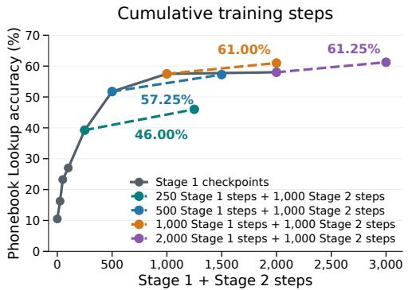

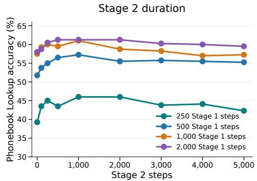  
Figure 6: Phonebook Lookup accuracy of Latent Compaction of varying training durations. For clarity, dotted lines only show the accuracy at step 0 and step 1,000 of stage 2.

Table 4: Architectural ablations on Phonebook Lookup at 16× compression.
<table><tr><td>Method</td><td>4K</td><td>8K</td><td>16K</td><td>Avg.</td></tr><tr><td>Latent Compaction</td><td>43.75</td><td>32.25</td><td>24.25</td><td>33.42</td></tr><tr><td>→ Remove attention biases (bcmp)</td><td>43.00</td><td>29.25</td><td>24.00</td><td>32.08</td></tr><tr><td>→ Equal mix: replace Eq. 5 with  $\textstyle { \frac { 1 } { 2 } } ( A _ { \mathrm { c m p } } + A _ { \mathrm { n e w } } )$ </td><td>0.25</td><td>0.00</td><td>0.25</td><td>0.17</td></tr></table>

Training Duration Figure 6 shows how training duration affects accuracy. With stage 2 fixed at 1,000 updates, doubling stage 1 from 1,000 to 2,000 updates improves accuracy only from 61.00% to 61.25%. Longer stage-2 training is worse: across different stage-1 durations, accuracy peaks at 1,000 stage-2 updates and then declines slightly, showing signs of overfitting. Overall, this implies that using 1,000 updates for both stages offers a good balance of accuracy and preparation cost.

## 4.8 ABLATIONS: MODEL ARCHITECTURE

In Table 4, removing attention biases reduces accuracy by 0.75, 3.00, and 0.25 percentage points at 4K, 8K, and 16K. Replacing normalizer weighting (Equation 5) with an equal average at inference reduces accuracy to at most 0.25%, despite retaining the stage-1 normalizer loss. Normalizer weighting recovers joint attention over document and subsequent entries.

## 5 CONCLUSION

Latent Compaction trains reusable document KV caches with frozen model weights through attention fitting and distillation. RULER, LongBench, and Phonebook Lookup show accuracy gains under compression; ablations highlight initialization and attention normalization. Per-document fitting remains costly and extreme compression hurts accuracy. Future work will reduce preparation cost and study broader tasks.

## AI USE STATEMENT

We used generative AI to assist with manuscript editing and code implementation. We manually reviewed the implementation to check that it matches the intended method. We did not use generative AI to develop the research ideas, generate datasets, or originate mathematical claims. We take responsibility for the final content of this work, including all AI-assisted text, claims, and artifacts.

## REFERENCES

Anthropic. Effective context engineering for AI agents, 2025. URL https://www.anthropic.com/engineering/ effective-context-engineering-for-ai-agents.

Anthropic. Compaction at a token threshold. Claude Platform documentation, 2026. URL https://platform.claude.com/docs/en/build-with-claude/ compaction-threshold. Accessed September 26, 2026.

Changwoo Baek, Seungjun Shin, and Kyeongbo Kong. RestoreKV: Recovering Full-Cache Behavior Under Aggressive Query-Agnostic KV Cache Eviction. arXiv preprint arXiv:2608.01247, 2026.

Yushi Bai, Xin Lv, Jiajie Zhang, Hongchang Lyu, Jiankai Tang, Zhidian Huang, Zhengxiao Du, Xiao Liu, Aohan Zeng, Lei Hou, Yuxiao Dong, Jie Tang, and Juanzi Li. Longbench: A bilingual, multitask benchmark for long context understanding, 2024. URL https://arxiv.org/abs/ 2308.14508.

Zefan Cai, Yichi Zhang, Bofei Gao, Yuliang Liu, Yucheng Li, Tianyu Liu, Keming Lu, Wayne Xiong, Yue Dong, Junjie Hu, and Wen Xiao. PyramidKV: Dynamic KV Cache Compression based on Pyramidal Information Funneling, 2025. URL https://arxiv.org/abs/2406. 02069.

Alexis Chevalier, Alexander Wettig, Anirudh Ajith, and Danqi Chen. Adapting Language Models to Compress Contexts, 2023. URL https://arxiv.org/abs/2305.14788.

Sabri Eyuboglu, Ryan Ehrlich, Simran Arora, Neel Guha, Dylan Zinsley, Emily Liu, Will Tennien, Atri Rudra, James Zou, Azalia Mirhoseini, and Christopher Re. Cartridges: Lightweight and general-purpose long context representations via self-study, 2025. URL https://arxiv. org/abs/2506.06266.

Yuan Feng, Junlin Lv, Yukun Cao, Xike Xie, and S. Kevin Zhou. Ada-KV: Optimizing KV Cache Eviction by Adaptive Budget Allocation for Efficient LLM Inference, 2025. URL https:// arxiv.org/abs/2407.11550.

Tao Ge, Jing Hu, Lei Wang, Xun Wang, Si-Qing Chen, and Furu Wei. In-context Autoencoder for Context Compression in a Large Language Model, 2024. URL https://arxiv.org/abs/ 2307.06945.

Teofilo F. Gonzalez. Clustering to minimize the maximum intercluster distance. Theoretical Computer Science, 38:293–306, 1985. doi: 10.1016/0304-3975(85)90224-5. URL https: //doi.org/10.1016/0304-3975(85)90224-5.

Moritz Hardt and Yu Sun. Test-Time Training on Nearest Neighbors for Large Language Models. In International Conference on Learning Representations, 2024. URL https://arxiv.org/ abs/2305.18466.

Cheng-Ping Hsieh, Simeng Sun, Samuel Kriman, Shantanu Acharya, Dima Rekesh, Fei Jia, Yang Zhang, and Boris Ginsburg. RULER: What’s the Real Context Size of Your Long-Context Language Models?, 2024. URL https://arxiv.org/abs/2404.06654.

Simon Jegou and Maximilian Jeblick. KVzap: Fast, adaptive, and faithful KV cache pruning, 2026.´ URL https://arxiv.org/abs/2601.07891.

Samy Jelassi, David Brandfonbrener, Sham M. Kakade, and Eran Malach. Repeat after me: Transformers are better than state space models at copying, 2024. URL https://arxiv.org/ abs/2402.01032.

Jang-Hyun Kim, Jinuk Kim, Sangwoo Kwon, Jae W. Lee, Sangdoo Yun, and Hyun Oh Song. KVzip: Query-Agnostic KV Cache Compression with Context Reconstruction, 2025. URL https: //arxiv.org/abs/2505.23416.

Xiang Lisa Li and Percy Liang. Prefix-Tuning: Optimizing Continuous Prompts for Generation, 2021. URL https://arxiv.org/abs/2101.00190.

Yuhong Li, Yingbing Huang, Bowen Yang, Bharat Venkitesh, Acyr Locatelli, Hanchen Ye, Tianle Cai, Patrick Lewis, and Deming Chen. SnapKV: LLM Knows What You are Looking for Before Generation, 2024. URL https://arxiv.org/abs/2404.14469.

Zirui Liu, Jiayi Yuan, Hongye Jin, Shaochen Zhong, Zhaozhuo Xu, Vladimir Braverman, Beidi Chen, and Xia Hu. KIVI: A Tuning-Free Asymmetric 2bit Quantization for KV Cache, 2024. URL https://arxiv.org/abs/2402.02750.

OpenAI. Compaction. OpenAI API documentation, 2026. URL https://developers. openai.com/api/docs/guides/compaction. Accessed September 26, 2026.

OpenBMB. MiniCPM5: Small language models. https://github.com/OpenBMB/ MiniCPM, 2026. Official model repository, accessed September 26, 2026.

Yu Sun, Xiaolong Wang, Zhuang Liu, John Miller, Alexei A. Efros, and Moritz Hardt. Test-Time Training with Self-Supervision for Generalization under Distribution Shifts, 2020. URL https: //arxiv.org/abs/1909.13231.

Yu Sun, Xinhao Li, Karan Dalal, Jiarui Xu, Arjun Vikram, Genghan Zhang, Yann Dubois, Xinlei Chen, Xiaolong Wang, Sanmi Koyejo, Tatsunori Hashimoto, and Carlos Guestrin. Learning to (Learn at Test Time): RNNs with Expressive Hidden States, 2025. URL https://arxiv. org/abs/2407.04620.

Arnuv Tandon, Karan Dalal, Xinhao Li, Daniel Koceja, Marcel Rød, Sam Buchanan, Xiaolong Wang, Jure Leskovec, Sanmi Koyejo, Tatsunori Hashimoto, Carlos Guestrin, Jed McCaleb, Yejin Choi, and Yu Sun. End-to-End Test-Time Training for Long Context, 2025. URL https: //arxiv.org/abs/2512.23675.

Guangxuan Xiao, Yuandong Tian, Beidi Chen, Song Han, and Mike Lewis. Efficient streaming language models with attention sinks. In International Conference on Learning Representations, 2024. URL https://openreview.net/forum?id=NG7sS51zVF.

Zhenyu Zhang, Ying Sheng, Tianyi Zhou, Tianlong Chen, Lianmin Zheng, Ruisi Cai, Zhao Song, Yuandong Tian, Christopher Re, Clark Barrett, Zhangyang Wang, and Beidi Chen. H´ <sub>2</sub>O: Heavy-Hitter Oracle for Efficient Generative Inference of Large Language Models, 2023. URL https: //arxiv.org/abs/2306.14048.

Adam Zweiger, Xinghong Fu, Han Guo, and Yoon Kim. Fast KV Compaction via Attention Matching, 2026. URL https://arxiv.org/abs/2602.16284.

## A ADDITIONAL EXPERIMENTAL DETAILS

## A.1 MODEL CONFIGURATION

All main experiments use the same Qwen3-1.7B reader checkpoint and tokenizer. The model has 28 Transformer layers, hidden dimension 2,048, 16 query heads, eight KV heads, and head dimension 128. Model weights remain frozen. We use BF16 inference with the original rotary positional configuration, without extending the context window or modifying the architecture. Inputs use raw text, and checkpoint and tokenizer hashes are verified across hosts.

Table 5: Hugging Face checkpoints used in the experiments. Each model uses its corresponding tokenizer.
<table><tr><td>Model</td><td>Checkpoint URL</td></tr><tr><td>Qwen3-0.6B</td><td> $\mathrm { { h t t p s : / / h u g g i n g f a c e . c o / Q w e n / Q w e n 3 - 0 . 6 B } }$ </td></tr><tr><td>Qwen3-1.7B</td><td> $\mathrm { { h t t p s : / / h u g g i n g f a c e . c o / Q w e n / Q w e n 3 - 1 . 7 B } }$ </td></tr><tr><td>Qwen3-4B</td><td> $\scriptstyle \mathrm { h t t p s : } / / \mathrm { h u g g i n g f a c e . c o } / \mathrm { Q w e n } / \mathrm { Q w e n } 3 - 4 \mathrm { B }$ </td></tr><tr><td>Qwen3-8B</td><td> $\scriptstyle \mathrm { h t t p s : } / / \mathrm { h u g g i n g f a c e . c o } / \mathrm { Q w e n } / \mathrm { Q w e n } 3 - 8 \mathrm { B }$ </td></tr><tr><td>MiniCPM5-1B</td><td> $\mathrm { h t t p s : / / h u g g i n g f a c e . c o / o p e n b m b / M i n i C P M S - 1 B }$ </td></tr><tr><td>MiniCPM5-2B</td><td>https://huggingface.co/openbmb/MiniCPM5-2B</td></tr></table>

## A.2 DOCUMENT-SPECIFIC TRAINING

For each document, the full-cache model generates up to 24 tokens for each of 480 fixed generic prompts. We reuse these teacher rollouts in both stages. Model weights are frozen; the documentcache parameters are optimized in FP32, while model computation uses BF16. Table 6 summarizes the reported configuration, which uses 1,000 updates per stage by default.

Table 6: Document-specific optimization settings. A stage-2 batch consists of four independently processed rollouts whose gradients are accumulated before one update.
<table><tr><td>Setting</td><td>Stage 1: attention fitting</td><td>Stage 2: end-to-end refinement</td></tr><tr><td>Updates</td><td>1,000 per layer</td><td>1,000 jointly across layers</td></tr><tr><td>Examples per update</td><td>up to 128 query positions</td><td>4 teacher rollouts</td></tr><tr><td>AdamW learning rate</td><td> $3 \times 1 0 ^ { - 3 }$ </td><td> $1 0 ^ { - 4 }$ </td></tr><tr><td>Learning-rate schedule</td><td>constant; no warmup</td><td>constant; no warmup</td></tr><tr><td>Weight decay</td><td>0</td><td>0</td></tr><tr><td>Gradient norm clip</td><td>1</td><td>1</td></tr></table>

AdamW uses its default momentum parameters $\beta _ { 1 } = 0 . 9 , \beta _ { 2 } = 0 . 9 9 9$ , and $\epsilon = 1 0 ^ { - 8 }$ . There is no learning-rate decay or gradient accumulation across optimizer updates. Stage 1 trains anchor and diversifier keys, values, and biases, while preserver keys, values, and biases remain frozen. Stage 2 trains the entire compacted cache, including preserver keys and values and all attention biases. Both stages use fixed update counts; no checkpoint is selected using downstream questions. The same document seed is shared across paired conditions.

## Example Construction and Batching

• Document and teacher prompts. We tokenize each document as raw text, without a chat template or added special tokens, and prefill it once. We do not concatenate different documents or teacher prompts into a single sequence. Each of the 480 prompts starts from an independent fork of that document’s full cache; generation stops at EOS or 24 tokens. The fitting code does not truncate document or prompt tokens, so inputs must fit the model’s supported context length.

• Stage 1. Query vectors captured from all prompt–continuation rollouts are concatenated along the query-position axis for each layer. If this pool exceeds 4,096 positions, we retain 4,096 evenly spaced positions. Each update samples up to 128 query positions with replacement, shared across the layer’s heads. Full-cache attention targets are computed in chunks of 16 query positions to limit temporary memory.

• Stage 2. Each update samples four rollouts with replacement. For each rollout, the input is its prompt concatenated with the preceding teacher-generated tokens; the document is supplied through the compacted cache. The model processes each rollout separately with a fresh continuation cache and a sequence batch size of one. Its loss is divided by four, and gradients from all four rollouts are accumulated before clipping and one AdamW step. Variable-length rollouts are neither padded together nor packed into a shared attention sequence. Distillation uses the teacher’s top 20 probabilities and aggregate tail mass, plus next-token cross-entropy (Section 3.4).

Attention Implementation The uncompressed teacher follows the model’s native Hugging Face attention path. For the compacted cache, the adapter computes scaled query–key scores explicitly with PyTorch tensor operations, adds learned per-entry biases, masks padded preserver slots, and applies softmax to obtain the document attention output. It also computes the document log-normalizer with logsumexp. A separate causal PyTorch attention calculation covers prompt and generatedtoken entries; their output and log-normalizer are combined with the document terms using the shared softmax normalizer. Attention scores and normalizers are evaluated in FP32. The stage-1 full-cache targets likewise use explicit matrix multiplication, softmax, and logsumexp. This compacted-cache path does not call FlashAttention or PyTorch’s fused scaled-dot-product attention: it needs the log-normalizer as well as the attention output, plus per-entry biases and a ragged-slot mask. A custom fused kernel that exposes these quantities could implement the same mathematics; FlashAttention is not inherently incompatible with the method.

Normalizer Computation and Storage The Python-style pseudocode below shows the per-layer, per-query-head computation behind Equation 5. The compressed branch includes learned biases and excludes padded slots; the subsequent-token branch uses a causal visibility mask and no learned bias. Both branches compute attention outputs and log-normalizers in FP32.

Python pseudocode: normalizer-aware cache attention

```python
import torch
def branch_attention(q, keys, values, bias, valid, scale):
scores = scale (q.float() @ keys.float().T)
if bias is not None:
scores = scores + bias.float()
scores = scores.masked_fill(
˜valid, torch.finfo(scores.dtype).min
)
output = torch.softmax(scores, dim=-1) @ values.float()
log_z = torch.logsumexp(scores, dim=-1)
return output, log_z
def combine_attention(q, doc_k, doc_v, doc_bias, doc_valid,
new_k, new_v, new_visible, scale):
# q has RoPE; GQA keys/values are expanded to query heads.
doc_out, doc_log_z = branch_attention(
q, doc_k, doc_v, doc_bias, doc_valid, scale
)
new_out, new_log_z = branch_attention(
q, new_k, new_v, None, new_visible, scale
)
total_log_z = torch.logaddexp(doc_log_z, new_log_z)
doc_weight = torch.exp(doc_log_z - total_log_z)
new_weight = torch.exp(new_log_z - total_log_z)
return (doc_weight <sub>*</sub> doc_out + new_weight <sub>*</sub> new_out).to(q.dtype)
```

During stage 1, the full-cache target is log $Z _ { \mathrm { f u l l } } = \mathrm { l o g s u m e x p } ( s q K _ { \mathrm { f u l l } } ^ { \top } )$ ; the compressed branch’s doc log z is fitted to this target using Equation 8. The teacher mean and standard deviation are fixed per query head, with the latter floored at $1 0 ^ { - 4 }$ . Normalizers are recomputed for each query rather than saved in the cache artifact; keys, values, biases, and masks are saved. These attention normalizers differ from the vocabulary log-normalizer saved with teacher logits for stage-2 distillation.

The reference configuration assigns one quarter of the logical KV-pair budget to anchors and diversifiers, and the remainder to globally selected preservers. One quarter of the anchor–diversifier slots are anchors; the rest use farthest-point initialization. We train exactly the number of slots deployed. Teacher artifacts are reused across configurations for the same document. Evaluation accounts for BF16 deployment precision.

Training losses · Qwen3-1.7B phonebook · 16K context / 16× compression

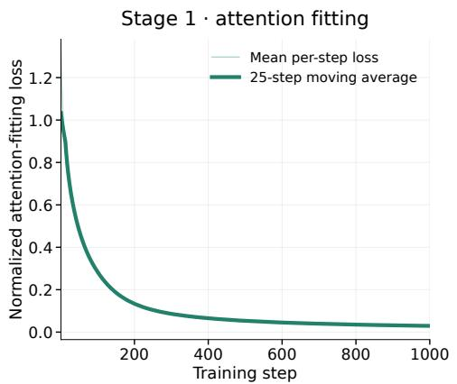

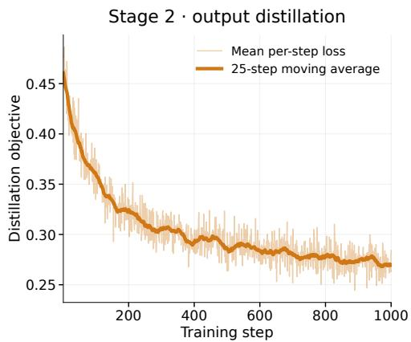  
Figure 7: Qwen3-1.7B training losses on 16K Phonebook Lookup at 16× compression. Stage 1 shows the normalized attention-fitting objective (Equation 8); stage 2 shows grouped KL and nexttoken cross-entropy (Equation 10). Each stage runs for 1,000 updates. Thin lines show per-step means; thick lines show 25-step moving averages.

## A.3 BASELINES AND BUDGETS

We compare with KVZip+, Attention Matching, SnapKV, and PyramidKV (Kim et al., 2025; Jegou´ & Jeblick, 2026; Zweiger et al., 2026; Li et al., 2024; Cai et al., 2025), together with an uncompressed reference. Every compression method receives the document before its evaluation question is revealed. Attention Matching uses repeat-prefill reference queries, RMS attention-based key selection, two bounded nonnegative least-squares iterations with bounds $[ e ^ { - 3 } , e ^ { 3 } ]$ , and least-squares value fitting. This is the tested highest-attention-key variant, without on-policy query recollection or OMP. SnapKV and PyramidKV use a 32-token document observation window, mean pooling of width five, and shared GQA entries. PyramidKV uses β = 20 and an allocation rounded to preserve the total budget exactly. Their results describe query-agnostic adaptations.

For target context length $N _ { 0 }$ and compression ratio r, we set the average source budget to $B = N _ { 0 } / r$ KV pairs per layer and KV head. Retained and latent entries both count toward this budget. We separately distinguish logical pair counts from physical memory, which also depends on log-weight metadata, padding, and precision. Query and continuation caches are outside the source budget.

## B TRAINING LOSS CURVES

Figure 7 shows the training objectives for a Qwen3-1.7B Phonebook Lookup run at 16K context and 16× compression. The normalized attention-fitting loss in stage 1 decreases rapidly at first and continues to decline over 1,000 updates. The stage-2 distillation objective also decreases over it 1,000 updates, with greater per-step variation and a more gradual decline later in training. The two panels show different objectives, so their loss values are not directly comparable.

## C PROMPT TEMPLATE FOR PHONEBOOK LOOKUP

Figure 8 shows the prompt template used for Phonebook Lookup.

Phonebook Lookup Task Each document contains synthetic name–number pairs, with unique 10- character uppercase names and 10-digit phone numbers. We sample 20 distinct entries per document and evaluate each lookup independently. The document is cached once and reused across questions; evaluation questions are excluded from cache construction and optimization.

Document   
The phone number of <NAME 1> is <NUMBER 1>.   
The phone number of <NAME 2> is <NUMBER 2>.   
The phone number of <NAME N> is <NUMBER N>.   
Question   
Question: What is the phone number of <NAME i>?   
Response prefix   
Answer:  
Figure 8: Phonebook Lookup prompt template. Angle-bracketed fields are placeholders, and the ellipsis denotes additional entries. The model continues after Answer:. Bold section labels are explanatory and are not part of the plain-text prompt.

## D GENERIC PROMPTS FOR TEACHER ROLLOUTS

For each document, we use a fixed bank of 480 generic prompts to collect training signals from the full-cache teacher. The bank is the Cartesian product of 24 document-oriented requests and 20 response instructions. Each prompt has the form

<document request> <response instruction>   
Answer:

For example, one combination is:

Summarize the document’s main subject and structure.   
Answer briefly.   
Answer:

The requests cover broad properties such as content, organization, and writing style. The response instructions vary the desired length and specificity. The same prompt bank is used for every document; its text is fixed in advance and contains neither benchmark questions nor their answers.

We first prefill the document into the frozen teacher’s full KV cache. For each prompt, we fork that cache and greedily generate up to 24 continuation tokens. The resulting attention queries provide supervision for attention fitting, while teacher next-token distributions along the generated continuations provide targets for distillation. Evaluation questions are held out until the compacted cache has been constructed and optimized. Thus, the 480 prompts are alternative ways to probe a single document, rather than 480 additional training documents.

## E RULER RESULTS BY SUBTASK

The aggregate RULER scores can conceal differences among task families. Figures 9–21 show the results of Latent Compaction and baseline methods on each subtask in the RULER benchmark. Together, these task-level results make clear how accuracy changes with compression ratio at 16K context and with context length at 16× and 32× compression.

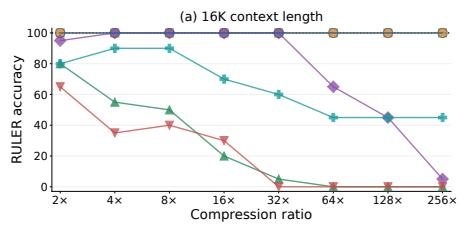

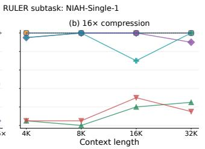  
KVZip+ Attention Matching SnapKV PyramidKV Text summ. Latent compaction Uncompressed

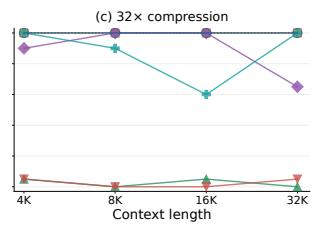  
Figure 9: RULER NIAH-Single-1: accuracy versus compression ratio at 16K context (left), and versus context length at 16× (middle) and 32× compression (right).

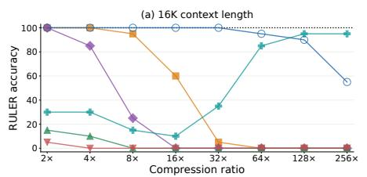

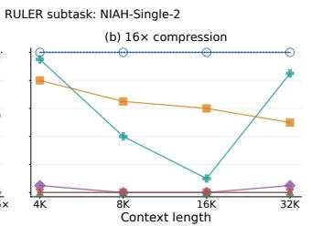

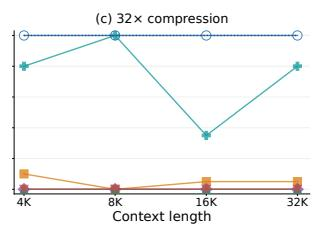  
KVZip+ Attention Matching SnapKV PyramidKV Text summ. Latent compaction Uncompressed  
Figure 10: RULER NIAH-Single-2: accuracy versus compression ratio at 16K context (left), and versus context length at 16× (middle) and 32× compression (right).

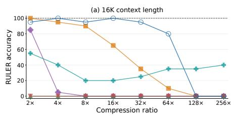

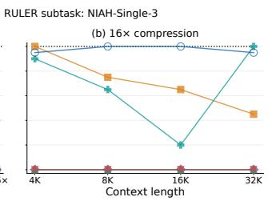

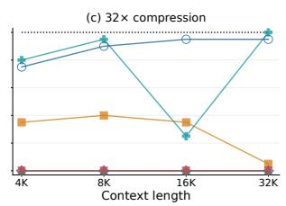  
KVZip+ Attention Matching SnapKV PyramidKV Text summ. Latent compaction Uncompressed  
Figure 11: RULER NIAH-Single-3: accuracy versus compression ratio at 16K context (left), and versus context length at 16× (middle) and 32× compression (right).

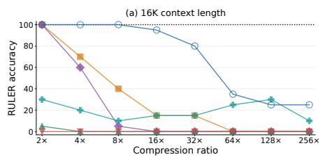

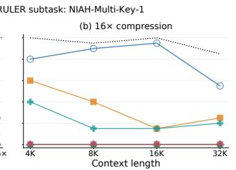

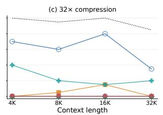  
Attention Matching SnapKV PyramidKV Text summ. Latent compaction Uncompressed  
Figure 12: RULER NIAH-Multi-Key-1: accuracy versus compression ratio at 16K context (left), and versus context length at 16× (middle) and 32× compression (right).

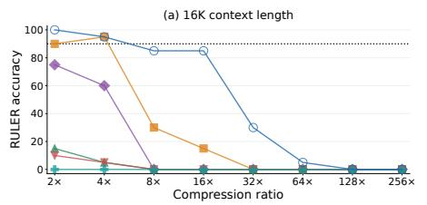

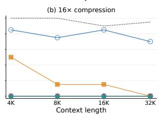  
Attention Matching SnapKV PyramidKV Text summ. Latent compaction Uncompressed

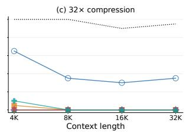  
Figure 13: RULER NIAH-Multi-Key-2: accuracy versus compression ratio at 16K context (left), and versus context length at 16× (middle) and 32× compression (right).

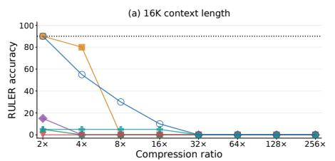

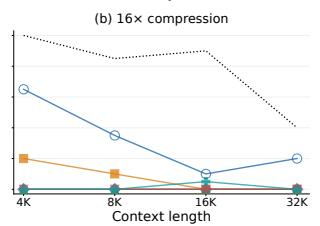

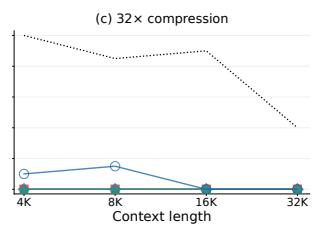  
Attention Matching SnapKV PyramidKV Text summ. Latent compaction Uncompressed  
Figure 14: RULER NIAH-Multi-Key-3: accuracy versus compression ratio at 16K context (left), and versus context length at 16× (middle) and 32× compression (right).

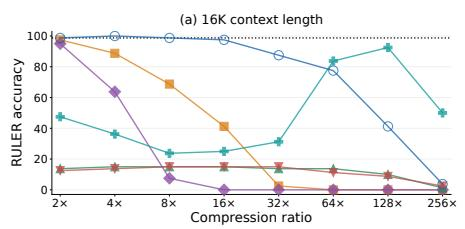

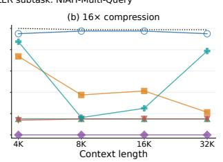  
KVZip+ Attention Matching SnapKV PyramidKV Text summ. Latent compaction Uncompressed

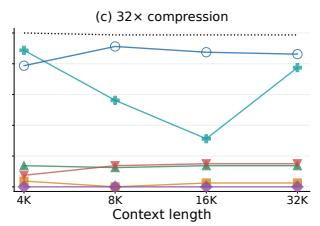  
Figure 15: RULER NIAH-Multi-Query: accuracy versus compression ratio at 16K context (left), and versus context length at 16× (middle) and 32× compression (right).

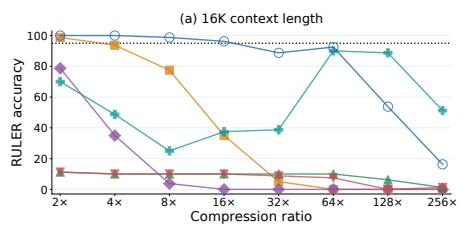

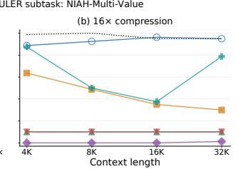

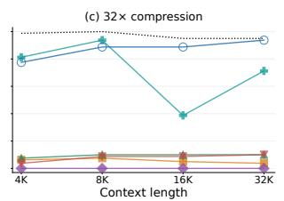  
KVZip+ Attention Matching SnapKV PyramidKV Text summ. Latent compaction Uncompressed  
Figure 16: RULER NIAH-Multi-Value: accuracy versus compression ratio at 16K context (left), and versus context length at 16× (middle) and 32× compression (right).

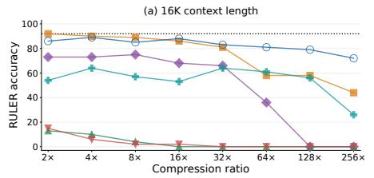

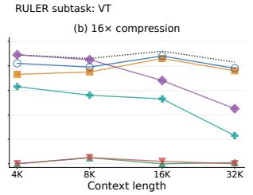  
KVZip+ Attention Matching SnapKV PyramidKV Text summ. Latent compaction Uncompressed

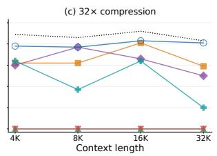  
Figure 17: RULER VT: accuracy versus compression ratio at 16K context (left), and versus context length at 16× (middle) and 32× compression (right).

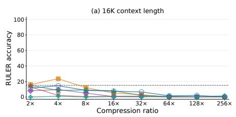

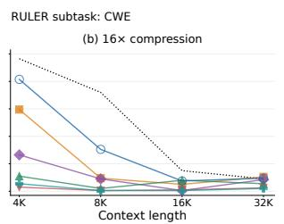

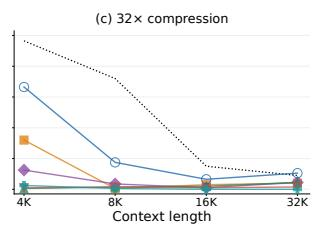  
KVZip+ Attention Matching SnapKV PyramidKV Text summ. Latent compaction Uncompressed  
Figure 18: RULER CWE: accuracy versus compression ratio at 16K context (left), and versus context length at 16× (middle) and 32× compression (right).

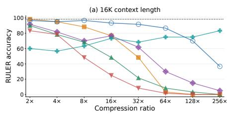

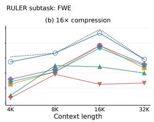

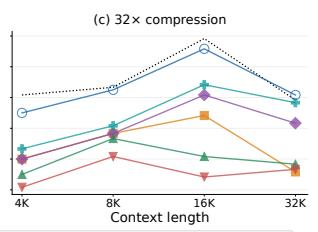  
KVZip+ Attention Matching SnapKV PyramidKV Text summ. Latent compaction Uncompressed  
Figure 19: RULER FWE: accuracy versus compression ratio at 16K context (left), and versus context length at 16× (middle) and 32× compression (right).

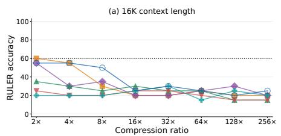

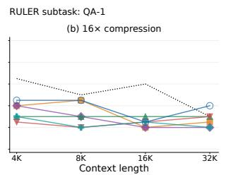

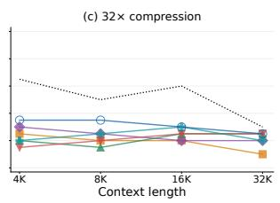  
KVZip+ Attention Matching SnapKV PyramidKV Text summ. Latent compaction Uncompressed  
Figure 20: RULER QA-1: accuracy versus compression ratio at 16K context (left), and versus context length at 16× (middle) and 32× compression (right).

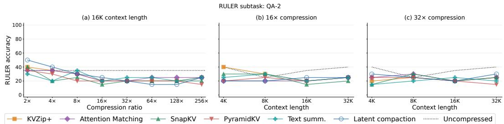  
Figure 21: RULER QA-2: accuracy versus compression ratio at 16K context (left), and versus context length at 16× (middle) and 32× compression (right).