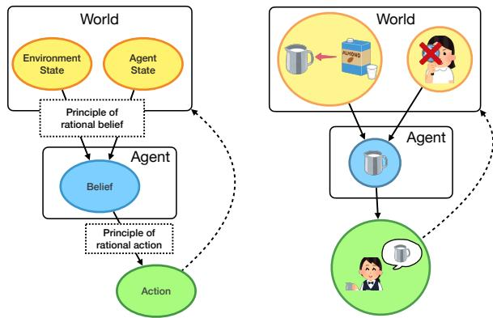
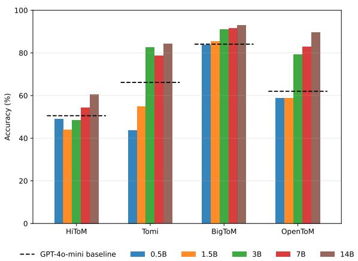
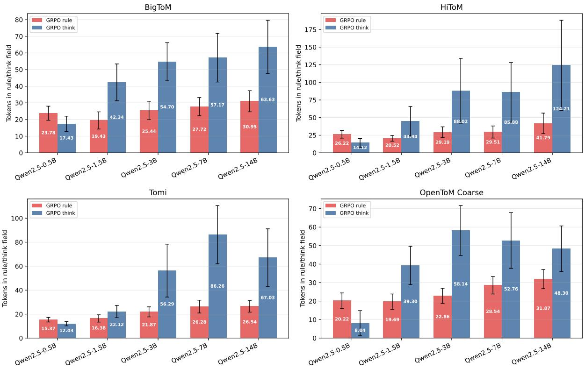
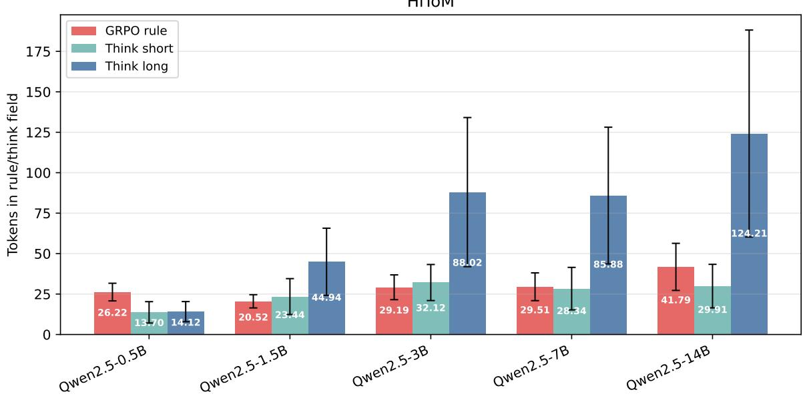

# Learning Perception to Action Rules through Reinforcement Learning for Theory-of-Mind Reasoning

Soyoung Oh1\*, Nursulu Sagimbayeva1\*, Nicholas Jennings2, Paulina Hussein1, Mehwish Alam3, and Vera Demberg1,4

1Saarland University, 2Deutsches Forschungszentrum für Künstliche Intelligenz 3Télécom Paris, 4Max Planck Institute for Informatics {soyoung,vera}@lst.uni-saarland.de {nusa00001,s8pahuss}@stud.uni-saarland.de nije01@dfki.de, mehwish.alam@telecom-paris.fr

## Abstract

In Theory-of-Mind (ToM) reasoning, large language models may correctly infer the agent’s mental state but fail to use that inference when predicting or judging the agent’s subsequent actions. In this work, we investigate whether explicitly connecting perception, belief, and action with rules improves ToM reasoning. We generate concise if–then rules that express relations between perception to action and use Group Relative Policy Optimization (GRPO) to train Qwen2.5 and Llama3 models across four ToM benchmarks. GRPO with rule generation outperforms prompting, supervised fine-tuning, and think reasoning. Moreover, rules generated by larger models (≥3B) provide transferable knowledge that improves downstream perfor mance of GPT-4o-mini. These findings suggest that explicit rules help models bridge the reasoning gap in ToM and support knowledge transfer across models.1

## 1 Introduction

Humans can effortlessly infer and track others unobservable mental states, a capacity known as Theory-of-Mind (ToM), and use these inferences to guide their social interactions (Zhang et al., 2012; Heyes and Frith, 2014). Given ToM’s central role in human interaction, many studies have investigated whether Large Language Models (LLMs) exhibit this ability, revealing limitations in their ToM reasoning (Strachan et al., 2024; Xu et al., 2024; Gandhi et al., 2023; Xiao et al., 2025). In particular, Gu et al. (2026) showed that although LLMs can correctly answer explicit questions about agents mental states, they struggle to predict and judge the agents’ future actions, despite they already possess relevant knowledge on the agents’ perceptions and beliefs. Our hypothesis is that these reasoning failures are caused by difficulties in connecting and

Context: Noor wants to make a latte for a customer who asked for oat milk. Noor grabs a milk pitcher and fills it with oat milk. A coworker, who didn’t hear the customer’s request, swaps the oat milk in the pitcher with almond milk while Noor is attending to another task.

Action question: What will Noor do?  
  
Figure 1: Causal structure of ToM, adapted from Baker et al. (2011). An example story and question illustrate the perception-belief-action dependencies required for reasoning about an agent’s mental state.

applying relevant knowledge that models already possess, rather than an inability to make relevant inferences. This is motivated by previous findings that language models can solve individual subproblems while failing to compose their solutions into a correct final answer, which is known as the compositionality gap (Press et al., 2023).

In this study, therefore, we investigate whether training LLMs with reinforcement learning (RL) to make explicit connections between inferences can bridge ToM compositionality gap. We define explicit connection as a bridging rule that specifies how the output of one inference constrains the next inference. For example, in Figure 1, adapted from Gandhi et al. (2023), correctly answering the action question requires the model to connect Noor’s perception to her belief and use this information to predict that either she will replace the milk pitcher with oat milk or prepare a latte for the customer. We use LLMs to elicit story-specific connections that follow ‘if–then’ rule format, such as “If Noor believes the pitcher contains the oat milk, then she will use it to prepare the latte”. We use these rules to post-train the models with Group Relative Policy Optimization (GRPO) (Shao et al., 2024), encouraging them to generate a rule that connects the separated inferences before answering. While prior work relies on free-form reasoning over a broad sampling space (Zhong et al., 2026; Lu et al., 2025), we hypothesize that these concise rules constrain the reasoning space for ToM. Our main contributions are:

• We introduce rule-based GRPO for ToM reasoning, which generates concise if–then rules connecting perception, belief, and action (Section 2.2).

• Although supervising models to produce rules does not reliably improve answer prediction, GRPO with rule generation improves average accuracy by 7.2% over free-form GRPO reasoning while using fewer thinking tokens (Section 3).

• Rules generated by larger models (≥3B) improve GPT-4o-mini’s downstream accuracy, indicating that they encode transferable taskrelevant information (Section 3.1).

## 2 Methods

## 2.1 Data

We conduct our experiments on four ToM benchmarks: BigToM (Gandhi et al., 2023), HiToM (Wu et al., 2023), ToMI (Le et al., 2019), and Open-ToM (Xu et al., 2024).2 We select these benchmarks for their focus on perception and belief tracking, with BigToM additionally testing belief–action relation, and their diversity in reasoning depth and narrative construction.

Data splits. For each benchmark, we reserve a small set of examples (N = 100) for SFT warm-up and split the remaining examples into train, development, and test sets (Table 1). We stratify each split by the benchmark specific factor combinations (benchmark specific factors in Appendix A).

## 2.2 Rule generation

We generate ground truth rules using gpt-5-mini-2025-08-07 model without revealing gold answer (prompt in Appendix B). To validate the generated rules, we then prompt the same model to answer each question using its generated rule. We assume that a rule is valid if the model answers the question correctly (details in Appendix C and rule examples in Table 11).

<table><tr><td>Benchmark</td><td>Total</td><td>Main split</td></tr><tr><td>BigToM</td><td>5,000</td><td>3,750 / 200 / 950</td></tr><tr><td>HiToM</td><td>1,200</td><td>720 / 200 / 180</td></tr><tr><td>ToMi</td><td>2,664</td><td>1,891 / 200 / 473</td></tr><tr><td>OpenToM</td><td>2,384</td><td>1,668 / 200 / 416</td></tr></table>

Table 1: Dataset sizes and main splits. Main splits are reported as train/development/test.

## 2.3 Models

We train and evaluate a range of Qwen2.5-Instruct-{0.5B, 1.5B, 3B, 7B, 14B} (Yang et al., 2025), as well as Llama-Instruct-{3.2-1B, 3.2-3B, 3.1-8B} models (Grattafiori et al., 2025). We primarily report Qwen2.5 results in the main text and present Llama results in Appendix G.

## 2.4 Experimental setup

We evaluate two no-training baselines. In Base condition, we prompt the models with story and question to predict correct answer. In Base , we prompt the models additionally to generate a rule before the answer (prompts in Appendix B.2). For consistent parsing and evaluation, we instruct all models to return outputs in JSON format. We then define four training conditions:

• SFTa: Supervised fine-tuning to generate only the correct answer.

• SFTr: Supervised fine-tuning to generate a reference rule followed by the correct answer.

• GRPOt: RL to generate free-form reasoning and an answer within “think” and “answer” JSON fields, respectively (Lu et al., 2025).

• GRPOr: RL to generate a rule and an answer in JSON format within “rule” and “answer” fields, respectively.

## 2.5 Training

We train the SFT and GRPO conditions on the same training examples for two epochs, following Lu et al. (2025). We select the checkpoint with the best accuracy on a development set for evaluation on test set.3

SFT For both SFT conditions, we use a batch size of 2 and a learning rate of $5 \times 1 0 ^ { - 6 }$ . In ${ \mathrm { S F T } } _ { r } .$ , we compute token-level cross-entropy loss over both. In $\mathrm { S F T } _ { a } .$ , we calculate loss on target answer.

Format warm-up for GRPO rules. Following the prior work on cold start training for GRPO (Chen et al., 2026), we initialize each model with an SFT. We train for up to three epochs, and do early stopping once format validity meets 95% on a small development set (details in Appendix C).

GRPO optimization We implement GRPO with Dapo style token-loss normalization (Yu et al., 2026). We use a training batch size of 8, a learning rate of $5 \times 1 0 ^ { - 6 }$ , and a KL regularization coefficient of 0.001. For each input, we sample eight completions at a temperature of 0.8 with a maximum completion length of 512 tokens. Each completion receives a format reward and an answer reward. A valid format requires a JSON object containing two string fields, “rule” and “answer”, where the rule should contain the word if followed by text. We define the format reward as

$$
r _ { \mathrm { f o r m a t } } = { \left\{ \begin{array} { l l } { + 0 . 5 , } & { { \mathrm { i f ~ t h e ~ f o r m a t ~ i s ~ v a l i d } } , } \\ { - 0 . 5 , } & { { \mathrm { o t h e r w i s e } } . } \end{array} \right. }
$$

We evaluate the extracted answer using benchmark-specific evaluation and define the answer reward as

$$
r _ { \mathrm { a n s w e r } } = { \left\{ \begin{array} { l l } { + 2 , } & { { \mathrm { i f ~ t h e ~ a n s w e r ~ i s ~ c o r r e c t } } , } \\ { - 2 , } & { { \mathrm { o t h e r w i s e } } . } \end{array} \right. }
$$

The total reward for each sampled completion is $r = r _ { \mathrm { f o r m a t } } + r _ { \mathrm { a n s w e r } }$ . We normalize the reward within each group of eight completions to compute the group relative advantages used for policy optimization. Therefore, the reward encourages conditional rule formatting and answer correctness.

## 3 Results

Across training approaches, GRPO achieves the strongest overall performance (74.2%), outperforming $\mathrm { G R P O } _ { t }$ (67.0%), SFT (66.7%), SFT (61.4%), Baser (52.4%), and Base (45.5%). We compare the results under rule conditioning with those from the other settings below.

Instructing the models to generate rules in context consistently improves performance. Instructing the models to generate rule improves accuracy in available comparisons (Table 2) in most setups across different temperatures {0.2, 0.4, 0.8}. Overall, the average accuracy increases by 6.9%, indicating that rule conditioning provides a substantial benefit on average.

<table><tr><td>Model</td><td>HiToM</td><td>ToMi</td><td>BigToM OpenToM</td><td></td></tr><tr><td>Base</td><td></td><td></td><td></td><td></td></tr><tr><td>Qwen2.5-0.5B</td><td>1.5</td><td>39.1</td><td>51.4</td><td>52.6</td></tr><tr><td>Qwen2.5-1.5B</td><td>15.9</td><td>27.1</td><td>28.9</td><td>47.8</td></tr><tr><td>Qwen2.5-3B</td><td>7.2</td><td>55.3</td><td>73.6</td><td>53.6</td></tr><tr><td>Qwen2.5-7B Qwen2.5-14B</td><td>27.8 45.0</td><td>55.3 62.2</td><td>78.2 82.1</td><td>46.5 59.3</td></tr><tr><td>Baser</td><td></td><td></td><td></td><td></td></tr><tr><td>Qwen2.5-0.5B</td><td>6.8</td><td>34.8</td><td>54.1</td><td>45.4</td></tr><tr><td></td><td>(+5.4) 18.7</td><td>(-4.3) 42.4</td><td>(+2.7) 62.1</td><td>(-7.2) 51.9</td></tr><tr><td>Qwen2.5-1.5B</td><td>(+2.8)</td><td>(+15.3)</td><td>(+33.2)</td><td>(+4.0)</td></tr><tr><td>Qwen2.5-3B</td><td>24.4 (+17.2)</td><td>50.9 (-4.3)</td><td>80.8 (+7.2)</td><td>58.6 (+5.0)</td></tr><tr><td>Qwen2.5-7B</td><td>43.0 (+15.2)</td><td>56.0 (+0.6)</td><td>85.8 (+7.6)</td><td>62.4 (+15.9)</td></tr><tr><td>Qwen2.5-14B</td><td>46.3 (+1.3)</td><td>64.8 (+2.6)</td><td>86.5 (+4.4)</td><td>72.6 (+13.3)</td></tr></table>

Table 2: Accuracy (%) without training averaged across different temperatures. Changes below Baser are percentage-point differences from Base: green indicates improvement and red indicates degradation.

Simply teaching rule generation with SFT degrades performance. Unlike rule prompting, SFT to generate rule before the answer decreases average accuracy relative to answer-only finetuning (Table 3). This suggests that training to just imitate the rule and output pairs does not reliably teach models to use rules for answer prediction. Rather, the models might prioritize producing the required rules over optimizing the final answer.

GRPOr improves performance while using fewer tokens than $\mathbf { G } \mathbf { R } \mathbf { P } \mathbf { O } _ { t }$ GRPOr consistently improves average performance across all model sizes, increasing overall accuracy by 7.2% compared to $\mathrm { G R P O } _ { t }$ across random seeds $\{ 3 , 4 , 4 2 \}$ (two-sided paired t-test $p < 0 . 0 1$ , with 95% CI of [6.18, 8.35] pp). GRPOr also generates substantially shorter reasoning traces, using 25.2 tokens on average compared with 52.1 tokens for $\mathrm { G R P O } _ { t }$ (Appendix 3). Overall, these results suggest that rule-based RL provides a more effective and tokenefficient optimization than unconstrained reasoning.

<table><tr><td>Model</td><td>HiToM</td><td>ToMi</td><td>BigToM OpenToM</td><td></td></tr><tr><td> $S F T _ { a }$ </td><td></td><td></td><td></td><td></td></tr><tr><td>Qwen2.5-0.5B</td><td>9.4</td><td>71.7</td><td>64.3</td><td>65.6</td></tr><tr><td>Qwen2.5-1.5B</td><td>30.0</td><td>72.5</td><td>77.2</td><td>69.0</td></tr><tr><td>Qwen2.5-3B</td><td>24.4</td><td>73.6</td><td>86.4</td><td>81.5</td></tr><tr><td>Qwen2.5-7B</td><td>49.4</td><td>75.1</td><td>91.2</td><td>82.5</td></tr><tr><td>Qwen2.5-14B</td><td>46.7</td><td>77.2</td><td>93.4</td><td>92.1</td></tr><tr><td> $S F T _ { r }$ </td><td>6.7</td><td>50.1</td><td>70.1</td><td>55.3</td></tr><tr><td>Qwen2.5-0.5B</td><td>(-2.7)</td><td>(-21.6)</td><td>(+5.8)</td><td>(-10.3)</td></tr><tr><td>Qwen2.5-1.5B</td><td>26.7 (-3.3)</td><td>57.1 (-15.4)</td><td>80.1 (+2.9)</td><td>55.8 (-13.2)</td></tr><tr><td>Qwen2.5-3B</td><td>25.6 (+1.2)</td><td>61.9 (-11.7)</td><td>87.2 (+0.8)</td><td>70.2 (-11.3)</td></tr><tr><td>Qwen2.5-7B</td><td>43.3</td><td>66.6</td><td>90.3</td><td>77.4</td></tr><tr><td>Qwen2.5-14B</td><td>(-6.1) 54.4 (+7.7)</td><td>(-8.5) 67.2 (-10.0)</td><td>(-0.9) 92.5 (-0.9)</td><td>(-5.1) 89.2 (-2.9)</td></tr></table>

Table 3: SFT accuracy (%) on test set. Changes in parentheses compare $\mathrm { S F T } _ { r }$ with $\mathrm { S F T } _ { a }$ for the same model.

We additionally show that GRPOr without a warmup still outperforms GRPOt (Appendix 9).
<table><tr><td>Model</td><td>HiToM</td><td>ToMi</td><td>BigToM OpenToM</td><td></td></tr><tr><td> $G R P O _ { t }$ </td><td></td><td></td><td></td><td></td></tr><tr><td>Qwen2.5-0.5B</td><td>10.0</td><td>71.2</td><td>72.6</td><td>61.1</td></tr><tr><td>Qwen2.5-1.5B</td><td>32.2</td><td>71.0</td><td>87.6</td><td>52.9</td></tr><tr><td>Qwen2.5-3B</td><td>32.4</td><td>67.9</td><td>90.3</td><td>78.8</td></tr><tr><td>Qwen2.5-7B</td><td>46.1</td><td>71.5</td><td>92.8</td><td>85.9</td></tr><tr><td>Qwen2.5-14B</td><td>55.7</td><td>75.3</td><td>92.9</td><td>91.6</td></tr><tr><td>GRPOr</td><td>15.9</td><td>78.3</td><td>84.7</td><td>53.7</td></tr><tr><td>Qwen2.5-0.5B</td><td>(+5.9)</td><td>(+7.1)</td><td>(+12.1)</td><td>(-7.4)</td></tr><tr><td>Qwen2.5-1.5B</td><td>48.9 (+16.7)</td><td>81.6 (+10.6)</td><td>91.5 (+3.9)</td><td>53.8 (+0.9)</td></tr><tr><td>Qwen2.5-3B</td><td>44.8 (+12.4)</td><td>84.3 (+16.4)</td><td>92.7 (+2.4)</td><td>90.3 (+11.5)</td></tr><tr><td>Qwen2.5-7B</td><td>57.4 (+11.3)</td><td>82.9 (+11.4)</td><td>93.1 (+0.3)</td><td>90.5 (+4.6)</td></tr><tr><td>Qwen2.5-14B</td><td>68.0 (+12.3)</td><td>85.8 (+10.5)</td><td>94.0 (+1.1)</td><td>93.4 (+1.8)</td></tr></table>

Table 4: RL accuracy (%) on the test set averaged across three different random seeds. Changes in parentheses compare GRPOr with $\mathrm { G R P O } _ { t }$ for the same model.

## 3.1 Rule utility beyond trace length

We conduct two analyses to test whether the benefits of ${ \mathrm { G R P O } } _ { r }$ extend beyond just producing shorter traces. First, we constrain the length of $\mathrm { G R P O } _ { t }$ to match the concise reasoning traces of $\mathrm { G R P O } _ { r }$ on HiToM because it exhibits the largest average trace length gap (GRPOr 29.5; GRPOt 71.4) (prompt in Appendix B.2). Although shorter reasoning modestly improves performance, $\mathrm { G R P O } _ { r }$ consis-

tently outperforms both long $( \mathrm { G R P O } _ { t } )$ and short $( \mathrm { G R P O } _ { t _ { s } } )$ free-form thinking as described in Table 5 (token length in Figure 4).
<table><tr><td>Model</td><td>GRPOt</td><td>GRPOts</td><td>GRPOr</td></tr><tr><td>0.5B</td><td>11.1</td><td>10.6</td><td>17.8</td></tr><tr><td>1.5B</td><td>33.9</td><td>34.4</td><td>46.1</td></tr><tr><td>3B</td><td>32.2</td><td>35.0</td><td>46.7</td></tr><tr><td>7B</td><td>44.4</td><td>46.1</td><td>60.0</td></tr><tr><td>14B</td><td>56.7</td><td>61.1</td><td>65.6</td></tr></table>

Table 5: HiToM accuracy (%) under random seed 42. GRPOt denotes the long-thinking model, $\mathrm { G R P O } _ { t _ { s } }$ the short-thinking model, and GRPOr the rule-generation model.

Second, we pass rule traces in the story context to GPT-4o-mini and measure the effect on its downstream accuracy, following Lu et al. (2025). Figure 2 shows a scale-dependent transfer pattern. Rules generated by smaller models (≤1.5B) reduce downstream accuracy, while the rules from larger models improve it (except 3B model for HiToM). This suggests that smaller models can produce rules that support their own generation, but lack a valid logical structure and are less transferable (qualitative analysis in Appendix F). In contrast, larger models tend to generate more reliable rules that can be utilized by a downstream model.

  
Figure 2: Downstream accuracy (%) of GPT-4o-mini augmented with rules generated by each $\mathrm { G R P O } _ { r }$ models. Dashed line denotes GPT-4o-mini no-rule baseline.

## 4 Conclusion

We show that instructing LLMs to generate perception-belief-action rules improves ToM reasoning, whereas supervised rule imitation does not reliably improve answer prediction. GRPO with rule generation achieves the strongest accuracy with shorter traces than free-form GRPO reasoning, and rules from larger models improve downstream accuracy on GPT-4o-mini. These findings suggest that structured rule generation is effective when jointly optimized with answer correctness.

## Limitations

Our experiments cover four controlled ToM benchmarks, so the results may not generalize to benchmarks that assess ToM in more naturalistic settings. Moreover, our reward function verifies output format and answer correctness but does not directly evaluate whether a generated rule is semantically correct, or causally used for predicting the answer. Models could therefore produce uninformative rules while receiving a high reward. The observed gains may have been coming from encouraging concise intermediate traces (Renze and Guven, 2024; Xu et al., 2025; Rakotonirina et al., 2026) or from the use of structured reasoning templates, which have been shown to be particularly beneficial for smaller models (Wu et al., 2026).

## Ethical Considerations

Our work could introduce potential risks including overreliance on models’ predictions of human beliefs and intentions, and the possible use of improved social reasoning for manipulation. Generated rules may also appear credible without being semantically correct or faithfully explaining model predictions. Benchmark improvements should therefore not be interpreted as evidence of reliable mental-state understanding in real world settings.

## Acknowledgements

This project has received funding from the European Research Council (ERC) under the European Union’s Horizon 2020 research and innovation programme (ERC Starting Grant “Individualized Interaction in Discourse”, grant agreement No. 948878). We gratefully acknowledge the stimulating research environment of the GRK 2853/1 “Neuroexplicit Models of Language, Vision, and Action”, funded by the Deutsche Forschungsgemeinschaft (DFG, German Research Foundation) under project number 471607914. We also akcnowledge the support from a Short-Term Scientific Mission (STSM) grant provided by European Cooperation in Science and Technology (COST Action, CA23147).

## References

Chris Baker, Rebecca Saxe, and Joshua Tenenbaum. 2011. Bayesian theory of mind: Modeling joint belief-desire attribution. In Proceedings of the annual meeting of the cognitive science society, volume 33.

Kun Chen, Peng Shi, Haibo Qiu, Zhixiong Zeng, Siqi Yang, Wenji Mao, and Lin Ma. 2026. Specs: Decoupling multimodal learning via self-distilled preference-based cold start. In The Fourteenth International Conference on Learning Representations.

Kanishk Gandhi, Jan-Philipp Fränken, Tobias Gerstenberg, and Noah Goodman. 2023. Understanding social reasoning in language models with language models. Advances in Neural Information Processing Systems, 36:13518–13529.

Aaron Grattafiori, Abhimanyu Dubey, Abhinav Jauhri, Abhinav Pandey, Abhishek Kadian, Ahmad Al-Dahle, Aiesha Letman, Akhil Mathur, Alan Schelten, Alex Vaughan, and 1 others. 2025. The llama 3 herd of models.

Yuling Gu, Oyvind Tafjord, Hyunwoo Kim, Jared Moore, Ronan Le Bras, Peter Clark, and Yejin Choi. 2026. Simpletom: Exposing the gap between explicit tom inference and implicit tom application in llms. In International Conference on Learning Representations, volume 2026, pages 50252–50297.

Cecilia M Heyes and Chris D Frith. 2014. The cultural evolution of mind reading. Science, 344(6190):1243091.

Matthew Le, Y-Lan Boureau, and Maximilian Nickel. 2019. Revisiting the evaluation of theory of mind through question answering. In Proceedings ofthe 2019 Conference on Empirical Methods in Natural Language Processing and the 9th International Joint Conference on Natural Language Processing (EMNLP-IJCNLP), pages 5872–5877.

Yi-Long Lu, Chunhui Zhang, Jiajun Song, Lifeng Fan, and Wei Wang. 2025. Do theory of mind benchmarks need explicit human-like reasoning in language models? arXiv preprint arXiv:2504.01698.

Ofir Press, Muru Zhang, Sewon Min, Ludwig Schmidt, Noah A Smith, and Mike Lewis. 2023. Measuring and narrowing the compositionality gap in language models. In Findings of the Association for Computational Linguistics: EMNLP 2023, pages 5687–5711.

Nathanaël Carraz Rakotonirina, Ren Pang, Neha Anna John, Michael Bohlke-Schneider, and Momchil Hardalov. 2026. Correct, concise and complete: Multi-stage training for adaptive reasoning. In Findings ofthe Associationfor Computational Linguistics: ACL 2026, pages 12798–12810, San Diego, California, United States. Association for Computational Linguistics.

Matthew Renze and Erhan Guven. 2024. The benefits of a concise chain of thought on problem-solving in large language models. In 2024 2nd International Conference on Foundation and Large Language Models (FLLM), page 476–483. IEEE.

Zhihong Shao, Peiyi Wang, Qihao Zhu, Runxin Xu, Junxiao Song, Xiao Bi, Haowei Zhang, Mingchuan Zhang, YK Li, Yang Wu, and 1 others. 2024. Deepseekmath: Pushing the limits of mathematical reasoning in open language models. arXiv preprint arXiv:2402.03300.

James WA Strachan, Dalila Albergo, Giulia Borghini, Oriana Pansardi, Eugenio Scaliti, Saurabh Gupta, Krati Saxena, Alessandro Rufo, Stefano Panzeri, Guido Manzi, and 1 others. 2024. Testing theory of mind in large language models and humans. Nature human behaviour, 8(7):1285–1295.

Jinyang Wu, Chonghua Liao, Mingkuan Feng, Shuai Zhang, Zhengqi Wen, Haoran Luo, Ling Yang, Huazhe Xu, and Jianhua Tao. 2026. TemplateRL: Structured template-guided reinforcement learning for LLM reasoning. In Findings ofthe Association for Computational Linguistics: ACL 2026, pages 4050–4080, San Diego, California, United States. Association for Computational Linguistics.

Yufan Wu, Yinghui He, Yilin Jia, Rada Mihalcea, Yulong Chen, and Naihao Deng. 2023. Hi-tom: A benchmark for evaluating higher-order theory of mind reasoning in large language models. In Findings of the Association for Computational Linguistics: EMNLP 2023, pages 10691–10706.

Yang Xiao, Jiashuo Wang, Qiancheng Xu, Changhe Song, Chunpu Xu, Yi Cheng, Wenjie Li, and Pengfei Liu. 2025. Towards dynamic theory of mind: Evaluating llm adaptation to temporal evolution of human states. In Proceedings ofthe 63rd Annual Meeting of the Association for Computational Linguistics (Volume 1: Long Papers), pages 24036–24057.

Hainiu Xu, Runcong Zhao, Lixing Zhu, Jinhua Du, and Yulan He. 2024. OpenToM: A comprehensive benchmark for evaluating theory-of-mind reasoning capabilities of large language models. In Proceedings of the 62nd Annual Meeting of the Association for Computational Linguistics (Volume 1: Long Papers), pages 8593–8623, Bangkok, Thailand. Association for Computational Linguistics.

Silei Xu, Wenhao Xie, Lingxiao Zhao, and Pengcheng He. 2025. Chain of draft: Thinking faster by writing less. Preprint, arXiv:2502.18600.

An Yang, Bowen Yu, Chengyuan Li, Dayiheng Liu, Fei Huang, Haoyan Huang, Jiandong Jiang, Jianhong Tu, Jianwei Zhang, Jingren Zhou, Junyang Lin, Kai Dang, Kexin Yang, Le Yu, Mei Li, Minmin Sun, Qin Zhu, Rui Men, Tao He, and 9 others. 2025. Qwen2.5-1m technical report.

Qiying Yu, Zheng Zhang, Ruofei Zhu, Yufeng Yuan, Xiaochen Zuo, Yu Yue, Weinan Dai, Tiantian Fan,

Gaohong Liu, Lingjun Liu, and 1 others. 2026. Dapo: An open-source llm reinforcement learning system at scale. Advances in Neural Information Processing Systems, 38:113222–113244.

Jun Zhang, Trey Hedden, and Adrian Chia. 2012. Perspective-taking and depth of theory-of-mind reasoning in sequential-move games. Cognitive science, 36(3):560–573.

Jike Zhong, Yuxiang Lai, Ming Li, Yuheng Li, Wuao Liu, Behzad Dariush, Konstantinos Psounis, and Shao-Yuan Lo. 2026. From shortcuts to reasoning: Robust post-training of theory of mind with reinforcement learning. Preprint, arXiv:2606.09092.

## A Benchmark details

Table 6 summarizes the structure of five ToM benchmarks. Each dataset varies examples along multiple factors, including task condition, belief or action type, question order, and character observations or personality. The benchmarks also differ in their answer formats, BigToM, HiToM, and OpenToM use discrete choice answers, and ToMi uses open-ended predictions. Table 7 describes the train and development splits proportions used for a warm-up SFT before GRPO rules training.

<table><tr><td>Benchmark</td><td>Factors</td><td>Answer format</td></tr><tr><td>BigToM</td><td>condition x belief/action Choose (a) or (b) type x initial belief (#25) from two options</td><td></td></tr><tr><td>HiToM</td><td>deception x story length One letter from 16 x question order (#30) options</td><td></td></tr><tr><td>ToMi</td><td>false-belief order x ques- Open-ended loca- tion type (#16)</td><td>tion string</td></tr><tr><td></td><td>OpenToM condition x observed x Yes/No personality (#12)</td><td></td></tr></table>

Table 6: Benchmark stratification factors and answer formats. #N denotes the number of possible factor combinations.

## B Prompts

## B.1 Rule generation

## Rule generation

You are an expert in Theory of Mind rules. Your task is: given a story and a question, generate a rule that helps answer ToM question correctly. Requirements to the rule:

• Must use an IF ... THEN structure.

• IF and THEN should be causally related.

• Must be exactly one sentence.

• The rule can contain several conditions: e.g. IF A AND B, THEN D.

OUTPUT REQUIREMENTS:

Rule: {}

“answer”: “The final answer”

<table><tr><td>Dataset</td><td>SFT (format) warm-up</td></tr><tr><td>BigToM</td><td>100 (75:25)</td></tr><tr><td>HiToM</td><td>100 (70:30)</td></tr><tr><td>ToMi</td><td>100 (83:17)</td></tr><tr><td>OpenToM</td><td>100 (80:20)</td></tr></table>

Table 7: SFT format warm-up splits (train:development).

• The rule should contain only necessary and sufficient conditions to arrive at the decision. If some conditions are redundant, do not include them.

• Must be relevant to the story and its context: for example, use the names of characters and objects from the story.

• Must NOT simply name the answer in THEN clause: instead, capture the logic of arriving at the answer.

• Must be concise and not wordy.

Output only your answer in the following JSON format and nothing else:

“rule”: "MUST be a single sentence in explicit ‘IF ...   
THEN ...’ form.”,

Input:

Story: {}

Question: {}

Answer choices: {} (optional)

Rule:

## Rule validation

Read the following story and answer the question. Apply the provided rule to arrive at the answer.

Output only your answer in the following JSON format and nothing else:

"answer": "only output the answer to the question (either yes/no or a short location string, depending on the question)."

Story: {}

Question: {}

Answer:

## B.2 Prompts for training and evaluation

## Base

You are a reasoning system designed to solve Theory-of-Mind questions. You will be given a STORY and a QUESTION. Your task is to output ONLY a JSON object with an “answer” field:

“answer”: “The final answer”

• The “answer” field must contain only the final answer (a letter for multiple choice, or a short location string for open-ended questions).

• Output only JSON with an “answer” field, and no other text.

## Base+rule

You are a reasoning system designed to solve Theory-of-Mind questions. Your task is to read a STORY and a QUESTION, then produce a JSON object with two fields:

“rule”: “A rule that helps answer the question”,

“answer”: “The final answer”

OUTPUT REQUIREMENTS:

• The “rule” field should contain a rule in this form: If ..., then .... After “if”, put the condition(s) that are necessary to answer the question. After "then", put the conclusion that leads to the correct answer.

• The rule should be concise, sufficient, and helpful to answer the question correctly.

• The “answer” field MUST contain ONLY the final answer, which MUST be only the location itself (a few words, no explanation).

## System prompt for GRPO rule

You are a reasoning system designed to solve Theory-of-Mind questions. Your task is to read a STORY and a QUESTION, then produce a JSON object with two fields:

“rule”: "A rule that helps answer the question”,

“answer”: “The final answer”

OUTPUT REQUIREMENTS:

• The “rule” field should contain a rule in this form: If ..., then .... After “if”, put the condition(s) that are necessary to answer the question. After “then”, put the conclusion that leads to the correct answer.

• The rule should be concise, sufficient, and helpful to answer the question correctly.

• The “answer” field MUST contain ONLY the final answer (a correct letter if it is a multiple choice question, or the short location string if it is an open-ended question).

• Output only JSON with “rule” and “answer” fields, and no other text.

## System prompt for GRPO think

You are a reasoning system designed to solve Theory-of-Mind questions. Your task is to read a STORY and a QUESTION, then produce a JSON object with two fields:

“think”: “Your reasoning in response to the question”,

OUTPUT REQUIREMENTS:

• The “think” field must contain your step-by-step reasoning about the question. Use it to arrive at the correct answer in “answer”.

• The “answer” field MUST contain ONLY the final answer (a correct letter if it is a multiple choice question, or the short location string if it is an open-ended question).

• Output only JSON with the “think” and “answer” fields, and no other text.

System prompt for GRPO think (short traces)   
You are a reasoning system designed to solve   
Theory-of-Mind questions.   
Your task is to read a STORY and a QUESTION, then   
produce a JSON object with two fields:   
“think”: “Your reasoning in response to the question”,   
“answer”: “The final answer”   
OUTPUT REQUIREMENTS:   
• The reasoning in "think" field should be concise   
(ideally one sentence), sufficient, and helpful to   
answer the question correctly.   
• The “answer” field MUST contain ONLY the final   
answer (a correct letter if it is a multiple choice   
question, or the short location string if it is an   
open-ended question).   
• Output only JSON with the “think” and “answer”   
fields, and no other text.

## C Validation of the generated rules

We use medium to high reasoning for rule generation and low to medium reasoning for question answering to better match the limited capabilities of the small models we evaluate. Table 8 describes the number of valid rules for each split.

<table><tr><td>Dataset</td><td>Training</td><td>Warm-up</td></tr><tr><td>BigToM</td><td>3488:188:884</td><td>72:23</td></tr><tr><td>HiToM</td><td>533:146:144</td><td>55:23</td></tr><tr><td>ToMi</td><td>1570:164:393</td><td>70:15</td></tr><tr><td>OpenToM</td><td>1668:198:416</td><td>80:20</td></tr></table>

Table 8: Number of validated rules based on train, (dev), test splits.

## D Effect of SFT warm-up on GRPO performance

To control for the effect of SFT warm-up on GRPO to rule, we compare GRPO to think $( \mathrm { G R P O } _ { t } )$ with GRPO to rule without warm-up $( \mathrm { G R P O } _ { r _ { n s } } )$ As in Table 9, ${ \mathrm { G R P O } _ { r _ { n s } } }$ broadly matches or exceeds $\mathrm { G R P O } _ { t } ,$ improving the mean accuracy by

0.84 points across the models and benchmarks. GRPO rules with SFT warmup additionally exceeds ${ \mathrm { G R P O } } _ { r _ { n s } }$ by 5.95 points on average.

<table><tr><td>Model</td><td>BigToM HiToM</td><td>ToMi</td><td>OpenToM</td></tr><tr><td>GRPOt</td><td></td><td></td><td></td></tr><tr><td>Qwen2.5-0.5B</td><td>75.3</td><td>11.1</td><td>70.2 65.1</td></tr><tr><td>Qwen2.5-1.5B</td><td>86.4 33.9</td><td>70.2</td><td>53.4</td></tr><tr><td>Qwen2.5-3B</td><td>91.5 32.2 93.2</td><td>68.9</td><td>79.3</td></tr><tr><td>Qwen2.5-7B</td><td>44.4 91.9</td><td>69.8</td><td>87.5</td></tr><tr><td>Qwen2.5-14B</td><td>56.7</td><td>75.1</td><td>92.1</td></tr><tr><td> $G R P O _ { r _ { n s } }$ </td><td>76.4</td><td>10.0</td><td>54.1</td></tr><tr><td>Qwen2.5-0.5B</td><td>(+1.1) (-1.1) 38.9</td><td>70.2 62.6</td><td>(-11.0)</td></tr><tr><td>Qwen2.5-1.5B</td><td>86.0 (-0.4)</td><td>(+5.0) (-7.6)</td><td>53.8 (+0.4)</td></tr><tr><td>Qwen2.5-3B</td><td>90.3 (-1.2)</td><td>38.9 75.9 (+7.0)</td><td>83.7 (+4.4)</td></tr><tr><td>Qwen2.5-7B</td><td>90.7</td><td>(+6.7) 45.6</td><td>76.5 88.5</td></tr><tr><td>Qwen2.5-14B</td><td>(-2.5) 93.9 (+2.0) (+2.2)</td><td>(+1.2) (+6.7) 58.9 78.4 (+3.3)</td><td>(+1.0) 91.6</td></tr></table>

Table 9: Accuracy (%) of $\mathrm { G R P O } _ { t }$ and ${ \mathrm { G R P O } } _ { n s } .$ Changes in parentheses compare ${ \mathrm { G R P O } } _ { n s }$ with $\mathrm { G R P O } _ { t }$ for the same model.

## E Reasoning trace length analysis

We first compare the average number of tokens used in “rule” and “think” traces for each model and dataset (see Figure 3). We find that the mean length of “think” reasoning is on average 1.9 times larger, with the biggest difference in Qwen 3B (“think” traces are on average 2.41 times longer than “rule” traces).

In GRPO think\_short condition, where we instruct the models to stick to one-sentence long “think” traces, the average reasoning length on the HiToM benchmark reached 25.5 tokens, compared to 29.45 tokens in GRPO rule traces, and 68.61 tokens in the original GRPO think traces (Figure 4).

## F Qualitative analysis for generated rules from small models

We qualitatively analyze the rules generated by small models (≤1.5B). We find that these models often produce rules that conform to the surface structure of ‘if-then’ statements but lack semantic coherence or relevance to the question, linking unrelated story elements or asserting nonsensical relationships (examples in Table 11). Models also frequently failed to incorporate the queried agent’s perspective into their reasoning traces, even when their final answers were correct.

Figure 3: Average number of tokens used to produce “rule” vs. “think” reasoning  
Mean reasoning length (Qwen tokens) Think long vs Think short vs GRPO rule JSON @ 5e-6 (HiToM)  
  
Figure 4: Average number of tokens used to produce “rule” vs. “think\_short” vs. “think” reasoning on HiToM benchmark

## G Generalization to Llama family

In order to test whether our results generalize beyond the Qwen2.5-Instruct family, we ran the same

experiments on three Llama models (Llama-3.2- 1B-Instruct, Llama-3.2-3B-Instruct, and Llama-3.1- 8B-Instruct). We use the same training hyperpa-

rameters as for the Qwen family. The results show that GRPOr outperforms other conditions in most models and benchmarks, except for Llama-3.2-1B in OpenToM (Table 10).
<table><tr><td>Model Base SFTr SFTa GRPOr GRPOt</td></tr><tr><td>HiToM Llama-3.2-1B 10.0 11.7 15.6 41.7 15.6 Llama-3.2-3B 24.4 30.0 34.4 51.1 36.7 Llama-3.1-8B 33.9 41.1 46.7 65.6 58.9</td></tr><tr><td>ToMi Llama-3.2-1B 44.0 61.1 69.6 79.5 73.4 Llama-3.2-3B 32.6 63.2 71.7 81.6 61.7</td></tr><tr><td>Llama-3.1-8B 55.4 71.2 78.0 85.6 78.4 BigToM Llama-3.2-1B 28.3 78.6 79.9 89.8 85.4</td></tr><tr><td>Llama-3.2-3B 69.3 85.5 88.0 92.5 90.4 Llama-3.1-8B 83.1 89.4 93.3 94.5 93.2</td></tr><tr><td>OpenToM Llama-3.2-1B 47.4 53.6 64.2 53.6 53.4 Llama-3.2-3B 57.7 73.8 74.8 88.7 71.6 Llama-3.1-8B 56.7 85.3 83.9 93.0 88.9</td></tr></table>

Table 10: Llama answer accuracy. Highlighted with bold is the best performing training regime for the given model and benchmark.

<table><tr><td>Dataset: HiToM Story</td><td></td></tr><tr><td></td><td>1 Jackson, Charlotte, Avery, Liam and Benjamin entered the cellar. 2 The corn is in the blue_treasure_chest. 3 Jackson made no movements and stayed in the cellar for 1 minute. 4 Jackson exited the cellar. 5 Charlotte moved the corn to the green_crate. 6 Charlotte exited the cellar. 7 Avery likes the blue_bathtub. 8 Avery made no movements and stayed in the cellar for 1 minute. 9 Avery exited the cellar. 10 Liam made no movements and stayed in the cellar for 1 minute. 11 Liam exited the cellar. 12 Benjamin made no movements and stayed in the cellar for 1 minute. 13 Benjamin exited the cellar. 14 Jackson, Charlotte.</td></tr><tr><td>Question Correct answer</td><td>Avery, Liam and Benjamin entered the waiting_room. Where does Jackson think Benjamin thinks the corn is? blue_treasure_chest</td></tr><tr><td>Gold rule</td><td>IF Jackson left the cellar before Charlotte moved the corn AND Benjamin witnessed Charlotte move the corn, THEN Jackson will believe that Benjamin believes the corn is at the location Benjamin saw Charlotte place it.</td></tr><tr><td>Rules Qwen2.5-0.5B</td><td>“If Jackson made no movements and stayed in the cellar for 1 minute, then Jackson thinks the corn is</td></tr><tr><td></td><td>in the blue_treasure_chest." “If someone last saw an object in a place, they believe others also last saw it there unless they have reason</td></tr><tr><td>Qwen2.5-3B</td><td>to know otherwise, then the last seen place of the object is where they think others think it is."</td></tr><tr><td>Qwen2.5-14B</td><td>“If Jackson saw the corn in the blue_treasure_chest before exiting the cellar and did not see any movement of the corn after he left, and Benjamin never entered the cellar, then Jackson thinks Benjamin thinks the</td></tr><tr><td>Think</td><td>corn is in the blue_treasure_chest."</td></tr><tr><td>Qwen2.5-0.5B</td><td>"Jackson thought Benjamin thought the corn was in the blue_treasure_chest."</td></tr><tr><td>Qwen2.5-3B</td><td>"Jackson last saw the corn in the blue_treasure_chest. Since he left the cellar before Benjamin did, he would not have seen Benjamin move the corn. Therefore, Jackson thinks Benjamin still thinks the corn is in the blue_treasure_chest."</td></tr><tr><td>Qwen2.5-14B</td><td>"Jackson was in the cellar when the corn was initially in the blue_treasure_chest. He left before Charlotte moved the corn to the green_crate. Since Jackson did not witness the move, he would think the corn is still in the blue_treasure_chest. Benjamin also did not see the move as he entered after Charlotte had already moved the corn. Therefore, Benjamin would think the corn is in the green crate. However, since we need to determine what Jackson thinks Benjamin thinks, Jackson would assume that Benjamin thinks</td></tr><tr><td>Dataset: ToMi</td><td>the corn is where Jackson last saw it, which is the blue_treasure_chest."</td></tr><tr><td>Story</td><td>1 Hannah entered the patio. 2 Noah entered the patio. 3 The sweater is in the bucket. 4 Noah exited the patio. 5 Ethan entered the study. 6 Ethan exited the study. 7 Hannah moved the sweater to the pantry.</td></tr><tr><td>Question</td><td>Where will Noah look for the sweater?</td></tr><tr><td>Correct answer</td><td>bucket</td></tr><tr><td>Gold rule</td><td>IF Noah was present when the sweater was in the bucket AND Noah left before Hannah moved the sweater to the pantry THEN Noah will look in the location where he last observed the sweater.</td></tr><tr><td>Rules</td><td></td></tr><tr><td>Qwen2.5-0.5B</td><td>"If Noah enters the patio, he will enter the bucket."</td></tr><tr><td>Qwen2.5-3B</td><td>“If Noah entered before Hannah moved the sweater, then Noah will look in the bucket."</td></tr><tr><td>Qwen2.5-14B</td><td>“If Noah exits before Hannah moves the sweater, then Noah will look for the sweater where it was last known to be."</td></tr><tr><td>Think</td><td>"Noah will look for the sweater in the bucket."</td></tr><tr><td>Qwen2.5-0.5B Qwen2.5-3B</td><td>"Noah last entered the patio before he exited. Since the sweater was moved from the bucket to the pantry</td></tr><tr><td></td><td>by Hannah after Noah left, Noah would not know about this move. Therefore, Noah would still look for the sweater in the bucket." "Noah was present in the patio when the sweater was initially in the bucket (lines 2 and 3). After that,</td></tr><tr><td></td><td>Noah left the patio (line 4), and Hannah moved the sweater from the bucket to the pantry (line 7). Since Noah did not witness the sweater being moved to the pantry, he would likely still think it is in the bucket where he last saw it."</td></tr><tr><td>Dataset: BigToM</td><td></td></tr><tr><td>Story</td><td>Tanya is a software engineer working on a new mobile application. She wants to ensure that the application runs smoothly and is free of bugs before launching it to the public. Tanya observes that the app's code appears to be well-structured and free of errors. Tanya believês the app's code is well-structured and free</td></tr><tr><td>Question</td><td>Does Tanya believe the app's code is well-structured and free of errors or corrupted due to a server malfunction? Choose one: (a) Tanya believes the app's code is corrupted due to a server malfunction. (b) Tanya believes the app's code is well-structured and free of errors.</td></tr><tr><td>Correct answer Gold rule</td><td>(b) Tanya believes the app's code is well-structured and free of errors IF Tanya, based on her observation, regards the app's code as well-structured and free of errors, THEN</td></tr><tr><td></td><td>she will treat the code as functioning correctly and not as compromised by a server malfunction.</td></tr><tr><td>Rules Qwen2.5-0.5B</td><td>“If Tanya notices the donuts, then Tanya believes the app's code is well-structured and free of errors."</td></tr><tr><td>Qwen2.5-3B</td><td>“If Tanya observes the app's code and believes it is well-structured and free of errors, then Tanya believes the app's code is well-structured and free of errors."</td></tr><tr><td>Qwen2.5-14B</td><td>“If Tanya observes that the app's code appears to be well-structured and free of errors and she believes</td></tr><tr><td></td><td>the app's code is well-structured and free of errors, then Tanya believes the app's code is well-structured and free of errors."</td></tr><tr><td>Think</td><td>"Tanya observes that the app's code appears to be well-structured and free of errors."</td></tr><tr><td>Qwen2.5-0.5B Qwen2.5-3B</td><td>"Tanya initially observed that the app's code appears to be well-structured and free of errors. This belief is</td></tr><tr><td></td><td>stated directly in the story: 'Tanya believes the app's code is well-structured and free of errors.' Therefore, Tanya does not believe the app's code is corrupted due to a server malfunction." "From the story, we know that Tanya observes the app's code to be well-structured and free of errors, and</td></tr><tr><td></td><td>she believes this as well. There is no mention of any server malfunction affecting the code. Therefore, based on the information provided, Tanya believes the app's code is well-structured and free of errors."</td></tr><tr><td>Dataset: OpenToM Story</td><td>Simon and Anderson were roommates with very different tastes. Simon couldn't stand the sight of pears, while Anderson had a fondness for their juicy sweetness.</td></tr><tr><td></td><td>One day, both Simon and Anderson found themselves in the bedroom at the same time. Their eyes were drawn to the pantry, where a lone pear sat, seemingly forgotten. Anderson left the room momentarily, only to return a few moments later. To his surprise, the pear was no longer in the pantry. Simon, despite his aversion to pears, was a considerate person. Knowing that Anderson enjoyed them, he had taken it upon himself to move the pear to the dining table. He hoped that by placing it in a more visible and tempting location, his roommate would be enticed to savor the fruit. Anderson, witnessing</td></tr><tr><td>Question Correct answer</td><td>this kind gesture, couldn't help but feel touched by Simon's selflessness. From Anderson's perspective, is the pear in its initial location by the end of the story? No</td></tr><tr><td>Gold rule</td><td>IF Anderson saw the pear in the pantry, left the room, and upon returning did not see the pear in the pantry, THEN from Anderson's perspective the pear is no longer in its initial pantry location.</td></tr><tr><td>Rules</td><td></td></tr><tr><td>Qwen2.5-0.5B Qwen2.5-3B</td><td>"If Simon moved the pear to the dining table, then Anderson felt touched by Simon's selflessness." "If Anderson returned to the room after Simon moved the pear, then the pear was not in its initial</td></tr><tr><td>Qwen2.5-14B</td><td>location." "If Simon moved the pear from the pantry to the dining table, then the pear is not in its initial location</td></tr><tr><td>Think</td><td>by the end of the story.'</td></tr><tr><td>Qwen2.5-0.5B</td><td>"Anderson moved the pear to a more visible and tempting location."</td></tr><tr><td>Qwen2.5-3B</td><td>"Anderson returned to the room after a few moments and found the pear not in the pantry. Since Simon moved the pear to the dining table, and Anderson did not move it back, we can conclude that the pear is</td></tr><tr><td>Qwen2.5-14B</td><td>not in its initial location." "Anderson initially saw the pear in the pantry. When he returned, the pear was gone. Simon moved the</td></tr></table>

Table 11: Examples of rule generation across model scales on ToMi, Hi-ToM, BigToM, and OpenToM. Gold rules are generated by gpt-5-mini-2025-08-07. In Rules and Think traces, highlighted with bold are examples of erroneous reasoning. All selected models answered correctly on the presented examples.