# Learning What to Keep: Transfer-Aware Personal Skill Learning from User Feedback

Li Wang1 Chen Zhang1 Yirong Yang1 Xingyu Chen2 Jinkun Zhao1 Tianhao Peng3\* Wenjun Wu1,4,5\*

1Beihang University 2Chengdu University of Information Technology 3Nanyang Technological University 4Hangzhou International Innovation Institute 5Beijing Advanced Innovation Center for Future Blockchain and Privacy Computing

## Abstract

User feedback enables LLMs to refine reusable personalized skills, but often mixes persistent preferences with request-specific corrections. Indiscriminately retaining both risks negative transfer, motivating selective retention at the level of individual requirements. We frame this challenge as selective transfer over atomic rules and propose SKILLGRAIN, a framework for learning reusable personalized skills from user feedback. SKILLGRAIN decomposes feedback into independently actionable rules, predicts their transferability, and retains only those suitable for future requests. To learn these decisions, we combine rubricguided skill rewards with fine-grained credit assignment that separately evaluates rule content and retention decisions. We further jointly optimize skill induction and skill-conditioned generation through reinforcement learning, ensuring that learned skills support downstream personalization. We construct a benchmark spanning five personalized writing tasks to evaluate cross-request generalization. Experiments across three base models in both indomain and out-of-domain settings show that SKILLGRAIN achieves the best overall average performance among competing methods. Our code is available at https://anonymous. 4open.science/r/SkillGrain-C210.

## 1 Introduction

Reusable skills provide Large Language Models (LLMs) with a mechanism to accumulate interaction experience and continuously improve future performance. In personalized scenarios, models can update reusable skills from user feedback to better adapt to individual preferences. However, user feedback may contain information with different scopes of applicability: as shown in Figure 1, some feedback reflects transferable preferences that generalize across future requests, while other feedback only addresses requirements specific to the current interaction. For instance, feedback on writing style or organization can capture a user’s persistent preference, whereas instructions involving specific entities or facts are often tied to the current request. Incorporating such heterogeneous information indiscriminately into persistent skills may introduce inappropriate constraints and lead to negative transfer. Therefore, effective skill learning requires models to identify the transferability of individual feedback components and selectively retain information that can generalize across future requests.

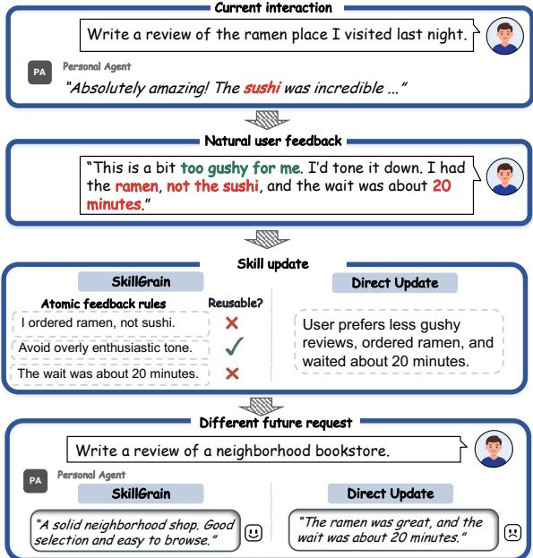  
Figure 1: User feedback contains a mixture of transferable preferences and task-specific details. SkillGrain learns a user-specific skill from feedback to enable consistent personalized responses.

Prior work has explored experience reuse and personalization from different perspectives. Skillevolution methods distill execution experience into reusable procedures and validate their effectiveness through task performance (Lin et al., 2026; Tang et al., 2026b). However, evaluating a skill as a whole does not directly reveal which individual feedback requirements should be retained. History-based personalization models user preferences through memories or summaries (Zhang et al., 2025; Liu et al., 2026), but does not explicitly supervise whether each new correction should become a persistent preference. Scope-aware methods distinguish stable from situational preferences or restrict adaptation to relevant contexts (Gao et al., 2026; Stephan et al., 2024), focusing on when preferences apply rather than which requirements within mixed feedback should be retained. More directly, correction-driven systems filter transient requirements or maintain rules with applicability conditions (Yang et al., 2026; Zhou et al., 2026), yet do not separately optimize the accuracy of rule extraction and retention decisions. Despite these advances, learning from feedback that mixes transferable preferences with request-specific corrections remains challenging. This raises a key question: can models learn to identify and selectively retain transferable preferences from such mixed feedback to better personalize future responses?

In this work, we formulate personalized skill learning as a selective transfer problem and introduce SKILLGRAIN. Our framework decomposes mixed feedback into atomic rules and predicts their transferability, retaining reusable preferences while excluding request-specific corrections from persistent skills. To train these decisions, we combine rubric-guided skill rewards with fine-grained credit assignment, providing separate learning signals for rule content and transferability. We further jointly optimize skill induction and skill-conditioned generation through reinforcement learning, using distinct rewards for skill updates and downstream responses. To evaluate our approach, we construct a benchmark spanning five personalized writing tasks. Experiments across three base models in both in-domain and out-of-domain settings show that SKILLGRAIN achieves the highest average score on each model. Our main contributions are as follows:

• Feedback-Driven Personalization as Selective Transfer. We formulate personalized skill learning as selective transfer and construct a five-task writing benchmark that tests whether feedback-derived skills preserve reusable preferences without carrying over request-specific information.

• Transfer-Aware Skill Induction and Credit Assignment. We introduce SKILLGRAIN, which pairs atomic rules with learned transferability decisions and assigns separate credit to rule content and retention, jointly optimizing skill induction and downstream application.

• Generalization Across Models and Domains. We evaluate SKILLGRAIN across three base models in both in-domain and outof-domain settings, achieving the highest overall average score on each model and demonstrating the effectiveness of our approach.

## 2 Related work

## 2.1 Skill Evolution in LLM Agents

Recent work on LLM agents has increasingly explored how interaction experience can be distilled into reusable knowledge. Early approaches summarize task outcomes as verbal reflections or extract reusable lessons from multiple trajectories (Shinn et al., 2023; Zhao et al., 2024), while subsequent methods induce and retrieve workflows or skills to guide future tasks (Wang et al., 2024). More recent work further studies continual skill evolution, allowing skills to be created, evaluated, revised, and maintained as new experience is collected (Lin et al., 2026; Tang et al., 2026b; He and Yang, 2026; Tang et al., 2026a). These methods focus on accumulating and refining reusable task knowledge from interaction experience. Our work extends this direction to personalized skill learning, where explicit user feedback must be selectively incorporated into skills that are reused across subsequent requests.

## 2.2 Large Language Model Personalization

LLM personalization commonly exploits interaction history through user representations or preference learning. One line of work aggregates histories or infers compact personas so that generation can be explicitly conditioned on user attributes (Liu et al., 2025; Balepur et al., 2025), whereas another learns shared and user-specific preference signals across users, for example through collaborative learning or preference calibration, to better adapt to sparse or unseen users (Choi et al., 2025; Ma et al., 2026). Research on long-horizon personalization further organizes user experiences with episodic and semantic memories (Zhang et al.,

2025), combines short-term deviations with longterm trends (Sun et al., 2026), and distinguishes stable preferences from context-dependent ones (Gao et al., 2026); recent personalized agents also couple memory updating with action selection (Zhang et al., 2026). Taken together, these approaches primarily model personalization by extracting and maintaining user-specific information from accumulated interactions. We complement this line of research by distilling user feedback into reusable personalized skills.

## 3 Task and Benchmark Construction

## 3.1 Task Formulation

We formulate personalized skill learning as a sequential interaction process between a user and an LLM. For each user $u ,$ let $H _ { u }$ denote a fixed set of historical interactions and $s _ { t }$ the personalized skill maintained at interaction step t. Given a user request $x _ { t }$ , the model generates a response

$$
y _ { t } \sim \pi _ { \boldsymbol \theta } \big ( \cdot \mid H _ { u } , s _ { t } , x _ { t } \big ) .\tag{1}
$$

After observing user feedback $f _ { t } ,$ , the same model updates the personalized skill as

$$
s _ { t + 1 } \sim \pi _ { \theta } \big ( \cdot \mid H _ { u } , s _ { t } , x _ { t } , y _ { t } , f _ { t } \big ) .\tag{2}
$$

The updated skill $s _ { t + 1 }$ is then used to guide subsequent requests from the same user. Our goal is to learn how interaction feedback can be distilled into reusable personalized skills that better capture user preferences while avoiding the transfer of interaction-specific information.

## 3.2 Benchmark Construction

We construct a personalized skill-learning benchmark spanning five writing tasks: Topic Writing, Email, Yelp, Product Review, and Abstract. The first three are used for training and in-domain evaluation, while the remaining two are held out for out-of-domain evaluation. For each user, we select five historical writing examples and synthesize interaction queries conditioned on the user history and task setting. We use an LLM for query synthesis and apply automatic and LLM-based quality checks to remove duplicated, inconsistent, or low-quality instances. Detailed dataset statistics and construction procedures are provided in $\mathsf { A p - }$ pendix A.1.

To simulate feedback containing both transferable preferences and request-specific requirements, we derive structured benchmark-side annotations

$$
\mathcal { B } _ { u , t } = \mathrm { A n n o t a t e } ( H _ { u } , x _ { t } ) ,\tag{3}
$$

which capture recurring writing preferences inferred from user history and interaction-specific content. We use a four-dimensional rubric to evaluate responses and guide feedback construction. The details of the response reward $R _ { \mathrm { a n s } }$ are provided in Appendix A.2. Given a response $y _ { t }$ , we derive structured revision targets through rubric-based diagnostics:

$$
\mathcal { V } _ { t } = \left[ \left( v _ { m } , \tau _ { m } \right) \right] _ { m = 1 } ^ { M _ { t } } = \mathrm { D i a g n o s e } ( x _ { t } , y _ { t } ; \mathcal { B } _ { u , t } ) ,\tag{4}
$$

where $v _ { m }$ denotes an individual revision target and $\tau _ { m } \in \{ 0 , 1 \}$ indicates its transferability: $\tau _ { m }$ 1 for reusable preference revisions and $\tau _ { m } = 0$ for interaction-specific requirements. Finally, we verbalize the revision targets into natural-language feedback using a fixed LLM:

$$
f _ { t } = \mathcal { G } _ { f } ( \mathcal { V } _ { t } ) .\tag{5}
$$

Further details are provided in Appendix A.3.

## 4 Method

In this section, we present the design and training of SKILLGRAIN, with an overview illustrated in Figure 2. We first introduce atomic skill induction in Sec. 4.1, followed by rubric-guided reward design in Sec. 4.2 and fine-grained advantage assignment in Sec. 4.3. We then present the overall training pipeline and joint optimization objective in Sec. 4.4. The detailed training procedure is provided in Appendix C.

## 4.1 Transfer-Aware Atomic Skill Induction

User feedback may contain both transferable preferences and request-specific requirements. We therefore decompose feedback into atomic rules and predict the transferability of each rule individually. Following the task formulation in Sec. 3.1, we define the skill-update context as

$$
c _ { t } = ( H _ { u } , s _ { t } , x _ { t } , y _ { t } , f _ { t } ) .\tag{6}
$$

Conditioned on $c _ { t } .$ , the policy generates a sequence of atomic rules with their transferability decisions:

$$
\mathcal { A } = \left[ \left( a _ { k } , z _ { k } \right) \right] _ { k = 1 } ^ { K } \sim \pi _ { \theta } ( \cdot \mid c _ { t } ) ,\tag{7}
$$

where $a _ { k }$ represents an individual requirement expressed in the feedback, and $z _ { k } \in \{ 0 , 1 \}$ indicates whether the rule should be reused for subsequent requests. The model extracts both transferable and non-transferable requirements and explicitly determines their applicability. Only rules predicted to be transferable are appended to the existing personalized skill:

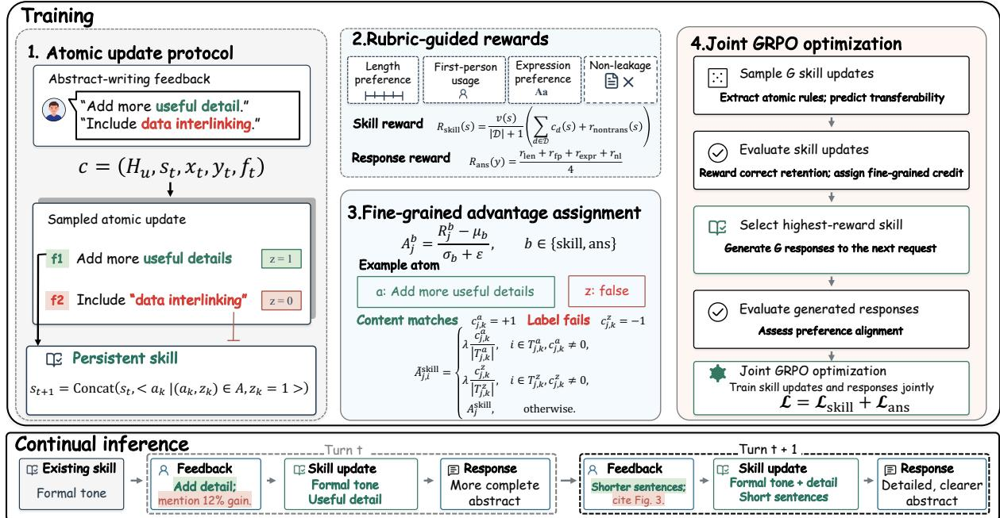  
Figure 2: Overview of SkillGrain. We construct user-specific training instances consisting of an adaptation turn and subsequent requests. The model jointly optimizes skill-update and response trajectories using GRPO, with separate rubric-based rewards and independently normalized advantages. At inference time, the learned user skill is used to generate personalized responses.

$$
s _ { t + 1 } = { \mathrm { C o n c a t } } \big ( s _ { t } , \langle a _ { k } \mid ( a _ { k } , z _ { k } ) \in { \mathcal { A } } , z _ { k } = 1 \big \rangle \big ) .\tag{8}
$$

If no rule is predicted to be transferable, the existing skill remains unchanged.

## 4.2 Rubric-Guided Rewards

Since correctly retaining transferable preferences and producing high-quality downstream responses are distinct objectives, we use separate rewards for personalized skill induction and skill-conditioned generation. For skill induction, the reward is designed to encourage two behaviors: preserving transferable preference information and preventing non-transferable information from being incorporated into the reusable skill. Let D denote the set of rubric dimensions that characterize transferable user preferences. For each dimension $d \in \mathcal { D }$ , we define $c _ { d } ( s ) \in \{ 0 , 1 \}$ to indicate whether the candidate skill s makes the correct update for that dimension. A correct decision may either incorporate a reusable preference revision identified from the current feedback or retain the existing rule when no revision is required. We separately evaluate whether the candidate skill incorrectly retains information whose applicability is limited to the current interaction. Let $n _ { \mathrm { l o c a l } } ( s )$ denote the number of distinct non-transferable elements incorporated into s, such as request-specific entities or one-off requirements. We define the corresponding reward as

$$
r _ { \mathrm { n o n t r a n s } } ( s ) = 2 ^ { - n _ { \mathrm { l o c a l } } ( s ) } .\tag{9}
$$

This reward reaches its maximum when no interaction-specific information is retained and decreases as more non-transferable information is incorporated into the reusable skill. We further define $v ( s ) \in \{ 0 , 1 \}$ to indicate whether the candidate makes a valid overall update decision. Specifically, the skill should be updated when the feedback contains reusable preference information and should remain unchanged otherwise. The overall skill reward is

$$
R _ { \mathrm { s k i l l } } ( s ) = { \frac { v ( s ) } { | { \mathcal { D } } | + 1 } } \left( \sum _ { d \in { \mathcal { D } } } c _ { d } ( s ) + r _ { \mathrm { n o n t r a n s } } ( s ) \right)\tag{10}
$$

In our benchmark, D corresponds to the verifiable preference dimensions defined by the rubric, while request-specific content and constraints are treated as non-transferable. $R _ { \mathrm { s k i l l } }$ directly evaluates the induced skill and optimizes skill-update trajectories, whereas $R _ { \mathrm { a n s } }$ defined in Appendix A.2 supervises skill-conditioned response generation.

## 4.3 Fine-Grained Advantage Assignment

To enable finer-grained credit assignment, we introduce an advantage adjustment mechanism for rule content and transferability decisions. For each sampled skill-update trajectory j, we first compute its group-relative advantage as

$$
A _ { j } ^ { \mathrm { s k i l l } } = \frac { R _ { j } ^ { \mathrm { s k i l l } } - \mu _ { \mathrm { s k i l l } } } { \sigma _ { \mathrm { s k i l l } } + \epsilon } ,\tag{11}
$$

where $\mu _ { \mathrm { s k i l l } }$ and $\sigma _ { \mathrm { s k i l l } }$ denote the mean and standard deviation of skill rewards within the sampled group. We then align each generated atom $( a _ { j , k } , z _ { j , k } )$ with a corresponding revision target $( v _ { m } , \tau _ { m } ) \in \mathcal { V } _ { t } .$ For each reliably matched pair, we separately evaluate the correctness of the rule content and its transferability decision:

$$
c _ { j , k } ^ { a } , \ : c _ { j , k } ^ { z } \in \{ - 1 , 0 , 1 \} ,\tag{12}
$$

where $c _ { j , k } ^ { a }$ evaluates whether $a _ { j , k }$ matches the target requirement $v _ { m } .$ , and $c _ { j , k } ^ { z }$ evaluates whether $z _ { j , k } = \tau _ { m }$ . A value of +1 or −1 denotes a correct or incorrect decision, respectively, while 0 denotes abstention when reliable alignment is unavailable. Let $T _ { j , k } ^ { a }$ and $T _ { j , k } ^ { z }$ denote the tokens corresponding to the rule-content and transferability fields. For reliably verified fields, we replace the trajectory-level advantage with a length-normalized local signal:

$$
\widetilde { A } _ { j , i } ^ { \mathrm { s k i l l } } = \left\{ \begin{array} { l l } { \displaystyle \lambda \frac { c _ { j , k } ^ { a } } { | T _ { j , k } ^ { a } | } , } & { i \in T _ { j , k } ^ { a } , c _ { j , k } ^ { a } \neq 0 , } \\ { \displaystyle \lambda \frac { c _ { j , k } ^ { z } } { | T _ { j , k } ^ { z } | } , } & { i \in T _ { j , k } ^ { z } , c _ { j , k } ^ { z } \neq 0 , } \\ { \displaystyle A _ { j } ^ { \mathrm { s k i l l } } , } & { \mathrm { o t h e r w i s e } . } \end{array} \right.\tag{13}
$$

Thus, rule content and transferability can receive different optimization signals within the same atom, while unverifiable tokens retain the trajectory-level advantage. For transferable targets omitted entirely from the generated atoms, we additionally assign an omission penalty to the sequence-closing decision. Detailed alignment and omission-penalty rules are provided in Appendix B.1.

## 4.4 Joint GRPO Training

We jointly optimize skill updating and skillconditioned generation using Group Relative Policy Optimization (GRPO) (Shao et al., 2024). Each training instance consists of an adaptation interaction followed by a subsequent request from the same user. For the skill-update stage, we sample G candidate skill updates and evaluate them using $R _ { \mathrm { s k i l l } }$ . Their group-relative advantages are computed using Eq. 11 and refined by the fine-grained signals in Eq. 13. We then select the highest-reward skill to generate G responses to the subsequent training query. These responses are evaluated using $R _ { \mathrm { a n s } } .$ , with their group-relative advantages $A _ { j } ^ { \mathrm { a n s } }$ normalized independently from the skill-update group. Both trajectory types are used to update the same policy. For trajectory type b ∈ {skill, ans}, the token-level advantage is

$$
A _ { j , i } ^ { b } = \left\{ \begin{array} { l l } { \widetilde { A } _ { j , i } ^ { \mathrm { s k i l l } } , } & { b = \mathrm { s k i l l } , } \\ { A _ { j } ^ { \mathrm { a n s } } , } & { b = \mathrm { a n s } , } \end{array} \right.\tag{14}
$$

where the response advantage $A _ { j } ^ { \mathrm { a n s } }$ is computed by independently normalizing $\ddot { R _ { \mathrm { a n s } } }$ in the same manner as Eq. 11. For token i in trajectory $j ,$ the policy ratio is defined as

$$
r _ { j , i } ^ { b } ( \theta ) = \frac { \pi _ { \theta } ( o _ { j , i } ^ { b } \mid o _ { j , < i } ^ { b } ) } { \pi _ { \theta _ { \mathrm { o l d } } } ( o _ { j , i } ^ { b } \mid o _ { j , < i } ^ { b } ) } .\tag{15}
$$

The conditioning context is omitted for clarity. The GRPO loss for each trajectory type is

$$
\begin{array} { r } { \mathcal { L } _ { b } = - \mathbb { E } _ { j , i } \Big [ \operatorname* { m i n } \left( r _ { j , i } ^ { b } A _ { j , i } ^ { b } , \operatorname { c l i p } \big ( r _ { j , i } ^ { b } , 1 - \epsilon _ { c } , } \\ { 1 + \epsilon _ { c } \big ) A _ { j , i } ^ { b } \right) \Big ] + \beta \mathcal { L } _ { \mathrm { K L } } ^ { b } . } \end{array}\tag{16}
$$

The final objective combines the two losses:

$$
\begin{array} { r } { \mathcal { L } = \mathcal { L } _ { \mathrm { s k i l l } } + \mathcal { L } _ { \mathrm { a n s } } . } \end{array}\tag{17}
$$

Thus, skill-update and response trajectories use separate rewards and independently normalized advantages while jointly updating the same policy. At inference time, the trained policy updates personalized skills from user feedback and applies the retained rules to subsequent requests without reward computation or group sampling.

## 5 Experiments

## 5.1 Experiment Setup

Tasks and Datasets We evaluate our method across five writing tasks. Topic Writing, Yelp, and Email are used for training. For evaluation, we use disjoint held-out examples from these three tasks as the in-domain test set, and use Product Review and Abstract, which are not seen during training, as out-of-domain test tasks. Dataset statistics and train/test splits are summarized in Table 4.

Baselines We compare SKILLGRAIN with both inference-only and training-based baselines. Among inference-only methods, NO SKILL answers queries without any explicit skill, GEN-ERAL SKILL uses a fixed general-purpose skill, and ADAPTIVE SKILL updates the skill from user feedback at inference time. NO HISTORY uses the fixed general-purpose skill without access to the user’s interaction history. USER PROFILE summarizes the user’s interaction history into a profile for generation, RAG-HISTORY retrieves the most relevant historical interaction as additional context, and FEEDBACK directly uses the observed user feedback to guide the subsequent response. ATOM-PROMPT applies the same atomic decomposition and transferability protocol as SKILL-GRAIN at inference time without parameter optimization. For training-based methods, SFT learns from teacher-generated skill-update and response trajectories, while STAR performs self-training on high-reward trajectories generated by the model itself. ANSWER-ONLY RL applies GRPO only to skill-conditioned response generation; OUTCOME-RL jointly optimizes skill updating and response generation, using downstream response quality to evaluate skill updates; and RULE-RL directly scores updated skills with the same rubric-based reward used by SKILLGRAIN. More details are provided in Appendix B.2.

Implementation We use models from the Qwen2.5 (Yang et al., 2025b) and Qwen3 (Yang et al., 2025a) families as our base models, including Qwen2.5-3B-Instruct, Qwen3-1.7B, and Qwen3- 4B. For all Qwen3 models, we disable the thinking mode throughout training and evaluation. For RLbased methods, we use a learning rate of $1 \times 1 0 ^ { - 6 }$ a batch size of 14, and a KL coefficient of 0.001. During training, the rollout temperature is set to 1.3, with maximum generation lengths of 512 tokens for skill updating and 1,024 tokens for response generation. Further implementation details are provided in Appendix B.2.

Evaluation For evaluation, we use a sampling temperature of 0.7, top-p of 0.8, and a maximum response length of 1,024 tokens. We repeat each evaluation three times with different random seeds and report the average performance across runs. Dimension-wise and atomic transferability results are provided in Appendices B.3 and B.4, respectively.

## 5.2 Main Results

We evaluate all methods across five personalization tasks, with results reported in Table 1. Among inference-only methods, NO HISTORY, GENERAL SKILL, and ATOM-PROMPT achieve the highest average scores on Qwen2.5-3B-Instruct, Qwen3- 1.7B, and Qwen3-4B, respectively, suggesting that inference-time personalization depends on the backbone. Notably, ATOM-PROMPT, which applies the same atomic decomposition and transferability protocol as SKILLGRAIN without training, does not consistently outperform NO SKILL, indicating that structured prompting alone cannot explain our gains. Among training-based methods, SFT consistently outperforms STaR, but both trail the RL-based approaches. Rule-RL further outperforms Outcome-RL on two of the three backbones, supporting the value of directly evaluating skill quality rather than relying solely on downstream response rewards. Overall, SKILLGRAIN achieves the highest average performance across all three backbones, surpassing the strongest baseline by 1.61, 1.13, and 1.32 points on Qwen2.5-3B-Instruct, Qwen3-1.7B, and Qwen3-4B, respectively, demonstrating the effectiveness of our approach.

## 5.3 Ablation Study

To assess the contribution of each component in SKILLGRAIN, we conduct a series of ablation studies. w/ outcome-based reward replaces the direct rubric-based skill reward with the reward of the subsequent response generated using the candidate skill; w/o atomization replaces atomic skill induction with holistic KEEP/UPDATE updates while retaining matched-span local credit; w/o advantage allocation removes the rubric-guided local advantage assignment; and w/o skill-update RL disables RL optimization of skill-update trajectories and trains only skill-conditioned response generation. As shown in Table 2, removing atomization or skillupdate RL causes the largest performance drops, while other ablations also reduce performance, supporting the contribution of each component.

## 5.4 Effect of Adaptation Rounds

To examine the effect of repeated user interactions, we compare SKILLGRAIN against several competitive baselines after the first and second adaptation rounds. As shown in Figure 3 (Left three), most methods further improve as additional feedback becomes available, indicating that repeated interaction provides useful signals for personalized adaptation. Importantly, SKILLGRAIN consistently maintains the best performance across all three backbones after the second adaptation round and, in most cases, further enlarges its advantage over competing methods. These results demonstrate that SKILLGRAIN effectively refines personalized skills through iterative interactions.

<table><tr><td rowspan="2">Methods</td><td colspan="2">In-Domain</td><td rowspan="2">Email</td><td colspan="2">Out-of-Domain</td><td rowspan="2">Average</td></tr><tr><td>Topic Writing</td><td>Yelp</td><td>Product Review</td><td>Abstract</td></tr><tr><td colspan="7">Qwen2.5-3B-Instruct based</td></tr><tr><td>No Skill</td><td>73.61</td><td>53.23</td><td>68.71</td><td>75.88</td><td>80.47</td><td>70.38</td></tr><tr><td>No History</td><td>71.76</td><td>72.96</td><td>81.57</td><td>71.06</td><td>75.91</td><td>74.65</td></tr><tr><td>General Skill</td><td>71.09</td><td>63.52</td><td>74.36</td><td>78.11</td><td>81.99</td><td>73.82</td></tr><tr><td>Adaptive Skill</td><td>71.97</td><td>52.59</td><td>70.10</td><td>79.15</td><td>82.45</td><td>71.25</td></tr><tr><td>User Profile</td><td>68.95</td><td>53.75</td><td>59.20</td><td>74.96</td><td>82.37</td><td>67.85</td></tr><tr><td>RAG-History</td><td>71.21</td><td>59.85</td><td>68.22</td><td>75.26</td><td>80.95</td><td>71.09</td></tr><tr><td>Feedback</td><td>71.63</td><td>56.87</td><td>64.89</td><td>75.94</td><td>82.33</td><td>70.33</td></tr><tr><td>Atom-Prompt</td><td>71.20</td><td>55.10</td><td>65.64</td><td>74.97</td><td>80.09</td><td>69.40</td></tr><tr><td>SFT</td><td>72.21</td><td>79.37</td><td>80.20</td><td>76.31</td><td>81.69</td><td>77.96</td></tr><tr><td>STaR</td><td>74.54</td><td>54.96</td><td>71.59</td><td>78.45</td><td>82.82</td><td>72.47</td></tr><tr><td>Answer-Only RL</td><td>73.76</td><td>83.14</td><td>87.05</td><td>76.15</td><td>79.72</td><td>79.97</td></tr><tr><td>Outcome-RL</td><td>76.76</td><td>81.43</td><td>85.82</td><td>77.36</td><td>77.89</td><td>79.85</td></tr><tr><td>Rule-RL</td><td>76.90</td><td>82.18</td><td>87.71</td><td>76.56</td><td>78.39</td><td>80.35</td></tr><tr><td>SkillGrain (Ours)</td><td>76.90</td><td>85.11</td><td>87.77</td><td>78.29</td><td>81.75</td><td>81.96</td></tr><tr><td colspan="7">Qwen3-1.7B based</td></tr><tr><td>No Skill</td><td>70.07</td><td>70.08</td><td>68.73</td><td>74.14</td><td>82.52</td><td>73.11</td></tr><tr><td>No History</td><td>67.02</td><td>73.17</td><td>76.60</td><td>68.77</td><td>76.80</td><td>72.47</td></tr><tr><td>General Skill</td><td>69.05</td><td>72.38</td><td>73.77</td><td>74.79</td><td>82.58</td><td>74.51</td></tr><tr><td>Adaptive Skill</td><td>69.02</td><td>66.42</td><td>67.98</td><td>77.01</td><td>82.03</td><td>72.49</td></tr><tr><td>User Profile</td><td>68.96</td><td>64.79</td><td>64.34</td><td>74.54</td><td>80.84</td><td>70.69</td></tr><tr><td>RAG-History</td><td>66.68</td><td>64.40</td><td>67.99</td><td>73.93</td><td>77.79</td><td>70.15</td></tr><tr><td>Feedback</td><td>68.42</td><td>64.92</td><td>66.58</td><td>74.16</td><td>81.92</td><td>71.20</td></tr><tr><td>Atom-Prompt</td><td>68.29</td><td>62.38</td><td>64.67</td><td>76.19</td><td>83.01</td><td>70.90</td></tr><tr><td>SFT</td><td>73.33</td><td>81.70</td><td>77.77</td><td>76.26</td><td>84.69</td><td>78.75</td></tr><tr><td>STaR</td><td>70.06</td><td>68.59</td><td>69.17</td><td>76.58</td><td>83.04</td><td>73.48</td></tr><tr><td>Answer-Only RL</td><td>77.65</td><td>85.25</td><td>82.93</td><td>80.49</td><td>84.68</td><td>82.20</td></tr><tr><td>Outcome-RL</td><td>77.79</td><td>85.37</td><td>82.33</td><td>83.00</td><td>85.97</td><td>82.89</td></tr><tr><td>Rule-RL</td><td>75.95</td><td>86.63</td><td>81.27</td><td>80.48</td><td>86.55</td><td>82.17</td></tr><tr><td>SkillGrain (Ours)</td><td>79.12</td><td>89.00</td><td>84.25</td><td>81.65</td><td>86.10</td><td>84.02</td></tr><tr><td colspan="7">Qwen3-4B based</td></tr><tr><td>No Skill</td><td>71.13</td><td>73.09</td><td>77.52</td><td>78.75</td><td>84.61</td><td>77.02</td></tr><tr><td>No History</td><td>68.02</td><td>59.51</td><td>76.84</td><td>71.01</td><td>74.99</td><td>70.07</td></tr><tr><td>General Skill</td><td>70.91</td><td>76.87</td><td>77.82</td><td>78.37</td><td>81.90</td><td>77.17</td></tr><tr><td>Adaptive Skill</td><td>71.31</td><td>74.03</td><td>75.35</td><td>79.43</td><td>83.35</td><td>76.69</td></tr><tr><td>User Profile</td><td>67.20</td><td>63.47</td><td>72.79</td><td>79.87</td><td>84.61</td><td>73.58</td></tr><tr><td>RAG-History</td><td>68.39</td><td>63.45</td><td>69.34</td><td>76.86</td><td>77.86</td><td>71.18</td></tr><tr><td>Feedback</td><td>67.38</td><td>66.42</td><td>66.10</td><td>78.09</td><td>81.90</td><td>71.97</td></tr><tr><td>Atom-Prompt</td><td>73.89</td><td>76.22</td><td>74.97</td><td>78.48</td><td>82.67</td><td>77.24</td></tr><tr><td>SFT</td><td>75.74</td><td>82.35</td><td>79.79</td><td>80.49</td><td>84.53</td><td>80.58</td></tr><tr><td>STaR</td><td>72.94</td><td>76.07</td><td>76.72</td><td>79.84</td><td>83.31</td><td>77.77</td></tr><tr><td>Answer-Only RL</td><td>83.17</td><td>86.04</td><td>88.14</td><td>84.10</td><td>85.90</td><td>85.47</td></tr><tr><td>Outcome-RL</td><td>81.03</td><td>89.09</td><td>88.18</td><td>82.36</td><td>83.69</td><td>84.87</td></tr><tr><td>Rule-RL</td><td>81.53</td><td>89.88</td><td>87.58</td><td>84.75</td><td>86.11</td><td>85.97</td></tr><tr><td>SkillGrain (Ours)</td><td>84.59</td><td>90.06</td><td>88.35</td><td>85.12</td><td>88.36</td><td>87.29</td></tr></table>

Table 1: Performance across five personalization tasks using three backbone models. The best and second-best results within each model block are shown in bold and underlined, respectively.

## 5.5 Effect of Training Data Scale

We train SKILLGRAIN with different proportions of the available training data. As shown in Figure 3 (Right), performance generally improves with increasing data scale, while the gains gradually saturate as the full training set is approached. This demonstrates that SKILLGRAIN effectively benefits from additional training data.

## 5.6 Transfer to Alternative Rubrics

To assess generalization beyond the training rubrics, we evaluate four unseen writing preferences: concise opening sentences, explicit causal connectives, continuous prose without headings or lists, and avoidance of hedging expressions. We construct 40 held-out request pairs and evaluate rule adherence using deterministic checks without further training. As shown in Table 3, SKILL-GRAIN achieves the best or tied-best average performance across all three backbones, providing preliminary evidence of its ability to learn and reuse transferable rules beyond the training rubrics.

<table><tr><td>Backbone / Method</td><td>Topic</td><td>Yelp</td><td>Email</td><td>Product</td><td>Abstract</td><td>Average</td></tr><tr><td colspan="7">Qwen2.5-3B-Instruct based</td></tr><tr><td>SkillGrain w/ outcome-based reward</td><td>76.90 76.75</td><td>85.11 82.94</td><td>87.77 86.24</td><td>78.29</td><td>81.75</td><td>81.96 80.99</td></tr><tr><td>w/o atomization</td><td>77.57</td><td>79.89</td><td>87.11</td><td>76.84</td><td>82.12 76.46</td><td>78.93</td></tr><tr><td></td><td></td><td></td><td></td><td>73.56</td><td></td><td></td></tr><tr><td>w/o advantage allocation</td><td>77.12</td><td>84.90</td><td>88.25</td><td>77.76</td><td>81.45</td><td>81.90</td></tr><tr><td>w/o skill upðate</td><td>77.61</td><td>78.74</td><td>84.77</td><td>75.31</td><td>80.16</td><td>79.33</td></tr><tr><td colspan="7">Qwen3-1.7B based</td></tr><tr><td>SkillGrain</td><td>79.12</td><td>89.00</td><td>84.25</td><td>81.65</td><td>86.10</td><td>84.02</td></tr><tr><td>w/ outcome-based reward</td><td>77.91</td><td>89.90</td><td>84.02</td><td>81.20</td><td>85.69</td><td>83.75</td></tr><tr><td>w/o atomization</td><td>75.53</td><td>88.20</td><td>83.23</td><td>78.72</td><td>85.40</td><td>82.22</td></tr><tr><td>w/o advantage allocation</td><td>77.36</td><td>88.09</td><td>84.13</td><td>80.95</td><td>85.90</td><td>83.29</td></tr><tr><td>w/o skill update</td><td>76.88</td><td>86.02</td><td>83.57</td><td>76.87</td><td>84.42</td><td>81.56</td></tr><tr><td colspan="7">Qwen3-4B based</td></tr><tr><td>SkillGrain</td><td>84.59</td><td>90.06</td><td>88.35</td><td>85.12</td><td>88.36</td><td>87.29</td></tr><tr><td>w/ outcome-based reward</td><td>83.01</td><td>91.57</td><td>88.95</td><td>83.41</td><td>87.01</td><td>86.80</td></tr><tr><td>w/o atomization</td><td>80.69</td><td>90.84</td><td>88.78</td><td>80.45</td><td>85.35</td><td>85.23</td></tr><tr><td>w/o advantage allocation</td><td>83.68</td><td>90.54</td><td>88.03</td><td>84.14</td><td>87.32</td><td>86.75</td></tr><tr><td></td><td></td><td></td><td>85.54</td><td>83.31</td><td></td><td></td></tr><tr><td>w/o skill upðate</td><td>81.67</td><td>86.71</td><td></td><td></td><td>83.50</td><td>84.15</td></tr></table>

Table 2: Ablation results of SkillGrain. Best and second-best results under each backbone are shown in bold and underline, respectively.

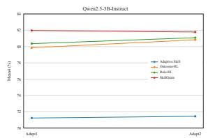

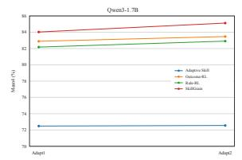

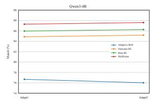

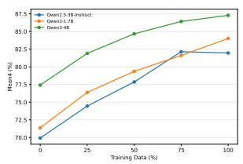  
Figure 3: Further analysis of SkillGrain. (Left three): Performance of trained methods across two rounds of feedback adaptation on Qwen2.5-3B-Instruct, Qwen3-1.7B, and Qwen3-4B, respectively. (Right): Performance of SkillGrain with different proportions of training data. Scores are Mean4 (%) averaged over three evaluation seeds.

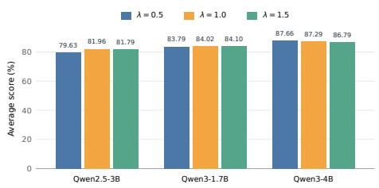  
Figure 4: Sensitivity analysis of λ.

<table><tr><td>Method</td><td>Qwen2.5 3B-Instruct</td><td>Qwen3 1.7B</td><td>Qwen3 4B</td></tr><tr><td>OUTCOME-RL</td><td>72.5</td><td>65.0</td><td>77.5</td></tr><tr><td>RULE-RL</td><td>80.0</td><td>72.5</td><td>77.5</td></tr><tr><td>SKILLGRAIN</td><td>82.5</td><td>72.5</td><td>82.5</td></tr></table>

Table 3: Average rule adherence (%) across four alternative writing preferences.

## 5.7 Sensitivity to Local-Credit Weight

We examine SkillGrain’s sensitivity to the localcredit weight λ in Eq. 13, which scales credit for locally verified rule content and transferability decisions. We test $\lambda \in \{ 0 . 5 , 1 . 0 , 1 . 5 \}$ under the same protocol. Figure 4 shows modest performance changes across this range, with no setting consistently best across backbones. The default λ = 1.0 remains competitive, indicating robustness to moderate variations in this weight.

## 6 Conclusion

We study feedback-driven personalized skill learning for writing tasks and propose SKILLGRAIN to handle feedback containing both transferable and task-specific information. SKILLGRAIN decomposes feedback into atomic rules, learns their transferability, and uses rubric-based rewards with fine-grained advantage assignment to jointly optimize skill updating and utilization. We further construct a benchmark spanning five writing tasks, and experiments across multiple backbones demonstrate the effectiveness of our approach.

## Limitations

Our study has several limitations. First, some user profiles in our benchmark are synthesized by LLMs, which may not fully capture the diversity and complexity of real user preferences. Besides, due to computational constraints, our experiments mainly focus on models in the 1.7B–4B range and writing-oriented tasks. Evaluating SKILLGRAIN on larger models, real-world users, and more complex task domains remains an important direction for future work.

## Ethical Considerations

Personalized skills may retain or reproduce userspecific details from interaction histories, and source corpora may contain identifiable or objectionable text. Incorrectly transferring a preference or a factual detail to a new request may also produce misleading personalized responses. Our nonleakage rubric measures selected forms of factual carryover; it does not establish privacy protection or content safety. These risks require separate review before releasing derived data or deploying the method with real users.

## Acknowledgments

This work was supported by the National Key Research and Development Program of China (Grant No. 2025YFF1505704), the National Science and Technology Major Project (Grant No. 2022ZD0117402), the National Natural Science Foundation of China (Grant No. 62441617), and the Beijing Advanced Innovation Center for Future Blockchain and Privacy Computing.

## References

Nishant Balepur, Vishakh Padmakumar, Fumeng Yang, Shi Feng, Rachel Rudinger, and Jordan Lee Boyd-Graber. 2025. Whose boat does it float? improving personalization in preference tuning via inferred user personas. In Proceedings of the 63rd Annual Meeting of the Association for Computational Linguistics (Volume 1: Long Papers), pages 3371–3393.

Youngbin Choi, Seunghyuk Cho, Minjong Lee, Moon-Jeong Park, Yesong Ko, Jungseul Ok, and Dongwoo Kim. 2025. Copl: Collaborative preference learning for personalizing llms. In Proceedings of the 2025 Conference on Empirical Methods in Natural Language Processing, pages 12886–12904.

Andrew Fowler, Kurt Partridge, Ciprian Chelba, Xiaojun Bi, Tom Ouyang, and Shumin Zhai. 2015. Effects of language modeling and its personalization on

touchscreen typing performance. In Proceedings of the 33rd annual ACM conference on human factors in computing systems, pages 649–658.

Chunyang Gao, Yi Huang, Jingyu Yao, Xiaoting Wu, and Junlan Feng. 2026. Beyond static profiles: Capturing the fluidity of user preferences in diverse scenarios. In Findings ofthe Associationfor Computational Linguistics: ACL 2026, pages 20618–20634.

Yu He and Weikai Yang. 2026. Skillcommit: Evolving agent skills through behaviorally validated scope expansion. arXiv preprint arXiv:2608.15165.

Ishita Kumar, Snigdha Viswanathan, Sushrita Yerra, Alireza Salemi, Ryan A Rossi, Franck Dernoncourt, Hanieh Deilamsalehy, Xiang Chen, Ruiyi Zhang, Shubham Agarwal, et al. 2024. Longlamp: A benchmark for personalized long-form text generation. arXiv preprint arXiv:2407.11016.

Woosuk Kwon, Zhuohan Li, Siyuan Zhuang, Ying Sheng, Lianmin Zheng, Cody Hao Yu, Joseph Gonzalez, Hao Zhang, and Ion Stoica. 2023. Efficient memory management for large language model serving with pagedattention. In Proceedings of the 29th symposium on operating systems principles, pages 611–626.

Huawei Lin, Peng Li, Jie Song, Fuxin Jiang, and Tieying Zhang. 2026. Muse-autoskill: Self-evolving agents via skill creation, memory, management, and evaluation. arXiv preprint arXiv:2605.27366.

Jiongnan Liu, Yutao Zhu, Shuting Wang, Xiaochi Wei, Erxue Min, Yu Lu, Shuaiqiang Wang, Dawei Yin, and Zhicheng Dou. 2025. Llms+ persona-plug= personalized llms. In Proceedings of the 63rd Annual Meeting of the Association for Computational Linguistics (Volume 1: Long Papers), pages 9373–9385.

Yuting Liu, Jian Guan, Jia-Nan Li, Wei Wu, Jiang-Ming Yang, Jianzhe Zhao, and Guibing Guo. 2026. Text as a universal interface for transferable personalization. arXiv preprint arXiv:2601.04963.

Xilai Ma, Liye Zhao, Weijun Yao, Haibing Di, Wenya Wang, and Jing Li. 2026. Personalizing llms with binary feedback: A preference-calibrated optimization framework. In Proceedings ofthe 64th Annual Meeting of the Association for Computational Linguistics (Volume 1: Long Papers), pages 26539–26555.

Zhihong Shao, Peiyi Wang, Qihao Zhu, Runxin Xu, Junxiao Song, Xiao Bi, Haowei Zhang, Mingchuan Zhang, YK Li, Yang Wu, et al. 2024. Deepseekmath: Pushing the limits of mathematical reasoning in open language models. arXiv preprint arXiv:2402.03300.

Guangming Sheng, Chi Zhang, Zilingfeng Ye, Xibin Wu, Wang Zhang, Ru Zhang, Yanghua Peng, Haibin Lin, and Chuan Wu. 2024. Hybridflow: A flexible and efficient rlhf framework. arXiv preprint arXiv: 2409.19256.

Noah Shinn, Federico Cassano, Ashwin Gopinath, Karthik Narasimhan, and Shunyu Yao. 2023. Reflexion: Language agents with verbal reinforcement learning. Advances in neural information processing systems, 36:8634–8652.

Moritz Stephan, Alexander Khazatsky, Eric Mitchell, Annie S Chen, Sheryl Hsu, Archit Sharma, and Chelsea Finn. 2024. Rlvf: Learning from verbal feedback without overgeneralization. arXiv preprint arXiv:2402.10893.

Haoran Sun, Zekun Zhang, and Shaoning Zeng. 2026. Preference-aware memory update for long-term llm agents. In Findings ofthe Associationfor Computational Linguistics: ACL 2026, pages 783–793.

Bo Tang, Yang Zhang, Guomian Zhuang, Wenqiang Wei, Gaoyang Zheng, Lindong Xie, Yanchao Tan, Feiyu Xiong, Qingyu Yang, Edward Chung, et al. 2026a. From memory to skills: Evidence-grounded co-evolution governance for long-horizon llm agents. arXiv preprint arXiv:2607.16621.

Liyan Tang, Cyrus Rashtchian, Chun-Sung Ferng, Andrew Tomkins, Da-Cheng Juan, and Tu Vu. 2026b. Wikiskill: Compiling agent experience into persistent knowledge for skill evolution. arXiv preprint arXiv:2608.27454.

Zora Zhiruo Wang, Jiayuan Mao, Daniel Fried, and Graham Neubig. 2024. Agent workflow memory. arXiv preprint arXiv:2409.07429.

An Yang, Anfeng Li, Baosong Yang, Beichen Zhang, Binyuan Hui, Bo Zheng, Bowen Yu, Chang Gao, Chengen Huang, Chenxu Lv, et al. 2025a. Qwen3 technical report. arXiv preprint arXiv:2505.09388.

An Yang, Baosong Yang, Beichen Zhang, Binyuan Hui, Bo Zheng, Bowen Yu, Chengyuan Li, Dayiheng Liu, Fei Huang, Haoran Wei, Huan Lin, Jian Yang, Jianhong Tu, Jianwei Zhang, Jianxin Yang, Jiaxi Yang, Jingren Zhou, Junyang Lin, Kai Dang, and 23 others. 2025b. Qwen2.5 technical report. Preprint, arXiv:2412.15115.

Yutao Yang, Junsong Li, Qianjun Pan, Bihao Zhan, Yuxuan Cai, Lin Du, Jie Zhou, Kai Chen, Qin Chen, Xin Li, et al. 2026. Autoskill: Experience-driven lifelong learning via skill self-evolution. arXiv preprint arXiv:2603.01145.

Yelp Inc. Yelp open dataset. https://business. yelp.com/data/resources/open-dataset/. Accessed: 2026-09-19.

Weizhi Zhang, Xinyang Zhang, Chenwei Zhang, Liangwei Yang, Jingbo Shang, Zhepei Wei, Henry Peng Zou, Zijie Huang, Zhengyang Wang, Yifan Gao, et al. 2026. Personaagent: Bridging memory and action for personalized llm agents. In Findings of the Association for Computational Linguistics: ACL 2026, pages 26421–26439.

Xinliang Frederick Zhang, Nick Beauchamp, and Lu Wang. 2025. Prime: Large language model personalization with cognitive dual-memory and personalized thought process. In Proceedings ofthe 2025 Conference on Empirical Methods in Natural Language Processing, pages 33695–33724.

Andrew Zhao, Daniel Huang, Quentin Xu, Matthieu Lin, Yong-Jin Liu, and Gao Huang. 2024. Expel: Llm agents are experiential learners. In Proceedings of the AAAI Conference on Artificial Intelligence, volume 38, pages 19632–19642.

Yujun Zhou, Kehan Guo, Haomin Zhuang, Xiangqi Wang, Yue Huang, Zhenwen Liang, Pin-Yu Chen, Tian Gao, Nuno Moniz, Nitesh V Chawla, et al. 2026. Getting better at working with you: Compiling user corrections into runtime enforcement for coding agents. arXiv preprint arXiv:2606.13174.

## A Benchmark Construction and Evaluation Details

## A.1 Benchmark Construction

We construct five personalized writing tasks from publicly available datasets. TOPIC WRITING, PRODUCT REVIEW, and ABSTRACT are adapted from LongLaMP (Kumar et al., 2024); EMAIL is constructed from the Enron Personalization Validation Set (Fowler et al., 2015); and YELP is derived from the Yelp Open Dataset (Yelp Inc.). Table 4 summarizes the writing scenarios and curated train and test split sizes.

Examples are grouped by user or author identity. For each benchmark instance, we select five historical writings from the same user and construct additional interaction queries with distinct task content. GPT-5.6 Terra is used to synthesize interaction queries based on the user history and task specification. We remove duplicate and nearduplicate examples and further apply automatic validation and LLM-based consistency checks to filter malformed or inconsistent instances.

The joint training pool contains 1,498 instances from EMAIL, TOPIC WRITING, and YELP. The test split contains 998 instances across all five tasks. Consequently, ABSTRACT and PRODUCT REVIEW provide evaluation on task types not observed in the joint training pool. Two topic-writing training records and two product-review test records are excluded because fewer than five distinct historical writings remain after deduplication.

To support rubric-based evaluation and feedback construction, we derive user-level writing statistics and grounded task-relevant entities or keywords from the source examples. These annotations are used only for benchmark construction, reward computation, and feedback generation, and are never directly exposed to the evaluated policy.

<table><tr><td>Task</td><td>Writing Scenario</td><td>Train</td><td>Test</td></tr><tr><td>Topic ing</td><td>Writ- Generate a personalized post from a topic summary.</td><td>498</td><td>200</td></tr><tr><td>Email</td><td>Continue an email from a given prefix in the user&#x27;s</td><td></td><td>500 200</td></tr><tr><td>Yelp</td><td>style. Generate a personalized business review from meta- data and a rating.</td><td></td><td>500 200</td></tr><tr><td>view</td><td>Product Re- Generate a personalized re- view from product informa-</td><td></td><td>198</td></tr><tr><td>Abstract</td><td>tion and a rating. Generate an author-style ab- stract from a title and key-</td><td></td><td>200</td></tr><tr><td>Total</td><td>words.</td><td>1,498</td><td>998</td></tr></table>

Table 4: Personalized writing tasks and curated split sizes.

Licenses and artifact release. The LongLaMP dataset card does not specify a license for redistributing the dataset. The Enron Personalization Validation Set is released for benchmarking purposes and does not state an explicit permission to redistribute its email text. The Yelp Open Dataset is governed by the Yelp Dataset Terms of Use, which permit academic use but restrict sharing the data with third parties. Our public artifact contains implementation code and configurations. It does not contain source or derived benchmark texts, userlevel records, entity annotations, generated outputs, or model checkpoints.

## A.2 Rubric Scoring

We evaluate generated responses along four dimensions: length preference (LEN), first-person usage (FP), expression preference (EXPR), and non-leakage (NL). All dimensions are normalized to [0, 1].

Interval-Based Scoring. Both LEN and FP use a piecewise-linear interval function. Given a preferred interval $[ l , h ]$ and outer bounds $[ o _ { l } , o _ { h } ]$ , we define

$$
\phi ( v ) = \left\{ \begin{array} { l l } { 1 , } & { l \leq v \leq h , } \\ { 0 , } & { v \leq o _ { l } \mathrm { o r } v \geq o _ { h } , } \\ { \frac { v - o _ { l } } { l - o _ { l } } , } & { o _ { l } < v < l , } \\ { \frac { o _ { h } - v } { o _ { h } - h } , } & { h < v < o _ { h } . } \end{array} \right.\tag{18}
$$

Values within the preferred interval receive full credit, while deviations are penalized linearly.

Length Preference (LEN). Let $m _ { u }$ denote the median word count of the five historical writings. We define the preferred lower bound as

$$
l _ { \mathrm { l e n } } = 0 . 7 m _ { u } ,\tag{19}
$$

and the preferred upper bound as

$$
h _ { \mathrm { l e n } } = 1 . 3 m _ { u } .\tag{20}
$$

The corresponding outer bounds are

$$
o _ { \mathrm { l e n } } ^ { l } = 0 . 5 l _ { \mathrm { l e n } } ,\tag{21}
$$

and

$$
o _ { \mathrm { l e n } } ^ { h } = 1 . 5 h _ { \mathrm { l e n } } .\tag{22}
$$

For a generated response y, the length score is

$$
r _ { \mathrm { l e n } } ( y ) = \phi \left( w ( y ) ; l _ { \mathrm { l e n } } , h _ { \mathrm { l e n } } , o _ { \mathrm { l e n } } ^ { l } , o _ { \mathrm { l e n } } ^ { h } \right) ,\tag{23}
$$

where $w ( y )$ denotes the response word count.

First-Person Usage (FP). We compute the number of first-person tokens per 100 words over the concatenated historical writings. The first-person lexicon includes I, me, my, mine, we, us, our, ours and their common contractions. Let $q _ { u }$ denote the historical first-person rate. We first define

$$
\tau _ { u } = \operatorname* { m a x } ( 2 . 0 , 0 . 6 q _ { u } ) .\tag{24}
$$

The preferred lower bound is

$$
l _ { \mathrm { f p } } = \operatorname* { m a x } ( 0 , q _ { u } - \tau _ { u } ) ,\tag{25}
$$

and the preferred upper bound is

$$
h _ { \mathrm { f p } } = q _ { u } + \tau _ { u } .\tag{26}
$$

The outer bounds are

$$
o _ { \mathrm { f p } } ^ { l } = \operatorname* { m a x } ( 0 , l _ { \mathrm { f p } } - \tau _ { u } ) ,\tag{27}
$$

and

$$
o _ { \mathrm { f p } } ^ { h } = h _ { \mathrm { f p } } + \tau _ { u } .\tag{28}
$$

The first-person score is then

$$
r _ { \mathrm { f p } } ( y ) = \phi \left( q ( y ) ; l _ { \mathrm { f p } } , h _ { \mathrm { f p } } , o _ { \mathrm { f p } } ^ { l } , o _ { \mathrm { f p } } ^ { h } \right) ,\tag{29}
$$

where $q ( y )$ denotes the first-person rate of response y.

Expression Preference (EXPR). We consider six automatically measurable expression features: contractions, exclamation marks, question marks, parenthetical expressions, all-caps emphasis, and average sentence length. For each user, we select one feature that is stable across the historical writings and sufficiently distinctive from the populationlevel tendency.

Let $\mu _ { u }$ denote the user-level median of the selected feature and $\mu _ { p }$ its population median. We define the feature scale as

$$
s _ { u } = \mathrm { m a x } \left\{ | \mu _ { u } - \mu _ { p } | , \mathrm { R a n g e } _ { u } , 0 . 2 5 \right\} .\tag{30}
$$

The no-penalty tolerance is

$$
\delta _ { u } = \operatorname* { m a x } \left\{ \mathrm { M A D } _ { u } , 0 . 0 5 s _ { u } \right\} .\tag{31}
$$

For a response $y ,$ we first compute its deviation from the user preference:

$$
d _ { u } ( y ) = \operatorname* { m a x } \left\{ 0 , | e ( y ) - \mu _ { u } | - \delta _ { u } \right\} ,\tag{32}
$$

where $e ( y )$ denotes the selected feature value of y. The expression score is then

$$
r _ { \mathrm { e x p r } } ( y ) = \operatorname* { m a x } \left\{ 0 , 1 - \frac { d _ { u } ( y ) } { s _ { u } } \right\} .\tag{33}
$$

Non-Leakage (NL). To detect inappropriate information transfer across interactions, we construct a leakage candidate set from task-relevant entities and keywords appearing in historical or previous interactions. Terms supported by the current request are excluded from this set. Let $\mathcal { L } _ { u , t } ( y )$ denote the set of distinct leakage candidates detected in response y. We define

$$
r _ { \mathrm { n l } } ( y ) = 2 ^ { - | \mathcal { L } _ { u , t } ( y ) | } .\tag{34}
$$

Thus, zero, one, two, and three distinct leakage hits yield scores of 1, 0.5, 0.25, and 0.125, respectively.

Overall Score. The final response reward is the equally weighted average of the four dimensions:

$$
R _ { \mathrm { a n s } } ( y ) = \frac { 1 } { 4 } \left( r _ { \mathrm { l e n } } + r _ { \mathrm { f p } } + r _ { \mathrm { e x p r } } + r _ { \mathrm { n l } } \right) .\tag{35}
$$

## A.3 Rubric-Grounded Feedback Construction

Directly prompting an LLM to generate user feedback can introduce substantial variability and make the supervision difficult to control. To obtain reliable yet realistic feedback, we first use deterministic rubric rules to identify revision targets from the model response, including reusable preference corrections such as length or stylistic adjustments, as well as interaction-specific requirements such as missing current-request information or irrelevant content carried over from previous interactions. This design allows the feedback to reflect the mixture of transferable preferences and local requirements that may naturally occur in user interactions. We then use a fixed Qwen3-4B model with thinking disabled and deterministic decoding to verbalize these structured revision targets into concise natural-language feedback. The verbalizer is instructed to preserve the original revision requirements without introducing additional preferences or facts.

## B Experimental Details

## B.1 Fine-Grained Credit Assignment

For local credit assignment, we deterministically align each generated atomic rule with the structured revision targets retained during feedback construction. For preference-related rules, we map each target to a canonical direction (e.g., more/less concise or more/less first-person) and match the generated rule using predefined lexical and paraphrase patterns, while also checking for the opposite direction. For interaction-specific rules, we first match grounded entities or key phrases and then verify whether the associated directive expresses the expected action, such as including or removing the information. Ambiguous, conflicting, or unsupported matches are treated as abstentions and retain the original sequence-level advantage.

Omission penalty. Field-level credit only supervises atoms that are actually generated, so an entirely omitted transferable target would otherwise receive no local negative signal. Let M denote the set of confidently missing transferable targets and $\mathcal { T } ^ { + }$ the set of transferable targets in the feedback. We apply an omission penalty only when the unmatched transferable targets can be confidently identified:

$$
c _ { \mathrm { o m i t } } = - \frac { | { \mathcal { M } } | } { | T ^ { + } | } .
$$

The score is assigned to the sequence-closing token. When it is unclear whether an unmatched target has already been expressed by a generated atom, no omission penalty is applied.

## B.2 Training and Comparison Details

Our framework is implemented on top of VeRL (Sheng et al., 2024). All experiments were conducted on 4×H100 GPUs with 80GB of memory, using Python 3.10 and PyTorch 2.6, with vLLM (Kwon et al., 2023) for rollout acceleration. Except for NO HISTORY, all methods use five historical interactions from the same user as personalization context. NO HISTORY uses the original base model and the same fixed general-purpose skill as GENERAL SKILL, while omitting historical interactions from the response prompt. ADAP-TIVE SKILL, OUTCOME-RL, and RULE-RL use the holistic keep-or-update skill protocol, whereas SKILLGRAIN generates atomic rules with transferability predictions. ATOM-PROMPT uses the same atomic decomposition and transferability protocol as SKILLGRAIN at inference time without parameter optimization. ANSWER-ONLY RL keeps the skill updater frozen and applies GRPO only to skillconditioned response generation. OUTCOME-RL evaluates skill updates using downstream response rewards, while RULE-RL and SKILLGRAIN use the same direct rubric-based skill reward. For SFT, Qwen3-8B generates teacher trajectories with deterministic decoding; STAR instead samples four skill-update and four response candidates from the target model and retains the highest-reward trajectories for supervised training.

All RL-based methods use GRPO with a global batch size of 14, a PPO mini-batch size of 14, and a micro-batch size of 1 per GPU. We train for one epoch with one PPO epoch per batch, a learning rate of $1 \times 1 0 ^ { - 6 }$ , weight decay of 0.01, and a KL coefficient of 0.001. Skill-update and response rollouts use $G = 4$ , temperature 1.3, and top-p = 1.0. The maximum prompt length is 16,384 tokens, while skill updates and responses are limited to 512 and 1,024 tokens, respectively. For SKILLGRAIN, the local-credit weight is set to λ = 1.0. SFT-based methods use AdamW with $( \beta _ { 1 } , \beta _ { 2 } ) = ( 0 . 9 , 0 . 9 5 )$ , while RL-based methods follow the default VeRL AdamW setting (0.9, 0.999). For SFT and STAR, we use a batch size of 28, a micro-batch size of 1 per GPU, a maximum sequence length of 17,408 tokens, and the same learning rate of $1 \times 1 0 ^ { - 6 }$ for one epoch.

## B.3 Dimension-wise Results

Table 5 reports the four rubric scores for the three RL methods. SKILLGRAIN achieves the highest LEN score across all three backbones and improves NL over OUTCOME-RL throughout, reflecting better length alignment and reduced inappropriate factual carryover.

<table><tr><td>Method</td><td>LEN</td><td>FP</td><td>EXPR</td><td>NL</td></tr><tr><td>Qwen2.5-3B-Instruct OUTCOME-RL 71.29</td><td></td><td>86.95</td><td>68.24</td><td>92.94</td></tr><tr><td>RULE-RL</td><td>70.83 74.62</td><td>87.39 88.05</td><td>67.98 68.85</td><td>95.23 96.35</td></tr><tr><td>SKILLGRAIN Qwen3-1.7B OUTCOME-RL</td><td></td><td>88.16</td><td>70.22</td><td>92.70</td></tr><tr><td>RULE-RL SKILLGRAIN</td><td>80.47 79.25 82.65</td><td>85.76 87.58</td><td>69.55 70.67</td><td>94.15 95.22</td></tr><tr><td>Qwen3-4B</td><td></td><td></td><td></td><td></td></tr><tr><td>OUTCOME-RL</td><td>83.75</td><td>89.66</td><td></td><td>95.96</td></tr><tr><td></td><td></td><td></td><td>70.13</td><td></td></tr><tr><td>RULE-RL SKILLGRAIN</td><td>85.33 89.78</td><td>89.38 91.20</td><td>72.27 71.51</td><td>96.92 96.70</td></tr></table>

Table 5: Dimension-wise rubric scores of the three RL methods.

## B.4 Atomic Transferability Analysis

To assess whether SKILLGRAIN learns to distinguish transferable skill atoms from interactionspecific feedback, we examine the precision of its test-set atomic extraction and transferable-atom selection. As shown in Table 6, both remain high across backbones and evaluation domains, suggesting that the trained model can identify reusable preferences while limiting inappropriate transfer into persistent skills.

## B.5 Evaluation with an Independent LLM Judge

To complement the rubric-based evaluation, we use GPT-6 Luna as an independent judge to assess the three methods with Qwen2.5-3B-Instruct on 200 randomly sampled test instances (40 per task). Given user histories, interaction context, and anonymized responses, the judge evaluates length suitability, first-person usage, expression style, and avoidance of inappropriate factual carryover. As shown in Table 7, SKILLGRAIN achieves the highest mean judge score among the three methods.

## B.6 Comparison of Computational Cost

To compare the training overhead of different methods, we report their training times using Qwen3- 4B as the backbone model on four H100 GPUs, as summarized in Table 8.

## C Training Algorithm

Algorithm 1 summarizes the training procedure of SKILLGRAIN.

<table><tr><td rowspan="2">Backbone</td><td colspan="2">Extraction</td><td colspan="2">Transferable</td></tr><tr><td>ID</td><td>OOD</td><td>ID</td><td>OOD</td></tr><tr><td>Qwen2.5-3B-Instruct</td><td>89.31</td><td>87.04</td><td>84.27</td><td>79.60</td></tr><tr><td>Qwen3-1.7B</td><td>82.63</td><td>77.71</td><td>86.24</td><td>81.41</td></tr><tr><td>Qwen3-4B</td><td>94.54</td><td>90.30</td><td>89.81</td><td>81.80</td></tr></table>

Table 6: Atomic extraction and transferable-atom selection precision (%). ID and OOD denote in-domain and out-of-domain test sets, respectively.
<table><tr><td>Method</td><td>Judge Score</td></tr><tr><td>OUTCOME-RL</td><td>73.44</td></tr><tr><td>RULE-RL</td><td>75.16</td></tr><tr><td>SKILLGRAIN</td><td>76.44</td></tr></table>

Table 7: Independent GPT-6 Luna evaluation with Qwen2.5-3B-Instruct on the same 200 test instances.

## D Use of Large Language Models

Some parts of the text were refined with the assistance of large language models (LLMs). All content and responsibility for the work remain with the authors.

## E Prompts

This section lists the prompts used by the personalized-writing pipeline. Except for the No History baseline, all methods use the same five historical examples, current request, actor model, and answering prompt template. The NO SKILL condition leaves the rule block empty; the GEN-ERAL SKILL and adaptation conditions differ only in which rules are supplied in that block. The judge is fixed and is used only to rewrite deterministic editing notes into natural-language feedback; it does not compute rewards.

Notation. {HISTORY} denotes five examples from the same user, and {REQUEST}, {DRAFT}, and {FEEDBACK} denote the current request, draft, and natural-language feedback, respectively.

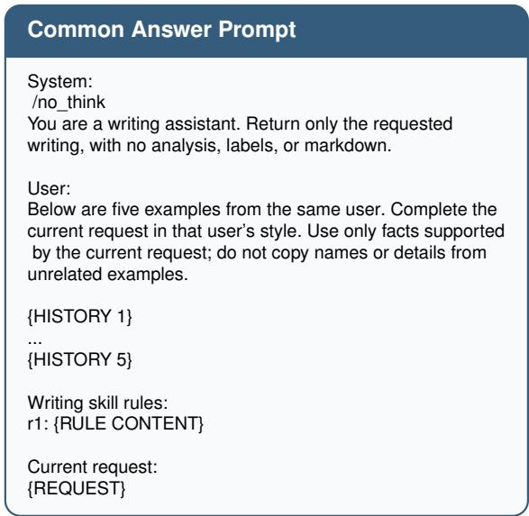  
Figure 5: Common answering prompt shared by all methods.

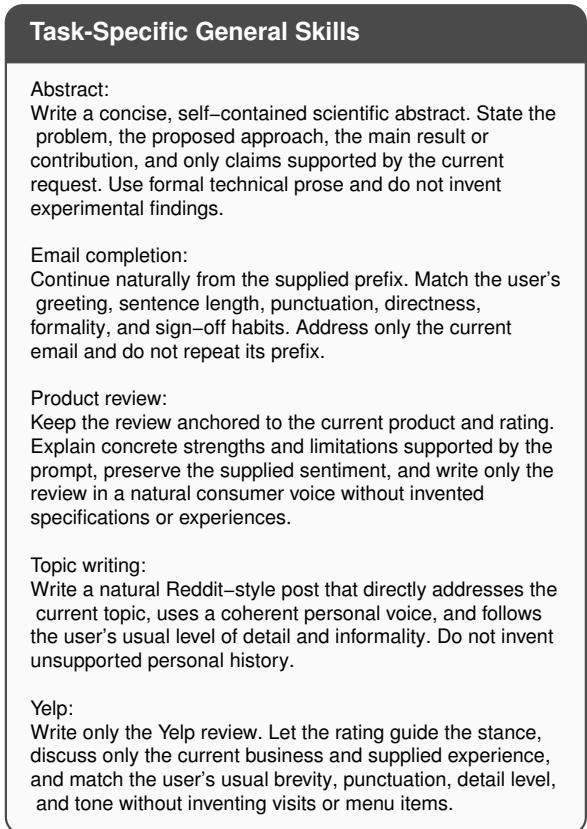  
Figure 6: Static task-specific skills used by the generalskill condition.

<table><tr><td>Method</td><td>Training Time (h)</td></tr><tr><td>SFT</td><td>2.0</td></tr><tr><td>STaR</td><td>2.0</td></tr><tr><td>Answer-Only RL</td><td>0.9</td></tr><tr><td>Outcome-RL</td><td>2.1</td></tr><tr><td>Rule-RL</td><td>1.7</td></tr><tr><td>SkillGrain (Ours)</td><td>1.8</td></tr></table>

Table 8: Training time (hours) of methods requiring optimization with Qwen3-4B.

Rule Update Prompt   
System:   
/no\_think   
You maintain a concise writing skill for one user.   
Read the interaction and the user’s natural feedback.   
Decide whether the feedback supports one durable,   
reusable writing rule.   
A reusable rule describes writing style or process that is   
useful on a different topic. Do not store names, products,   
places, dates, topic−specific facts, or instructions that only   
repair the current answer.   
If there is no supported reusable rule, choose KEEP.   
Otherwise add exactly one short rule.   
Return JSON only, exactly one of:   
{"decision":"KEEP","rule\_updates":[],"new\_rules":[]}   
{"decision":"UPDATE","rule\_updates":[],"new\_rules":[{"   
content":"one reusable content−neutral rule"}]}   
User:   
User history:   
{HISTORY}   
Current request:   
{REQUEST}   
Assistant draft:   
{DRAFT}   
User feedback:   
{FEEDBACK}   
Return the KEEP or UPDATE JSON.  
Figure 7: Rule-update prompt used by the outcomereward and direct-rule baselines.

Algorithm 1: Training Procedure of SkillGrain   
Require: Training data $\mathcal { D } _ { \mathrm { t r a i n } } .$ , policy πθ, group size G, local  
credit weight λ   
Ensure: Trained policy $\pi \theta$   
1: for each training batch $\boldsymbol { B }$ do   
2: $\theta _ { \mathrm { o l d } }  \theta$   
3: $\mathcal { L } _ { B } \gets 0$   
4: for each $( c _ { t } , \mathcal { V } _ { t } , x _ { t + 1 } ) \in \mathcal { B }$ do   
5: for $j = 1 , \dots , G$ do   
6: Sample $\mathcal { A } ^ { ( j ) } = [ ( a _ { j , k } , z _ { j , k } ) ] _ { k = 1 } ^ { K _ { j } } \sim \pi _ { \theta _ { \mathrm { o l d } } } ( \cdot \ |$   
$c _ { t } )$   
$7 { : }$ $s ^ { ( j ) }  \mathrm { C o m p o s e } ( s _ { t } , \mathcal { A } ^ { ( j ) } )$   
8: $R _ { j } ^ { \mathrm { s k i l l } }  R _ { \mathrm { s k i l l } } ( s ^ { ( j ) } )$   
9: end for   
10: Compute $\mu _ { \mathrm { s k i l l } }$ and $\sigma _ { \mathrm { s k i l l } }$ from $\{ R _ { j } ^ { \mathrm { s k i l l } } \} _ { j = 1 } ^ { G }$   
11: for $j = 1 , \ldots , G \mathbf { d o }$   
12: $A _ { j } ^ { \mathrm { s k i l l } }  \frac { R _ { j } ^ { \mathrm { s k i l l } } - \mu _ { \mathrm { s k i l l } } } { \sigma \cdot \dots \cdot | \enspace \enspace  \epsilon }$   
$\sigma _ { \mathrm { s k i l l } } + \epsilon$   
13: $\widetilde { A } _ { j , i } ^ { \mathrm { s k i l l } }  A _ { j } ^ { \mathrm { s k i l l } }$ for all generated tokens i   
14: for each $( a _ { j , k } , z _ { j , k } ) \in \mathcal { A } ^ { ( j ) }$ do   
15: Align with targets in $\nu _ { t }$   
16: Obtain $c _ { j , k } ^ { a } , \bar { c } _ { j , k } ^ { z }$ and token spans   
$T _ { j , k } ^ { a } , T _ { j , k } ^ { z }$   
17: if $\cdot \ : c _ { j , k } ^ { a } \neq 1$ 0 then   
18: $\widetilde { A } _ { j , i } ^ { \mathrm { s k i l l } } \gets \lambda c _ { j , k } ^ { a } / | T _ { j , k } ^ { a } | , \forall i \in T _ { j , k } ^ { a }$   
19: end if   
20: $\mathbf { i f } c _ { j , k } ^ { z } \neq 0$ then   
21: $\widetilde { A } _ { j , i } ^ { \mathrm { s k i l l } } \gets \lambda c _ { j , k } ^ { z } / | T _ { j , k } ^ { z } | , \forall i \in T _ { j , k } ^ { z }$   
22: end if   
23: end for   
24: Apply omission penalty to the closing token   
if required   
25: end for   
26: $j ^ { \ast } \gets$ arg maxj $R _ { j } ^ { \mathrm { s k i l l } }$   
27: $s ^ { * }  s ^ { ( j ^ { * } ) }$   
28: for $j = 1 , \dots , G$ do   
29: $\mathrm { \bar { S a m p l e } } y _ { j } \sim \pi _ { \theta _ { \mathrm { o l d } } } ( \cdot \mid H _ { u } , s ^ { * } , x _ { t + 1 } )$   
30: $R _ { j } ^ { \mathrm { a n s } }  \mathrm { \bar { { R } } _ { a n s } } ( y _ { j } )$   
31: end for   
32: Compute independently normalized response ad  
vantages $\{ A _ { j } ^ { \mathrm { a n s } } \} _ { j = } ^ { G }$ 1   
33: Compute $\mathcal { L } _ { \mathrm { s k i l l } }$ using $\widetilde { A } _ { j , i } ^ { \mathrm { s k i l l } }$   
34: Compute $\mathcal { L } _ { \mathrm { a n s } }$ s using Aansj   
35: $\mathcal { L } _ { \mathcal { B } } \dot {  } \mathcal { L } _ { \mathcal { B } } + \mathcal { L } _ { \mathrm { s k i l l } } \dot { + } \dot { \mathcal { L } } _ { \mathrm { a n s } }$   
36: end for   
37: $\theta  \theta - \eta \nabla _ { \theta } ( \mathcal { L } _ { B } / | B | )$   
38: end for   
39: return πθ

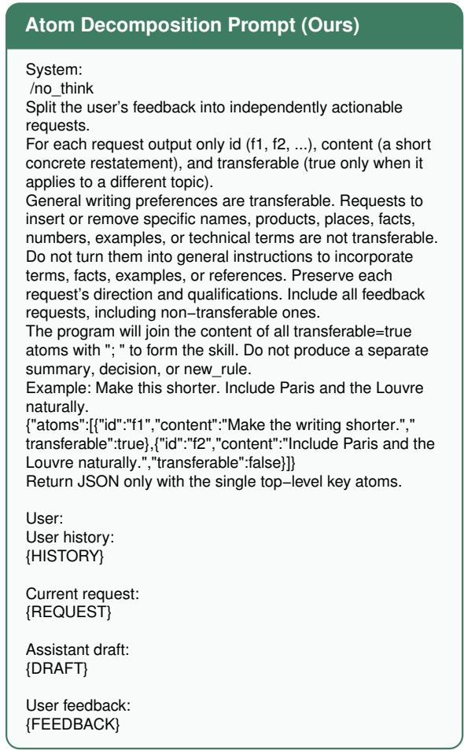  
Figure 8: Atom-decomposition prompt used by our method. The program concatenates only atoms whose transferable field is true.

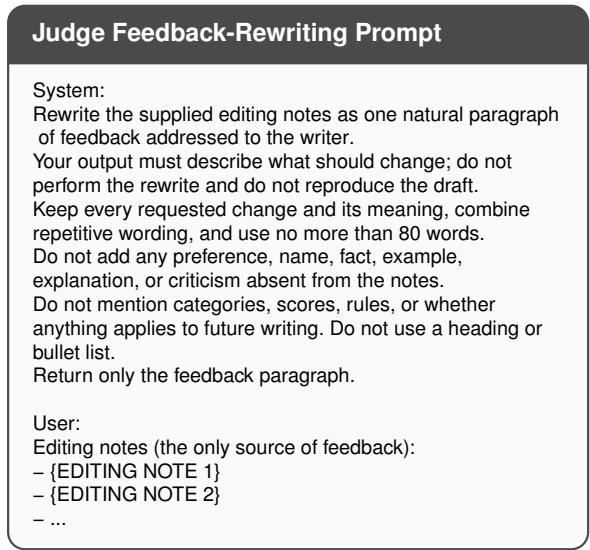  
Figure 9: Prompt for the fixed judge model. Its input notes are constructed deterministically from the four reward dimensions and entity diagnostics.

## F Case Study

We qualitatively examine saved two-round trajectories produced by our atom-based method. Table 9 reports the four-dimensional mean score before adaptation, after the first skill update, and on the held-out test request. These examples are selected to illustrate the interaction mechanism rather than to provide an aggregate comparison.

We detail the abstract-writing trajectory because it exposes both possible skill-update outcomes: the first round adds a transferable preference, whereas the second round correctly leaves the skill unchanged when the feedback is entirely requestspecific. The actor model is Qwen3-4B. Long history examples, requests, and responses are shortened only for presentation.

## Context and User History

The five abstracts exhibit formal technical prose, relatively long sentences, and detailed descriptions. Representative passages discuss semantic technologies, human input for data interlinking, gamification in citizen science, human–machine mobility workflows, and Wikidata editor engagement.

## Round 1: Draft and Feedback

The request asks for an abstract about SeaFish, a game for collaborative image annotation and interlinking. The generated draft describes human computation, DBpedia and Flickr images, and Linked Data, but is shorter than the user’s historical preference.

Feedback. “The text is somewhat brief and could benefit from additional useful details. Incorporate the terms ‘semantic content creation’ and ‘data interlinking’ more naturally into the draft to enhance clarity and depth.”

<table><tr><td>Stage</td><td>LEN</td><td>FP</td><td>EXPR</td><td>NL</td><td>Mean</td></tr><tr><td>Round 1</td><td>0.620</td><td>1.000</td><td>1.000</td><td>1.000</td><td>0.905</td></tr><tr><td>Round 2</td><td>1.000</td><td>1.000</td><td>1.000</td><td>1.000</td><td>1.000</td></tr><tr><td>Test</td><td>1.000</td><td>1.000</td><td>1.000</td><td>1.000</td><td>1.000</td></tr></table>

## Transferability Filtering and Skill Update

<table><tr><td>Feedback atom</td><td>Transferable</td></tr><tr><td>Make the text longer with additional useful details.</td><td>Yes</td></tr><tr><td>Incorporate semantic content creation naturally.</td><td>No</td></tr><tr><td>Incorporate data interlinking naturally.</td><td>No</td></tr></table>

Only the first atom is retained, producing the reusable skill Make the text longer with additional useful details. The two named terms describe content required by the current request and are therefore not stored as user-level writing preferences.

<table><tr><td>Task</td><td>Round 1</td><td>Round 2</td><td>Test</td></tr><tr><td>Abstract</td><td>0.905</td><td>1.000</td><td>1.000</td></tr><tr><td>Topic Writing</td><td>0.750</td><td>1.000</td><td>0.903</td></tr><tr><td>Email Completion</td><td>0.528</td><td>0.992</td><td>0.889</td></tr></table>

Table 9: Mean four-dimensional scores of the saved case-study trajectories.

## Round 2: Local Feedback Leads to KEEP

The next request concerns gamification and adaptive incentives for paid microtask crowdsourcing. Conditioned on the retained skill, the response expands the approach, experiments, and findings, obtaining full credit on all four dimensions. The remaining feedback asks only for the term “microtasks” to be integrated more naturally. The method decomposes this feedback into three nontransferable atoms and applies KEEP; the skill remains unchanged.

## Held-Out Test

The test request asks for an abstract about the They-BuyForYou platform and its knowledge graph for public procurement. The response explains how open linked data from multiple EU sources supports transparency and cross-border bidding. It receives 1.000 for length, firstperson usage, expression, and non-leakage. All three target terms are covered, and no entity from the history or adaptation requests is detected in the response.

## Interpretation

The trajectory illustrates the intended transfer boundary. A general preference for additional useful detail survives across unrelated abstract topics, while request-specific terminology is used for local feedback but is not written into persistent memory. The second-round KEEP decision also shows that an interaction need not modify the skill when its feedback contains no transferable preference.