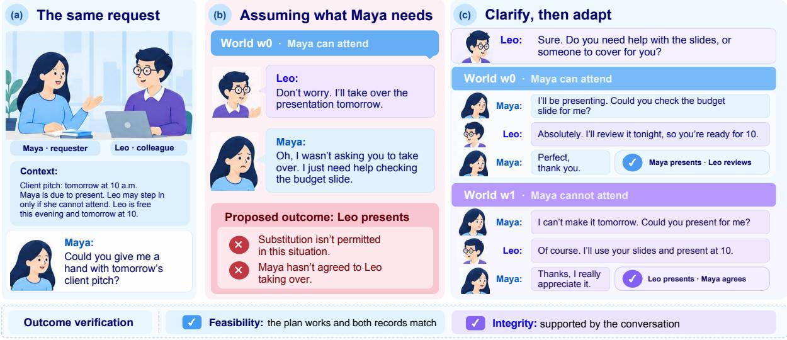
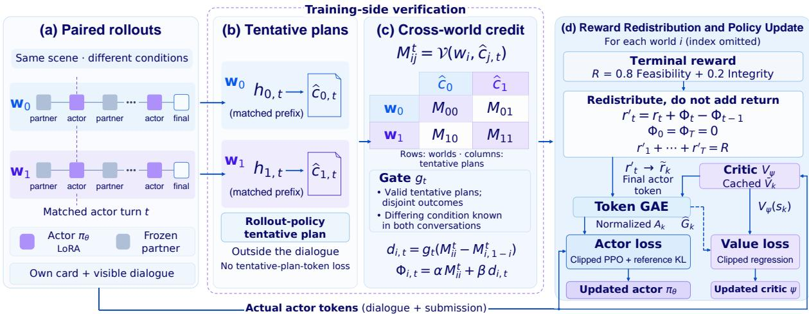
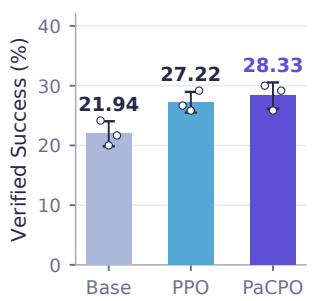
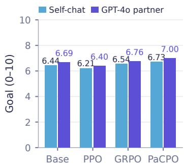
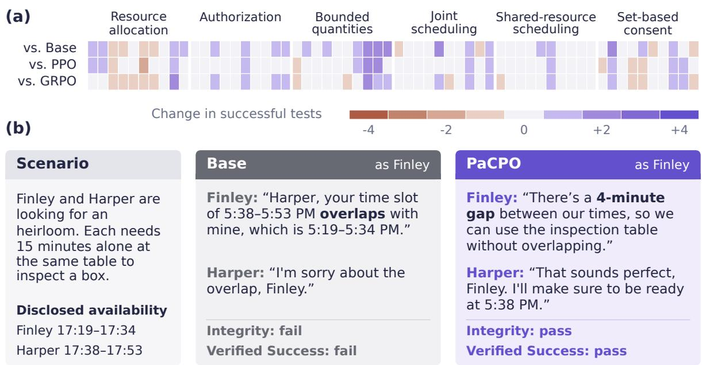
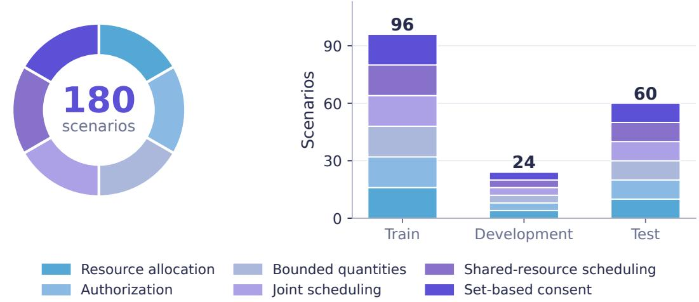
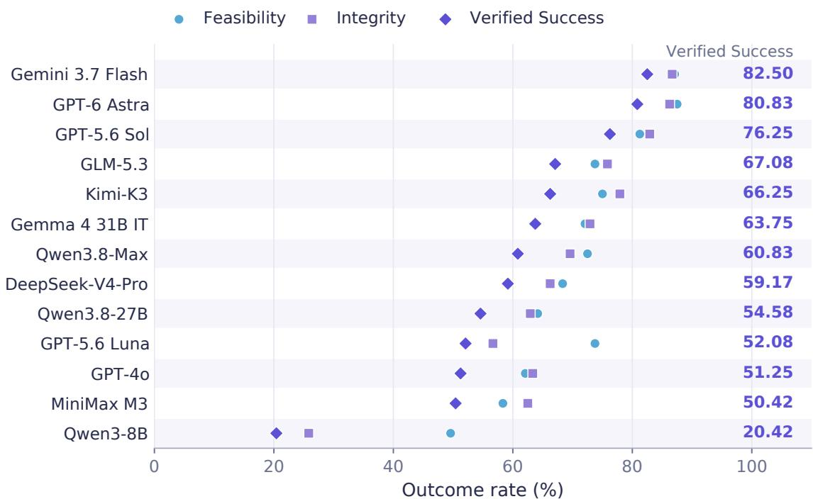
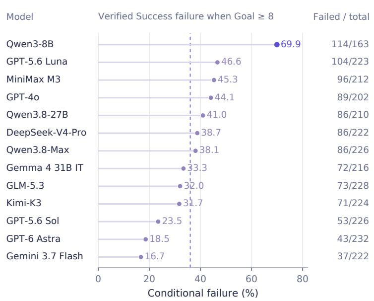
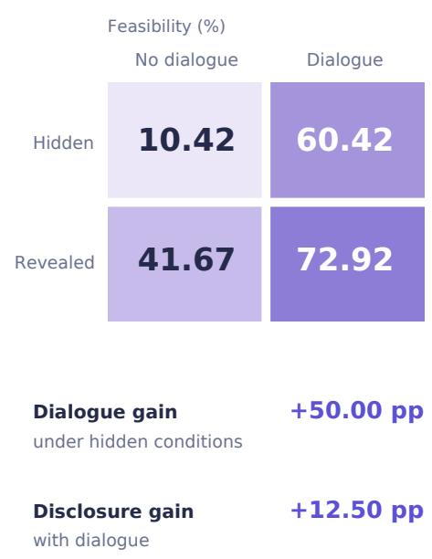

# Learning from Verifiable Outcomes in Paired Worlds

Caixin Kang<sup>1,2</sup>, Ke Wang<sup>1</sup>, Yuchuan Wu<sup>1</sup>, Xiaoqiang Wang<sup>1</sup>, Ling Li<sup>1</sup>, Bingxue Qiu<sup>1</sup>, Yongbin Li<sup>1∗</sup>, Yoichi Sato<sup>2</sup>

<sup>1</sup>Alibaba Token Hub, Alibaba Group <sup>2</sup>The University of Tokyo

## Abstract

Efective social interaction requires more than fluent responses: agents must reach plans that fit the participants’ needs and circumstances. Existing evaluations of social agents mainly rely on LLM judges that rate the conversation, without checking the resulting plan. We introduce HICO-Bench, a benchmark of 180 everyday coordination scenarios, such as resource allocation, scheduling, and authorization, in which two agents with private information converse and then independently record the plan they agreed on. A program checks Feasibility (the two records match and satisfy both participants’ private conditions), and an LLM judge checks Integrity (the conversation supports the recorded plan); passing both is a Verified Success. Each scenario has two versions that share the same public context but difer in one private condition, so the correct plan difers between them. Across thirteen LLMs, 36% of conversations rated highly for goal completion fail Verified Success. To learn from outcomes that arrive only at the end of a conversation, we propose Paired-Credit Policy Optimization (PaCPO). After each turn, PaCPO asks the agent for a tentative plan, checks it in both versions of the scenario, and rewards the turns after which the tentative plans fit their respective versions. PaCPO raises Qwen3-8B’s Verified Success from 20.4% to 28.3%.

## 1 Introduction

LLM agents increasingly help people coordinate everyday matters. Consider Maya asking her colleague Leo, “Could you give me a hand with tomorrow’s client pitch?” (Figure 1). Whether Leo should review her slides or present in her place depends on facts that only Maya knows: whether she can attend, and what help she wants. A reply such as “Don’t worry, I’ll take over” sounds supportive, yet commits to a plan that fails if Maya can present herself. Splitting a bill, scheduling a meeting, and approving a request share this structure: an acceptable outcome depends on private conditions, such as budget, availability, or authority, revealed through dialogue.

Existing evaluations of LLM social agents focus primarily on the conversation. SOTOPIA (Zhou et al., 2024) uses an LLM judge to rate agents on goal completion, believability, and related dimensions, and subsequent work trains agents to improve these ratings (Wang et al., 2024; Yu et al., 2025). Such ratings do not verify whether the agreed plan satisfies the participants’ conditions, and model-based judges can overestimate agents’ social abilities (Wang et al., 2024). Negotiation and tool-use benchmarks do verify outcomes automatically (Lewis et al., 2017; Yao et al., 2024), but not in everyday coordination, where the decisive facts must be elicited through conversation.

  
Figure 1: Reassuring words need not lead to appropriate help. (b) Without clarifying, Leo ofers to take over, although Maya can present and only wants a slide review. (c) After clarifying, the appropriate plan depends on whether Maya can attend, which is initially private to her. Feasibility checks that the plan works and both records match; Integrity checks that dialogue supports it.

We introduce HICO-Bench (Hidden Information and Checkable Outcomes), a benchmark that evaluates social interaction by its outcome. After each conversation, both agents independently record the agreed plan in a structured form. A program checks Feasibility: whether the two records match and satisfy all private conditions. An LLM judge checks Integrity: whether the conversation supports the recorded plan, for example without invented authority or a record that contradicts what was said. An interaction is a Verified Success only if it passes both checks. Each scenario has two versions, or worlds, that difer in a single private condition (e.g., whether Maya can attend) and admit disjoint sets of correct plans; an agent that responds identically in both worlds therefore fails at least one. Across thirteen LLMs, 36% of conversations with Goal ≥ 8/10 fail Verified Success.

Verified outcomes can also serve as a training signal, but they arrive only after the final turn, leaving the contribution of individual turns unclear. We propose Paired-Credit Policy Optimization (PaCPO), which uses the paired worlds for credit assignment. After each turn, we probe the agent, outside the conversation, for a tentative plan it would record at that point, and check this plan in both worlds. Before Leo learns whether Maya can attend, his tentative plan is the same in both worlds and can fit at most one; once she answers, the plan formed in each world should fit that world but not its counterpart. PaCPO rewards the turns at which this occurs, redistributing the terminal reward without changing each conversation’s total return. On Qwen3-8B, PaCPO improves Verified Success from 20.4% to 28.3%, compared with 25.0% for PPO and 26.3% for GRPO trained on the same number of dialogues. Our contributions are as follows:

• HICO-Bench, a benchmark of 180 paired scenarios across six coordination families, evaluated by rule-based Feasibility and judge-based Integrity alongside SOTOPIA ratings.

• PaCPO, a credit-assignment method that compares tentative plans across paired worlds once the private condition that difers between them has been disclosed.

• An evaluation of thirteen LLMs and five RL baselines, showing that highly rated conversations can yield failed plans and that outcome training improves Verified Success.

## 2 Related Work

Agent reasoning and interaction. Within broader research on agent reasoning and interaction (Yao et al., 2023; Liu et al., 2025a; Wang & Liu, 2025; Wang et al., 2025), Social IQa and FANToM test social commonsense and who knows what in a conversation (Sap et al., 2019; Kim et al., 2023). SOTOPIA evaluates agents in role-played social scenarios, with an LLM judge rating goal completion, believability, and other dimensions (Zhou et al., 2024); SOTOPIA-ToM extends this setting to information seeking and privacy (YS et al., 2026). Multimodal work also studies truthfulness and deception (Kang et al., 2025b;a), personality judgments (Kang et al., 2026), and speaker alignment (Ouyang et al., 2026a), alongside interactive digital humans (Cai et al., 2025) and controllable multi-person video generation (Ouyang et al., 2026b). HICO-Bench focuses on the plan reached through dialogue: whether it fits both participants private conditions and is supported by what they said. We retain SOTOPIA’s ratings as complementary measures of conversation quality.

Task-oriented dialogue and negotiation. Several interactive benchmarks verify outcomes with rules. In Deal or No Deal and CaSiNo, agents divide items and the final split is scored against each agent’s private values (Lewis et al., 2017; Chawla et al., 2021); τ-bench and τ<sup>2</sup>-bench check whether a customerservice agent leaves a database in the correct state (Yao et al., 2024; Barres et al., 2025); Social Gym uses games whose winner is decided by rules (He et al., 2026). These settings target fixed, domain-specific goals. HICO-Bench extends outcome verification to everyday coordination and additionally checks that the conversation supports the plan.

Clarification and information seeking. Prior work trains or evaluates models on asking clarifying questions, for example by rewarding questions that reveal user preferences (Andukuri et al., 2024) or by scoring questions at checkpoints (Zhao et al., 2026; Zhang et al., 2024). Related work on proactive assistance studies when to ofer help from ongoing visual observations (Gong et al., 2026b;a). We do not reward questions directly: in HICO-Bench, the decisive fact may be volunteered, already known, or elicited, and only the correctness of the resulting plan is rewarded.

Credit assignment in reinforcement learning. When feedback arrives only at the end of an episode, a learner must estimate which earlier steps deserve credit. Process supervision labels each reasoning step (Lightman et al., 2024); VinePPO estimates a step’s value by sampling continuations from it (Kazemnejad et al., 2025); GiGPO and GraphGPO compare steps that share the same state across rollouts (Feng et al., 2025; Cheng et al., 2026). For social agents, SOTOPIA-RL and SAVOIR distribute LLM-judge ratings over the utterances of a conversation (Yu et al., 2025; Feng et al., 2026). In free-form dialogue, however, identical states rarely recur across rollouts, and LLM ratings are noisy. PaCPO instead compares tentative plans across the two worlds of a scenario and checks them with rules, so that each comparison is verifiable.

## 3 HICO-Bench

## 3.1 Interaction Protocol

Each scenario involves two roles, such as Maya and Leo in Figure 1. Both roles see the same public context $p \colon$ the client pitch is tomorrow at 10 a.m., Maya is due to present, and Leo may present only if Maya cannot attend. Each role i also receives a private role card $v _ { i }$ that the other role does not see; Maya’s card states whether she can attend and what help she wants. The roles then alternate free-form turns, producing a history h. Each role observes only $p ,$ its own card, and $h ;$ it never sees the partner’s card or the set of acceptable plans.

When the conversation ends, each role independently fills in a structured record $c _ { i }$ describing the plan it believes was agreed, following a public template $\mathcal { C } \ ( \mathrm { e . g . }$ who presents and what Leo will do). Independent records test whether the roles reached a shared understanding (Clark & Brennan, 1991). The verifier state z stores the private conditions of both roles. A scenario is thus $\boldsymbol { x } = \left( p , v _ { 1 } , v _ { 2 } , z , \mathcal { C } \right)$

Table 1: Interaction families in HICO-Bench. Each family has 16 training, 4 development, and 10 test scenarios, each with two worlds.
<table><tr><td>Interaction family</td><td>Example</td><td>Private conditions and verification</td></tr><tr><td>Resource allocation</td><td>Neighbors divide a $240 fence-repair bill.</td><td>Shares respect both participants&#x27; bounds and sum to the fixed total.</td></tr><tr><td>Authorization</td><td>A consultant handles a request for one extra review hour.</td><td>Approval stays within delegated authority; otherwise, the request is referred.</td></tr><tr><td>Bounded quantities</td><td>A buyer and seller agree on the number of apple crates.</td><td>The agreed integer quantity lies within both participants&#x27; acceptable intervals.</td></tr><tr><td>Joint scheduling</td><td>Studio partners arrange a 20-minute celebration.</td><td>The shared slot fits both availability windows and has the required duration.</td></tr><tr><td>Shared-resource scheduling</td><td>Two photographers reserve a tripod for ten minutes each.</td><td>Bookings fit both use windows and required durations, without overlapping.</td></tr><tr><td>Set-based consent</td><td>Two people agree on belie-related discussion topics.</td><td>Selected topics match the required set and are all permitted.</td></tr></table>

## 3.2 Paired Scenarios

Each scenario has two worlds, $w _ { 0 }$ and $w _ { 1 } ,$ that share the public context and difer in exactly one private condition, chosen so that no plan is correct in both. In our example, Maya can attend in w , so the correct plan is that she presents and Leo reviews her slide; in $w _ { 1 }$ she cannot attend, so the correct plan is that Leo presents. Following contrast sets (Ribeiro et al., 2020; Gardner et al., 2020), an agent that makes the same ofer in both worlds must fail one of them.

Table 1 lists the six coordination families. We adapt social situations from SOTOPIA (Zhou et al., 2024), write role cards for both worlds, and encode the acceptance rules as a program, which is tested on correct and incorrect plans. The 180 scenarios are split into 96 training, 24 development, and 60 test scenarios, with both worlds in the same split. Evaluating each role in each world separately yields $6 0 \times 2 \times 2 = 2 4 0$ test tasks (96 development tasks).

## 3.3 Outcome Evaluation

Feasibility: does the plan work? Each record specifies an outcome kind and its terms. The kind is agreement (a plan is settled), decline (no plan satisfies both roles), or defer (the request requires approval from someone outside the conversation). In $w _ { 0 }$ of our example, a correct record is {kind: agreement, terms: {presenter: Maya, leo\_task: review\_budget\_slide}}. A program checks that (1) the two records are identical up to the ordering of fields and items; (2) the kind is correct for the world; and (3) the terms satisfy the family’s rules (Table 1), e.g., in resource allocation the shares sum to the \$240 bill and respect each person’s limit. Any plan satisfying the rules is accepted; in scheduling, for instance, any mutually free slot passes. $F _ { z } ( c _ { 1 } , c _ { 2 } ) = 1$ if all three tests pass and 0 otherwise.

Integrity: does the conversation support the plan? A feasible record may still be unsupported by the conversation: both records may state that Maya presents while Leo promised to take over, or Leo may approve extra work by claiming authority he lacks. An LLM judge reads the full conversation and both records and flags four violations, each with quoted evidence: (i) an uncorrected factual error, such as invented authority or resources; (ii) repeated exchanges without progress; (iii) a record that contradicts the spoken agreement; and (iv) output-format text leaking into the dialogue. $I _ { z } ( h , c _ { 1 } , c _ { 2 } ) ~ = ~ 1$ if no violation is found. Corrected proposals and truthful referrals are allowed.

Verified Success. Our primary metric is the fraction of tasks that pass both checks,

$$
S _ { z } ( h , c _ { 1 } , c _ { 2 } ) = F _ { z } ( c _ { 1 } , c _ { 2 } ) I _ { z } ( h , c _ { 1 } , c _ { 2 } ) .\tag{1}
$$

We also report each check separately, as they capture diferent failure modes.

  
Figure 2: PaCPO overview. Rollouts in the two worlds yield a tentative plan after each turn. Checking each plan in both worlds determines turn-level credit, which redistributes the terminal reward before the PPO update. Indices $i , j$ denote worlds, t turns, and k tokens; panel (d) omits i. R is the terminal reward, $r _ { t }$ and $r _ { t } ^ { \prime }$ are the original and redistributed rewards, and $\Phi _ { t }$ is the potential. The dashed branch carries GAE value targets.

Conversation ratings. We additionally report SOTOPIA’s seven LLM-judged ratings (Zhou et al., 2024), focusing on Goal (0–10, attainment of the role’s social goal) and Believability (0–10, naturalness and role consistency); all seven appear in Appendix B. These ratings are never used for training; they test whether high ratings coincide with verified outcomes.

## 4 Paired-Credit Policy Optimization

PaCPO trains the agent with a terminal reward but redistributes it across turns. After each turn, we ask which plan the agent would record if the conversation ended there, and compare these tentative plans across the two worlds of a scenario. Before Maya reveals whether she can attend, Leo’s tentative plan is the same in both worlds and can fit at most one; once she does, the plans formed in the two worlds should diverge so that each fits its own world. PaCPO rewards the turns at which this divergence appears. Figure 2 illustrates the pipeline; Algorithm 1 (Appendix E) details the update.

## 4.1 Terminal Reward

All RL methods in our experiments optimize the same terminal reward

$$
R ( h , c _ { 1 } , c _ { 2 } , z ) = 0 . 8 F _ { z } ( c _ { 1 } , c _ { 2 } ) + 0 . 2 I _ { z } ( h , c _ { 1 } , c _ { 2 } ) ,\tag{2}
$$

which gives partial credit when only one check passes. PPO and GRPO receive R at the final turn; PaCPO redistributes it across turns.

## 4.2 Tentative Plans and Cross-World Checks

Let $i \in \{ 0 , 1 \}$ index the worlds. For each scenario, we roll out the same tested role in both worlds against a fixed partner; the two conversations may difer in wording and length. Let $v _ { i }$ be the tested role’s card in world $w _ { i } , h _ { i , t }$ the conversation up to its t-th turn, and $T _ { i }$ the turn at which it submits its record. After each turn $t < T _ { i } ,$ we probe the current policy for a tentative plan: the plan it would record if the conversation ended there, given only what the role can see:

$$
\widehat { c } _ { i , t } \sim \pi _ { \theta _ { \mathrm { o l d } } } ( \cdot \mid p , v _ { i } , h _ { i , t } , \mathcal { C } ) .\tag{3}
$$

bThe tentative plan is not added to the conversation.

Let $\mathcal { V } ( w , c ) \in \{ 0 , 1 \}$ indicate whether plan c satisfies the Feasibility rules of world w, with $\nu ( w , \bot ) = 0$ for a missing or malformed plan. At turn t, PaCPO checks both tentative plans in both worlds:

$$
M _ { i j } ^ { t } = \mathcal { V } ( w _ { i } , \widehat { c } _ { j , t } ) , \qquad i , j \in \{ 0 , 1 \} .\tag{4}
$$

The diagonal entries indicate whether each world’s plan fits its own world; the of-diagonal entries indicate whether the plan from the other world would also fit.

## 4.3 Paired Credit

The comparison is informative only after the private condition that difers between the worlds has been disclosed. We therefore compare plans at the same turn index and open a gate, $g _ { t } \ = \ 1$ , only if both tentative plans are valid, the two worlds admit no common plan, and the difering condition is available in both conversations by turn t: it is either on the tested role’s own card or has been disclosed by the partner, as marked by a frozen LLM annotator during training. For world $i ,$ the paired credit is

$$
d _ { i , t } = \left\{ \begin{array} { l l } { M _ { i i } ^ { t } - M _ { i , 1 - i } ^ { t } , } & { g _ { t } = 1 , } \\ { 0 , } & { g _ { t } = 0 . } \end{array} \right.\tag{5}
$$

It is positive when the plan formed in $w _ { i }$ fits $w _ { i }$ but the plan from the other world does not. In our example, once Maya has answered, proposing that Maya presents in $w _ { 0 }$ and that Leo presents in $w _ { 1 }$ gives $M ^ { t } = \left[ { 1 0 \atop 0 1 } \right]$ and hence $d _ { 0 , t } = d _ { 1 , t } = 1 ;$ identical plans in both worlds give zero credit. The potential at turn t combines within-world feasibility and paired credit:

$$
\Phi _ { i , t } = \alpha M _ { i i } ^ { t } + \beta d _ { i , t } .\tag{6}
$$

## 4.4 Reward Redistribution

Let $r _ { i , T _ { i } } = R _ { i }$ and $r _ { i , t } = 0$ for $t < T _ { i } ,$ and set $\Phi _ { i , 0 } = \Phi _ { i , T _ { i } } = 0$ . Following potential-based shaping and return redistribution (Ng et al., 1999; Arjona-Medina et al., 2019), we define

$$
\boldsymbol { r } _ { i , t } ^ { \prime } = \boldsymbol { r } _ { i , t } + \boldsymbol { \Phi } _ { i , t } - \boldsymbol { \Phi } _ { i , t - 1 } .\tag{7}
$$

With $\gamma = 1$ , the shaping terms telescope, so the total reward of each conversation is unchanged:

$$
\sum _ { t = 1 } ^ { T _ { i } } r _ { i , t } ^ { \prime } = R _ { i } + \Phi _ { i , T _ { i } } - \Phi _ { i , 0 } = R _ { i } .\tag{8}
$$

A turn is thus rewarded when it raises the potential, for example by eliciting the condition that lets the two worlds’ plans diverge correctly, and the final turn receives $R _ { i }$ minus the credit already assigned. We optimize the redistributed rewards with PPO (Schulman et al., 2017), placing each $r _ { i , t } ^ { \prime }$ on the last token of turn t and using a learned value baseline with GAE (Schulman et al., 2015); Appendix E gives the details.

## 5 Experimental Results

After describing the setup (Section 5.1), we ask what outcome verification reveals beyond conversation ratings (Section 5.2), whether learning from verified outcomes improves interaction (Section 5.3), whether the gains extend to other partners and tasks (Section 5.4), and which components of PaCPO contribute (Section 5.5).

## 5.1 Experimental Setup

Training. We train Qwen3-8B (Yang et al., 2025) with LoRA (Hu et al., 2022) against a frozen Qwen3- 8B partner. Each RL run uses 384 training conversations: one preassigned role per training scenario, balanced across scenarios, with two samples per world. During training, Integrity is scored by a frozen local Qwen3.8-27B judge (Qwen Team, 2026). To keep the number of sampled conversations equal across methods, the group-based baselines (GRPO, Dr.GRPO, GiGPO, and GraphGPO), which draw $G = 4$ conversations per world, cover 48 training scenarios, whereas PPO and PaCPO, which draw two per world, cover all 96. PaCPO uses $\alpha \ = \ 0 . 2 5$ and $\beta ~ = ~ 0 . 1 0$ . Appendix C.1 reports an additional SFTinitialization study, and Appendix E.2 reports training costs.

Table 2: Thirteen-model HICO-Bench benchmark. Fixed Qwen3-8B partner, 240 tasks per model; sorted by increasing Verified Success (Ver. Succ.). Size denotes local model size; api denotes remote inference. Goal and Believability range from 0 to 10; full ratings are in Appendix D.
<table><tr><td rowspan="2">Model</td><td rowspan="2">Size</td><td colspan="3">Verifiable outcomes (%)</td><td colspan="2">SOTOPIA ratings</td></tr><tr><td>Feasibility</td><td>Integrity</td><td>Ver. Succ.</td><td>Goal</td><td>Believ.</td></tr><tr><td>Qwen3-8B (Yang et al., 2025)</td><td>8B</td><td>49.58</td><td>25.83</td><td>20.42</td><td>7.47</td><td>6.31</td></tr><tr><td>MiniMax M3 (MiniMax, 2026)</td><td>api</td><td>58.33</td><td>62.50</td><td>50.42</td><td>9.18</td><td>8.68</td></tr><tr><td>GPT-40 (OpenAI, 2024)</td><td>api</td><td>62.08</td><td>63.33</td><td>51.25</td><td>9.12</td><td>8.71</td></tr><tr><td>GPT-5.6 Luna (OpenAI, 2026a)</td><td>api</td><td>73.75</td><td>56.67</td><td>52.08</td><td>9.61</td><td>8.63</td></tr><tr><td>Qwen3.8-27B (Qwen Team, 2026)</td><td>27B</td><td>64.17</td><td>62.92</td><td>54.58</td><td>9.21</td><td>8.72</td></tr><tr><td>DeepSeek-V4-Pro (DeepSeek-AI, 2026)</td><td>api</td><td>68.33</td><td>66.25</td><td>59.17</td><td>9.44</td><td>8.88</td></tr><tr><td>Qwen3.8-Max (Alibaba Cloud, 2026)</td><td>api</td><td>72.50</td><td>69.58</td><td>60.83</td><td>9.62</td><td>8.95</td></tr><tr><td>Gemma 4 31B IT (Google DeepMind, 2026b)</td><td>31B</td><td>72.08</td><td>72.92</td><td>63.75</td><td>9.38</td><td>8.80</td></tr><tr><td>Kimi-K3 (Moonshot AI, 2026)</td><td>api</td><td>75.00</td><td>77.92</td><td>66.25</td><td>9.52</td><td>8.94</td></tr><tr><td>GLM-5.3 (Z.ai, 2026)</td><td>api</td><td>73.75</td><td>75.83</td><td>67.08</td><td>9.65</td><td>8.96</td></tr><tr><td>GPT-5.6 Sol (OpenAI, 2026a)</td><td>api</td><td>81.25</td><td>82.92</td><td>76.25</td><td>9.63</td><td>8.95</td></tr><tr><td>GPT-6 Astra (OpenAI, 2026b)</td><td>api</td><td>87.50</td><td>86.25</td><td>80.83</td><td>9.75</td><td>9.01</td></tr><tr><td>Gemini 3.7 Flash (Google DeepMind, 2026a)</td><td>api</td><td>87.08</td><td>86.67</td><td>82.50</td><td>9.54</td><td>8.93</td></tr></table>

Table 3: Seven-system training comparison. 240 test tasks per row; 384 training dialogues per RL method. To match this budget, group-based baselines (G = 4) cover 48 training scenarios, and PPO and PaCPO cover 96. Goal and Believability (0–10) are not optimized. Best values are bold.
<table><tr><td rowspan="2">Method</td><td colspan="3">Verifiable outcomes (%)</td><td colspan="2">SOTOPIA ratings</td></tr><tr><td>Feasibility</td><td>Integrity</td><td>Ver. Succ.</td><td>Goal</td><td>Believ.</td></tr><tr><td>Base (Yang et al., 2025)</td><td>49.58</td><td>25.83</td><td>20.42</td><td>7.47</td><td>6.31</td></tr><tr><td>PPO (Schulman et al., 2017)</td><td>50.00</td><td>33.75</td><td>25.00</td><td>7.58</td><td>6.51</td></tr><tr><td>GRPO (Shao et al., 2024)</td><td>52.92</td><td>31.25</td><td>26.25</td><td>7.83</td><td>6.62</td></tr><tr><td>Dr.GRPO (Liu et al., 2025b)</td><td>50.42</td><td>27.92</td><td>21.25</td><td>7.67</td><td>6.39</td></tr><tr><td>GiGPO (Feng et al., 2025)</td><td>52.08</td><td>30.42</td><td>24.58</td><td>7.86</td><td>6.60</td></tr><tr><td>GraphGPO (Cheng et al., 2026)</td><td>52.50</td><td>31.67</td><td>24.17</td><td>7.84</td><td>6.60</td></tr><tr><td>PaCPO</td><td>52.92</td><td>35.42</td><td>28.33</td><td>7.83</td><td>6.70</td></tr></table>

Evaluation. The test set has 240 tasks (60 scenarios, two worlds, two roles), each played against the frozen Qwen3-8B partner. Feasibility is computed by rules; Integrity and the SOTOPIA ratings are judged by Qwen3.8-Max (Alibaba Cloud, 2026), a diferent model from the training judge, following rubricbased LLM evaluation (Zheng et al., 2023; Liu et al., 2023). Failed generations count as failures. On 240 re-judged outputs, Qwen3.8-Max and Kimi-K3 agree on 90.0% of Integrity decisions (Cohen’s κ = 0.78; Appendix K.1).

## 5.2 Multi-Model Benchmark

Table 2 reports all thirteen models. Verified Success ranges from 20.42% to 82.50%, leaving headroom even for the strongest models. The two checks capture diferent failures: Qwen3-8B passes Feasibility on 49.58% of tasks but reaches only 20.42% Verified Success, mostly due to Integrity failures.

Conversation ratings and verified outcomes can rank models diferently. GPT-5.6 Luna scores above Gemini 3.7 Flash on Goal (9.61 vs. 9.54) but far below it on Verified Success (52.08% vs. 82.50%). Pooled over all models, 35.99% of conversations with Goal ≥ 8 fail Verified Success (Appendix G), because the recorded plan is infeasible or the conversation does not support it.

Dialogue itself matters. On 12 development scenarios with hidden conditions, dialogue raises Base Feasibility by 50 points over submitting records directly (Appendix G).

<table><tr><td rowspan=1 colspan=1>Resource allocation</td><td rowspan=1 colspan=1>17.5</td><td rowspan=1 colspan=1>17.5</td><td rowspan=1 colspan=1>17.5</td></tr><tr><td rowspan=1 colspan=1>Authorization</td><td rowspan=1 colspan=1>37.5</td><td rowspan=1 colspan=1>45.0</td><td rowspan=1 colspan=1>47.5</td></tr><tr><td rowspan=1 colspan=1>Bounded quantities</td><td rowspan=1 colspan=1>30.0</td><td rowspan=1 colspan=1>42.5</td><td rowspan=1 colspan=1>52.5</td></tr><tr><td rowspan=1 colspan=1>Joint scheduling</td><td rowspan=1 colspan=1>10.0</td><td rowspan=1 colspan=1>10.0</td><td rowspan=1 colspan=1>15.0</td></tr><tr><td rowspan=1 colspan=1>Shared-resourcescheduling</td><td rowspan=1 colspan=1>2.5</td><td rowspan=1 colspan=1>5.0</td><td rowspan=1 colspan=1>7.5</td></tr><tr><td rowspan=1 colspan=1>Set-based consent</td><td rowspan=1 colspan=1>25.0</td><td rowspan=1 colspan=1>30.0</td><td rowspan=1 colspan=1>30.0</td></tr><tr><td rowspan=1 colspan=4>Base   PPO   PaCPOVerified Success (%)0        50       100</td></tr></table>

Figure 3: Verified Success by interaction family. Forty test tasks per family with a fixed partner; bold marks the best score in each row.



  
Figure 4: Self-play and SOTOPIA transfer. Left: HICO Verified Success, mean ± SD over three generation repeats. Right: SO-TOPIA Goal on 70 environment–character pairs per partner setting, judged by GPT-4o.

Table 4: External interaction tasks. Task-specific training evaluated on 154 MultiWOZ and 86 CaSiNo test dialogues. All metrics are percentages; Norm. Nash denotes normalized Nash surplus.
<table><tr><td></td><td>MultiWOZ</td><td colspan="2">CaSiNo</td></tr><tr><td>Method</td><td>Comm.</td><td>Agreement</td><td>Norm. Nash</td></tr><tr><td>Base (Yang et al., 2025)</td><td>79.87</td><td>36.05</td><td>27.40</td></tr><tr><td>PPO (Schulman et al., 2017)</td><td>80.52</td><td>60.47</td><td>45.86</td></tr><tr><td>GRPO (Shao et al., 2024)</td><td>79.87</td><td>53.49</td><td>42.14</td></tr><tr><td>PaCPO (ours)</td><td>81.17</td><td>63.95</td><td>49.37</td></tr></table>

## 5.3 Learning from Verified Outcomes

Table 3 compares RL methods trained with the same terminal reward and number of dialogues. PaCPO achieves the highest Verified Success, improving Base by 7.92 points to 28.33%. PaCPO and GRPO reach the same Feasibility, but PaCPO has higher Integrity, so its gain comes from conversations that better support feasible plans.

Although SOTOPIA ratings are not optimized, PaCPO also improves Goal and Believability over Base (Appendix C). In a blinded pilot with two expert annotators, human judgments agree with Feasibility on 100% of cases and with Qwen3.8-Max Integrity on 82.22%; the annotators also prefer PaCPO over Base for helpfulness more often than the reverse (8 vs. 5 of 24 pairs; Appendix K.2).

Where outcome learning helps. Gains vary by family (Figure 3). The largest improvements over Base are in bounded quantities (+22.50 points) and authorization (+10.00 points). In bounded quantities, PPO and PaCPO reach the same Feasibility, so PaCPO’s additional gain again comes from Integrity. Resource allocation stays at 17.5% Verified Success for Base, PPO, and PaCPO, and both scheduling families remain dificult (Appendix J).

What changes in the conversation? Figure 5a breaks down the aggregate gains into changes across individual scenarios. Improvements and regressions occur within the same family, including the dificult scheduling settings. Figure 5b shows one such improvement. Finley and Harper disclose nonoverlapping windows for using a shared table. Base incorrectly calls them overlapping, and its partner accepts that error. PaCPO instead identifies the four-minute gap and obtains agreement. Both runs ultimately submit the same feasible records, but only PaCPO’s conversation supports them. This example illustrates why checking the final records alone misses an important part of successful coordination: the participants must also establish the plan in dialogue.

  
Figure 5: Scenario-level changes and a dialogue example. (a) PaCPO’s change in successful tests relative to each baseline across 60 scenarios (four tests per column: two worlds and two roles). (b) Verbatim excerpts with the same availability information and Finley as the tested role. Both runs submit the same feasible records, but only PaCPO’s dialogue supports them.

Table 5: PaCPO credit ablations. 240 test tasks per condition; all values are percentages.
<table><tr><td>Training condition</td><td>Feasibility</td><td>Integrity</td><td>Ver. Succ.</td></tr><tr><td>Same-world candidate control</td><td>50.83</td><td>32.08</td><td>26.25</td></tr><tr><td>Shuffled credit positions</td><td>50.42</td><td>32.92</td><td>26.25</td></tr><tr><td>Without disclosure gate</td><td>49.58</td><td>33.33</td><td>25.83</td></tr><tr><td>PaCPO (full methoα)</td><td>52.92</td><td>35.42</td><td>28.33</td></tr></table>

## 5.4 Self-Play and Interactive Transfer

We also evaluate self-play, transfer to SOTOPIA, and training on other interaction tasks.

Self-play. Self-play replaces the frozen partner with another copy of the evaluated checkpoint, testing robustness when both participants change. Across three generation repeats, PaCPO reaches 28.33% mean Verified Success, exceeding Base by 6.39 points and PPO by 1.11 points (Figure 4, left). Gains persist in this setting, with a smaller margin over PPO than against the fixed partner. Full results appear in Appendix H.

SOTOPIA transfer. SOTOPIA (Zhou et al., 2024) tests direct transfer. Using iStar’s partner settings and GPT-4o scoring (Liu et al., 2026), we evaluate HICO checkpoints on 70 environment–character pairs without further training. PaCPO leads in both partner settings (Figure 4, right), connecting outcome training to social performance beyond HICO’s checks (Appendix H).

Training on other interaction tasks. MultiWOZ (Budzianowski et al., 2018) constraint communication and CaSiNo (Chawla et al., 2021) negotiation test task-specific training (Table 4; Appendix I). PaCPO gives a small communication gain on MultiWOZ and leads agreement and normalized Nash surplus on CaSiNo. Gains are larger in bargaining than in constraint communication.

## 5.5 Credit Ablations

Table 5 isolates three design choices. Replacing the other world’s plan with a second plan from the same world tests whether the paired worlds matter, and shufling credit across turns tests whether its timing matters. Both reduce Verified Success to 26.25%, 2.08 points below full PaCPO (Appendix E). Opening the gate before the difering condition is disclosed reduces Verified Success to 25.83%, the largest drop, consistent with assigning credit only after disclosure.

During training, paired credit is nonzero at 55.6% of gate-open turns (Appendix J); otherwise, the two worlds’ plans are equally feasible, and only the within-world and terminal terms apply.

## 6 Conclusion

Efective social interaction should be judged not only by the conversation but also by the plan it produces. HICO-Bench evaluates this with paired scenarios and two checks, Feasibility and Integrity, whose conjunction defines Verified Success. Across thirteen LLMs, high conversation ratings often accompany plans that fail these checks. PaCPO uses the paired worlds to turn end-of-conversation outcomes into turn-level credit, improving Verified Success over the base model and RL baselines. These results suggest that verified outcomes complement conversation ratings, both for evaluation and as a training signal. The benchmark currently covers six coordination families with structured outcomes, and Integrity relies on an LLM judge; extending verification to less structured interactions and expanding human validation are important next steps (Appendices L and K).

## AI use statement

Generative AI assisted research design and analysis, data and code development, and manuscript preparation, including figures. Model-based data generation and evaluation are described in the relevant sections. The authors take full responsibility for the final work.

## Ethics statement

The scenarios use fictional or adapted role-play material. Their operational conditions concern feasible coordination and do not establish judgments about real individuals. Broader social quality remains distinct from feasibility under these formal conditions. Release preparation includes provenance and applicable licenses; released artifacts should exclude identifying information.

## Reproducibility statement

Appendices A and B describe the scenario families and evaluation criteria; Appendix E gives the training configuration and algorithm, and Appendices H and I document the external evaluation protocols. Tables and figures derive from recorded results. The intended release includes scenario lineage, role cards, verifier tests, prompts, rubrics, training settings, and checkpoint IDs.

## References

Alibaba Cloud. Alibaba unveils Qwen3.8-Max: Its largest and most capable flagship model to date. Oficial release announcement, 2026. URL https://www.alibabacloud.com/en/press-room/ alibaba-unveils-qwen3-8-max. Accessed September 24, 2026.

Chinmaya Andukuri, Jan-Philipp Fränken, Tobias Gerstenberg, and Noah D. Goodman. STaR-GATE: Teaching language models to ask clarifying questions. arXiv preprint arXiv:2403.19154, 2024. URL https://arxiv.org/abs/2403.19154.

Jose A. Arjona-Medina, Michael Gillhofer, Michael Widrich, Thomas Unterthiner, Johannes Brandstetter, and Sepp Hochreiter. RUDDER: Return decomposition for delayed rewards. In Advances in Neural Information Processing Systems, volume 32, 2019. URL https://arxiv.org/abs/1806.07857.

Victor Barres, Honghua Dong, Soham Ray, Xujie Si, and Karthik Narasimhan. τ<sup>2</sup>-bench: Evaluating conversational agents in a dual-control environment. arXiv preprint arXiv:2506.07982, 2025. URL https: //arxiv.org/abs/2506.07982.

Paweł Budzianowski, Tsung-Hsien Wen, Bo-Hsiang Tseng, Iñigo Casanueva, Stefan Ultes, Osman Ramadan, and Milica Gašić. MultiWOZ—a large-scale multi-domain wizard-of-oz dataset for taskoriented dialogue modelling. In Proceedings of EMNLP, pp. 5016–5026, 2018. doi: 10.18653/v1/ D18-1547. URL https://aclanthology.org/D18-1547/.

Yiyi Cai, Xuangeng Chu, Xiwei Gao, Sitong Gong, Yifei Huang, Caixin Kang, Kunhang Li, Haiyang Liu, Ruicong Liu, Yun Liu, Dianwen Ng, Zixiong Su, Erwin Wu, Yuhan Wu, Dingkun Yan, Tianyu Yan, Chang Zeng, Bo Zheng, and You Zhou. Towards interactive intelligence for digital humans. arXiv preprint arXiv:2512.13674, 2025. URL https://arxiv.org/abs/2512.13674.

Kushal Chawla, Jaysa Ramirez, Rene Clever, Gale Lucas, Jonathan May, and Jonathan Gratch. CaSiNo: A corpus of campsite negotiation dialogues for automatic negotiation systems. In Proceedings of NAACL-HLT, pp. 3167–3185, 2021. doi: 10.18653/v1/2021.naacl-main.254. URL https://aclanthology.org/ 2021.naacl-main.254/.

Xin Cheng, Shuo He, Lang Feng, HaiYang Xu, Ming Yan, Lei Feng, and Bo An. Beyond trajectorylevel attribution: Graph-based credit assignment for agentic reinforcement learning. arXiv preprint arXiv:2605.26684, 2026. URL https://arxiv.org/abs/2605.26684.

Herbert H. Clark and Susan E. Brennan. Grounding in communication. In Lauren B. Resnick, John M. Levine, and Stephanie D. Teasley (eds.), Perspectives on Socially Shared Cognition, pp. 127–149. American Psychological Association, 1991. doi: 10.1037/10096-006. URL https://doi.org/10.1037/10096-006.

DeepSeek-AI. DeepSeek-V4-Pro model card. Oficial model repository, 2026. URL https://huggingface. co/deepseek-ai/DeepSeek-V4-Pro. Accessed September 24, 2026.

Mihail Eric, Rahul Goel, Shachi Paul, Abhishek Sethi, Sanchit Agarwal, Shuyang Gao, Adarsh Kumar, Anuj Goyal, Peter Ku, and Dilek Hakkani-Tur. MultiWOZ 2.1: A consolidated multi-domain dialogue dataset with state corrections and state tracking baselines. In Proceedings of the Twelfth Language Resources and Evaluation Conference, pp. 422–428, 2020. URL https://aclanthology.org/2020.lrec-1. 53/.

Lang Feng, Zhenghai Xue, Tingcong Liu, and Bo An. Group-in-group policy optimization for LLM agent training. In Advances in Neural Information Processing Systems, volume 38, pp. 46375–46408, 2025. doi: 10.52202/085713-1544. URL https://proceedings.neurips.cc/paper\_files/paper/2025/hash/ 420c9f777c0b4f78d515e53cf74d58b2-Abstract-Conference.html.

Xiachong Feng, Yi Jiang, Xiaocheng Feng, Deyi Yin, Libo Qin, Yangfan Ye, Lei Huang, Weitao Ma, Yuxuan Gu, Chonghan Qin, Bing Qin, and Lingpeng Kong. SAVOIR: Learning social savoir-faire via shapleybased reward attribution. arXiv preprint arXiv:2604.18982, 2026. URL https://arxiv.org/abs/2604. 18982.

Matt Gardner, Yoav Artzi, Victoria Basmov, Jonathan Berant, Ben Bogin, Sihao Chen, Pradeep Dasigi, Dheeru Dua, Yanai Elazar, Ananth Gottumukkala, Nitish Gupta, Hannaneh Hajishirzi, Gabriel Ilharco, Daniel Khashabi, Kevin Lin, Jiangming Liu, Nelson F. Liu, Phoebe Mulcaire, Qiang Ning, Sameer Singh, Noah A. Smith, Sanjay Subramanian, Reut Tsarfaty, Eric Wallace, Ally Zhang, and Ben Zhou.

Evaluating models’ local decision boundaries via contrast sets. In Findings of the Association for Computational Linguistics: EMNLP 2020, pp. 1307–1323, 2020. doi: 10.18653/v1/2020.findings-emnlp.117. URL https://aclanthology.org/2020.findings-emnlp.117/.

Sitong Gong, Caixin Kang, Tianyu Yan, Guo Chen, Bo Zheng, Kaipeng Zhang, Yunzhi Zhuge, Xiang Ruan, Huchuan Lu, and Yifei Huang. GROVE: Growing and reasoning over temporally stratified memory from streaming video experience. arXiv preprint arXiv:2608.02392, 2026a. URL https: //arxiv.org/abs/2608.02392.

Sitong Gong, Tianyu Yan, Caixin Kang, Bo Zheng, Xiang Ruan, Huchuan Lu, Kaipeng Zhang, Yoichi Sato, and Yifei Huang. Vinci2: Providing proactive assistance in continuous egocentric videos. In European Conference on Computer Vision, 2026b. URL https://arxiv.org/abs/2607.11523.

Google DeepMind. Gemini 3.7 Flash model card, 2026a. URL https://deepmind.google/models/ model-cards/gemini-3-7-flash/. Accessed September 24, 2026.

Google DeepMind. Gemma 4 31B IT model card. Oficial model repository, 2026b. URL https:// huggingface.co/google/gemma-4-31B-it. Accessed September 24, 2026.

Keyu He, Xuhui Zhou, and Maarten Sap. Social Gym and SPaRTan: Benchmarking and improving LLM social reasoning via multi-agent game tournaments. arXiv preprint arXiv:2608.09128, 2026. URL https: //arxiv.org/abs/2608.09128.

Edward J. Hu, Yelong Shen, Phillip Wallis, Zeyuan Allen-Zhu, Yuanzhi Li, Shean Wang, Lu Wang, and Weizhu Chen. LoRA: Low-rank adaptation of large language models. In International Conference on Learning Representations, 2022. URL https://arxiv.org/abs/2106.09685.

Shengyi Huang, Rousslan Fernand Julien Dossa, Antonin Rafin, Anssi Kanervisto, and Weixun Wang. The 37 implementation details of proximal policy optimization. ICLR Blog Track, 2022. URL https: //iclr-blog-track.github.io/2022/03/25/ppo-implementation-details/.

Caixin Kang, Yifei Huang, Liangyang Ouyang, Mingfang Zhang, Ruicong Liu, and Yoichi Sato. Can MLLMs read the room? a multimodal benchmark for assessing deception in multi-party social interactions. arXiv preprint arXiv:2511.16221, 2025a. URL https://arxiv.org/abs/2511.16221.

Caixin Kang, Yifei Huang, Liangyang Ouyang, Mingfang Zhang, and Yoichi Sato. Can MLLMs read the room? a multimodal benchmark for verifying truthfulness in multi-party social interactions. arXiv preprint arXiv:2510.27195, 2025b. URL https://arxiv.org/abs/2510.27195.

Caixin Kang, Tianyu Yan, Sitong Gong, Mingfang Zhang, Liangyang Ouyang, Ruicong Liu, Bo Zheng, Huchuan Lu, Kaipeng Zhang, Yoichi Sato, and Yifei Huang. Perception or prejudice: Can MLLMs go beyond first impressions of personality? arXiv preprint arXiv:2605.22109, 2026. URL https://arxiv. org/abs/2605.22109.

Amirhossein Kazemnejad, Milad Aghajohari, Eva Portelance, Alessandro Sordoni, Siva Reddy, Aaron Courville, and Nicolas Le Roux. VinePPO: Refining credit assignment in RL training of LLMs. In Proceedings of the 42nd International Conference on Machine Learning, volume 267, pp. 29557–29590, 2025. URL https://proceedings.mlr.press/v267/kazemnejad25a.html.

Hyunwoo Kim, Melanie Sclar, Xuhui Zhou, Ronan Le Bras, Gunhee Kim, Yejin Choi, and Maarten Sap. FANToM: A benchmark for stress-testing machine theory of mind in interactions. In Proceedings of the 2023 Conference on Empirical Methods in Natural Language Processing, pp. 14397–14413, 2023. doi: 10.18653/v1/2023.emnlp-main.890. URL https://aclanthology.org/2023.emnlp-main.890/.

Mike Lewis, Denis Yarats, Yann Dauphin, Devi Parikh, and Dhruv Batra. Deal or no deal? end-to-end learning of negotiation dialogues. In Proceedings of EMNLP, pp. 2443–2453, 2017. doi: 10.18653/v1/ D17-1259. URL https://aclanthology.org/D17-1259/.

Hunter Lightman, Vineet Kosaraju, Yuri Burda, Harrison Edwards, Bowen Baker, Teddy Lee, Jan Leike, John Schulman, Ilya Sutskever, and Karl Cobbe. Let’s verify step by step. In International Conference on Learning Representations, volume 2024, pp. 39578–39601, 2024. URL https://proceedings.iclr.cc/ paper\_files/paper/2024/hash/aca97732e30bcf1303bc22ac3924fd16-Abstract-Conference.html.

Bang Liu, Xinfeng Li, Jiayi Zhang, Jinlin Wang, Tanjin He, Sirui Hong, Hongzhang Liu, Shaokun Zhang, Kaitao Song, Kunlun Zhu, et al. Advances and challenges in foundation agents: From brain-inspired intelligence to evolutionary, collaborative, and safe systems. arXiv preprint arXiv:2504.01990, 2025a. URL https://arxiv.org/abs/2504.01990.

Xiaoqian Liu, Ke Wang, Yuchuan Wu, Fei Huang, Yongbin Li, Jianbin Jiao, and Junge Zhang. Agentic reinforcement learning with implicit step rewards. In International Conference on Learning Representations, volume 2026, pp. 129271–129291, 2026. URL https://proceedings.iclr.cc/paper\_files/ paper/2026/hash/d1e6739f319be4ba8e748cc05f23bba1-Abstract-Conference.html.

Yang Liu, Dan Iter, Yichong Xu, Shuohang Wang, Ruochen Xu, and Chenguang Zhu. G-Eval: NLG evaluation using GPT-4 with better human alignment. In Proceedings of the 2023 Conference on Empirical Methods in Natural Language Processing, pp. 2511–2522, 2023. doi: 10.18653/v1/2023.emnlp-main.153. URL https://aclanthology.org/2023.emnlp-main.153/.

Zichen Liu, Changyu Chen, Wenjun Li, Penghui Qi, Tianyu Pang, Chao Du, Wee Sun Lee, and Min Lin. Understanding R1-Zero-Like training: A critical perspective. arXiv preprint arXiv:2503.20783, 2025b. URL https://arxiv.org/abs/2503.20783.

MiniMax. MiniMax-M3 model card. Oficial model repository, 2026. URL https://huggingface.co/ MiniMaxAI/MiniMax-M3. Accessed September 24, 2026.

Moonshot AI. Kimi-K3 model card. Oficial model repository, 2026. URL https://huggingface.co/ moonshotai/Kimi-K3. Accessed September 24, 2026.

John F. Nash, Jr. The bargaining problem. Econometrica, 18(2):155–162, 1950. doi: 10.2307/1907266. URL https://www.jstor.org/stable/1907266.

Andrew Y. Ng, Daishi Harada, and Stuart Russell. Policy invariance under reward transformations: Theory and application to reward shaping. In Proceedings of the International Conference on Machine Learning, pp. 278–287, 1999. URL https://ai.stanford.edu/\~ang/papers/shaping-icml99.pdf.

OpenAI. GPT-4o system card. arXiv preprint arXiv:2410.21276, 2024. URL https://arxiv.org/abs/2410. 21276.

OpenAI. GPT-5.6 system card, 2026a. URL https://deploymentsafety.openai.com/gpt-5-6. Accessed September 24, 2026.

OpenAI. GPT-6 Astra system card, 2026b. URL https://deploymentsafety.openai.com/gpt-6-astra. Accessed September 24, 2026.

Liangyang Ouyang, Yifei Huang, Mingfang Zhang, Caixin Kang, Ryosuke Furuta, and Yoichi Sato. Multi-speaker attention alignment for multimodal social interaction. In Proceedings of the IEEE/CVF Conference on Computer Vision and Pattern Recognition, pp. 24608–24619, 2026a. URL https://openaccess.thecvf.com/content/CVPR2026/html/Ouyang\_Multi-speaker\_ Attention\_Alignment\_for\_Multimodal\_Social\_Interaction\_CVPR\_2026\_paper.html.

Liangyang Ouyang, Ruicong Liu, Caixin Kang, Yifei Huang, and Yoichi Sato. SocialDirector: Trainingfree social interaction control for multi-person video generation. arXiv preprint arXiv:2605.10079, 2026b. URL https://arxiv.org/abs/2605.10079.

Qwen Team. Qwen3.8-27B model card. Oficial model repository, 2026. URL https://huggingface.co/ Qwen/Qwen3.8-27B. Accessed September 24, 2026.

Marco Tulio Ribeiro, Tongshuang Wu, Carlos Guestrin, and Sameer Singh. Beyond accuracy: Behavioral testing of NLP models with CheckList. In Proceedings ofACL, pp. 4902–4912, 2020. doi: 10.18653/v1/ 2020.acl-main.442. URL https://aclanthology.org/2020.acl-main.442/.

Maarten Sap, Hannah Rashkin, Derek Chen, Ronan Le Bras, and Yejin Choi. Social IQa: Commonsense reasoning about social interactions. In Proceedings of EMNLP-IJCNLP, pp. 4463–4473, 2019. doi: 10. 18653/v1/D19-1454. URL https://aclanthology.org/D19-1454/.

John Schulman, Philipp Moritz, Sergey Levine, Michael Jordan, and Pieter Abbeel. High-dimensional continuous control using generalized advantage estimation. arXiv preprint arXiv:1506.02438, 2015. URL https://arxiv.org/abs/1506.02438.

John Schulman, Filip Wolski, Prafulla Dhariwal, Alec Radford, and Oleg Klimov. Proximal policy optimization algorithms. arXiv preprint arXiv:1707.06347, 2017. URL https://arxiv.org/abs/1707.06347.

Zhihong Shao, Peiyi Wang, Qihao Zhu, Runxin Xu, Junxiao Song, Xiao Bi, Haowei Zhang, Mingchuan Zhang, Y. K. Li, Y. Wu, and Daya Guo. DeepSeekMath: Pushing the limits of mathematical reasoning in open language models. arXiv preprint arXiv:2402.03300, 2024. URL https://arxiv.org/abs/2402. 03300.

Ruiyi Wang, Haofei Yu, Wenxin Zhang, Zhengyang Qi, Maarten Sap, Yonatan Bisk, Graham Neubig, and Hao Zhu. SOTOPIA-π: Interactive learning of socially intelligent language agents. In Proceedings of the 62nd Annual Meeting of the Association for Computational Linguistics (Volume 1: Long Papers), pp. 12912– 12940, 2024. doi: 10.18653/v1/2024.acl-long.698. URL https://aclanthology.org/2024.acl-long. 698/.

Xiaoqiang Wang and Bang Liu. OSCAR: Operating system control via state-aware reasoning and replanning. In International Conference on Learning Representations, 2025. URL https://arxiv.org/abs/ 2410.18963.

Xiaoqiang Wang, Suyuchen Wang, Yun Zhu, and Bang Liu. System-1.5 reasoning: Traversal in language and latent spaces with dynamic shortcuts. In Advances in Neural Information Processing Systems, volume 38, 2025. URL https://proceedings.neurips.cc/paper\_files/paper/2025/hash/ 5e66b9f710a8e38351da690f3806cba9-Abstract-Conference.html.

An Yang, Anfeng Li, Baosong Yang, Beichen Zhang, Binyuan Hui, Bo Zheng, Bowen Yu, Chang Gao, Chengen Huang, Chenxu Lv, et al. Qwen3 technical report. arXiv preprint arXiv:2505.09388, 2025. URL https://arxiv.org/abs/2505.09388.

Shunyu Yao, Jefrey Zhao, Dian Yu, Nan Du, Izhak Shafran, Karthik Narasimhan, and Yuan Cao. ReAct: Synergizing reasoning and acting in language models. In International Conference on Learning Representations, 2023. URL https://arxiv.org/abs/2210.03629.

Shunyu Yao, Noah Shinn, Pedram Razavi, and Karthik Narasimhan. τ-bench: A benchmark for toolagent-user interaction in real-world domains. arXiv preprint arXiv:2406.12045, 2024. URL https:// arxiv.org/abs/2406.12045.

Yashwanth YS, Ruichen Wang, Shihua Zeng, Xuhui Zhou, Koichi Onoue, Vasudha Varadarajan, and Maarten Sap. SOTOPIA-TOM: Evaluating privacy and information management in multi-agent interaction with theory of mind. arXiv preprint arXiv:2605.02307, 2026. URL https://arxiv.org/abs/2605. 02307.

Haofei Yu, Zhengyang Qi, Yining Zhao, Kolby Nottingham, Keyang Xuan, Bodhisattwa Prasad Majumder, Hao Zhu, Paul Pu Liang, and Jiaxuan You. Sotopia-RL: Reward design for social intelligence. arXiv preprint arXiv:2508.03905, 2025. URL https://arxiv.org/abs/2508.03905.

Z.ai. GLM-5.3 model card. Oficial model repository, 2026. URL https://huggingface.co/zai-org/ GLM-5.3. Accessed September 24, 2026.

Xiaoxue Zang, Abhinav Rastogi, Srinivas Sunkara, Raghav Gupta, Jianguo Zhang, and Jindong Chen. MultiWOZ 2.2: A dialogue dataset with additional annotation corrections and state tracking baselines. In Proceedings of the 2nd Workshop on Natural Language Processing for Conversational AI, pp. 109–117, 2020. doi: 10.18653/v1/2020.nlp4convai-1.13. URL https://aclanthology.org/2020.nlp4convai-1.13/.

Tong Zhang, Peixin Qin, Yang Deng, Chen Huang, Wenqiang Lei, Junhong Liu, Dingnan Jin, Hongru Liang, and Tat-Seng Chua. CLAMBER: A benchmark of identifying and clarifying ambiguous information needs in large language models. In Proceedings of the 62nd Annual Meeting of the Association for Computational Linguistics (Volume 1: Long Papers), pp. 10746–10766, 2024. doi: 10.18653/v1/2024. acl-long.578. URL https://aclanthology.org/2024.acl-long.578/.

Jiale Zhao, Ke Fang, and Lu Cheng. When and what to ask: AskBench and rubric-guided RLVR for LLM clarification. In Findings of the Association for Computational Linguistics: ACL 2026, pp. 17120–17140, 2026. doi: 10.18653/v1/2026.findings-acl.845. URL https://aclanthology.org/2026.findings-acl.845/.

Lianmin Zheng, Wei-Lin Chiang, Ying Sheng, Siyuan Zhuang, Zhanghao Wu, Yonghao Zhuang, Zi Lin, Zhuohan Li, Dacheng Li, Eric P. Xing, Hao Zhang, Joseph E. Gonzalez, and Ion Stoica. Judging LLMas-a-Judge with MT-Bench and Chatbot Arena. In Advances in Neural Information Processing Systems, 2023. URL https://arxiv.org/abs/2306.05685.

Xuhui Zhou, Hao Zhu, Leena Mathur, Ruohong Zhang, Haofei Yu, Zhengyang Qi, Louis-Philippe Morency, Yonatan Bisk, Daniel Fried, Graham Neubig, and Maarten Sap. SOTOPIA: Interactive evaluation for social intelligence in language agents. In International Conference on Learning Representations, volume 2024, pp. 40975–41019, 2024. URL https://proceedings.iclr.cc/paper\_files/paper/2024/ hash/b3075b88e583a0e98d8b24338a613060-Abstract-Conference.html.

## Appendix Contents

A Scenario Families . . . . . . . . . . . . . . . . . . . . . . . . . . . . . . . . . . . . . . . . . . 17   
B Evaluation Metrics . . . . . . . . . . . . . . . . . . . . . . . . . . . . . . . . . . . . . . . . . . . . . . . . . . . . . . . . . . . . . . . . . . . . . . . 17   
C Additional Training Results . . . . . . . . . . . . . . . . . . . . . . . . . . . . . . . . . 18   
D Model Benchmark . . . . . . . . . . . . . . . . . . . . . . . . . . . . . . . . . . . . . . . . . . . . . . . . . . . . . . . . . . . . . . . . . . . . . . 19   
. . . . . . . . . 20   
F A Paired Scenario . . . . . . . . . . . . . . . . . . . . . . . . . . . . . . . . . . . . . . . . . . . . . . . . . . . . . . . . . . . . . . . . . . . . . . . . . . . . 24   
G Outcome Reliability and Information Diagnostics . . . . . . . . . . . . . . . . . . . . . . . . . . . . . . . . . . . . . . . . 24   
H Interactive Transfer and Self-Play . . . . . . . . . . . . . . . . . . . . . . . . . . . . . . . . . . . . . . . . . . . . . . . . . . . . . . . . . . . . . . . 26   
. . . . . . . . . . . 26   
J Family-Level Analysis . . . . . . . . . . . . . . . . . . . . . . . . . . . . . . . . . . . . . . . . . . . . . . . . . . . . . . . . . . . . . . . . . . . . 27   
K Robustness and Human Validation . . . . . . . . . . . . . . . . 27   
L Limitations and Future Work . . . . . . . . . 29

## A Scenario Families

(a) Six balanced families

(b) Dataset splits



Figure 6: Dataset composition. Each family contributes 30 scenarios: 16 training, 4 development, and 10 test. Two worlds per scenario yield 360 worlds; role-wise evaluation yields 96 development and 240 test tasks.

HICO-Bench groups scenarios by the coordination requirement that determines which arrangements are feasible. These requirements apply across settings such as work, family, and commerce.

Table 1 gives examples and verification rules; Figure 6 shows the balanced distribution. Each family has 30 scenarios: 16 training, 4 development, and 10 test, with two worlds per scenario. Shared-resource scheduling verifies two non-overlapping reservations. Set-based consent checks explicit required and allowed item sets.

Feasibility requires matching independent records and the correct outcome kind: agreement when a feasible plan exists, decline when none exists, or defer when the request requires authorization that neither role has.

## B Evaluation Metrics

In addition to the primary outcomes and SOTOPIA ratings, we report three exploratory diagnostics: Information-gap Management (IM), Grounded Understanding Accuracy (GU), and Information-informed Action Appropriateness (IA). These use the frozen task-specific rubric and are reported separately, outside the primary metrics and training reward.

IM does not require a question when the necessary information is already available. GU distinguishes stated facts from assumptions and tracks correction. IA includes proposals, conditional commitments, deferral, and refusal rather than physical action. IA diagnoses information-conditioned response quality.

Each rating includes a short explanation linked to dialogue turn IDs. The anchors assess how the tested role manages information, interprets disclosures, and develops a response. Scores of 9–10 require concrete dialogue evidence that the relevant information has been handled suficiently and accurately.

Table 6: Evaluation metrics. Binary outcomes and social dimensions with their scoring mechanisms. The original seven dimensions retain SOTOPIA ranges (Zhou et al., 2024).
<table><tr><td>Metric</td><td>Range</td><td>Mechanism</td><td>Interpretation</td></tr><tr><td>Feasibility</td><td>{0,1}</td><td>Rules</td><td>Compatible records with terms satisfying the modeled conditions.</td></tr><tr><td>Integrity</td><td>{0,1}</td><td>Language judge</td><td>No unresolved factual error, loop, commitment mismatch, or protocol leakage.</td></tr><tr><td>Verified Success</td><td>{0,1}</td><td>Product</td><td>Feasibility and Integrity both pass.</td></tr><tr><td>Goal</td><td>[0,10]</td><td>Language judge</td><td>Attainment of the tested role&#x27;s goal.</td></tr><tr><td>Knowledge</td><td>[0, 10]</td><td>Language judge</td><td>Acquisition of relevant information.</td></tr><tr><td>Believability</td><td>[0, 10]</td><td>Language judge</td><td>Naturalness and role consistency.</td></tr><tr><td>Relationship</td><td>[-5,5]</td><td>Language judge</td><td>Effect on the relationship.</td></tr><tr><td>Secret Social Rules</td><td>-10,0]</td><td>Language judge</td><td>Preservation of protected information.</td></tr><tr><td>Material Benefits</td><td>[-10,0]</td><td>Language judge</td><td>Social or legal violations.</td></tr><tr><td></td><td>[−5,5]</td><td>Language judge</td><td>Financial and material effects.</td></tr><tr><td>IM</td><td>[0,10]</td><td>Language judge</td><td>Information gaps resolved or appropriately kept conditional.</td></tr><tr><td>GU</td><td>[0,10]</td><td>Language judge</td><td>Accurate interpretation supported by available evidence.</td></tr><tr><td>IA</td><td>[0,10]</td><td>Language judge</td><td>Sufficiently specified responses using available information.</td></tr></table>

Table 7: Anchors for the three diagnostic ratings. Each dimension evaluates the tested role over the complete dialogue using the frozen rubric.
<table><tr><td>Score</td><td>IM: information gaps</td><td>GU: interpretation</td><td>IA: response appropriateness</td></tr><tr><td>0-2</td><td>Commits despite a critical manageable unknown, or inquiry seriously blocks progress.</td><td>Material fabrication or persistent misunderstanding of facts, roles, or consent.</td><td>An unretracted response violates a critical known condition or invents authority.</td></tr><tr><td>3-5</td><td>Useful exchange occurs, but a consequential gap remains unmanaged.</td><td>Only generic acknowledgment, or an unresolved material interpretive error.</td><td>A useful direction, but an essential term is missing or unsupported despite an opportunity.</td></tr><tr><td>6-8</td><td>Main uncertainty handled, with a specific omission, redundancy, or delay.</td><td>Main facts understood, with a limited ambiguity or relevant corrected error.</td><td>Mainly feasible and concrete, with a limited coordination or scope weakness.</td></tr><tr><td>9-10</td><td>Demonstrated sufficient information, or a genuinely conditional step managing the dependency.</td><td>Concrete responses demonstrate sufficient, accurate understanding and preserve uncertainty.</td><td>A sufficiently specified, grounded response; justified refusal or referral can qualify.</td></tr></table>

## C Additional Training Results

## C.1 SFT Initialization

Table 8 compares Base, SFT, PaCPO, and SFT followed by PaCPO (SFT + PaCPO) to examine how demonstration-based initialization complements outcome learning. This four-condition study supplements the Base-initialized algorithm comparison in Table 3.

Applying PaCPO after SFT raises Verified Success from 25.83% (SFT alone) to 31.67%, the highest in our experiments (Table 8). The gain comes mainly from Integrity: the Feasibility of SFT-initialized PaCPO (48.75%) remains slightly below that of Base, and its Goal is lower than that of Base-initialized PaCPO.

## C.2 Complete Social-Quality Scores

Table 9 brings together all training conditions. The first seven score columns are SOTOPIA quality checks; the final three are exploratory process diagnostics. Dimensions retain their original scales; zero on Social Rules denotes no penalty. PaCPO improves Goal and Believability over Base, while SFT-initialized PaCPO obtains the highest Believability. The difering profiles complement the outcome comparison in Table 3.

Table 8: SFT initialization and subsequent PaCPO. 240 test tasks per condition. SFT uses 209 accepted teacher dialogues (991 examples, 64 updates); each RL stage uses 384 dialogues. All generated failures remain in the outcome denominator.
<table><tr><td>Method</td><td>Feasibility</td><td>Integrity</td><td>Ver. Succ.</td></tr><tr><td>Base (Yang et al., 2025)</td><td>49.58</td><td>25.83</td><td>20.42</td></tr><tr><td>SFT</td><td>46.25</td><td>29.58</td><td>25.83</td></tr><tr><td>PaCPO</td><td>52.92</td><td>35.42</td><td>28.33</td></tr><tr><td>SFT + PaCPO</td><td>48.75</td><td>36.25</td><td>31.67</td></tr></table>

Table 9: Complete SOTOPIA ratings for training methods. Seven SOTOPIA dimensions and three process diagnostics, reported individually on their original scales. Know., Believ., Rel., and Mat. denote Knowledge, Believability, Relationship, and Material Benefits; Rules denotes Social Rules. All columns are higher-is-better; bold marks columnbest values. SFT uses 239 scored dialogues; the other conditions use 240.
<table><tr><td>Method</td><td colspan="7">SOTOPIA ratings</td><td colspan="3">Diagnostics</td></tr><tr><td>Range</td><td>Goal [0,10]</td><td>Know. [0,10]</td><td>Believ. [0,10]</td><td>Rel. [-5,5]</td><td>Secret [−10,0]</td><td>Rules [−10,0]</td><td>Mat. [-5,5]</td><td>IM [0,10]</td><td>GU [0,10]</td><td>IA [0,10]</td></tr><tr><td>Base</td><td>7.47</td><td>7.41</td><td>6.31</td><td>2.15</td><td>-1.43</td><td>0.00</td><td>1.08</td><td>7.87</td><td>7.56</td><td>7.09</td></tr><tr><td>PPO</td><td>7.58</td><td>7.61</td><td>6.51</td><td>2.28</td><td>-1.24</td><td>0.00</td><td>1.20</td><td>8.12</td><td>7.93</td><td>7.51</td></tr><tr><td>GRPO, G = 4</td><td>7.83</td><td>7.65</td><td>6.62</td><td>2.24</td><td>-1.38</td><td>0.00</td><td>1.28</td><td>8.13</td><td>7.89</td><td>7.50</td></tr><tr><td>Dr.GRPO, G = 4</td><td>7.67</td><td>7.67</td><td>6.39</td><td>2.25</td><td>-1.35</td><td>0.00</td><td>1.28</td><td>8.16</td><td>7.97</td><td>7.49</td></tr><tr><td>GiGPO, G = 4</td><td>7.86</td><td>7.72</td><td>6.60</td><td>2.25</td><td>-1.37</td><td>-0.03</td><td>1.23</td><td>8.15</td><td>7.89</td><td>7.54</td></tr><tr><td>GraphGPO, G = 4</td><td>7.84</td><td>7.70</td><td>6.60</td><td>2.18</td><td>-1.45</td><td>-0.02</td><td>1.31</td><td>8.25</td><td>8.01</td><td>7.61</td></tr><tr><td>PaCPO</td><td>7.83</td><td>7.69</td><td>6.70</td><td>2.19</td><td>-1.42</td><td>-0.02</td><td>1.21</td><td>8.18</td><td>7.95</td><td>7.57</td></tr><tr><td colspan="9">Demonstration-based initialization</td><td></td></tr><tr><td>SFT</td><td>7.35</td><td>7.57</td><td>6.62</td><td>2.12</td><td>-1.48</td><td>-0.09</td><td>1.14</td><td>7.66</td><td>7.10</td><td>6.89</td></tr><tr><td>SFT + PaCPO</td><td>7.29</td><td>7.42</td><td>7.03</td><td>1.97</td><td>-1.41</td><td>-0.08</td><td>1.18</td><td>7.72</td><td>7.47</td><td>7.17</td></tr></table>

## D Model Benchmark

  
Figure 7: Verified outcomes across thirteen models. Each point summarizes 240 tasks; right-hand labels give Verified Success. Complete SOTOPIA ratings appear in Table 10.

Figure 7 compares Feasibility, Integrity, and Verified Success for every model, and Table 10 reports their

Table 10: Complete SOTOPIA ratings for thirteen models. Model order follows Table 2; abbreviations and score ranges follow Table 9. Bold marks column-best values. Luna and Sol each have 239 scored dialogues; the other models have 240. All 240 attempts enter the binary-outcome denominators.
<table><tr><td>Model</td><td colspan="7">SOTOPIA ratings</td><td colspan="3">Diagnostics</td></tr><tr><td>Range</td><td>Goal [0,10]</td><td>Know. [0,10]</td><td>Believ. [0,10]</td><td>Rel. [-5,5]</td><td>Secret [−10,0]</td><td>Rules [−10,0]</td><td>Mat. [-5,5]</td><td>IM [0,10]</td><td>GU [0,10]</td><td>IA [0, 10]</td></tr><tr><td>Qwen3-8B</td><td>7.47</td><td>7.41</td><td>6.31</td><td>2.15</td><td>-1.43</td><td>0.00</td><td>1.08</td><td>7.87</td><td>7.56</td><td>7.09</td></tr><tr><td>MiniMax M3</td><td>9.18</td><td>8.31</td><td>8.68</td><td>2.80</td><td>-0.80</td><td>-0.01</td><td>1.40</td><td>9.31</td><td>9.28</td><td>9.19</td></tr><tr><td>GPT-40</td><td>9.12</td><td>8.22</td><td>8.71</td><td>2.68</td><td>-0.76</td><td>0.00</td><td>1.32</td><td>9.06</td><td>8.99</td><td>8.85</td></tr><tr><td>GPT-5.6 Luna</td><td>9.61</td><td>8.47</td><td>8.63</td><td>2.38</td><td>-0.67</td><td>0.00</td><td>1.31</td><td>9.55</td><td>9.62</td><td>9.52</td></tr><tr><td>Qwen3.8-27B</td><td>9.21</td><td>8.30</td><td>8.72</td><td>2.60</td><td>-0.84</td><td>0.00</td><td>1.28</td><td>9.12</td><td>9.07</td><td>9.03</td></tr><tr><td>DeepSeek-V4-Pro</td><td>9.44</td><td>8.46</td><td>8.88</td><td>2.85</td><td>-0.70</td><td>0.00</td><td>1.39</td><td>9.50</td><td>9.47</td><td>9.43</td></tr><tr><td>Qwen3.8-Max</td><td>9.62</td><td>8.53</td><td>8.95</td><td>3.10</td><td>-0.74</td><td>0.00</td><td>1.33</td><td>9.59</td><td>9.72</td><td>9.61</td></tr><tr><td>Gemma 4 31B IT</td><td>9.38</td><td>8.21</td><td>8.80</td><td>2.65</td><td>-0.49</td><td>0.00</td><td>1.43</td><td>9.13</td><td>9.22</td><td>9.10</td></tr><tr><td>Kimi-K3</td><td>9.52</td><td>8.51</td><td>8.94</td><td>2.61</td><td>-0.75</td><td>0.00</td><td>1.34</td><td>9.52</td><td>9.56</td><td>9.49</td></tr><tr><td>GLM-5.3</td><td>9.65</td><td>8.44</td><td>8.96</td><td>2.84</td><td>-0.50</td><td>0.00</td><td>1.45</td><td>9.59</td><td>9.66</td><td>9.61</td></tr><tr><td>GPT-5.6 Sol</td><td>9.63</td><td>8.60</td><td>8.95</td><td>1.99</td><td>-0.65</td><td>0.00</td><td>1.33</td><td>9.74</td><td>9.81</td><td>9.79</td></tr><tr><td>GPT-6 Astra</td><td>9.75</td><td>8.60</td><td>9.01</td><td>2.17</td><td>-0.71</td><td>0.00</td><td>1.30</td><td>9.76</td><td>9.84</td><td>9.84</td></tr><tr><td>Gemini 3.7 Flash</td><td>9.54</td><td>8.54</td><td>8.93</td><td>2.22</td><td>-0.66</td><td>0.00</td><td>1.26</td><td>9.67</td><td>9.74</td><td>9.75</td></tr></table>

complete SOTOPIA ratings. Goal scores are high for most API models, while the outcome rates remain more widely separated. This contrast motivates evaluating conversation ratings and verified outcomes together.

## E Training Details

Algorithm 1 specifies the complete update corresponding to Figure 2.

```latex
Algorithm 1 Paired-Credit Policy Optimization (PaCPO)
Require: Paired scenarios $\mathcal { D } ;$ actor $\pi _ { \theta } ;$ fixed partner b and reference $\pi _ { \mathrm { r e f } } ;$
value head $V _ { \psi } ;$ checks $F , I , \mathcal { V } ;$ scales $\overset { \cdot } { \alpha } = 0 . 2 5 , \beta = 0 . 1 0 .$
1: for each rollout batch do
2: Freeze rollout policy $\pi _ { \mathrm { o l d } }  \pi _ { \theta }$ and value baseline ${ \bar { V } } ;$ sample pairs from $\mathcal { D } .$
3: Generate independent paired trajectories with $\pi _ { \mathrm { o l d } }$ and b, including final records.
<sup>4:</sup> <sub>5:</sub> for each trajectory pair (τ , τ ) with the same tested role do
Compute $R _ { i } \stackrel { - } {  } 0 . 8 F _ { i } \stackrel { \cdot } { + } 0 . \dot { 2 } I _ { i }$ for each world $i \in \{ 0 , 1 \}$
6: for each world i and actor dialogue prefix $t < \dot { T _ { i } } \mathbf { d o }$
7: Sample $\widehat { c } _ { i , t } \sim \pi _ { \mathrm { o l d } } ( \cdot \mid p , v _ { i } ^ { \mathrm { a c t } } , \bar { h } _ { i , t } , \bar { \mathcal { C } } )$ , outside the dialogue.
8: Set $\Phi _ { i , t }  \alpha \mathcal { V } ( w _ { i } , \widehat { c } _ { i , t } ) .$ ; use zero for an invalid tentative plan.
9: end for
10: for each matched actor-turn index t with two valid tentative plans do
11: Compute $M _ { i j } ^ { t }  \mathcal { V } ( w _ { i } , \widehat { c } _ { j , t } )$ for $i , j \in \{ 0 , 1 \}$
12: bgt ← Disjoint(w , w ) ∧ Known(0, t) ∧ Known(1, t).
13: $\mathbf { \bar { \Phi } } _ { \Phi _ { i , t } } \gets \Phi _ { i , t } + \beta g _ { t } \big ( M _ { i i } ^ { t } - M _ { i , 1 - i } ^ { t } \big )$ for both worlds.
14: end for
15: for each world i do
16: Set $\Phi _ { i , 0 } = \Phi _ { i , T _ { i } } = 0 ; r _ { i , T _ { i } } = R _ { i }$ and $r _ { i , t < T _ { i } } = 0 .$
17: Redistribute $\boldsymbol { r } _ { i , t } ^ { \prime } \gets \boldsymbol { r } _ { i , t } + \Phi _ { i , t } - \Phi _ { i , t - 1 } ;$ hence $\begin{array} { r } { \sum _ { t } r _ { i , t } ^ { \prime } = R _ { i } . } \end{array}$
18: Place $r _ { i , t } ^ { \prime }$ on each output’s last token; compute raw GAE $\widehat { A }$ using ${ \bar { V } } .$
19: Cache value targets $\widehat { G } \gets \widehat { A } + \bar { V }$ bbefore advantage normalization.
20: end for
21: end for
22: Normalize $\widehat { A }$ over rollout actor tokens to obtain A.
23: bMinimize the clipped actor loss with reference KL and the separate clipped value loss.
24: end for
25: return π<sub>θ</sub>
T is the turn of the final record. PPO includes the tested role’s dialogue and record tokens, not partner or tentative
plan tokens. Known(i, t) uses the tested role’s card or an annotated disclosure at or before t; all cross-world checks
remain training-side.
```

Table 11: Principal PaCPO configuration.
<table><tr><td>Parameter</td><td>Value</td></tr><tr><td>Policy / fixed partner</td><td>Qwen3-8B LoRA / frozen Qwen3-8B</td></tr><tr><td>Initialization</td><td>Base; no SFT adapter</td></tr><tr><td>Train scenarios / worlds / conversations</td><td> $9 6 / 1 9 2 / 3 8 4$ </td></tr><tr><td>Rollout batch / PPO epochs</td><td>16 conversations  $/ 2$ </td></tr><tr><td>Actor / value-head learning rate</td><td> $2 \times 1 0 ^ { - 6 } / 2 \times 1 0 ^ { - 4 }$ </td></tr><tr><td>GAE discount / trace</td><td> $\gamma = 1 / \lambda = 0 . 9 5$ </td></tr><tr><td>PPO ratio clip / value clip</td><td> $0 . 2 / 0 . 2$ </td></tr><tr><td>Reference KL / value-loss coefficient</td><td>0.02 / 0.5</td></tr><tr><td>Training Integrity judge / reasoning</td><td>Qwen3.8-27B / low</td></tr><tr><td>Within-world / paired scale</td><td> $\alpha = 0 . 2 5 / \beta = 0 . 1 0$ </td></tr><tr><td>Maximum output / alternating turns</td><td>512 tokens / 20</td></tr><tr><td>Training / Test generation seed</td><td>917 / 317917</td></tr><tr><td>Eligible / nonzero paired positions</td><td>1,378 / 766</td></tr><tr><td>Accepted optimizer updates</td><td>192</td></tr></table>

Training procedure. Both worlds of a scenario are sampled under the same behavior-policy version. The two trajectories are not forced to have identical language or identical length. After each turn of the tested role, PaCPO generates one tentative plan from the visible prefix. Tentative plans at matching turn indices are checked in both worlds. When one conversation lacks a corresponding turn or a valid tentative plan, the paired credit is zero, while within-world feasibility remains available.

Algorithm 1 gives the complete rollout update. Implementation details below specify value learning, token masking, and information boundaries.

Value learning. The policy has a separately optimized linear value head. Its input hidden states are detached from the policy backbone. Proposal verification supplies process rewards, while the value head predicts return for the PPO baseline. Each turn’s redistributed reward is placed on the last actor token, and advantages are normalized over the rollout batch. For a three-output illustration, let $R _ { i } ~ = ~ 1$ and $( \Phi _ { i , 0 } , \Phi _ { i , 1 } , \Phi _ { i , 2 } , \Phi _ { i , 3 } ) \ = \ ( 0 , 0 . 2 5 , 0 . 3 5 , 0 )$ . The original reward sequence (0, 0, 1) becomes $( 0 . 2 5 , 0 . 1 0 , 0 . 6 5 )$ , retaining a total of 1. This example illustrates the transformation; actual potentials depend on the tentative-plan checks and the gate.

Token-level advantages and targets. Within one trajectory, let $k = 1 , \dots , K$ index the tested role’s tokens, including the final record. The state $s _ { k }$ contains the role-visible prefix and preceding tokens of the current output. Across outputs, the next actor state includes any intervening partner observation. Partner and tentative-plan tokens do not occupy positions in this reward sequence. Set $\widetilde { r } _ { k } = r _ { i , t } ^ { \prime }$ on the final token of turn $t ,$ and zero elsewhere.

Let $\bar { V _ { k } }$ be the cached, pre-update value prediction at $s _ { k } ,$ , with $\bar { V } _ { K + 1 } = 0$ . Token-level GAE (Schulman et al., 2015) and the value target are

$$
\begin{array} { l l } { { \delta _ { k } = \widetilde { r } _ { k } + \gamma \bar { V } _ { k + 1 } - \bar { V } _ { k } , } } \\ { { \displaystyle \widehat { A } _ { k } = \sum _ { \ell = 0 } ^ { K - k } ( \gamma \lambda ) ^ { \ell } \delta _ { k + \ell } , ~ } } & { { \displaystyle \widehat G _ { k } = \widehat { A } _ { k } + \bar { V } _ { k } . } } \end{array}\tag{9}
$$

We use $\gamma = 1$ and $\lambda = 0 . 9 5$ . Cached values, raw advantages, and λ-return targets $\widehat { G } _ { k }$ remain fixed during the two PPO epochs. The actor uses normalized advantages

$$
A _ { k } = \frac { \widehat { A } _ { k } - \mu _ { \mathcal { R } } } { \sigma _ { \mathcal { R } } + 1 0 ^ { - 8 } } ,\tag{10}
$$

where $\mu _ { \mathcal { R } }$ and $\sigma _ { \mathcal { R } }$ are the mean and population standard deviation over all actor tokens in the 16-dialogue rollout batch R. Value targets use raw, not normalized, advantages.

Actor loss and reference regularization. The implementation averages tokens within each dialogue, then averages dialogues within each four-dialogue optimizer minibatch B. For a token quantity $f _ { n , k }$ in dialogue $n ,$ define

$$
\langle f \rangle _ { \mathcal { B } } = \frac { 1 } { | \mathcal { B } | } \sum _ { n \in \mathcal { B } } \frac { 1 } { K _ { n } } \sum _ { k = 1 } ^ { K _ { n } } f _ { n , k } .\tag{11}
$$

Suppressing the dialogue index, the PPO ratio and clipped actor loss (Schulman et al., 2017) to minimize are

$$
\begin{array} { r l } & { \rho _ { k } = \frac { \pi _ { \boldsymbol { \theta } } \left( a _ { k } \mid s _ { k } \right) } { \pi _ { \mathrm { o l d } } \left( a _ { k } \mid s _ { k } \right) } , } \\ & { \mathcal { L } _ { \mathrm { a c t o r } } = - \left. \mathrm { m i n } ( \rho _ { k } A _ { k } , \mathrm { c l i p } ( \rho _ { k } , 1 - \epsilon , 1 + \epsilon ) A _ { k } ) \right. _ { \boldsymbol { B } } + \eta \mathcal { L } _ { \mathrm { r e f } } , } \end{array}\tag{12}
$$

with $\epsilon = 0 . 2$ and $\eta \ : = \ : 0 . 0 2$ . We use the nonnegative sampled reference penalty from DeepSeekMath (Shao et al., 2024, Eq. 4):

$$
{ \mathcal { L } } _ { \mathrm { r e f } } = \langle e ^ { u _ { k } } - u _ { k } - 1 \rangle _ { \mathcal { B } } , \qquad u _ { k } = \log \pi _ { \mathrm { r e f } } ( a _ { k } \mid s _ { k } ) - \log \pi _ { \theta } ( a _ { k } \mid s _ { k } ) .\tag{13}
$$

These quantities are evaluated on the stored rollout tokens. Current, behavior, and reference token probabilities are normalized over the same public-schema grammar support used for generation, including the end-of-sequence decision. KL regularization is added to the loss, not to $\widetilde { r } _ { k }$ or the value target.

Clipped value regression. Let $V _ { k } = V _ { \psi } ( s _ { k } )$ be the current value prediction. Following the clipped value-regression implementation described by Huang et al. (2022), with $\epsilon _ { V } = 0 . 2$ , the value loss is

$$
\begin{array} { r l r } & { V _ { k } ^ { \mathrm { c l i p } } = \bar { V } _ { k } + \mathrm { c l i p } ( V _ { k } - \bar { V } _ { k } , - \epsilon _ { V } , \epsilon _ { V } ) , } & \\ & { { \mathcal { L } _ { V } = \cfrac { 1 } { 2 } \left. \operatorname* { m a x } \left[ ( V _ { k } - \widehat { G } _ { k } ) ^ { 2 } , ( V _ { k } ^ { \mathrm { c l i p } } - \widehat { G } _ { k } ) ^ { 2 } \right] \right. _ { B } . } } & \end{array}\tag{14}
$$

The minimized loss is $\mathcal { L } = \mathcal { L } _ { \mathrm { a c t o r } } + 0 . 5 \mathcal { L } _ { V }$ . The value head receives detached policy hidden states, so value regression updates its own parameters but does not backpropagate through the policy backbone. The critic predicts λ-returns; the rule verifier supplies tentative-plan feasibility.

Information boundaries. Alternate-world state and undisclosed partner-private facts remain trainingside. They are never injected into actor or reference-policy prompts. Facts disclosed by the partner become ordinary dialogue context. The hypothetical record is not treated as a demonstrated response. When the difering condition is on the tested role’s own card, it is available from the first turn. Otherwise, the frozen local judge receives both partner cards and the recorded dialogue to identify the earliest partner disclosure; turn indices determine which earlier tentative plans remain gated of. This annotation approximates when the difering condition becomes available to the tested role.

Comparability. The main methods share the backbone, partner, terminal reward, generation limits, and test protocol. They use 384 training dialogues; group-based baselines use $G = 4$ and sample 48 scenarios, while PPO and PaCPO sample 96. PaCPO additionally generates tentative plans and applies cross-world rule checks. Comparisons match dialogue counts, not scenario coverage or total compute. Main comparisons use one training seed (917) and one test generation seed (317917).

Mechanism controls. The same-world control draws comparison candidates under the same world conditions. Shufled credit positions preserve the computed credit values while changing their temporal placement. The disclosure-gate control retains the same disclosure annotations, validity checks, and disjointness condition, and applies paired credit regardless of whether the difering condition has appeared in both conversations. Table 5 reports all three comparisons.

Evaluation protocol. The main comparison, mechanism controls, and self-play use the same frozen Integrity rubric with Qwen3.8-Max. The seven SOTOPIA and three diagnostic rubrics are unchanged.

## E.1 GiGPO and GraphGPO Adaptation

The GiGPO and GraphGPO rows in Table 3 use their released advantage-computation routines within the HICO dialogue trainer (Feng et al., 2025; Cheng et al., 2026). We load the numerical function bodies unchanged from a pinned verl-agent checkout; the environment interface, observation representation, rollout schedule, and policy-update loop use our HICO implementation.<sup>1</sup>

Rollout groups and task feedback. Each group contains G = 4 independent dialogues for the same scenario, world, and tested role, against the frozen Qwen3-8B partner. Each turn of the tested role, including the final record, is one step. The terminal reward R is assigned to the final step; earlier rewards are zero. The collection budget is 384 dialogues: 48 scenarios × two worlds × four samples, with balanced interaction families and preassigned roles. Both methods are critic-free and generate no tentative plans.

Anchor-state representation. An anchor key hashes the exact actor-input token sequence together with a flag distinguishing dialogue turns from final records. It therefore contains the actor’s role card, public instructions, and full visible history. Matching is restricted to the same scenario, world, and role. We disable approximate string matching and semantic state merging; partner-private fields and verifier state are not added to the key. This keeps decision-relevant history intact while making shared anchors depend on identical visible prefixes.

GiGPO advantages. For a dialogue ending at step T, GiGPO computes $\begin{array} { r } { U _ { t } ~ = ~ \sum _ { u = t } ^ { T } 0 . 9 5 ^ { u - t } r _ { u } , } \end{array}$ then compares these discounted returns among occurrences of the same anchor. The resulting step advantage is added to an episode-level advantage computed from R, with both coeficients equal to one. We use the released mean\_std\_norm mode: subtract the group mean and divide by the sample standard deviation plus $1 0 ^ { - 6 }$ . Episode normalization retains the upstream cross-step default, repeating each dialogue’s R at its steps when computing the statistics. Step normalization instead uses the corresponding anchor group; a singleton anchor has zero centered step advantage.

GraphGPO advantages. GraphGPO builds a directed graph separately for each rollout group. Nodes are the same exact-history anchors, and unit-weight edges connect successive actor steps. A dialogue with R = 1 connects to a shared success node; other terminal nodes remain trajectory-specific. The released routine computes shortest-path distances to success. With distance normalization disabled, the step score is $1 0 ( 0 . 1 0 ) ^ { D ( s _ { t + 1 } ) }$ , where D is the successor’s distance to success. Unreachable nodes receive the upstream fallback distance, one greater than the largest finite distance. These scores are normalized within anchor groups and added to the same episode-level advantage, again with unit coeficients. This path score determines credit; it does not replace the terminal reward.

Policy update and scope. Each computed step advantage is broadcast to the tokens of that turn. Both adapters use the clipped actor loss and reference penalty above, with clipping 0.2, reference coeficient 0.02, actor learning rate $2 \times 1 0 ^ { - 6 } .$ , and two optimization epochs. Tokens are averaged within dialogues before dialogues are averaged within four-dialogue optimizer minibatches. No further rollout-wide advantage normalization is applied, and partner tokens remain context only.

Exact-history grouping supports local comparisons only at repeated anchors. Once dialogue histories diverge, unmatched anchors retain the episode-level component without a local step comparison. The reported results characterize this exact-history HICO adaptation; the grouping and state representation are part of the comparison, alongside the advantage estimator.

## E.2 Training Cost

Table 12 accounts for both dialogue participants, tentative-plan generation, disclosure annotation, and optimizer updates. Counts include generated outputs later excluded from training. All three runs sample 384 dialogues; PPO and PaCPO retain 384, while GRPO retains 376 after two four-dialogue groups encounter partner-generation failures. These correspond to the G = 4 GRPO and PaCPO checkpoints in the main comparison.

Table 12: Training-generation and annotation cost. Total output includes tested-role, partner, and tentative-plan tokens. Tentative-plan output is a subset of this total; disclosure requests are additional to terminal Integrity scoring.
<table><tr><td>Method</td><td>Total output tokens</td><td>Probe output tokens</td><td>Disclosure requests</td><td>Optimizer updates</td></tr><tr><td>PPO</td><td>276,293</td><td></td><td>0</td><td>192</td></tr><tr><td>GRPO (G = 4)</td><td>282,431</td><td>0 0</td><td>0</td><td>188</td></tr><tr><td>PaCPO</td><td>310,863</td><td>57,405</td><td>216</td><td>192</td></tr></table>

PaCPO generates 1,869 tentative plans, contributing 57,405 output tokens and 2,024,795 input tokens. Including both dialogue participants, its generated output is 12.51% higher than PPO’s. Input counts sum unpadded request lengths, including repeatedly processed prefixes; judge tokens and policy optimization are separate costs. The 216 disclosure annotations complement 168 dialogues in which the difering condition is on the tested role’s own card.

The local training scorer records 391, 386, and 603 scoring or annotation attempts for PPO, GRPO, and PaCPO, respectively, including validation retries. PaCPO’s total includes 29 cached attempts from its first 16 dialogues, reused from an interrupted run before policy updates. These are counted once, yielding 574 new scorer attempts in the resumed run. Test-time Qwen3.8-Max evaluation is outside this training account.

## F A Paired Scenario

The training scenario branding\_dilemma illustrates authorization. Avery, a new business owner uncertain about a brand change, requests an extra concept-review block from consultant Blair. The public context states that complimentary hours require delegated authority and that a pending referral is not approval. It does not disclose Avery’s requested duration or Blair’s authority limit.

Table 13: Paired authorization scenario. Only Blair’s private authorization limit changes.
<table><tr><td>Field</td><td>World wo</td><td>World w1</td></tr><tr><td>Avery&#x27;s request</td><td>1 hour of extra review</td><td>1 hour of extra review</td></tr><tr><td>Blair&#x27;s delegated limit</td><td>At most 2 hours</td><td>At most 0 hours</td></tr><tr><td>Referral authority</td><td>Agency lead</td><td>Agency lead</td></tr><tr><td>Appropriate record kind</td><td>Agreement</td><td>Defer</td></tr><tr><td>Approval / referral</td><td>True / none</td><td>False / agency lead</td></tr></table>

Both records must retain the requested one-hour parameter and the operation approve\_extra\_review. The first world admits current authorization; the second requires truthful referral rather than invented approval. Integrity additionally checks whether the conversation supports the recorded plan. The changed authority boundary determines whether approval or referral is feasible.

## G Outcome Reliability and Information Diagnostics

High Goal does not certify valid outcomes. Among 163 Qwen3-8B conversations with Goal ≥ 8, 114 (69.94%) fail Verified Success. Across all thirteen models, 1,010 of 2,806 high-Goal model–task observations fail (35.99%; Figure 8a). These are repeated model–task observations, not distinct scenarios. A high role-goal rating does not certify a feasible, dialogue-supported outcome.

(a) High Goal, unverified outcomes  


(b) Information × dialogue  
  
Pooled failure: 35.99% (1,010/2,806)  
Figure 8: Why verify outcomes? (a) Verified Success failure rate conditioned on Goal ≥ 8, with failed/eligible counts for each model. The dashed line is the pooled rate: 1,010/2,806 model–task observations (35.99%). (b) Base under a 2 × 2 information-access and dialogue design: 12 development scenarios, 48 tasks per condition. Cells show rule-based Feasibility success; gains are percentage-point diferences. Dialogue includes information exchange and negotiation.

Information access and interaction. On 12 fixed development scenarios, Figure 8(b) separates information access from interaction. Without dialogue, revealing conditions raises Base Feasibility from 10.42% to 41.67%; with dialogue, it rises from 60.42% to 72.92%. Under hidden conditions, dialogue adds 50.00 points, combining information exchange and negotiation.

The diagnostic uses 12 fixed development scenarios, both worlds, and both tested roles, yielding 48 tasks per condition. No-dialogue conditions have no text on which to judge Integrity or SOTOPIA ratings, so those fields are marked not applicable rather than zero.

Table 14: Information-access and dialogue diagnostic. Conditions in Figure 8(b); all values are percentages. Ownrecord feasibility checks the tested role’s record against the full scenario constraints, including both participants’ conditions; Feasibility additionally requires both records to match. Both checks are rule-based. Verified Success here uses the original local Qwen3.8-27B judge, not Qwen3.8-Max.
<table><tr><td>Condition</td><td>Feasibility</td><td>Own-record feasibility</td><td>Ver. Succ.</td></tr><tr><td>No dialogue</td><td>10.42</td><td>25.00</td><td>一</td></tr><tr><td>Revealed + no dialogue</td><td>41.67</td><td>52.08</td><td>一</td></tr><tr><td>Hidden + dialogue</td><td>60.42</td><td>62.50</td><td>31.25</td></tr><tr><td>Revealed + dialogue</td><td>72.92</td><td>75.00</td><td>39.58</td></tr></table>

No dialogue removes information exchange and coordination. Revealing conditions restores the information while leaving agents to submit independently.

## H Interactive Transfer and Self-Play

SOTOPIA protocol. Figure 4 (right) and Section 5.4 report direct transfer of HICO checkpoints without further training. We evaluate 70 environment–character pairs per partner setting, sampled from 14 environments with a fixed selection seed. The two settings use the same checkpoint for both roles or GPT-4o as the partner. SOTOPIA (Zhou et al., 2024) uses iStar-style public prompts (Liu et al., 2026) and GPT-4o seven-dimensional scoring; the reported Goal is the tested Agent-1’s score on the original 0–10 scale. Each partner setting uses one generation seed.

Complete self-play results. Table 15 supplements the Verified Success comparison in Figure 4 (left) with Feasibility, Integrity, and standard deviations across three generation seeds. Both participants use the same checkpoint; each seed comprises 120 dialogues and 240 scored role views.

Table 15: Full self-play results. Both participants use the same checkpoint. Mean ± sample SD over three generation seeds; 120 dialogues and 240 scored role views per seed. Rates are percentages; generation failures remain in the denominator.
<table><tr><td>Method</td><td>Feasibility</td><td>Integrity</td><td>Ver. Succ.</td></tr><tr><td>Base (Yang et al., 2025)</td><td> $4 8 . 8 9 \pm 2 . 6 8$ </td><td> $2 9 . 1 7 \pm 2 . 2 0$ </td><td> $2 1 . 9 4 \pm 2 . 1 0$ </td></tr><tr><td>PPO (Schulman et al., 2017)</td><td> $4 8 . 8 9 \pm 2 . 5 5$ </td><td> $3 1 . 6 7 \pm 2 . 2 0$ </td><td> $2 7 . 2 2 \pm 1 . 7 3$ </td></tr><tr><td>PaCPO</td><td> $5 1 . 9 4 \pm 2 . 6 8$ </td><td> $3 5 . 8 3 \pm 2 . 5 0$ </td><td> $2 8 . 3 3 \pm 2 . 2 0$ </td></tr></table>

## I External-Task Training

We evaluate task-specific training in two settings: database-grounded recommendation and bilateral negotiation. Table 4 reports their results.

MultiWOZ: eliciting constraints for a recommendation. We select hotel and restaurant goals from MultiWOZ 2.2 dialogue-state annotations (Zang et al., 2020) and use the corresponding MultiWOZ 2.1 entity databases (Eric et al., 2020). Each source contributes one domain-specific recommendation task with explicit user constraints, such as area, price range, cuisine, or hotel amenities. We select goals with a database match and omit booking requests and requests for a preselected named entity. Train, development, and test retain their original source splits; repeated constraint profiles are removed across splits.

Each pair retains the public request and database while changing one private user constraint. Both worlds have valid recommendations, and their valid entity sets are disjoint. The visitor holds the requirements privately; the assistant asks questions, searches the database, and recommends one entity by name. A successful episode requires that the selected entity satisfy every private constraint and be unambiguously identified in the final message. This constraint communication endpoint tests whether elicited requirements reach the actual recommendation. The test set contains 77 paired scenarios and 154 dialogues.

CaSiNo: negotiating under private preferences. We retain CaSiNo’s campsite setting (Chawla et al., 2021), with three units each of food, water, and firewood. Each participant has private high-, medium-, and low-priority items, valued at 5, 4, and 3 points per unit, together with reasons for those preferences. To construct paired worlds, we keep the tested participant’s card fixed and replace the partner’s complete preference-and-reason card with one from the same original split. This changes which allocations benefit the partner while retaining the public negotiation setting.

The participants negotiate a complete allocation that both accept. We report agreement rate and normalized Nash surplus, based on the Nash bargaining product (Nash, 1950). We take the product of both participants’ nonnegative utility gains above the five-point walk-away value and divide it by the maximum attainable product in that world. Episodes without agreement receive zero surplus. These measures distinguish reaching an agreement from finding a mutually beneficial allocation. The test set contains 43 paired scenarios and 86 dialogues.

## J Family-Level Analysis

<table><tr><td rowspan=1 colspan=1>72.5</td><td rowspan=1 colspan=1>72.5</td><td rowspan=1 colspan=1>77.5</td></tr><tr><td rowspan=1 colspan=1>57.5</td><td rowspan=1 colspan=1>52.5</td><td rowspan=1 colspan=1>55.0</td></tr><tr><td rowspan=1 colspan=1>70.0</td><td rowspan=1 colspan=1>75.0</td><td rowspan=1 colspan=1>75.0</td></tr><tr><td rowspan=1 colspan=1>27.5</td><td rowspan=1 colspan=1>25.0</td><td rowspan=1 colspan=1>35.0</td></tr><tr><td rowspan=1 colspan=1>17.5</td><td rowspan=1 colspan=1>20.0</td><td rowspan=1 colspan=1>25.0</td></tr><tr><td rowspan=1 colspan=1>52.5</td><td rowspan=1 colspan=1>55.0</td><td rowspan=1 colspan=1>50.0</td></tr><tr><td rowspan=1 colspan=1>Base</td><td rowspan=1 colspan=1>PPO</td><td rowspan=1 colspan=1>PaCPO</td></tr></table>

<table><tr><td colspan="3">(b) Verified Success</td><td rowspan="2">(%) 100</td></tr><tr><td>17.5</td><td>17.5</td><td>17.5</td></tr><tr><td>37.5</td><td>45.0</td><td>47.5</td><td>75</td></tr><tr><td>30.0</td><td>42.5</td><td>52.5</td><td>50</td></tr><tr><td>10.0</td><td>10.0</td><td>15.0</td><td></td></tr><tr><td>2.5</td><td>5.0</td><td>7.5</td><td>25</td></tr><tr><td>25.0</td><td>30.0</td><td>30.0</td><td></td></tr><tr><td>Base</td><td>PPO</td><td>PaCPO</td><td>0</td></tr></table>

Figure 9: Results by interaction family. Each cell contains 40 test tasks (ten scenarios, both worlds and roles). Both panels use the same color scale; bold marks the best method within each row and panel. Scheduling remains dificult across methods.

Figure 9 reports Feasibility and Verified Success on 40 tasks per family: ten scenarios, two worlds, and two roles. All 60 test scenarios have disjoint valid outcome sets across their paired worlds.

Where outcome learning helps. PaCPO’s largest Verified Success gain over Base occurs for bounded quantities, rising from 30.0% to 52.5%. It also improves authorization from 37.5% to 47.5%. For bounded quantities, PPO and PaCPO have identical Feasibility (75.0%), but PaCPO has higher Verified Success (52.5% versus 42.5%). The additional gain therefore lies in jointly satisfying feasibility and dialogue integrity, rather than increasing feasibility alone.

What remains dificult. Resource allocation illustrates the remaining gap: PaCPO reaches 77.5% Feasibility, yet Verified Success stays at 17.5%, the same as Base and PPO. Producing a feasible split is thus easier than maintaining dialogue support for it. Joint scheduling and shared-resource scheduling remain the lowest-scoring PaCPO families, at 15.0% and 7.5% Verified Success. These tasks require compatible time commitments across participants, and their low Feasibility rates indicate that feasible coordination itself remains dificult.

Table 16 complements these outcomes with the frequency of paired-credit activation during training. Activation is lowest for scheduling: both tentative plans are frequently infeasible, producing a tie $( M _ { i i } =$ $M _ { i , 1 - i } = 0 )$ and zero paired contrast.

## K Robustness and Human Validation

Generation and partner variation. The self-play experiment varies both participants and repeats generation with three seeds, holding the scenario set fixed. Figure 4 (left) reports Verified Success, and

Table 16: Paired-credit activation. Eligible positions have an open gate and two valid tentative plans; nonzero positions satisfy $M _ { i i } \neq M _ { i , 1 - i } .$ Training uses 384 dialogues over 24 rounds.
<table><tr><td>Family</td><td>Eligible</td><td>Nonzero</td><td>Nonzero rate</td></tr><tr><td>Resource allocation</td><td>272</td><td>194</td><td>71.3%</td></tr><tr><td>Authorization</td><td>180</td><td>118</td><td>65.6%</td></tr><tr><td>Bounded quantities</td><td>264</td><td>194</td><td>73.5%</td></tr><tr><td>Joint scheduling</td><td>222</td><td>95</td><td>42.8%</td></tr><tr><td>Shared-resource scheduling</td><td>244</td><td>85</td><td>34.8%</td></tr><tr><td>Set-based consent</td><td>196</td><td>80</td><td>40.8%</td></tr><tr><td>All families</td><td>1378</td><td>766</td><td>55.6%</td></tr></table>

Table 15 gives the corresponding Feasibility and Integrity means and standard deviations.

## K.1 Cross-Judge Agreement

We re-evaluate fixed model outputs with Kimi-K3 (Moonshot AI, 2026), retaining the Qwen3.8-Max Integrity messages, rubric, and evidence checks. Agreement between Qwen3.8-Max and Kimi-K3 is computed on the final binary Integrity decision for each model–task evaluation.

Subset selection. A task position identifies a scenario, world, and tested role. The eligible pool is the intersection of positions with an available frozen Integrity request for Base, PPO, PaCPO, and GRPO (G = 4): 239 positions. We stratify by the six interaction families, sort family names and then task keys lexicographically, and shufle each family’s keys using one Python random-number generator initialized with seed 20260924. Selecting the first ten keys per family without replacement yields 60 shared positions spanning 43 scenarios. Selection uses task identifiers and family labels, not Feasibility or Integrity scores, and is fixed before Kimi-K3 is queried. We reuse each method’s output at these same positions without regenerating dialogues, giving 60 evaluations per method and 240 in total. Identical requests are scored once and reused, producing 203 unique Kimi-K3 requests; reported statistics give equal weight to all 240 model–task evaluations.

Table 17: Qwen3.8-Max–Kimi-K3 Integrity agreement. Both judges evaluate the same 240 model–task cases. Agreement compares final pass/fail decisions; pass rates show each judge’s marginal acceptance rate.
<table><tr><td></td><td>Agreement (%)</td><td></td><td>Qwen3.8-Max pass (%)</td><td>Kimi-K3 pass (%)</td></tr><tr><td>Judge pair Qwen3.8-Max / Kimi-K3</td><td>90.00</td><td>Cohen&#x27;s k 0.783</td><td>30.00</td><td>40.00</td></tr></table>

Qwen3.8-Max and Kimi-K3 agree on 216 of 240 decisions, with κ = 0.783 (Table 17). Kimi-K3 accepts 24 additional cases and rejects none that Qwen3.8-Max accepts.

Scoring interface. The recorded model identifiers are qwen3.8-max and kimi-k3. Qwen3.8-Max uses strict JSON-schema output with thinking disabled. Kimi-K3 uses JSON-object output with high reasoning efort and local validation against the same frozen schema. Field normalization renames explanation to reason, removes redundant speaker fields from evidence, and fills omitted empty fields for negative flags. Format-repair prompts instruct the judge to retain substantive judgments and cited evidence. All 240 evaluations per judge yield valid final decisions; original responses and repairs are retained.

## K.2 Human Review

Protocol. Two expert annotators review 48 dialogues from Base and PaCPO, covering 12 scenarios and both of their worlds, which form 24 matched Base–PaCPO pairs. For each dialogue, annotators see the public context, both role cards, the full conversation, and both records, with model identities hidden.

They judge whether the final plan satisfies the stated conditions (Feasibility) and whether the participants’ utterances support it (Integrity). For each matched pair, presented in random order (Zheng et al., 2023), they also judge which model provides more adequate help to the partner, citing turn-level evidence.

Results. Human Feasibility judgments agree with the executable checks on 100% of dialogues, and human Integrity judgments agree with Qwen3.8-Max on 82.22%. In the helpfulness comparison, annotators prefer PaCPO in 8 pairs and Base in 5, rate the two as similar in 3, and judge both inadequate in 8. PaCPO thus receives more favorable judgments, while one third of the pairs reveal cases in which neither model helps adequately.

## L Limitations and Future Work

Scope of outcome verification. HICO-Bench covers six coordination families whose arrangements can be represented as structured records and checked against explicit conditions. This supports reproducible feasibility tests, but does not cover the full range of social interaction, such as emotional support or relationships without a well-defined final outcome. Extending the benchmark requires identifying verifiable outcomes without reducing these interactions to inappropriate formal objectives. Feasibility success is feasibility under the specified conditions, not a general judgment of social appropriateness.