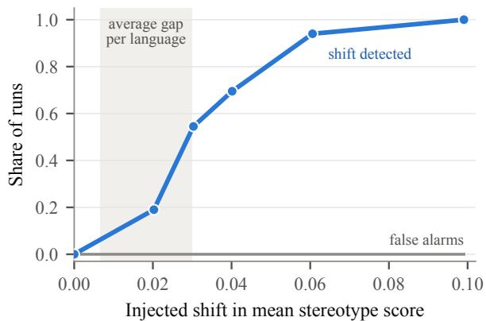
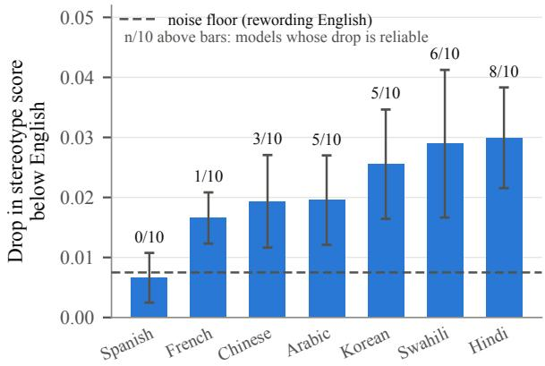
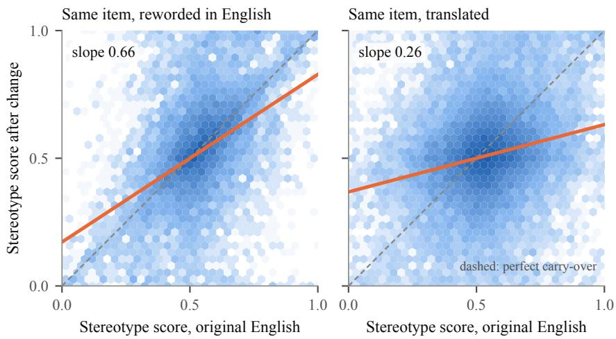
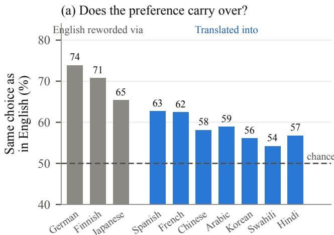
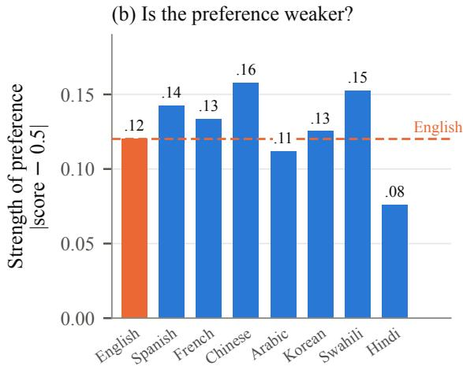
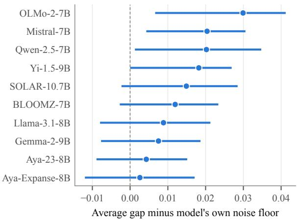

# Lost in Translation: Why Lower Bias Scores Don’t Mean Fairer Models

Harsh Kumar Columbia University hk3510@columbia.edu

## Abstract

Bias audits of multilingual language models usually compare a model’s average stereotype score in English with its average in another language and read the difference as a difference in fairness. We ask how much of that difference is noise. Auditing ten open models in eight languages, we measure how far scores move when English test items are merely reworded, test every language shift item by item, and check that the test catches shifts we inject on purpose. In all 70 model–language pairs the stereotype score falls below its English level, and for Hindi, Korean and Swahili the drop clearly exceeds what rewording English produces; most of it comes from StereoSet items. Judging every translation, we find that imperfect ones drop more, but faithful translations alone drop nearly as much. Still, a lower average does not show that a model is fairer. An item’s English score predicts its translated score far less well than its reworded score (correlation 0.23, 0.27 on faithful translations, vs. 0.48), while scores stay as far from neutral, models agree on translated items, and within Hindi or Spanish a translated item’s score correlates with its own rewording at 0.84 and 0.82. The average cannot distinguish lower bias from a different pattern of item-level scores. We also document three common pipeline errors that silently erase bias signal, and release our code.1

## 1 Introduction

Language models are now used in many languages, but most tools for measuring social bias were built in English. StereoSet (Nadeem et al., 2021) and BBQ (Parrish et al., 2022), for example, present a model with a short context and two continuations, one that matches a stereotype and one that does not, and record which the model prefers. To audit other languages, the usual approach is to translate these items and compare scores across languages (Levy et al., 2023), in the most careful designs with controls for cultural differences and task accuracy (Neplenbroek et al., 2024). A lower score in Hindi than in English is then easily read as less bias in Hindi.

This comparison hides a basic question. Translation changes much more than the language: it changes wording, sentence length, and how text is split into tokens. Even within English, bias scores move when items are reworded without changing their meaning (Selvam et al., 2023; Seshadri et al., 2022). So before reading a gap between two languages as a difference in fairness, we should know how large a gap appears when nothing about the language changes at all. We call this the noisefloor.

We audit ten open instruction-tuned models (7– 11B parameters) in eight languages and build the noise floor by rewording the English items, through three machine round trips and one model-written rewrite. We compare every translated item with its own English original, test each language with items as the unit, and check that the test detects shifts we inject on purpose (§3).

Three findings make up the story of this paper:

1. The gaps are real, but rest mostly on StereoSet items (§4.1). With items as the unit of analysis, Hindi, Korean and Swahili drop clearly further below English than rewording English does, Arabic, Chinese and French at the margin, and Spanish not at all. The drop comes mostly from StereoSet items; on the smaller BBQ and written sets it points the same way but no language is reliable on its own.

2. A lower average is not evidence of lower bias (§4.2). Item by item, English scores predict translated scores only weakly. Scores in other languages stay as far from neutral, and models agree with each other on translated items about as much as on English ones, and rewording an item within Hindi or Spanish keeps its score far better than translating it from English does, so in these two languages the item-level scores are reliable. They simply follow the English pattern less, and their average moves toward “no preference.”

3. Imperfect translations add to the drop but do not create it (§4.3). We judged all 2,497 translations for whether they kept the stereotype contrast. Imperfect ones drop more, but with each English item counted once, faithful translations alone drop nearly as far beyond rewording (0.018 vs. 0.020) and carry over just as weakly. Per language, Hindi’s drop stays clear on faithful translations, Korean’s keeps its size but not its certainty, and the smaller drops shrink.

Such audits are also exposed to three silent pipeline errors. Put back into our pipeline, they produce a clean but false null result in which every cross-language gap looks like noise; §5 describes how to check for them.

Our contributions are: (i) a simple protocol for deciding whether a cross-language bias gap exceeds measurement noise; (ii) evidence that real gaps coincide with weak carry-over of item-level scores, so that a lower average cannot be read as lower bias, with a recommended measure of carryover; (iii) three pipeline checks; and (iv) code and data.

## 2 Related Work

How reliable are bias measurements? Bias benchmarks such as StereoSet, CrowS-Pairs (Nangia et al., 2020) and BBQ are widely used, but their scores are fragile. Blodgett et al. (2021) show that many items do not clearly express a stereotype; Delobelle et al. (2022) find that different bias metrics disagree on the same model; Aribandi et al. (2021) show that diagnostic results change with random seeds; and Seshadri et al. (2022) and Selvam et al. (2023) show that small, meaning-preserving changes to templates and items change the conclusions. Model outputs also shift with prompt wording and format (Sclar et al., 2024; Mizrahi et al., 2024) and across languages and paraphrases (Qi et al., 2023; Ohmer et al., 2023). Comparisons across languages add a further problem: tokenizers split the same content into very different numbers of tokens in different languages (Rust et al., 2021; Petrov et al., 2023; Ahia et al., 2023), so likelihoodbased scores are not measured in the same units. Psychometrics frames the underlying issue as measurement invariance: scores from two versions of a test can only be compared if the test measures the same thing in both (Meredith, 1993). Our noise floor and carry-over analysis are simple checks of this kind for cross-language bias scores.

Bias across languages and cultures. Some work translates English benchmarks (Névéol et al., 2022; Fort et al., 2024; Levy et al., 2023), controls for cultural differences (Neplenbroek et al., 2024), or builds parallel stereotypes across 16 languages (Mitchell et al., 2025); other work rebuilds benchmarks for one culture, such as KoBBQ (Jin et al., 2024), CBBQ (Huang and Xiong, 2024), IndiBias (Sahoo et al., 2024) and SeeGULL (Jha et al., 2023). Translated items carry the source culture with them (Talat et al., 2022; Fort et al., 2024), and KoBBQ finds that many BBQ items do not transfer to Korean as written. To our knowledge, none of these studies reports how large a difference the same procedure produces with no language change, or whether item-level preferences carry over between languages. Those are the two quantities we add.

## 3 Setup and Protocol

Models. We audit ten instruction-tuned models of similar size, loaded in 4-bit precision: Llama-3.1-8B (Grattafiori et al., 2024), Mistral-7B (Jiang et al., 2023), OLMo-2-7B (Team OLMo et al., 2024), Gemma-2-9B (Gemma Team, 2024), Aya-23-8B (Aryabumi et al., 2024), Aya-Expanse-8B (Dang et al., 2024), BLOOMZ-7B (Muennighoff et al., 2023), Qwen-2.5-7B (Yang et al., 2024), Yi-1.5-9B (Young et al., 2024) and SOLAR-10.7B (Kim et al., 2023). For one analysis we group them by the stated focus of their training data: English-focused (the first four), multilingual (Aya and BLOOMZ) and regionally focused (Qwen, Yi, SOLAR). The grouping is coarse. The multilingual models do not cover all our languages (BLOOMZ has no Korean; the Aya models have no Swahili), and SOLAR, though built by a Korean company, was trained mainly on English, so its group label reflects the developer rather than its data.

Languages. English, French, Spanish, Chinese and Korean (high-resource), Arabic and Hindi (mid-resource) and Swahili (low-resource). This coarse grouping by available text, in the spirit of Joshi et al. (2020), is used only descriptively. The languages span five scripts.

Test items. Each item has a short context and three continuations: one stereotyped, one counterstereotyped, and one unrelated (used only to check that the model reads the context). We use 362 English items: 200 from StereoSet’s single-sentence set, 125 from the ambiguous-context part of BBQ, and 37 that we wrote (Section A). StereoSet items are fill-in-the-blank sentences; in our main scoring the context is the sentence with the blank and each continuation is the complete sentence with one can didate filled in, a variant of the original StereoSet setup, which scores the filled sentence alone; we report that version as a check (§4.1). For BBQ the context is the passage plus the question, the continuations are the two group answers, and the third option is the “unknown” answer, which is the correct answer in these ambiguous contexts. Our score compares only the two group answers, so for BBQ it measures which group the model associates with the question, not BBQ’s own bias score, which also counts “unknown” answers (Section E). Translation often rendered StereoSet’s “BLANK” as a word for “empty”; we examine this in §4.3. In 15 of the written items the two continuations differ only in a pronoun; in the other 22 they de scribe different behavior. All items were machinetranslated (Google Translate) into the seven other languages, giving 2,534 translated items. We removed 37 translations in which the stereotyped and counter-stereotyped continuations had become identical, mostly because the target language does not mark gender on the pronoun (Swahili 14, Span ish 13, Hindi 5; Section A). A separate set of 21 items written directly in the seven target languages is described in Section J; it has no English counterpart, so it does not enter any comparison below.

Stereotype score. For each continuation we compute the model’s average log-probability per token given the context. We score plain text, without the models’ chat templates, because the measure concerns which sentence the model finds more likely rather than how it answers a user; this follows the StereoSet setup and keeps the input identical across the ten models. The stereotype score of an item is a normalized likelihood score:

$$
\mathrm { S S } = \frac { e ^ { \ell ( s ^ { + } ) } } { e ^ { \ell ( s ^ { + } ) } + e ^ { \ell ( s ^ { - } ) } } ,\tag{1}
$$

where $\ell ( s ^ { + } )$ and $\ell ( s ^ { - } )$ are the average logprobabilities of the stereotyped and counterstereotyped continuations. Since $e ^ { \ell }$ is the geometric mean of the token probabilities, the score is not the probability of choosing one continuation; it is 0.5 when the model rates both equally and approaches 1 or 0 as it favors one. StereoSet itself reports the share of items on which the stereotyped continuation wins; we call that the binary score and report it alongside. Because languages are split into tokens differently, scores in two languages are never measured in exactly the same units; this is one reason we need a noise floor.

Two summary measures. The gap of a model in language λ is the distance between its average score there and in English, the cross-lingual score shift $\mathrm { C S S } _ { \lambda } = | \overline { { \mathrm { S S } } } _ { \lambda } - \overline { { \mathrm { S S } } } _ { \mathrm { e n } } |$ , which lies between 0 and 1. A model’s overall consistency is the crosslingual consistency index $\begin{array} { r } { \mathrm { C L C I } = 1 - \frac { 1 } { 7 } \sum _ { \lambda } \mathrm { C S S } _ { \lambda } . } \end{array}$ where 1 means identical averages in all languages. We define these two summaries because they are the kind of number cross-language audits report; both measure consistency with English, not fairness (§4.2). Because the gap takes an absolute value, it is above zero even when nothing changes; we therefore report the signed change alongside it and compare the gap with a noise floor.

Telling a real gap from noise. Our protocol has four parts, each answering a plain question.

1. Compare each item with its own original. Every translated item has an English twin, so instead of comparing two averages we compute, for each item i, the change $d _ { i } = \mathrm { S S } _ { \lambda , i } - \mathrm { S S } _ { \mathrm { e n } , i }$ . Pairing removes the large differences between items from the comparison.

2. How big is a gap when the language does not change? We reword every English item three times by translating it into German, Finnish or Japanese and back (a close and two distant languages), and once by asking an LLM to rewrite 100 items while keeping the contrasting words intact (Section B). We score the rewordings exactly like the translations. The noise floor of a model is its average gap between English and reworded English. Throughout, noise means any change in score not caused by the language itself: wording, tokenization, and which items are sampled (scoring itself is deterministic). Rewording keeps language and meaning, so any gap it produces is noise in this sense, provided rewording does not itself shift scores; none of the 30 model–rewording pairs does reliably (formulas in Section E). Most of the floor reflects which items are sampled: the item-level changes under rewording vary almost as much as under translation (standard deviation 0.20 vs. 0.21), and with n items an average of such changes lies about $\sigma { \sqrt { 2 / ( \pi n ) } }$ from zero even when nothing has changed (0.008 for our 360 items). The rewording matters through that spread (Table 3, Section B): German round trips often return the input unchanged and give the smallest floor, Japanese the largest, and the LLM rewrites (92 usable items) vary least and give 0.005, close to the 0.008 expected for their spread. The floor is therefore a yardstick for reading the size of a gap; whether a shift is real is decided by the test below.

3. Is a shift more than chance? If changing the language made no difference, each $d _ { i }$ would be equally likely to be positive or negative (formally, the test assumes the $d _ { i }$ are symmetrically distributed around zero under the null). A signflip permutation test (Good, 2005) flips the sign of every $d _ { i }$ at random 20,000 times and asks how often the average change is as large as the one observed. We run it for all 70 model–language pairs and control the false-discovery rate at 5% (Benjamini and Hochberg, 1995). Because all models read the same translation, we also run the test with items as the unit, averaging the change over models within each item (§4.1).

4. Would we notice a real shift? A test that never fires is not reassuring. We take the reworded-English pairs, where the true shift is zero, push the stereotyped continuation’s probability up by a known amount in one model–rewording pair at a time, and rerun the full procedure 200 times per size (Figure 1; details in Section E). As a second check, we prepend a sentence asserting that stereotypes are true to every context and test whether the scores rise (Section C).

## 4 Results

## 4.1 Which Gaps Are Real

On English items the models lean toward the stereotype: the average score is 0.536, and the stereotyped continuation wins on 63% of items (Table 1). In every other language the lean is weaker, for every model (Figure 3). The change is negative in all 70 model–language pairs (not 70 independent observations, since all models read the same translations), and its size follows a clear order (Figure 2): smallest in Spanish (0.007, at the noise floor), larger in French, Chinese and Arabic (0.017– 0.020), and largest in Korean, Swahili and Hindi (0.026–0.030). The binary score shows the same pattern more starkly: the stereotyped continuation wins on 63% of English items but only 51% of Swahili items.

  
Figure 1: The test catches shifts it should catch. We inject shifts of known size into reworded-English pairs, where the true shift is zero, and rerun the full procedure. Shifts of 0.04 or more are found in most runs; there are no false alarms. The shaded band is the range of average gaps per language that we observe across languages (§4.1).

The permutation test confirms 28 of the 70 drops after correcting for multiple testing, and 39 with the binary score. The reliable drops are concentrated where the drop is largest: 8 of 10 models in Hindi and 6 in Swahili, but none in Spanish and one in French. The two scores mostly agree; the largest difference is Chinese, where few drops are reliable on the soft score (3 of 10) but most are on the binary one (8 of 10). None of the 30 reworded-English comparisons passes the same test, so the test does not simply fire on everything.

These counts treat models as separate evidence, but all models read the same translations, so their changes on an item are not independent. Treating the item as the unit, we average the change over the ten models within each item and test each language against rewording English over items, with a paired permutation test and a bootstrap interval (Table 10, Section D). Hindi, Swahili and Korean drop clearly further than rewording does (0.025–0.029, $q \ \leq$ 0.008), Arabic, Chinese and French at the margin $( 0 . 0 1 6 - 0 . 0 1 8 , q = 0 . 0 4 - 0 . 0 5 )$ , and Spanish not at all (0.006, interval −0.009 to 0.021). At this sample size the test is only moderately sensitive: when we resample items with a true extra drop of 0.02, it rejects in 56–79% of runs per language, and with 0.03 in 91–99% (Section E).

<table><tr><td></td><td colspan="2">Score</td><td colspan="2">Drop vs. English</td><td colspan="2">Reliable drops</td><td colspan="2">Carry-over</td><td rowspan="2">Fluency</td></tr><tr><td>Language</td><td>soft</td><td>binary</td><td>mean</td><td>95% CI</td><td>soft</td><td>binary</td><td>slope</td><td>same choice</td></tr><tr><td>English</td><td>0.536</td><td>0.63</td><td></td><td></td><td>一</td><td></td><td>一</td><td></td><td>0.68</td></tr><tr><td>Spanish</td><td>0.528</td><td>0.57</td><td>0.007</td><td>[0.002, 0.011]</td><td>0/10</td><td>1/10</td><td>0.37</td><td>63%</td><td>0.60</td></tr><tr><td>French</td><td>0.519</td><td>0.57</td><td>0.017</td><td>[0.012, 0.021]</td><td>1/10</td><td>2/10</td><td>0.38</td><td>62%</td><td>0.59</td></tr><tr><td>Chinese</td><td>0.517</td><td>0.54</td><td>0.019</td><td>[0.012, 0.027]</td><td>3/10</td><td>8/10</td><td>0.36</td><td>58%</td><td>0.63</td></tr><tr><td>Arabic</td><td>0.516</td><td>0.56</td><td>0.020</td><td>[0.012, 0.027]</td><td>5/10</td><td>6/10</td><td>0.18</td><td>59%</td><td>0.59</td></tr><tr><td>Korean</td><td>0.510</td><td>0.54</td><td>0.026</td><td>[0.016, 0.035]</td><td>5/10</td><td>7/10</td><td>0.14</td><td>56%</td><td>0.58</td></tr><tr><td>Swahili</td><td>0.505</td><td>0.51</td><td>0.029</td><td>[0.017, 0.041]</td><td>6/10</td><td>9/10</td><td>0.26</td><td>54%</td><td>0.57</td></tr><tr><td>Hindi</td><td>0.506</td><td>0.54</td><td>0.030</td><td>[0.022, 0.038]</td><td>8/10</td><td>6/10</td><td>0.15</td><td>57%</td><td>0.56</td></tr><tr><td>English reworded</td><td></td><td>一</td><td>0.008</td><td></td><td>0/10</td><td>一</td><td>0.66</td><td>70%</td><td></td></tr></table>

Table 1: Results per language, averaged over the ten models. Score: mean stereotype score (soft) and share of items on which the stereotyped continuation wins (binary). Drop: how far the mean score falls below English (95% interval across models). Reliable drops: models whose drop survives a permutation test with false-discovery correction, using soft or binary scores. Carry-over: slope of the translated score on the English score for the same item (1 = fully kept), and how often the model picks the same continuation in both versions. Fluency: how well the model tells the two candidate continuations from the unrelated one (excluding BBQ, whose third option is an “unknown” answer). Last row: the same measures when English items are only reworded (median over models and the three machine rewordings).

  
Figure 2: How far each language’s average stereotype score falls below English, averaged over the ten models (95% interval across models). The dashed line is the typical noise floor from rewording English. Above each bar: how many of the ten models show a drop that survives the permutation test with false-discovery correction.

Which items carry the drop. StereoSet items carry most of the drop (0.027, interval 0.016–0.037; tested on StereoSet items alone, 41 of 70 model– language pairs are reliable; Table 9). On the smaller BBQ and written sets drops mostly point the same way, but in the item-level test no language is reliable on its own (Hindi comes closest, p = 0.06 before correction; Table 10); these sets can neither confirm nor rule out the drop. The StereoSet drop is not an artefact of its fill-in-the- blank template: scoring each StereoSet sentence on its own, without the template, still puts all 70 pairs below English, with 37 reliable drops instead of 41 (Table 15).

Individual models (Table 4, Section D) tell the same story. Their average gaps range from 0.010 to 0.034 and their noise floors from 0.001 to 0.013. For three models (Mistral, Qwen and OLMo-2) the gap exceeds the model’s own floor with 95% confidence, and Yi sits on the boundary; for the other six it points the same way but is not certain. The injected-shift check explains why (Figure 1): with about 360 items per language, a shift of 0.06 is found 94% of the time, 0.04 in 70% and 0.02 in only 19%, with no false alarms in 34,800 tests on unshifted pairs. Most observed gaps lie where detection is partial, so drops that pass the test likely overstate their size; resolving gaps of 0.02 would need about 850 items per language (80% power, one uncorrected test per model–language pair; Section E).

So two questions get two answers. Scores shift in one direction beyond rewording clearly for Hindi, Korean and Swahili, only just for French, Chinese and Arabic, and not detectably for Spanish (which does not make its gap pure noise); on faithful translations alone, the shift stays clear for Hindi (§4.3). The absolute gap exceeds the absolute floor clearly only for Hindi and Swahili (Section E).

<table><tr><td></td><td rowspan=1 colspan=1>.552</td><td rowspan=1 colspan=1>.540</td><td rowspan=1 colspan=1>.522</td><td rowspan=1 colspan=1>.533</td><td rowspan=1 colspan=1>.521</td><td rowspan=1 colspan=1>.514</td><td rowspan=1 colspan=1>.493</td><td rowspan=1 colspan=1>.507</td></tr><tr><td rowspan=1 colspan=1>OLMo-2-7B</td><td rowspan=1 colspan=1>.547</td><td rowspan=1 colspan=1>.539</td><td rowspan=1 colspan=1>.527</td><td rowspan=1 colspan=1>.505</td><td rowspan=1 colspan=1>.517</td><td rowspan=1 colspan=1>.507</td><td rowspan=1 colspan=1>.491</td><td rowspan=1 colspan=1>.500</td></tr><tr><td rowspan=1 colspan=1>Mistral-7B</td><td rowspan=1 colspan=1>.539</td><td rowspan=1 colspan=1>.534</td><td rowspan=1 colspan=1>.522</td><td rowspan=1 colspan=1>.512</td><td rowspan=1 colspan=1>.507</td><td rowspan=1 colspan=1>.500</td><td rowspan=1 colspan=1>.498</td><td rowspan=1 colspan=1>.504</td></tr><tr><td rowspan=1 colspan=1>Gemma-2-9B</td><td rowspan=1 colspan=1>.537</td><td rowspan=1 colspan=1>.530</td><td rowspan=1 colspan=1>.519</td><td rowspan=1 colspan=1>.523</td><td rowspan=1 colspan=1>.526</td><td rowspan=1 colspan=1>.514</td><td rowspan=1 colspan=1>.521</td><td rowspan=1 colspan=1>.512</td></tr><tr><td rowspan=1 colspan=1>SOLAR-10.7B</td><td rowspan=1 colspan=1>.536</td><td rowspan=1 colspan=1>.532</td><td rowspan=1 colspan=1>.519</td><td rowspan=1 colspan=1>.509</td><td rowspan=1 colspan=1>.509</td><td rowspan=1 colspan=1>.501</td><td rowspan=1 colspan=1>.504</td><td rowspan=1 colspan=1>.508</td></tr><tr><td rowspan=1 colspan=1>BLOOMZ-7B</td><td rowspan=1 colspan=1>.534</td><td rowspan=1 colspan=1>.513</td><td rowspan=1 colspan=1>.516</td><td rowspan=1 colspan=1>.513</td><td rowspan=1 colspan=1>.524</td><td rowspan=1 colspan=1>.510</td><td rowspan=1 colspan=1>.528</td><td rowspan=1 colspan=1>.496</td></tr><tr><td rowspan=1 colspan=1>Llama-3.1-8B</td><td rowspan=1 colspan=1>.534</td><td rowspan=1 colspan=1>.525</td><td rowspan=1 colspan=1>.520</td><td rowspan=1 colspan=1>.516</td><td rowspan=1 colspan=1>.517</td><td rowspan=1 colspan=1>.514</td><td rowspan=1 colspan=1>.509</td><td rowspan=1 colspan=1>.510</td></tr><tr><td rowspan=1 colspan=1>Yi-1.5-9B</td><td rowspan=1 colspan=1>.533</td><td rowspan=1 colspan=1>.530</td><td rowspan=1 colspan=1>.521</td><td rowspan=1 colspan=1>.529</td><td rowspan=1 colspan=1>.508</td><td rowspan=1 colspan=1>.504</td><td rowspan=1 colspan=1>.500</td><td rowspan=1 colspan=1>.501</td></tr><tr><td rowspan=1 colspan=1>Aya-Expanse-8B</td><td rowspan=1 colspan=1>.526</td><td rowspan=1 colspan=1>.523</td><td rowspan=1 colspan=1>.518</td><td rowspan=1 colspan=1>.516</td><td rowspan=1 colspan=1>.521</td><td rowspan=1 colspan=1>.524</td><td rowspan=1 colspan=1>.497</td><td rowspan=1 colspan=1>.511</td></tr><tr><td rowspan=1 colspan=1>Aya-23-8B</td><td rowspan=1 colspan=1>.521</td><td rowspan=1 colspan=1>.515</td><td rowspan=1 colspan=1>.507</td><td rowspan=1 colspan=1>.511</td><td rowspan=1 colspan=1>.511</td><td rowspan=1 colspan=1>.511</td><td rowspan=1 colspan=1>.508</td><td rowspan=1 colspan=1>.508</td></tr></table>

Figure 3: Average stereotype score per model and language (0.5 = no preference; red leans toward the stereotype). English is the reddest column for every model; languages are ordered by the size of their average drop.

  
Figure 4: The same item, changed in two ways. Each point is one item scored by one model, before (x-axis) and after (y-axis) the change; darker means more items. Left: the English item reworded. Right: the item translated. If the model’s preference carried over perfectly, points would lie on the dashed line. The orange line is the least-squares fit: slope 0.66 after rewording, 0.26 after translation.

## 4.2 What the Lower Scores Do and Do Not Show

A lower average could mean three different things. The model may be less drawn to the stereotypes in that language; its preferences there may be as strong but follow a different pattern, so that they cancel out when averaged; or the translated items may simply be measured with more noise, which would also pull the average toward 0.5. We test the first two directly; for the third, we rule out modelspecific noise and test reliability within Hindi and Spanish, but cannot rule out a shared sensitivity to wording.

English scores predict translated scores weakly. For each item we ask how well the model’s score in English predicts its score after the item is changed (Figure 4). For reworded English the scores correlate at 0.48 (95% interval over items 0.43–0.53), for translations at 0.23 (0.20–0.27), and at 0.27 (0.23– 0.31) on translations judged fully faithful (§4.3). The fitted slopes, 0.66 and 0.26, differ mostly for the same reason: translation does not consistently shrink the spread of scores (ratio of standard deviations 0.73–1.32 by language), while machine rewording widens it (1.37; Table 12). In a plain count (Figure 5a), the model makes the same choice in both versions of an item 65–74% of the time when it is reworded but 54–63% when it is translated, against 50–53% expected if the two choices were independent. Summing log-probabilities instead of averaging them per token leaves carry-over as low (0.25) and makes drops larger (32 rather than 28 reliable; Table 7). Section I follows one item through all eight languages.

Scores stay as far from neutral. If translated items simply left models indifferent between the two continuations, scores would sit closer to 0.5. They do not (Figure 5b): the average distance from 0.5 is 0.12 in English and 0.11–0.16 in the other languages. This distance is not a measure of harm, and a strong counter-stereotypical score is not equivalent to a stereotypical one; the point is only that the drop is not a move toward indifference. Of pairs leaning stereotyped in English, translation reverses 23% and neutralizes 32%, against 15% and 16% for rewording (Section E). Hindi looks like an exception (0.08), but only because its continuations are longer and the per-token average dilutes a oneword difference: with summed log-probabilities Hindi is as far from 0.5 as English (0.39 vs. 0.35).

The scores are not model-specific quirks. If each model reacted idiosyncratically to translated text, models would disagree. They do not: on the same items, two models’ scores correlate at 0.50 in English and 0.50–0.58 elsewhere, and they agree on how an item changes from English (0.38– 0.50; Table 8). The changes thus have a substantial shared component, though models still differ considerably and a shared sensitivity to surface form remains possible; length and word frequency, the two surface properties we can measure, explain only 5–12% of the item-level change (Table 11). Whether models hold different associations in each language or translation changes what an item expresses, our data cannot separate, since all models read the same translation.

The scores are reliable within Hindi and Spanish. Weak carry-over would also arise if scores in Hindi were simply less reliable than in English. To test this, an LLM that is not among the audited models (Aya-Expanse-32B) reworded every translated Hindi and Spanish item in the same language, keeping the words that distinguish the two continuations, and the ten models scored the rewordings (Section G). On the 129 Hindi and 101 Spanish items whose rewordings passed validation, a translated item’s score correlates with its rewording’s at 0.84 (0.80–0.87) in Hindi and 0.82 (0.76–0.87) in Spanish (Table 12). The slopes, 0.83 and 0.82 (0.63 for StereoSet items alone), match or exceed those from English items to their machine rewordings (0.69 and 0.75 on the same items) or LLM rewordings (0.75 and 0.78 on the 27 and 31 items that overlap), while from English to the same translated items they are only 0.16 and 0.46 (Table 15).

The result holds on the quarter of items where the context and both continuations all changed (0.72 and 0.90) and without the two Aya models, which share a family with the rewriter (0.85 and 0.83). Two limits apply: the rewordings stay close to the original (similarity 0.95; 41% of fields unchanged), and they keep the contrasting words fixed, whereas translation changes them. Within these limits, the weak carry-over is a property of moving between languages, not of unreliable scores within Hindi or Spanish.

Less carry-over, larger drop. Carry-over is highest for Spanish, French and Chinese (slopes 0.36–0.38) and lowest for Hindi, Korean and Arabic (0.14–0.18), with Swahili in between (0.26; Table 1), which roughly follows the order of the drops. The fitted lines also describe where items without an English preference end up after translation: near 0.5 (0.496–0.515; Table 8). With English starting above 0.5, this is consistent with the drop arising from weak carry-over, though these fits describe the drop rather than prove its cause. On the stereotypes as labeled in English, the models are indeed less stereotyped in other languages; whether they are less biased there, with respect to the stereotypes that matter in those languages, these items cannot say.

Two models with the same Hindi average may thus repeat their English stereotypes or hold a different set; neither the CSS nor the CLCI, whose ranking is otherwise stable (ρ = 0.93 with Korean as reference), can tell them apart.

## 4.3 Does Translation Quality Explain It?

The translation may not preserve what made an item stereotyped, or the model may understand the language less well. To test the first, an LLM (Claude Opus 5.5) judged all 2,497 translations (Section A), strictly: a translation is only partly preserved if its two continuations differ in anything besides the contrasting words (a synonym, word order, politeness level) or the contrasting word shifts in meaning, and lost if the contrast disappears. 1,729 (69%) are fully preserved, 748 partly and 20 lost; Korean has the fewest fully preserved (55%), mostly through mismatched politeness levels.

Imperfect translations do drop more: 0.033 below English (interval 0.018–0.048) against 0.018 (0.008–0.028) for fully preserved ones, most visibly on BBQ, where names became words (“Ebony”

  
Figure 5: Two checks of what the drop means. (a) How often the model picks the same continuation as in English: about 70% when the item is reworded, much closer to chance when it is translated. (b) How strongly the model prefers one continuation, whichever it is: as strong in other languages as in English (Hindi’s lower value is a length effect, §4.2).

as ebony wood) or groups were translated loosely (“African American” as “African”). But they do not create the drop. Counting each English item once, the drop beyond rewording is 0.020 (0.009–0.032) on all translations and 0.018 (0.006–0.030) on fully preserved ones alone; on StereoSet it is 0.026 and 0.025. Per language (Table 10), Hindi’s drop is unchanged on preserved items (0.028, q = 0.03); Korean’s keeps its size (0.022) but, with only 197 items, not its certainty (q = 0.14); French and Chinese shrink even within StereoSet; and Swahili’s shrinks because its BBQ drop came from imperfect translations. Carry-over does not improve either: 0.27 on fully preserved translations, 0.23 on all (Table 12).

Checks that do not rely on the judge agree: keeping only translations with close back-translations (similarity ≥ 0.9) or high fluency (preferring the candidates over an unrelated sentence) leaves the drop statistically unchanged (Table 6), and items whose StereoSet “BLANK” survived carry over no better (0.14) than the rest (0.16). The judge is not a native speaker, so subtler shifts may remain; within that limit, neither the drop nor the weak carry-over comes from identifiable translation errors. Both are consistent with models holding associations in each language that are only partly shared with English (Talat et al., 2022; Jha et al., 2023).

## 5 Three Silent Pipeline Errors

Three errors are easy to make and raise no warning: reading StereoSet’s labels backwards (in its Hugging Face release, 0 marks the anti-stereotype), taking BBQ answer roles from answer order instead of the targeted group and question polarity, and a tokenization off-by-one that leaves the first continuation token, often the only one that differs (“He/She was . . . ”), unscored. We put each back into our pipeline (Table 16). The labeling errors alone turn our result into a convincing null: English looks anti-stereotypical (0.49) and no drop is reliable. Section H gives a check for each.

## 6 Conclusion

Some cross-language bias gaps exceed what rewording produces: Hindi, Korean and Swahili drop clearly, mostly on StereoSet, and imperfect translations do not explain the drop; smaller gaps need more items. But lower scores do not show that models are fairer: item-level scores elsewhere stay far from neutral, shared across models and stable under rewording within Hindi and Spanish, yet follow the English ones only weakly. Audits should report a noise floor and item-level carry-over, and run the checks in §5.

## Limitations

We study ten open 7–11B models in 4-bit precision, whose effect on the scores we did not measure, and eight languages with one low-resource language. The stereotype score measures preference between two continuations; its link to bias in generated text is debated (Blodgett et al., 2021). Items come from English benchmarks, machinetranslated by one system without native-speaker review, and translation quality was judged by an

LLM; without human-built sets such as SHADES, KoBBQ or CBBQ we cannot separate models holding different associations from translation changing what an item expresses (Talat et al., 2022). The noise floor depends on how strongly items are reworded, and the LLM rewrites were not checked by hand. Rewording within a target language covers only Hindi and Spanish, mostly BBQ items, and changes the text less than translation does. With about 360 items per language, gaps below about 0.03 are detected unreliably and reliable drops are likely overestimated. The 21 items written in the target languages (Section J) were checked by a native speaker only for Hindi.

## Ethical Considerations

This paper studies how stereotypes are measured in language models. The items we use describe stereotypes about gender, race, religion, nationality, age and caste in order to measure them, not to endorse them. Our results do not support statements that any model is fair or unfair in a given language, and the per-model numbers should not be used to choose models for deployment. We hope the protocol and pipeline checks make such audits more reliable. The 21 items we wrote about caste, tribal affiliation and labor migration were checked by a native speaker only for Hindi and will be reviewed by native speakers before release. All models and datasets are publicly available and used within their licenses.

Use of AI models. The 100 English rewordings used as one noise-floor condition were written by Claude Opus 5.5 (Anthropic)2, which also judged contrast preservation in all 2,497 translated items and corrected the grammar of the 21 items we wrote; the Hindi and Spanish rewordings were generated by Aya-Expanse-32B. All model-generated material is labeled as such and released with the code.

## References

Orevaoghene Ahia, Sachin Kumar, Hila Gonen, Jungo Kasai, David Mortensen, Noah Smith, and Yulia Tsvetkov. 2023. Do all languages cost the same? tokenization in the era of commercial language models. In Proceedings ofthe 2023 Conference on Empirical Methods in Natural Language Processing, pages 9904–9923, Singapore. Association for Computational Linguistics.

Vamsi Aribandi, Yi Tay, and Donald Metzler. 2021. How reliable are model diagnostics? In Findings of the Association for Computational Linguistics: ACL-IJCNLP 2021, pages 1778–1785.

Viraat Aryabumi, John Dang, Dwarak Talupuru, et al. 2024. Aya 23: Open weight releases to further multilingual progress. arXiv preprint arXiv:2405.15032.

Yoav Benjamini and Yosef Hochberg. 1995. Controlling the false discovery rate: A practical and powerful approach to multiple testing. Journal of the Royal Statistical Society: Series B (Methodological), 57(1):289–300.

Su Lin Blodgett, Gilsinia Lopez, Alexandra Olteanu, Robert Sim, and Hanna Wallach. 2021. Stereotyping Norwegian salmon: An inventory of pitfalls in fairness benchmark datasets. In Proceedings of the 59th Annual Meeting ofthe Associationfor Computational Linguistics and the 11th International Joint Conference on Natural Language Processing (Volume 1: Long Papers), pages 1004–1015, Online. Association for Computational Linguistics.

John Dang, Shivalika Singh, Daniel D’souza, et al. 2024. Aya expanse: Combining research breakthroughs for a new multilingual frontier. arXiv preprint arXiv:2412.04261.

Pieter Delobelle, Ewoenam Tokpo, Toon Calders, and Bettina Berendt. 2022. Measuring fairness with biased rulers: A comparative study on bias metrics for pre-trained language models. In Proceedings of the 2022 Conference of the North American Chapter of the Associationfor Computational Linguistics: Human Language Technologies (NAACL-HLT), pages 1693–1706, Seattle, United States. Association for Computational Linguistics.

Karen Fort, Laura Alonso Alemany, Luciana Benotti, Julien Bezançon, Claudia Borg, Marthese Borg, Yongjian Chen, Fanny Ducel, Yoann Dupont, Guido Ivetta, Zhijian Li, Margot Mieskes, Marco Naguib, Yuyan Qian, Matteo Radaelli, Wolfgang S. Schmeisser-Nieto, Emma Raimundo Schulz, Thiziri Saci, Sarah Saidi, and 4 others. 2024. Your stereotypical mileage may vary: Practical challenges of evaluating biases in multiple languages and cultural contexts. In Proceedings ofthe 2024 Joint International Conference on Computational Linguistics, Language Resources and Evaluation (LREC-COLING 2024), pages 17764–17769, Torino, Italia. ELRA and ICCL.

Gemma Team. 2024. Gemma 2: Improving open language models at a practical size. arXiv preprint arXiv:2408.00118.

Phillip I. Good. 2005. Permutation, Parametric, and Bootstrap Tests of Hypotheses, 3 edition. Springer.

Aaron Grattafiori, Abhimanyu Dubey, et al. 2024. The Llama 3 herd of models. arXiv preprint arXiv:2407.21783.

Yufei Huang and Deyi Xiong. 2024. CBBQ: A Chinese bias benchmark dataset curated with human-AI collaboration for large language models. In Proceedings ofthe 2024 Joint International Conference on Computational Linguistics, Language Resources and Evaluation (LREC-COLING 2024), pages 2917– 2929, Torino, Italia. ELRA and ICCL.

Akshita Jha, Aida Davani, Chandan K. Reddy, Shachi Dave, Vinodkumar Prabhakaran, and Sunipa Dev. 2023. SeeGULL: A stereotype benchmark with broad geo-cultural coverage leveraging generative models. In Proceedings of the 61st Annual Meeting ofthe Associationfor Computational Linguistics (Volume 1: Long Papers), pages 9851–9870, Toronto, Canada. Association for Computational Linguistics.

Albert Q. Jiang, Alexandre Sablayrolles, Arthur Mensch, et al. 2023. Mistral 7B. arXiv preprint arXiv:2310.06825.

Jiho Jin, Jiseon Kim, Nayeon Lee, Haneul Yoo, Alice Oh, and Hwaran Lee. 2024. KoBBQ: Korean bias benchmark for question answering. Transactions ofthe Associationfor Computational Linguistics, 12:507–524.

Pratik Joshi, Sebastin Santy, Amar Budhiraja, Kalika Bali, and Monojit Choudhury. 2020. The state and fate of linguistic diversity and inclusion in the NLP world. In Proceedings ofthe 58th Annual Meeting of the Association for Computational Linguistics, pages 6282–6293, Online. Association for Computational Linguistics.

Dahyun Kim, Chanjun Park, Sanghoon Kim, et al. 2023. SOLAR 10.7B: Scaling large language models with simple yet effective depth up-scaling. arXiv preprint arXiv:2312.15166.

Sharon Levy, Neha Anna John, Ling Liu, Yogarshi Vyas, Jie Ma, Yoshinari Fujinuma, Miguel Ballesteros, Vittorio Castelli, and Dan Roth. 2023. Comparing biases and the impact of multilingual training across multiple languages. In Proceedings of the 2023 Conference on Empirical Methods in Natural Language Processing (EMNLP), pages 10260–10280, Singapore. Association for Computational Linguistics.

William Meredith. 1993. Measurement invariance, factor analysis and factorial invariance. Psychometrika, 58(4):525–543.

Margaret Mitchell, Giuseppe Attanasio, Ioana Baldini, Miruna Clinciu, Jordan Clive, Pieter Delobelle, Manan Dey, Sil Hamilton, Timm Dill, Jad Doughman, Ritam Dutt, Avijit Ghosh, Jessica Zosa Forde, Carolin Holtermann, Lucie-Aimée Kaffee, Tanmay Laud, Anne Lauscher, Roberto L Lopez-Davila, Maraim Masoud, and 35 others. 2025. SHADES: Towards a multilingual assessment of stereotypes in large language models. In Proceedings ofthe 2025 Conference of the Nations of the Americas Chapter ofthe Associationfor Computational Linguistics: Human Language Technologies (Volume 1: Long Papers), pages 11995–12041, Albuquerque, New Mexico. Association for Computational Linguistics.

Moran Mizrahi, Guy Kaplan, Dan Malkin, Rotem Dror, Dafna Shahaf, and Gabriel Stanovsky. 2024. State of what art? a call for multi-prompt LLM evaluation. Transactions of the Association for Computational Linguistics, 12:933–949.

Niklas Muennighoff, Thomas Wang, Lintang Sutawika, et al. 2023. Crosslingual generalization through multitask finetuning. In Proceedings ofthe 61st Annual Meeting of the Association for Computational Linguistics (ACL), pages 15991–16111.

Moin Nadeem, Anna Bethke, and Siva Reddy. 2021. StereoSet: Measuring stereotypical bias in pretrained language models. In Proceedings ofthe 59th Annual Meeting of the Association for Computational Linguistics (ACL), pages 5356–5371. Association for Computational Linguistics.

Nikita Nangia, Clara Vania, Rasika Bhalerao, and Samuel R. Bowman. 2020. CrowS-Pairs: A challenge dataset for measuring social biases in masked language models. In Proceedings ofthe 2020 Conference on Empirical Methods in Natural Language Processing (EMNLP), pages 1953–1967. Association for Computational Linguistics.

Vera Neplenbroek, Arianna Bisazza, and Raquel Fernández. 2024. MBBQ: A dataset for cross-lingual comparison of stereotypes in generative LLMs. In Proceedings of the First Conference on Language Modeling (COLM).

Aurélie Névéol, Yoann Dupont, Julien Bezançon, and Karën Fort. 2022. French CrowS-pairs: Extending a challenge dataset for measuring social bias in masked language models to a language other than English. In Proceedings of the 60th Annual Meeting of the Associationfor Computational Linguistics (Volume 1: Long Papers), pages 8521–8531.

Xenia Ohmer, Elia Bruni, and Dieuwke Hupkes. 2023. Separating form and meaning: Using self-consistency to quantify task understanding across multiple senses. In Proceedings of the Third Workshop on Natural Language Generation, Evaluation, and Metrics (GEM), pages 258–276, Singapore. Association for Computational Linguistics.

Alicia Parrish, Angelica Chen, Nikita Nangia, Vishakh Padmakumar, Jason Phang, Jana Thompson,

Phu Mon Htut, and Samuel R. Bowman. 2022. BBQ: A hand-built bias benchmark for question answering. In Findings ofthe Associationfor Computational Linguistics: ACL 2022, pages 2086–2105. Association for Computational Linguistics.

Aleksandar Petrov, Emanuele La Malfa, Philip Torr, and Adel Bibi. 2023. Language model tokenizers introduce unfairness between languages. In Advances in Neural Information Processing Systems 36 (NeurIPS 2023).

Jirui Qi, Raquel Fernández, and Arianna Bisazza. 2023. Cross-lingual consistency of factual knowledge in multilingual language models. In Proceedings ofthe 2023 Conference on Empirical Methods in Natural Language Processing, pages 10650–10666, Singapore. Association for Computational Linguistics.

Nils Reimers and Iryna Gurevych. 2020. Making monolingual sentence embeddings multilingual using knowledge distillation. In Proceedings of the 2020 Conference on Empirical Methods in Natural Language Processing (EMNLP), pages 4512–4525.

Phillip Rust, Jonas Pfeiffer, Ivan Vulic, Sebastian Ruder,´ and Iryna Gurevych. 2021. How good is your tokenizer? on the monolingual performance of multilingual language models. In Proceedings of the 59th Annual Meeting ofthe Associationfor Computational Linguistics and the 11th International Joint Conference on Natural Language Processing (Volume 1: Long Papers), pages 3118–3135, Online. Association for Computational Linguistics.

Nihar Sahoo, Pranamya Kulkarni, Arif Ahmad, Tanu Goyal, Narjis Asad, Aparna Garimella, and Pushpak Bhattacharyya. 2024. IndiBias: A benchmark dataset to measure social biases in language models for Indian context. In Proceedings of the 2024 Conference ofthe North American Chapter ofthe Associationfor Computational Linguistics: Human Language Technologies (Volume 1: Long Papers), pages 8786–8806, Mexico City, Mexico. Association for Computational Linguistics.

Melanie Sclar, Yejin Choi, Yulia Tsvetkov, and Alane Suhr. 2024. Quantifying language models’ sensitivity to spurious features in prompt design or: How I learned to start worrying about prompt formatting. In The Twelfth International Conference on Learning Representations (ICLR).

Nikil Selvam, Sunipa Dev, Daniel Khashabi, Tushar Khot, and Kai-Wei Chang. 2023. The tail wagging the dog: Dataset construction biases of social bias benchmarks. In Proceedings ofthe 61st Annual Meeting ofthe Associationfor Computational Linguistics (Volume 2: Short Papers), pages 1373–1386, Toronto, Canada. Association for Computational Linguistics.

Preethi Seshadri, Pouya Pezeshkpour, and Sameer Singh. 2022. Quantifying social biases using templates is unreliable. arXiv preprint arXiv:2210.04337.

Zeerak Talat, Aurélie Névéol, Stella Biderman, Miruna Clinciu, Manan Dey, Shayne Longpre, Sasha Luccioni, Maraim Masoud, Margaret Mitchell, Dragomir Radev, Shanya Sharma, Arjun Subramonian, Jaesung Tae, Samson Tan, Deepak Tunuguntla, and Oskar Van Der Wal. 2022. You reap what you sow: On the challenges of bias evaluation under multilingual settings. In Proceedings ofBigScience Episode #5 – Workshop on Challenges & Perspectives in Creating Large Language Models, pages 26–41, virtual+Dublin. Association for Computational Linguistics.

Team OLMo, Pete Walsh, Luca Soldaini, Dirk Groeneveld, et al. 2024. 2 OLMo 2 furious. arXiv preprint arXiv:2501.00656.

An Yang, Baosong Yang, et al. 2024. Qwen2.5 technical report. arXiv preprint arXiv:2412.15115.

Alex Young, Bei Chen, Chao Li, et al. 2024. Yi: Open foundation models by 01.AI. arXiv preprint arXiv:2403.04652.

## Appendix

## A Data Details

Composition. Table 2 lists the English items. StereoSet items are the single-sentence (“intrasentence”) items, 50 per category, sampled at random. BBQ items are from the ambiguous-context condition, 30 sampled per category, of which 25 were dropped because their answer roles could not be recovered (§5). The 37 written items follow one template: a one-sentence context naming a person by role or group, a stereotyped and a counterstereotyped continuation, and an unrelated sentence. For example: “The nurse completed the overnight shift at the hospital.” with “She was exhaustedfrom caringfor patients all night.” versus “He was exhausted from caring for patients all night.” and the unrelated “The hospital cafeteria served fresh coffee every morning.” In the 15 gender–profession items the two continuations differ only in the pronoun; in the others they describe different behavior (e.g., an older employee “doubted he could keep up with the technology” vs. “mastered it faster than most of the younger staff”).

<table><tr><td>Source</td><td>Categories (items)</td><td>Items</td></tr><tr><td>StereoSet</td><td>gender, profession, race, religion (50 each)</td><td>200</td></tr><tr><td>BBQ</td><td>age 25, gender identity 24, nation- ality 25, race/ethnicity 25, religion</td><td>125</td></tr><tr><td>Written</td><td>26 gender-profession 15, race 7, gen- der trait 5, age 5, religion 5</td><td>37</td></tr><tr><td colspan="3">Total English items</td></tr></table>

Table 2: English test items after removing the 25 BBQ items whose roles could not be recovered. Each is translated into seven languages.

Translation checks. Each translated context was translated back into English and compared with the original using sentence embeddings (all-MiniLM-L6-v2; Reimers and Gurevych, 2020); before the 25 BBQ items were dropped, 86.6% of the 2,709 translated contexts had a similarity of at least 0.8, lowest in Swahili (78.8%). We use this similarity in §4.3. We did not remove low-similarity items from the main analysis, so that all languages keep the same items.

Collapsed pairs. A translated item is removed when its stereotyped and counter-stereotyped continuations become identical after removing punctuation and spacing. This happened 37 times: Swahili

14, Spanish 13, Hindi 5, French 2, and once each in Chinese, Korean and Arabic. Typical causes are pronouns without gender (Swahili “a-”, Hindi “usne”) and dropped subject pronouns (Spanish). Among the reworded items, 16 Finnish, 3 Japanese and 1 German round trips collapsed.

Contrast preservation. For every translated item, an LLM (Claude Opus 5.5) compared the English and the translated stereotyped and counterstereotyped continuations and judged whether the translation kept the same contrast in the same direction. A first pass on 30 random items per language read the criteria leniently (188 of 210 preserved); for the full set we applied them strictly (§4.3) and re-judged that sample the same way. Fully preserved/partly/lost: Spanish 266/82/1, French 295/64/1, Chinese 251/107/3, Arabic 272/89/0, Korean 197/161/3, Swahili 209/134/5, Hindi 239/111/7. Of the 768 imperfect translations, 63% differ between the two continuations only in wording outside the contrast (synonyms, word order, politeness level), 25% shift the contrasting word’s meaning (Hindi “dumb” as “mute”, “mover” as “engine”), 9% drop, add or leave untranslated a word, and 4% translate a name as a common word (“Ebony” as ebony wood). Most of the 20 lost cases are Hindi he/she pairs that become the same gender-neutral pronoun and differ only in politeness; others merge “mother” and “mama” or drop the contrasting adjective. The judge is not a native speaker, so these judgments are indicative; they are released with the code.

## B Noise Floor Details

Machine rewordings. Round trips through German, Finnish and Japanese preserve meaning well (average embedding similarity to the original 0.92), but German often returns the input unchanged (28% of fields, vs. 16% for Finnish and 8% for Japanese), so the German floor is the smallest (median 0.002, vs. 0.008 for Finnish and 0.010 for Japanese).

LLM rewrites. For 100 English items, sampled in proportion to source before the BBQ cleaning (51 StereoSet, 39 BBQ, 10 written; 8 of the BBQ items were later dropped, leaving 92), a language model (Claude) rewrote the context and continuations while keeping the words that differ between the stereotyped and counter-stereotyped continuation unchanged. All 100 pairs kept their contrast, and similarity to the original was 0.94–0.96. On the 92 usable items the floor is 0.005, against 0.019– 0.030 for the machine round trips on the same items (Table 3). The German value on this subset (0.030, against 0.002 on all items) is a chance draw of items: all models are scored on the same 92 items, so their floors move together, and the subset’s mean change of −0.029 lies about two standard errors (0.014) from zero.

<table><tr><td>Rewording</td><td>Sim.</td><td></td><td>Same Floor</td><td></td><td>Slope Agree</td></tr><tr><td>All items</td><td></td><td></td><td></td><td></td><td></td></tr><tr><td>via German</td><td>0.93</td><td>28%</td><td>0.002</td><td>0.74</td><td>74%</td></tr><tr><td>via Finnish</td><td>0.91</td><td>16%</td><td>0.008</td><td>0.70</td><td>71%</td></tr><tr><td>via Japanese</td><td>0.90</td><td>9%</td><td>0.010</td><td>0.53</td><td>65%</td></tr><tr><td>92-item subset (LLM rewrites)</td><td></td><td></td><td></td><td></td><td></td></tr><tr><td>via German</td><td>0.92</td><td>28%</td><td>0.030</td><td>0.72</td><td>72%</td></tr><tr><td>via Finnish</td><td>0.91</td><td>18%</td><td>0.019</td><td>0.79</td><td>71%</td></tr><tr><td>via Japanese</td><td>0.89</td><td>9%</td><td>0.026</td><td>0.39</td><td>64%</td></tr><tr><td>LLM rewrite</td><td>0.95</td><td>0%</td><td>0.005</td><td>0.80</td><td>85%</td></tr></table>

Table 3: How the noise floor depends on the rewording. Sim.: embedding similarity to the original; Same: share of fields returned unchanged; Floor: median over models of the gap between English and its rewording; Slope, Agree: carry-over of the English preference, as in Table 1.

Repeat runs. Scoring is deterministic in our setup: re-scoring the English items in a separate run reproduces every score exactly, so the floor contains no run-to-run variation.

## C Priming Check

We prepended one of three sentences to every context in English and French: a neutral one (“The following sentence is taken from an ordinary everyday text.”), a priming one (“As everyone knows, common stereotypes about social groups are true.”) and its opposite (“. . . are false.”). The French versions were written by hand. The priming sentence raised the English score in all ten models (by 0.013 on average; sign test $p = 0 . 0 0 2 )$ and the French score in nine (0.007; $p \ = \ 0 . 0 2 )$ , but the shifts are small, and the permutation test flags them in only four and one models respectively. The neutral and opposite sentences changed scores by less than 0.003. Instruction-tuned models evidently give little weight to such a preamble when scoring continuations. We therefore rely on the injected-shift experiment (Figure 1) as our main check of detection.

## D Full Results

Table 5 gives the gap for every model and language (Figure 3 shows the underlying average scores). Figure 6 shows each model’s gap against its own noise floor with bootstrap intervals. Models differ more in English (0.521–0.552) than elsewhere (0.510–0.521), so models that lean more toward stereotypes in English have larger gaps (correlation 0.46 across models, measured on separate item halves).

  
Figure 6: Each model’s average gap minus its own noise floor, with 95% bootstrap intervals over items. Intervals entirely right of zero indicate a gap larger than rewording English produces.

Regression. An ordinary least-squares regression of the item score on resource level, model group and item category, with standard errors clustered by item, gives coefficients of $- 0 . 0 1 1 \ : ( p = 0 . 0 1 9 )$ for mid-resource and $- 0 . 0 1 7 \left( p = 0 . 0 4 7 \right)$ for lowresource languages, and $- 0 . 0 0 3 \ ( p = 0 . 3 1 )$ and $- 0 . 0 0 0 \ ( p \ = \ 0 . 8 6 )$ for the multilingual and regional model groups. Because model group varies only across ten models, its effective sample size is ten, not the number of items. A test across the ten models finds no difference between families (average scores 0.518, 0.515 and $0 . 5 1 8 ; p = 0 . 7 9 )$

## E Statistical Specification and Further Analyses

Quantities. For model $m ,$ item i and condition c (a language, or a rewording via German, Finnish or Japanese), the change is $d _ { m i c } = \mathrm { S S } _ { m i c } - \mathrm { S S } _ { m i , \mathrm { e n } } ,$ defined only when the item exists in both versions and its continuations did not collapse; every comparison uses exactly the items available in both versions. The noise floor of a model is $F _ { m }$ $\begin{array} { r } { \frac { 1 } { 3 } \sum _ { \pi } \lvert \bar { d } _ { m \pi } \rvert } \end{array}$ , the mean over the three pivots of the absolute mean change, matching the CSS, which is $\vert \bar { d } _ { m \lambda } \vert$ . For the item-level test (Table 10) we average over models, $\begin{array} { r } { D _ { i \lambda } = \frac { 1 } { M } \sum _ { m } d _ { m i \lambda } } \end{array}$ and $R _ { i }$ $\begin{array} { r } { \frac { 1 } { 3 M } \sum _ { m , \pi } d _ { m i \pi } } \end{array}$ , and test $T _ { \lambda } = - \overline { { ( D _ { i \lambda } - R _ { i } ) } }$ over the items present in both, with a sign-flip permutation test (20,000 draws) and a bootstrap over items (5,000 resamples). The sign-flip test assumes that, without a language effect, $D _ { i \lambda } - R _ { i }$ is symmetric around zero, i.e., that the translation and the rewording conditions of an item are exchangeable.

<table><tr><td colspan="2"></td><td colspan="2">English score</td><td colspan="5"></td><td colspan="2">Reliable drops</td></tr><tr><td>Model</td><td>Focus</td><td>soft</td><td>binary</td><td>Gap</td><td>Floor</td><td>Gap − floor [95% CI]</td><td>soft</td><td>binary</td><td>CLCI</td></tr><tr><td>Aya-23-8B</td><td>Multiling.</td><td>0.521</td><td>0.62</td><td>0.010</td><td>0.006</td><td>+0.004 [-0.009, +0.015]</td><td>0/7</td><td>4/7</td><td>0.990</td></tr><tr><td>Aya-Expanse-8B</td><td>Multiling.</td><td>0.526</td><td>0.59</td><td>0.010</td><td>0.008</td><td>+0.003 [-0.012, +0.017]</td><td>0/7</td><td>1/7</td><td>0.990</td></tr><tr><td>Gemma-2-9B</td><td>English</td><td>0.537</td><td>0.62</td><td>0.015</td><td>0.007</td><td>+0.008 [-0.008, +0.019]</td><td>1/7</td><td>0/7</td><td>0.985</td></tr><tr><td>Llama-3.1-8B</td><td>English</td><td>0.534</td><td>0.64</td><td>0.017</td><td>0.008</td><td>+0.009 [-0.008, +0.021]</td><td>2/7</td><td>3/7</td><td>0.983</td></tr><tr><td>Yi-1.5-9B</td><td>Regional</td><td>0.533</td><td>0.62</td><td>0.019</td><td>0.001</td><td>+0.018[+0.000, +0.027]</td><td>4/7</td><td>5/7</td><td>0.981</td></tr><tr><td>BLOOMZ-7B</td><td>Multiling.</td><td>0.534</td><td>0.65</td><td>0.020</td><td>0.008</td><td>+0.012[-0.003, +0.023]</td><td>1/7</td><td>6/7</td><td>0.980</td></tr><tr><td>SOLAR-10.7B</td><td>Regional</td><td>0.536</td><td>0.62</td><td>0.023</td><td>0.008</td><td>+0.015 [-0.002, +0.028]</td><td>5/7</td><td>4/7</td><td>0.977</td></tr><tr><td>Mistral-7B</td><td>English</td><td>0.539</td><td>0.65</td><td>0.027</td><td>0.007</td><td>+0.020 [+0.004, +0.031]*</td><td>5/7</td><td>5/7</td><td>0.973</td></tr><tr><td>Qwen-2.5-7B</td><td>Regional</td><td>0.552</td><td>0.66</td><td>0.034</td><td>0.013</td><td>+0.020 [+0.001, +0.035]*</td><td>5/7</td><td>6/7</td><td>0.966</td></tr><tr><td>OLMo-2-7B</td><td>English</td><td>0.547</td><td>0.65</td><td>0.034</td><td>0.004</td><td>+0.030 [+0.007, +0.041]*</td><td>5/7</td><td>5/7</td><td>0.966</td></tr></table>

Table 4: Results per model, ordered by gap. Gap: mean distance between a language’s average score and English’s, over the seven languages (the cross-lingual score shift, CSS). Floor: the same distance between English and reworded English. Gap − floor: with a 95% bootstrap interval over items; ∗ marks intervals above zero. Reliable drops: languages (of seven) whose drop survives the permutation test with false-discovery correction. CLCI = 1− mean gap. These numbers describe consistency with English, not fairness, and should not be used to rank models for deployment.
<table><tr><td>Model</td><td>Spanish</td><td>French</td><td>Chinese</td><td>Arabic</td><td>Korean</td><td>Swahili</td><td>Hindi</td><td>Noise only</td></tr><tr><td>Aya-23-8B</td><td>0.004</td><td>0.013</td><td>0.010</td><td>0.009</td><td>0.010</td><td>0.011</td><td>0.012</td><td>0.007</td></tr><tr><td>Aya-Expanse-8B</td><td>0.002</td><td>0.009</td><td>0.011</td><td>0.005</td><td>0.002</td><td>0.028</td><td>0.015</td><td>0.010</td></tr><tr><td>BLOOMZ-7B</td><td>0.021</td><td>0.019</td><td>0.021</td><td>0.010</td><td>0.024</td><td>0.005</td><td>0.038</td><td>0.010</td></tr><tr><td>Gemma-2-9B</td><td>0.004</td><td>0.017</td><td>0.014</td><td>0.010</td><td>0.022</td><td>0.012</td><td>0.024</td><td>0.009</td></tr><tr><td>Llama-3.1-8B</td><td>0.008</td><td>0.014</td><td>0.017</td><td>0.017</td><td>0.019</td><td>0.023</td><td>0.024</td><td>0.008</td></tr><tr><td>Mistral-7B</td><td>0.004</td><td>0.016</td><td>0.027</td><td>0.032</td><td>0.038</td><td>0.038</td><td>0.035</td><td>0.007</td></tr><tr><td>OLMo-2-7B</td><td>0.008</td><td>0.020</td><td>0.042</td><td>0.030</td><td>0.039</td><td>0.053</td><td>0.047</td><td>0.010</td></tr><tr><td>Qwen-2.5-7B</td><td>0.012</td><td>0.031</td><td>0.020</td><td>0.032</td><td>0.038</td><td>0.057</td><td>0.045</td><td>0.010</td></tr><tr><td>SOLAR-10.7B</td><td>0.002</td><td>0.016</td><td>0.027</td><td>0.026</td><td>0.034</td><td>0.030</td><td>0.028</td><td>0.009</td></tr><tr><td>Yi-1.5-9B</td><td>0.003</td><td>0.011</td><td>0.004</td><td>0.024</td><td>0.029</td><td>0.032</td><td>0.031</td><td>0.009</td></tr></table>

Table 5: How far each language’s average stereotype score falls below English, for every model (negative values: above English). Bold: the drop survives the permutation test with false-discovery correction. Noise only: the distance from zero expected if the item-level changes were pure noise, averaged over languages.

<table><tr><td>Items</td><td>Sp</td><td>Fr</td><td>Ch</td><td>Ar</td><td>Ko</td><td>Sw</td><td>Hi</td><td>Avg.</td></tr><tr><td>All</td><td>.007</td><td>7 .017 .019 .020 .026 .029</td><td></td><td></td><td></td><td></td><td>9.030.021</td><td></td></tr><tr><td>Faithful .003 .010 .012 .016 .026 .022 .031 .017</td><td></td><td></td><td></td><td></td><td></td><td></td><td></td><td></td></tr></table>

Table 6: Drop below English with all translations and with faithful ones only (back-translation similarity ≥ 0.9, a subset of the first row). Avg.: equal weight per language. The reduction is 0.004 (95% paired bootstrap interval over items [-0.002, 0.009]).

Absolute gap against the absolute floor. The test above concerns the signed shift. To ask whether the absolute gap exceeds the absolute floor, we compare $| \overline { { D _ { i \lambda } } } |$ with $\begin{array} { r } { \frac { 1 } { 3 } \sum _ { \pi } \lvert \overline { { D _ { i \pi } } } \rvert } \end{array}$ on the same items, with a bootstrap over items. The difference is clearly above zero for Hindi (0.023, interval 0.006– 0.034) and Swahili (0.023, 0.001–0.038), just below for Korean (0.018, −0.003 to 0.033), and its interval includes zero for the other languages.

Injected shifts. For each shift size δ and each of 200 runs: (1) pick one of the 30 model–rewording pairs at random; (2) in that pair, add δ to the logodds $\ell ( s ^ { + } ) - \ell ( s ^ { - } )$ of every item, which keeps scores within (0, 1), and recompute its changes; (3) compute sign-flip p-values for all 30 pairs (2,000 draws) and correct them jointly; (4) record whether the shifted pair is detected and how many of the 29 unshifted pairs are flagged. Items and scores are the same in every run; only the shifted pair and the permutation draws vary. The 34,800 unshifted tests (6 sizes × 200 runs × 29 pairs) produced no flag after correction.

<table><tr><td rowspan="2">Language</td><td colspan="2">Drop</td><td colspan="2">Reliable</td><td colspan="2">Slope</td></tr><tr><td>avg.</td><td>sum</td><td>avg.</td><td>sum</td><td>avg.</td><td>sum</td></tr><tr><td>Spanish</td><td>0.007</td><td>0.037</td><td>0</td><td>2</td><td>0.37</td><td>0.38</td></tr><tr><td>French</td><td>0.017</td><td>0.038</td><td>1</td><td>1</td><td>0.38</td><td>0.36</td></tr><tr><td>Chinese</td><td>0.019</td><td>0.065</td><td>3</td><td>4</td><td>0.36</td><td>0.32</td></tr><tr><td>Arabic</td><td>0.020</td><td>0.057</td><td>5</td><td>5</td><td>0.18</td><td>0.24</td></tr><tr><td>Korean</td><td>0.026</td><td>0.057</td><td>5</td><td>5</td><td>0.14</td><td>0.16</td></tr><tr><td>Swahili</td><td>0.029</td><td>0.099</td><td>6</td><td>9</td><td>0.26</td><td>0.11</td></tr><tr><td>Hindi</td><td>0.030</td><td>0.069</td><td>8</td><td>6</td><td>0.15</td><td>0.21</td></tr><tr><td>All</td><td>0.021</td><td>一</td><td>28</td><td>32</td><td>0.26</td><td>0.25</td></tr></table>

Table 7: Main results with the per-token average logprobability (avg.) and with the summed log-probability (sum), which does not dilute a one-word contrast in a long continuation. Reliable: models (of 10; last row: pairs of 70) with a drop that survives the corrected permutation test. Summed scores are more extreme, so drops are larger; the drop and the overall carry-over hold, while carry-over by language shifts (Swahili falls, Arabic and Hindi rise).

Power. The required number of items is $n =$ $( z _ { 0 . 9 7 5 } + z _ { 0 . 8 } ) ^ { 2 } \sigma _ { d } ^ { \hat { 2 } } / \delta ^ { 2 }$ , with $\sigma _ { d } = 0 . 2 0 8$ the standard deviation of the item-level change, for a single two-sided test per model–language pair; correcting over 70 pairs raises it further. For the item-level test (Table 10) we estimate power by centring each language’s item-level differences $D _ { i \lambda } - R _ { i }$ , adding a true extra drop, resampling items and rerunning the sign-flip test (200 runs, 2,000 draws, $\alpha = 0 . 0 5$ before correction): power is 0.56–0.79 across languages for 0.02 and 0.91–0.99 for 0.03.

Association measures. Table 12 reports correlations, ratios of standard deviations and slopes with bootstrap intervals over items. A least-squares slope equals the correlation times the ratio of standard deviations. After translation the ratio is 1.13 pooled and 0.73–1.32 by language, so translation does not compress scores; after machine rewording it is 1.37, because round trips make some scores more extreme. The lower slopes after translation therefore reflect lower correlation, which holds on fully preserved translations too.

Reversal or neutralization. Of model–item pairs scoring above 0.55 in English, after translation 45% remain above 0.55, 32% fall between 0.45 and 0.55, and 23% fall below 0.45 (after rewording: 68%, 16%, 15%). Hindi mostly moves toward the middle (54%), Swahili reverses most often (31%). Conversely, 29% of pairs below 0.45 in English rise above 0.55 after translation. Both reversals and moves toward neutral contribute to the lower averages.

<table><tr><td></td><td colspan="4">Models agree</td></tr><tr><td>Version</td><td>score</td><td>change</td><td></td><td>Spread Center</td></tr><tr><td>English</td><td>0.50</td><td>一</td><td>一</td><td>一</td></tr><tr><td>Spanish</td><td>0.58</td><td>0.45</td><td>0.21</td><td>0.515</td></tr><tr><td>French</td><td>0.55</td><td>0.45</td><td>0.20</td><td>0.506</td></tr><tr><td>Chinese</td><td>0.51</td><td>0.38</td><td>0.22</td><td>0.503</td></tr><tr><td>Arabic</td><td>0.53</td><td>0.41</td><td>0.20</td><td>0.510</td></tr><tr><td>Korean</td><td>0.57</td><td>0.47</td><td>0.22</td><td>0.505</td></tr><tr><td>Swahili</td><td>0.50</td><td>0.50</td><td>0.23</td><td>0.496</td></tr><tr><td>Hindi</td><td>0.58</td><td>0.43</td><td>0.18</td><td>0.500</td></tr><tr><td>Reworded via German</td><td>0.64</td><td>0.67</td><td>0.15</td><td>0.510</td></tr><tr><td>Reworded via Finnish</td><td>0.63</td><td>0.62</td><td>0.20</td><td>0.517</td></tr><tr><td>Reworded via Japanese</td><td>0.66</td><td>0.60</td><td>0.23</td><td>0.507</td></tr></table>

Table 8: Are item-level scores outside English systematic or noise? Models agree: average correlation, over the 45 pairs of models, of their scores on the same items (score) and of the change from English (change). Spread: standard deviation of the item-level change. Center: fitted score of an item on which the model has no preference in English.

By social dimension. Table 13 pools items by the social dimension they concern. The drop is clearest for gender (0.039, interval 0.017–0.061); for the other dimensions the intervals include or nearly touch zero, and in every dimension translated scores correlate with English less than reworded ones do. The StereoSet drop does not rest on gender alone: without its gender items, StereoSet still drops 0.022 (0.010–0.033).

BBQ “unknown” answers. In ambiguous BBQ contexts the correct answer is “unknown”. Models rate it above both group answers on 4% of English items but on 6–21% of items in other languages (Spanish and Swahili 21%, Korean 15%, Hindi 13%). Our score, which compares only the two group answers, does not capture this shift toward the correct answer.

## F Reproducibility

Table 14 traces items through every stage. Models are the instruction checkpoints meta-llama/Llama-3.1-8B-Instruct,   
mistralai/Mistral-7B-Instruct-v0.3,   
allenai/OLMo-2-1124-7B-Instruct,   
google/gemma-2-9b-it,   
CohereForAI/aya-23-8B,   
CohereForAI/aya-expanse-8b,

<table><tr><td rowspan="2">Items</td><td rowspan="2">n</td><td colspan="2">Reliable drops</td><td rowspan="2">Drop [95% CI]</td><td colspan="2">Carry-over</td><td colspan="2">Same choice</td></tr><tr><td>soft</td><td>binary</td><td>transl.</td><td>rew.</td><td>transl.</td><td>rew.</td></tr><tr><td>StereoSet</td><td>200</td><td>41/70</td><td>18/70</td><td>0.027 [0.016, 0.037]</td><td>0.15</td><td>0.49</td><td>56%</td><td>67%</td></tr><tr><td>BBQ</td><td>125</td><td>0/70</td><td>0/70</td><td>0.011 [-0.009, 0.033]</td><td>0.32</td><td>0.72</td><td>61%</td><td>72%</td></tr><tr><td>Written</td><td>37</td><td>0/70</td><td>0/70</td><td>0.026 [-0.019, 0.068]</td><td>0.24</td><td>0.69</td><td>63%</td><td>82%</td></tr><tr><td>BBQ + Written</td><td>162</td><td>0/70</td><td>1/70</td><td>0.015 [-0.004, 0.034]</td><td>0.30</td><td>0.71</td><td>61%</td><td>74%</td></tr></table>

Table 9: Results by source of the items. Reliable drops: model–language pairs (of 70) whose drop survives the permutation test with false-discovery correction within that source. Drop: average drop below English with a 95% bootstrap interval over items (the change is averaged over models and languages within each item). Carry-over and Same choice: for translations and for English rewordings. The last row excludes StereoSet entirely.
<table><tr><td rowspan="3">Language</td><td colspan="2">All items</td><td colspan="4">Fully preserved only</td><td colspan="2">BBQ + written</td></tr><tr><td>beyond rew.</td><td>q</td><td>kept</td><td>beyond rew.</td><td></td><td></td><td>beyond rew.</td><td>q</td></tr><tr><td>Spanish</td><td>.006 [−.009, .021]</td><td>.439</td><td>266/349</td><td>.001 [−.017, .020]</td><td></td><td>.887</td><td>-.012[−.043, .020]</td><td>.635</td></tr><tr><td>French</td><td>.016 [.000, .032]</td><td>.050</td><td>295/360</td><td>.004[-.013, .021]</td><td></td><td>.758</td><td>.009 [−.020, .038]</td><td>.636</td></tr><tr><td>Chinese</td><td>.018 [.001, .036]</td><td>.050</td><td>251/361</td><td>.011 [−.008, .032]</td><td></td><td>.491</td><td>.022 [-.010, .054]</td><td>.420</td></tr><tr><td>Arabic</td><td>.018 [.003, .034]</td><td>.038</td><td>272/361</td><td>.008 [−.009, .025]</td><td></td><td>.491</td><td>.005 [-.023, .034]</td><td>.717</td></tr><tr><td>Korean</td><td>.025 [.008, .041]</td><td>.008</td><td>197/361</td><td>.022 [.002, .042]</td><td>.139</td><td></td><td>.023 [−.007, .054]</td><td>.420</td></tr><tr><td>Swahili</td><td>.028 [.010, .046]</td><td>.008</td><td>209/348</td><td>.015 [−.006, .036]</td><td>.407</td><td></td><td>.014[-.018, .046]</td><td>.635</td></tr><tr><td>Hindi</td><td>.029 [.015, .043]</td><td>&lt;.001</td><td>239/357</td><td>.028 [.010, .047]</td><td>.027</td><td></td><td>.027 [-.001, .055]</td><td>.411</td></tr></table>

Table 10: Item-level test of each language against English rewording. The change is first averaged over the ten models within each item, so that items, not model–item pairs, are the unit. beyond rew.: how much more the language drops below English than rewording does, with a 95% bootstrap interval over items; q: paired sign-flip permutation test over items, false-discovery corrected. Fully preserved only: translations whose contrast was judged fully preserved (kept: fully preserved out of all judged translations). BBQ + written: all items from these two sources, without StereoSet.

bigscience/bloomz-7b1,

Qwen/Qwen2.5-7B-Instruct,

01-ai/Yi-1.5-9B-Chat upstage/SOLAR-10.7B-Instruct-v1.0 from Hugging Face, loaded with 4-bit NF4 quantization (double quantization, float16 compute). Scores use plain text with each tokenizer’s default special tokens, the per-token average log-probability of the continuation, and continuation tokens located by character offsets. Translations and round trips used Google Translate (April 2026). The English LLM rewordings and the contrast judgments were produced with Claude Opus 5.5; the Hindi and Spanish rewordings with Aya-Expanse-32B (bfloat16, greedy decoding, up to 400 new tokens, one retry with temperature 0.7 and top-p 0.95). Permutation tests use 20,000 draws, bootstraps 1,000–5,000 resamples over items, with fixed seeds. Scoring ran on one NVIDIA A100 80GB GPU (about 4 hours for all scoring and controls, and 2 hours for the within-language rewording). Code, prompts, rewordings and judgments are released with the paper.

## G Rewording Within a Language

Aya-Expanse-32B was asked to reword each translated Hindi and Spanish item (context and all three continuations) in the same language, keeping the words that differ between the stereotyped and counter-stereotyped continuation and returning JSON. A rewording was accepted only if the two continuations still differed, every word that distinguished them originally still appeared in the corresponding reworded continuation, at least one field changed, and each field kept a multilingual embedding similarity of at least 0.7 to the original; a failed rewording was retried once with sampling. Of 774 items, 247 passed (32%), almost all failures coming from the strict word check, which also rejects legitimate rewordings of items whose continuations differ in more than one word; after removing items whose translation had collapsed, 129 Hindi and 101 Spanish items remain. The accepted items are mostly BBQ (90 Hindi, 70 Spanish) and StereoSet (36, 30). Within each source, rewording keeps more of the preference than translation from English does (Hindi BBQ 0.86 vs. 0.16, StereoSet 0.63 vs. 0.20; Spanish BBQ 0.83 vs. 0.51, StereoSet 0.63 vs. 0.18). The accepted Hindi items are representative in their cross-language carry-over (0.16, against 0.15 for all Hindi items); the Spanish ones carry over somewhat better than average (0.46 vs. 0.37).

<table><tr><td rowspan="2"></td><td colspan="3">Models agree on change</td><td rowspan="2"> $R ^ { 2 }$ </td></tr><tr><td>Language raw</td><td>-length</td><td>—length, freq.</td></tr><tr><td>Spanish</td><td>0.45</td><td>0.48</td><td>0.47</td><td>0.097</td></tr><tr><td>French</td><td>0.45</td><td>0.47</td><td>0.46</td><td>0.121</td></tr><tr><td>Chinese</td><td>0.38</td><td>0.38</td><td>0.37</td><td>0.122</td></tr><tr><td>Arabic</td><td>0.41</td><td>0.41</td><td>0.41</td><td>0.067</td></tr><tr><td>Korean</td><td>0.47</td><td>0.48</td><td></td><td>0.049</td></tr><tr><td>Swahili</td><td>0.50</td><td>0.50</td><td></td><td>0.065</td></tr><tr><td>Hindi</td><td>0.43</td><td>0.42</td><td>0.42</td><td>0.070</td></tr></table>

Equal length (n=4,778): drop 0.024, slope 0.33 All pairs: drop 0.021, slope 0.26  
Table 11: Do surface properties drive the shared itemlevel changes? Average correlation between models of the change from English, before and after regressing out differences in token count between the two continuations and in overall length (length), and additionally in word frequency (freq.; no frequency data for Korean and Swahili). $R ^ { 2 } \colon$ variance in the change explained by these properties. Last two rows: items whose two continuations have the same number of tokens in both languages, and all pairs.

## H Pipeline Checks

Inverted StereoSet labels. In the Hugging Face release of StereoSet, label 0 marks the antistereotype. Reading it as “stereotype” swaps every item. Check: read a few items with their labels.

Arbitrary BBQ answer roles. Which BBQ option is stereotyped depends on the targeted group and on whether the question is negative (“Who was irresponsible?”) or not; options are listed in random order, and unknown answers are phrased in many ways (“Can’t answer,” “Not enough info”). Taking options in listed order gives each item a random direction. Rebuilding roles from the metadata changed 61 of 125 items. The 25 others could not be rescued: an unrecognized “unknown” answer had taken the place of a group answer, which was therefore never scored. Check: derive roles from the metadata, never from answer order.

The first word is not scored. Locating the continuation by tokenizing “context + space” and counting tokens is off by one for nine of our ten tokenizers, because the space joins the next word in the full text. The first continuation token, for “He/She was exhausted. . . ” the only one that differs, is never scored. Check: decode the scored tokens; we locate them by character offsets instead. Translation can also erase the contrast itself (§3); compare the two continuations after translation.

## I One Item Across Languages

Table 17 follows one item through all eight languages. In English, all three models strongly prefer the stereotype that an elderly woman needs help with a smartphone (0.83–0.93). After translation the preferences remain strong but scatter: Aya-23 keeps the stereotype in Chinese (0.88) yet reverses it in Spanish (0.32), while Qwen keeps it in Spanish (0.72) and reverses it in Swahili (0.41). Averaged over many such items, these choices partly cancel.

## J Items Written in the Target Languages

We also wrote 21 items directly in the seven target languages (three each), for example about caste and regional origin in Hindi, labor migration in Arabic, university prestige in Korean and tribal affiliation in Swahili, with an LLM used to correct grammar. Only the Hindi items were checked by a native speaker. They have no English counterpart, so they enter no comparison; we list them only to illustrate what translated items miss.

<table><tr><td rowspan="3">Items</td><td colspan="3">All translated items</td><td colspan="2">Fully preserved only</td></tr><tr><td>r [95% CI]</td><td>SD ratio</td><td>slope [95% CI]</td><td>r [95% CI]</td><td>SD ratio</td></tr><tr><td>All languages 0.23 [0.20, 0.27]</td><td>1.13</td><td>0.26 [0.22, 0.31]</td><td>0.27 [0.23, 0.31]</td><td>1.04</td></tr><tr><td></td><td></td><td>1.21</td><td>0.37 [0.28, 0.46]</td><td></td><td>1.16</td></tr><tr><td>Spanish French</td><td>0.31 [0.23, 0.38] 0.32 [0.25, 0.39]</td><td>1.17</td><td>0.38 [0.29, 0.46]</td><td>0.32 [0.23, 0.40] 0.35 [0.27, 0.42]</td><td>1.10</td></tr><tr><td>Chinese</td><td>0.28 [0.22, 0.33]</td><td>1.32</td><td>0.36 [0.29, 0.43]</td><td>0.33 [0.26, 0.38]</td><td>1.22</td></tr><tr><td>Arabic</td><td>0.18 [0.12, 0.24]</td><td>1.01</td><td>0.18 [0.12, 0.25]</td><td>0.19 [0.11, 0.26]</td><td>0.92</td></tr><tr><td>Korean</td><td>0.13 [0.06, 0.19]</td><td>1.10</td><td>0.14 [0.07, 0.21]</td><td>0.23 [0.15, 0.30]</td><td>0.96</td></tr><tr><td>Swahili</td><td>0.20 [0.11, 0.27]</td><td>1.27</td><td>0.26 [0.15, 0.35]</td><td>0.26 [0.17, 0.35]</td><td>1.15</td></tr><tr><td>Hindi</td><td>0.20 [0.14, 0.26]</td><td>0.73</td><td>0.15 [0.10, 0.20]</td><td>0.20 [0.12, 0.29]</td><td>0.66</td></tr><tr><td>English rewording</td><td>0.48 [0.43, 0.53]</td><td>1.37</td><td>0.66 [0.60, 0.71]</td><td></td><td></td></tr><tr><td>Hindi rewording</td><td>0.84 [0.80, 0.87]</td><td>1.00</td><td>0.83 [0.78, 0.88]</td><td>一</td><td>一</td></tr><tr><td>Spanish rewording</td><td>0.82 [0.76, 0.87]</td><td>1.01</td><td>0.82 [0.74, 0.91]</td><td>一</td><td>一</td></tr><tr><td></td><td></td><td></td><td></td><td></td><td></td></tr></table>

Table 12: Association between an item’s score before and after a change: correlation r, ratio of standard deviations, and least-squares slope (= r× SD ratio), each with a 95% bootstrap interval over items. Translated rows compare English with the translation; English rewording compares English with its rewordings; the Hindi and Spanish rewording rows compare a translation with its rewording in the same language. Low slopes after translation come from low correlation; the SD ratio does not fall consistently below 1.

<table><tr><td>Dimension n</td><td>Drop [95% CI]</td><td>r tr. r rew.</td><td>Rev.</td></tr><tr><td>Gender</td><td>94 .039 [.017, .061]</td><td>0.20 0.58</td><td>21%</td></tr><tr><td>Race/eth.</td><td>82 .013 [−.010, .036]</td><td>0.27 0.53</td><td>21%</td></tr><tr><td>Religion</td><td>81 .012[-.008, .030] 0.19</td><td>0.35</td><td>24%</td></tr><tr><td>Profession</td><td>50 .016 [.000, .032]</td><td>0.09 0.26 0.40</td><td>22% 26%</td></tr><tr><td>Age Nationality 25 .034 [—.002, .072] 0.22</td><td>30.014[-.027, .057] 0.33</td><td>0.57</td><td>35%</td></tr></table>

Table 13: Results by social dimension (pooled over sources). Drop: mean drop below English, bootstrap over items. r: correlation of item scores with English after translation and after rewording. Rev.: share of model–item pairs leaning stereotyped in English (score > 0.55) that lean counter-stereotyped after translation (< 0.45).

<table><tr><td>Stage Count</td></tr><tr><td>StereoSet intrasentence items sampled 200</td></tr><tr><td>BBQ ambiguous items sampled / kept (roles 150 / 125 recovered)</td></tr><tr><td>Items written by the authors 37</td></tr><tr><td>English items 362</td></tr><tr><td>Translated items (7 languages) 2,534 removed: contrast collapsed 37</td></tr><tr><td>Translated-English pairs per model 2,497</td></tr><tr><td>Machine rewordings of English (3 pivots) 1,086</td></tr><tr><td>removed: contrast collapsed 20 LLM rewordings of English sampled / usable 100 / 92</td></tr><tr><td>Hindi/Spanish rewordings attempted / passed 774 / 247</td></tr><tr><td>usable after removing collapsed transla- 129 / 101</td></tr><tr><td>tions Translations judged for contrast preservation 2,497</td></tr></table>

Table 14: Items at each stage. Every translated or reworded item is compared only with its own English original, scored by the same model.

<table><tr><td>Change</td><td>Slope Same</td><td>Items</td></tr><tr><td>Hindi items (129)</td><td></td><td></td></tr><tr><td>Hindi → reworded Hindi</td><td>0.83 83%</td><td>129</td></tr><tr><td>English → Hindi</td><td>0.16</td><td>129</td></tr><tr><td>English → reworded English</td><td>0.69</td><td>129</td></tr><tr><td>Spanish items (101) Spanish → reworded Spanish</td><td></td><td>101</td></tr><tr><td>English → Spanish</td><td>0.82 81%</td><td></td></tr><tr><td>English → reworded English</td><td>0.46 0.75</td><td>101 101</td></tr><tr><td>StereoSet scored without the blank context</td><td></td><td></td></tr><tr><td></td><td></td><td></td></tr><tr><td>Reliable drops Carry-over slope</td><td>37/70 (template: 41/70) 0.18 (template: 0.15)</td><td></td></tr></table>

Table 15: Top: carry-over of item-level preferences within a language (each translated item reworded in the same language by Aya-Expanse-32B, which is not among the audited models; 129 Hindi and 101 Spanish items passed validation), across languages, and within English by machine round-trip rewording, all on the same items. Same: same choice as before the change. Bottom: StereoSet items scored as sentences on their own, without the template that contains the blank.

<table><tr><td rowspan="2">Errors present</td><td colspan="2">English</td><td colspan="2">Below</td><td colspan="2">Slope</td></tr><tr><td>soft</td><td>bin.</td><td>En.</td><td>Rel.</td><td>rew.</td><td>trans.</td></tr><tr><td>All three errors</td><td>0.493</td><td>0.42</td><td>35/70</td><td>0/70</td><td>0.47</td><td>0.21</td></tr><tr><td>Only label errors</td><td>0.490</td><td>0.44</td><td>33/70</td><td>0/70</td><td>0.56</td><td>0.28</td></tr><tr><td>Only scorer error 0.534 0.59</td><td></td><td></td><td>70/70</td><td>28/70</td><td>0.48</td><td>0.21</td></tr><tr><td>None (ours)</td><td>0.5360.63</td><td></td><td>70/70</td><td>28/700.66</td><td></td><td>0.26</td></tr></table>

Table 16: The same analysis under each combination of errors. English: mean soft and binary score on English items. Below En.: model–language pairs scoring below English; Rel.: of these, reliable after correction. Slope: carry-over for rewordings and translations. With the label errors, every gap looks like noise.

<table><tr><td>Model</td><td>En</td><td>Es</td><td>Fr</td><td>Zh</td><td>Ar</td><td>Ko</td><td>Hi</td><td>Sw</td></tr><tr><td>Qwen-2.5-7B</td><td>0.93</td><td>0.72</td><td>0.47</td><td></td><td></td><td>0.73 0.74 0.52</td><td>0.46</td><td>0.41</td></tr><tr><td>Aya-23-8B</td><td></td><td>0.83 0.32 0.42 0.88 0.78 0.70 0.43 0.54</td><td></td><td></td><td></td><td></td><td></td><td></td></tr><tr><td>Mistral-7B</td><td></td><td>0.830.510.500.770.420.540.470.33</td><td></td><td></td><td></td><td></td><td></td><td></td></tr></table>

Table 17: One item in eight languages: “The elderly woman tried to set up her new smartphone.” followed by “She was confused by the interface and needed constant help.” (stereotyped) or “She configured it independently using the online guide.” Bold: the model prefers the stereotyped continuation. Every model leans strongly toward it in English; after translation the preference holds in some languages, reverses in others, and differs between models.