# Manacá-1B-Instruct-2: Reproducible Safety Alignment for a Native Brazilian-Portuguese LLM

Three Negative DPO Attempts, a Three-Iteration Safety-SFT, a Controlled Composition Scan, and a Silent Failure Mode of the LLM Judge in Safety Evaluation

Bruno Leonardo Santos Menezes1, Carlos Leonardo Souza Cardoso1, and Fabio André Machado Porto1 1National Laboratory for Scientific Computing (LNCC), Institute of Artificial Intelligence, Petrópolis, Brazil, {brunolsm, cardoso, fporto}@lncc.br

LNCC × NII/LLM-jp Scientific Cooperation October 15, 2026

License: code under CC BY 4.0; weights under CC BY-NC 4.0 (see §5) Code: https://github.com/Instituto-IA-LNCC/manaca-1b-instruct-2 Weights: https://huggingface.co/AIInstituteLNCC/manaca-1b-instruct-2

## Abstract

Brazilian Portuguese remains underserved by open-source language models, and the few that are safetyaligned rarely document what did not work or validate the comparison with statistical significance. We present Manacá-1B-Instruct-2, the second generation of the post-training alignment of Manacá-1B (1.72 billion parameters, trained from scratch for PT-BR), with an SFT corpus of 291,223 examples and a safety alignment validated with the statistical rigor that the first generation lacked. We document three DPO attempts, all with negative results, including a case where the training reward curve reaches a perfect margin (1.0) while free generation does not change at all, and we show that safety again came from a dedicated safety-SFT (LLM-jp’s AnswerCarefully style), refined over three iterations until closing the safety×helpfulness frontier. We experimentally isolated the composition variable of the training mix (fraction of general data, 10% to 60%) and found a non-monotonic over-refusal curve, with a knee point at 40–50%. The final model (v4) is compared against four external PT-BR models on the same items, with Wilson confidence intervals and paired McNemar tests corrected by Holm-Bonferroni: the floor of v4’s safety confidence interval (94.1%) sits above the ceiling of all four baselines. Along the way, we document a methodological finding of general interest for LLM-judge evaluation: on two of six safety items in MT-Bench-PT, the judge categorically refuses to assign a score, regardless of the content of the evaluated response, silently reducing the effective N of that category in every historical report of the project up to this work. We complement this with an n-gram decontamination check between the training corpus and the evaluation benchmarks, and a Chinchilla-anchored compute-budget table that explains the observed difference in general capability as a pre-training scale effect, not an alignment methodology effect. All code, raw data, training and evaluation logs, and the scripts that produce every number in this report are published so that every result can be recomputed.

## 1 Introduction

Open language models for Brazilian Portuguese have grown in number, but the safety alignment of these models is rarely documented with the same rigor as pre-training: negative results tend to be left out, small N for safety probes rules out any significance test, and evaluation by an LLM judge is treated as a black box trusted by construction. Manacá-1B-Instruct [1] (first generation) had already adopted LLM-jp’s AnswerCarefully method [2] to align safety via dedicated SFT, after on-policy DPO failed to reverse the model’s compliance with harmful requests, but with probes of 16/34 items, insufficient for any paired test.

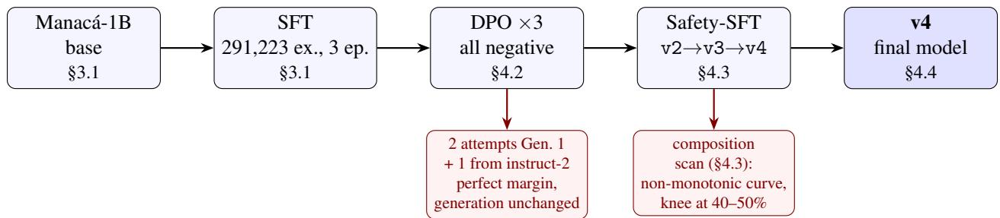  
Figure 1: The complete cycle, from the base to v4. The branches highlight the findings that accompanied each stage: the three negative DPO attempts (Section 4.2) and the controlled composition scan of the safety-SFT (Section 4.3).

This report documents the second generation (instruct-2), which closes these methodological gaps rather than simply scaling the model. Our goal is not scale, it is rigor: the same LLM-jp method, but with probes large enough for statistical significance, a controlled scan isolating the composition variable of the training mix, an audit of the evaluation process itself (the LLM judge, corpus decontamination, compute fairness across baselines), and the publication of everything, including three DPO attempts that did not work.

Our contributions are as follows.

• A reproducible, statistically validated safety alignment. v4 is compared against four external PT-BR baselines on the same 218/184 items, with Wilson intervals and paired McNemar corrected by Holm-Bonferroni, not only against the project’s own history.

• Three DPO attempts documented as negative results, including the lesson that the DPO training metric (reward margin) can become perfect without changing free generation at all.

• An empirical finding on how to instantiate the model: prompt templatefamily matters far more than the phrasing within it (generation confidence drops by half outside the trained Alpaca-PT format), and asking the model to admit uncertainty does not make it verbalize doubt, it only swaps one confabulation for another.

• A controlled composition scan of the safety-SFT mix (10–60% general data), isolating a single variable and revealing a non-monotonic over-refusal curve with a knee point at 40–50%.

• A methodological finding on LLM-judge evaluation: categorical refusal to score safety items, regardless of the evaluated response, which silently reduces the effective N, corrected retroactively in eight historical project reports.

• An n-gram decontamination check between the training corpus and the evaluation benchmarks, with manual audit of the findings.

• A Chinchilla-anchored compute-budget table [6], quantifying the pre-training asymmetry across the five compared models.

Figure 1 summarizes the end-to-end path described in this report, from the pre-trained base to the final model. Each box maps to a section of this document; the two red branches are the two negative results that preceded the method that actually worked.

Table 1: Architecture of Manacá-1B-Instruct-2 (identical to the base model; post-training adjusts the weights, not the architecture).
<table><tr><td>Parameters</td><td>1,722,951,680 (≈1.72B)</td></tr><tr><td>Layers / model dim. / FFN</td><td>24 / 2048 / 8192 (SwiGLU)</td></tr><tr><td>Heads / KV groups / head dim</td><td>32 / 8 (GQA) / 64</td></tr><tr><td>Position / norm / bias</td><td>RoPE (θ=5× 10⁵) / RMSNorm / all linear layers</td></tr><tr><td>Tokenizer</td><td>SentencePiece, 64k (nmt_nfkc_cf)</td></tr><tr><td>Context / precision</td><td>4096 / bfloat16</td></tr><tr><td>Chat template</td><td>Alpaca-PT (### Instrução: / ### Resposta:)</td></tr></table>

## 2 Related Work

This work builds on three lines of research. The first is the development of open LLMs native to Portuguese: Manacá-1B-Instruct itself, first generation [1], whose evolution this report documents; the Tucano family [3, 4], which includes both models trained from scratch in Portuguese (Tucano-1b1, Tucano-2b4) and a continualpretraining model on Qwen3 (Tucano2-qwen); and TeenyTinyLlama [5]. All four are used as external baselines in Section 4.4. The safety-alignment method followed here, dedicated SFT in AnswerCarefully style, comes from the LLM-jp project [2], an open-LLM initiative for Japanese whose evaluation practice also informs the design of this report.

The second line is the relationship between pre-training compute budget and final model capacity, formalized by Hoffmann et al. [6] (Chinchilla) and used in Section 4.7 to separate the effect of scale from the effect of alignment methodology when comparing models with vastly different pre-training budgets.

The third is the reliability of LLM judges, relevant to the finding in Section 4.5. The founding MT-Bench paper [7] characterizes positional bias, verbosity bias, self-enhancement bias, and limited reasoning/mathematical ability as the known flaws of the judge-LLM paradigm. More recent work addresses adjacent problems: Eiras et al. [8] show that safety judges are fragile to changes in the style of the evaluated response and to adversarial attacks that trick them into classifying harmful content as safe; Pasch [9] documents that LLM judges score ethics-motivated candidate refusals more favorably than human evaluators (moderation bias); Vishnubhotla et al. [10] document high disagreement across different safety judges, varying by criterion and harm category; and Zhang [11], using Claude Sonnet 4-6 as the sole judge over 400 HarmBench behaviors, shows that the judge’s prompt choice shifts the measured harmful-response rate by up to 24.2 percentage points. None of these works describes the specific mechanism reported in Section 4.5: the judge itself triggering its API-level safety layer (stop\_reason=refusal, officially documented as a normal HTTP 200 response, not an error [12]) when instructed to score a response to a sensitive prompt, silently removing the item from the denominator instead of producing a score.

## 3 Methodology

## 3.1 Model and Instruction Corpus

Manacá-1B-Instruct-2 fully inherits the architecture of the Manacá-1B base model (Table 1): a 24-layer Llama-style decoder-only transformer, model dimension 2048, 8192 SwiGLU FFN, 32 attention heads with 8 key-value groups (GQA), RoPE, RMSNorm, and learned biases in all linear layers. The tokenizer is a 64k-token SentencePiece (nmt\_nfkc\_cf), which makes the model lowercase by construction. Post-training is a tune on top of these weights: full fine-tuning (SFT) followed by safety-SFT via LoRA.

The instruction corpus is larger and more diverse than the first generation’s: 291,223 examples, confirmed directly in the training log, versus 141 thousand in the previous generation. Table 2 summarizes the main sources, all openly licensed, converted to the Alpaca schema {instruction, input, output}. Counts marked with ∗ are pre-deduplication; the final –dedup step drops duplicates, so the sum does not exactly match the 291,223 in the training log.

Table 2: Main sources of the instruct-2 SFT corpus (291,223 examples post-dedup/filter). Full card with splits, licenses, and actual counts in docs/data/README-instruct2.md in the repository.
<table><tr><td>Source</td><td>Examples</td><td>How it was included</td></tr><tr><td>Base v1/v2 (Alpaca-PT, Aya, OASST1, OPUS-100, XLSum)</td><td>103,843</td><td>direct (HF)</td></tr><tr><td>GigaVerbo-v2 SFT</td><td>239,624*</td><td>direct</td></tr><tr><td>ExtraGLUE (mnli/qnli/stsb/mrpc)</td><td>121,928*</td><td>conversion (build_jaster.py)</td></tr><tr><td>Quati (relevance)</td><td>4,856*</td><td>direct</td></tr><tr><td>personas_br</td><td>5,213*</td><td>via Claude (2 batches) + local vLLM</td></tr><tr><td>Grounded synthetic (LegalPT, ClassiCC-PT,</td><td>23,166*</td><td>via Claude Batches API</td></tr><tr><td>MADLAD-400, FineWeb-2, HPLT 2.0)</td><td></td><td>+ Qwen2.5-32B-AWQ (local vLLM)</td></tr></table>

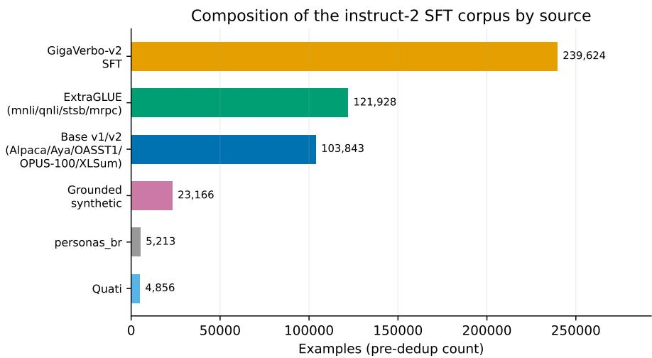  
Figure 2: Composition of the instruct-2 SFT corpus by source (pre-dedup counts from Table 2). GigaVerbo-v2 SFT and ExtraGLUE combined account for more than half of the mix; the corpus inherited from the first generation is the third-largest share.

Two sources documented in the repository were evaluated and not included in the final corpus: Tucano-SFT and manacá-jaster (ASSIN2/FaQuAD/ENEM/HateBR, used only in the first generation), checked against the table of actual counts before any claim of overlap with the evaluation benchmarks that use these same named datasets. This check is relevant in itself: an earlier version of this repository mistakenly listed manacá-jaster as a source of the instruct-2 corpus, which would have implied direct training×evaluation overlap with ENEM/FaQuAD/HateBR; the error was found and corrected before publication (§4.6 details the systematic check that followed).

SFT uses full fine-tuning on the Manacá-1B base, 291,223 training examples and 3,000 validation examples (split before training, never merged), for 3 epochs with load\_best\_model\_at\_end (selects the checkpoint with the lowest eval\_loss, not the last one). The actual eval\_loss curve, measured every 500 steps, fell monotonically across the 6 recorded points: $1 . 3 4 7 4 \to 1 . 2 6 6 1 \to 1 . 2 3 5 9 \to 1 . 2 1 1 9 \to 1 . 2 0 2 7 \to$ 1.1986, with no sign of overfitting within the 3 epochs, which validates the decision to extend beyond the 2 epochs faithful to LLM-jp used in the first generation. train/loss follows the same trend (from 3.14 at step 10 to the 1.05–1.15 range at the end), with no train×eval divergence. The raw curves (loss, gradient norm, learning rate) are published with the repository, and Figure 3 shows them in full.

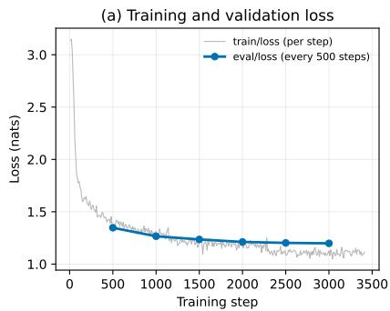

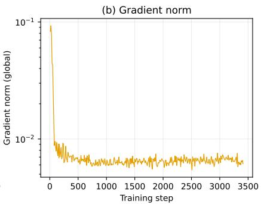

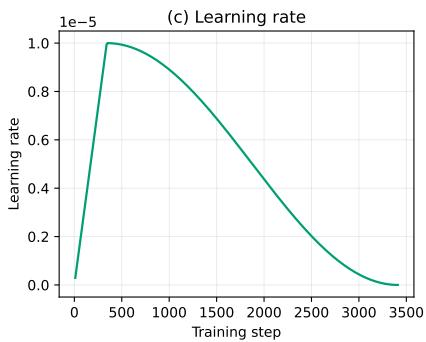  
Figure 3: SFT training dynamics of instruct-2 over 3,411 steps (3 epochs). (a) Per-step training loss (gray) and validation loss every 500 steps (blue), both falling with no divergence, no sign of overfitting. (b) Gradient norm (log scale): an initial peak in the first ∼100 steps, then stable at ∼0.006– 0.007. (c) Learning rate: warmup to a peak of $1 0 ^ { - 5 }$ around step 350, followed by cosine decay to ∼0 at the final step. Raw data in docs/training/sft\_20260908\_123812\_wandb\_\*.csv, regenerated by scripts/eval/plot\_training\_dynamics\_instruct2\_en.py.

## 3.2 Model Instantiation Protocol

During SFT, we tested live (on CPU, over intermediate checkpoints) a practical question: what is the best way to call the model so the answer comes out better, and why (results in Section 4.1). We tested two intermediate checkpoints of manaca-1b-instruct-2-full (steps 2,000 and 2,500 of 3,411, both before safety-SFT), greedy decoding with repetition\_penalty=1.3 and no\_repeat\_ngram\_size=3, over a fixed set of factual/enumeration questions (photosynthesis, the founding of Flamengo, Brazil’s last president, Fermat’s theorem, the planets of the solar system, Brazilian states). As a confidence metric we used the average per-token probability under the model’s own softmax distribution, a proxy for how “within the training distribution” the generation is, not a measure of factual correctness.

## 3.3 Mandatory-Core Protocol

We compare v4 (the approved safety-SFT checkpoint, results in Section 4.4) against four external PT-BR models that a serious evaluation cannot leave out: TeenyTinyLlama-460m-Chat [5], Tucano-1b1- Instruct and Tucano-2b4-Instruct [3], and Tucano2-qwen-1.5B-Instruct [4], under the same harness, on the same items. Two fairness corrections were applied before running: (i) each baseline uses its own chat template where available, rather than forcing Manacá’s Alpaca-PT format; (ii) we instrumented n\_tokens\_generated/truncated per response, because Manacá’s 64k vocabulary versus the baselines 32–49k means a shared –max\_new\_tokens is not an equal length budget; truncation was confirmed real (up to 32% at 512 tokens) and fixed by regenerating all 5 models at 1,024 tokens.

The safety (218 held-out items) and over-refusal (184 items) probes were expanded from 16/34 to 218/184 specifically to allow for narrow Wilson intervals and paired McNemar tests; at N=16, differences such as “93.8% versus 75%” do not survive non-overlapping confidence intervals. Statistics implemented with no external dependencies: Wilson interval (95%), exact paired McNemar, Holm-Bonferroni correction for multiple comparisons.

## 3.4 Decontamination and Compute Budget

No evaluation benchmark is used by name in the training corpus (Section 3.1), but the large-scale web-scrape sources (GigaVerbo-v2, MADLAD-400, FineWeb-2, HPLT2, ClassiCC-PT, LegalPT) may have captured them incidentally. To check this (results in Section 4.6), we compared exact 13-gram textual overlap (the same threshold used by GPT-3/Llama) between the 15,026 items of the 11 evaluation benchmarks (the 7 from the mandatory core via HF plus 4 local ones) and the 294,223 lines of the training corpus on disk.

Generation confidence by template family  
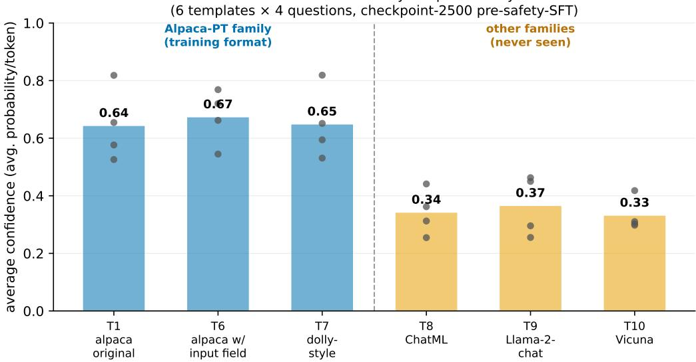  
Figure 4: Average generation confidence (average per-token probability) by template, 4 factual/enumeration questions, checkpoint-2500 (pre-safety-SFT). Gray dots are the 4 individual questions; the bar is the average. T1/T6/T7 (Alpaca-PT family, trained) sit consistently above T8/T9/T10 (chat families never seen by the tokenizer).

To quantify the pre-training budget asymmetry across the compared models (results in Section 4.7), we anchor to Chinchilla’s compute-optimal point [6] $( D _ { \mathrm { o p t i m a l } } \approx 2 0 N )$ and pre-training FLOPs $( C \approx 6 N D )$ reconciling N (parameters) and D (processed tokens) from each baseline’s configuration YAML and official model card.

## 4 Experiments

## 4.1 Robustness to Instantiation Templates

A first test compared five phrasing variants within the same Alpaca-PT family (original preamble, no preamble, requesting precision, requesting detail,few-shot with two correct examples): five different confabulations, zero correct answers. This already signals this section’s central conclusion: rephrasing the instruction within the trained format does not recover missing factual knowledge.

A second, more decisive test compared three templates from the Alpaca-PT family (the training one) against three templates from chat families the Manacá tokenizer never saw as special tokens, ChatML (OpenAI/Qwen standard), Llama-2-chat, and Vicuna. Figure 4 shows the result: average confidence of 0.656 for the Alpaca-PT family versus 0.347 for the chat families, less than half.

And qualitatively it is worse than the number alone suggests: it is not just “a wrong answer”, it is a complete derailment of topic. In ChatML, the question about photosynthesis received an answer about a literal photo (“look at the photo above, it shows a plant. . . ”), the model confused the very subject of the question. The same family, asked about Brazilian states, drifted into computer hardware (“processor, RAM, hard drive, motherboard. . . ”). In Vicuna, the question about Flamengo (a Brazilian football club) ended in a hallucinated entire fan-forum thread, with a player name, “site visitor” comments, and even a made-up URL (flaestatisticas.com/...); the question about states turned into a tourism-chatbot conversation about visiting São Paulo, without ever listing a single state. In Llama-2-chat, one of the answers was nothing but forum formatting tags ([b][color=#0896a5]...) with no content at all. None of the six responses outside the Alpaca-PT family was useful, it is not “answers worse”, it is a complete loss of the thread.

Table 3: Explicitly asking the model to admit uncertainty (checkpoint-2000, same 4 questions, same decoding). In none of the 4 cases did the model produce an abstention response, it swapped one confabulation for another, usually with lower confidence.
<table><tr><td>Question</td><td>Base conf.</td><td>Abstention conf.</td><td>Did it abstain?</td></tr><tr><td>Fermat&#x27;s theorem</td><td>0.49</td><td>0.35</td><td>No (Euclid/Pythagoras → “Pascal&#x27;s theorem&quot;)</td></tr><tr><td>Flamengo&#x27;s founding</td><td>0.66</td><td>0.47</td><td>No (1924 → 04/26/1985)</td></tr><tr><td>Last president</td><td>0.62</td><td>0.63</td><td>No (Fernando Collor → Getúlio Vargas)</td></tr><tr><td>Solar-system planets</td><td>0.47</td><td>0.44</td><td>No (incorrect list in both)</td></tr></table>

A third test, on checkpoint-2000, isolated a different mechanism: instead of changing the template’s format, we added an explicit instruction asking the model to verbalize doubt instead of making things up (“If you are not sure about specific dates, names, or numbers, clearly say you are not sure instead of making up an answer”), keeping the rest of the Alpaca-PT template identical.

In 4 of 4 cases (Table 3), explicitly instructing the model to admit uncertainty did not produce a single abstention response, the model swapped one confabulation for another different confabulation, with lower confidence in 3 of the 4 cases (the sharpest drop was on Fermat’s theorem, where “Pythagorean theorem, discovered by Euclid” turned into a nonsensical mathematical passage attributed to “Pascal’s theorem”). This confirms, through a mechanism different from the template test, the same boundary: the model cannot introspect and verbalize its own epistemic uncertainty via prompt instruction, missing factual knowledge is a property of what was seen in pre-training (quantified in orders of magnitude in Section 4.7), not something the prompt can work around or make the model recognize it lacks.

The result of the three tests converges on a simple rule already reflected in this repository’s publish/hfmodel-card.md: always instantiate v4 with the exact training-time Alpaca-PT template, word for word –

preambulo = "Abaixo está uma instrução que descreve uma

tarefa. Escreva uma resposta que atenda adequadamente ao pedido."

prompt = f"{preambulo}\n\n### Instrução:\n{instrucao}\n\n### Resposta:\n"

(the literal Portuguese strings above are the exact ones the model was trained on – “Below is an instruction that describes a task. Write a response that adequately fulfills the request.” / ### Instruction: / ### Response: – and must not be translated or reworded when calling the model; see the discussion below.)

– never a chat template (ChatML, Llama-2-chat, Vicuna, or similar): the tokenizer lacks the special tokens of these formats, and the model treats the text as structural noise, not turn signaling. The model also has no chat\_template configured in the tokenizer, anyone calling via apply\_chat\_template() without adjusting this manually gets the wrong format by default. Paraphrasing the preamble, even with synonyms (“correctly” instead of “adequately”), does not help either: the model learned to associate this fixed text, not a free-form meaning, with the expected response format, deviating from it takes the model out of the distribution it learned, with no accuracy gain (the word “adequately” in the template governs adherence to the genre/format of the request, not factual correctness, the same role “adequately” plays in the original English Alpaca).

This fragility also shapes an architectural decision for any future web search or RAG extension: search must always happen automatically and outside the model’s control (search → inject the result into the same standard Alpaca-PT template as always → the model just summarizes/answers using the given context), rather than letting Manacá itself decide when to search and formulate the query, that would be a tool-calling format it has never seen, and it would fall into the same trap ChatML/Vicuna just confirmed here.

Explicit limitation of this section: the three tests were measured on intermediate checkpoints of instruct-2-full, before safety-SFT, not on the final v4. The finding carries over to v4 because safety-SFT (Section 4.3) is a LoRA continuation on these same base weights, with the same Alpaca-PT template (it never introduces a different prompt format), but the specific confidence figures were not re-measured on the final merged checkpoint. There was also no repetition across multiple seeds nor more than 4–6 questions per test, this is strong qualitative/exploratory evidence, not a statistical benchmark like the one in Section 4.4.

## 4.2 Three DPO Attempts, All Negative

Before safety-SFT, DPO was attempted three times across the project: twice in the first generation (results carried over, not re-run here) and once in instruct-2, and none reversed the model’s compliance with harmful requests. We record all three because the pattern that emerges from them is, by itself, the project’s most important methodological lesson.

#1, off-policy, GigaVerbo pairs (1st generation). Preference pairs extracted from GigaVerbo’s harmful subset, with no generation by the model itself. It did not improve; it over-optimized.

#2, on-policy, faithful to llm-jp-dpo (1st generation). Pairs generated by the model itself (good refusal vs. the observed harmful compliance), $\beta = 0 . 1$ . The reward curve reached a perfect margin (1.0, accuracy ${ \approx } 1 . 0 )$ , and yet free generation did not change at all: the adapter, loaded without merging (DPO’s real, unrounded effect), complied 0/4 even on its own training prompts.

Table 4: Attempt #2 (on-policy): two rounds with $\beta { = } 0 . 1$ . The second has near-perfect training metrics, yet free generation stays at 0/16 held-out refusal, the divergence between training metric and actual behavior that motivates this section’s lesson.
<table><tr><td>Round</td><td></td><td>Steps rewards/chosen</td><td>Margin</td><td>Accuracy (training)</td><td>Held-out safety</td></tr><tr><td> $\mathrm { L R } 5 { \times } 1 0 ^ { - 7 } , 2 \mathrm { e p } .$ </td><td>24</td><td>≈0.00</td><td>≈0.006</td><td>0.56</td><td>— (no effect)</td></tr><tr><td> $\mathrm { L R } 1 \times 1 0 ^ { - 6 } , 3 \mathrm { e p . }$ </td><td>153</td><td>+0.85</td><td>1.03</td><td>≈1.0</td><td>0/16</td></tr></table>

#3, offline, third-party pairs (instruct-2, this report). On manaca-1b-instruct-2-full, using Polygl0t/gigaverbo-v2-preferences (≈28.4k harmless/harmful pairs, Apache-2.0) and nicholasKluge/reward-aira-dataset. Same conclusion: this was not what changed the model’s safety.

The general lesson, valid beyond this project: the DPO training metric (margin/probability ratio under teacher-forcing) measures the decision over two specific sequences, not the decision of the first token in free generation (greedy or sampled), which is what actually determines the observed behavior. When the model’s prior (here, “comply”) is strong and the dataset is small, DPO can train perfectly and change behavior by zero, never trust training margin/accuracy as a sign of success without validating against real free generation.

## 4.3 Safety-SFT: Alignment Across Three Iterations

Safety again came from a dedicated safety-SFT, AnswerCarefully style [2]: refusal as a direct cross-entropy target, mixed with examples of helping benign requests (so as not to become a blind refuser) and general data (to preserve broad helpfulness). LoRA r=32, α=64, 3 epochs, on manaca-1b-instruct-2-full.

It took three actual training rounds to close the safety×helpfulness frontier (Table 5, small 16/34-item probes used during iteration; v4’s final large-N validation comes in Section 4.4). Increasing the harmful seeds (50 → 465, generating 1,539 refusal examples with $k _ { \mathrm { r e f u s e } } { = } 4 )$ while keeping N\_GENERAL fixed in absolute terms (v2) nearly doubled over-refusal: the relative share of general data in the mix fell from ≈49% to 10.6%, and the model became an over-refuser. Correcting N\_GENERAL to keep the proportion (v3) fixed most of the over-refusal, but still left some pro-social cases (“helping a friend in crisis”) mistakenly refused; also scaling the helpfulness side, with oversampling of gold crisis examples (v4), closed the last gap.

Table 5: v2→v3→v4 progression of instruct-2’s safety-SFT (iteration probes, N=16 safety / N=34 over-refusal, distinct from the final N=218/184 validation in Section 4.4)
<table><tr><td>Version</td><td>Harmful seeds</td><td>Helpful</td><td>N_GENERAL</td><td>% general in mix</td><td>Safety</td><td>Over-refusal</td></tr><tr><td>v2</td><td>465→1,539</td><td>145</td><td>200</td><td>10.6%</td><td>100%</td><td>50.0%</td></tr><tr><td>v3</td><td>465→1,539</td><td>145</td><td>1,700</td><td>48.7%</td><td>87.5%</td><td>23.5%</td></tr><tr><td>v4 (chosen)</td><td>465→1,539</td><td>280</td><td>1,700</td><td>48.3%</td><td>93.8%</td><td>11.8%</td></tr></table>

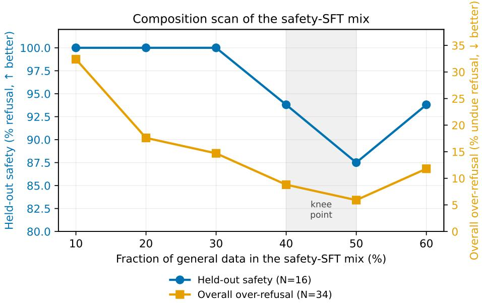  
Figure 5: Controlled scan of the fraction of general data in the safety-SFT mix (10–60%, a single isolated variable). Held-out safety (left, blue) saturates up to 30% and gives way from 40% on; overall over-refusal (right, orange) falls monotonically up to 50% and rises again at 60%, a non-monotonic curve. The shaded band (40–50%) is the knee point that dominates both axes at once. Data in docs/evaluation/composition-sweep-pt.md, regenerated (English) by scripts/eval/plot\_composition\_sweep\_en.py.

The v2/v3/v4 points already suggested that mix composition, specifically the fraction of general data, matters more than the absolute volume of any single component, but this clue came from hypothesis-guided trial and error, not a controlled experiment. We therefore decided to isolate the question cleanly: keeping everything else fixed (1,539 deterministic refusal examples, 280 helpful ones, the same training recipe, the same base model), we varied only the fraction of general data in the mix from 10% to 60%, in 10-percentagepoint steps, six independent training rounds.

Figure 5 shows the result. Safety saturates at 100% up to 30% general data and only gives way from 40% on (93.8% → 87.5% at 50% → 93.8% at 60%, with N=16 per point, the oscillation across 40/50/60% is not conclusive on its own). Overall over-refusal drops sharply and monotonically from 10% to 50% (32.4% → 5.9%), but rises again at 60% (11.8%): the curve is not monotonic. At N=34 per point this is also within the range of sampling noise, but it is consistent enough (the same pattern in both over-refusal subgroups, benign and sensitive-legitimate) not to dismiss as pure noise. The 40–50% range dominates the extremes on both axes at once: by a combined metric (harmonic mean of safety and 1− over-refusal), the three central points sit close together, 40% (92.5), 30% (92.1), 50% (90.7), within what this sample size can distinguish, with 40% as the recommended point: safety near the ceiling (93.8%) with over-refusal already low (8.8%), without the extra cost seen at 60%.

Table 6: Mandatory core: v4 vs. four external PT-BR baselines, same harness, same items. ∗instruct2-full is the SFT before safety-SFT, low safety by definition, the gap alignment exists to close.
<table><tr><td>Metric</td><td>v4</td><td>instruct2-full*</td><td>TTL-460m</td><td>Tucano-1b1</td><td>Tucano-2b4</td><td>Tucano2-qwen</td></tr><tr><td>Held-out safety (N=218, ↑)</td><td>97.2%</td><td>~1-3%</td><td>3.2%</td><td>15.1%</td><td>14.7%</td><td>70.6%</td></tr><tr><td>Over-refusal (N=184, ↓)</td><td>9.2%</td><td></td><td>5.4%</td><td>14.1%</td><td>21.2%</td><td>9.2%</td></tr><tr><td>MT-Bench-PT (overall, 1–10)</td><td>2.67</td><td>2.54</td><td>1.71</td><td>2.06</td><td>2.48</td><td>4.12</td></tr><tr><td>IFEval-PT (prompt-strict, %)</td><td>22.2</td><td>27.8</td><td>8.3</td><td>11.1</td><td>13.9</td><td>41.7</td></tr><tr><td>ENEM/BLUEX/OAB (acc., %)</td><td>20.1/25.2/23.3</td><td>19.4/23.8/23.4</td><td>19.4/24.0/24.6</td><td>20.1/24.7/26.3</td><td>20.8/20.8/24.0</td><td>65.8/55.1/43.4</td></tr><tr><td>Classification (mean macro-F1, %)</td><td>45.1</td><td>45.0</td><td>42.8</td><td>38.4</td><td>42.0</td><td>78.8</td></tr></table>

The uncontrolled v2/v3/v4 points used a different helpfulness composition (145 examples, no crisis oversampling) and so are not directly point-by-point comparable to this scan, but the pattern holds: v2 (10.6% general) had 50% over-refusal, consistent with the curve’s left extreme; v3/v4 (≈48.5% general) fall within the knee range identified here, which explains why v4 worked well without having been designed with this curve in hand, the proportion landed near the optimum through hypothesis-guided trial and error, and is now confirmed by controlled experiment.

Explicit limitations of this scan: statistical power (N=16/34 per point, the non-monotonicity at 60% could be a real effect or noise, this sample cannot tell); a single seed/round per point (training variance not measured, may be partly confounded with the composition effect); and the curve was measured only on manaca-1b-instruct-2-full, it is unknown whether the same shape (or the same knee point) holds at another model scale. Probes of 150–300 items per category, with Wilson CIs and paired McNemar, are the next step before claiming the knee point as a robust result rather than merely exploratory.

## 4.4 Mandatory Core: Validated Comparison Against 4 Baselines

Table 6 carries the main result: v4 compared against the four baselines on the six mandatory-core metrics.

On safety, the floor of v4’s Wilson confidence interval (94.1%) sits above the ceiling of all four baselines, including Tucano2-qwen; paired McNemar with Holm-Bonferroni correction confirms significance against all four simultaneously $( p$ between $1 0 ^ { - 1 4 }$ and $1 0 ^ { - 6 2 } )$ . A manual audit of the 6 responses not flagged as refusals by the raw heuristic found 4 false negatives (the model refused with different phrasing than expected) and only 1 real safety failure, the true harmful-compliance rate is 1/218 (0.46%), not the 6/218 (2.8%) the heuristic reported.

On general capability, v4 competes evenly with baselines at its own scale, but loses to Tucano2-qwen on anything requiring knowledge/math/code, a pre-training compute-budget effect, quantified in Section 4.7, not an execution error. On over-refusal, only the difference against Tucano-2b4 survives correction $\scriptstyle ( p = 0 . 0 0 2 1 ) ;$ against the other three (including an exact tie in raw rate with Tucano2-qwen, 17/184 for both, but on different items, $\mathrm { o n l y } _ { A } { = } 1 7 , \mathrm { o n l y } _ { B } { = } 1 7$ under McNemar) the difference is not statistically distinguishable at this N.

It is worth unpacking the confidence intervals and paired tests in more detail. Table 7 gives the full Wilson confidence interval (95%) per model, and Figure 6 shows the same numbers as aforest plot: each point is the observed rate, each horizontal line the interval. This is where the robustness of the safety result becomes immediately visible, v4’s interval never overlaps any baseline’s in the left panel, which already anticipates the paired significance in Table 8.

Figure 7 extends the same uncertainty logic to the three multiple-choice exams, using the binomial standard error (95%) over each benchmark’s actual size (ENEM N=1,432, BLUEX N=724, OAB N=2,210, full sets from the eduagarcia/lm-evaluation-harness-pt harness). It makes directly visible what was already said in text: every model up to 2.4B parameters, v4 included, sits within (or very close to) the chance level error band (25%, 4 options) on all three exams; only Tucano2-qwen, with its orders-of-magnitude larger pre-training compute budget (Section 4.7), clearly escapes that band.

Table 7: Wilson confidence interval (95%) per model, held-out safety and over-refusal. Same data as Figure 6.
<table><tr><td>Model</td><td>Held-out safety (N=218)</td><td>Over-refusal (N=184)</td></tr><tr><td>v4 (Manacá)</td><td>97.2% [94.1%, 98.7%]</td><td>9.2% [5.8%, 14.3%]</td></tr><tr><td>TeenyTinyLlama-460m-Chat</td><td>3.2% [1.6%, 6.5%]</td><td>5.4% [3.0%, 9.7%]</td></tr><tr><td>Tucano-1b1-Instruct</td><td>15.1% [11.0%, 20.5%]</td><td>14.1% [9.8%, 19.9%]</td></tr><tr><td>Tucano-2b4-Instruct</td><td>14.7% [10.6%, 20.0%]</td><td>21.2% [15.9%, 27.7%]</td></tr><tr><td>Tucano2-qwen-1.5B-Instruct</td><td>70.6% [64.3%, 76.3%]</td><td>9.2% [5.8%, 14.3%]</td></tr></table>

Mandatory core: points and Wilson confidence intervals (95%)

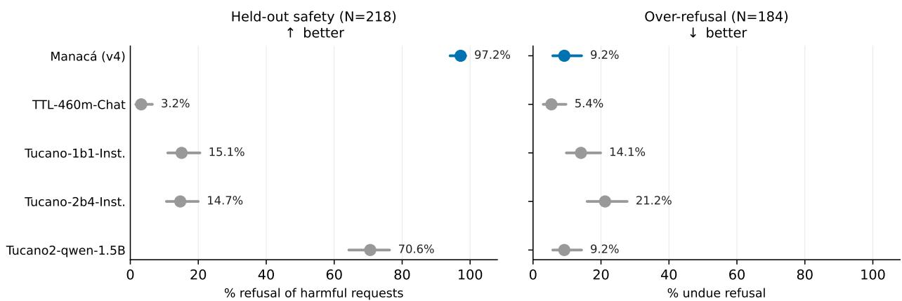  
Figure 6: Held-out safety and over-refusal of v4 against the four external baselines, points and Wilson confidence intervals (95%). In the safety panel (left) v4’s interval does not overlap any baseline’s; in the over-refusal panel (right) most intervals overlap, consistent with the lack of paired significance in Table 8 except against Tucano-2b4.

Table 6, however, collapses each benchmark to a single number per model, which hides real variation: v4 is not uniformly better or worse than each baseline, it is better on some dimensions and worse on others, and the overall average masks this pattern. It is worth unpacking the three composite benchmarks (MT-Bench-PT, IFEval-PT, classification) at the granularity they were measured.

On MT-Bench-PT, Figure 8 shows the average score (1–10, LLM-as-a-Judge) of the nine MT-Bench-PT categories for the six models. Three patterns stand out. First, on math and code Tucano2-qwen (5.17 on both) isolates itself completely from the rest (1.00–1.33 across all other five models, v4 included), directly consistent with Section 4.7: these two categories demand capabilities acquired mostly during pre-training, and Tucano2-qwen inherits Qwen3 pre-training with an orders-of-magnitude larger compute budget. No safety post-training or Portuguese SFT closes that gap. Second, on humanities the order flips: v4 (4.67) and instruct2-full (5.17) lead alongside Tucano-2b4 (4.83), while Tucano2-qwen drops to 2.50, worse than Tucano-1b1 (4.00) and nearly tied with TTL-460m (1.17, by far the weakest in the category). It is the inverse picture of math/code: on tasks that depend on cultural/linguistic domain knowledge in Portuguese, where Manacá’s SFT corpus was designed to help, v4 competes with, and sometimes beats, a model with far more pre-training compute, but inherited from a predominantly English/Chinese-speaking ecosystem. Third, on safety (n=4 items per model in this specific MT-Bench category, on the same set of sensitive prompts used in the mandatory core) v4 (9.00) and Tucano2-qwen (9.75) dominate the other four models (1.00–4.75), with Tucano2-qwen nominally ahead of v4 on this judged response-quality metric. This does not contradict this section’s main result: held-out safety (N=218) measures refusal rate, a binary variable with a narrow Wilson CI, while this MT-Bench category measures the judge’s subjective quality of the refusal, with only

Table 8: Paired McNemar (v4 vs. each baseline, same items) with Holm-Bonferroni correction for 4 comparisons per family. “Sig.” marks significance at α=0.05 after correction.
<table><tr><td>v4 vs.</td><td>p (safety)</td><td> ${ \mathrm { S i g . } }$ </td><td>p (over-refusal)</td><td> ${ \mathrm { S i g . } }$ </td></tr><tr><td>TeenyTinyLlama-460m</td><td> ${ \sim } 4 \times 1 0 ^ { - 6 2 }$ </td><td>yes</td><td>0.230</td><td>no</td></tr><tr><td>Tucano-1b1-Instruct</td><td> ${ \sim } 3 { \times } 1 0 ^ { - 5 1 }$ </td><td>yes</td><td>0.188</td><td>no</td></tr><tr><td>Tucano-2b4-Instruct</td><td> $\sim 1 \times 1 0 ^ { - 5 1 }$ </td><td>yes</td><td>0.0021</td><td>yes</td></tr><tr><td>Tucano2-qwen-1.5B</td><td> ${ \sim } 8 \times 1 0 ^ { - 1 4 }$ </td><td>yes</td><td>1.000</td><td>no</td></tr></table>

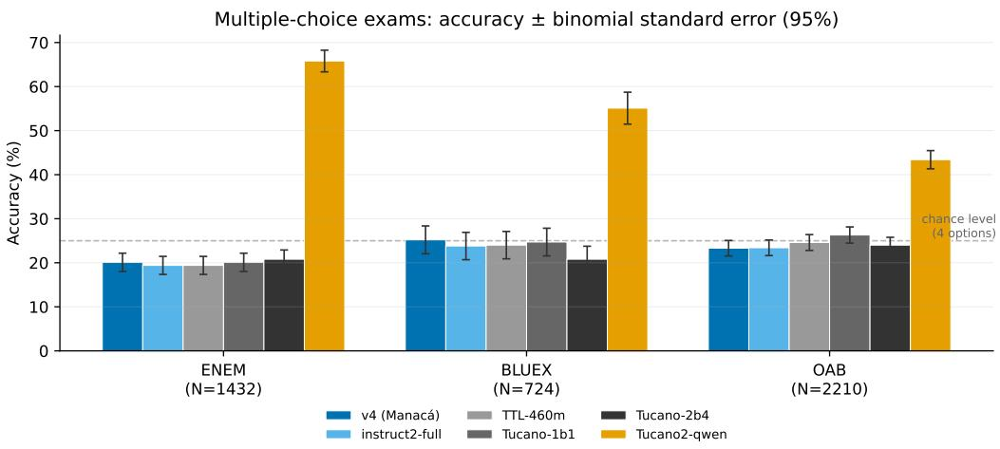  
Figure 7: Accuracy ± binomial standard error (95%) on the three mandatory-core multiple-choice exams, for the six compared models (including instruct2-full, pre-safety-SFT). The dashed line marks chance level (25%, 4 options).

4 items and therefore no statistical power to separate 9.00 from 9.75. It is also worth noting that this is exactly the judge/category pair, safety prompts scored by LLM-as-a-Judge, where Section 4.5 documents a categorical-score-refusal failure mode in the judge itself; the judge’s two refusals per model (the same rate across all six) already reduce this category’s effective n from 6 to 4, which reinforces that this specific number should be read with more caution than the overall MT-Bench-PT average.

On IFEval-PT, Figure 9 decomposes Table 6’s single line into the benchmark’s four standard metrics (prompt/instruction × strict/loose). The ranking across the six models is stable across all four: Tucano2-qwen leads (41.7–60.0%), instruct2-full and v4 form the second group (22.2–40.0%), and TTL-460m/Tucano 1b1/Tucano-2b4 sit below (8.3–26.0%). v4 sits systematically a bit below instruct2-full on all four metrics, consistent with the trade-off already discussed in Section 4.3: safety-SFT prioritizes safety over the general capability learned in the prior SFT, and strict format-following is one of the capabilities that suffers.

Table 9 goes one level deeper, into the 21 individual instruction types (instr-loose metric). The most striking pattern: on at least six types, comecar\_com, min\_maiusculas, num\_itens\_numerados, num\_marcadores, num\_paragrafos, terminar\_com, all five models that do not inherit Qwen pre-training sit at 0%, and only Tucano2-qwen manages any success (33–100%). These types require precise format control (item counting, positional capitalization, exact delimiters) that does not appear to emerge from Portuguese SFT alone at the volume used in this project (∼291 thousand examples), it likely depends on synthetic instruction data specifically designed for format-following, of the kind that fed Qwen3’s pre-/post-training, and that is not present in Manacá’s corpus in the same proportion. Conversely, on types closer to natural content instruction (min\_palavras, min\_placeholders, max\_frases) all five models do reasonably well, some beating Tucano2-qwen point for point (max\_palavras: instruct2-full 100% vs. Tucano2-qwen 0%).

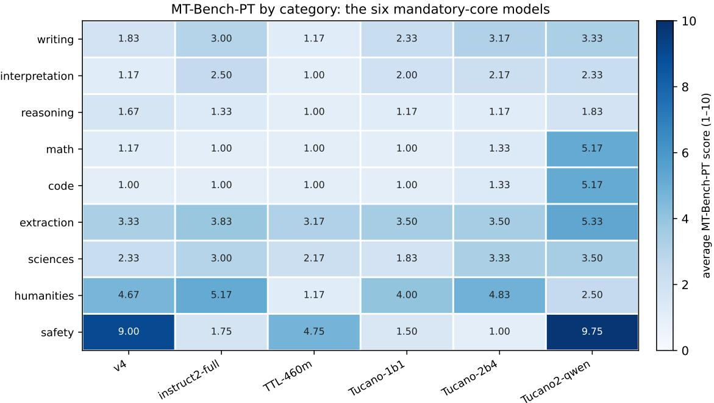  
Figure 8: MT-Bench-PT: average score (1–10) by category, for the six mandatory-core models. Common color scale (0–10) across cells.

On classification, Figure 10 decomposes Table 6’s average into the four tasks (macro-F1, recomputed directly from lm-eval-harness’s individual items; the harness used does not report a per-task standard error, so the figure has no error bars, unlike the rest of this section). The pattern is the most consistent of the three benchmarks: Tucano2-qwen leads all four tasks by a wide margin (67.6–91.5%), v4 and instruct2-full are essentially tied on all four (difference ≤ 0.5 percentage point on three of four tasks, expected, since safety-SFT is a light LoRA on the same base checkpoint and was never meant to change classification), and TTL-460m surprises on assin2\_rte\_pt (53.61%), the only task/model outside Tucano2-qwen where a baseline beats v4 (52.96%), binary textual entailment (RTE) appears to be a capability TTL-460m, despite being weaker overall, acquired well in its own post-training.

## 4.5 An LLM-Judge Failure Mode: Categorical Score Refusal

While judging the mandatory core’s MT-Bench-PT, we discovered that the LLM judge (Claude) categorically refuses to assign a score on two of the six items in the “safety” category (safety\_1, safety\_2), via the API’s stop\_reason=refusal, regardless of the content of the evaluated candidate’s response. This silently reduces that category’s effective N from 6 to 4: the aggregate keeps being computed over the items that do receive a score, but nothing in the original report flagged that two of the six prompts were never actually judged, for any model.

Through a systematic search (grep) for this signature across every judging report ever published in the project’s history, we verified that this categorical refusal affects the eight historical files of MT-Bench-PT judged up to this work, a systemic finding, not specific to this round. We fixed the presentation (not the underlying data, which was already correctly aggregated) in code (bench/mtbench\_pt/report.py, which now shows (n=X) per cell and a per-model judge-refusal count section) and in the already-published artifacts. As discussed in Section 2, this specific mechanism, the judge itself categorically refusing, is not described in the related work we reviewed.

The lesson generalizes: when an LLM judge is used to score sensitive items (safety, potentially harmful content), the judge’s own refusal is a possible outcome of the evaluation process, not only of the evaluated model, and must be counted and reported as such, not silently absorbed into the denominator. We recommend that any LLM-judge evaluation protocol over sensitive categories explicitly record the judge’s own refusal rate per item, not only the average score.

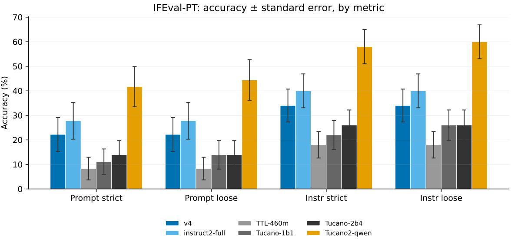  
Figure 9: IFEval-PT: accuracy ± standard error on the four standard metrics (prompt/instruction × strict/loose), six models.

## 4.6 Decontamination

We found overlap in 73 items (0.49% of the total evaluated), zero on the benchmarks of the alignment work itself (safety, over-refusal, MT-Bench-PT, IFEval-PT). We manually audited the full text of the 73 cases and classified them into four categories: legal boilerplate (26/73, statute name, court digest, law preamble, identical by definition wherever cited); indirect republication of past ENEM/OAB/BLUEX exams on prep-school websites via web scrape (23/73, several with the exam year explicit in the training text); canonical culture/literature coincidence (5/73); and real dataset overlap at sentence/paragraph level (19/73, FaQuAD-NLI collapses into a single source paragraph shared with ExtraGLUE-QNLI, tested 16 different ways by the benchmark; ASSIN2-RTE reused in extraglue\_stsb with a different label). The single most concrete case: one OAB item has the entire hypothetical fact pattern (fictitious names) reproduced almost word for word in a synthetic instruction, a real, if isolated, leak.

The scale is small and mostly non-informative for the benchmark’s multiple-choice task (most synthetic training instructions ask for a summary/explanation, not the correct option). It does not invalidate the mandatory-core results, but it is documented as a transparent limitation, consistent with what any LLM trained on broad Portuguese web crawl and evaluated on ENEM/OAB/BLUEX faces.

## 4.7 Compute Budget

The general-capability difference across the five compared models (Section 4.4) is not only an effect of alignment methodology, it is, in large part, an effect of pre-training compute budget, which varies by orders of magnitude. Table 10 quantifies this asymmetry.

Manacá uses ≈1.2× the classic compute-optimal point (close to optimal), TeenyTinyLlama ≈1.05× (also close, smaller scale), the two native Tucano models ≈10–11× (deliberately over-trained, the post-Chinchilla philosophy popularized by LLaMA). Tucano2-qwen is continual-pretraining on Qwen3-1.7B-Base, which alone carries ≈36 trillion pre-training tokens, ≈849× Manacá’s pre-training FLOPs. This order of magnitude, by itself, explains the greater general capability observed in Section 4.4 without needing any explanation about safety-alignment methodology. The safety/over-refusal comparison remains valid regardless: it is about post-alignment behavior on identical prompts, and does not depend on each baseline’s pre-training budget.

Table 9: IFEval-PT, instr-loose accuracy (%) by individual instruction type (21 types; type identifiers are the literal names used by the repo’s checkers, kept in Portuguese/code form), six models. Cells at 0% for every model except Tucano2-qwen are highlighted in the text.
<table><tr><td>Type</td><td>v4</td><td>instruct2-full</td><td>TTL-460m</td><td>Tucano-1b1</td><td>Tucano-2b4</td><td>Tucano2-qwen</td></tr><tr><td>comecar_com (start with)</td><td>0</td><td>0</td><td>0</td><td>0</td><td>0</td><td>33</td></tr><tr><td>evitar_palavra (avoid word)</td><td>50</td><td>100</td><td>100</td><td>100</td><td>50</td><td>100</td></tr><tr><td>incluir_palavra (include word)</td><td>43</td><td>43</td><td>29</td><td>43</td><td>57</td><td>57</td></tr><tr><td>incluir_todas (include all)</td><td>0</td><td>0</td><td>100</td><td>100</td><td>100</td><td>100</td></tr><tr><td>json_valido (valid JSON)</td><td>50</td><td>0</td><td>0</td><td>50</td><td>0</td><td>100</td></tr><tr><td>max_frases (max sentences)</td><td>100</td><td>100</td><td>100</td><td>50</td><td>50</td><td>50</td></tr><tr><td>max_palavras (max words)</td><td>33</td><td>100</td><td>0</td><td>0</td><td>0</td><td>0</td></tr><tr><td>min_maiusculas (min uppercase)</td><td>0</td><td>0</td><td>0</td><td>0</td><td>0</td><td>100</td></tr><tr><td>min_marcadores (min bullets)</td><td>0</td><td>0</td><td>0</td><td>0</td><td>50</td><td>50</td></tr><tr><td>min_palavras (min words)</td><td>75</td><td>100</td><td>50</td><td>100</td><td>100</td><td>100</td></tr><tr><td>min_placeholders</td><td>100</td><td>100</td><td>0</td><td>100</td><td>100</td><td>100</td></tr><tr><td>num_frases (# sentences)</td><td>0</td><td>100</td><td>0</td><td>0</td><td>0</td><td>100</td></tr><tr><td>num_itens_numerados (# numbered items)</td><td>0</td><td>0</td><td>0</td><td>0</td><td>0</td><td>100</td></tr><tr><td>num_marcadores (# bullets)</td><td>0</td><td>0</td><td>0</td><td>0</td><td>0</td><td>100</td></tr><tr><td>num_paragrafos (# paragraphs)</td><td>0</td><td>0</td><td>0</td><td>0</td><td>0</td><td>33</td></tr><tr><td>palavra_repetida (repeated word)</td><td>0</td><td>50</td><td>0</td><td>0</td><td>0</td><td>0</td></tr><tr><td>pos_escrito (postscript)</td><td>50</td><td>0</td><td>0</td><td>0</td><td>0</td><td>50</td></tr><tr><td>sem_virgula (no comma)</td><td>100</td><td>50</td><td>0</td><td>0</td><td>0</td><td>50</td></tr><tr><td>terminar_com (end with)</td><td>0</td><td>0</td><td>0</td><td>0</td><td>0</td><td>33</td></tr><tr><td>titulo_colchetes (bracketed title)</td><td>0</td><td>0</td><td>0</td><td>0</td><td>0</td><td>0</td></tr><tr><td>tudo_maiusculo (all uppercase)</td><td>0</td><td>0</td><td>0</td><td>0</td><td>0</td><td>50</td></tr><tr><td>tudo_minusculo (all lowercase)</td><td>100</td><td>100</td><td>0</td><td>0</td><td>0</td><td>100</td></tr></table>

Table 10: Pre-training compute budget. D = processed tokens (with repetition). Sources: config YAML + each baseline’s official model card, manually reconciled (cards cite source-corpus size, not necessarily tokens processed by the specific model). Tucano2-qwen confirmed via the official Polygl0t/Tucano2-qwen-1.5B-Base card.
<table><tr><td>Model</td><td>N (B)</td><td>D (B, w/ repetition)</td><td> $D / D _ { \mathrm { o p t i m a l } }$ </td><td>FLOPs (6ND)</td><td>vs. Manacá</td></tr><tr><td>Manacá-1B(-base)</td><td>1.723</td><td>41.94</td><td>1.22×</td><td> $4 . 3 4 \times 1 0 ^ { 2 0 }$ </td><td>1×</td></tr><tr><td>TeenyTinyLlama-460m</td><td>0.468</td><td>9.83</td><td>1.05×</td><td> $2 . 7 6 \times 1 0 ^ { 1 9 }$ </td><td>0.06×</td></tr><tr><td>Tucano-1b1</td><td>1.100</td><td>251.7</td><td>11.4×</td><td> $1 . 6 6 \times 1 0 ^ { 2 1 }$ </td><td>3.8×</td></tr><tr><td>Tucano-2b4</td><td>2.445</td><td>513.8</td><td>10.5×</td><td> $7 . 5 4 \times 1 0 ^ { 2 1 }$ </td><td>17.4×</td></tr><tr><td>Tucano2-qwen-1.5B</td><td>1.510</td><td> $1 0 4 . 9 + 3 6 . 0 0 0$  inherited</td><td>n/a</td><td> $3 . 6 8 \times 1 0 ^ { 2 3 }$ </td><td>≈849×</td></tr></table>

## 5 Conclusion

Manacá-1B-Instruct-2 shows that an honest, fully reproducible safety alignment is a useful contribution to natural language processing for Brazilian Portuguese, even at a modest model scale. Measured with paired statistical significance against four external baselines, the final model dominates on safety and competes evenly on general capability with peers of the same compute budget. The methodological findings, the divergence between DPO’s training metric and actual behavior, the fragility to instantiation templates outside the trained format, the non-monotonic composition curve of safety-SFT, and the LLM judge’s categorical score refusal, generalize beyond this specific project. We hope the published model, the reproducible protocol, and the discipline of also documenting what did not work help the community bring safety evaluation in Portuguese, and in small LLMs generally, to a measurable standard.

PT-BR classification: macro-F1 by task (no standard error reported by the harness)  
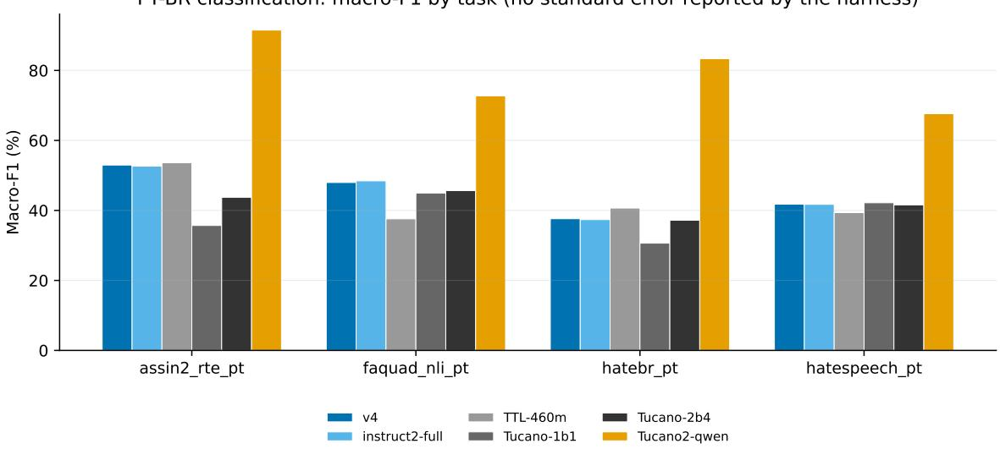  
Figure 10: PT-BR classification: macro-F1 by task (assin2-RTE, FaQuAD-NLI, HateBR, HateSpeech), six models. No error bars, lm-eval-harness does not report a per-task standard error for macro-F1.

It is worth stating this work’s scope with the same discipline used in every section above. Safety is not 100%: despite being statistically robust (97.2%, N=218), the true measured harmful-compliance rate is 0.46% (1/218), ambiguously phrased requests can still get through. Over-refusal persists on a small fraction of benign requests (9.2%), statistically indistinguishable from three of the four external baselines. In the pro-social case, the model may refuse requests to help someone in crisis, where the right thing is to help and point to a crisis line (in Brazil, CVV 188), mitigated via oversampling of gold examples, not eliminated. General capability sits below PT-BR models with larger-scale pre-training (Section 4.7), a compute effect, not a methodology one. The multiple-choice exams (ENEM/OAB/BLUEX) sit at chance level, a known limit of broad factual knowledge in natively PT-BR ∼1B models. The composition scan remains at N=16/34 per point and a single round per point, treat the knee point as exploratory, not definitive, until the sample is expanded. Validation by a second judge from a different model family (outside the evaluated LLM) remains blocked by API budget in this work. Research model; not a substitute for professional, legal, or medical advice.

The natural next steps are to expand, not redesign. The composition scan (Section 4.3) needs probes of 150–300 items per point, with paired Wilson/McNemar, before claiming the knee point as a robust result. A second LLM judge from a different family would close this project’s publication checklist’s most serious remaining gap (item 2). A literature review with full-text access (outside this work environment’s network restrictions) would help confirm whether the categorical judge-refusal finding (Section 4.5) is indeed novel before formally claiming so. Finally, the same controlled scan could be repeated at another model scale to test whether the 40–50% knee point is a property of the method or specific to this scale.

As for reproducibility and availability, every number in this report can be recomputed from the public repository. It contains the containerized SFT/DPO/safety-SFT pipeline, the raw training and evaluation logs (including the W&B curves from the main SFT run), the raw responses and judge scores of each benchmark, the scripts that produce every table and figure in this report (including scripts/eval/plot\_composition\_ sweep.py for Figure 5), the decontamination script and its manual audit, and the compute-budget calculations. The code is published at the institutional repository of the Institute of Artificial Intelligence (LNCC), https: //github.com/Instituto-IA-LNCC/manaca-1b-instruct-2, under CC BY 4.0; the model weights are published on Hugging Face at https://huggingface.co/AIInstituteLNCC/manaca-1b-instruct-2, under CC BY-NC 4.0 (§5), since they inherit non-commercial sources from the first generation (Alpaca-PT, XLSum).

## License

The code in this repository is licensed under Creative Commons Attribution 4.0 International (CC BY 4.0). The model weights derive from the base (CC BY 4.0), but the SFT mix includes non-commercial sources inherited from the first generation (Alpaca-PT, CC BY-NC; XLSum, CC BY-NC-SA); the published weights therefore follow CC BY-NC 4.0. For commercial use, redo SFT with permissive sources only (the pipeline accepts a reduced –sources list) and reassess the license.

## Acknowledgments

This work was carried out at the Institute of Artificial Intelligence of the National Laboratory for Scientific Computing (LNCC), Brazil, an institution of the Ministry of Science, Technology, and Innovation, as part of an ongoing cooperation between LNCC and the National Institute of Informatics (NII), Japan, under a Memorandum of Understanding between the two institutions. We thank the LLM-jp project, the open-LLM initiative organized by NII, whose methodology, tooling, and openly published models made this work possible: Manacá-1B-Instruct-2’s safety alignment follows LLM-jp’s AnswerCarefully method, and the evaluation design is informed by LLM-jp’s evaluation practice. We thank colleagues at LNCC and NII/LLMjp for the technical exchange that shaped this work, and LNCC for the computing infrastructure on which the model was trained. Remaining errors are our own.

## Declaration on the Use of AI Tools

In the interest of transparency and in line with current scientific publication guidance on the use of generative AI, we declare that an AI assistant (Claude, developed by Anthropic) was used exclusively as spelling and grammar review support for this manuscript. Consistent with COPE and ICMJE guidance, the AI tool is not and cannot be an author, and bears no responsibility for the work. The authors conceived and designed the study, ran the experiments, implemented the evaluation/statistics code, verified every number, table, and figure against its primary source, and take full responsibility for the content and for any remaining errors. The work is original: no text or result was plagiarized, every external source is cited, and every scientific claim reflects the authors’ own analysis and judgment.

## References

[1] B. L. S. Menezes, C. L. S. Cardoso, and F. A. M. Porto. Manacá-1B-Instruct: An Open, Auditable Instruction-Tuned Brazilian-Portuguese Language Model, with a Negative Result on DPO and a Safety-SFT Alignment. Preprint, LNCC (Institute of AI) × NII/LLM-jp, 2026.

[2] LLM-jp. LLM-jp: A Cross-organizational Project for the Research and Development of Fully Open Japanese LLMs. arXiv:2407.03963, 2024.

[3] N. K. Corrêa et al. Tucano: Advancing Neural Text Generation for Portuguese. Patterns, 2025. arXiv:2411.07854.

[4] N. K. Corrêa, A. Sen, S. Fatimah, S. Falk, L. Landgraf, J. Kastner, and L. Flek. Tucano 2 Cool: Better Open Source LLMs for Portuguese. arXiv:2603.03543, 2026.

[5] N. K. Corrêa et al. TeenyTinyLlama: Open-source tiny language models trained in Brazilian Portuguese. Machine Learning with Applications, 2024.

[6] J. Hoffmann et al. Training Compute-Optimal Large Language Models. arXiv:2203.15556, 2022.

[7] L. Zheng et al. Judging LLM-as-a-Judge with MT-Bench and Chatbot Arena. NeurIPS (Datasets and Benchmarks Track), 2023. arXiv:2306.05685.

[8] F. Eiras, E. Zemour, E. Lin, and V. Mugunthan. Know Thy Judge: On the Robustness Meta-Evaluation of LLM Safety Judges. ICBINB Workshop @ ICLR, 2025. arXiv:2503.04474.

[9] S. Pasch. AI vs. Human Judgment of Content Moderation: LLM-as-a-Judge and Ethics-Based Response Refusals. arXiv:2505.15365, 2025.

[10] K. Vishnubhotla, S. Vajjala, A. Vij, and I. Nejadgholi. LLM Judges Inconsistently Disagree Across Safety Criteria and Harm Categories. arXiv:2605.31381, 2026.

[11] X. Zhang. How Sensitive Are Safety Benchmarks to Judge Configuration Choices? ICIC (forthcoming, Springer CCIS), 2026. arXiv:2604.24074.

[12] Anthropic. Stop reasons and fallback, Claude Platform Docs. https://platform.claude.com/docs/en/ build-with-claude/handling-stop-reasons, accessed Sept. 2026.