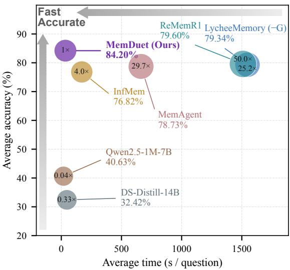
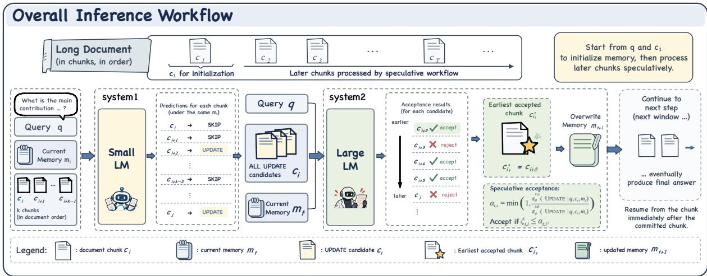
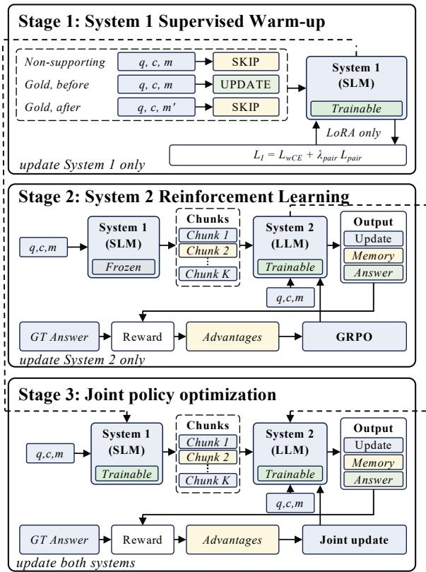
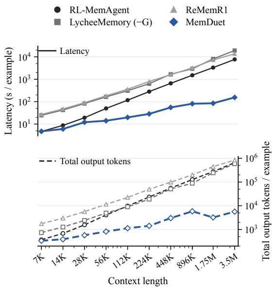

# MemDuet: Learning Dual-Process Memory for Long-Context Reasoning

Jiangcheng Song1, Haodong Jing1, Yulin Mu2, Lesong Tao1, Jixin Wang1 Jin Cui1, Tianjing Ren3, Runxuan Xie2, Yongqiang Ma1, Nanning Zheng 1 1State Key Laboratory of Human-Machine Hybrid Augmented Intelligence, Institute of Artificial Intelligence and Robotics, Xi’an Jiaotong University 2Faculty of Electronic and Information Engineering, Xi’an Jiaotong University 3Imperial College London enone@stu.xjtu.edu.cn, nnzheng@xjtu.edu.cn

## Abstract

Reasoning over infinitely long documents is becoming a reality with recurrent memory agents. However, increasing context length exacerbates the trade-off between reasoning performance and inference efficiency. Inspired by Kahneman’s account of fast and slow thinking, we propose MemDuet1, a dual-process memory framework that learns to coordinate a small language model for fast, parallel evidence selection from raw context chunks (System 1) with a large language model for memory-update verification and memory updates in document order (System 2). We train MemDuet in three stages: supervised fine-tuning of System 1 for evidence selection, Group Relative Policy Optimization (GRPO) of System 2 for verification and memory rewriting, and joint optimization of both policies to coordinate selection and updating for long-context reasoning. Experiments on diverse long-context reasoning benchmarks (RULER-HQA, LongBench v2, and 2WikiMultiHopQA) demonstrate a favorable accuracy–efficiency trade-off as context length grows. Averaged across evaluation settings on the three datasets, MemDuet achieves an end-to-end inference speedup of 9.74× and an output-token reduction of 73.91% relative to RL-MemAgent.

## 1 Introduction

Long-context reasoning is essential for large language models (LLMs) to synthesize evidence across documents, understand lengthy reports, and resolve repository-level dependencies in code (Bai et al., 2024; Zhang et al., 2023). Existing work primarily extends long-context capability through larger context windows, sparse or linear attention, and retrieval-augmented generation (RAG) (Chen et al., 2023b; Beltagy et al., 2020; Katharopoulos et al., 2020; Yuan et al., 2025; Lewis et al., 2020). However, these approaches remain bounded by the amount of context that can be directly represented or retrieved, leaving reasoning over unbounded documents unresolved.

  
Figure 1: Accuracy–efficiency trade-off on RULER-HQA. Accuracy, inference time, and output tokens are equally averaged over the nine shared length settings (7K–1.75M). Qwen and DS-Distill use the available settings. Circle areas use a square-root-compressed scale for mean output tokens per question; circle labels give actual output-token ratios to MemDuet (1×).

MemAgent instead streams documents through a bounded recurrent memory, enabling reasoning over infinitely long documents with a fixed active context (Yu et al., 2026). Building on this paradigm, InfMem and GRU-Mem learn when to retrieve, update, or stop, while LycheeMemory compresses each chunk and invokes the reasoner only for selected memory blocks (Wang et al., 2026; Sheng et al., 2026; Chen et al., 2026). These advances make recurrent memory increasingly selective, but expose a common bottleneck: control decisions either remain inside the sequential recurrent loop or operate on representations in which the original evidence has already been compressed. Consequently, as context grows, reasoning performance and inference efficiency remain tightly coupled.

Human reading and memory suggest a different principle: memory formation begins with selective attention. Readers first focus on goal-relevant information and then integrate the attended evidence with prior knowledge into a coherent memory representation (Craik et al., 1996; Kintsch, 1988; Aly and Turk-Browne, 2016). This process naturally maps onto the dual-process account of cognition: System 1 rapidly identifies potentially useful evidence, whereas System 2 deliberately assesses and consolidates it (Kahneman, 2011; Evans and Stanovich, 2013). Based on this insight, we propose MemDuet, a dual-process recurrent memory framework. A small language model (System 1) scans raw context in parallel to select candidate chunks for memory updating. A large language model (System 2) verifies whether each selected chunk warrants a memory update under the current memory, then rewrites memory. By combining small-model selective attention over raw chunks with large-model verification and memory updating, MemDuet balances reasoning performance and inference efficiency as context grows.

A key challenge is how to train the two systems to cooperate. We develop a progressive three-stage training strategy. First, we supervise System 1 to identify context chunks that are likely to trigger useful memory updates. Next, with System 1 fixed, we optimize System 2 using Group Relative Policy Optimization (GRPO; Shao et al., 2024), training it to verify memory-update decisions and rewrite memory toward successful downstream reasoning. Finally, we jointly optimize both systems with task-level rewards, allowing evidence selection and memory updating to co-adapt.

We evaluate MemDuet on RULER-HQA, LongBench v2, and long-context 2WikiMultihopQA. Results show that MemDuet improves the performance–efficiency trade-off over full-update recurrent memory agents, scaling to 3.5M-token contexts while achieving higher reasoning accuracy with substantially lower inference cost.

Our contributions are summarized as follows:

1. We propose MemDuet, a cognitively inspired dual-process memory framework for longcontext reasoning, which instantiates System 1 as fast, parallel evidence selection with a small language model and System 2 as memoryupdate verification and memory rewriting with a large language model.

2. We develop a three-stage training strategy that first establishes the selection and memoryupdating capabilities of the two systems through SFT and GRPO, respectively, and then jointly optimizes their cooperation under a shared downstream reasoning objective.

3. Extensive experiments on long-context reasoning benchmarks demonstrate that MemDuet achieves a favorable balance between reasoning performance and inference efficiency.

## 2 Related Work

## 2.1 Recurrent Memory for Long-Context Reasoning

Recurrent-memory methods process documents incrementally while maintaining a bounded state, allowing language models to handle inputs far beyond their context windows. MemAgent sequentially processes text chunks and repeatedly rewrites a textual memory, using end-to-end reinforcement learning to retain task-relevant information and discard distractors based on downstream rewards (Yu et al., 2026). Building on this paradigm, InfMem and GRU-Mem learn retrieval, memory updating, and early-stopping decisions through SFT-to-RL training or behavior-specific rewards (Wang et al., 2026; Sheng et al., 2026). LycheeMemory compresses individual chunks and selectively invokes the reasoner, jointly optimizing its compressor and reasoner through end-to-end reinforcement learning (Chen et al., 2026). These studies turn memory management from a fixed procedure into a taskdriven policy, but their control decisions remain within the sequential loop or operate on already compressed evidence. MemDuet instead scans raw chunks in parallel before recurrent updating and progressively coordinates evidence selection with memory consolidation.

  
Figure 2: MemDuet’s overall inference workflow. System 1 predicts Skip/Update in parallel for raw chunks under a shared memory state. Candidate chunks retain their original text. System 2 verifies whether a selected chunk warrants a memory update given the current memory, then generates and commits memory from the first accepted chunk in document order. Later chunks are reevaluated under the updated memory.

## 2.2 Cognitively Inspired Language Models and Memory

Cognitive theories have informed both memory design and computational allocation in languagemodel systems. CoALA organizes language agents around modular memory, decision-making, and action components derived from cognitive architectures (Sumers et al., 2024). MemoryBank adopts an Ebbinghaus-inspired mechanism for dynamically forgetting and reinforcing memories (Zhong et al., 2024), whereas HippoRAG draws on hippocampal indexing theory to support associative knowledge retrieval (Gutiérrez et al., 2024). For reasoning, System 2 Attention deliberately rewrites the context to remove irrelevant information (Weston and Sukhbaatar, 2023), while Dualformer learns switchable fast and slow reasoning modes within a single model (Su et al., 2025). These studies primarily apply cognitive principles to memory organization, retrieval, or the allocation of reasoning effort. MemDuet instead introduces dual-process specialization into recurrent memory: System 1 selects raw candidate chunks in parallel; System 2 verifies whether they warrant memory updates under the current memory and consolidates their evidence.

## 3 Methodology

## 3.1 Preliminaries

Problem setup. We consider query-conditioned reasoning over a long document D. Given a query $q ,$ the goal is to generate an answer y using evidence from D, whose length may exceed the model’s context window. We divide D into T chunks $( c _ { 1 } , \ldots , c _ { T } )$ in their original order, with $| c _ { i } | \leq C$ , where | · | denotes token length and C is the chunk-size budget. The query is available throughout document processing.

Recurrent textual memory. Following MemAgent (Yu et al., 2026), an LLM carries information across chunks through bounded textual memory, using the common interface

$$
m ^ { \prime } \sim \pi _ { \theta } ^ { \mathrm { m e m } } ( \cdot \mid q , c _ { i } , m ) , \qquad \mid m ^ { \prime } \mid \leq B ,\tag{1}
$$

Here m and $m ^ { \prime }$ are the preceding and replacement memories, and B is the memory budget. Under the memory prompt, $\pi _ { \theta } ^ { \mathrm { m e m } }$ is the autoregressive product of System 2’s next-token policy $\pi _ { \theta } ^ { \mathrm { g e n } }$ . The same model answers from q and the final memory under the answer prompt. Both C and B are independent of document length.

## 3.2 MemDuet Workflow

MemDuet alternates parallel raw-chunk selection by System 1 with verification and memory updates in document order by System 2 (Figure 2).

## 3.2.1 System 1: Memory-Conditioned Parallel Candidate Selection

Here t indexes speculative rounds and i document chunks. At round t, System 1 independently evaluates a window Wt of up to k consecutive chunks in parallel, using the shared query q and memory $m _ { t }$ to select candidate chunks for memory updating:

$$
\begin{array} { r l } & { a _ { t , i } \sim \pi _ { \phi } ^ { \mathrm { s e l } } \left( \cdot \mid q , c _ { i } , m _ { t } \right) , } \\ & { a _ { t , i } \in \{ \mathrm { S K I P } , \mathrm { U P D A T E } \} . } \end{array}\tag{2}
$$

The chunks predicted as Update form the candidate set

$$
\begin{array} { r } { \mathcal { C } _ { t } = \{ c _ { i } \in \mathcal { W } _ { t } \mid a _ { t , i } = \mathrm { U P D A T E } \} , } \end{array}\tag{3}
$$

which is forwarded to System 2.

## 3.2.2 System 2: Speculative Verification and Memory Consolidation

Inspired by speculative decoding’s acceptance rule (Leviathan et al., 2023; Chen et al., 2023a), System $2 \mathrm { { : } } \mathrm { { s } }$ binary policy $\pi _ { \theta } ^ { \mathrm { v e r } }$ assesses whether selected chunks warrant memory updates. For candidate indices ${ \mathcal { T } } _ { t } = \{ i \ | \ c _ { i } \in { \mathcal { C } } _ { t } \}$ , the action-level acceptance probability is

$$
\alpha _ { t , i } = \operatorname* { m i n } \left( 1 , \frac { \pi _ { \theta } ^ { \mathrm { v e r } } \bigl ( \mathrm { U p o A T E } \mid q , c _ { i } , m _ { t } \bigr ) } { \pi _ { \phi } ^ { \mathrm { s e l } } \bigl ( \mathrm { U p o A T E } \mid q , c _ { i } , m _ { t } \bigr ) } \right)\tag{4}
$$

Independently draw $\xi _ { t , i } \sim \mathcal { U } ( 0 , 1 )$ for each candidate and accept it if $\xi _ { t , i } \le \alpha _ { t , i }$

If any candidate is accepted, commit the first accepted chunk in document order and generate its replacement memory:

$$
m _ { t + 1 } \sim \pi _ { \theta } ^ { \mathrm { m e m } } ( \cdot \mid q , c _ { i _ { t } ^ { \star } } , m _ { t } ) ,\tag{5}
$$

where $i _ { t } ^ { \star } = \operatorname* { m i n } \{ i \in \mathcal { T } _ { t } \mid \xi _ { t , i } \leq \alpha _ { t , i } \}$ . As a special case, if no candidate is accepted, retain the current memory and advance past the window. Otherwise, discard remaining predictions conditioned on $m _ { t }$ and resume immediately after the committed chunk with $m _ { t + 1 }$ . Answering uses the query and final memory; Algorithm 3 in Appendix B.4 gives the complete transitions.

## 3.3 Training of MemDuet

Figure 3 summarizes three-stage training. Stage I trains memory-conditioned evidence selection. Stage II freezes System 1 and trains System 2 to verify candidates, rewrite memory, and generate answers. Stage III jointly optimizes both systems with task rewards, coordinating selection with verification and memory updates.

3.3.1 Stage I: System 1 Supervised Warm-up We initialize System 1 on HotpotQA (Yang et al., 2018) by aligning gold supporting facts with document chunks. Evidence-containing chunks are labeled Update, and other chunks Skip.

  
Figure 3: Three-stage training of MemDuet. Stage I trains System 1 with weighted classification and a paired-memory hinge loss. Stage II freezes System 1 and optimizes System 2 with GRPO. Stage III jointly optimizes both systems using task rewards.

For each Update example $( q , c , m )$ , let $m ^ { \prime }$ be the memory after incorporating the evidence from c. We retain the original example and add a postupdate negative:

$$
\begin{array} { r l } { ( q , c , m ) \longrightarrow \mathrm { U } _ { \mathrm { P D A T E } } , } & { { } } \\ { ( q , c , m ^ { \prime } ) \longrightarrow \mathrm { S } _ { \mathrm { K I P } } . } & { { } } \end{array}\tag{6}
$$

We train on the original examples and post-update negatives using the memory-contrastive objective:

$$
\begin{array} { r l } & { \mathcal { L } _ { \mathrm { S t a g e I } } ( \phi ) = \mathcal { L } _ { \mathrm { w C E } } + \lambda _ { \mathrm { p a i r } } \mathcal { L } _ { \mathrm { p a i r } } , } \\ & { \qquad \mathcal { L } _ { \mathrm { p a i r } } = \mathbb { E } _ { \mathcal { P } } \left[ \operatorname* { m a x } ( 0 , \gamma - \Delta s _ { \phi } ) \right] . } \end{array}\tag{7}
$$

Here, $\mathcal { L } _ { \mathrm { w C E } }$ is class-weighted action cross-entropy; $\mathcal { P }$ contains matched memory pairs, with $\Delta s _ { \phi } =$ $s _ { \phi } ( q , c , m ) - s _ { \phi } ( q , c , m ^ { \prime } )$ . The score $s _ { \phi }$ is the UPDATE-minus-SKIP logit difference, and $\gamma$ is the margin. Hyperparameters are reported in Appendix B.1.

## 3.3.2 Stage II: System 2 Reinforcement Learning

We freeze System 1 at ϕSFT and optimize all System 2 parameters θ by reinforcement learning over complete trajectories. Selections are recomputed online as System 2 updates memory.

For each training instance $( q , D , y ^ { * } )$ , sample G complete trajectories using the behavior-policy snapshot $\theta _ { \mathrm { o l d } }$ . From the final-answer rewards $R _ { g } = { \ }$ $R _ { \mathrm { t a s k } } ( y _ { g } , y ^ { * } )$ , we compute the group-relative advantage:

$$
\widehat { A } _ { g } = \frac { R _ { g } - \operatorname * { m e a n } ( R _ { 1 } , \ldots , R _ { G } ) } { \operatorname { s t d } ( R _ { 1 } , \ldots , R _ { G } ) + \epsilon _ { \mathrm { { n u m } } } } .\tag{8}
$$

Here g indexes trajectories and $\epsilon _ { \mathrm { { n u m } } }$ is a numerical stability term. We use a clipped GRPO loss with generated-token KL regularization (Shao et al., 2024):

$$
\begin{array} { r l } & { \mathcal { L } _ { \mathrm { S t a g e I I } } ( \theta ) = - \mathbb { E } _ { g } \Big [ \frac { 1 } { | \mathcal { E } _ { g } | } \sum _ { e \in \mathcal { E } _ { g } } } \\ & { \quad \quad \quad \operatorname* { m i n } \big ( \rho _ { g , e } \widehat { A } _ { g } , \mathrm { c l i p } ( \rho _ { g , e } , 1 - \epsilon , 1 + \epsilon ) \widehat { A } _ { g } \big ) \Big ] } \\ & { \quad \quad \quad + \beta \mathbb { E } _ { g } \Big [ \frac { 1 } { | \mathcal { T } _ { g } | } \sum _ { e \in \mathcal { T } _ { g } } D _ { \mathrm { K L } } \big ( \pi _ { \theta } ^ { \mathrm { g e n } } \| \pi _ { \mathrm { r e f } } ^ { \mathrm { g e n } } \big ) \Big ] , } \end{array}\tag{9}
$$

where $\mathcal { E } _ { g }$ contains verification commitment events for nonempty candidate sets and all generated tokens; ${ \mathcal { T } } _ { g } \subseteq { \mathcal { E } } _ { g }$ contains only generated tokens. e is a verification commitment event or generated token, and $\rho _ { g , e }$ is its current-to-behavior probability ratio. Verification commitment, token generation, and Stage III selection ratios are denoted by $\rho _ { g , t } ^ { \mathrm { v e r } } .$ $\rho _ { g , t , \ell } ^ { \mathrm { g e n } } ,$ and $\rho _ { g , t , i } ^ { \mathrm { s e l } }$ , respectively; ϵ is the clipping parameter.

For a round-t verification event with a committed chunk, let $i _ { g , t } ^ { \star }$ record its index. The ratio is

$$
\begin{array} { r l } & { \rho _ { g , e } = \rho _ { g , t } ^ { \mathrm { v e r } } = } \\ & { \frac { \mathrm { P r } _ { \phi _ { \mathrm { S F T } } , \theta } \left( i _ { t } ^ { \star } = i _ { g , t } ^ { \star } \mid q , \mathcal { W } _ { g , t } , \mathcal { T } _ { g , t } , m _ { g , t } \right) } { \mathrm { P r } _ { \phi _ { \mathrm { S F T } } , \theta _ { \mathrm { o l d } } } \left( i _ { t } ^ { \star } = i _ { g , t } ^ { \star } \mid q , \mathcal { W } _ { g , t } , \mathcal { T } _ { g , t } , m _ { g , t } \right) } , } \end{array}\tag{10}
$$

where e is the round-t verification commitment event. $\mathrm { P r } _ { \phi , \theta }$ denotes the distribution of commitment outcomes induced by independent acceptance tests under the given query, window, candidate indices, and memory. For a candidate index $j \in \mathcal { T } _ { t }$ 9 its commitment probability is $\begin{array} { r } { \alpha _ { t , j } \prod _ { i \in \mathbb { Z } _ { t } , i < j } ( 1 - } \end{array}$ $\alpha _ { t , i } )$ . As a special case, the no-commitment probability is $\textstyle \prod _ { i \in { \mathcal { T } } _ { t } } ( 1 - \alpha _ { t , i } )$ ; it is one for empty $\mathcal { T } _ { t }$ , with no verification-policy loss. The controller’s independent acceptance tests and ordered commitment induce this distribution; selection and verification calls condition on $( q , c _ { i } , m _ { t } )$

For a committed-chunk memory update, let ℓ index tokens and $m _ { g , t + 1 , < \ell }$ denote the generated prefix. Its token-level ratio is

$$
\begin{array} { r l } & { \rho _ { g , e } = \rho _ { g , t , \ell } ^ { \mathrm { g e n } } = } \\ & { \frac { \pi _ { \theta } ^ { \mathrm { g e n } } ( m _ { g , t + 1 , \ell } \mid q , c _ { i _ { g , t } ^ { \star } } , m _ { g , t } , m _ { g , t + 1 , < \ell } ) } { \pi _ { \theta _ { \mathrm { o l d } } } ^ { \mathrm { g e n } } \left( m _ { g , t + 1 , \ell } \mid q , c _ { i _ { g , t } ^ { \star } } , m _ { g , t } , m _ { g , t + 1 , < \ell } \right) } , } \end{array}\tag{11}
$$

where $e$ is the generation event for token $m _ { g , t + 1 , \ell }$ and $\rho _ { g , e } \ = \ \rho _ { g , t , \ell } ^ { \mathrm { g e n } } .$ As a special case, first-chunk initialization tokens $m _ { g , 0 , \ell }$ and finalanswer tokens $y _ { g , \ell }$ use the token-level ratio in Eq. (11), conditioned on $( q , c _ { 1 } , m _ { \mathrm { i n i t } } , m _ { g , 0 , < \ell } )$ and $( q , m _ { g , \mathrm { f i n } } , y _ { g , < \ell } )$ , respectively. Here, $m _ { \mathrm { i n i t } }$ is the fixed initial-memory marker and $m _ { g , \mathrm { { f i n } } }$ is the final memory. Both token types contribute to the policy loss and KL regularizer in Eq. (9).

KL uses full token conditions and $\pi _ { \mathrm { r e f } } ^ { \mathrm { g e n } }$ , a frozen copy of the initial System 2 model. It applies only to generated tokens (Appendix B.2).

## 3.3.3 Stage III: Joint Policy Optimization

Let $P _ { \phi , \theta } ( \tau ~ \mid ~ q , D )$ denote the complete trajectory distribution induced by selection, verification commitments, and System 2’s memory and answer generation (Appendix B.3). With both backbones frozen, we jointly optimize only their LoRA adapters:

$$
\operatorname* { m a x } _ { \phi , \theta } \mathbb { E } _ { \tau \sim P _ { \phi , \theta } ( \cdot | q , D ) } \left[ R _ { \mathrm { t a s k } } ( y , y ^ { * } ) \right] ,\tag{12}
$$

using fresh rollout groups under $\big ( \phi _ { \mathrm { o l d } } , \theta _ { \mathrm { o l d } } \big )$ and the Stage-II advantages. The clipped loss adds selection events recording both Skip and Update actions $a _ { g , t , i } .$ , with ratios

$$
\rho _ { g , e } = \rho _ { g , t , i } ^ { \mathrm { s e l } } = \frac { \pi _ { \phi } ^ { \mathrm { s e l } } ( a _ { g , t , i } \mid q , c _ { i } , m _ { g , t } ) } { \pi _ { \phi _ { \mathrm { o l d } } } ^ { \mathrm { s e l } } ( a _ { g , t , i } \mid q , c _ { i } , m _ { g , t } ) } ,\tag{13}
$$

where e is the selection event for chunk i in round t. Commitment ratios follow Eq. (10), replacing ϕ with $\phi$ in the numerator and $\phi _ { \mathrm { o l d } }$ in the denominator, retaining dependence on both systems through Eq. (4). Generation ratios and generationonly KL, including the same frozen reference policy, are retained from Stage II.

## 4 Experiments

## 4.1 Experimental Setup

Datasets and evaluation. We follow MemAgent’s RULER-HQA construction (7K–3.5M tokens) (Yu et al., 2026), reserving its 128-question development set for testing and a disjoint 128- question HotpotQA validation set for checkpoint selection. We further evaluate on LongBench v2 (Bai et al., 2025) and a long-context variant of 2WikiMultihopQA (Ho et al., 2020). We report option accuracy on LongBench v2 and normalized substring exact match (sub-EM) on RULER-HQA and 2WikiMultihopQA. To assess inference efficiency, we additionally report speedup relative to MemAgent and the number of generated output tokens. Dataset construction, sample sizes, and length groupings are detailed in Appendix A.1; evaluation protocols are provided in Appendix A.3.

<table><tr><td>Method</td><td>7K</td><td>14K</td><td>28K</td><td>56K</td><td>112K</td><td>224K</td><td>448K</td><td>896K</td><td>1.75M</td><td>3.5M</td></tr><tr><td colspan="9">Accuracy (%, ↑)</td><td></td></tr><tr><td>Search-R17B</td><td>72.66</td><td>71.88</td><td>67.71</td><td>73.96</td><td>66.67</td><td>62.50</td><td>64.58</td><td>67.71</td><td>67.19</td><td></td></tr><tr><td>QwenLong-L132B</td><td>72.66</td><td>75.00</td><td>72.66</td><td>60.94</td><td>31.25</td><td>17.19</td><td>13.28</td><td>11.72</td><td>N/A</td><td>N/A</td></tr><tr><td>DS-Distill 32B</td><td>70.31</td><td>66.41</td><td>65.62</td><td>46.88</td><td>23.44</td><td>13.28</td><td>7.81</td><td>7.03</td><td>N/A</td><td>N/A</td></tr><tr><td>RL-MemAgent7B</td><td>81.25</td><td>81.25</td><td>82.03</td><td>80.47</td><td>79.69</td><td>75.78</td><td>76.56</td><td>74.22</td><td>77.34</td><td>71.88</td></tr><tr><td>LycheeMemory (-G)7B</td><td>80.47</td><td>81.25</td><td>82.03</td><td>81.25</td><td>80.47</td><td>79.69</td><td>75.00</td><td>75.78</td><td>78.12</td><td></td></tr><tr><td>LycheeMemory (+G)7B</td><td>77.34</td><td>76.56</td><td>75.00</td><td>76.56</td><td>75.78</td><td>73.44</td><td>74.22</td><td>72.66</td><td>71.09</td><td></td></tr><tr><td>ReMemR17B</td><td>82.03*</td><td>82.81*</td><td>81.25*</td><td>78.91*</td><td>82.81*</td><td>79.69*</td><td>80.47*</td><td>77.34*</td><td>71.09*</td><td>72.66*</td></tr><tr><td>MemDuet7B</td><td>87.50</td><td>83.59</td><td>89.06</td><td>79.69</td><td>87.50</td><td>85.94</td><td>82.81</td><td>82.03</td><td>79.69</td><td>75.78</td></tr><tr><td colspan="9">Time speedup (MemAgent = 1×, ↑)</td><td></td><td></td></tr><tr><td>LycheeMemory (-G)7B</td><td>0.191×</td><td>0.206×</td><td>0.233×</td><td>0.305×</td><td>0.377×</td><td>0.445×</td><td>0.393×</td><td>0.515×</td><td>0.411×</td><td>0.399×</td></tr><tr><td>LycheeMemory(+G)7B</td><td>0.19×</td><td>0.25×</td><td>0.37×</td><td>0.76×</td><td>1.32×</td><td>2.62×</td><td>3.81×</td><td>9.12×</td><td>11.6×</td><td></td></tr><tr><td>ReMemR17B</td><td>0.173×</td><td>0.185×</td><td>0.213×</td><td>0.272×</td><td>0.325×</td><td>0.353×</td><td>0.413×</td><td>0.469×</td><td>0.456×</td><td>0.560×</td></tr><tr><td>MemDuet7B</td><td>0.983×</td><td>1.445×</td><td>1.588×</td><td>3.541×</td><td>5.885×</td><td>9.885×</td><td>11.913×</td><td>18.688×</td><td>39.085×</td><td>49.613×</td></tr><tr><td colspan="9">Output tokens (MemAgent = 1×, ↓)</td><td></td><td></td></tr><tr><td>LycheeMemory (-G)7B</td><td>1.99×</td><td>1.86×</td><td>1.54×</td><td>1.21×</td><td>0.92×</td><td>0.81×</td><td>0.92×</td><td>0.70×</td><td>0.89×</td><td>0.90×</td></tr><tr><td>ReMemR17B</td><td>4.75×</td><td>4.40×</td><td>3.62×</td><td>2.82×</td><td>2.29×</td><td>2.11×</td><td>1.78×</td><td>1.57×</td><td>1.62×</td><td>1.28×</td></tr><tr><td>MemDuet7B</td><td>0.9050×</td><td>0.5659×</td><td>0.3671×</td><td>0.2012×</td><td>0.1154×</td><td>0.0607×</td><td>0.0543×</td><td>0.0460×</td><td>0.0117×</td><td>0.0086×</td></tr></table>

Table 1: Accuracy and inference efficiency on RULER-HQA across context lengths from 7K to 3.5M tokens. Relative to RL-MemAgent, speedup (↑) is $T _ { \mathrm { b a s e } } / T _ { \mathrm { m e t h o d } }$ , and the output-token ratio (↓) is $O _ { \mathrm { m e t h o d } } / O _ { \mathrm { b a s e } }$ , where T and O denote inference time and generated-token count, respectively. LycheeMemory $( - G / + G )$ disables/enables its native memory gate. ∗ denotes results from our reproduction. Bold and underlined values indicate the best and second-best reported results at each length within each metric block. “N/A” denotes unavailable results; “-” denotes results not reported in the original paper.

Baselines. We compare MemDuet with Search-R1-7B (Jin et al., 2025a), QwenLong-L1-32B (Wan et al., 2025), DS-Distill-32B (DeepSeek-AI et al., 2025), RL-MemAgent-7B (Yu et al., 2026), LycheeMemory-7B (Chen et al., 2026), and ReMemR1-7B (Shi et al., 2025).

Implementation. We use Qwen3.5-2B as System 1 for the main results and evaluate Qwen2.5- 0.5B, Qwen2.5-1.5B, and Qwen3.5-0.8B in the System 1 backbone comparison (Yang et al.,

2025a; Qwen Team, 2026). System 2 uses the same Qwen2.5-7B-Instruct backbone as MemAgent (Yang et al., 2025a; Yu et al., 2026). See Appendix B for training and implementation.

## 4.2 Main Results

Length scaling on RULER-HQA. Table 1 shows that MemDuet achieves an increasingly favorable accuracy–efficiency trade-off as context grows. At 3.5M tokens, it outperforms RL-MemAgent by 3.90 points while achieving a 49.61× speedup and generating 99.14% fewer output tokens. At 7K, the limited number of chunks provides little opportunity to offset the fixed cost of System 1 scanning and cross-system coordination. As the context grows, this overhead is amortized and more unnecessary System 2 processing can be avoided, making the efficiency gains increasingly pronounced without sacrificing accuracy.

Generalization to realistic long-context tasks. Table 2 evaluates MemDuet on LongBench v2, which contains realistic long-context tasks, and on length-controlled 2WikiMultihopQA. MemDuet achieves the highest option accuracy on the Long and Ultra groups of LongBench v2, with 3.00× and 8.03× speedups. Its lower option accuracy on the Short and Medium groups is consistent with selective processing occasionally discarding useful evidence when the full input is still manageable. The same transition appears in sub-EM on 2Wiki-MultihopQA: MemDuet trails at 14K and 56K, but leads at 224K and 896K, indicating that its advantages are concentrated in the long-context regime for which it is designed.

  
Figure 4: Efficiency scaling on RULER-HQA from 7K to 3.5M tokens. The upper and lower panels report latency and total output tokens from both systems per example, respectively, on logarithmic axes.

## 4.3 Analysis

Efficiency scaling. Figure 4 shows that Mem-Duet’s latency and output tokens grow more slowly with context length than those of RL-MemAgent. Although MemDuet incurs a small latency overhead at 7K, its runtime advantage becomes increasingly pronounced on longer inputs. The shallower growth in output tokens is consistent with restricting large-model memory updates to selected evidence rather than rewriting memory for every chunk. Latency savings are smaller than token savings, since input processing and System 1 computation remain necessary even when output tokens are substantially reduced.

<table><tr><td colspan="6">LongBench v2</td></tr><tr><td>Metric</td><td>Method MemAgent</td><td>Short Medium 33.62</td><td>31.91</td><td>Long 25.00</td><td>Ultra 28.28</td></tr><tr><td rowspan="2">Option Acc. ↑</td><td>LycheeMemory (—G)</td><td>25.86</td><td>31.91</td><td>29.00</td><td>28.28</td></tr><tr><td>MemDuet</td><td>31.03</td><td>31.38</td><td>30.00</td><td>29.29</td></tr><tr><td>Speedup↑</td><td>LycheeMemory (—G)</td><td>0.45×</td><td>0.54×</td><td>0.55×</td><td>0.59×</td></tr><tr><td></td><td>MemDuet</td><td>1.69× 1</td><td>1.96×</td><td>3.00×</td><td>8.03×</td></tr><tr><td>Tokens ↓</td><td>LycheeMemory(—G) MemDuet</td><td>1.10× 0.52×</td><td>0.90× 0.42×</td><td>0.89× 0.27×</td><td>0.83× 0.09×</td></tr><tr><td colspan="7">2WikiMultiHopQA</td></tr><tr><td>Metric</td><td>Method</td><td>14K</td><td>56K</td><td>224K</td><td>896K</td></tr><tr><td rowspan="2">sub-EM↑</td><td>MemAgent</td><td>67.97</td><td>67.19</td><td>57.81</td><td>57.03</td></tr><tr><td>LycheeMemory (—G) MemDuet</td><td>64.84 64.84</td><td>64.84 61.72</td><td>59.38 61.72</td><td>52.34 59.38</td></tr><tr><td rowspan="2">Speedup↑</td><td></td><td></td><td></td><td></td><td></td></tr><tr><td>LycheeMemory (-G) MemDuet</td><td>0.27× 1.46×</td><td>0.42× 3.56×</td><td>0.63× 5.56× 7.35×</td><td>0.64×</td></tr><tr><td rowspan="2">Tokens ↓</td><td></td><td></td><td></td><td>0.77×</td><td></td></tr><tr><td>LycheeMemory (—G) MemDuet</td><td>1.93× 0.60× 0.21× 0.14× 0.11×</td><td>1.20×</td><td></td><td>0.77×</td></tr></table>

Table 2: LongBench v2 (top; option accuracy, %) and long-context 2WikiMultihopQA (bottom; sub-EM, %) results. LycheeMemory uses no gate (−G); bold marks the best values per length and metric.

<table><tr><td rowspan="2">Framework</td><td>Acc. (%) ↑</td><td rowspan="2"></td><td rowspan="2">Speed ↑ Tokens↓</td><td rowspan="2"></td></tr><tr><td>112K 448K 896K</td></tr><tr><td>MemDuet</td><td>|87.50 82.81 82.03|</td><td></td><td>12.16× .0719×</td><td></td></tr><tr><td colspan="5">Inference Mechanisms</td></tr><tr><td>w/o parallel execution w/o draft-verify</td><td>|87.5082.81 82.03 84.38 78.91 78.13</td><td></td><td>11.84× 9.89×</td><td>.0661× .0769×</td></tr><tr><td>w/o state reevaluation</td><td>84.3880.4778.13</td><td></td><td>11.58×</td><td>.0712×</td></tr><tr><td colspan="5">Three-Stage Training</td></tr><tr><td>w/o Stage I</td><td>82.0378.9177.34</td><td></td><td>2.54×</td><td>.2107×</td></tr><tr><td>w/o Stage II</td><td>38.2825.78 29.69</td><td></td><td>28.54×</td><td>.0082×</td></tr><tr><td>w/o Stage III</td><td>81.25 80.4778.91</td><td></td><td>8.81×</td><td>.05682×</td></tr></table>

Table 3: Ablations of MemDuet’s inference mechanisms and three-stage training on RULER-HQA. Accuracy is reported at 112K, 448K, and 896K tokens. Speed and Tokens equally average per-length ratios relative to RL-MemAgent. W/o Stage I retains Stages II and III; w/o Stage II retains Stages I and III; w/o Stage III retains Stages I and II.

Inference mechanisms. W/o draft–verify retains System 1 selection but removes System 2 verification and acceptance tests: selected Update actions directly trigger memory rewriting, followed by reevaluation of later chunks. W/o state reevaluation reuses selection and verification/acceptance results computed with the window-start memory even after updates, processing chunks in document order; memory generation still uses the latest memory. W/o parallel execution changes k = 4 to k = 1, retaining all other decision rules. The k = 1 variant preserves accuracy, with speedup changing from 12.16× to 11.84×. Removing draft–verify or state reevaluation reduces accuracy by up to 3.90 points; draft–verify removal also lowers speedup to 9.89×. Verification and state reevaluation thus preserve quality while reducing large-model computation.

<table><tr><td>System 1</td><td>F1 (%) ↑ Acc. (%) ↑</td><td></td><td>Speed ↑</td><td>Tokens ↓</td></tr><tr><td>Qwen2.5-0.5B</td><td>78.49</td><td>80.08</td><td>5.69×</td><td>.2690×</td></tr><tr><td>Qwen2.5-1.5B</td><td>81.68</td><td>82.89</td><td>7.28×</td><td>.2500×</td></tr><tr><td>Qwen3.5-0.8B</td><td>86.05</td><td>82.03</td><td>14.06×</td><td>.2149×</td></tr><tr><td>Qwen3.5-2B</td><td>84.47</td><td>83.36</td><td>14.26×</td><td>.2336×</td></tr></table>

Table 4: System 1 on RULER-HQA (7K–3.5M tokens). Acc., Speed, and Tokens are ten-length means; the latter two use per-length ratios to RL-MemAgent. F1 measures Update selection. Appendix C.2 gives full results and timing normalization.

Three-stage training. The three training stages play complementary roles. Without Stage I, System 1 tends to propose updates for nearly all chunks, maintaining coverage of supporting evidence and limiting the accuracy drop to 3.90–5.47 points relative to the full configuration. More frequent verification and memory rewriting increase computation, reducing speedup from 12.16× to 2.54× and roughly tripling the mean output-token ratio. Without Stage II, System 2 lacks dedicated reinforcement learning for memory rewriting, substantially weakening evidence consolidation. The retained Stage III joint training partially restores this capability, keeping accuracy above the Qwen2.5-7B-Instruct baseline (112K: 32.81%; 448K: 6.25%; 896K: 1.56%). Stage III aligns the two policies: joint optimization recovers 2.34–6.25 accuracy points over w/o Stage III. The curriculum thus progressively learns when to update, how to update, and how to coordinate the two decisions.

Choice of System 1. System 1 should favor evidence coverage, since missed evidence cannot be recovered, whereas false positives can still be filtered by System 2. Across both Qwen2.5 and Qwen3.5 backbones, MemDuet consistently turns small models into effective proposers, achieving 80.08–83.36% downstream accuracy with mean speedups of 5.69–14.26×. Qwen3.5-0.8B has the highest selection F1 and lowest output-token ratio, while Qwen3.5-2B, used for the main results, attains the highest final accuracy and mean speedup. Selection quality should be evaluated alongside answer quality and inference cost.

<table><tr><td rowspan="2">k</td><td colspan="4">Speed ↑</td></tr><tr><td>112K</td><td>448K</td><td>896K</td><td>1.75M</td></tr><tr><td>1</td><td>1×</td><td>1×</td><td>1×</td><td>1×</td></tr><tr><td>2</td><td>1.006×</td><td>1.032×</td><td>1.010×</td><td>1.087×</td></tr><tr><td>4</td><td>0.968×</td><td>0.981×</td><td>1.080×</td><td>1.107×</td></tr><tr><td>8</td><td>0.920×</td><td>0.867×</td><td>0.919×</td><td>1.111×</td></tr><tr><td>16</td><td>0.768×</td><td>0.777×</td><td>0.838×</td><td>0.927×</td></tr><tr><td>32</td><td>0.741×</td><td>0.567×</td><td>0.828×</td><td>0.763×</td></tr></table>

Table 5: Effect of the parallel chunk window width k. Speedups are measured relative to the same-length serial configuration (k = 1); values below 1× indicate slower execution. Bold marks the highest speedup at each length, and shading denotes the default k = 4.
<table><tr><td colspan="5">Option Acc.</td></tr><tr><td>API family</td><td>Method</td><td>(%)↑</td><td>Latency (s) ↓ Cost ($) ↓</td><td></td></tr><tr><td>DeepSeek-V4</td><td>MemAgent</td><td>57.46</td><td>634.23</td><td>0.1974</td></tr><tr><td></td><td>MemDuet</td><td>57.65</td><td>178.55</td><td>0.0825</td></tr><tr><td>GPT-5.6</td><td>MemAgent</td><td>61.63</td><td>438.92</td><td>0.5978</td></tr><tr><td></td><td>MemDuet</td><td>61.03</td><td>128.46</td><td>0.2398</td></tr></table>

Table 6: Training-free transfer to proprietary models on LongBench v2, reporting option accuracy. MemDuet combines off-the-shelf System 1 and System 2 APIs using binary accept-or-reject verification. Latency and cost include both systems.

Effect of parallelism. Parallel chunk processing provides only modest gains because MemDuet must preserve the document order of memory updates. System 1 evaluates chunks concurrently, but System 2 rewrites memory from the first accepted chunk in document order and reevaluates later chunks under the updated memory. As k increases, more speculative computation may therefore be discarded, and synchronization overhead can outweigh the benefit of concurrency. The best speedup is 1.111× at k = 8 and 1.75M tokens, whereas k = 16 and k = 32 slow inference at every evaluated length. Moderate parallelism thus provides the best balance between concurrent evidence discovery and memory consolidation in document order.

Transfer to proprietary models. MemDuet can be directly applied to proprietary APIs without additional training: a smaller model serves as System 1 to propose candidate chunks, while a stronger model serves as System 2 to accept or reject each proposal before memory rewriting. This plug-andplay setup reduces latency by 70.7–71.8% and cost by 58.2–59.9%, with option accuracy changing by at most 0.60 points.

## 5 Conclusion

MemDuet combines memory-conditioned parallel evidence selection by a small language model with large-model verification and document-order memory updates. Three-stage training teaches both systems when to update memory and how to consolidate evidence and coordinate decisions. Experiments on three long-context reasoning benchmarks show a favorable accuracy–efficiency tradeoff, with greater efficiency gains at longer contexts.

## Limitations

Our evaluation is limited to three long-context benchmarks and mainly Qwen-family backbones, so generalization to other domains and model families remains uncertain. MemDuet is also less effective on shorter inputs, where selective processing may discard useful evidence; moreover, evidence missed by System 1 cannot be recovered by System 2. Memory updates in document order further limit the practical benefits of parallel execution.

## Ethical Considerations

MemDuet studies efficient reasoning over long documents using existing benchmarks and pretrained language models. These resources can contain inaccurate, biased, or sensitive material. Their use and redistribution should respect the applicable licenses and access conditions. Benchmark performance alone does not establish fairness, privacy protection, or suitability for deployment.

Selective processing can omit relevant evidence or minority viewpoints, while repeated memory updates can preserve unsupported claims and discard qualifications. The verifier evaluates memoryupdate decisions and should not be treated as an independent guarantee of factual correctness. For consequential applications, users should retain access to original documents, inspect supporting evidence, and require human review of outputs. Additional evaluation across languages, domains, and population groups is needed before such use.

Long documents, intermediate memories, and generated answers may expose personal or confidential information. Deployments should minimize sensitive data, restrict access to stored memories and logs, and define appropriate retention and deletion procedures. Users should confirm authorization before transmitting content to proprietary APIs and consider the providers’ data-handling policies.

Lower inference cost may make document analysis more accessible, but can also facilitate largescale surveillance or unauthorized profiling. Applications should be limited to authorized, legitimate uses. Finally, reduced latency and output-token counts do not directly quantify energy consumption or carbon emissions; environmental benefits require dedicated measurement that also accounts for training and total usage.

## References

Mariam Aly and Nicholas B. Turk-Browne. 2016. Attention promotes episodic encoding by stabilizing hippocampal representations. Proceedings ofthe National Academy ofSciences, 113(4):E420–E429.

Yushi Bai, Xin Lv, Jiajie Zhang, Hongchang Lyu, Jiankai Tang, Zhidian Huang, Zhengxiao Du, Xiao Liu, Aohan Zeng, Lei Hou, Yuxiao Dong, Jie Tang, and Juanzi Li. 2024. LongBench: A bilingual, multitask benchmark for long context understanding. In Proceedings ofthe 62nd Annual Meeting ofthe Associationfor Computational Linguistics (Volume 1: Long Papers), pages 3119–3137.

Yushi Bai, Shangqing Tu, Jiajie Zhang, Hao Peng, Xiaozhi Wang, Xin Lv, Shulin Cao, Jiazheng Xu, Lei Hou, Yuxiao Dong, Jie Tang, and Juanzi Li. 2025. LongBench v2: Towards deeper understanding and reasoning on realistic long-context multitasks. In Proceedings of the 63rd Annual Meeting of the Association for Computational Linguistics (Volume 1: Long Papers), pages 3639–3664.

Iz Beltagy, Matthew E. Peters, and Arman Cohan. 2020. Longformer: The long-document transformer. Preprint, arXiv:2004.05150.

Charlie Chen, Sebastian Borgeaud, Geoffrey Irving, Jean-Baptiste Lespiau, Laurent Sifre, and John Jumper. 2023a. Accelerating large language model decoding with speculative sampling. Preprint, arXiv:2302.01318.

Shouyuan Chen, Sherman Wong, Liangjian Chen, and Yuandong Tian. 2023b. Extending context window of large language models via positional interpolation. Preprint, arXiv:2306.15595.

Zhuoen Chen, Dongfang Li, Meishan Zhang, Baotian Hu, and Min Zhang. 2026. Dynamic long context reasoning over compressed memory via end-to-end reinforcement learning. In Proceedings of the 64th Annual Meeting of the Association for Computational Linguistics (Volume 1: Long Papers), pages 8064– 8083.

Fergus I. M. Craik, Richard Govoni, Moshe Naveh-Benjamin, and Nicole D. Anderson. 1996. The effects of divided attention on encoding and retrieval processes in human memory. Journal of Experimental Psychology: General, 125(2):159–180.

DeepSeek-AI, Daya Guo, Dejian Yang, Haowei Zhang, Junxiao Song, Ruoyu Zhang, Runxin Xu, Qihao Zhu, et al. 2025. DeepSeek-R1: Incentivizing reasoning capability in LLMs via reinforcement learning. Preprint, arXiv:2501.12948.

Jonathan St. B. T. Evans and Keith E. Stanovich. 2013. Dual-process theories of higher cognition: Advancing the debate. Perspectives on Psychological Science, 8(3):223–241.

Bernal Jiménez Gutiérrez, Yiheng Shu, Yu Gu, Michi hiro Yasunaga, and Yu Su. 2024. HippoRAG: Neurobiologically inspired long-term memory for large language models. In Advances in Neural Information Processing Systems, volume 37.

Xanh Ho, Anh-Khoa Duong Nguyen, Saku Sugawara, and Akiko Aizawa. 2020. Constructing a multihop QA dataset for comprehensive evaluation of reasoning steps. In Proceedings of the 28th International Conference on Computational Linguistics, pages 6609–6625.

Cheng-Ping Hsieh, Simeng Sun, Samuel Kriman, Shantanu Acharya, Dima Rekesh, Fei Jia, Yang Zhang, and Boris Ginsburg. 2024. RULER: What’s the real context size of your long-context language models? In Conference on Language Modeling.

Edward J. Hu, Yelong Shen, Phillip Wallis, Zeyuan Allen-Zhu, Yuanzhi Li, Shean Wang, Lu Wang, and Weizhu Chen. 2022. LoRA: Low-rank adaptation of large language models. In International Conference on Learning Representations.

Bowen Jin, Hansi Zeng, Zhenrui Yue, Jinsung Yoon, Sercan Arik, Dong Wang, Hamed Zamani, and Jiawei Han. 2025a. Search-R1: Training LLMs to reason and leverage search engines with reinforcement learning. Preprint, arXiv:2503.09516.

Jiajie Jin, Yutao Zhu, Zhicheng Dou, Guanting Dong, Xinyu Yang, Chenghao Zhang, Tong Zhao, Zhao Yang, and Ji-Rong Wen. 2025b. FlashRAG: A modular toolkit for efficient retrieval-augmented generation research. In Companion Proceedings of the ACM on Web Conference 2025, pages 737–740. ACM.

Daniel Kahneman. 2011. Thinking, Fast and Slow. Farrar, Straus and Giroux.

Angelos Katharopoulos, Apoorv Vyas, Nikolaos Pappas, and François Fleuret. 2020. Transformers are RNNs: Fast autoregressive transformers with linear attention. In Proceedings of the 37th International Conference on Machine Learning, volume 119, pages 5156–5165.

Walter Kintsch. 1988. The role of knowledge in discourse comprehension: A construction-integration model. Psychological Review, 95(2):163–182.

Yaniv Leviathan, Matan Kalman, and Yossi Matias. 2023. Fast inference from transformers via speculative decoding. In Proceedings of the 40th International Conference on Machine Learning, volume 202 of Proceedings ofMachine Learning Research, pages 19274–19286.

Patrick Lewis, Ethan Perez, Aleksandra Piktus, Fabio Petroni, Vladimir Karpukhin, Naman Goyal, Heinrich Küttler, Mike Lewis, Wen-tau Yih, Tim Rocktäschel, Sebastian Riedel, and Douwe Kiela. 2020. Retrieval-augmented generation for knowledgeintensive NLP tasks. In Advances in Neural Information Processing Systems, volume 33.

Qwen Team. 2026. Qwen3.5: Towards native multimodal agents. Qwen3.5-2B model checkpoint: https://huggingface.co/Qwen/Qwen3.5-2B.

Zhihong Shao, Peiyi Wang, Qihao Zhu, Runxin Xu, Junxiao Song, Xiao Bi, Haowei Zhang, Mingchuan Zhang, Y. K. Li, Y. Wu, and Daya Guo. 2024. DeepSeekMath: Pushing the limits of mathematical reasoning in open language models. Preprint, arXiv:2402.03300.

Weizhou Shen, Ziyi Yang, Chenliang Li, Zhiyuan Lu, Miao Peng, Huashan Sun, Yingcheng Shi, Shengyi Liao, Shaopeng Lai, Bo Zhang, Dayiheng Liu, Fei Huang, Jingren Zhou, and Ming Yan. 2025. QwenLong-L1.5: Post-training recipe for long-context reasoning and memory management. Preprint, arXiv:2512.12967.

Leheng Sheng, Yongtao Zhang, Wenchang Ma, Yaorui Shi, Ting Huang, Xiang Wang, An Zhang, Ke Shen, and Tat-Seng Chua. 2026. When to memorize and when to stop: Gated recurrent memory for longcontext reasoning. In Proceedings of the 43rd International Conference on Machine Learning.

Yaorui Shi, Yuxin Chen, Siyuan Wang, Sihang Li, Hengxing Cai, Qi Gu, Xiang Wang, and An Zhang. 2025. Look back to reason forward: Revisitable memory for long-context LLM agents. Preprint, arXiv:2509.23040.

DiJia Su, Sainbayar Sukhbaatar, Michael Rabbat, Yuandong Tian, and Qinqing Zheng. 2025. Dualformer: Controllable fast and slow thinking by learning with randomized reasoning traces. In International Conference on Learning Representations.

Theodore R. Sumers, Shunyu Yao, Karthik Narasimhan, and Thomas L. Griffiths. 2024. Cognitive architectures for language agents. Transactions on Machine Learning Research.

Fanqi Wan, Weizhou Shen, Shengyi Liao, Yingcheng Shi, Chenliang Li, Ziyi Yang, Ji Zhang, Fei Huang, Jingren Zhou, and Ming Yan. 2025. QwenLong-L1: Towards long-context large reasoning models with reinforcement learning. Preprint, arXiv:2505.17667.

Xinyu Wang, Mingze Li, Peng Lu, Xiao-Wen Chang, Lifeng Shang, Jinpeng Li, Fei Mi, Prasanna Parthasarathi, and Yufei Cui. 2026. InfMem: Learning system-2 memory control for long-context agent. Preprint, arXiv:2602.02704v2. Version 2, revised 7 August 2026.

Jason Weston and Sainbayar Sukhbaatar. 2023. System 2 attention (is something you might need too). Preprint, arXiv:2311.11829.

An Yang, Baosong Yang, Beichen Zhang, Binyuan Hui, Bo Zheng, Bowen Yu, Chengyuan Li, Dayiheng Liu, Fei Huang, Haoran Wei, Huan Lin, Jian Yang, Jianhong Tu, Jianwei Zhang, Jianxin Yang, Jiaxi Yang, Jingren Zhou, Junyang Lin, Kai Dang, and 23 others. 2025a. Qwen2.5 technical report. Preprint, arXiv:2412.15115v2. Version 2, revised 3 January 2025.

An Yang, Bowen Yu, Chengyuan Li, Dayiheng Liu, Fei Huang, Haoyan Huang, Jiandong Jiang, Jianhong Tu, Jianwei Zhang, Jingren Zhou, Junyang Lin, Kai Dang, Kexin Yang, Le Yu, Mei Li, Minmin Sun, Qin Zhu, Rui Men, Tao He, and 9 others. 2025b. Qwen2.5-1M technical report. Preprint, arXiv:2501.15383.

Zhilin Yang, Peng Qi, Saizheng Zhang, Yoshua Bengio, William W. Cohen, Ruslan Salakhutdinov, and Christopher D. Manning. 2018. HotpotQA: A dataset for diverse, explainable multi-hop question answering. In Proceedings of the 2018 Conference on Empirical Methods in Natural Language Processing, pages 2369–2380.

Hongli Yu, Tinghong Chen, Jiangtao Feng, Jiangjie Chen, Weinan Dai, Qiying Yu, Ya-Qin Zhang, Wei-Ying Ma, Jingjing Liu, Mingxuan Wang, and Hao Zhou. 2026. MemAgent: Reshaping long-context LLM with Multi-Conv RL-based memory agent. In International Conference on Learning Representations.

Jingyang Yuan, Huazuo Gao, Damai Dai, Junyu Luo, Liang Zhao, Zhengyan Zhang, Zhenda Xie, Yuxing Wei, Lean Wang, Zhiping Xiao, Yuqing Wang, Chong Ruan, Ming Zhang, Wenfeng Liang, and Wangding Zeng. 2025. Native sparse attention: Hardwarealigned and natively trainable sparse attention. In Proceedings of the 63rd Annual Meeting of the Associationfor Computational Linguistics (Volume 1: Long Papers), pages 23078–23097.

Fengji Zhang, Bei Chen, Yue Zhang, Jacky Keung, Jin Liu, Daoguang Zan, Yi Mao, Jian-Guang Lou, and Weizhu Chen. 2023. RepoCoder: Repository-level code completion through iterative retrieval and generation. In Proceedings of the 2023 Conference on Empirical Methods in Natural Language Processing, pages 2471–2484.

Wanjun Zhong, Lianghong Guo, Qiqi Gao, He Ye, and Yanlin Wang. 2024. MemoryBank: Enhancing large language models with long-term memory. In Proceedings of the AAAI Conference on Artificial Intelligence, volume 38, pages 19724–19731.

## A Experimental Setup

## A.1 Dataset Construction

• RULER-HQA: We combine the RULER evaluation framework (Hsieh et al., 2024), HotpotQA validation questions (Yang et al., 2018), and MemAgent’s controlled-length document construction (Yu et al., 2026). Supporting documents are combined with distractors. The test sets retain the same 128 questions and supporting evidence across length settings, while additional documents increase the input length. Testing covers ten nominal lengths: 7K, 14K, 28K, 56K, 112K, 224K, 448K, 896K, 1.75M, and 3.5M tokens. Documents are divided into consecutive 5,000-token chunks using the updater tokenizer, preserving their order. We reserve the 128 questions in MemAgent’s released development set exclusively for final testing. A separate set of 128 questions from the remaining HotpotQA validation split is used for training-time validation and checkpoint selection (Appendix B.2).

• LongBench v2: Table 2 uses our four tokenlength groups, covering all 503 questions. Let L be the source-context token count measured with the fixed Qwen2.5-7B-Instruct tokenizer: Short (L < 32,768; 116 questions), Medium (32,768 ≤ L < 131,072; 188), Long $( 1 3 1 , 0 7 2 ~ \leq ~ L ~ \leq ~ 2 6 2 , 1 4 4 ;$ 100), and Ultra (L > 262,144; 99).

• 2WikiMultihopQA: We use the same evidenceplus-distractor construction strategy as RULER-HQA, following MemAgent (Yu et al., 2026). The data come from FlashRAG (Jin et al., 2025b). We exclude questions missing annotated supporting documents and build a deduplicated title-andtext document pool. Each question retains its reference answers and original context, including all supporting documents. Additional documents are sampled from the pool, excluding that question’s original documents, to reach 100, 400, 1,600, or 6,400 documents. Each context is shuffled and concatenated with numbered document headers. These counts define the nominal 14K, 56K, 224K, and 896K settings in Table 2. All lengths and methods share the same 128 ques- All lengths and methods share the same 128 questions: the first 128 of 640 sampled eligible ques- tions: the first 128 of 640 sampled eligible question indices.

## A.2 Models and Baselines

• System 1: We use Qwen2.5-0.5B, Qwen2.5- 1.5B, Qwen3.5-0.8B, and Qwen3.5-2B as smallmodel backbones (Yang et al., 2025a; Qwen Team, 2026).

• System 2: We use Qwen2.5-7B-Instruct as the large-model backbone (Yang et al., 2025a).

We group the baselines in the complete comparison (Table A4) by their long-context processing mechanism:

• Base-model approaches: Qwen2.5-Instruct (7B, 14B, and 32B) (Yang et al., 2025a), Qwen2.5-1M (7B and 14B) (Yang et al., 2025b), QwenLong-L1 (32B), and DS-Distill (7B, 14B, and 32B) generate answers directly from the supplied context, without an external retrieval or memory-update workflow.

• RAG-based approaches: RAG and Search-R1, both using Qwen2.5-7B-Instruct, retrieve relevant documents before or during answer generation.

• Agent-based approaches: RL-MemAgent (7B and 14B), InfMem (4B), GRU-Mem (7B), LycheeMemory (7B, −G and +G), ReMemR1 (7B), and QwenLong-L1.5-30B-A3B (Shen et al., 2025) maintain and update memory to process long contexts incrementally.

## A.3 Evaluation Metrics and Protocol

Open-ended question answering. For RULER-HQA and long-context 2WikiMultihopQA, we report normalized substring exact match (sub-EM). We lowercase predictions and reference answers, remove punctuation and English articles, and collapse whitespace. Following the MemAgent scorer, a nonempty extracted prediction receives 1 if either normalized answer is a substring of the other, and 0 otherwise. We take the maximum score over reference-answer aliases and report the mean as a percentage.

Multiple-choice question answering. For Long-Bench v2, we report option accuracy: the percentage of questions whose extracted prediction in {A, B, C, D} exactly matches the reference option. Missing or unparseable option labels score 0. This compares option labels without the open-ended QA normalization or substring-matching rule. The question-and-options prompt and final-answer format are given in Appendix E.5.

Inference time and speedup. Local per-question latency covers initialization, selection, verification, committed rewrites, and answering, excluding model loading, warm-up, and offline input preparation. Rejected or stale requests may still incur processing cost. Within one length setting and the same question cohort, let $T _ { \mathrm { M e m A g e n t } , j }$ and $T _ { \mathrm { m e t h o d } , j }$ denote the inference time of MemAgent and the evaluated method on question j. Speedup relative to MemAgent is

$$
{ \mathrm { S p e e d u p } } = { \frac { \sum _ { j } T _ { \mathrm { M e m A g e n t } , j } } { \sum _ { j } T _ { \mathrm { m e t h o d } , j } } } .
$$

MemAgent has a speedup of 1×; values above 1× indicate faster inference than MemAgent.

Output tokens and reduction. Output tokens include System 1’s output and System 2’s verification, memory generation, and final-answer output. For the same length setting and question cohort, let $O _ { \mathrm { M e m A g e n t } , j }$ and $O _ { \mathrm { { m e t h o d } } , j }$ denote the respective output-token counts on question j. The outputtoken ratio $r _ { O }$ and percentage reduction relative to MemAgent are

$$
\begin{array} { c } { r _ { O } = \displaystyle \frac { \sum _ { j } { O _ { \mathrm { m e t h o d } , j } } } { \sum _ { j } { O _ { \mathrm { M e m A g e n t } , j } } } , } \\ { \mathrm { R e d u c t i o n } ( \% ) = 1 0 0 ( 1 - r _ { O } ) . } \end{array}
$$

MemAgent has $r _ { O } = 1$ and zero reduction; a positive reduction means fewer output tokens than MemAgent.

## B Training and Implementation Details

We train MemDuet on 8 × NVIDIA A100 (80GB) GPUs. For inference, we use 1 × NVIDIA A100 (80GB) GPU and process one example at a time (batch size 1).

## B.1 Stage I: Memory-Contrastive Supervised Warm-up

Training data. We use 32,758 HotpotQA training questions (Yang et al., 2018) with complete RL-MemAgent-7B teacher-memory trajectories. We randomly select 500 questions for validation and use the remaining 32,258 questions for training. All chunks and memory pairs from the same question remain in the same split.

Contexts are divided into consecutive 5,000- token chunks with the teacher tokenizer. The first chunk initializes memory and is excluded from action training examples. Gold supporting facts identify evidence chunks, and the teacher updates memory only at these chunks in document order. Each subsequent chunk is paired with the question and the memory before that chunk: evidence chunks yield UPDATE examples, while other chunks yield natural SKIP examples. For every UPDATE example, replacing only the memory with the teacher’s post-update memory yields an additional SKIP example:

$$
\begin{array} { r l } { { ( q , c , m ) \longrightarrow \mathrm { U } _ { \mathrm { P D A T E } } , } } & { { } } \\ { { ( q , c , m ^ { \prime } ) \longrightarrow \mathrm { S } _ { \mathrm { K I P . } } } } & { { } } \end{array}\tag{14}
$$

Changing memory alone changes the target to Skip. The training set contains 195,111 examples: 41,180 UPDATE examples, 112,751 natural SKIP examples, and 41,180 post-update SKIP examples. The validation set contains 2,996 examples: 627 UP-DATE examples, 1,742 natural SKIP examples, and 627 post-update SKIP examples.

Configuration. For Stage I, we train a System 1 LoRA adapter (Hu et al., 2022) with rank $r = 3 2$ scaling parameter $\alpha _ { \mathrm { L o R A } } = 6 4 $ , and dropout 0.05. We use the AdamW optimizer with learning rate $1 0 ^ { - 4 }$ , a cosine annealing schedule, and a warm-up ratio of 0.03. The effective batch size is 64, the precision is bf16, and the training budget is three epochs. The UPDATE and SKIP class weights are 13 and 1, respectively; the paired-memory hinge loss has margin 1 and weight 0.2. The classweighted action cross-entropy is normalized by the total target-class weight in each batch.

## B.2 Stage II: Optimizing System 2 with a Fixed Selector

## B.2.1 Dataset Construction

We use MemAgent’s released long-context HotpotQA data (Yu et al., 2026) for the 32,768 training examples derived from the HotpotQA training split. The 128 questions in MemAgent’s released development set are reserved exclusively for final RULER-HQA testing across context lengths (Appendix A.1). For periodic validation and checkpoint selection, we sample 128 additional questions from the remaining HotpotQA validation split with random seed 42. Their long contexts use the same evidence-plus-distractor construction. The resulting validation set is fixed before training, and test results are not used to select checkpoints. Each example pairs a question q with its long context D

and reference answer $y ^ { * }$ :

$$
\mathcal { D } _ { \mathrm { I I } } = \{ ( q , D , y ^ { \ast } ) \} .\tag{15}
$$

For training, we apply center truncation to each long context and divide it into consecutive 5,000- token chunks in document order, retaining at most eight chunks per question. All chunks of an example share the same question and reference answer.

The offline data contain no reference-memory sequence or fixed candidate indices. System 2 generates initialization and replacement memories online. The frozen selector is reevaluated using each generated memory.

## B.2.2 Reward Function

We compute answer rewards using normalized exact matching of boxed answers. For each trajectory, we extract the answer inside the last \boxed{...} field in the final 300 output characters as the prediction. We lowercase the prediction and reference answer aliases and apply formatting normalization. The answer reward is 1 if the prediction exactly matches any normalized reference alias; missing, malformed, or unmatched answers receive 0.

For trajectory g, let $r _ { g } ^ { \mathrm { a n s } }$ denote the binary score of the final answer $y _ { g }$ . We use this score as the training reward:

$$
R _ { g } = R _ { \mathrm { t a s k } } ( y _ { g } , y ^ { * } ) = r _ { g } ^ { \mathrm { a n s } } .\tag{16}
$$

For each question, we sample $G = 1 6$ complete trajectories and compute standardized group-relative advantages using Eq. (8). Each trajectory’s advantage is shared by its verification commitment events and all generated tokens for System 2 policy optimization.

## B.2.3 Training Configuration

For the full configuration, we initialize System 1 from the Stage I Qwen3.5-2B model and freeze the selector throughout Stage II. System 2 is initialized from Qwen2.5-7B-Instruct, and all its parameters are optimized. For KL regularization, the generation reference policy is a frozen copy of this initial Qwen2.5-7B-Instruct model. It remains fixed throughout Stage II, while the behavior snapshot $\theta _ { \mathrm { o l d } }$ is refreshed each iteration.

Stage II collects complete trajectories under $\big ( \phi _ { \mathrm { S F T } } , \theta _ { \mathrm { o l d } } \big )$ . System 2 initializes memory from the first chunk, and the frozen selector evaluates a fourchunk window under the current memory. System 2 scores the selected candidates; independent acceptance tests follow Eq. (4). Only the first accepted candidate in document order triggers a memory rewrite. Subsequent decisions under the old memory are discarded, and processing resumes after the committed chunk. If no candidate is accepted, memory is unchanged and the cursor advances past the window. After document processing, System 2 generates the final answer from the question and final memory.

We use AdamW to update all System 2 parameters with a learning rate of $1 0 ^ { - 6 }$ . The selector uses a four-chunk window. Table A1 summarizes the configuration.

Table A1: Stage II training configuration.
<table><tr><td>Setting</td><td>Value</td></tr><tr><td>Training / validation instances</td><td>32,768 / 128</td></tr><tr><td>Questions × rollouts</td><td> $1 2 8 \times 1 6 = 2 { , } 0 4 8$ </td></tr><tr><td>Question limit</td><td>1,024 tokens</td></tr><tr><td>Chunk / memory / answer limits</td><td>5,000 / 1,024 / 1,024 tokens</td></tr><tr><td>Maximum chunks / selector window</td><td>8/4</td></tr><tr><td>Trainable parameters</td><td>All System 2; System 1 frozen</td></tr><tr><td>Optimizer / learning rate</td><td>AdamW  $/ 1 0 ^ { - 6 }$ </td></tr><tr><td>Weight decay / gradient</td><td>0.01 / 1.0</td></tr><tr><td>clipping Warm-up / schedule</td><td>20 steps; then constant</td></tr><tr><td>PPO question minibatch / passes</td><td>8 / 1</td></tr><tr><td>Policy clip</td><td>0.2</td></tr><tr><td>Generation KL / entropy coefficient</td><td> $1 0 ^ { - 3 } / 0$ </td></tr><tr><td>Training temperature / top-p</td><td>1/1</td></tr><tr><td>Validation rollouts / temperature / top-p</td><td>4 / 1 / 0.7</td></tr><tr><td>Training budget</td><td>25 epochs</td></tr><tr><td>Save / validation interval</td><td>10 / 5 rollout batches</td></tr><tr><td>Rollout precision</td><td>bfloat16</td></tr></table>

With a training budget of 25 epochs, Stage II minimizes Eq. (9). Clipped policy losses are averaged over $\mathcal { E } _ { g }$ separately within each trajectory. KL terms are averaged only over generated tokens $\mathcal { T } _ { g } ,$ with $\beta = 1 0 ^ { - 3 } ;$ verification commitment events receive no KL penalty. Commitment probabilities follow the controller-induced distribution described after Eq. (10). For $n _ { t } = | \mathcal { T } _ { t } | > 0$ , the verification event $e \ = \ ( \mathrm { v e r } , t )$ records a global chunk index $i _ { g , t } ^ { \star }$ or 0, conditioned on $( q , \mathcal { W } _ { g , t } , \mathcal { T } _ { g , t } , m _ { g , t } )$ . This is one verification event per window, marginalizing outcomes after the earliest accepted candidate. An empty candidate set is deterministic and contributes no verification-policy loss. The verification commitment and ordinary memoryupdate ratios follow Eqs. (10)–(11). Initialization uses $( q , c _ { 1 } , m _ { \mathrm { i n i t } } , m _ { g , 0 , < \ell } )$ to score $m _ { g , 0 , \ell }$ , and is included among trainable memory-generation tokens. Final answer generation uses the tokenlevel ratio with conditions $( q , m _ { g , \mathrm { f i n } } , y _ { g , < \ell } )$ defined in Stage II; its tokens also contribute to the policy loss and KL regularizer. During replay, we update parameters under the fixed rollout conditions and mask inputs and padding in generation losses. Identical-reward groups have zero policyadvantage contribution, but the KL term remains.

## B.2.4 Training Pseudocode

Algorithm 1 details Stage II full-parameter optimization of System 2 with a fixed System 1.

Algorithm 1: Stage II training with a fixed selector   
Require: D , ϕ , initial θ   
1: Freeze $\underset { - } { \phi }  \phi _ { \mathrm { S F T } }$   
2: Fix $\pi _ { \mathrm { r e f } } ^ { \mathrm { g e n } }$ as a frozen copy of initial System 2   
3: for each training iteration do   
4: $\theta _ { \mathrm { o l d } } $ snapshot(θ)   
5: Sample $N _ { \mathrm { b a t c h } }$ question–document pairs   
6: for each pair $( q , D , y ^ { * } )$ do   
7: for $g = 1 , \ldots , G \cdot$ do   
8: Execute the workflow with $\big ( \phi , \theta _ { \mathrm { o l d } } \big )$   
9: Store inputs, events, behavior probabilities,   
and $R _ { g }$   
10: Compute advantages using Eq. (8)   
11: Zero gradients; replay each event under current θ   
12: Form all event ratios from Section 3.3.2   
13: Average clipped event losses per trajectory   
14: Add generated-token KL with $\beta = \bar { 1 } 0 ^ { - 3 }$   
15: Backpropagate Eq. (9); clip gradients   
16: Update all parameters θ; synchronize the rollout   
policy   
17: Discard rollouts; validate and save on schedule

## B.3 Stage III: Joint Optimization of Selection and Consolidation

Complete trajectory distribution. For a legal controller trajectory, let ${ j } _ { t } = i _ { t } ^ { \star }$ denote the recorded commitment outcome. The selection policy, commitment distribution, and System 2 generation processes jointly induce

$$
\begin{array} { r l } & { P _ { \phi , \theta } ( \tau \mid q , D ) } \\ & { = \pi _ { \theta } ^ { \mathrm { { n e m } } } ( m _ { 0 } \mid q , c _ { 1 } , { m _ { \mathrm { i n i t } } } ) } \\ & { \quad \times \prod _ { i } \left[ { \prod _ { i : c _ { i } \in \mathcal { W } _ { i } } \pi _ { \phi } ^ { \mathrm { s e l } } ( a _ { i , i } \mid q , c _ { i } , m _ { t } ) } \right. } \\ & { \qquad \left. \times { \mathrm { P r } } ( i _ { t } ^ { \ast } = j _ { t } \mid q , \mathcal { W } _ { t } , \mathcal { U } _ { t } , m _ { t } ) \right] } \\ & { \quad \times \prod _ { i : j _ { t } \neq 0 } \pi _ { \theta } ^ { \mathrm { { n e m } } } ( m _ { t + 1 } \mid q , c _ { j _ { t } } , m _ { t } ) } \\ & { \quad \times \prod _ { \ell = 1 } ^ { | y | } \pi _ { \theta } ^ { \mathrm { { g e n } } } ( y _ { \ell } \mid q , m _ { \mathrm { f i n } } , y _ { \ell \ell } ) . } \end{array}\tag{17}
$$

Products include only actual rounds and generated tokens; without a commitment, $m _ { t + 1 } = m _ { t }$

Verification enters through $\alpha _ { t , i }$ in the commitment probability from the distribution described after Eq. (10), with no additional $\pi _ { \theta } ^ { \mathrm { v e r } }$ factor. Thus $P _ { \phi , \theta }$ is the distribution induced by the complete workflow, not a separate policy.

## B.3.1 Dataset Construction

For Stage III, we reuse the Stage II dataset in Eq. (15), with $\mathcal { D } _ { \mathrm { I I I } } \ : = \ : \mathcal { D } _ { \mathrm { I I } }$ The training set retains the 32,768 examples, and checkpoint selection uses the same separate 128-question validation set as Stage II. The 128 questions in MemAgent’s released development set remain reserved for final testing. No extra supervised action labels, reference memories, or acceptance-derived correctness labels are introduced. The change is online trajectory generation: both current policies produce the selections, verification outcomes, intermediate memories, and answers.

## B.3.2 Reward Function

Both policies reuse the Stage II final-answer reward in Eq. (16). The group-relative advantage follows Eq. (8); a single trajectory’s advantage is assigned to selection, verification, memory-generation, and answer events. Accepting a candidate is not an independent correctness reward, and a Skip decision is not omitted merely because it avoids a large-model generation call.

## B.3.3 Training Configuration

For the full configuration, System 1 uses Qwen3.5- 2B and continues training the LoRA adapters from the selected Stage I checkpoint. System 2 loads the selected Qwen2.5-7B-Instruct checkpoint from fullparameter Stage II training and adds new LoRA adapters. Both backbones remain frozen; optimization updates only the adapter parameters within $\phi$ and $\theta .$ The two systems use separate AdamW optimizers with independent optimizer states and synchronized behavior snapshots $\big ( \phi _ { \mathrm { o l d } } , \theta _ { \mathrm { o l d } } \big )$ . Optimizer and scheduler states are reset at the start of Stage III, while checkpoint weights are retained. Dropout is disabled during both rollout and policy replay. Table A2 summarizes the configuration.

Selection events update only System 1 adapters using the ratio in Eq. (13), with the recorded action $a _ { g , t , i }$ and conditions $( q , c _ { i } , m _ { g , t } )$ . Verification commitments update both systems’ adapters through

$$
\rho _ { g , t } ^ { \mathrm { v e r } } = \frac { \mathrm { P r } _ { \phi , \theta } \left( i _ { t } ^ { \star } = i _ { g , t } ^ { \star } \mid q , \mathcal { W } _ { g , t } , \mathcal { T } _ { g , t } , m _ { g , t } \right) } { \mathrm { P r } _ { \phi _ { \mathrm { o l d } } , \theta _ { \mathrm { o l d } } } \left( i _ { t } ^ { \star } = i _ { g , t } ^ { \star } \mid q , \mathcal { W } _ { g , t } , \mathcal { T } _ { g , t } , m _ { g , t } \right) } ,\tag{18}
$$

where $i _ { g , t } ^ { \star }$ is the recorded committed chunk index or 0. The full conditions are the recorded query, window, candidate indices, and memory. The commitment probabilities follow the distribution described after Eq. (10); they retain dependence on both systems through the acceptance ratio. Behavior probabilities are fixed. Candidate sets, chunk indices, action labels, and memory strings are replayed as conditioning data, without regenerating them or differentiating through discrete text. Ordinary memory-update tokens use the System 2 ratio in Eq. (11); initialization and final answer generation use the substitutions and full conditions defined in Stage II. Their policy loss and KL regularizer update only System 2 adapters. The complete trajectory factors follow Eq. (17), with no additional verifier-policy factor.

Let $\mathcal { E } _ { g }$ contain all four event types. The clipped loss averages events within each trajectory, as in Stage II. Generation-only KL retains $\beta = 1 0 ^ { - 3 }$ and the same frozen reference policy as Stage II: a frozen copy of the initial Qwen2.5-7B-Instruct model. This reference remains fixed across both RL stages. Selection and verification events receive no KL term. Both adapters’ gradients are computed before either optimizer is stepped, and both rollout policies are synchronized before collecting a fresh group.

## B.3.4 Training Pseudocode

Algorithm 2 summarizes joint policy optimization.

Algorithm 2: Stage III joint policy optimization   
Require: $\mathcal { D } _ { \mathrm { { I I I } } } ,$ ϕ , θ ; Stage II reference $\pi _ { \mathrm { r e f } } ^ { \mathrm { g e n } }$   
1: Load both checkpoints; freeze both backbones   
2: Resume System 1 LoRA; add new System 2 LoRA   
3: Retain the frozen reference; disable dropout   
4: Initialize separate AdamW optimizers and schedules   
5: for each joint-training iteration do   
6: Snapshot $\big ( \phi _ { \mathrm { o l d } } , \theta _ { \mathrm { o l d } } \big )$   
7: Sample $N _ { \mathrm { b a t c h } }$ question–document pairs   
8: for each pair $( q , D , y ^ { * } )$ do   
9: Collect G fresh complete rollouts using the snap  
shots   
10: Record every selection and each nonempty  
window verification   
11: Record initialization, memory, and answer to  
kens   
12: Compute rewards using Eq. (16) and advantages   
using Eq. (8)   
13: for each 8-question minibatch (all G rollouts/ques  
tion) do   
14: Zero both adapters’ gradients   
15: Replay actions under ϕ and tokens under θ   
16: Score commitments using the distribution after   
Eq. (10)   
17: Average clipped losses over $\mathcal { E } _ { g }$ per trajectory

Table A2: Stage III joint LoRA training configuration.
<table><tr><td>Setting</td><td>System 1: selector</td><td>System 2: verifier / memory updater</td></tr><tr><td>Backbone</td><td>Qwen3.5-2B</td><td>Qwen2.5-7B-Instruct</td></tr><tr><td>Trainable parameters</td><td>Existing LoRA adapters; backbone frozen</td><td>New LoRA adapters; backbone frozen</td></tr><tr><td>LoRA rank / scaling  $( r / \alpha _ { \mathrm { L o R A } } )$ </td><td>32 / 64</td><td>32 / 32</td></tr><tr><td>LoRA target modules</td><td>Same as Stage I</td><td>All-linear</td></tr><tr><td>Dropout during joint RL</td><td>Disabled in rollout and policy replay</td><td>Disabled in rollout and policy replay</td></tr><tr><td>Training budget</td><td>5 dataset epochs</td><td></td></tr><tr><td>Global rollout batch Optimization minibatch</td><td>128 questions;  $G = 1 6$  rollouts per question 8 questions, retaining all 16 rollouts per question</td><td></td></tr><tr><td>PPO passes</td><td>1 per rollout batch</td><td></td></tr><tr><td>Training sampling Validation sampling</td><td>temperature = 1.0, top-p = 1.0</td><td></td></tr><tr><td>Policy-ratio clip €</td><td> $G = 4 , { \mathrm { t e m p e r a t u r e } } = 1 . 0 , { \mathrm { t o p } } - p = 0 . 7$ </td><td></td></tr><tr><td></td><td>0.2</td><td></td></tr><tr><td>Optimizer</td><td>AdamW; independent state</td><td>AdamW; independent state</td></tr><tr><td>Peak learning rate</td><td> $1 0 ^ { - 6 }$ </td><td> $5 \times 1 0 ^ { - 7 }$ </td></tr><tr><td>Adam  $( \beta _ { 1 } , \beta _ { 2 } , \epsilon )$ </td><td>(0.9, 0.999, 10−8)</td><td>(0.9, 0.999, 10−8)</td></tr><tr><td>Weight decay</td><td>0.01</td><td>0.01</td></tr><tr><td>Maximum gradient norm</td><td></td><td>1.0; clipped separately</td></tr><tr><td>Learning-rate schedule</td><td>1.0; clipped separately</td><td></td></tr><tr><td>Optimizer / scheduler</td><td>20 optimizer steps of warm-up, then constant</td><td>20 optimizer steps of warm-up, then constant</td></tr><tr><td>initialization</td><td>Reset at Stage III start</td><td>Reset at Stage III start</td></tr><tr><td>Policy-gradient sources</td><td>Selection and joint verification commitments</td><td>Verification commitments; initialization,</td></tr><tr><td></td><td></td><td>memory-update, and answer tokens</td></tr><tr><td>Generation KL coefficient</td><td>Not applicable</td><td> $\beta = 1 0 ^ { - 3 }$ </td></tr><tr><td></td><td></td><td></td></tr><tr><td></td><td></td><td></td></tr><tr><td></td><td></td><td></td></tr><tr><td></td><td></td><td></td></tr><tr><td>Generation reference policy</td><td></td><td>Same frozen Qwen2.5-7B-Instruct reference as</td></tr><tr><td></td><td>Not applicable</td><td>Stage II</td></tr></table>

18: Add System 2 generated-token KL with $\beta =$   
$1 0 ^ { - 3 }$   
19: Backpropagate before stepping either optimizer   
20: Clip adapter gradients separately; update both   
adapters   
21: Synchronize both rollout models; discard old roll  
outs   
22: Validate and save the current pair on schedule

## B.4 Complete MemDuet Inference

Algorithm 3: Complete MemDuet inference   
Require: Query q, nonempty ordered chunks $( c _ { 1 } , \dots , c _ { T } ) .$   
window width k   
Ensure: Final answer y   
1: minit ← No previous memory   
2: Generate m0 under $\pi _ { \theta } ^ { \mathrm { m e m } } ( \cdot \mid q , c _ { 1 } , m _ { \mathrm { i n i t } } )$   
3: t ← 0; b0 $\gets 2$   
4: while $b _ { t } \leq T$ do   
5: ht ← min(bt + k − 1, T)   
6: $\mathcal { W } _ { t }  \{ c _ { b _ { t } } , \cdot \cdot \cdot , c _ { h _ { t } } \} ;$ fix memory mt   
7: In parallel, obtain System 1 scores for each   
$( q , c _ { i } , m _ { t } ) , i = b _ { t } , . . . , h _ { t }$   
zs   
8: $\begin{array} { r } { d _ { t , i }  \frac { e ^ { - u , \tau , \tau } } { e ^ { z _ { k , t , i } ^ { s } } + e ^ { z _ { u , t , i } ^ { s } } } } \end{array}$   
9: Independently sample $a _ { t , i } \sim \pi _ { \phi } ^ { \mathrm { s e l } } ( \cdot \mid q , c _ { i } , m _ { t } )$ for   
$i = b _ { t } , \ldots , h _ { t }$   
10: $\mathcal { T } _ { t } \gets \{ i : c _ { i } \in \mathcal { W } _ { t } , a _ { t , i } = \mathrm { U } \mathrm { { P D A T E } } \}$   
11: For $i \in \mathcal { T } _ { t } .$ , obtain System 2 scores for the same   
$( q , c _ { i } , m _ { t } )$

12: $\begin{array} { r } { v _ { t , i }  \frac { e ^ { z _ { u , t , i } ^ { l } } } { e ^ { z _ { k , t , i } ^ { l } } + e ^ { z _ { u , t , i } ^ { l } } } } \end{array}$   
13: For $i \in \mathcal { T } _ { t } , \mathrm { s e t } \bar { \alpha } _ { t , i } \gets \operatorname* { m i n } ( 1 , v _ { t , i } / { d _ { t , i } } )$   
14: Record independent $\xi _ { t , i } \sim \mathcal { U } ( 0 , 1 ) \mathrm { f o r } i \in \mathcal { T } _ { t }$   
15: if no $i \in \mathcal { T } _ { t }$ satisfies $\xi _ { t , i } \le \alpha _ { t , i }$ then   
16: $i _ { t } ^ { \star } \gets 0 ; m _ { t + 1 } \gets m _ { t }$   
17: $b _ { t + 1 } \gets h _ { t } + 1$ ▷ all skipped or rejected   
18: else   
19: $i _ { t } ^ { \star } \gets$ min $\{ i \in \mathcal { T } _ { t } \mid \xi _ { t , i } \leq \alpha _ { t , i } \}$   
20: Generate mt+1 under $\pi _ { \theta } ^ { \mathrm { m e m } } ( \cdot \mid q , c _ { i _ { t } ^ { \star } } , m _ { t } )$   
21: $b _ { t + 1 }  i _ { t } ^ { \star } + 1$   
22: Discard every later result computed from m   
23: t ← t + 1   
24: Generate y autoregressively under $\pi _ { \theta } ^ { \mathrm { g e n } } ( \cdot \mid q , m _ { t } , y _ { < \ell } )$   
25: return y

## B.5 Training-Free Transfer to Proprietary APIs

Models and API versions. For DeepSeek, we use DeepSeek-V4.1-Flash as System 1 and DeepSeek-V4-Pro-0813 as System 2. For OpenAI, we use GPT-5.6 Luna as System 1 and GPT-5.6 Sol as System 2. Transfer uses task prompts and workflow control without additional SFT or GRPO.

Differences from the full MemDuet method. The API adaptation differs primarily in training and acceptance. The full method learns the two systems through the three-stage training in Section 3.3. Here, we instead use off-the-shelf proprietary models with fixed parameters, adapting their roles through task prompts and an external controller rather than additional SFT or GRPO.

In the full method, the UPDATE probabilities of System 1 and System 2 determine the acceptance probability in Eq. 4, followed by independent random acceptance tests. In the API adaptation, we do not request action log-probabilities. Instead, generated k/u labels drive the decisions: System 1’s k skips a chunk, while u forwards it to System 2; System 2’s k rejects the candidate, while u directly accepts it. We therefore replace probability-ratiobased speculative acceptance with text verification, without computing the acceptance ratio or drawing separate acceptance random variables.

Request settings. All calls to both systems use thinking-disabled mode. The output caps are 8,192 tokens for System 1 and 32,768 for System 2. Contexts are split into 5,000-token chunks, with a fourchunk lookahead and a 1,024-token memory budget.

API prices. Table A3 lists prices in USD per million tokens. The DeepSeek entries are off-peak rates; peak rates are twice these values.
<table><tr><td>Model</td><td></td><td>Input Cached input</td><td>Output</td></tr><tr><td>DeepSeek-V4.1-Flash</td><td>0.15</td><td>0.003</td><td>0.60</td></tr><tr><td>DeepSeek-V4-Pro-0813</td><td>0.66</td><td>0.022</td><td>1.98</td></tr><tr><td>GPT-5.6 Luna</td><td>0.20</td><td>0.020</td><td>1.20</td></tr><tr><td>GPT-5.6 Sol</td><td>4.00</td><td>0.400</td><td>20.00</td></tr></table>

Table A3: API prices in USD per million tokens. DeepSeek prices are off-peak rates.

## C Complete Experimental Results

## C.1 RULER-HQA Results

Table A4 presents the complete RULER-HQA results across different context lengths, reporting answer accuracy, time speedup, and relative outputtoken counts for the compared methods. Both efficiency metrics use MemAgent-7B as the baseline.

## C.2 System 1 Backbone Comparison

Table A5 gives the complete per-length results underlying Table 4. Accuracy, Speed, and Tokens equally weight the ten context lengths from 7K to 3.5M tokens. For each length, Speed is the ratio of mean RL-MemAgent latency to mean MemDuet latency, and Tokens is the ratio of mean MemDuet output-token count to mean RL-MemAgent outputtoken count.

## D Speculative Acceptance

This section distinguishes the coverage supplied by a high-recall selector from the target-distribution guarantee of speculative decoding.

## D.1 Difference from Distribution-Preserving Speculative Decoding

Standard speculative decoding combines acceptance with residual resampling after rejection to preserve the target model’s sampling distribution, regardless of draft quality (Leviathan et al., 2023; Chen et al., 2023a). This is distributional equivalence, not a guarantee that the target answer is correct. MemDuet instead speculates over memoryupdate actions. A System 1 SKIP bypasses System 2, and a rejected UPDATE does not trigger residual resampling. Thus Eq. (4) alone does not preserve System 2’s standalone action or answer distribution. Write $d _ { t , i }$ and $v _ { t , i }$ for the System 1 and System 2 UPDATE probabilities, respectively, at the same $( q , c _ { i } , m _ { t } )$ . With sampled proposals, the probability of selecting and accepting a chunk is $d _ { t , i } \operatorname* { m i n } ( 1 , v _ { t , i } / d _ { t , i } ) \ = \ \operatorname* { m i n } ( d _ { t , i } , v _ { t , i } )$ For $d _ { t , i } = 0 . 4$ and $v _ { t , i } = 0 . 6$ , it is 0.4, below the verifier’s standalone UPDATE probability 0.6.

## D.2 Quantified Coverage under High Recall

On a specified distribution of live, memoryconditioned states, let z = Update denote a reference UPDATE label. Define selector recall $r =$ $\mathrm { P r } ( i \in \mathcal { I } _ { t } \mid z = \mathrm { U p } \mathrm { \mathbf { p } } \mathrm { \mathbf { A } } \mathrm { T E } )$ and the mean acceptance probability $\bar { \alpha } = \mathbb { E } [ \alpha _ { t , i } \ | \ i \in \mathcal { T } _ { t } , z = \mathrm { U P D A T E } ]$ . If $r \geq 1 - \varepsilon$ and $\bar { \alpha } \geq 1 - \eta$ , the independent uniform acceptance test gives

$$
\begin{array} { r l } & { \mathrm { P r } ( i \in \mathcal { I } _ { t } , \xi _ { t , i } \le \alpha _ { t , i } \mid z = \mathrm { U p o a r z } ) } \\ & { \quad = r \bar { \alpha } \ge ( 1 - \varepsilon ) ( 1 - \eta ) . } \end{array}\tag{19}
$$

A sufficient condition for the acceptance bound is $v _ { t , i } \geq 1 - \eta$ on selected reference-positive states: for $0 < d _ { t , i } \leq 1$ , min $( 1 , v _ { t , i } / d _ { t , i } ) \ge v _ { t , i }$ . The verifier cannot recover a candidate omitted by System 1. As a hypothetical example, recall 0.99 and mean acceptance 0.99 yield reference-positive action coverage 0.9801, not answer accuracy 0.9801.

If these bounds hold conditional on the live prefix at each of at most L reference-positive decisions per question, a union bound gives

<table><tr><td>Method</td><td>7K</td><td>14K</td><td>28K</td><td>56K</td><td>112K</td><td>224K</td><td>448K</td><td>896K</td><td>1.75M</td><td>3.5M</td></tr><tr><td colspan="9">Performance: Accuracy (%, ↑)</td><td></td></tr><tr><td>RAG7B</td><td>67.19</td><td>66.41</td><td>66.41</td><td>67.19</td><td>64.84</td><td>64.06</td><td>62.50</td><td>61.72</td><td>62.38</td><td></td></tr><tr><td>Search-R17B</td><td>72.66</td><td>71.88</td><td>67.71</td><td>73.96</td><td>66.67</td><td>62.50</td><td>64.58</td><td>67.71</td><td>67.19</td><td></td></tr><tr><td>QwenLong-L132B</td><td>72.66</td><td>75.00</td><td>72.66</td><td>60.94</td><td>31.25</td><td>17.19</td><td>13.28</td><td>11.72</td><td>N/A</td><td>N/A</td></tr><tr><td>QwenLong-L1.5 30B-A3B</td><td>67.97</td><td>68.75</td><td>66.41</td><td>63.28</td><td>61.72</td><td>59.38</td><td>43.75</td><td>39.06</td><td>28.13</td><td></td></tr><tr><td>Qwen2.5-Instruct32B</td><td>69.53</td><td>64.84</td><td>60.16</td><td>51.56</td><td>44.53</td><td>21.88</td><td>14.06</td><td>7.03</td><td>N/A</td><td>N/A</td></tr><tr><td>Qwen2.5-Instruct14B</td><td>75.00</td><td>67.19</td><td>57.03</td><td>54.69</td><td>44.53</td><td>21.88</td><td>10.94</td><td>2.34</td><td>N/A</td><td>N/A</td></tr><tr><td>Qwen2.5-Instruct7B</td><td>52.34</td><td>57.03</td><td>51.56</td><td>44.53</td><td>32.81</td><td>13.28</td><td>6.25</td><td>1.56</td><td>N/A</td><td>N/A</td></tr><tr><td>Qwen2.5-1M14B</td><td>60.16</td><td>60.94</td><td>50.00</td><td>57.03</td><td>50.00</td><td>37.50</td><td>8.59</td><td>0.00</td><td>N/A</td><td>N/A</td></tr><tr><td>Qwen2.5-1M7B</td><td>61.72</td><td>56.25</td><td>53.91</td><td>55.47</td><td>51.56</td><td>33.59</td><td>12.50</td><td>0.00</td><td>N/A</td><td>N/A</td></tr><tr><td>DS-Distill 32B</td><td>70.31</td><td>66.41</td><td>65.62</td><td>46.88</td><td>23.44</td><td>13.28</td><td>7.81</td><td>7.03</td><td>N/A</td><td>N/A</td></tr><tr><td>DS-Distill14B</td><td>64.06</td><td>64.84</td><td>57.03</td><td>40.62</td><td>14.84</td><td>8.59</td><td>3.12</td><td>6.25</td><td>N/A</td><td>N/A</td></tr><tr><td>DS-Distill7B</td><td>30.47</td><td>12.50</td><td>3.12</td><td>0.00</td><td>0.00</td><td>0.78</td><td>0.00</td><td>0.00</td><td>N/A</td><td>N/A</td></tr><tr><td>RL-MemAgent 14B</td><td>80.47</td><td>82.03</td><td>82.03</td><td>83.59</td><td>81.25</td><td>77.34</td><td>79.69</td><td>75.78</td><td>78.91</td><td>71.09</td></tr><tr><td>RL-MemAgent7B</td><td>81.25</td><td>81.25</td><td>82.03</td><td>80.47</td><td>79.69</td><td>75.78</td><td>76.56</td><td>74.22</td><td>77.34</td><td>71.88</td></tr><tr><td>InfMem4B</td><td>80.47*</td><td>82.81*</td><td>72.66*</td><td>75.78*</td><td>76.56*</td><td>75.00*</td><td>65.62*</td><td>84.38*</td><td>78.12*</td><td>68.75*</td></tr><tr><td>Lychee (−G)7B</td><td>80.47</td><td>81.25</td><td>82.03</td><td>81.25</td><td>80.47</td><td>79.69</td><td>75.00</td><td>75.78</td><td>78.12</td><td></td></tr><tr><td>Lychee (+G)7B</td><td>77.34</td><td>76.56</td><td>75.00</td><td>76.56</td><td>75.78</td><td>73.44</td><td>74.22</td><td>72.66</td><td>71.09</td><td></td></tr><tr><td>ReMemR17B</td><td>82.03*</td><td>82.81*</td><td>81.25*</td><td>78.91*</td><td>82.81*</td><td>79.69*</td><td>80.47*</td><td>77.34*</td><td>71.09*</td><td>72.66*</td></tr><tr><td>MemDuet7B</td><td>87.50</td><td>83.59</td><td>89.06</td><td>79.69</td><td>87.50</td><td>85.94</td><td>82.81</td><td>82.03</td><td>79.69</td><td>75.78</td></tr><tr><td colspan="9">Effciency: Time speedup (×, ↑)</td><td></td></tr><tr><td>MemAgent7B</td><td>1.0×</td><td>1.0×</td><td>1.0×</td><td>1.0×</td><td>1.0×</td><td>1.0×</td><td>1.0×</td><td>1.0×</td><td>1.0×</td><td>1.0×</td></tr><tr><td>InfMem4B</td><td>0.14×</td><td>0.15×</td><td>0.21×</td><td>0.51×</td><td>0.74×</td><td>1.16×</td><td>1.83×</td><td>6.68×</td><td>12.6×</td><td>6.11×</td></tr><tr><td>GRU-Mem7B</td><td>1.09×</td><td>0.98×</td><td>1.21×</td><td>1.57×</td><td>1.66×</td><td>2.04×</td><td>2.30×</td><td>2.40×</td><td></td><td></td></tr><tr><td>Lychee (-G)7B</td><td>0.191×</td><td>0.206×</td><td>0.233×</td><td>0.305×</td><td>0.377×</td><td>0.445×</td><td>0.393×</td><td>0.515×</td><td>0.411×</td><td>0.399×</td></tr><tr><td>Lychee (+G)7B</td><td>0.19×</td><td>0.25×</td><td>0.37×</td><td>0.76×</td><td>1.32×</td><td>2.62×</td><td>3.81×</td><td>9.12×</td><td>11.6×</td><td></td></tr><tr><td>ReMemR17B</td><td>0.173×</td><td>0.185×</td><td>0.213×</td><td>0.272×</td><td>0.325×</td><td>0.353×</td><td>0.413×</td><td>0.469×</td><td>0.456×</td><td>0.560×</td></tr><tr><td>MemDuet7B</td><td>0.983×</td><td>1.445×</td><td>1.588×</td><td>3.541×</td><td>5.885×</td><td>9.885×</td><td>11.913×</td><td>18.688×</td><td>39.085×</td><td>49.613×</td></tr><tr><td colspan="10">Efficiency: Output tokens (MemAgent = 1×, ↓)</td></tr><tr><td>MemAgent7B</td><td>1×</td><td>1×</td><td>1×</td><td>1×</td><td>1x</td><td>1x</td><td>1x</td><td>1x</td><td>1x</td><td>1x</td></tr><tr><td>InfMem4B</td><td>5.6×</td><td>4.4×</td><td>2.8×</td><td>1.2×</td><td>0.63×</td><td>0.45×</td><td>0.27×</td><td>0.081×</td><td>0.040×</td><td>0.069×</td></tr><tr><td>Lychee (-G)7B</td><td>1.99×</td><td>1.86×</td><td>1.54×</td><td>1.21×</td><td>0.92×</td><td>0.81×</td><td>0.92×</td><td>0.70×</td><td>0.89×</td><td>0.90×</td></tr><tr><td>ReMemR17B</td><td>4.75×</td><td>4.40×</td><td>3.62×</td><td>2.82×</td><td>2.29×</td><td>2.11×</td><td>1.78×</td><td>1.57×</td><td>1.62×</td><td>1.28×</td></tr><tr><td>MemDuet7B</td><td>0.9050×</td><td>0.5659×</td><td>0.3671×</td><td>0.2012×</td><td>0.1154×</td><td>0.0607×</td><td>0.0543×</td><td>0.0460×</td><td>0.0117×</td><td>0.0086×</td></tr></table>

Table A4: RULER-HQA length scaling. The three panels report accuracy (%; local values use sub-EM), time speedup relative to MemAgent-7B, and relative output tokens (MemAgent = 1×). Output tokens include both systems’ outputs. ∗ denotes results from our reproduction. Within each column and panel, bold and underlined values indicate the best and second-best distinct values, respectively. “-” denotes unreported results; N/A denotes unavailable results.

<table><tr><td>System 1</td><td>7K</td><td>14K</td><td>28K</td><td>56K</td><td>112K</td><td>224K</td><td>448K</td><td>896K</td><td>1.75M</td><td>3.5M</td><td>Mean</td></tr><tr><td colspan="10">Acc. (%) ↑</td></tr><tr><td>Qwen2.5-0.5B</td><td>86.72</td><td>77.34</td><td>88.28</td><td>78.13</td><td>79.69</td><td>83.59</td><td>77.34</td><td>77.34</td><td>75.78</td><td>76.56</td><td>80.08</td></tr><tr><td>Qwen2.5-1.5B</td><td>86.72</td><td>84.38</td><td>89.06</td><td>82.03</td><td>85.16</td><td>82.81</td><td>82.03</td><td>79.69</td><td>78.91</td><td>78.13</td><td>82.89</td></tr><tr><td>Qwen3.5-0.8B</td><td>87.50</td><td>82.03</td><td>89.06</td><td>82.03</td><td>80.47</td><td>81.25</td><td>77.34</td><td>83.59</td><td>78.91</td><td>78.13</td><td>82.03</td></tr><tr><td>Qwen3.5-2B</td><td>87.50</td><td>83.59</td><td>89.06</td><td>79.69</td><td>87.50</td><td>85.94</td><td>82.81</td><td>82.03</td><td>79.69</td><td>75.78</td><td>83.36</td></tr><tr><td colspan="10">Speed↑</td></tr><tr><td>Qwen2.5-0.5B</td><td>30.826×</td><td>1.301×</td><td>1.458×</td><td>2.325×</td><td>2.911×</td><td>3.620×</td><td>5.926×</td><td>8.243×</td><td>11.186×</td><td>19.139×</td><td>5.69×</td></tr><tr><td>Qwen2.5-1.5B</td><td>0.791×</td><td>1.126×</td><td>1.477×</td><td>2.822×</td><td>3.749×</td><td>5.370×</td><td>7.977×</td><td>11.167×</td><td>17.636×</td><td>20.644×</td><td>7.28×</td></tr><tr><td>Qwen3.5-0.8B</td><td>0.791×</td><td>1.196×</td><td>1.642×</td><td>3.697×</td><td>6.812×</td><td>10.182×</td><td>15.961×</td><td>22.570×</td><td>34.407×</td><td>43.321×</td><td>14.06×</td></tr><tr><td>Qwen3.5-2B</td><td>0.983×</td><td>1.445×</td><td>1.588×</td><td>3.541×</td><td>5.885×</td><td>9.885×</td><td>11.913×</td><td>18.688×</td><td>39.085×</td><td>49.613×</td><td>14.26×</td></tr><tr><td colspan="10">Tokens ↓</td></tr><tr><td>Qwen2.5-0.5B</td><td>.8645×</td><td>.5181×</td><td>.4256×</td><td>.2554×</td><td>.2028×</td><td>.1647×</td><td>.1001×</td><td>.0730×</td><td>.0557×</td><td></td><td>.2690×</td></tr><tr><td>Qwen2.5-1.5B</td><td>.9012×</td><td>.5840×</td><td>.4045×</td><td>.1961×</td><td>.1452×</td><td>.1008×</td><td>.0678×</td><td>.0480×</td><td>.0287×</td><td>.0304× .0240×</td><td>.2500×</td></tr><tr><td>Qwen3.5-0.8B</td><td>.8963×</td><td>.5514×</td><td>.3658×</td><td>.1500×</td><td>.0736×</td><td>.0480×</td><td>.0283×</td><td>.0186×</td><td>.0100×</td><td>.0072×</td><td>.2149×</td></tr><tr><td>Qwen3.5-2B</td><td>.9050×</td><td>.5659×</td><td>.3671×</td><td>.2012×</td><td>.1154×</td><td>.0607×</td><td>.0543×</td><td>.0460×</td><td>.0117×</td><td>.0086×</td><td>.2336×</td></tr></table>

Table A5: Complete System 1 backbone results on RULER-HQA (7K–3.5M tokens). Mean is the arithmetic average of the ten per-length values. Speed and Tokens are ratios relative to RL-MemAgent.

$$
p _ { \mathrm { m i s s } } \leq \mathrm { m i n } \{ 1 , L ( \varepsilon + \eta - \varepsilon \eta ) \} ,\tag{20}
$$

where $p _ { \mathrm { m i s s } }$ is the probability that at least one such decision is skipped or rejected. No independence between decisions is required. With acceptance probability one on positives, this reduces to $p _ { \mathrm { m i s s } } \leq \operatorname* { m i n } \{ 1 , L \varepsilon \}$ . Here, live decisions exclude stale results discarded after an earlier rewrite. A held-out aggregate recall does not by itself establish the required conditional bounds on reached states.

## E Prompt Templates

The following prompts are used in MemDuet’s training and inference, covering candidate selection and verification, memory initialization and updating, and final answer generation. The placeholders {prompt}, {memory}, and {chunk} denote the question, current memory, and input document chunk, respectively.

## E.1 Candidate Selection

Use: System 1 inference and memory-conditioned action supervision. Inputs: question, current memory, and one raw chunk. Output: one token, k (SKIP) or u (UPDATE), without a memory draft or explanation. Parallel calls substitute the same committed memory. For before/after supervised pairs, the memory placeholder changes and the target action changes; the task text need not be duplicated.

Complete candidate-selection task text   
You are a memory update gate.   
Given a question, the current   
memory, and a new text section,   
decide whether the section contains   
new task-relevant information   
that requires updating the memory.   
Output exactly one token:   
k = keep the current memory unchanged   
u = update the memory   
<problem>   
{prompt}   
</problem>   
<memory>   
{memory}   
</memory>   
<section>   
{chunk}   
</section>   
Decision:

## E.2 Candidate Verification

Use: System 2 verifies whether a selected chunk warrants a memory update before memory generation. Inputs and task text are identical to Appendix E.1, with System 2’s own chat template. Output interface: first-position k/u and both action scores, consumed by the controller in Appendix B.4 for open-weight inference. The proprietary API adaptation instead parses generated k/u labels without action scores, as described in Appendix B.5. There is no separate natural-language accept/reject prompt or small-model memory draft.

## E.3 Memory Initialization and Updating

Use: first-chunk initialization and committed rewrites. Inputs: question, raw chunk, and previous memory, initialized with No previous memory. Output: complete replacement memory, not an append-only patch. The local MemAgent full-update baseline shares this template; controller protocol wrappers are not extra model instructions.

Complete memory-initialization/update task text   
You are presented with a problem, a   
section of an article that may   
contain the answer to the   
problem, and a previous memory.   
Please read the provided section   
carefully and update the memory   
with the new information that   
helps to answer the problem. Be   
sure to retain all relevant   
details from the previous memory   
while adding any new, useful   
information.   
<problem>   
{prompt}   
</problem>   
<memory>   
{memory}   
</memory>   
<section>   
{chunk}   
</section>   
Updated memory:

## E.4 Final Answer Generation

Use: answering after document processing. Inputs: question and final committed memory, without raw documents or discarded candidates. Output: the answer in \boxed{}, as below.

Complete final-answer task text   
You are presented with a problem and   
a previous memory. Please answer   
the problem based on the   
previous memory and put the   
answer in \boxed{}.   
<problem>   
{prompt}   
</problem>

<memory>   
{memory}   
</memory>   
Your answer:

## E.5 LongBench v2 Multiple-Choice Prompt

For LongBench v2, the {prompt} placeholder in the preceding templates contains the question, all four options, and the letter-answer instruction shown in the <problem> block below. Candidate selection, verification, and memory updates use this same question text. The final-answer template combines it with the final memory and asks for an option letter in \boxed{}. Option accuracy is defined in Appendix A.3.

Complete LongBench v2 final-answer task text   
You are presented with a problem and   
a previous memory. Please answer   
the problem based on the   
previous memory and put the   
answer in \boxed{}.   
<problem>   
What is the correct answer to this   
question: {question}   
Choices:   
(A) {choice\_A}   
(B) {choice\_B}   
(C) {choice\_C}   
(D) {choice\_D}   
Answer with the letter A, B, C, or D.   
</problem>   
<memory>   
{memory}   
</memory>   
Your answer:

## F Case Studies

We present three successful trajectories and one failure. Evidence and memory excerpts below are condensed from recorded states, not verbatim model transcripts. Unshown chunks and intermediate rounds are explicitly omitted. Here d and v denote the System 1 and System 2 UPDATE probabilities, respectively; α is the acceptance probability and ξ is the sampled uniform variate.

F.1 Successful Reasoning and Memory Evolution  
Successful case: completing a two-hop evidence chain   
Question: When was the British author who wrote   
the novel on which Here We Go Round the Mulberry   
Bush was based born?   
Sample: eval200, ID 112; six chunks. Key evi   
dence: Document 109 identifies the novelist as Hunter   
Davies; Document 177 gives his birth date, 7 January   
1936.   
Initialization and current memory   
Chunk $c _ { 1 }$ produces the initial memory: Clive Donner   
is mentioned as the film director, while the novelist’s   
identity and birth date remain unresolved. The manda  
tory initialization is a System 2 memory call.   
Chunk $c _ { 3 } \mathrm { ~ . ~ }$ / Document 109   
Evidence: The film is based on a novel by Hunter   
Davies.   
Current memory: The target author’s identity is unre  
solved.   
System 1: Select UPDATE, d = 0.99903.   
System $2 \colon v = 0 . 9 7 0 6 9 , \alpha = 0 . 9 7 1 6 3 , \xi = 0 . 4 3 5 2 5 ;$   
accept.   
Updated memory: Novelist = Hunter Davies; birth   
date unresolved.   
Chunk $c _ { 5 }$ / Document 177   
Evidence: Edward Hunter Davies was born on 7 Jan   
uary 1936.   
Current memory: Hunter Davies is the novelist.   
System 1: Reevaluate after the $c _ { 3 }$ commit and select   
UPDATE, d = 0.99983.   
System 2: v = 0.99850, α = 0.99867, ξ = 0.27546;   
accept.   
Updated memory: Hunter Davies is the novelist and   
was born on 7 January 1936.   
Remaining processing and answer   
The original $c _ { 5 }$ prediction under the first snapshot was   
provisionally accepted but discarded after the earlier   
$c _ { 3 }$ commit; it did not generate a memory. Direct SKIP   
decisions at c , c , and $c _ { 6 }$ do not call the verifier.   
Distractor text and other window details are omitted.   
Final answer: 7 January 1936 (matches the refer  
ence).   
Memory generations: three, including initialization.

The trajectory joins the film–novelist fact in $c _ { 3 }$ with the birth-date fact in $c _ { 5 } .$ . The small model’s output is a chunk-selection action; all displayed memories were generated by System 2. Provisional acceptance and commitment in document order are separate events.

Successful case: changing selection after a memory   
update   
Question: According to the 2001 census, what was the   
population of the city in which Kirton End is located?   
Sample: eval200, ID 58; six chunks. Key evidence:

Document 81 places Kirton End in the Boston district;   
Document 96 gives Boston town’s 2001 population as   
35,124.   
Initialization and current memory   
Document 10 in $c _ { 1 }$ describes Kirton, Suffolk, with a   
2011 population of 1,146. The initial memory retains   
that information but explicitly leaves the requested   
city’s 2001 population unresolved.   
Chunk $c _ { 3 }$ / Documents 81 and $\mathbf { 9 6 }$   
Evidence: Kirton End is in the Boston district of Lin  
colnshire. Boston town had 35,124 residents in 2001,   
whereas the borough’s 2015 population was 66,900.   
Current memory: The location–population chain is   
incomplete.   
System 1: Select UPDATE, d = 0.99984.   
System 2: $v = 0 . 8 8 0 8 0 , \alpha = 0 . 8 8 0 9 4 , \xi = 0 . 2 8 7 1 5 ;$   
accept.   
Updated memory: Links Kirton End to Boston and   
records 35,124 as the town’s population for the re  
quested census year.   
Same chunk $c _ { 4 } ,$ before and after commitment   
Under the earlier memory snapshot, $c _ { 4 }$ is selected as   
UPDATE $( d = 0 . 0 9 0 0 9 , v = 0 . 0 9 5 3 5 , \alpha = 1 )$ . This   
provisional decision is discarded when the earlier $c _ { 3 }$   
update is committed.   
Under the new memory, System 1 reevaluates $c _ { 4 }$ as   
SKIP (d = 0.000970); System 2 is not called for this   
decision and the memory remains unchanged. The   
chunk text is unchanged; its full text is omitted.   
Remaining processing and answer   
Chunks c , c , and c are also skipped in their effec  
tive decisions. Other window details are omitted.   
Final answer: 35,124 (matches the reference).   
Memory generations: two, at $c _ { 1 }$ and $c _ { 3 } .$

The committed memory distinguishes the town from the borough and the 2001 census from later population estimates. The same $c _ { 4 }$ changes from UPDATE to SKIP after that rewrite, directly illustrating memory-conditioned selection and the invalidation of decisions made under an earlier state. This is an observed trajectory, not a counterfactual intervention.

Successful case: maintaining sufficient memory   
Question: Hayden is a singer-songwriter from Canada,   
but where does Buck-Tick hail from?   
Sample: eval800, ID 31; 23 chunks. Key evidence:   
Document 1 states that Buck-Tick was formed in Fu  
jioka, Gunma, in 1983.   
Initialization and current memory   
Chunk $c _ { 1 }$ contains Document 1. System 2 initializes   
the memory with the band’s origin, Fujioka, Gunma,   
already supplying the requested answer.   
Later candidate at $c _ { 9 }$   
Current memory: Buck-Tick hails from Fujioka,   
Gunma.   
System 1: Select UPDATE, d = 0.99948.

System 2: v = 0.56218, α = 0.56247, ξ = 0.77329;   
reject because ξ > α.   
Memory after verification: Unchanged; no memory   
rewrite is generated. The candidate’s full text is omit  
ted.   
Other chunks and final answer   
The other 21 chunks after initialization receive direct   
SKIP decisions and do not call System 2. The final   
memory is identical to the initial memory.   
Final answer: Fujioka, Gunma (matches the refer  
ence).   
Memory generations: one, for initialization only.

This case shows a different successful path: the necessary evidence is available immediately, and later processing preserves it without further memory generation. The c9 rejection is a sampled acceptance-rule outcome, not evidence that its text is factually false or necessarily irrelevant. The generation count describes this trajectory; it is not a latency measurement or a general efficiency estimate.

## F.2 Failure Analysis

Failure case: confusing the director with the novelist   
Question: When was the author of the novel behind   
Here We Go Round the Mulberry Bush born?   
Sample: eval800, ID 112; 23 chunks. Key evi  
dence: Document 187 gives director Clive Donner’s   
birth date; Document 366 gives Hunter Davies’s birth   
date; Document 751 identifies Davies as the novelist.   
Current memory before c6   
The initial memory does not identify the target novel  
ist and contains unresolved, partly irrelevant biograph  
ical information. Intervening uncommitted candidates   
and distractor text are omitted.   
Chunk c / Document 187   
Evidence: Clive Donner, a film director, was born on   
21 January 1926.   
System 1: Select UPDATE, d = 0.20181.   
System 2: v = 0.97702, α = 1, ξ = 0.52394; accept.   
Updated memory: Clive Donner is treated as the   
novel’s author, and his birth date is attached to the   
target. A later c rewrite retains this incorrect role   
binding; its full text is omitted.   
Earlier supporting attribute / Document 366   
Evidence: Hunter Davies was born on 7 January 1936.   
Recorded outcome: This date never appears in a com  
mitted memory. The trace does not independently   
label which gate decision caused this omission, so it   
is not counted as a verified false SKIP.   
Chunk c22 / Document 751   
Current memory: The incorrect Donner–author asso  
ciation and date persist.   
Evidence: The novelist is Hunter Davies.   
System 1: Select UPDATE, d = 0.11920.   
System 2: v = 0.43782, α = 1, ξ = 0.03303; accept.

Updated memory: Identifies Davies but lacks his birth date, retains Donner’s date, and adds an unsupported ordering of their ages.   
Final answer   
Prediction: 21 January 1926.   
Reference: 7 January 1936.   
Memory generations: four, including initialization. Other rounds are omitted.

The c6 rewrite binds the director’s birth date to the novelist; later evidence repairs the name but not the date. This reveals incomplete memory repair. Acceptance does not certify truth, and the trace establishes neither a causal false SKIP nor failure prevalence. The shorter successful case differs in evidence order and distractors, precluding a controlled length comparison.