# More Than Seeing: Vision as Scalable Anchors in Native Multimodal Pre-Training

Haoyuan Wu1,2, Aoqi Wu2, Jiani Hu2, Bei Yu1

1The Chinese University of Hong Kong 2Foundation Model Department, Tencent

## Abstract

Native multimodal pre-training trains a single model from scratch on text and multimodal data, enabling it to understand both language and visual inputs. However, how visual signals shape scaling behavior and support capabilities beyond visual understanding remains unclear. We investigate this question through controlled visual-content ablations across model sizes and training budgets. Specifically, we replace image embeddings with content-free padding token embeddings. Retaining visual content improves text prediction on image-text examples without materially changing the lowest text-only loss at a given compute budget, the optimal balance of model size and training data, or aggregate language scores. The relative multimodal loss benefit grows approximately as a power law of compute. To test benefits beyond understanding images, we evaluate spatial reasoning from text descriptions alone. Both conditions improve with model and data scaling. During training of the largest model, visual gains are most sustained in localization, navigation, and symbolic planning, which involve maintaining object configurations or composing spatial updates; gains in spatial relations, geometry, and physical commonsense are less consistent. These findings identify visual content as a scalable anchor for multimodal learning, with benefits that extend beyond visual inputs while preserving aggregate language performance.

## 1 Introduction

Native multimodal pre-training develops visual and language capabilities in a single model trained from scratch on text and multimodal data (Shukor et al., 2025b; Cui et al., 2025; Wu et al., 2026). Considering that images convey information about objects, scenes, and spatial relationships, their contribution may extend beyond tasks that require visual input. This raises two related questions about how visual content affects scaling in native multimodal pre-training and whether it improves capabilities evaluated entirely through text.

Answering these questions requires isolating visual content from other changes introduced by multimodal training. Scaling laws describe how training loss depends on model size, data volume, and training compute, guiding how to allocate training resources between parameters and tokens (Shukor et al., 2025b; Wu et al., 2026). In native multimodal models, these relationships reflect learning from both text and multimodal data. However, changing the multimodal data mixture can also alter language supervision and resource allocation, preventing direct attribution of differences in loss or downstream performance to visual content. Isolating its contribution therefore requires varying visual content while holding language supervision and the training configuration constant.

We conduct this controlled comparison across model sizes and training compute budgets. At each scale, we train matched models using either image patch embeddings or content-free padding, holding the architecture, training text, and training settings constant. We analyze loss-compute frontiers and compute-optimal allocations separately for the text and multimodal objectives (Wu et al., 2026). To quantify the contribution of visual content to multimodal understanding, we define the visual anchor gap as the relative increase in text prediction loss under the padding condition compared with the image condition. We then examine how this gap scales with multimodal compute.

Our analyses reveal complementary scaling patterns. Visual content leaves the text loss frontier and computeoptimal allocations nearly unchanged. Meanwhile, it reduces multimodal loss, and the visual anchor gap follows an approximate power law of multimodal compute. These findings suggest that the relative contribution of visual content to multimodal text prediction increases with compute, while pure-text scaling remains largely unchanged.

A growing visual anchor gap, however, does not establish a benefit when visual input is absent. We therefore evaluate downstream capabilities using text-only inputs, both across model sizes and throughout training of the largest model. General language benchmarks test whether the stable pure-text loss pattern is accompanied by comparable language performance. Spatial tasks provide a targeted test of benefits from visual learning because images encode spatial relationships that can also be described and queried through language.

The image and padding conditions achieve similar aggregate performance on general language benchmarks across model sizes and training compute budgets. Under both conditions, spatial reasoning performance improves with model size and additional training data. During training of the largest model, visual gains are most sustained in localization, navigation, and symbolic planning, which involve maintaining object configurations or composing spatial updates. Gains in spatial relations, geometry, and physical commonsense are less consistent, suggesting selective transfer rather than a uniform spatial advantage. Long-plan success also emerges at larger scales, although execution constraints remain a bottleneck (Section 5.4). These gains accompany similar aggregate general-language performance. Our main contributions can be summarized as follows:

• We isolate the contribution of visual content through matched image and padding conditions across model sizes and training compute budgets, holding language supervision and the training configuration constant.

• We identify closely matched pure-text loss frontiers and compute-optimal allocations, alongside a multimodal visual anchor gap that grows with compute under multiple allocation rules.

• We examine capability development under text-only evaluation, showing preserved aggregate language performance and selective spatial transfer, with sustained gains in localization, navigation, and symbolic planning during A3B training.

## 2 Preliminaries

## 2.1 Native Multimodal Pre-Training

Native multimodal pre-training trains a single model from scratch using interleaved multimodal data (Shukor et al., 2025b; Cui et al., 2025; Wu et al., 2026). This approach enables both modalities to share parameter capacity and integrate fundamentally throughout training rather than being aligned post hoc. Specifically, images are mapped into continuous patch embeddings and interleaved with text tokens within a single decoder-only architecture. The model is trained autoregressively with a next-token prediction objective, with loss evaluated only at text tokens (Shukor et al., 2025b; Wu et al., 2026). Under a fixed compute budget, native multimodal pre-training inherits the trade-off between model size and training data established for LLMs (Kaplan et al., 2020; Hoffmann et al., 2022; Wu et al., 2026). We use the compute-optimal framework and estimators developed for native multimodal pre-training (Shukor et al., 2025b; Wu et al., 2026) to analyze the two streams under matched training conditions.

## 2.2 Compute-Optimal Allocation

Given a fixed compute budget C, we investigate the optimal allocation between model size N and training token count D. Here N counts activated non-embedding parameters per token, and D counts all input tokens. Data composition is parameterized by $r = D _ { \mathrm { m m } } / D _ { \mathrm { t e x t } }$ , where multimodal tokens include both image-patch embeddings and text. Using the standard approximation $C = 6 N D$ , compute accounting is

$$
D = D _ { \mathrm { { t e x t } } } + D _ { \mathrm { { m m } } } = ( 1 + r ) D _ { \mathrm { { t e x t } } } , C = 6 N D = C _ { \mathrm { { t e x t } } } + C _ { \mathrm { { m m } } } , C _ { s } = 6 N D _ { s } , s \in \{ { \mathrm { t e x t } } , { \mathrm { m m } } \} .\tag{1}
$$

Let $L _ { s } ^ { q } ( N , D _ { s } ; r )$ denote the smoothed training loss under condition $q \in \{ \mathrm { i m g } , \mathrm { p a d } \}$ . The two conditions retain or ablate visual content, respectively. Both source losses are evaluated at text tokens and optimized using shared parameters. When training examples are rarely revisited, smoothed training loss serves as a practical proxy for test loss (Kaplan et al., 2020; Hoffmann et al., 2022). We use it as the loss measure for our scaling analysis. We estimate the preferred allocation separately for each objective using the same jointly trained models (Wu et al., 2026). At fixed (s, q, r), the ideal allocation is

$$
\bigl ( N _ { s } ^ { q , * } ( C _ { s } ; r ) , D _ { s } ^ { q , * } ( C _ { s } ; r ) \bigr ) \in \operatorname * { a r g m i n } _ { N , D _ { s } : 6 N D _ { s } = C _ { s } } L _ { s } ^ { q } ( N , D _ { s } ; r ) .\tag{2}
$$

Its loss defines the ideal frontier $L _ { s } ^ { q , * } ( C _ { s } ; r )$ . The definitions below allow general r. Our matched IMG/PAD study fixes $r = 0 . 3$ , and we suppress this fixed argument in Section 3.

## 2.3 Estimators of the Compute-Optimal Frontier

IsoFLOP profiles provide our primary allocation estimates while the training-curve envelope provides a sensitivity check using the same runs. Let $e \in \{ \mathrm { i s o , e n v } \}$ index the estimator. Hats denote finite-data estimates, in contrast to the ideal optima in Equation (2). We summarize allocations by fitted power laws,

$$
\begin{array} { r } { \widehat { N } _ { s , e } ^ { q } ( C _ { s } ; r ) \propto C _ { s } ^ { a _ { s , e } ^ { q } ( r ) } , ~ \widehat { D } _ { s , e } ^ { q } ( C _ { s } ; r ) \propto C _ { s } ^ { b _ { s , e } ^ { q } ( r ) } , ~ a _ { s , e } ^ { q } ( r ) + b _ { s , e } ^ { q } ( r ) = 1 , } \end{array}\tag{3}
$$

The exponent constraint follows from $\widehat { D } = C _ { s } / \left( 6 \widehat { N } \right)$ when the two log-log regressions use identical budgets and weights. Budget selection and estimator details appear in Sections D.1 and D.2.

IsoFLOP profiles. At a fixed budget $C _ { s } ,$ each model size corresponds to $D _ { s } = C _ { s } / \left( 6 N \right)$ . We read each model’s loss in log compute, obtaining $\widetilde { L } _ { s } ^ { q } ( N , C _ { s } ; r )$ , and fit a quadratic in log N. A convex fit’s minimum, clipped to the observed size range, estimates $\widehat { N } _ { s , \mathrm { i s o } } ^ { q } .$ . The token allocation follows algebraically. Regressing both allocations against compute in log space gives $a _ { s , \mathrm { i s o } } ^ { q } ( r )$ and $b _ { s , \mathrm { i s o } } ^ { q } ( r )$

Training-curve envelope. Increasing $D _ { s }$ at fixed N traces a loss-compute trajectory. At each supported budget, the lowest interpolated loss across models defines the equal-FLOPs envelope $\widehat { L } _ { s , \mathrm { e n v } } ^ { q } ( C _ { s } ; r )$ . Each envelope point retains its model size and source-token count. Regressing these selected allocations gives the second set of allocation exponents. Agreement between the estimators is a sensitivity check, not independent validation.

The compute frontier. We fit the equal-FLOPs envelope with

$$
\mathcal { F } _ { s } ^ { q } ( C _ { s } ; r ) = E _ { s } ^ { q } ( r ) + \left( \frac { C _ { c , s } ^ { q } ( r ) } { C _ { s } } \right) ^ { \beta _ { s } ^ { q } ( r ) } , C _ { c , s } ^ { q } ( r ) > 0 , \quad \beta _ { s } ^ { q } ( r ) > 0 .\tag{4}
$$

Here $E _ { s } ^ { q } ( r )$ is a fitted loss offset, $C _ { c , s } ^ { q } ( r )$ a characteristic compute scale, and $\beta _ { s } ^ { q } ( r )$ a loss-decay exponent distinct from the token-allocation exponent $b _ { s , e } ^ { q } ( r )$ . The curve $\mathcal { F } _ { s } ^ { q }$ describes the observed compute range and is distinct from the discrete envelope and ideal frontier. Section D.3 gives the fitting procedure.

## 2.4 Experimental Setup

Training data. The nominal training corpus contains 250B text-source tokens from web pages, books, academic papers, and other domains. The multimodal corpus comprises web-crawled image-text pairs and interleaved image-text documents. With images represented as continuous patch embeddings, it contains 75B input tokens, including image positions and associated text. Thus, the full-training budget is ${ \cal D } = 3 2 5 \mathrm { B }$ with $r = 0 . 3 ;$ both conditions use the same source budgets.

Model architecture. We use a decoder-only MoE Transformer with a single patch-embedding layer that maps images directly into continuous embeddings without a pre-trained vision encoder. The models use auxiliary-lossfree MoE training (Liu et al., 2024). The scaling ladder contains six activated non-embedding parameter scales, $N \in \{ 7 1 \mathrm { M } .$ , 128M, 340M, 590M, 874M, 3B}, denoted A71M through A3B. Architecture and optimization details are provided in Section B.

## 3 Vision as a Scalable Anchor

Visual content can shape native multimodal learning in two ways. It can provide context for image-text examples and influence shared model parameters that also support language learning. Using a matched visual-content ablation across scales, we investigate whether vision changes the pure-text learning frontier. We also examine whether its contribution to multimodal learning strengthens as compute increases. The pure-text frontier remains nearly unchanged, whereas the relative loss advantage from visual content grows with multimodal compute. We use visual anchoring to describe this contribution to multimodal understanding.

## 3.1 Isolating the Contribution of Visual Content

A matched visual-content ablation. Removing image-text examples would change both the visual inputs and the language supervision, making their effects difficult to separate. Instead, we retain the examples and replace only their visual content. At each of the six model sizes in Section 2, we train a matched pair of models. The IMG model receives image patch embeddings, whereas PAD replaces each image embedding with a fixed, content-free pad-token embedding. The two models share the same architecture, training text, data order, token budget, and optimization settings. The replacement preserves sequence length, positional structure, and the text-loss mask. Thus, the two conditions differ in access to visual content while retaining the same amount of multimodal data.

Both models are trained from scratch, with losses evaluated only on text tokens. Their comparison therefore captures the combined effect of learning from visual content and using it as context during pre-training. We analyze the text-only and multimodal streams separately, keeping the mixture fixed at $r = 0 . 3$ . As illustrated in Section $2 .$ $C _ { s } = 6 N D _ { s }$ denotes compute attributed to stream s within the jointly trained model. Here, $D _ { \mathrm { m m } }$ includes both image and text tokens.

Measuring visual anchoring. For stream $s \in \{ \mathrm { t e x t } , \mathrm { m m } \}$ , the anchor gap at allocation $( N , D _ { s } )$ is the relative loss increase

$$
\Delta _ { s } ^ { \mathrm { a n c } } ( N , D _ { s } ) = \frac { L _ { s } ^ { \mathrm { p a d } } ( N , D _ { s } ) - L _ { s } ^ { \mathrm { i m g } } ( N , D _ { s } ) } { L _ { s } ^ { \mathrm { i m g } } ( N , D _ { s } ) } .\tag{5}
$$

A positive gap means that visual content lowers the loss. A gap near zero means that the two conditions attain similar losses. To compare allocations at fixed compute, we interpolate each condition’s loss in log compute, following Section 2, and obtain the paired relative gap

$$
\widetilde { \Delta } _ { s } ^ { \mathrm { a n c } } ( N , C _ { s } ) = \frac { \widetilde { L } _ { s } ^ { \mathrm { p a d } } ( N , C _ { s } ) - \widetilde { L } _ { s } ^ { \mathrm { i m g } } ( N , C _ { s } ) } { \widetilde { L } _ { s } ^ { \mathrm { i m g } } ( N , C _ { s } ) } .\tag{6}
$$

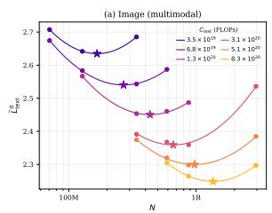

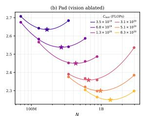

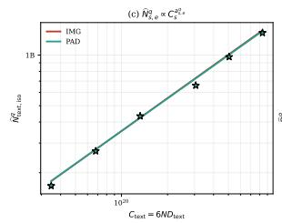

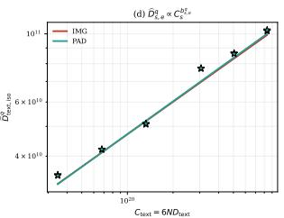  
Figure 1: IsoFLOP curves (language objective). (a,b) At each target budget $C _ { \mathrm { t e x t } } ,$ we read the $\widetilde { L } _ { \mathrm { t e x t } } ^ { \mathrm { p a d } }$ and $\widetilde { L } _ { \mathrm { t e x t } } ^ { \mathrm { i m g } }$ across various model size at the token count satisfying $6 N D _ { \mathrm { t e x t } } = C _ { \mathrm { t e x t } }$ and plot it against log N. (c,d) Optima model size $\widehat { N } _ { \mathrm { t e x t , i s o } } ^ { q }$ and optimal token count $\widehat { D } _ { \mathrm { t e x t , i s o } } ^ { q }$ as a function of the compute budget $C _ { \mathrm { t e x t } }$

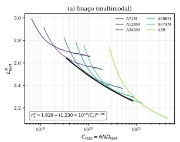

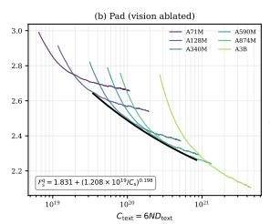

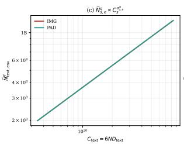

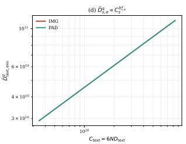  
Figure 2: Training curve envelope (language objective). (a,b) Training curves span the evaluated model sizes. The lower envelope gives the lowest observed loss at each budget $C _ { \mathrm { t e x t } }$ . The fitted loss frontier summarizes this envelope. (c,d) Optimal model size $\widehat { N } _ { \mathrm { t e x t , e n v } } ^ { q }$ and optimal token count $\widehat { D } _ { \mathrm { t e x t , e n v } } ^ { q }$ as a function of the compute budget $C _ { \mathrm { t e x t } }$

We denote the model sizes supported by both conditions at budget $C _ { s }$ by $\mathcal { N } _ { s } ( C _ { s } )$ . Gaps are expressed as fractions in the equations and percentages in the figures. This paired measure complements the frontier analysis by comparing the same allocation across conditions, whereas each condition’s frontier selects its own loss-minimizing allocation.

## 3.2 Visual Content Preserves Text Scaling

As shown in Figure 1, the text IsoFLOP profiles closely align under IMG and PAD at matched compute, including the locations of their minima. The training-curve envelopes show the same pattern. As illustrated in Figure 2, their fitted frontiers nearly overlap, with the same decay exponent $\beta _ { \mathrm { t e x t } } = 0 . 1 9 8$ and closely matched offsets, 1.829 and 1.831. Thus, visual-content ablation produces little change in the observed relationship between $L _ { \mathrm { t e x t } } ^ { q }$ and $C _ { \mathrm { t e x t } }$ This stability extends to the estimated model-data allocation. The IsoFLOP parameter exponents are 0.649 for IMG and 0.645 for PAD. The envelope estimator gives 0.578 for both. Although the absolute exponents depend on the estimator, the difference between conditions is small within each estimator. Because both estimators reuse the same runs, we interpret this agreement as a sensitivity check on the allocation analysis. The paired anchor gaps provide a direct check that this pattern is not solely a consequence of fitting frontiers. As shown in Figure 5a, $\widetilde { \Delta } _ { \mathrm { t e x t } } ^ { \mathrm { a n c } }$ ranges from −0.095% to +0.128%, with a mean of −0.006%. These near-zero differences support preservation of the measured text objective under the fixed mixture and compute budgets. We examine whether this pattern extends to downstream language capabilities separately in Section 4.

## 3.3 Visual Content Lowers Multimodal Loss

As shown in Figure 3, matched IMG models attain lower loss than PAD models on the text tokens in image-text examples at every evaluated budget. As illustrated in Figure 4, this advantage persists when each condition selects its own allocation. The fitted IMG frontier lies below the PAD frontier throughout $C _ { \mathrm { m m } } \in [ 1 . 0 4 2 \times 1 0 ^ { 1 9 } , 2 . 5 0 4 \times 1 0 ^ { 2 0 } ]$ FLOPs. Visual content therefore lowers multimodal loss both at matched allocations and along the estimated loss frontiers.

## 3.4 Visual Anchoring Strengthens with Compute

A lower multimodal frontier establishes that visual content helps, but it does not show whether its relative contribution persists as the model and data scale. We therefore return to the anchor gap and track its dependence on multimodal compute. As shown in Figure 5, the gaps increase overall while fixed-compute profiles retain a dependence on model size. To characterize the compute trend, we use three complementary summaries.

Separating compute growth from allocation choice. At each budget, $G _ { s } ^ { \mathrm { m a x } }$ is the largest paired gap among the supported model sizes $\mathcal { N } _ { s } ( C _ { s } )$ . A second summary, $G _ { s } ^ { \mathrm { q u a d } }$ , is the maximum of a quadratic fit to the paired gaps in log N over the supported size interval. We find this maximum by evaluating both endpoints and any interior stationary point. These summaries describe where the relative effect of ablation is largest. To ask whether the gap also grows along an allocation chosen for low loss, we evaluate

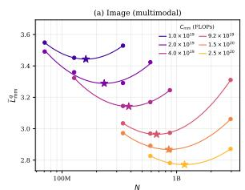

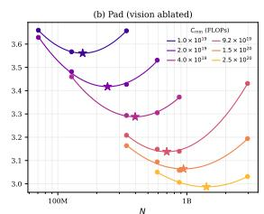

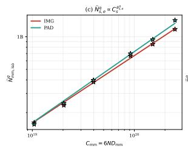

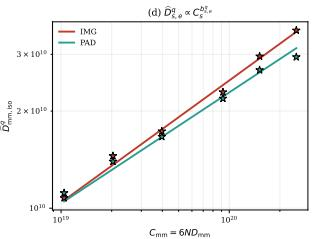  
Figure 3: IsoFLOP curves (multimodal objective). (a,b) At each target budget $C _ { \mathrm { m m } } .$ we read the $\widetilde { L } _ { \mathrm { m m } } ^ { \mathrm { p a d } }$ and eLmm img across various model size at the token count satisfying $6 N D _ { \mathrm { m m } } = C _ { \mathrm { m m } }$ and plot it against log N. (c,d) Optimal model size $\widehat { N } _ { \mathrm { m m , i s o } } ^ { q }$ and optimal token count $\widehat { D } _ { \mathrm { m m , i s o } } ^ { q }$ as a function of the compute budget $C _ { \mathrm { m m } } .$

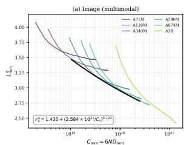

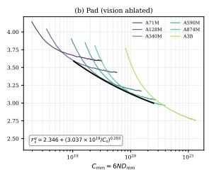

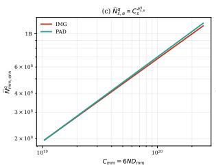

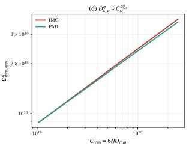  
Figure 4: Training curve envelope (multimodal objective). (a,b) Training curves span the evaluated model sizes. The lower envelope gives the lowest observed loss at each budget $C _ { \mathrm { m m } } .$ The fitted loss frontier summarizes this envelope. (c,d) Optimal model size $\widehat { N } _ { \mathrm { m m , e n v } } ^ { q }$ and optimal token count $\widehat { D } _ { \mathrm { m m , e n v } } ^ { q }$ as a function of the compute budget Cmm.

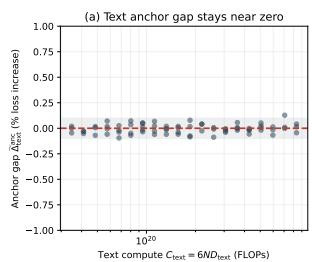

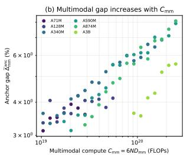

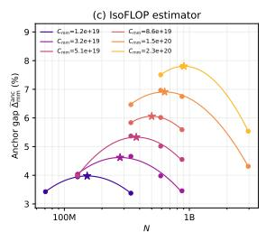

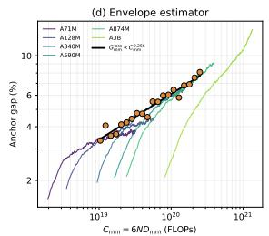  
Figure 5: Visual anchoring strengthens with multimodal compute while the text gap stays near zero. (a) Paired text gaps, with a shaded ±0.1% reference band. (b) Paired multimodal gaps, colored by model size. (c) Gap profiles at six fixed compute budgets. Stars mark maxima of quadratic fits in log N, not loss minima. (d) Per-model gap trajectories, paired gaps along the IMG envelope, and their power-law fit (black, $\gamma = 0 . 2 5 6 )$ . All gaps are relative loss increases under ablation, expressed as percentages.

$$
G _ { s } ^ { \mathrm { l o s s } } ( C _ { s } ) = \widetilde { \Delta } _ { s } ^ { \mathrm { a n c } } \Big ( \widehat { N } _ { s , \mathrm { e n v } } ^ { \mathrm { i m g } } ( C _ { s } ) , C _ { s } \Big ) .\tag{7}
$$

Here, the IMG envelope selects the model size, and the gap compares IMG and PAD at that same size and compute.   
This is a paired gap along the IMG envelope, rather than a ratio between independently optimized frontiers.   
Maximizing the gap and minimizing the loss need not select the same model.

A consistent trend across allocation rules. For each multimodal summary, we fit a power law by linear regression in log gap and log compute:

$$
G _ { \mathrm { m m } } ^ { j } ( C _ { \mathrm { m m } } ) \approx \kappa _ { \mathrm { m m } } ^ { j } C _ { \mathrm { m m } } ^ { \gamma _ { \mathrm { m m } } ^ { j } } , \ j \in \{ \mathrm { m a x } , \mathrm { q u a d } , \mathrm { l o s s } \} ,\tag{8}
$$

with $C _ { \mathrm { m m } }$ measured in FLOPs. The three summaries yield closely matched exponents, $\gamma _ { \mathrm { m m } } ^ { \mathrm { m a x } } = 0 . 2 5 4 , \gamma _ { \mathrm { m m } } ^ { \mathrm { q u a d } } =$ 0.254, and $\gamma _ { \mathrm { m m } } ^ { \mathrm { l o s s } } = 0 . 2 5 6$ , with log-space $R ^ { 2 }$ values of 0.978, 0.972, and 0.955, respectively. $\mathrm { A t } \ C _ { \mathrm { m m } } = 1 0 ^ { 2 0 }$ FLOPs, the fitted gaps are 0.06231, 0.06212, and 0.06099 in the same order. From the smallest to the largest fitted budget, the quadratic maximum rises from 3.63% to 8.09%, while the gap along the IMG envelope rises from 3.35% to 8.09%. This agreement shows that the overall increase is also present along allocations selected for low IMG loss, although local budget-to-budget fluctuations remain.

Compute captures the trend, with allocation still mattering. A descriptive joint fit gives $\widetilde { \Delta } _ { \mathrm { m m } } ^ { \mathrm { a n c } } \propto N ^ { 0 . 2 1 2 } D _ { \mathrm { m m } } ^ { 0 . 3 0 1 }$ The unequal exponents, together with the fixed-compute profiles in Figure 5c, show that the gap is not determined by compute alone. The power laws summarize an observed scaling trend across the tested configurations. Because the budgets and summaries reuse correlated observations from the same runs, the quality of these fits does not establish training-seed reproducibility or behavior beyond the fitted range. We provide more details in Section D.

Model size N  
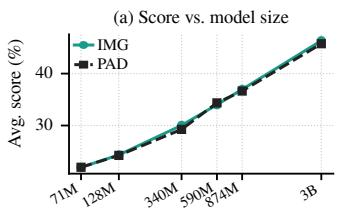

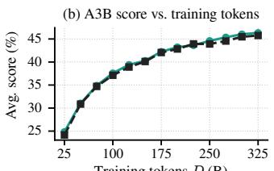  
Training tokens D (B)

Figure 6: Aggregate language performance. Average scores over 15 text benchmarks for IMG and PAD (a) Text performance across model sizes N. (b) A3B text performance over D.  
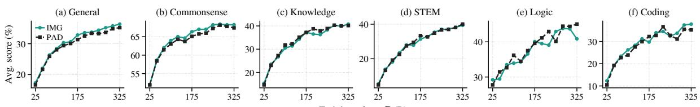  
Training tokens D (B)  
Figure 7: Per-category language performance. Average scores evaluated using A3B models for IMG and PAD conditions.

## 4 General Language Capability

The text scaling law in Section 3.2 remains nearly unchanged when visual content is ablated. We further investigate whether the contribution of vision to multimodal learning is accompanied by a change in general language performance. Using the same matched IMG and PAD runs, we compare mean scores over 15 text benchmarks spanning general understanding, commonsense, knowledge, mathematics, logical reasoning, and coding. We provide more details in Section C.1.

Aggregate language performance follows a shared scaling trend. As shown in Figure 6, increasing model size produces substantial gains under both conditions, while the IMG and PAD curves remain closely aligned. The difference between conditions stays small relative to the improvement across the scaling ladder. Figure 6 shows the same pattern along the data axis. Specifically, both conditions improve rapidly early in training and more gradually thereafter, with closely matched aggregate scores. The stable pure-text loss pattern is therefore accompanied by preserved aggregate language performance in the evaluated suite.

Category gains accompany matched aggregate performance. As shown in Figure 7, IMG achieves higher mean scores in coding, general understanding, and commonsense reasoning than PAD. These gains accompany closely matched aggregate language performance shown in Figure 6.

## 5 Spatial Reasoning

Visual anchoring in Section 3 concerns multimodal text prediction. We now investigate spatial reasoning about object locations, relations, and configurations under text-only evaluation. Using the same matched IMG and PAD runs, we evaluate 15 benchmarks across six task groups, averaging benchmarks equally within each group and then weighting groups equally. Evaluation settings and full scores appear in Section C.2 and tables 9 to 12.

## 5.1 Spatial Reasoning Scales with Compute

At the nominal budget D = 325B, aggregate accuracy improves at every successive model size under both conditions. From A71M to A3B, IMG rises from 15.41% to 44.25% and PAD from 15.10% to 39.87% (Figure 8). At fixed A3B size, increasing D from 25B to 325B raises accuracy from 22.56% to 44.25% for IMG and from 20.81% to 39.87% for PAD, with local fluctuations and a further gain at the final checkpoint. Thus, substantial spatial capability develops through scaling even without visual content.

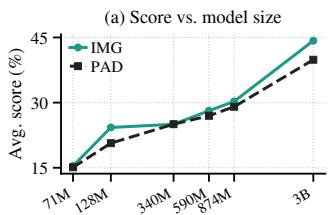  
Model size N

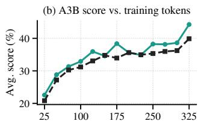  
Training tokens D (B)  
Figure 8: Aggregate spatial reasoning performance. Scores for IMG and PAD, averaged equally across six task groups, with equal benchmark weights within each group. (a) Final performance across model sizes N at a nominal budget of D = 325B tokens. (b) A3B performance over nominal training tokens D.

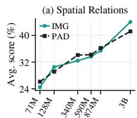

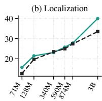

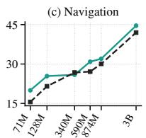

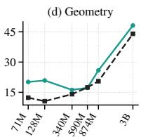  
Model size N

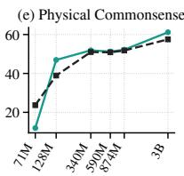

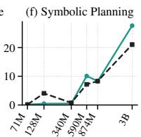

Figure 9: Scores across model sizes for each task group.  
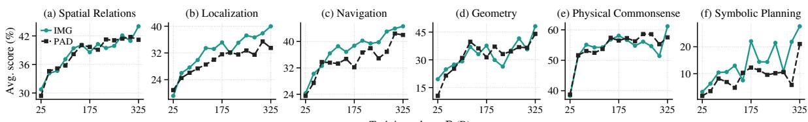  
Training tokens D (B)  
Figure 10: Scores under data scaling for each task group.

## 5.2 Visual Content Adds a Measurable Gain

Visual content adds a smaller, scale-dependent benefit. The matched IMG-PAD gap is positive at five of six model sizes and reaches 4.38% at A3B. It is not monotonic. Specifically, the gap is 3.62% at A128M and approximately 1.2% at A590M and A874M. These comparisons distinguish overall capability growth from the additional contribution of visual pre-training.

## 5.3 Transfer Varies Across Task Groups

Every task group improves from A71M to A3B under both conditions, but visual gains vary across groups and scales (Figure 9). During A3B training, localization, navigation, and symbolic planning have mean IMG-PAD gains of 2.88%, 3.02%, and 5.19%, respectively (Figure 10). The other three groups have mean gaps within 0.6% of zero, although all six favor IMG at the final checkpoint. The distinction is thus the persistence of gains across training, not their presence at a single checkpoint.

The three groups with sustained gains share demands for maintaining or composing spatial configurations: localization binds objects to positions, navigation updates positions along routes, and symbolic planning composes actions toward a target arrangement. The other groups emphasize relation inference, geometric rules, or prior physical knowledge, offering solution routes through language and symbolic constraints. PIQA-spatial, for example, scales strongly with model size despite little average visual advantage during A3B training; geometry gains concentrate in shape identification, while Geometry3K remains difficult. Together, these findings suggest more consistent transfer to organizing configurations and spatial updates. These demands overlap, so this interpretation does not establish a mechanism or strict taxonomy (Section F.1).

## 5.4 Emergence of Compositional Spatial Skills

Symbolic planning has the largest mean IMG-PAD gain during A3B training, approximately 5.19%. Blocksworld accuracy rises from 3.3% to 27.6% for IMG, versus 1.8% to 21.0% for PAD (Figure 10). Success requires a complete executable action sequence that reaches the goal; any invalid action or unmet goal invalidates the response.

As shown in Figure 11, larger models extend successful composition to longer plans. Here, emergence denotes the appearance of successful long-plan composition at larger scales, without establishing a sharp scaling transition or the acquisition of individual atomic operations. On 3-4-block problems, IMG reaches 46.70% at A590M and 67.45% at A3B. On 5-12-block problems, no IMG response succeeds through A590M; success rises to 0.78% at A874M and 16.62% at A3B, compared with 12.99% for A3B PAD. Section F.1 gives the response counts, and the ten-block case in Section F.2 illustrates a complete IMG solution versus a legal but incomplete PAD prefix.

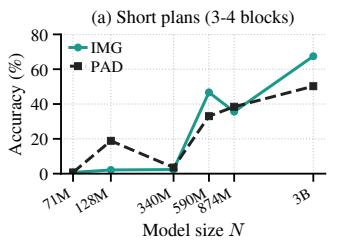

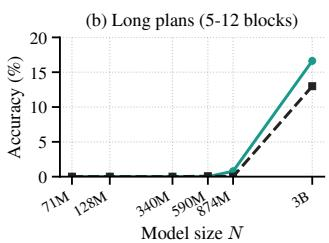  
Figure 11: Growth of symbolic tower-building performance in the benchmark Blocksworld. Final-checkpoint scores for (a) short plans with 3-4 blocks (106 problems) and (b) long plans with 5-12 blocks (385 problems) in the tower-building task.

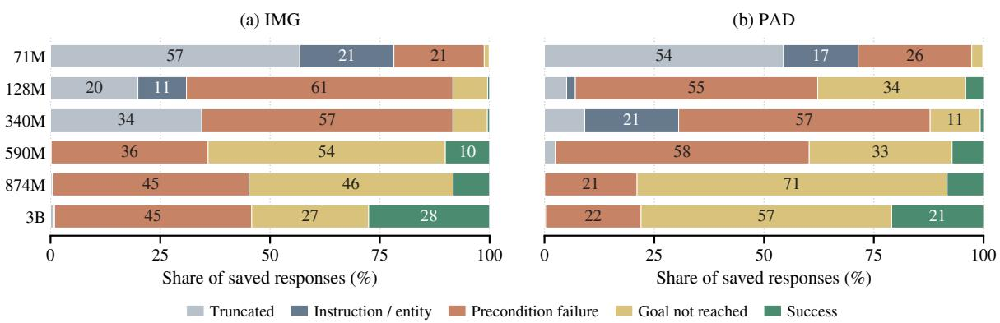  
Figure 12: Execution outcomes across scales for (a) IMG and (b) PAD. Length-limited responses are classified first; others are executed until the first invalid instruction or unmet precondition, with a goal check after legal plans. Labels give percentages for segments of at least 10%.

Execution remains a bottleneck. Our final-checkpoint audit distinguishes truncation, instruction/entity errors, precondition violations, and legal plans that miss the goal (Section F.1 and fig. 12). Truncation dominates A71M but becomes uncommon at A3B. At A3B, IMG produces fewer legal-but-unsuccessful plans than PAD (523 versus 1,121), but more precondition failures (882 versus 427). Among legal-but-unsuccessful plans, 73.4% under PAD contain fewer actions than minimally required, compared with 44.2% under IMG.

This contrast is consistent with better organization of target configurations or action sequences, as suggested in Section 5.3, while reliable execution remains a bottleneck. Many IMG precondition failures attempt to pick up a covered block: placing a on b too early prevents subsequently placing b on c. The text-prediction objective does not explicitly enforce these constraints. Competing first-failure categories do not isolate improvements in individual operations; Sections F.1 and F.2 provide the full audit and cases.

## 6 Conclusion

Our controlled visual-content ablations show that visual information acts as a scalable anchor in native multimoda pre-training. Its contribution to multimodal text prediction grows with compute, while pure-text loss scaling, compute-optimal allocation, and aggregate general-language performance remain largely unchanged. Spatial reasoning improves with model and data scaling under both conditions, and visual content provides an additional benefit even when evaluation inputs contain only text. During A3B training, gains are most sustained in localization, navigation, and symbolic planning, which share demands for maintaining configurations or composing spatial updates. Gains in spatial relations, geometry, and physical commonsense, with greater emphasis on explicit relations, rules, or prior knowledge, are less consistent. This suggests selective spatial transfer; long-plan success emerges at larger scales, while execution remains a bottleneck.

## References

Armen Aghajanyan, Lili Yu, Alexis Conneau, Wei-Ning Hsu, Karen Hambardzumyan, Susan Zhang, Stephen Roller, Naman Goyal, Omer Levy, and Luke Zettlemoyer. Scaling Laws for Generative Mixed-Modal Language Models. In International Conference on Machine Learning (ICML), 2023.

Morris Alper, Michael Fiman, and Hadar Averbuch-Elor. Is BERT Blind? Exploring the Effect of Vision-and-Language Pretraining on Visual Language Understanding. arXiv preprint arXiv:2303.12513, 2023.

Yonatan Bisk, Rowan Zellers, Jianfeng Gao, Yejin Choi, et al. PIQA: Reasoning about Physical Commonsense in Natural Language. In AAAI Conference on Artificial Intelligence (AAAI), volume 34, pp. 7432–7439, 2020.

Chameleon Team. Chameleon: Mixed-Modal Early-Fusion Foundation Models. arXiv preprint arXiv:2405.09818, 2024.

Karl Cobbe, Vineet Kosaraju, Mohammad Bavarian, Mark Chen, Heewoo Jun, Lukasz Kaiser, Matthias Plappert, Jerry Tworek, Jacob Hilton, Reiichiro Nakano, et al. Training Verifiers to Solve Math Word Problems. arXiv preprint arXiv:2110.14168, 2021.

Yufeng Cui, Honghao Chen, Haoge Deng, Xu Huang, Xinghang Li, Jirong Liu, Yang Liu, Zhuoyan Luo, Jinsheng Wang, Wenxuan Wang, et al. Emu3.5: Native Multimodal Models are World Learners. arXiv preprint arXiv:2510.26583, 2025.

Mingkang Dong, Hongyi Cai, Jie Li, Sifan Zhou, Bin Ren, Kunyu Peng, and Yuqian Fu. VisNec: Measuring and Leveraging Visual Necessity for Multimodal Instruction Tuning. arXiv preprint arXiv:2603.01195, 2026.

Xinrun Du, Yifan Yao, Kaijing Ma, Bingli Wang, Tianyu Zheng, King Zhu, Minghao Liu, Yiming Liang, Xiaolong Jin, Zhenlin Wei, et al. SuperGPQA: Scaling LLM Evaluation Across 285 Graduate Disciplines. arXiv preprint arXiv:2502.14739, 2025.

Stella Frank, Emanuele Bugliarello, and Desmond Elliott. Vision-and-Language or Vision-for-Language? On Cross-Modal Influence in Multimodal Transformers. In Empirical Methods in Natural Language Processing (EMNLP), 2021.

Dan Hendrycks, Collin Burns, Steven Basart, Andy Zou, Mantas Mazeika, Dawn Song, and Jacob Steinhardt. Measuring Massive Multitask Language Understanding. arXiv preprint arXiv:2009.03300, 2020.

Jordan Hoffmann, Sebastian Borgeaud, Arthur Mensch, Elena Buchatskaya, Trevor Cai, Eliza Rutherford, Diego de Las Casas, Lisa Anne Hendricks, Johannes Welbl, Aidan Clark, et al. Training Compute-Optimal Large Language Models. arXiv preprint arXiv:2203.15556, 2022.

Mandar Joshi, Eunsol Choi, Daniel S Weld, and Luke Zettlemoyer. TriviaQA: A Large Scale Distantly Supervised Challenge Dataset for Reading Comprehension. arXiv preprint arXiv:1705.03551, 2017.

Jared Kaplan, Sam McCandlish, Tom Henighan, Tom B Brown, Benjamin Chess, Rewon Child, Scott Gray, Alec Radford, Jeffrey Wu, and Dario Amodei. Scaling Laws for Neural Language Models. arXiv preprint arXiv:2001.08361, 2020.

Kimi, Tongtong Bai, Yifan Bai, Yiping Bao, SH Cai, Yuan Cao, Y Charles, HS Che, Cheng Chen, Guanduo Chen, et al. Kimi K2.5: Visual Agentic Intelligence. arXiv preprint arXiv:2602.02276, 2026.

Tom Kwiatkowski, Jennimaria Palomaki, Olivia Redfield, Michael Collins, Ankur Parikh, Chris Alberti, Danielle Epstein, Illia Polosukhin, Jacob Devlin, Kenton Lee, et al. Natural Questions: A Benchmark for Question Answering Research. Transactions ofthe Associationfor Computational Linguistics, 7:453–466, 2019.

Chengzu Li, Wenshan Wu, Huanyu Zhang, Yan Xia, Shaoguang Mao, Li Dong, Ivan Vulic, and Furu Wei. Imagine´ while Reasoning in Space: Multimodal Visualization-of-Thought. arXiv preprint arXiv:2501.07542, 2025.

Junnan Li, Dongxu Li, Silvio Savarese, and Steven Hoi. BLIP-2: Bootstrapping Language-Image Pre-training with Frozen Image Encoders and Large Language Models. arXiv preprint arXiv:2301.12597, 2023.

Hunter Lightman, Vineet Kosaraju, Yuri Burda, Harrison Edwards, Bowen Baker, Teddy Lee, Jan Leike, John Schulman, Ilya Sutskever, and Karl Cobbe. Let’s Verify Step by Step. In International Conference on Learning Representations (ICLR), 2023.

Aixin Liu, Bei Feng, Bing Xue, Bingxuan Wang, Bochao Wu, Chengda Lu, Chenggang Zhao, Chengqi Deng, Chenyu Zhang, Chong Ruan, et al. DeepSeek-V3 Technical Report. arXiv preprint arXiv:2412.19437, 2024.

Haotian Liu, Chunyuan Li, Qingyang Wu, and Yong Jae Lee. Visual Instruction Tuning. In Annual Conference on Neural Information Processing Systems (NIPS), 2023a.

Jiawei Liu, Chunqiu Steven Xia, Yuyao Wang, and Lingming Zhang. Is Your Code Generated by ChatGPT Really Correct? Rigorous Evaluation of Large Language Models for Code Generation. In Annual Conference on Neural Information Processing Systems (NIPS), volume 36, pp. 21558–21572, 2023b.

Pan Lu, Ran Gong, Shibiao Jiang, Liang Qiu, Siyuan Huang, Xiaodan Liang, and Song-Chun Zhu. Inter-GPS: Interpretable Geometry Problem Solving with Formal Language and Symbolic Reasoning. arXiv preprint arXiv:2105.04165, 2021.

Sachit Menon, Richard Zemel, and Carl Vondrick. Whiteboard-of-Thought: Thinking Step-by-Step Across Modalities. arXiv preprint arXiv:2406.14562, 2024.

Roshanak Mirzaee and Parisa Kordjamshidi. Transfer Learning with Synthetic Corpora for Spatial Role Labeling and Reasoning. In Empirical Methods in Natural Language Processing (EMNLP), 2022.

Roshanak Mirzaee, Hossein Rajaby Faghihi, Qiang Ning, and Parisa Kordjamshidi. SPARTQA: A textual question answering benchmark for spatial reasoning. In Annual Conference of the North American Chapter of the Associationfor Computational Linguistics (NAACL), pp. 4582–4598, 2021.

Tanawan Premsri and Parisa Kordjamshidi. FoREST: Frame of Reference Evaluation in Spatial Reasoning Tasks. In Empirical Methods in Natural Language Processing (EMNLP), 2025.

Keisuke Sakaguchi, Ronan Le Bras, Chandra Bhagavatula, and Yejin Choi. Winogrande: An Adversarial Winograd Schema Challenge at Scale. Communications ofthe ACM, 64(9):99–106, 2021.

Maarten Sap, Hannah Rashkin, Derek Chen, Ronan LeBras, and Yejin Choi. SocialiQA: Commonsense Reasoning about Social Interactions. arXiv preprint arXiv:1904.09728, 2019.

Zhengxiang Shi, Qiang Zhang, and Aldo Lipani. StepGame: A New Benchmark for Robust Multi-Hop Spatial Reasoning in Texts. arXiv preprint arXiv:2204.08292, 2022.

Mustafa Shukor, Louis Bethune, Dan Busbridge, David Grangier, Enrico Fini, Alaaeldin El-Nouby, and Pierre Ablin. Scaling Laws for Optimal Data Mixtures. In Annual Conference on Neural Information Processing Systems (NIPS), 2025a.

Mustafa Shukor, Enrico Fini, Victor Guilherme Turrisi da Costa, Matthieu Cord, Joshua Susskind, and Alaaeldin El-Nouby. Scaling Laws for Native Multimodal Models. In IEEE International Conference on Computer Vision (ICCV), 2025b.

Mirac Suzgun, Nathan Scales, Nathanael Scharli, Sebastian Gehrmann, Yi Tay, Hyung Won Chung, Aakanksha¨ Chowdhery, Quoc V Le, Ed H Chi, Denny Zhou, et al. Challenging Big-Bench Tasks and Whether Chain-of-Thought Can Solve Them. arXiv preprint arXiv:2210.09261, 2022.

Hao Tan and Mohit Bansal. Vokenization: Improving Language Understanding with Contextualized, Visual-Grounded Supervision. arXiv preprint arXiv:2010.06775, 2020.

Shengbang Tong, David Fan, John Nguyen, Ellis Brown, Gaoyue Zhou, Shengyi Qian, Boyang Zheng, Theophane´ Vallaeys, Junlin Han, Rob Fergus, et al. Beyond Language Modeling: An Exploration of Multimodal Pretraining. arXiv preprint arXiv:2603.03276, 2026.

Karthik Valmeekam, Matthew Marquez, Alberto Olmo, Sarath Sreedharan, and Subbarao Kambhampati. PlanBench: An Extensible Benchmark for Evaluating Large Language Models on Planning and Reasoning about Change. In Annual Conference on Neural Information Processing Systems (NIPS), 2023.

Jiayu Wang, Yifei Ming, Zhenmei Shi, Vibhav Vineet, Xin Wang, Yixuan Li, and Neel Joshi. Is a Picture Worth a Thousand Words? Delving into Spatial Reasoning for Vision Language Models. In Annual Conference on Neural Information Processing Systems (NIPS), 2024a.

Yubo Wang, Xueguang Ma, Ge Zhang, Yuansheng Ni, Abhranil Chandra, Shiguang Guo, Weiming Ren, Aaran Arulraj, Xuan He, Ziyan Jiang, et al. MMLU-Pro: A More Robust and Challenging Multi-Task Language Understanding Benchmark. In Annual Conference on Neural Information Processing Systems (NIPS), 2024b.

Jason Weston, Antoine Bordes, Sumit Chopra, Alexander M Rush, Bart Van Merrienboer, Armand Joulin, and¨ Tomas Mikolov. Towards AI-Complete Question Answering: A Set of Prerequisite Toy Tasks. arXiv preprint arXiv:1502.05698, 2015.

Haoyuan Wu, Aoqi Wu, Hai Wang, Jiajia Wu, Jinxiang Ou, and Bei Yu. Scaling Native Multimodal Pre-Training From Scratch. arXiv preprint arXiv:2607.22043, 2026.

Yutaro Yamada, Yihan Bao, Andrew K. Lampinen, Jungo Kasai, and Ilker Yildirim. Evaluating Spatial Understanding of Large Language Models. Transactions on Machine Learning Research, 2024.

Rowan Zellers, Ari Holtzman, Yonatan Bisk, Ali Farhadi, and Yejin Choi. Hellaswag: Can A Machine Really Finish Your Sentence? arXiv preprint arXiv:1905.07830, 2019.

Yiming Zhang, Zhonghan Zhao, Wenwei Zhang, Haiteng Zhao, Tianyang Lin, Huanze Tang, Yunhua Zhou, Demin Song, Kuikun Liu, Haochen Ye, Haian Huang, Yuzhe Gu, Haijun Lv, Qipeng Guo, Bin Liu, Gaoang Wang, and Kai Chen. Scalable Visual Pretraining for Language Intelligence. arXiv preprint arXiv:2607.09657, 2026.

Wanjun Zhong, Ruixiang Cui, Yiduo Guo, Yaobo Liang, Shuai Lu, Yanlin Wang, Amin Saied, Weizhu Chen, and Nan Duan. AGIEval: A Human-Centric Benchmark for Evaluating Foundation Models. arXiv preprint arXiv:2304.06364, 2023.

Chunting Zhou, Lili Yu, Arun Babu, Kushal Tirumala, Michihiro Yasunaga, Leonid Shamis, Jacob Kahn, Xuezhe Ma, Luke Zettlemoyer, and Omer Levy. Transfusion: Predict the Next Token and Diffuse Images with One Multi-Modal Model. arXiv preprint arXiv:2408.11039, 2024.

Chengxu Zhuang, Evelina Fedorenko, and Jacob Andreas. Visual Grounding Helps Learn Word Meanings in Low-Data Regimes. In Annual Conference ofthe North American Chapter ofthe Associationfor Computational Linguistics (NAACL), 2024.

## A Related Work

Native multimodal pre-training. Multimodal systems differ in when and how vision and language enter a shared learning process. Modular approaches connect a pre-trained vision encoder to a language model through bridging modules or instruction tuning (Li et al., 2023; Liu et al., 2023a). Native approaches instead train on mixed-modal sequences within a shared backbone. Chameleon uses discrete image and text tokens (Chameleon Team, 2024), Transfusion combines language modeling with image diffusion (Zhou et al., 2024), and Emu3.5 studies unified autoregressive modeling of large-scale interleaved vision-language data (Cui et al., 2025). In this study, we investigate how the information carried by these inputs affects learning across scales.

Scaling laws and cross-modal interactions. Language-model scaling laws relate loss to model size, data, and compute and formalize the allocation of a fixed training budget (Kaplan et al., 2020; Hoffmann et al., 2022). Mixed-modal scaling extends this analysis to interactions between data sources, including synergy and competition (Aghajanyan et al., 2023). Subsequent work examines native multimodal architectures and sparsity (Shukor et al., 2025b), data-mixture weights (Shukor et al., 2025a), and differences between language and vision scaling requirements (Tong et al., 2026). Our prior study estimates allocations for the text and multimodal objectives separately and analyzes their dependence on the training mixture (Wu et al., 2026). Changing the mixture, however, can also alter language supervision. Tong et al. investigate caption-distribution shifts as a possible source of language degradation (Tong et al., 2026). We hold the text, mixture, sequence structure, and optimization settings fixed while ablating visual content. This comparison targets image information within a common training setup.

Visual context and transfer to language. Visual ablation can probe a trained model’s use of image context (Frank et al., 2021). VisNec uses losses with and without visual context to select informative instruction-tuning examples (Dong et al., 2026). Its blind forward pass changes the input to a single model, whereas our anchor gap compares matched models trained with different access to visual content. A complementary line of work studies how visua supervision affects language learning through vokenization (Tan & Bansal, 2020), visual-knowledge probing (Alper et al., 2023), and word learning under limited text data (Zhuang et al., 2024). Work on visual-document pre-training also compares continued learning from scientific pages with learning from parsed text of the same documents (Zhang et al., 2026). These settings motivate examining both the contribution of visual context to training loss and the capabilities retained when visual inputs are absent. We study both within native pre-training while preserving the associated text across conditions.

Spatial reasoning without visual inputs. Textual spatial benchmarks assess relations and operations that can also be expressed visually. StepGame evaluates relation composition and multi-hop reasoning (Shi et al., 2022), while SpatialEval compares textual and visual input conditions (Wang et al., 2024a). Other methods introduce visual computation during inference (Menon et al., 2024; Li et al., 2025). Our evaluation instead uses text-only inputs and outputs after pre-training. Our prior work reports spatial improvements when we add multimodal data to a fixed text budget (Wu et al., 2026). The present matched ablation retains both the associated text and the input budget. This design separates capability growth with scale from the additional contribution of visual content, while leaving the internal mechanism of this transfer unresolved.

## B Training settings

For native multimodal pre-training, we employ the Muon optimizer with a weight decay of 0.1 and a gradient clipping threshold of 1.0. Additionally, we utilize a warmup-stable learning rate schedule, a global batch size of

Table 1: Pre-training hyperparameters. We detail the hyperparameters used for pre-training different model configurations to derive scaling laws.
<table><tr><td></td><td>A71M</td><td>A128M</td><td>A340M</td><td>A590M</td><td>A874M</td><td>A3B</td></tr><tr><td colspan="7">Architecture Configurations</td></tr><tr><td>layers</td><td>11</td><td>15</td><td>19</td><td>23</td><td>27</td><td>48</td></tr><tr><td>hidden size</td><td>640</td><td>768</td><td>1152</td><td>1280</td><td>1536</td><td>2048</td></tr><tr><td>FFN hidden size</td><td>2048</td><td>2048</td><td>3072</td><td>4096</td><td>4096</td><td>6912</td></tr><tr><td>attention heads</td><td>8</td><td>12</td><td>16</td><td>20</td><td>24</td><td>32</td></tr><tr><td>query groups</td><td colspan="6">4</td></tr><tr><td>kv channels</td><td colspan="6">128</td></tr><tr><td>total experts</td><td colspan="6">128</td></tr><tr><td>activated experts</td><td colspan="6">8</td></tr><tr><td>expert FFN hidden size</td><td></td><td></td><td>384</td><td>512</td><td>512</td><td>768</td></tr><tr><td>shared-expert hidden size</td><td>256 256</td><td>256</td><td>384</td><td>512</td><td>512</td><td>768</td></tr><tr><td>MoE layer</td><td colspan="6">first layer dense, remaining layers MoE</td></tr><tr><td>Training Settings</td><td colspan="6"></td></tr><tr><td>batch size (sequences)</td><td colspan="6">2048</td></tr><tr><td>sequence length</td><td colspan="6">4096</td></tr><tr><td>warmup steps</td><td colspan="6"></td></tr><tr><td>learning rate</td><td>2.6e-3</td><td>1.9e-3</td><td>1.1e-3</td><td>8.2e-4</td><td>6.8e-4</td><td>3.0e-4</td></tr></table>

2048, and a maximum sequence length of 4096 (8M input tokens per step). The training loss is computed only on text tokens, with vision tokens masked out from loss computation (Kimi et al., 2026). We provide more details in Table 1.

## C Evaluation settings

## C.1 General language capability

We evaluate general language capabilities using 15 distinct benchmarks.

• Aggregate: SuperGPQA(Du et al., 2025)(5-shot), MMLU-Redux(Hendrycks et al., 2020)(5-shot), MMLU-Pro(Wang et al., 2024b)(5-shot), and AGIEvalen(Zhong et al., 2023)(3-shot).

• Coding: HumanEval+(Liu et al., 2023b)(0-shot) and MBPP+(Liu et al., 2023b)(3-shot).

• Mathematics: GSM8K(Cobbe et al., 2021)(4-shot, CoT) and MATH(Lightman et al., 2023)(4-shot, CoT).

• Logical Reasoning: BBH(Suzgun et al., 2022)(3-shot, CoT).

• Knowledge: NaturalQuestions(Kwiatkowski et al., 2019) (5-shot) and TriviaQA(Joshi et al., 2017)(5-shot).

• Commonsense Reasoning: HellaSwag(Zellers et al., 2019)(10-shot), WinoGrande(Sakaguchi et al., 2021)(5- shot), SIQA(Sap et al., 2019)(0-shot), and PIQA(Bisk et al., 2020)(0-shot).

For the evaluation of general language capability, we use greedy generation strategy.

## C.2 Spatial reasoning

We evaluate 15 benchmarks in six task groups, all with 5-shot chain-of-thought prompting and text-only inputs.   
Each entry below combines the group’s scope with its benchmarks.

• Spatial Relations: Infer or verify relative positions. StepGame (Shi et al., 2022) uses directional statements; SpaRTUN (Mirzaee & Kordjamshidi, 2022) covers direction, distance, containment, and contact; bAbI(positional reasoning) (Weston et al., 2015) tests positional constraints; and FoREST (Premsri & Kordjamshidi, 2025) varies the reference frame.

• Localization: Identify, describe, or count objects using their attributes and positions. SpartQA (Mirzaee et al., 2021), SpatialMap (Wang et al., 2024a), and BBH(colored objects) (Suzgun et al., 2022) query objects within described scenes.

• Navigation: Follow routes, update positions or orientations, or construct paths. SpatialUnderstanding (Yamada et al., 2024) queries the object reached after successive moves; MazeNav (Wang et al., 2024a) uses text-represented mazes; bAbI(path finding) (Weston et al., 2015) requires a direction sequence; and BBH(navigate) (Suzgun et al., 2022) tests return to the starting point.

• Geometry: Recover geometric configurations and apply their constraints. BBH(geometric shapes) (Suzgun et al., 2022) identifies shapes from SVG path coordinates; Geometry3K (Lu et al., 2021) uses textual logic forms for lengths, angles, and areas, without diagram images.

• Physical Commonsense: Choose between solutions to everyday physical goals. PIQA-spatial (Bisk et al., 2020) tests knowledge of object use, materials, or support, rather than general physical simulation.

Table 2: Spatial evaluation inventory. The 15 benchmarks cover six task groups.
<table><tr><td>Capability</td><td>Benchmark</td><td>Items</td><td>Answer type</td></tr><tr><td rowspan="4">Spatial Relations</td><td>StepGame</td><td>3,000</td><td>Direction label</td></tr><tr><td>SpaRTUN</td><td>3326</td><td>Relation label</td></tr><tr><td>bAbI(positional reasoning)</td><td>627</td><td>Yes/no</td></tr><tr><td>FoREST</td><td>1998</td><td>Direction label</td></tr><tr><td rowspan="3">Localization</td><td>SpartQA</td><td>1994</td><td>Choice label</td></tr><tr><td>SpatialMap</td><td>997</td><td>Choice label</td></tr><tr><td>BBH(colored objects)</td><td>245</td><td>Choice label</td></tr><tr><td rowspan="4">Navigation</td><td>SpatialUnderstanding</td><td>3998</td><td>Object name</td></tr><tr><td>MazeNav</td><td>999</td><td>Choice label</td></tr><tr><td>bAbI(path finding)</td><td>995</td><td>Direction sequence</td></tr><tr><td>BBH(navigate)</td><td>245</td><td>Yes/no</td></tr><tr><td rowspan="2">Geometry</td><td>BBH(geometric shapes)</td><td>244</td><td>Choice label</td></tr><tr><td>Geometry3K</td><td>596</td><td>Choice label</td></tr><tr><td>Physical Commonsense</td><td>PIQA-spatial</td><td>548</td><td>Choice label</td></tr><tr><td>Symbolic Planning</td><td>Blocksworld</td><td>491</td><td>Action sequence</td></tr></table>

• Symbolic Planning: Produce a complete executable action sequence satisfying all goal relations. Blocksworld (Valmeekam et al., 2023) asks the model to build a tower from separate blocks, tracking which blocks are clear, held, or placed, and respecting action preconditions.

We generate four responses per item with temperature 0.3 and $\mathrm { t o p } { - } p = 0 . 9$ , reporting avg@4. Each benchmark belongs to one group; benchmarks are weighted equally within groups, and the six group scores are averaged equally. These groups organize this evaluation rather than define a general taxonomy of spatial or physical reasoning. Table 2 lists item counts and answer types.

## D Allocation Estimation and Loss-Compute Frontiers

This section details the estimators in Sections 2 and 3, retaining the source $s \in \ \{ \mathrm { t e x t } , \mathrm { m m } \}$ , condition $q \in$ $\{ \mathrm { i m g } , \mathsf { p a d } \}$ , and estimator $e \in \{ \mathrm { i s o , e n v } \}$ indices. We suppress the fixed mixture argument r and report results at $\dot { r } = \mathbf { 0 . } \dot { 3 }$ . The compute is $C _ { s } = \dot { 6 } N D _ { \mathrm { i } }$ s in FLOPs. Hats denote finite-data estimates, tildes denote fixed-compute interpolated losses, and $\mathcal { F } _ { s } ^ { q }$ denotes a fitted frontier. The loss-decay exponent $\beta _ { s } ^ { q }$ , allocation exponents $a _ { s , e } ^ { q } , b _ { s , e } ^ { q }$ , and gap-growth exponent $\gamma _ { s } ^ { j }$ have distinct meanings.

## D.1 Data Preprocessing

With $T = 2 0 4 8 \times 4 0 9 6 \approx 8 \mathrm { M }$ input tokens per optimizer step, step k corresponds to

$$
D = T k , D _ { \mathrm { t e x t } } = \frac { D } { 1 + r } , D _ { \mathrm { m m } } = \frac { r D } { 1 + r } , C _ { s } = 6 N D _ { s } .\tag{9}
$$

Here D is the total input-token count and $D _ { s }$ is the token count for source s. The 325B total-token budget is nominal, whereas the loss-compute analysis uses actual selected steps. For each source and condition at fixed r, we construct various candidate budgets uniformly in log compute over the union of the model-specific ranges. Writing $C _ { s , m } ^ { q , \mathrm { m i n } }$ and $C _ { s , m } ^ { q , \operatorname* { m a x } }$ for model m’s endpoints, we define the supported model set as

$$
\mathcal { M } _ { s } ^ { q } ( C _ { s } ) = \{ m : C _ { s , m } ^ { q , \mathrm { m i n } } \leq C _ { s } \leq C _ { s , m } ^ { q , \mathrm { m a x } } \} .\tag{10}
$$

We retain budgets with $| { \mathcal { M } } _ { s } ^ { q } ( C _ { s } ) | \geq 3$ and interpolate losses linearly in log Cs within each model’s observed range, without extrapolation, to obtain $\widetilde { L } _ { s } ^ { q } ( N _ { m } , C _ { s } )$

## D.2 Estimating Compute-Optimal Allocation

IsoFLOP profiles. At each retained budget and fixed $( s , q )$ , let x = log N and fit the losses with a quadratic. For this source, condition, and budget, we estimate coefficients $p _ { 0 } , p _ { 1 } , p _ { 2 }$ in the quadratic

$$
P _ { s , C _ { s } } ^ { q } ( x ) = p _ { 2 } x ^ { 2 } + p _ { 1 } x + p _ { 0 } .\tag{11}
$$

For $p _ { 2 } > 0$ , the allocation estimate is

$$
\log \widehat { N } _ { s , \mathrm { i s o } } ^ { q } ( C _ { s } ) = \mathrm { c l i p } \left( - \frac { p _ { 1 } } { 2 p _ { 2 } } , x _ { \mathrm { m i n } } , x _ { \mathrm { m a x } } \right) , ~ \widehat { D } _ { s , \mathrm { i s o } } ^ { q } ( C _ { s } ) = \frac { C _ { s } } { 6 \widehat { N } _ { s , \mathrm { i s o } } ^ { q } ( C _ { s } ) } ,\tag{12}
$$

where $x _ { \mathrm { m i n } } , x _ { \mathrm { m a x } }$ delimit the model sizes supported at that budget. We regress log $\widehat { N } _ { s , \mathrm { i s o } } ^ { q }$ and log $\widehat { D } _ { s , \mathrm { i s o } } ^ { q }$ on log $C _ { s }$ with equal weights. This yields $a _ { s , \mathrm { i s o } } ^ { q }$ and $b _ { s , \mathrm { i s o } } ^ { q }$ , with $a _ { s , \mathrm { i s o } } ^ { q } + b _ { s , \mathrm { i s o } } ^ { q } = 1$ by the compute identity.

Training-curve envelope. The equal-FLOPs envelope is

$$
\widehat { L } _ { s , \mathrm { e n v } } ^ { q } ( C _ { s } ) : = \operatorname* { m i n } _ { m \in \mathcal { M } _ { s } ^ { q } ( C _ { s } ) } \widetilde { L } _ { s } ^ { q } ( N _ { m } , C _ { s } ) .\tag{13}
$$

Each point retains the minimizing model size $\widehat { N } _ { s , \mathrm { e n v } } ^ { q } ( C _ { s } )$ and token count $\widehat { D } _ { s , \mathrm { e n v } } ^ { q } ( C _ { s } ) = C _ { s } / ( 6 \widehat { N } _ { s , \mathrm { e n v } } ^ { q } ( C _ { s } ) )$ Regressing these allocations in log space gives $a _ { s , \mathrm { e n v } } ^ { q }$ and $b _ { s , \mathrm { e n v } } ^ { q }$ , again summing to one. Fitting the envelope losses gives the distinct frontier parameters below. Both allocation estimators reuse the same runs, so their comparison in Figures 1 to 4 is a sensitivity check rather than independent validation.

## D.3 Fitting Loss-Compute Frontiers

At fixed $( s , q , r )$ , Equation (4) can be written

$$
\mathcal { F } _ { s } ^ { q } ( C _ { s } ) = E _ { s } ^ { q } + \left( \frac { C _ { c , s } ^ { q } } { C _ { s } } \right) ^ { \beta _ { s } ^ { q } } = E _ { s } ^ { q } + K _ { s } ^ { q } C _ { s } ^ { - \beta _ { s } ^ { q } } , \qquad K _ { s } ^ { q } = ( C _ { c , s } ^ { q } ) ^ { \beta _ { s } ^ { q } } .\tag{14}
$$

The amplitude $K _ { s } ^ { q }$ is distinct from the characteristic compute scale $C _ { c , s } ^ { q }$ . We search various equally spaced values of $\beta _ { s } ^ { q }$ in $\left[ 0 . 0 1 , 0 . 6 0 \right]$ . For each candidate, ordinary least squares in loss space estimates $\left( E _ { s } ^ { q } , K _ { s } ^ { q } \right)$ from the various envelope points. Candidates with $K _ { s } ^ { q } \le 0$ or any nonpositive prediction at a fitted budget are rejected. Among the remaining candidates, we minimize the mean squared log-loss residual and recover $C _ { c , s } ^ { q } = ( K _ { s } ^ { q } ) ^ { 1 / \beta _ { s } ^ { q } }$ . This two-stage selection is not joint least squares in log loss; it does not constrain $E _ { s } ^ { q } > 0$ , although all four reproduced fits have positive offsets. Each source and condition is fitted independently at $r = 0 . 3$

## D.4 Fitting Visual Anchoring

The anchor analysis applies Equation (6) to paired losses. We read each condition’s loss at the same model size and compute budget before taking their relative difference. For the quadratic maximum, we fit paired gaps in centered log N and check both endpoints and any interior stationary point. The loss-path summary uses the discrete model selected by the IMG envelope at each budget, with the PAD loss evaluated at that same allocation. It is not a ratio of independently optimized or fitted frontiers.

Positive multimodal summaries are regressed in log gap against log compute. Figures express gaps as percentages, whereas Equation (8) defines them as fractions. If the percentage regression has intercept $h _ { j } ,$ then

$$
\log \Bigl ( 1 0 0 G _ { \mathrm { m m } } ^ { j } ( C _ { \mathrm { m m } } ) \Bigr ) \approx h _ { j } + \gamma _ { \mathrm { m m } } ^ { j } \log C _ { \mathrm { m m } } , \qquad \kappa _ { \mathrm { m m } } ^ { j } = \frac { \exp ( h _ { j } ) } { 1 0 0 } .\tag{15}
$$

Thus $\kappa _ { \mathrm { m m } } ^ { j }$ is the coefficient of $C _ { \mathrm { m m } } ^ { \gamma _ { \mathrm { m m } } ^ { j } }$ when compute is expressed in FLOPs. For $j = \mathrm { m a x } , \mathrm { q u a d }$ , loss, respectively, it is approximately $5 . 1 8 7 4 \times 1 0 ^ { - 7 }$ , 5.1693 × 10−7, and $4 . 6 4 2 0 \times 1 0 ^ { - 7 }$ . The gaps reported at $1 0 ^ { 2 0 }$ FLOPs in Section 3 are fitted function values, not these coefficients.

## E General Language Evaluation Results

We report the benchmark-level scores underlying the general-language comparisons in Section 4.

## F Spatial Evaluation Results

We report the benchmark-level scores underlying the spatial comparisons in Section 5.

## F.1 Spatial Transfer and Planning Analysis

Benchmark-level interpretation. Beyond the selective gains in Section 5.3, performance across model sizes is comparable in the remaining groups, whose averages mask distinct benchmark behaviors. Physical commonsense has the largest end-to-end improvement with model size, but a much smaller visual-content gain at A3B. Its benchmark, PIQA-spatial, selects between two solutions to an everyday physical goal and can draw on physical commonsense and language knowledge; scaling alone therefore does not establish a specifically visual mechanism. Geometry gains concentrate in BBH(geometric shapes), while Geometry3K remains substantially harder. These differences should be considered when interpreting the group averages reported alongside the full benchmark scores in Tables 9 to 12.

Table 3: Supplementary execution statistics. The last row is conditional on legal plans that miss the goal; its denominator differs from the outcome counts above.
<table><tr><td>Scale</td><td>Outcome or subset</td><td>IMG</td><td>PAD</td></tr><tr><td>A71M</td><td>Truncation</td><td>1,115</td><td>1,069</td></tr><tr><td>A3B</td><td>Truncation</td><td>14</td><td>0</td></tr><tr><td>A3B</td><td>Legal plan, goal missed</td><td>523</td><td>1,121</td></tr><tr><td>A3B</td><td>Precondition violation</td><td>882</td><td>427</td></tr><tr><td>A3B</td><td>Too short among legal goal misses</td><td>231/523 (44.2%)</td><td>823/1,121 (73.4%)</td></tr></table>

Plan Length and Execution Outcomes. Blocksworld requires an executable action sequence satisfying all goal relations, unlike answer selection in PIQA-spatial. This strict criterion helps explain why visual-content gains coexist with limited absolute success. The long-plan results in Figure 11 use 1540 responses to 385 problems with 5-12 blocks. No IMG response succeeds through A590M, while 12 succeed at A874M (0.78%) and 256 at A3B (16.62%), compared with 200 for A3B PAD (12.99%). The short-plan results are reported in Section 5.4.

For the execution analysis in Figure 12, each response receives one outcome. Truncation at the length limit takes precedence; otherwise, execution stops at the first uninterpretable instruction, undeclared or unspecified block, or violated action precondition (e.g., stacking a block that is not held). Goal attainment is checked only when every action is legal. These competing first-failure categories do not isolate improvements in individual operations.

Table 3 shows that truncation becomes uncommon at A3B, although its decline is not monotonic across intermediate sizes. Repetitive action loops in A71M outputs suggest that improved repetition and termination control may contribute. At A3B, IMG has approximately 53% fewer legal-but-unsuccessful plans but 2.1 times as many precondition failures as PAD; its unsuccessful legal plans are also less often shorter than minimally required. Many precondition failures attempt to pick up a covered block, sometimes immediately after placing another block on it. This contrast motivates the distinction between representing target configurations and executing plans in Section 5.4; the ten-block example in Section F.2 illustrates the distinction without establishing its prevalence.

## F.2 Showcases: What the Model Actually Does

A complete long plan instead of a plausible prefix. The ten-block example below makes the composition gain concrete. Each consecutive pickup-and-stack pair is abbreviated as x → y, meaning pick up x; stack x on y. Initial states and goals were recovered from the public source instances; all 491 local reference plans execute successfully against their matched instances.

Case 1: Completing a ten-block tower   
Problem (condensed). Blocks $\begin{array} { r } { a , c , d , e , f , g , h , i , j , } \end{array}$ k are clear and on the table; the hand is empty. Build the tower   
i–d–c–e–g–h–j–k–a–f (top to bottom).   
A590M IMG, first response: $a  f , d  a , c  d , e  c .$   
All eight actions are legal, but only one of nine target relations is met.   
A3B PAD, first response: $a  f , i  a , d  i .$   
All six actions are legal, but only one of nine target relations is met.   
A3B IMG, first response: $a  f , k  a , j  k , h  j , g  h , e  g , c  e , d  c , i  d .$   
All 18 actions are legal, and all nine target relations are met.

A3B IMG succeeds on all four responses to this item, while every smaller IMG model and A3B PAD fail on all four. The successful plan builds from the bottom upward, preserving earlier placements. Both unsuccessful prefixes shown above terminate normally: their failure concerns goal completion, rather than the output limit.

A correct answer can conceal a broken spatial derivation. The next example asks for the destination after moving right, down, right, up, left from white-headed capuchin.

Case 2: Accepted answer, inconsistent route (square-3431)   
Correct route (x rightward, y downward): white-headed capuchin (0, 0) → lacewing (1, 0) → wallaby (1, 1) → hare   
(2, 1) → cassette (2, 0) → lacewing (1, 0).   
A3B IMG explanation (condensed): replaces the down move with another right move, assigning wallaby to (2, 0),   
then hare to (2, 1) and cassette to (3, 1); its final coordinate-to-object assignment is also inconsistent.   
Final answers: IMG: lacewing (accepted); PAD: hare (incorrect).

<table><tr><td rowspan="2">Scale</td><td colspan="2">IMG</td><td colspan="2">PAD</td></tr><tr><td>Accepted</td><td>C/L/S/U</td><td>Accepted</td><td>C/L/S/U</td></tr><tr><td>A71M</td><td>3</td><td>0/0/3/0</td><td>1</td><td>1/0/0/0</td></tr><tr><td>A128M</td><td>1</td><td>1/0 /0/0</td><td>3</td><td>1/0 /2/0</td></tr><tr><td>A340M</td><td>3</td><td>1/0 /1/1</td><td>2</td><td>0 /0 / 1/ 1</td></tr><tr><td>A590M</td><td>2</td><td>1/0 /0 /1</td><td>2</td><td>1/1/0/0</td></tr><tr><td>A874M</td><td>1</td><td>1/0 /0/0</td><td>3</td><td>2/0 /1/0</td></tr><tr><td>A3B</td><td>4</td><td>2/1/1/0</td><td>2</td><td>2/0/0/0</td></tr></table>

Table 4: Explanation quality among accepted answers in eight fixed problems per condition. C: consistent derivation; L: local verbal error with the solution intact; S: substantive reasoning error; U: unresolved boundary between local and substantive error. The four counts sum to Accepted, which is out of eight first responses. This manual case audit is separate from the all-response planning analysis and does not estimate population frequencies.

Multiple movement and entity errors make the written derivation invalid despite the accepted answer. They cannot be repaired by correcting one entity name, but also do not establish that the answer was guessed randomly.

Separating verbal slips from failed operations. A590M IMG’s first response executes the correct plan f → b, j → f, g → j, despite once writing a clear on top where the block is f. This local prose slip leaves the solution intact. By contrast, the following reversal changes the actual path:

Case 3: Reversing only one of two relations (bAbI task 19, item 0)   
Relevant facts (condensed): the bathroom is north of the bedroom; the bedroom is north of the hallway. Find a path   
from the bathroom to the hallway.   
Correct path: south, south (s,s).   
A3B IMG, first response: south, north (s,n).

Only the first north-of relation is inverted correctly; executing the predicted path returns to the bathroom. Checking every edge in the travel direction would expose the error. These cases illustrate mechanisms; the exhaustive counts in Figure 12 remain specific to Blocksworld.

Counting explanation quality within a fixed case panel. We revisit eight fixed problems across all 12 conditions, inspecting each first response (96 traces). Of 27 accepted answers, 13 have consistent derivations, two contain local verbal errors, nine contain substantive errors, and three remain borderline (Table 4). The panel covers StepGame, three SpatialUnderstanding layouts, bAbI pathfinding, and Blocksworld. It supports same-problem case comparisons, but neither population frequency estimates nor a monotonic scaling trend in explanation reliability.

The analyses connect capability growth to both scaling axes, selective visual-content gains, and longer successful action compositions. These results concern single training runs under the archived evaluator. Executable plans and explanation checks complement final-answer accuracy.

Table 5: A3B IMG language scores across various D.
<table><tr><td></td><td># Pre-Trained Tokens</td><td>25B</td><td>50B</td><td>75B</td><td>100B</td><td>125B</td><td>150B</td><td>175B</td><td>200B</td><td>225B</td><td>250B</td><td>275B</td><td>300B</td><td>325B</td></tr><tr><td rowspan="4">Aggregate</td><td>MMLU-Redux (Acc.)</td><td>27.05</td><td>38.81</td><td>44.74</td><td>48.35</td><td>51.19</td><td>51.37</td><td>54.49</td><td>54.21</td><td>55.05</td><td>56.00</td><td>57.17</td><td>57.09</td><td>57.98</td></tr><tr><td>MMLU-Pro (Acc.)</td><td>10.85</td><td>12.99</td><td>17.73</td><td>19.19</td><td>19.86</td><td>20.21</td><td>22.03</td><td>23.84</td><td>24.61</td><td>24.92</td><td>25.33</td><td>27.53</td><td>27.68</td></tr><tr><td>AGIEvalen (Acc.)</td><td>20.49</td><td>22.71</td><td>27.88</td><td>29.27</td><td>32.13</td><td>32.66</td><td>36.03</td><td>36.58</td><td>35.02</td><td>35.99</td><td>37.10</td><td>36.92</td><td>37.73</td></tr><tr><td>SuperGPQA (Acc.)</td><td>10.78</td><td>13.48</td><td>14.92</td><td>16.88</td><td>18.11</td><td>18.27</td><td>18.69</td><td>19.63</td><td>20.17</td><td>20.63</td><td>21.08</td><td>21.53</td><td>22.00</td></tr><tr><td rowspan="2">Coding</td><td>HumanEval+ (Pass@1) MBPP+ (Pass@1)</td><td>6.10</td><td>11.59</td><td>15.24</td><td>14.63</td><td>15.24</td><td>15.24</td><td>13.41</td><td>18.90</td><td>19.51</td><td>15.85</td><td>17.68</td><td>21.34</td><td>21.34</td></tr><tr><td></td><td>18.52</td><td>26.98</td><td>31.48</td><td>37.83</td><td>41.27</td><td>47.09</td><td>46.03</td><td>48.94</td><td>49.47</td><td>48.94</td><td>49.73</td><td>53.44</td><td>54.23</td></tr><tr><td rowspan="2">Mathematics</td><td>GSM8K (Pass@1)</td><td>4.85</td><td>17.21</td><td>22.21</td><td>30.63</td><td>37.00</td><td>36.01</td><td>42.15</td><td>43.82</td><td>48.07</td><td>50.19</td><td>49.58</td><td>51.40</td><td>52.39</td></tr><tr><td>MATH (Pass@1)</td><td>5.95</td><td>10.60</td><td>14.05</td><td>16.05</td><td>19.00</td><td>19.70</td><td>20.65</td><td>21.80</td><td>22.60</td><td>23.90</td><td>24.65</td><td>25.00</td><td>26.30</td></tr><tr><td>Logic Reasoning</td><td>BBH (EM)</td><td>29.21</td><td>29.44</td><td>33.50</td><td>33.93</td><td>34.28</td><td>36.56</td><td>40.07</td><td>39.49</td><td>39.08</td><td>42.94</td><td>43.82</td><td>43.68</td><td>40.84</td></tr><tr><td rowspan="2">Knowledge</td><td>NaturalQuestions (EM)</td><td>10.08</td><td>14.99</td><td>16.32</td><td>18.17</td><td>19.31</td><td>21.77</td><td>24.13</td><td>22.05</td><td>19.64</td><td>22.02</td><td>23.35</td><td>21.55</td><td>23.63</td></tr><tr><td>TriviaQA (EM)</td><td>20.56</td><td>32.08</td><td>37.08</td><td>42.78</td><td>43.47</td><td>46.81</td><td>50.42</td><td>50.97</td><td>52.92</td><td>54.58</td><td>57.22</td><td>58.19</td><td>57.92</td></tr><tr><td rowspan="4">Commonsense Reasoning</td><td>HellaSwag (Acc.)</td><td>51.23</td><td>59.40</td><td>63.20</td><td>66.47</td><td>66.97</td><td>67.87</td><td>68.27</td><td>69.37</td><td>69.53</td><td>70.60</td><td>71.23</td><td>71.37</td><td>71.57</td></tr><tr><td>SIQA (Acc.)</td><td>34.85</td><td>45.14</td><td>52.71</td><td>54.15</td><td>56.24</td><td>55.48</td><td>59.72</td><td>59.67</td><td>60.90</td><td>62.28</td><td>62.08</td><td>61.87</td><td>62.95</td></tr><tr><td>PIQA (Acc.)</td><td>71.16</td><td>74.59</td><td>75.63</td><td>76.11</td><td>77.31</td><td>76.88</td><td>77.42</td><td>77.31</td><td>78.29</td><td>77.86</td><td>79.05</td><td>78.45</td><td>77.80</td></tr><tr><td>WinoGrande (Acc.)</td><td>50.83</td><td>55.41</td><td>56.43</td><td>59.12</td><td>59.51</td><td>58.25</td><td>59.98</td><td>61.64</td><td>59.27</td><td>62.12</td><td>61.25</td><td>61.17</td><td>60.62</td></tr><tr><td colspan="2">Average</td><td>24.83</td><td>31.03</td><td>34.88</td><td>37.57</td><td>39.39</td><td>40.28</td><td>42.23</td><td>43.22</td><td>43.61</td><td>44.59</td><td>45.36</td><td>46.04</td><td>46.33</td></tr></table>

Table 6: IMG language scores across various N.
<table><tr><td></td><td>Model Sizes (N)</td><td>A71M</td><td>A128M</td><td>A340M</td><td>A590M</td><td>A874M</td><td>A3B</td></tr><tr><td rowspan="4">Aggregate</td><td>MMLU-Redux (Acc.)</td><td>25.40</td><td>32.10</td><td>38.91</td><td>44.95</td><td>49.03</td><td>57.98</td></tr><tr><td>MMLU-Pro (Acc.)</td><td>10.68</td><td>11.63</td><td>13.87</td><td>14.97</td><td>17.29</td><td>27.68</td></tr><tr><td>AGIEvalen (Acc.)</td><td>20.64</td><td>20.45</td><td>25.54</td><td>26.29</td><td>29.67</td><td>37.73</td></tr><tr><td>SuperGPQA (Acc.)</td><td>8.00</td><td>10.31</td><td>11.81</td><td>14.16</td><td>14.90</td><td>22.00</td></tr><tr><td rowspan="2">Coding</td><td>HumanEval+ (Pass@1)</td><td>4.88</td><td>7.93</td><td>12.20</td><td>16.46</td><td>15.85</td><td>21.34</td></tr><tr><td>MBPP+ (Pass@1)</td><td>7.94</td><td>13.23</td><td>26.45</td><td>30.95</td><td>37.57</td><td>54.23</td></tr><tr><td rowspan="2">Mathematics</td><td>GSM8K (Pass@1)</td><td>2.27</td><td>5.08</td><td>14.25</td><td>23.27</td><td>28.05</td><td>52.39</td></tr><tr><td>MATH (Pass@1)</td><td>3.70</td><td>4.95</td><td>9.40</td><td>11.95</td><td>15.60</td><td>26.30</td></tr><tr><td>Logic Reasoning</td><td>BBH (EM)</td><td>26.87</td><td>28.06</td><td>30.31</td><td>33.03</td><td>35.94</td><td>40.84</td></tr><tr><td rowspan="2">Knowledge</td><td>NaturalQuestions (EM)</td><td>7.15</td><td>10.03</td><td>13.85</td><td>14.65</td><td>18.86</td><td>23.63</td></tr><tr><td>TriviaQA (EM)</td><td>17.08</td><td>17.92</td><td>25.97</td><td>36.94</td><td>39.86</td><td>57.92</td></tr><tr><td rowspan="4">Commonsense Reasoning</td><td>HellaSwag (Acc.)</td><td>42.13</td><td>48.13</td><td>57.57</td><td>62.10</td><td>65.60</td><td>71.57</td></tr><tr><td>SIQA (Acc.)</td><td>32.45</td><td>33.88</td><td>43.04</td><td>49.90</td><td>52.05</td><td>62.95</td></tr><tr><td>PIQA (Acc.)</td><td>68.50</td><td>69.64</td><td>73.45</td><td>74.05</td><td>75.68</td><td>77.80</td></tr><tr><td>WinoGrande (Acc.)</td><td>51.54</td><td>51.70</td><td>53.83</td><td>56.35</td><td>58.41</td><td>60.62</td></tr><tr><td colspan="2">Average</td><td>21.95</td><td>24.34</td><td>30.03</td><td>34.00</td><td>36.96</td><td>46.33</td></tr></table>

Table 7: A3B PAD language scores across various D.
<table><tr><td></td><td># Pre-Trained Tokens</td><td>25B</td><td>50B</td><td>75B</td><td>100B</td><td>125B</td><td>150B</td><td>175B</td><td>200B</td><td>225B</td><td>250B</td><td>275B</td><td>300B</td><td>325B</td></tr><tr><td rowspan="4">Aggregate</td><td>MMLU-Redux (Acc.)</td><td>25.89</td><td>38.30</td><td>44.72</td><td>48.49</td><td>50.44</td><td>51.63</td><td>52.74</td><td>54.63</td><td>54.40</td><td>55.74</td><td>56.72</td><td>56.32</td><td>57.75</td></tr><tr><td>MMLU-Pro (Acc.)</td><td>11.17</td><td>12.20</td><td>15.96</td><td>16.94</td><td>18.53</td><td>18.59</td><td>20.05</td><td>21.95</td><td>21.62</td><td>22.29</td><td>22.20</td><td>24.36</td><td>25.49</td></tr><tr><td>AGIEvalen (Acc.)</td><td>19.16</td><td>23.64</td><td>28.36</td><td>31.37</td><td>33.51</td><td>33.49</td><td>34.94</td><td>35.63</td><td>37.57</td><td>35.60</td><td>36.13</td><td>37.86</td><td>37.42</td></tr><tr><td>SuperGPQA (Acc.)</td><td>10.43</td><td>12.63</td><td>14.66</td><td>15.33</td><td>15.04</td><td>16.57</td><td>17.68</td><td>17.84</td><td>19.89</td><td>19.44</td><td>19.61</td><td>20.87</td><td>20.17</td></tr><tr><td rowspan="2">Coding</td><td>HumanEval+ (Pass@1)</td><td>6.71</td><td>10.37</td><td>9.76</td><td>13.41</td><td>18.29</td><td>14.02</td><td>18.90</td><td>20.12</td><td>19.51</td><td>12.80</td><td>15.85</td><td>16.46</td><td>18.29</td></tr><tr><td>MBPP+ (Pass@1)</td><td>14.29</td><td>28.04</td><td>35.71</td><td>34.39</td><td>36.77</td><td>45.77</td><td>45.50</td><td>45.24</td><td>53.70</td><td>52.65</td><td>46.30</td><td>54.50</td><td>52.12</td></tr><tr><td rowspan="2">Mathematics</td><td>GSM8K (Pass@1)</td><td>4.40</td><td>16.07</td><td>23.50</td><td>29.49</td><td>38.59</td><td>39.50</td><td>45.19</td><td>43.44</td><td>46.70</td><td>50.72</td><td>50.04</td><td>49.81</td><td>53.83</td></tr><tr><td>MATH (Pass@1)</td><td>5.40</td><td>10.50</td><td>14.90</td><td>15.50</td><td>16.30</td><td>19.40</td><td>21.60</td><td>21.90</td><td>23.00</td><td>22.65</td><td>23.95</td><td>26.35</td><td>26.25</td></tr><tr><td>Logic Reasoning</td><td>BBH (EM)</td><td>27.77</td><td>31.47</td><td>32.64</td><td>36.17</td><td>34.47</td><td>37.50</td><td>39.58</td><td>41.12</td><td>42.94</td><td>40.14</td><td>44.44</td><td>44.40</td><td>45.04</td></tr><tr><td rowspan="2">Knowledge</td><td>NaturalQuestions (EM)</td><td>8.50</td><td>15.12</td><td>17.40</td><td>19.28</td><td>21.88</td><td>22.22</td><td>22.66</td><td>24.35</td><td>22.71</td><td>23.43</td><td>24.77</td><td>24.18</td><td>23.68</td></tr><tr><td>TriviaQA (EM)</td><td>20.83</td><td>30.97</td><td>37.08</td><td>44.31</td><td>42.64</td><td>48.06</td><td>51.67</td><td>53.19</td><td>53.06</td><td>54.31</td><td>55.83</td><td>55.83</td><td>56.67</td></tr><tr><td rowspan="4">Commonsense Reasoning</td><td>HellaSwag (Acc.)</td><td>50.90</td><td>59.70</td><td>64.03</td><td>66.00</td><td>67.20</td><td>67.90</td><td>68.47</td><td>70.07</td><td>69.83</td><td>70.50</td><td>71.13</td><td>71.60</td><td>71.20</td></tr><tr><td>SIQA (Acc.)</td><td>33.47</td><td>44.37</td><td>48.82</td><td>51.38</td><td>52.30</td><td>50.97</td><td>53.94</td><td>54.04</td><td>55.53</td><td>58.65</td><td>59.52</td><td>58.91</td><td>58.65</td></tr><tr><td>PIQA (Acc.)</td><td>71.06</td><td>73.56</td><td>75.90</td><td>76.17</td><td>78.02</td><td>77.15</td><td>77.09</td><td>78.07</td><td>77.53</td><td>76.88</td><td>78.89</td><td>77.42</td><td>78.62</td></tr><tr><td>WinoGrande (Acc.)</td><td>52.41</td><td>56.04</td><td>57.06</td><td>58.56</td><td>59.59</td><td>58.80</td><td>60.85</td><td>60.77</td><td>61.01</td><td>62.90</td><td>62.90</td><td>63.22</td><td>61.09</td></tr><tr><td colspan="2"></td><td>24.16</td><td>30.87</td><td>34.70</td><td>37.12</td><td>38.91</td><td>40.10</td><td>42.06</td><td>42.82</td><td>43.93</td><td>43.91</td><td>44.55</td><td>45.47</td><td>45.75</td></tr></table>

Table 8: PAD language scores across various N.
<table><tr><td></td><td>Model Sizes (N)</td><td>A71M</td><td>A128M</td><td>A340M</td><td>A590M</td><td>A874M</td><td>A3B</td></tr><tr><td rowspan="4">Aggregate</td><td>MMLU-Redux (Acc.)</td><td>25.44</td><td>30.68</td><td>38.51</td><td>45.79</td><td>47.60</td><td>57.75</td></tr><tr><td>MMLU-Pro (Acc.)</td><td>11.18</td><td>11.63</td><td>13.22</td><td>16.48</td><td>16.70</td><td>25.49</td></tr><tr><td>AGIEvalen (Acc.)</td><td>21.42</td><td>21.73</td><td>24.94</td><td>27.60</td><td>30.52</td><td>37.42</td></tr><tr><td>SuperGPQA (Acc.)</td><td>8.39</td><td>9.90</td><td>12.65</td><td>13.55</td><td>13.83</td><td>20.17</td></tr><tr><td rowspan="2">Coding</td><td>HumanEval+ (Pass@1)</td><td>7.32</td><td>7.93</td><td>10.98</td><td>16.46</td><td>13.41</td><td>18.29</td></tr><tr><td>MBPP+ (Pass@1)</td><td>8.99</td><td>12.17</td><td>22.75</td><td>31.48</td><td>35.98</td><td>52.12</td></tr><tr><td rowspan="2">Mathematics</td><td>GSM8K (Pass@1)</td><td>1.82</td><td>5.16</td><td>13.34</td><td>22.52</td><td>27.37</td><td>53.83</td></tr><tr><td>MATH (Pass@1)</td><td>3.60</td><td>4.20</td><td>6.65</td><td>12.80</td><td>16.90</td><td>26.25</td></tr><tr><td>Logic Reasoning</td><td>BBH (EM)</td><td>25.55</td><td>28.09</td><td>30.68</td><td>31.66</td><td>35.26</td><td>45.04</td></tr><tr><td rowspan="2">Knowledge</td><td>NaturalQuestions (EM)</td><td>7.76</td><td>9.06</td><td>11.55</td><td>16.76</td><td>18.23</td><td>23.68</td></tr><tr><td>TriviaQA (EM)</td><td>14.72</td><td>18.75</td><td>26.39</td><td>35.00</td><td>39.31</td><td>56.67</td></tr><tr><td rowspan="4">Commonsense Reasoning</td><td>HellaSwag (Acc.)</td><td>41.87</td><td>47.43</td><td>56.40</td><td>61.83</td><td>65.00</td><td>71.20</td></tr><tr><td>SIQA (Acc.)</td><td>32.34</td><td>35.82</td><td>42.78</td><td>51.33</td><td>54.81</td><td>58.65</td></tr><tr><td>PIQA (Acc.)</td><td>68.28</td><td>69.04</td><td>73.18</td><td>74.43</td><td>75.52</td><td>78.62</td></tr><tr><td>WinoGrande (Acc.)</td><td>50.75</td><td>52.17</td><td>54.77</td><td>57.70</td><td>59.20</td><td>61.09</td></tr><tr><td colspan="2">Average</td><td>21.96</td><td>24.25</td><td>29.25</td><td>34.36</td><td>36.64</td><td>45.75</td></tr></table>

Table 9: A3B IMG spatial scores across various D.
<table><tr><td></td><td># Pre-Trained Tokens</td><td>25B</td><td>50B</td><td>75B</td><td>100B</td><td>125B</td><td>150B</td><td>175B</td><td>200B</td><td>225B</td><td>250B</td><td>275B</td><td>300B</td><td>325B</td></tr><tr><td rowspan="4">Spatial Relations</td><td>StepGame</td><td>16.34</td><td>19.31</td><td>21.07</td><td>24.62</td><td>27.58</td><td>26.99</td><td>27.02</td><td>29.59</td><td>29.45</td><td>29.04</td><td>29.68</td><td>31.56</td><td>33.11</td></tr><tr><td>SpaRTUN</td><td>19.97</td><td>26.72</td><td>24.69</td><td>29.19</td><td>27.83</td><td>31.30</td><td>27.44</td><td>30.37</td><td>27.64</td><td>32.22</td><td>32.34</td><td>32.25</td><td>32.17</td></tr><tr><td>bAbI(positional reasoning)</td><td>47.49</td><td>47.85</td><td>47.05</td><td>48.52</td><td>52.07</td><td>54.19</td><td>53.79</td><td>54.27</td><td>51.20</td><td>52.31</td><td>59.41</td><td>51.36</td><td>58.41</td></tr><tr><td>FoREST</td><td>39.18</td><td>42.62</td><td>45.78</td><td>46.11</td><td>50.10</td><td>48.01</td><td>46.03</td><td>46.91</td><td>49.54</td><td>46.01</td><td>47.00</td><td>48.65</td><td>52.41</td></tr><tr><td rowspan="3">Localization</td><td>SpartQA</td><td>22.93</td><td>33.09</td><td>32.35</td><td>31.86</td><td>31.81</td><td>33.55</td><td>29.61</td><td>29.41</td><td>27.62</td><td>33.38</td><td>31.01</td><td>33.35</td><td>31.78</td></tr><tr><td>SpatialMap</td><td>20.91</td><td>26.45</td><td>29.01</td><td>28.91</td><td>33.45</td><td>33.30</td><td>33.27</td><td>33.10</td><td>31.47</td><td>34.25</td><td>35.21</td><td>32.22</td><td>33.25</td></tr><tr><td>BBH(colored objects)</td><td>13.67</td><td>18.37</td><td>21.63</td><td>28.88</td><td>35.10</td><td>32.76</td><td>42.55</td><td>33.37</td><td>46.02</td><td>44.08</td><td>43.78</td><td>48.06</td><td>54.90</td></tr><tr><td rowspan="4">Navigation</td><td>SpatialUnderstanding</td><td>23.36</td><td>23.90</td><td>23.82</td><td>25.77</td><td>27.68</td><td>30.15</td><td>31.77</td><td>31.72</td><td>35.86</td><td>34.43</td><td>35.14</td><td>38.52</td><td>38.54</td></tr><tr><td>MazeNav</td><td>16.32</td><td>36.99</td><td>40.42</td><td>43.52</td><td>49.80</td><td>38.36</td><td>42.94</td><td>45.15</td><td>42.44</td><td>41.59</td><td>45.70</td><td>51.45</td><td>50.73</td></tr><tr><td>bAbI(path finding)</td><td>1.48</td><td>6.81</td><td>5.20</td><td>7.14</td><td>5.75</td><td>8.44</td><td>10.20</td><td>8.99</td><td>6.66</td><td>8.42</td><td>12.01</td><td>7.51</td><td>11.36</td></tr><tr><td>BBH(navigate)</td><td>56.12</td><td>53.16</td><td>60.92</td><td>69.18</td><td>71.02</td><td>70.41</td><td>70.00</td><td>75.10</td><td>72.65</td><td>74.59</td><td>79.18</td><td>78.16</td><td>77.76</td></tr><tr><td rowspan="2">Geometry</td><td>BBH(geometric shapes)</td><td>24.49</td><td>27.15</td><td>30.53</td><td>34.84</td><td>49.18</td><td>40.88</td><td>51.13</td><td>35.66</td><td>30.74</td><td>41.70</td><td>56.25</td><td>42.01</td><td>70.80</td></tr><tr><td>Geometry3K</td><td>14.56</td><td>22.53</td><td>24.41</td><td>23.41</td><td>24.83</td><td>25.25</td><td>24.16</td><td>24.12</td><td>21.90</td><td>28.31</td><td>26.89</td><td>29.36</td><td>25.46</td></tr><tr><td>Physical Reasoning</td><td>PIQA-spatial</td><td>38.32</td><td>51.41</td><td>55.11</td><td>54.24</td><td>54.24</td><td>56.80</td><td>58.07</td><td>56.66</td><td>54.79</td><td>56.11</td><td>54.65</td><td>51.41</td><td>61.18</td></tr><tr><td>Symbolic Planning</td><td>|Blocksworld</td><td>3.26</td><td>6.31</td><td>10.44</td><td>10.64</td><td>12.98</td><td>7.54</td><td>22.05</td><td>14.41</td><td>14.36</td><td>21.44</td><td>10.90</td><td>21.84</td><td>27.60</td></tr><tr><td></td><td>Average</td><td>22.56</td><td>28.81</td><td>31.32</td><td>32.90</td><td>35.94</td><td>34.59</td><td>38.37</td><td>35.57</td><td>34.89</td><td>38.24</td><td>38.15</td><td>38.61</td><td>44.25</td></tr></table>

Table 10: IMG spatial scores across various N.
<table><tr><td></td><td>Model Sizes (N)</td><td>A71M</td><td>A128M</td><td>A340M</td><td>A590M</td><td>A874M</td><td>A3B</td></tr><tr><td rowspan="4">Spatial Relations</td><td>StepGame SpaRTUN</td><td>15.46</td><td>14.20</td><td>16.97</td><td>20.64</td><td>21.67</td><td>33.11</td></tr><tr><td></td><td>19.76</td><td>24.11</td><td>24.95</td><td>25.17</td><td>24.68</td><td>32.17</td></tr><tr><td>bAbI(positional reasoning) FoREST</td><td>28.51</td><td>48.09</td><td>47.73</td><td>47.77</td><td>47.73</td><td>58.41</td></tr><tr><td></td><td>34.23</td><td>35.70</td><td>40.04</td><td>40.90</td><td>47.75</td><td>52.41</td></tr><tr><td rowspan="3">Localization</td><td>SpartQA</td><td>25.93</td><td>33.35</td><td>32.72</td><td>31.01</td><td>30.58</td><td>31.78</td></tr><tr><td>SpatiaiMap</td><td>8.78</td><td>18.61</td><td>22.19</td><td>24.35</td><td>27.63</td><td>33.25</td></tr><tr><td>BBH(colored objects)</td><td>12.55</td><td>12.45</td><td>14.49</td><td>21.94</td><td>25.20</td><td>54.90</td></tr><tr><td rowspan="4">Navigation</td><td>SpatialUnderstanding</td><td>14.64</td><td>19.05</td><td>17.52</td><td>27.15</td><td>22.37</td><td>38.54</td></tr><tr><td>MazeNav</td><td>11.59</td><td>22.35</td><td>24.12</td><td>26.70</td><td>32.73</td><td>50.73</td></tr><tr><td>bAbI(path finding)</td><td>7.64</td><td>6.93</td><td>8.52</td><td>9.52</td><td>6.83</td><td>11.36</td></tr><tr><td>BBH(navigate)</td><td>46.12</td><td>53.27</td><td>53.47</td><td>60.10</td><td>66.12</td><td>77.76</td></tr><tr><td rowspan="2">Geometry</td><td>BBH(geometric shapes)</td><td>22.23</td><td>29.00</td><td>15.47</td><td>12.70</td><td>30.23</td><td>70.80</td></tr><tr><td>Geometry3K</td><td>18.04</td><td>12.75</td><td>16.90</td><td>21.77</td><td>21.52</td><td>25.46</td></tr><tr><td>Physical Reasoning</td><td>PIQA-spatial</td><td>1 11.91</td><td>46.94</td><td>51.87</td><td>51.23</td><td>52.19</td><td>61.18</td></tr><tr><td>Symbolic Planning</td><td>Blocksworld</td><td>1 0.15</td><td>0.46</td><td>0.51</td><td>10.08</td><td>8.30</td><td>27.60</td></tr><tr><td colspan="2">Average</td><td>15.41</td><td>24.28</td><td>25.01</td><td>28.13</td><td>30.27</td><td>44.25</td></tr></table>

Table 11: A3B PAD spatial scores across various D.
<table><tr><td></td><td># Pre-Trained Tokens</td><td>25B</td><td>50B</td><td>75B</td><td>100B</td><td>125B</td><td>150B</td><td>175B</td><td>200B</td><td>225B</td><td>250B</td><td>275B</td><td>300B</td><td>325B</td></tr><tr><td rowspan="4">Spatial Relations</td><td>StepGame</td><td>15.72</td><td>19.23</td><td>20.70</td><td>21.46</td><td>26.37</td><td>27.28</td><td>26.95</td><td>27.72</td><td>29.63</td><td>31.77</td><td>31.73</td><td>29.41</td><td>30.02</td></tr><tr><td>SpaRTUN</td><td>21.41</td><td>25.37</td><td>25.14</td><td>26.45</td><td>28.83</td><td>29.83</td><td>30.60</td><td>30.49</td><td>31.64</td><td>31.95</td><td>32.33</td><td>31.20</td><td>33.32</td></tr><tr><td>bAbI(positional reasoning)</td><td>46.53</td><td>47.81</td><td>47.89</td><td>50.32</td><td>48.41</td><td>51.59</td><td>52.43</td><td>49.96</td><td>52.07</td><td>50.48</td><td>52.19</td><td>57.50</td><td>52.75</td></tr><tr><td>FoREST</td><td>33.95</td><td>46.01</td><td>46.95</td><td>44.89</td><td>49.06</td><td>51.50</td><td>48.79</td><td>48.21</td><td>51.64</td><td>50.10</td><td>49.41</td><td>49.00</td><td>48.69</td></tr><tr><td rowspan="3">Localization</td><td>SpartQA</td><td>31.23</td><td>31.96</td><td>29.11</td><td>30.20</td><td>31.68</td><td>29.00</td><td>30.20</td><td>29.53</td><td>30.12</td><td>29.35</td><td>28.84</td><td>30.03</td><td>28.97</td></tr><tr><td>SpatialMap</td><td>16.22</td><td>22.77</td><td>28.18</td><td>25.95</td><td>30.07</td><td>31.04</td><td>30.62</td><td>30.44</td><td>27.76</td><td>31.19</td><td>30.74</td><td>34.05</td><td>31.92</td></tr><tr><td>BBH(colored objects)</td><td>15.20</td><td>18.78</td><td>20.92</td><td>25.92</td><td>23.88</td><td>29.90</td><td>33.98</td><td>36.53</td><td>36.73</td><td>37.65</td><td>34.80</td><td>42.24</td><td>39.59</td></tr><tr><td rowspan="4">Navigation</td><td>SpatialUnderstanding</td><td>20.88</td><td>23.08</td><td>27.38</td><td>26.79</td><td>23.77</td><td>26.86</td><td>28.47</td><td>31.98</td><td>33.45</td><td>30.87</td><td>32.02</td><td>33.69</td><td>32.40</td></tr><tr><td>MazeNav</td><td>15.54</td><td>31.13</td><td>44.87</td><td>38.94</td><td>38.61</td><td>35.24</td><td>23.05</td><td>38.46</td><td>34.91</td><td>35.66</td><td>32.36</td><td>46.40</td><td>46.35</td></tr><tr><td>bAbI(path finding)</td><td>6.51</td><td>4.12</td><td>2.96</td><td>4.12</td><td>7.36</td><td>7.89</td><td>10.60</td><td>8.54</td><td>10.13</td><td>7.54</td><td>15.88</td><td>12.96</td><td>12.41</td></tr><tr><td>BBH(navigate)</td><td>51.22</td><td>51.53</td><td>59.90</td><td>64.49</td><td>63.47</td><td>68.88</td><td>66.63</td><td>67.65</td><td>73.37</td><td>65.51</td><td>67.24</td><td>76.53</td><td>76.73</td></tr><tr><td rowspan="2">Geometry</td><td>BBH(geometric shapes)</td><td>8.30</td><td>27.87</td><td>32.38</td><td>39.75</td><td>57.58</td><td>48.05</td><td>42.11</td><td>52.15</td><td>44.47</td><td>42.93</td><td>45.49</td><td>48.67</td><td>60.35</td></tr><tr><td>Geometry3K</td><td>12.75</td><td>15.10</td><td>18.04</td><td>22.27</td><td>21.94</td><td>24.33</td><td>20.64</td><td>22.15</td><td>21.77</td><td>26.17</td><td>28.23</td><td>24.37</td><td>27.68</td></tr><tr><td>Physical Reasoning</td><td>PIQA-spatial</td><td>38.73</td><td>51.64</td><td>53.06</td><td>52.46</td><td>53.70</td><td>57.39</td><td>56.48</td><td>57.30</td><td>56.25</td><td>58.62</td><td>58.58</td><td>55.29</td><td>57.53</td></tr><tr><td>Symbolic Planning</td><td>|Blocksworld</td><td>1.78</td><td>3.51</td><td>8.20</td><td>6.92</td><td>4.79</td><td>10.34</td><td>12.27</td><td>11.30</td><td>9.57</td><td>10.18</td><td>10.59</td><td>5.86</td><td>21.03</td></tr><tr><td></td><td>Average</td><td>20.81</td><td>27.20</td><td>30.25</td><td>31.19</td><td>33.04</td><td>34.78</td><td>33.93</td><td>35.61</td><td>34.95</td><td>35.34</td><td>35.96</td><td>36.21</td><td>39.87</td></tr></table>

Table 12: PAD spatial scores across various N.
<table><tr><td></td><td>Model Sizes (N)</td><td>A71M</td><td>A128M</td><td>A340M</td><td>A590M</td><td>A874M</td><td>A3B</td></tr><tr><td rowspan="4">Spatial Relations</td><td>StepGame SpaRTUN</td><td>13.50</td><td>13.51</td><td>17.14</td><td>20.94</td><td>22.34</td><td>30.02</td></tr><tr><td></td><td>16.03</td><td>19.69</td><td>25.82</td><td>24.59</td><td>25.98</td><td>33.32</td></tr><tr><td>bAbI(positional reasoning) FoREST</td><td>47.33</td><td>47.05</td><td>48.37</td><td>48.41</td><td>48.92</td><td>52.75</td></tr><tr><td></td><td>27.69</td><td>36.37</td><td>45.08</td><td>42.93</td><td>47.61</td><td>48.69</td></tr><tr><td rowspan="3">Localization</td><td>SpartQA</td><td>22.81</td><td>26.62</td><td>31.80</td><td>31.03</td><td>32.33</td><td>28.97</td></tr><tr><td>SpatiaiMap</td><td>8.32</td><td>18.33</td><td>18.88</td><td>24.85</td><td>26.63</td><td>31.92</td></tr><tr><td>BBH(colored objects)</td><td>7.04</td><td>14.18</td><td>19.80</td><td>19.08</td><td>23.27</td><td>39.59</td></tr><tr><td rowspan="4">Navigation</td><td>SpatialUnderstanding</td><td>13.07</td><td>17.67</td><td>20.42</td><td>21.84</td><td>25.41</td><td>32.40</td></tr><tr><td>MazeNav</td><td>11.71</td><td>17.77</td><td>21.25</td><td>21.30</td><td>24.47</td><td>46.35</td></tr><tr><td>bAbI(path finding)</td><td>4.40</td><td>5.15</td><td>6.98</td><td>6.73</td><td>11.11</td><td>12.41</td></tr><tr><td>BBH(navigate)</td><td>33.06</td><td>45.51</td><td>58.37</td><td>58.57</td><td>59.29</td><td>76.73</td></tr><tr><td rowspan="2">Geometry</td><td>BBH(geometric shapes)</td><td>18.44</td><td>11.68</td><td>15.27</td><td>14.96</td><td>19.26</td><td>60.35</td></tr><tr><td>Geometry3K</td><td>6.25</td><td>9.48</td><td>12.88</td><td>19.92</td><td>21.77</td><td>27.68</td></tr><tr><td>Physical Reasoning</td><td>PIQA-spatial</td><td>1 23.68</td><td>38.91</td><td>51.00</td><td>50.87</td><td>51.78</td><td>57.53</td></tr><tr><td>Symbolic Planning</td><td>Blocksworld</td><td>1 0.15</td><td>4.07</td><td>0.76</td><td>7.18</td><td>8.30</td><td>21.03</td></tr><tr><td colspan="2">Average</td><td>15.10</td><td>20.66</td><td>25.03</td><td>26.97</td><td>29.05</td><td>39.87</td></tr></table>