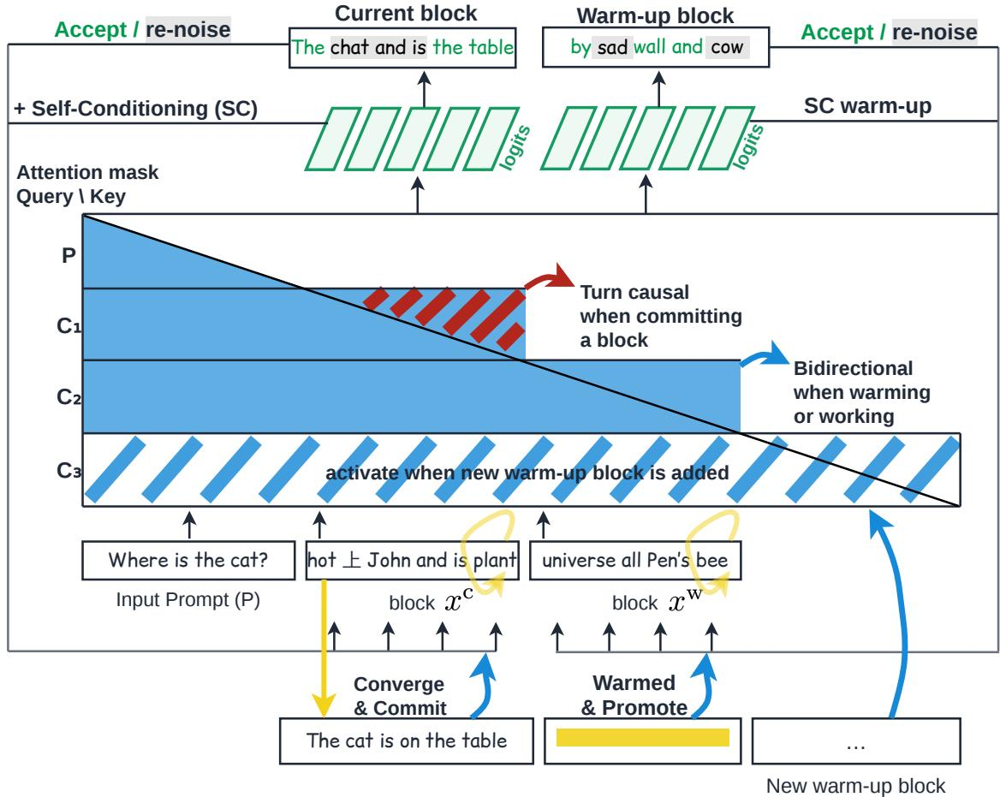
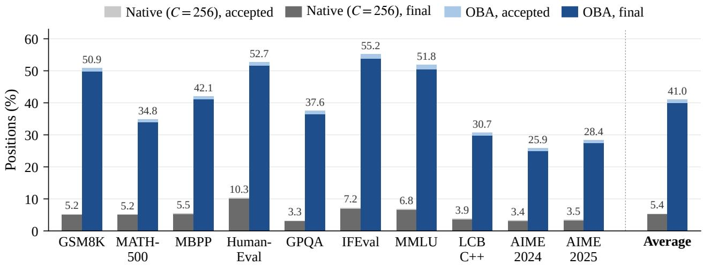

# One Block Ahead: Promoting Sampler State in Difusion Language Models

Yangyi Shen1,†, Pin-Jui Ku2, Nicolai Oswald2, Jean-Marie Lemercier2, Yonggan Fu2, Stefano Ermon1, Jure Leskovec1, Boris Ginsburg2 and Ante Jukić2 1Stanford University, 2NVIDIA, †Work done during internships at NVIDIA

Abstract. Block-difusion language models denoise a whole block of token positions in parallel so each forward pass can emit many tokens. However, blocks are still denoised in strict sequence, a cost that within-block acceleration leaves untouched. Here, we investigate decoding blocks concurrently and propose One Block Ahead (OBA), a training-free decoding algorithm that denoises the next block alongside the current one. We demonstrate that for uniform-state difusion LMs, where a block’s denoising progress is not visible in its intermediate tokens, concurrent decoding is advantageous if the next block’s tokens are promoted together with the corresponding sampler state, including the self-conditioning signal and the denoising time. We also derive a break-even criterion that relates the benefit of OBA to the relative cost of a paired-block forward pass. On DifusionGemma, a state-of-the-art difusion LM, OBA increases the tokens per forward pass by 42.3% (from 15.64 to 22.25) and the singlerequest denoising throughput by 16.3%, averaged over ten benchmarks, with a small accuracy regression.

## 1. Introduction

Difusion language models generate text by iteratively denoising a whole sequence of token positions, i.e., a block, so a single forward pass can decode many positions at once (Sahoo et al., 2024; Nie et al., 2025; Ye et al., 2025; Fu et al., 2026). That decoding parallelism is the principal advantage of difusion over autoregressive decoding, generating one token at a time. However, there is typically a tradeof with quality: the more positions a step accepts, the more it disregards the dependencies among them, so accepting tokens aggressively improves the latency at the cost of quality (Ben-Hamu et al., 2025; Fu et al., 2026). How far a decoder can push that quality–throughput frontier is what determines whether difusion is competitive with autoregression on a single request.

Among recent difusion language models, DifusionGemma ofers a particularly strong quality– throughput trade-of, reporting around 20 tokens per forward pass (TPF) and roughly 1,500 output tokens per second (TPS) on a single H100 GPU while maintaining strong benchmark performance (DifusionGemma Team, 2026). Its eficiency comes from several design choices. A block-autoregressive architecture supports KV caching and variable-length generation (Arriola et al., 2025); uniform-state difusion (Hoogeboom et al., 2021; Schif et al., 2025) keeps every position revisable until its block is committed, allowing aggressive parallel updates without the irreversible early commitments of masked difusion decoding; and entropy-bounded sampling (Ben-Hamu et al., 2025), adaptive stopping, and sampler distillation reduce the required denoising steps, with self-conditioning carrying predictions from one step to the next. However, its decoding remains sequential across blocks, which leaves multi-block parallelism unexplored: can decoding successive blocks concurrently further accelerate a model that already achieves such high within-block eficiency?

Recent work has demonstrated the potential of multi-block decoding through distillation, posttraining, and concurrent decoding schedules (Wang et al., 2026; Jin et al., 2026; Tian et al., 2026).

  
Figure 1 | One Block Ahead (OBA). The current block $x ^ { \mathrm { c } }$ and the warm-up block $x ^ { \mathrm { w } }$ are denoised in one forward pass over the input sequence $[ x ^ { \mathrm { c } } \mid x ^ { \mathrm { w } } ]$ . A block-causal attention mask lets $x ^ { \mathrm { w } }$ attend to $x ^ { \mathrm { c } }$ but not the reverse, so $x ^ { \mathrm { c } }$ is denoised as if it were alone. When $x ^ { \mathrm { c } }$ is committed and encoded under causal attention, $x ^ { \mathrm { w } }$ is promoted in its place, retaining the tokens and sampler state it has accumulated, and a new warm-up block follows.

However, whether these gains extend to DifusionGemma’s combination of native 256-token blocks, high decoding eficiency, and strong model quality remains unestablished. For example, Multi-Block Difusion (Jin et al., 2026) and FlowBlock (Tian et al., 2026) report their main results with 32- token blocks and baselines averaging 3.47 and 4.62 TPF, respectively. Extending concurrency to DifusionGemma poses both an algorithmic and a hardware utilization challenge. Its self-conditioning signal and denoising time carry progress that must survive the transition between blocks. Meanwhile, overlapping two blocks expands a forward pass from 256 to 512 positions. Small blocks can exploit unused GPU compute capacity, but that headroom diminishes as wider blocks approach the computebound regime (Wu et al., 2026a). Consequently, reducing forward-pass counts does not by itself guarantee higher tokens per second.

In this work, we propose One Block Ahead (OBA), a new training-free multi-block decoding algorithm built upon DifusionGemma (Figure 1). To the best of our knowledge, this is the first study of concurrent multi-block decoding for a difusion language model that already achieves around 20 tokens per forward pass with native 256-token blocks. We investigate the design choices impacting the efectiveness of concurrent decoding: how to structure attention between the two blocks (current block and warm-up block), and which components of the warm-up state must be retained when the warm-up block becomes the current block (e.g., tokens, self-conditioning signals, and the denoising time). To compare fairly how gains in tokens per forward pass transfer to throughput, we optimize the precision, attention, mixture-of-experts and sampler components of a denoising step for both the single- and the paired-block input sequence layout (Section 4.4).

Averaged over ten benchmarks on DifusionGemma, OBA increases TPF from 15.64 to 22.25 (+42.3%) and single-request denoising throughput from 2,375 to 2,761 TPS (+16.3%) on one GB300 GPU, with a small reduction in average accuracy (Section 4). By contrast, the direct way to add parallelism, doubling the block to 512 positions, lowers throughput by 41.4% and reduces accuracy further. Our ablations identify sampler-state promotion as central to the gain: withholding self-conditioning during warm-up lowers throughput 19.9% below the baseline. Together, these results demonstrate that concurrent decoding, supported by sampler-state promotion, can improve throughput even when the baseline already achieves substantial parallelism within each block.

## 2. Background

## 2.1. Discrete Difusion Language Models

A discrete difusion language model generates text by reversing a corruption process on token sequences rather than by extending a sequence left to right (Austin et al., 2021a; Hoogeboom et al., 2021). A forward process maps a clean sequence $x _ { 0 }$ to progressively noisier $x _ { t } , t \in [ 0 , 1 ]$ , and a learned denoiser is trained to invert it, so each reverse step may revise every position at once. Two corruption processes are in use. Masked difusion replaces a token with a dedicated mask token and reveals positions monotonically (Sahoo et al., 2024; Nie et al., 2025; Ye et al., 2025; Fu et al., 2026); uniform-state difusion replaces it with another token drawn from the vocabulary, so every position holds real text and remains revisable until it is committed (Hoogeboom et al., 2021; Lou et al., 2024; Schif et al., 2025; Ye et al., 2026). DifusionGemma is uniform-state (DifusionGemma Team, 2026), and the distinction is what makes state inheritance a question in Section 3.2.

Fully bidirectional difusion language models cannot reuse a KV cache or vary their output length, since every position attends to every other. Block Difusion removes both limits by factorizing generation over blocks, with causal attention across blocks and bidirectional attention within the current block (Arriola et al., 2025). DifusionGemma adopts this structure and calls each block a canvas; to align with the broader difusion language model literature, we use block throughout for this fixed-size group of consecutive positions. Specifically, a causal encoder Encoder� turns the context ℎ into a KV cache $H = \operatorname { E n c o d e r } _ { \theta } ( h )$ , and a bidirectional decoder refines a block of length $C = 2 5 6$ while cross-attending to �. Once a block is fully denoised, written $\hat { x } _ { 0 }$ , one encoder pass appends its keys and values, $H  H$ ⊕ Encoder $) ( \hat { x } _ { 0 } )$ , and only then is the next block initialized; committed tokens are therefore encoded once and never re-encoded.

## 2.2. DifusionGemma

DifusionGemma is the model we build on: an instruction-tuned mixture-of-experts difusion language model with 26 billion total and 4 billion active parameters per token (DifusionGemma Team, 2026). Of the design choices behind its eficiency, three interact with OBA, and we specify them here: the entropy-bounded sampler, adaptive stopping, and the self-conditioning signal.

A block is refined over at most � = 48 denoising steps with step size $\Delta t = 1 / N$ . Let � be the vocabulary, so that $\mathcal { V } ^ { C }$ is the set of token sequences of length $C ,$ and let $x _ { t } \in \mathcal { V } ^ { C }$ be the block at time $t \in [ 0 , 1 ]$ , starting at � = 1 with $x _ { 1 } \sim \mathrm { U n i f } ( \mathcal { V } ^ { C } )$ . Each step calls the decoder on the block, the cache � and a self-conditioning signal $z _ { t }$ carrying the previous predictions, returning $L _ { t } = \mathrm { D e c o d e r } _ { \theta } ( x _ { t } , z _ { t } , t , H )$ , from which

$$
\hat { p } _ { 0 } = \mathrm { S o f t m a x } \big ( L _ { t } / \tau _ { t } \big ) , \qquad z _ { t - \Delta t } = \mathrm { F F W } ( \hat { p } _ { 0 } E ) , \qquad x _ { t - \Delta t } \sim \mathrm { S t e p } ( x _ { t } , \hat { p } _ { 0 } ) ,\tag{1}
$$

with � the embedding matrix, FFW the self-conditioning module, and $\tau _ { t }$ falling linearly from 0.8 to 0.4. The sampler acts in Step, deciding position by position which predictions to keep. Positions are accepted in order of increasing predictive entropy until their cumulative entropy reaches a budget $b = 0 . 1$ , which bounds the joint mutual information and so keeps them approximately independent (Ben-Hamu et al., 2025). An accepted position takes a token sampled from ${ \hat { p } } _ { 0 } .$ and every other position is corrupted again by sampling a new token uniformly from � (Hoogeboom et al., 2021). Denoising stops early once mean entropy falls below $e _ { \mathrm { s t o p } } = 0 . 0 0 5$ with consecutive steps agreeing on the argmax. Acceptance therefore binds for one step only, and no position is fixed while its block is still being refined; that ends at commitment, after which the tokens are committed permanently.

## 2.3. Inference Eficiency Metrics

Adaptive stopping makes the number of denoising steps a random variable, so DifusionGemma measures denoising eficiency empirically (DifusionGemma Team, 2026). Let � be the number of blocks a response spans, $C _ { k }$ the valid tokens produced in block $k ,$ counted up to the first end-ofsequence token, � the denoising passes executed, and $T _ { \mathrm { d e n } }$ the average GPU time of a denoising pass. Tokens per forward and tokens per second are

$$
\mathrm { T P F } \triangleq \frac { \sum _ { k = 1 } ^ { K } C _ { k } } { 1 + ( K - 1 ) + F } , \qquad \mathrm { T P S } \triangleq \frac { \sum _ { k = 1 } ^ { K } C _ { k } } { F T _ { \mathrm { d e n } } } ,\tag{2}
$$

where the TPF denominator counts every forward pass that serves the request: the prompt prefill, the � − 1 passes that append each committed block to the cache, and the � denoising passes. TPF counts useful output per invocation and is independent of hardware. Decode TPS (throughput) counts useful output per second of denoising GPU time; it excludes the prefill and cache-append passes and host-side overhead, so that it isolates the cost of denoising (Appendix H gives wall TPS).

## 3. Method

One Block Ahead (OBA) denoises two blocks in each forward pass. The decoder runs over the input sequence $[ x ^ { \mathrm { c } } \mid x ^ { \mathrm { w } } ]$ of 2� positions, where $x ^ { \mathrm { c } }$ is the block on its way to being committed and $x ^ { \mathrm { w } }$ is the one after it. As depicted in Figure 1, a block-causal mask lets $x ^ { \mathrm { w } }$ attend to $x ^ { \mathrm { c } }$ but not the reverse. When the current block $x ^ { \mathrm { c } }$ is committed, the warm-up block $x ^ { \mathrm { w } }$ is promoted into its place and a new block fills the vacated half. In the following we present design choices for OBA: Section 3.1 specifies the paired-block layout, Section 3.2 specifies what is inherited at promotion, and Section 3.3 gives the condition under which the OBA schedule raises throughput.

## 3.1. Paired-Block Layout

Rather than running the decoder over the � positions of one block, we lay the two blocks side by side and run it over 2� positions, so one pass returns logits for both blocks. A single block still commits � tokens and the cache is still appended once per block, so OBA composes with any method acting inside a block. The block-causal mask defines the attention pattern of each block: queries in $x ^ { \mathrm { c } }$ attend to the committed cache � and to $x ^ { \mathrm { c } }$ itself, while queries in $x ^ { \mathrm { w } }$ attend to �, $x ^ { \mathrm { c } }$ and $x ^ { \mathrm { w } }$ , and attention stays bidirectional inside each half as when a block is denoised alone. No query in $x ^ { \mathrm { c } }$ reads a key in $x ^ { \mathrm { w } }$ , and every remaining operation acts on one position at a time, so in exact arithmetic the logits over $x ^ { \mathrm { c } }$ are those that block would have produced alone (cf. Appendix C).

Although the attention mask prevents the current block from attending to the warm-up block, it does not guarantee numerical equivalence to decoding the current block alone. Processing both blocks in a single grouped mixture-of-experts call changes the computation shape and can introduce floating-point diferences that alter subsequent sampling decisions, so we compare configurations on matched benchmarks and seeds rather than asserting identical trajectories; per-benchmark accuracy is given in Appendix H. Appendix B describes the paired-block adaptations, including the shared quantization scales computed from the current block and used by both blocks.

## 3.2. State Inheritance at Promotion

Both blocks take a denoising step from every forward pass, so the warm-up block accumulates progress while the current block is still changing. Which part of that progress the warm-up block keeps at promotion, i.e., when the current block commits, is what we call state inheritance. We denote the state of a block after its �-th pass as $s _ { n } = ( x _ { n } , z _ { n } , t _ { n } , \sigma _ { n } )$ , where $x _ { n }$ denotes the block tokens, $z _ { n }$ the self-conditioning signal, $t _ { n }$ the denoising time, and $\sigma _ { n }$ the adaptive stopping bookkeeping (i.e. the recent argmax predictions and the stability counter). We call $( z , t , \sigma )$ the sampler state. As DifusionGemma uses uniform-state difusion, every position holds a real token from the vocabulary from the first step onward, so � alone does not reveal how far a block has progressed and the sampler state cannot be reconstructed solely from �.

Assume the current block is committed after $n _ { k }$ paired denoising passes. Its $C$ tokens are appended to the cache and the warm-up block moves into the current position carrying $( x _ { n _ { k } } , z _ { n _ { k } } , t _ { n _ { k } } , \sigma _ { \mathrm { i n i t } } )$ The tokens, the signal and the denoising time are promoted, and only � is reset to its initial value $\sigma _ { \mathrm { i n i t } }$ . The reset of $\sigma$ prevents the promoted block from stopping on a stability judgment formed before its context has been finalized. A new warm-up block then fills the vacated half and the cycle repeats. No warm-up block commits out of order, and the final current block at the end of generation simply discards its warm-up block (cf. Algorithm 1, Appendix A).

## 3.3. Break-Even Criterion

Although the paired-block layout advances two blocks per pass, it does not halve the passes per block, because a warm-up step conditions on a current block that has not yet been committed. Let �¯ be the expected number of denoising passes a block needs under Native (�=256), and $n _ { k }$ the number of passes block � spends as the current block under a concurrent schedule. We model the passes block $k + 1$ then needs as the current block as $\bar { n } - \alpha n _ { k } .$ , so that � is the expected number of current-block passes saved per pass its predecessor spends as the current block. Under OBA, block $k + 1$ takes one warm-up step on each of those passes, so � is also the saving per warm-up step; a schedule that starts the warm-up block later, such as FlowBlock (�=2) (Section 4.2), takes fewer warm-up steps per predecessor pass and therefore has a smaller � even if each step is worth as much. We make two simplifying assumptions: (1) � is a constant, independent of $n _ { k }$ and of $k ,$ i.e., the saving is linear in the predecessor’s passes; and (2) �¯ does not depend on �. Assumption (1) is an approximation rather than a property of the sampler; we fit � under it from aggregate counters (cf. Appendix D) and do not test it at the level of individual blocks. We further expect $0 \leq \alpha < 1$ : a warm-up step should not increase the passes a block needs, and it saves less than a full pass because it conditions on a current block that has not yet been committed. Linearity also makes the recurrence exact in expectation, so under these assumptions the expected passes obey the afine

recurrence

$$
n _ { k + 1 } = { \bar { n } } - \alpha n _ { k } , \qquad n _ { 1 } = { \bar { n } } , \qquad { \mathrm { w i t h ~ u n i q u e ~ f i x e d ~ p o i n t } } \quad n ^ { \star } = { \frac { \bar { n } } { 1 + \alpha } } .\tag{3}
$$

The map $n \mapsto { \bar { n } } - \alpha n$ is a contraction of modulus $\alpha < 1$ , so $n ^ { \star }$ exists and is unique. It is also approached geometrically, since $| n _ { k } - n ^ { \star } | = \alpha ^ { k - 1 } | \bar { n } - n ^ { \star } |$ . Let � denote the ratio of $T _ { \mathrm { d e n } }$ in Eq. (2) under a schedule to that under Native $( C { = } 2 5 6 )$ , measured at batch size one on the same hardware. Since $T _ { \mathrm { d e n } }$ averages over all denoising passes of a request, � is the relative cost of a paired-block pass when every denoising pass is paired, as in OBA, and lies between one and that value when a schedule mixes single- and paired-block passes. At the fixed point, denoising passes per block therefore fall by a factor $1 + \alpha$ while a denoising pass takes � times as long, so TPS changes by $( 1 + \alpha ) / r$ , and the schedule raises throughput when $\alpha > r - 1$

## 4. Experiments

We design the experimental evaluation to understand three diferent aspects of OBA: (1) Does denoising one block ahead raise throughput over single-block and multi-block baselines across diverse tasks, and at what accuracy cost? (2) Which parts of the sampler state carried across promotion make the wider denoising pass pay for itself? (3) How do the attention mask between the two blocks and the time at which the next block starts afect the break-even criterion $\alpha > r - 1 ?$

## 4.1. Experimental Setup

Model and benchmarks. We evaluate DifusionGemma across ten benchmarks on a single NVIDIA GB300 at batch size one: GSM8K, MATH-500, MBPP, HumanEval, GPQA, IFEval, MMLU, LiveCodeBench C++, AIME 2024 and AIME 2025 (Cobbe et al., 2021; Hendrycks et al., 2021b; Austin et al., 2021b; Chen et al., 2021; Rein et al., 2024; Zhou et al., 2023; Hendrycks et al., 2021a; Jain et al., 2025). We report the main comparison averaged over three generation seeds; Appendix E gives the details about the evaluated population, graders, seeds and serving limits. While the proposed paired-block layout applies to any block-difusion model, uniform-state difusion is what makes state inheritance at promotion a design question. Existing uniform-state models, e.g., Sumi (Ye et al., 2026), UDLM (Schif et al., 2025) and Duo (Sahoo et al., 2025), are trained and sampled over a full sequence in a single difusion trajectory, so no state has to cross a block commitment boundary. DifusionGemma is, to our knowledge, the first publicly released large-scale model that is both uniform-state and block-autoregressive.

Baselines. Native (�=256) is the default DifusionGemma inference configuration, denoising one 256-token block at a time. Native (�=512) applies the same algorithm to a single 512-token block and commits all 512 positions at once, the natural way to increase parallelism by widening a block. FlowBlock $\left( W { = } 2 \right)$ is a concurrent, training-free multi-block decoder built on the LLaDA2.1 token-editing model (Tian et al., 2026; Bie et al., 2026); we apply it by replacing its masked difusion model forward with DifusionGemma’s (cf. Appendix F). It decodes up to � blocks concurrently, and we use $W { = } 2$ , the window of its main results. It starts the next block once its readiness gate exceeds a threshold, and since blocks are decoded concurrently, that block keeps its tokens, self-conditioning signal and denoising time when its predecessor commits. It therefore difers from OBA mainly in when the next block starts, and we use it as our comparison for the start time of the warm-up block. We exclude other multi-block methods (Wang et al., 2026; Jin et al., 2026), which target masked difusion models that cannot revise a revealed token. We further isolate OBA’s mechanism through ablations of state inheritance and attention between the two blocks. For fair comparison, all configurations above run with kernels specialized to their own input sequence shape.

Table 1 | Decoding eficiency across ten benchmarks. Tokens per forward pass (TPF) and tokens per second (TPS). TPS counts denoising GPU time only (Eq. (2)). All metrics are averaged over three generation seeds. Best in bold. OBA achieves higher TPF and TPS than all baselines on all benchmarks. See benchmark accuracy and wall TPS in Appendix H.
<table><tr><td></td><td colspan="2">NATIVE (C=256)</td><td colspan="2">NATIVE (C=512)</td><td colspan="2">FLOWBLOCK (W=2)</td><td colspan="2">OBA</td></tr><tr><td>Benchmark</td><td>TPF</td><td>TPS</td><td>TPF</td><td>TPS</td><td>TPF</td><td>TPS</td><td>TPF</td><td>TPS</td></tr><tr><td>GSM8K</td><td>17.59</td><td>2800</td><td>19.93</td><td>2128</td><td>18.33</td><td>2816</td><td>22.87</td><td>2983</td></tr><tr><td>MATH-500</td><td>17.96</td><td>2798</td><td>17.52</td><td>1503</td><td>18.26</td><td>2742</td><td>23.05</td><td>2911</td></tr><tr><td>MBPP</td><td>16.43</td><td>2485</td><td>16.64</td><td>1208</td><td>16.89</td><td>2516</td><td>22.41</td><td>2733</td></tr><tr><td>HumanEval</td><td>18.93</td><td>2963</td><td>21.98</td><td>1996</td><td>22.04</td><td>3447</td><td>29.22</td><td>3858</td></tr><tr><td>GPQA</td><td>13.13</td><td>1919</td><td>13.92</td><td>1018</td><td>14.30</td><td>2036</td><td>20.38</td><td>2435</td></tr><tr><td>IFEval</td><td>15.87</td><td>2433</td><td>18.51</td><td>1787</td><td>17.43</td><td>2566</td><td>23.78</td><td>3000</td></tr><tr><td>MMLU</td><td>13.16</td><td>1997</td><td>15.72</td><td>1430</td><td>14.05</td><td>2061</td><td>20.77</td><td>2611</td></tr><tr><td>LCB C++</td><td>14.37</td><td>2090</td><td>14.21</td><td>902</td><td>14.34</td><td>2054</td><td>19.37</td><td>2230</td></tr><tr><td>AIME 2024</td><td>14.59</td><td>2159</td><td>14.26</td><td>1023</td><td>15.50</td><td>2247</td><td>19.95</td><td>2410</td></tr><tr><td>AIME 2025</td><td>14.38</td><td>2101</td><td>14.01</td><td>917</td><td>16.42</td><td>2339</td><td>20.72</td><td>2442</td></tr><tr><td>Average</td><td>15.64</td><td>2375</td><td>16.67</td><td>1391</td><td>16.76</td><td>2482</td><td>22.25</td><td>2761</td></tr></table>

## 4.2. Decoding Eficiency

TPF and throughput. We investigate the decoding eficiency of the proposed OBA, with the main results summarized in Table 1. OBA has higher TPF and TPS than all baselines on all ten benchmarks. Averaged over the ten benchmarks, OBA increases TPF by 42.3% over Native (�=256) (22.25 vs. 15.64) and TPS by 16.3% (2,761 vs. 2,375), even though each denoising pass costs 1.26× as much. The margin over Native (�=256) is largest on MMLU, HumanEval and GPQA, where TPS rises 31%, 30% and 27% and TPF 58%, 54% and 55%, and smallest on MATH-500, where TPS rises 4%. MMLU and GPQA are the benchmarks where a block needs the most denoising passes under Native (�=256), so the current block occupies the input sequence for longer and the warm-up block accumulates more steps before it is promoted. These gains come with a 1.37-percentage-point reduction in average accuracy over the ten benchmarks (cf. Table 6).

Comparison with FlowBlock. FlowBlock (�=2) raises average TPF over Native (�=256) by 7.2% (15.64 to 16.76) and TPS by 4.5% (2,375 to 2,482), against 42.3% and 16.3% for OBA. Since it retains the same sampler state, the diference comes from when it starts the next block, which moves both sides of the break-even criterion of Section 3.3: waiting for the readiness threshold keeps 92.2% of denoising passes 256 positions wide, lowering � to 1.03, but forfeits most warm-up steps, lowering � to 0.09. On DifusionGemma, the gated start thus lowers � by more than it lowers � − 1, so the margin � − (� − 1) is 0.06 under FlowBlock (�=2) against 0.28 under OBA, which starts the warm-up block at the earliest possible pass. The readiness gate guards against drafting on an unsettled prefix, but under uniform-state difusion an early draft is not locked in: even under Native (�=256), only 5.1% of positions keep their first-pass token until commitment (Figure 2), since every position not accepted is renoised. The gate does retain 0.73 points of accuracy over OBA (83.43 against 82.70), but at the cost of most of the throughput gain. Widening FlowBlock’s window to �=3 or 4 also makes little diference, with TPF and TPS within 1% of �=2 (cf. Appendix F).

Comparison with a wider block. A block-difusion decoder raises parallelism by committing a wider block, but DifusionGemma’s 256-token block is already close to the point where a single-request forward pass saturates the arithmetic intensity of the GPU (Wu et al., 2026a), so the extra positions are no longer nearly free. Native (�=512) raises TPF from 15.64 to 16.67, but a denoising pass over 512 positions costs roughly 1.84× one over 256 positions, so its throughput is 41.4% below Native (�=256). The paired-block layout of OBA occupies the same 512 positions at 1.26× the reference cost, largely because its attention is block-causal rather than dense; Section 4.3 ablates the mask directly. Simply widening the block is therefore not the axis to scale up.

  
Figure 2 | Warm-up progress of promoted and newly initialized blocks. For each benchmark, the grey bar corresponds to Native (�=256) and the blue bar to OBA. The full height of a bar is the fraction of the 256 positions accepted on a block’s first pass as the current block, and its dark portion is the fraction whose token at that pass is retained until commitment, so the light segment on top is the fraction of first-pass acceptances later revised. Under OBA the first pass is the one after promotion, and every first block, which has no predecessor, is excluded. Fractions are averaged over three generation seeds. On average, a promoted block under OBA begins its first pass as the current block with 39.9% of its positions already holding their committed tokens, against 5.1% for a newly initialized block under Native (�=256). Per-benchmark values are given in Table 5.

Warm-up progress at promotion. Figure 2 measures what a block has settled on its first pass as the current block, which under OBA is the first pass after promotion, conditioned on the newly committed context, and under Native (�=256) the first pass after initialization from noise. Averaged over the ten benchmarks, 41.0% of the 256 positions of a promoted block are accepted on that pass, against 5.4% for a newly initialized block, and 39.9% against 5.1% keep that pass’s token until commitment, so a promoted block arrives with more than a third of its positions already holding their committed tokens. The fraction of first-pass acceptances retained until commitment is similar under both schedules, 97% and 94%. The state inherited from warm-up therefore lets many more positions clear the entropy budget on the first pass under the committed context without making those acceptances less reliable, so promotion raises how many positions settle early rather than how reliably they settle. The efect varies with the task. More than half of the positions are accepted on the first pass on IFEval, HumanEval, MMLU and GSM8K, against 26–31% on AIME and LiveCodeBench C++, where a block plausibly depends more on the exact content of its predecessor.

## 4.3. Ablation Study

We ablate what a warm-up block inherits and how it is formed in Table 2. Keep All retains the full state and is OBA; Drop Time drops the denoising time, Keep Signal keeps the self-conditioning signal alone, and Keep Tokens keeps the tokens alone. Up to its start threshold, Keep Tokens matches the original FlowBlock (Tian et al., 2026), where a block carries only its tokens across the commitment boundary, as under masked difusion. Three further policies change the warm-up process rather than the inherited state: No Accept keeps the self-conditioning signal but accepts no position before promotion, No Signal accepts positions but withholds self-conditioning, and Dense Mask replaces the block-causal mask with full bidirectional attention between the two blocks. We estimate � for each configuration by fitting the recurrence of $\operatorname { E q . }$ (3) on each benchmark to its numbers of denoising passes and blocks and averaging over benchmarks; Appendix D gives the details. Since the cache grows with each response, � also depends on response length; the six paired-layout policies have � between 1.26 and 1.27.

Table 2 | Inheritance policies. �, relative pass cost �, eficiency, and accuracy for seven policies, averaged over the ten benchmarks. Retains gives the inherited state in the $( x , z , t )$ decomposition; Before promotion marks the three policies that instead change what a block does before promotion; ΔTPS is against Native (�=256).
<table><tr><td>Policy</td><td></td><td>Retains Before promotion</td><td>α</td><td>r</td><td>TPF</td><td>TPS</td><td>∆TPS %</td><td>Acc.</td></tr><tr><td>NATIVE  $( C { = } 2 5 6 )$ </td><td></td><td></td><td>0</td><td>1.00</td><td>15.64</td><td>2375</td><td></td><td>84.07</td></tr><tr><td>KEEP ALL (OBA)</td><td> $x , z , t$ </td><td>full</td><td>0.54</td><td>1.26</td><td>22.25</td><td>2761</td><td>+16.3</td><td>82.70</td></tr><tr><td>DROP TIME</td><td> $x , z$ </td><td>full</td><td>0.41</td><td>1.26</td><td>20.76</td><td>2558</td><td>+7.7</td><td>82.69</td></tr><tr><td>KEEP TOKENS</td><td>x</td><td>full</td><td>0.25</td><td>1.26</td><td>18.83</td><td>2309</td><td>-2.8</td><td>83.55</td></tr><tr><td>KEEP SIGNAL</td><td>z</td><td>full</td><td>0.32</td><td>1.27</td><td>19.61</td><td>2401</td><td>+1.1</td><td>83.93</td></tr><tr><td>No ACCEPT</td><td>z</td><td>no acceptance</td><td>0.32</td><td>1.27</td><td>19.62</td><td>2403</td><td>+1.2</td><td>84.95</td></tr><tr><td>No SIGNAL</td><td>x</td><td>no self-conditioning</td><td>0.02</td><td>1.27</td><td>15.87</td><td>1902</td><td>-19.9</td><td>84.11</td></tr><tr><td>DENSE MASK</td><td> $x , z , t$ </td><td>dense mask</td><td>0.38</td><td>1.70</td><td>20.05</td><td>1878</td><td>-20.9</td><td>80.29</td></tr></table>

Inherited state. Recall that � is the number of current-block passes saved per warm-up step. Promoting the tokens alone, as a masked difusion decoder would, gives $\alpha = 0 . 2 5$ , below the breakeven value $r - 1 = 0 . 2 6$ , and changes TPS by −2.8% relative to Native (�=256). Adding the self-conditioning signal raises � to 0.41 and TPS by 7.7%, and adding the time raises � to 0.54 and TPS by 16.3%, since a block that restarts its temperature schedule spends passes re-deciding positions it had already settled. Each component of the sampler state therefore adds to the saving per warm-up step, and together they account for the entire throughput gain. Carried alone, the signal is worth more than the tokens: Keep Signal reaches $\alpha = 0 . 3 2$ against 0.25 for Keep Tokens.

Warm-up process. No Accept and Keep Signal both reach $\alpha = 0 . 3 2$ , with TPS changing by +1.2% and +1.1% relative to Native (�=256). Once the self-conditioning signal is propagated during warm-up, whether some positions were allowed to settle makes little diference. On the other hand, No Signal lowers � to 0.02, and changes TPS by −19.9% relative to Native (�=256). Without self-conditioning, the warm-up does no useful work while the schedule still pays for the wider pass, falling below the break-even criterion of Section 3.3.

Attention between blocks. Dense Mask keeps the promoted state and the commitment cadence of OBA but lets each block attend to the other, which removes the guarantee of Proposition 1. It still raises TPF over Native (�=256), 20.05 against 15.64, at $\alpha = 0 . 3 8$ , so the warm-up block does useful work under mutual attention, though less than under the block-causal mask. However, a pass under Dense Mask costs 1.70× against 1.26× for the block-causal one, so break-even would require $\alpha > 0 . 7 0$ , and throughput falls 20.9% below Native (�=256). The gap to the 1.84× of Native (�=512), which shares its input sequence shape and kernels, reflects the context lengths of their responses rather than the mask. It also lowers average accuracy relative to OBA, 80.29 against

82.70, since the current block now conditions on a block that is still near noise.

## 4.4. Kernel Implementation

Shared kernels. Every configuration runs the same implementation, which we optimize for the GB300 in each component of a denoising step (Eq. (1)). In precision, the mixture-of-experts layers use a grouped matrix multiplication with 4-bit weights and activations (NVFP4) in place of 4-bit weights with 16-bit activations, the dense projections use FP8, the rotary tables are kept in FP32, and amax reduction, scale finalization and row quantization are fused into one pass. In attention, the kernels are fused and additionally parallelized over the cache �, the ragged masked softmax of the fallback path is vectorized, and the sliding-window keys and values are held in a ring bufer. In the mixture-of-experts and dense layers, the input producer is fused, the combine stage is sharded over the hidden dimension, the routing scan is parallelized in a deterministic accumulation order, and the two branches of a layer execute concurrently on separate streams. In the sampler, the self-conditioning module FFW is vectorized. Table 1 therefore compares decoding algorithms at a common level of optimization, and the gains are over an already optimized single-block decoder.

Per-configuration kernels. Each configuration additionally selects the kernels specialized to its own input sequence shape. Native (�=256) uses the 256-position attention kernels; Native (�=512) and Dense Mask use matrix-multiplication and mixture-of-experts plans tuned for 512 positions, together with a dispatch correction without which those attention kernels are disabled at that length; OBA adds ofset-aware attention that skips the masked-out half of the paired-block layout and a fused producer over both halves, neither of which applies to a dense input sequence; FlowBlock (�=2) uses the Native (�=256) kernels for single-block passes and the OBA kernels for paired ones. The one numerical diference across configurations is that OBA computes its activation-scale from the current block and shares it with the warm-up half. A denoising pass takes 7.08 ms under Native (�=256), 8.94 ms under OBA and 13.06 ms under Native (�=512); averaged over benchmarks, a paired pass costs � = 1.26 against � = 1.84 for a dense pass over the same 512 positions. Appendix B gives the full details.

## 5. Related Work

Within-block acceleration. One line of work reduces the number of denoising passes a single block requires. Fast-dLLM (Wu et al., 2026b) pairs a block-wise approximate KV cache with confidence-thresholded acceptance, entropy-bounded sampling (Ben-Hamu et al., 2025) replaces the per-position threshold with a cumulative-entropy budget that bounds the joint mutual information the acceptance discards, and dParallel (Chen et al., 2026) distills a model along its own decoding trajectory while forcing predictive certainty, so that fewer steps sufice. Editing reaches the same end by a diferent route: the token-to-token stream that LLaDA2.1 (Bie et al., 2026) adds to LLaDA2.0 (Bie et al., 2025) overwrites a revealed token once an alternative becomes suficiently confident, which permits a lower acceptance threshold because a premature decision can be repaired rather than carried into the output. Uniform-state difusion has that property natively, since every position holds a real token and stays revisable until its block commits. All of these act within the block being denoised, whereas OBA changes how many blocks a pass advances; DifusionGemma already carries several of them, so OBA starts from a baseline at around 20 TPF (DifusionGemma Team, 2026) rather than the low single digits at which prior concurrent decoding methods are evaluated.

Multi-block decoding. Another line of work focuses on serialization across blocks. D2F (Wang et al., 2026) and MBD-LM (Jin et al., 2026) post-train a masked difusion LM to denoise a block from an incomplete prefix and decode a bounded window of active blocks; FlowBlock (Tian et al., 2026)

does so without training, admitting a downstream block once most of its predecessor’s remaining masked positions are confident enough to be unmasked, and relying on token-to-token editing to repair tokens drafted against a stale prefix. Three properties separate this line from OBA. First, each targets masked difusion, where the mask ratio reports a block’s progress and a promoted block carries nothing beyond its revealed tokens; under uniform state progress is invisible in �, and the sampler state $( z , t , \sigma )$ must cross the commitment boundary (Section 3.2). Second, all use block sizes close to 32, where the extra positions are close to free; at DifusionGemma’s 256-token block a paired-block pass costs $r = 1 . 2 6$ , so the schedule pays only when $\alpha > r - 1$ (Section 3.3). Third, OBA is training-free and needs no threshold to decide when to start the warm-up block; applied to DifusionGemma with the same sampler state, FlowBlock’s threshold delays the next block enough that its throughput gain over Native $( C { = } 2 5 6 )$ is 4.5%, against 16.3% for OBA (Section 4.2).

## 6. Conclusion

We presented One Block Ahead (OBA), a training-free decoding algorithm that denoises the next block alongside the current one in a single forward pass. A block-causal mask leaves the current block denoised as if it were alone, and at commitment the warm-up block is promoted with its tokens and sampler state. Such a schedule raises throughput when the passes saved per warm-up step, �, exceed the extra cost of a paired-block pass, � − 1. On DifusionGemma, averaged over ten benchmarks, OBA meets this condition with $\alpha = 0 . 5 4$ against $r - 1 = 0 . 2 6$ , raising tokens per forward pass (TPF) from 15.64 to 22.25 and single-request denoising throughput (TPS) by 16.3% at a cost of 1.37 accuracy points. Ablations attribute this gain to the sampler state: promoting the tokens alone gives $\alpha = 0 . 2 5$ and lowers throughput, and adding the self-conditioning signal and then the denoising time raises � to 0.41 and 0.54. More broadly, these results show that parallelism across blocks remains available to a model that already decodes one block eficiently, and that it is unlocked by promoting the sampler state across the commitment boundary.

## 7. Limitations

We evaluate at batch size one, where the latency advantage of difusion over autoregressive decoding is most pronounced, and on a single GPU type. We evaluate a single model, as DifusionGemma is to our knowledge the only difusion language model that is both uniform-state and block-autoregressive. The promotion mechanism is specific to that setting: under masked difusion a block’s progress is readable from its mask and its revealed tokens are the only state to inherit.

## AI use statement

In this work, we used generative AI coding agents (Claude Code and Codex) to implement methods: the OBA decoding algorithm, the baseline configurations including the FlowBlock adaptation, the inference kernels described in Appendix B, and the evaluation pipeline, and to run the experiments. We have not used generative AI tools to propose research ideas or hypotheses, to develop the conceptual framework, to design the methodology or experiments, to formulate the mathematical claims or write the proofs in Section 3.3 and Appendix C, or to interpret results; these were done by the authors. Generating synthetic data, cleaning or reformatting datasets, translation, and qualitative data analysis are not applicable to this work. Additionally, we used generative AI tools to edit parts of the manuscript for readability. We have reviewed all AI-assisted work, and every AI-assisted component was verified by at least two authors: the generated code was reviewed, the kernel-level changes were validated against reference implementations for numerical agreement and unchanged accuracy, the reported numbers were checked against the per-case run records, and every claim, equation, and citation in the manuscript was checked. We take responsibility for the final content of this work, including text, claims, code, and experimental results produced with the aid of generative AI.

## Ethics statement

This work adheres to the ICLR Code of Ethics. All experiments use publicly available benchmarks and a pretrained model (DifusionGemma), with our contributions centered on methodological and algorithmic advancements, in particular the development of the One Block Ahead (OBA) decoding algorithm. The method is training-free and introduces no new capabilities beyond those of the underlying model. The study does not involve human subjects, personal data, or other sensitive information, and no applications with a high likelihood of causing harm are considered. We have carefully examined potential risks and broader societal impacts of this research and did not identify significant ethical concerns.

## Reproducibility statement

OBA is training-free and requires no change to model weights. The decoding algorithm is specified in Section 3 and in full as Algorithm 1 in Appendix A; the attention mask, the promoted state, and the reset at promotion are given in Sections 3.1 and 3.2. The assumptions behind the break-even criterion are stated in Section 3.3. Section 4.1 lists the model, the ten benchmarks, the generation seeds, the hardware, and the baseline configurations, and all sampler hyperparameters are the DifusionGemma defaults reported in Section 2.2. Appendix E gives the seed ofsets and serving limits, Appendix F gives the FlowBlock thresholds, and Appendix B describes the kernel-level adaptations needed to reproduce the reported throughput, since it, unlike TPF, depends on the implementation.

## References

Marianne Arriola, Aaron Gokaslan, Justin T. Chiu, Zhihan Yang, Zhixuan Qi, Jiaqi Han, Subham Sekhar Sahoo, and Volodymyr Kuleshov. Block difusion: Interpolating between autoregressive and difusion language models. In International Conference on Learning Representations, 2025.

Jacob Austin, Daniel D. Johnson, Jonathan Ho, Daniel Tarlow, and Rianne van den Berg. Structured denoising difusion models in discrete state-spaces. In Advances in Neural Information Processing Systems, 2021a.

Jacob Austin, Augustus Odena, Maxwell Nye, Maarten Bosma, Henryk Michalewski, David Dohan, Ellen Jiang, Carrie Cai, Michael Terry, Quoc Le, and Charles Sutton. Program synthesis with large language models. arXiv preprint arXiv:2108.07732, 2021b.

Heli Ben-Hamu, Itai Gat, Daniel Severo, Niklas S. Nolte, and Brian Karrer. Accelerated sampling from masked difusion models via entropy bounded unmasking. In Advances in Neural Information Processing Systems, 2025.

Tiwei Bie, Maosong Cao, Kun Chen, et al. LLaDA2.0: Scaling up difusion language models to 100B. arXiv preprint arXiv:2512.15745, 2025.

Tiwei Bie, Maosong Cao, Xiang Cao, et al. LLaDA2.1: Speeding up text difusion via token editing. arXiv preprint arXiv:2602.08676, 2026.

Mark Chen, Jerry Tworek, Heewoo Jun, Qiming Yuan, Henrique Ponde de Oliveira Pinto, Jared Kaplan, Harri Edwards, Yuri Burda, Nicholas Joseph, Greg Brockman, Alex Ray, Raul Puri,

Gretchen Krueger, Michael Petrov, Heidy Khlaaf, Girish Sastry, Pamela Mishkin, Brooke Chan, Scott Gray, Nick Ryder, Mikhail Pavlov, Alethea Power, Lukasz Kaiser, Mohammad Bavarian, Clemens Winter, Philippe Tillet, Felipe Petroski Such, Dave Cummings, Matthias Plappert, Fotios Chantzis, Elizabeth Barnes, Ariel Herbert-Voss, William Hebgen Guss, Alex Nichol, Alex Paino, Nikolas Tezak, Jie Tang, Igor Babuschkin, Suchir Balaji, Shantanu Jain, William Saunders, Christopher Hesse, Andrew N. Carr, Jan Leike, Josh Achiam, Vedant Misra, Evan Morikawa, Alec Radford, Matthew Knight, Miles Brundage, Mira Murati, Katie Mayer, Peter Welinder, Bob McGrew, Dario Amodei, Sam McCandlish, Ilya Sutskever, and Wojciech Zaremba. Evaluating large language models trained on code. arXiv preprint arXiv:2107.03374, 2021.

Zigeng Chen, Gongfan Fang, Xinyin Ma, Ruonan Yu, and Xinchao Wang. dParallel: Learnable parallel decoding for dLLMs. In International Conference on Learning Representations, 2026.

Karl Cobbe, Vineet Kosaraju, Mohammad Bavarian, Mark Chen, Heewoo Jun, Lukasz Kaiser, Matthias Plappert, Jerry Tworek, Jacob Hilton, Reiichiro Nakano, Christopher Hesse, and John Schulman. Training verifiers to solve math word problems. arXiv preprint arXiv:2110.14168, 2021.

DifusionGemma Team. DifusionGemma technical report. arXiv preprint arXiv:2608.00146, 2026.

Yonggan Fu, Lexington Whalen, Abhinav Garg, Chengyue Wu, Maksim Khadkevich, Nicolai Oswald, Enze Xie, Daniel Egert, Sharath Turuvekere Sreenivas, Shizhe Diao, Chenhan Yu, Ye Yu, Weijia Chen, Sajad Norouzi, Jingyu Liu, Shiyi Lan, Ligeng Zhu, Jin Wang, Jindong Jiang, Morteza Mardani, Mehran Maghoumi, Song Han, Ante Jukić, Nima Tajbakhsh, Jan Kautz, and Pavlo Molchanov. Nemotron-labs-difusion: A tri-mode language model unifying autoregressive, difusion, and self-speculation decoding. Technical report, NVIDIA, 2026. arXiv:2607.05722.

Dan Hendrycks, Collin Burns, Steven Basart, Andy Zou, Mantas Mazeika, Dawn Song, and Jacob Steinhardt. Measuring massive multitask language understanding. In International Conference on Learning Representations, 2021a.

Dan Hendrycks, Collin Burns, Saurav Kadavath, Akul Arora, Steven Basart, Eric Tang, Dawn Song, and Jacob Steinhardt. Measuring mathematical problem solving with the MATH dataset. In Proceedings of the Neural Information Processing Systems Track on Datasets and Benchmarks, 2021b.

Emiel Hoogeboom, Didrik Nielsen, Priyank Jaini, Patrick Forré, and Max Welling. Argmax flows and multinomial difusion: Learning categorical distributions. In Advances in Neural Information Processing Systems, 2021.

Naman Jain, King Han, Alex Gu, Wen-Ding Li, Fanjia Yan, Tianjun Zhang, Sida I. Wang, Armando Solar-Lezama, Koushik Sen, and Ion Stoica. LiveCodeBench: Holistic and contamination free evaluation of large language models for code. In International Conference on Learning Representations, 2025.

Yijie Jin, Jiajun Xu, Yuxuan Liu, Chenkai Xu, Yi Tu, Jiajun Li, Dandan Tu, Xiaohui Yan, Kai Yu, Pengfei Liu, and Zhijie Deng. Multi-block difusion language models. arXiv preprint arXiv:2606.29215, 2026.

Aaron Lou, Chenlin Meng, and Stefano Ermon. Discrete difusion modeling by estimating the ratios of the data distribution. In International Conference on Machine Learning, 2024.

Shen Nie, Fengqi Zhu, Zebin You, Xiaolu Zhang, Jingyang Ou, Jun Hu, Jun Zhou, Yankai Lin, Ji-Rong Wen, and Chongxuan Li. Large language difusion models. In Advances in Neural Information Processing Systems, 2025.

David Rein, Betty Li Hou, Asa Cooper Stickland, Jackson Petty, Richard Yuanzhe Pang, Julien Dirani, Julian Michael, and Samuel R. Bowman. GPQA: A graduate-level google-proof Q&A benchmark. In First Conference on Language Modeling, 2024.

Subham Sekhar Sahoo, Marianne Arriola, Yair Schif, Aaron Gokaslan, Edgar Marroquin, Justin T. Chiu, Alexander M. Rush, and Volodymyr Kuleshov. Simple and efective masked difusion language models. In Advances in Neural Information Processing Systems, 2024.

Subham Sekhar Sahoo, Justin Deschenaux, Aaron Gokaslan, Guanghan Wang, Justin T. Chiu, and Volodymyr Kuleshov. The difusion duality. In International Conference on Machine Learning, 2025.

Yair Schif, Subham Sekhar Sahoo, Hao Phung, Guanghan Wang, Sam Boshar, Hugo Dalla-Torre, Bernardo P. de Almeida, Alexander M. Rush, Thomas Pierrot, and Volodymyr Kuleshov. Simple guidance mechanisms for discrete difusion models. In International Conference on Learning Representations, 2025.

Bing Tian, Haikun Liu, Xiaocheng Zhong, Zhuohui Duan, Zhaokai Luo, Huayi Jin, Zhiyong Wang, and Xiaofei Liao. FlowBlock: Wavefront-parallel decoding for self-correcting difusion language models. arXiv preprint arXiv:2607.17652, 2026.

Xu Wang, Chenkai Xu, Yijie Jin, Jiachun Jin, Hao Zhang, Kai Yu, and Zhijie Deng. Difusion LLMs can do faster-than-AR inference via discrete difusion forcing. In International Conference on Learning Representations, 2026.

Chengyue Wu, Hao Zhang, Shuchen Xue, Shizhe Diao, Yonggan Fu, Zhijian Liu, Pavlo Molchanov, Ping Luo, Song Han, and Enze Xie. Fast-dLLM v2: Eficient block-difusion LLM. In International Conference on Learning Representations, 2026a.

Chengyue Wu, Hao Zhang, Shuchen Xue, Zhijian Liu, Shizhe Diao, Ligeng Zhu, Ping Luo, Song Han, and Enze Xie. Fast-dLLM: Training-free acceleration of difusion LLM by enabling KV cache and parallel decoding. In International Conference on Learning Representations, 2026b.

Jiacheng Ye, Zhihui Xie, Lin Zheng, Jiahui Gao, Zirui Wu, Xin Jiang, Zhenguo Li, and Lingpeng Kong. Dream 7B: Difusion large language models. arXiv preprint arXiv:2508.15487, 2025.

Mengyu Ye, Keito Kudo, Wataru Ikeda, Ryosuke Matsuda, Keisuke Sakaguchi, and Jun Suzuki. Sumi: Open uniform difusion language model from scratch. arXiv preprint arXiv:2606.19005, 2026.

Jefrey Zhou, Tianjian Lu, Swaroop Mishra, Siddhartha Brahma, Sujoy Basu, Yi Luan, Denny Zhou, and Le Hou. Instruction-following evaluation for large language models. arXiv preprint arXiv:2311.07911, 2023.

## A. Complete Decoder State Machine

Algorithm 1 gives the full decoding loop, with the additions to the Native (�=256) sampler marked in blue. The state machine below describes the same loop in words, for $C = 2 5 6$

Algorithm 1 DifusionGemma sampling with one-block-ahead decoding   
Require: Context $h ;$ block length $C = 2 5 6 ;$ maximum denoising steps $N = 4 8$   
Require: Entropy budget $b = 0 . 1 ;$ stopping threshold $e _ { \mathrm { s t o p } } = 0 . 0 0 5$   
Require: Temperature endpoints $\tau _ { \mathrm { m a x } } = 0 . 8 , \tau _ { \mathrm { m i n } } = 0 . 4 ;$ output stopping rule   
Require: Warm-up block $x ^ { \mathrm { w } }$ and paired input sequence $[ x ^ { \mathrm { c } } \mid x ^ { \mathrm { w } } ]$   
1: function DenoiseStep $( L , t )$   
2: $\tau \gets ( \tau _ { \mathrm { m a x } } - \tau _ { \mathrm { m i n } } ) t +$ �min, �^0 ← Softmax $( L / \tau )$   
3: �^0 ← arg max $L , \quad e ^ { i } \gets$ Entropy(^��0)   
4: $U \gets$ LowEntropySet $( ( e ^ { i } ) _ { i = 1 } ^ { C } , b )$ ◁ Entropy-bounded accept set   
5: Draw $x _ { D } ^ { i } \sim \hat { p } _ { 0 } ^ { i }$ and $\tilde { x } ^ { i } \sim \mathrm { U n i f } ( \nu )$   
6: $x _ { U } ^ { + } \gets x _ { D , U } , \quad x _ { \bar { U } } ^ { + } \gets \tilde { x } _ { \bar { U } } , \quad z ^ { + } \gets \mathrm { F F W } ( \hat { p } _ { 0 } E )$   
7: return $( \hat { x } _ { 0 } , e , x ^ { + } , z ^ { + } )$   
8: end function   
9: � ← Encoder (ℎ), $\Delta t \gets 1 / N , \quad Y \gets ( )$   
10: $x ^ { \mathrm { c } } \sim \operatorname { U n i f } ( \mathcal { V } ^ { C } ) , ~ z ^ { \mathrm { c } } \gets \mathbf { 0 }$   
11: $x ^ { \mathrm { w } } \sim \mathrm { U n i f } ( \mathcal { V } ^ { C } ) , \quad z ^ { \mathrm { w } } \gets \mathbf { 0 }$   
12: $n _ { \mathrm { i n h } }  0 , \quad n _ { \mathrm { w } }  0$ ◁ $n _ { \mathrm { i n h } } \colon$ steps inherited by $x ^ { \mathrm { { c } } } ; n _ { \mathrm { { w } } } \colon$ steps accumulated by $x ^ { \mathrm { w } }$   
13: loop   
14: $\hat { x } _ { 0 } ^ { \mathrm { c , p r e v } } \gets \perp$ ◁ Reset � after promotion   
15: $c _ { \mathrm { c } } \gets$ min $\{ n _ { \mathrm { i n h } } , N - 1 \}$ ◁ Reserve one committed-context step   
16: for $n = 1 , \ldots , N - c _ { \mathrm { c } }$ do   
17: $t _ { \mathrm { c } } \gets 1 - \left( n - 1 + c _ { \mathrm { c } } \right) \Delta t$   
18: $t _ { \mathrm { w } } \gets 1 - \dot { ( } n - 1 ) \Delta t$   
19: $( L ^ { \mathrm { c } } , L ^ { \mathrm { w } } ) \gets$ Decoder� $\rho ( [ x ^ { \mathrm { c } } \mid x ^ { \mathrm { w } } ] , [ z ^ { \mathrm { c } } \mid z ^ { \mathrm { w } } ] , ( t _ { \mathrm { c } } , t _ { \mathrm { w } } ) , H )$ ◁ $x ^ { \mathrm { { c } } }$ sees � and itself; $x ^ { \mathrm { w } }$ also sees $x ^ { \mathrm { { c } } }$   
20: $( \hat { x } _ { 0 } ^ { \mathrm { c } } , e ^ { \mathrm { c } } , x ^ { \mathrm { c } , + } , z ^ { \mathrm { c } , + } ) \gets \bar { \mathrm { D E N O I S E S T E P } } ( \dot { L ^ { \mathrm { c } } } , t _ { \mathrm { c } } )$   
21: $( \hat { x } _ { 0 } ^ { \mathrm { w } } , e ^ { \mathrm { w } } , x ^ { \mathrm { w } , + } , z ^ { \mathrm { w } , + } ) \gets \mathrm { D E N O I S E S T E P } ( L ^ { \mathrm { w } } , t _ { \mathrm { w } } )$ ◁ No stopping test for the warm-up block   
22: $( x ^ { \mathrm { w } } , z ^ { \mathrm { w } } , n _ { \mathrm { w } } ) \gets ( x ^ { \mathrm { w } , + } , z ^ { \mathrm { w } , + } , n _ { \mathrm { w } } + 1 )$ ◁ Keep the update even if the current block stops   
23: $\mathrm { s t o p _ { c } } \gets ( \hat { x } _ { 0 } ^ { \mathrm { c , p r e v } } \neq \perp ) \wedge$ (mean $( e ^ { \mathrm { c } } ) \leq e _ { \mathrm { s t o p } } ) \wedge ( \hat { x } _ { 0 } ^ { \mathrm { c } } = \hat { x } _ { 0 } ^ { \mathrm { c , p r e v } } )$   
24: if stopc $\textit { \cdot } \vee n = N - c _ { \mathrm { c } }$ then break   
25: $( x ^ { \mathrm { c } } , z ^ { \mathrm { c } } , \bar { x } _ { 0 } ^ { \mathrm { c , p r e v } } ) \gets ( x ^ { \mathrm { c } , + } , z ^ { \mathrm { c } , + } , \hat { x } _ { 0 } ^ { \mathrm { c } } )$   
26: end for   
27: � ← Publish $\left( \hat { x } _ { 0 } ^ { \mathrm { c } } \right)$ $Y  Y \parallel y$ ◁ Commit the current block only   
28: if output stopping rule is met then return $Y$   
29: $H \gets H$ ⊕ Encoder (�)   
30: $( x ^ { \mathrm { c } } , z ^ { \mathrm { c } } , n _ { \mathrm { i n h } } ) \gets ( x ^ { \mathrm { w } } , z ^ { \mathrm { w } } , n _ { \mathrm { w } } )$ ◁ Promote $x ^ { \mathrm { w } }$ with its denoising time   
31: �w ∼ Unif(�� ), �w ← 0, �w ← 0   
32: end loop

1. Encode the prompt causally to form �. Initialize the current block $x ^ { \mathrm { c } }$ and the warm-up block $x ^ { \mathrm { w } }$ from independent noise streams, with null self-conditioning, initial denoising time, and fresh stopping bookkeeping. Hold them as one input sequence $[ x ^ { \mathrm { c } } \mid x ^ { \mathrm { w } } ]$ of 512 positions.

2. On every denoising iteration, evaluate $[ x ^ { \mathrm { c } } \mid x ^ { \mathrm { w } } ]$ in one block-causal forward pass. Queries in $x ^ { \mathrm { c } }$ cannot read keys in $x ^ { \mathrm { w } }$ , and queries in $x ^ { \mathrm { w } }$ read $H , x ^ { \mathrm { c } }$ and $x ^ { \mathrm { w } }$ . This is one forward pass and one denoising step for each half.

3. Apply the same token transition and self-conditioning update to both halves. Only $x ^ { \mathrm { c } }$ is tested against the stopping rule. The warm-up block is not committed, but its tokens, self-conditioning signal and position on the denoising time advance.

4. When $x ^ { \mathrm { c } }$ stops, commit its � = 256 tokens up to the first end-of-sequence token. If that slice terminates the request, discard the warm-up half. Otherwise append the committed tokens to � through the ordinary causal encoder pass, counted once per block as the $K - 1$ term of Eq. (2) and not as a denoising pass.

5. After the append, move the warm-up half into the current positions, preserving its tokens $x ^ { \mathrm { w } }$ its signal $z ^ { \mathrm { w } }$ and its time $t ^ { \mathrm { w } }$ , and reset �, so that the promoted block is reconsidered under the newly committed context.

6. Seed a new 256-position warm-up block in the vacated half and resume the same 512-position loop. Promotion never creates a third live block, since the old current half has moved into �.

A promoted block inherits at most � − 1 of its � steps, the $c _ { \mathrm { c } } \gets \operatorname* { m i n } \{ n _ { \mathrm { i n h } } , N - 1 \}$ line above, so at least one pass always runs under the committed context. Native $( C { = } 2 5 6 )$ uses the same causal append after each committed 256-token slice, and so do Dense Mask, which difers from OBA only in its mask. Native (�=512) commits and appends 512 tokens at once and has no midpoint append.

## B. Kernel Implementation

This appendix expands Section 4.4. All five configurations of the three-seed comparison run on one inference engine, which we optimize for a single NVIDIA GB300 so that a diference in throughput reflects a diference in decoding algorithm rather than in kernel quality. Dense Mask and FlowBlock (�=2) run from later builds of that engine that add their decoding loops; each build was qualified by reproducing every generated token, finish reason and forward count of Native (�=256), OBA and Native (�=512) on a set of archived GSM8K cases. All configurations share the model export, sampling parameters, entropy-bounded sampler, stopping rule, batch size and plan source for the dense kernels, and each receives a fresh kernel profile for its own input sequence shape, so no configuration is measured on a code path specialized for another. Appendices B.1–B.4 describe the shared kernels, organized by the component of a denoising step (Eq. (1)) they act on; Appendix B.5 describes what each configuration selects for its own block layout; Appendix B.6 gives the measurement protocol behind $T _ { \mathrm { d e n } }$ and �. We describe each at the level a reimplementation requires rather than by internal kernel name.

## B.1. Precision and Quantization

The mixture-of-experts layers use a grouped matrix multiplication with 4-bit weights and activations in the NVFP4 format, replacing an implementation with 4-bit weights and 16-bit activations; routing, gather, activation quantization, the GELU/GLU stage and the combine stage keep their original structure, and the combine stage preserves a deterministic accumulation order over route slots. The dense projections use FP8 and the rotary tables are stored in FP32, with a load-time check that their storage type matches the type the compiled kernels expect. Amax reduction, scale finalization and row quantization are fused into one pass, which removes the small scale-conversion nodes that otherwise separate them, and consumers are launched with a dependent launch on the producer edges we validate individually.

## B.2. Attention

The decoder uses fused attention kernels, with a separate causal entry for prompt and context prefill, and is additionally parallelized over the cache � so that a single request at batch size one occupies more of the device. The ragged masked softmax of the fallback path is vectorized, and its scalar variant is retained for exact cross-variant validation. Keys and values of the sliding-attention layers are held in a ring bufer, which reduces their allocation and is what makes two live blocks afordable at the context lengths we evaluate.

## B.3. Mixture-of-Experts and Dense Layers

The mixture-of-experts input producer is fused, the combine stage is sharded over the hidden dimension, the routing bin-prefix scan is parallelized, the GELU/GLU stage is vectorized, and the gather-and-quantize stage issues 128-bit loads. The dense and mixture-of-experts branches of a layer are data-independent until their outputs are combined, so we execute them concurrently on separate streams; the transformation is bit-exact and improves throughput in an $\mathrm { A } / \mathrm { B }$ test. Tuned plans are provided for both the 256- and the 512-position shapes.

## B.4. Sampler

The output pass of the self-conditioning module FFW is vectorized, and its specialization is compiled at two blocks per multiprocessor, which doubles occupancy without spilling to local memory. The entropy-bounded acceptance rule of Section 2.2 is computed in one reduction, shared by both halves of a paired pass.

## B.5. Kernels per Block Layout

Native (�=256) denoises 256 positions and uses the corresponding attention kernels. Native (�=512) and Dense Mask denoise 512 positions under a dense mask; both use the matrixmultiplication and mixture-of-experts plans tuned for that shape, and both require a dispatch correction, without which the fused attention kernels are disabled whenever the input sequence holds 512 positions and the slower fallback path is taken silently. Their $T _ { \mathrm { d e n } }$ therefore difer only through the context lengths their responses reach (Appendix B.6). FlowBlock (�=2) switches between a 256-position pass, which uses the Native (�=256) kernels, and a paired 512-position pass once its next block has started, which uses the OBA kernels below. OBA denoises the same 512 positions under the block-causal mask of Section 3.1 and adds three specializations, whose guards require batch size one, a 512-position input sequence, a 256-token commitment, the block-causal layout and the inherited timescale, and which fail closed outside that contract.

Ofset-aware paired attention. The sliding-attention layers see the input sequence as two 256-query blocks with diferent visibility: $x ^ { \mathrm { c } }$ attends to � and to itself, and $x ^ { \mathrm { w } }$ additionally to $x ^ { \mathrm { c } }$ One dispatch consumes the two device ofsets and lengths over their overlapping cached key and value intervals rather than issuing two calls, and skips the masked-out quadrant. Neither Native (�=256) nor Native (�=512) has two visibility views.

Full-sequence producers with current-block quantization scales. Producer sequences shared by both halves run over all 512 positions, while ownership of the dynamic low-precision scales stays with the leading 256 positions, as the commitment contract requires; the per-sequence expert maxima this path produces feed the descriptor builder for $x ^ { \mathrm { c } }$ directly, avoiding a second scan of the leading half. The mixture-of-experts operators consequently process the paired-block as one grouped call rather than two independent 256-position calls.

Block-parallel completion metadata. A batch-one completion kernel assigns one thread per committable position, performs fixed-order end-of-sequence reductions, preserves both halves when $x ^ { \mathrm { c } }$ completes, and commits only the leading 256 positions.

None of these changes the state transition, the random draws, the stopping rule or the forward accounting; they change how the input sequence is dispatched. Two consequences are worth stating.

First, a paired pass computes its activation scale from $x ^ { \mathrm { c } }$ alone and shares it with $x ^ { \mathrm { w } } .$ , so the scale a position sees does not depend on the warm-up half; a scale reduced over both halves would make the logits over $x ^ { \mathrm { c } }$ depend on $x ^ { \mathrm { w } }$ through quantization, which the attention mask cannot prevent. Second, grouped execution over 512 rows changes the reduction shape of the matrix multiplications, so the logits over $x ^ { \mathrm { c } }$ are not bitwise identical to those of a single-block pass even under that ownership rule, and a floating-point diference can change which positions the sampler accepts at a step. This is why the comparison uses matched prompts and seeds rather than asserting identical trajectories (Proposition 1). Committed keys and values are written by the separate encoder pass counted as the � − 1 term of Eq. (2), rather than from the denoising pass itself, which we tested and found nondeterministic under load.

## B.6. Measurement Protocol

We obtain $T _ { \mathrm { d e n } }$ from the main comparison itself rather than from a separate microbenchmark. For each configuration and benchmark, we divide the GPU time spent in denoising passes, summed over the cases and three seeds at batch size one, by the number of denoising passes $\textstyle \sum _ { i } F _ { i }$ (Appendix D), and report the unweighted mean of these per-benchmark values. The relative cost � is the ratio of a configuration’s $T _ { \mathrm { d e n } }$ to that of Native $( C { = } 2 5 6 )$ on the same benchmark, averaged over benchmarks, so it need not equal the ratio of the averaged $T _ { \mathrm { d e n } }$ . Table 3 reports both, and Tables 10 and 12 give � per benchmark. Because � grows with the committed length of each response, $T _ { \mathrm { d e n } }$ averages over the context lengths each configuration produces, not the cost at a single fixed �, so a configuration whose responses run longer pays more per pass. This is why the two dense 512-position rows of Table 3 difer even though Native (�=512) and Dense Mask use the same input sequence shape and kernels: Dense Mask generates shorter responses (27.3M against 30.3M tokens, 85 against 240 reaching the output ceiling), so fewer of its passes attend over a long cache, and its $T _ { \mathrm { d e n } }$ is 8% lower. The paired layout saves on attention, the one component whose cost the block-causal mask reduces, while the matrix multiplications and the mixture-of-experts layers are unafected by the mask. This is the main reason $r = 1 . 2 6$ rather than the 1.84 of a dense pass.

Table 3 | Cost of a denoising pass. $T _ { \mathrm { d e n } } .$ , the GPU denoising time per denoising pass, and the relative cost � for each block layout on GB300. Both are unweighted means over the ten benchmarks of values pooled over cases and three seeds within each benchmark. A paired pass costs less than a dense pass over the same 512 positions, which sets the value of � used in the break-even criterion � > � − 1 of Section 3.3. Dense Mask shares the shape and kernels of Native (�=512); its lower $T _ { \mathrm { d e n } }$ reflects shorter responses and hence fewer long-context passes.
<table><tr><td>Layout</td><td>Mask</td><td> $T _ { \mathrm { d e n } } ~ \mathrm { ( m s ) }$ </td><td>r</td></tr><tr><td>256 positions (NATIVE (C=256))</td><td></td><td>7.08</td><td>1.00</td></tr><tr><td>512 positions (NATIVE (C=512))</td><td>dense</td><td>13.06</td><td>1.84</td></tr><tr><td>512 positions (DENSE MASK)</td><td>dense</td><td>12.06</td><td>1.70</td></tr><tr><td>512 positions (OBA)</td><td>block-causal</td><td>8.94</td><td>1.26</td></tr><tr><td>256/512 positions (FLOWBLOCK (W=2))</td><td>block-causal</td><td>7.29</td><td>1.03</td></tr></table>

## C. Proofs

Proposition 1 (Block-triangular isolation). Consider one denoising pass in exact arithmetic under the mask of Section 3.1, and assume every non-attention operation either acts on one position at a time or reduces over positions of $x ^ { \mathrm { c } }$ only. Let the current block enter the pass with state $( x ^ { \mathrm { c } } , z ^ { \mathrm { c } } , t _ { \mathrm { c } } )$ and cache �, and compare it with a �-position Native (�=256) pass from the same state and cache.

Then (i) the logits over $x ^ { \mathrm { c } }$ are independent of the warm-up block state $( x ^ { \mathrm { w } } , z ^ { \mathrm { w } } , t _ { \mathrm { w } } )$ and equal those of the Native $\left( C \mathrm { = } 2 5 6 \right)$ pass; and (ii) if, in addition, the sampler acting on $x ^ { \mathrm { c } }$ receives the same random variates as under Native $\left( C \mathrm { = } 2 5 6 \right)$ , the resulting state $( x ^ { \mathrm { c } , + } , z ^ { \mathrm { c } , + } )$ and stopping decision are equal as well.

Proof. (i) The input representations of the current-block positions depend only on $( x ^ { \mathrm { c } } , z ^ { \mathrm { c } } , t _ { \mathrm { c } } )$ , so they are identical in the paired and the Native (�=256) evaluation. Suppose they remain identical through layer ℓ. At layer $\ell + 1$ , a current-block query attends to exactly the Native $( C { = } 2 5 6 )$ key set, � and $x ^ { \mathrm { c } }$ , and to no warm-up key, so its attention output is identical. Every remaining operation at that layer acts on one position at a time or reduces over $x ^ { \mathrm { c } }$ only, so it cannot introduce a dependence on $x ^ { \mathrm { w } }$ . By induction, the current-block hidden states and logits are identical at every layer and independent of the warm-up state. (ii) DenoiseStep and the stopping test are deterministic functions of $( L ^ { \mathrm { c } } , t _ { \mathrm { c } } )$ , the previous argmax and the random variates. By (i), identical logits and identical variates give identical $( x ^ { \mathrm { c } , + } , z ^ { \mathrm { c } , + } )$ and an identical stopping decision. □

The proposition is a structural statement in exact arithmetic. Shape-specific reductions and the grouped mixture-of-experts call need not be bitwise identical across the single-block and paired layouts (Appendix B.5), so the empirical comparison uses matched prompts and seeds rather than asserting identical generated trajectories.

## D. Estimation of �

This appendix details how the values of � in Tables 2, 10 and 11 are obtained. We estimate � separately on each benchmark from the aggregate counters of each configuration, summed over the benchmark’s cases and the three generation seeds, under the two assumptions of Section 3.3, and report the unweighted mean over benchmarks.

Denoising passes and blocks. For one benchmark and configuration, let � be the number of responses, three times the number of cases, � the generated tokens and $Q$ the serving forward passes. Each response takes one prompt-prefill pass and $K _ { i } - 1$ cache-append passes (Eq. (2)), so with $\begin{array} { r } { K = \sum _ { i } K _ { i } } \end{array}$ the number of blocks, the denoising passes are $F = Q - R - ( K - R ) = Q - K$ . We approximate the number of blocks from the generated tokens, counting the partially filled last block of a response as half a block on average:

$$
K \approx { \frac { Y } { C } } + { \frac { R } { 2 } } , \qquad F = Q - K , \qquad n = { \frac { F } { K } } ,\tag{4}
$$

with $C = 2 5 6$ , or $C = 5 1 2$ for Native $\left( C { = } 5 1 2 \right)$ . For Native $( C { = } 2 5 6 )$ , every block starts from noise, so its mean passes per block on the same benchmark is the reference �¯ of Eq. (3).

Recurrence fit. Under Eq. (3) with constant �, a response of $K _ { i }$ blocks has $n _ { k } = n ^ { \star } + ( - \alpha ) ^ { k - 1 } ( \bar { n }$ $n ^ { \star } )$ , and since $\bar { n } - n ^ { \star } = \alpha n ^ { \star }$ 2

$$
\sum _ { k = 1 } ^ { K _ { i } } { n _ { k } } = n ^ { \star } \Big [ K _ { i } + \frac { \alpha \big ( 1 - ( - \alpha ) ^ { K _ { i } } \big ) } { 1 + \alpha } \Big ] .\tag{5}
$$

Summing over responses and neglecting $( - \alpha ) ^ { K _ { i } }$ gives

$$
{ \cal F } \approx \frac { \bar { n } } { 1 + \alpha } \Big [ { \cal K } + \frac { { \cal R } \alpha } { 1 + \alpha } \Big ] ,\tag{6}
$$

one equation in $\alpha ,$ which we solve numerically on $[ - \frac { 1 } { 2 } , 1 )$ with ${ \bar { n } } , F$ and � from $\mathrm { E q . \ ( 4 ) }$ ; it has a single root there for every benchmark and configuration. The second term in the bracket accounts for the first block of each response, which has no predecessor and pays $\bar { n } ,$ and for the transient that follows it.

Comparison with a mean over blocks. Taking $\bar { \alpha } = \bar { n } / n - 1$ with � the mean over all blocks understates $\alpha ,$ because every first block pays �¯; dropping the first block of each response overstates it, because the second block is promoted with $n _ { 1 } = \bar { n } > n ^ { \star }$ warm-up steps and so needs fewer than $n ^ { \star }$ passes, after which $n _ { k }$ oscillates toward $n ^ { \star } . ~ \mathrm { E q } . ~ ( 6 )$ models both efects. Averaged over benchmarks, OBA has $\bar { \alpha } = 0 . 4 7$ against the fitted $\alpha = 0 . 5 4$

Relation to measured throughput. Per block, a configuration spends � denoising passes plus, on average, one prefill or cache-append pass, so its TPF is proportional to $1 / ( n + 1 )$ at a fixed number of tokens per block. This is why the TPF ratio of OBA to Native (�=256), 1.43 averaged over benchmarks, falls short of $1 + \bar { \alpha } = 1 . 4 7 \colon$ the paired layout reduces the denoising passes but not the cache-append pass of each block. TPS in Eq. (2) counts denoising time only, so on each benchmark the TPS ratio of a configuration to Native $( C { = } 2 5 6 )$ is $( \bar { n } / n ) ( \rho / r )$ by construction, with $\rho$ the ratio of tokens $\mathrm { p e r }$ block $Y / K$ ; this is an identity rather than a test, since $r$ is computed from the same pass counts. Averaged over benchmarks it gives 1.17 for OBA and 0.79 for Dense Mask. The fixed-point prediction $( 1 + \alpha ) / r$ at the averaged � and � of Table 2, 1.22 and 0.81, is higher in both cases because the first block of each response pays $\bar { n }$ and gains nothing from promotion, which $\bar { \alpha }$ counts and the fixed point does not. Under both estimates, OBA clears the break-even $\alpha > r - 1$ and Dense Mask does not.

Limitations of the estimate. The fit inherits the two assumptions of Section 3.3, a constant � and a �¯ that does not depend on the block index. The block count of Eq. (4) is an approximation, and neglecting $( - \alpha ) ^ { K _ { i } }$ in Eq. (6) biases the fit on responses of few blocks; both are coarsest on GSM8K and MMLU, whose responses average about three and five blocks.

## E. Evaluation Protocol

Population, grading and seeds. The evaluated population is 4,736 cases: GSM8K (1,319), MATH-500 (500), MBPP (500), HumanEval (164), GPQA (198), IFEval (541), the first 1,000 MMLU examples, LiveCodeBench C++ (454), AIME 2024 (30) and AIME 2025 (30). This is the configured population, not every example in each original release. Accuracy is the fraction accepted by a benchmark’s primary grader. GSM8K, MATH-500, GPQA, MMLU and the two AIME sets use deterministic parsers or verifiers, IFEval uses strict all-instructions grading, and LiveCodeBench, MBPP and HumanEval use execution-based grading in restricted subprocesses, with grader failures and timeouts recorded separately from semantic failures. Each benchmark starts a fresh server with seed stride one and a per-benchmark base seed, and case identities, prompt-token hashes and seeds are matched across configurations. The main comparison, covering Native $( C { = } 2 5 6 )$ Native (�=512), FlowBlock (�=2), Dense Mask and OBA, repeats every case under three generation seeds, obtained by adding ofsets of 0, 10,000 and 20,000 to the per-case seed, for $3 \times 4 , 7 3 6 = 1 4 , 2 0 8$ responses per configuration and 71,040 in total. Every seed, including ofset zero, is freshly generated, and within a seed a case receives the same seed under every configuration. Accuracy is single-generation accuracy, not pass@3 or majority voting, averaged over the three seeds. Separate noise streams per block keep warm-up initialization from shifting the current-block stream by construction. The serving limits are 4,096 input, 32,768 generated and 37,888 cached tokens, and a case is counted as truncated when it reaches the output or context ceiling. The ablations of Section 4.3 follow the same protocol with a single generation seed, except Dense Mask, which is part of the three-seed comparison.

Averaging over benchmarks. Every figure reported over the ten benchmarks, including �, � and $T _ { \mathrm { d e n } } ,$ is an unweighted mean of per-benchmark values, so each benchmark counts equally; weighting by case count would let GSM8K and MMLU, 49% of the cases, dominate. Averaged over the ten benchmarks and three seeds, OBA scores 82.70 against 84.07 for Native $( C { = } 2 5 6 )$ , a loss of 1.37 points.

Forward accounting. For case �, the serving forward passes are $Q _ { i } = 1 + ( K _ { i } - 1 ) + F _ { i } = F _ { i } + K _ { i } \colon$ one prompt prefill, $K _ { i } - 1$ cache appends and $F _ { i }$ denoising passes, where one paired $[ x ^ { \mathrm { c } } \mid x ^ { \mathrm { w } } ]$ call counts as one pass and Native $\left( C { = } 5 1 2 \right)$ has one append per 512 committed tokens. Within a benchmark, TPF divides the generated tokens $\sum _ { i } Y _ { i }$ by $\textstyle \sum _ { i } Q _ { i }$ and TPS divides them by the GPU time of the $\textstyle \sum _ { i } F _ { i }$ denoising passes, with sums over cases and seeds; the average over benchmarks is the unweighted mean of these per-benchmark ratios. The split of $\textstyle \sum _ { i } Q _ { i }$ into denoising passes and blocks used to estimate � is given in Appendix D.

## F. FlowBlock Adaptation

FlowBlock (Tian et al., 2026) decodes up to � blocks concurrently on a masked, token-editing model, admitting the next block once its predecessor is ready and repairing tokens drafted against an uncommitted prefix by editing. We keep its window, its admission rule and its in-order commitment, and replace only its model forward with DifusionGemma’s, which supplies the token transition, entropy-bounded acceptance, renoising and self-conditioning. FlowBlock defines the readiness of the frontier block as the fraction of its still-masked positions whose confidence already clears the unmasking threshold, and as one when no masked position remains (Tian et al., 2026, Eq. (2)). Under uniform-state difusion no position is masked, so we derive the analogous quantity from DifusionGemma’s sampler: the still-masked set becomes the positions rejected, and hence renoised, at the previous step, and clearing the threshold becomes acceptance by the entropy-bounded sampler at the current step. Readiness is therefore the fraction of the preceding block’s positions rejected at the previous step that are newly accepted at the current one, and one when none were rejected. Adhering to the configurations in FlowBlock, the next block is admitted once readiness exceeds 0.6 on the general and mathematical benchmarks and 0.8 on the coding benchmarks like MBPP, HumanEval and LiveCodeBench $\mathrm { C } + +$ . As in FlowBlock, readiness is computed from the current-step logits, so a newly admitted block runs at least one pass before it can admit a successor (Tian et al., 2026, Algorithm 1). As blocks are decoded concurrently, a block keeps its tokens, self-conditioning signal and denoising time when its predecessor commits, with the same $N - 1$ inheritance cap, stopping-bookkeeping reset and post-promotion pass as OBA. At �=2, the setting of FlowBlock’s main results, it therefore difers from OBA in when it starts the next block and in a pass width that switches between 256 and 512 positions. Widening the window does not help (Table 4): the readiness gate admits a successor rarely enough that more than 92% of denoising passes run a single block at every width, three blocks are live on at most 0.63% of passes, and average TPF and TPS stay within 1% of �=2.

Table 4 | FlowBlock on DifusionGemma across window widths �, over three generation seeds. Accuracy, TPF and TPS are unweighted means over the ten benchmarks, as in Table 1. Live blocks gives the share of denoising passes that run one, two, three or four blocks. � is the cost of a denoising pass relative to Native (�=256), as in Table 3.
<table><tr><td></td><td></td><td></td><td></td><td colspan="5">Live blocks (%)</td></tr><tr><td>Setting</td><td>Acc. (%)</td><td>TPF</td><td>TPS</td><td>1</td><td>2</td><td>3</td><td>4</td><td>r</td></tr><tr><td>NATIVE (C=256)</td><td>84.07</td><td>15.64</td><td>2375</td><td>100.0</td><td>0.0</td><td>0.0</td><td>0.0</td><td>1.00</td></tr><tr><td>W=2</td><td>83.43</td><td>16.76</td><td>2482</td><td>92.2</td><td>7.8</td><td>0.0</td><td>0.0</td><td>1.03</td></tr><tr><td>W=3</td><td>83.58</td><td>16.77</td><td>2475</td><td>92.1</td><td>7.2</td><td>0.6</td><td>0.0</td><td>1.03</td></tr><tr><td>W=4</td><td>83.58</td><td>16.68</td><td>2463</td><td>92.2</td><td>7.2</td><td>0.4</td><td>0.2</td><td>1.03</td></tr></table>

## G. Position-Level Stability of Promoted Blocks

Table 5 reports the per-benchmark values plotted in Figure 2. For each benchmark, Accepted is the fraction of the 256 positions accepted on a block’s first pass as the current block, and Final is the fraction whose token at that pass is unchanged at commitment. Final is a subset of Accepted, so their ratio is the fraction of first-pass acceptances that survive to commitment: 97% under OBA and 94% under Native (�=256) on average.

Table 5 | Position-level stability of promoted and newly initialized blocks. Accepted: fraction of the 256 positions accepted on a block’s first pass as the current block. Final: fraction whose token at that pass is unchanged at commitment, a subset of Accepted. Fractions are computed over complete blocks and averaged over three generation seeds.
<table><tr><td></td><td>NATIVE (C=256)</td><td>OBA</td></tr><tr><td>Benchmark</td><td>Accepted (%) Final (%)</td><td>Accepted (%) Final (%)</td></tr><tr><td>GSM8K</td><td>5.2 5.0</td><td>50.9 49.8</td></tr><tr><td>MATH-500</td><td>5.2 5.0</td><td>34.8 33.9</td></tr><tr><td>MBPP</td><td>5.5 5.2</td><td>42.1 41.1</td></tr><tr><td>HumanEval</td><td>10.3 10.0</td><td>52.7 51.6</td></tr><tr><td>GPQA</td><td>3.3 3.0</td><td>37.6 36.3</td></tr><tr><td>IFEval</td><td>7.2 6.9</td><td>55.2 53.7</td></tr><tr><td>MMLU</td><td>6.8 6.6</td><td>51.8 50.5</td></tr><tr><td>LCB C++</td><td>3.9 3.5</td><td>30.7 29.7</td></tr><tr><td>AIME 2024</td><td>3.4 3.1</td><td>25.9 24.9</td></tr><tr><td>AIME 2025</td><td>3.5 3.2</td><td>28.4 27.4</td></tr><tr><td>Average</td><td>5.4 5.1</td><td>41.0 39.9</td></tr></table>

## H. Per-Benchmark Results

Tables 6 and 7 give per-benchmark accuracy and wall TPS for the main comparison, and Tables 8 and 9 give the same for the inheritance policies and the attention ablation of Section 4.3; per-benchmark TPF and TPS are in Table 1. Tables 10, 11 and 12 give the per-benchmark � (Appendix D) and � (Appendix B.6); Native (�=256) has � = 0 and � = 1 by definition. Wall TPS divides the generated tokens by the summed server request wall time, which includes prefill, cache appends and host-side overhead but excludes model loading, idle time between requests and grading. All values are over three generation seeds, except the five inheritance policies other than Keep All in

Tables 8–12, which use one.

Table 6 | Per-benchmark accuracy (%) for the main comparison.
<table><tr><td>Benchmark</td><td>NATIVE (C=256)</td><td>NATIVE (C=512)</td><td>FLOWBLOCK (W=2)</td><td>OBA</td></tr><tr><td>GSM8K</td><td>96.34</td><td>94.90</td><td>96.03</td><td>96.06</td></tr><tr><td>MATH-500</td><td>96.13</td><td>91.87</td><td>95.80</td><td>95.20</td></tr><tr><td>MBPP</td><td>94.87</td><td>91.07</td><td>94.87</td><td>93.80</td></tr><tr><td>HumanEval</td><td>97.36</td><td>96.75</td><td>96.75</td><td>96.75</td></tr><tr><td>GPQA</td><td>71.55</td><td>62.12</td><td>70.54</td><td>69.02</td></tr><tr><td>IFEval</td><td>94.09</td><td>89.28</td><td>92.67</td><td>91.44</td></tr><tr><td>MMLU</td><td>88.13</td><td>84.97</td><td>87.83</td><td>86.90</td></tr><tr><td>LCB C++</td><td>66.67</td><td>61.60</td><td>62.04</td><td>63.44</td></tr><tr><td>AIME 2024</td><td>74.44</td><td>62.22</td><td>74.44</td><td>71.11</td></tr><tr><td>AIME 2025</td><td>61.11</td><td>52.22</td><td>63.33</td><td>63.33</td></tr><tr><td>Average</td><td>84.07</td><td>78.70</td><td>83.43</td><td>82.70</td></tr></table>

Table 7 | Per-benchmark wall TPS for the main comparison. Best in bold.
<table><tr><td>Benchmark</td><td>NATIVE (C=256)</td><td>NATIVE (C=512)</td><td>FLOWBLOCK (W=2) OBA</td></tr><tr><td>GSM8K</td><td>2530</td><td>1971</td><td>2516 2624</td></tr><tr><td>MATH-500</td><td>2566</td><td>1427</td><td>2495 2605</td></tr><tr><td>MBPP</td><td>2296</td><td>1155</td><td>2301 2454</td></tr><tr><td>HumanEval</td><td>2690</td><td>1865</td><td>3057 3338</td></tr><tr><td>GPQA</td><td>1809</td><td>980</td><td>1895 2216</td></tr><tr><td>IFEval</td><td>2252</td><td>1684</td><td>2349 2683</td></tr><tr><td>MMLU</td><td>1862</td><td>1358</td><td>1906 2351</td></tr><tr><td>LCB C++</td><td>1956</td><td>869</td><td>1899 2026</td></tr><tr><td>AIME 2024</td><td>2026</td><td>985</td><td>2081 2199</td></tr><tr><td>AIME 2025</td><td>1974</td><td>884</td><td>2147 2213</td></tr><tr><td>Average</td><td>2196</td><td>1318</td><td>2265 2471</td></tr></table>

Table 8 | Per-benchmark accuracy (%) for the ablations of Table 2. Keep All is OBA.
<table><tr><td>Benchmark</td><td>KEEP ALL</td><td>DROP TIME</td><td>KEEP SIGNAL</td><td>No ACCEPT</td><td>KEEP TOKENS</td><td>No SIGNAL</td><td>DENSE MASK</td></tr><tr><td>GSM8K</td><td>96.06</td><td>96.36</td><td>96.21</td><td>95.98</td><td>95.45</td><td>96.29</td><td>95.32</td></tr><tr><td>MATH-500</td><td>95.20</td><td>95.20</td><td>96.20</td><td>95.40</td><td>96.60</td><td>97.20</td><td>93.20</td></tr><tr><td>MBPP</td><td>93.80</td><td>92.40</td><td>93.40</td><td>94.60</td><td>94.80</td><td>94.40</td><td>91.40</td></tr><tr><td>HumanEval</td><td>96.75</td><td>96.34</td><td>98.78</td><td>99.39</td><td>97.56</td><td>96.95</td><td>97.36</td></tr><tr><td>GPQA</td><td>69.02</td><td>69.70</td><td>73.74</td><td>70.71</td><td>72.73</td><td>70.20</td><td>66.50</td></tr><tr><td>IFEval</td><td>91.44</td><td>89.65</td><td>91.68</td><td>91.68</td><td>92.98</td><td>92.79</td><td>91.13</td></tr><tr><td>MMLU</td><td>86.90</td><td>86.90</td><td>88.10</td><td>87.90</td><td>87.30</td><td>88.30</td><td>87.17</td></tr><tr><td>LCB C++</td><td>63.44</td><td>63.66</td><td>64.54</td><td>63.88</td><td>61.45</td><td>64.98</td><td>59.69</td></tr><tr><td>AIME 2024</td><td>71.11</td><td>76.67</td><td>66.67</td><td>80.00</td><td>83.33</td><td>73.33</td><td>65.56</td></tr><tr><td>AIME 2025</td><td>63.33</td><td>60.00</td><td>70.00</td><td>70.00</td><td>53.33</td><td>66.67</td><td>55.56</td></tr><tr><td>Average</td><td>82.70</td><td>82.69</td><td>83.93</td><td>84.95</td><td>83.55</td><td>84.11</td><td>80.29</td></tr></table>

Table 9 | Per-benchmark wall TPS for the ablations of Table 2. Keep All is OBA. Best in bold.
<table><tr><td>Benchmark</td><td>KEEP ALL</td><td>DROP TIME</td><td>KEEP SIGNAL</td><td>No ACCEPT</td><td>KEEP TOKENS</td><td>NO SIGNAL</td><td>DENSE MASK</td></tr><tr><td>GSM8K</td><td>2624</td><td>2484</td><td>2371</td><td>2344</td><td>2294</td><td>1996</td><td>2037</td></tr><tr><td>MATH-500</td><td>2605</td><td>2468</td><td>2341</td><td>2367</td><td>2310</td><td>2013</td><td>1853</td></tr><tr><td>MBPP</td><td>2454</td><td>2309</td><td>2063</td><td>2146</td><td>2206</td><td>1702</td><td>1698</td></tr><tr><td>HumanEval</td><td>3338</td><td>3141</td><td>3136</td><td>3099</td><td>2835</td><td>2526</td><td>2533</td></tr><tr><td>GPQA</td><td>2216</td><td>2118</td><td>1890</td><td>1816</td><td>1888</td><td>1293</td><td>1437</td></tr><tr><td>IFEval</td><td>2683</td><td>2479</td><td>2268</td><td>2329</td><td>2293</td><td>1835</td><td>2072</td></tr><tr><td>MMLU</td><td>2351</td><td>2021</td><td>1941</td><td>2068</td><td>1989</td><td>1515</td><td>1808</td></tr><tr><td>LCB C++</td><td>2026</td><td>1920</td><td>1723</td><td>1749</td><td>1785</td><td>1542</td><td>1126</td></tr><tr><td>AIME 2024</td><td>2199</td><td>2123</td><td>1968</td><td>1950</td><td>1821</td><td>1618</td><td>1498</td></tr><tr><td>AIME 2025</td><td>2213</td><td>2009</td><td>2056</td><td>1910</td><td>1798</td><td>1651</td><td>1271</td></tr><tr><td>Average</td><td>2471</td><td>2307</td><td>2176</td><td>2178</td><td>2122</td><td>1769</td><td>1733</td></tr></table>

Table 10 | Per-benchmark � and � for the main comparison. � is undefined for Native (�=512), whose blocks are twice as long as those of Native (�=256).
<table><tr><td></td><td colspan="2">α</td><td colspan="3">r</td></tr><tr><td>Benchmark</td><td>FLOWBLOCK (W=2)</td><td>OBA</td><td>NATIVE (C=512)</td><td>FLOWBLOCK (W=2)</td><td>OBA</td></tr><tr><td>GSM8K</td><td>0.09</td><td>0.52</td><td>1.46</td><td>1.04</td><td>1.26</td></tr><tr><td>MATH-500</td><td>0.02</td><td>0.37</td><td>1.75</td><td>1.04</td><td>1.26</td></tr><tr><td>MBPP</td><td>0.03</td><td>0.45</td><td>2.01</td><td>1.02</td><td>1.27</td></tr><tr><td>HumanEval</td><td>0.22</td><td>0.73</td><td>1.67</td><td>1.02</td><td>1.24</td></tr><tr><td>GPQA</td><td>0.10</td><td>0.63</td><td>1.95</td><td>1.03</td><td>1.26</td></tr><tr><td>IFEval</td><td>0.12</td><td>0.63</td><td>1.55</td><td>1.05</td><td>1.26</td></tr><tr><td>MMLU</td><td>0.09</td><td>0.77</td><td>1.64</td><td>1.04</td><td>1.25</td></tr><tr><td>LCB C++</td><td>0.00</td><td>0.39</td><td>2.22</td><td>1.02</td><td>1.29</td></tr><tr><td>AIME 2024</td><td>0.07</td><td>0.42</td><td>2.00</td><td>1.03</td><td>1.25</td></tr><tr><td>AIME 2025</td><td>0.16</td><td>0.49</td><td>2.17</td><td>1.03</td><td>1.27</td></tr><tr><td>Average</td><td>0.09</td><td>0.54</td><td>1.84</td><td>1.03</td><td>1.26</td></tr></table>

Table 11 | Per-benchmark � for the ablations of Table 2. Keep All is OBA. The fit of Eq. (6) is solved on [−1, 1) and so admits � < 0, meaning a promoted block needs more denoising passes than one initialized from noise. The negative values all occur under No Signal, are at most 0.09 in magnitude, and average to � = 0.02. They are consistent with a warm-up that saves no passes, within the approximation of the block count in Eq. (4), and possibly with tokens drafted without self-conditioning against an uncommitted predecessor costing slightly more to revise than noise.
<table><tr><td>Benchmark</td><td>KEEP ALL</td><td>DROP TIME</td><td>KEEP SIGNAL</td><td>No ACCEPT</td><td>KEEP TOKENS</td><td>No SIGNAL</td><td>DENSE MASK</td></tr><tr><td>GSM8K</td><td>0.52</td><td>0.39</td><td>0.30</td><td>0.27</td><td>0.21</td><td>-0.01</td><td>0.40</td></tr><tr><td>MATH-500</td><td>0.37</td><td>0.28</td><td>0.20</td><td>0.21</td><td>0.15</td><td>-0.02</td><td>0.22</td></tr><tr><td>MBPP</td><td>0.45</td><td>0.35</td><td>0.18</td><td>0.23</td><td>0.24</td><td>-0.07</td><td>0.34</td></tr><tr><td>HumanEval</td><td>0.73</td><td>0.61</td><td>0.60</td><td>0.58</td><td>0.39</td><td>0.21</td><td>0.52</td></tr><tr><td>GPQA</td><td>0.63</td><td>0.54</td><td>0.37</td><td>0.31</td><td>0.33</td><td>-0.09</td><td>0.44</td></tr><tr><td>IFEval</td><td>0.63</td><td>0.48</td><td>0.33</td><td>0.37</td><td>0.33</td><td>0.02</td><td>0.47</td></tr><tr><td>MMLU</td><td>0.77</td><td>0.47</td><td>0.40</td><td>0.50</td><td>0.41</td><td>0.02</td><td>0.66</td></tr><tr><td>LCB C++</td><td>0.39</td><td>0.30</td><td>0.16</td><td>0.18</td><td>0.17</td><td>0.00</td><td>0.22</td></tr><tr><td>AIME 2024</td><td>0.42</td><td>0.36</td><td>0.26</td><td>0.24</td><td>0.14</td><td>0.01</td><td>0.28</td></tr><tr><td>AIME 2025</td><td>0.49</td><td>0.35</td><td>0.36</td><td>0.28</td><td>0.16</td><td>0.09</td><td>0.25</td></tr><tr><td>Average</td><td>0.54</td><td>0.41</td><td>0.32</td><td>0.32</td><td>0.26</td><td>0.02</td><td>0.38</td></tr></table>

Table 12 | Per-benchmark � for the ablations of Table 2. Keep All is OBA.
<table><tr><td>Benchmark</td><td>KEEP ALL</td><td>DROP TIME</td><td>KEEP SIGNAL</td><td>No ACCEPT</td><td>KEEP TOKENS</td><td>No SIGNAL</td><td>DENSE MASK</td></tr><tr><td>GSM8K</td><td>1.26</td><td>1.26</td><td>1.26</td><td>1.26</td><td>1.26</td><td>1.27</td><td>1.49</td></tr><tr><td>MATH-500</td><td>1.26</td><td>1.26</td><td>1.27</td><td>1.26</td><td>1.26</td><td>1.27</td><td>1.64</td></tr><tr><td>MBPP</td><td>1.27</td><td>1.27</td><td>1.28</td><td>1.27</td><td>1.25</td><td>1.29</td><td>1.76</td></tr><tr><td>HumanEval</td><td>1.24</td><td>1.25</td><td>1.25</td><td>1.25</td><td>1.25</td><td>1.25</td><td>1.50</td></tr><tr><td>GPQA</td><td>1.26</td><td>1.25</td><td>1.27</td><td>1.27</td><td>1.25</td><td>1.29</td><td>1.79</td></tr><tr><td>IFEval</td><td>1.26</td><td>1.26</td><td>1.26</td><td>1.26</td><td>1.26</td><td>1.26</td><td>1.51</td></tr><tr><td>MMLU</td><td>1.25</td><td>1.26</td><td>1.27</td><td>1.25</td><td>1.25</td><td>1.26</td><td>1.53</td></tr><tr><td>LCB C++</td><td>1.29</td><td>1.28</td><td>1.29</td><td>1.29</td><td>1.27</td><td>1.28</td><td>2.14</td></tr><tr><td>AIME 2024</td><td>1.25</td><td>1.25</td><td>1.27</td><td>1.26</td><td>1.26</td><td>1.27</td><td>1.71</td></tr><tr><td>AIME 2025</td><td>1.27</td><td>1.28</td><td>1.26</td><td>1.28</td><td>1.26</td><td>1.30</td><td>1.94</td></tr><tr><td>Average</td><td>1.26</td><td>1.26</td><td>1.27</td><td>1.27</td><td>1.26</td><td>1.27</td><td>1.70</td></tr></table>