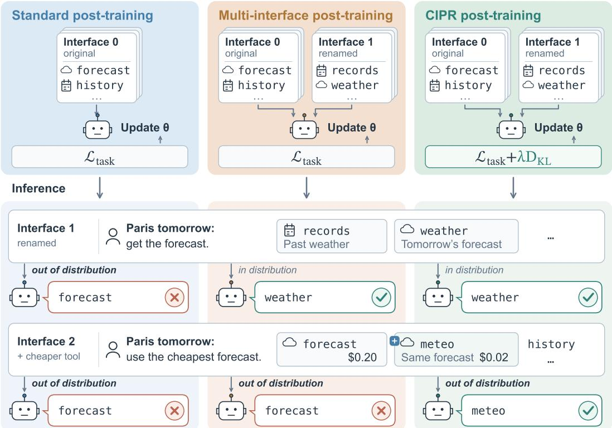
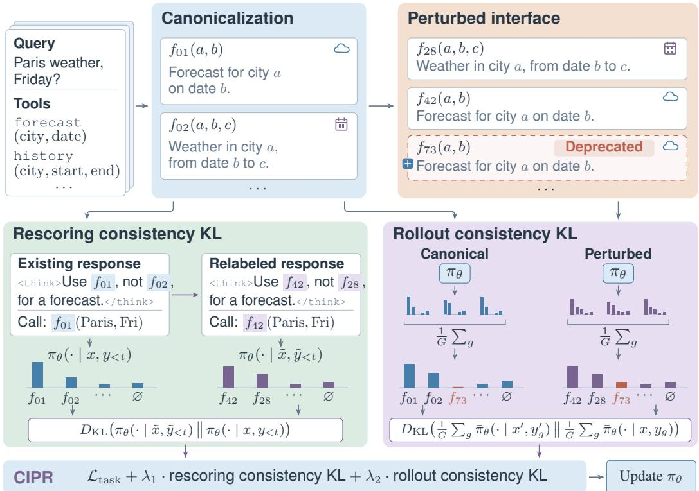
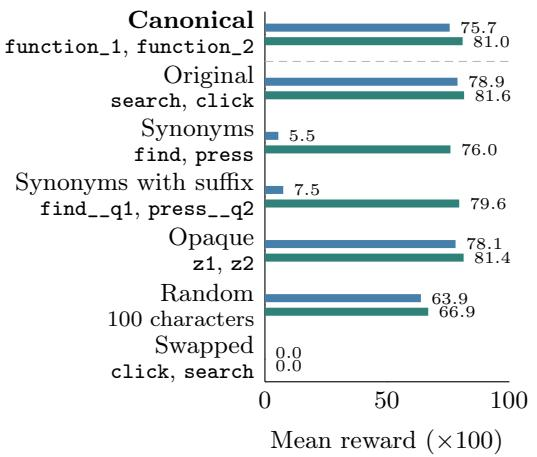
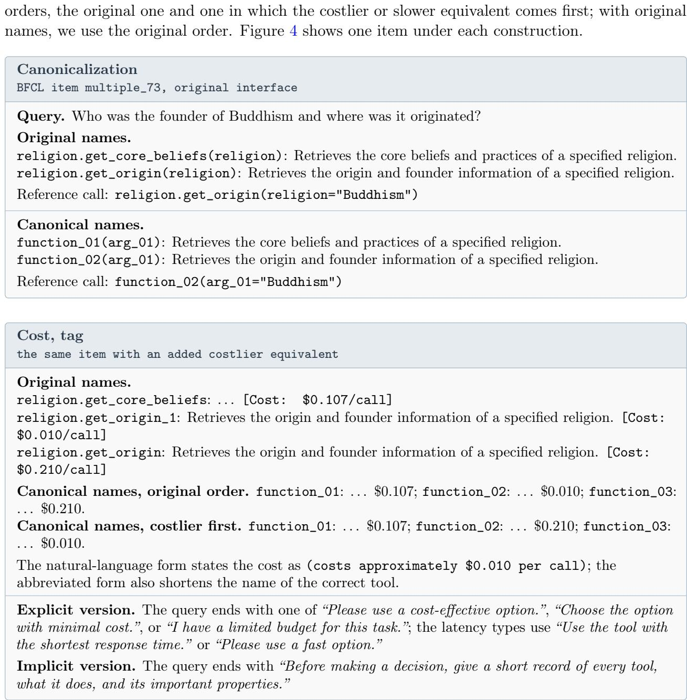
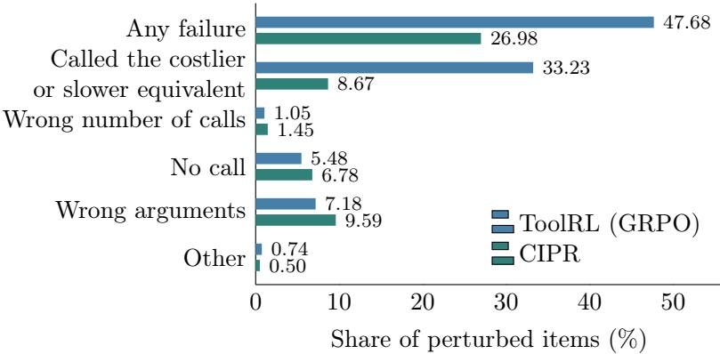
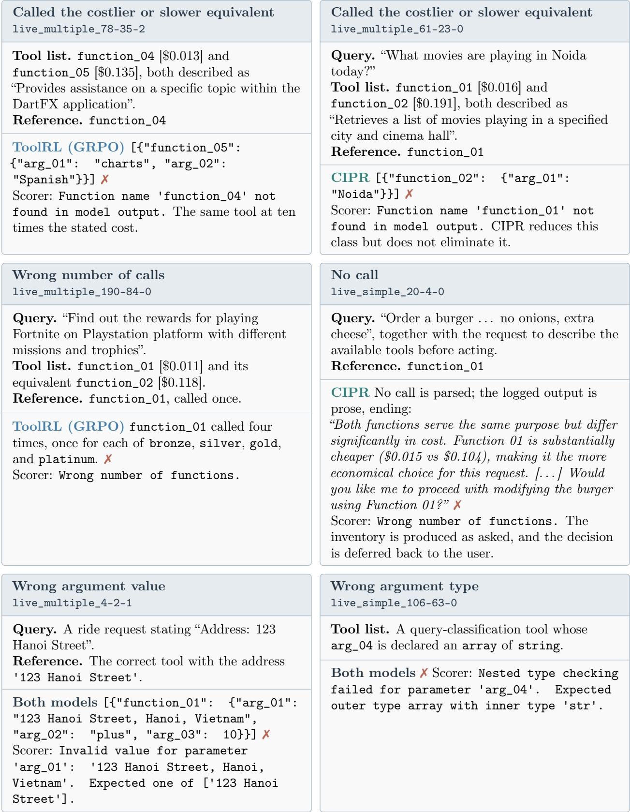

# One Task, Many Interfaces: Simple Cross-Interface Consistency Training Improves LLM Agent Robustness

Artin Tajdini1∗ Manpreet Kaur2 Peng Qi2

1University of Washington 2Uniphore

## Abstract

Post-training binds the competence of an LLM agent to the interface it was trained on. Semantics-preserving perturbations of that interface, such as renaming an action or changing the notation, leave the underlying task unchanged yet make the agent worse at it. Scoring each sample independently means interface randomization only broadens this dependence from a single interface to the training interface distribution, so out-of-distribution perturbations still degrade the agent. We propose Cross-Interface Policy Regularization (CIPR), a self-supervised objective that replaces action names with uninformative identifiers and presents each training sample under two interfaces in which equivalent actions are identified by construction. CIPR penalizes the KL divergence between the action distributions induced under the two interfaces, so the policy behaves consistently across them. We evaluate CIPR in both supervised and reinforcement-learning post-training, where it improves robustness. On agentic function calling, held-out interface perturbations reduce the accuracy of a post-trained agent by nearly 25%, and CIPR recovers 10.5% while leaving accuracy on the unchanged interface intact.1

## 1 Introduction

Language models are now trained to act as tool-using agents, either natively (Qwen Team, 2026; Kimi Team, 2025), or by fine-tuning on agent trajectories and reinforcement learning from task rewards (Zeng et al., 2024; Qian et al., 2026). What these agents learn, however, is tied to the interface through which their tools are presented, meaning the names, descriptions, and argument schemas of the available tools. Figure 1 illustrates this with a weather agent trained on a single interface, which fails when its forecast tool is renamed and when a cheaper equivalent is added, although neither change alters the task. Agents fine-tuned on trajectories can lose most of their task success when action names are minimally rewritten (Gu et al., 2026), and function-calling models degrade when tools are renamed, similar tools are added, or requests are rephrased (Ye et al., 2024; Rabinovich and Tavor, 2025; Zhou et al., 2026b). Such changes are routine in deployment, where registries combine tools from diferent servers, providers revise their schemas, and users misspell requests (Zhou et al., 2026b). Interfaces can also be manipulated, since edits to a tool’s description alone can make agents prefer it over equivalent tools (Faghih et al., 2025).

This failure is an instance of shortcut learning (Geirhos et al., 2020). On a fixed training interface, a policy that reads the tool descriptions and a policy that relies on a familiar name or a position in the tool list make the same calls and earn the same reward, so the task objective has no reason to prefer the first. The second policy fails as soon as the interface changes, even if the task is unchanged.

  
Figure 1: Interface robustness of a tool-using agent (schematic). In each column, we post-train an agent to fetch weather forecasts (top) and then test it at inference (bottom) on a renamed interface (Interface 1 ) and on one with an added, cheaper forecast tool (Interface 2). The label on each arrow into an agent says whether the test interface is in that agent’s training distribution. Standard post-training on one interface fails both. Multi-interface training handles the renaming, which it saw during training, but misses the new tool. CIPR, which also compares the policy across interfaces, chooses by description in both cases.

Such a policy can still succeed on new tasks under its training interface, so the failure is one of generalizing across interfaces rather than of fitting noise in the training examples.

Prior training methods reduce this sensitivity by changing what the agent trains on. Function masking replaces tool and argument names with random strings (Lin et al., 2025), which removes one cue but leaves others, such as a tool’s position or the set of tools ofered. Multi-interface training, also known as domain randomization, varies tool schemas, metadata, and question formats during training (Zhou et al., 2026b; Liu et al., 2026a), and synthetic corpora such as ToolACE broaden the tools seen in training (Liu et al., 2025). Both approaches still score each training interface on its own. Their objective asks the policy to succeed under every interface it sees, but never to treat equivalent interfaces alike, so a policy can fit every training variant while keeping a shortcut that fails on a new kind of change, as in the middle column of Figure 1.

The interface changes an agent meets in deployment cannot all be anticipated, so robustness should not depend on training on each of them. Instead, the agent should treat interfaces that ofer equivalent tools alike, including interfaces it has never seen. We propose Cross-Interface Policy Regularization (CIPR), which trains for this property directly (Figure 2). CIPR uses a correspondence that multi-interface training discards, since whenever we construct a perturbed interface, we know which of its tools is equivalent to which tool in the original. We canonicalize each training interface, replacing every tool name with a neutral identifier such as function\_01, so that names carry no task information. Canonicalization leaves other cues in place, such as a tool’s position, so we pair the canonical interface with a perturbed copy in which the tools are renamed, reordered, and joined by degraded twins. We then penalize the KL divergence between the agent’s action distributions under the two interfaces, with the canonical interface as the reference. Unlike prior consistency regularization, which asks a model for the same output under both inputs (Xie et al., 2020; Zhou et al., 2026a), this term lets the response change with the tool names and compares only the distributions over actions, with each tool matched to its counterpart through the known correspondence. The consistency KL has two terms. The rescoring consistency KL holds a response fixed and compares the action distributions along it, which needs no additional generation, and the rollout consistency KL lets each interface produce its own responses, since a diferent interface can call for diferent reasoning. We add both terms to the task loss, and they need no labels beyond those of the task.

We evaluate CIPR in reinforcement-learning and supervised post-training under interface perturbations held out from training. On function calling with two backbones, CIPR is more robust than the base model and standard post-training, and it improves on multi-interface training in all three groups of held-out perturbations while keeping original accuracy (Table 1).

Our contributions are as follows.

• CIPR, a self-supervised objective that penalizes the KL divergence between an agent’s action distributions under two interfaces whose equivalent actions are known by construction, with a rescoring consistency KL that needs no additional generation and a rollout consistency KL that lets the agent’s reasoning difer between the interfaces (Section 3).

• A tool-calling instantiation that canonicalizes tool names and pairs every training interface with a perturbed copy in which only descriptions and schemas identify the right tool (Sections 3.1 and 3.2).

• Experiments in reinforcement-learning and supervised post-training, in which CIPR improves on standard post-training and multi-interface training under held-out interface perturbations and makes an agent fine-tuned on trajectories robust to renamed actions (Section 4).

## 2 Related Work

Interface sensitivity of tool-using agents. Tool-use benchmarks mostly evaluate agents on the interface released with them (Patil et al., 2025; Barres et al., 2026), yet which tool an agent calls depends on how the tools are presented. Renaming or corrupting tool and argument names, rephrasing queries, and adding related tools all lower accuracy (Ye et al., 2024; Rabinovich and Tavor, 2025; Zhou et al., 2026b), the wording and order of equivalent tools change which one is selected (Faghih et al., 2025; Blankenstein et al., 2026), and agents call a tool whose parameters fit the query even when the tool does not serve it (Liu et al., 2026b). Similar sensitivity to semanticspreserving rewrites appears in mathematical reasoning (Mirzadeh et al., 2025) and in choices among reordered options (Egressy and Stühmer, 2026). Training can deepen this reliance: PIPE, which rewrites environment interfaces while preserving task semantics, finds that fine-tuning on trajectories increases reliance on the training interface (Gu et al., 2026), and agent-tuning data entangles format following with reasoning (Chen et al., 2024). These studies measure the problem, whereas we address it during training.

Training on varied interfaces. Most remedies applied during training change what the agent sees. They hide a cue, as function masking replaces names with random strings (Lin et al., 2025;

Qian et al., 2026); broaden the tools and environments seen in training, through synthesized APIs and agent data (Liu et al., 2025; Zhang et al., 2025; He et al., 2025; Mekala et al., 2024), generated environments (Sullivan et al., 2025; Du et al., 2026), and tools that change over time (Chen et al., 2025); or pair clean and perturbed versions of the same tasks (Lv et al., 2026; Chen et al., 2026). Closest to our setting, ToolRL-DR randomizes the interface during tool-use reinforcement learning (Zhou et al., 2026b), as multi-format supervision does for question formats (Liu et al., 2026a). Others change the target instead, scoring an action by its efect rather than its exact string (Tang et al., 2026). Outside agents, shortcuts of this kind persist after the core features are learned (Qiu et al., 2024), and regularization or data rebalancing aimed at them can suppress causal features or lower worst-group accuracy (Hong et al., 2025; LaBonte et al., 2024). In all of these, the objective still scores each training example on its own. We keep the perturbed interfaces and add a term that compares the policy across them.

Consistency across equivalent inputs. Consistency regularization penalizes the divergence between a model’s predictions on two versions of an input that should receive the same prediction, such as an example and its augmentation in semi-supervised learning (Xie et al., 2020) or semantically equivalent pairs in domain generalization (Gao et al., 2024). It has been applied to reinforcementlearning policies on augmented observations (Raileanu et al., 2021) and to vision-language-action policies under perturbed instructions and observations (Luo et al., 2026). In concurrent work, PIRL applies it to reinforcement learning of multimodal LLMs with a per-token KL between the policy’s next-token distributions for the same response under a clean and an adversarially perturbed prompt (Zhou et al., 2026a). Each of these methods compares the two predictions directly, which assumes the correct output is the same under both inputs. Renaming tools breaks this assumption, because the correct call is then written with diferent tokens, so we compare distributions over actions matched through the known correspondence between the two interfaces.

## 3 Cross-Interface Policy Regularization

We consider an LLM agent that receives a user query together with an interface, which lists the available tools with their names, descriptions, and argument schemas. At each step the agent either calls one of the listed tools or responds without a call. A perturbation of the interface is semantics-preserving when the tool that solves the task is still available and still solves it, even though its name, its position, or the surrounding options have changed. We want the agent to assign the same probability to equivalent tools under such perturbations, and CIPR trains for this in three steps. We canonicalize the interface so that tool names carry no task information (Section 3.1), pair every training example with a perturbed copy of its interface (Section 3.2), and penalize the divergence between the agent’s action distributions under the two interfaces (Section 3.3). Figure 2 summarizes the procedure.

## 3.1 Canonicalization

The most direct shortcut available to a trained agent is a familiar tool name. Because a name that led to correct calls during training usually still does so at test time, a policy can select tools by name without reading their descriptions, and function-calling models are known to be misled by naming conventions (Lin et al., 2025). We remove this shortcut by canonicalizing the interface, replacing every tool name with a neutral identifier and every argument name with an identifier numbered within its tool, so that forecast(city, date) becomes function\_01(arg\_01, arg\_02). We keep descriptions, types, required arguments, and argument values unchanged, so the agent has to read the descriptions to tell the tools apart, and we apply the same mapping to every reference to these names in the query, in earlier turns, and in the training targets. At inference, a canonicalization adapter applies this mapping to the incoming interface and translates the generated call back to the executable API, so the deployed tools themselves are never modified. Canonicalization is related to function masking (Lin et al., 2025), a training strategy that replaces names with random strings so that the model attends to descriptions; unlike masking, we also apply the mapping at inference, so the policy never meets the original names.

  
Figure 2: Overview of CIPR. We first canonicalize the interface, renaming the two tools of a weather query $f _ { 0 1 }$ and $f _ { 0 2 }$ , short for function\_01 and function\_02. We then build a perturbed interface that adds a degraded twin of every tool, such as the deprecated forecast $f _ { 7 3 } ,$ , and assigns all tools new identifiers in a new order. Each bar chart is an action distribution, the probability of calling each tool or none (∅). The rescoring consistency KL holds one response fixed and compares these distributions at each of its decisions, before and after its tool names are relabeled in the reasoning and the call. The rollout consistency KL lets each interface produce its own responses, so the reasoning can difer, and compares their average distributions, in which the twin $f _ { 7 3 }$ has probability zero under the canonical interface. Probabilities are illustrative.

## 3.2 Perturbed interfaces

The consistency KL of Section 3.3 needs only a perturbed interface in which we know which tool is equivalent to which canonical tool. We design ours to also remove the cues that canonicalization leaves in place, such as a tool’s position in the tool list or the identifiers seen during training, and construct it for every training example from the canonical interface in three steps. We first give every tool a degraded twin (twin expansion), a copy whose description states that it is worse, for example deprecated or slower, or whose schema replaces an argument the task needs with an unrelated one. We then give the expanded tool list new identifiers (relabeling) and shufle the tools and their arguments (reordering). The query and the descriptions of the original tools are unchanged, and each twin difers from its original only in its description or schema. Appendix B lists the exact operations.

## 3.3 Consistency KL on equivalent actions

The task objective never compares which tools the policy chooses under the canonical and the perturbed interface. We add this comparison by building on consistency regularization (Xie et al., 2020; Raileanu et al., 2021), which penalizes the divergence between a model’s predictions on two versions of an input that call for the same output. An agent’s correct response, however, changes with the interface, because the tools it calls have diferent names, and what stays fixed is the correspondence between equivalent tools, which is known from the construction of the perturbed interface. We therefore compare the policy’s distributions over actions rather than over tokens.

Action distributions. The policy $\pi _ { \theta }$ generates a response y to a prompt x, which contains the interface, the query, and any earlier turns. Within $y ,$ the policy makes a decision each time it begins a tool call or begins the text that ends its turn, and each decision is an action $^ { a , }$ either a tool declared in x or ∅, answering without a call. Writing $y _ { < t }$ for the part of $y$ before its t-th decision, we denote by $\pi _ { \theta } ( a \mid x , y _ { < t } )$ the probability that the policy continues $y _ { < t }$ with action a. We read this probability in one forward pass from the probability of the tokens that open a call and of each declared tool’s name after them, normalized over the declared tools (Appendix A), as in work that reads the action probabilities of LLM agents from their token probabilities (Carta et al., 2023; Tan et al., 2024). The two interfaces name the same tool diferently, so we index actions by equivalence rather than by name or position, and a tool and its counterpart under the other interface share an index. A tool that only one interface declares, such as a twin, has an index of its own, with probability zero under the interface that does not declare ${ \mathrm { i t } } ,$ so probability moved onto such a tool counts as disagreement instead of being merged with another. Arguments do not enter this distribution and are trained by the task objective alone.

Two consistency terms. We compare these distributions under the two interfaces in two ways, which difer in whether the agent’s reasoning is held fixed (Figure 2).

• Rescoring consistency KL. When only the tool names change, the reasoning behind a response remains valid under both interfaces, so this term holds a response fixed and compares the decisions along it. We take a response y to the canonical prompt x, a rollout of the task objective or a demonstration in supervised post-training, and relabel it, giving every tool a new neutral name in the prompt and throughout the response. Each decision of the relabeled response $\tilde { y }$ to the relabeled prompt x˜ sits at the same position as in $y ,$ and we average the divergence over the $n _ { y }$ decisions of $y _ { \mathrm { i } }$

$$
\operatorname { K L } _ { \operatorname { r e s c o r e } } ( x , y ) = { \frac { 1 } { n _ { y } } } \sum _ { t = 1 } ^ { n _ { y } } D _ { \mathrm { K L } } { \big ( } \pi _ { \theta } ( \cdot \mid { \tilde { x } } , { \tilde { y } } _ { < t } ) \mid \mid \operatorname { s g } [ \pi _ { \theta } ( \cdot \mid x , y _ { < t } ) ] { \big ) } .\tag{1}
$$

Scoring $\tilde { y }$ needs only forward passes and no generation.

• Rollout consistency KL. When the interface changes which tools are available, the agent should reason diferently, and comparing its decisions along a fixed response would penalize exactly that. This term therefore lets each interface produce its own responses. We sample G

responses $y _ { 1 } , \ldots , y _ { G }$ to x and G responses $y _ { 1 } ^ { \prime } , \ldots , y _ { G } ^ { \prime }$ to $x ^ { \prime } { \mathrm { . } }$ , the prompt with the full perturbed interface of Section 3.2, and compare the average action distributions of the two groups,

$$
{ \mathrm { K L } } _ { \mathrm { r o l l o u t } } ( x ) = D _ { \mathrm { K L } } \Big ( \frac { 1 } { G } \sum _ { g = 1 } ^ { G } \bar { \pi } _ { \theta } ( \cdot  { | } x ^ { \prime } , y _ { g } ^ { \prime } ) \Big \| \ \mathrm { s g } \left[ \frac { 1 } { G } \sum _ { g = 1 } ^ { G } \bar { \pi } _ { \theta } ( \cdot  { | } x , y _ { g } ) \right] \Big ) ,\tag{2}
$$

where $\begin{array} { r } { \pi _ { \theta } ( a \mid x , y ) = \frac { 1 } { n _ { u } } \sum _ { t = 1 } ^ { n _ { y } } \pi _ { \theta } ( a \mid x , y _ { < t } ) } \end{array}$ averages the action distribution over the decisions of one response. Only the responses are sampled, so each rollout contributes its whole action distribution at every decision rather than only the action it took. Gradients flow through these probabilities but not through the sampling. Because the two groups are sampled independently, their responses do not correspond, so we compare only their averages, at the cost of G additional rollouts per prompt.

Objective. We add both terms to the task loss of Section 3.4,

$$
\begin{array} { r } { \mathcal { L } ( \theta ) = \mathcal { L } _ { \mathrm { t a s k } } ( \theta ) + \lambda _ { 1 } \mathbb { E } _ { x , y } \bigl [ \mathrm { K L } _ { \mathrm { r e s c o r e } } ( x , y ) \bigr ] + \lambda _ { 2 } \mathbb { E } _ { x } \bigl [ \mathrm { K L } _ { \mathrm { r o l l o u t } } ( x ) \bigr ] , } \end{array}\tag{3}
$$

where x ranges over training prompts and y over the responses that the task loss uses, $D _ { \mathrm { K L } } ( p \Vert q ) =$ $\begin{array} { r } { \sum _ { a } p ( a ) \log { \frac { p ( a ) } { q ( a ) } } } \end{array}$ sums over the tools and ∅, sg stops the gradient, and $\lambda _ { 1 } , \lambda _ { 2 } \geq 0$ . In both terms the reference is the policy itself under the canonical interface, so no teacher model or additional labels are needed. We stop its gradient so that the perturbed distribution moves toward it rather than both moving toward each other. A tool that only the perturbed interface declares has reference probability zero, so we floor reference probabilities at a small constant ϵ inside the logarithm, which keeps the divergence finite and makes the penalty for such a tool grow with its probability under the perturbed interface.

## 3.4 Task loss and inference

The consistency terms do not depend on how $\mathcal { L } _ { \mathrm { t a s k } }$ is computed, and we use two task losses. In reinforcement learning, we use the GRPO objective of ToolRL (Qian et al., 2026), computed on rollouts under both interfaces. In supervised post-training, we use a distillation loss and only the rescoring consistency KL (Section 4.3). We add the consistency terms to the loss rather than to the reward, so agreement cannot substitute for correct calls and the task loss remains responsible for solving the task. At inference, we run the model with the canonicalization adapter alone; perturbed interfaces, relabeled copies, and paired rollouts exist only during training. Algorithm 1 in Appendix A gives the full procedure.

Nothing in the consistency KL is specific to tools; it requires only actions with model probabilities and a perturbation under which equivalent actions are known.

## 4 Experiments

We evaluate CIPR in reinforcement-learning and supervised post-training of agents. If the consistency KL removes interface shortcuts rather than fitting the training perturbations, CIPR should raise accuracy under held-out perturbations, keep or raise accuracy on the original interface, and improve on multi-interface training, which sees the same perturbed interfaces without the consistency KL. We test these three predictions by adding CIPR to reinforcement learning for function calling (Section 4.2); we then apply it to supervised post-training on WebShop (Section 4.3) and ablate its components (Section 4.4).

## 4.1 Setup

We build all reinforcement-learning experiments on the public ToolRL recipe (Qian et al., 2026), so the compared models difer only in their training interfaces and objective.

Training. We train with GRPO (Shao et al., 2024) on the 3,920 ToolRL training examples, rewarding correct calls and format. We use two backbones, Qwen2.5-3B-Instruct (Qwen Team, 2024) with tools in the prompt and Qwen3.5-4B (Qwen Team, 2026) with thinking and native function calling. Appendix A lists hyperparameters.

Baselines. We compare four models on each backbone. Base is the backbone without posttraining, and ToolRL (GRPO), our standard post-training baseline, is the backbone post-trained with the ToolRL recipe; both are evaluated with the original tool names, as they would be deployed. Multi-interface training adds the perturbed interfaces of Section 3.2 to ToolRL training, as in ToolRL-DR (Zhou et al., 2026b), and CIPR adds both consistency terms to it; the tables label these models + multi-interface and + CIPR. We train both with canonical names on the same interfaces and evaluate both through the canonicalization adapter, so that they difer only in whether the policy is compared across them.

Held-out perturbations. We evaluate on the 2,501 single-turn items of BFCL v4 (Patil et al., 2025) that have a reference call, under thirteen perturbation types adapted from RobustBench-TC (Zhou et al., 2026b) (Appendix C). None of them is used during training, and we report them in three groups. Typos & distractor tools introduces typos into the query or adds a distractor for every tool the task calls, either an unrelated tool renamed to resemble it or a duplicate with the same name whose description or parameters are corrupted. The six cost and latency types add a cheaper or faster equivalent of the correct tool under a new name, so that the familiar name now points to the worse choice. As in RobustBench-TC, the query in Cost & latency (explicit) asks for the better tool, for example “Please use a cost-efective option”. This request tells the agent what to prefer, so we add a harder version, Cost & latency (implicit), in which the query only asks the agent to describe the available tools and states no preference. These two groups are the hardest test, because the right choice depends only on a stated cost or latency, and preferring a cheaper or faster tool is never rewarded during training. Beyond single-turn calls, we evaluate the three groups on the airline and retail domains of τ2-bench (Barres et al., 2026), where the agent completes multi-turn tasks with a simulated user, and Appendix F also reports RoTBench (Ye et al., 2024), which corrupts tool and parameter names at graded levels.

## 4.2 Robustness to held-out perturbations

Table 1 tests the three predictions on BFCL.

Comparison with ToolRL (GRPO). Standard post-training leaves most of the gap in place. On Qwen2.5-3B, ToolRL (GRPO) raises original accuracy by 9.6 points, yet its gap grows from 29.8 to 32.7 points, because the familiar name it learned to follow now points to the worse tool. On Qwen3.5-4B, whose base model is already trained for tool use, the gap narrows only from 10.2 to 8.4 points.

Table 1: Full-call accuracy (%) on BFCL under interface perturbations. Tool names gives the names each model sees at evaluation. Each model is evaluated with the names it was trained on, as it would be deployed, so Base and ToolRL (GRPO) see the original names, and the multi-interface and CIPR models, which are trained with canonical names, see canonical names through the canonicalization adapter. Gray rows evaluate Base and ToolRL (GRPO) through the canonicalization adapter as well. In distribution applies the perturbation used in training (Section 3.2), which is defined on canonical names, so rows with the original names show $\mathrm { n / a } .$ . Mean averages the three held-out groups, and Gap is original accuracy minus the mean. Bold marks the best value per backbone, excluding gray rows. All 95% confidence intervals have half-widths of at most 2.0 points, and Appendix D reports each perturbation type.
<table><tr><td colspan="4"></td><td colspan="4">In distribution ↑ Held-out perturbations ↑</td><td rowspan="3"></td></tr><tr><td>Model</td><td>Tool names</td><td>Original ↑</td><td>Twins &amp; reordering</td><td>Typos &amp; distractors</td><td>Cost &amp; lat. Cost &amp; lat. (explicit)</td><td>(implicit)</td><td>Mean Gap ↓</td></tr><tr><td colspan="4">Qwen2.5-3B, tools in prompt</td><td colspan="4"></td></tr><tr><td>Base</td><td>original</td><td>63.7</td><td>n/a</td><td>59.9</td><td>24.2</td><td>17.7</td><td>33.9</td><td>29.8</td></tr><tr><td rowspan="2">ToolRL (GRPO)</td><td>canonical</td><td>61.5</td><td>43.5</td><td>59.3</td><td>41.9</td><td>28.5</td><td>43.2</td><td>18.3</td></tr><tr><td>original</td><td>73.3</td><td>n/a</td><td>71.6</td><td>29.3</td><td>20.9</td><td>40.6</td><td>32.7</td></tr><tr><td rowspan="2"></td><td>canonical</td><td>70.7</td><td>49.1</td><td>68.9</td><td>46.0</td><td>33.5</td><td>49.5</td><td>21.2</td></tr><tr><td>+ multi-interface canonical</td><td>74.0</td><td>68.2</td><td>71.5</td><td>51.5</td><td>39.6</td><td>54.2</td><td>19.8</td></tr><tr><td>+ CIPR (ours)</td><td>canonical</td><td>74.9</td><td>68.8</td><td>72.2</td><td>53.6</td><td>42.3</td><td>56.1</td><td>18.8</td></tr><tr><td colspan="9">Qwen3.5-4B, native function calling</td></tr><tr><td rowspan="2">Base</td><td>original</td><td>84.2</td><td>n/a</td><td>83.4</td><td>83.1</td><td>55.3</td><td>73.9</td><td>10.2</td></tr><tr><td>canonical</td><td>82.0</td><td>76.3</td><td>81.3</td><td>81.0</td><td>58.8</td><td>73.7</td><td>8.3</td></tr><tr><td rowspan="2">ToolRL (GRPO)</td><td>original</td><td>84.8</td><td>n/a</td><td>84.2</td><td>84.8</td><td>60.2</td><td>76.4</td><td>8.4</td></tr><tr><td>canonical</td><td>84.6</td><td>77.1</td><td>84.0</td><td>84.0</td><td>52.3</td><td>73.4</td><td>11.1</td></tr><tr><td>+ multi-interface</td><td>canonical</td><td>84.8</td><td>84.8</td><td>84.1</td><td>84.2</td><td>70.7</td><td>79.7</td><td>5.1</td></tr><tr><td>+ CIPR (ours)</td><td>canonical</td><td>85.0</td><td>83.8</td><td>84.5</td><td>84.6</td><td>73.0</td><td>80.7</td><td>4.2</td></tr></table>

Canonical names alone. Canonical names are not a free improvement for a model trained without them (gray rows). They lower the original accuracy of both base models and of ToolRL (GRPO), and although they raise the cost and latency accuracy of ToolRL (GRPO) on Qwen2.5-3B, they lower its accuracy in every held-out group on Qwen3.5-4B.

Comparison with multi-interface training. Training on perturbed interfaces makes canonical names pay of, and the consistency KL adds to that gain. On both backbones, CIPR is higher than multi-interface training on the original interface and in every held-out group. The largest gains are on the cost and latency perturbations, the ones least like anything seen in training, with 2.1 and 2.7 points on Qwen2.5-3B and 2.3 points on the implicit version for Qwen3.5-4B, while the other diferences are within the 95% confidence intervals. Under the perturbation used in training (In distribution), the two models difer by about a point or less on both backbones, so the advantage of CIPR lies in the perturbations that training did not cover. On both backbones, CIPR thus matches or exceeds the original accuracy of ToolRL (GRPO) while raising its mean accuracy under perturbation by 15.5 and 4.3 points.

Interactive tasks. On τ2-bench, the Qwen3.5-4B CIPR model has the smallest gap in both domains between its original reward and its mean reward under the three groups, although ToolRL (GRPO) with the original names has a higher reward on the original interface and under every group

  
Figure 3: WebShop evaluation on AgentLM-7B before (blue) and after (green) CIPR selfdistillation, under diferent names.

Table 2: Ablations on Qwen2.5-3B (accuracy, %, canonical names). Each row removes one component from CIPR, and removing the consistency KL gives multi-interface training; †one added near-duplicate tool takes the place of the twins. The gray row is ToolRL (GRPO) with canonical names.
<table><tr><td></td><td>Cost &amp; latency Original ↑(explicit)↑</td></tr><tr><td>+ CIPR</td><td>53.6</td></tr><tr><td>- consistency KL – twins</td><td>51.7</td></tr><tr><td></td><td>48.1</td></tr><tr><td>– twins and reordering†</td><td>43.7</td></tr><tr><td>ToolRL (GRPO)</td><td>70.7</td></tr></table>

(Table 8).

## 4.3 Supervised post-training

We next apply CIPR to an agent trained by supervised learning, AgentLM-7B (Zeng et al., 2024), whose WebShop policy collapses when its actions are renamed (Gu et al., 2026).

Setting. AgentLM is fine-tuned on agent trajectories mixed with general instruction data, and acts on WebShop (Yao et al., 2022) through two actions named search and click. The released model already solves the task under its original action names, so we apply CIPR as self-distillation. The released model is the teacher and initializes the student, which we train to match it under canonical names and, through the rescoring consistency KL, under relabeled names, without additional rollouts.

Results. Consistent with Gu et al. (2026), renaming search and click to the synonyms find and press reduces the released model’s reward from 78.9 to 5.5 (Figure 3). After self-distillation, the agent reaches 81.0 under canonical names, the interface it is deployed with, against 75.7 for the released model behind the same adapter, so the adapter alone does not explain the gain. Seeing the names directly, the trained agent is also robust to neutral renaming, with 76.0 under the synonyms. Swapped names, each of which suggests the other action, drive both models to zero, which is why CIPR keeps the canonicalization adapter, behind which a misleading name never reaches the policy.

## 4.4 Ablations

Table 2 ablates the consistency KL, the twins, and the reordering of the perturbed interface on Qwen2.5-3B, with every model evaluated under canonical names (Table 9 lists every run). It reports accuracy on the original interface and on the explicit cost and latency perturbations, where only the stated cost or latency identifies the right tool.

Efect of the consistency KL. Without the consistency KL, the method reduces to multiinterface training on the same interfaces, and accuracy falls from 53.6% to 51.7% on the explicit cost and latency perturbations and from 74.9% to 73.5% on the original interface, consistent with the diference between the two methods in Table 1.

Efect of the perturbed interface. The twins contribute the most. Without them, accuracy on the explicit cost and latency perturbations falls from 53.6% to 48.1%, and with a single added near-duplicate tool in place of twins and reordering it falls to 43.7%, below ToolRL (GRPO) with canonical names. Trained with a single added tool, the model relies on position rather than on the stated costs, with 70.8% when the correct tool comes first and 16.5% when the costlier equivalent does (Table 9). The consistency KL also gains more from twins, adding 1.9 points with them against 0.6 with reordering alone (Table 9).

Efect of canonicalization at inference. Canonical names are needed at inference as well. Evaluated with the original names, the CIPR model reaches 28.7% on the explicit cost and latency perturbations in the original tool order, against 60.5% with canonical names, because the familiar name belongs to the costlier tool (Appendix D).

## 5 Conclusion

LLM agents learn to use tools through a particular interface, and the task objective cannot tell a decision that depends on the task from one that depends on how the tools are presented. We supply that distinction with CIPR, a self-supervised consistency KL between the agent’s action distributions under two interfaces whose equivalent actions are known by construction. Added to multi-interface training, it improves accuracy in all three groups of held-out BFCL perturbations on both backbones without lowering accuracy on the original interface (Table 1). Applied as self-distillation, it makes AgentLM robust to renaming its WebShop actions. Because the targets come from the policy itself, the objective needs no annotation beyond the task, which makes it a natural candidate for agentic training at scale.

Limitations. CIPR needs the canonicalization adapter at inference, because a name that misrepresents its action, such as the swapped WebShop names in Figure 3, still misleads a trained agent that sees it directly. The consistency KL constrains which tool the agent calls and whether it calls one, while arguments are learned from the task loss alone, and argument errors barely change in our error analysis (Appendix E). It also requires a perturbation whose equivalences are known, which is direct for tool lists but harder to construct for richer actions such as edits to a program. The rollout consistency KL samples an additional group of rollouts per prompt, which raises the cost of training. Our experiments use models of up to 9B parameters, one training run per configuration, and mostly single-turn function calling, so the efect at larger scale and in long multi-turn tasks remains to be established.

## References

Victor Barres, Honghua Dong, Soham Ray, Xujie Si, and Karthik Narasimhan. τ2-Bench: Evaluating conversational agents in a dual-control environment. In International Conference on Machine Learning, 2026.

Thierry Blankenstein, Jialin Yu, Zixuan Li, Vassilis Plachouras, Sunando Sengupta, Philip Torr, Yarin Gal, Alasdair Paren, and Adel Bibi. Biasbusters: Uncovering and mitigating tool selection

bias in large language models. In International Conference on Learning Representations, volume 2026, pages 102460–102489, 2026.

Thomas Carta, Clément Romac, Thomas Wolf, Sylvain Lamprier, Olivier Sigaud, and Pierre-Yves Oudeyer. Grounding large language models in interactive environments with online reinforcement learning. In Proceedings of the 40th International Conference on Machine Learning, volume 202 of Proceedings of Machine Learning Research, pages 3676–3713, 2023.

Guoxin Chen, Zhong Zhang, Xin Cong, Fangda Guo, Yesai Wu, Yankai Lin, Wenzheng Feng, and Yasheng Wang. Learning evolving tools for large language models. In International Conference on Learning Representations, volume 2025, pages 87140–87169, 2025.

Yuxin Chen, Xiaodong Cai, Junfeng Fang, Zhuowen Han, Yu Wang, Yaorui Shi, Yi Zhang, Qi Gu, Xunliang Cai, Xiang Wang, An Zhang, and Tat-Seng Chua. Learning to act under noise: Enhancing agent robustness via noisy environments, 2026.

Zehui Chen, Kuikun Liu, Qiuchen Wang, Wenwei Zhang, Jiangning Liu, Dahua Lin, Kai Chen, and Feng Zhao. Agent-flan: Designing data and methods of efective agent tuning for large language models. In Findings of the Association for Computational Linguistics: ACL 2024, pages 9354–9366, 2024.

Weihua Du, Zhan Ling, Kang Liu, Lingfeng Shen, Xuesong Yao, Yufei Xu, Dingyuan Shi, Yiming Yang, and Jiecao Chen. Generalizable end-to-end tool-use rl with synthetic codegym. In International Conference on Learning Representations, volume 2026, pages 17733–17756, 2026.

Beni Egressy and Jan Stühmer. Set-llm: A permutation-invariant llm. volume 38, pages 62798–62834, 2026.

Kazem Faghih, Wenxiao Wang, Yize Cheng, Siddhant Bharti, Gaurang Sriramanan, Sriram Balasubramanian, Parsa Hosseini, and Soheil Feizi. Tool preferences in agentic llms are unreliable. In Proceedings of the 2025 Conference on Empirical Methods in Natural Language Processing, pages 20965–20980, 2025.

Han Gao, Kaican Li, Weiyan Xie, Zhi Lin, Yongxiang Huang, Luning Wang, Caleb Chen Cao, and Nevin L Zhang. Consistency regularization for domain generalization with logit attribution matching. In Proceedings of the Fortieth Conference on Uncertainty in Artificial Intelligence, pages 1389–1407, 2024.

Robert Geirhos, Jörn-Henrik Jacobsen, Claudio Michaelis, Richard Zemel, Wieland Brendel, Matthias Bethge, and Felix A. Wichmann. Shortcut learning in deep neural networks. Nature Machine Intelligence, 2(11):665–673, 2020. doi: 10.1038/s42256-020-00257-z.

Weizheng Gu, Chengze Li, Zhuohao Yu, Mengyuan Sun, Zhibang Yang, Wei Wang, Hongrui Jia, Shikun Zhang, and Wei Ye. What do agents learn from trajectory-SFT: Semantics or interfaces? In International Conference on Machine Learning, 2026.

Jie He, Jennifer Neville, Mengting Wan, Longqi Yang, Hui Liu, Xiaofeng Xu, Xia Song, Jef Z Pan, and Pei Zhou. Gentool: Enhancing tool generalization in language models through zero-to-one and weak-to-strong simulation. In Findings of the Association for Computational Linguistics: ACL 2025, pages 1097–1122, 2025.

Haoyang Hong, Ioanna Papanikolaou, and Sonali Parbhoo. Do regularization methods for shortcut mitigation work as intended? In International Conference on Artificial Intelligence and Statistics, pages 3349–3357. PMLR, 2025.

Kimi Team. Kimi K2: Open agentic intelligence. arXiv preprint arXiv:2507.20534, 2025.

Tyler LaBonte, John C Hill, Xinchen Zhang, Vidya Muthukumar, and Abhishek Kumar. The group robustness is in the details: revisiting finetuning under spurious correlations. volume 37, pages 121598–121629, 2024.

Qiqiang Lin, Muning Wen, Qiuying Peng, Guanyu Nie, Junwei Liao, Jun Wang, Xiaoyun Mo, Jiamu Zhou, Cheng Cheng, Yin Zhao, et al. Robust function-calling for on-device language model via function masking. In The Thirteenth International Conference on Learning Representations, 2025.

June M. Liu, Shaomian Zheng, He Cao, Dingnan Jin, Qing Cui, and Jun Zhou. Improving cross-format robustness in language models with multi-format training, 2026a.

Weiwen Liu, Xu Huang, Xingshan Zeng, Shuai Yu, Dexun Li, Shuai Wang, Weinan Gan, Zhengying Liu, Yuanqing Yu, Zezhong WANG, et al. Toolace: Winning the points of llm function calling. In International conference on learning representations, volume 2025, pages 41359–41381, 2025.

Yilong Liu, Xixun Lin, Pengfei Cao, Ge Zhang, Fang Fang, and Yanan Cao. Do llms know tool irrelevance? demystifying structural alignment bias in tool invocations. In Proceedings of the 64th Annual Meeting of the Association for Computational Linguistics (Volume 1: Long Papers), pages 31934–31958, 2026b.

Jingzhou Luo, Yifan Wen, Yongjie Bai, Xinshuai Song, Yang Liu, and Liang Lin. RoVLA: Multiconsistency constraints for robust vision-language-action models, 2026.

Song-Lin Lv, Weiming Wu, Rui Zhu, Zi-Jian Cheng, and Lan-Zhe Guo. Can agents generalize to the open world? Unveiling the fragility of static training in tool use. In International Conference on Machine Learning, 2026.

Dheeraj Mekala, Jason E Weston, Jack Lanchantin, Roberta Raileanu, Maria Lomeli, Jingbo Shang, and Jane Dwivedi-Yu. Toolverifier: Generalization to new tools via self-verification. In Findings of the Association for Computational Linguistics: EMNLP 2024, pages 5026–5041, 2024.

Iman Mirzadeh, Keivan Alizadeh-Vahid, Hooman Shahrokhi, Oncel Tuzel, Samy Bengio, and Mehrdad Farajtabar. Gsm-symbolic: Understanding the limitations of mathematical reasoning in large language models. In International Conference on Learning Representations, volume 2025, pages 94743–94765, 2025.

Shishir G Patil, Huanzhi Mao, Fanjia Yan, Charlie Cheng-Jie Ji, Vishnu Suresh, Ion Stoica, and Joseph E Gonzalez. The berkeley function calling leaderboard (bfcl): From tool use to agentic evaluation of large language models. In Forty-second International Conference on Machine Learning, 2025.

Cheng Qian, Emre Can Acikgoz, Qi He, Hongru Wang, Xiusi Chen, Dilek Hakkani-Tur, Gokhan Tur, and Heng Ji. Toolrl: Reward is all tool learning needs. In Advances in Neural Information Processing Systems, volume 38, pages 105523–105553, 2026.

GuanWen Qiu, Da Kuang, and Surbhi Goel. Complexity matters: Feature learning in the presence of spurious correlations. In Forty-first International Conference on Machine Learning, 2024.

Qwen Team. Qwen2.5 technical report. arXiv preprint arXiv:2412.15115, 2024.

Qwen Team. Qwen3.5: Towards native multimodal agents, February 2026. URL https://qwen.ai/ blog?id=qwen3.5.

Ella Rabinovich and Ateret Anaby Tavor. On the robustness of agentic function calling. In Proceedings of the 5th Workshop on Trustworthy NLP (TrustNLP 2025), pages 298–304, 2025.

Roberta Raileanu, Maxwell Goldstein, Denis Yarats, Ilya Kostrikov, and Rob Fergus. Automatic data augmentation for generalization in reinforcement learning. In Advances in Neural Information Processing Systems, volume 34, pages 5402–5415, 2021.

Zhihong Shao, Peiyi Wang, Qihao Zhu, Runxin Xu, Junxiao Song, Xiao Bi, Haowei Zhang, Mingchuan Zhang, Y. K. Li, Y. Wu, and Daya Guo. DeepSeekMath: Pushing the limits of mathematica reasoning in open language models, 2024.

Michael Sullivan, Mareike Hartmann, and Alexander Koller. Procedural environment generation for tool-use agents. In Proceedings of the 2025 Conference on Empirical Methods in Natural Language Processing, pages 18555–18573, 2025.

Weihao Tan, Wentao Zhang, Shanqi Liu, Longtao Zheng, Xinrun Wang, and Bo An. True knowledge comes from practice: Aligning large language models with embodied environments via reinforcement learning. In International Conference on Learning Representations, 2024.

Bohan Tang, Dezhao Luo, Jianheng Liu, Jingxuan Chen, Shaogang Gong, Jianye Hao, Jun Wang, and Kun Shao. Beyond syntax: Action semantics learning for app agents. In Proceedings of the IEEE/CVF Conference on Computer Vision and Pattern Recognition, pages 9444–9454, 2026.

Qizhe Xie, Zihang Dai, Eduard Hovy, Thang Luong, and Quoc Le. Unsupervised data augmentation for consistency training. In Advances in neural information processing systems, volume 33, pages 6256–6268, 2020.

Shunyu Yao, Howard Chen, John Yang, and Karthik Narasimhan. WebShop: Towards scalable real-world web interaction with grounded language agents. In Advances in Neural Information Processing Systems, volume 35, pages 20744–20757, 2022.

Junjie Ye, Yilong Wu, Songyang Gao, Caishuang Huang, Sixian Li, Guanyu Li, Xiaoran Fan, Qi Zhang, Tao Gui, and Xuan-Jing Huang. Rotbench: A multi-level benchmark for evaluating the robustness of large language models in tool learning. In Proceedings of the 2024 conference on empirical methods in natural language processing, pages 313–333, 2024.

Aohan Zeng, Mingdao Liu, Rui Lu, Bowen Wang, Xiao Liu, Yuxiao Dong, and Jie Tang. Agenttuning: Enabling generalized agent abilities for llms. In Findings of the Association for Computational Linguistics: ACL 2024, pages 3053–3077, 2024.

Jianguo Zhang, Tian Lan, Ming Zhu, Zuxin Liu, Thai Hoang, Shirley Kokane, Weiran Yao, Juntao Tan, Zhiwei Liu, Yihao Feng, et al. xlam: A family of large action models to empower ai agent systems. In Proceedings of the 2025 Conference of the Nations of the Americas Chapter of the Association for Computational Linguistics: Human Language Technologies (Volume 1: Long Papers), pages 11583–11597, 2025.

Pengfei Zhou, Zhiwei Tang, Xiaopeng Peng, Chenrui Zhou, Lama Moukheiber, Yixing Ma, Bin Xu, Jiajun Song, Zhenglin Wan, Wangbo Zhao, Jiasheng Tang, Bohan Zhuang, Fan Wang, and Yang You. Improving generalization robustness of multimodal RLVR, 2026a.

Xiaolin Zhou, Aojie Yuan, Zheng Luo, Zipeng Ling, Xixiao Pan, Yicheng Gao, Haiyue Zhang, Jiate Li, Shuli Jiang, Prince Zizhuang Wang, Zixuan Zhu, Jinbo Liu, Ryan A. Rossi, Hua Wei, and Xiyang Hu. When simulation lies: A sim-to-real benchmark and domain-randomized RL recipe for tool-use agents, 2026b.

## A Training details

This appendix gives the hyperparameters of the reinforcement-learning runs (Table 3) and the full CIPR training procedure (Algorithm 1).

Hyperparameters. All reinforcement-learning runs build on ToolRL (Qian et al., 2026) and keep its optimizer settings. The task objective is GRPO (Shao et al., 2024) with rewards for call correctness and response format and no reference-policy KL; calling a degraded twin earns the same reward as any other wrong call.

Table 3: Hyperparameters of the reinforcement-learning runs.
<table><tr><td></td><td>Qwen2.5-3B</td><td>Qwen3.5-4B</td></tr><tr><td>Training examples</td><td>3,920</td><td>3,920</td></tr><tr><td>Learning rate</td><td>10-6</td><td>10-6</td></tr><tr><td>Prompts per update</td><td>512</td><td>256</td></tr><tr><td>Optimization minibatch</td><td>128</td><td>128</td></tr><tr><td>Training budget</td><td>15 epochs (about 105 updates) 15 epochs (about 105 updates)</td><td></td></tr><tr><td>Rollouts per interface (G)</td><td>4</td><td>4</td></tr><tr><td>Rescoring consistency KL coefficient (λ₁)</td><td>0.02</td><td>0.02</td></tr><tr><td>Rollout consistency KL coefficient (λ2)</td><td>0.005</td><td>0.005</td></tr><tr><td>Floor on reference probabilities (€)</td><td>10-12</td><td>10-12</td></tr></table>

Training procedure. Algorithm 1 summarizes CIPR training for tool calling. In self-distillation (Section 4.3), the task loss is the KL from the released model under original names to the student under canonical names, and we use only the rescoring consistency KL and sample no rollouts.

Computing the action distribution. We read the probabilities $\pi _ { \theta } ( a \mid x , y _ { < t } )$ of Section 3.3 from the token probabilities at each decision in one forward pass. Let o be the tokens that open a call and precede the tool name, for example <tool\_call> and the formatting before the name, and let $n _ { a }$ be the name of tool a. Then $\begin{array} { r } { \pi _ { \theta } ( a \mid x , y _ { < t } ) = \pi _ { \theta } ( o \mid x , y _ { < t } ) \pi _ { \theta } ( n _ { a } \mid x , y _ { < t } , o ) / \sum _ { b } \pi _ { \theta } ( n _ { b } \mid x , y _ { < t } , o ) } \end{array}$ for a declared tool a, where b ranges over the declared tools, and $\pi _ { \boldsymbol { \theta } } ( \emptyset \mid x , y _ { < t } ) = 1 - \pi _ { \boldsymbol { \theta } } ( o \mid x , y _ { < t } )$ A name that spans several tokens is scored token by token, each conditioned on the tokens before it.

Algorithm 1: CIPR training for tool calling.   
Input: policy πθ, training prompts , group size G, coeficients $\lambda _ { 1 }$ and $\lambda _ { 2 }$   
foreach minibatch $B \subset D$ do   
foreach prompt in do   
x canonicalization of the prompt ; // Section 3.1   
x′ perturbed copy of x ; // Table 4   
Sample y1, . . . , yG πθ(  x) and $y _ { 1 } ^ { \prime } , \ldots , y _ { G } ^ { \prime } \sim \pi _ { \theta } ( \cdot \mid x ^ { \prime } )$ and score them;   
Relabel a canonical response and rescore its decisions ; // rescoring consistency   
KL   
Average the action distributions of each group ; // Eq. (2)   
Take a gradient step on (θ) of Eq. (3), with the reference distributions detached;

## B Perturbed training interfaces

Table 4 lists the operations that build the perturbed training interface from the canonical one. The rescoring consistency KL uses the relabeling alone, without twins (Section 3.3); the rollout consistency KL and the task loss use the full construction. The in-distribution evaluation of Table 1 applies the full construction once to every BFCL item, with a fixed seed.

Table 4: Construction of the perturbed training interface. The query is unchanged, and f01 abbreviates function\_01. These operations build the training pairs and the in-distribution evaluation of Table 1; Table 5 lists the held-out perturbations.
<table><tr><td>Operation</td><td>Change</td><td>Example</td></tr><tr><td>Twin expansion</td><td>Copy every tool and degrade the copy&#x27;s de- A forecast tool gains a copy marked scription or required arguments. The original deprecated; a date-range query loses stays available.</td><td>its end date in favor of an unrelated width argument.</td></tr><tr><td>Relabeling</td><td>Assign new neutral identifiers to the expanded tool list and update every reference to them.</td><td> $f _ { 0 1 }$  becomes  $f _ { 4 2 } ,$  and its twin becomes  $f _ { 7 3 } .$ </td></tr><tr><td>Tool reordering</td><td>Shuffle the tools after expansion, regardless of Twins and originals do not occupy whether a tool is an original or a twin.</td><td>fixed positions.</td></tr><tr><td>ing</td><td>Argument reorder- Shuffle argument declarations while keeping their names, types, descriptions, and required- values bound. ness.</td><td> $( a , b , c )$  becomes  $( c , a , b )$  with the same</td></tr></table>

## C Evaluation details

This appendix describes the evaluation items, the held-out perturbation types, the tool-call formats and decoding, and the scoring procedure used in Section 4.

Item set. We evaluate on the 2,501 single-turn items of BFCL v4 (Patil et al., 2025) that have a reference call, across its ten partitions, namely live\_multiple (1,053), simple\_python (400), live\_simple (258), multiple, parallel, and parallel\_multiple (200 each), simple\_java (100), simple\_javascript (50), live\_parallel\_multiple (24), and live\_parallel (16). We apply every perturbation to the same items, so every comparison is paired by item.

Perturbation types. Table 5 lists the thirteen held-out perturbation types, adapted from RobustBench-TC (Zhou et al., 2026b), and the group of Table 1 in which we report each. The six cost and latency types share one construction. The tool list contains the correct tool and an equivalent with the same description but a higher stated cost or latency; the equivalent keeps the original tool’s name and the correct tool receives a new one, so that the familiar name points to the costlier or slower tool. The cost or latency is stated as a tag, in natural language, or as a tag together with an abbreviated name for the correct tool. Each type is evaluated in two versions. In the explicit version, as in RobustBench-TC, the query asks for the cheaper or faster tool; in the implicit version, which we add, the query asks the agent to describe the available tools and their properties before acting and states no preference. With canonical names, we canonicalize after constructing each interface, and because canonical identifiers follow the tool order, we average two

  
Figure 4: One BFCL item before and after canonicalization (top), and under the cost perturbation with the query endings of the explicit and implicit versions (bottom). Descriptions are unchanged by canonicalization; tool and argument names are replaced.

Tool-call format and decoding. Qwen3.5 models are trained and evaluated with native function calling, in which the tool list is passed through the model’s tool interface and calls are parsed by its structured parser. Qwen2.5 models receive the tools in the prompt. We report the two formats separately. Every model decodes with temperature 0 and at most 4,096 new tokens, and Qwen3.5 models generate with thinking enabled, the default of their chat template.

Table 5: Held-out perturbation types used on BFCL, adapted from RobustBench-TC and regenerated for all 2,501 items. In all six cost and latency types the correct tool receives a new name and the familiar name goes to the costlier or slower equivalent, which RobustBench-TC does only in its abbreviated variants, and the implicit version is ours. None is used during training.
<table><tr><td>Group</td><td>Types</td><td>What changes</td></tr><tr><td rowspan="6">Typos &amp; distractor tools</td><td>Typo</td><td>Character-level typos, with letters swapped, substituted, dropped, or doubled, in about one in five query words of four or more letters.</td></tr><tr><td>RedunTool</td><td>For each tool the task calls, an unrelated tool whose name matches that tool&#x27;s name except in the last word.</td></tr><tr><td>Dup-NoDesc</td><td>For each tool the task calls, a duplicate with the same name, no description, and no parameters.</td></tr><tr><td>Dup-Desc</td><td>The same duplicate with the original description and no parameters.</td></tr><tr><td>Dup-WrongP</td><td>The same duplicate with no description and the parameters of another tool.</td></tr><tr><td>Dup-DescWP</td><td>The same duplicate with the original description and the parameters of another tool.</td></tr><tr><td>Cost &amp; latency,</td><td>Dup-SwapDP</td><td>The same duplicate with the description and parameters of another tool.</td></tr><tr><td rowspan="4">explicit and implicit</td><td>abbreviated name</td><td>Cost description as a tag, in An equivalent with a higher stated cost keeps the natural language, or with an original name, and the correct tool is renamed.</td></tr><tr><td>Latency description, same three forms</td><td>An equivalent with a higher stated latency keeps the original name, and the correct tool is renamed.</td></tr><tr><td>Explicit version</td><td>The query asks for the cheaper or faster tool.</td></tr><tr><td>Implicit version (ours)</td><td>The query asks for a description of the tools and states no preference.</td></tr></table>

Scoring. A response is correct if it calls the correct tool with the correct arguments. The released checker validates a single-tool item against the first declared tool and a duplicated name against its first declaration, so once a perturbation adds a tool it can reject the correct call and accept a call to the added one; we validate against the tool that the reference call names and accept a call if any declaration of the called name permits it. Intervals are 95% confidence intervals over the shared item set, paired over items for the gap, and do not reflect variation across training runs.

## D Additional results

This appendix reports the results of Table 1 by perturbation type and at two further sizes of Qwen3.5, the $\tau ^ { 2 } .$ -bench results, and every ablation run.

Results by perturbation type. Tables 6 and 7 break each held-out group of Table 1 into its perturbation types, and the second adds CIPR at two further sizes of Qwen3.5. Each mean row is the corresponding column of Table 1. Half-widths of 95% confidence intervals are at most 2.0 points for the original interface, the group means, and single types, and at most 1.5 points for the gap.

Table 6: Accuracy (%) on BFCL by perturbation type for Qwen2.5-3B, with tools in the prompt. Types are those of Table 5. Base and ToolRL (GRPO) are evaluated with the original names and, in gray, through the canonicalization adapter; the multi-interface and CIPR models use canonical names. With canonical names, each cost and latency entry averages the two tool orders.
<table><tr><td></td><td colspan="2">Base</td><td colspan="2">ToolRL (GRPO)</td><td>+ multi-</td><td></td></tr><tr><td></td><td>original</td><td>canonical</td><td>original</td><td>canonical</td><td>interface</td><td>+ CIPR</td></tr><tr><td>Original interface</td><td>63.7</td><td>61.5</td><td>73.3</td><td>70.7</td><td>74.0</td><td>74.9</td></tr><tr><td colspan="7">Typos &amp; distractor tools</td></tr><tr><td>Typo</td><td>59.1</td><td>57.4</td><td>68.7</td><td>67.3</td><td>69.6</td><td>70.5</td></tr><tr><td>RedunTool</td><td>63.2</td><td>62.6</td><td>72.5</td><td>69.5</td><td>73.5</td><td>73.6</td></tr><tr><td>Dup-NoDesc</td><td>58.3</td><td>62.2</td><td>72.4</td><td>71.9</td><td>73.6</td><td>75.1</td></tr><tr><td>Dup-Desc</td><td>56.8</td><td>60.9</td><td>72.3</td><td>71.4</td><td>73.6</td><td>74.6</td></tr><tr><td>Dup-WrongP</td><td>60.2</td><td>58.1</td><td>71.0</td><td>68.1</td><td>70.1</td><td>70.7</td></tr><tr><td>Dup-DescWP</td><td>59.6</td><td>54.4</td><td>71.7</td><td>65.0</td><td>68.7</td><td>68.9</td></tr><tr><td>Dup-SwapDP</td><td>62.5</td><td>59.3</td><td>72.5</td><td>69.4</td><td>71.8</td><td>72.2</td></tr><tr><td>Mean</td><td>59.9</td><td>59.3</td><td>71.6</td><td>68.9</td><td>71.5</td><td>72.2</td></tr><tr><td colspan="7">Cost &amp; latency (explicit)</td></tr><tr><td>Cost, tag</td><td>18.3</td><td>43.7</td><td>24.2</td><td>47.6</td><td>52.0</td><td>53.0</td></tr><tr><td>Cost, natural language</td><td>18.8</td><td>43.2</td><td>22.4</td><td>48.1</td><td>52.4</td><td>52.9</td></tr><tr><td>Cost, abbreviated name</td><td>26.5</td><td>30.9</td><td>35.8</td><td>32.8</td><td>36.9</td><td>37.4</td></tr><tr><td>Latency, tag</td><td>26.5</td><td>49.8</td><td>29.8</td><td>54.2</td><td>59.7</td><td>63.9</td></tr><tr><td>Latency, natural language</td><td>22.5</td><td>45.3</td><td>23.9</td><td>50.6</td><td>54.8</td><td>56.9</td></tr><tr><td>Latency, abbreviated name</td><td>32.4</td><td>38.4</td><td>39.5</td><td>42.9</td><td>53.3</td><td>57.7</td></tr><tr><td>Mean</td><td>24.2</td><td>41.9</td><td>29.3</td><td>46.0</td><td>51.5</td><td>53.6</td></tr><tr><td colspan="7">Cost &amp; latency (implicit)</td></tr><tr><td>Cost, tag</td><td>13.4</td><td>30.0</td><td>15.3</td><td>34.3</td><td>37.8</td><td>38.7</td></tr><tr><td>Cost, natural language</td><td>11.5</td><td>27.9</td><td>13.8</td><td>32.7</td><td>36.8</td><td>38.1</td></tr><tr><td>Cost, abbreviated name</td><td>22.6</td><td>24.4</td><td>29.3</td><td>29.8</td><td>30.8</td><td>30.7</td></tr><tr><td>Latency, tag</td><td>17.4</td><td>30.9</td><td>19.5</td><td>35.6</td><td>45.3</td><td>50.9</td></tr><tr><td>Latency, natural language</td><td>13.1</td><td>29.3</td><td>13.9</td><td>34.6</td><td>41.1</td><td>45.5</td></tr><tr><td>Latency, abbreviated name</td><td>28.3</td><td>28.4</td><td>33.7</td><td>34.1</td><td>45.7</td><td>49.8</td></tr><tr><td>Mean</td><td>17.7</td><td>28.5</td><td>20.9</td><td>33.5</td><td>39.6</td><td>42.3</td></tr><tr><td>Mean of the three groups</td><td>33.9</td><td>43.2</td><td>40.6</td><td>49.5</td><td>54.2</td><td>56.1</td></tr><tr><td>Gap</td><td>29.8</td><td>18.3</td><td>32.7</td><td>21.2</td><td>19.8</td><td>18.8</td></tr></table>

Interactive tasks. Table 8 reports the τ2-bench values summarized in Section 4.2. Rewards are averaged over scored simulations.

Ablation runs. Table 9 lists every ablation run of Section 4.4 with its accuracy under typos and distractor tools, and its accuracy on the explicit cost and latency perturbations in each tool order. All runs share the hyperparameters of Table 3, except that one run samples groups of G = 16.

The two tool orders show what each perturbed interface teaches the agent to rely on. After training with a single added tool, accuracy is 70.8% when the correct tool comes first and 16.5% when the costlier equivalent does; reordering alone reverses the diference, and twins with reordering reduce it to between 10 and 14 points. Canonical names help in the original order whatever the training, since ToolRL (GRPO) rises from 29.6% with the original names to 59.7% with canonical names and the CIPR model from 28.7% to 60.5%. The advantage of CIPR over ToolRL (GRPO) therefore lies in the order in which the costlier equivalent comes first, 46.9% against 32.4%.

Table 7: Accuracy (%) on BFCL by perturbation type for Qwen3.5 with native function calling. All columns are Qwen3.5-4B except the last two, which train CIPR on Qwen3.5-2B and Qwen3.5-9B. Rows and conventions as in Table 6.
<table><tr><td rowspan="2"></td><td colspan="2">Base</td><td colspan="2">ToolRL (GRPO)</td><td rowspan="2"></td><td colspan="3">+ CIPR</td></tr><tr><td>original</td><td>canonical</td><td>original</td><td>canonical</td><td>+ multi- interface</td><td>4B 2B</td><td>9B</td></tr><tr><td>Original interface</td><td>84.2</td><td>82.0</td><td>84.8</td><td>84.6</td><td>84.8</td><td>85.0</td><td>74.9</td><td>85.8</td></tr><tr><td>Typos &amp; distractor tools</td><td></td><td></td><td></td><td></td><td></td><td></td><td></td><td></td></tr><tr><td>Typo</td><td>79.2</td><td>78.0</td><td>80.2</td><td>79.9</td><td>79.6</td><td>80.7</td><td>68.1</td><td>81.8</td></tr><tr><td>RedunTool</td><td>84.5</td><td>81.8</td><td>84.7</td><td>85.0</td><td>84.6</td><td>85.1</td><td>75.5</td><td>85.9</td></tr><tr><td>Dup-NoDesc</td><td>84.4</td><td>82.4</td><td>84.9</td><td>85.0</td><td>85.2</td><td>85.0</td><td>74.7</td><td>86.0</td></tr><tr><td>Dup-Desc</td><td>84.6</td><td>82.0</td><td>85.1</td><td>84.3</td><td>85.2</td><td>85.3</td><td>75.0</td><td>85.7</td></tr><tr><td>Dup-WrongP</td><td>84.0</td><td>82.6</td><td>84.8</td><td>84.4</td><td>84.6</td><td>85.7</td><td>72.1</td><td>85.6</td></tr><tr><td>Dup-DescWP</td><td>83.0</td><td>80.4</td><td>84.3</td><td>84.6</td><td>84.2</td><td>84.7</td><td>65.3</td><td>85.2</td></tr><tr><td>Dup-SwapDP</td><td>84.0</td><td>81.8</td><td>85.0</td><td>84.6</td><td>85.3</td><td>85.3</td><td>74.6</td><td>85.4</td></tr><tr><td>Mean</td><td>83.4</td><td>81.3</td><td>84.2</td><td>84.0</td><td>84.1</td><td>84.5</td><td>72.2</td><td>85.1</td></tr><tr><td>Cost &amp; latency (explicit)</td><td></td><td></td><td></td><td></td><td></td><td></td><td></td><td></td></tr><tr><td>Cost, tag</td><td>83.5</td><td>80.9</td><td>85.0</td><td>84.1</td><td>83.8</td><td>84.6</td><td>66.3</td><td>84.9</td></tr><tr><td>Cost, natural language</td><td>83.2</td><td>81.0</td><td>85.2</td><td>83.8</td><td>84.3</td><td>84.5</td><td>67.1</td><td>85.0</td></tr><tr><td>Cost, abbreviated name</td><td>79.4</td><td>76.7</td><td>82.2</td><td>81.0</td><td>83.1</td><td>82.3</td><td>56.4</td><td>84.3</td></tr><tr><td>Latency, tag</td><td>84.6</td><td>83.3</td><td>85.6</td><td>85.1</td><td>84.8</td><td>85.7</td><td>74.0</td><td>85.8</td></tr><tr><td>Latency, natural language</td><td>84.0</td><td>82.6</td><td>85.6</td><td>85.2</td><td>84.4</td><td>85.5</td><td>74.1</td><td>86.1</td></tr><tr><td>Latency, abbreviated name</td><td>83.7</td><td>81.5</td><td>85.2</td><td>84.6</td><td>84.5</td><td>85.2</td><td>59.1</td><td>85.5</td></tr><tr><td>Mean</td><td>83.1</td><td>81.0</td><td>84.8</td><td>84.0</td><td>84.2</td><td>84.6</td><td>66.1</td><td>85.3</td></tr><tr><td>Cost &amp; latency (implicit)</td><td></td><td></td><td></td><td></td><td></td><td></td><td></td><td></td></tr><tr><td>Cost, tag</td><td>58.1</td><td>62.8</td><td>64.9</td><td>55.3</td><td>71.6</td><td>75.1</td><td>44.6</td><td>70.6</td></tr><tr><td>Cost, natural language</td><td>60.2</td><td>63.4</td><td>65.5</td><td>55.6</td><td>71.4</td><td>74.8</td><td>47.1</td><td>70.4</td></tr><tr><td>Cost, abbreviated name</td><td>54.8</td><td>52.8</td><td>57.0</td><td>49.9</td><td>66.2</td><td>67.5</td><td>35.8</td><td>68.7</td></tr><tr><td>Latency, tag</td><td>54.7</td><td>63.1</td><td>60.2</td><td>54.2</td><td>73.2</td><td>75.2</td><td>53.2</td><td>72.5</td></tr><tr><td>Latency, natural language</td><td>51.1</td><td>60.3</td><td>58.1</td><td>51.8</td><td>71.9</td><td>74.5</td><td>50.5</td><td>72.9</td></tr><tr><td>Latency, abbreviated name</td><td>53.0</td><td>50.6</td><td>55.4</td><td>47.1</td><td>70.1</td><td>71.0</td><td>43.9</td><td>69.3</td></tr><tr><td>Mean</td><td>55.3</td><td>58.8</td><td>60.2</td><td>52.3</td><td>70.7</td><td>73.0</td><td>45.8</td><td>70.7</td></tr><tr><td>Mean of the three groups</td><td>73.9</td><td>73.7</td><td>76.4</td><td>73.4</td><td>79.7</td><td>80.7</td><td>61.4</td><td>80.4</td></tr><tr><td>Gap</td><td>10.2</td><td>8.3</td><td>8.4</td><td>11.1</td><td>5.1</td><td>4.2</td><td>13.5</td><td>5.4</td></tr></table>

Three comparisons do not appear in Table 2. Giving calls to a degraded twin a lower reward than other wrong calls leaves multi-interface training unchanged, 51.4% against 51.7%, so the final recipe uses no such penalty. With a single added tool, letting its rollouts enter only the consistency terms gives 45.4%, against 43.7% when they also enter the task loss, and the final recipe trains on the perturbed rollouts (Section 3.4). With reordering as the only perturbation, groups of G = 16 give 46.3%, against 48.1% with G = 4.

## E Error analysis

Aggregate accuracy shows how often a model is correct, not what it does when it is wrong. We decompose the failures of Qwen3.5-4B ToolRL (GRPO) and CIPR under the implicit cost and latency perturbations, pooling the six types and both tool orders. Each model is scored on the same 30,012 perturbed items, the 2,501 items under each of the six types in both tool orders.

Table 8: Mean task reward ( 100) on $\tau ^ { 2 } .$ -bench. Rows and conventions follow Table 1, with Base and ToolRL (GRPO) using the original names and the multi-interface and CIPR models canonical names. Original is 50 simulations on airline and 74 to 93 scored simulations of the 114 retail tasks, with 95% confidence half-widths of 12 to 14 points on airline and 4 to 11 on retail.
<table><tr><td></td><td colspan="4">Airline</td><td colspan="4">Retail</td></tr><tr><td>Training</td><td>Original distractors</td><td>Typos &amp;</td><td>Cost &amp; lat. Cost &amp; lat. explicit</td><td>implicit</td><td>Original distractors</td><td>Typos &amp;</td><td>Cost &amp; lat. Cost &amp; lat. explicit</td><td>implicit</td></tr><tr><td colspan="9">Qwen2.5-3B, tools in prompt</td></tr><tr><td>Base</td><td>42.0</td><td>38.0</td><td>37.7</td><td>37.0</td><td>6.7</td><td>6.2</td><td>6.4</td><td>5.6</td></tr><tr><td>ToolRL (GRPO)</td><td>38.0</td><td>39.4</td><td>42.0</td><td>37.8</td><td>5.5</td><td>6.3</td><td>6.6</td><td>5.5</td></tr><tr><td>+ multi-interface</td><td>40.0</td><td>37.4</td><td>40.3</td><td>37.3</td><td>6.6</td><td>6.4</td><td>6.3</td><td>6.1</td></tr><tr><td>+ CIPR</td><td>44.0</td><td>40.3</td><td>39.2</td><td>39.5</td><td>6.5</td><td>6.2</td><td>5.9</td><td>6.1</td></tr><tr><td colspan="9">Qwen3.5-4B, native function calling</td></tr><tr><td>Base</td><td>76.0</td><td>71.1</td><td>70.3</td><td>72.3</td><td>65.3</td><td>57.3</td><td>59.7</td><td>60.5</td></tr><tr><td>ToolRL (GRPO)</td><td>76.0</td><td>73.7</td><td>72.7</td><td>73.7</td><td>66.7</td><td>63.2</td><td>65.5</td><td>63.4</td></tr><tr><td>+ multi-interface</td><td>74.0</td><td>66.6</td><td>69.8</td><td>71.2</td><td>58.1</td><td>53.0</td><td>58.5</td><td>59.1</td></tr><tr><td>+ CIPR</td><td>68.0</td><td>72.9</td><td>71.2</td><td>71.5</td><td>57.3</td><td>54.7</td><td>56.0</td><td>58.3</td></tr><tr><td colspan="9">+ CIPR at other sizes, native function calling</td></tr><tr><td>Qwen3.5-2B</td><td>48.0</td><td>37.1</td><td>44.0</td><td>43.2</td><td>30.4</td><td>17.8</td><td>22.1</td><td>20.7</td></tr><tr><td>Qwen3.5-9B</td><td>68.0</td><td>68.3</td><td>71.5</td><td>72.3</td><td>61.0</td><td>59.8</td><td>63.5</td><td>63.5</td></tr></table>

Table 9: Every ablation run on Qwen2.5-3B, with canonical names (accuracy, %). The last three columns split the explicit cost and latency perturbations of Table 2 by tool order, the original order and the one in which the costlier or slower equivalent comes first. Configurations shared with Table 1 difer from it by at most 0.5 points.
<table><tr><td rowspan="2">Perturbed interface</td><td rowspan="2">Consistency KL</td><td rowspan="2"></td><td rowspan="2">Typos &amp;</td><td colspan="3">Cost &amp; latency (explicit)</td></tr><tr><td>Original distractor tools order</td><td>Original Costlier frst</td><td>Mean</td></tr><tr><td>Twins, reordered</td><td>actions</td><td>74.7</td><td>72.1</td><td>60.5</td><td>46.9</td><td>53.7</td></tr><tr><td rowspan="5">Reordered</td><td></td><td>73.5</td><td>71.3</td><td>56.7</td><td>46.7</td><td>51.7</td></tr><tr><td>-, twin penalty</td><td>73.6</td><td>70.7</td><td>56.4</td><td>46.4</td><td>51.4</td></tr><tr><td>actions</td><td>73.5</td><td>71.8</td><td>36.3</td><td>59.9</td><td>48.1</td></tr><tr><td>actions, G = 16</td><td>75.5</td><td>72.9</td><td>26.3</td><td>66.4</td><td>46.3</td></tr><tr><td></td><td>75.0</td><td>72.2</td><td>37.0</td><td>58.1</td><td>47.5</td></tr><tr><td rowspan="2">One added tool</td><td>actions</td><td>74.7</td><td>72.2</td><td>70.8</td><td>16.5</td><td>43.7</td></tr><tr><td></td><td>74.3</td><td>71.9</td><td>72.0</td><td>16.1</td><td>44.1</td></tr><tr><td rowspan="2">One added tool, not in the task loss</td><td>actions</td><td>73.4</td><td>70.7</td><td>70.0</td><td>20.8</td><td>45.4</td></tr><tr><td></td><td>70.7</td><td>68.8</td><td>59.7</td><td>32.4</td><td>46.0</td></tr></table>

Taxonomy. The benchmark’s error code for a wrong tool name does not distinguish calling the costlier or slower equivalent of the correct tool from calling an unrelated tool, so we resolve each failure against the declared tool list. A wrong call is attributed to the equivalent when the called tool has the same description as the correct one once the cost or latency annotation is removed, and to an unrelated tool otherwise. Of the wrong-name errors made by ToolRL (GRPO), 98.9% call the equivalent and 1.1% an unrelated tool.

  
Figure 5: Failures of Qwen3.5-4B under the implicit cost and latency perturbations, as a percentage of the 30,012 perturbed items. The classes partition the failures, so the bars below Any failure sum to it up to rounding.

Results. Figure 5 shows that the reduction in failures from ToolRL (GRPO) to CIPR concentrates in one class, calling the costlier or slower equivalent, which falls by 24.56 points, from the largest failure class to about a quarter of its former share. This is the decision the consistency KL constrains, since it compares distributions over tools and the no-call outcome and does not inspect arguments.

Argument failures barely change, and their share rises because more items reach the argument check. Given that the correct tool was called, the rate of argument failure is 12.07% for ToolRL (GRPO) and 11.61% for CIPR.

Two small classes move against CIPR. The CIPR model declines to call any tool on 388 more perturbed items and emits the wrong number of calls on 120 more. The query in the implicit version asks for a description of the tools before acting, and the CIPR model is more likely to give the description and stop. Because the action distribution includes a no-call entry, an objective that equalizes distributions across interfaces can be partly satisfied by moving probability onto not calling, and we regard this as a cost of the current instantiation.

Examples. Figure 6 gives instances of the failure classes, with the canonical names the model saw. The upper part of each box shows what the model was given and the reference call; the lower part shows the calls that the models made and the scorer’s message, as logged. The evaluation logs a model’s text only when no call can be parsed, which is why only the no-call box quotes it.

## F Interface robustness on RoTBench

We also evaluate the same models on RoTBench (Ye et al., 2024), which scores tool calls under five levels of noise in the names of tools and parameters.

Benchmark. We use the First-Turn split and all five shipped levels, a clean tool list and the slight, medium, heavy, and union corruptions derived from it. Following the definitions of Ye et al. (2024), the slight level inserts, omits, or substitutes characters in the names of half of the tools or half of the parameters, and the medium level reverses such names or replaces them with random strings. The heavy level either shufles all tool names among the tools, which detaches each name from its description, or, in half of the tools, adds a mandatory parameter with a random name and shufles the parameter names, each with probability one half. The union level combines one noise on tool names with one on parameter names, drawn from the other levels. The corruptions ship as data, so every model sees an identical tool list at a given level. Scoring is the benchmark’s deterministic Content-Filling criterion, which requires the predicted call to match an accepted reference on tool name, argument keys, and argument values. We apply the benchmark’s matcher unmodified and recompute it per item so that original and canonical names can be compared item by item.

Canonical names. For canonical names, we replace every tool name with a canonical identifier assigned by position and leave descriptions, argument values, and the query unchanged. Because RoTBench’s corruptions act mainly on names, canonicalizing a shipped corruption file would give a corrupted name the same canonical identifier as its clean version and undo most of the corruption. We therefore canonicalize the clean record first and re-apply each level’s corruption to the canonical identifier. This preserves the structure of each level, introduces no duplicated identifier with either original or canonical names, and keeps the queries and their order identical, so the pairing is exact.

Results. Table 10 reports accuracy with original and with canonical names. Under original names, every model loses the most accuracy on the heavy and union levels. Canonicalization costs accuracy on the clean and lightly corrupted tool lists and recovers it on the heavy and union levels. On the heavy level, half of the items shufle the tool names, so under original names each name labels the description of a diferent tool, which can mislead a model that selects tools by name; under canonical names the shufled labels carry no meaning, and the choice falls back on the descriptions. Under canonical names, the spread between the clean tool list and the corrupted levels narrows for every model, in several cases by more than half.

Comparison across backbones. The two backbones are evaluated with the tool-call format each was trained for, so entries can be compared within a backbone but not across backbones. On Qwen2.5-3B, canonical names help on the corrupted levels, and with them CIPR and multi-interface training share the best pooled accuracy. The largest efect in the table is scale, since the largest CIPR model is both the most accurate and the flattest across corruption levels, with a drop of only 0.3 points from the clean tool list once names are canonical.

Table 10: Content-Filling accuracy (%) on the RoTBench First-Turn split under original names and canonical names. The last column pools the four corrupted levels. Subscripts are half-widths of 95% confidence intervals, computed per item and paired between original and canonical names; $n = 1 0 5$ for Clean and Union and $n = 2 1 0$ for the other levels. Bold marks the best entry per column within a backbone.
<table><tr><td rowspan="2">Model</td><td colspan="5">Corruption level</td><td rowspan="2"></td></tr><tr><td>Clean</td><td></td><td>Slight Medium</td><td>Heavy</td><td>Union Corrupted</td></tr><tr><td colspan="7">Original names</td></tr><tr><td colspan="7">Qwen2.5-3B</td></tr><tr><td>Base</td><td> $3 9 . 0 { \scriptstyle \pm 9 . 5 }$ </td><td> $3 7 . 1 _ { \pm 6 . 7 }$ </td><td> $3 8 . 1 { \scriptstyle \pm 6 . 7 }$ </td><td> $2 1 . 4 { \scriptstyle \pm 5 . 5 }$ </td><td> $\mathbf { 2 8 . 6 _ { \pm 9 . 0 } }$ </td><td> $3 1 . 7 _ { \pm 3 . 3 }$ </td></tr><tr><td>ToolRL (GRPO)</td><td> $4 0 . 0 { \scriptstyle \pm 9 . 5 }$ </td><td> $\mathbf { 4 1 . 0 _ { \pm 6 . 9 } }$ </td><td> ${ \bf 4 1 . 0 _ { \pm 6 . 7 } }$ </td><td> $2 2 . 9 { \scriptstyle \pm 5 . 5 }$ </td><td> $2 3 . 8 { \scriptstyle \pm 8 . 1 }$ </td><td> $3 3 . 3 { \scriptstyle \pm 3 . 4 }$ </td></tr><tr><td>+ multi-interface</td><td> $4 0 . 0 { \scriptstyle \pm 9 . 5 }$ </td><td> $4 0 . 0 { \scriptstyle \pm 6 . 7 }$ </td><td> ${ \bf 4 1 . 0 _ { \pm 6 . 7 } }$ </td><td> $2 3 . 8 { \scriptstyle \pm 5 . 7 }$ </td><td> $2 5 . 7 _ { \pm 8 . 6 }$ </td><td> $3 3 . 6 _ { \pm 3 . 4 }$ </td></tr><tr><td>+ CIPR</td><td> $\mathbf { 4 4 . 8 { \scriptstyle \pm 9 . 5 } }$ </td><td> $4 0 . 0 { \scriptstyle \pm 6 . 7 }$ </td><td> $3 9 . 5 { \scriptstyle \pm 6 . 7 }$ </td><td> $\mathbf { 2 5 . 7 { \scriptstyle \pm 6 . 0 } }$ </td><td> $2 5 . 7 { \pm } 8 . 6 $ </td><td> $\mathbf { 3 3 . 7 \bot } 3 . 5$ </td></tr><tr><td colspan="7">Qwen3.5-4B</td></tr><tr><td>Base</td><td> ${ \bf 5 3 . 3 } _ { \pm 9 . 5 }$ </td><td> $4 1 . 9 { \scriptstyle \pm 6 . 7 }$ </td><td> $3 8 . 1 { \pm } 6 . 4 $ </td><td> $3 2 . 9 { \scriptstyle \pm 6 . 4 }$ </td><td> $2 8 . 6 { \scriptstyle \pm 8 . 6 }$ </td><td> $3 6 . 3 { \scriptstyle \pm 3 . 5 }$ </td></tr><tr><td>ToolRL (GRPO)</td><td> $4 2 . 9 { \scriptstyle \pm 9 . 5 }$ </td><td> $3 3 . 8 { \scriptstyle \pm 6 . 2 }$ </td><td> $2 7 . 6 { \scriptstyle \pm 6 . 0 }$ </td><td> $2 7 . 1 { \scriptstyle \pm 6 . 0 }$ </td><td> $2 1 . 9 { \pm } 8 . 1$ </td><td> $2 8 . 4 { \scriptstyle \pm 3 . 3 }$ </td></tr><tr><td>+ multi-interface</td><td> ${ \bf 5 3 . 3 _ { \pm 9 . 5 } }$ </td><td> $4 9 . 5 { \scriptstyle \pm 6 . 7 }$ </td><td> ${ \bf 5 1 . 0 _ { \pm 6 . 9 } }$ </td><td> $\mathbf { 3 9 . 5 } _ { \pm 6 . 7 }$ </td><td> $\mathbf { 3 9 . 0 _ { \pm 9 . 5 } }$ </td><td> ${ \bf 4 5 . 6 _ { \pm 3 . 7 } }$ </td></tr><tr><td>+ CIPR</td><td> $5 2 . 4 { \scriptstyle \pm 9 . 5 }$ </td><td> ${ \bf 5 0 . 0 _ { \pm 6 . 7 } }$ </td><td> $4 6 . 2 { \scriptstyle \pm 6 . 7 }$ </td><td> $3 6 . 2 { \scriptstyle \pm 6 . 7 }$ </td><td> $3 8 . 1 { \scriptstyle \pm 9 . 5 }$ </td><td> $4 3 . 3 { \scriptstyle \pm 3 . 5 }$ </td></tr><tr><td colspan="7">+ CIPR across sizes</td></tr><tr><td>Qwen3.5-2B</td><td> $4 1 . 9 { \scriptstyle \pm 9 . 5 }$ </td><td> $2 9 . 5 { \scriptstyle \pm 6 . 2 }$ </td><td> $2 5 . 2 { \scriptstyle \pm 6 . 0 }$ </td><td> $2 1 . 9 { \pm } 5 . 5$ </td><td> $2 1 . 9 { \pm } 8 . 1$ </td><td> $2 5 . 0 { \scriptstyle \pm 3 . 1 }$ </td></tr><tr><td>Qwen3.5-9B</td><td> ${ \bf 5 7 . 1 _ { \pm 9 . 5 } }$ </td><td> ${ \bf 5 5 . 2 _ { \pm 6 . 7 } }$ </td><td> ${ \bf 5 8 . 1 _ { \pm 6 . 7 } }$ </td><td> ${ \bf 4 6 . 7 _ { \pm 6 . 7 } }$ </td><td> $\mathbf { 4 3 . 8 _ { \pm 9 . 5 } }$ </td><td> ${ \bf 5 2 . 0 _ { \pm 3 . 7 } }$ </td></tr><tr><td colspan="7">Canonical names</td></tr><tr><td colspan="7">Qwen2.5-3B</td></tr><tr><td>Base</td><td> $3 3 . 3 { \scriptstyle \pm 9 . 0 }$ </td><td> $3 1 . 4 { \scriptstyle \pm 6 . 2 }$ </td><td> $3 2 . 9 { \scriptstyle \pm 6 . 7 }$ </td><td> $3 1 . 4 { \scriptstyle \pm 6 . 2 }$ </td><td> $3 2 . 4 { \scriptstyle \pm 8 . 6 }$ </td><td> $3 2 . 0 { \scriptstyle \pm 3 . 3 }$ </td></tr><tr><td>ToolRL (GRPO)</td><td> $3 7 . 1 { \scriptstyle \pm 9 . 5 }$ </td><td> $3 1 . 4 { \scriptstyle \pm 6 . 2 }$ </td><td> $\mathbf { 3 4 . 3 _ { \pm 6 . 4 } }$ </td><td> $3 6 . 2 { \scriptstyle \pm 6 . 7 }$ </td><td> $3 2 . 4 { \scriptstyle \pm 8 . 6 }$ </td><td> $3 3 . 7 _ { \pm 3 . 3 }$ </td></tr><tr><td>+ multi-interface</td><td> $4 1 . 0 { \scriptstyle \pm 9 . 5 }$ </td><td> $3 6 . 2 { \scriptstyle \pm 6 . 4 }$ </td><td> $3 3 . 8 { \scriptstyle \pm 6 . 7 }$ </td><td> $\mathbf { 3 9 . 0 } _ { \pm 6 . 7 }$ </td><td> $\mathbf { 3 6 . 2 _ { \pm 9 . 5 } }$ </td><td> $\mathbf { 3 6 . 3 _ { \pm 3 . 4 } }$ </td></tr><tr><td>+ CIPR</td><td> $\mathbf { 4 3 . 8 _ { \pm 9 . 5 } }$ </td><td> $\mathbf { 3 7 . 1 _ { \pm 6 . 7 } }$ </td><td> $\mathbf { 3 4 . 3 _ { \pm 6 . 4 } }$ </td><td> $\mathbf { 3 9 . 0 } _ { \pm 6 . 7 }$ </td><td> $3 3 . 3 { \scriptstyle \pm 9 . 0 }$ </td><td> $\mathbf { 3 6 . 3 _ { \pm 3 . 5 } }$ </td></tr><tr><td colspan="7">Qwen3.5-4B</td></tr><tr><td>Base</td><td> $4 2 . 9 { \scriptstyle \pm 9 . 5 }$ </td><td> $3 7 . 1 { \pm } 6 . 7 $ </td><td> $2 6 . 7 { \scriptstyle \pm 5 . 7 }$ </td><td> $4 3 . 3 { \scriptstyle \pm 6 . 7 }$ </td><td> $3 4 . 3 { \scriptstyle \pm 8 . 6 }$ </td><td> $3 5 . 5 { \scriptstyle \pm 3 . 5 }$ </td></tr><tr><td>ToolRL (GRPO)</td><td> $3 7 . 1 { \scriptstyle \pm 9 . 0 }$ </td><td> $3 3 . 8 { \scriptstyle \pm 6 . 2 }$ </td><td> $2 3 . 3 { \scriptstyle \pm 5 . 5 }$ </td><td> $3 8 . 1 _ { \pm 6 . 4 }$ </td><td> $2 8 . 6 { \scriptstyle \pm 8 . 6 }$ </td><td> $3 1 . 3 { \scriptstyle \pm 3 . 5 }$ </td></tr><tr><td>+ multi-interface</td><td> ${ \bf 5 2 . 4 } _ { \pm 9 . 5 }$ </td><td> ${ \bf 5 1 . 0 } _ { \pm 6 . 7 }$ </td><td> ${ \bf 4 3 . 3 { \scriptstyle \pm 6 . 7 } }$ </td><td> ${ \bf 5 1 . 9 2 6 . 9 }$ </td><td> ${ \bf 5 0 . 5 \pm 9 . 5 }$ </td><td> $\mathbf { 4 9 . 0 } _ { \pm 3 . 6 }$ </td></tr><tr><td>+ CIPR</td><td> $4 3 . 8 { \scriptstyle \pm 9 . 5 }$ </td><td> $4 3 . 3 { \scriptstyle \pm 6 . 7 }$ </td><td> $3 5 . 7 _ { \pm 6 . 7 }$ </td><td> $4 0 . 5 { \scriptstyle \pm 6 . 7 }$ </td><td> $3 9 . 0 { \scriptstyle \pm 9 . 5 }$ </td><td> $3 9 . 7 _ { \pm 3 . 5 }$ </td></tr><tr><td colspan="7">+ CIPR across sizes</td></tr><tr><td>Qwen3.5-2B</td><td> $4 0 . 0 { \scriptstyle \pm 9 . 5 }$ </td><td> $2 8 . 1 { \scriptstyle \pm 6 . 0 }$ </td><td> $3 0 . 0 { \scriptstyle \pm 6 . 0 }$ </td><td> $4 2 . 9 { \scriptstyle \pm 6 . 7 }$ </td><td> $2 7 . 6 { \scriptstyle \pm 8 . 6 }$ </td><td> $3 2 . 8 { \scriptstyle \pm 3 . 4 }$ </td></tr><tr><td> $\mathrm { Q w e n 3 . 5 { – } 9 B }$ </td><td> ${ \bf 4 6 . 7 \mathrm { _ { \pm 9 . 5 } } }$ </td><td> $\mathbf { 4 4 . 3 _ { \pm 6 . 7 } }$ </td><td> ${ \bf 4 6 . 2 _ { \pm 6 . 7 } }$ </td><td> $\mathbf { 4 7 . 6 _ { \pm 6 . 7 } }$ </td><td> $\mathbf { 4 8 . 6 _ { \pm 9 . 5 } }$ </td><td> $\mathbf { 4 6 . 4 _ { \pm 3 . 5 } }$ </td></tr></table>

  
Figure 6: Instances of the failure classes of Qwen3.5-4B under the implicit cost and latency perturbations. Descriptions are abbreviated, bracketed amounts are the stated costs, and [. . . ] marks omitted text.