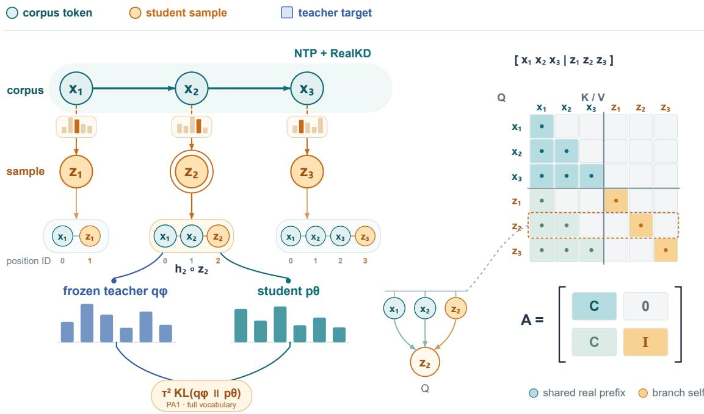
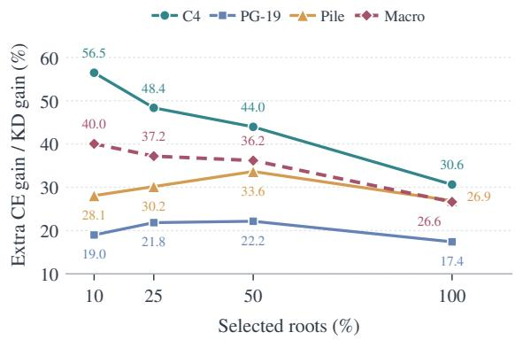
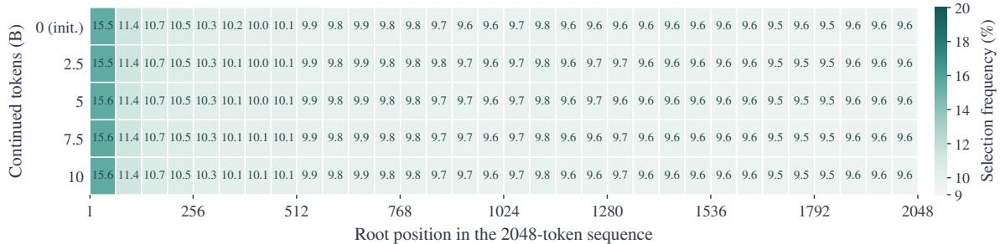
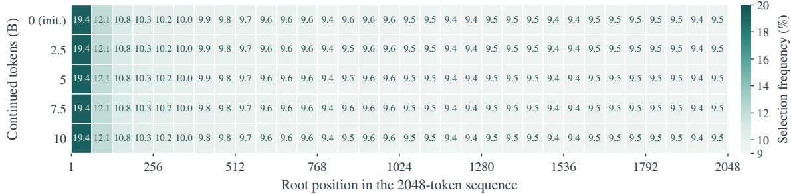
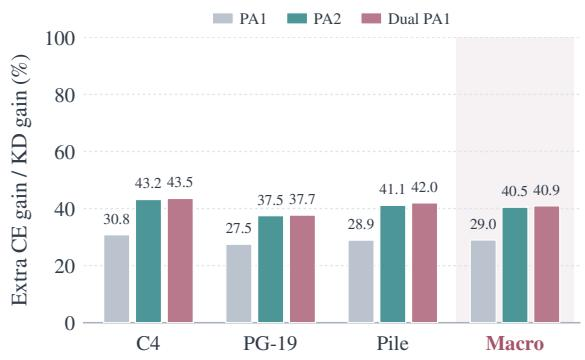
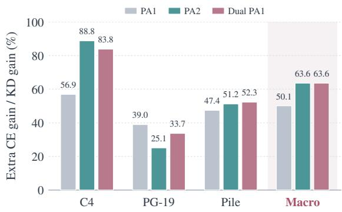

# PA1-OPD: One-Step Prefix-Augmented On-Policy Distillation for Language Model Pretraining

Zhenhe Wu1, Jian Yang2, Yaping Jin1, Xinlai Kang1, Jie Hu1, Hanting Chen1\* 1Huawei Technologies, 2Beihang University {wuzhenhe2,chenhanting}@huawei.com

## Abstract

Knowledge distillation (KD) improves language-model pretraining by matching teacher distributions at corpus prefixes, but provides no direct supervision at contexts induced by student predictions. We introduce PA1-OPD, which augments corpus-path distillation with teacher feedback after one student-sampled transition per selected prefix. This expands the supervised states while retaining next-token prediction and corpus-path KD. Data-anchored roots support parallel sampling, and differentiable tree attention shares prefix computation without changing inference. In two continued-pretraining settings, full coverage improves held-out cross-entropy over KD across C4, PG-19, and Pile at every evaluated checkpoint. In Stage2, selecting the 10% of roots with highest student surprisal adds 48.85% to KD’s Macro cross-entropy gain over next-token training. Gains remain when branch supervision excludes successor states already on the corpus path, supporting the value of feedback beyond observed contexts. Additional depth or breadth improves aggregate results at unchanged per-term supervision weight, with benefits varying by corpus. These findings support local student-induced supervision as a complement to pretraining distillation.

## 1 Introduction

Knowledge distillation (KD) enriches pretraining with a teacher’s predictive distributions beyond observed next-token targets (Hinton et al., 2015). Conventional pretraining KD applies these targets at corpus prefixes. Student predictions can induce different contexts, leaving their successor states without direct supervision. Beyond the choice of distillation loss, this raises the question of which prediction states should receive teacher feedback.

On-policy distillation learns from studentgenerated trajectories (Ross et al., 2011; Agarwal et al., 2024; Gu et al., 2024). For pretraining, corpus prefixes provide many roots from which to sample student transitions. Even one sampled token creates a successor state with a new teacher target. This allows us to test whether local feedback beyond the corpus trajectory improves KD without generating complete continuations.

We propose PA1-OPD, one-step prefixaugmented on-policy distillation (Figure 1). At each selected corpus prefix, the current student samples one token. Both models consume it, and the teacher supervises the student’s next-token distribution at the resulting successor state. This branch objective complements next-token prediction and corpus-path KD. Its on-policy component is local: the transition follows the current student, while its root remains anchored to observed data.

Data-anchored roots support parallel sampling across positions, and tree attention shares their prefixes while keeping branches independent. Differentiable student prefixes retain branch gradients; coincident-state reuse avoids reevaluating corpus states; and chunked KL reduces temporary probability storage. Student-surprisal selection controls where feedback is applied. These operations leave the student architecture and inference unchanged.

We evaluate two OLMo2 continued-pretraining settings. Full coverage improves on KD across all three evaluation corpora in both settings. In Stage2, selecting 10% of roots adds 61.60%, 22.24%, and 57.12% to KD’s CE gains over next-token training on C4, PG-19, and Pile (48.85% Macro). Gains persist without branch losses at coincident corpus states. Stage1 favors full coverage over Top10, while deeper or wider supervision improves Macro CE in both settings. These results connect the gains over KD to the allocation of branch supervision.

  
Figure 1: PA1-OPD adds teacher supervision after student-sampled transitions from corpus prefixes. Tree attention shares each prefix and isolates branches. Sampling is detached; student prefix states remain differentiable.

• A pretraining objective that extends teacher supervision to local student-induced states alongside corpus-path training.

• A differentiable shared-prefix implementation that supports parallel branch supervision and preserves the sampled objective through state reuse and memory-efficient KL computation.

• Evidence of gains over corpus-path KD, with analyses of noncoincident states, root selection, and additional depth and breadth.

## 2 Problem Formulation

## 2.1 Pretraining Distillation

We study autoregressive language-model pretraining through checkpoint continuation, using student pθ, frozen teacher $q _ { \phi }$ , and corpus D. The models share a tokenizer and vocabulary V, but may differ in depth and width. Training combines supervision at corpus prefixes and sampled successor states; inference uses only the student.

## 2.2 Corpus and Student-Induced States

For sequence $x _ { b , 1 : L }$ , let $h _ { b , i } = x _ { b , 1 : i }$ denote the prefix through position i, with observed next token $x _ { b , i + 1 }$ . Let $\mathcal { R } _ { b }$ be the set of valid next-token prediction positions and $\begin{array} { r } { N _ { R } = \sum _ { b } \left| \mathcal { R } _ { b } \right| } \end{array}$ . Standard next-token prediction minimizes

$$
\mathcal { L } _ { \mathrm { N T P } } = - \frac { 1 } { N _ { R } } \sum _ { b } \sum _ { i \in \mathcal { R } _ { b } } \log p _ { \theta } ( x _ { b , i + 1 } \mid h _ { b , i } ) .\tag{1}
$$

Let $p _ { \theta } ^ { \tau }$ and $q _ { \phi } ^ { \tau }$ denote softmax distributions with logits divided by temperature $\tau > 0$ . For context $h _ { ; }$ , write $q _ { v } = q _ { \phi } ^ { \tau } ( v \mid h )$ and $p _ { v } = p _ { \theta } ^ { \tau } ( v \mid h )$ . The scaled forward KL is

$$
d _ { \tau } ( q _ { \phi } , p _ { \theta } ; h ) = \tau ^ { 2 } \sum _ { v \in \mathcal { V } } q _ { v } \log \frac { q _ { v } } { p _ { v } } .\tag{2}
$$

Distillation on the observed data trajectory, denoted RealKD, is

$$
\mathcal { L } _ { \mathrm { R e a l K D } } = \frac { 1 } { N _ { R } } \sum _ { b } \sum _ { i \in \mathcal { R } _ { b } } d _ { \tau } ( q _ { \phi } , p _ { \theta } ; h _ { b , i } ) .\tag{3}
$$

NTP and RealKD supervise corpus prefixes. To extend these states, let ¯θ denote the current student parameters held fixed during sampling. At an eligible corpus prefix, draw

$$
\begin{array} { c } { { z _ { b , i } \sim p _ { \bar { \theta } } ^ { \tau _ { s } } ( \cdot \mid h _ { b , i } ) , } } \\ { { \widetilde { h } _ { b , i } = h _ { b , i } \circ z _ { b , i } . } } \end{array}\tag{4}
$$

Here $\tau _ { s }$ is the sampling temperature and ◦ denotes token concatenation. $\mathrm { I f } ~ \mu _ { \mathscr D }$ is the distribution

over eligible corpus prefixes, sampling induces the one-step state distribution

$$
\mu _ { \bar { \theta } } ^ { ( 1 ) } ( \widetilde { h } ) = \mathbb { E } _ { h \sim \mu _ { \mathcal { D } } } \Big [ \sum _ { z \in \mathcal { V } } p _ { \bar { \theta } } ^ { \tau _ { s } } ( z \mid h ) \cdot \mathbf { 1 } \{ \widetilde { h } = h \circ z \} \Big ] .\tag{5}
$$

The transition follows the current temperatureadjusted student policy from a data-anchored root. Its successor may coincide with a corpus state if the sampled token matches the observed next token. Distillation under $\mu _ { \bar { \theta } } ^ { ( 1 ) }$ adds local student-induced supervision using a single sampled transition.

## 3 Method

We first define the additional supervision at sampled successor states and its allocation across roots. We then derive a shared-prefix execution that preserves the branch objective and student gradients.

## 3.1 One-Step Distillation

Both models consume the token $z _ { b , i }$ sampled in Eq. (4). The branch loss matches their next-token distributions at the resulting state:

$$
\ell _ { b , i } ^ { \mathrm { b r a n c h } } = d _ { \tau } ( q _ { \phi } , p _ { \theta } ; h _ { b , i } \circ z _ { b , i } ) .\tag{6}
$$

The branch target concerns the prediction after the sampled token, rather than that token’s probability at its root. The observed token $x _ { b , i + 1 }$ still supplies the NTP target on the corpus path, while the branch receives the teacher’s predictive distribution over the full vocabulary.

Let $B _ { b } \subseteq \mathcal { R } _ { b }$ contain the eligible branch roots and let $\begin{array} { r } { N _ { B } = \sum _ { b } | B _ { b } | } \end{array}$ . The expected branch objective conditional on a corpus batch is

$$
\begin{array} { r l r } & { } & { \mathcal { L } _ { \mathrm { P A 1 } } ( \theta ; \bar { \theta } ) = \displaystyle \frac { 1 } { N _ { B } } \sum _ { b } \sum _ { i \in \mathcal { B } _ { b } } \mathbb { E } _ { z \sim p _ { \bar { \theta } } ^ { \tau _ { s } } ( \cdot | h _ { b , i } ) } } \\ & { } & { \left[ d _ { \tau } ( q _ { \phi } , p _ { \theta } ; h _ { b , i } \circ z ) \right] . } \end{array}\tag{7}
$$

One categorical sample from the full vocabulary at each eligible root gives the Monte Carlo estimate

$$
\widehat { \mathcal { L } } _ { \mathrm { P A 1 } } = \frac { 1 } { N _ { B } } \sum _ { b } \sum _ { i \in \mathcal { B } _ { b } } \ell _ { b , i } ^ { \mathrm { b r a n c h } } .\tag{8}
$$

Combining branch and corpus-path losses gives

$$
\begin{array} { r } { \boxed { \mathcal { L } = \mathcal { L } _ { \mathrm { N T P } } + \lambda _ { \mathrm { r e a l } } \mathcal { L } _ { \mathrm { R e a l K D } } + \lambda _ { \mathrm { b r a n c h } } \widehat { \mathcal { L } } _ { \mathrm { P A 1 } } . } } \end{array}\tag{9}
$$

The coefficients allocate supervision to corpus and branch states. We differentiate Eq. (9) with the teacher and sampling policy fixed, then refresh the sampling policy after the student update. Gradients do not pass through the sampling distribution (Agarwal et al., 2024); they do pass through all student computations used for branch prediction, including the shared prefix.

Eligible roots exclude ignored labels, invalid inputs, and configured document boundaries. NTP and RealKD normalize by $N _ { R } .$ , and PA1 by $N _ { B }$ using optimizer-batch counts to preserve normalization across accumulation steps.

Selecting branch roots. Full PA1 uses every eligible root. Selective coverage ranks roots by student surprisal, $s _ { b , i } = - \log p _ { \theta } ( x _ { b , i + 1 } \mid h _ { b , i } )$ , which is already available from NTP. For retained fraction $\rho ,$ let $\boldsymbol { S _ { b } }$ contain the top $K _ { b } = \lceil \rho \rceil B _ { b } \rceil \rceil$ roots. The selected branch loss is

$$
\widehat { \mathcal { L } } _ { \mathrm { P A 1 } } ^ { \mathrm { s e l } } = \frac { 1 } { N _ { B } } \sum _ { b } \frac { | \mathcal { B } _ { b } | } { K _ { b } } \sum _ { i \in \mathcal { S } _ { b } } \ell _ { b , i } ^ { \mathrm { b r a n c h } } .\tag{10}
$$

Sequences without eligible roots are omitted. Scores and selection are detached. This normalization retains the nominal branch-loss scale while concentrating supervision on selected roots. Deterministic top-K selection targets a different state distribution from Full PA1; it does not provide an unbiased estimate of the full-root objective.

## 3.2 Prefix Sharing with Tree Attention

Branches share their sequence’s corpus prefix but retain independent successor states. Suppressing batch indices, let $X ~ = ~ ( x _ { 1 } , \ldots , x _ { L } )$ and $Z ~ = ~ ( z _ { 1 } , \ldots , z _ { L } )$ use layout $[ X ; Z ]$ , with one branch slot per corpus position. For causal mask $C _ { i j } = \mathbf { 1 } [ j \leq i ] , C \in \{ 0 , 1 \} ^ { L \times L }$ , including the diagonal, tree attention uses

$$
\boxed { A = { \left[ { C \begin{array} { l l } { \boldsymbol { 0 } } \\ { C } & { I } \end{array} } \right] } , \qquad I = I _ { L } . }\tag{11}
$$

Rows index query tokens and columns index key/value tokens; an entry of one permits attention. Each block serves a distinct role:

• Real-to-real, C: each real token retains its original causal prefix.

• Real-to-branch, 0: branch tokens cannot alter any real-path representation.

• Branch-to-real, $C { : }$ branch $z _ { i }$ reads exactly $x _ { 1 : i }$ , the prefix from which it was sampled.

• Branch-to-branch, I: each branch can read its own token, while branches from different roots remain isolated.

With query, key, and value matrices arranged in the same layout, attention on valid query rows is

$$
\begin{array} { r l r } & { \mathrm { A t t n } _ { A } ( Q , K , V ) = \mathrm { s o f t m a x } ( S _ { A } ) V , } & \\ & { } & \\ & { } & { S _ { A } = \frac { Q K ^ { \top } } { \sqrt { d _ { k } } } + M ( A ) , } & \\ & { } & \\ & { } & { M ( A ) _ { i j } = \left\{ \begin{array} { l l } { 0 , } & { A _ { i j } = 1 , } \\ { - \infty , } & { A _ { i j } = 0 . } \end{array} \right. } \end{array}\tag{12}
$$

Ineligible branch rows are suppressed and contribute zero loss.

Position encodings follow the logical paths. With zero-based position IDs for the real sequence, the augmented IDs are

$$
\mathrm { p o s } ( [ X ; Z ] ) = [ 0 , 1 , \ldots , L - 1 ; 1 , 2 , \ldots , L ] .\tag{13}
$$

Branch $z _ { i }$ receives the position immediately after $x _ { i } ,$ regardless of its storage location. Together with Eq. (11), these IDs reproduce the positions of independently extended prefixes.

For fixed samples and deterministic operations, tree execution matches independent extendedprefix evaluation. At each layer, corpus states are unchanged and each branch reads its own state and correctly positioned prefix. Induction over layers gives identical branch representations and outputs. Differentiable sharing preserves the summed parameter gradients up to numerical precision.

Differentiable prefix reuse. The student first evaluates the real path for sampling probabilities and retains layer-wise keys and values $K ^ { X } , V ^ { X }$ Sampled branches then attend to these caches:

$$
H _ { i } ^ { Z } = \mathrm { A t t n } \big ( Q _ { i } ^ { Z } , [ K _ { 1 : i } ^ { X } ; K _ { i } ^ { Z } ] , [ V _ { 1 : i } ^ { X } ; V _ { i } ^ { Z } ] \big ) .\tag{14}
$$

The shared caches avoid repeated prefix evaluation and remain differentiable. Branch losses therefore update both new-token computations and the prefix states on which they depend. Teacher and student maintain separate caches; gradients are required only for the student.

Fused teacher evaluation. Once student samples are available, the teacher evaluates [X; Z] in one layer traversal under Eq. (11). Projection, normalization, and feed-forward operations use the combined layout, while attention enforces each branch’s context. Fusion reduces repeated traversals and kernel dispatches without removing the computation required by the added states.

Block-sparse attention, native key/value-head counts, and chunked branch queries limit intermediate storage while preserving this graph.

## 3.3 Objective-Preserving Execution

When a sampled token matches the next corpus token, we reuse the available successor logits with student gradients intact and evaluate only unmatched branches. Chunked KL limits temporary probability storage with full-vocabulary normalization. Both preserve the sampled objective: reuse retains coincident-state losses, and chunking retains the complete teacher distribution. Appendix A details the execution and reuse conditions.

## 4 Experiments

## 4.1 Experimental Setup

Models and data. We distill a frozen OLMo2-7B teacher into OLMo2-1B (Team OLMo et al., 2025). Students start from two official OLMo-2-0425-1B checkpoints: stage1-step30000-tokens63B (Stage1) and the Stage2-final main revision (Stage2). Stage1 uses the official Stage1 mixture; Stage2 uses Dolmino Stage2. Each continues for approximately 10B tokens with a fresh optimizer, sharing data and order across methods within each setting. Evaluation uses fixed C4 validation, PG-19 test, and Pile validation data (Raffel et al., 2020; Rae et al., 2019; Gao et al., 2020); Appendix B specifies the full protocol.

Comparisons. We compare NTP, corpus-path $\mathrm { K D } \left( \mathcal { L } _ { \mathrm { N T P } } + 0 . 7 \mathcal { L } _ { \mathrm { R e a l K D } } \right)$ , and PA1-OPD (LNTP + $0 . 5 \mathcal { L } _ { \mathrm { R e a l K D } } \mathrm { + } 0 . 2 \widehat { \mathcal { L } } _ { \mathrm { P A 1 } } )$ . PA1 reallocates part of the nominal distillation weight to branch states. Full PA1 uses every eligible root; Student Top10 retains the 10% with highest student surprisal. Both temperatures are 1. Each condition uses one run, with training tokens matched within its setting.

Metrics. We report token-averaged cross-entropy (CE, in nats) and dataset perplexity, PPL = exp(CE). Macro CE and Macro PPL separately average the three dataset scores. To quantify the additional distillation benefit when KD improves on NTP, define

<table><tr><td rowspan="2">Tokens</td><td rowspan="2">Method</td><td colspan="2">C4</td><td colspan="2">PG-19</td><td colspan="2">Pile</td><td colspan="2">Macro</td></tr><tr><td></td><td>PPL↓</td><td>CE↓</td><td>PPL↓</td><td>CE↓</td><td>PPL↓</td><td>CE↓</td><td>PPL↓</td></tr><tr><td colspan="10">CE↓ Stage1 initialization; Stage1 mixture</td></tr><tr><td>0</td><td>Initial</td><td>3.018891</td><td>20.468578</td><td>2.908693</td><td>18.332821</td><td>2.489751</td><td>12.058270</td><td>2.805778</td><td>16.953223</td></tr><tr><td>2.5B</td><td>NTP KD Full PA1 extra/KD Student Top10 PA1</td><td>2.967517 2.963171 2.962772 +9.18% 2.963262 -2.09%</td><td>19.443581 19.359270 19.351543 +9.16% 19.361033</td><td>2.848100 2.842240 2.841985 +4.35% 2.842728</td><td>17.254962 17.154150 17.149778 +4.34% 17.162522</td><td>2.433926 2.428178 2.427837 +5.93% 2.428343</td><td>11.403570 11.338206 11.334337 +5.92% 11.340076</td><td>2.749848 2.744530 2.744198 +6.24% 2.744778</td><td>16.034038 15.950542 15.945219 +6.38% 15.954544 -4.79%</td></tr><tr><td>5B</td><td>extra/KD NTP KD Full PA1 extra/KD Student Top10 PA1</td><td>2.960424 2.955647 2.955310 +7.03% 2.955811</td><td>19.306153 19.214145 19.207683 +7.02% 19.217295</td><td>2.840500 2.834079 2.833931 +2.30%</td><td>17.124321 17.014724 17.012201 +2.30%</td><td>2.426554 2.420120 2.419792 +5.10%</td><td>11.319810 11.247208 11.243516 +5.08%</td><td>-4.66% 2.742493 2.736615 2.736344 +4.61% 2.736952</td><td>15.916761 15.825359 15.821133 +4.62% 15.830888</td></tr><tr><td>7.5B</td><td>extra/KD NTP KD Full PA1 extra/KD Student Top10 PA1 extra/KD</td><td>-3.43% 2.956234 2.951393 2.951049 +7.11% 2.951572 -3.68%</td><td>-3.42% 19.225430 19.132596 19.126014 +7.09% 19.136004 -3.67%</td><td>-10.56% 2.835583 2.829144 2.829018 +1.96% 2.829731</td><td>-10.52% 17.040330 16.930967 16.928827 +1.96% 16.940907</td><td>-2.63% 2.422717 2.416162 2.415858 +4.62% 2.416383 11.205255</td><td>-2.62% 11.276451 11.202776 11.199380 +4.61%</td><td>-5.73% 2.738178 2.732233 2.731975 +4.34% 2.732562</td><td>-6.05% 15.847404 15.755446 15.751407 +4.39% 15.760722</td></tr><tr><td>10B</td><td>NTP KD Full PA1 extra/KD Student Top10 PA1</td><td>2.954363 2.949240 2.948886 +6.91% 2.949337</td><td>19.189502 19.091439 19.084684 +6.89%</td><td>-9.12% 2.832859 2.826088 2.825901 +2.76%</td><td>-9.09% 16.993983 16.879301 16.876146 +2.75%</td><td>-3.37% 2.420158 2.413549 2.413229 +4.84%</td><td>-3.36% 11.247638 11.173546 11.169976 +4.82%</td><td>-5.53% 2.735794 2.729626 2.729339 +4.65% 2.729947</td><td>-5.74% 15.810375 15.714762 15.710268 +4.70% 15.719846</td></tr><tr><td></td><td>extra/KD</td><td>-1.89%</td><td>19.093283 -1.88%</td><td>2.826737 -9.58%</td><td>16.890257 -9.55% Stage2 initialization; Stage2 mixture</td><td>2.413768 -3.31%</td><td>11.175998 -3.31%</td><td>-5.22%</td><td>-5.32%</td></tr><tr><td>0 2.5B</td><td>Initial NTP KD</td><td>2.774223 2.774907 2.774035</td><td>16.026168 16.037129 16.023154</td><td>2.609155 2.609633 2.608974</td><td>13.587569 13.594061 13.585100</td><td>2.213465 2.213954 2.213241</td><td>9.147360 9.151833 9.145307</td><td>2.532281 2.532831 2.532083</td><td>12.920366 12.927674 12.917854</td></tr><tr><td>5B</td><td>Full PA1 extra/KD Student Top10 PA1 extra/KD</td><td>2.773709 +37.39% 2.773357 +77.64%</td><td>16.017937 +37.33% 16.012303 +77.65%</td><td>2.608825 +22.61% 2.608787 +28.38%</td><td>13.583075 +22.60% 13.582563 +28.32%</td><td>2.212995 +34.50% 2.212751 +68.72%</td><td>9.143058 +34.46% 9.140827 +68.64%</td><td>2.531843 +32.09% 2.531632 +60.29%</td><td>12.914690 +32.22% 12.911897 +60.65%</td></tr><tr><td></td><td>NTP KD Full PA1 extra/KD Student Top10 PA1 extra/KD</td><td>2.774963 2.774022 2.773704 +33.79% 2.773378 +68.44%</td><td>16.038031 16.022954 16.017861 +33.78% 16.012633 +68.46%</td><td>2.609645 2.608970 2.608819 +22.40% 2.608790 +26.71%</td><td>13.594220 13.585055 13.583000 +22.42% 13.582610 +26.68%</td><td>2.213974 2.213233 2.212979 +34.23% 2.212761 +63.48%</td><td>9.152016 9.145231 9.142909 +34.24% 9.140921</td><td>2.532861 2.532075 2.531834 +30.66% 2.531643 +54.96%</td><td>12.928089 12.917747 12.914590 +30.53% 12.912054 +55.04%</td></tr><tr><td>7.5B</td><td>NTP KD Full PA1 extra/KD Student Top10 PA1</td><td>2.774990 2.774025 2.773673 +36.48% 2.773411</td><td>16.038465 16.022996 16.017359 +36.44% 16.013157</td><td>2.609644 2.608937 2.608789 +21.07% 2.608777</td><td>13.594215 13.584609 13.582592 +21.01% 13.582430</td><td>2.213961 2.213204 2.212953 +33.16% 2.212744</td><td>9.151898 9.144970 9.142675 +33.12% 9.140760</td><td>2.532865 2.532055 2.531805 +30.86% 2.531644</td><td>12.928193 12.917525 12.914209 +31.09% 12.912116</td></tr><tr><td>10B</td><td>NTP KD</td><td>+63.63% 2.775000</td><td>+63.60% 16.038629</td><td>+22.63% 2.609643</td><td>+22.70% 13.594197 13.584479</td><td>+60.77% 2.213954 2.213189</td><td>+60.76% 9.151834 9.144831</td><td>+50.86% 2.532866</td><td>+50.70% 12.928220</td></tr><tr><td></td><td>Full PA1 extra/KD Student Top10 PA1 extra/KD</td><td>2.774000 2.773673 +32.80% 2.773385</td><td>16.022603 16.017354 +32.75% 16.012743</td><td>2.608928 2.608807 +16.92% 2.608769</td><td>13.582831 +16.97% 13.582324</td><td>2.212951 +31.11% 2.212752</td><td>9.142658 +31.03% 9.140837</td><td>2.532039 2.531810 +27.69%</td><td>12.917304 12.914281 +27.70%</td></tr></table>

Table 1: Learning curves at matched training-token budgets. Lower CE and PPL are better; Macro averages each metric over the three datasets. extra/KD measures additional improvement beyond KD relative to KD’s gain over NTP, not percentage reduction in CE or PPL.

$$
e x t r a / K D = 1 0 0 \% \frac { L _ { \mathrm { K D } } - L _ { \mathrm { P A 1 } } } { L _ { \mathrm { N T P } } - L _ { \mathrm { K D } } } .\tag{15}
$$

Here L is the stated metric; Macro ratios use Macro scores rather than averaged dataset ratios. This ratio measures improvement beyond KD relative to KD’s gain over NTP, not relative reduction in CE or PPL. Absolute scores accompany the ratios because small denominators can magnify them. All subsequent analyses use CE.

Analysis protocol. Controlled analyses use 1Btoken continuations from Stage2, and also from Stage1 for branch expansion. Positional diagnostics use fixed training sequences at checkpoints from the main Top10 runs. These analyses are distinct from the main 10B-token comparison; Appendix B.1 gives their experimental configurations.

  
Figure 2: Stage2 root-coverage comparison after 1B continuation tokens with student-surprisal selection. Curves report CE extra/KD; higher is better.

## 4.2 Main Results

Local supervision adds to corpus-path KD. Full PA1 improves CE and PPL over KD on all three datasets at every evaluated checkpoint in both settings (Table 1). After 10B tokens, its Macro CE is lower by $2 . 8 7 \times 1 0 ^ { - 4 }$ in Stage1 and $2 . 2 9 \times 1 0$ −4 in Stage2, adding 4.65% and 27.69% to KD’s gain over NTP. The direction of improvement holds across the reported training trajectory and does not depend on a single evaluation corpus or checkpoint.

Coverage controls the additional benefit. Student Top10 improves on Full PA1 and KD throughout Stage2. Its final Macro CE is 2.531635 versus 2.532039 for KD, an absolute reduction of $4 . 0 4 \times 1 0 ^ { - 4 }$ and 48.85% extra/KD. Stage2 NTP ends above its initial CE, so the ratio compares continuation objectives rather than gains over initialization. In Stage1, Top10 underperforms KD at every checkpoint, ending at −5.22% extra/KD, whereas Full PA1 remains beneficial. Thus, local branch supervision transfers across both tested settings, but aggressive root selection does not. Initialization and mixture change together, so coverage should be chosen for the continuation setting rather than inferred from checkpoint stage alone.

Additional state evaluations. For a length-L sequence b, Top10 selects $K = \lceil 0 . 1 \lvert B _ { b } \rvert \rceil$ roots. Before reuse, its additional forward token-state evaluations satisfy

$$
\Delta N _ { \mathrm { f w d } } \le 2 K \le 2 \lceil 0 . 1 L \rceil \approx 0 . 2 L .\tag{16}
$$

Each model therefore adds at most approximately 10% to its L corpus states before reuse; KD already evaluates 2L states across both models. Reuse can reduce this increment further. These state counts describe the added supervision workload. They exclude model-size differences, attention, and backward computation, and cannot establish gains in compute efficiency.

<table><tr><td>Variant</td><td>C4 PG-19</td><td>Pile</td><td>Macro</td></tr><tr><td>Full PA1</td><td>30.63 17.41</td><td>26.91</td><td>26.63</td></tr><tr><td>Teacher Top50</td><td>33.52 19.30</td><td>28.77</td><td>29.07</td></tr><tr><td>Student Top50</td><td>43.96 22.15</td><td>33.64</td><td>36.18</td></tr><tr><td>Drop coincident</td><td>44.37 26.58</td><td>34.80</td><td>37.80</td></tr></table>

Table 2: Stage2 root-selection and coincident-state ablations as CE extra/KD percentages (higher is better). Drop coincident uses Student Top50 and removes only losses on states already present on the corpus path.

## 5 Analysis

We examine three aspects of the added supervision: whether gains require coincident corpus states, how root selection distributes feedback, and whether deeper or wider signals add further benefit. Comparisons follow the controlled protocols in Section 4.1 and Appendix B.1.

## 5.1 Supervision Beyond Corpus States

A branch can revisit a corpus-path state when its sampled token matches the observed continuation. To test whether these repeated targets are necessary, we remove only the corresponding branch KL terms while retaining the original normalization. The resulting variant still improves on KD on every dataset (Table 2). Its Macro CE is 2.531165, compared with 2.531173 when coincident terms are retained. The small difference does not establish an advantage for removal; the substantive result is that feedback at noncoincident student-induced states remains useful. Loss removal changes supervision; state reuse instead preserves all loss terms while avoiding redundant state evaluations.

## 5.2 Allocating Feedback Across Roots

Sparse selection improves the controlled Stage2 results (Figure 2): Macro extra/KD increases from 26.63% with full coverage to 40.04% with Top10. Every tested sparse variant improves on Full PA1 for each dataset. C4 favors the smallest tested budget, whereas PG-19 and Pile favor broader coverage. Equation (10) retains nominal branch weight while concentrating it on fewer roots, so coverage controls both the number and distribution of supervised states. Stage1 favors broader coverage, indicating that concentrated feedback is useful in some continuation settings but not others.

(a) Stage1 checkpoint  
  
(b) Stage2 checkpoint  
Figure 3: Positional distribution of selected roots. Cell values give selection frequencies among eligible roots in each position bin, with a shared color scale across settings and checkpoints.

At matched 50% coverage, student surprisal outperforms teacher advantage, the teacher’s observed-token probability minus the student’s. Macro extra/KD rises from 29.07% to 36.18% (Table 2). Available directly from NTP, surprisal selects roots where the observed continuation is difficult for the student and improves on the tested teacher-based scoring rule.

## 5.3 Coverage Across Context Lengths

We next examine whether surprisal selection concentrates supervision on short contexts. Figure 3 reports frequencies in 64-position bins, recomputed at each checkpoint on the same 8,192 training sequences within each setting. The profiles therefore reflect the current selector rather than accumulated training-time choices. At the final checkpoint, the first bin has selection rates of 15.57% in Stage1 and 19.42% in Stage2, yet accounts for only 4.86% and 6.06% of selected roots. Latter-half selection rates remain 9.61% and 9.47%, close to the overall Top10 rate. Early-position preference thus coexists with broad coverage of longer prefixes.

The largest bin-wise changes from initialization are 0.122 and 0.043 percentage points. These small changes show stable aggregate positional preferences across the continuation, even though the individual selected roots may change with the student.

## 5.4 Adding Depth and Breadth

We also test whether adding supervision at greater depth or breadth improves on PA1. PAx follows x sequential student samples from each corpus prefix and applies teacher feedback after every transition. PA2 adds a second step; dual PA1 instead draws two independent one-step samples with replacement from the same root. Each branch KL term retains weight 0.2, and corpus-path KD retains weight 0.5. The extensions therefore add a second supervision signal at unchanged per-term strength, increasing total nominal branch weight from 0.2 to 0.4.

After 1B continuation tokens, both extensions improve on PA1 across all three Stage1 corpora (Figure 4). PA2 and dual PA1 reduce Macro CE by $4 . 3 8 \times 1 0 ^ { - 4 }$ and $4 . 5 6 \times 1 0 ^ { - 4 }$ , raising extra/KD from 28.99% to 40.47% and 40.94%, respectively. Their Macro CE difference is only $1 . 8 \times 1 0 ^ { - 5 }$ . In $\mathrm { S t a g e } 2$ both lower Macro CE by approximately $5 . 6 \times 1 0 ^ { - 5 }$ raising extra/KD from 50.12% to 63.61%. C4 and Pile improve, while PG-19 favors single PA1. Additional supervision therefore benefits the aggregate metric in both settings, with corpus-dependent returns and no established general preference for depth over breadth.

  
(a) Stage1 checkpoint

  
(b) Stage2 checkpoint  
Figure 4: Full-root branch expansion after 1B continuation tokens. Each branch term retains weight 0.2. CE extra/KD uses matched NTP and KD references with KD weight 0.5; higher is better.

Both extensions double sampled tokens and supervised branch states per root before reuse; PA2 also requires sequential sampling. They test added feedback at fixed per-term strength. Together with root selection, these results show that the amount and placement of branch supervision both affect the gains from local student-induced states.

Implications for pretraining. The comparisons separate three allocations of teacher feedback. The main study shifts part of a fixed nominal KD weight to student-induced successors. Root selection concentrates that weight on fewer successors; depth and breadth add another KL signal at fixed per-term strength. Gains with noncoincident states support local state augmentation as the core method. Selection and expansion then control its distribution and amount, with benefits that vary across the evaluated continuation settings.

## 6 Related Work

## Distillation and student-induced supervision.

KD transfers predictive distributions, sequences, and representations (Hinton et al., 2015; Kim and Rush, 2016; Sanh et al., 2019; Jiao et al., 2020); pretraining applications study compression, data refinement, and compute allocation (Gemma Team, 2024; Muralidharan et al., 2024; Gu et al., 2025; Busbridge et al., 2025). DAgger and scheduled sampling motivate learning at learner-induced states (Ross et al., 2011; Bengio et al., 2015), and ImitKD, GKD, and MiniLLM apply related principles to distillation (Lin et al., 2020; Agarwal et al., 2024; Gu et al., 2024). Subsequent work explores objectives and data reuse (Ko et al., 2024, 2025; Jin et al., 2026), interleaved sampling (Xu et al., 2025), and token or rollout-prefix selection (Huang et al., 2025; Zhang et al., 2026; Zhao et al., 2026). Broader efforts explore taskspecific supervision and context construction (Wu et al., 2026c,b, 2025b), alongside cache-aware expert management for MoE inference (Wu et al., 2026a). PA1-OPD focuses on a complementary design choice: applying forward-KL supervision after local student transitions from corpus prefixes during pretraining.

Additional computation and execution. Repeated tokens, pause tokens, and multi-token prediction add computation or prediction targets (Wu et al., 2025a; Goyal et al., 2024; Gloeckle et al., 2024). PA1-OPD adds teacher-supervised training states without changing inference, adapting sharedprefix trees from speculative verification (Miao et al., 2024; Cai et al., 2024) for differentiable student computation. Cut Cross-Entropy avoids global logit materialization (Wijmans et al., 2025); our chunked KL retains logits but reduces probability workspace, preserving the teacher distribution.

## 7 Conclusion

PA1-OPD augments pretraining KD with teacher supervision after local student-generated transitions. Full coverage improves on corpus-path KD in both evaluated continuation settings, and Stage2 Top10 adds 48.85% to KD’s Macro CE gain over NTP. Gains remain without coincident-state branch losses, supporting feedback beyond observed corpus states. Additional depth or breadth further improves aggregate results at fixed per-term weight, while coverage and corpus determine the returns. Teacher-supervised state allocation thus offers a practical design dimension for improving pretraining distillation with local student feedback.

## Limitations

Our evaluation covers one teacher–student family, two continuation settings, and three held-out corpora. Each condition uses one training run, so independent-seed replication is needed to assess the small absolute improvements. The results establish observed likelihood gains in these settings, not generality across model families, scales, languages, or downstream tasks.

The main KD and PA1 objectives also allocate their nominal distillation weights differently; additional controls could separate weighting effects from supervision location. Our experiments cover PA1 and its extensions to two sequential steps (PA2) or two branches per root (dual PA1), with fixed per-term branch weights. Future work could extend PA1 to PAx with x > 2 and explore wider branching to examine how supervision depth and breadth affect pretraining gains. Comparisons match training tokens rather than compute, and state counts do not measure runtime or FLOP efficiency. These boundaries leave open how the observed gains scale with longer pretraining and additional teacher feedback.

## Ethical Considerations

This study uses publicly available language models and existing pretraining and evaluation corpora, with no human participants or collection of new personal data. Distillation may inherit biases or harmful content from the teacher and training data. Our likelihood evaluations do not assess these effects, and no method-specific ethical risks were identified in the reported experiments.

## References

Rishabh Agarwal, Nino Vieillard, Yongchao Zhou, Piotr Stanczyk, Sabela Ramos, Matthieu Geist, and Olivier Bachem. 2024. On-policy distillation of language models: Learning from self-generated mistakes. In International Conference on Learning Representations.

Samy Bengio, Oriol Vinyals, Navdeep Jaitly, and Noam Shazeer. 2015. Scheduled sampling for sequence prediction with recurrent neural networks. In Advances in Neural Information Processing Systems, volume 28.

Dan Busbridge, Amitis Shidani, Floris Weers, Jason Ramapuram, Etai Littwin, and Russell Webb. 2025. Distillation scaling laws. In Proceedings ofthe 42nd

International Conference on Machine Learning, volume 267 of Proceedings of Machine Learning Research, pages 5977–6045.

Tianle Cai, Yuhong Li, Zhengyang Geng, Hongwu Peng, Jason D. Lee, Deming Chen, and Tri Dao. 2024. Medusa: Simple LLM inference acceleration framework with multiple decoding heads. In Proceedings of the 41st International Conference on Machine Learning, volume 235 of Proceedings of Machine Learning Research, pages 5209–5235.

Leo Gao, Stella Biderman, Sid Black, Laurence Golding, Travis Hoppe, Charles Foster, Jason Phang, Horace He, Anish Thite, Noa Nabeshima, Shawn Presser, and Connor Leahy. 2020. The Pile: An 800GB dataset of diverse text for language modeling. arXiv preprint arXiv:2101.00027.

Gemma Team. 2024. Gemma 2: Improving open language models at a practical size. arXiv preprint arXiv:2408.00118.

Fabian Gloeckle, Badr Youbi Idrissi, Baptiste Rozière, David Lopez-Paz, and Gabriel Synnaeve. 2024. Better & faster large language models via multi-token prediction. In Proceedings of the 41st International Conference on Machine Learning, volume 235 of Proceedings of Machine Learning Research, pages 15706–15734.

Sachin Goyal, Ziwei Ji, Ankit Singh Rawat, Aditya Krishna Menon, Sanjiv Kumar, and Vaishnavh Nagarajan. 2024. Think before you speak: Training language models with pause tokens. In International Conference on Learning Representations.

Yuxian Gu, Li Dong, Furu Wei, and Minlie Huang. 2024. MiniLLM: Knowledge distillation of large language models. In International Conference on Learning Representations.

Yuxian Gu, Hao Zhou, Fandong Meng, Jie Zhou, and Minlie Huang. 2025. MiniPLM: Knowledge distillation for pre-training language models. In International Conference on Learning Representations.

Geoffrey Hinton, Oriol Vinyals, and Jeff Dean. 2015. Distilling the knowledge in a neural network. arXiv preprint arXiv:1503.02531.

Haiduo Huang, Jiangcheng Song, Yadong Zhang, and Pengju Ren. 2025. SpecKD: Speculative decoding for effective knowledge distillation of LLMs. arXiv preprint arXiv:2510.24021.

Xiaoqi Jiao, Yichun Yin, Lifeng Shang, Xin Jiang, Xiao Chen, Linlin Li, Fang Wang, and Qun Liu. 2020. TinyBERT: Distilling BERT for natural language understanding. In Findings ofthe Associationfor Computational Linguistics: EMNLP 2020, pages 4163– 4174. Association for Computational Linguistics.

Woogyeol Jin, Taywon Min, Yongjin Yang, Dennis Wei, Yi Zhou, Swanand Ravindra Kadhe, Nathalie Baracaldo, and Kimin Lee. 2026. Entropy-aware

on-policy distillation of language models. In Proceedings of the 43rd International Conference on Machine Learning, volume 306 of Proceedings of Machine Learning Research, pages 53926–53943.

Yoon Kim and Alexander M. Rush. 2016. Sequencelevel knowledge distillation. In Proceedings of the 2016 Conference on Empirical Methods in Natural Language Processing, pages 1317–1327. Association for Computational Linguistics.

Jongwoo Ko, Tianyi Chen, Sungnyun Kim, Tianyu Ding, Luming Liang, Ilya Zharkov, and Se-Young Yun. 2025. DistiLLM-2: A contrastive approach boosts the distillation of LLMs. In Proceedings of the 42nd International Conference on Machine Learning, volume 267 of Proceedings of Machine Learning Research, pages 31044–31062.

Jongwoo Ko, Sungnyun Kim, Tianyi Chen, and Se-Young Yun. 2024. DistiLLM: Towards streamlined distillation for large language models. In Proceedings ofthe 41st International Conference on Machine Learning, volume 235 of Proceedings of Machine Learning Research, pages 24872–24895.

Alexander Lin, Jeremy Wohlwend, Howard Chen, and Tao Lei. 2020. Autoregressive knowledge distillation through imitation learning. In Proceedings of the 2020 Conference on Empirical Methods in Natural Language Processing, pages 6121–6133. Association for Computational Linguistics.

Xupeng Miao, Gabriele Oliaro, Zhihao Zhang, Xinhao Cheng, Zeyu Wang, Zhengxin Zhang, Rae Ying Yee Wong, Alan Zhu, Lijie Yang, Xiaoxiang Shi, Chunan Shi, Zhuoming Chen, Daiyaan Arfeen, Reyna Abhyankar, and Zhihao Jia. 2024. SpecInfer: Accelerating large language model serving with tree-based speculative inference and verification. In Proceedings of the 29th ACM International Conference on Architectural Support for Programming Languages and Operating Systems, Volume 3, pages 932–949. Association for Computing Machinery.

Saurav Muralidharan, Sharath Turuvekere Sreenivas, Raviraj Joshi, Marcin Chochowski, Mostofa Patwary, Mohammad Shoeybi, Bryan Catanzaro, Jan Kautz, and Pavlo Molchanov. 2024. Compact language models via pruning and knowledge distillation. arXiv preprint arXiv:2407.14679.

Jack W. Rae, Anna Potapenko, Siddhant M. Jayakumar, and Timothy P. Lillicrap. 2019. Compressive transformers for long-range sequence modelling. arXiv preprint arXiv:1911.05507.

Colin Raffel, Noam Shazeer, Adam Roberts, Katherine Lee, Sharan Narang, Michael Matena, Yanqi Zhou, Wei Li, and Peter J. Liu. 2020. Exploring the limits of transfer learning with a unified text-to-text transformer. Journal ofMachine Learning Research, 21(140):1–67.

Stephane Ross, Geoffrey Gordon, and Drew Bagnell. 2011. A reduction of imitation learning and structured prediction to no-regret online learning. In Proceedings ofthe Fourteenth International Conference on Artificial Intelligence and Statistics, volume 15 of Proceedings of Machine Learning Research, pages 627–635.

Victor Sanh, Lysandre Debut, Julien Chaumond, and Thomas Wolf. 2019. DistilBERT, a distilled version of BERT: Smaller, faster, cheaper and lighter. arXiv preprint arXiv:1910.01108.

Team OLMo, Pete Walsh, Luca Soldaini, Dirk Groeneveld, Kyle Lo, Shane Arora, Akshita Bhagia, Yuling Gu, Shengyi Huang, Matt Jordan, Nathan Lambert, Dustin Schwenk, Oyvind Tafjord, Taira Anderson, David Atkinson, Faeze Brahman, Christopher Clark, Pradeep Dasigi, Nouha Dziri, and 21 others. 2025. 2 OLMo 2 Furious. arXiv preprint arXiv:2501.00656.

Erik Wijmans, Brody Huval, Alexander Hertzberg, Vladlen Koltun, and Philipp Krähenbühl. 2025. Cut your losses in large-vocabulary language models. In International Conference on Learning Representations.

Bohong Wu, Shen Yan, Sijun Zhang, Jianqiao Lu, Yutao Zeng, Ya Wang, and Xun Zhou. 2025a. Efficient pretraining length scaling. arXiv preprint arXiv:2504.14992.

Zhenhe Wu, Yaping Jin, Qinghua Xing, Hang Zhou, Wei He, Xianjie Wu, Xianfu Cheng, Jian Yang, and Hanting Chen. 2026a. Cache-aware joint router adaptation for memory-efficient MoE inference. arXiv preprint arXiv:2609.04895.

Zhenhe Wu, Zhongqiu Li, Mengxiang Li, Jie Zhang, Zhongjiang He, Jian Yang, Yu Zhao, Ruiyu Fang, Yongxiang Li, Zhoujun Li, and Shuangyong Song. 2026b. MR-SQL: Multi-level retrieval enhances inference for LLM in text-to-SQL. In Database Systems for Advanced Applications, volume 15987 of Lecture Notes in Computer Science, pages 403–413, Singapore. Springer Nature Singapore.

Zhenhe Wu, Zhongqiu Li, Jie Zhang, Zhongjiang He, Jian Yang, Yu Zhao, Ruiyu Fang, Bing Wang, Hongyan Xie, Shuangyong Song, and Zhoujun Li. 2025b. UCS-SQL: Uniting content and structure for enhanced semantic bridging in text-to-SQL. In Findings of the Association for Computational Linguistics: ACL 2025, pages 8156–8168, Vienna, Austria. Association for Computational Linguistics.

Zhenhe Wu, Jian Yang, Zhongjiang He, Changzai Pan, Jiaheng Liu, Xianjie Wu, Yu Zhao, Shuangyong Song, Yongxiang Li, Zhoujun Li, and Xuelong Li. 2026c. Table-R1: Region-based reinforcement learning for table understanding. In Findings of the Associationfor Computational Linguistics: ACL 2026, pages 27374–27391, San Diego, California, United States. Association for Computational Linguistics.

Wenda Xu, Rujun Han, Zifeng Wang, Long T. Le, Dhruv Madeka, Lei Li, William Yang Wang, Rishabh Agarwal, Chen-Yu Lee, and Tomas Pfister. 2025. Speculative knowledge distillation: Bridging the teacherstudent gap through interleaved sampling. In International Conference on Learning Representations.

Dongxu Zhang, Zhichao Yang, Sepehr Janghorbani, Jun Han, Andrew Ressler, II, Qian Qian, Gregory D. Lyng, Sanjit Singh Batra, and Robert E. Tillman. 2026. Fast and effective on-policy distillation from reasoning prefixes. In Findings ofthe Associationfor Computational Linguistics: ACL 2026, pages 25553– 25569. Association for Computational Linguistics.

Qingfei Zhao, Huan Song, Shuyu Tian, Jiawei Shao, and Xuelong Li. 2026. Prefix-guided on-policy distillation: Mining golden trajectories from rollouts. arXiv preprint arXiv:2606.21994.

## A Execution and Cost Analysis

We expand the execution in Section 3.3 with a treemask example, reuse conditions, KL gradients, and computational cost accounting.

Three-root attention example. For three real positions, the structure is explicit:

<table><tr><td></td><td> $x _ { 1 }$ </td><td> $x _ { 2 }$   $x _ { 3 }$ </td><td> $z _ { 1 }$   $z _ { 2 }$ </td><td> $z _ { 3 }$ </td></tr><tr><td>x1</td><td>1 0</td><td>0 0</td><td>0 0</td><td>0 0</td></tr><tr><td>x2</td><td>1 1</td><td>1 1 1</td><td>0 0 0 0</td><td>0</td></tr><tr><td>x3 z1</td><td>1 0</td><td>0</td><td>1 0</td><td>0</td></tr><tr><td>Z2</td><td>1</td><td>1 0</td><td>0 1</td><td>0</td></tr><tr><td>z3</td><td>1 1</td><td>1</td><td>0 0</td><td>1</td></tr></table>

(17)

The three branches represent $( x _ { 1 } , z _ { 1 } )$ $( x _ { 1 } , x _ { 2 } , z _ { 2 } )$ , and $( x _ { 1 } , x _ { 2 } , x _ { 3 } , z _ { 3 } )$ , respectively. The identity block prevents cross-branch communication despite their joint tensor layout.

Reusing states on the data trajectory. When $z _ { i } ~ = ~ x _ { i + 1 }$ and the next input is available, the branch matches corpus state $h _ { i + 1 }$ . Deterministic evaluation with identical positions gives

$$
\begin{array} { r } { p _ { \theta } ( \cdot \mid h _ { i } \circ z _ { i } ) = p _ { \theta } ( \cdot \mid h _ { i + 1 } ) , } \\ { q _ { \phi } ( \cdot \mid h _ { i } \circ z _ { i } ) = q _ { \phi } ( \cdot \mid h _ { i + 1 } ) . } \end{array}\tag{18}
$$

After checking input validity and document boundaries, we gather each model’s real-path logits and compact unmatched branches. Samples, branch losses, and $N _ { B }$ remain unchanged. Differentiable student gathers retain both the RealKD and preceding root’s branch terms, preserving losses and gradients up to numerical precision. When all branches coincide, existing corpus logits supply every branch prediction.

Memory-efficient full-vocabulary KL. We evaluate KL in vocabulary chunks with full-vocabulary normalization. For logits a and vocabulary partition $\{ \nu _ { c } \}$ , the log-normalizer is

$$
\log Z _ { a } = \log \mathrm { a d d e x p } _ { c } \left[ \mathrm { l o g s u m e x p } _ { v \in \mathcal { V } _ { c } } ( a _ { v } / \tau ) \right] .\tag{19}
$$

We accumulate Eq. (2) across the same chunks in FP32. With a frozen teacher, the derivative with respect to the student logit $a _ { v }$ is

$$
\frac { \partial d _ { \tau } } { \partial a _ { v } } = \tau \left( p _ { \theta } ^ { \tau } ( v ) - q _ { \phi } ^ { \tau } ( v ) \right) .\tag{20}
$$

The backward pass saves logits and per-position scalars and recomputes chunk probabilities. It retains teacher mass m (one in exact arithmetic) for numerical consistency, computing $\tau ( p _ { \theta } ^ { \tau } ( v ) m _ { T } -$ $q _ { \phi } ^ { \tau } ( v ) )$ .

For $P$ positions and chunk width $c ,$ the FP32 workspace is $O ( P c )$ , with $O ( P )$ saved scalars. Full logits and student-logit gradients remain stored. Chunking retains the complete teacher distribution and temperature scaling.

Training procedure and computational cost. For corpus batch X, student $\theta ,$ and frozen teacher $\phi ,$ a PA1-OPD update consists of:

1. Determine valid real prediction positions and eligible branch roots, and count them over the complete optimizer batch.

2. For each accumulation microbatch:

(a) Evaluate the student real path and retain differentiable K/V caches.

(b) Select roots as needed and sample one token per root from detached logits.

(c) Identify branches that coincide with available states on the corpus path.

(d) Evaluate unmatched student branches using shared real-prefix K/V.

(e) Evaluate teacher real and unmatched branch paths with the tree mask.

(f) Gather real-path logits for matched states and align branch outputs.

(g) Compute NTP, RealKD, and PA1 using complete-batch denominators, and accumulate student gradients.

3. Aggregate gradients across workers and update the student parameters.

Ignoring padding, each model evaluates $L + U$ states for a sequence of length L and U unmatched branches. Projection and feed-forward work scale with the state count, while prefix computation is shared. For unmatched roots U with one-based prefix lengths i, the allowed attention pairs total

$$
N _ { \mathrm { a t t n } } = \frac { L ( L + 1 ) } { 2 } + \sum _ { i \in \mathcal { U } } ( i + 1 ) .\tag{21}
$$

The terms count real-path causal pairs and branch attention to prefixes and themselves. Branches add $O ( U L )$ pairs without cross-root dependencies. Block granularity and padding affect kernel work but preserve this graph. All added computation is confined to training.

## B Experimental Details

Backbone models. The frozen OLMo 2 teacher (Team OLMo et al., 2025) is $\mathtt { O L M O - } 2 \mathtt { - } 1 1 2 4 \mathtt { - } 7 \mathtt { B }$ (32 layers, hidden size 4096). Both students share the OLMo-2-0425-1B architecture (16 layers, hidden size 2048) and Dolma2 tokenizer. Section 4.1 defines the initializations; Stage2 uses commit a1847dff. Continuations load student weights with a fresh optimizer.

Datasets. For Stage1, we draw approximately 10B tokens according to the official token-weighted proportions of its seven-component mixture, including configured source repeats (chiefly DCLM, with code, scientific, mathematical, and Wikipedia text). For Stage2, we follow the six-component proportions of its 50B-token Dolmino-Mix-1124 recipe (DCLM, math, FLAN, Wikipedia, PeS2o, and StackExchange). In each setting, sampling selects nonoverlapping contiguous blocks aligned to 2048- token sequences; all methods share the data and order. Each run consumes exactly 10,001,317,888 training tokens. We evaluate on fixed tokenized files from C4 validation (web text) (Raffel et al., 2020), PG-19 test (long-form books) (Rae et al., 2019), and Pile validation (multi-domain text) (Gao et al., 2020). All complete 2048-token windows are scored, yielding 9.998M, 9.871M, and 9.998M evaluation tokens, respectively.

Implementation details. The main experiments are conducted on a single training node equipped with eight accelerator cards. Training uses BF16 autocasting, 2048-token sequences, one sequence per GPU per microbatch, and a global batch of 2,097,152 tokens (1024 sequences). Each run takes 4,769 optimizer steps, with checkpoints at approximately 2.5B, 5B, 7.5B, and 10B tokens. AdamW uses $( \beta _ { 1 } , \beta _ { 2 } ) \ : = \ : ( 0 . 9 , 0 . 9 5 )$ , gradient clipping at 1, and weight decay 0.033 in Stage1 or 0.1 in Stage2; embeddings are exempt from decay. Stage1 uses an initial learning rate of $1 0 ^ { - 4 }$ with its inherited cosine schedule (zero warmup, final ratio 0.1, $T _ { \mathrm { m a x } } = 1 { , } 9 0 7 { , } 3 5 9 ~ \mathrm { s t e p s } )$ ; Stage2 uses a constant $3 \times 1 0 ^ { - 6 }$ . Branch attention selects FlexAttention when available, with 256-query reference chunks otherwise; full-vocabulary KL uses chunks of 8192. Model and data seeds are 12536 and 34521, respectively. Evaluation uses batch size four.

## B.1 Analysis Protocols

Unless stated otherwise, controlled comparisons continue the Stage2 student for 1B tokens using the same teacher as the main experiments. They use a fixed Dolmino Stage2 sample, 477 updates, 2048-token sequences, a global batch of 2,097,152 tokens, and a constant learning rate of $3 \times 1 0 ^ { - 6 }$ Four- and eight-GPU runs preserve the global batch through gradient accumulation. Branch expansion also uses the Stage1 checkpoint.

Root coverage and scoring. Student Top10, Top25, and Top50 retain the indicated percentage of eligible roots in each sequence using student surprisal and the normalization in Eq. (10). Teacher Top50 instead ranks the same candidates by $q _ { \phi } ( x _ { b , i + 1 } \mid h _ { b , i } ) - p _ { \theta } ( x _ { b , i + 1 } \mid h _ { b , i } )$ . All use the same nominal PA1 objective weights.

Coincident-state supervision. The removal ablation retains Student Top50 selection but zeros branch KL terms for sampled successors that coincide with available corpus states. NTP, RealKD, and the original branch denominator remain unchanged. Both variants use coincident-state reuse.

Positional diagnostics. For each main Top10 run, we sample 8,192 training sequences uniformly without replacement and hold them fixed across initialization and the 2.5B, 5B, 7.5B, and 10B checkpoints. Selection is recomputed before state reuse. We pool selected and eligible occurrences into 64- position bins and divide selected counts by eligible counts; ineligible roots, including position 2048, are excluded. These frequencies describe each checkpoint’s selector; they do not aggregate selections across training.

Branch expansion. The full-root comparisons in Figure 4 use 1B-token continuations (477 updates). The Stage1 runs share the historical DCLM-based Stage1-like data and order, learning rate $1 0 ^ { - 4 }$ global batch 2,097,152, sequence length 2048, and historical optimizer settings and schedule. Both new extensions use eight GPUs and coincidentstate reuse. Stage2 follows the protocol above. Each panel uses NTP and KD references from the same checkpoint and continuation budget, with KD weight 0.5. Macro ratios follow Eq. (15). Scores use six decimal places; the displayed Stage2 tie need not imply identical unrounded CE.