# PERSO: Investigating Facets of LLMs’ Social Intelligence in Real-World Persuasion Scenarios

Ali Zamani\*1, Soroush Esfahanian\*1, Erfan Shahabi1,

Mohammad Taher Pilehvar2, Azadeh Shakery1,3, and Yadollah Yaghoobzadeh1,4

1School of Electrical and Computer Engineering, College of Engineering, University of Tehran, Tehran, Iran 2Cardiff University, United Kingdom

3Institute for Research in Fundamental Sciences (IPM), Tehran, Iran 4Tehran Institute for Advanced Studies, Khatam University, Tehran, Iran {ali.zamani.1383, soroushesfahanian, erfanshahabi}@ut.ac.ir

## Abstract

Understanding the social intelligence of large language models (LLMs) is increasingly important for applications involving human-AI interaction and multi-agent environments. Social intelligence comprises two aspects: cognitive intelligence, the ability to infer others’ mental states, and behavioral intelligence, the ability to select appropriate social actions based on these inferences to achieve social goals. Persuasion provides a natural testbed in which both aspects are simultaneously at play, yet prior benchmarks typically evaluate them in isolation using synthetic scenarios. We introduce PERSO, a benchmark that evaluates both aspects on real-world persuasion dialogues from Reddit’s ChangeMyView community, using an LLMin-the-loop pipeline to construct the evaluation tasks, validated through human annotation. Our evaluation of diverse LLMs shows that performance generally scales with model size but varies across dimensions. The strongest LLM slightly surpasses the best observed human performance on the behavioral task, while the best human participant remains ahead on the cognitive task.

## 1 Introduction

As LLMs become increasingly integrated into social contexts, the question of whether these models possess social intelligence has emerged as a central concern in NLP research (Zhu et al., 2025). Their deployment in direct interaction with humans and in multi-agent environments makes assessing their social intelligence a pressing research necessity (Li et al., 2024).

Social intelligence has been defined in different ways over time. Thorndike (1920) characterized it as the ability to understand and manage people and act wisely in human relationships. Marlowe (1986) emphasized understanding people’s feelings, thoughts, and behaviors, including one’s own, and acting appropriately on that understanding in interpersonal situations. Albrecht (2006) defined it in terms of getting along with others and gaining their cooperation. Goleman (2007) distinguished social awareness— understanding others’ feelings and mental states— from social facility, or using that awareness to interact effectively.

Together, these definitions characterize social intelligence as understanding others’ mental states and acting appropriately to achieve social goals. Following Li et al. (2024), we distinguish two complementary aspects: (1) cognitive intelligence, the ability to infer others’ beliefs, emotions, and intents; and (2) behavioral intelligence, the ability to select and execute appropriate social actions based on these inferences to achieve social goals.

A growing body of research has sought to evaluate and benchmark the social intelligence of large language models (Kim et al., 2023; Liu et al., 2024; Zhou et al., 2024; Yu et al., 2025; Zhou et al., 2025). However, existing benchmarks largely rely on synthetic or curated data rather than real-world interactions, and tend to focus on isolated aspects of social intelligence rather than capturing it in a multi-faceted manner.

To address this gap, we introduce PERSO, a benchmark for evaluating the social intelligence of LLMs across both cognitive and behavioral aspects in persuasion scenarios. Persuasion provides a natural testbed for simultaneously assessing multiple aspects of social intelligence (Li et al., 2024; Albrecht, 2006). In a successful persuasion interaction, the persuader must anticipate the mental state of the counterpart—an ability that serves as a natural foundation for measuring cognitive intelligence. Furthermore, being able to judge which of two competing responses is more persuasive to that counterpart is itself a manifestation of behavioral intelligence. Appendix A.1 derives the connection between these tasks and the cited definitions of social intelligence.

<table><tr><td>Benchmark</td><td>Real Human Data</td><td>Cognitive</td><td>Cog. Aspects</td><td>Cog. Type</td><td>Behavioral</td></tr><tr><td>FaNToM (Kim et al., 2023)</td><td>x</td><td>√</td><td>B</td><td>R</td><td>x</td></tr><tr><td>DYNToM (Xiao et al., 2025)</td><td>x</td><td>√</td><td>B, E, I, A</td><td>R</td><td>x</td></tr><tr><td>PersuasiveToM (Yu et al., 2025)</td><td>x</td><td>√</td><td>B, D, I</td><td>R</td><td>x</td></tr><tr><td>SocialEval (Zhou et al., 2025)</td><td>x</td><td>x</td><td></td><td></td><td>√</td></tr><tr><td>SOTOPIA (Zhou et al., 2023)</td><td>x</td><td>x</td><td></td><td></td><td>√</td></tr><tr><td>AgentSense (Mou et al., 2025)</td><td>x</td><td>x</td><td></td><td></td><td>√</td></tr><tr><td>PERSO (ours)</td><td>J</td><td>√</td><td>B, E, I</td><td>F</td><td>√</td></tr></table>

Table 1: Comparison of social intelligence benchmarks. B: Belief, D: Desire, E: Emotion, I: Intention/Intent, A: Action. R: mental-state recognition, where the target state is inferred from observed text; F: mental-state forecasting, where the target state is predicted before observing the subsequent utterance that manifests it.

To ground PERSO in real-world interactions, we use conversations from Reddit’s ChangeMyView (CMV) community, where users engage in structured persuasion exchanges across diverse topics. To assess cognitive social intelligence, we construct multiple-choice questions targeting the persuadee’s beliefs, emotions, and intents, asking models to predict each state in the persuadee’s subsequent reply. This evaluates the ability to infer others’ mental states from the preceding interaction. To assess behavioral social intelligence, we ask models to distinguish successful from unsuccessful persuasion attempts by selecting the response that led to persuasion, as indicated by the persuadee’s delta award. This evaluates the ability to select an effective social action toward the goal of changing the persuadee’s view.

In summary, our contributions are as follows:

• We construct the PERSO dataset from realworld persuasion dialogues and propose an LLM-in-the-loop pipeline for mental-state annotation and question generation.

• We design targeted evaluation tasks for assessing the cognitive and behavioral aspects of social intelligence, with a single dataset jointly supporting the evaluation of both aspects.

• We evaluate a diverse set of LLMs across varying scales and architectures, revealing distinct patterns in social intelligence performance.

## 2 Related Work

Recent work has introduced several benchmarks for evaluating different aspects of machine social intelligence. One line of work focuses on cognitive intelligence, assessing the capacity of LLMs to infer mental states across dialogues and social contexts (Soubki et al., 2024; Chan et al., 2024; Shinoda et al., 2025). Some studies evaluate models’ ability to reason about others’ beliefs in conversational settings (Kim et al., 2023). Others examine how models track the evolution of beliefs, emotions, intentions across interconnected social scenarios (Xiao et al., 2025). More specifically, research on persuasive dialogues investigates models’ ability to understand evolving beliefs, desires, and intentions throughout persuasion interactions (Yu et al., 2025). Most of these benchmarks ask models to recognize mental states from dialogue that has already been observed. In contrast, PERSO asks models to forecast the persuadee’s mental state before seeing their following response, as shown in Table 1. Previous work on conversational emotions has also separated recognition from forecasting and found forecasting to be more difficult when the target utterance is not available (Koga et al., 2024). Other works propose methods to improve social reasoning through narrative-based Theory of Mind (ToM) tasks (Wu et al., 2023). More recent work also studies cognitive ability in multi-agent interactions rather than only static or two-person settings (He et al., 2023).

Alongside cognitive evaluation, other benchmarks assess behavioral intelligence through models’ ability to select appropriate social actions and achieve social goals. Prior work evaluates agents in interactive role-playing scenarios (Zhou et al., 2023), manually constructed narratives assessing goal achievement and interpersonal abilities (Zhou et al., 2025), and individual or group level social interactions and multi-agent simulations (Chen et al., 2024; Wang et al., 2024). More recent work examines social goal completion in multi-turn interactions alongside the inference of other agents’ private information (Mou et al., 2025). Unlike these primarily constructed or simulated settings, PERSO uses real human persuasion interactions to evaluate both cognitive and behavioral intelligence on the same data.

## 3 Method

## 3.1 Data Collection

We construct our dataset using discussion threads from the Reddit CMV subreddit, spanning January 2024 to October 2025. CMV’s structured environment for argumentation makes it an ideal source for naturalistic persuasion dialogues. In CMV, a delta (∆) is awarded when a user acknowledges that a comment changed their view. Reddit users can also upvote comments as a positive vote, and the resulting comment score provides a community-level signal of approval.

As shown in Figure 1, we isolate threads where the original poster (OP) presents a viewpoint and select two distinct persuaders: one who successfully persuades the OP and one who does not, noted with (+) and (−), respectively. For thread i, let $u _ { i } ^ { O }$ denote the OP’s initial post, $u _ { i , j } ^ { P }$ the response of persuader $j ,$ and $u _ { i , j } ^ { O ^ { \prime } }$ the $\mathrm { O P ^ { \circ } s }$ subsequent reply, where $j \in \{ + , - \}$ . We represent each branch as:

$$
D _ { i , j } = \left( u _ { i } ^ { O } , u _ { i , j } ^ { P } , u _ { i , j } ^ { O ^ { \prime } } \right)\tag{1}
$$

We require that both persuaders elicit a direct reply from the OP, but with contrasting outcomes: in $D _ { i , + } ,$ the OP awards a delta to the persuader, while in $D _ { i , }$ − no delta is awarded. The + and − notations are used only to describe the dataset and are not provided to the evaluated models.

Because susceptibility to persuasion is subjective, we introduce an additional constraint to align individual outcomes with broader community consensus: the successful, ∆-awarded comment must also possess a higher upvote score than its unsuccessful counterpart. This ensures the successful argument is socially validated. Finally, to support the cognitive evaluation task (Section 3.2.2), we enforce a minimum length threshold of 100 tokens for both OP replies to guarantee sufficiently rich textual context. Following the application of these filtering criteria, our collection resulted in 872 qualifying threads, from which we randomly sampled 200 threads to form the final evaluation dataset.

Table 2 summarizes key statistics of the PERSO dataset. Persuasive replies are on average 56% longer than their non-persuasive counterparts, reflecting the natural tendency for more elaborate arguments to be more convincing. The dataset spans diverse discussion topics, with Ethics & Morality (30%), Politics & Government (22.5%), and Society & Culture (17%) being the most prevalent categories, as shown in Table 8 in Appendix A.6.

<table><tr><td colspan="2">Dataset overview</td></tr><tr><td>Threads</td><td>200</td></tr><tr><td>Date range</td><td>Jan 2024–Oct 2025</td></tr><tr><td>Label balance (A/B)</td><td>100/100</td></tr><tr><td>Text length (words)</td><td>Mean Median</td></tr><tr><td>OP initial post</td><td>449 400</td></tr><tr><td>Persuader response (+)</td><td>242 182</td></tr><tr><td>Persuader response (—)</td><td>155 112</td></tr><tr><td>Upvote score</td><td>Mean Median</td></tr><tr><td>Persuader response (+)</td><td>50.5 14</td></tr><tr><td>Persuader response (—)</td><td>6.6 2</td></tr><tr><td>Score margin 43.9</td><td>11</td></tr><tr><td>Cognitive task</td><td></td></tr><tr><td>Questions per dimension Total MCQ instances</td><td>400 (200 × 2 branches) 1,200</td></tr></table>

Table 2: Summary statistics of the PERSO dataset.

To measure the cognitive social intelligence of the evaluated models, we design a multiplechoice question (MCQ) task to assess their proficiency in inferring mental states. For each discussion branch, we formulate three distinct questions targeting the three core dimensions of the persuadee’s mental state: belief, emotion, and intent (Li et al., 2024). We implement an LLM-in-the-loop pipeline utilizing Gemini 2.5 Pro (Comanici et al., 2025) to generate these questions through a two-stage process guided by the multiple-choice generation framework established by Villa-Cueva et al. (2025). First, we prompt the model with the full dialogue $D _ { i , j }$ alongside fewshot exemplars. Based on this context, the model identifies the OP’s belief, emotion, and intent from $u _ { i , j } ^ { O ^ { \prime } }$ , i.e., the OP’s subsequent reply to persuader j, to serve as the gold-standard choices. Second, we provide the model with the full dialogue and the extracted gold choices, instructing it to generate plausible distractors that represent incorrect mental states distinct from the OP’s actual state. The complete prompt templates are provided in Appendix A.9, Figures 13 and 14. Finally, to validate the quality of the dataset, three computer science annotators manually reviewed a random 10% subset of the generated questions. We describe the annotation protocol and pairwise agreement in Section 3.3, and report additional agreement analyses and answer quality assessments in Appendix A.2. A complete sample persuasion thread is provided in Appendix A.10, Figure 17.

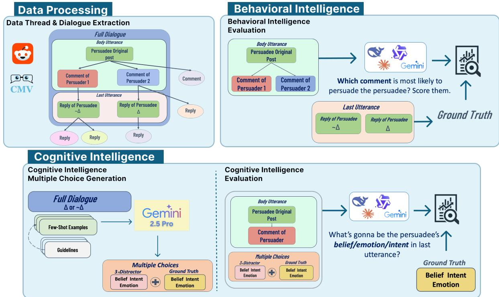  
Figure 1: Overview of the PERSO pipeline: data extraction and processing from CMV, multiple-choice question generation for cognitive intelligence, and the behavioral and cognitive intelligence evaluation tasks.

## 3.2 Task Definition

To evaluate the social intelligence of LLMs in persuasion scenarios, we design two distinct tasks, each targeting one of the aspects under consideration. The first task assesses the model’s cognitive intelligence through its ability to infer the mental state of the persuadee. The second task assesses the model’s behavioral intelligence through its ability to identify the more persuasive comment between two alternatives. Both tasks are constructed on the same dataset collected from CMV, enabling an integrated assessment of both aspects on identical real-world data. The conceptual grounding of both tasks is detailed in Appendix A.1. The complete prompt templates are provided in Appendix A.9, Figures 15 and 16. Processed examples for each task are also provided in Appendix A.10, Figure 17.

## 3.2.1 Behavioral Intelligence Task

As shown in Figure 1, to evaluate behavioral intelligence—specifically the capacity to identify and select actions that successfully achieve social

goals—we use the two persuasion branches defined in Section 3.1. For each thread i, the model receives

$$
B _ { i } = \left( u _ { i } ^ { O } , u _ { i , + } ^ { P } , u _ { i , - } ^ { P } \right) ,\tag{2}
$$

consisting of the persuadee’s original post and the two candidate responses from distinct persuaders. The $\mathrm { O P ^ { \bullet } s }$ subsequent replies $u _ { i , + } ^ { O ^ { \prime } }$ and $\bar { u } _ { i , - } ^ { O ^ { \prime } }$ are not provided. The model must determine which candidate response is more effective for achieving the social goal of persuasion. To mitigate position bias during selection, we ask the model to rate the persuasiveness of each response on a four-point scale: not persuasive (1), slightly persuasive (2), persuasive (3), and very persuasive (4). We require the two scores to differ and take the higher-scoring response as the model’s selection of the more effective social action.

The ground truth for behavioral success is determined by the delta (∆) tag awarded by the persuadee to the successful persuader in a subsequent utterance excluded from the model’s input.

## 3.2.2 Cognitive Intelligence Task

To evaluate the cognitive intelligence of LLMs, as shown in Figure 1, we formulate the task as mentalstate forecasting.

For each dialogue branch $D _ { i , j }$ , the model observes:

<table><tr><td rowspan="2">Participant</td><td colspan="4">PERSO accuracy (%)</td><td colspan="3">TSIS scores (%)</td></tr><tr><td rowspan="2">Behavioral</td><td colspan="3">Cognitive</td><td rowspan="2">Social Information Processing</td><td rowspan="2">Social Skills</td><td rowspan="2">Social Awareness</td></tr><tr><td></td><td>Belief</td><td>Emotion</td><td>Intent</td></tr><tr><td>A</td><td>65.0</td><td>85.0</td><td>65.0</td><td>85.0</td><td>79</td><td>61</td><td>71</td></tr><tr><td>B</td><td>40.0</td><td>50.0</td><td>52.5</td><td>60.0</td><td>54</td><td>54</td><td>50</td></tr><tr><td>C</td><td>75.0</td><td>75.0</td><td>62.5</td><td>72.5</td><td>50</td><td>75</td><td>64</td></tr></table>

Table 3: Participant-level PERSO accuracy and TSIS scores. PERSO results were obtained before gold-label annotation on 20 behavioral instances and 40 cognitive instances per dimension, following the protocol in Section 4.1.2. TSIS is a self-report measure (Silvera et al., 2001). Bold indicates the highest value in each score column.

<table><tr><td>Dimension</td><td>A-B</td><td>A-C</td><td>B-C</td><td>Avg. κ</td></tr><tr><td>Belief</td><td>100.0% 1.000</td><td>90.0% 0.866</td><td>90.0% 0.866</td><td>0.911</td></tr><tr><td>Emotion</td><td>70.0% 0.601</td><td>70.0% 0.602</td><td>75.0% 0.667</td><td>0.623</td></tr><tr><td>Intent</td><td>82.5% 0.764</td><td>72.5% 0.630</td><td>80.0% 0.733</td><td>0.709</td></tr></table>

Table 4: Pairwise agreement (%, first line) and Cohen’s κ (second line) for cognitive answer selection with the final OP reply visible.

$$
C _ { i , j } = \left( u _ { i } ^ { O } , u _ { i , j } ^ { P } \right) ,\tag{3}
$$

where $u _ { i } ^ { O }$ is the persuadee’s original post and $u _ { i , j } ^ { P }$ is the corresponding persuader’s response. The persuadee’s subsequent reply $u _ { i , j } ^ { O ^ { \prime } }$ is not revealed to the model.

The model must forecast the persuadee’s resulting mental state:

$$
M _ { i , j } = ( b _ { i , j } , e _ { i , j } , i _ { i , j } ) ,\tag{4}
$$

corresponding to belief, emotion, and intent. Each dimension is evaluated independently using a four-option multiple-choice question containing one gold answer and three distractors, as discussed in Section 3.1. The model selects the option that best predicts the persuadee’s state after receiving the persuasive response.

Importantly, although $u _ { i , j } ^ { O ^ { \prime } }$ is used during dataset construction to derive the gold mental state, it is hidden during evaluation. Therefore, unlike mentalstate recognition from an observed utterance, the task requires forecasting the persuadee’s state, before the utterance that expresses it is observed.

## 3.3 Data Validation

To validate the reliability of the constructed benchmark, we conducted a human annotation study on a randomly sampled subset of 10% of the dataset:

40 instances, drawn from 200 threads containing 400 dialogues in total. Three independent annotators, denoted as A, B, and C, evaluated the same instances. All three were computer science students: one undergraduate and two graduate (Master’s level) students, all with prior experience in natural language processing. Unlike the models, which must infer the persuadee’s mental state without access to the final utterance, human annotators were shown the third utterance when making their judgments, allowing them to verify the gold answer and distractor options against the ground-truth text. For each dialogue, annotators were asked to identify the correct option among the four candidates for each cognitive dimension.

In addition to answer selection, annotators evaluated the quality of the constructed options using two separate criteria. First, they rated how accurately the gold answer described the final utterance on a 5-point Likert scale, ranging from 1 (completely wrong) to 5 (completely correct). Second, they rated the three distractor options based on their plausibility while remaining incorrect, using a scale from 1 (bad distractors) to 5 (good distractors). To measure the reliability of the human labels, we calculated pairwise agreement and Cohen’s κ between annotators for the answer selection task. As shown in Table 4, the average pairwise Cohen’s κ values were 0.911, 0.623, and 0.709 for belief, emotion, and intent, respectively. These results indicate substantial agreement among annotators, particularly for belief and intent, and demonstrate that the human-annotated labels provide reliable supervision for evaluating cognitive reasoning capabilities of LLMs. Additional agreement analyses and human assessments of gold answer correctness and distractor plausibility are reported in Appendix A.2.

To further examine the alignment of PERSO with an established measure of social intelligence, all three participants completed the Tromsø Social Intelligence Scale (TSIS) (Silvera et al., 2001), a 21- item self-report instrument comprising Social Information Processing, Social Skills, and Social Awareness. Social Information Processing assesses perceived ability to understand others’ feelings and anticipate their behavior, while Social Skills assesses perceived competence in navigating social interactions. These subscales align conceptually with our cognitive and behavioral tasks, respectively. Table 3 reports their TSIS scores alongside PERSO accuracies obtained before gold-label annotation using the human evaluation protocol in Section 4.1.2. The behavioral ranking is identical across PERSO and TSIS Social Skills $( C > A > B )$ . Participant A also ranks highest on Social Information Processing and all three cognitive dimensions, although the ordering of B and C differs between the two measures. These findings provide preliminary evidence of alignment with the targeted aspects of social intelligence within this small participant group.

## 4 Evaluation

## 4.1 Evaluation Setup

We evaluate LLMs and human participants on the behavioral and cognitive tasks defined in Section 3.2, using accuracy to measure the selection of successful persuasion responses and the inference of persuadees’ mental states, respectively. The following subsections describe the model evaluation settings and the human evaluation protocol.

## 4.1.1 Model Evaluation

For a comprehensive assessment of social intelligence in large language models, we select a diverse set of models spanning different model families and scales. Our evaluation set includes open-source models from the Gemma (Team et al., 2025), Qwen (Team, 2026), and DeepSeek (DeepSeek-AI et al., 2025) families at varying sizes, as well as closed-source models including Claude (Anthropic, 2025, 2026) and Gemini (Comanici et al., 2025). For the Qwen models, we additionally evaluate both reasoning and nonreasoning (with and without thinking) variants to examine the effect of this capability on social intelligence. Since the cognitive intelligence task was generated using Gemini 2.5 Pro, we additionally evaluate Gemini 2.5 Pro itself on the generated tasks to examine the potential for self-bias. To ensure deterministic outputs, we set the temperature to 0 and top-k to 1 across all experiments. We also evaluate non-LLM baselines to situate model performance relative to surface-level cues; details of these baselines are provided in Appendix A.7.

## 4.1.2 Human Evaluation

To establish a human reference point for comparison with model performance, we administered the same tasks to three human participants (A, B, and C), the same individuals who served as annotators in Section 3.3. This evaluation was conducted prior to the gold-label annotation stage described in Section 3.3. For the behavioral intelligence task, 20 instances (10% of the full dataset) were randomly sampled and given to all three participants. For the cognitive intelligence task, 40 instances (10% of the full dataset) were randomly sampled. The results for each participant are reported in Table 3.

## 4.2 Behavioral Intelligence Results

Table 5 reveals several notable patterns in model performance on the behavioral intelligence task. The most apparent pattern is a positive relationship between model scale and performance within most model families. In the Gemma family, the 12B variant achieves slightly higher accuracy than the 4B variant at 60.5%, and this accuracy further increases to 71% for the 27B variant. A similar overall pattern is observed in the Qwen family. In the without-thinking setting, model performance improves consistently with model scale, while in the with-thinking setting, performance increases from the 4B to the 35B variant and then remains unchanged for the 397B variant.

Contrary to expectation, this pattern breaks down within the DeepSeek family. The newest variant, V4-Pro, exhibits the weakest performance among the three variants in this family at 62%, compared to 67.5% for V3.1 and 69% for V3.2. This discrepancy may stem from differences in training data or the fine-tuning process specific to this variant. It should be noted that DeepSeek models were evaluated without the reasoning capability to ensure a fair comparison with other models.

Another notable observation is the close competition between the best-performing open-source and closed-source models. Qwen-3.5-397B, as an opensource model, achieves the highest performance on this task at 76%, while the best-performing closed-source model, Sonnet-4.6, reaches 71.5%, followed closely by Gemini-2.5-Pro at 71.0%. This finding runs counter to the common assumption that closed-source models consistently outperform open-source ones on complex social tasks, and suggests that sufficient scale in an open-source model can close, or even reverse, this gap.

<table><tr><td rowspan="2">Model</td><td>Behavioral Intelligence</td><td colspan="3">Cognitive Intelligence</td></tr><tr><td>Behavioral</td><td>Belief</td><td>Emotion</td><td>Intent</td></tr><tr><td>Gemma-4B</td><td>60.5</td><td>50.0</td><td>20.5</td><td>54.5</td></tr><tr><td>Gemma-12B</td><td>62.5</td><td>58.25</td><td>23.25</td><td>63.25</td></tr><tr><td>Gemma-27B</td><td>71.0</td><td>60.0</td><td>25.75</td><td>64.5</td></tr><tr><td>Qwen-4B (W/O Thinking)</td><td>64.0</td><td>66.0</td><td>25.25</td><td>60.75</td></tr><tr><td>Qwen-35B (W/O Thinking)</td><td>75.0</td><td>71.75</td><td>35.75</td><td>73.75</td></tr><tr><td>Qwen-397B (W/O Thinking)</td><td>76.0</td><td>80.5</td><td>41.0</td><td>75.0</td></tr><tr><td>Qwen-4B (With Thinking)</td><td>66.5</td><td>63.5</td><td>25.0</td><td>60.5</td></tr><tr><td>Qwen-35B (With Thinking)</td><td>73.0</td><td>69.75</td><td>41.25</td><td>66.5</td></tr><tr><td>Qwen-397B (With Thinking)</td><td>73.0</td><td>79.0</td><td>48.75</td><td>74.5</td></tr><tr><td>DeepSeek-V3.1</td><td>67.5</td><td>76.0</td><td>35.75</td><td>72.0</td></tr><tr><td>DeepSeek-V3.2</td><td>69.0</td><td>73.75</td><td>36.0</td><td>69.75</td></tr><tr><td>DeepSeek-V4-Pro</td><td>62.0</td><td>80.0</td><td>39.75</td><td>75.0</td></tr><tr><td>Haiku-4.5</td><td>69.5</td><td>68.5</td><td>34.5</td><td>72.5</td></tr><tr><td>Sonnet-4.6</td><td>71.5</td><td>83.0</td><td>59.0</td><td>80.5</td></tr><tr><td>Gemini-2.5-Pro</td><td>71.0</td><td>79.5</td><td>37.25</td><td>77.75</td></tr><tr><td>Human (avg)</td><td>60.0</td><td>70.0</td><td>60.0</td><td>72.5</td></tr><tr><td>Human (best)</td><td>75.0</td><td>85.0</td><td>65.0</td><td>85.0</td></tr></table>

Table 5: Behavioral and cognitive task accuracy (%). Bold marks the best model score in each column; underlining marks the best score within each multi-row model block, including ties, with Qwen thinking modes treated separately. Human (avg/best) reports the mean/columnwise maximum across three participants.

The best-performing model, Qwen-3.5-397B without thinking, achieves 76% accuracy, only 1 percentage point above the best human participant at 75%. This small difference indicates that the strongest model and the strongest human perform at a comparable level on this task.

To examine the robustness of these results to reply length, we repeat the evaluation after removing outlier instances with an extreme length difference between the two replies (length ratio above the third quartile). On the resulting subset of 167 instances, all models show a modest decrease in accuracy, while the overall pattern of results is preserved: the relative ordering of models remains largely unchanged, and Qwen-3.5-397B remains the best-performing model. The complete results are provided in Appendix A.8, and comparisons with non-LLM baselines in Appendix A.7.

## 4.3 Cognitive Intelligence Results

Table 5 reveals several distinct patterns across the three cognitive dimensions. Most notably, emotion is consistently the most difficult dimension for all models. On a four-option question, chance-level accuracy is 25%, yet Gemma-3-4B and Gemma-3- 12B reach only 20.5% and 23.25% respectively on this dimension, at or below chance, while the same models perform considerably better on belief and intent. This aligns with the human annotation data, where inter-annotator agreement was also lowest for emotion, suggesting that inferring emotional states is inherently harder than inferring beliefs or intents, for both models and humans alike.

Another interesting observation concerns the spread of performance across dimensions. Emotion shows the widest variation, ranging from 20.5% to 59%, while most models cluster within a narrower 60–80.5% band on intent. This suggests that intent identification is less sensitive to a model’s specific capabilities and tends to be achieved at a relatively consistent level across different models.

The positive scale–performance relationship seen in the behavioral task also holds here; for instance, within the Qwen family, belief accuracy rises from 66% for the 4B variant to 80.5% for the 397B variant. Interestingly, the DeepSeek family, which showed an irregular trend in the behavioral task, does not exhibit the same issue here. V4-Pro achieves the highest scores within the DeepSeek family on all three aspects. This contrast suggests that V4-Pro’s weaker behavioral performance is likely tied to a specific limitation in comparing two competing arguments, rather than a general weakness in understanding mental states.

Finally, Sonnet-4.6 stands out on the emotion dimension with a score of 59%, more than 10 percentage points above the second-best model on this dimension, Qwen-3.5-397B with thinking at 48.75%. This gap is not observed on either of the other two dimensions and may point to a stronger capacity in this model for detecting subtle emotional states.

It is also worth noting that Gemini-2.5-Pro does not achieve the highest score on any of the three cognitive dimensions. It reaches 79.5% on belief, 37.25% on emotion, and 77.75% on intent, trailing Sonnet-4.6 on all three dimensions. It also trails Qwen-3.5-397B with thinking on emotion. Given that Gemini-2.5-Pro was involved in generating the cognitive task itself, its lack of consistent dominance provides evidence against systematic bias favoring this model in the evaluation.

A comparison with the best human participant reveals relatively small gaps across the three cognitive dimensions. Sonnet-4.6, the strongest model on all three dimensions, scores 2 percentage points lower than the best human participant on belief, 6 points lower on emotion, and 4.5 points lower on intent. Thus, the best observed human performance remains higher across all three cognitive dimensions, although the differences are relatively small.

Further comparisons with non-LLM-based models are provided in Appendix A.7.

## 4.4 Thinking Analysis

To examine the effect of the thinking capability, we compared different variants of Qwen-3.5 with and without this capability enabled. Table 5 shows that thinking has different effects across dimensions, and no single conclusion can be drawn for all of them.

The clearest pattern appears on the emotion dimension. Enabling thinking improves accuracy for the 35B and 397B variants; the 35B variant goes from 35.75% to 41.25%, and the 397B variant from 41.0% to 48.75%. The 4B variant, however, remains almost unchanged, from 25.25% to 25.0%. Belief tells a different story: thinking lowers performance across all three sizes, with the 4B variant dropping from 66.0% to 63.5%, the 35B from 71.75% to 69.75%, and the 397B from 80.5% to 79.0%.

This difference likely comes down to the nature of each dimension. Emotion relies on subtle and implicit textual cues, and step-by-step reasoning can help the model interpret them more carefully. Belief, on the other hand, tends to be expressed more explicitly in the text, and thinking in this case adds complexity rather than clarity.

For intent and the behavioral task, there is no clear pattern. On intent, all three variants show a slight drop with thinking enabled, though the decline is more pronounced for the 35B variant, from 73.75% to 66.5%. On the behavioral task, the results are mixed: the 4B variant improves, while the 35B and 397B variants perform worse with thinking enabled. This inconsistency suggests that thinking offers no clear benefit for these two dimensions and may in some cases hurt performance.

Overall, thinking is most effective where the text is more ambiguous and the model needs to reason more deeply. For dimensions where the relevant information is stated more explicitly, enabling thinking does not help much.

## 5 Conclusion

In this work, we introduced PERSO, a benchmark for evaluating the social intelligence of large language models across cognitive and behavioral dimensions, using persuasion scenarios as the evaluation testbed. PERSO is built on real-world conversations from Reddit’s ChangeMyView community and enables an integrated evaluation of both dimensions on one dataset, addressing a key limitation of prior benchmarks that either evaluate these dimensions in isolation or rely on synthetic data.

Our evaluation across a diverse set of LLMs reveals several consistent patterns. Model performance generally improves with scale, though not universally. The emotion dimension is consistently the most difficult to infer, both for models and human participants, while belief, intent, and overall persuasiveness prove comparatively easier. Enabling reasoning selectively improves emotion inference but offers little benefit, and occasionally slight harm, on the other dimensions. Finally, the strongest model slightly surpasses the best observed human performance on the behavioral task, while the best human participant remains above the top-performing model on all three cognitive dimensions. The gaps suggest that cognitive social reasoning—particularly emotion—continues to present a meaningful challenge for current LLMs.

## Limitations

Our human reference results are based on only three participants, which limits the statistical reliability of any comparison between human and model performance. A larger and more diverse participant pool would be needed to draw more definitive conclusions about the relative standing of humans and models on these tasks.

PERSO is constructed exclusively from the ChangeMyView subreddit, which, while a rich source of naturalistic persuasion dialogue, represents a specific community with its own norms, demographics, and argumentative conventions. Moreover, our data is limited to English-language conversations. The extent to which our findings generalize to other persuasion contexts, languages, and cultural settings remains an open question. Furthermore, the dialogues in this work are limited to single-turn exchanges between the persuader and the persuadee. Investigating persuasion scenarios with a greater number of turns and longer conversations (which may reveal distinct patterns of social intelligence) was not feasible in this work due to constraints on the volume of qualifying data, and represents a valuable direction for future research.

## Ethical Considerations

The human annotation and evaluation studies reported in this work involved three volunteer participants who provided informed consent prior to participation. Participants were made aware of the nature of the tasks and their right to withdraw at any time. All individual results, including scores on the Tromsø Social Intelligence Scale (TSIS), are reported in anonymized form using labels A, B, and C, with no personally identifiable information disclosed. The TSIS scores reflect personal psychological assessments and are included solely to provide context for interpreting human performance; they should not be used to make judgments about individual participants. The Reddit data used in this work was collected from publicly available posts and comments on the ChangeMyView subreddit and does not include any private communications.

## References

Karl Albrecht. 2006. Social Intelligence: The New Science ofSuccess. Jossey-Bass, San Francisco, CA.

Anthropic. 2025. Introducing Claude Haiku 4.5. https: //www.anthropic.com/news/claude-haiku-4-5. Accessed: 2026-07-31.

Anthropic. 2026. Introducing Claude Sonnet 4.6. https://www.anthropic.com/news/ claude-sonnet-4-6. Accessed: 2026-07-31.

Chunkit Chan, Cheng Jiayang, Yauwai Yim, Zheye Deng, Wei Fan, Haoran Li, Xin Liu, Hongming Zhang, Weiqi Wang, and Yangqiu Song. 2024. Negotiationtom: A benchmark for stress-testing machine theory of mind on negotiation surrounding. Preprint, arXiv:2404.13627.

Hongzhan Chen, Hehong Chen, Ming Yan, Wenshen Xu, Gao Xing, Weizhou Shen, Xiaojun Quan, Chenliang Li, Ji Zhang, and Fei Huang. 2024. Social-Bench: Sociality evaluation of role-playing conversational agents. In Findings ofthe Associationfor Computational Linguistics: ACL 2024, pages 2108–2126, Bangkok, Thailand. Association for Computational Linguistics.

Gheorghe Comanici et al. 2025. Gemini 2.5: Pushing the frontier with advanced reasoning, multimodality, long context, and next generation agentic capabilities. Preprint, arXiv:2507.06261.

DeepSeek-AI, Aixin Liu, Bei Feng, Bing Xue, Bingxuan Wang, Bochao Wu, Chengda Lu, Chenggang Zhao, Chengqi Deng, Chenyu Zhang, Chong Ruan, Damai Dai, Daya Guo, Dejian Yang, Deli Chen, Dongjie Ji, Erhang Li, Fangyun Lin, Fucong Dai, and 181 others. 2025. Deepseek-v3 technical report. Preprint, arXiv:2412.19437.

Daniel Goleman. 2007. Social Intelligence: The New Science of Human Relationships. Bantam Books, New York.

Yinghui He, Yufan Wu, Yilin Jia, Rada Mihalcea, Yulong Chen, and Naihao Deng. 2023. Hi-tom: A benchmark for evaluating higher-order theory of mind reasoning in large language models. In Conference on Empirical Methods in Natural Language Processing.

Hyunwoo Kim, Melanie Sclar, Xuhui Zhou, Ronan Le Bras, Gunhee Kim, Yejin Choi, and Maarten Sap. 2023. Fantom: A benchmark for stress-testing machine theory of mind in interactions. ArXiv, abs/2310.15421.

Yurie Koga, Shunsuke Kando, and Yusuke Miyao. 2024. Forecasting implicit emotions elicited in conversations. In Proceedings ofthe 17th International Natural Language Generation Conference, pages 145– 152, Tokyo, Japan. Association for Computational Linguistics.

Minzhi Li, Weiyan Shi, Caleb Ziems, and Diyi Yang. 2024. Social intelligence data infrastructure: Structuring the present and navigating the future. In Findings ofthe Associationfor Computational Linguistics: ACL 2024, pages 2789–2805, Bangkok, Thailand. Association for Computational Linguistics.

Ziyi Liu, Abhishek Anand, Pei Zhou, Jen tse Huang, and Jieyu Zhao. 2024. Interintent: Investigating social intelligence of llms via intention understanding in an interactive game context. Preprint, arXiv:2406.12203.

Herbert Marlowe. 1986. Social intelligence: Evidence for multidimensionality and construct independence. Journal ofEducational Psychology, 78:52–58.

Xinyi Mou, Jingcong Liang, Jiayu Lin, Xinnong Zhang, Xiawei Liu, Shiyue Yang, Rong Ye, Lei Chen, Haoyu Kuang, Xuanjing Huang, and Zhongyu Wei. 2025. AgentSense: Benchmarking social intelligence of language agents through interactive scenarios. In Proceedings ofthe 2025 Conference ofthe Nations ofthe Americas Chapter ofthe Associationfor Computational Linguistics: Human Language Technologies (Volume 1: Long Papers), pages 4975–5001, Albuquerque, New Mexico. Association for Computational Linguistics.

Nils Reimers and Iryna Gurevych. 2019. Sentence-bert: Sentence embeddings using siamese bert-networks. Preprint, arXiv:1908.10084.

Kazutoshi Shinoda, Nobukatsu Hojo, Kyosuke Nishida, Saki Mizuno, Keita Suzuki, Ryo Masumura, Hiroaki Sugiyama, and Kuniko Saito. 2025. Tomato: Verbalizing the mental states of role-playing llms for benchmarking theory of mind. Preprint, arXiv:2501.08838.

David Silvera, Monica Martinussen, and Tove Dahl. 2001. The tromsø social intelligence scale, a selfreport measure of social intelligence. Scandinavian journal ofpsychology, 42:313–9.

Adil Soubki, John Murzaku, Arash Yousefi Jordehi, Peter Zeng, Magdalena Markowska, Seyed Abolghasem Mirroshandel, and Owen Rambow. 2024. Views are my own, but also yours: Benchmarking theory of mind using common ground. Preprint, arXiv:2403.02451.

Gemma Team, Aishwarya Kamath, Johan Ferret, Shreya Pathak, Nino Vieillard, Ramona Merhej, Sarah Perrin, Tatiana Matejovicova, Alexandre Ramé, Morgane Rivière, Louis Rouillard, Thomas Mesnard, Geoffrey Cideron, Jean bastien Grill, Sabela Ramos, Edouard Yvinec, Michelle Casbon, Etienne Pot, Ivo Penchev, and 197 others. 2025. Gemma 3 technical report. Preprint, arXiv:2503.19786.

Qwen Team. 2026. Qwen3.5: Accelerating productivity with native multimodal agents.

Edward L. Thorndike. 1920. Intelligence and its uses. Harper’s Monthly Magazine, 140:227–235.

Emilio Villa-Cueva, S M Masrur Ahmed, Rendi Chevi, Jan Christian Blaise Cruz, Kareem Elzeky, Fermin Cristobal, Alham Fikri Aji, Skyler Wang, Rada Mihalcea, and Thamar Solorio. 2025. Moments: A comprehensive multimodal benchmark for theory of mind. ArXiv, abs/2507.04415.

Chenxu Wang, Bin Dai, Huaping Liu, and Baoyuan Wang. 2024. Towards objectively benchmarking social intelligence of language agents at the action level. In Findings of the Association for Computational Linguistics: ACL 2024, pages 8885–8897, Bangkok, Thailand. Association for Computational Linguistics.

Jincenzi Wu, Zhuang Chen, Jiawen Deng, Sahand Sabour, and Minlie Huang. 2023. Coke: A cognitive knowledge graph for machine theory of mind. ArXiv, abs/2305.05390.

Yang Xiao, Jiashuo Wang, Qiancheng Xu, Changhe Song, Chunpu Xu, Yi Cheng, Wenjie Li, and Pengfei Liu. 2025. Towards dynamic theory of mind: Evaluating llm adaptation to temporal evolution of human states. ArXiv, abs/2505.17663.

Fangxu Yu, Lai Jiang, Shengya Huang, Zhen Wu, and Xinyu Dai. 2025. Persuasivetom: A benchmark for evaluating machine theory of mind in persuasive dialogues. ArXiv, abs/2502.21017.

Jinfeng Zhou, Yuxuan Chen, Yihan Shi, Xuanming Zhang, Leqi Lei, Yi Feng, Zexuan Xiong, Miao Yan, Xunzhi Wang, Yaru Cao, Jianing Yin, Shuai Wang, Quanyu Dai, Zhenhua Dong, Hongning Wang, and Minlie Huang. 2025. Socialeval: Evaluating social intelligence of large language models. In Annual Meeting of the Association for Computational Linguistics.

Xuhui Zhou, Hao Zhu, Leena Mathur, Ruohong Zhang, Haofei Yu, Zhengyang Qi, Louis-Philippe Morency, Yonatan Bisk, Daniel Fried, Graham Neubig, and Maarten Sap. 2024. SOTOPIA: Interactive evaluation for social intelligence in language agents. In The Twelfth International Conference on Learning Representations.

Xuhui Zhou, Hao Zhu, Leena Mathur, Ruohong Zhang, Haofei Yu, Zhengyang Qi, Louis philippe Morency, Yonatan Bisk, Daniel Fried, Graham Neubig, and Maarten Sap. 2023. Sotopia: Interactive evaluation for social intelligence in language agents. ArXiv, abs/2310.11667.

Hao Zhu, Bodhisattwa Prasad Majumder, Dirk Hovy, and Diyi Yang. 2025. Social intelligence in the age of LLMs. In Proceedings ofthe 2025 Annual Conference of the Nations of the Americas Chapter of the Associationfor Computational Linguistics: Human Language Technologies (Volume 5: Tutorial Abstracts), pages 51–55, Albuquerque, New Mexico. Association for Computational Linguistics.

## A Appendix

## A.1 Conceptual Grounding of the Evaluation Tasks

This section makes explicit the connection between the psychological definitions in Section 1 and the tasks in Section 3.2. The argument proceeds from the definition of social intelligence, to the abilities it involves, to their expression in persuasion, and finally to the observable decisions scored by PERSO.

Social intelligence and its cognitive and behavioral facets. The definitions discussed in the introduction share a connection between understanding people and acting effectively in interpersonal situations. Thorndike (1920) associates social intelligence with understanding people and acting wisely in human relationships. Marlowe (1986) makes this connection explicit: social intelligence involves understanding people’s thoughts, feelings, and behaviors, including one’s own, and acting appropriately on that understanding. Goleman (2007) similarly distinguishes social awareness from social facility: understanding another person and using that awareness in effective interaction.

These accounts motivate our focus on two complementary facets: cognitive understanding and behavioral effectiveness. Furthermore, we use the definitions proposed by Li et al. (2024) for these two facets.

Cognitive intelligence: from understanding mental states to forecasting a recipient’s reaction. The cognitive facet concerns understanding another person’s mental states from available social cues. This follows the understanding component of Marlowe (1986) and the socialawareness component of Goleman (2007). More specifically, Li et al. (2024) organize cognitive intelligence around beliefs, emotions, and intents. These correspond to the three targets of our cognitive task: what the persuadee regards as true, how they feel, and what they seek to do or communicate.

In a persuasion scenario, this understanding concerns a recipient who already holds a particular view and is presented with a message intended to influence it. Given the $\mathrm { O P ^ { \circ } s }$ initial post $u _ { i } ^ { O }$ and a persuader’s response $u _ { i , j } ^ { P }$ , PERSO asks the model to forecast the $\mathrm { O P s }$ resulting belief, emotion, or intent by selecting among four candidate descriptions. The relevant judgment is therefore how this particular recipient will respond to this particular message. It is not whether the model itself endorses the argument or considers it objectively correct.

The subsequent reply $u _ { i , j } ^ { O ^ { \prime } }$ supplies evidence for constructing the reference answer but is withheld during evaluation. This separates the evidence used to establish the target from the information available to predict it. Consequently, the task evaluates anticipation of a mental state expressed in a future response, rather than extraction of that state from an already visible utterance. Forecasting is thus the operational form that mental-state understanding takes in our persuasion setting; it is not proposed as an exhaustive definition of cognitive intelligence. The reference answers remain interpretations of expressed states, supported by the annotation study in Section 3.3, rather than direct observations of private mental experience.

Behavioral intelligence: from effective social action to response selection. The behavioral facet concerns using social understanding to communicate and act effectively toward social goals (Li et al., 2024). It corresponds to acting on interpersonal understanding in Marlowe (1986) and to social facility in Goleman (2007). In a text-based persuasion exchange, a response is a communicative action, and changing the recipient’s view is the local social goal. Selecting between candidate responses therefore provides a constrained test of the action-selection component of this facet.

Our behavioral task holds the OP and initial post fixed while presenting two naturally occurring responses. The model assigns unequal persuasiveness scores to the responses, thereby selecting the action it judges more effective for this recipient. The reference selection is grounded in the $\mathrm { { O P s } }$ observed delta award, with both subsequent OP replies hidden from the model. An observed interpersonal outcome is therefore used to evaluate a prospective decision: given this recipient and these available responses, which response should be selected to achieve the persuasion goal?

The criterion is recipient-specific persuasive success rather than an evaluator’s general preference for an argument. The additional upvote constraint aligns the selected outcome with a communitylevel signal; the delta remains the outcome label. A response without a delta lacks this explicit success signal, but may still have affected the recipient. Likewise, the task assesses judgment about which action to select, rather than the ability to generate and execute a persuasive response in live interac-

tion.

Why persuasion brings the two facets together. The connection to persuasion is supported by the cited accounts of social intelligence. Albrecht (2006) emphasizes gaining cooperation and describes clarity in terms of communicating ideas effectively, including persuasion. Goleman (2007) includes influence within social facility, and Li et al. (2024) place persuasion under behavioral intelligence. Persuasion consequently supplies a natural interpersonal setting with an identifiable recipient, a communicative action, and a social goal. Within this setting, understanding the recipient’s reaction and selecting an effective response are complementary questions.

The processed example in Figure 17 illustrates the distinction. After the medical-progress argument, the OP concedes the need for further medical advances while retaining a broader concern about well-being. The cognitive questions target this selective belief revision, the receptive emotional stance, and the intent to qualify the original claim. The behavioral question instead asks which of the two responses achieved the acknowledged view change. Thus, the tasks evaluate different aspects of the same interaction: the recipient’s resulting mental state and the effectiveness of a communicative action.

From the task definitions to the measured construct. The reasoning chain is therefore as follows. Established definitions connect interpersonal understanding with effective social action. Persuasion gives these abilities a concrete recipient, context, and goal. Mental-state forecasting operationalizes the understanding component, while outcome-grounded response selection operationalizes the action-selection component. Evaluating both on the same interactions therefore provides a definition-grounded assessment of complementary facets of social intelligence.

This establishes the conceptual relevance of the tasks without equating their scores with complete psychometric validation of social intelligence. The tasks need not be cognitively independent, and their scores do not establish that a model internally uses its forecast when selecting a response. Nor does persuasive success alone establish social wisdom or competence in every interpersonal setting. Human annotation, the exploratory TSIS comparison, and the baseline analyses provide additional evidence with different purposes. Within these boundaries, PERSO measures mental-state forecasting and goal-directed response selection as theoretically grounded cognitive and behavioral facets of social intelligence in persuasion.

## A.2 Additional Annotation Results

This section reports additional analyses of the human annotation study described in Section 3.3.

Multi-annotator agreement. To further validate the robustness of these agreement estimates, we also computed Fleiss’ κ and Krippendorff’s α across all three annotators jointly. As shown in Table 6, both metrics closely match the average pairwise Cohen’s κ for each dimension, confirming that the reported agreement levels are consistent across multiple reliability measures rather than being an artifact of a single metric.

<table><tr><td>Dimension</td><td>Fleiss&#x27;κ</td><td>Krippendorff&#x27;s α</td></tr><tr><td>Belief</td><td>0.911</td><td>0.911</td></tr><tr><td>Emotion</td><td>0.622</td><td>0.625</td></tr><tr><td>Intent</td><td>0.708</td><td>0.711</td></tr></table>

Table 6: Multi-annotator agreement across all three annotators (A, B, and C) jointly, using two complementary reliability metrics.

Answer quality. For the quality assessment of gold answers and distractor options, we report descriptive statistics rather than agreement coefficients. Since most ratings were concentrated at the upper end of the scale, agreement-based reliability measures are not informative due to the resulting ceiling effect. The average scores demonstrate that the gold answers accurately capture the persuadee’s final mental states and that the distractor options are generally plausible while remaining incorrect. The detailed results are presented in Table 7.

<table><tr><td>Dimension</td><td>Gold Correctness</td><td>Distractor Plausibility</td></tr><tr><td>Belief</td><td> $\overline { { 4 . 7 7 5 \pm 0 . 4 7 4 } }$ </td><td> $4 . 5 7 5 \pm 0 . 6 2 8$ </td></tr><tr><td>Emotion</td><td> $4 . 5 1 7 \pm 0 . 8 6 6$ </td><td> $4 . 2 5 8 \pm 0 . 7 8 0$ </td></tr><tr><td>Intent</td><td> $4 . 7 5 0 \pm 0 . 5 2 0$ </td><td> $\overline { { 4 . 5 5 8 \pm 0 . 7 3 9 } }$ </td></tr><tr><td>Overall</td><td> $\overline { { 4 . 6 8 1 \pm 0 . 6 5 0 } }$ </td><td> $\overline { { 4 . 4 6 4 \pm 0 . 7 1 6 } }$ </td></tr></table>

Table 7: Human evaluation of gold answer correctness and distractor plausibility using a 5-point Likert scale, with the third utterance visible to annotators. Values are reported as mean ± standard deviation.

## A.3 Behavioral vs. Cognitive Intelligence

A cross-task comparison reveals that, within most model families, models that perform better on the cognitive intelligence task also tend to perform better on the behavioral intelligence task, suggesting a degree of shared underlying capability. However, this correlation does not imply that the two tasks measure identical aspects of social intelligence, as the magnitude of improvement across model sizes within a family varies substantially between the two tasks.

In the Gemma family, the behavioral dimension shows a larger performance spread across model sizes (10.5 percentage points from 4B to 27B) compared to the average spread across cognitive dimensions (approximately 8.4 percentage points), suggesting that behavioral intelligence is more sensitive to scale within this family. The pattern reverses in the Qwen and Claude families: Qwen models without thinking exhibit a larger margin on cognitive dimensions (approximately 15 percentage points on average across belief, emotion, and intent) than on the behavioral task (12 percentage points), while in the Claude family this contrast is even more pronounced: the behavioral gap between Haiku-4.5 and Sonnet-4.6 is only 2.0 percentage points, whereas the cognitive gap averages approximately 15.7 percentage points across the three dimensions.

The DeepSeek family presents a notably different picture: whereas V4-Pro is the weakest of the three variants on the behavioral task (62.0%, compared to 67.5% for V3.1 and 69.0% for V3.2), it consistently achieves the highest scores among its family variants on all three cognitive dimensions (80.0% on belief, 39.75% on emotion, and 75.0% on intent). This reversal in the performance ordering between the two tasks indicates that the behavioral and cognitive dimensions of social intelligence can be dissociated, and that architectural or training differences between model variants may selectively affect one dimension while leaving the other largely unaffected.

Taken together, these observations suggest that behavioral and cognitive social intelligence, while positively correlated at a broad level, are distinct capabilities that scale differently across model families and sizes. A high score on one dimension should therefore not be taken as a reliable proxy for performance on the other.

## A.4 Behavioral Answer Distribution Analysis

Figure 2 shows the distribution of choice A versus choice B for each model and human annotator on the behavioral intelligence task. Since the display order of the two persuaders in the prompt was randomized, this distribution effectively measures position bias, a systematic tendency to favor the first or second option independent of its content. Most models are close to balanced: 12 of the 15 models select the first option between 45% and 58% of the time, while Gemma-27B, DeepSeek-V3.1, and DeepSeek-V3.2 show a clear preference for the second option (60% to 65.5%). Figure 3 summarizes these differences as the absolute pairwise difference in the proportion of A choices. For the human annotators, the proportions are based on the instances shown to them; since the gold answer appeared in the second position in most of these instances, the human distributions partly reflect answer correctness rather than position bias and should be interpreted with caution.

## A.5 Cognitive Answer Distribution Analysis

Figures 4, 6, and 8 show the distribution of choices A, B, C, and D for each cognitive dimension. Since one of the four options is always the gold answer and its position was randomized, these distributions reflect both the model’s accuracy and its positional preference. Most models distribute their choices fairly evenly across the four options, with each option selected between 17.5% and 33% of the time. The main exception is Gemma-4B, which shows a consistent preference for option A across all three dimensions (52.5% on belief, 48% on emotion, and 40% on intent) and rarely selects option D, suggesting a stable positional preference of this model rather than an effect of question content. A milder preference for option A is also observed for Gemma-12B on belief (38.25%), although it does not persist on emotion or intent.

Figures 5, 7, and 9 report the pairwise Pearson correlation between the choice distributions of all agents. Correlations between models are computed over all instances, whereas correlations involving a human annotator are computed on the instances shared by the two agents, so that both distributions refer to the same questions; for these pairs, the model’s distribution is therefore recomputed on the shared instances and may differ from the full-set distribution shown in Figures 4, 6, and 8. Across all three dimensions, correlations between models span almost the full range from strongly negative to strongly positive, indicating that models differ considerably in their overall selection patterns. Correlations between human annotators and models vary in sign and magnitude across annotators and dimensions; for example, Annotator A correlates positively with nearly all models on intent, whereas Annotator B correlates negatively with most models on emotion. Correlations among the annotators themselves are low or negative in most cases. Since each correlation is computed over only four proportions, these results describe the similarity of overall selection patterns rather than agreement on individual questions.

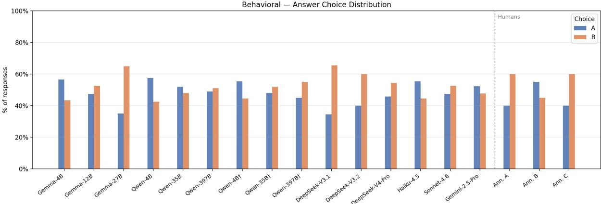  
Figure 2: Distribution of choice A versus choice B on the behavioral intelligence task, for each model and human annotator. The dagger symbol (†) denotes models evaluated with thinking enabled.

Behavioral — Absolute Difference in %A between Agents  
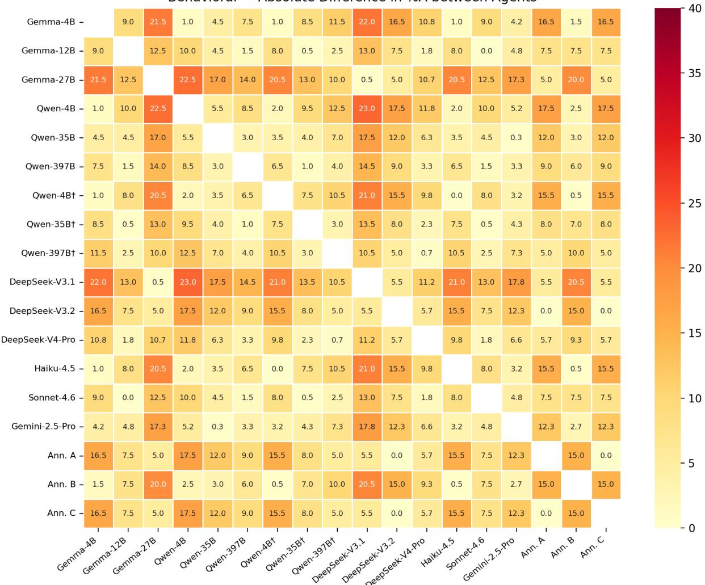  
Figure 3: Absolute pairwise difference in %A between all evaluated models and human annotators on the behavioral intelligence task. The dagger symbol (†) denotes models evaluated with thinking enabled. Model proportions are computed over all instances, whereas human proportions are computed on the instances shown to the annotators; differences involving human annotators should therefore be interpreted with caution.

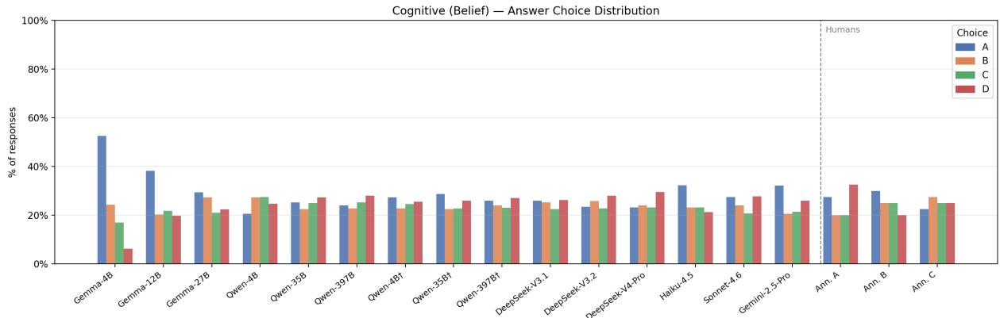  
Figure 4: Distribution of choices A, B, C, and D for the belief dimension of the cognitive intelligence task, for each model and human annotator. The dagger symbol (†) denotes models evaluated with thinking enabled.

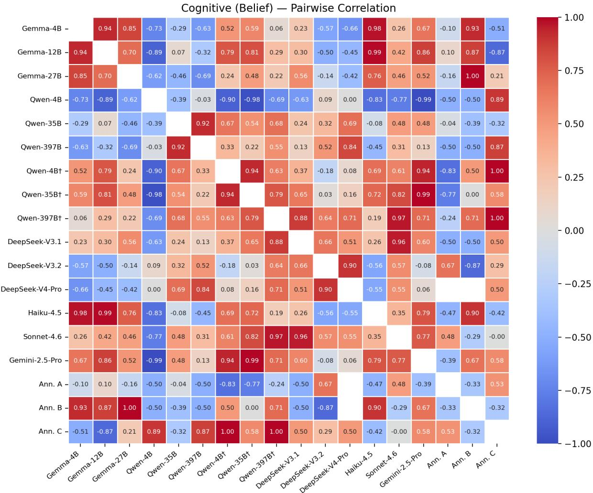  
Figure 5: Pairwise Pearson correlation of answer-choice distributions between all evaluated models and human annotators, for the belief dimension of the cognitive intelligence task. Correlations involving human annotators are computed on shared instances. Blank cells indicate undefined correlations, which occur when a distribution computed on the shared instances is exactly uniform. The dagger symbol (†) denotes models evaluated with thinking enabled.

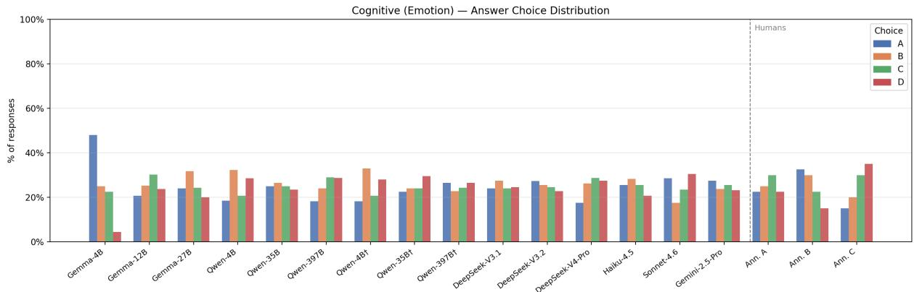  
Figure 6: Distribution of choices A, B, C, and D for the emotion dimension of the cognitive intelligence task, for each model and human annotator. The dagger symbol (†) denotes models evaluated with thinking enabled.

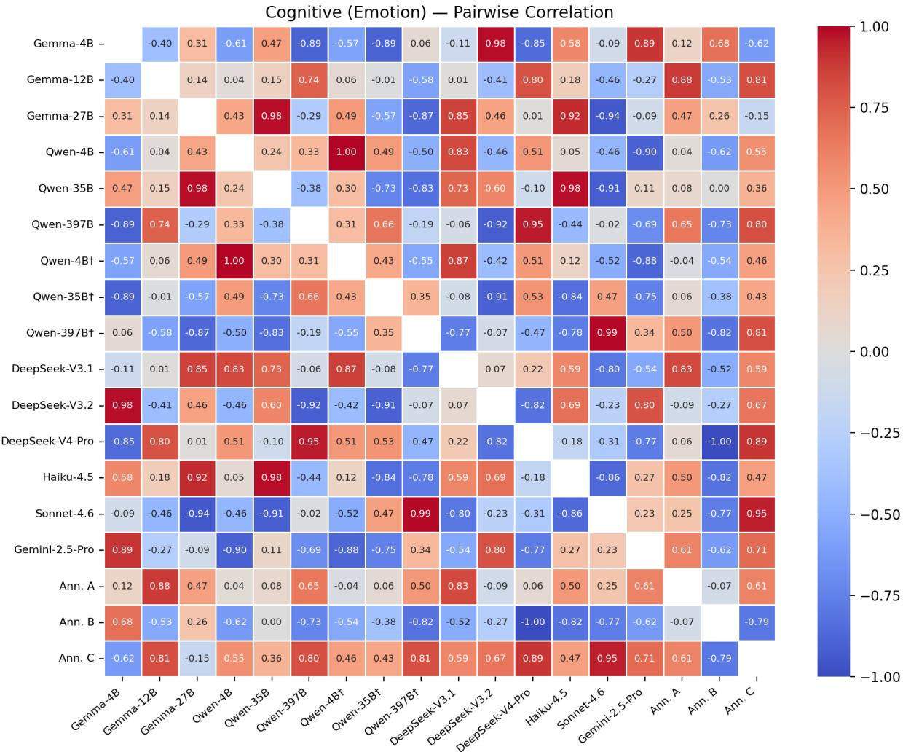  
Figure 7: Pairwise Pearson correlation of answer-choice distributions between all evaluated models and human annotators, for the emotion dimension of the cognitive intelligence task. Correlations involving human annotators are computed on shared instances. The dagger symbol (†) denotes models evaluated with thinking enabled.

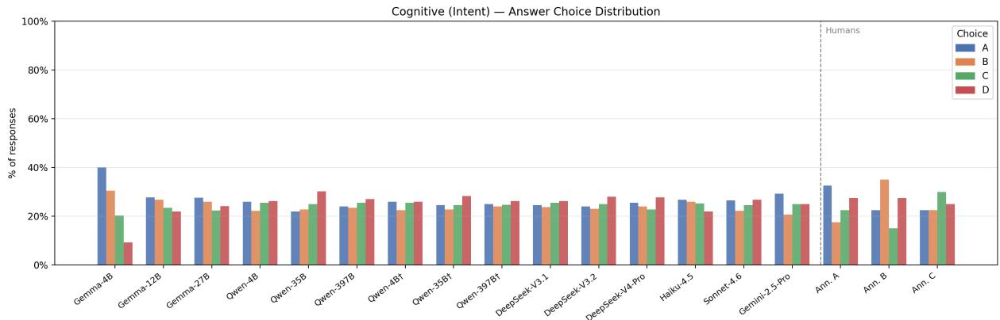  
Figure 8: Distribution of choices A, B, C, and D for the intent dimension of the cognitive intelligence task, for each model and human annotator. The dagger symbol (†) denotes models evaluated with thinking enabled.

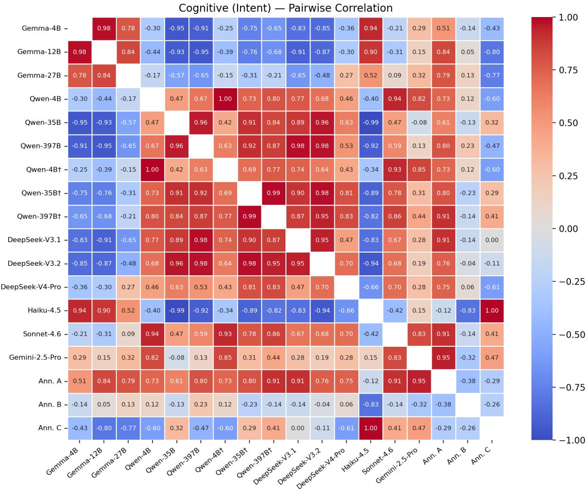  
Figure 9: Pairwise Pearson correlation of answer-choice distributions between all evaluated models and human annotators, for the intent dimension of the cognitive intelligence task. Correlations involving human annotators are computed on shared instances. The dagger symbol (†) denotes models evaluated with thinking enabled.

## A.6 Topic Distribution

Table 8 shows the distribution of discussion topics across the 200 threads in PERSO. The dataset covers a broad range of domains, with Ethics & Morality, Politics & Government, and Society & Culture accounting for the majority of threads.

<table><tr><td>Topic</td><td>Count</td><td>%</td></tr><tr><td>Ethics &amp; Morality</td><td>60</td><td>30.0</td></tr><tr><td>Politics &amp; Government</td><td>45</td><td>22.5</td></tr><tr><td>Society &amp; Culture</td><td>34</td><td>17.0</td></tr><tr><td>Philosophy &amp; Religion</td><td>30</td><td>15.0</td></tr><tr><td>Economics &amp; Business</td><td>9</td><td>4.5</td></tr><tr><td>Science &amp; Technology</td><td>7</td><td>3.5</td></tr><tr><td>International Affairs</td><td>7</td><td>3.5</td></tr><tr><td>Education &amp; Academia</td><td>6</td><td>3.0</td></tr><tr><td>Health &amp; Medicine</td><td>2</td><td>1.0</td></tr><tr><td>Total</td><td>200</td><td>100.0</td></tr></table>

Table 8: Topic distribution of the 200 CMV threads in PERSO.

## A.7 Non-LLM Baseline Results

Table 9 and Figures 10–12 report the full results of the non-LLM baselines introduced in Section 4.1.

Behavioral task. We establish three non-LLM reference points for the behavioral task: a random baseline (50%), a length heuristic that always selects the longer reply (65.5%), and four surfacefeature classifiers (Logistic Regression, Random Forest, Gradient Boosting, and SVM) trained with 5-fold cross-validation on 14 linguistic features, including reply length, sentiment polarity, readability, lexical diversity, and discourse marker density. These classifiers achieve 62.5–68.0%, all within one standard deviation of the length heuristic. The two most important Random Forest features (Figure 12) are reply length in words and characters, and the third, lexical diversity, is itself strongly correlated with length $( r = - 0 . 8 0 )$ . These results indicate that the predictive power of the examined surface features is largely driven by reply length, suggesting that models substantially outperforming these baselines capture signals beyond simple surface-level cues.

Cognitive task. We also evaluate a Sentence-BERT similarity baseline (all-mpnet-basev2) (Reimers and Gurevych, 2019) that encodes the context observed by the models (the OP’s post and the persuader’s reply) and selects the most similar answer choice. It achieves 21.00%,

23.25%, and 11.75% on belief, emotion, and intent respectively, all below the 25% chance level, confirming that the cognitive task cannot be resolved through surface-level semantic matching. On intent, the gold answer is the least similar option in 49.2% of instances, compared to 25% expected by chance. This is consistent with our generation guidelines (Appendix A.9), which require gold answers to abstract away from the literal content of the dialogue while distractors remain bound to its context, so that surface similarity is not a usable shortcut.

<table><tr><td>Method</td><td>Accuracy (%)</td><td>±Std</td></tr><tr><td>Behavioral task (n = 200)</td><td></td><td></td></tr><tr><td>Random baseline</td><td>50.0</td><td></td></tr><tr><td>Length heuristic</td><td>65.5</td><td>一</td></tr><tr><td>Logistic Regression</td><td>68.0</td><td>8.9</td></tr><tr><td>Random Forest</td><td>65.5</td><td>4.3</td></tr><tr><td>Gradient Boosting</td><td>63.5</td><td>5.4</td></tr><tr><td>SVM (RBF)</td><td>62.5</td><td>5.9</td></tr><tr><td>Cognitive task, SBERT (n = 400 per dimension)</td><td></td><td></td></tr><tr><td>Belief</td><td>21.00</td><td></td></tr><tr><td>Emotion</td><td>23.25</td><td></td></tr><tr><td>Intent</td><td>11.75</td><td>一</td></tr><tr><td>Random baseline</td><td>25.00</td><td>一</td></tr></table>

Table 9: Non-LLM baseline results. Std is computed across the five cross-validation folds; deterministic methods have none.

## A.8 Robustness to Reply Length

As the replies in PERSO are naturally occurring Reddit comments, the two candidate replies in a pair can differ in length. To verify that the behavioral evaluation is robust to such differences, we repeat the evaluation after removing outlier instances with an extreme length difference between the two replies. Specifically, among instances where the successful reply is longer, we compute the ratio between the lengths of the two replies and discard those above the third quartile (Q3) of this ratio, corresponding to a successful reply more than 4.97 times longer than its counterpart. This removes 33 instances and leaves a subset of 167 instances.

Table 10 compares model accuracy on the full dataset and on this subset. Removing these instances leads to a modest decrease in accuracy for all models, while the overall pattern of results is preserved: the relative ordering of models remains largely unchanged, and Qwen-3.5-397B remains the best-performing model. These results indicate that length differences between the replies have a limited effect on the behavioral evaluation, and that the conclusions drawn from the full dataset remain valid.

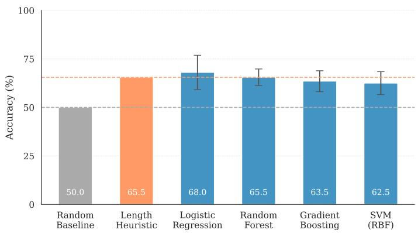  
Figure 10: Non-LLM baselines on the behavioral task (5-fold CV). Dashed lines mark the random (50%) and length-heuristic (65.5%) baselines.

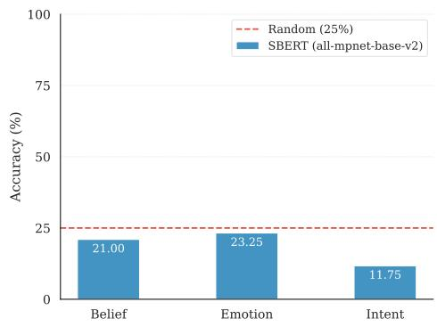  
Figure 11: SBERT similarity baseline on the cognitive task. All dimensions fall below the 25% chance level.

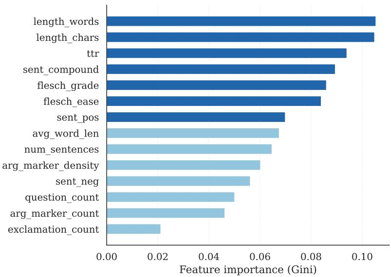  
Figure 12: Random Forest feature importance on the behavioral task. Each feature is the difference between its values for the two candidate replies.

## A.9 Prompt Templates

We detail the prompt templates used in our LLMin-the-loop pipeline for Cognitive MC generation and model evaluation.

Cognitive MC Generation We employ a twostep, few-shot prompting strategy governed by generation guidelines to construct the cognitive evaluation dataset. First (Figure 13), the model receives the <FULL\_DIALOGUE> to generate the gold choice for the persuadee’s belief, emotion, and intent based on their final utterance. Second (Figure 14), the model uses these extracted gold answers to generate three plausible, definitively incorrect distractors.

Cognitive Evaluation Task To assess social reasoning, the model receives <BODY\_UTTERANCE> (Figure 15) and must select the multiple-choice option that best predicts the persuadee’s upcoming belief, emotion, or intent in the next turn.

Behavioral Evaluation Task To evaluate behavioral intelligence the model receives <OP\_INITIAL\_POST> and two related <PERSUADER’S\_COMMENT> (Figure 16). To mitigate position bias, the model assigns unequal scores (1–4) to rate each candidate’s persuasiveness. The higher-scoring response represents the model’s selection for the more effective social action.

<table><tr><td>Model</td><td>Full (200)</td><td>Filtered (167)</td></tr><tr><td>Gemma-4B</td><td>60.50</td><td>56.29</td></tr><tr><td>Gemma-12B</td><td>62.50</td><td>59.88</td></tr><tr><td>Gemma-27B</td><td>71.00</td><td>67.66</td></tr><tr><td>Qwen-4B</td><td>64.00</td><td>57.49</td></tr><tr><td>Qwen-35B</td><td>75.00</td><td>70.06</td></tr><tr><td>Qwen-397B</td><td>76.00</td><td>71.26</td></tr><tr><td>Qwen-4B†</td><td>66.50</td><td>61.08</td></tr><tr><td>Qwen-35B†</td><td>73.00</td><td>68.26</td></tr><tr><td>Qwen-397B†</td><td>73.00</td><td>70.06</td></tr><tr><td>DeepSeek-V3.1</td><td>67.50</td><td>61.68</td></tr><tr><td>DeepSeek-V3.2</td><td>69.00</td><td>62.87</td></tr><tr><td>DeepSeek-V4-Pro</td><td>62.00</td><td>58.08</td></tr><tr><td>Haiku-4.5</td><td>69.50</td><td>65.27</td></tr><tr><td>Sonnet-4.6</td><td>71.50</td><td>67.07</td></tr><tr><td>Gemini-2.5-Pro</td><td>71.00</td><td>67.07</td></tr></table>

Table 10: Behavioral accuracy (%) on the full dataset and on the filtered subset obtained by removing instances with an extreme length difference between the two replies (length ratio above Q3). † denotes models evaluated with thinking enabled.

## Prompt for generating gold label

You are an expert at analyzing persuasion dialogues. Your task is to extract the persuadee’s true belief, intent, and emotion at the end of a dialogue.

For each factor (belief, intent, emotion), generate a correct answer that represents the underlying mental state of the persuadee in their last utterance.

• Belief is an internal representation of what an agent considers true.

• Emotion refers to the feeling state of an agent, often conveyed by cues.

• Intent refers to goals, motivation, and the underlying reasons for actions.

Important Answer Generation Notes:

\- -» The correct answer should reflect the cognitive aspect of the persuadee expressed at the «LAST ONLY UTTERANCE». Avoid expressing the persuadee’s cognitive aspects in utterances other than last in your correct answer.

\- -» Focus on the cognitive state, NOT OVERLY on the LITERAL DETAILS of the utterance — avoid restating content (no quotes, no paraphrase of what was said), do NOT mention exact quoted phrases from the dialogue.

## For Example:

Dialogue’s Last Utterance:

“I disagree, still. While Reddit does allow for some semblance of anonymity, its content still remains public domain. Reddit gathers a wide variety of users who span a massive spectrum of what personal information they do, and do not, share. The fact that you created a user name does now deter from the IP traces an individual, or organization in this case, can do. When someone gains notoriety like the redditor in question did, it simply puts an even bigger spotlight on their account. An account which, like it or not, remains tied to the actual person. So contextually, Twitter and Reddit are inherently the same.”

Bad Answer (Too Specific):

\- Belief: The persuadee still believes that Reddit and Twitter are contextually the same because Reddit’s content is public domain and a user’s anonymity is not guaranteed, making the situations of the Redditor and Kathy Griffin comparable.

\- Intent: To rebut the persuader’s argument by explaining why the perceived anonymity on Reddit is not a valid distinction from posting on a platform like Twitter, thus reinforcing their original stance.

\- Emotion: Frustrated and annoyed that the persuader is not understanding the technical aspects of internet anonymity.

Good Answer (Abstracted Enough):

\- Belief: Still believes the discussed platforms are similar because both operate in the public domain.

\- Intent: To challenge a comparison by arguing that the two platforms being contrasted are fundamentally similar.

## - Emotion: Resolute

\- -» As an additional checklist: Imagine the last utterance were worded differently, make sure your answer should still apply.

\- -» Keep your answers compact, following the style shown in the following examples. Avoid generating relatively very long answers.

The fixed questions to which you should provide your correct answers are:

• “What is the Persuadee’s Belief at the end of the last turn?”

• “What is the Persuadee’s Emotion at the end of the last turn?”

• “What is the Persuadee’s Intent at the end of the last turn?”

Here’s your thinking process for generating the JSON:

1. Read the entire dialogue to understand the persuadee’s initial stance and how it evolves.

2. Analyze the final utterance as the endpoint of that evolution.

3. For each category (Belief, Emotion, Intent), infer the persuadee’s internal state.

4. Draft the answer, ensuring it follows the Key Principles and avoids the forbidden elements.

Return the output strictly as valid JSON in the following schema:

" belief\_question ": {   
" question ": " What is the   
persuadee ’s Belief at the end   
of the last turn ?",   
" answer ": "[ Belief 's correct   
answer ]"

},   
" emotion\_question ": {   
" question ": " What is the   
persuadee ’s Emotion at the   
end of the last turn ?",   
" answer ": "[ Emotion 's correct   
answer ]"   
} ,   
" intent\_question ": {   
" question ": " What is the   
persuadee ’s Intent at the end   
of the last turn ?",   
" answer ": "[ Intent 's correct   
answer ]"   
}   
}   
–»> Do Not include any extra text outside the JSON «<–   
Dialogue’s format:   
• A: denotes the start of the persuadee’s utterance   
• B: denotes the start of the persuader’s utterance   
• Syntax >statement marks a quote   
Examples:   
Case 0:   
…   
Case 1:   
...   
Dialogue:   
<FULL\_DIALOGUE>  
Figure 13: Prompt template for generating gold labels.

## Prompt for generating distractors

You are an expert at analyzing persuasion dialogues.   
Your task is to generate distractors for the persuadee’s   
belief, intent, and emotion at the end of a dialogue, given   
the persuadee’s actual states.   
For each factor (belief, intent, emotion), generate 3 plau  
sible distractors, bound by the dialogue’s context, given   
the persuadee’s actual states. Ensure that the distractors   
match the correct answer in their level of abstraction.   
• Belief is an internal representation of what an agent   
considers true.   
• Emotion refers to the feeling state of an agent,   
often conveyed by cues.   
• Intent refers to goals, motivation, and the underly  
ing reasons for actions.   
Distractor generation notes:   
- -> Persuadee’s actual states at the last utterance   
(the correct answers for which you should make   
distractors) are provided at the end of each dia  
logue.   
- -> Avoid Shortcut Effects when creating distractors.   
Shortcut effect refers to situations where distrac  
tors are easy to eliminate without analyzing the   
context provided. Here’s an example of the short  
cut effect:   
Q: What is the Persuadee’s emotion at the end of   
the last turn?

A (Distractor) : Reluctant and hesitant, as they fee   
forced to admit they were wrong.   
A (Distractor with Shortcut) : In love, and joyful,   
as they have found a deep connection with the per   
suader.   
It is obvious that in a persuasion scenario, the case   
of the persuadee falling in love with the persuader   
is hardly possible, therefore the second choice pro   
poses a shortcut effect, where no context analysis   
is needed for eliminating this choice.   
- -> Avoid creating distractors that are “technically”   
correct. Designed distractors must be definitely   
wrong.   
- -> Avoid creating distractors that imply mean be   
havior, for example:   
Q: What is the Persuadee’s intent at the end of the   
last turn, reflected at the last utterance?   
A (Distractor) : To request more information about   
the points raised in the persuader’s second para   
graph.   
A (Distractor implying mean behavior) : To start   
an outburst of profanity, trying to offend the per   
suader’s beloved ones.   
- -> Make sure not to create distractors that are too   
plausible or can be correct in general, or are overly   
customized and narrowly focused on dialogue’s   
last utterance.   
- -> Make distractors that are incorrect in the way of   
not following persuadee’s mental state’s rational   
flow in the dialogue.   
- -> Make sure all distractors and the correct answer   
are distinct and all the distractors are definitely   
wrong.   
- -> Make sure NOT to mention exact phrases from   
the dialogue in the distractors.   
- -> Make sure to preserve the style of the correct   
answer (e.g., phrasing, tone, and length) when writ  
ing distractors. For emotion questions specifically,   
emphasize that the length should be a short phrase,   
like the correct answer.   
The fixed questions for which you should make dis   
tractors are:   
• “What is the Persuadee’s Belief at the end of the   
last turn?”   
• “What is the Persuadee’s Emotion at the end of the   
last turn?”   
• “What is the Persuadee’s Intent at the end of the   
last turn?”   
Return the output strictly as valid JSON in the following   
schema:   
{{   
" belief\_question ": {{   
" question ": " What is the   
persuadee ’ s Belief at the end   
of the last turn ?" ,   
" distractors ": [   
"1) [ Distractor text ]"

"2) [ Distractor text ]"   
"3) [ Distractor text ]"   
]   
}} ,   
" emotion\_question ": {{   
" question ": " What is the   
persuadee ’s Emotion at the   
end of the last turn ?",   
" distractors ": [   
"1) [ Distractor text ]"   
"2) [ Distractor text ]"   
"3) [ Distractor text ]"   
]   
}} ,   
" intent\_question ": {{   
" question ": " What is the   
persuadee ’s Intent at the end   
of the last turn ?" ,   
" distractors ": [   
"1) [ Distractor text ]"   
"2) [ Distractor text ]"   
"3) [ Distractor text ]"   
]   
}}   
}}   
–»> Do Not to include any extra text outside the JSON   
«<–   
Dialogue’s format:   
• A: denotes the start of the persuadee’s utterance   
• B: denotes the start of the persuader’s utterance   
• Syntax >statement marks a quote   
Examples:   
Case 0:   
...   
Case 1:   
...   
Dialogue:   
<FULL\_DIALOGUE>   
Persuadee’s Actual states (Make distractors for   
these):   
• Persuadee’s belief:   
<BELIEF\_CORRECT\_ANSWER>   
• Persuadee’s emotion:   
<EMOTION\_CORRECT\_ANSWER>   
• Persuadee’s intent:   
<INTENT\_CORRECT\_ANSWER>  
Figure 14: Prompt template for generating distractors.

## Prompt for cognitive evaluation

You are an expert at analyzing persuasion dialogues.   
You are given a persuasion dialogue between a persuadee   
and a persuader.   
Your task is to answer a multiple-choice question about   
the persuadee’s {MENTAL\_STATE\_DIMENSION} at the end

of the dialogue.   
Important:   
The provided dialogue is not yet complete. The   
persuadee will speak again after the last shown   
turn. Your job is to predict the persuadee’s   
{MENTAL\_STATE\_DIMENSION} in their upcoming next ut   
terance, not to infer their past or current state.   
–» Select the option that best reflects the persuadee’s   
{MENTAL\_STATE\_DIMENSION} at the end of the dialogue.   
Dialogue’s format:   
• A: denotes the start of the persuadee’s utterance   
• B: denotes the start of the persuader’s utterance   
• Syntax > statement marks a quote   
Dialogue:   
<BODY\_UTTERANCE>   
Question:   
What will the persuadee’s <MENTAL\_STATE\_DIMENSION>   
be in their next upcoming utterance after the end of the   
shown dialogue?   
Choices:   
• <GENERATED\_CHOICE\_1>   
• <GENERATED\_CHOICE\_2>   
• <GENERATED\_CHOICE\_3>   
• <GENERATED\_CHOICE\_4>   
–»> Provide ONLY THE CORRECT ANSWER LETTER   
(A, B, ...) in the response, NO EXTRA TEXT «<–

Figure 15: Prompt template for evaluating cognitive intelligence.  
Prompt for rating persuasive utterances   
You are an expert in persuasion and communication   
strategies.   
You are given:   
• A description of a persuadee’s current view.   
• Two candidate persuasive utterances (A and B).   
Rate each utterance.   
Scoring:   
• 1 = Not persuasive   
• 2 = Slightly persuasive   
• 3 = Persuasive   
• 4 = Very persuasive   
Important Guidelines:   
• The two scores MUST NOT be equal.   
• If they seem equally persuasive, choose the one   
that is even slightly better.

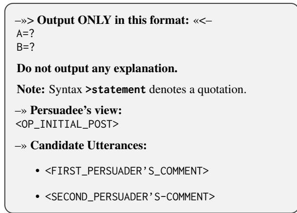  
Figure 16: Prompt template for evaluating behavioral intelligence.

## A.10 Processed Example from PERSO

This appendix presents a processed example illustrating how a paired persuasion branch is converted into the cognitive and behavioral tasks.

Figure 17 shows the complete source thread in part 1, the cognitive task for Persuader 1 in part 2, the cognitive task for Persuader 2 in part 3, and the corresponding behavioral comparison between the two persuader responses in part 4.

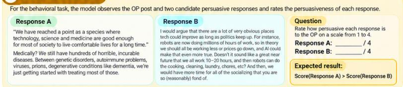

## OP Post

## CMV: We don't need any more progress in tech

We have reached a point as a species where technology, science and medicine are good enough for most of society to live comfortable lives for a long time. Any more progress in technology is harming us as we became more lonely, anxious, depressed. It seems now that "progress" is a scam perpetuated by capitalism and it's inherently tied to profits and not survival as a race. IMO the 90s were probably the best times we we had the right balance of progress in medicine (to be able to live a comfortable, disease free life) and technology (basic internet) and could still enjoy the simple things in life (like going out and talking to people, socialising summers spent enjoying the simple things). What if we just stood still right now and let society catch up instead of hurtling through life. I believe we would be happier if that were to happen

## Response from Persuader 1

"We have reached a point as a species where technology. science and medicine are good enough for most of society to live comfortable lives for a long time."

Medically? We still have hundreds of horrible, incurable diseases. Between genetic disorders, autoimmune problems, viruses. prions, degenerative conditions like dementia, we're just getting started with treating most of those.

## OP Reply to Persuader 1

You are correct and the only area where I'd change my position is medicine. I do believe that continued progress in medicine is critical. My point was more about the baseline we have achieved -- we have made enough progress to clear most existential threats Today, if you have access to healthcare, you can expect a reasonably healthy life. So while we should absolutely continue to make progress in medicine, I feel that "wellbeing" depends a lot more on social and psychological needs rather than purely medical ones

## Response from Persuader 2

I would argue that there are a lot of very obvious places tech could improve as long as politics keep up. For instance, robots are now doing millions of hours of work, so in theory we should all be working less or prices go down, and Al could make that even more true. Doesn't it sound like a great near future that we all work 10–20 hours, and then robots can do the cooking, cleaning, laundry, chores, etc? And then, we would have more time for all of the socializing that you are so (reasonably) fond of.

## ② Cognitive Task for Persuader 1

Given the OP post and the response from Persuader 1, the model predicts the OP's resulting belief, emotion, and intent.

## Belief. Select the option that best reflects the persuadee's belief at the end of the dialogue.?

(A) Believes that all forms of technological and scientific progress, including non-medical ones, are now crucial for improving overall well-being.

(B) Believes that the current state of medicine is sufficient and that any further progress is unnecessary as most major health threats have been eliminated

(C) Believes that while continued medical progress is necessary, overall well-being is now more dependent on social and psychological factors.

(D) Believes that well-being is almost entirely dependent on medical advancements and that social or psychological factors are secondary concerns.

## 2 Emotion. Select the option that best reflects the persuadee's emotion at the end of the dialogue.?

(C) Receptive

## 3 Intent. Select the option that best reflects the persuadee's intent at the end of the dialoque.?

(A) To concede that medical advancement is still required, while clarifying that their primary concern is about non-medical aspects of well-being

(B) To argue that the main problem is not the state of technology but the unequal access to existing healthcare across society.

(C) To dispute the claim that there are many incurable diseases, arguing that existing medicine is adequate for a comfortable life.

(D) To fully retract their initial argument and agree that all forms of technological progress are beneficial for humanity.

## OP Reply to Persuader 2

That is a fair point. My argument is that progress does not happen in vacuum and is shaped by the systems we live in, and in our case that dominant system is capitalism, which prioritises profit not wellbeing. So while robots could take up all the mundane tasks you listed, that's not the actual direction we are heading ir (Al replacing jobs, automation increases productivity but not general wellbeing/happiness, etc.). So as a species, we are threatened to kinda lost our identity, which I'd say is a core tenet of being "fullifled" or "happy". So while I agree with your idea in theory, don't see us taking that trajectory.

## ③ Cognitive Task for Persuader 2

Given the OP post and the response from Persuader 2, the model predicts the OP's resulting belief, emotion, and intent.

Belief. Select the option that best reflects the persuadee's belief at the end of the dialogue.?

(A) Believes that the primary threat of technology is the loss of human identity, and that this would happen even if technology was used to reduce working hours

(B) Believes that automation and Al are inherently destructive forces that could never lead to increased free time or well-being regardless of the economic system

(C) Believes that the theoretical benefits of technological advancement are unattainable in practice due to the constraints of the current economic system.

(D) Believes that the persuadee's vision is flawed because technology itself, not the economic system, is the root cause of increased loneliness and unhappiness

2 Emotion. Select the option that best reflects the persuadee's emotion at the end of the dialoque.?

(A) Pessimistic

(B) Confused

(C) Objective

## 3 Intent. Select the option that best reflects the persuadee's intent at the end of the dialogue.?

(A) To completely reject the persuader's vision of the future as an unrealistic fantasy with no theoretical merit.

(B) To accept the persuadee's point and modify their own view to incorporate the idea that technology will eventually lead to more free time

(C) To argue that capitalism is the sole problem facing humanity O and that the discussion about technology is a distraction from this main issue

(D) To concede a theoretical point while reasserting that real-world systems will prevent its positive realization.

## 4 Behavioral Task

Figure 17: A processed example illustrating how a paired persuasion branch is converted into the cognitive and behavioral tasks.