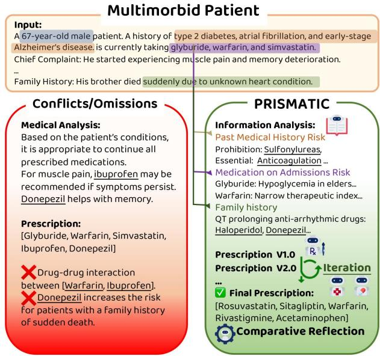
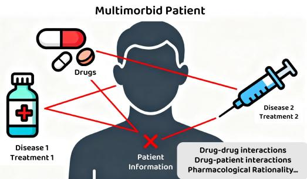
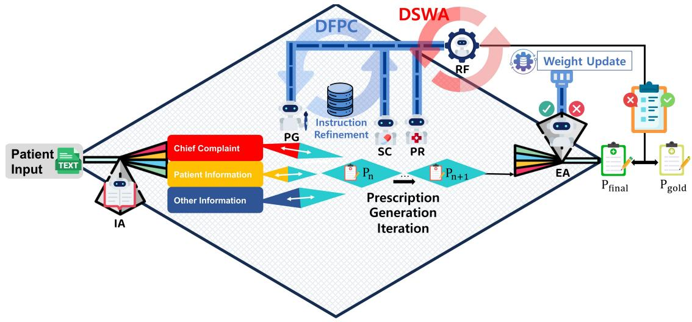
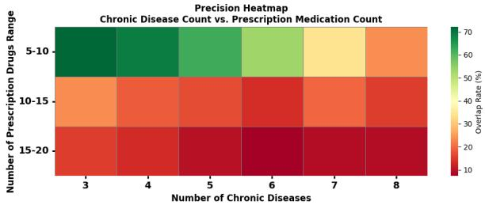
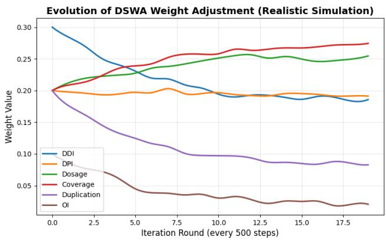

# PRISMATIC : Prescription Risk Inspection System for Multi-Agent Treatment Interaction in Clinical Decision-Making

Ziyang Ling zaneling@mail.ustc.edu.cn University of Science and Technology of China Hefei, China

Shuyu Lu   
Shuyu.Lu@uth.tmc.edu   
The University of Texas Health   
Science Center at Houston   
Houston, United States

Ziyi Chen chenziyi@mail.ustc.edu.cn University of Science and Technology of China Hefei, China

## ABSTRACT

Medical prescribing errors for multimorbid patients, who require complex drug regimens, are a major patient safety concern. These errors often stem from fragmented decision-making across medical specialties—a critical coordination failure that leads to adverse drug events and rehospitalizations.

To address this coordination challenge, we introduce PRISMATIC, a multi-agent architecture where specialized agents, each representing a workflow role, collaboratively generate and refine treatment plans. Operating on a blackboard architecture, the system first structures patient information from clinical notes, then iteratively develops safe, rational, and interpretable drug regimens. The agents’ collaboration is governed by two novel adaptive coordination mechanisms: (1) Dynamic Self-Updating Weight Adjustment (DSWA), a long-term mechanism that adjusts the influence weights of agents based on historical case outcomes, enabling the system to adapt and trust more reliable specialists over time. (2) Discrepancy Feedback Precise Calibration (DFPC), a short-term mechanism where agents provide iterative feedback to resolve disagreements and eliminate prescription conflicts for the current patient.

Experiments on patient records from the MIMIC-IV database show that PRISMATIC significantly reduces drug conflicts, improves prescription coverage, and enhances treatment consistency compared to strong LLM baselines. Our work demonstrates that struc turing clinical co-treatment as a multi-agent coordination problem ofers a promising path toward safer and more coherent multidisease management.

## KEYWORDS

Clinical prescription decision support, Medical prescription errors, Multi-agent system, Multi-agent system organizational learning

## 1 INTRODUCTION

Prescribing for multimorbid patients: individuals with multiple chronic diseases such as hypertension, diabetes, and chronic kidney disease, is a high-stakes challenge in modern medicine [17]. These patients require complex medication regimens often overseen by multiple specialists, yet each clinician typically focuses on a single disease-specific guideline. This siloed approach, illustrated in Figure 2, inevitably fragments the clinical reasoning process, leading to a cascade of preventable issues: overlooked drug-drug interactions, conflicting therapeutic goals, and ultimately, adverse events. The scale of this problem is significant, with studies esti mating thousands of such errors per 100,000 admissions [3]. At its core, this is not merely a problem of individual mistakes, but a systemic failure of coordination among well-intentioned but isolated decision-makers.

  
Figure 1: For patients with complex conditions and multiple comorbidities, conflicts and omissions may arise due to drug interactions and physician cognitive load. In contrast, PRISMATIC is a safe, comprehensive, and rational clinical prescription decision support system application.

Motivations: NLP/LLM still fails. Early prescribing support tools relied on static rules (e.g., drug-drug interactions, contraindications) or manual chart reviews [20, 21]. Recent NLP and deep learning models automate tasks like ADE detection and medication extraction [16, 22]. Besides, while the advent of Large Language Models (LLMs) represents a significant leap in reasoning capabilities for healthcare [23], current applications to prescribing reveal a fundamental architectural mismatch. They typically frame the automated prescription task as a monolithic, end-toend generation problem, ingesting all patient data to produce an output in an opaque, "black box" fashion [5, 12, 18]. This monolithic approach is fundamentally misaligned with the nature of collaborative clinical reasoning. It lacks the modularity to represent specialized knowledge domains (e.g., a clinician vs. a pharmacologist), the transparency to trace how conflicting risks were weighed, and the explicit coordination mechanisms to resolve disagreements between therapeutic goals. Ultimately, the challenge is not simply one of text generation, but of collaborative synthesis, where a task the monolithic models are ill-suited.

  
Figure 2: Multimorbid patients often experience medication conflicts and pharmacological omissions in real-world prescribing due to fragmented care and incomplete analysis of complex information.

Contributions. To address the gap left by monolithic models, we argue for a paradigm shift from end-to-end generation to collaborative multi-agent synthesis. In this paper, we develop this paradigm by introducing PRISMATIC, a multi-agent architecture designed to navigate the complexities of multimorbid prescribing by explicitly modeling the distributed reasoning process of the clinical scenario.

This paper makes the following primary contributions:

(1) A Novel Multi-Agent Framework for Prescription Gen eration. We design and implement PRISMATIC, a complete system that generates safer and more coherent prescriptions by proactively synthesizing fragmented clinical data and resolving conflicts.

(2) Two Adaptive Agent Coordination Mechanisms. We propose DSWA (Dynamic Self-updating Weight Adjustment) for long-term organizational learning and DFPC (Discrepancy Feedback Precise Calibration) for short-term, case-specific conflict resolution.

(3) Comprehensive Empirical Validation. We conduct extensive experiments on the combined MIMIC-IV Note [11] and MIMIC-IV Hosp [10] datasets, demonstrating that PRISMATIC significantly outperforms strong LLM and fine-tuned baselines in reducing drug conflicts, improving therapeutic coverage, and ensuring treatment consistency.

## 2 RELATED WORKS

Multi-Agent System in Medications. Multi-agent systems have long been explored in healthcare due to their decentralized, modular nature, which enables distribution of specialized tasks and supports dynamic decision-making in complex clinical settings.

As one of the early explorations nearly two decades ago, [19] proposed a rule-based agent framework to support doctor–patient collaboration and personalized hospital assistance. A decade later, [1] introduced a multi-agent system for managing patient flow and hospital resource allocation.

More recently, with the rapid advancement ofAI and large language models (LLMs),multi-agent systems have evolved significantly, overcoming prior limitations in perception and interaction [13]. Recent systems leverage LLMs to enhance clinical decision-making [7], support surgical workflows with chain-of-thought reasoning [14], and enable collaborative diagnostic reasoning among doctor agents [5]. Others incorporate verified knowledge tools [9] or adaptive frameworks mimicking real-world clinical decision-making [12]. These developments underscore the growing sophistication and promise of LLM-powered multi-agent systems in improving healthcare delivery.

## 3 PRELIMINARY: PROBLEM DEFINITION

Our work addresses the challenge of medication recommendation for multimorbid patients at the point of hospital admission. The core task is to generate a safe and efective prescription plan based solely on the clinical narrative available in the patient’s record. This narrative, which we denote as input T, comprises the main complaints of the patient CP, personal and historical information PI, and other risk factors OI, such as allergies or lifestyle habits. The general input can be summarized as $T = \{ C P , P I , O I \}$

The desired output is a complete prescription, P, which includes both a list of drugs as well as a clinically sound interpretation. Specifically, a prescription consists of a drug list D and an accompanying interpretation I . Each recommended drug �� in the list is detailed with the precautions $r _ { i } ,$ the dosage and frequency $u _ { i } ,$ and a clear explanation $e _ { i }$ for its inclusion. Thus, the final output is ${ \pmb P } =$ { D, I }, where ${ \pmb { { \cal D } } } = \{ ( d _ { i } , u _ { i } , r _ { i } , e _ { i } ) \} _ { i = 1 } ^ { N }$

## 3.1 A Multi-Objective Optimization Problem

As established in the Introduction, prescribing for multimorbid patients is fundamentally a coordination problem arising from fragmented clinical expertise. Here, we formalize the desired outcome of this coordination process. A successful prescription can be viewed as a solution to a multi-objective optimization problem, where the system must simultaneously satisfy several critical constraints related to safety, rationality, and interpretability. The overall goal is to find an optimal prescription P\* that maximizes a set of objectives: P\* = arg maxP (Safety (P), Rationality (P), Interpretability (P)).

Safety is the foremost concern. A valid prescription must be free of harmful drug-drug interactions (DDI) between any two medications in the plan. Furthermore, it must avoid drug-patient interactions (DPI), ensuring that the medication does not conflict with the existing conditions or allergies of the patient. Finally, the dosage for every drug must be within a clinically accepted rational range.

Pharmacological Rationality ensures that the prescription is both efective and eficient. This involves two main aspects. First, the plan must have high coverage, which means that all primary symptoms and therapeutic needs are addressed. Second, it must avoid duplication, where multiple drugs are prescribed for the same condition, leading to redundancy and increased risk. The goal is to maximize therapeutic coverage while simultaneously penalizing redundancy. This trade-of is perfectly captured by: Rationality(P) = Coverage(P) - Duplication(P).

Table 1: The PRISMATIC Agent Society: Roles and Responsibilities in the Coordination Process
<table><tr><td rowspan=1 colspan=1>Agent</td><td rowspan=1 colspan=1>Core Responsibility</td><td rowspan=1 colspan=1>Key Function in the Coordination Process</td></tr><tr><td rowspan=1 colspan=1>InformationAnalysis (IA)</td><td rowspan=1 colspan=1>Structure the Input</td><td rowspan=1 colspan=1>Establishes the common ground for collaboration by parsing raw clin-ical text (T) into a structured, shared representation (Chief Complaint(CP), Patient Information (PI) on the blackboard</td></tr><tr><td rowspan=1 colspan=1>PrescriptionGeneration (PG)</td><td rowspan=1 colspan=1>Propose a Solution</td><td rowspan=1 colspan=1>Acts as the primary reasoner. Synthesizes the structured information{CP, PI, OI} and contextual information from the blackboard to gen-erate an initial candidate prescription $\left( P _ { n } \right)$ . The prescription is theniteratively negotiated with the SC, PR, and EA agents through theinner loop (DFPC), undergoing refinement based on their feedbackuntil a consensus is reached.</td></tr><tr><td rowspan=1 colspan=1>Safety Check(SC)</td><td rowspan=1 colspan=1>Critique on Safety</td><td rowspan=1 colspan=1>Functions as a specialized critic targeting the Safety Objective. Verifiesthe candidate prescription against formal safety constraints (DDI,DPI, Dosage)1 and posts specific, actionable violations for collectiveresolution.</td></tr><tr><td rowspan=1 colspan=1>Pharm.Rationality (PR)</td><td rowspan=1 colspan=1>Critique onRationality</td><td rowspan=1 colspan=1>Functions as a specialized critic targeting the Rationality Objective.Evaluates the prescription&#x27;s therapeutic Coverage and Duplication²to ensure clinical efficacy and efficiency, posting its findings as feed-back.</td></tr><tr><td rowspan=1 colspan=1>V XEvaluationAgent (EA)</td><td rowspan=1 colspan=1>Adjudicate &amp; Decide</td><td rowspan=1 colspan=1>Serves as the coordinator and adjudicator of the inner loop. It aggre-gates critiques from SC and PR, assesses interpretability, and com-putes a unified score to decide whether to accept the prescription ortrigger a refinement cycle via DFPC.</td></tr><tr><td rowspan=1 colspan=1>àReflection &amp;Feedback (RF)</td><td rowspan=1 colspan=1>Drive Long-TermLearning</td><td rowspan=1 colspan=1>Functions as the organizational learning facilitator. It compares thefinal prescription $\mathbf { P } _ { \mathrm { f i n a l } }$ to a gold standard $\mathbf { P } _ { \mathrm { g o l d } }$ to generate the discrep-ancy signal that drives the long-term adaptation of the entire systemvia the DSWA outer loop.</td></tr></table>

Interpretability requires that the final drug list should be transparent, traceable, and auditable by human experts. This is especially vital to ensure that nuanced patient-specific risk factors, which we categorize as Other Information (OI), have been properly consid ered. These factors include the patient’s lifestyle (e.g., alcohol use), administration constraints (e.g., inability to swallow pills), or in a specific population with unique contraindications (e.g., pregnancy). Therefore, a complete solution must generate not just a prescription, but also clear evidence-based justifications for its recommendations.

## 3.2 Baseline Approaches

To benchmark our method, we compare it against two primary baseline paradigms that represent the current state-of-the-art in this domain:

General-Purpose LLM Generation: This approach uses a powerful, general-purpose large language model (e.g., GPT-4). The en tire patient record T is formatted into a prompt with specific strategies (zero-shot, few-shot, etc.), and the LLM is directly asked to generate a prescription P. This method tests the out-of-the-box reasoning capabilities of a leading foundation model.

Specialized Medical LLM Generation: This paradigm utilizes a large language model that has been specifically developed for the medical domain. These models are pre-trained on extensive corpora of biomedical literature, clinical guidelines, and electronic health records. As a result, they possess deep domain knowledge and are expected to generate more clinically sound outputs than the general-purpose counterparts. The process remains end-to-end, taking T as input to produce P. This baseline represents a strong, knowledge-intensive competitor that leverages a state-of-the-art domain-expert model.

## 4 METHODOLOGY – PRISMATIC

To solve the multi-objective coordination problem of multimorbid prescribing, we introduce PRISMATIC, a multi-agent architecture. Conceptually, the architecture acts as an intelligent prism: it takes unstructured clinical text as input, "refracts" it through the specialized perspectives of multiple agents, and synthesizes their insights into a single, coherent prescription. The whole process is governed by a dual-loop learning design:

(1) An Inner Loop (DFPC) handles the collaborative reasoning and refinement required to generate a prescription for a single patient case.

(2) An Outer Loop (DSWA) enables long-term, system-wide adaptation and learning across multiple cases.

The architecture consists of six specialized agents whose roles are explicitly designed to address the objectives defined in our problem formulation. The conceptual architecture is shown in Figure 3.

## 4.1 The Agents: A Society of Clinical Specialists

The PRISMATIC agent society simulates a multidisciplinary clinical team. Each agent has a distinct responsibility, and their collaboration is mediated through a shared blackboard. Their roles are summarized in Table 1.

## 4.2 The Inner Loop: Case-Level Refinement (DFPC)

The Discrepancy Feedback Precise Calibration (DFPC) mechanism governs the real-time collaboration for a single patient case. It is an iterative propose-critique-refine cycle:

Propose: The PG agent initiates a candidate prescription.

Critique: The SC and PR agents evaluate it concurrently against the safety and rationality objectives, posting their findings.

Adjudicate & Refine: The EA agent aggregates this feedback.If the prescription is unacceptable, it triggers a refinement cycle.

The key to DFPC’s eficiency and efectiveness lies in its mechanism for targeted error attribution and local calibration. Instead of restarting the generation process, the system traces a specific violation (e.g., a DDI) back to its source domain and re-engages only the relevant agents (e.g., the SC and PG). The SC provides specific feedback, and the PG performs a localized correction—such as replacing a single conflicting drug—while leaving the rest of the prescription intact. This process of decentralized refinement makes the multi-agent deliberation both computationally eficient and clinically stable.

## 4.3 The Outer Loop: Long-Term Adaptation (DSWA)

The Dynamic Self-updating Weight Adjustment (DSWA) mecha nism enables the system to learn and improve over many cases. After the inner loop finalizes a prescription, the RF agent identifies discrepancies between the output $\left( \mathbf { P } _ { \mathrm { f i n a l } } \right)$ and a gold-standard reference $\bf ( P _ { \mathrm { g o l d } } )$ . This error signal drives the DSWA process in two ways:

First, it performs adaptive weight evolution. DSWA quantifies the errors across diferent clinical dimensions (e.g., DDI safety, dosage, coverage) and updates a global weight vector, W, used by the EA agent. Clinical dimensions that exhibit persistent or severe errors are systematically up-weighted, which compels the agent society to prioritize those aspects more heavily in future deliberations.

Second, DSWA triggers a distributed knowledge consolida tion. Insights from the error analysis are distilled and synchronized across the agents’ knowledge bases, allowing the entire system to learn from cases. This dual process of adapting the collective evaluation policy (W) and updating shared knowledge enables the system to develop an emergent understanding of clinical priorities, mirroring how a human team’s expertise evolves with experience.

This process functions as a form of organizational learning, allowing the agent society to adapt its collective priorities over time and become more attuned to the specific challenges of its clinical environment.

Algorithm 1 Dynamic Self-updating Weight Adjustment (DSWA)   
Input: Discrepancy vector $\mathbf { r } ^ { ( t ) } = [ r _ { 1 } ^ { ( t ) } , \ldots , r _ { 6 } ^ { ( t ) } ]$ ; previous weights   
$\mathbf W ^ { ( t ) } = [ W _ { 1 } ^ { ( t ) } , \dots , W _ { 6 } ^ { ( t ) } ]$ ; smoothing factor �; learning rate �;   
temperature $\beta .$   
Output: Updated weights $\mathbf { W } ^ { ( t + 1 ) } = [ W _ { 1 } ^ { ( t + 1 ) } , \dots , W _ { 6 } ^ { ( t + 1 ) } ]$   
Temporal smoothing:   
$\bar { r } _ { i } ^ { ( t ) } \gets ( 1 - \gamma ) \bar { r } _ { i } ^ { ( t - 1 ) } + \gamma r _ { i } ^ { ( t ) }$   
Compute normalized importance:   
$u _ { i } ^ { ( t ) } \gets \frac { \exp ( \beta \bar { r } _ { i } ^ { ( t ) } ) } { \sum _ { j } \exp ( \beta \bar { r } _ { j } ^ { ( t ) } ) }$   
Update weights:   
$\tilde { W } _ { i } ^ { ( t + 1 ) } \gets ( 1 - \eta ) W _ { i } ^ { ( t ) } + \eta u _ { i } ^ { ( t ) }$   
Normalize:   
$W _ { i } ^ { ( t + 1 ) } \gets \frac { \tilde { W } _ { i } ^ { ( t + 1 ) } } { \sum _ { j } \tilde { W } _ { j } ^ { ( t + 1 ) } }$   
Return: Updated $\mathbf { W } ^ { ( t + 1 ) }$

## 5 EXPERIMENTS

## 5.1 Experiment Setup

Dataset and Task. We evaluate PRISMATIC on a curated dataset from MIMIC-IV, consisting of pairs of unstructured admission notes (T) and their corresponding ground-truth prescriptions $( { \bf P } _ { \mathrm { g o l d } } )$ . To reflect real-world clinical challenges, we stratified the dataset into three levels of case complexity (low, medium, high) based on the number of chronic diagnoses and prescribed medications per patient with K-means, which were denoted as complexity i, ii, and iii, respectively.

Evaluation Metrics. We assess performance from two critical perspectives:

(1) Accuracy and Rationality: We use Overlap Rate (OR), Precision (Prec.), and Exact Match (EM) to measure how closely the generated prescriptions match the ground truth. EM is the strictest metric, requiring a perfect match of all prescribed drugs.

(2) Safety: We use the Zero-Interaction Ratio (ZIR), which measures the percentage of generated prescriptions that are completely free of known drug-drug interactions. This metric directly evaluates the system’s ability to satisfy a primary clinical objective.

• Overlap Rate (OR). Measures the proportion ofgold-standard drugs correctly predicted. For the �-th case:

$$
\mathrm { O R } = \frac { 1 } { n } \sum _ { i = 1 } ^ { n } \frac { | \mathbf { P } _ { i } \cap \mathbf { P } _ { g o l d } ^ { ( i ) } | } { | \mathbf { P } _ { g o l d } ^ { ( i ) } | }
$$

  
Figure 3: Complete workflow of PRISMATIC

• Precision (Prec.) Measures the proportion of predicted drugs that are correct:

$$
{ \mathrm { P r e c . } } = { \frac { 1 } { n } } \sum _ { i = 1 } ^ { n } { \frac { | \mathbf { P } _ { i } \cap \mathbf { P } _ { g o l d } ^ { ( i ) } | } { | \mathbf { P } _ { i } | } }
$$

• Exact Match Ratio (EM). Measures the fraction of predictions that exactly match the ground-truth set:

$$
\mathrm { E M } = \frac { 1 } { n } \sum _ { i = 1 } ^ { n } \mathbb { I } [ \mathbf { P } _ { i } = \mathbf { P } _ { g o l d } ^ { ( i ) } ]
$$

where I[·] is the indicator function returning 1 if the predicted and gold-standard sets are identical, and 0 otherwise.

• Zero-Interaction Ratio (ZIR). Measures the fraction of prescriptions that are entirely free of drug-drug interactions:

$$
\mathrm { Z I R } = \frac { 1 } { n } \sum _ { i = 1 } ^ { n } \mathbb { I } \left[ \left[ \forall ( d _ { a } , d _ { b } ) \right] \in \binom { \mathbf { P } _ { i } } { 2 } , \notin \mathbf { D } \right]
$$

where I[·] is the indicator function returning 1 if no interacting drug pair is found in $\mathbf { P } _ { i } ,$ and 0 otherwise.

Baseline Methods. To demonstrate the superiority of our multiagent architecture, we compare PRISMATIC against a comprehensive suite of strong baselines representing two main paradigms:

(1) General-Purpose LLMs: We test the out-of-the-box reasoning of state-of-the-art models (GPT-4o, Llama-3.1, Qwen3, DeepSeek-R1) using a range of prompting strategies, includ ing Zero-Shot, Few-Shot [2], Chain-of-Thought [24], Treeof-Thoughts [26], and ReAct [27]. Besides, medical prompt methods, including MedPrompt [4] and OpenMedLM [15] Prompt, are also considered.

(2) Specialized Medical Models: We include models specifi cally designed for the medical domain, including Meditron [6], PMC-LLaMA [25], and LLaMA-3.1-Med42 [8], which represent monolithic and knowledge-intensive competitors.

PRISMATIC Implementation. To ensure a fair and direct comparison, the agents within the PRISMATIC architecture were implemented using the same suite of base models as the baselines. For example, the row labeled PRISMATIC (GPT-4o) in our results table (Table 2) signifies an instance of our system where all agents (e.g., PG, SC, PR) utilize GPT-4o for their reasoning and generation tasks. This experimental design allows us to isolate the performance gains attributable to our multi-agent coordination and learning architecture, directly contrasting its eficacy against monolithic prompting of the exact same underlying LLM.

## 5.2 Main Results

PRISMATIC consistently and significantly outperforms all baseline models across all metrics, with its advantage being most pronounced in safety and in managing high-complexity cases, as shown in Table 2.

Dominance in Clinical Safety. PRISMATIC achieves a new standard ofsafety in the generation ofprescriptions. In the complete data set, it reaches a zero interaction ratio (ZIR) of 99. 20%, virtually eliminating drug-drug interactions. This stands in stark contrast to the baselines; even the strongest specialized models like Meditron struggle to surpass 95%, while many advanced prompting methods fall below 93%. This dramatic improvement is a direct validation of the Safety Check (SC) agent, which functions as an explicit safety regulator, a mechanism fundamentally absent in the monolithic design of baseline models.

Superior Accuracy in High-Complexity Cases. PRISMATIC’s superiority extends to accuracy and pharmacological rationality. The escalating dificulty of this task is visualized in the performance heatmap in Figure 4. As the number of chronic diseases and prescribed medications increases, corresponding to the green-tored transition in the heatmap, all models are challenged. However, while the monolithic baselines sufer a catastrophic performance decay in these high-complexity scenarios, PRISMATIC’s performance degrades far more gracefully. It maintains high accuracy and rationality (OR, Prec., and EM). Its 13.58% EM score on the complete dataset, more than double the next best baseline, highlights its robust ability to handle the combinatorial challenges of multimorbid prescribing. This supports our central hypothesis: a multi-agent coordination approach is fundamentally better suited for complex, multi-faceted problems than a monolithic one.

Table 2: Comparison of performance of mainstream large models in medical question-answering tasks under diferent complexity levels. Complexity � to ��� represents simple to complicated tasks. This table summarizes the performance of four models under various strategies and SFT medical models. Bold values indicate the best performance for each complexity level. Underline values indicates the second-best performance for each complexity.
<table><tr><td rowspan="2">Method</td><td rowspan="2">Model</td><td colspan="4">Complexity i(%)</td><td colspan="4">Complexity ii(%)</td><td colspan="4">Complexity iii(%)</td><td colspan="4">Complete Dataset(%)</td></tr><tr><td>OR</td><td>Prec.</td><td>EM</td><td>ZIR</td><td>OR</td><td>Prec.</td><td>EM</td><td>ZIR</td><td>OR</td><td>Prec.</td><td>EM</td><td>ZIR</td><td>OR</td><td>Prec.</td><td>EM</td><td>ZIR</td></tr><tr><td rowspan="2">Zero-Shot</td><td>GPT-40 Qwen-3</td><td>45.87 41.12</td><td>51.89 44.46</td><td>4.08 4.01</td><td>95.24 95.31</td><td>35.20 32.45</td><td>36.89 38.90</td><td>2.37 0.99</td><td>93.01 92.40</td><td>15.35 16.09</td><td>19.35 20.12</td><td>0.34 0.43</td><td>81.47 81.80</td><td>29.11 21.56</td><td>25.72 28.78</td><td>2.05</td><td>89.13 89.08</td></tr><tr><td>DeepSeek-R1 LLaMA3.1</td><td>47.23 45.10</td><td>48.06 43.29</td><td>10.20 6.05</td><td>94.43 94.49</td><td>39.13 29.11</td><td>37.02 31.78</td><td>1.27 1.60</td><td>93.06</td><td>17.89</td><td>14.01</td><td>0.43 0.10</td><td>78.74</td><td>31.48</td><td>25.20</td><td>1.60 3.39 2.23</td><td>87.87 87.65</td></tr><tr><td colspan="10">Few-Shot</td><td>91.19</td><td>13.90</td><td>19.91</td><td></td><td>79.74</td><td>32.45</td><td>36.40</td><td></td></tr><tr><td rowspan="3"></td><td>GPT-40 Qwen-3</td><td>44.23 41.22</td><td>58.91 45.90</td><td>7.27</td><td>95.92 95.92</td><td>29.09 28.91</td><td>31.98</td><td>1.38</td><td>93.06</td><td>19.89</td><td>20.11</td><td>0.29</td><td>86.78</td><td>31.61</td><td>29.09</td><td>2.57</td><td>91.40</td></tr><tr><td>DeepSeek-R1</td><td>48.10</td><td>47.09</td><td>8.09 8.84</td><td>94.70</td><td>32.10</td><td>27.56 38.12</td><td>1.54 2.15</td><td>94.27</td><td>17.89 20.19</td><td>19.10 22.75</td><td>0.43 0.38</td><td>84.05</td><td>32.14 32.24</td><td>35.09</td><td>2.90 3.29</td><td>90.75 91.39</td></tr><tr><td>LLaMA3.1 GPT-40</td><td>44.23</td><td>43.09</td><td>12.10</td><td>95.38</td><td>29.78</td><td>25.45</td><td>1.49</td><td>94.16 92.24</td><td>16.78</td><td>17.15</td><td>0.38</td><td>86.64 78.30</td><td>26.61</td><td>40.11 32.09</td><td>3.96</td><td>87.68</td></tr><tr><td colspan="10"></td><td colspan="7"></td></tr><tr><td>CoT</td><td>Qwen-3 DeepSeek-R1</td><td>49.23 46.76 51.40</td><td>53.17 47.88 49.20</td><td>11.76 13.66 12.85</td><td>96.06 95.31 94.43</td><td>34.56 28.78 34.56</td><td>39.09 27.90</td><td>1.65 2.70 1.82</td><td>94.16 95.48</td><td>16.70 17.55</td><td>18.94 21.11</td><td>0.34 0.62</td><td>89.32 79.74</td><td>37.40 35.81</td><td>44.30 39.88</td><td>3.91 4.89</td><td>92.80 89.32</td></tr><tr><td></td><td>LLaMA3.1 GPT-40</td><td>42.19 59.12</td><td>48.55 67.23</td><td>13.05 23.18</td><td>95.45 97.21</td><td>20.19 39.01</td><td>34.23 29.09 38.76</td><td>2.09</td><td>97.80 95.32</td><td>19.10 22.31</td><td>21.88 18.71</td><td>0.43 0.19</td><td>79.31 81.32</td><td>31.09 36.31</td><td>32.23 28.61</td><td>4.30 4.35</td><td>89.69 89.92</td></tr><tr><td>ToT</td><td>Qwen-3 DeepSeek-R1</td><td>54.23 58.92</td><td>53.03 59.03</td><td>22.71 23.45</td><td>96.67 98.91</td><td>37.87 44.87</td><td>42.88</td><td>2.26 1.16</td><td>97.25 96.70</td><td>25.22 24.09</td><td>24.89 21.09</td><td>0.77 0.91</td><td>85.34 81.42</td><td>31.01 32.34</td><td>33.88 29.81</td><td>7.40 6.90</td><td>92.61 90.75</td></tr><tr><td colspan="10"></td><td colspan="7"></td></tr><tr><td>ReAcT</td><td>LLaMA3.1 GPT-40</td><td>60.23 53.09</td><td>47.12 59.13</td><td>17.27 22.71</td><td>97.42</td><td>35.89 39.13</td><td>39.10 29.12</td><td>1.05 1.87 1.76</td><td>98.40 96.70</td><td>23.09 19.09</td><td>28.91 24.35</td><td>0.81 0.62</td><td>85.58 86.78</td><td>35.89 28.34</td><td>34.11 29.01</td><td>7.09 5.60</td><td>93.56 93.04</td></tr><tr><td></td><td>Qwen-3</td><td>54.09</td><td>57.34</td><td>21.75</td><td>95.92 95.38</td><td></td><td>41.90</td><td>94.27</td><td>31. 90</td><td></td><td>28.90</td><td>0.67</td><td>85.68</td><td>37.09</td><td>34.89 7.07</td><td></td><td>91.39 89.49</td></tr><tr><td></td><td></td><td></td><td>52.94</td><td>21.10</td><td></td><td></td><td>39.12</td><td></td><td></td><td>31.87</td><td>35.13 40.19</td><td>0.34 0.53</td><td>82.28</td><td>38.90</td><td>38.10</td><td>6.62 6.83</td><td></td></tr><tr><td colspan="10"></td><td colspan="7"></td></tr><tr><td></td><td>DeepSeek-R1 LLaMA3.1</td><td>53.17 51.98</td><td>54.07</td><td>20.33</td><td>96.53 95.04</td><td>37.71 33.45 31.11</td><td>35.64 39.77</td><td>1.60 2.59 1.98</td><td>93.01 92.62 92.02</td><td>30.21</td><td>33.01</td><td>0.29</td><td>86.59 84.82</td><td>40.89 39.98</td><td>45.34</td><td>6.34</td><td>91.35</td></tr><tr><td></td><td>GPT-40</td><td></td><td></td><td></td><td></td><td></td><td></td><td></td><td></td><td></td><td></td><td></td><td></td><td></td><td>41.28</td><td></td><td>90.05</td></tr><tr><td></td><td></td><td></td><td>70.30</td><td></td><td></td><td></td><td></td><td></td><td></td><td></td><td></td><td></td><td>92.42</td><td>51.30</td><td>49.11</td><td>7.81</td><td>94.92</td></tr><tr><td>MedPrompt</td><td>Qwen-3 DeepSeek-R1</td><td>61.11 59.31</td><td>71.24</td><td>20.46 22.71</td><td>98.98 99.25</td><td>53.98 51.82</td><td>59.09 59.32</td><td>4.90 3.69</td><td>94.49 93.67</td><td>48.77 40.34</td><td>43.91 44.71</td><td>1.44 0.43</td><td>83.91</td><td>45.01</td><td>51.03</td><td>7.63</td><td>91.40</td></tr><tr><td></td><td>LLaMA3.1</td><td>67.34 67.30</td><td>75.34 69.31</td><td>23.18 21.62</td><td>99.46 99.18</td><td>45.99 58.90</td><td>54.34 53.78</td><td>4.52 3.36</td><td>96.63 94.71</td><td>43.98 39.10</td><td>49.01 43.10</td><td>0.38 0.57</td><td>80.60 87.74</td><td>49.30 45.19</td><td>52.34 50.01</td><td>8.02 7.27</td><td>91.18 89.53</td></tr><tr><td>OpenMedLM</td><td>GPT-40</td><td>60.12</td><td>69.23</td><td>24.95</td><td>98.16</td><td>43.90</td><td>40.01</td><td>2.26</td><td>94.77</td><td>38.11</td><td>35.01</td><td>1.53</td><td>92.24</td><td>39.90</td><td>40.57</td><td>8.19</td><td>94.72</td></tr><tr><td></td><td>Qwen-3 DeepSeek-R1</td><td>57.34</td><td>70.30</td><td>24.81</td><td>98.98</td><td>45.90</td><td>43.01</td><td>1.71</td><td>94.16</td><td>31.23</td><td>35.12</td><td>0.24</td><td>83.09</td><td>39.13</td><td>38.10</td><td>7.</td><td>91.18</td></tr><tr><td></td><td>LLaMA3.1</td><td>68.13 65.10</td><td>71.17 65.30</td><td>25.22</td><td>99.39 97.96</td><td>42.98</td><td>38.78</td><td>2.26</td><td>96.04</td><td>33.78</td><td>32.09</td><td>0.53</td><td>97..492</td><td>43.13</td><td>40.94</td><td></td><td>96.71</td></tr><tr><td></td><td></td><td></td><td></td><td>25.76</td><td></td><td>39.01 53.89</td><td>35.76 53.81</td><td>0.22 4.30</td><td>96.04 96.96</td><td>31.09 31.80</td><td>32.88 38.01</td><td>0.48</td><td>92.10</td><td>40.88</td><td>41.97</td><td>7.27</td><td>89.53 95.48</td></tr><tr><td>SFT</td><td>Meditron PMC Med42</td><td>72.01 73.32</td><td>74.47 72.91</td><td>26.51 32.63</td><td>98.57 97.48</td></table>

  
Figure 4: Heatmap ofprecision across varying chronic disease and prescription complexities.

## 5.3 Ablation Study

To validate our architectural design and quantify the contribution of each component, we conducted a comprehensive ablation study using GPT-4o as the base model. The results, presented in Table 3, confirm that PRISMATIC’s success is an emergent property of its multi-agent synergy, rather than a function of any single part.

The Critical Role of Coordination and Learning Mechanisms. The study reveals that the dual-loop learning mechanisms are the most critical drivers of overall prescription accuracy. Removing the inner-loop refinement protocol, DFPC, causes the most significant drop in overall performance, reducing the exact match (EM) score by nearly half, from 13.58% to 7.42%. This highlights that iterative, multi-agent negotiation is the single most important factor in achieving a complete and correct prescription. Similarly, removing the long-term adaptation mechanism, DSWA, also severely degrades performance, with the EM score falling to 8.56%. This confirms the necessity of organizational learning for mastering the complexities of the task.

Table 3: Ablation study results for the PRISMATIC model with GPT-4o across various components. Bold values indicate the validity of PRISMATIC.
<table><tr><td>Component</td><td>OR</td><td>Prec.</td><td>EM</td><td>ZIR</td></tr><tr><td>w/oIA</td><td>52.43</td><td>59.34</td><td>11.98</td><td>93.43</td></tr><tr><td>w/o :sc</td><td>41.25</td><td>50.22</td><td>10.56</td><td>78.98</td></tr><tr><td>w/oPR</td><td>44.13</td><td>49.65</td><td>9.33</td><td>82.91</td></tr><tr><td>w/o DSWA</td><td>48.55</td><td>55.11</td><td>8.56</td><td>91.23</td></tr><tr><td>w/o DFPC</td><td>49.56</td><td>59.22</td><td>7.42</td><td>89.35</td></tr><tr><td>w/o 08 8 EA</td><td>54.90</td><td>67.23</td><td>12.78</td><td>95.09</td></tr><tr><td>w/o ORF</td><td>55.89</td><td>58.06</td><td>12.87</td><td>96.00</td></tr><tr><td>日 PRISMATIC</td><td>56.81</td><td>60.11</td><td>13.58</td><td>98.20</td></tr></table>

Indispensable Contributions of Specialist Agents. The ablations of the specialized "critic" agents provide irrefutable evidence for their roles:

(1) Removing the Safety Check (SC) agent is catastrophic for patient safety. The Zero Interaction Ratio (ZIR) falls from a near-perfect 98. 20% to an unacceptable 78.98%. This 19-point drop is a clear and powerful demonstration that an explicit, dedicated safety agent is non-negotiable for generating clinically safe prescriptions.

(2) Removing the Pharmacological Rationality (PR) agent significantly harms the prescription’s therapeutic value, causing the Overlap Rate (OR) to fall from 56.81% to 44.13%. This validates its essential function in ensuring that prescriptions are both comprehensive and eficient.

The ablation study demonstrates that each agent and mechanism in the system contributes uniquely within its designated scope, collectively enhancing the overall performance of the prescription generation framework. Overall, each component fulfills its role and adapts seamlessly to the multi-agent workflow, resulting in a robust, safe, and clinically rational prescription generation system.

## 6 ANALYSIS AND DISCUSSION

## 6.1 Emergent Learning and Priority Adaptation in DSWA

A core claim of our work is that PRISMATIC performs organizational learning. Figure 5 provides direct visual evidence of this emergent behavior by plotting the evolution of the six objective weights governed by the DSWA mechanism.

The graph visualizes the clear and intelligent adaptation process of the system. Initially, all weights start from a preset value, which is adopted from . However, over thousands of cases, the system learns to prioritize diferent clinical objectives based on historical error patterns. The weights for Dosage and Coverage steadily in crease, indicating that these are complex, nuanced aspects where the system frequently makes initial errors that require correction. In response, the DSWA mechanism adaptively up-weights their importance, compelling the agent society to allocate more attention to them. Conversely, the weight for Duplication gradually decreases, suggesting this is a more straightforward constraint that the system learns to satisfy relatively quickly.

Crucially, the safety-related weights (DDI and DPI) remain consistently high, reflecting their non-negotiable importance. This dynamic reallocation of priorities is a hallmark of adaptive learning. The system autonomously identifies its own weaknesses and strategically adjusts its collective evaluation policy, demonstrating an emergent intelligence that monolithic, static models lack.

  
Figure 5: Evolution of risk weights across six dimensions in the DSWA mechanism. Every 500 cases per iteration round. The line graph illustrates how weights dynamically adjust over time.

## 6.2 Error Analysis: The Challenge of Replicating Expert Judgement

Although PRISMATIC significantly outperforms all baselines, its absolute Exact Match (EM) score of 13.58% underscores the profound dificulty of fully replicating the nuanced decision-making of human clinicians. We denoted this gap between the system’s output and the ground truth stems from several sophisticated clinical challenges:

(1) Omission of Ancillary Medications: The system excels at identifying core treatments but sometimes omits secondary medications for symptomatic relief or preemptive care (e.g., anti-nausea drugs). These adjunct medications, while not central, are crucial for holistic patient care.

(2) Suboptimal Selection Among Equivalent Drugs: When faced with multiple drugs with similar pharmacological efects, the system may not select the specific drug a clinician would prefer based on implicit factors such as patient tolerance, cost, or local hospital formulary.

(3) Dificulty with Implicit Clinical Context: The system is limited to the explicit text of the clinical note. It cannot yet infer the subtle, unwritten context or draw upon the years of experiential knowledge that inform an expert’s "clinical intuition."

These observations are illustrated with concrete examples in the Appendix, where specific cases highlight the circumstances under which each of these defects manifests.

These limitations are not merely model defects but represent the frontier of clinical AI. Addressing them will require future work on more advanced reasoning mechanisms, integration with diverse knowledge sources (e.g., pharmacoeconomics), and new agent designs capable of handling implicit and commonsense clinical knowledge.

## 7 CONCLUSION

This paper addressed the critical challenge of generating safe and rational prescriptions for multimorbid patients by reframing it as a multi-agent coordination problem. We introduced PRISMATIC, a novel architecture whose performance validates this perspective. By assigning specialized reasoning tasks to distinct agents and governing their interactions with two learning mechanisms: case-level refinement (DFPC) and long-term policy adaptation (DSWA), our system efectively manages the competing objectives inherent in clinical practice. PRISMATIC successfully navigates the trade-ofs between clinical safety, eficacy, and rationality. Its decisive outperformance of strong baseline models, especially in eliminating safety risks and mastering high-complexity cases, provides compelling evidence for the superiority of this agent-based paradigm. PRISMATIC serves as a blueprint for building more robust and interpretable clinical AI, suggesting that structuring complex reasoning as a collaborative process is a promising path forward. It also indicates that the future of AI in high-stakes domains like medicine may lie not in ever-larger models, but in smarter multi-agent coordination.

## 8 ACKNOWLEDGMENT

The authors thank anonymous colleagues for their helpful discussions. This work received no external funding.

The authors used AI-assisted writing tools for language editing purposes only. All content and ideas were developed by the authors.

## 9 ETHICS

This study does not involve direct experimentation on human or animal subjects. All data used were either publicly available or properly anonymized to ensure that no personally identifiable information (PII) was involved. This study uses the MIMIC-IV database, a publicly available, de-identified dataset of critical care patients. Access to MIMIC-IV is governed by the PhysioNet Credentialed Health Data License 1.5.0, which permits non-commercial research use under strict conditions to protect patient privacy. All authors complied with the data usage agreement and completed the required human subjects research training. No attempt was made to re-identify any individuals. The use of this dataset adheres to relevant ethical guidelines and institutional standards.

## REFERENCES

[1] N. Benhajji, D. Roy, and D. Anciaux. 2015. Patient-centered multi agent system for health care. IFAC-PapersOnLine 48, 3 (2015), 710–714. https://doi.org/10. 1016/j.ifacol.2015.06.166 15th IFAC Symposium onInformation Control Problems inManufacturing.

[2] Tom B. Brown, Benjamin Mann, Nick Ryder, Melanie Subbiah, Jared Kaplan, Prafulla Dhariwal, Arvind Neelakantan, Pranav Shyam, Girish Sastry, Amanda Askell, Sandhini Agarwal, Ariel Herbert-Voss, Gretchen Krueger, Tom Henighan, Rewon Child, Aditya Ramesh, Daniel M. Ziegler, Jefrey Wu, Clemens Winter, Christopher Hesse, Mark Chen, Eric Sigler, Mateusz Litwin, Scott Gray, Benjamin Chess, Jack Clark, Christopher Berner, Sam McCandlish, Alec Radford, Ilya

Sutskever, and Dario Amodei. 2020. Language Models are Few-Shot Learners. arXiv:2005.14165 [cs.CL] https://arxiv.org/abs/2005.14165

[3] Elizabeth M Camacho, Sean Gavan, Richard Neil Keers, Antony Chuter, and Rachel Ann Elliott. 2024. Estimating the impact on patient safety of enabling the digital transfer of patients’ prescription information in the English NHS. BMJ Quality & Safety 33, 11 (October 2024), 726–737. https://doi.org/10.1136/bmjqs-2023-016675 Published online 2024 Oct 18; PMC11503046.

[4] Xuhang Chen, Chi-Man Pun, and Shuqiang Wang. 2023. MedPrompt: Cross-Modal Prompting for Multi-Task Medical Image Translation. arXiv:2310.02663 [cs.CV] https://arxiv.org/abs/2310.02663

[5] Xi Chen, Huahui Yi, Mingke You, WeiZhi Liu, Li Wang, Hairui Li, Xue Zhang, Yingman Guo, Lei Fan, Gang Chen, Qicheng Lao, Weili Fu, Kang Li, and Jian Li. 2025. Enhancing diagnostic capability with multi-agents conversational large language models. npj Digital Medicine 8, 1 (2025), 159. https://doi.org/10.1038 s41746-025-01550-0

[6] Zeming Chen, Alejandro Hernández Cano, Angelika Romanou, Antoine Bonnet, Kyle Matoba, Francesco Salvi, Matteo Pagliardini, Simin Fan, Andreas Köpf, Amirkeivan Mohtashami, Alexandre Sallinen, Alireza Sakhaeirad, Vinitra Swamy, Igor Krawczuk, Deniz Bayazit, Axel Marmet, Syrielle Montariol, Mary-Anne Hartley, Martin Jaggi, and Antoine Bosselut. 2023. MEDITRON-70B: Scaling Medical Pretraining for Large Language Models. arXiv:2311.16079 [cs.CL] https://arxiv.org/abs/2311.16079

[7] Zhen Chen, Zhihao Peng, Xusheng Liang, Cheng Wang, Peigan Liang, Linsheng Zeng, Minjie Ju, and Yixuan Yuan. 2025. MAP: Evaluation and Multi-Agent Enhancement of Large Language Models for Inpatient Pathways. arXiv:2503.13205 [cs.AI] https://arxiv.org/abs/2503.13205

[8] Clément Christophe, Praveen K Kanithi, Tathagata Raha, Shadab Khan, and Marco AF Pimentel. 2024. Med42-v2: A Suite of Clinical LLMs. arXiv:2408.06142 [cs.CL] https://arxiv.org/abs/2408.06142

[9] Shanghua Gao, Richard Zhu, Zhenglun Kong, Ayush Noori, Xiaorui Su, Curtis Ginder, Theodoros Tsiligkaridis, and Marinka Zitnik. 2025. TxAgent: An AI Agent for Therapeutic Reasoning Across a Universe of Tools. arXiv:2503.10970 [cs.AI] https://arxiv.org/abs/2503.10970

[10] Alistair Johnson, Lucas Bulgarelli, Tom Pollard, Brian Gow, Benjamin Moody, Steven Horng, Leo Anthony Celi, and Roger Mark. 2024. MIMIC-IV (version 3.1). https://doi.org/10.13026/kpb9-mt58 Accessed: 2025-05-19.

[11] Alistair Johnson, Tom Pollard, Steven Horng, Leo Anthony Celi, and Roger Mark. 2023. MIMIC-IV-Note: Deidentified free-text clinical notes (version 2.2). https://doi.org/10.13026/1n74-ne17 Accessed: 2025-05-19.

[12] Yubin Kim, Chanwoo Park, Hyewon Jeong, Yik Siu Chan, Xuhai Xu, Daniel McDuf, Hyeonhoon Lee, Marzyeh Ghassemi, Cynthia Breazeal, and Hae Won Park. 2024. MDAgents: An Adaptive Collaboration of LLMs for Medical Decision-Making. arXiv:2404.15155 [cs.CL] https://arxiv.org/abs/2404.15155

[13] Xinyi Li, Sai Wang, Siqi Zeng, Yu Wu, and Yi Yang. 2024. A survey on LLM-based multi-agent systems: workflow, infrastructure, and challenges. Vicinagearth 1, 1 (2024), 9. https://doi.org/10.1007/s44336-024-00009-2

[14] Chang Han Low, Ziyue Wang, Tianyi Zhang, Zhitao Zeng, Zhu Zhuo, Evangelos B. Mazomenos, and YuemingJin. 2025. SurgRAW: Multi-Agent Workflow with Chain-of-Thought Reasoning for Surgical Intelligence. arXiv:2503.10265 [cs.AI] https://arxiv.org/abs/2503.10265

[15] Jenish Maharjan, Anurag Garikipati, Navan Preet Singh, Leo Cyrus, Mayank Sharma, Madalina Ciobanu, Gina Barnes, Rahul Thapa, Qingqing Mao, and Ritankar Das. 2024. OpenMedLM: Prompt engineering can out-perform finetuning in medical question-answering with open-source large language models. arXiv:2402.19371 [cs.CL] https://arxiv.org/abs/2402.19371

[16] Yukinori Mashima, Takashi Tamura, Jun Kunikata, Shinobu Tada, Akiko Yamada, Masatoshi Tanigawa, Akiko Hayakawa, Hirokazu Tanabe, and Hideto Yokoi. 2022. Using Natural Language Processing Techniques to Detect Adverse Events From Progress Notes Due to Chemotherapy. Cancer Informatics 21 (2022), 11769351221085064. https://doi.org/10.1177/11769351221085064 arXiv:https://doi.org/10.1177/11769351221085064 PMID: 35342285.

[17] Sze Kiang Ng, Richmond Tawiah, Susan M. Sawyer, and Paul A. Scufham. 2018. Patterns of multimorbid health conditions: a systematic review of analytical methods and comparison analysis. International Journal of Epidemiology 47, 5 (2018), 1687–1704. https://doi.org/10.1093/ije/dyy134

[18] Jie Pan, Seungwon Lee, Cheligeer Cheligeer, Elliot A Martin, Kiarash Riazi, Hude Quan, and Na Li. 2025. Integrating large language models with human expertise for disease detection in electronic health records. Computers in Biology and Medicine 191 (2025), 110161. https://doi.org/10.1016/j.compbiomed.2025.110161

[19] Marcela D. Rodríguez, Jesus Favela, Alfredo Preciado, and Aurora Vizcaíno. 2005. Agent-based ambient intelligence for healthcare. AI Commun. 18, 3 (Aug. 2005), 201–216.

[20] Isabel Segura-Bedmar, Paloma Martínez, and César de Pablo-Sánchez. 2010. Extracting drug-drug interactions from biomedical texts. BMC Bioinformatics 11, 5 (2010), P9. https://doi.org/10.1186/1471-2105-11-S5-P9

[21] Isabel Segura-Bedmar, Paloma Martínez, and César de Pablo-Sánchez. 2011. A linguistic rule-based approach to extract drug-drug interactions from pharmacologi cal documents. BMC Bioinformatics 12, 2 (2011), S1. https://doi.org/10.1186/1471-

2105-12-S2-S1

[22] Kim Siegersma, Martijn Evers, Sanne Bots, Floor Groepenhof, Yolande Appelman, Leo Hofstra, Igor Tulevski, Gert-Jan L. Somsen, Hester den Ruijter, Maarten van Smeden, and Niek Onland-Moret. 2022. Development of a Pipeline for Adverse Drug Reaction Identification in Clinical Notes: Word Embedding Models and String Matching. JMIR Medical Informatics 10, 1 (Jan. 2022), e31063. https: //doi.org/10.2196/31063

[23] Arun James Thirunavukarasu, Darren Shu Jeng Ting, Kabilan Elangovan, Laura Gutierrez, Ting Fang Tan, and Daniel Shu Wei Ting. 2023. Large language models in medicine. Nature Medicine 29, 8 (2023), 1930–1940. https://doi.org/10.1038/ s41591-023-02448-8

[24] Jason Wei, Xuezhi Wang, Dale Schuurmans, Maarten Bosma, Brian Ichter, Fei Xia, Ed Chi, Quoc Le, and Denny Zhou. 2023. Chain-of-Thought Prompting

Elicits Reasoning in Large Language Models. arXiv:2201.11903 [cs.CL] https: //arxiv.org/abs/2201.11903

[25] Chaoyi Wu, Weixiong Lin, Xiaoman Zhang, Ya Zhang, Yanfeng Wang, and Weidi Xie. 2023. PMC-LLaMA: Towards Building Open-source Language Models for Medicine. arXiv:2304.14454 [cs.CL] https://arxiv.org/abs/2304.14454

[26] Shunyu Yao, Dian Yu, Jefrey Zhao, Izhak Shafran, Thomas L. Grifiths, Yuan Cao, and Karthik Narasimhan. 2023. Tree of Thoughts: Deliberate Problem Solving with Large Language Models. arXiv:2305.10601 [cs.CL] https://arxiv.org/abs 2305.10601

[27] Shunyu Yao, Jefrey Zhao, Dian Yu, Nan Du, Izhak Shafran, Karthik Narasimhan, and Yuan Cao. 2023. ReAct: Synergizing Reasoning and Acting in Language Models. arXiv:2210.03629 [cs.CL] https://arxiv.org/abs/2210.03629