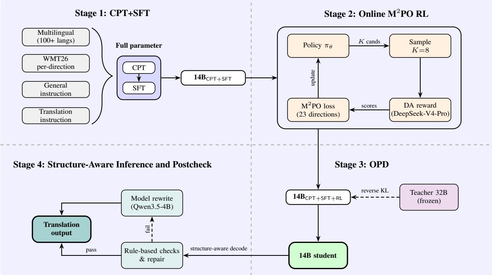

# Qwen-MT-Lumen at WMT2026: Instruction-Specialized Translation via Quality-Aware Training and On-Policy Distillation

Hao Wang Yangyang Liu Xiaohu Zhao Heng Liu Zifu Shang

Tianhao Li Ruize Gao Jialong Tang Liangying Shao Haoran Wei

Baosong Yang Linlong Xu Longyue Wang Weihua Luo

Alibaba Token Hub

huaiyu.wh@alibaba-inc.com

## Abstract

We present Lumen1, our submission to the WMT 2026 General Machine Translation Shared Task. We focus on instruction specialized translation, where systems must produce accurate translations while satis fying fine-grained requirements on style, terminology, and structured output. Lumen follows a four-stage pipeline. First, continued pre-training and supervised fine tuning jointly strengthen multilingual trans lation competence and the ability to follow translation-specific instructions, such as ter minology, style, and format constraints. Second, we extend the originally offline M2PO preference-optimization framework into an online preference-optimization stage: the current policy samples candidate translations, an LLM judge assigns continuous direct-assessment scores, and the resulting multi-pair preferences are used to update the model. Third, onpolicy distillation transfers stronger translation instruction-following behavior from a larger teacher model to the Qwen3-14B student, im proving translation-instruction adherence while retaining a 14B primary translation backbone. Finally, structure-aware inference and postprocessing preserve required formats, while se lective repair addresses clear structural or decoding failures before submission. We participate in 23 translation directions. Under an absolute 1–5 LLM-judge rubric that evalu ates translation-instruction following and trans lation quality separately, Lumen reaches an overall mean score of 4.60. Despite using a 14B translation backbone, it achieves perfor mance comparable to leading proprietary systems in both translation quality and translation instruction following.

## 1 Introduction

The Conference on Machine Translation (WMT) continues to serve as the primary arena for benchmarking progress in machine translation (Kocmi et al., 2024, 2025). For years the field was dominated by the Transformer architecture (Vaswani et al., 2017), whose powerful attention mechanism set a high standard for translation quality. The recent advent of large language models (LLMs), however, has sparked a paradigm shift: pre-trained on vast amounts of text, these models exhibit remarkable abilities in understanding context, generating fluent text, and leveraging world knowledge, making them exceptionally promising foundations for translation systems (Hendy et al., 2023; Alves et al., 2024). This shift is already evident at recent WMT campaigns, where many of the strongest general-translation submissions are now built on LLM foundations (Wang et al., 2025; Zheng et al., 2025; Zhang et al., 2025).

Despite the strong performance of generalpurpose LLMs on translation, adapting them into high-fidelity, specialized translation systems remains challenging. Existing LLM-based MT systems largely focus on generic translation quality, whereas in practical applications users often require the model to follow fine-grained instructions during translation: specifying a translation style (e.g., formal, colloquial, or customer-service tone), adhering to domain-specific terminology, resolving ambiguity from context, or preserving the integrity of structured formats such as JSON or rich text. General translation models struggle to satisfy such requirements reliably, which constitutes a key gap for deploying LLM-based MT in real-world scenarios. To bridge this gap, we propose training and optimization methods for instruction-specialized translation that systematically improve both translation quality and instruction-following ability.

This paper describes Lumen, our submission to the WMT2026 General Machine Translation Shared Task, covering 23 translation directions and built on the Qwen3 foundation (Yang et al., 2025). The system consists of a four-stage pipeline, illustrated in Figure 1. Our main contributions are as follows:

• An instruction-specialized two-phase adaptation strategy. We first run continued pretraining (CPT) on a corpus deliberately assembled to follow the WMT domains and language directions, mixed with general instruction data, which pulls the backbone towards the evaluation distribution while preserving its general ability. On top of this CPT-strengthened backbone we design an SFT recipe that mixes general translation data with translation-specific instruction data. A high proportion of translation data preserves the base translation ability, while instruction data covering the four WMT26 instruction categories (formal/informal voice, glossaries, structured translation, and style and expressions) enables the model to internalize instruction-following ability during finetuning. The instruction data is built costeffectively through an LLM-assisted synthesis pipeline.

• An online preference optimization framework based on M2PO. We extend the originally offline M2PO (Multi-Perspective Multi-Pair Preference Optimization) (Wang et al., 2026) into an online preference-optimization stage, coupling on-policy sampling with an LLM-judge (direct-assessment) reward. Unlike an offline procedure over a fixed preference set, this framework refreshes candidate translations from the current policy and converts their ranked scores into multi-pair supervision. The remaining gap in instruction compliance is addressed by the subsequent OPD stage.

• An OPD recipe for translation instruction following. We adapt on-policy distillation to instruction-specialized translation. After CPT+SFT+RL, our 14B model is strong at translation but remains weaker at following fine-grained translation instructions. We therefore use an off-the-shelf, open-source Qwen3- 32B-Instruct model as teacher and our 14B model as student, aligning token-level distributions on trajectories sampled by the student. This transfers the teacher’s stronger instruction-following behavior to the student while preserving the student’s translation specialization and its 14B primary translation backbone (Kim and Rush, 2016; Gu et al., 2024).

• Structure-aware inference and selective repair. At inference time, Lumen processes plain text and structured inputs in a formataware manner, preserving markup and protected content through postprocessing. Rulebased checks identify clear structural or decoding failures, for which the system applies deterministic repair when possible and selectively rewrites the remaining cases.

On the WMT26 test sets, our 14B system attains an overall mean of 4.60 under an absolute 1–5 LLM-judge rubric (translation-instruction following 4.49, translation quality 4.71). Despite using a 14B translation backbone, Lumen achieves performance comparable to leading proprietary systems in both translation quality and translationinstruction following. The remainder of this paper is organized as follows: Section 2 describes the four-stage system; Section 3 presents the experimental setup and results; and Section 4 concludes.

## 2 System Description

## 2.1 System Overview

Lumen comprises four successive stages, as illustrated in Figure 1. The first stage adapts the Qwen3-14B foundation model through continued pre-training and supervised fine-tuning, jointly strengthening multilingual translation and translation-specific instruction following. The second stage extends M2PO to online preference optimization, using on-policy candidates and LLMbased direct-assessment rewards to improve translation fidelity. The third stage applies on-policy distillation to transfer instruction-following behavior from a larger frozen teacher to the translationspecialized 14B model. The final stage performs structure-aware decoding and targeted postchecking to preserve required formats and repair clear decoding failures.

## 2.2 CPT and SFT Adaptation

In Stage 1, we adapt the Qwen3-14B foundation model in two consecutive full-parameter phases (Figure 1, Stage 1). The first phase is continued pre-training (CPT) on multilingual text covering the task-relevant domains and 23 translation directions, supplemented with general instruction data.

  
Figure 1: Overall pipeline of Lumen. Stage 1 (CPT+SFT) adapts a Qwen3-14B backbone to multilingual translation and translation-specific instruction following. Stage 2 (online M2PO) uses direct-assessment rewards from DeepSeek-V4-Pro to optimize the current policy from sampled candidates. Stage 3 (OPD) distills instructionfollowing behavior from a frozen Qwen3-32B-Instruct teacher into the 14B student. Stage 4 performs structureaware decoding and conservative postchecking to preserve required formats and repair clear failures before submission.

This phase strengthens domain and language coverage, particularly for low-resource and regional languages that are underrepresented in general pretraining corpora. The second phase is supervised fine-tuning (SFT) on a mixture of parallel translation and instruction-bearing data. Both phases update all model parameters: CPT strengthens the multilingual translation foundation, while SFT jointly develops translation quality and translationspecific instruction following.

## 2.2.1 Training Data

CPT data. The continued-pre-training corpus combines multilingual text from task-relevant domains and all 23 translation directions with general instruction data. The multilingual component is constructed from monolingual text and the source sides of parallel corpora drawn from internal resources, WMT releases, and public multilingual resources such as FLORES+ (NLLB Team, 2024). We cap and stratify high-resource corpora to prevent them from dominating the mixture, while increasing the representation of low-resource and regional languages.

SFT data. The SFT mixture contains four sources: multilingual parallel data, task-specific parallel data for the 23 WMT26 directions, general instruction data, and translation-specific instruction data. Parallel translation remains the majority of the mixture to preserve the model’s translation competence, while the two instruction sources provide general and translation-specific instructionfollowing supervision. When reliable references are unavailable, we supplement the parallel data with model-generated translations retained after quality filtering, with additional synthetic data used to improve the coverage of low-resource directions.

All corpora undergo normalization, deduplication, language and script verification, and lengthbased filtering. We additionally score parallel pairs with XCOMET-XXL (Guerreiro et al., 2024), from the COMET family of learned MT metrics (Rei et al., 2020), and remove low-confidence translations before training.

Translation-specific instruction data. Translation-specific instruction data is the core of our instruction-following adaptation. Each example augments a source–target pair with natural-language constraints specifying the requirements to be satisfied. Table 1 summarizes the training taxonomy.

Instruction-bearing examples constitute a minority of the SFT mixture, whose main component remains parallel translation data. The taxonomy covers the four WMT26 instruction types: formal or informal voice, glossary constraints, structured translation, and style and expression requirements. These four types provide the core translationinstruction supervision; the domain-specific and general-instruction categories in Table 1 serve as auxiliary data that broaden domain coverage and retain general instruction-following ability.

Because manual construction is costly, most translation-specific instruction examples are produced through an LLM-assisted pipeline. We sample high-quality parallel pairs, use Qwen3.7-Max to generate diverse constraints and adapt the corresponding examples, and use the same model in a separate judging pass to filter non-compliant samples. Diversity is controlled across instruction templates, domains, and style intensity.

## 2.2.2 Adaptation Parameterization

Both CPT and SFT update all model parameters rather than using parameter-efficient adapters. For the SFT phase, we use a learning rate of $2 \times 1 0 ^ { - 5 }$ a global batch size of 1,152 sequences, and the AdamW optimizer $( \beta _ { 1 } = 0 . 9 , \beta _ { 2 } = 0 . 9 9 9 )$ . The resulting CPT+SFT model is used by the subsequent RL and OPD stages.

## 2.3 Preference Alignment with Online $\mathbf { M } ^ { 2 } \mathbf { P O }$

M2PO (Multi-Perspective Multi-Pair Preference Optimization) (Wang et al., 2026) was originally formulated as an offline preference-optimization method over a fixed set of ranked candidates. We extend it to an online setting: at each update, the current policy generates fresh candidates, an LLM judge ranks them, and the resulting preferences are immediately used to update the policy. This retains $\mathbf { M } ^ { 2 } \mathbf { P O } ^ { \circ } \mathbf { s }$ emphasis on translation fidelity and its multi-pair supervision, while avoiding reliance on a static preference dataset.

## 2.3.1 Online M2PO

For an input x, the current policy $\pi _ { \theta }$ samples $K =$ 8 candidates $\{ y _ { 1 } , \ldots , y _ { 8 } \}$ . Each candidate receives a direct-assessment (DA) score from an LLM judge and is ranked by this score. Let $y _ { ( 1 ) } , \ldots , y _ { ( K ) }$ denote the candidates in descending score order. M2PO constructs $K / 2$ non-overlapping preference pairs by coupling the two ends of the ranked list, with $\mathcal { P } ( x ) = \{ ( i , K - i + 1 ) : 1 \leq i \leq K / 2 \}$ Thus, $K = 8$ yields four preference pairs. The $\mathbf { M } ^ { 2 } \mathbf { P O }$ loss is

$$
\mathcal { L } _ { \mathrm { M ^ { 2 } P O } } = - \mathbb { E } _ { x } \sum _ { ( i , j ) \in \mathcal { P } ( x ) } w _ { i j } \log \sigma \big ( \beta \delta _ { i j } - m _ { i j } \big ) ,\tag{1}
$$

where $\begin{array} { r l r } { \delta _ { i j } } & { { } = } & { \Delta _ { i j } \log \pi _ { \theta } - \Delta _ { i j } \log \pi _ { \mathrm { r e f } } , } \end{array}$ , with $\Delta _ { i j } \log \pi = \log \pi ( y _ { ( i ) } \mid x ) - \log \pi ( y _ { ( j ) } \mid x )$ . Here, $m _ { i j }$ is a margin proportional to the reward difference, $w _ { i j }$ is a pair weighting coefficient, and $\pi _ { \mathrm { r e f } }$ is the frozen CPT+SFT model. Because candidates are drawn from the current policy at every step, the preference data evolves with the model rather than being fixed in advance.

LLM-judge reward. We use DeepSeek-V4-Pro2 as a direct-assessment judge (Zheng et al., 2023; Kocmi and Federmann, 2023). For each candidate, the judge returns a single integer between 0 and 100 that assesses meaning preservation and grammatical quality. When a reference translation is available, it is included as auxiliary evidence; otherwise, the candidate is assessed against the source alone. We normalize the score as

$$
r ( x , y ) = \frac { \mathrm { D A } ( x , y ) } { 1 0 0 } \in [ 0 , 1 ] ,\tag{2}
$$

where $\operatorname { D A } ( x , y )$ denotes the judge score. The continuous reward preserves the ordering among intermediate-quality candidates and sets the pair margins in Eq. 1.

## 2.3.2 Training Configuration

We optimize the CPT+SFT model with LoRA adapters (Hu et al., 2022) (rank 128, α = 256) and merge the final adapter back into the full model after training. We use a learning rate of $5 \times 1 0 ^ { - 5 }$ and the AdamW optimizer $( \beta _ { 1 } = 0 . 9 , \beta _ { 2 } = 0 . 9 9 9 )$ Each optimization step processes 8 prompt groups (64 sequences in total); each group consists of one prompt and its $K = 8$ candidates, sampled at temperature 1.0 using vLLM (Kwon et al., 2023) for efficient high-throughput generation. The preference temperature in Eq. 1 is set to $\beta = 0 . 1$

## 2.4 On-Policy Distillation for Translation Instruction Following

After CPT, SFT, and online $\mathbf { M } ^ { 2 } \mathbf { P O }$ , our Qwen3- 14B reaches strong translation quality, but residual errors remain in following fine-grained constraints on style, terminology, and output format. This gap is expected because the DA reward used in the online $\mathbf { M } ^ { 2 } \mathbf { P O }$ stage assesses translation quality rather than instruction compliance. We therefore adapt on-policy distillation (OPD) to translationinstruction data. The frozen teacher $\pi _ { T }$ is the offthe-shelf open-source Qwen3-32B-Instruct model3; the student $\pi _ { \theta }$ is our Qwen3-14B model after CPT, SFT, and online M2PO. We keep the teacher frozen and use it only as a source of instructionfollowing supervision. Thus, OPD can transfer behavior from the larger model while preserving the translation-specialized 14B student as the final inference model.

<table><tr><td>Category</td><td>Definition</td></tr><tr><td>Literary (novel)</td><td>Preserve narrative voice, dialogue, and cultural nuance.</td></tr><tr><td>Game</td><td>Translate game dialogue and UI text under output constraints.</td></tr><tr><td>Medical</td><td>Preserve medical terminology, drug names, codes, and entities.</td></tr><tr><td>General-domain instruction MT</td><td>Follow content and formatting requirements in general-domain MT.</td></tr><tr><td>Structured output</td><td>Preserve tags, identifiers, and parseable output structure.</td></tr><tr><td>Style</td><td>Produce the translation in a specified tone or register.</td></tr><tr><td>General instruction</td><td>Retain broad multilingual instruction-following ability.</td></tr></table>

Table 1: Instruction-bearing data used in SFT.

## 2.4.1 Distillation Objective

OPD differs from conventional sequence-level distillation over a fixed teacher-generated dataset (Hinton et al., 2015). For each translation-instruction input $x ,$ the current student first samples a translation $y \sim \pi _ { \boldsymbol { \theta } } ( \cdot \mid x )$ . The teacher then evaluates the same trajectory and supplies token-level distributions at each position. Let $p _ { t }$ and $q _ { t }$ denote the student and teacher next-token distributions conditioned on $( x , y _ { < t } )$ , respectively. We minimize the reverse KL along the student trajectory:

$$
\mathcal { L } _ { \mathrm { O P D } } = \mathbb { E } _ { x } \mathbb { E } _ { y \sim \pi _ { \theta } ( \cdot | x ) } \left[ \frac { 1 } { | y | } \sum _ { t = 1 } ^ { | y | } \mathrm { K L } \big ( p _ { t } \| q _ { t } \big ) \right] ,\tag{3}
$$

Because training trajectories are generated by the current student, the teacher supervises the distribution where the student actually makes errors, rather than only a fixed set of teacher outputs. We use reverse KL, which encourages the student to place probability mass on the teacher’s preferred continuations. The two models share the Qwen3 tokenizer and vocabulary, so the token-level KL is computed directly without vocabulary alignment.

## 2.4.2 Training Configuration

We fine-tune the full student model with this reverse-KL objective, following on-policy distillation (Gu et al., 2024). We use AdamW $( \beta _ { 1 } = 0 . 9 $ $\beta _ { 2 } ~ = ~ 0 . 9 9 9 )$ , a learning rate of $1 \times 1 0 ^ { - 5 }$ , and a global batch size of 256. The learning rate is lower than that used for SFT because OPD refines the student’s output distribution rather than teaching translation from scratch. Student trajectories are sampled at temperature 1.0, and both teacher and student use a distillation temperature of 1.0. For each trajectory, the frozen teacher supplies its token-level distribution in a single forward pass.

## 2.5 Structure-Aware Inference and Postcheck

Stage 4 is applied after the distilled 14B model produces a translation. It has two goals: preserve non-linguistic structure required by the input and prevent clear decoding failures from entering the final submission. We decode with greedy search using vLLM, then apply structure-aware processing and a conservative postcheck. This stage is deliberately limited to objective failures; it is not intended as a general-purpose post-editor.

Structure-aware decoding. We first identify whether an input is plain text, HTML, or JSON. For HTML, we translate text nodes and designated translatable attributes; for JSON, we translate string leaves. The translated fragments are then reassembled into the original object, preserving markup, keys, and protected content such as URLs, e-mail addresses, and numbers. Long plain-text inputs are split at sentence-aware boundaries, translated chunk by chunk, and concatenated.

Postcheck and repair. Each output is checked for abnormal source–target length ratios, structural mismatches (HTML tag signatures or JSON shape), repeated character or n-gram loops, insufficient target-script coverage, and unintended copying of the source. A failed check does not automatically imply a translation error; it identifies a small set of hypotheses for review. When a flagged defect is mechanical and has an unambiguous fix, such as a missing code-fence marker, we apply a deterministic repair. The remaining flagged outputs are regenerated with Qwen3.5-4B-Instruct4 under the original input and structural constraints, whereas outputs that pass all checks are retained unchanged. This routing keeps repair focused on degenerate or structurally invalid outputs and avoids unnecessary changes to otherwise adequate translations.

<table><tr><td></td><td colspan="2">Instr. following</td><td colspan="2">Quality</td><td colspan="2">Overall</td></tr><tr><td>System</td><td>Avg</td><td>Pass%</td><td>Avg</td><td>Pass%</td><td>Avg</td><td>Pass%</td></tr><tr><td>Qwen3.7-Max-Think</td><td>4.50</td><td>83.8</td><td>4.76</td><td>94.0</td><td>4.63</td><td>88.9</td></tr><tr><td>GPT-5.5</td><td>4.49</td><td>83.4</td><td>4.77</td><td>94.0</td><td>4.63</td><td>88.7</td></tr><tr><td>Gemini-3.1-Pro</td><td>4.49</td><td>83.7</td><td>4.70</td><td>91.1</td><td>4.59</td><td>87.4</td></tr><tr><td>Qwen3.7-Max-NoThink</td><td>4.32</td><td>78.4</td><td>4.48</td><td>85.3</td><td>4.40</td><td>81.8</td></tr><tr><td>Ours (14B)</td><td>4.49</td><td>83.4</td><td>4.71</td><td>92.0</td><td>4.60</td><td>87.7</td></tr></table>

Table 2: Main results on the WMT26 test set (23 official directions). For each aspect we report the mean 1–5 rubric score (Avg) and the pass rate (Pass%, percentage of outputs scoring ≥ 4), both judged by DeepSeek-V4-Pro (Section 3.1); Overall Avg and Pass% are the unweighted averages of the corresponding values across the two aspects. Baseline rows are ordered by Overall Avg; our system is listed separately in the last row.

## 3 Experiments

## 3.1 Experimental Setup and Evaluation

Systems and Test Sets. Our submission combines the distilled Qwen3-14B-Base5 (CPT+SFT+RL+OPD) with the structure-aware inference and postcheck stage described in Section 2. We evaluate on the official WMT26 General MT test sets across the 23 participated directions.

We compare against GPT-5.5, Qwen3.7-Max (thinking mode), Gemini-3.1-Pro, and Qwen3.7- Max (non-thinking mode), all evaluated under the same protocol. We also report internal ablations (Section 3.4).

Evaluation Protocol. Because official WMT26 human-evaluation results were not available at submission time, we use an automatic LLM-as-judge protocol. Each output is scored independently on an absolute 1–5 rubric along two aspects: instruction following and translation quality. We report the mean score and the pass rate, defined as the proportion of outputs with a score of at least 4.

<table><tr><td></td><td colspan="2">Instr. follow.</td><td colspan="2">Quality</td></tr><tr><td>Dir.</td><td>Avg</td><td>Pass%</td><td>Avg</td><td>Pass%</td></tr><tr><td>cs→de</td><td>4.90</td><td>96.5</td><td>4.56</td><td>86.7</td></tr><tr><td>cs→uk</td><td>4.94</td><td>98.7</td><td>4.55</td><td>86.3</td></tr><tr><td>cs→vi</td><td>4.94</td><td>97.5</td><td>4.43</td><td>80.3</td></tr><tr><td>zh→ja</td><td>4.96</td><td>98.4</td><td>4.40</td><td>77.7</td></tr><tr><td>en→areG</td><td>4.92</td><td>97.1</td><td>4.66</td><td>89.7</td></tr><tr><td>en→zhcN</td><td>4.97</td><td>99.7</td><td>4.88</td><td>96.2</td></tr><tr><td>en→zhTw</td><td>4.97</td><td>98.5</td><td>4.84</td><td>95.5</td></tr><tr><td>en→cs</td><td>3.99</td><td>64.0</td><td>4.73</td><td>94.4</td></tr><tr><td>en→et</td><td>3.77</td><td>68.4</td><td>4.65</td><td>90.8</td></tr><tr><td>en→de</td><td>4.29</td><td>81.9</td><td>4.92</td><td>97.7</td></tr><tr><td>en→is</td><td>4.98</td><td>99.4</td><td>4.79</td><td>93.6</td></tr><tr><td>en→ja</td><td>4.99</td><td>100.0</td><td>4.71</td><td>89.9</td></tr><tr><td>en→ko</td><td>4.93</td><td>97.6</td><td>4.82</td><td>94.2</td></tr><tr><td>en→ru</td><td>3.97</td><td>60.6</td><td>4.60</td><td>91.0</td></tr><tr><td>en→uk</td><td>4.93</td><td>98.5</td><td>4.69</td><td>93.9</td></tr><tr><td>en→hy</td><td>4.96</td><td>99.0</td><td>4.63</td><td>88.4</td></tr><tr><td>en→be</td><td>4.94</td><td>99.5</td><td>4.68</td><td>90.4</td></tr><tr><td>en→id</td><td>4.96</td><td>99.5</td><td>4.80</td><td>94.9</td></tr><tr><td>en→kk</td><td>4.98</td><td>99.5</td><td>4.62</td><td>88.9</td></tr><tr><td>en→th</td><td>4.97</td><td>99.5</td><td>4.79</td><td>93.4</td></tr><tr><td>en→lij</td><td>4.97</td><td>99.5</td><td>4.44</td><td>76.8</td></tr><tr><td>en→se</td><td>4.97</td><td>99.5</td><td>4.12</td><td>71.7</td></tr><tr><td>en→lld</td><td>4.99</td><td>100.0</td><td>4.24</td><td>69.7</td></tr><tr><td>Overall</td><td>4.49</td><td>83.4</td><td>4.71</td><td>92.0</td></tr></table>

Table 3: Per-direction results of our submitted 14B system on the 23 official WMT26 directions. For each aspect we report the mean 1–5 rubric score (Avg) and the pass rate (Pass%, percentage of outputs scoring ≥ 4), judged by DeepSeek-V4-Pro. Overall is the microaverage over all official test items.

For instruction following, the judge receives only the task instruction and system output, and evaluates target language, output-only compliance, glossary use, register, and required structure such as JSON, HTML, tags, or placeholders. For translation quality, it evaluates semantic accuracy and completeness, terminology, and fluency. A reference translation, when available, is supplied only as auxiliary evidence; the judge is instructed to assess the output against the source rather than penalize legitimate differences from the reference.

<table><tr><td rowspan="2"></td><td colspan="2">Instr. following</td><td colspan="2">Quality</td></tr><tr><td>Configuration Avg</td><td>Pass%</td><td>Avg</td><td>Pass%</td></tr><tr><td>Base (14B)</td><td>1.14</td><td>0.6</td><td>1.09</td><td>1.0</td></tr><tr><td>+ CPT+SFT</td><td>4.08</td><td>69.5</td><td>4.23</td><td>74.8</td></tr><tr><td>+ Online M²PO</td><td>4.13</td><td>76.8</td><td>4.55</td><td>89.4</td></tr><tr><td>+ OPD</td><td>4.38</td><td>82.1</td><td>4.67</td><td>91.3</td></tr><tr><td>+ Postcheck</td><td>4.49</td><td>83.4</td><td>4.71</td><td>92.0</td></tr></table>

Table 4: Cumulative ablation on the WMT26 test set. For each aspect we report the mean 1–5 rubric score (Avg) and the pass rate (Pass%, percentage of outputs scoring ≥ 4), both judged by DeepSeek-V4-Pro (Section 3.1).

Both aspects use DeepSeek-V4-Pro at temperature 0. For each item, the judge returns a brief justification and a score in the fixed form [[score=X]], where $X ~ \in ~ \{ 1 , . . . , 5 \}$ The instruction-following evaluation set covers all 23 directions and the four official WMT26 instruction categories: formal/informal voice, glossaries, structured translation, and style and expressions.

## 3.2 Main Results

Table 2 reports every system’s instructionfollowing and translation-quality scores under the absolute 1–5 rubric of Section 3.1. Among the four reference LLMs, Qwen3.7-Max (thinking) and GPT-5.5 lead with essentially tied overall means (4.63 and 4.63), followed by Gemini-3.1- Pro (4.59); Qwen3.7-Max in non-thinking mode trails clearly (4.40). Quality scores are uniformly high (4.48–4.77), so the systems separate mainly on the harder instruction-following aspect. Our distilled 14B system attains an overall Avg of 4.60 and Overall Pass of 87.7%. Despite its 14B translation backbone, it is comparable to the leading proprietary systems on translation-instruction following (Avg 4.49, Pass 83.4%, versus 4.49/83.4% for GPT-5.5 and 4.50/83.8% for Qwen3.7-Max-Think), while its translation quality (4.71, Pass 92.0%) surpasses Gemini-3.1-Pro.

## 3.3 Per-Direction Results

Table 3 breaks down our submitted system’s scores across the 23 official directions. Instruction following is near-ceiling on the large majority of directions (mean ≥ 4.9 with pass rates above 97%), indicating that the instruction-specialized pipeline transfers robustly across languages and scripts. The clear exceptions are en→et (3.77), en→ru (3.97), en→cs (3.99), and to a lesser extent en→de (4.29). These directions also correspond to the largest test sets, with more than one thousand items each, and therefore contribute substantially to the aggregate instruction-following score. Translation quality is uniformly high (mostly ≥ 4.6) and dips only on the lowest-resource new directions—en→se (4.12), en→lld (4.24), zh→ja (4.40), cs→vi (4.43), and en→lij (4.44). The two weak spots are largely disjoint: directions with lower instruction-following scores are generally not those with the lowest translation-quality scores. This separation suggests that the two evaluation aspects capture different failure modes.

## 3.4 Ablation Study

We conduct a cumulative ablation to quantify the incremental effects of the training stages and final postcheck (Table 4). Both translation-instruction following and translation quality improve monotonically across the cumulative configurations, although the largest gain of each stage occurs on a different dimension.

CPT+SFT establishes the task capability. The unadapted Qwen3-14B model performs poorly under the translation-instruction prompts (instruction following: 1.14 Avg and 0.6% Pass; translation quality: 1.09 Avg and 1.0% Pass). Adding CPT+SFT raises instruction following to 4.08 Avg and 69.5% Pass, and translation quality to 4.23 Avg and 74.8% Pass. Relative to the base model, this amounts to gains of 2.94 and 3.14 rubric points, respectively. This low starting point is expected: the base is a pre-trained Qwen3-14B model without task-specific translation adaptation or translation-instruction supervision. The result shows that WMT-aligned continued pre-training and instruction-bearing SFT data are necessary to turn this general backbone into a usable instructionspecialized translation system.

Online M2PO primarily improves translation quality. On top of CPT+SFT, online preference optimization raises translation quality from 4.23 to 4.55 Avg and from 74.8% to 89.4% Pass. The corresponding instruction-following change is more modest (4.08 → 4.13 Avg; 69.5% → 76.8% Pass). This asymmetric effect aligns with the direct-assessment reward, which ranks candidates by translation quality and provides the most direct supervision for adequacy, completeness, and fluency. The online extension also continually refreshes the candidate set from the current policy, allowing the M2PO objective to target errors that remain after CPT+SFT.

OPD closes the remaining instruction-following gap. Starting from the CPT+SFT+online M2PO model, OPD increases instruction following from 4.13 to 4.38 Avg and from 76.8% to 82.1% Pass, while translation quality continues to improve from 4.55 to 4.67 Avg and from 89.4% to 91.3% Pass. Thus, the teacher’s instruction-following behavior transfers without sacrificing the quality improvements obtained in the preceding stage. The larger teacher is used only during training; translation at inference is performed by the 14B student.

Postcheck recovers a small set of severe failures. The postcheck is applied after all training stages. It further increases instruction following from 4.38 to 4.49 Avg and from 82.1% to 83.4% Pass, while translation quality rises from 4.67 to 4.71 Avg and from 91.3% to 92.0% Pass. On en-zh\_CN, it altered 31 of 945 hypotheses (3.3%): 7 received deterministic fence restoration, and 24 were selectively rewritten across two review rounds. These outputs were identified by objective structural or decoding signals, such as malformed structure, missing lines, or degenerate generation. Thus, the postcheck obtains its gains by recovering a small number of high-impact failures rather than by broadly rewriting otherwise adequate translations.

## 3.5 Analysis

The results reveal a clear division of labor across the training stages. CPT+SFT establishes the basic ability to translate under explicit instructions, online M2PO supplies the largest subsequent improvement in translation quality, and OPD contributes the largest later-stage gain in instruction following. The complementary pattern is important: optimizing only direct-assessment translation quality is insufficient to reach the final instructionfollowing level, whereas distillation improves instruction adherence without reversing the quality gains obtained by online preference optimization. The final postcheck contributes a further inferencetime improvement by recovering the small tail of structurally invalid or degenerate outputs that remain after decoding.

The per-direction results further show that instruction following and translation quality do not fail on exactly the same directions. This supports evaluating them separately rather than collapsing them into a single automatic score. At the system level, Lumen’s instruction-following score is close to GPT-5.5 and Qwen3.7-Max-Think, while its translation quality remains within the range of the compared general-purpose systems. Taken together, these results support the design of a translation- specialized 14B system that combines quality-oriented preference optimization with a dedicated mechanism for instruction following.

## 4 Conclusion

We presented Lumen, our submission to the WMT2026 General Machine Translation Shared Task. Targeting instruction-specialized translation, we introduced a four-stage pipeline: instruction-specialized CPT+SFT, where continued pre-training on a corpus following the WMT domains and language directions (plus general instruction data) is followed by supervised fine-tuning that jointly builds translation and instruction-following ability; online preference optimization with M2PO and a direct-assessment LLM-judge reward; onpolicy distillation that transfers the instructionfollowing ability of an off-the-shelf Qwen3-32B-Instruct teacher into our efficient 14B student; and structure-aware inference with targeted postchecking and repair for clear structural or decoding failures. Under an absolute 1–5 LLM-judge rubric that scores instruction following and translation quality separately, our 14B system reaches an overall mean of 4.60. Despite using a 14B translation backbone, Lumen achieves performance comparable to leading proprietary systems in both translation quality and translation-instruction following, showing that the proposed pipeline can narrow the gap to substantially larger closed systems.

## References

Duarte M. Alves, José Pombal, Nuno M. Guerreiro, André F. T. Martins, and 1 others. 2024. Tower: An open multilingual large language model for translationrelated tasks. In Conference on Language Modeling (COLM).

Yuxian Gu, Li Dong, Furu Wei, and Minlie Huang. 2024. MiniLLM: Knowledge distillation of large language models. In International Conference on Learning Representations (ICLR).

Nuno M. Guerreiro, Ricardo Rei, Daan van Stigt, Luisa Coheur, Pierre Colombo, and André F. T. Martins. 2024. xCOMET: Transparent machine translation evaluation through fine-grained error detection. Transactions of the Association for Computational Linguistics (TACL), 12:979–995.

Amr Hendy, Mohamed Abdelrehim, Amr Sharaf, Vikas Raunak, Mohamed Gabr, Hitokazu Matsushita, Young Jin Kim, Mohamed Afify, and Hany Hassan Awadalla. 2023. How good are GPT models at machine translation? a comprehensive evaluation. arXiv preprint arXiv:2302.09210.

Geoffrey Hinton, Oriol Vinyals, and Jeff Dean. 2015. Distilling the knowledge in a neural network. arXiv preprint arXiv:1503.02531.

Edward J. Hu, Yelong Shen, Phillip Wallis, Zeyuan Allen-Zhu, Yuanzhi Li, Shean Wang, Lu Wang, and Weizhu Chen. 2022. LoRA: Low-rank adaptation of large language models. In International Conference on Learning Representations (ICLR).

Yoon Kim and Alexander M. Rush. 2016. Sequencelevel knowledge distillation. In Proceedings of the 2016 Conference on Empirical Methods in Natural Language Processing (EMNLP).

Tom Kocmi, Eleftherios Avramidis, Rachel Bawden, Ondˇrej Bojar, Anton Dvorkovich, Christian Federmann, Mark Fishel, Markus Freitag, Thamme Gowda, Roman Grundkiewicz, and 1 others. 2024. Findings of the wmt24 general machine translation shared task: The llm era is here but mt is not solved yet. In Proceedings ofthe Ninth Conference on Machine Translation, pages 1–46.

Tom Kocmi and Christian Federmann. 2023. Large language models are state-of-the-art evaluators of translation quality. In Proceedings of the 24th Annual Conference of the European Association for Machine Translation (EAMT).

Tom Kocmi and 1 others. 2025. Findings of the WMT25 general machine translation shared task: Time to stop evaluating on easy test sets. In Proceedings of the Tenth Conference on Machine Translation, Suzhou, China. Association for Computational Linguistics.

Woosuk Kwon, Zhuohan Li, Siyuan Zhuang, Ying Sheng, Lianmin Zheng, Cody Hao Yu, Joseph E. Gonzalez, Hao Zhang, and Ion Stoica. 2023. Efficient memory management for large language model serving with PagedAttention. In Proceedings of the 29th Symposium on Operating Systems Principles (SOSP).

NLLB Team. 2024. Scaling neural machine translation to 200 languages. Nature, 630(8018):841–846.

Ricardo Rei, Craig Stewart, Ana C Farinha, and Alon Lavie. 2020. COMET: A neural framework for MT evaluation. In Proceedings ofthe 2020 Conference on Empirical Methods in Natural Language Processing (EMNLP).

Ashish Vaswani, Noam Shazeer, Niki Parmar, Jakob Uszkoreit, Llion Jones, Aidan N. Gomez, Łukasz Kaiser, and Illia Polosukhin. 2017. Attention is all you need. In Advances in Neural Information Processing Systems (NeurIPS).

Hao Wang, Linlong Xu, Heng Liu, Yangyang Liu, Xiaohu Zhao, Bo Zeng, Liangying Shao, Yichen Dong, Xinwei Wu, Jiang Zhou, Tianyu Dong, Xiangxiang Zeng, Longyue Wang, and Weihua Luo. 2026. M2PO: Multi-perspective multi-pair preference optimization for machine translation. In Proceedings of the 64th Annual Meeting of the Association for Computational Linguistics (Volume 1: Long Papers), pages 10315–10336, San Diego, California, United States. Association for Computational Linguistics.

Hao Wang, Linlong Xu, Heng Liu, Yangyang Liu, Xiaohu Zhao, Bo Zeng, Longyue Wang, Weihua Luo, and Kaifu Zhang. 2025. Marco large translation model at WMT2025: Transforming translation capability in LLMs via quality-aware training and decoding. In Proceedings of the Tenth Conference on Machine Translation, pages 587–593, Suzhou, China. Association for Computational Linguistics.

An Yang, Anfeng Li, Baosong Yang, Beichen Zhang, Binyuan Hui, Bo Zheng, Bowen Yu, Chang Gao, Chengen Huang, Chenxu Lv, and 1 others. 2025. Qwen3 technical report. arXiv preprint arXiv:2505.09388.

Dakun Zhang, Yara Khater, Ramzi Rahli, Anna Rebollo, and Josep Crego. 2025. SYSTRAN @ WMT 2025 general translation task. In Proceedings ofthe Tenth Conference on Machine Translation, pages 599–606, Suzhou, China. Association for Computational Linguistics.

Lianmin Zheng, Wei-Lin Chiang, Ying Sheng, Siyuan Zhuang, Zhanghao Wu, Yonghao Zhuang, Zi Lin, Zhuohan Li, Dacheng Li, Eric P. Xing, Hao Zhang, Joseph E. Gonzalez, and Ion Stoica. 2023. Judging LLM-as-a-judge with MT-Bench and chatbot arena. In Advances in Neural Information Processing Systems (NeurIPS).

Mao Zheng, Zheng Li, Yang Du, Bingxin Qu, and Mingyang Song. 2025. Shy-hunyuan-MT at WMT25 general machine translation shared task. In Proceedings ofthe Tenth Conference on Machine Translation, pages 607–613, Suzhou, China. Association for Computational Linguistics.