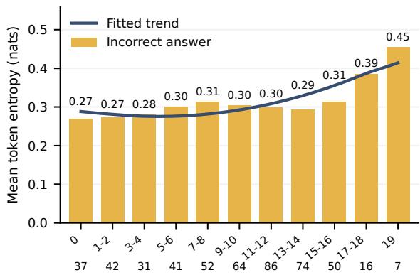
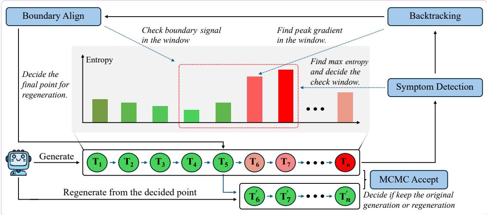

# REWIND: Uncertainty-Guided Trajectory Repair for Test-Time Reasoning

Yi Ding1 Mengyu Wang2 Min Zhou3 Menglin Yang1,\*

1The Hong Kong University of Science and Technology (Guangzhou)

2University of Edinburgh 3Huawei

Corresponding author: menglinyang@hkust-gz.edu.cn

## Abstract

An early mistake in the generated reasoning can constrain all subsequent reasoning. Repeated-generation methods, like MCMCbased approaches, attempt to improve output quality by sampling multiple generations, but their effectiveness can be limited by randomly selecting where to regenerate. On MATH500 with Qwen2.5-Math-7B, we find that incorrect responses have substantially higher mean token entropy than correct responses, with an average within-question relative increase of approximately 112%, suggesting that entropy can signal reasoning errors. Motivated by this finding, we introduce REWIND, a training-free controller that uses entropy dynamics to propose targeted suffix regenerations. Across three model families and five benchmarks, REWIND outperforms all baselines, with gains of 0.51–10.00 percentage points over the strongest baseline. These results demonstrate the effectiveness of targeted, uncertainty-guided trajectory repair across models and tasks. Our code is available at https://anonymous.4open. science/r/rewind-D310.

## 1 Introduction

Large language models (LLMs) can solve multistep reasoning problems, but an early incorrect premise or calculation can constrain the rest of a generated solution (Wei et al., 2022; Dziri et al., 2023). To mitigate such issues caused by sequential decoding, explicit revision methods discard part of that context and give the model another opportunity to continue from an earlier prefix. However, the central question of revision is how to choose a useful cut point without a trained verifier or external feedback.

Recent works have proposed many different approaches to respond to this question. Iterative selffeedback and sampling-based refinement provide ways to revise a draft (Madaan et al., 2023; Karan and Du, 2025). MCMC-based Power Sampling chooses a random cut point to regenerate the suffix and then accepts or rejects the proposal using model likelihoods. Its cut-point policy is independent of local confidence and uncertainty. A cut after a mistaken premise retains it, whereas a cut far before it can replace substantial correct work. Since a filter acts only after re-generation, it can accept or reject a completed proposal but cannot guide the re-generation process itself. Therefore, revision-site selection becomes a practical bottleneck, motivating trajectory diagnostics that direct proposals toward candidate regions of instability.

Although continuation sampling is stochastic, its final acceptance is based on the generation statistics, since confidence and uncertainty statistics can contain information about downstream failure (Kadavath et al., 2022; Zhang et al., 2025). Motivated by this, there may exist signals during the generation process indicating potential re-generation points. Shannon entropy summarizes the full nexttoken distribution, capturing competition among alternatives, and can be measured from model logits without an additional verifier or reference answers (Shannon, 1948). We examine this signal through 20 ordinary Qwen2.5-Math-7B generations per MATH500 question. Among the 463 questions with both correct and incorrect responses under the original boxed-answer evaluator, we find that the mean token entropy of incorrect responses is approximately 112% higher than that of correct responses (Section 3.2). Moreover, on questions with fewer incorrect responses, those errors exhibit higher entropy, suggesting that entropy can identify mistakes that are more likely to be corrected through regeneration. This token-level generationerror association motivates uncertainty-conditioned revision.

Therefore, we propose REWIND (Reasoning Error Windback via INtrinsic Detection), a training-free, entropy-conditioned suffix-proposal controller. A high-entropy peak can occur after an earlier unstable choice has influenced later steps. The controller therefore searches immediately before the peak for the largest discrete entropy increase, and aligns the cut with a natural delimiter to regenerate the suffix. Then an MH-style score filter decides whether to retain the proposal. This makes the re-generation more targeted to cover the potential mistakes rather than random selection, which may miss critical errors.

REWIND consistently improves reasoning performance across three model families and five benchmarks, achieving the highest accuracy among the baselines. It yields gains of 0.51–10.00 percentage points, with the largest improvement on AIME2025 using DeepSeek-R1-Distill-Qwen-1.5B (DeepSeek-1.5B), from 16.67% to 26.67%. Controlled ablations show that entropy-gradient backtracking and boundary alignment both improve the performance. Further evaluations demonstrate that the improvements transfer to few-shot prompting and code generation and remain stable across random seeds. Together, these results establish REWIND as an effective approach to targeted test-time trajectory repair.

In summary, our contributions are as follows:

1. An empirical entropy–correctness association. Through repeated generations on MATH500, we find a clear association between a question’s error frequency and the token entropy of its responses, indicating that entropy provides a useful signal of potential generation errors.

2. A training-free trajectory-repair method. We introduce REWIND, which locates entropygradient spikes before uncertainty peaks, aligns revision points with natural delimiters, and filters regenerated suffixes using an MH-style score, without additional training or an external verifier.

3. Comprehensive empirical evaluation. Experiments across three model families and five benchmarks show that REWIND achieves the best performance among all baselines, improving over random-proposal MCMC by 0.51– 10.00 percentage points. Controlled ablations and evaluations on few-shot reasoning and code generation further support the method’s design and its transfer across tasks.

## 2 Related Work

Training-free test-time scaling. Existing inference-time reasoning methods improve model outputs through either candidate exploration or iterative refinement. Self-consistency aggregates independently sampled solutions (Wang et al., 2023), while Tree of Thoughts and MCTS-based approaches explicitly explore alternative reasoning branches (Yao et al., 2023; Zhou et al., 2023; Liu, 2025). In contrast, iterative refinement methods revise existing outputs rather than exploring independent reasoning paths. Self-Refine uses model-generated textual feedback to guide revisions (Madaan et al., 2023), although intrinsic self-correction can be unreliable without informative feedback (Huang et al., 2023). Sampling-based methods offer another refinement mechanism. Early work such as CGMH applies Metropolis–Hastings sampling to constrained sentence generation through word-level edits (Miao et al., 2019), while block MH methods propose whole-sequence rewrites using a language model (Forristal et al., 2023). More recently, Power Sampling employs MH-based suffix proposals to favor sequences under a sharpened model distribution (Karan and Du, 2025). Building on suffix-based refinement, REWIND shifts the focus from how candidate revisions are generated to where they should be applied, enabling more targeted refinement.

Uncertainty-guided control. Model-derived signals have been used to guide inference at different levels. At the token level, DoLa contrasts predictions across layers, while typical decoding constrains token information content (Chuang et al., 2024; Meister et al., 2023). At the response level, adaptive consistency uses uncertainty to allocate additional samples (Aggarwal et al., 2023), while semantic entropy quantifies uncertainty across semantically equivalent generations (Farquhar et al., 2024; Kuhn et al., 2023). At the search level, Entro-duction uses entropy and varentropy to decide whether to deepen, expand, or terminate reasoning exploration (Zhang et al., 2025).

Recent work connects token-level uncertainty with the branching of generation trajectories. Bigelow et al. (2025) identify forking tokens by resampling alternative continuations and examining their downstream outcomes. Wang et al. (2026) further associate high-entropy tokens with reasoning forks and exploit these positions to focus RLVR policy-gradient updates. At inference time, Deep-Conf (Fu et al., 2026) aggregates token confidence to filter or terminate reasoning traces. REWIND uses local uncertainty to guide repair within an existing response: entropy-gradient backtracking and boundary alignment select a cut point for suffix regeneration, without updating model parameters.

## 3 Preliminaries and Observations

We first review Power Sampling to establish the technical background. We then present an empirical study of token entropy across repeated reasoning generations, demonstrating its potential as a during-generation signal for detecting errors.

## 3.1 Power Sampling for LLMs

For a question $q ,$ an autoregressive LLM defines a distribution over responses y through

$$
p _ { \theta } ( \mathbf { y } \mid q ) = \prod _ { t = 1 } ^ { T _ { \mathbf { y } } } p _ { \theta } ( y _ { t } \mid q , y _ { < t } ) ,\tag{1}
$$

where $T _ { \mathbf { y } }$ includes the terminating token. Power Sampling (Karan and Du, 2025) favors higherlikelihood complete responses using

$$
\begin{array} { l } { { \displaystyle \pi _ { \alpha } ( { \bf y } \mid q ) = \frac { p _ { \theta } ( { \bf y } \mid q ) ^ { \alpha } } { Z _ { \alpha } ( q ) } , } } \\ { { \displaystyle Z _ { \alpha } ( q ) = \sum _ { { \bf y } ^ { \prime } } p _ { \theta } ( { \bf y } ^ { \prime } \mid q ) ^ { \alpha } , \qquad \alpha \geq 1 . } } \end{array}\tag{2}
$$

The normalization is over complete responses. Consequently, this target differs from applying temperature $1 / \alpha$ separately to each next-token distribution. Because $Z _ { \alpha } ( q )$ is intractable, a Metropolis– Hastings (MH) update can use a proposal kernel $r ( \mathbf { y } ^ { \prime } \mid \mathbf { y } , q )$ and accept with probability

$$
A _ { q } ( \mathbf { y } , \mathbf { y } ^ { \prime } ) = \operatorname* { m i n } \biggl \{ 1 , \frac { p _ { \theta } ( \mathbf { y } ^ { \prime } \mid q ) ^ { \alpha } r ( \mathbf { y } \mid \mathbf { y } ^ { \prime } , q ) } { p _ { \theta } ( \mathbf { y } \mid q ) ^ { \alpha } r ( \mathbf { y } ^ { \prime } \mid \mathbf { y } , q ) } \biggr \} _ { }\tag{3}
$$

The unknown normalizer cancels. A random-suffix proposal chooses a cut point and autoregressively regenerates the continuation. Equation 3 gives the generic MH rule and Section 4 specifies our statedependent proposal and implemented MH-style filter.

## 3.2 Empirical Entropy–Error Associations

To examine the relationship between token entropy and response correctness, we collect repeated generations for each MATH500 question. Let Q denote the set of 500 questions. For each $q \in \mathcal { Q }$ , we sample N = 20 responses from Qwen2.5-Math-7B. Let $\mathbf { y } _ { q , i }$ denote the i-th response for question q, $\ell _ { q , i }$ its token length, and $c _ { q , i } \in \{ 0 , 1 \}$ its correctness label under the original boxed-answer evaluator. Each response consists of a sequence of generated tokens, $\mathbf y _ { q , i } = ( t _ { q , i } ^ { 0 } , t _ { q , i } ^ { 1 } , \dots , t _ { q , i } ^ { \ell _ { q , i } - 1 } )$ . For each position $j ,$ we record the full-vocabulary next-token distribution before applying sampling transformations. Let V denote the vocabulary. The distribution $p _ { q , i , j }$ and its entropy $H _ { q , i , j }$ at position $j$ are defined as:

$$
\begin{array} { r l } & { p _ { q , i , j } ( v ) = p _ { \theta } \bigl ( v \mid q , \mathbf { y } _ { q , i , < j } \bigr ) , } \\ & { \quad H _ { q , i , j } = - \displaystyle \sum _ { v \in \mathcal { V } } p _ { q , i , j } ( v ) \log p _ { q , i , j } ( v ) , } \end{array}\tag{4}
$$

where $\mathbf y _ { q , i , < j } = ( t _ { q , i } ^ { 0 } , \dots , t _ { q , i } ^ { j - 1 } )$ is the generated prefix before position $j ,$ and is empty when $j = 0$

For $s \in \{ + , - \}$ , let $\mathcal { T } _ { q } ^ { s }$ denote the indices of responses in class s, and let $\begin{array} { r } { n _ { q } ^ { s } = \sum _ { i \in \mathbb { Z } _ { a } ^ { s } } \ell _ { q , i } } \end{array}$ be the total number of tokens in that class for question $q .$ The mean entropy for class s is

$$
h _ { q } ^ { s } = \frac { 1 } { n _ { q } ^ { s } } \sum _ { i \in \mathbb { Z } _ { q } ^ { s } } \sum _ { j = 0 } ^ { \ell _ { q , i } - 1 } H _ { q , i , j } , \qquad n _ { q } ^ { s } > 0 .\tag{5}
$$

Thus, $h _ { q } ^ { s }$ is the mean entropy pooled over all tokens from responses in class s for question q.

Paired relative increase. The paired set is

$$
\mathcal { Q } _ { \pm } = \{ q \in \mathcal { Q } : n _ { q } ^ { + } > 0 , n _ { q } ^ { - } > 0 , h _ { q } ^ { + } > 0 \} .\tag{6}
$$

There are 463 paired questions. For each, define

$$
r _ { q } = \frac { h _ { q } ^ { - } - h _ { q } ^ { + } } { h _ { q } ^ { + } } , \qquad \overline { { r } } = \frac { 1 } { | \mathscr { Q } _ { \pm } | } \sum _ { q \in \mathscr { Q } _ { \pm } } r _ { q } .\tag{7}
$$

The mean per-question relative increase is approximately 112% (median: 83.61%). Incorrectresponse mean token entropy exceeds the correctresponse mean on 88.12% of paired questions, with an increase of at least 70% on 55.51%.

Response-level diagnostics. To complement the within-question analysis, we test whether entropy summaries of individual responses can distinguish incorrect from correct answers. For each nonempty response, we compute its peak token entropy, its largest adjacent-token entropy increase, and its mean token entropy. Table 1 reports the average value of each statistic for correct and incorrect responses, along with its AUROC for ranking incorrect responses above correct ones. All three statistics are higher on average for incorrect responses, and mean token entropy provides the strongest discrimination (AUROC 0.746). These results further show that token-level entropy can help distinguish correct from incorrect responses.

Table 1: Entropy diagnostics on MATH500. The same Qwen2.5-Math-7B study yields 9,951 nonempty responses after excluding 49 empty ones. Scores exclude prompt, padding, and EOS. AUROC predicts incorrect original labels. Brackets give 95% CIs from 2,000 whole-question bootstrap resamples.
<table><tr><td>Signal</td><td>Correct Incorrect mean</td><td>mean</td><td>AUROC [95% CI]</td></tr><tr><td>Peak entropy</td><td>3.147</td><td></td><td>3.787 0.677 [0.660, 0.694]</td></tr><tr><td>Max entropy gradient</td><td>1.912</td><td></td><td>2.655 0.724 [0.711, 0.736]</td></tr><tr><td>Mean token entropy</td><td>0.177</td><td></td><td>0.371 0.746 [0.731, 0.760]</td></tr></table>

Entropy across success-count groups. We further examine whether the entropy of incorrect responses varies with how often a question is answered correctly. We group the questions by their number of correct responses among 20 generations and compare the mean entropy of incorrect responses across groups. For each question $q \in \mathcal { Q }$ let $\begin{array} { r } { m _ { q } = \sum _ { i = 1 } ^ { 2 0 } c _ { q , i } } \end{array}$ denote the number of correct responses. We group consecutive counts in pairs, keeping 0 and 19 separate:

$$
\boldsymbol { B } = \bigl ( \{ 0 \} , \{ 1 , 2 \} , \ldots , \{ 1 7 , 1 8 \} , \{ 1 9 \} \bigr ) .\tag{8}
$$

For each bin $B \in B .$ , let $\mathcal { G } _ { B }$ be the set of questions whose number of correct responses falls in $B { \mathrm { , } }$ and let $\mathcal { G } _ { B } ^ { - }$ be the subset with at least one incorrect response. We define $y _ { B }$ as the average, across questions in $\mathcal { G } _ { B } ^ { - }$ , of the mean token entropy of incorrect responses:

$$
y _ { B } = \frac { 1 } { | \mathcal { G } _ { B } ^ { - } | } \sum _ { q \in \mathcal { G } _ { B } ^ { - } } h _ { q } ^ { - } .\tag{9}
$$

Based on the calculated $y _ { B }$ values, Figure 1 shows the mean entropy of incorrect responses across success-count groups. The clear upward trend indicates that questions answered correctly more often tend to have higher-entropy incorrect responses. Therefore, higher entropy may help identify errors that are more likely to be corrected through re-generation.

This group-level analysis complements the paired and response-level comparisons and further motivates the uncertainty-conditioned proposals developed next. These analyses establish that entropy carries information about errors at the response level; whether it also identifies useful revision sites is an empirical question we test directly through proposal ablations in Section 5.3.

MATH500: incorrect-response entropy  
  
Number of correct answers out of 20  
Figure 1: Incorrect-response entropy on MATH500. The x-axis groups questions by the number of correct responses out of 20. Yellow bars show equal-question means of incorrect-response entropy (Equation 9). Numbers above bars give entropy in nats; numbers below bin labels count questions in each group.

## 4 Method

Motivated by the observed entropy patterns, we propose REWIND, an entropy-guided method for selecting where to revise a reasoning trajectory. Figure 2 summarizes the proposal policy. Here, x denotes the concatenation of the prompt and response, and $L _ { \mathrm { c o n t e x t } }$ is the prompt length. Only generated positions are eligible for revision.

## 4.1 Entropy-Guided Suffix Proposals

We use token entropy as the default diagnostic $M _ { t }$ (Equation 4). One revision step has four phases. Phase 1: Peak Selection. Select the highestentropy generated position:

$$
t ^ { * } = \operatorname * { a r g m a x } _ { L _ { \mathrm { c o n t e x t } } < t \leq | \mathbf { x } | } M _ { t } .\tag{10}
$$

Phase 2: Gradient Backtracking. Choose the largest difference between adjacent generated positions within a backward distance w of the peak:

$$
\begin{array} { r l r } & { \Delta M _ { t } = M _ { t } - M _ { t - 1 } , \quad t > L _ { \mathrm { c o n t e x t } } + 1 , } & \\ & { t _ { \mathrm { s t a r t } } = \displaystyle \operatorname* { a r g m a x } _ { \operatorname* { m a x } ( L _ { \mathrm { c o n t e x t } } + 2 , t ^ { * } - w ) \leq t \leq t ^ { * } } \Delta M _ { t } . } & \end{array}\tag{11}
$$

If the peak is the first generated token, set $t _ { \mathrm { s t a r t } } = t ^ { * }$ without computing a difference. Thus w specifies

  
Figure 2: REWIND proposal policy. The entropy peak $t ^ { * }$ anchors gradient backtracking to $t _ { \mathrm { s t a r t } }$ . Boundary alignment gives the suffix start $t _ { \mathrm { a l i g n e d } } ;$ regeneration and score-based acceptance complete the proposal.

a backward distance, with at most $w + 1$ candidate positions.

Phase 3: Boundary Alignment. To avoid cutting through an incomplete span, search the preceding k tokens for a delimiter:

$$
t _ { \mathrm { a l i g n e d } } = 1 + \operatorname* { m a x } \{ t \in \mathcal { B } _ { k } ( t _ { \mathrm { s t a r t } } ) \ | \ x _ { t } \in S _ { \mathrm { b o u n d } } \} ,\tag{12}
$$

where $\mathcal { B } _ { k } ( a ) = [ \mathrm { m a x } ( L _ { \mathrm { c o n t e x t } } + 1 , a - k ) , a )$ contains integer positions and $\mathcal { S } _ { \mathrm { b o u n d } }$ contains tokens whose decoded text includes a delimiter. If none is found, set $t _ { \mathrm { a l i g n e d } } = t _ { \mathrm { s t a r t } }$ . Keep $\mathbf { x } _ { < } t _ { \mathrm { a l i g n e d } }$ , including any selected delimiter, and regenerate the suffix to obtain $\mathbf { x } ^ { \prime }$

Phase 4: MH-Style Acceptance. Let $q _ { \mathrm { L M } }$ denote the actual next-token proposal distribution. For the shared suffix start $a = t _ { \mathrm { a l i g n e d } }$ , compare both sequences over m = min $( | \mathbf { x } | , | \mathbf { x } ^ { \prime } | ) - a + 1$ tokens:

$$
\begin{array} { r l } & { \log r _ { \mathrm { s u f f i x } } = S ( \mathbf { x } ^ { \prime } , a ; m ) - S ( \mathbf { x } , a ; m ) , } \\ & { S ( \mathbf { z } , a ; m ) = \displaystyle \sum _ { t = a } ^ { a + m - 1 } \left[ \alpha \log p _ { \theta } ( z _ { t } \mid z _ { < t } ) \right. } \\ & { \left. \qquad - \log q _ { \mathrm { L M } } ( z _ { t } \mid z _ { < t } ) \right] . } \end{array}\tag{13}
$$

Accept $\mathbf { x } ^ { \prime }$ if log $u < \mathrm { m i n } ( 0 , \mathrm { l o g } r _ { \mathrm { s u f f i x } } )$ for $u \sim$ $\mathcal { U } ( 0 , 1 )$ ; otherwise retain x. This shared-horizon, state-dependent filter is MH-style: it omits forward/reverse site-selection probabilities and does not establish exact MH stationarity. Each subsequent iteration recomputes the entropy trajectory of the retained sequence. Appendix M gives the pseudocode.

All signals and sequence scores are computed from the fixed language model, requiring no additional training or external verifier.

Integration with Power Sampling. Power Sampling performs K random-cut proposals in each of B blocks; REWIND then adds one entropy-guided proposal to the retained sequence. All proposals share the acceptance score in Equation 13.

## 4.2 Theoretical Intuition

For prefix $s _ { t } ~ = ~ \mathbf { x } _ { < t }$ and latent interpretation $Z ,$ the mixture $\begin{array} { r } { p ( x \mid s _ { t } ) = \sum _ { z } p ( z \mid s _ { t } ) p ( x \mid s _ { t } , z ) } \end{array}$ yields $H _ { t } = A _ { t } + B _ { t }$ , where A is expected withininterpretation entropy and $B _ { t } = I ( X _ { t } ; Z \mid s _ { t } )$ measures cross-interpretation disagreement. A sharp increase in $B _ { t }$ can create a gradient spike before a later entropy peak. Appendix A gives sufficient conditions for this local pattern; it motivates candidate selection without guaranteeing a correct retained prefix or causal error localization.

## 5 Experiments

## 5.1 Experimental Setup

In the main comparison, we evaluate the effectiveness of our REWIND controller across three model families to assess cross-model robustness. Specifically, we use Qwen2.5-Math-7B (Yang et al., 2024) as a representative specialist math model, Llama-3.1-Tülu-3-8B-DPO (Tülu-8B) (Lambert et al., 2024) as a generalist instruction-tuned baseline, and DeepSeek-1.5B (Guo et al., 2025) as a lightweight reasoning-distilled model. All Tülu-8B experiments use this same DPO checkpoint.

We report single-output accuracy on five benchmarks spanning varying difficulty levels: GSM8K (grade-school math) (Cobbe et al., 2021), MATH500 (competition math) (Hendrycks et al.,

2021), the GPQA Diamond subset (198 questions) (Rein et al., 2024), AIME2025 (frontier math competition) (Art of Problem Solving, 2025a,b), and the BBH formal fallacies task (250 questions) (Suzgun et al., 2022). The comparison in Table 2 reports the mean over three independent runs with different random seeds. To further assess robustness under common evaluation protocols and broader settings, Appendix I reports standard few-shot CoT prompting, Appendix J reports code-generation results, and Appendix K reports standard deviations for representative Qwen2.5-Math settings.

Baselines. We compare decoding strategies across four categories. First, distribution- and decoding-based methods include Vanilla, Temperature Sampling $( T \ : = \ : 0 . 2 5 )$ , Typical-p $( p \ =$ 0.95) (Meister et al., 2023), and DoLa (Chuang et al., 2024) (layer-contrastive decoding). Second, revision-based methods include Self-Refine (Madaan et al., 2023), which iteratively regenerates and edits the response based on the model’s own feedback. Third, MCMC-based sampling is represented by Power Sampling (Karan and Du, 2025). Fourth, candidate selection includes Bestof-N (BoN@10): we sample N = 10 responses for each input and select the candidate with the highest mean token log-likelihood.

Implementation. We use Power Sampling in 16 blocks with temperature T = 0.25 and target power $\alpha = 4 \cdot$ . Each active block extends the retained sequence and performs K = 10 random-cut MCMC proposals; REWIND then attempts one additional entropy-guided revision with w = 5 and $k = 1 0$ All other settings, including prompts, generation limits, and acceptance scoring, match MCMC. Implementation details are provided in Appendix M. Our code is available at https:// anonymous.4open.science/r/rewind-D310.

## 5.2 Main Results

REWIND achieves the highest mean accuracy in all 15 model–benchmark settings (Table 2).

For Qwen2.5-Math-7B, REWIND improves MATH500 from 66.80% under temperature sampling to 77.60%, and from 72.60% under standard MCMC to 77.60% by adding a guided revision after the shared $K = 1 0$ random MCMC steps per block. On DeepSeek-1.5B, REWIND reaches 26.67% on AIME2025 compared with 16.67% for MCMC under the same blockwise protocol. Appendix K, Table 18, expands the corresponding three-run main results with standard deviations.

Table 2: Main results. Accuracy (%) averaged over three runs. Best and second-best are highlighted. Vanilla uses T = 1.
<table><tr><td>Methods</td><td colspan="4">GSM8K MATH500 GPQA AIME2025 BBH</td></tr><tr><td></td><td colspan="4">Qwen2.5-Math-7B (Specialist)</td></tr><tr><td>Vanilla</td><td>61.41</td><td>48.13 26.77</td><td>2.22</td><td>63.73</td></tr><tr><td>Temperature</td><td>75.86 66.80</td><td>34.68</td><td>7.78</td><td>71.20</td></tr><tr><td>Typical-p</td><td>78.26 67.40</td><td>31.31</td><td>7.78</td><td>74.40</td></tr><tr><td>Self-refine</td><td>77.63</td><td>68.40 32.82</td><td>6.67</td><td>69.73</td></tr><tr><td>DoLa</td><td>77.86 70.20</td><td>34.84</td><td>10.00</td><td>73.60</td></tr><tr><td>MCMC</td><td>79.45</td><td>72.60 35.35</td><td>10.00</td><td>75.20</td></tr><tr><td>BoN@10</td><td>81.85</td><td>73.00 32.32</td><td>13.33</td><td>65.73</td></tr><tr><td>REWIND</td><td>84.31</td><td>77.60 35.86</td><td>16.67</td><td>77.20</td></tr></table>

<table><tr><td colspan="5">Llama-3.1-Tülu-3-8B-DPO (Generalist)</td></tr><tr><td>Vanilla</td><td>86.27</td><td>44.20</td><td>24.74 1.11</td><td>56.13</td></tr><tr><td>Temperature</td><td>88.17</td><td>44.80</td><td>25.25 1.11</td><td>56.93</td></tr><tr><td>Typical-p</td><td>87.67</td><td>46.20</td><td>28.79 1.11</td><td>54.80</td></tr><tr><td>Self-refine</td><td>87.87</td><td>45.60</td><td>24.24 1.11</td><td>55.33</td></tr><tr><td>DoLa</td><td>88.32</td><td>45.00</td><td>25.76 1.11</td><td>57.33</td></tr><tr><td>MCMC</td><td>89.08</td><td>50.40</td><td>27.27 2.22</td><td>57.73</td></tr><tr><td>BoN@10</td><td>88.40</td><td>50.20</td><td>26.77 1.11</td><td>57.47</td></tr><tr><td>REWIND</td><td>90.90</td><td>52.00</td><td>29.79</td><td>3.33 59.33</td></tr></table>

<table><tr><td colspan="5">DeepSeek-R1-Distill-Qwen-1.5B (Reasoning)</td></tr><tr><td>Vanilla</td><td>63.84 55.40</td><td>27.27</td><td>13.33</td><td>60.40</td></tr><tr><td>Temperature</td><td>67.93 57.00</td><td>28.79</td><td>13.33</td><td>62.27</td></tr><tr><td>Typical-p</td><td>66.56 59.20</td><td>29.80</td><td>14.44</td><td>64.93</td></tr><tr><td>Self-refine</td><td>68.51 55.80</td><td>27.77</td><td>13.33</td><td>62.00</td></tr><tr><td>DoLa</td><td>71.65 58.40</td><td>29.80</td><td>14.44</td><td>65.60</td></tr><tr><td>MCMC</td><td>73.69 61.20</td><td>29.29</td><td>16.67</td><td>64.00</td></tr><tr><td>BoN@10</td><td>70.20 61.40</td><td>28.79</td><td>16.67</td><td>65.20</td></tr><tr><td>REWIND</td><td>77.81</td><td>64.40 31.81</td><td>26.67</td><td>66.80</td></tr></table>

## 5.3 Signal Comparison and Analysis

We evaluate both the choice of trigger signal and the strategy for turning that signal into a revision point. Our REWIND is built on two distinct design choices: (1) backtracking from the uncertainty peak to an earlier entropy-gradient spike (gradientbased intervention selection) and (2) aligning revisions with coarse semantic boundaries. To test whether these choices contribute beyond generic regeneration, Table 3 reports an ablation study on the MATH500 dataset using the Qwen2.5-Math model.

Comparing Intervention-Point Localization. Entropy-gradient backtracking improves accuracy to 77.60%, compared with 74.20% for Peak Revision and 72.60% for random-proposal MCMC. It also outperforms Random-in-Window (75.20%) by 2.40 percentage points. Random Delimiter and Random-in-Window each add one suffix proposal per block with the same generation and acceptance settings as REWIND; the respective 4.40- and 2.40- point gaps therefore isolate site selection at the same proposal-count budget. These results show that choosing the largest entropy increase within the peak window yields more effective revision sites than revising at the peak or at a random position in the same window.

Table 3: Proposal ablation on Qwen2.5-Math-7B/MATH500. Accuracy (%) with $K = 1 0$ random MCMC steps per block. Revision variants add a suffix proposal. Local variants use the peak window; “grad.” uses its largest entropy increase.
<table><tr><td>Variant</td><td>Site / alignment</td><td>Acc.</td></tr><tr><td>MCMC</td><td>Global random / none</td><td>72.60</td></tr><tr><td>Random delimiter</td><td>Global random / full</td><td>73.20</td></tr><tr><td>Peak revision</td><td>Peak / full</td><td>74.20</td></tr><tr><td>No boundary</td><td>Local grad. / none</td><td>75.00</td></tr><tr><td>Random in window</td><td>Local random / full</td><td>75.20</td></tr><tr><td></td><td>Restricted boundary Local grad. / . and newline</td><td>76.80</td></tr><tr><td>REWIND</td><td>Local grad. / full</td><td>77.60</td></tr></table>

The Role of Boundary Alignment. Boundary alignment increases accuracy from 75.00% to 77.60%, a gain of 2.60 percentage points. Random Delimiter revision achieves 73.20%, showing that boundary cues are most useful when combined with targeted site selection. Restricting the delimiter set to . and \n still achieves 76.80%, only 0.80 points below the full set. These results show that coarse boundary alignment contributes to the gain and remains effective with a small set of delimiters.

Separating Signal Choice from Intervention Strategy. For each statistic, we define a revision score $M _ { t }$ before applying peak selection or gradient tracing. Maximum probability, probability gap, and Top-K embedding similarity are reversed, while vocabulary-probability skewness and excess kurtosis are negated. Temporal KL uses $D _ { \mathrm { K L } } ( p _ { t } \Vert p _ { t - 1 } )$ All variants share the suffix-generation and acceptance procedure; Appendix D gives the exact score definitions. For a fixed $M _ { t } .$ , peak revision selects its maximum, whereas tracing selects the largest increase $\Delta M _ { t }$ in the preceding window. Table 4 compares these strategies under six signal configurations. Tracing improves observed MATH500 accuracy for all six, with gains ranging from 0.2 points for skewness to 3.4 for entropy. Temporal KL also gains 3.2 points, supporting the utility of tracing beyond Shannon entropy in this setting.

Table 4: Signal choice vs. intervention strategy. MATH500 accuracy (%) on Qwen2.5-Math-7B for six signal configurations. ∆ is tracing minus peak revision.
<table><tr><td>Signal</td><td>Peak</td><td>Tracing</td><td> $\Delta$ </td></tr><tr><td>Shannon entropy</td><td>74.20</td><td>77.6</td><td>+3.4</td></tr><tr><td>Temporal KL</td><td>71.80</td><td>75.0</td><td>+3.2</td></tr><tr><td>Top-K similarity  $( K = 5 )$ </td><td>73.40</td><td>74.20</td><td> $+ 0 . 8$ </td></tr><tr><td>Top-K similarity  $( K = 3 )$ </td><td>72.60</td><td>73.40</td><td>+0.8</td></tr><tr><td>Skewness</td><td>73.20</td><td>73.40</td><td>+0.2</td></tr><tr><td>Kurtosis</td><td>72.00</td><td>73.00</td><td>+1.0</td></tr></table>

Table 5: Trigger signals across benchmarks. Accuracy (%) on Qwen2.5-Math-7B.
<table><tr><td>Trigger signal</td><td>GSM8K MATH AIME</td></tr><tr><td>MCMC</td><td>79.45 72.60 10.00</td></tr><tr><td>Shannon entropy</td><td>84.31 77.60 16.67</td></tr><tr><td>Skewness</td><td>80.97 73.40 12.22</td></tr><tr><td>Top-K similarity  $( K = 3 )$ </td><td>76.19 73.40 12.22</td></tr><tr><td>Temporal KL</td><td>77.86 75.00 10.00</td></tr><tr><td>Kurtosis 80.59</td><td>73.00 8.89</td></tr><tr><td>Top-K similarity  $( K = 5 )$ </td><td>79.91 74.20 7.78</td></tr></table>

Trigger Choice across Benchmarks. Among the evaluated trigger configurations, entropy performs best on all three benchmarks as shown in Table 5. Alternatives show different transfer patterns. Temporal KL improves MATH500 over MCMC (75.00% vs. 72.60%), but lowers GSM8K accuracy and ties MCMC on AIME2025. Top-K similarity with $K = 5$ and kurtosis also improve MATH500, yet fall below MCMC on AIME2025 (7.78% and 8.89% vs. 10.00%). Skewness gives smaller gains on all three. These results indicate that improving intervention-point selection for a given signal does not necessarily make it a strong trigger across tasks. Together with the within-question observations in Section 3.2, the signal comparisons support entropy as the default trigger for the evaluated controller.

Answer-level intervention utility. Across the three main-table runs on MATH500, REWIND averages 46 repairs and 21 regressions per run relative to MCMC, yielding 25 net corrections (+5.00 points; Appendix F).

## 5.4 Inference Budget and BoN Comparison

Relative to single-pass temperature sampling, the reported Qwen2.5-Math generation-token ratios are 8.84× for MCMC and 9.26× for REWIND. BoN@10 samples ten independent responses per input, corresponding to a nominal ∼ 10× generationtoken budget under comparable average response lengths. On this nominal basis, the three methods operate at roughly comparable generation budgets, with REWIND adding approximately 4.8% generated tokens over MCMC.

Table 6: Transfer across tasks and prompts. Accuracy (%) on HumanEval and under 8-shot CoT math prompting. The latter uses Qwen2.5-Math-7B.
<table><tr><td>Model / benchmark</td><td></td><td>Temp. MCMC</td><td>REWIND</td></tr><tr><td>HumanEval</td><td></td><td></td><td></td></tr><tr><td>Qwen2.5-Math-7B</td><td>52.4</td><td>56.1</td><td>58.5</td></tr><tr><td>Tülu-8B</td><td>58.5</td><td>62.8</td><td>66.5</td></tr><tr><td>8-shot CoT</td><td></td><td></td><td></td></tr><tr><td>MATH500</td><td>68.4</td><td>73.2</td><td>78.8</td></tr><tr><td>GSM8K</td><td>85.5</td><td>86.3</td><td>88.4</td></tr><tr><td>AIME2025</td><td>7.8</td><td>10.0</td><td>16.7</td></tr></table>

Table 2 reports the accuracy comparison with likelihood-ranked BoN@10. REWIND achieves higher accuracy on all 15 reported model– benchmark pairs, with gains of 1.60–11.47 percentage points. On Qwen2.5-Math-7B/MATH500, it reaches 77.60% versus 73.00% for BoN@10 (+4.60 points) and on DeepSeek-1.5B/AIME2025, it reaches 26.67% versus 16.67% (+10.00 points). These comparisons favor targeted suffix repair over the evaluated candidate-selection baseline.

## 5.5 Transfer across Tasks and Prompts

Code Generation. Table 6 extends the evaluation to HumanEval (Chen et al., 2021), where REWIND gains 2.4 points over MCMC on Qwen2.5-Math-7B and 3.7 on Tülu-8B. Restricting Qwen2.5-Math-7B’s boundary set to . and \n retains 57.90% accuracy, compared with 58.5% for the full set and 56.1% for MCMC (Appendix C). Most of the observed gain thus survives with two general-purpose boundary anchors. These gains support transfer beyond mathematics on two backbones; Appendix J provides the full comparison.

Few-Shot Prompting. With standard 8-shot CoT prompts on Qwen2.5-Math-7B, Table 6 shows gains over MCMC of 5.6 points on MATH500, 2.1 on GSM8K, and 6.7 on AIME2025. The gains therefore persist in this additional prompting setting and Appendix I reports all decoding baselines.

## 6 Discussion

From Entropy Diagnostics to Revision Sites. The repeated-generation study shows that entropy carries useful information about response correctness. Mean token entropy provides the strongest response-level discrimination in Table 1, while the token-wise entropy trajectory preserves the positional information needed for revision. REWIND uses an entropy peak to anchor a local search and selects the largest entropy increase within that window. This connects the entropy–correctness finding to an actionable revision policy.

Signal Choice and Intervention Strategy. The signal comparisons and ablations identify complementary ingredients of effective revision. Entropy achieves the highest accuracy in the main crossbenchmark signal sweep, and tracing improves over peak revision for all six tested signal configurations on MATH500. Boundary alignment further improves the entropy-based controller and remains effective with only periods and newlines. Together, these results suggest that useful refinement depends on both an informative uncertainty signal and a suitable rule for converting that signal into a suffix proposal.

When Revision Fails. Manual inspection of Qwen2.5-Math-7B on MATH500 finds confident errors without a salient entropy spike in 7.6% of all problems and detected but unrecovered failures in 14.8% (Appendix H). The latter account for most residual failures, highlighting regeneration quality as a remaining bottleneck.

## 7 Conclusion

In this paper, we present empirical evidence that token-level entropy is associated with reasoning errors. We found that incorrect responses have higher mean token entropy on 88.12% of paired MATH500 questions, with an average within-question relative increase of 112%. Based on this association between the duringgeneration signal and reasoning errors, we introduce REWIND, a training-free controller that uses entropy-gradient backtracking to select revision points, aligns them with natural boundaries, and filters regenerated suffixes with an MH-style score. Across three model families and five benchmarks, REWIND outperforms all baselines, improving over random-proposal MCMC by 0.51–10.00 percentage points. Signal comparisons identify entropy as the strongest tested trigger across three mathematical benchmarks, and controlled ablations support the contributions of both gradient backtracking and boundary alignment. Together, these results show that intrinsic uncertainty can guide targeted trajectory repair and improve test-time reasoning.

## Limitations

Computational Cost. The cost study in Section 5.4 reports generation-token counts, which exclude entropy-only forward passes and do not establish normalized FLOPs or wall-clock cost. Entropy computation and discarded proposals add overhead, and efficiency comparisons depend on implementation and batching.

Scope and Generalization. The task and model coverage in Section 5.5 is limited. Supplementary HumanEval results cover only two backbones. Further tasks, backbones, and repeated runs are needed to assess broader transfer.

Signal Validity and Statistical Coverage. The benchmarks provide no token-level first-error annotations, so the evidence concerns intervention utility rather than localization accuracy. AIME2025 has only 30 questions, limiting the precision of accuracy comparisons. Finally, 7.6% of the inspected MATH500 examples are confidently wrong without a salient entropy spike (Appendix H), setting a direct limit on uncertainty-triggered repair.

## Ethical Considerations

REWIND can still produce incorrect answers despite improved benchmark accuracy. Its iterative revision requires additional inference computation, which may increase energy consumption.

## References

Pranjal Aggarwal, Aman Madaan, Yiming Yang, and 1 others. 2023. Let’s sample step by step: Adaptiveconsistency for efficient reasoning and coding with LLMs. arXiv preprint arXiv:2305.11860.

Art of Problem Solving. 2025a. 2025 AIME I. https://artofproblemsolving.com/wiki/ index.php/2025\_AIME\_I. Accessed: 2026.

Art of Problem Solving. 2025b. 2025 AIME II. https://artofproblemsolving.com/wiki/ index.php/2025\_AIME\_II. Accessed: 2026.

Eric Bigelow, Ari Holtzman, Hidenori Tanaka, and Tomer Ullman. 2025. Forking paths in neural text generation. In International Conference on Learning Representations, volume 2025, pages 17134–17167.

Mark Chen, Jerry Tworek, Heewoo Jun, Qiming Yuan, Henrique Ponde De Oliveira Pinto, Jared Kaplan, Harri Edwards, Yuri Burda, Nicholas Joseph, Greg Brockman, and 1 others. 2021. Evaluating large language models trained on code. arXiv preprint arXiv:2107.03374.

Yung-Sung Chuang, Yujia Xie, Hongyin Luo, Yoon Kim, James R. Glass, and Pengcheng He. 2024. DoLa: Decoding by contrasting layers improves factuality in large language models. In The Twelfth International Conference on Learning Representations.

Karl Cobbe, Vineet Kosaraju, Mohammad Bavarian, Mark Chen, Heewoo Jun, Lukasz Kaiser, Matthias Plappert, Jerry Tworek, Jacob Hilton, Reiichiro Nakano, and 1 others. 2021. Training verifiers to solve math word problems. arXiv preprint arXiv:2110.14168.

Nouha Dziri, Ximing Lu, Melanie Sclar, Xiang Lorraine Li, Liwei Jiang, Bill Yuchen Lin, Sean Welleck, Peter West, Chandra Bhagavatula, Ronan Le Bras, and 1 others. 2023. Faith and fate: Limits of transformers on compositionality. Advances in Neural Information Processing Systems, 36:70293–70332.

Sebastian Farquhar, Jannik Kossen, Lorenz Kuhn, and Yarin Gal. 2024. Detecting hallucinations in large language models using semantic entropy. Nature, 630(8017):625–630.

Jarad Forristal, Fatemehsadat Mireshghallah, Greg Durrett, and Taylor Berg-Kirkpatrick. 2023. A block Metropolis–Hastings sampler for controllable energybased text generation. In Proceedings of the 27th Conference on Computational Natural Language Learning (CoNLL), pages 403–413.

Yichao Fu, Xuewei Wang, Hao Zhang, Yuandong Tian, and Jiawei Zhao. 2026. Deep think with confidence. In International Conference on Learning Representations, volume 2026, pages 94355–94377.

Daya Guo, Dejian Yang, Haowei Zhang, Junxiao Song, Ruoyu Zhang, Runxin Xu, Qihao Zhu, Shirong Ma, Peiyi Wang, Xiao Bi, and 1 others. 2025. DeepSeek-R1: Incentivizing reasoning capability in LLMs via reinforcement learning. arXiv preprint arXiv:2501.12948.

Dan Hendrycks, Collin Burns, Saurav Kadavath, Akul Arora, Steven Basart, Eric Tang, Dawn Song, and Jacob Steinhardt. 2021. Measuring mathematical problem solving with the MATH dataset. arXiv preprint arXiv:2103.03874.

Jie Huang, Xinyun Chen, Swaroop Mishra, Huaixiu Steven Zheng, Adams Wei Yu, Xinying Song, and Denny Zhou. 2023. Large language models cannot self-correct reasoning yet. arXiv preprint arXiv:2310.01798.

Saurav Kadavath, Tom Conerly, Amanda Askell, Tom Henighan, Dawn Drain, Ethan Perez, Nicholas Schiefer, Zac Hatfield-Dodds, Nova DasSarma, Eli Tran-Johnson, and 1 others. 2022. Language models (mostly) know what they know. arXiv preprint arXiv:2207.05221.

Aayush Karan and Yilun Du. 2025. Reasoning with sampling: Your base model is smarter than you think. arXiv preprint arXiv:2510.14901.

Lorenz Kuhn, Yarin Gal, and Sebastian Farquhar. 2023. Semantic uncertainty: Linguistic invariances for uncertainty estimation in natural language generation. arXiv preprint arXiv:2302.09664.

Nathan Lambert, Jacob Morrison, Valentina Pyatkin, Shengyi Huang, Hamish Ivison, Faeze Brahman, Lester James V Miranda, Alisa Liu, Nouha Dziri, Shane Lyu, and 1 others. 2024. Tulu 3: Pushing frontiers in open language model post-training. arXiv preprint arXiv:2411.15124.

Lihui Liu. 2025. Monte Carlo tree search for graph reasoning in large language model agents. In Proceedings ofthe 34th ACM International Conference on Information and Knowledge Management, pages 4966–4970.

Aman Madaan, Niket Tandon, Prakhar Gupta, Skyler Hallinan, Luyu Gao, Sarah Wiegreffe, Uri Alon, Nouha Dziri, Shrimai Prabhumoye, Yiming Yang, and 1 others. 2023. Self-Refine: Iterative refinement with self-feedback. Advances in neural information processing systems, 36:46534–46594.

Clara Meister, Tiago Pimentel, Gian Wiher, and Ryan Cotterell. 2023. Locally typical sampling. Transactions of the Association for Computational Linguistics, 11:102–121.

Ning Miao, Hao Zhou, Lili Mou, Rui Yan, and Lei Li. 2019. CGMH: Constrained sentence generation by Metropolis–Hastings sampling. In Proceedings of the AAAI Conference on Artificial Intelligence, volume 33, pages 6834–6842.

David Rein, Betty Li Hou, Asa Cooper Stickland, Jackson Petty, Richard Yuanzhe Pang, Julien Dirani, Julian Michael, and Samuel R Bowman. 2024. GPQA: A graduate-level Google-proof Q&A benchmark. In First Conference on Language Modeling.

Claude E Shannon. 1948. A mathematical theory of communication. The Bell system technical journal, 27(3):379–423.

Mirac Suzgun, Nathan Scales, Nathanael Schärli, Sebastian Gehrmann, Yi Tay, Hyung Won Chung, Aakanksha Chowdhery, Quoc V Le, Ed H Chi, Denny Zhou, and Jason Wei. 2022. Challenging BIG-Bench tasks and whether chain-of-thought can solve them. arXiv preprint arXiv:2210.09261.

Shenzhi Wang, Le Yu, Chang Gao, Chujie Zheng, Shixuan Liu, Rui Lu, Kai Dang, Xiong-Hui Chen, Jianxin Yang, Zhenru Zhang, and 1 others. 2026. Beyond the 80/20 rule: High-entropy minority tokens drive effective reinforcement learning for llm reasoning. Advances in Neural Information Processing Systems, 38:115452–115486.

Xuezhi Wang, Jason Wei, Dale Schuurmans, Quoc V Le, Ed H. Chi, Sharan Narang, Aakanksha Chowdhery, and Denny Zhou. 2023. Self-consistency improves chain of thought reasoning in language models. In The Eleventh International Conference on Learning Representations.

Jason Wei, Xuezhi Wang, Dale Schuurmans, Maarten Bosma, Fei Xia, Ed Chi, Quoc V Le, Denny Zhou, and 1 others. 2022. Chain-of-thought prompting elicits reasoning in large language models. Advances in neural information processing systems, 35:24824– 24837.

Sang Michael Xie, Aditi Raghunathan, Percy Liang, and Tengyu Ma. 2021. An explanation of in-context learning as implicit Bayesian inference. arXiv preprint arXiv:2111.02080.

An Yang, Beichen Zhang, Binyuan Hui, Bofei Gao, Bowen Yu, Chengpeng Li, Dayiheng Liu, Jianhong Tu, Jingren Zhou, Junyang Lin, and 1 others. 2024. Qwen2.5-Math technical report: Toward mathematical expert model via self-improvement. arXiv preprint arXiv:2409.12122.

Shunyu Yao, Dian Yu, Jeffrey Zhao, Izhak Shafran, Tom Griffiths, Yuan Cao, and Karthik Narasimhan. 2023. Tree of thoughts: Deliberate problem solving with large language models. Advances in neural information processing systems, 36:11809–11822.

Jinghan Zhang, Xiting Wang, Fengran Mo, Yeyang Zhou, Wanfu Gao, and Kunpeng Liu. 2025. Entropybased exploration conduction for multi-step reasoning. arXiv preprint arXiv:2503.15848.

Andy Zhou, Kai Yan, Michal Shlapentokh-Rothman, Haohan Wang, and Yu-Xiong Wang. 2023. Language agent tree search unifies reasoning acting and planning in language models. arXiv preprint arXiv:2310.04406.

## Appendix Overview

The appendix provides supporting material for the main empirical and methodological claims. $\mathsf { A p - }$ pendix A gives a theoretical account of entropygradient localization, while Appendix A.6 explains the sequence-level motivation behind the accept/reject refinement loop. Appendix B compares targeted refinement with a larger single-pass model. Appendices C–E report robustness checks for boundary alignment, trigger signals, and supplementary controller variants. Appendices F–H analyze repairs, regressions, proposal acceptance, intervention-site coverage, and residual failures. Finally, Appendix I, Appendix J, and Appendix K provide additional prompting, generalization, and stability results, followed by qualitative case studies in Appendix L and implementation details and pseudocode in Appendix M.

## A Entropy-Gradient Intuition

We analyze entropy-gradient localization through semantic fragmentation: the model becomes uncertain between conflicting interpretations, increasing cross-interpretation disagreement. We derive sufficient conditions under which the resulting entropygradient spike identifies the local onset of fragmentation.

## A.1 Setup and Notation

Let $s _ { t } : = \boldsymbol { x } _ { < t }$ denote the prefix at step t. The next-token entropy is defined as

$$
H _ { t } : = H ( X _ { t } \mid s _ { t } ) = - \sum _ { v } p ( v \mid s _ { t } ) \log p ( v \mid s _ { t } ) ,\tag{14}
$$

and the entropy gradient is $\Delta H _ { t } : = H _ { t } - H _ { t - 1 }$

## A.2 Main Result

Theorem A.1 (Entropy Gradient Localizes Semantic Fragmentation). Assume the model’s predictive distribution admits a latent decomposition

$$
p ( x \mid s _ { t } ) = \sum _ { z \in \mathcal { Z } } p ( z \mid s _ { t } ) \cdot p ( x \mid s _ { t } , z ) ,\tag{15}
$$

where z represents implicit semantic interpretations. Define the within-world entropy $A _ { t } : = { \bf \nabla }$ $\mathbb { E } _ { Z } [ H ( X _ { t } \mid s _ { t } , Z ) ]$ and the cross-world disagreement $B _ { t } : = I ( X _ { t } ; Z \mid s _ { t } )$

(Decomposition) The entropy decomposes as

$$
H _ { t } = A _ { t } + B _ { t } , \quad h e n c e \quad \Delta H _ { t } = \Delta A _ { t } + \Delta B _ { t } .\tag{16}
$$

(Localization) If $t _ { 0 }$ lies inside the searched neighborhood $\mathcal { W } ( t ^ { * } )$ and semanticfragmentation occurs at t0, causing a mutual information jump $\Delta B _ { t _ { 0 } } \geq \Gamma$ , and the within-world entropy is locally smooth with $| \Delta A _ { t } | \le L$ over the searched neighborhood W(t∗), then

$$
\Delta H _ { t _ { 0 } } \geq \Gamma - L .\tag{17}
$$

(Identification) If additionally $\Delta B _ { t } \ \leq \ \gamma$ for all competing positions $t \in \mathcal { W } ( t ^ { * } ) , \ t \ \neq \ t _ { 0 }$ (no comparable MIjumps in the local search window) and $\Gamma - \gamma > 2 L$ , then

$$
t _ { 0 } = \underset { t \in \mathcal { W } ( t ^ { * } ) } { \arg \operatorname* { m a x } } \Delta H _ { t } .\tag{18}
$$

Proof. Part 1 follows from the definition of conditional mutual information. Recall that $I ( X _ { t } ; Z \mid$ $s _ { t } ) = H ( X _ { t } \mid s _ { t } ) - H ( X _ { t } \mid s _ { t } , Z )$ . Rearranging gives $H ( X _ { t } \mid s _ { t } ) = H ( X _ { t } \mid s _ { t } , Z ) + I ( X _ { t } ; Z \mid s _ { t } )$ Since $\begin{array} { r } { H ( X _ { t } \mid s _ { t } , Z ) ~ = ~ \sum _ { z } p ( z ~ \mid ~ s _ { t } ) H ( X _ { t } } \end{array}$ $s _ { t } , z ) = \mathbb { E } _ { Z } [ H ( X _ { t } \mid s _ { t } , Z ) ] = A _ { t }$ and $I ( X _ { t } ; Z$ $s _ { t } ) = B _ { t }$ , we obtain $H _ { t } = A _ { t } + B _ { t }$

Part 2: At t , we have $\Delta H _ { t _ { 0 } } = \Delta A _ { t _ { 0 } } + \Delta B _ { t _ { 0 } }$ By the smoothness assumption, $\Delta A _ { t _ { 0 } } \geq - L$ . By the fragmentation assumption, $\Delta B _ { t _ { 0 } } \geq \Gamma$ . Thus $\Delta H _ { t { 0 } } \ge - L + \Gamma = \Gamma - L$

Part 3: For any competing position $t \in \mathcal { W } ( t ^ { * } )$ $t \ne t _ { 0 }$ , we have $\Delta A _ { t } \ \leq \ L$ (local smoothness) and $\Delta B _ { t } \le \gamma$ (no comparable MI jumps). Thus $\Delta H _ { t } = \Delta A _ { t } + \Delta B _ { t } \leq L + \gamma .$ . The condition $\Gamma - L > L + \gamma$ (equivalently, $\Gamma - \gamma > 2 L )$ ensures $\Delta H _ { t _ { 0 } } \ge \Gamma - L > L + \gamma \ge \Delta H _ { t }$ for all such t.

Remark A.2 (Interpretation of Assumptions). The theorem combines a latent mixture model, locally smooth within-interpretation entropy, and an isolated mutual-information jump. The mixture model aligns with Bayesian interpretations of in-context learning in which latent concepts govern generation (Xie et al., 2021). Smoothness is required within the controller’s search window. The signalstrength condition $\Gamma - \gamma > 2 L$ ensures that the fragmentation event has a larger entropy gradient than competing positions in that window.

## A.3 Why an Earlier Cut May Help

Backtracking from t∗ to $t _ { 0 } < t ^ { * }$ removes the intervening tokens and lets the model regenerate from before the identified distributional shift. When those tokens encode a harmful premise, the earlier cut provides an opportunity to revise it. The benefit depends on the content removed; proposalpolicy ablations and paired final-answer outcomes evaluate this choice empirically.

## A.4 When Does Fragmentation Produce a Detectable Signal?

Lemma A.3 (MI Lower Bound). Suppose at step $t ,$ two semantic worlds $z _ { 1 } , z _ { 2 }$ have total mass $m = p ( z _ { 1 } \mid s _ { t } ) + p ( z _ { 2 } \mid s _ { t } )$ , normalized conditional weights $\tilde { \pi } _ { 1 } , \tilde { \pi } _ { 2 } \geq \eta$ within this two-world subset, and $\mathrm { T V } ( p ( \cdot \textit { \textbf { \ i } } s _ { t } , z _ { 1 } ) , p ( \cdot \textit { \textbf { \ i } } s _ { t } , z _ { 2 } ) ) \geq \delta$ (they disagree on predictions). Then

$$
I ( X _ { t } ; Z \mid s _ { t } ) \ge 2 m \eta ( 1 - \eta ) \delta ^ { 2 } .\tag{19}
$$

ProofSketch. Let $p _ { i } ~ = ~ p ( \cdot ~ \mid ~ s _ { t } , z _ { i } )$ denote the conditional distributions. We first condition on the event $Z \in \{ z _ { 1 } , z _ { 2 } \}$ , whose probability is $m$ and write the normalized weights as $\tilde { \pi } _ { i } = p ( z _ { i } \mid$ $s _ { t } ) / m$ . For the two-component conditional mixture $\bar { p } _ { 1 2 } = \tilde { \pi } _ { 1 } p _ { 1 } + \tilde { \pi } _ { 2 } p _ { 2 }$ , the total variation between each component and the conditional mixture satisfies $\mathrm { T V } ( p _ { 1 } , \bar { p } _ { 1 2 } ) = \tilde { \pi } _ { 2 } \mathrm { T V } ( p _ { 1 } , p _ { 2 } ) \geq \tilde { \pi } _ { 2 } \delta$ and similarly for $p _ { 2 }$ .

Applying Pinsker’s inequality $\begin{array} { r l } { D _ { \mathrm { K L } } ( p \Vert q ) } & { { } \geq } \end{array}$ $2 \mathrm { T V } ( p , q ) ^ { \bar { 2 } }$ within this conditional two-world mixture yields a conditional mutual-information lower bound of $2 \tilde { \pi } _ { 1 } \tilde { \pi } _ { 2 } \delta ^ { 2 }$ . Multiplying by the subset probability m gives the stated contribution to the full mutual information by the chain rule and nonnegativity of the remaining components.

Since $\tilde { \pi } _ { 1 } , \tilde { \pi } _ { 2 } \geq \eta$ and $\tilde { \pi } _ { 1 } + \tilde { \pi } _ { 2 } = 1$ , we have $\tilde { \pi } _ { 1 } \tilde { \pi } _ { 2 } \geq \eta ( 1 - \eta )$ , yielding $I ( X _ { t } ; Z ~ \mid ~ s _ { t } ) ~ \geq$ $2 m \eta ( 1 - \eta ) \delta ^ { 2 }$ □

Remark A.4. The lemma links disagreement between plausible interpretations to a larger mutualinformation component. Temporal localization follows when this component exhibits an isolated jump satisfying Theorem A.1. The quadratic dependence on $\delta$ captures the strength of the prediction disagreement.

## A.5 Scope of the Analysis

The analysis describes errors that manifest as localized semantic fragmentation. Confident errors can remain low-entropy because the model commits to a wrong but internally coherent interpretation. Gradual drift spreads uncertainty changes across steps, weakening the localized-jump signal.

The condition $\Gamma - \gamma > 2 L$ characterizes when the fragmentation signal dominates background changes. Large uncertainty shifts during legitimate reasoning transitions can compete with that signal and affect the selected revision site.

The latent decomposition serves as an explanatory model. Our experiments use observable entropy traces and assess revision utility through finalanswer accuracy.

## A.6 Sequence-Level Score Motivation

Temperature $1 / \alpha$ normalizes each next-token distribution separately. Because these normalizers depend on the prefix, their product varies across trajectories. Sequence-level Power Sampling instead uses the global normalizer in $p ( \mathbf { x } ) ^ { \alpha } / Z ( \alpha )$ motivating suffix-level scoring. In exact MH, this normalizer cancels from the forward/reverse ratio. REWIND compares suffix scores at the selected site using the MH-style filter in Equation 13; statedependent site-selection probabilities are omitted. Final-answer accuracy measures the resulting refinement performance.

## B Comparison with Qwen2.5-Math-72B

We compare iterative refinement with Qwen2.5- Math-7B against single-pass sampling from Qwen2.5-Math-72B at $T = 0 . 2 5$ . The two settings differ in both model size and inference budget, evaluating a trade-off between model scale and iterative computation. Table 7 reports accuracy across all five benchmarks.

REWIND with the 7B backbone outperforms the single-pass 72B baseline on MATH500, GPQA, AIME2025, and BBH; the 72B model achieves higher accuracy on GSM8K. These results demonstrate the utility of spending additional inference computation on targeted revision in these settings.

## C Boundary Alignment Robustness

Boundary alignment uses a lightweight decodedtoken delimiter rule. We test its sensitivity by restricting the delimiter set to two general-purpose anchors, \n and .. Table 8 shows that this restricted variant preserves most of the full method’s performance on both MATH500 and HumanEval. The results support coarse boundary alignment and show that the gains remain strong with a small delimiter set.

## D Signal Robustness

This appendix supplements the signal analysis in Section 5.3. We first define the implemented revision scores, then report the full peak-versus-tracing comparison in Table 9, with the MCMC reference. The cross-benchmark signal sweep is reported in main-text Table 5.

Table 7: Comparison with Qwen2.5-Math-72B. Accuracy (%) is reported across five benchmarks. The 72B baseline is single-pass sampling with $T = 0 . 2 5$ , while REWIND uses the Qwen2.5-Math-7B backbone with iterative refinement.
<table><tr><td>Method</td><td>GSM8K</td><td>MATH500</td><td>GPQA</td><td>AIME2025</td><td>BBH</td></tr><tr><td>Qwen2.5-Math-72B, single-pass  $( T = 0 . 2 5 )$ </td><td>94.01</td><td>75.40</td><td>33.33</td><td>6.67</td><td>67.60</td></tr><tr><td>REWIND (Qwen2.5-Math-7B)</td><td>84.31</td><td>77.60</td><td>35.86</td><td>16.67</td><td>77.20</td></tr></table>

Table 8: Robustness to restricted delimiters. The restricted setting keeps only \n and .; full uses $\setminus \neg , . , ,$ \$, and ).
<table><tr><td>Benchmark</td><td>MCMC</td><td>Restricted</td><td>Full</td></tr><tr><td>MATH500</td><td>72.60</td><td>76.80</td><td>77.60</td></tr><tr><td>HumanEval</td><td>56.10</td><td>57.90</td><td>58.50</td></tr></table>

Signal Definitions. Let $\ell _ { t }$ be the model logits predicting generated token $x _ { t } , p _ { t } = \mathrm { s o f t m a x } ( \ell _ { t } )$ the full-vocabulary distribution before sampling transformations, and $V = | \nu |$ . All logarithms are natural. Write $p _ { t , ( 1 ) } \ \geq \ p _ { t , ( 2 ) }$ for its two largest probabilities. The following scores $M _ { t }$ are passed to the common peak-selection and gradient-tracing rules:

Statistic Revision score Mt   
Shannon entropy $\begin{array} { r } { H ( p _ { t } ) = - \sum _ { v } p _ { t } ( v ) \log p _ { t } ( v ) } \end{array}$   
Temporal KL $D _ { \mathrm { K L } } ( p _ { t } \Vert p _ { t - 1 } )$   
Max probability $1 - p _ { t , ( 1 ) }$   
Probability gap $1 - \left( p _ { t , ( 1 ) } - p _ { t , ( 2 ) } \right)$   
Top-K similarity $1 - C _ { t , K }$   
Skewness $- V ^ { - 1 } \sum v \ z _ { t } ( v ) ^ { 3 }$   
Kurtosis (excess) $- [ V ^ { - 1 } \textstyle \sum _ { v } z _ { t } ( v ) ^ { 4 } - 3 ]$   
licitly

Temporal KL is explicitly

$$
M _ { t } = \sum _ { v \in \mathcal { V } } p _ { t } ( v ) \log \frac { p _ { t } ( v ) } { p _ { t - 1 } ( v ) } ,\tag{20}
$$

with score zero at the first generated position. Maximum probability and probability gap are reversed so that lower confidence gives a higher revision score.

For Top-K similarity, let $v _ { t , 1 } , \ldots , v _ { t , K }$ be the highest-probability tokens and $e _ { v }$ the fixed model’s input embedding of token v. We use the unweighted mean pairwise cosine similarity:

$$
C _ { t , K } = \frac { 2 } { K ( K - 1 ) } \sum _ { i < j } \cos ( e _ { { v } _ { t , i } } , e _ { { v } _ { t , j } } ) .\tag{21}
$$

Thus lower embedding similarity gives a higher score. We evaluate $K \in \{ 3 , 5 \}$

Skewness and excess kurtosis are calculated across the V vocabulary probability values. Following the implementation’s sample-standarddeviation convention, define

$$
\begin{array} { c } { { s _ { t } ^ { 2 } = \displaystyle \frac { 1 } { V - 1 } \sum _ { v \in \mathcal { V } } \bigl ( p _ { t } ( v ) - 1 / V \bigr ) ^ { 2 } , } } \\ { { z _ { t } ( v ) = \displaystyle \frac { p _ { t } ( v ) - 1 / V } { s _ { t } + 1 0 ^ { - 1 0 } } . } } \end{array}\tag{22}
$$

Both statistics are negated before site selection. For each score, peak revision maximizes $M _ { t } ,$ while tracing maximizes the signed difference $M _ { t } - M _ { t - 1 }$ within the preceding peak window. The suffixgeneration and acceptance procedure is shared across signal variants.

Varentropy. The varentropy configuration in Table 10 uses the temperature-scaled full-vocabulary distribution

$$
\widetilde { p } _ { t } = \mathrm { s o f t m a x } ( \ell _ { t } / T _ { s } ) , \qquad T _ { s } = 0 . 2 5 .\tag{23}
$$

Its score is the variance of token surprisal under $\widetilde { p } _ { t } \colon$

$$
M _ { t } = \sum _ { v } \widetilde { p } _ { t } ( v ) [ \log \widetilde { p } _ { t } ( v ) ] ^ { 2 } - H ( \widetilde { p } _ { t } ) ^ { 2 } .\tag{24}
$$

The implementation takes the absolute value of this difference to obtain its nonnegative score. The other scores defined above use the unscaled distribution $p _ { t }$

Robustness of the Gradient Tracing Strategy. To test whether the gradient-versus-peak intervention pattern is specific to Shannon entropy, we decouple the localization strategy from the metric choice. On MATH500, we compare two revision strategies across multiple distributional statistics (KL divergence, Top-K similarity, skewness, and kurtosis). Peak selection revises at the position with maximum metric value (t∗ = arg max Mt). In contrast, Targeted Gradient Tracing (Tracing) revises at the maximum metric gradient within a preceding window $( t _ { \mathrm { s t a r t } } = \arg \operatorname* { m a x } \Delta M _ { t } )$ , treating the sharp distributional shift as a proxy for an earlier useful intervention point.

Table 9: Peak vs. gradient-based intervention localization. Accuracy (%) on MATH500 under naive peak revision and gradient tracing.
<table><tr><td>Metric</td><td>Naive</td><td>Tracing ∆ Gain</td><td></td></tr><tr><td>MCMC</td><td>72.6</td><td>-</td><td>-</td></tr><tr><td>Shannon Entropy</td><td>74.2</td><td>77.6</td><td>+3.4</td></tr><tr><td>KL Divergence (Temporal)</td><td>71.8</td><td>75.0</td><td> $+ 3 . 2$ </td></tr><tr><td>Top-K Similarity  $( K = 5 )$ </td><td>73.4</td><td>74.2</td><td> $+ 0 . 8$ </td></tr><tr><td>Top-K Similarity  $( K = 3 )$ </td><td>72.6</td><td>73.4</td><td> $+ 0 . 8$ </td></tr><tr><td>Skewness</td><td>73.2</td><td>73.4</td><td> $+ 0 . 2$ </td></tr><tr><td>Kurtosis</td><td>72.0</td><td>73.0</td><td> $+ 1 . 0$ </td></tr></table>

On Qwen2.5-Math-7B/MATH500, gradient tracing improves accuracy for every listed configuration in Table 9. The largest gain is 3.4 points for entropy, followed by 3.2 for temporal KL. Kurtosis (+1.0) and skewness (+0.2) show smaller gains. These comparisons support revising at an earlier distributional shift within the peak window.

Entropy achieves the highest accuracy on all three benchmarks in Table 5. Both Top-K configurations gain 0.8 points from tracing on MATH500 in Table 9, while entropy remains stronger in the cross-benchmark comparison.

## E Supplementary Controller Robustness

We evaluate alternative trigger metrics and boundary/window settings over three random seeds.

Maximum probability and probability gap use the reversed scores defined in Appendix D. Varentropy uses the temperature-scaled distribution with $T _ { s } = 0 . 2 5$ , as specified there.

In Table 10, maximum probability matches entropy on AIME2025 and falls below MCMC on MATH500. Probability gap and varentropy also trail entropy on MATH500.

The default delimiter set and fixed $w = 5$ window achieve the highest accuracy in Table 11. Both expanded delimiters and the adaptive window reduce accuracy relative to this setting, supporting a small delimiter set and a fixed local search window.

## F Answer-Level Intervention Analysis

Table 12 compares final answers under standard MCMC and REWIND over the same three runs used for the main results in Table 2. Within each run, we count repairs and regressions over the 500

MATH500 questions, then average these counts across runs. Relative to MCMC, REWIND repairs 46 previously incorrect answers and regresses on 21 previously correct answers on average per run. The mean net gain is therefore 25 correct answers per 500 questions, corresponding to the 5.00-percentage-point difference in mean accuracy reported in the main table.

REWIND has lower proposal acceptance on all three benchmarks in Table 13. On MATH500, the complete controller accepts 54.1% of proposals, compared with 57.3% for random MCMC, alongside the positive net answer gain in Table 12.

MATH500 observation protocol. The repeatedgeneration observations in Section 3.2 use temperature 1.0 and base seed 42, with a 3,072-token generation cap and a 4,096-token context limit. Of the 10,000 responses, 248 reach their generation cap.

## G Intervention-Site Coverage

Each guided proposal selects one aligned cut point and regenerates its suffix. We count the distinct aligned positions visited across refinement rounds under the blockwise protocol with $K = 1 0$ random MCMC steps per block. On MATH500, the controller visits an average of 3.18 distinct sequence positions per problem (Table 14).

This statistic summarizes the controller’s exploration of cut points across refinement rounds.

## H Residual Failure Analysis

We manually classify the remaining MATH500 failures using their entropy traces and regeneration outcomes. Table 15 summarizes two categories: (i) confident errors, where the model is wrong without a salient entropy spike, and (ii) detected-butunrecovered cases, where REWIND identifies instability but the regenerated suffix still does not reach a correct answer.

Detected-but-unrecovered cases account for 66.1% of residual failures. This distribution motivates stronger suffix proposals for detected instability and complementary signals for confident errors.

## I Standard Few-Shot CoT Evaluation

Our main experiments use a single-output setting to isolate the effect of the inference-time controller. To test whether the gains persist under common prompting protocols, we additionally evaluate Qwen2.5-Math-7B with standard 8-shot CoT prompting on the math benchmarks. Table 16 shows that REWIND continues to improve over vanilla decoding, temperature sampling, and standard MCMC under this setting.

Table 10: Supplementary trigger-metric checks. Max probability, probability gap, and varentropy are added as common confidence-style baselines under the same MCMC revision budget. Entropy values are repeated from Table 5 for reference.
<table><tr><td>Trigger metric  $( M _ { t } )$ </td><td>MATH500</td><td>AIME2025</td></tr><tr><td>MCMC</td><td>72.60</td><td>10.00</td></tr><tr><td>Shannon Entropy (main)</td><td>77.60</td><td>16.67</td></tr><tr><td>Max Probability</td><td>70.60</td><td>16.67</td></tr><tr><td>Probability Gap</td><td>71.80</td><td>13.33</td></tr><tr><td>Varentropy</td><td>70.60</td><td>13.33</td></tr></table>

Table 11: Supplementary boundary and window checks. Expanded delimiters add additional punctuation and closing brackets to the default set. The adaptive-window variant uses the full delimiter set and allows a larger look-back window capped at 20 tokens.
<table><tr><td>Setting</td><td>MATH500</td><td>AIME2025</td></tr><tr><td>Full delimiters, fixed ω = 5 (main)</td><td>77.60</td><td>16.67</td></tr><tr><td>Expanded delimiters, fixed  $w = 5$ </td><td>74.00</td><td>13.33</td></tr><tr><td>Full delimiters, adaptive window (max 20)</td><td>73.60</td><td>10.00</td></tr></table>

Table 12: Answer-level repair and regression analysis on MATH500. Mean counts across the same three runs summarized in Table 2. Repair/regression is the ratio of the mean counts.
<table><tr><td>Setting</td><td>Mean</td><td>Mean</td><td>repairs regressions Repair / regression</td></tr><tr><td>Qwen2.5-Math-7B on MATH500</td><td>46</td><td>21</td><td>2.19×</td></tr></table>

Table 13: Proposal acceptance ratios. Percentage of proposals accepted under random MCMC and REWIND across three benchmarks.

<table><tr><td>Benchmark</td><td>MCMC</td><td>REWIND</td><td> $\Delta$ </td></tr><tr><td>AIME2025</td><td>44.4</td><td>39.4</td><td>-5.0</td></tr><tr><td>MATH500</td><td>57.3</td><td>54.1</td><td>-3.2</td></tr><tr><td>GSM8K</td><td>65.6</td><td>63.4</td><td>-2.2</td></tr></table>

## J Additional Generalization Results

Table 17 reports supplementary HumanEval (Chen et al., 2021) results for Qwen2.5-Math-7B and Tülu-8B. These results show gains beyond mathematics on both backbones.

## K Multi-Seed Stability

Table 18 expands the Qwen2.5-Math-7B results in Table 2 for MATH500 and AIME2025 using the same three runs. We report the arithmetic mean and sample standard deviation of run-level accuracies, with the latter computed using denominator R − 1 for R = 3 runs.

Table 14: Iterative coverage across refinement rounds on MATH500. Mean number of distinct aligned sequence positions visited per problem during refinement.
<table><tr><td>Setting</td><td>Random MCMC steps / block</td><td>Distinct positions / problem</td></tr><tr><td>Qwen2.5-Math-7B on MATH500</td><td>10</td><td>3.18</td></tr></table>

Table 15: Failure taxonomy on MATH500 (manual inspection). Confident errors are a minority of all evaluated problems; most residual failures occur after the entropy spike is detected but regeneration still does not recover a correct continuation.

<table><tr><td>Failure type</td><td>Share of all problems Share of failures</td><td></td></tr><tr><td>Confident errors</td><td>7.6%</td><td>33.9%</td></tr><tr><td>Detected but unrecovered</td><td>14.8%</td><td>66.1%</td></tr></table>

## L Case Studies

We present illustrative examples demonstrating how REWIND identifies and corrects problematic reasoning patterns.

## L.1 Case Study 1: Methodological Improvement

Problem: Find the sum of all integer bases $b > 9$ for which $1 7 _ { b }$ is a divisor of $9 7 _ { b }$

Before Revision (Brute-force Enumeration):

Table 16: Performance under standard 8-shot CoT prompting. Accuracy (%) is reported for Qwen2.5-Math-7B. REWIND maintains consistent gains under few-shot CoT prompts.
<table><tr><td>Benchmark</td><td>Vanilla</td><td>Temperature</td><td>Standard MCMC</td><td>REWIND</td></tr><tr><td>AIME2025</td><td>3.3</td><td>7.8</td><td>10.0</td><td>16.7</td></tr><tr><td>MATH500</td><td>51.2</td><td>68.4</td><td>73.2</td><td>78.8</td></tr><tr><td>GSM8K</td><td>74.9</td><td>85.5</td><td>86.3</td><td>88.4</td></tr></table>

Table 17: Supplementary HumanEval results. REWIND also improves code-generation performance on two backbones.

<table><tr><td>Model</td><td>Vanilla</td><td>Temperature</td><td>e MCMC</td><td>REWIND</td></tr><tr><td>Qwen2.5-Math-7B</td><td>31.1</td><td>52.4</td><td>56.1</td><td>58.5</td></tr><tr><td>Tülu-8B</td><td>51.2</td><td>58.5</td><td>62.8</td><td>66.5</td></tr></table>

Table 18: Multi-seed stability on Qwen2.5-Math-7B. Accuracy mean ± sample standard deviation for the same three runs summarized in Table 2.
<table><tr><td>Method</td><td>MATH500</td><td>AIME2025</td></tr><tr><td>Vanilla</td><td> $4 8 . 1 3 \pm 0 . 6 4$ </td><td> $2 . 2 2 \pm 1 . 9 2$ </td></tr><tr><td>Temperature</td><td> $6 6 . 8 0 \pm 0 . 3 5$ </td><td> $7 . 7 8 \pm 1 . 9 2$ </td></tr><tr><td>MCMC</td><td> $7 2 . 6 0 \pm 2 . 0 3$ </td><td> $1 0 . 0 0 \pm 3 . 3 3$ </td></tr><tr><td>REWIND</td><td> $7 7 . 6 0 \pm 1 . 5 6$ </td><td> ${ \bf 1 6 . 6 7 \pm 3 . 3 3 }$ </td></tr></table>

The model initially attempts to solve the problem by exhaustively checking each value of k:

$^ { \ast } F o r k = 2 , w e g e t b ( 9 - 2 ) = 7 ( 2 - 1 ) ,$ which simplifies to $7 b = 7 ,$ but this does not satisfy $b > 9 .$ . For $k = 3 ,$ , we get $b ( 9 - 3 ) = 7 ( 3 - 1 )$ , which simplifies to $6 b = 1 4 ,$ and $b = { \begin{array} { l } { { \frac { 1 4 } { 6 } } } \end{array} }$ , which is not an integer. For $k = 4 . .$ .. For $k = 5 .$ .. For $k = 6 . . . \ F o r \ k = 7 . . . \ F o r \ k = 8 . . . ^ { , }$

This approach is tedious, error-prone, and lacks mathematical elegance.

## After Revision (Modular Arithmetic):

After detecting high entropy at the beginning of the solution, the model revises to use a more principled approach:

“We rewrite $9 b + 7$ in terms of $b + 7 .$

$$
9 b { + } 7 = 9 ( b { + } 7 ) { - } 6 3 { + } 7 = 9 ( b { + } 7 ) { - } 5 6
$$

Thus: $9 b + 7 \equiv - 5 6$ (mod $b + 7 )$ . For $b + 7$ to divide $9 b + 7 ,$ it must divide −56. Therefore, $b + 7$ must be a divisor of56: {1, 2, 4, 7, 8, 14, 28, 56}.”

Improvement: The revision transforms a bruteforce enumeration into an elegant number-theoretic solution, reducing the problem to finding divisors of 56.

## L.2 Case Study 2: Geometric Error Correction

Problem (2025 AIME I, Problem 2). In triangle ABC, the points along AB occur in the order $A , D , E , B$ , with $( A D , D E , E B )$ = (4, 16, 8). Along AC, the order is $A , F , G , C ,$ , with $( A F , F G , G C ) = ( 1 3 , 5 2 , 2 6 )$ . Point $F$ is the midpoint of DM, and point E is the midpoint of $\overline { { G N } }$ defining the reflected points M and N. Given that quadrilateral DEGF has area 288, determine the area of heptagon AFNBCEM (Art of Problem Solving, 2025a).

## Before Revision (Coordinate Error):

The model makes a critical error in setting up coordinates:

$$
\begin{array} { c } { { ^ { \left. * \right.} F \ i s \ o n \ \overline { { { A C } } } \ s u c h \ t h a t \ A F = 1 3 \ a n d  } } \\ { { \left. F G = 5 2 , s o F i s \ a t ( 1 3 , 0 ) . ^ { , } \right. } } \end{array}
$$

Error: Point F should lie on line AC, not on the x-axis (which represents line AB). This fundamental mistake would propagate through the entire solution.

## After Revision (Side-Aligned Coordinates):

The revised excerpt assigns points to the two side directions:

$$
\begin{array} { l l } { { ^ { \ast \cdot D e t e r m i n e ~ t h e ~ t o t a l ~ l e n g t h ~ o f s i d e ~ A B ; } } } \\ { { A B = A D + D E + E B = 4 + 1 6 + 8 = } } \\ { { 2 8 . } } \end{array}
$$

$$
A C = A F + F G + G C = 1 3 + 5 2 +
$$

Find the coordinates:

• D is at (4, 0) on AB

• E is at (20, 0) on AB

• F is at (0, 13) on AC

• G is at (0, 65) on AC

Improvement: The revision correctly distinguishes points on AB from points on $A C$

Coordinate convention and area scaling. With A as the origin, let $\mathbf { e } _ { A B }$ and $\mathbf { e } _ { A C }$ be unit vectors along the two sides. We interpret a coordinate pair (u, v) in the excerpt as the position vector ueAB +veAC in this oblique basis. If $\phi = \angle B A C$ Euclidean areas equal coordinate areas multiplied by sin $\phi .$ For DEGF, the coordinate area and the scale implied by its given Euclidean area are

$$
\begin{array} { c } { { S _ { \mathrm { c o o r d } } ( D E G F ) = \displaystyle \frac { 2 0 \cdot 6 5 - 4 \cdot 1 3 } { 2 } = 6 2 4 , } } \\ { { \sin \phi = \displaystyle \frac { 2 8 8 } { 6 2 4 } = \displaystyle \frac { 6 } { 1 3 } . } } \end{array}
$$

Case Study Summary. These illustrative excerpts show changes in the reasoning text:

1. Improve methodology: Transform inefficient enumeration into elegant mathematical solutions (Case 1)

2. Correct errors: Identify and fix fundamental setup mistakes before they propagate (Case 2)

The controlled final-answer comparisons in Section 5.2 quantify the overall accuracy gains from revision.

## M Implementation Details and Algorithm

## M.1 Benchmark Subsets and Prompts

The five main benchmarks use the subsets in Table 19. Each run evaluates the full listed subset, and accuracy is computed over questions within that run. AIME2025 combines all 15 questions from AIME I and all 15 from AIME II. BBH refers specifically to the formal\_fallacies task, and GPQA uses the Diamond subset.

Mathematical prompts and chat formatting. The zero-shot formatter for MATH500, GSM8K, and AIME2025 uses the following template, where [QUESTION] is replaced with the benchmark question:

Table 19: Evaluation subsets and BoN generation limits. n is the number of questions per run. The last column gives the maximum new tokens per BoN candidate.
<table><tr><td>Benchmark</td><td>Subset</td><td>n</td><td>BoN limit</td></tr><tr><td>GSM8K</td><td>Test</td><td>1,319</td><td>2,048</td></tr><tr><td>MATH500</td><td>MATH test subset</td><td>500</td><td>3,072</td></tr><tr><td>GPQA</td><td>Diamond</td><td>198</td><td>3,072</td></tr><tr><td>AIME2025</td><td>AIME I + II</td><td>30</td><td>4,096</td></tr><tr><td>BBH</td><td>formal_fallacies</td><td>250</td><td>3,072</td></tr></table>

Can you solve the following math problem? [QUESTION] Please reason step by step, and put your final answer within \boxed{}.

Qwen2.5-Math-7B and DeepSeek-1.5B receive this text directly. For Tülu-8B, we apply the tokenizer’s apply\_chat\_template to the same text as a single user message, with tokenize=False and add\_generation\_prompt set to True. The resulting prompt has a <|user|> turn followed by a <|assistant|> generation prefix, with no added system message. The additional 8-shot experiments are reported in Appendix I.

## M.2 Best-of-N Sampling and Ranking

BoN@10 samples ten responses independently for each input at temperature $T = 1 . 0$ Candidate generation uses top-k = 50 and the checkpoint’s nucleus-sampling setting: top-p = 1.0 for Qwen2.5-Math-7B, 0.90 for Tülu-8B (the DPO checkpoint), and 0.95 for DeepSeek-1.5B. Typical sampling is disabled (typical\_p = 1.0). Each candidate stops at EOS or the generation limit in Table 19. For BBH and GPQA on Qwen2.5- Math-7B, the candidate limit is further bounded by 4096 − $L _ { \mathrm { p r o m p t } }$ to fit the model’s context length.

We decode each candidate and tokenize its response text separately from the prompt for teacherforced rescoring. For response tokens $\begin{array} { r l } { \mathbf { y } ^ { ( i ) } = } \end{array}$ $( y _ { 1 } ^ { ( i ) } , \dots , y _ { L _ { i } } ^ { ( i ) } )$ and formatted prompt $q ,$ selection uses

$$
\begin{array} { l } { { \displaystyle \ell _ { i } = \frac { 1 } { L _ { i } } \sum _ { t = 1 } ^ { L _ { i } } \log p _ { \theta } ( y _ { t } ^ { ( i ) } \mid q , \mathbf { y } _ { < t } ^ { ( i ) } ) } , } \\ { { \displaystyle i ^ { * } = \arg \operatorname* { m a x } \ell _ { i } . } } \end{array}\tag{25}
$$

Scoring uses the model’s original conditional probabilities before temperature scaling or top-k/top-p filtering. Prompt, padding, and EOS tokens are excluded from both the score and its length normalization. Ties are resolved by the original candidate order. Empty responses are excluded from ranking, and candidates are not filtered by answer validity or correctness. Only the selected response is used for the reported single-output accuracy.

## M.3 Controller Implementation

Sampling and stopping. Initial extensions and suffix proposals both use temperature $T = 0 . 2 5$ with target power $\alpha ~ = ~ 1 / T ~ = ~ 4$ Random and guided proposals use the same shared-horizon score in Equation 13. Generation stops early at EOS. Prompts, initialization, block partitioning, generation limits, sampling settings, and acceptance scoring are shared with the MCMC baseline.

Boundary matching. A token belongs to $S _ { \mathrm { b } }$ ound if its decoded text contains a newline or one of ., ,, \$, and ). We select the nearest matching token within the $k = 1 0$ generated tokens preceding the traced position and begin regeneration after that token, retaining the entire matched token in the prefix. If no matching token is found, regeneration begins at the traced position. Appendix E compares fixed and adaptive windows.

Software and hardware. The controller uses Py-Torch and Hugging Face Transformers on NVIDIA H800 GPUs.

Code release and licensing. Experimental code is available in the repository linked in Section 5.1. We release implementation code only and have verified that the applicable upstream licenses permit this release. We do not redistribute pretrained model weights or benchmark datasets.

Algorithm 1 gives one proposal step. Repeated steps recompute the entropy trajectory of the retained sequence; iteration and block budgets are specified in the experimental setup.

Algorithm 1 One Entropy-Guided Revision Step   
Require: Sequence $\mathbf { x } ,$ prompt length $L _ { \mathrm { c o n t e x t } } ,$   
backward distance $w ,$ boundary distance $k ,$   
delimiter tokens $\mathcal { S } _ { \mathrm { b o u n d } }$ , distributions $p _ { \theta } , q _ { \mathrm { L M } } ,$   
power α   
Ensure: Updated sequence   
1: Phase 1: Peak Selection   
2: Compute entropy $H _ { t }$ for $L _ { \mathrm { c o n t e x t } } < t \leq | { \bf x } |$   
3: $t ^ { * } \gets \arg \operatorname* { m a x } _ { L _ { \mathrm { c o n t e x t } } < t \leq | \mathbf { x } | } H _ { t }$   
4: Phase 2: Gradient Backtracking   
5: if $t ^ { * } = L _ { \mathrm { c o n t e x t } } + 1$ then   
6: $t _ { \mathrm { s t a r t } } \gets t ^ { * }$   
7: else   
8: $\mathcal { T }  [ \operatorname* { m a x } ( L _ { \mathrm { c o n t e x t } } + 2 , t ^ { * } - w ) , t ^ { * } ]$   
9: $\Delta H _ { t } \gets H _ { t } - H _ { t - 1 }$ for $t \in \mathcal T$   
10: $t _ { \mathrm { s t a r t } } \gets \arg \operatorname* { m a x } _ { t \in \mathcal { T } } \Delta H _ { t }$   
11: end if   
12: Phase 3: Boundary Alignment   
13: ${ \mathcal { C } } \gets \{ t \in { \mathcal { B } } _ { k } ( t _ { \mathrm { s t a r t } } ) : x _ { t } \in S _ { \mathrm { b o u n d } } \}$   
14: $a \gets 1 + \operatorname* { m a x } { \mathcal { C } } \operatorname { i f } { \mathcal { C } } \neq \emptyset ;$ otherwise $a \gets t _ { \mathrm { s t a r t } }$   
15: Generate $\mathbf { x } _ { \mathrm { s u f f i x } } ^ { \prime } \sim q _ { \mathrm { L M } } ( \cdot \mid \mathbf { x } _ { < a } )$   
16: $\mathbf x ^ { \prime } \gets \mathbf x _ { < a } \oplus \mathbf x _ { \mathrm { s u f f i x } } ^ { \prime }$   
17: Phase 4: MH-Style Acceptance   
18: $m \gets \operatorname* { m i n } ( | \mathbf x | , | \mathbf x ^ { \prime } | ) - a + 1$   
19: log $r _ { \mathrm { s u f f i x } } \gets S ( \mathbf { x } ^ { \prime } , a ; m ) - S ( \mathbf { x } , a ; m )$   
20: Sample $u \sim \mathcal { U } ( 0 , 1 )$   
21: if log $u < \mathrm { m i n } ( 0 , \log r _ { \mathrm { s u f f i x } } )$ then   
22: return $\mathbf { x } ^ { \prime }$   
23: else   
24: return x   
25: end if