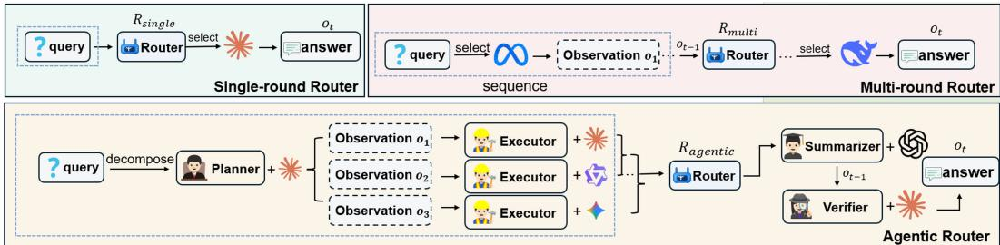
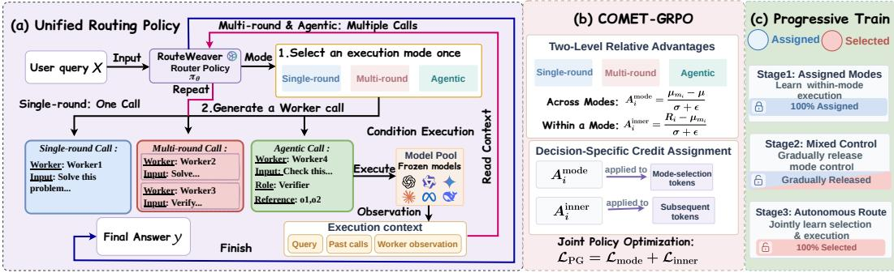
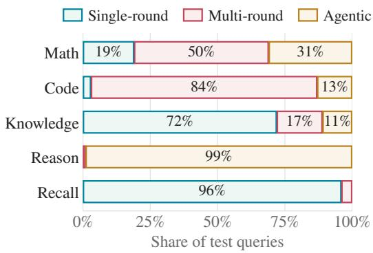

# ROUTEWEAVER: WEAVING MODE SELECTION AND EXECUTION INTO UNIFIED LLM ROUTING

Xiaohan Wang1,2∗ Haozhen Zhang1 Qingyuan Liu1 Tao Feng3 Wenya Wang1

1Nanyang Technological University

2Huazhong University of Science and Technology

3University of Illinois Urbana-Champaign

shawn wang@hust.edu.cn, wangwy@ntu.edu.sg

## ABSTRACT

LLM routing dynamically selects and coordinates heterogeneous language models across diverse tasks. However, existing approaches are largely built around a predefined execution paradigm, such as single-round, multi-round, or agentic routing, which fixes how model calls are organized and limits adaptation to different query needs. We propose RouteWeaver, a unified routing framework that integrates these routing modes within a single LLM policy, jointly learning which mode to use and how to select models within that mode. To jointly optimize mode selection and within-mode execution, we develop COMET-GRPO (COordinated Mode–Execution Training), which decouples the trajectory-level advantage into separate signals for mode selection and within-mode execution, enabling more targeted credit assignment to each decision level. We further introduce progressive exploration, which gradually shifts training from externally assigned modes to autonomous selection, so that the router first learns how to execute each mode before deciding when to use it. We evaluate RouteWeaver across mathematics, coding, knowledge, logical reasoning, and factual recall. RouteWeaver achieves an average accuracy of 61.4%, an 11.03% relative improvement over the strongest baseline, and outperforms all compared baselines in each of the five domains. Ablations show that both COMET-GRPO and progressive exploration are important for adaptive routing; without progressive exploration, the routing policy collapses entirely to single-round execution.

‡ RouteWeaver Œ Project Website

## 1 INTRODUCTION

The growing diversity of large language models (LLMs) has motivated LLM routing as a paradigm for leveraging complementary capabilities, where different models are selected and coordinated according to their strengths, costs, and suitability for each query (Chen et al., 2024a; Ding et al., 2024; Hu et al., 2024; Ong et al., 2025). Depending on how model calls are organized, current routing approaches generally follow three paradigms: single-round routing selects a single model for one-shot execution (Chen et al., 2024b; Feng et al., 2025b; Wang et al., 2026), multi-round routing makes successive model selections conditioned on intermediate outputs (Zhang et al., 2025; Shao et al., 2026), and agentic routing organizes multiple models into structured collaborative workflows (Yue et al., 2025; Feng et al., 2026b). Although routing decisions within each paradigm can adapt to the query, the execution paradigm itself is typically fixed in advance. As a result, the router can adapt which models to use, but not how model calls should be organized for different queries. This raises a natural question: how can we unify these routing paradigms within a single policy that jointly adapts execution mode and model selection to each query?

Unifying these routing paradigms within a single policy is non-trivial. Single-round, multi-round, and agentic routing follow different execution structures and decision processes, requiring a common formulation that accommodates all three while preserving their distinct behaviors. Beyond this structural challenge, two learning problems are particularly important. First, different queries may favor different execution modes, yet determining which mode is appropriate requires reasoning about the task before its execution unfolds. A unified router must therefore learn when single-round, multi-round, or agentic execution is most suitable for each query. Second, selecting an appropriate mode alone is insufficient, since each mode demands a differentform of model selection and coordination. Single-round routing requires choosing an effective model directly, multi-round routing must adapt subsequent selections to intermediate outputs, and agentic routing additionally organizes models through roles and dependencies. The router must therefore learn not only which mode to use, but also how to execute effectively within the selected mode.

To address these challenges, we propose RouteWeaver, a unified routing policy that learns to select among single-round, multi-round, and agentic execution paradigms and perform model selection within the chosen paradigm. We first introduce a unified routing format that expresses all three paradigms through a common action grammar for mode selection and subsequent routing decisions. To jointly optimize these two levels of decisions, we develop COMET-GRPO (COordinated Mode– Execution Training), which decouples the trajectory-level advantage into separate signals for mode selection and within-mode execution, enabling targeted credit assignment to each decision level. We further introduce progressive exploration, which gradually shifts training from externally assigned modes to autonomous selection, allowing the router to first learn how to execute within each mode before deciding when to use it.

We evaluate RouteWeaver on benchmarks spanning mathematics, coding, knowledge, logical reasoning, and factual recall. RouteWeaver achieves 61.4% average accuracy, an 11.03% relative improvement over the strongest baseline, and leads all baselines across the five domains. We further study performance–cost trade-offs and generalization on held-out benchmarks (AIME, GPQA-D, and BBH). With α = 0.1, Worker inference cost decreases by 23% with only a 1.0-point accuracy drop, while RouteWeaver achieves 53.7% average accuracy on held-out benchmarks, an 18.28% relative improvement over the strongest baseline. Ablations and routing analyses further validate COMET-GRPO and progressive exploration and reveal adaptive execution choices across tasks. Our main contributions are summarized as follows:

• We formulate unified LLM routing across single-round, multi-round, and agentic execution paradigms, enabling a single policy to adapt both the execution mode and model selection to each query rather than committing to a predefined routing schema.

• We propose RouteWeaver, featuring COMET-GRPO, which decouples credit assignment for mode selection and within-mode execution, together with progressive exploration that gradually transitions the router from learning how to execute each mode to autonomously deciding when to use it for different queries.

• Extensive experiments across mathematics, coding, knowledge, logical reasoning, and factual recall demonstrate the effectiveness of unified routing over existing routers and fixedmode strategies. Further analyses examine performance–cost trade-offs, routing behavior, and the contributions of the proposed training components.

## 2 RELATED WORK

## 2.1 EXECUTION PARADIGMS FOR LLM ROUTING

Existing LLM routing methods can be categorized by how model calls are organized. (1) Singleround routing selects one model for each query, typically based on model capability, query difficulty, or performance–cost trade-offs. RouteLLM (Ong et al., 2025) learns routing from preference data, while RouterDC (Chen et al., 2024b) and GraphRouter (Feng et al., 2025b) model query– model relations. ICL-Router (Wang et al., 2026) further improves routing through learned model representations. (2) Multi-round routing allows routing decisions to evolve across calls using intermediate outputs. Router-R1 (Zhang et al., 2025) formulates routing as a sequential decision process with repeated model selection and response aggregation, while R2-Reasoner (Shao et al., 2026) combines task decomposition with model allocation for intermediate reasoning. (3) Agentic routing organizes multiple models into collaborative workflows. MasRouter (Yue et al., 2025) jointly considers collaboration structures, agent roles, and model choices, while GraphPlanner (Feng et al., 2026b) generates query-dependent workflows with model–role assignments and explicit interactions. Despite adaptive routing within each paradigm, prior approaches fix the execution paradigm in advance. In contrast, RouteWeaver unifies single-round, multi-round, and agentic routing as selectable modes of one policy, jointly learning mode selection and within-mode execution.

  
Figure 1: Three execution paradigms. Top left, single-round: the router selects one Worker for a single call. Top right, multi-round: the router selects Workers sequentially using accumulated observations. Bottom, agentic: the router selects Workers, assigns roles, and specifies dependencies between calls; the depicted workflow is illustrative, and its roles and dependencies vary across queries.

## 2.2 REINFORCEMENT LEARNING FOR AGENTIC LLMS

Reinforcement learning (RL) has become a central approach for improving the reasoning and interactive capabilities of LLMs. GRPO (Shao et al., 2024) replaces critic-based advantage estimation with group-relative rewards and has inspired several variants. Dr.GRPO (Liu et al., 2025) addresses optimization biases in GRPO, while DAPO (Yu et al., 2025) improves training stability through asymmetric clipping and dynamic sampling. GDPO (Liu et al., 2026) further decouples reward normalization for multi-reward optimization. RL has also been extended to interactive agents. Search-R1 (Jin et al., 2025) and ReTool (Feng et al., 2026a) train LLMs to interleave reasoning with search or tool interactions, while GiGPO (Feng et al., 2025a) introduces episode- and step-level relative advantages for finer credit assignment in multi-turn agents. Building on these advances, COMET-GRPO adapts group-relative optimization to unified LLM routing, where mode selection and within-mode execution form two coupled decision levels and receive separate credit signals.

## 3 PRELIMINARIES

Given a query x and a pool of Worker models $\mathcal { W } = \{ w _ { 1 } , . . . , w _ { N } \}$ , a router R determines which Workers to invoke and how their calls are organized. We refer to the resulting pattern of Worker invocation and information flow as the execution structure. We distinguish three execution paradigms according to how routing decisions are structured (Figure 1).

Single-round routing. The router selects one Worker for the query and calls it once:

$$
w = \mathcal { R } _ { \mathrm { s i n g l e } } ( x ) , \qquad o = w ( x ) .\tag{1}
$$

Here, $w \in \mathcal { W }$ is the selected Worker and o is its output. The resulting execution structure consists of a single Worker call: the routing decision precedes execution, with no subsequent Worker selection based on the returned response.

Multi-round routing. The router makes successive calls using earlier feedback. Let $s _ { t }$ denote the sub-query generated for the t-th Worker call and $h _ { t - 1 } = \big ( ( w _ { 1 } , s _ { 1 } , o _ { 1 } ) , \dotsc , ( w _ { t - 1 } , s _ { t - 1 } , o _ { t - 1 } ) \big )$ the ordered history of preceding interactions. Each routing decision specifies a Worker and its subquery:

$$
( w _ { t } , s _ { t } ) = \mathcal { R } _ { \operatorname * { m u l t i } } ( x , h _ { t - 1 } ) , \qquad o _ { t } = w _ { t } ( s _ { t } ) .\tag{2}
$$

The response is appended to the history before the next decision. This sequential execution structure allows intermediate outputs to guide model selection, task refinement, and further reasoning.

Agentic routing. Calls are organized into a workflow with explicit roles and dependencies. We describe the completed workflow after t calls by $G _ { t } = ( V _ { t } , E _ { t } )$ , where $V _ { t }$ indexes completed Worker

calls and an edge $( j , k ) \in E _ { t }$ indicates that call k uses the output of call j. A routing decision is

$$
( w _ { t } , s _ { t } , r _ { t } , P _ { t } ) = \mathcal { R } _ { \mathrm { a g e n t i c } } ( x , G _ { t - 1 } ) ,\tag{3}
$$

where $r _ { t }$ specifies the role, such as planning, execution, verification, or summarization, and $P _ { t } \subseteq$ $V _ { t - 1 }$ is the set of completed predecessor calls selected as dependencies. The outputs $\{ o _ { j } : j \in P _ { t } \}$ are supplied as context to Worker $w _ { t } ,$ which executes sub-query $s _ { t }$ under role $r _ { t } ,$ and its output is recorded in the workflow. By selecting $P _ { t }$ , the router determines the direct dependencies of each call. The resulting dependency structure supports branching and aggregation, while independent calls may execute in parallel. Agentic workflows can also be sequential; their defining distinction here is the explicit organization of roles and dependencies.

## 4 RO U T EWE A V E R

Building on the above formulation, RouteWeaver unifies single-round, multi-round, and agentic routing in one policy. This raises three challenges. First, their heterogeneous execution structures require a common representation. Second, performance depends jointly on mode selection and withinmode execution, calling for differentiated learning signals. Third, mode selection requires sufficient experience across modes to avoid early bias. RouteWeaver addresses these challenges through a unified routing formulation (Section 4.1), COMET-GRPO for coordinated mode–execution learning (Section 4.2), and progressive exploration toward autonomous routing (Section 4.3).

  
Figure 2: Overview of RouteWeaver. (a) One routing policy $\pi _ { \theta }$ selects an execution mode, then calls frozen Workers;Multi-round calls automatically use the latest observation, while agentic calls include role assignments and router-selected references to earlier outputs.Returned observations are appended to its context until it emits the final answer. (b) COMET-GRPO computes mode-level and within-mode advantages per reward component, mixes them (Eq. (7)), and assigns $A _ { i } ^ { \mathrm { m o d e } }$ to mode-selection tokens and $A _ { i } ^ { \mathrm { i { \bar { n } } n e r } }$ to subsequent router tokens. (c) Progressive training moves mode selection from assigned modes to the router in three stages.

## 4.1 UNIFIED TRAJECTORY REPRESENTATION AND EXECUTION

To this end, we represent each routing process as a mode-conditioned trajectory. Given a query x, the router first selects an execution mode

$$
m \sim \pi _ { \boldsymbol { \theta } } ( \cdot \mid x ) , \qquad m \in \mathcal { M } = \{ \mathrm { s i n g l e , m u l t i , a g e n t i c } \} ,
$$

and subsequently generates routing actions conditioned on the query and the accumulated interaction context. Each Worker call specifies a Worker w and a sub-query s; agentic calls additionally specify a role r and references $P$ to completed calls. Multi-round execution passes the previous observation to each subsequent call, while agentic execution passes the referenced outputs to role-structured and potentially parallel calls. Single-round execution contains exactly one Worker call. The serialization format and mode-specific constraints are detailed in Appendix ${ \mathrm { A . 1 } }$

Executing an action returns the Worker outputs as an observation $o _ { t }$ , which is appended to the router context before the next decision. The router continues issuing mode-compatible actions until it produces the final answer y, yielding

$$
\tau = ( m , a _ { 1 } , o _ { 1 } , \dots , a _ { T } , o _ { T } , y ) .\tag{4}
$$

The mode, routing actions, and final answer are generated by the router and optimized as policy tokens, whereas Worker observations and other environment-inserted content are used only as context.

Each trajectory receives a task reward and an efficiency reward,

$$
( r _ { \mathrm { t a s k } } , r _ { \mathrm { e f f } } ) = \left\{ \begin{array} { l l } { ( 1 , S _ { \mathrm { c o s t } } ( \tau ) ) , } & { \tau \mathrm { ~ i s ~ v a l i d ~ a n d ~ c o r r e c t } , } \\ { ( 0 , 0 ) , } & { \tau \mathrm { ~ i s ~ v a l i d ~ b u t ~ i n c o r r e c t } , } \\ { ( - 1 , - 1 ) , } & { \tau \mathrm { ~ i s ~ t e r m i n a l - i n v a l i d } , } \end{array} \right. \quad \quad S _ { \mathrm { c o s t } } ( \tau ) = \frac { 1 } { 1 + C ( \tau ) / C _ { \mathrm { r e f } } } .\tag{5}
$$

Correctness is determined by the task-specific scorer (Appendix B.2), while $C ( \tau )$ measures the fixed-reference inference cost of Worker calls, excluding router computation, and $C _ { \mathrm { r e f } } ~ > ~ 0$ is a frozen reference cost (Appendix C.1). Terminal-invalid trajectories arise from grammar or execution-constraint violations. These trajectory-level signals jointly reflect mode selection and subsequent execution, motivating the decision-specific credit assignment introduced next.

## 4.2 COMET-GRPO

Joint mode selection and execution create an ambiguous credit-assignment problem. A low-reward trajectory may result from selecting an unsuitable execution mode, from executing an otherwise suitable mode poorly, or from both. Standard GRPO (Shao et al., 2024) does not distinguish these cases: it assigns the same trajectory-level relative advantage to the mode-selection tokens and all subsequent router-generated tokens. We therefore decompose relative feedback into two complementary comparisons: an across-mode comparison for mode selection and a within-mode comparison for execution conditioned on the selected mode. COMET-GRPO (COordinated Mode–Execution Training) uses these two signals to optimize the two decision levels separately within a shared policy.

Two levels of relative advantage. For each query, we sample a group of $K$ rollouts; all statistics below are computed within this group and separately for each reward component. Let $\nu$ be the rollouts retained for advantage estimation (Appendix C.1). For one component with values $r _ { i } .$ , let $\mu$ and $\sigma$ be the mean and standard deviation of $\{ r _ { i } \} _ { i \in \mathcal { V } }$ , so that GRPO assigns $A _ { i } ^ { \mathrm { G R P O } } = \dot { ( r _ { i } - }$ $\mu ) / ( \sigma + \epsilon )$ to every router token of $\tau _ { i } .$ . In a free group, each rollout selects its own mode, so the group need not cover all modes. Let $\nu _ { m } \subseteq \nu$ contain the retained rollouts that selected $m .$ , with mean $\mu _ { m }$ of the same component. For rollout i with mode $m _ { i }$

$$
A _ { i } ^ { \mathrm { m o d e } } = \frac { \mu _ { m _ { i } } - \mu } { \sigma + \epsilon } , \qquad A _ { i } ^ { \mathrm { i n n e r } } = \frac { r _ { i } - \mu _ { m _ { i } } } { \sigma + \epsilon } .\tag{6}
$$

Intuitively, $A _ { i } ^ { \mathrm { m o d e } }$ measures how the average reward of the selected mode compares with the overall rollout-group average for the same query, whereas $A _ { i } ^ { \mathrm { i n n e r } }$ measures how this particular trajectory compares with the average trajectory under the same mode. Both use the group standard deviation σ rather than a within-mode one, keeping the two signals on a common scale.

Following the reward-wise normalization of GDPO (Liu et al., 2026), we compute these advantages separately for the task and efficiency rewards and then mix them:

$$
A _ { i } ^ { l } = \left( 1 - \alpha \right) A _ { i , \mathrm { t a s k } } ^ { l } + \alpha A _ { i , \mathrm { e f f } } ^ { l } , \qquad l \in \{ \mathrm { m o d e } , \mathrm { i n n e r } \} .\tag{7}
$$

With $\alpha = 0$ only the task signal is used; $\alpha > 0$ adds the efficiency signal. The weight α is fixed within a run and is independent of the exploration schedule of Section 4.3, and no further batch-level normalization is applied. Component-wise definitions are given in Appendix C.2.

Decision-specific credit assignment. Having separated the two sources of feedback, we apply each signal only to the decisions it is intended to supervise. The mixed $A _ { i } ^ { \mathrm { m o d e } }$ is assigned to the tokens of the mode decision, $S _ { i } ^ { \mathrm { m o d e } }$ , and $A _ { i } ^ { \mathrm { i n n e r } }$ to the subsequent router tokens, $S _ { i } ^ { \mathrm { i n n e r } }$ : Worker choices, roles, references, sub-queries, and the final answer. Observations, injected content, and padding are masked. Following the PPO clipped surrogate objective (Schulman et al., 2017), for a router token $z _ { i k }$ with context $\breve { H } _ { i k }$ (indexed by k to distinguish tokens from interaction steps), the clipped token loss is

$$
\ell _ { i k } ( A ) = - \operatorname* { m i n } \big [ r _ { i k } A , \mathrm { ~ c l i p } ( r _ { i k } , 1 - \eta _ { - } , 1 + \eta _ { + } ) A \big ] , \qquad r _ { i k } = \frac { \pi _ { \theta } ( z _ { i k } \mid H _ { i k } ) } { \pi _ { \mathrm { o l d } } ( z _ { i k } \mid H _ { i k } ) } ,\tag{8}
$$

with dual clipping for negative advantages as specified in Appendix C.2.

Joint policy optimization. Each of the two losses is normalized by its own global count of effective tokens in the mini-batch, and the results are added:

$$
\mathcal { L } _ { \mathrm { P G } } = \frac { \sum _ { i } \sum _ { k \in S _ { i } ^ { \mathrm { m o d e } } } \ell _ { i k } ( A _ { i } ^ { \mathrm { m o d e } } ) } { N _ { \mathrm { m o d e } } } + \frac { \sum _ { i } \sum _ { k \in S _ { i } ^ { \mathrm { i n n e r } } } \ell _ { i k } ( A _ { i } ^ { \mathrm { i n n e r } } ) } { N _ { \mathrm { i n n e r } } } ,\tag{9}
$$

where $N _ { \mathrm { m o d e } }$ and $N _ { \mathrm { i n n e r } }$ count the effective mode and inner tokens in the mini-batch, and an empty term is skipped. Mode tokens are typically far fewer than execution tokens, so averaging over all tokens together would give the mode term a small aggregate weight merely because it is short; separate normalization removes this dependence on length. The policy is regularized toward the frozen initial router $\pi _ { \mathrm { r e f } } .$ , distinct from $\pi _ { \mathrm { o l d } }$ , using a KL penalty with coefficient $\beta \colon$

$$
\mathcal { L } _ { \mathrm { K L } } = \frac { 1 } { N _ { \mathrm { K L } } } \sum _ { ( i , k ) \in \Omega _ { \mathrm { K L } } } \kappa _ { i k } ,\tag{10}
$$

where $\Omega _ { \mathrm { K L } }$ is the full effective policy mask, $N _ { \mathrm { K L } }$ its token count, and $\kappa _ { i k }$ a per-token estimate of the KL divergence to $\pi _ { \mathrm { r e f } }$ . The estimator, masks, and degenerate groups are described in Appendix C.2.

## 4.3 PROGRESSIVE EXPLORATION

If the router chose modes autonomously from the start, early preferences could reduce the training opportunities of the other modes. Progressive exploration therefore first provides execution experience within each mode and then gradually hands mode selection to the router, in three phases indexed by the data-batch index b. Each query is forced with probability

$$
\rho _ { b } = \left\{ \begin{array} { l l } { 1 , } & { b < b _ { 0 } , } \\ { 1 - \displaystyle \frac { b - b _ { 0 } } { b _ { 1 } - b _ { 0 } } , } & { b _ { 0 } \le b < b _ { 1 } , } \\ { 0 , } & { b \ge b _ { 1 } , } \end{array} \right.\tag{11}
$$

and otherwise free; all K rollouts of a query share this condition. A forced query receives one externally assigned mode, with modes distributed across the batch, and its injected mode prefix is masked.

Cold start $( b \ < \ b _ { 0 } )$ . This phase teaches execution within each mode before the router selects modes. All queries are forced. We denote by $\mathcal { L } _ { \mathrm { G R P O } } ^ { \mathrm { g l o b a l } }$ the ordinary GRPO loss, obtained by averaging $\ell _ { i k } ( A _ { i } ^ { \mathrm { G R P O } } )$ over all effective router tokens (Eq. 17). The router is updated with $\mathcal { L } _ { \mathrm { G R P O } } ^ { \mathrm { g l o b a l } }$ on the task reward alone; advantage decomposition and the support term are inactive. All runs start independently from the same initial router at step 0; after this phase each run continues its own training trajectory with its fixed α (Appendix C.3).

Forced/free transition $( b _ { 0 } ~ \leq ~ b < ~ b _ { 1 } )$ . Forced groups decrease and free groups increase. Free groups use the advantages of Eq. 7. Forced groups compute $A _ { i } ^ { \mathrm { G R P O } }$ for each enabled reward component, mix them with the same weights, and apply the result to their execution tokens, which enter the inner term of Eq. 9; their injected mode tokens remain masked (Eq. 18). To keep probability support on every mode and prevent it from concentrating prematurely, we add a one-sided penalty on $\hat { p } _ { m }$ , the normalized score of candidate mode m averaged over the unique queries in the batch (Appendix C.2):

$$
\mathcal { L } _ { \mathrm { s u p p o r t } } = \frac { 1 } { | \mathcal { M } | } \sum _ { m \in \mathcal { M } } \operatorname* { m a x } ( 0 , \log \delta - \log ( \bar { p } _ { m } + \epsilon ) ) .\tag{12}
$$

Because it acts on batch-level averages, individual queries can still favor different modes. Its coeffi cient $\lambda _ { b } = \lambda _ { 0 } \rho _ { b }$ applies only during the transition; the term is inactive in the other phases.

Fully autonomous routing $( b ~ \geq ~ b _ { 1 } )$ . All queries are free, and the router jointly learns mode selection and execution with COMET-GRPO.

Phase objectives. Across the three phases, the router minimizes

$$
\mathcal { L } _ { b } = \left\{ \begin{array} { l l } { \mathcal { L } _ { \mathrm { G R P O } } ^ { \mathrm { g l o b a l } } + \beta \mathcal { L } _ { \mathrm { K L } } , } & { b < b _ { 0 } , } \\ { \mathcal { L } _ { \mathrm { P G } } + \beta \mathcal { L } _ { \mathrm { K L } } + \lambda _ { b } \mathcal { L } _ { \mathrm { s u p p o r t } } , } & { b _ { 0 } \leq b < b _ { 1 } , } \\ { \mathcal { L } _ { \mathrm { P G } } + \beta \mathcal { L } _ { \mathrm { K L } } , } & { b \geq b _ { 1 } , } \end{array} \right.\tag{13}
$$

where $\mathcal { L } _ { \mathrm { G R P O } } ^ { \mathrm { g l o b a l } }$ uses the task-only GRPO advantage and $\mathcal { L } _ { \mathrm { P G } }$ uses the α-mixed advantages, including the mixed GRPO advantages of forced groups in its inner term. Phase boundaries and coefficients are reported in Appendix C.3.

## 5 EXPERIMENTS

We evaluate RouteWeaver across five task domains to examine whether jointly selecting and executing different routing modes improves over methods restricted to a fixed execution paradigm. We further study its performance–cost trade-off, isolate the contributions of COMET-GRPO and progressive exploration, and analyze how execution-mode choices vary across tasks. Additional dataset, evaluation, and implementation details are provided in the appendices.

## 5.1 EXPERIMENTAL SETUP

Datasets. Our evaluation comprises nine benchmarks spanning five domains: Math, MATH (Hendrycks et al., 2021b) and Omni-MATH (Gao et al., 2025); Code, APPS (Hendrycks et al., 2021a), LiveCodeBench (Jain et al., 2025), and TACO (Li et al., 2023); Knowledge, SuperGPQA (Du et al., 2025); Reason, SATBench (Wei et al., 2025); and Recall, TriviaQA (Joshi et al., 2017) and SimpleQA-Verified (Haas et al., 2025). Test questions do not overlap with the training questions used for router optimization. Dataset composition, training pools, and evaluation sets are provided in Appendix B.1.

Router and Worker models. The router is Qwen3-4B-Instruct-2507 (Yang et al., 2025) with all parameters fine-tuned. The Worker pool contains six frozen models: Qwen3-8B and Qwen3-30B-A3B-Instruct-2507 (Yang et al., 2025), Llama-3.1-8B-Instruct and Llama-3.3-70B-Instruct (Llama Team, AI @ Meta, 2024), Gemma-3-27B-IT (Gemma Team, 2025), and Gemini-2.5-Flash-Lite (Gemini Team, Google, 2025). The router refers to Workers only by anonymous IDs with capability descriptions and never sees model names or prices. Model identifiers and serving provider are listed in Appendix B.3.

Baselines. We compare RouteWeaver with ten routers spanning all three execution paradigms. Single-round baselines include Router-KNN and Router-MLP (Hu et al., 2024), RouterDC (Chen et al., 2024b), and GraphRouter (Feng et al., 2025b); multi-round baselines include Prompt LLM and Router-KNN-MR following Zhang et al. (2025), R2-Reasoner (Shao et al., 2026), and Router-R1 (Zhang et al., 2025); and agentic baselines include MasRouter (Yue et al., 2025) and GraphPlanner (Feng et al., 2026b).

## 5.2 PERFORMANCE ACROSS EXECUTION PARADIGMS

RouteWeaver substantially outperforms fixed-paradigm routers. Table 1 compares RouteWeaver with single-round, multi-round, and agentic routing baselines across the five evalu ation domains. RouteWeaver reaches an average accuracy of 61.4%, an 11.03% relative improvement over the strongest baseline (55.3%, Router-R1). Its relative improvements over the strongest single-round, multi-round, and agentic baselines are 26.08%, 11.03%, and 31.20%, respectively, and it leads all baselines in each of the five domains.

Adaptive execution provides broad but task-dependent gains. RouteWeaver leads the strongest baseline in every evaluation domain, with relative improvements ranging from 5.20% on Recall to 12.52% on Math. Importantly, the strongest fixed-paradigm baseline varies across domains: multi-round routers perform best among the baselines on Math, Code, and Knowledge, whereas single-round routers are strongest on Reason and Recall. This variation suggests that no single execution paradigm is uniformly preferable across tasks, motivating RouteWeaver’s queryadaptive mode selection. Section 5.5 further examines how RouteWeaver distributes queries across execution modes.

## 5.3 PERFORMANCE–COST TRADE-OFF

Efficiency preferences allow RouteWeaver to operate at different accuracy–cost points.

<table><tr><td rowspan=1 colspan=7>-O-RouteWeaver  Single-roundMulti-roundAgentic</td></tr><tr><td rowspan=3 colspan=1>1.5ε−0×) 1.0</td><td rowspan=1 colspan=1></td><td rowspan=1 colspan=1></td><td rowspan=1 colspan=1></td><td rowspan=1 colspan=1></td><td rowspan=1 colspan=1>α=</td><td rowspan=2 colspan=1>0Q</td></tr><tr><td rowspan=1 colspan=1></td><td rowspan=1 colspan=1>+ Gra</td><td rowspan=1 colspan=1>phPlanner</td><td rowspan=1 colspan=1></td><td rowspan=1 colspan=1>α=0.1</td></tr><tr><td rowspan=1 colspan=1></td><td rowspan=1 colspan=1></td><td rowspan=1 colspan=1></td><td rowspan=1 colspan=1></td><td rowspan=1 colspan=1></td><td rowspan=1 colspan=1></td></tr></table>

Table 1: Accuracy (%) on the evaluation benchmarks; RouteWeaver is trained with $\alpha = 0 .$ . Domain accuracy is the unweighted mean of its constituent dataset accuracies; Avg is the unweighted mean of the five domain accuracies. Best results are in bold; numbers in parentheses give the relative improvement of RouteWeaver over the strongest baseline in each column.
<table><tr><td>Method</td><td>Math</td><td>Code</td><td>Knowledge</td><td>Reason</td><td>Recall</td><td>Avg</td></tr><tr><td colspan="7">Single-round Router</td></tr><tr><td>Router-KNN</td><td>61.7</td><td>34.8</td><td>38.3</td><td>68.3</td><td>40.4</td><td>48.7</td></tr><tr><td>Router-MLP</td><td>58.7</td><td>33.2</td><td>40.0</td><td>59.2</td><td>34.2</td><td>45.1</td></tr><tr><td>RouterDC</td><td>61.3</td><td>29.4</td><td>34.2</td><td>57.5</td><td>35.0</td><td>43.5</td></tr><tr><td>GraphRouter</td><td>64.6</td><td>36.1</td><td>34.2</td><td>69.2</td><td>39.6</td><td>48.7</td></tr><tr><td colspan="7">Multi-round Router</td></tr><tr><td>Prompt LLM</td><td>45.8</td><td>33.7</td><td>29.2</td><td>54.2</td><td>30.0</td><td>38.6</td></tr><tr><td>Router-KNN-MR</td><td>40.8</td><td>33.2</td><td>30.8</td><td>48.3</td><td>29.6</td><td>36.6</td></tr><tr><td>R2-Reasoner</td><td>45.8</td><td>30.7</td><td>28.3</td><td>50.0</td><td>23.3</td><td>35.6</td></tr><tr><td>Router-R1</td><td>66.3</td><td>52.8</td><td>48.9</td><td>68.7</td><td>39.8</td><td>55.3</td></tr><tr><td colspan="7">Agentic Router</td></tr><tr><td>MasRouter</td><td>54.2</td><td>37.6</td><td>41.7</td><td>62.5</td><td>38.3</td><td>46.8</td></tr><tr><td>GraphPlanner</td><td>47.5</td><td>48.3</td><td>30.0</td><td>54.2</td><td>39.2</td><td>43.8</td></tr><tr><td>RouteWeaver</td><td>74.6(+12.52%) 58.2(+10.23%) 55.0(+12.47%)</td><td></td><td></td><td>76.7 (+10.84%)</td><td>42.5 (+5.20%)</td><td>61.4(+11.03%)</td></tr></table>

The main results use $\alpha ~ = ~ 0$ and optimize task performance only, whereas different deployments may require different balances between accuracy and cost. We therefore evaluate RouteWeaver with $\alpha ~ \in ~ \{ 0 , 0 . 1 , 0 . 3 , 0 . 5 \}$ keeping all other settings fixed; Figure 3 shows the resulting operating points. As α increases, Worker cost per query decreases monotonically, accompanied by a gradual decrease in accuracy. Relative to $\alpha = 0 , \alpha = 0 . 1$ lowers cost by 23% while losing 1.0 point of accuracy, and $\alpha ~ = ~ 0 . 3$ lowers it by 61% while losing 3.1 points; at $\alpha = 0 . 5$ , cost falls by 86% while accuracy drops by 11.2 points. These results illustrate different operating points that trade accuracy for efficiency under different deployment preferences.

## Cost-aware routing provides different operating points under the same unified policy. All operating points are obtained from the same

unified routing framework by changing only α.

Section 5.5 analyzes how RouteWeaver distributes execution modes across domains.

## 5.4 ABLATION OF COMET-GRPO AND PROGRESSIVE EXPLORATION

Table 2 ablates the two learning components of RouteWeaver. Both variants share the router initialization, Worker pool, training data, evaluation protocol, and training budget of the full model, and all use $\alpha = 0$

w/o COMET-GRPO. Replacing COMET-GRPO with ordinary GRPO reduces average accuracy from 61.4% to 58.8% and shifts mode usage from .35/.41/.24 to .13/.82/.05, strongly concentrating the policy on multi-round execution. The largest drop occurs on Knowledge (5.8 points). Thi suggests that decision-specific credit assignment helps preserve differentiated mode selection rather than letting one execution mode dominate.

Table 2: Ablation of the two learning components, all trained with α = 0 under the same budget. Accuracy (%) is reported by domain. Mode usage is reported as the aggregate proportion of evaluation queries assigned to single-round (S), multi-round (M), and agentic (A) execution.
<table><tr><td></td><td colspan="6">Accuracy (%)</td><td>Mode usage</td></tr><tr><td>Variant</td><td>Math</td><td>Code</td><td>Knowledge</td><td>Reason</td><td>Recall</td><td>Avg</td><td>S/M/A</td></tr><tr><td>RouteWeaver</td><td>74.6</td><td>58.2</td><td>55.0</td><td>76.7</td><td>42.5</td><td>61.4</td><td>.35 / .41 /.24</td></tr><tr><td>w/o COMET-GRPO</td><td>72.3</td><td>57.2</td><td>49.2</td><td>74.1</td><td>41.2</td><td>58.8</td><td>.13 / .82 / .05</td></tr><tr><td>w/o progressive exploration</td><td>70.2</td><td>48.6</td><td>50.3</td><td>68.3</td><td>40.4</td><td>55.6</td><td>1.00 / .00 / .00</td></tr></table>

w/o progressive exploration. Removing the forced-to-free schedule causes a larger average drop, from 61.4% to 55.6%, with particularly large decreases on Code (9.6 points) and Reason (8.4 points). More strikingly, the learned policy collapses entirely to single-round execution (1.00/.00/.00). This supports the role of progressive exploration in maintaining cross-mode exploration before fully autonomous mode selection. Notably, both ablated variants (58.8% and 55.6%) still exceed the strongest fixed-paradigm baseline (55.3%, Router-R1).

## 5.5 ROUTING BEHAVIOR AND GENERALIZATION

Routing behavior across domains. Figure 4 reveals strongly task-dependent execution preferences. Math uses all three modes, with 19% of queries routed to single-round, 50% to multi-round, and 31% to agentic execution. Code is dominated by multi-round routing (84%), whereas Knowledge primarily uses single-round execution (72%). The contrast is strongest for Reason and Recall: 99% of reasoning queries are routed to agentic execution, while 96% of recall queries use single-round routing. These results reveal substantially different execution-mode preferences across task domains.

Generalization to held-out benchmarks. To evaluate whether the learned routing policy transfers beyond the datasets used for router training, we further test RouteWeaver on AIME (AI-MO, 2024; Zhang & Math-AI Team,

  
Figure 4: Share of selected execution modes across evaluation domains for RouteWeaver (α = 0). Each bar shows the proportion of test queries routed to single-round, multi-round, and agentic execution.

2025) for Math, GPQA-Diamond (GPQA-D) (Rein et al., 2024) for Knowledge, and BBH (Suzgun et al., 2023) for Reason. We compare against one representative baseline from each execution paradigm (Table 3). RouteWeaver achieves the best accuracy on all three held-out benchmarks, reaching an average of 53.7%, an 18.28% relative improvement over Router-R1 (45.4%). The gains are consistent across all three benchmarks, with improvements of 11.4, 7.1, and 6.4 points over Router-R1 on AIME, GPQA-D, and BBH, respectively. The learned execution behavior also varies across held-out benchmarks, with agentic execution accounting for 75% of AIME queries but only 12% of BBH queries. These results indicate that RouteWeaver’s adaptive routing behavior extends to unseen benchmarks within the same task domains.

Table 3: Accuracy (%) on benchmarks held out from router training across three domains: AIME (Math), GPQA-Diamond (Knowledge), and BBH (Reason). We compare one representative router from each execution paradigm.
<table><tr><td>Method</td><td>AIME</td><td>GPQA-D</td><td>BBH</td><td>Avg</td></tr><tr><td>GraphRouter (single-round)</td><td>23.5</td><td>49.5</td><td>24.7</td><td>32.6</td></tr><tr><td>Router-R1 (multi-round)</td><td>45.6</td><td>62.1</td><td>28.6</td><td>45.4</td></tr><tr><td>MasRouter (agentic)</td><td>28.1</td><td>43.8</td><td>28.2</td><td>33.4</td></tr><tr><td>RouteWeaver</td><td>57.0</td><td>69.2</td><td>35.0</td><td>53.7</td></tr></table>

## 6 CONCLUSION

We presented RouteWeaver, a unified LLM routing framework that treats the execution paradigm itself as a routing decision, jointly learning mode selection and within-mode execution. By combining COMET-GRPO with progressive exploration, RouteWeaver learns when to use single-round, multi-round, or agentic execution and how to route effectively within the selected mode. Across five task domains, RouteWeaver consistently outperforms fixed-paradigm routing baselines, exhibits task-dependent execution preferences, and supports different performance–cost operating points. These results suggest that effective LLM routing should adapt not only which models to invoke, but also how their computation is organized. Extending this unified perspective to richer execution structures and tool-augmented environments is an interesting direction for future work.

## AI USE STATEMENT

In this work, we used generative AI tools to assist with implementation and debugging, drafting and editing portions of the manuscript for clarity, and surveying and summarizing relevant literature. All AI-assisted code and manuscript content were reviewed by the authors, and AI-assisted code was inspected and tested before use. The authors take full responsibility for the final content, claims, and artifacts presented in this work.

## ETHICS STATEMENT

This work studies routing among existing language models using established benchmarks and does not involve human-subject experiments or the collection of private user data. RouteWeaver inherits the limitations and potential harms of its underlying Worker models, including biased, unsafe, or factually incorrect outputs, which may propagate across multiple model calls. Our experiments are intended to evaluate routing methodology rather than safety-critical deployment. Practical deployments should therefore apply appropriate model-level safety mechanisms and comply with the licenses and usage policies of the underlying models and datasets.

## REPRODUCIBILITY STATEMENT

We provide the complete formulation and training objectives of RouteWeaver in Section 4, and describe the datasets, router and Worker models, and baselines in Section 5.1. The appendices further document the routing serialization and execution constraints (Appendix A.1), dataset construction and evaluation sets (Appendix B.1), task-specific evaluation procedures (Appendix B.2), model and serving configurations (Appendix B.3), reward and cost definitions (Appendix C.1), optimization details (Appendix C.2), and training hyperparameters, decoding settings, and call budgets (Appendix C.3). Together, these sections document the training and evaluation setup used for RouteWeaver. Code is available at https://github.com/LaughKing/RouteWeaver.

## REFERENCES

AI-MO. AIMO validation AIME: AIME 2022–2024 problems. https://huggingface.co/ datasets/AI-MO/aimo-validation-aime, 2024.

Lingjiao Chen, Matei Zaharia, and James Zou. FrugalGPT: How to use large language models while reducing cost and improving performance. Trans. Mach. Learn. Res., 2024, 2024a. URL https://openreview.net/forum?id=cSimKw5p6R.

Shuhao Chen, Weisen Jiang, Baijiong Lin, James T. Kwok, and Yu Zhang. RouterDC: Querybased router by dual contrastive learning for assembling large language models. In Advances in Neural Information Processing Systems (NeurIPS), 2024b. URL https://openreview. net/forum?id=7RQvjayHrM.

Dujian Ding, Ankur Mallick, Chi Wang, Robert Sim, Subhabrata Mukherjee, Victor Ruhle, Laks¨ V. S. Lakshmanan, and Ahmed Hassan Awadallah. Hybrid LLM: cost-efficient and quality-aware query routing. In The Twelfth International Conference on Learning Representations, ICLR 2024, Vienna, Austria, May 7-11, 2024. OpenReview.net, 2024. URL https://openreview. net/forum?id=02f3mUtqnM.

Xinrun Du, Yifan Yao, Kaijing Ma, Bingli Wang, Tianyu Zheng, King Zhu, Minghao Liu, Yiming Liang, Xiaolong Jin, Zhenlin Wei, Chujie Zheng, Kaixin Deng, Shawn Gavin, Shian Jia, Sichao Jiang, Yiyan Liao, Rui Li, Qinrui Li, Sirun Li, Yizhi Li, Yunwen Li, David Ma, Yuansheng Ni, Haoran Que, Qiyao Wang, Zhoufutu Wen, Siwei Wu, Tyshawn Hsing, Ming Xu, Zhenzhu Yang, Zekun Moore Wang, Junting Zhou, Yuelin Bai, Xingyuan Bu, Chenglin Cai, Liang Chen, Yifan Chen, Chengtuo Cheng, Tianhao Cheng, Keyi Ding, Siming Huang, Yun Huang, Yaoru Li, Yizhe Li, Zhaoqun Li, Tianhao Liang, Chengdong Lin, Hongquan Lin, Yinghao Ma, Tianyang Pang, Zhongyuan Peng, Zifan Peng, Qige Qi, Shi Qiu, Xingwei Qu, Shanghaoran Quan, Yizhou Tan, Zili Wang, Chenqing Wang, Hao Wang, Yiya Wang, Yubo Wang, Jiajun Xu, Kexin Yang, Ruibin Yuan, Yuanhao Yue, Tianyang Zhan, Chun Zhang, Jinyang Zhang, Xiyue Zhang, Xingjian Zhang, Yue Zhang, Yongchi Zhao, Xiangyu Zheng, Chenghua Zhong, Yang Gao, Zhoujun Li, Dayiheng Liu, Qian Liu, Tianyu Liu, Shiwen Ni, Junran Peng, Yujia Qin, Wenbo Su, Guoyin Wang, Shi Wang, Jian Yang, Min Yang, Meng Cao, Xiang Yue, Zhaoxiang Zhang, Wangchunshu Zhou, Jiaheng Liu, Qunshu Lin, Wenhao Huang, and Ge Zhang. SuperGPQA: Scaling LLM evaluation across 285 graduate disciplines. In Advances in Neural Information Processing Systems (NeurIPS), Datasets and Benchmarks Track, 2025. doi: 10.52202/085713-3766. URL https://papers.nips.cc/paper\_files/paper/ 2025/hash/a3c5af1f56fc73eef1ba0f442739f5ca-Abstract-Datasets\_ and\_Benchmarks\_Track.html.

Jiazhan Feng, Shijue Huang, Xingwei Qu, Ge Zhang, Yujia Qin, Baoquan Zhong, Chengquan Jiang, Jinxin Chi, and Wanjun Zhong. ReTool: Reinforcement learning for strategic tool use in LLMs. In The Fourteenth International Conference on Learning Representations (ICLR), 2026a. URL https://openreview.net/forum?id=tRk1nofSmz.

Lang Feng, Zhenghai Xue, Tingcong Liu, and Bo An. Group-in-group policy optimization for LLM agent training. In Danielle Belgrave, Cheng Zhang, Laura N. Montoya, Hsuan-Tien Lin, Razvan Pascanu, Piotr Koniusz, Marzyeh Ghassemi, Nancy Chen, Ivan Vladimir Meza´ Ru´ız, and Arturo Loaiza-Bonilla (eds.), Advances in Neural Information Processing Systems 38: Annual Conference on Neural Information Processing Systems 2025, NeurIPS 2025, San Diego, CA, USA, December 2-7, 2025 / Mexico City, Mexico, November 30 - December 5, 2025, 2025a. URL http://papers.nips.cc/paper\_files/paper/2025/hash/ 420c9f777c0b4f78d515e53cf74d58b2-Abstract-Conference.html.

Tao Feng, Yanzhen Shen, and Jiaxuan You. GraphRouter: A graph-based router for LLM selections. In International Conference on Learning Representations (ICLR), 2025b. URL https://openreview.net/forum?id=eU39PDsZtT.

Tao Feng, Haozhen Zhang, Zijie Lei, Peixuan Han, and Jiaxuan You. GraphPlanner: Graph memoryaugmented agentic routing for multi-agent LLMs. In International Conference on Learning Representations (ICLR), 2026b. URL https://arxiv.org/abs/2604.23626.

Bofei Gao, Feifan Song, Zhe Yang, Zefan Cai, Yibo Miao, Qingxiu Dong, Lei Li, Chenghao Ma, Liang Chen, Runxin Xu, Zhengyang Tang, Benyou Wang, Daoguang Zan, Shanghaoran Quan,

Ge Zhang, Lei Sha, Yichang Zhang, Xuancheng Ren, Tianyu Liu, and Baobao Chang. Omni-MATH: A universal olympiad level mathematic benchmark for large language models. In International Conference on Learning Representations (ICLR), 2025. URL https://openreview. net/forum?id=yaqPf0KAlN.

Gemini Team, Google. Gemini 2.5: Pushing the frontier with advanced reasoning, multimodality, long context, and next generation agentic capabilities. arXiv preprint arXiv:2507.06261, 2025. URL https://arxiv.org/abs/2507.06261.

Gemma Team. Gemma 3 technical report. arXiv preprint arXiv:2503.19786, 2025. URL https: //arxiv.org/abs/2503.19786.

Lukas Haas, Gal Yona, Giovanni D’Antonio, Sasha Goldshtein, and Dipanjan Das. SimpleQA Verified: A reliable factuality benchmark to measure parametric knowledge. arXiv preprint arXiv:2509.07968, 2025. URL https://arxiv.org/abs/2509.07968.

Dan Hendrycks, Steven Basart, Saurav Kadavath, Mantas Mazeika, Akul Arora, Ethan Guo, Collin Burns, Samir Puranik, Horace He, Dawn Song, and Jacob Steinhardt. Measuring coding challenge competence with APPS. In Proceedings of the Neural Information Processing Systems Track on Datasets and Benchmarks (NeurIPS Datasets and Benchmarks), 2021a. URL https://datasets-benchmarks-proceedings.neurips.cc/paper/2021/ hash/c24cd76e1ce41366a4bbe8a49b02a028-Abstract-round2.html.

Dan Hendrycks, Collin Burns, Saurav Kadavath, Akul Arora, Steven Basart, Eric Tang, Dawn Song, and Jacob Steinhardt. Measuring mathematical problem solving with the MATH dataset. In Proceedings of the Neural Information Processing Systems Track on Datasets and Benchmarks (NeurIPS Datasets and Benchmarks), 2021b. URL https://datasets-benchmarks-proceedings.neurips.cc/paper/2021/ hash/be83ab3ecd0db773eb2dc1b0a17836a1-Abstract-round2.html.

Qitian Jason Hu, Jacob Bieker, Xiuyu Li, Nan Jiang, Benjamin Keigwin, Gaurav Ranganath, Kurt Keutzer, and Shriyash Kaustubh Upadhyay. RouterBench: A benchmark for multi-LLM routing system. arXiv preprint arXiv:2403.12031, 2024. URL https://arxiv.org/abs/2403. 12031.

Naman Jain, King Han, Alex Gu, Wen-Ding Li, Fanjia Yan, Tianjun Zhang, Sida Wang, Armando Solar-Lezama, Koushik Sen, and Ion Stoica. LiveCodeBench: Holistic and contamination free evaluation of large language models for code. In International Conference on Learning Representations (ICLR), 2025. URL https://openreview.net/forum?id=chfJJYC3iL.

Bowen Jin, Hansi Zeng, Zhenrui Yue, Jinsung Yoon, Sercan O. Arık, Dong Wang, Hamed Za-¨ mani, and Jiawei Han. Search-R1: Training LLMs to reason and leverage search engines with reinforcement learning. In Second Conference on Language Modeling (COLM), 2025. URL https://openreview.net/forum?id=Rwhi91ideu.

Mandar Joshi, Eunsol Choi, Daniel Weld, and Luke Zettlemoyer. TriviaQA: A large scale distantly supervised challenge dataset for reading comprehension. In Proceedings of the 55th Annual Meeting of the Association for Computational Linguistics (Volume 1: Long Papers), pp. 1601–1611. Association for Computational Linguistics, 2017. doi: 10.18653/v1/P17-1147. URL https://aclanthology.org/P17-1147/.

Rongao Li, Jie Fu, Bo-Wen Zhang, Tao Huang, Zhihong Sun, Chen Lyu, Guang Liu, Zhi Jin, and Ge Li. TACO: Topics in algorithmic COde generation dataset. arXiv preprint arXiv:2312.14852, 2023. URL https://arxiv.org/abs/2312.14852.

Shih-Yang Liu, Xin Dong, Ximing Lu, Shizhe Diao, Peter Belcak, Mingjie Liu, Min-Hung Chen, Hongxu Yin, Yu-Chiang Frank Wang, Kwang-Ting Cheng, Yejin Choi, Jan Kautz, and Pavlo Molchanov. GDPO: Group reward-decoupled normalization policy optimization for multi-reward RL optimization. arXiv preprint arXiv:2601.05242, 2026. URL https://arxiv.org/abs/ 2601.05242.

Zichen Liu, Changyu Chen, Wenjun Li, Penghui Qi, Tianyu Pang, Chao Du, Wee Sun Lee, and Min Lin. Understanding R1-Zero-like training: A critical perspective. In Second Conference on Language Modeling (COLM), 2025. URL https://openreview.net/forum?id= 5PAF7PAY2Y.

Llama Team, AI @ Meta. The Llama 3 herd of models. arXiv preprint arXiv:2407.21783, 2024. URL https://arxiv.org/abs/2407.21783.

Alex Mallen, Akari Asai, Victor Zhong, Rajarshi Das, Daniel Khashabi, and Hannaneh Hajishirzi. When not to trust language models: Investigating effectiveness of parametric and non-parametric memories. In Proceedings of the 61st Annual Meeting of the Association for Computational Linguistics (Volume 1: Long Papers), pp. 9802–9822. Association for Computational Linguistics, 2023. doi: 10.18653/v1/2023.acl-long.546. URL https://aclanthology.org/2023. acl-long.546/.

Isaac Ong, Amjad Almahairi, Vincent Wu, Wei-Lin Chiang, Tianhao Wu, Joseph E. Gonzalez, M. Waleed Kadous, and Ion Stoica. RouteLLM: Learning to route LLMs from preference data. In The Thirteenth International Conference on Learning Representations, ICLR 2025, Singapore, April 24-28, 2025. OpenReview.net, 2025. URL https://openreview.net/forum?id= 8sSqNntaMr.

David Rein, Betty Li Hou, Asa Cooper Stickland, Jackson Petty, Richard Yuanzhe Pang, Julien Dirani, Julian Michael, and Samuel R. Bowman. GPQA: A graduate-level Google-proof Q&A benchmark. In First Conference on Language Modeling (COLM), 2024. URL https: //openreview.net/forum?id=Ti67584b98.

John Schulman, Filip Wolski, Prafulla Dhariwal, Alec Radford, and Oleg Klimov. Proximal policy optimization algorithms. arXiv preprint arXiv:1707.06347, 2017. URL https://arxiv. org/abs/1707.06347.

Chenyang Shao, Xinyang Liu, Yutang Lin, Fengli Xu, and Yong Li. Route-and-reason: Energyefficient scaling of LLM reasoning via reinforced model routing. In Proceedings of the ACM Web Conference 2026 (WWW ’26). Association for Computing Machinery, 2026. doi: 10.1145/ 3774904.3793038. URL https://doi.org/10.1145/3774904.3793038.

Zhihong Shao, Peiyi Wang, Qihao Zhu, Runxin Xu, Junxiao Song, Xiao Bi, Haowei Zhang, Mingchuan Zhang, Y. K. Li, Y. Wu, and Daya Guo. DeepSeekMath: Pushing the limits of mathematical reasoning in open language models. arXiv preprint arXiv:2402.03300, 2024. URL https://arxiv.org/abs/2402.03300.

Mirac Suzgun, Nathan Scales, Nathanael Scharli, Sebastian Gehrmann, Yi Tay, Hyung Won Chung,¨ Aakanksha Chowdhery, Quoc Le, Ed Chi, Denny Zhou, and Jason Wei. Challenging BIGbench tasks and whether chain-of-thought can solve them. In Findings of the Association for Computational Linguistics: ACL 2023, pp. 13003–13051, Toronto, Canada, July 2023. Association for Computational Linguistics. doi: 10.18653/v1/2023.findings-acl.824. URL https: //aclanthology.org/2023.findings-acl.824/.

Chenxu Wang, Hao Li, Yiqun Zhang, Linyao Chen, Jianhao Chen, Ping Jian, Qiaosheng Zhang, and Shuyue Hu. ICL-Router: In-context learned model representations for LLM routing. In Proceedings of the AAAI Conference on Artificial Intelligence (AAAI), volume 40, pp. 33413– 33421, 2026. doi: 10.1609/aaai.v40i39.40628. URL https://ojs.aaai.org/index. php/AAAI/article/view/40628.

Anjiang Wei, Yuheng Wu, Yingjia Wan, Tarun Suresh, Huanmi Tan, Zhanke Zhou, Sanmi Koyejo, Ke Wang, and Alex Aiken. SATBench: Benchmarking LLMs’ logical reasoning via automated puzzle generation from SAT formulas. In Proceedings of the 2025 Conference on Empirical Methods in Natural Language Processing, pp. 33832–33849. Association for Computational Linguistics, 2025. doi: 10.18653/v1/2025.emnlp-main.1716. URL https://aclanthology. org/2025.emnlp-main.1716/.

An Yang, Anfeng Li, Baosong Yang, Beichen Zhang, Binyuan Hui, Bo Zheng, Bowen Yu, Chang Gao, Chengen Huang, Chenxu Lv, Chujie Zheng, Dayiheng Liu, Fan Zhou, Fei Huang, Feng Hu,

Hao Ge, Haoran Wei, Huan Lin, Jialong Tang, Jian Yang, Jianhong Tu, Jianwei Zhang, Jianxin Yang, Jiaxi Yang, Jing Zhou, Jingren Zhou, Junyang Lin, Kai Dang, Keqin Bao, Kexin Yang, Le Yu, Lianghao Deng, Mei Li, Mingfeng Xue, Mingze Li, Pei Zhang, Peng Wang, Qin Zhu, Rui Men, Ruize Gao, Shixuan Liu, Shuang Luo, Tianhao Li, Tianyi Tang, Wenbiao Yin, Xingzhang Ren, Xinyu Wang, Xinyu Zhang, Xuancheng Ren, Yang Fan, Yang Su, Yichang Zhang, Yinger Zhang, Yu Wan, Yuqiong Liu, Zekun Wang, Zeyu Cui, Zhenru Zhang, Zhipeng Zhou, and Zihan Qiu. Qwen3 technical report. arXiv preprint arXiv:2505.09388, 2025. URL https://arxiv. org/abs/2505.09388.

Qiying Yu, Zheng Zhang, Ruofei Zhu, Yufeng Yuan, Xiaochen Zuo, Yu Yue, Weinan Dai, Tiantian Fan, Gaohong Liu, Juncai Liu, Lingjun Liu, Xin Liu, Haibin Lin, Zhiqi Lin, Bole Ma, Guangming Sheng, Yuxuan Tong, Chi Zhang, Mofan Zhang, Ru Zhang, Wang Zhang, Hang Zhu, Jinhua Zhu, Jiaze Chen, Jiangjie Chen, Chengyi Wang, Hongli Yu, Yuxuan Song, Xiangpeng Wei, Hao Zhou, Jingjing Liu, Wei-Ying Ma, Ya-Qin Zhang, Lin Yan, Yonghui Wu, and Mingxuan Wang. DAPO: an open-source LLM reinforcement learning system at scale. In Danielle Belgrave, Cheng Zhang, Laura N. Montoya, Hsuan-Tien Lin, Razvan Pascanu, Piotr Koniusz, Marzyeh Ghassemi, Nancy Chen, Ivan Vladimir Meza Ru ´ ´ız, and Arturo Loaiza-Bonilla (eds.), Advances in Neural Information Processing Systems 38: Annual Conference on Neural Information Processing Systems 2025, NeurIPS 2025, San Diego, CA, USA, December 2-7, 2025 / Mexico City, Mexico, November 30 - December 5, 2025, 2025. URL http://papers.nips.cc/paper\_files/paper/2025/hash/ a4277440d50f1f15d2cb4c14f7e0c0d2-Abstract-Conference.html.

Yanwei Yue, Guibin Zhang, Boyang Liu, Guancheng Wan, Kun Wang, Dawei Cheng, and Yiyan Qi. MasRouter: Learning to route LLMs for multi-agent systems. In Proceedings ofthe 63rd Annual Meeting of the Association for Computational Linguistics (Volume 1: Long Papers), pp. 15549– 15572. Association for Computational Linguistics, 2025. doi: 10.18653/v1/2025.acl-long.757. URL https://aclanthology.org/2025.acl-long.757/.

Haozhen Zhang, Tao Feng, and Jiaxuan You. Router-R1: Teaching LLMs multi-round routing and aggregation via reinforcement learning. In Advances in Neural Information Processing Systems (NeurIPS), 2025. URL https://openreview.net/forum?id=DWf4vroKWJ.

Yifan Zhang and Math-AI Team. American invitational mathematics examination (AIME) 2025. https://huggingface.co/datasets/math-ai/aime25, 2025.

## APPENDIX CONTENTS

A Routing Interface 15   
A.1 Action Format . 15   
A.2 Example Trajectories 15   
B Experimental Setup 16   
B.1 Datasets 16   
B.2 Evaluation Protocol 17   
B.3 Router and Worker Models 17   
C Training Details 17   
C.1 Rewards and Cost Accounting 17   
C.2 Optimization Details 18   
C.3 Hyperparameters and Decoding 20

## A ROUTING INTERFACE

## A.1 ACTION FORMAT

The router’s output is written with the four elements illustrated in Table 4: one mode element, followed by route elements interleaved with environment-inserted observation elements, and a final answer element. Workers are named by their anonymous IDs.

Table 4: Schematic of the shared trajectory representation.
<table><tr><td>Element</td><td>Illustrative form</td><td>Produced by</td></tr><tr><td>Mode selection</td><td>&lt;mode&gt;agentic&lt;/mode&gt;</td><td>Router</td></tr><tr><td>Worker call</td><td>&lt;route model=&quot;worker_2&quot;role=&quot;verifier&quot; refs=&quot;n1&quot;&gt; Router Check the proposed solution.&lt;/route&gt;</td><td></td></tr><tr><td></td><td>Returnedoutput &lt;observation id=&quot;n2&quot;&gt;...&lt;/observation&gt;</td><td>Environment</td></tr><tr><td>Final response</td><td>&lt;answer&gt;...&lt;/answer&gt;</td><td>Router</td></tr></table>

Each Worker receives the sub-query written in its route element together with the mode-specific context described below. A trajectory must follow the grammar and the execution constraints of its mode:

• Single-round: exactly one call <route model="w">s</route>, followed by the final answer.

• Multi-round: two to four sequential calls of the same form, one per router turn; each call after the first also receives the previous observation.

• Agentic: calls of the form

<route model="w" role="r" refs="P">s</route>,

with r ∈ {planner, executor, verifier, summarizer} and P a comma-separated list of node IDs (empty for the first layer). Several routes in one router turn form a layer and run in parallel; a route may reference only outputs of earlier layers, which the environment inserts into that Worker’s input. Each output returns as <observation id="nk" role="r">. At most eight Worker calls and ten router action turns are allowed.

The first action that violates the grammar or an execution constraint of the mode terminates the trajectory with rewards (−1, −1) (Appendix C.1).

## A.2 EXAMPLE TRAJECTORIES

Figure 5 shows one abbreviated trajectory per mode from the evaluation of the reported router.

Single-round   
<mode>single</mode>   
<route model="worker\_3">If \$x\$ and \$y\$ are positive integers with   
\$3ˆx 5ˆy = 225\$,   
what is the value of \$x + y\$?</route>   
<observation>...</observation>   
<answer>4</answer>   
Multi-round   
<mode>multi</mode>   
<route model="worker\_3">Calculate the number of three-digit integers   
from 100 to 999   
whose digit sum is between 7 and 11 inclusive.</route>   
<observation>...</observation>   
<route model="worker\_3">Verify that the total number of three-digit   
integers with   
digit sum between 7 and 11 inclusive is 224, and confirm the last   
two digits   
are 24.</route>   
<observation>...</observation>   
<answer>24</answer>   
Agentic   
<mode>agentic</mode>   
<route model="worker\_3" role="planner" refs="">Split the problem   
into sub-tasks: ...   
</route>   
<observation id="n1" role="planner">...</observation>   
<route model="worker\_3" role="executor" refs="n1">Compute the number   
of unit cubes   
with 0 gold faces and exactly 1 gold face for \$n = 9\$, ...</route>   
<observation id="n2" role="executor">...</observation>   
<route model="worker\_3" role="verifier" refs="n1,n2">Verify that the   
formulas ...   
</route>   
<observation id="n3" role="verifier">...</observation>   
<route model="worker\_3" role="summarizer" refs="n1,n2,n3">Reconcile   
the planner’s   
decomposition, the executor’s computation, and the verifier’s   
audit ...</route>   
<observation id="n4" role="summarizer">...</observation>   
<answer>9</answer>  
Figure 5: Abbreviated trajectories of the reported router, one per mode (Omni-MATH evaluation questions). Observation bodies and parts of long sub-queries are elided (. . . ), the routing-state messages that the environment inserts between agentic layers are omitted, and line breaks inside routes are added for display.

## B EXPERIMENTAL SETUP

## B.1 DATASETS

Training data. The router is trained on 3,200 queries from seven datasets (Table 5). Each training batch contains 32 queries with fixed domain quotas: 7 Math, 7 Code (4 APPS and 3 Live-CodeBench), 6 Knowledge, 7 Reason, and 5 Recall.

Evaluation data. Evaluation uses 1,060 test questions that do not overlap with the training questions: 120 each from MATH, Omni-MATH, APPS, LiveCodeBench, SuperGPQA, SATBench, TriviaQA, and SimpleQA-Verified, and 100 from TACO.

Table 5: Training data by domain.
<table><tr><td>Domain</td><td>Dataset</td><td>#Queries</td><td>Per batch</td></tr><tr><td>Math</td><td>Omni-MATH</td><td>700</td><td>7</td></tr><tr><td>Code</td><td>APPS, LiveCodeBench</td><td>400,300</td><td>4,3</td></tr><tr><td>Knowledge</td><td>SuperGPQA</td><td>600</td><td>6</td></tr><tr><td>Reason</td><td>SATBench</td><td>700</td><td>7</td></tr><tr><td>Recall</td><td>TriviaQA, PopQA (Mallen et al., 2023)</td><td>200,300</td><td>5</td></tr><tr><td>Total</td><td></td><td>3,200</td><td>32</td></tr></table>

## B.2 EVALUATION PROTOCOL

Per-dataset scoring. Every question receives a binary score, and we report accuracy per dataset.

• MATH, Omni-MATH: symbolic mathematical equivalence with the reference answer.

• APPS: the extracted program is executed in a sandbox on standard input and is correct if its output matches on all test cases.

• LiveCodeBench, TACO: extracted code is executed and is correct if it passes all retained test cases. At most 40 test cases are kept per problem; for LiveCodeBench, test cases are additionally kept in their original order only while their cumulative serialized size stays within 256 KB (at least one is always kept). Both rules are deterministic, so the full official test suites are not always used.

• SuperGPQA: the last option letter in the response must match the reference exactly.

• SATBench: the last occurrence of SAT or UNSAT in the response must match the reference label.

• SimpleQA-Verified: normalized exact match, or the reference answer appears in the response as a whole-word match.

• TriviaQA: exact match with any reference alias after SQuAD-style normalization (lowercasing and removing punctuation, articles, and extra whitespace).

Aggregation. Domain accuracy is the unweighted mean of the accuracies of its constituent datasets, and Avg is the unweighted mean of the five domain accuracies.

## B.3 ROUTER AND WORKER MODELS

Router. Qwen3-4B-Instruct-2507, with full-parameter fine-tuning. The KL reference policy is the frozen initial router. Only the router is trained.

Workers. The six Workers are frozen and are exposed to the router under fixed anonymous IDs. The router’s system prompt lists each ID with a fixed capability description (Table 6) and never contains model names or prices. worker 1 and worker 2 are deployed locally on two NVIDIA A100 GPUs, and worker 3 to worker 6 are accessed through OpenRouter; the serving setup is the same in training and evaluation.

## C TRAINING DETAILS

## C.1 REWARDS AND COST ACCOUNTING

This section completes the definitions of Section 4.

Rewards and excluded rollouts. Each trajectory receives the two rewards of Eq. 5. Correctness is judged by the dataset-specific scorers of Appendix B.2. The first action that violates the grammar or an execution constraint of the mode (Appendix A.1) terminates the trajectory, which receives (−1, −1), remains in V, and enters the group statistics like any other rollout. A rollout affected by an infrastructure failure, such as a Worker call returning no response, is not attributed to the router and is not treated as terminal-invalid; it is excluded from V and hence from all group statistics, the policy loss, and the KL term. When the efficiency reward is enabled $( \alpha > 0 )$ , trajectories with incomplete cost records are excluded from V in the same way, so they enter neither reward component nor the corresponding updates.

Table 6: Worker pool and the capability descriptions shown to the router.
<table><tr><td>ID</td><td>Model</td><td>Capability description in the router prompt</td></tr><tr><td>worker_1</td><td>Qwen3-8B</td><td>Dense language model with 8.2B parameters. Supports multilingual instruction following, dialogue, mathemati- cal and logical reasoning, and code generation.</td></tr><tr><td></td><td>worker_2 Llama-3.1-8B-Instruct</td><td>Dense language model with 8B parameters. Instruction- tuned for multilingual dialogue, with capabilities in gen- eral reasoning, text generation, and coding.</td></tr><tr><td></td><td>worker_3Qwen3-30B-A3B-Instruct-2507</td><td>Mixture-of-experts language model with 30.5B total and 3.3B active parameters. Supports instruction following, text comprehension, logical reasoning, mathematics, sci- ence, and coding.</td></tr><tr><td>worker_4 Gemma-3-27B-IT</td><td></td><td>Dense language model in the 27B parameter class. Sup- ports multilingual question answering, summarization, reasoning, mathematical problem solving, and code gen- eration.</td></tr><tr><td></td><td>worker_5 Llama-3.3-70B-Instruct</td><td>Dense language model with 70B parameters. Instruction- tuned for multilingual dialogue, with capabilities in rea- soning, instruction following, and text and code genera-</td></tr><tr><td></td><td>worker_6Gemini-2.5-Flash-Lite</td><td>tion. Sparse mixture-of-experts model with undisclosed param- eter counts. Supports translation, classification, informa- tion extraction, coding, mathematics, and reasoning.</td></tr></table>

Cost measure. $C ( \tau )$ sums the inference cost of every Worker call in $\tau ,$ computed from the call’s input and output tokens at the fixed reference prices of Table 7 (in USD per million tokens). The same frozen table is used for the efficiency reward and for all reported costs. These prices serve only to measure Worker inference cost; they are not the amounts actually paid, and the router’s own cost is not included. The normalization constant $C _ { \mathrm { r e f } } = 0 . 0 0 7 0 7 1 6 6 5 3$ USD is the 95th percentile of the per-trajectory Worker cost over 1,024 rollouts (128 training queries, 8 rollouts each) sampled from the step-25 cold-start checkpoint with the training decoding settings, excluding only infrastructure failures and trajectories with incomplete usage records. It is frozen for all runs, so that $S _ { \mathrm { c o s t } } ( \tau ) =$ $1 / 2$ when $C ( \tau ) = C _ { \mathrm { r e f } }$

Table 7: Fixed reference prices (USD per million tokens).
<table><tr><td>ID</td><td>Model</td><td>Input</td><td>Output</td></tr><tr><td>worker_1</td><td>Qwen3-8B</td><td>0.020</td><td>0.050</td></tr><tr><td>worker_2</td><td>Llama-3.1-8B-Instruct</td><td>0.020</td><td>0.050</td></tr><tr><td>worker_3</td><td>Qwen3-30B-A3B-Instruct-2507</td><td>0.100</td><td>0.300</td></tr><tr><td>worker_4</td><td>Gemma-3-27B-IT</td><td>0.119</td><td>0.200</td></tr><tr><td>worker_5</td><td>Llama-3.3-70B-Instruct</td><td>0.100</td><td>0.320</td></tr><tr><td>worker_6</td><td>Gemini-2.5-Flash-Lite</td><td>0.100</td><td>0.400</td></tr></table>

## C.2 OPTIMIZATION DETAILS

Component-wise group statistics. For a reward component $c \in \{ \mathrm { t a s k } , \mathrm { e f f } \}$ with values ${ r } _ { i , c } ,$ a group with retained rollouts V and mode subsets $\nu _ { m }$ has

$$
\mu _ { c } = \frac { 1 } { | \mathcal { V } | } \sum _ { i \in \mathcal { V } } r _ { i , c } , \qquad \mu _ { m , c } = \frac { 1 } { | \mathcal { V } _ { m } | } \sum _ { i \in \mathcal { V } _ { m } } r _ { i , c } , \qquad \sigma _ { c } = \mathrm { s t d } \big ( \{ r _ { i , c } \} _ { i \in \mathcal { V } } \big ) ,\tag{14}
$$

and advantages

$$
A _ { i , c } ^ { \mathrm { G R P O } } = \frac { r _ { i , c } - \mu _ { c } } { \sigma _ { c } + \epsilon } , \qquad A _ { i , c } ^ { \mathrm { m o d e } } = \frac { \mu _ { m _ { i } , c } - \mu _ { c } } { \sigma _ { c } + \epsilon } , \qquad A _ { i , c } ^ { \mathrm { i n n e r } } = \frac { r _ { i , c } - \mu _ { m _ { i } , c } } { \sigma _ { c } + \epsilon } .\tag{15}
$$

Here $\sigma _ { c }$ is the sample (Bessel-corrected) standard deviation over all retained rollouts of the group, not a per-mode one, and $\epsilon = 1 0 ^ { - 6 }$ . The advantages used in training mix the components with the run’s fixed weight $\alpha .$

$$
A _ { i } ^ { l } = \left( 1 - \alpha \right) A _ { i , \mathrm { t a s k } } ^ { l } + \alpha A _ { i , \mathrm { e f f } } ^ { l } , \qquad l \in \{ \mathrm { G R P O } , \mathrm { m o d e } , \mathrm { i n n e r } \} ,\tag{16}
$$

which extends Eq. 7 to the ordinary GRPO advantage used by forced groups. Each component is normalized by its own group statistics before mixing; the rewards are never combined into a scalar and normalized jointly, and no further batch-level normalization or whitening is applied.

Component-wise gating. Each component is gated separately: if $\sigma _ { c } < 1 0 ^ { - 4 }$ , component c contributes no advantage for that group. A group whose rollouts are all correct but differ in cost therefore keeps its efficiency signal when $\alpha > 0 .$ , although its task signal is gated. A group whose rollouts are all excluded from V contributes no gradient.

Ordinary GRPO loss. With $S _ { i } = S _ { i } ^ { \mathrm { m o d e } } \cup S _ { i } ^ { \mathrm { i n n e r } }$ and $N _ { \mathrm { p o l } } = \sum _ { i } | S _ { i } |$

$$
\mathcal { L } _ { \mathrm { G R P O } } ^ { \mathrm { g l o b a l } } = \frac { 1 } { N _ { \mathrm { p o l } } } \sum _ { i } \sum _ { k \in S _ { i } } \ell _ { i k } ( A _ { i } ^ { \mathrm { G R P O } } ) .\tag{17}
$$

In cold start every mode prefix is injected, so $S _ { i } ^ { \mathrm { m o d e } } = \emptyset$ and $S _ { i }$ contains only execution tokens, and only the task component is used, $A _ { i } ^ { \mathrm { G R P O } } = \dot { A } _ { i , \mathrm { t a s k } } ^ { \mathrm { G R P O } }$

Dual clipping. For negative advantages, the token loss of Eq. 8 is additionally bounded as $\ell _ { i k } ( A ) \gets \operatorname* { m i n } \{ \ell _ { i k } ( A ) , - c A \}$ for $A < 0$ , with $c = 3$ , which limits the loss of a negative-advantage token whose ratio has grown large. The clipping ranges are $\eta _ { - } = \eta _ { + } = 0 . 2$

KL regularization. ${ \mathcal { L } } _ { \mathrm { K L } }$ in Eq. 10 is computed against the frozen initial router, the original Qwen3-4B-Instruct-2507 rather than the cold-start checkpoint, with coefficient $\beta$ (Appendix ${ \bar { \mathbf { C } } } . 3 ) ;$ $\kappa _ { i k }$ is the low-variance $\left( k _ { 3 } \right)$ estimator, and the KL term enters the loss rather than the reward. It is normalized by its own token count $N _ { \mathrm { K L } }$ over $\Omega _ { \mathrm { K L } }$ , not by the segment counts of Eq. 9. ΩKL uses the same router-token mask as the policy loss, so rollouts excluded from V by infrastructure failures are removed from both.

Mixed-batch token advantages. During the transition, the token advantage used in Eq. 9 is

$$
\hat { A } _ { i k } = \left\{ \begin{array} { l l } { A _ { i } ^ { \mathrm { m o d e } } , } & { k \in S _ { i } ^ { \mathrm { m o d e } } , \mathrm { ~ f r e e ~ g r o u p } , } \\ { A _ { i } ^ { \mathrm { i n n e r } } , } & { k \in S _ { i } ^ { \mathrm { i n n e r } } , \mathrm { ~ f r e e ~ g r o u p } , } \\ { A _ { i } ^ { \mathrm { G R P O } } , } & { k \in S _ { i } ^ { \mathrm { i n n e r } } , \mathrm { ~ f o r c e d ~ g r o u p } , } \end{array} \right.\tag{18}
$$

where all advantages are the α-mixed values of Eq. 16. A group is either entirely forced or entirely free. For forced groups the injected mode tokens are masked, so $S _ { i } ^ { \mathrm { m o d e } } = \dot { \emptyset }$ and the execution tokens receive $A _ { i } ^ { \mathrm { G R P O } }$ , which equals $A _ { i } ^ { \mathrm { i n n e r } }$ because all rollouts of the group share one mode; these tokens count toward $N _ { \mathrm { i n n e r } }$

Support-term scores. Let $s _ { \theta } ( m , x )$ be the summed log probability of the content tokens of candidate mode m for query x. The scores are normalized per query and averaged over the set U of unique queries in the batch:

$$
\tilde { p } _ { \theta } ( m \mid x ) = \frac { \exp s _ { \theta } ( m , x ) } { \sum _ { m ^ { \prime } \in \mathcal { M } } \exp s _ { \theta } ( m ^ { \prime } , x ) } , \qquad \bar { p } _ { m } = \frac { 1 } { | \mathcal { U } | } \sum _ { x \in \mathcal { U } } \tilde { p } _ { \theta } ( m \mid x ) .\tag{19}
$$

$\hat { p } _ { m }$ is thus an average of normalized candidate-mode scores, not the frequency with which m is sampled, and the support term does not ensure that every mode is sampled in every batch.

Degenerate groups. For each component, if a mode has only one retained rollout, then $\mu _ { m _ { i } , c } =$ ${ r } _ { i , c }$ and that rollout’s inner advantage is zero; if all retained rollouts select the same mode, then $\mu _ { m _ { i } , c } = \mu _ { c }$ and all mode advantages are zero. Gating is described above.

Relation to GRPO advantages. For each component, $A _ { i , c } ^ { \mathrm { m o d e } } + A _ { i , c } ^ { \mathrm { i n n e r } } = A _ { i , c } ^ { \mathrm { G R P O } }$ , and the same identity holds for the mixed advantages. The mode and inner advantages supervise disjoint token sets with separate normalization.

## C.3 HYPERPARAMETERS AND DECODING

Training. We use a batch size of 32 queries, 8 rollouts per query, a learning rate of $1 0 ^ { - 6 }$ , a KL coefficient of 0.001 against the frozen initial router, and zero entropy regularization. Each run, for $\alpha \in \{ 0 , 0 . 1 , 0 . 3 , 0 . 5 \}$ , starts independently from the same initial router at step 0, is trained for 90 steps, and is evaluated at its final checkpoint. Steps 1–25 form the cold-start phase: forced modes, standard GRPO on the task reward with the standard-deviation gate, global token reduction, and no support term. After step 25 each run continues its own training trajectory, enabling the mode/inner decomposition and segment-wise reduction and mixing the task and efficiency advantages with its fixed $\alpha ;$ the KL reference remains the frozen initial router. The forced ratio $\rho _ { b }$ decreases linearly from 1 at data batch index 25 to 0 at batch index 75, and the support coefficient is $0 . 0 0 2 \rho _ { b }$ . The support floor is $\delta \ : = \ : 0 . 0 5$ with $\lambda _ { 0 } ~ = ~ 0 . 0 0 2$ , the clipping ranges are $\eta _ { - } ~ = ~ \eta _ { + } = 0 . 2$ , and dual clipping uses $c = 3$ . The optimizer is AdamW with $\beta = ( 0 . 9 , 0 . 9 9 9 )$ $\epsilon = 1 0 ^ { - 8 }$ , and weight decay 0.01, using a constant learning rate without warmup or decay and global gradient-norm clipping at 1.0. Each step performs a single on-policy update over all $3 2 \times 8 = 2 5 6$ trajectories of the batch, so $\pi _ { \mathrm { o l d } }$ is the policy that generated them. In the ablation without progressive exploration, $\rho _ { b } = 0$ for all $b ,$ so the support term $( \lambda _ { b } = \lambda _ { 0 } \rho _ { b } )$ is inactive as well.

Decoding. Router, training: temperature 0.8, top-p 0.95, top-k disabled. Router, testing: greedy decoding. Workers, training and testing: temperature 0.2, at most 4,096 output tokens; top-p and top-k are not set and follow provider defaults. Worker requests carry a fixed seed (42), which providers may ignore, and disable thinking/reasoning modes. Because Workers sample, systemlevel evaluation is not fully deterministic. Each evaluation question receives one system rollout.

Call budgets and lengths. Identical in training and evaluation. Single-round: exactly one Worker call. Multi-round: two to four sequential calls. Agentic: at most eight Worker calls and at most ten router action turns. Prompts are limited to 6,144 tokens, the multi-turn response budget to 12,288 tokens, the mode-declaration turn to 64 tokens, and each observation to 2,048 tokens.