# Rationale Distribution Distillation via Flow Matching for Distributional Continuous Latent Reasoning

Mingyeong Kim1, Gyusang Cho1, Juho Lee1 and Giung Nam1,†

1Korea Advanced Institute of Science and Technology

†Corresponding Author

## Abstract

Sampling multiple chain-of-thought rationales from a language model can uncover correct solutions missed by a single attempt. However, these rationales are typically lengthy, making repeated autoregressive generation costly. Continuous latent reasoning offers a compact alternative, but point-valued methods condition repeated answer sampling on a single rationale, which can limit exploration of diverse paths and answer coverage. We thus propose rationale distribution distillation (RDD), training a conditional flow over fixed-length latent sequences by distilling from multiple textual reasoning paths. Furthermore, we expand the distillation targets through within-query mixup, interpolating between complete latent rationales for the same query. The flow nonautoregressively generates the entire latent sequence, and a frozen language model autoregressively decodes answers from sampled rationale contexts. Empirically, the resulting distributional reasoner achieves higher answer coverage than the evaluated point-valued latent reasoning baselines, particularly on advanced mathematical tasks.

## 1. Introduction

Recent advances in language models have shown that generating an intermediate rationale, rather than producing an answer directly from a query, can substantially improve performance (Wei et al., 2022). This chain-of-thought (CoT) paradigm has since become a standard component of state-of-theart reasoning models (OpenAI, 2024; Guo et al., 2025). However, generating such rationales introduces a significant inference bottleneck. In particular, CoT traces are often excessively verbose and lengthy (Chen et al., 2025a), leading to substantial overhead in both inference latency and memory consumption. Such costs have motivated a growing body of work on shortening CoT while preserving reasoning accuracy, with the goal of improving inference efficiency (Han et al., 2025; Ma et al., 2025; Munkhbat et al., 2025; Kang et al., 2025).

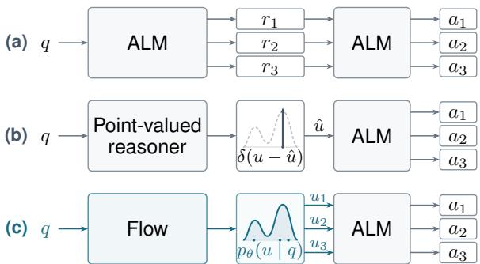  
Figure 1: Comparison of reasoning representations. (a) Textual reasoning samples multiple rationales and generates an answer for each. (b) Point-valued reasoning samples multiple answers conditioned on one answer context. (c) Our flow induces a distribution over answer contexts, enabling diverse answer generation.

While encouraging language models to generate shorter textual rationales is an intuitive remedy, the continuous latent reasoning paradigm offers a more fundamental alternative by reconsidering how intermediate reasoning is represented. Rather than requiring every reasoning step to be verbalized as a sequence of discrete language tokens, these approaches carry intermediate reasoning through continuous latent states without committing each step to a single discrete token, potentially enabling shorter and more compact reasoning trajectories (Hao et al., 2025; Zhang et al., 2025b). Such continuous representations may preserve a superposition of multiple candidate reasoning states, allowing each latent step to jointly capture information associated with several alternative reasoning paths (Zhu et al., 2025; Gozeten et al., 2026).

Prior work supports latent superposition, but the evidence largely concerns synthetic settings (Zhu et al., 2025; Gozeten et al., 2026). Extending this promise to complex tasks is not straightforward, since existing latent methods can struggle to exploit multiple reasoning paths (Suleymanzade et al.,

2026a; Wu et al., 2026). This limitation matters because exploring alternative paths can uncover correct answers missed by individual attempts (Chen et al., 2021; Cobbe et al., 2021). We often assess this ability through answer coverage, measured by pass@�, the probability of finding a correct answer across � independent rollouts. To learn these alternatives explicitly, we propose Rationale Distribution Distillation (RDD), distilling multiple answercorrect textual CoTs into a query-conditioned latent distribution rather than one fixed latent rationale.

• We introduce Rationale Distribution Distillation (RDD), transferring a query-conditioned distribution of textual reasoning paths into latent space. RDD samples a complete latent rationale for each answer rollout, enabling exploration of alternative contexts rather than reusing one fixed latent state (cf. Figure 1).

• We construct distillation targets from multiple answer-correct CoTs per query. Each trace is compressed separately into a fixed-length latent sequence, then within-query mixup interpolates between complete sequences with a shared weight, augmenting the reference distribution while retaining the original targets.

• We distill the reference distribution into a conditional flow using flow matching. Independent noise draws yield rationale samples, and each flow step updates all latent positions jointly. This replaces token-by-token rationale generation with parallel refinement while keeping answer decoding autoregressive.

• We make distributional distillation answeraware with local content and answer supervision. A contextualizer maps sampled rationales to contexts for a frozen language model that decodes textual answers autoregressively. Answer gradients through this decoder jointly train the contextualizer and flow sampler.

## 2. Related Work

Here, we focus on research directly related to latent reasoning in modern language models. See Appendix A for a broader review of related work.

Point-valued latent reasoning Early work explored reasoning beyond explicit text through pause tokens (Goyal et al., 2024), looped transformers (Giannou et al., 2023), and implicit CoT distillation into hidden layers (Deng et al., 2023). Building on these, Coconut (Hao et al., 2025) established a continuous-input formulation of autoregressive reasoning, feeding model output representations back as next-step inputs in place of token embeddings. Subsequent approaches augment this formulation with hidden-state self-distillation in CODI (Shen et al., 2025), step-level supervision through an auxiliary decoder in SIM-CoT (Wei et al., 2026), and span-level distillation using position-weighted token distributions in MUX (Suleymanzade et al., 2026b). Furthermore, to reduce sequential computation, PCCoT (Wu et al., 2025) iteratively updates latent tokens in parallel using Jacobi iteration, and LOTUS (Fan et al., 2026) refines latent blocks with a looped transformer under parallel supervision on gold CoT tokens. These methods produce a single continuous rationale per query, corresponding to the point-valued reasoner in Figure 1(b).

Distributional latent reasoning A separate line of work models or induces distributions over continuous rationales given a query. Coconut-style reasoners can become stochastic through Monte Carlo dropout or Gaussian noise (You et al., 2026), while GTS (Wang et al., 2026) learns context-dependent Gaussian noise with a frozen backbone. Soft Thinking (Zhang et al., 2025b) deterministically mixes token embeddings using next-token probabilities. Stochastic Soft Thinking (Wu et al., 2026) randomizes these weights with Gumbel-Softmax, while Multiplex Thinking (Tang et al., 2026) samples tokens and aggregates their embeddings at each step. CoLaR (Tan et al., 2025) predicts distributions over embeddings of compressed textual CoT spans. LaDiR (Kang et al., 2026) combines variational autoencoding with flow matching to learn latent CoT block distributions. Unlike these methods, we explicitly distill each query’s empirical distribution of complete textual CoT rationales into a conditional distribution over continuous rationales. We generate full rationales non-autoregressively and freeze the answer model, as in Figure 1(c).

## 3. Method

## 3.1. Textual CoT and answer coverage

We first formalize textual CoT sampling, which supplies the sequence-level targets for our continuous rationale generator. For a query �, an autoregressive language model (ALM) samples a complete textual rationale �, then an answer � conditioned on both $q$ and � (Wei et al., 2022; Kojima et al., 2022). The rationale provides an explicit context of intermediate results for answer prediction (Ling et al., 2017; Nye et al., 2021). Each rollout follows $p ( r , a \mid q ) = p ( r \mid q ) p ( a \mid r , q )$ , inducing an answer distribution that marginalizes over the space ℛ of complete textual rationales:

$$
\textstyle p _ { \mathrm { C o T } } ( a \mid q ) = \sum _ { r \in { \mathcal { R } } } p ( a \mid r , q ) p ( r \mid q ) .\tag{1}
$$

Independent rationale–answer rollouts draw candidate answers from this marginal, with each rollout sampling its own rationale before generating an answer. We assess the resulting candidate set using pass@�, the probability that at least one of � rollouts produces a correct extracted answer (Chen et al., 2021; Cobbe et al., 2021). This connects answer coverage to sampling complete reasoning paths, rather than repeatedly decoding answers from a single fixed rationale. In the textual process, however, each typically lengthy rationale must be generated token by token. Our continuous counterpart retains the rationale–answer sampling structure but updates all rationale positions jointly, reducing sequential dependence during rationale generation while leaving answer decoding autoregressive.

## 3.2. Continuous CoT and superposition

Soft Thinking (Zhang et al., 2025b) seeks to reduce the cost of multi-path reasoning by carrying alternative paths in a single continuous trajectory. At each step, it feeds a probability-weighted mixture of token embeddings into the model, aiming to retain alternatives without separate textual rollouts. However, recent analysis of Soft Thinking finds that subsequent predictions are dominated by the highest-probability token, making the trajectory resemble greedy decoding (Wu et al., 2026). This suggests that token-level mixtures do not necessarily preserve the diversity of complete rationales that independently sampled textual rollouts can explore.

Coconut (Hao et al., 2025) replaces intermediate text with continuous hidden states fed back as reasoning inputs. This provides a compact medium in which alternative paths could coexist without being verbalized separately. Such a representation could support learning from multiple valid paths for the same query. However, recent controlled multichain experiments find that Coconut and CODI do not benefit from additional valid textual CoTs in the evaluated settings (Suleymanzade et al., 2026a). These results suggest that access to multiple valid traces alone does not guarantee gains for pointvalued reasoners. Section 4.2 revisits this question under our answer-coverage evaluation.

## 3.3. Rationale distribution distillation

Despite progress in continuous reasoning, textual CoT remains a strong empirical reference (Chen et al., 2025b; Li et al., 2025). We thus construct a continuous counterpart to Equation 1 by explicitly distilling multiple answer-correct paths from the textual baseline into a query-conditioned flow. The flow models a distribution $p _ { \theta } ( z \mid q )$ over complete continuous rationales, allowing independent rollouts to explore alternative latent reasoning contexts for the same query. Each sampled rationale � is converted into a context � from which the frozen ALM $p _ { 0 }$ decodes an answer. The induced context distribution $p _ { \boldsymbol { \theta } } ( \boldsymbol { \mathbf { \hat { u } } } \mid \boldsymbol { q } )$ yields the answer marginal

$$
\begin{array} { r } { p _ { \theta } ( a \mid q ) = \int p _ { 0 } ( a \mid \pmb { u } , q ) p _ { \theta } ( \pmb { u } \mid q ) \mathrm { d } \pmb { u } . } \end{array}\tag{2}
$$

Thus, answer generation can vary through both rationale sampling and answer decoding, rather than decoding repeatedly from one fixed context. We train this distributional reasoner by distilling an empirical distribution of teacher rationales, augmented with within-query mixup. Here we define the targets and flow objective; Section 3.4 describes the mapping to � and corresponding objectives.

Fixed-length rationale Our multi-path supervision protocol independently samples textual teacher rollouts for each query � and retains � answer-correct traces $\{ ( r ^ { ( m ) } , a ^ { ( m ) } ) \} _ { m = 1 } ^ { M }$ . We split each variable-length rationale $r ^ { ( m ) }$ into � chunks. MUX (Suleymanzade et al., 2026b) uses positionweighted distributions over vocabulary tokens as local supervision targets. Inspired by this, we use these positional weights to average each chunk’s token embeddings into a �-dimensional vector. Stacking the vectors yields $\pmb { z } ^ { ( m ) } \in \mathbb { R } ^ { S \times D }$ , with one row per chunk: � specifies the reasoning budget, and $D$ is the embedding dimension. Figure 2(a) shows two such rationales for the same query with $S = 3$ . We obtain token embeddings by lookup in the ALM’s frozen input embedding table, so all � rationale targets remain fixed throughout training.

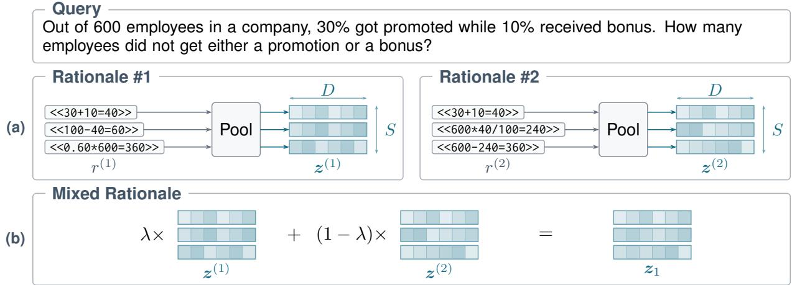  
Figure 2: Rationale compression and within-query mixup. (a) Position-weighted embedding pooling maps each text chunk to one �-dimensional vector (� = 3 shown). (b) A shared � mixes corresponding vectors of the two complete latent sequences. Original and mixed sequences serve as targets for flow matching. Cell colors depict schematic latent values.

These targets define the empirical distribution of continuous rationales for each query.

Within-query mixup The finite teacher traces provide supervision only at their observed latent targets. Within-query mixup (Zhang et al., 2018; Verma et al., 2019) adds targets between answercorrect rationales of the same query. For two distinct rationales from the same query, indexed by � and �, we sample � and construct

$$
z _ { 1 } = \lambda z ^ { ( j ) } + ( 1 - \lambda ) z ^ { ( k ) } .\tag{3}
$$

A shared $\lambda \sim \mathrm { B e t a } ( 2 , 2 )$ mixes corresponding vectors across all � positions, preserving the sequence structure shown in Figure 2(b). For each query, we train on both mixed targets and the original teacher rationale targets. Mixup therefore augments the distribution to be distilled into the flow. Appendix B analyzes reference-target covariance contraction, retention of original supervision, and the regularization interpretation of within-query mixup.

Flow matching We distill the original and mixed targets using flow matching (Lipman et al., 2023; Liu et al., 2023). For a target � , we independently draw $z _ { 0 } \sim \mathcal { N } ( \mathbf { 0 } , I )$ and $t \sim \mathcal { U } ( 0 , 1 )$ , then form $z _ { t } = ( 1 - t ) z _ { 0 } + t z _ { 1 }$ . We train a query-conditioned velocity field $v _ { \theta }$ with the flow matching objective:

$$
\mathcal { L } _ { \mathrm { f l o w } } = \left. v _ { \theta } ( z _ { t } , t , q ) - ( z _ { 1 } - z _ { 0 } ) \right. _ { F } ^ { 2 } .\tag{4}
$$

## 3.4. Answer-aware contextualization

Section 3.3 defines the distribution of rationale outcomes to be distilled from the textual CoT reference. To inherit its rationale–answer sampling structure, we must also learn how sampled continuous rationales provide contexts for answer generation. We therefore complement flow matching with distillation of the teacher’s correct answers and local reasoning content. Figure 3 summarizes the three stages and the supervision used to train the rationale sampler and contextualizer.

Rationale sampling The velocity field $v _ { \theta }$ uses the frozen ALM with a reasoning LoRA adapter $\phi ,$ a learned time embedding �, and a velocity head �, with $\theta = ( \phi , \chi , \psi )$ . An ODE solver integrates this field from Gaussian noise $z _ { \mathrm { 0 } }$ at $t = 0$ to a complete rationale at � = 1. The numerical sampler $F _ { \theta }$ maps the noise to its generated rationale:

$$
\hat { z } _ { 1 } = F _ { \theta } ( z _ { 0 } , q ) .\tag{5}
$$

Each solver evaluation predicts velocities at all � positions jointly, with causal attention to the query and preceding latent positions. Independent noise draws thus sample complete continuous reasoning paths without token-by-token rationale generation.

Contextualization A contextualizer converts the sampled rationale into an answer context by passing � and $\hat { z } _ { 1 }$ through the adapted ALM at $t = 1$ It shares $\phi$ and $\chi$ with the sampler but bypasses the velocity head �. The resulting key–value (KV) caches define $\hat { \pmb { u } } = G _ { \phi , \chi } ( \hat { z } _ { 1 } , q )$ . Applying this map to the sampled rationale distribution induces the context distribution $p _ { \boldsymbol { \theta } } ( \boldsymbol { \mathbf { \hat { u } } } \mid \boldsymbol { q } )$ in Equation 2.

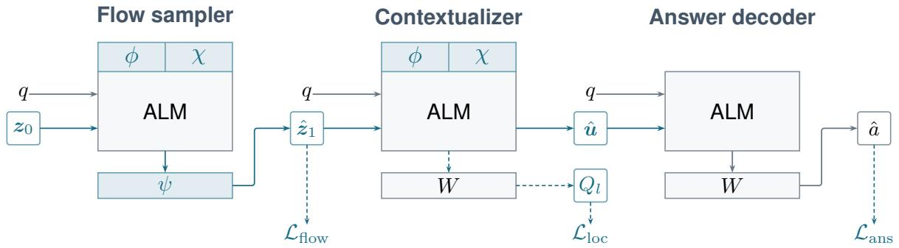  
Figure 3: Rationale sampling, contextualization, and answer decoding. The sampler produces $\hat { z } _ { 1 }$ with an ODE solver; the contextualizer forms KV context �^ at � = 1. Both share � and $\chi ,$ while the answer decoder generates �^ with the reasoning adapter disabled. ALM weights and vocabulary projections $W$ are frozen; teal parameter blocks are trainable. Dashed arrows indicate training supervision for rationale generation, local content, and answer prediction.

Answer decoding The frozen ALM then samples $\hat { a } \sim p _ { 0 } ( \cdot \mid \hat { \boldsymbol u } , q )$ autoregressively with the reasoning adapter disabled. It serves as both the textual teacher and the answer decoder: the teacher conditions on a textual rationale $r ,$ whereas the decoder conditions on the generated context �^. To transfer the teacher’s answer predictions across these contexts, we teacher force each retained answer � and minimize its sequence negative log-likelihood:

$$
\mathcal { L } _ { \mathrm { a n s } } = - \log p _ { 0 } ( a \mid \hat { \pmb u } , q ) .\tag{6}
$$

For a point-mass target $\delta _ { a } .$ , this loss equals forward KL to the decoder distribution. Averaging over teacher answers gives a sample-based forward-KL distillation objective, up to the fixed teacher entropy. Because we retain only answer-correct traces, this transfer concerns the filtered empirical teacher distribution. Gradients through the frozen decoder train the sampler and contextualizer to support the teacher’s correct answers.

Local content distillation Following MUX (Suleymanzade et al., 2026b), we supervise the contextualizer’s final hidden states with local token distributions from the aligned teacher rationale chunks:

$$
\begin{array} { r } { \mathcal { L } _ { \mathrm { l o c } } = \sum _ { l = 1 } ^ { S } \mathrm { K L } ( P _ { l } \| Q _ { l } ) . } \end{array}\tag{7}
$$

Here $P _ { l }$ is the token distribution of chunk � formed with the same positional weights as the embedding pooling, and $Q _ { l }$ is predicted from the corresponding hidden state using the answer decoder’s frozen vocabulary projection � and a tempered softmax.

Joint objective For an original target, its source trace supplies the answer and local token distributions. For a mixed target, we evaluate both source traces’ answer and local losses on the same generated context and hidden states, then weight them by � and 1 − � as in Equation 3. The joint objective is

$$
\begin{array} { r } { \mathcal { L } ( \theta ) = \mathcal { L } _ { \mathrm { a n s } } + \lambda _ { \mathrm { f l o w } } \mathcal { L } _ { \mathrm { f l o w } } + \lambda _ { \mathrm { l o c } } \mathcal { L } _ { \mathrm { l o c } } . } \end{array}\tag{8}
$$

Training averages over original and mixed targets, source noise, and the time samples used for flow matching. Both auxiliary losses backpropagate through the contextualizer and ODE solver, training the context mapping and rationale sampler jointly. Only $\theta = ( \phi , \chi , \psi )$ is updated in RDD; pretrained ALM weights and the vocabulary projection � remain fixed. See Appendix C for more details.

Inference At inference, each rollout starts from an independent Gaussian noise draw and follows $z _ { 0 }  \hat { z } _ { 1 }  \hat { u }  \hat { a }$ , generating a fresh rationale context before decoding an answer (cf. Figure 3).

## 4. Experiments

Models and datasets We use GPT-2-0.1B (Radford et al., 2019) and SLM-2-1.7B (Ben Allal et al., 2025) as model backbones. The training datasets are GSM8K-Aug and GSM8K-Aug-NL (Deng et al., 2023), respectively. We evaluate on six benchmarks spanning arithmetic (GSM8K, SVAMP, and GSMHard) and advanced mathematics (TAL, MATH500, and Gaokao23). Appendix C.1 details data preparation, source references, public Hugging Face Hub releases, and reported licenses.

Metrics and baselines We report pass@�, which measures answer coverage over $k \in \{ 1 , \ldots , 5 1 2 \}$ independent rollouts. While point-valued reasoning methods sample answers $a \ \sim \ p ( \cdot \ | \ q , \pmb { u } )$ for a fixed context ${ \mathbf { } } ^ { \mathbf { } } \mathbf { \Delta } ^ { \mathbf { } } \mathbf { u } ,$ distributional reasoning approaches sample contexts $\mathbf { \boldsymbol { u } } \sim \boldsymbol { p } ( \cdot \mid q )$ as well.

<table><tr><td rowspan="2">Method</td><td rowspan="2"># Token</td><td colspan="3">Arithmetic benchmarks</td><td colspan="4">Advanced benchmarks</td></tr><tr><td>GSM8K</td><td>SVAMP</td><td>GSMHard</td><td>TAL</td><td>MATH500</td><td></td><td>Gaokao23</td></tr><tr><td>CoT</td><td>27.4†</td><td>89.5/47.5</td><td>76.9/50.8</td><td>23.2/10.7</td><td>46.0 / 8.1</td><td></td><td>43.5 / 2.8</td><td>30.6 / 1.8</td></tr><tr><td>COTST</td><td>27.2†</td><td>48.5/48.4</td><td>53.3/52.4</td><td>11.4/11.4</td><td>10.4 / 9.9</td><td></td><td>4.2 / 3.0</td><td>3.3 / 2.2</td></tr><tr><td>Coconut†</td><td>6</td><td>59.7/32.5</td><td>54.3/35.2</td><td>14.2/ 7.5</td><td>20.4/ 5.1</td><td></td><td>13.2/ 0.8</td><td>6.5/ 0.2</td></tr><tr><td>CODI</td><td>6</td><td>76.3/37.9</td><td>61.9/40.3</td><td>18.6 / 8.9</td><td>33.5/ 6.9</td><td></td><td>30.7/ 2.5</td><td>21.1/ 2.1</td></tr><tr><td>PCCoT</td><td>6</td><td>78.2/42.8</td><td>64.0/46.3</td><td>18.8 / 9.9</td><td>38.9 / 6.6</td><td></td><td>35.6/ 1.7</td><td>17.5/ 0.9</td></tr><tr><td>MUX</td><td>6</td><td>78.3/43.4</td><td>62.7/43.2</td><td>18.8/10.3</td><td>37.1/ 7.0</td><td></td><td>38.0/ 2.2</td><td>28.3 / 1.2</td></tr><tr><td>LOTUS</td><td>78</td><td>75.2/49.6</td><td>62.0/44.9</td><td>18.2/11.1</td><td>26.6/ 8.4</td><td></td><td>20.3 / 1.6</td><td>14.1/ 0.4</td></tr><tr><td>RDD (ours)</td><td>6</td><td>78.6/40.5</td><td> $6 6 . 8 / 4 1 . 2$ </td><td>19.4/ 9.2</td><td>44.4/ 5.6</td><td></td><td>43.4/ 1.5</td><td>31.5/ 1.1</td></tr></table>

Table 1: Main results for GPT-2-0.1B on GSM8K-Aug. # Token denotes rationale length. Each result cell reports pass@512 / pass@1. Excluding CoT, bold-underlined and underlined values respectively denote the best and second-best results for each metric; ties share the same marking. †Averaged across all benchmarks. ‡Adopted public checkpoint (connordilgren/gpt2-gsm8k-coconut; MIT license; Dilgren and Wiegreffe, 2026).
<table><tr><td></td><td></td><td colspan="3">Arithmetic benchmarks</td><td colspan="5">Advanced benchmarks</td></tr><tr><td>Method</td><td># Token</td><td>GSM8K</td><td>SVAMP</td><td>GSMHard</td><td>TAL</td><td></td><td>MATH500</td><td></td><td>Gaokao23</td></tr><tr><td>CoT</td><td>27.4†</td><td>89.5/47.5</td><td>76.9/50.8</td><td>23.2/10.7</td><td>46.0/ 8.1</td><td></td><td>43.5 / 2.8</td><td></td><td>30.6 / 1.8</td></tr><tr><td>CoTSST</td><td>27.6†</td><td>81.6/48.4</td><td>68.3/51.6</td><td>21.2/11.1</td><td>37.1 / 8.7</td><td></td><td>34.6 / 2.9</td><td></td><td>27.2/ 1.9</td></tr><tr><td>CODIMCD</td><td>6</td><td>65.0/37.7</td><td>56.3/40.0</td><td> $1 5 . 6 / 8 . 8$ </td><td> $2 7 . 9 / 7 . 4$ </td><td></td><td> $2 0 . 0 / 2 . 8$ </td><td></td><td>16.3 / 2.3</td></tr><tr><td>RDD (ours)</td><td>6</td><td>78.6/40.5</td><td>66.0/41.2</td><td> $1 9 . 4 / 9 . 2$ </td><td> $4 4 . 4 / 5 . 6 $ </td><td></td><td> $4 3 . 4 / 1 . 5$ </td><td></td><td> $3 1 . 5 / 1 . 1$ </td></tr></table>

Table 2: Distributional rationale results for GPT-2-0.1B on GSM8K-Aug. # Token denotes rationale length. Each result cell reports pass@512 / pass@1. †Averaged across all benchmarks.

Alongside CoT (Wei et al., 2022) as a gold-standard reference, we compare against the following baselines: Soft Thinking (CoTST; Zhang et al., 2025b), Coconut (Hao et al., 2025), CODI (Shen et al., 2025), PCCoT (Wu et al., 2025), MUX (Suleymanzade et al., 2026b), and LOTUS (Fan et al., 2026). We also evaluate distributional variants: Stochastic Soft Thinking (CoTSST; Wu et al., 2026), which uses Gumbel-Softmax sampling, and CODIMCD (You et al., 2026), which uses Monte Carlo dropout.

## 4.1. Main results

Table 1 compares RDD with point-valued reasoning baselines using GPT-2-0.1B trained on GSM8K-Aug. With a rationale budget of � = 6, RDD exceeds every evaluated point-valued baseline in pass@512 on all six benchmarks, including Coconut, CODI, PCCoT, and MUX at the same rationale length. Notably, the improvements are more pronounced on advanced mathematics, where RDD approaches the textual CoT reference on TAL and MATH500 and surpasses it on Gaokao23. These results suggest that distilling textual CoT rationales into a distribution of latent rationale contexts, rather than a single fixed context, can improve answer coverage.

Table 2 further compares distributional rationale methods. $\mathsf { C o T } _ { \mathsf { S S T } }$ improves upon CoTST on every benchmark and leads the distributional methods on arithmetic, although it uses substantially more rationale positions on average than others. Meanwhile, RDD achieves the highest coverage among these methods on all three advanced mathematics benchmarks. It also outperforms $C O D I _ { M C D }$ on all six benchmarks at the same budget of $S = 6 .$ . Monte Carlo dropout reduces coverage relative to CODI throughout, indicating that adding inference-time stochasticity alone is insufficient to improve answer coverage in this setting. Moreover, batched parallel inference can be non-trivial when each rollout uses independently masked model weights with Monte Carlo dropout. In contrast, RDD can batch independent noise samples through a shared sampler, enabling straightforward batch-parallel inference.

## 4.2. Additional results

Multi-path supervision Our multi-path supervision protocol uses multiple answer-correct textual CoTs per query as teacher targets. We apply this protocol to CODI to examine whether even a pointvalued reasoner can benefit from multiple teacher paths. In Table 3, we observe a slight decrease in CODI’s mean pass@512 on arithmetic, from 52.3% to 52.0%, consistent with prior findings (Suleymanzade et al., 2026a), but a substantial improvement on advanced mathematics, from 28.4% to 37.0%. With the same supervision, RDD learns a distribution over rationale contexts and improves on CODI in both benchmark groups, reaching 54.7% on arithmetic and 39.8% on advanced mathematics. These findings support the value of our multi-path supervision on advanced mathematics and suggest that distributional rationale learning can make more effective use of the same teacher paths.

<table><tr><td>Method</td><td>MPS</td><td>Arithmetic</td><td>Advanced</td></tr><tr><td>CoT</td><td></td><td>63.2/36.3</td><td> $4 0 . 8 / 4 . 2$ </td></tr><tr><td>CODI</td><td></td><td>52.3/29.0</td><td> $2 8 . 4 / 3 . 8$ </td></tr><tr><td>CODI</td><td>√</td><td>52.0/27.4</td><td> $\underline { { 3 7 . 8 } } / \quad \underline { { 3 . 5 } }$ </td></tr><tr><td>RDD (ours)</td><td>√</td><td>54.7/30.3</td><td> $3 9 . 8 / 2 . 7$ </td></tr></table>

Table 3: Multi-path supervision results for GPT-2- 0.1B on GSM8K-Aug. MPS denotes our multi-path supervision protocol. Each cell reports pass@512 / pass@1, averaged over the three benchmarks in each group.

Fidelity analysis For each query, we compare empirical answer distributions estimated from sampled 512 rollouts of textual CoT and each latent method using Jensen–Shannon divergence (JSD) and teacher support coverage (TSC), both defined in Appendix C.3. These metrics assess how closely $p _ { \theta } ( a \mid q )$ matches $p _ { \mathrm { C o T } } ( a \mid q )$ , defined in Equations 2 and 1, respectively. Figure 4 pools questionlevel measurements within the arithmetic and advanced benchmark groups; Appendix D provides the per-benchmark breakdown. RDD achieves the lowest JSD and the highest TSC on average. It implies that RDD better matches the teacher’s answer distribution, especially on advanced tasks, complementing its answer coverage advantage.

SLM-2-1.7B on GSM8K-Aug-NL Our comprehensive main comparison uses GPT-2-0.1B on GSM8K-Aug, a common evaluation setup for latent reasoning. To assess whether the findings extend to a larger backbone and more elaborate naturallanguage rationales rather than compact symbolic derivations, we additionally evaluate SLM-2-1.7B trained on GSM8K-Aug-NL in Table 4, where CODI is trained with MPS. RDD continues to outperform the evaluated latent baselines at the same rationale budget of $S = 6$ . However, the gap to textual CoT and $\mathsf { C o T } _ { \mathsf { S S T } }$ is generally larger in this setting. The longer natural-language rationales impose substantially stronger compression into six latent positions, which may contribute to this gap. Despite this demanding compression regime, RDD retains its advantage in answer coverage.

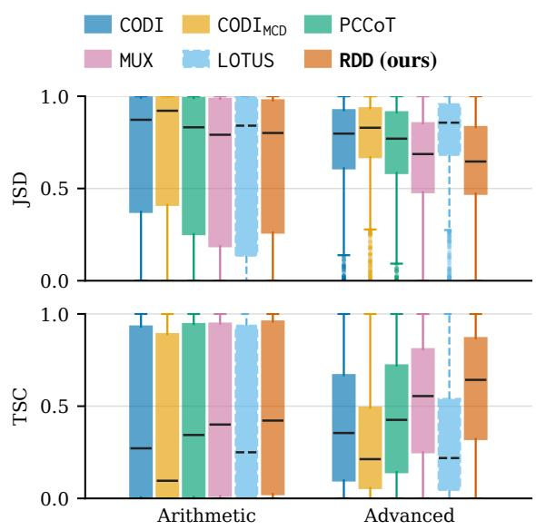  
Figure 4: Answer-distribution fidelity to textual CoT. Query-level JSD (↓) and TSC (↑) pooled by group; see Figure 5 for per-benchmark results.

Trajectory-level mixup compatibility We assess within-query interpolation of uncompressed rationale embeddings with CoT. We test midpoint interpolation $( \lambda = 1 / 2 )$ on 10,000 triples $( q , r _ { 1 } , r _ { 2 } )$ where both rationales are answer-correct for � and have matching numbers of reasoning steps and token counts at each step. With query embeddings fixed, CoT achieves 100% accuracy using $r _ { 1 }$ , 99.99% with within-query interpolation, and 44.33% when $r _ { 2 }$ is replaced by a rationale from another query. This probe supports answer compatibility in an aligned, uncompressed setting; Appendix B.3 discusses mixup regularization.

## 4.3. Ablation study

Per-rollout rationale sampling We evaluate the contribution of sampling a fresh rationale context for each rollout using the same trained RDD checkpoint. The fixed-context control retains the distributionally trained model but reuses a single rationale context sampled from its learned distribution for each query. Both conditions use 512 answer rollouts per query and identical answer-decoding settings. Table 5 shows that sampling a fresh context for each rollout improves mean pass@512 in both benchmark groups. These results suggest that sampling multiple rationale contexts helps translate the learned distribution into broader answer coverage.

<table><tr><td rowspan="2">Method # Token</td><td rowspan="2"></td><td colspan="3">Arithmetic benchmarks</td><td colspan="3">Advanced benchmarks</td></tr><tr><td>GSM8K</td><td>SVAMP</td><td>GSMHard</td><td>TAL</td><td>MATH500</td><td>Gaokao23</td></tr><tr><td>CoT</td><td>87.9†</td><td>96.7/55.3</td><td>94.0/61.9</td><td>46.1/16.2</td><td>77.0/22.4</td><td>69.2 / 7.1</td><td>52.2 / 5.0</td></tr><tr><td>CoTST</td><td>77.9†</td><td>57.5/54.6</td><td>61.7/61.4</td><td>17.4/16.2</td><td>28.7/22.6</td><td>18.2 / 7.1</td><td>10.9 / 4.7</td></tr><tr><td>CoTSST</td><td>78.8†</td><td>94.2/54.2</td><td>91.7/62.0</td><td>42.8/16.0</td><td>74.6/22.0</td><td>66.4/ 6.9</td><td>52.2 / 5.1</td></tr><tr><td>CODI</td><td>6</td><td>84.8/27.4</td><td>77.3/38.9</td><td>22.7/ 6.6</td><td>61.0/12.0</td><td>52.0/ 3.6</td><td>33.7/ 3.9</td></tr><tr><td>MUX</td><td>6</td><td>87.6/27.6</td><td>76.0/39.1</td><td>24.3 / 6.9</td><td>62.0/13.1</td><td>55.0/ 5.0</td><td>32.6/ 4.8</td></tr><tr><td>RDD (ours)</td><td>6</td><td>87.6/21.2</td><td>80.7/37.2</td><td>24.3/ 5.1</td><td>63.3/11.6</td><td>56.0/ 3.9</td><td>35.9/ 3.8</td></tr></table>

Table 4: Additional results for SLM-2-1.7B on GSM8K-Aug-NL. # Token denotes rationale length. Each result cell reports pass@512 / pass@1. Excluding CoT, bold-underlined and underlined values respectively denote the best and second-best results for each metric; ties share the same marking. †Averaged across all benchmarks.

<table><tr><td>Ablation</td><td>Arithmetic</td><td>Advanced</td></tr><tr><td>Per-rollout rationale sampling</td><td colspan="2"></td></tr><tr><td>Fixed</td><td>54.0/30.5</td><td>38.5/ 2.7</td></tr><tr><td>Sampled</td><td>54.7/30.3</td><td>39.8/ 2.7</td></tr><tr><td>Number of function evaluations</td><td colspan="2"></td></tr><tr><td>NFE=3</td><td>54.6/22.7</td><td>40.7 / 3.0</td></tr><tr><td>NFE=6</td><td>54.7/30.3</td><td>39.8/ 2.7</td></tr><tr><td colspan="3">Mixing-weight distribution</td></tr><tr><td>No-mixing</td><td>52.6/25.4</td><td>36.2/ 3.0</td></tr><tr><td>λ∼Beta(2,2)</td><td>54.7/30.3</td><td>39.8/ 2.7</td></tr><tr><td>λ∼ Beta(5,5)</td><td>53.9/23.2</td><td>40.8/ 2.9</td></tr><tr><td>λ = 1/2</td><td>52.5/32.6</td><td>38.6/ 2.8</td></tr><tr><td colspan="3">Causal versus bidirectional attention</td></tr><tr><td>Bidirectional</td><td>52.1/24.6</td><td>38.5 / 2.5</td></tr><tr><td>Causal</td><td>54.7/30.3</td><td>39.8/ 2.7</td></tr></table>

Table 5: Ablation results for GPT-2-0.1B. Each cell reports pass@512 / pass@1, averaged over the three benchmarks in each group.

Number of function evaluations We compare three and six Euler steps, matching the number of function evaluations (NFE) during training and inference for each model. Table 5 shows that NFE=3 yields comparable pass@512 in both benchmark groups while halving flow evaluations. At � = 6, this also reduces sequential model forward passes relative to autoregressive baselines, which generate a full latent rationale token by token in � passes.

Mixing-weight distribution We compare no mixing (� = 1), stochastic mixing with Betadistributed weights, and deterministic midpoint mixing (� = 1/2). Table 5 shows that stochastic mixing improves coverage over no mixing in both benchmark groups, especially on advanced tasks. Midpoint mixing improves only advanced coverage. These gains support a regularization interpretation of within-query mixup; Appendix B explains why reference-target covariance contraction alone does not determine answer coverage.

Causal versus bidirectional attention Early work on adapting pretrained ALMs to diffusion language models advocated moving from causal to bidirectional attention (Gong et al., 2025). More recent work, however, finds that retaining causal attention can yield better reasoning performance when adapting pretrained ALMs (Ma et al., 2026). Since these findings suggest no universally preferred attention pattern, we compare causal and bidirectional attention in RDD, which also reuses pretrained ALM weights. Table 5 shows that retaining causal attention yields better performance in our experiments, consistent with the latter finding.

## 5. Conclusion

We introduced Rationale Distribution Distillation (RDD), a flow-matching approach to transferring multiple textual reasoning paths into a distribution of continuous latent rationales. Rather than relying on a single latent trajectory to implicitly capture reasoning alternatives, RDD explicitly learns their query-conditioned distribution from answercorrect textual CoT traces, augmented through within-query mixup. It enables exploration of multiple plausible rationales, while parallel refinement of fixed-length latent sequences replaces token-bytoken rationale generation. Our main experimental results show that RDD improves answer coverage over the evaluated point-valued latent reasoning baselines across arithmetic and advanced mathematical tasks, even nearly matching the textual CoT reference on the advanced benchmarks.

These findings highlight distributional modeling as a promising direction for transferring the benefits of multi-path textual reasoning into compact latent representations. An intriguing avenue for future research is developing more effective rationale compression and sampling strategies to extend distributional reasoning to larger scales.

## 6. Limitations

Our experiments use backbones up to 1.7B parameters and cover both short symbolic rationales and natural-language rationales with verbal explanations, building on evaluation settings established in the latent reasoning literature (Shen et al., 2025). However, these rationales remain substantially shorter and less elaborate than the extended reasoning traces produced by modern large language models (Zhang et al., 2025a). Whether the benefits of rationale distribution distillation extend to substantially larger models and longer, more verbal reasoning traces remains an open question.

Moreover, although RDD improves answer coverage (pass@�), its single-rollout accuracy (pass@1) generally trails the strongest baselines. Our experiments focus on supervised distillation, leaving open whether reward-based optimization can narrow this gap. Wu et al. (2026) identify stochastic continuous reasoning as a foundation for reinforcement learning (RL), and Tang et al. (2026) demonstrate RL optimization of stochastic token-wise branch-andmerge trajectories. These findings motivate future RL optimization of RDD’s sampled latent rationales to improve pass@1 while retaining pass@�.

## 7. Ethical Concerns

Continuous latent reasoning raises concerns about transparency and oversight because its intermediate states are not directly interpretable in natural language. Although textual reasoning traces can also be unfaithful to model behavior (Chen et al., 2025c), they can at least support chain-of-thought monitoring (Korbak et al., 2025). Reasoning in latent space may reduce access to these signals, motivating oversight methods for latent reasoning.

## References

L. Ben Allal, A. Lozhkov, E. Bakouch, G. Martín Blázquez, G. Penedo, L. Tunstall, A. Marafioti, H. Kydlícek, A. Piqueres Lajarín,ˇ

V. Srivastav, J. Lochner, C. Fahlgren, X.-S. Nguyen, C. Fourrier, B. Burtenshaw, H. Larcher, H. Zhao, C. Zakka, M. Morlon, C. Raffel, L. von Werra, and T. Wolf. SmolLM2: When smol goes big – data-centric training of a small language model, 2025.

L. Carratino, M. Cissé, R. Jenatton, and J.- P. Vert. On mixup regularization. Journal of Machine Learning Research, 23(325):1–31, 2022. URL https://www.jmlr.org/papers/ v23/20-1385.html.

H. Chen, S. Wu, X. Quan, R. Wang, M. Yan, and J. Zhang. MCC-KD: Multi-CoT consistent knowledge distillation. In Findings of the Associationfor Computational Linguistics: EMNLP 2023, 2023.

M. Chen, J. Tworek, H. Jun, Q. Yuan, H. P. de O. Pinto, J. Kaplan, H. Edwards, Y. Burda, N. Joseph, G. Brockman, A. Ray, R. Puri, G. Krueger, M. Petrov, H. Khlaaf, G. Sastry, P. Mishkin, B. Chan, S. Gray, N. Ryder, M. Pavlov, A. Power, L. Kaiser, M. Bavarian, C. Winter, P. Tillet, F. P. Such, D. Cummings, M. Plappert, F. Chantzis, E. Barnes, A. Herbert-Voss, W. H. Guss, A. Nichol, A. Paino, N. Tezak, J. Tang, I. Babuschkin, S. Balaji, S. Jain, W. Saunders, C. Hesse, A. N. Carr, J. Leike, J. Achiam, V. Misra, E. Morikawa, A. Radford, M. Knight, M. Brundage, M. Murati, K. Mayer, P. Welinder, B. McGrew, D. Amodei, S. McCandlish, I. Sutskever, and W. Zaremba. Evaluating large language models trained on code, 2021.

X. Chen, J. Xu, T. Liang, Z. He, J. Pang, D. Yu, L. Song, Q. Liu, M. Zhou, Z. Zhang, R. Wang, Z. Tu, H. Mi, and D. Yu. Do NOT think that much for 2+3=? on the overthinking of long reasoning models. In International Conference on Machine Learning (ICML), 2025a.

X. Chen, A. Zhao, H. Xia, X. Lu, H. Wang, Y. Chen, W. Zhang, J. Wang, W. Li, and X. Shen. Reasoning beyond language: A comprehensive survey on latent Chain-of-Thought reasoning, 2025b.

Y. Chen, J. Benton, A. Radhakrishnan, J. Uesato, C. Denison, J. Schulman, A. Somani, P. Hase, M. Wagner, F. Roger, V. Mikulik, S. R. Bowman,

J. Leike, J. Kaplan, and E. Perez. Reasoning models don’t always say what they think, 2025c.

Y. Chen, C. Liang, H. Sui, R. Guo, C. Cheng, J. You, and G. Liu. LangFlow: Continuous diffusion rivals discrete in language modeling, 2026.

Z. Chen, S. Cui, D. Ye, Y. Zhang, Y. Bian, and T. Zhu. Think consistently, reason efficiently: Energy-based calibration for implicit Chain-of-Thought, 2025d.

K. Cobbe, V. Kosaraju, M. Bavarian, M. Chen, H. Jun, Ł. Kaiser, M. Plappert, J. Tworek, J. Hilton, R. Nakano, C. Hesse, and J. Schulman. Training verifiers to solve math word problems, 2021.

Y. Cui, W. Yao, Q. Li, A. B. Chan, and C. J. Xue. Accelerating Monte Carlo Bayesian prediction via approximating predictive uncertainty over the simplex. IEEE Transactions on Neural Networks and Learning Systems, 33(4):1492–1506, 2022. doi: 10.1109/TNNLS.2020.3042525.

Y. Deng, K. Prasad, R. Fernandez, P. Smolensky, V. Chaudhary, and S. Shieber. Implicit chain of thought reasoning via knowledge distillation, 2023.

C. Dilgren and S. Wiegreffe. Are latent reasoning models easily interpretable? In Conference on Language Modeling (COLM), 2026.

Y. Fan, A. Svete, and K. Lee. Bridging the gap between latent and explicit reasoning with looped transformers, 2026.

L. Gao, A. Madaan, S. Zhou, U. Alon, P. Liu, Y. Yang, J. Callan, and G. Neubig. PAL: Program-aided language models, 2022.

I. Gat, T. Remez, N. Shaul, F. Kreuk, R. T. Q. Chen, G. Synnaeve, Y. Adi, and Y. Lipman. Discrete flow matching. In Conference on Neural Information Processing Systems (NeurIPS), 2024.

A. Giannou, S. Rajput, J.-Y. Sohn, K. Lee, J. D. Lee, and D. Papailiopoulos. Looped transformers as programmable computers. In International Conference on Machine Learning (ICML), 2023.

A. L. Gibbs and F. E. Su. On choosing and bounding probability metrics. International Statistical Review, 70(3):419–435, 2002. doi: 10.1111/j.1751-5823.2002.tb00178.x.

S. Gong, S. Agarwal, Y. Zhang, J. Ye, L. Zheng, M. Li, C. An, P. Zhao, W. Bi, J. Han, H. Peng, and L. Kong. Scaling diffusion language models via adaptation from autoregressive models. In International Conference on Learning Representations (ICLR), 2025.

S. Goyal, Z. Ji, A. S. Rawat, A. K. Menon, S. Kumar, and V. Nagarajan. Think before you speak: Training language models with pause tokens. In International Conference on Learning Representations (ICLR), 2024.

H. A. Gozeten, M. E. Ildiz, X. Zhang, H. Harutyunyan, A. S. Rawat, and S. Oymak. Continuous chain of thought enables parallel exploration and reasoning. In International Conference on Learning Representations (ICLR), 2026.

D. Guo, D. Yang, H. Zhang, J. Song, P. Wang, Q. Zhu, R. Xu, R. Zhang, S. Ma, X. Bi, X. Zhang, X. Yu, Y. Wu, Z. F. Wu, Z. Gou, Z. Shao, Z. Li, Z. Gao, A. Liu, B. Xue, B. Wang, B. Wu, B. Feng, C. Lu, C. Zhao, C. Deng, C. Ruan, D. Dai, D. Chen, D. Ji, E. Li, F. Lin, F. Dai, F. Luo, G. Hao, G. Chen, G. Li, H. Zhang, H. Xu, H. Ding, H. Gao, H. Qu, H. Li, J. Guo, J. Li, J. Chen, J. Yuan, J. Tu, J. Qiu, J. Li, J. L. Cai, J. Ni, J. Liang, J. Chen, K. Dong, K. Hu, K. You, K. Gao, K. Guan, K. Huang, K. Yu, L. Wang, L. Zhang, L. Zhao, L. Wang, L. Zhang, L. Xu, L. Xia, M. Zhang, M. Zhang, M. Tang, M. Zhou, M. Li, M. Wang, M. Li, N. Tian, P. Huang, P. Zhang, Q. Wang, Q. Chen, Q. Du, R. Ge, R. Zhang, R. Pan, R. Wang, R. J. Chen, R. L. Jin, R. Chen, S. Lu, S. Zhou, S. Chen, S. Ye, S. Wang, S. Yu, S. Zhou, S. Pan, S. S. Li, S. Zhou, S. Wu, T. Yun, T. Pei, T. Sun, T. Wang, W. Zeng, W. Liu, W. Liang, W. Gao, W. Yu, W. Zhang, W. L. Xiao, W. An, X. Liu, X. Wang, X. Chen, X. Nie, X. Cheng, X. Liu, X. Xie, X. Liu, X. Yang, X. Li, X. Su, X. Lin, X. Q. Li, X. Jin, X. Shen, X. Chen, X. Sun, X. Wang, X. Song, X. Zhou, X. Wang, X. Shan, Y. K. Li, Y. Q. Wang, Y. X. Wei, Y. Zhang, Y. Xu, Y. Li, Y. Zhao, Y. Sun, Y. Wang, Y. Yu, Y. Zhang,

Y. Shi, Y. Xiong, Y. He, Y. Piao, Y. Wang, Y. Tan, Y. Ma, Y. Liu, Y. Guo, Y. Ou, Y. Wang, Y. Gong, Y. Zou, Y. He, Y. Xiong, Y. Luo, Y. You, Y. Liu, Y. Zhou, Y. X. Zhu, Y. Huang, Y. Li, Y. Zheng, Y. Zhu, Y. Ma, Y. Tang, Y. Zha, Y. Yan, Z. Z. Ren, Z. Ren, Z. Sha, Z. Fu, Z. Xu, Z. Xie, Z. Zhang, Z. Hao, Z. Ma, Z. Yan, Z. Wu, Z. Gu, Z. Zhu, Z. Liu, Z. Li, Z. Xie, Z. Song, Z. Pan, Z. Huang, Z. Xu, Z. Zhang, and Z. Zhang. DeepSeek-R1 incentivizes reasoning in LLMs through reinforcement learning. Nature, 645:633–638, 2025. doi: 10.1038/s41586-025-09422-z.

A. Hägele, E. Bakouch, A. Kosson, L. Ben Allal, L. Von Werra, and M. Jaggi. Scaling laws and compute-optimal training beyond fixed training durations. In Conference on Neural Information Processing Systems (NeurIPS), 2024.

T. Han, Z. Wang, C. Fang, S. Zhao, S. Ma, and Z. Chen. Token-budget-aware LLM reasoning. In Findings of the Association for Computational Linguistics: ACL 2025, 2025.

S. Hao, S. Sukhbaatar, D. Su, X. Li, Z. Hu, J. E. Weston, and Y. Tian. Training large language models to reason in a continuous latent space. In Conference on Language Modeling (COLM), 2025.

S. Hayou, N. Ghosh, and B. Yu. LoRA+: Efficient low rank adaptation of large models. In International Conference on Machine Learning (ICML), 2024.

D. Hendrycks, C. Burns, S. Kadavath, A. Arora, S. Basart, E. Tang, D. Song, and J. Steinhardt. Measuring mathematical problem solving with the MATH dataset. In NeurIPS Datasets and Benchmarks, 2021.

G. Hinton, O. Vinyals, and J. Dean. Distilling the knowledge in a neural network, 2015.

N. Ho, L. Schmid, and S.-Y. Yun. Large language models are reasoning teachers. In Proceedings of the 61st Annual Meeting of the Association for Computational Linguistics (Volume 1: Long Papers), 2023.

E. J. Hu, Y. Shen, P. Wallis, Z. Allen-Zhu, Y. Li, S. Wang, L. Wang, and W. Chen. LoRA: Lowrank adaptation of large language models. In

International Conference on Learning Representations (ICLR), 2022.

K. Hu, L. Qiu, Y. Lu, H. Zhao, T. Li, Y. Kim, J. Andreas, and K. He. ELF: Embedded language flows, 2026.

S. Hu, Y. Tu, X. Han, C. He, G. Cui, X. Long, Z. Zheng, Y. Fang, Y. Huang, W. Zhao, X. Zhang, Z. L. Thai, K. Zhang, C. Wang, Y. Yao, C. Zhao, J. Zhou, J. Cai, Z. Zhai, N. Ding, C. Jia, G. Zeng, D. Li, Z. Liu, and M. Sun. MiniCPM: Unveiling the potential of small language models with scalable training strategies, 2024a.

V. T. Hu, D. Wu, Y. M. Asano, P. Mettes, B. Fernando, B. Ommer, and C. G. M. Snoek. Flow matching for conditional text generation in a few sampling steps. In Proceedings of the 18th Conference of the European Chapter of the Associationfor Computational Linguistics (Volume 2: Short Papers), 2024b.

J. Jiang, J. Ren, W. Li, B. Wang, H. Sun, Y. Yang, J. Liu, Y. Zhang, S. Zheng, Y. Zhang, H. Huang, N. Duan, and W. Zuo. TextLDM: Language modeling with continuous latent diffusion, 2026.

H. Kang, Y. Zhang, N. L. Kuang, N. Majamaki, N. Jaitly, Y.-A. Ma, and L. Qin. LaDiR: Latent diffusion enhances LLMs for text reasoning. In International Conference on Learning Representations (ICLR), 2026.

Y. Kang, X. Sun, L. Chen, and W. Zou. C3oT: Generating shorter chain-of-thought without compromising effectiveness. In AAAI Conference on Artificial Intelligence, 2025.

T. Kojima, S. Gu, M. Reid, Y. Matsuo, and Y. Iwasawa. Large language models are zero-shot reasoners. In Conference on Neural Information Processing Systems (NeurIPS), 2022.

T. Korbak, M. Balesni, E. Barnes, Y. Bengio, J. Benton, J. Bloom, M. Chen, A. Cooney, A. Dafoe, A. Dragan, S. Emmons, O. Evans, D. Farhi, R. Greenblatt, D. Hendrycks, M. Hobbhahn, E. Hubinger, G. Irving, E. Jenner, D. Kokotajlo, V. Krakovna, S. Legg, D. Lindner, D. Luan, A. M ˛adry, J. Michael, N. Nanda, D. Orr, J. Pachocki, E. Perez, M. Phuong, F. Roger, J. Saxe,

B. Shlegeris, M. Soto, E. Steinberger, J. Wang, W. Zaremba, B. Baker, R. Shah, and V. Mikulik. Chain of thought monitorability: A new and fragile opportunity for AI safety, 2025.

H. Kydlícek.ˇ Math-Verify: Math verification library, 2025. URL https: //github.com/huggingface/Math-Verify/ releases/tag/0.8.0. Version 0.8.0.

C. Lee, J. Im, and J. H. T. Kim. A generalized theory of mixup for structure-preserving synthetic data. In International Conference on Artificial Intelligence and Statistics (AISTATS), 2025.

C. Lee, J. Yoo, M. Agarwal, S. Shah, J. Huang, A. Raghunathan, S. Hong, N. M. Boffi, and J. Kim. Flow map language models: One-step language modeling via continuous denoising, 2026.

J. Li, Y. Fu, L. Fan, J. Liu, Y. Shu, C. Qin, M. Yang, I. King, and R. Ying. Implicit reasoning in large language models: A comprehensive survey, 2025.

L. H. Li, J. Hessel, Y. Yu, X. Ren, K.-W. Chang, and Y. Choi. Symbolic Chain-of-Thought distillation: Small models can also “think” step-bystep. In Proceedings of the 61st Annual Meeting of the Association for Computational Linguistics (Volume 1: Long Papers), 2023.

H. Lightman, V. Kosaraju, Y. Burda, H. Edwards, B. Baker, T. Lee, J. Leike, J. Schulman, I. Sutskever, and K. Cobbe. Let’s verify step by step, 2023.

J. Lin. Divergence measures based on the Shannon entropy. IEEE Transactions on Information Theory, 37(1):145–151, 1991. doi: 10.1109/18. 61115.

W. Ling, D. Yogatama, C. Dyer, and P. Blunsom. Program induction by rationale generation: Learning to solve and explain algebraic word problems. In Proceedings of the 55th Annual Meeting of the Association for Computational Linguistics (Volume 1: Long Papers), 2017.

Y. Lipman, R. T. Q. Chen, H. Ben-Hamu, M. Nickel, and M. Le. Flow matching for generative modeling. In International Conference on Learning Representations (ICLR), 2023.

L. Liu, J. Pfeiffer, J. Wu, J. Xie, and A. Szlam. Deliberation in latent space via differentiable cache augmentation. In International Conference on Machine Learning (ICML), 2025.

X. Liu, C. Gong, and Q. Liu. Flow straight and fast: Learning to generate and transfer data with rectified flow. In International Conference on Learning Representations (ICLR), 2023.

I. Loshchilov and F. Hutter. Decoupled weight decay regularization. In International Conference on Learning Representations (ICLR), 2019.

X. Ma, G. Wan, R. Yu, G. Fang, and X. Wang. CoT-Valve: Length-compressible chain-of-thought tuning. In Proceedings ofthe 63rd Annual Meeting of the Association for Computational Linguistics (Volume 1: Long Papers), 2025.

X. Ma, T. Xiao, Z. Li, and L. Zhang. From AR to diffusion: Efficiently adapting large language models with strictly causal and elastic horizons. In Proceedings of the 64th Annual Meeting of the Association for Computational Linguistics (Volume 1: Long Papers), 2026.

A. Malinin, B. Mlodozeniec, and M. Gales. Ensemble distribution distillation. In International Conference on Learning Representations (ICLR), 2020.

S. Mangrulkar, S. Gugger, L. Debut, Y. Belkada, S. Paul, B. Bossan, and M. Tietz. PEFT: State-of-the-art parameter-efficient fine-tuning methods, 2022. URL https://github.com/ huggingface/peft.

MARIO-Math-Reasoning. Gaokao2023-Math-En, 2024. URL https://huggingface. co/datasets/MARIO-Math-Reasoning/ Gaokao2023-Math-En.

T. Munkhbat, N. Ho, S. H. Kim, Y. Yang, Y. Kim, and S.-Y. Yun. Self-training elicits concise reasoning in large language models. In Findings of the Associationfor Computational Linguistics: ACL 2025, 2025.

M. Nye, A. J. Andreassen, G. Gur-Ari, H. Michalewski, J. Austin, D. Bieber, D. Dohan, A. Lewkowycz, M. Bosma, D. Luan, C. Sutton, and A. Odena. Show your work: Scratchpads

for intermediate computation with language models, 2021.

OpenAI. Learning to reason with LLMs, 2024. URL https://openai.com/index/ learning-to-reason-with-llms/.

J. Park, G. Nam, H. Kim, J. Yoon, and J. Lee. Ensemble distribution distillation via flow matching. In International Conference on Machine Learning (ICML), 2025.

A. Paszke, S. Gross, F. Massa, A. Lerer, J. Bradbury, G. Chanan, T. Killeen, Z. Lin, N. Gimelshein, L. Antiga, A. Desmaison, A. Kopf, E. Yang, Z. DeVito, M. Raison, A. Tejani, S. Chilamkurthy, B. Steiner, L. Fang, J. Bai, and S. Chintala. PyTorch: An imperative style, high-performance deep learning library. In Conference on Neural Information Processing Systems (NeurIPS), 2019.

A. Patel, S. Bhattamishra, and N. Goyal. Are NLP models really able to solve simple math word problems? In Proceedings of the 2021 Conference of the North American Chapter of the Associationfor Computational Linguistics: Human Language Technologies, 2021.

A. Radford, J. Wu, R. Child, D. Luan, D. Amodei, and I. Sutskever. Language models are unsupervised multitask learners, 2019. URL https:// cdn.openai.com/better-language-models/ language\_models\_are\_unsupervised\_ multitask\_learners.pdf.

Z. Shen, H. Yan, L. Zhang, Z. Hu, Y. Du, and Y. He. CODI: Compressing Chain-of-Thought into continuous space via self-distillation. In Proceedings of the 2025 Conference on Empirical Methods in Natural Language Processing, 2025.

A. Suleymanzade, A. Bergmeister, and S. Jegelka. Limits of continuous chain-of-thought in multistep and multi-chain reasoning. In Logical and Symbolic Reasoning in Language Models @ AAAI 2026, 2026a.

A. Suleymanzade, H. A. Gozeten, M. Bronstein, ˙I. ˙I. Ceylan, and J. Kim. MUX: Continuous reasoning via multiplexed tokens, 2026b.

TAL Education Group. TAL-SCQ5K, 2023. URL https://huggingface.co/datasets/ math-eval/TAL-SCQ5K.

W. Tan, J. Li, J. Ju, Z. Luo, R. Song, and J. Luan. Think silently, think fast: Dynamic latent compression of LLM reasoning chains. In Conference on Neural Information Processing Systems (NeurIPS), 2025.

Y. Tang, L. Dong, Y. Hao, Q. Dong, F. Wei, and J. Gu. Multiplex thinking: Reasoning via tokenwise branch-and-merge, 2026.

V. Verma, A. Lamb, C. Beckham, A. Najafi, I. Mitliagkas, D. Lopez-Paz, and Y. Bengio. Manifold mixup: Better representations by interpolating hidden states. In International Conference on Machine Learning (ICML), 2019.

M. Wang, Y. Bai, T.-T. Vu, E. Shareghi, and G. Haffari. GTS: Inference-time scaling of latent reasoning with a learnable Gaussian thought sampler, 2026.

J. Wei, X. Wang, D. Schuurmans, M. Bosma, B. Ichter, F. Xia, E. H. Chi, Q. V. Le, and D. Zhou. Chain-of-thought prompting elicits reasoning in large language models. In Conference on Neural Information Processing Systems (NeurIPS), 2022.

X. Wei, X. Liu, Y. Zang, X. Dong, Y. Cao, J. Wang, X. Qiu, and D. Lin. SIM-CoT: Supervised implicit Chain-of-Thought. In International Conference on Learning Representations (ICLR), 2026.

T. Wolf, L. Debut, V. Sanh, J. Chaumond, C. Delangue, A. Moi, P. Cistac, T. Rault, R. Louf, M. Funtowicz, J. Davison, S. Shleifer, P. von Platen, C. Ma, Y. Jernite, J. Plu, C. Xu, T. Le Scao, S. Gugger, M. Drame, Q. Lhoest, and A. Rush. Transformers: State-of-the-art natural language processing. In Proceedings of the 2020 Conference on Empirical Methods in Natural Language Processing: System Demonstrations, 2020.

H. Wu, Z. Teng, and K. Tu. Parallel continuous Chain-of-Thought with Jacobi iteration. In Proceedings of the 2025 Conference on Empirical Methods in Natural Language Processing, 2025.

J. Wu, J. Lu, Z. Ren, G. Hu, Z. Wu, D. Dai, and H. Wu. LLMs are single-threaded reasoners: Demystifying the working mechanism of soft thinking. In International Conference on Learning Representations (ICLR), 2026.

Y. Xu, X. Guo, Z. Zeng, and C. Miao. SoftCoT: Soft Chain-of-Thought for efficient reasoning with LLMs. In Proceedings of the 63rd Annual Meeting of the Association for Computational Linguistics (Volume 1: Long Papers), 2025a.

Y. Xu, X. Guo, Z. Zeng, and C. Miao. SoftCoT++: Test-time scaling with soft Chain-of-Thought reasoning, 2025b.

R. You, Y. Li, M. Liu, W. Wang, L. Nie, and W. Li. Parallel test-time scaling for latent reasoning models. In Proceedings of the 64th Annual Meeting of the Association for Computational Linguistics (Volume 1: Long Papers), 2026.

C. Zhang, Y. Deng, X. Lin, B. Wang, D. Ng, H. Ye, X. Li, Y. Xiao, Z. Mo, Q. Zhang, and L. Bing. 100 days after DeepSeek-R1: A survey on replication studies and more directions for reasoning language models, 2025a.

H. Zhang, M. Cisse, Y. N. Dauphin, and D. Lopez-Paz. mixup: Beyond empirical risk minimization. In International Conference on Learning Representations (ICLR), 2018.

Z. Zhang, X. He, W. Yan, A. Shen, C. Zhao, and X. E. Wang. Soft thinking: Unlocking the reasoning potential of LLMs in continuous concept space. In Conference on Neural Information Processing Systems (NeurIPS), 2025b.

H. Zhu, S. Hao, Z. Hu, J. Jiao, S. Russell, and Y. Tian. Reasoning by superposition: A theoretical perspective on chain of continuous thought. In Conference on Neural Information Processing Systems (NeurIPS), 2025.

## A. Additional Related Work

Distribution distillation Since knowledge distillation for neural networks gained popularity (Hinton et al., 2015), subsequent studies explored distribution distillation as well, modeling teacher prediction distributions rather than their means (Malinin et al., 2020; Cui et al., 2022). More recently, flow matching has been used to model ensemble logit distributions (Park et al., 2025). They share our goal of distilling an empirical distribution, but concern predictive outputs rather than generative language modeling. In non-latent language models, multiple teacher-sampled textual rationales per query were distilled (Li et al., 2023; Ho et al., 2023), with consistency supervision across rationale-conditioned answer distributions (Chen et al., 2023). In latent reasoning, prior work noted that mean-squared matching can average teacher states across paths without yielding a valid path, and used layerwise mixtures instead (Deng et al., 2023). However, to the best of our knowledge, no prior work explicitly distills per-query empirical distributions of complete textual CoT rationales into conditional continuous rationale distributions.

Flow matching for language modeling Flow matching has been applied to text generation in continuous embedding space, including question generation, paraphrasing, and dialogue (Hu et al., 2024b), and non-autoregressive language modeling directly in discrete token space (Gat et al., 2024). Recent studies learn continuous flows over onehot token representations and distill these flows for one-step generation (Lee et al., 2026), connect embedding-space language models to flow matching (Chen et al., 2026), and perform flow matching in continuous latents learned by text autoencoders (Jiang et al., 2026). Another study keeps generation in continuous embedding space until the final step, then maps the embeddings to discrete tokens using a shared network for denoising and token prediction (Hu et al., 2026). These approaches ultimately aim to generate verbalized text; even their continuous representations are intended to be decoded into tokens. On the other hand, in our approach, sampled rationales remain continuous and serve as contexts for answer generation without first decoding these latent states into text.

Latent augmentation of textual reasoning A complementary line of work uses continuous latents to assist textual reasoning rather than fully replace it. One study generates soft thoughts with a frozen assistant and projects them into a frozen LLM’s input space before textual CoT generation (Xu et al., 2025a). The latent prefix thus conditions the decoder, which still produces an explicit rationale and answer. Subsequent work diversifies these prefixes with specialized initial tokens and contrastive learning (Xu et al., 2025b), or refines them with an energy model before textual reasoning (Chen et al., 2025d). Another study augments a frozen decoder’s key-value cache with latent embeddings from a coprocessor trained on standard pretraining data with the decoder’s language modeling loss, improving subsequent decoding without task-specific training (Liu et al., 2025). These methods use latents to condition textual generation. We instead distill complete rationale outcomes into continuous rationale distributions and decode answers directly from sampled contexts without first generating a textual reasoning trace.

## B. Analysis of Within-Query Mixup

We analyze how within-query mixup changes the reference targets and the supervision used to learn from them. Theoretically, it contracts target covariance while retaining supervision on the original targets, and induces an exact interpolation of linearpath flow-matching regression examples. We then distinguish this reference geometry from the rationales generated under joint training of the sampler and contextualizer. Section B.3 relates the analysis to the trajectory-level probe in Section 4.2, the mixing-weight ablation in Section 4.3, and generated-latent dispersion measurements. These observations do not establish a causal link between latent variance and answer coverage. Throughout this section, we fix � and suppress it in the notation.

## B.1. Reference geometry

Definition B.1 (Reference distributions). Let $\{ \boldsymbol { z } ^ { ( m ) } \in \mathbb { R } ^ { S \times D } \} _ { m = 1 } ^ { M }$ be the teacher rationale targets obtained by position-weighted embedding pooling, with $M \geq 2$ . The Gaussian source and empirical target distributions are given by:

$$
\begin{array} { r } { P _ { 0 } = \mathcal { N } ( \mathbf { 0 } , I ) , \quad \widehat { P } _ { 1 } = \frac { 1 } { M } \sum _ { m = 1 } ^ { M } \delta _ { z ^ { ( m ) } } . } \end{array}\tag{9}
$$

Draw $( j , k )$ uniformly from the ordered pairs with $j \neq k$ , and independently draw $\lambda \sim \nu .$ , where $\nu$ is supported on [0, 1]. Within-query mixup yields:

$$
\begin{array} { r l } & { z _ { \mathrm { m i x } } = \lambda z ^ { ( j ) } + ( 1 - \lambda ) z ^ { ( k ) } , } \\ & { P _ { \mathrm { m i x } } = \mathrm { L a w } ( z _ { \mathrm { m i x } } ) , } \end{array}\tag{10}
$$

and introduces the following target distribution:

$$
\widetilde { P } _ { 1 } = ( 1 - \rho ) \widehat { P } _ { 1 } + \rho P _ { \mathrm { m i x } } ,\tag{11}
$$

where $\rho \in [ 0 , 1 ]$ is the probability of selecting a mixed instance (throughout our experiments, $\rho =$ $1 / 2 )$ . Training on both original and mixed targets corresponds to $0 < \rho < 1$ . No mixing is recovered with $\rho = 0$ , or equivalently with $\lambda = 1$ almost surely. The flow target is sampled as $z _ { 1 } \sim P _ { 1 }$ where $P _ { 1 } = \widehat { P } _ { 1 }$ for training without mixup and $P _ { 1 } = \widetilde { P } _ { 1 }$ for augmented training. The source $z _ { \mathrm { 0 } } \sim$ $P _ { 0 }$ is independent of the target sampling.

Proposition B.1 (Mean preservation and covariance contraction). Under Definition B.1, let $\pmb { \mu }$ and Σ denote the mean and covariance of the vectorized teacher targets under $\widehat { P } _ { 1 }$ , and define $\beta _ { \nu } = \mathbb { E } _ { \nu } [ \lambda ( 1 - \lambda ) ]$ . Both $P _ { \mathrm { m i x } }$ and $\widetilde { P } _ { 1 }$ preserve $\pmb { \mu }$ and have covariances:

$$
\begin{array} { r } { \mathrm { C o v } ( P _ { \mathrm { m i x } } ) = \left( 1 - \frac { 2 M \beta _ { \nu } } { M - 1 } \right) \Sigma , } \\ { \mathrm { C o v } ( \widetilde { P } _ { 1 } ) = \left( 1 - \rho \frac { 2 M \beta _ { \nu } } { M - 1 } \right) \Sigma . } \end{array}\tag{12}
$$

All covariances are computed after vectorization. Since $0 \leq \beta _ { \nu } \leq 1 / 4$ and $M \geq 2$ , both covariance factors lie in [0, 1].

Proof. The indices $j$ and � each have a uniform marginal and are independent of �. Their weighted combination therefore has mean $\pmb { \mu }$ . Set $\mathbf { c } ^ { ( m ) }$ = vec $( z ^ { ( m ) } ) - \mu$ . Uniform sampling of distinct pairs and $\Sigma _ { m } \thinspace c ^ { ( m ) } = 0$ give

$$
\begin{array} { r } { \mathbb { E } [ \pmb { c } ^ { ( j ) } \pmb { c } ^ { ( k ) \top } ] = \frac { \sum _ { j \neq k } \pmb { c } ^ { ( j ) } \pmb { c } ^ { ( k ) \top } } { M ( M - 1 ) } = - \frac { \sum } { M - 1 } . } \end{array}\tag{13}
$$

Expanding the covariance of $\lambda \pmb { c } ^ { ( j ) } + ( 1 - \lambda ) \pmb { c } ^ { ( k ) }$ gives $( 1 { - } 2 \beta _ { \nu } ) \Sigma { - } 2 \beta _ { \nu } \Sigma / ( M { - } 1 )$ , which yields the first identity. The original and mixed distributions share mean $\mu ,$ so their mixture has covariance $( 1 -$ $\rho ) \Sigma + \rho \mathrm { C o v } ( P _ { \mathrm { m i x } } )$ , as claimed. □

Remark. Augmentation preserves the target mean. For $\rho \beta _ { \nu } > 0$ , it strictly reduces variance in every direction with positive original variance, consistent with prior analyses (Lee et al., 2025).

Corollary B.1 (Retention of original supervision). Under Definition B.1, for $0 \leq \rho < 1$

$$
( 1 - \rho ) \Sigma \preceq \mathrm { C o v } ( \widetilde { P } _ { 1 } ) \preceq \Sigma ,\tag{14}
$$

where $\preceq$ denotes the positive semidefinite order. The covariance rank is unchanged, and for any measurable region � in rationale space,

$$
\widetilde P _ { 1 } ( B ) \ge ( 1 - \rho ) \widehat P _ { 1 } ( B ) .\tag{15}
$$

Proof. Proposition B.1 gives $0 \preceq \operatorname { C o v } ( P _ { \operatorname* { m i x } } ) \preceq$ $\Sigma .$ . The two target distributions share their mean, so their mixture satisfies Equation 14. Since $1 -$ $\rho > 0$ , its covariance has the same null space as Σ. Equation 15 follows from the mixture definition and $P _ { \mathrm { m i x } } ( B ) \geq 0$ □

Remark. Each original teacher component contributes weight $( 1 - \rho ) / M$ to the augmented reference. The reference therefore retains supervision on every observed target and at least a fraction $1 - \rho$ of the original variance in every direction. The augmentation can thus add targets between observed rationales while reducing their covariance; all targets remain within the original convex hull.

Mixing weights. For $\begin{array} { r c l } { \nu } & { = } & { \operatorname { B e t a } ( \alpha , \alpha ) } \end{array}$ , the mixing-weight variance is $\mathrm { V a r } ( \lambda ) = 1 / [ 4 ( 2 \alpha + 1 ) ]$ so

$$
\begin{array} { r } { \beta _ { \nu } = \frac { 1 } { 4 } - \mathrm { V a r } ( \lambda ) = \frac { \alpha } { 2 ( 2 \alpha + 1 ) } . } \end{array}\tag{16}
$$

The choices $\alpha = 2 , \alpha = 5$ , and deterministic midpoint mixing $( \alpha \to \infty )$ therefore give $\beta _ { \nu } = 1 / 5$ $5 / 2 2$ , and $1 / 4 ,$ , respectively. No mixing, represented by $\lambda = 1$ almost surely, gives $\beta _ { \nu } = 0$ . For fixed teacher targets and $\rho > 0$ , the covariance factor of $\widetilde { P } _ { 1 }$ in Proposition B.1 therefore decreases in the order no mixing, Beta(2, 2), Beta(5, 5), and midpoint mixing. Both this ordering and the retention guarantees characterize reference supervision; they do not determine generated-latent dispersion or answer coverage under joint training.

## B.2. Effect on the training objective

For linear-path flow matching, target mixup induces a corresponding interpolation of regression inputs and velocity targets.

Proposition B.2 (Interpolation of flow matching supervision). Fix a query, a time �, and a common source sample $z _ { \mathrm { 0 } }$ . For � $\in \{ j , k \}$ , define the

original training states and velocity targets by

$$
\begin{array} { l } { { z _ { t } ^ { ( m ) } = ( 1 - t ) z _ { 0 } + t z ^ { ( m ) } , } } \\ { { { \pmb d } ^ { ( m ) } = z ^ { ( m ) } - z _ { 0 } . } } \end{array}\tag{17}
$$

The mixed target $z _ { \mathrm { m i x } }$ induces $z _ { t } ^ { \operatorname* { m i x } } = ( 1 - t ) z _ { 0 } +$ $t z _ { \mathrm { m i x } }$ and $d ^ { \operatorname* { m i x } } = z _ { \operatorname* { m i x } } - z _ { 0 }$ , which satisfy

$$
\begin{array} { r } { z _ { t } ^ { \operatorname* { m i x } } = \lambda z _ { t } ^ { ( j ) } + ( 1 - \lambda ) z _ { t } ^ { ( k ) } , } \\ { \pmb { d } ^ { \operatorname* { m i x } } = \lambda \pmb { d } ^ { ( j ) } + ( 1 - \lambda ) \pmb { d } ^ { ( k ) } . } \end{array}\tag{18}
$$

Proof. Substitute $z _ { \mathrm { m i x } } = \lambda z ^ { ( j ) } + ( 1 - \lambda ) z ^ { ( k ) }$ into the mixed state and velocity target, and use $\lambda + ( 1 - \lambda ) = 1$ in both expressions. □

Remark. The shared source sample is an analytical coupling; training can draw fresh noise independently for every example. Proposition B.2 shows that target augmentation interpolates both sides of the FM regression problem while keeping the query and time fixed.

Regularization interpretation. Proposition B.2 connects the FM construction to supervised mixup (Zhang et al., 2018; Carratino et al., 2022). With finite teacher samples and limited model capacity, supplying regression examples between observed targets may discourage over-specialization to their embeddings. This interpretation concerns augmentation of FM supervision and does not require the learned velocity field to be linear. The mixing-weight ablation in Section 4.3 provides empirical support for this regularization interpretation.

Role of auxiliary supervision. The answer and local content losses in Section 3.4 supervise generated rationales $\hat { z } _ { 1 } = F _ { \theta } ( z _ { 0 } , q )$ . At fixed parameters, these samples depend on the source noise and query, and are independent of the sampled teacher indices and mixing weight. Let $\ell _ { m } ( z _ { 0 } )$ denote either auxiliary loss evaluated on the contextualized generated rationale using supervision from teacher trace �. For fixed $z _ { \mathrm { 0 } }$ , uniform index marginals and independence of � give

$$
\begin{array} { r l } & { \mathbb { E } _ { j , k , \lambda } \big [ \lambda \ell _ { j } ( z _ { 0 } ) + ( 1 - \lambda ) \ell _ { k } ( z _ { 0 } ) \big ] } \\ & { \qquad = \frac { 1 } { M } \sum _ { m = 1 } ^ { M } \ell _ { m } ( z _ { 0 } ) . } \end{array}\tag{19}
$$

For the same teacher set and query distribution, mixup therefore changes the expected FM objective while preserving the expected auxiliary objective at fixed parameters.

Reference targets and generated rationales. The sampler is optimized under the joint objective in Equation 8, with both auxiliary losses backpropagating through the contextualizer and ODE solver. Its generated rationale distribution therefore need not match the reference target distribution or inherit its covariance ordering, even though the expected auxiliary objective is unchanged by mixing at fixed parameters. Finite model capacity, optimization error, and numerical integration can also affect this correspondence, including under flow-only training. Section B.3 examines generated-latent dispersion and answer coverage separately to relate this distinction to the learned reasoner’s behavior.

## B.3. Empirical evidence

The preceding analysis characterizes target geometry and FM supervision while distinguishing them from the behavior of the jointly trained reasoner. We examine the empirical implications through answer coverage, generated-latent dispersion, and a controlled probe of trajectory-level interpolation.

Mixing-weight distribution. Among the mixingweight settings in Table 5, Beta(2, 2) achieves the highest arithmetic pass@512, whereas $\mathrm { B e t a } ( 5 , 5 )$ achieves the highest advanced-mathematics coverage. Midpoint mixing $( \lambda = 1 / 2 )$ improves advanced coverage over no mixing but does not improve arithmetic coverage. Coverage therefore does not improve monotonically with stronger reference-target covariance contraction in Proposition B.1. Nevertheless, both stochastic mixing settings consistently improve coverage over no mixing across the two benchmark groups, lending support to the regularization interpretation in Section B.2.

Generated-latent dispersion. We next compare the dispersion of generated flow endpoints $\hat { z } _ { 1 }$ under no mixing and midpoint mixing $( \lambda = 1 / 2 )$ which maximizes reference-target covariance contraction at fixed $\rho$ (Proposition B.1). For each of 500 randomly subsampled GSM8K test queries, we draw 128 Gaussian initial states and use the same set for both models to generate flow endpoints. For each query, we compute the sample variance across the 128 endpoints at each latent position and feature dimension, then average over all positions and dimensions. Averaging these querylevel variances yields 1 $. 7 2 5 9 \times 1 0 ^ { - 2 }$ for no mixing and $1 . 7 2 5 7 \times 1 0 ^ { - 2 }$ for midpoint mixing. Thus, even the strongest reference-target contraction is accompanied by nearly unchanged mean endpoint variance in this comparison. This observation is consistent with Section B.2: flow matching and auxiliary supervision jointly shape the sampler, so target covariance alone does not determine the dispersion of its generated rationales. These measurements characterize generated-latent dispersion; the mixing-weight ablation in Table 5 provides separate empirical evidence that mixing can improve answer coverage.

Trajectory-level compatibility. We also consider the controlled CoT probe in Section 4.2, which tests answer compatibility when interpolating uncompressed rationale embeddings. The probe uses 10,000 triples $( q , r _ { 1 } , r _ { 2 } )$ with two answer-correct rationales that have matching numbers of reasoning steps and token counts at each step. Accuracy is 100% with the original rationale � , 99.99% with within-query midpoint interpolation, and 44.33% when $r _ { 2 }$ is replaced by a rationale from another query. This contrast supports the choice to interpolate rationales belonging to the same query. The compatibility evidence concerns aligned, uncompressed representations, while the mixing-weight ablation assesses the benefit of target interpolation in the jointly trained RDD model.

## C. Implementation Details

## C.1. Models and datasets

Table 6 lists the model and dataset sources used in our experiments, with bibliographic references, Hugging Face links, and reported licenses.

Training data preparation We sanitize and decontaminate the GSM8K-Aug and GSM8K-Aug-NL datasets; the resulting data comprise 378,647 training instances and 500 validation instances. To build data with multiple CoT reasoning paths per question, we sample 10 responses per training question from the textual CoT model of each backbone with temperature 1.0, top-� 50, top-� 1.0, and min-� 0.1. Any response that is truncated before a stop token or violates the response format is resampled, and questions still lacking 10 distinct responses after six attempts are resampled with temperature 2.0 and no min-�. We then keep only the CoT reasoning paths whose final answer is correct.

Evaluation data preparation TAL-SCQ5K provides EN and CN subsets; we use only EN instances. Gaokao2023-Math-En also contains AMC23 and ACT23 problems; we filter out those instances. We consolidate all the listed benchmark datasets into a common QA format and apply answer normalization for verification with math-verify (v0.8.0; Apache-2.0; Kydlícekˇ , 2025).

Textual CoT model preparation For each backbone, all methods in our experiments are initialized from a textual CoT model, which also serves as the frozen ALM teacher for generating multiple textual CoT paths per query. We add the special tokens <|beginofthink|> and <|endofthink|> and format each (question, rationale, answer) training instance as follows:

$$
\begin{array} { l } { ( \mathsf { q u e s t i o n } ) \backslash \mathsf { n } < | \mathsf { b e g i n o f t h i n k } | > \backslash \mathsf { n } } \\ { ( \mathsf { r a t i o n a l e } ) \backslash \mathsf { n } < | \mathsf { e n d o f t h i n k } | > \backslash \mathsf { n } \backslash \mathsf { n } } \\ { ( \mathsf { a n s w e r } ) \ll | \mathsf { e n d o f t e x t } | > } \end{array}
$$

Here, {rationale} joins reasoning steps with two newline characters (\n\n).

## C.2. Hyperparameters

Optimization We apply LoRA (Hu et al., 2022) to all linear layers for both textual CoT training and latent reasoning fine-tuning. Following LoRA+ (Hayou et al., 2024), we set the learning rate for the � matrices to four times that for the � matrices. We optimize the trainable parameters with AdamW (Loshchilov and Hutter, 2019) using a warmup–stable–decay (WSD; Hu et al., 2024a) schedule with linear warmup and a $1 - { \sqrt { \cdot } }$ decay to zero (Hägele et al., 2024). Table 7 lists the optimization hyperparameters shared across methods.

Textual CoT We train the textual CoT models for 300k steps with GPT-2-0.1B and 50k steps with SLM-2-1.7B. In addition to the LoRA parameters, we train the embedding weights of the <|beginofthink|> and <|endofthink|> tokens.

Latent reasoning methods Starting from the textual CoT model of each backbone, we fine-tune all latent reasoning methods for 100k steps with GPT-2-0.1B and 10k steps with SLM-2-1.7B. For CODI, PCCoT, and LOTUS, we follow the optimization settings in their original papers; LOTUS uses full fine-tuning instead of LoRA fine-tuning. For PCCoT and LOTUS, we introduce the special token <|think|>, which corresponds to <latent> and <lat> in Wu et al. (2025) and Fan et al. (2026), respectively. In PCCoT, the embedding weights of this token are trained jointly with the LoRA parameters, while all other parameters remain frozen.

<table><tr><td>Resource</td><td>Reference</td><td>Hugging Face repository</td><td>Reported license</td></tr><tr><td colspan="4">Model backbones</td></tr><tr><td>GPT-2-0.1B</td><td>Radford et al. (2019)</td><td>openai-community/gpt2</td><td>MIT</td></tr><tr><td>SLM-2-1.7B</td><td>Ben Allal et al. (2025)</td><td>HuggingFaceTB/SmolLM2-1.7B</td><td>Apache-2.0</td></tr><tr><td colspan="4">Training data sources</td></tr><tr><td>GSM8K-Aug</td><td>Deng et al. (2023); Wu et al. (2025)</td><td>whynlp/gsm8k-aug</td><td>Not stated†</td></tr><tr><td>GSM8K-Aug-NL</td><td>Deng et al. (2023); Wu et al. (2025)</td><td>whynlp/gsm8k-aug-nl</td><td>Not stated†</td></tr><tr><td colspan="4">Evaluation benchmarks</td></tr><tr><td>GSM8K</td><td>Cobbe et al. (2021)</td><td>openai/gsm8k</td><td>MIT</td></tr><tr><td>SVAMP</td><td>Patel et al. (2021)</td><td>ChilleD/SVAMP</td><td>MIT</td></tr><tr><td>GSMHard</td><td>Gao et al. (2022)</td><td>reasoning-machines/gsm-hard</td><td>MIT</td></tr><tr><td>TAL</td><td>TAL Education Group (2023)</td><td>math-eval/TAL-SCQ5K</td><td>MIT</td></tr><tr><td>MATH500</td><td>Hendrycks et al. (2021); Lightman et al. (2023)</td><td>math-ai/math500</td><td>Not stated®</td></tr><tr><td>Gaokao23</td><td>MARIO-Math-Reasoning (2024)</td><td>MARIO-Math-Reasoning/Gaokao2023-Math-En MIT</td><td></td></tr></table>

† Hugging Face dataset card does not declare a license; associated PCCoT repository carries an MIT license.  
S Hugging Face dataset card does not declare a license; associated MATH and PRM800K repositories carry MIT licenses.

Table 6: Model backbones and dataset sources. References, public Hugging Face releases, and reported licenses are listed for each resource. Licenses are those declared by the linked release; “not stated” means no license declaration was found in its card or repository metadata.
<table><tr><td>Hyperparameter</td><td>Value</td></tr><tr><td colspan="2">Optimization</td></tr><tr><td>Global batch size</td><td>128</td></tr><tr><td>Optimizer  $( \beta _ { 1 } , \beta _ { 2 } )$ </td><td>AdamW (0.9,0.95)</td></tr><tr><td>Weight decay</td><td>0.1</td></tr><tr><td>Peak learning rate</td><td> $1 0 ^ { - 3 } \left( A \right) , 4 \times 1 0 ^ { - 3 } \left( B \right)$ </td></tr><tr><td>Schedule Warmup/decay</td><td>WSD 40 steps /1ast 20%</td></tr><tr><td>Gradient clipping</td><td>1.0</td></tr><tr><td>Precision</td><td>bf16</td></tr><tr><td colspan="2">LoRA</td></tr><tr><td colspan="2">Rank 128 32</td></tr><tr><td colspan="2">α Dropout</td></tr></table>

Table 7: Training hyperparameters. Values shared across methods and backbones.

RDD The ODE solver integrates the velocity field with six Euler steps (NFE=6) during both training and inference. For within-query mixup, � ∼ Beta(2, 2) is drawn independently for each mixed target (Beta(0.5, 0.5) for SLM-2-1.7B). Each teacher rationale is split into � = 6 chunks of contiguous reasoning steps with nearly equal step counts. Within a chunk of $n _ { l }$ tokens, the token at position $i \in \{ 0 , \ldots , n _ { l } - 1 \}$ receives a weight proportional to exp $\begin{array} { r } { \left( \sin ( \frac { \pi i } { 2 ( n _ { l } - 1 ) } ) \right) } \end{array}$ , emphasizing later tokens; the normalized weights pool the chunk into its rationale vector and define its local token distribution ��. The reasoning adapter � is active only in the sampler and contextualizer; the answer decoder uses the frozen ALM with the adapter disabled. We use $\lambda _ { \mathrm { f l o w } } = 1 \mathrm { a n d } \lambda _ { \mathrm { l o c } } = 1$ throughout experiments.

## C.3. Evaluation

pass@� For each query �, let $c _ { q }$ be the number of correct answers among � = 512 rollouts sampled at temperature 0.7. We use the unbiased estimator (Chen et al., 2021), for $1 \leq k \leq n$

$$
\begin{array} { r } { \mathsf { p a s s } \Theta k ( q ) = 1 - { \binom { n - c _ { q } } { k } } \binom { n } { k } . } \end{array}\tag{20}
$$

Fidelity metrics For each query �, we construct empirical answer distributions $P _ { q }$ and $Q _ { q }$ for textual CoT and the evaluated method, respectively, using 512 rollouts from each. The distributions are normalized frequencies over extracted answer categories; equivalent numeric answers share a category, while unextractable answers form a shared ⊥ category. Incorrect answers are retained, and correctness labels are not used to construct these distributions. Let $M _ { q } = ( P _ { q } + Q _ { q } ) / 2$ . We compute Jensen–Shannon divergence (JSD; Lin, 1991) and total variation (TV; Gibbs and Su, 2002) as

$$
\begin{array} { r } { \mathrm { J S D } ( P _ { q } , Q _ { q } ) = \frac { D _ { \mathrm { K L } } ( P _ { q } \| M _ { q } ) + D _ { \mathrm { K L } } ( Q _ { q } \| M _ { q } ) } { 2 } , } \end{array}\tag{21}
$$

$$
\begin{array} { r } { \mathrm { T V } ( P _ { q } , Q _ { q } ) = \frac { 1 } { 2 } \sum _ { a } \lvert P _ { q } ( a ) - Q _ { q } ( a ) \rvert . } \end{array}\tag{22}
$$

We use unsmoothed frequencies, base-2 logarithms in $D _ { \mathrm { K L } }$ , and the convention 0 log $0 = 0$ . Teacher support coverage (TSC) is the empirical teacher probability mass assigned to answers observed at least once from the evaluated method:

$$
\begin{array} { r } { \mathrm { T S C } ( P _ { q } , Q _ { q } ) = \sum _ { a : Q _ { q } ( a ) > 0 } P _ { q } ( a ) . } \end{array}\tag{23}
$$

All three metrics lie in $[ 0 , 1 ]$ . Lower JSD and TV indicate closer answer distributions, while higher TSC indicates less missing teacher mass.

## C.4. Software and hardware

The main libraries used in our experiments are torch (v2.11.0; BSD-3-Clause; Paszke et al., 2019), transformers (v5.14.1; Apache-2.0; Wolf et al., 2020), and peft (v0.20.0; Apache-2.0; Mangrulkar et al., 2022). All experiments were run on NVIDIA RTX 3090 and RTX A6000 GPUs.

## D. Supplementary Results

Fidelity analysis by benchmark Figure 5 provides the six-benchmark breakdown of the grouped fidelity analysis in Figure 4. RDD achieves the lowest mean JSD and TV on all three advanced mathematics benchmarks and the highest mean teacher support coverage on all six benchmarks.

Answer coverage by benchmark Figures 6, 7, and 8 show the benchmark-wise pass@� curves for the methods in Tables 1, 2, and 4, respectively, for $k \in \{ 1 , 4 , 8 , 1 6 , 3 2 , 6 4 , 1 2 8 , 2 5 6 , 5 1 2 \}$ . RDD’s advantage becomes apparent at larger �, particularly on advanced mathematics. Notably, RDD achieves answer coverage comparable to or even exceeding that of textual CoT on advanced mathematics for GPT-2-0.1B. Note that $\mathsf { C o T } _ { \mathsf { S T } } , \mathsf { C o T } _ { \mathsf { S S T } }$ , and LOTUS use more latent tokens than other methods.

## E. Declaration of AI Usage

Large language models were used to assist with manuscript drafting, language editing, proofreading, and the development and debugging of code used in the experiments. All AI-assisted content and code were reviewed and validated by the authors, who take full responsibility for the accuracy, reliability, and integrity of the final manuscript and experimental results.

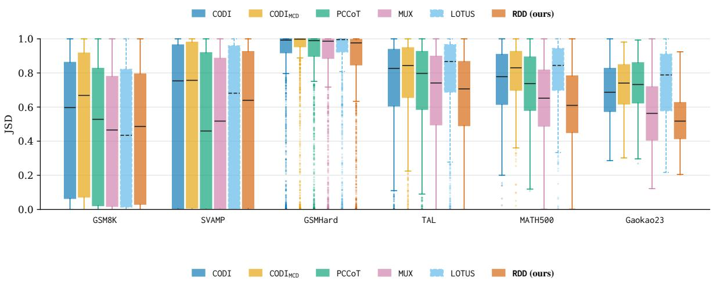

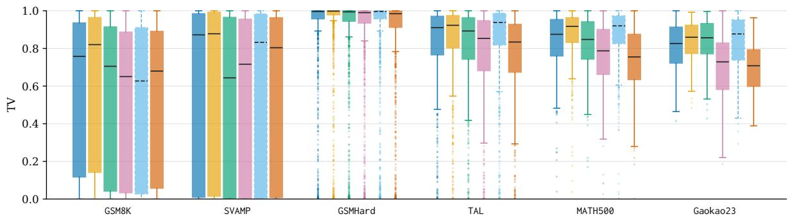

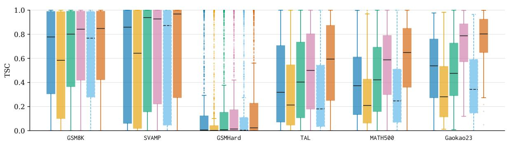  
Figure 5: Answer-distribution fidelity by benchmark. Per-question JSD (top), TV (middle), and TSC (bottom). Lower JSD and TV and higher TSC indicate better fidelity. Boxes show the interquartile range with median lines; whiskers extend to observations within 1.5 times the interquartile range, and dots denote outliers.

Arithmetic benchmarks  
Advanced benchmarks  
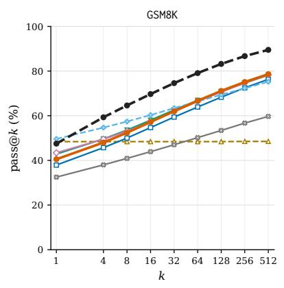

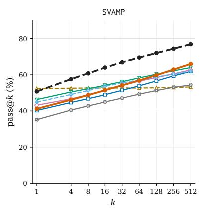

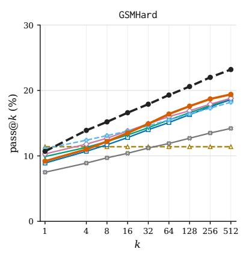

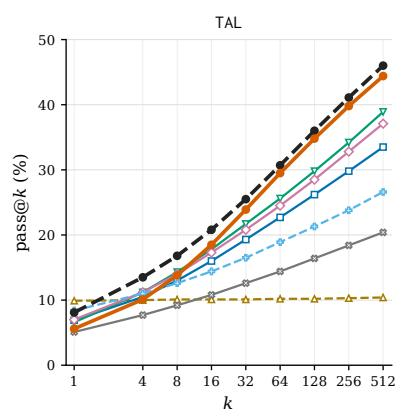

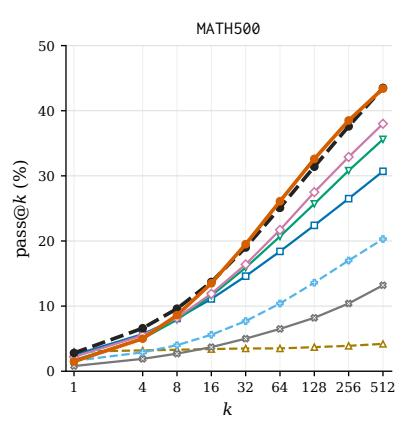

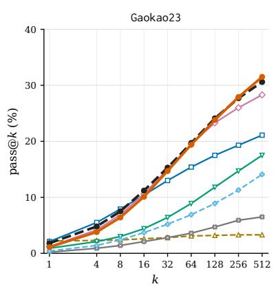  
Figure 6: Pass@� curves for the methods in Table 1. Results for GPT-2-0.1B on the arithmetic benchmarks (top row) and advanced benchmarks (bottom row). The horizontal axis uses a base-2 logarithmic scale; the vertical axis reports pass@� (%). Markers indicate evaluated � values, with lines connecting adjacent points.

Arithmetic benchmarks  
Advanced benchmarks  
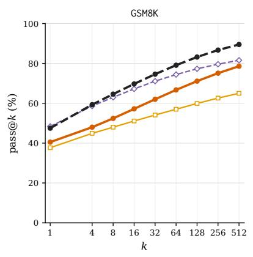

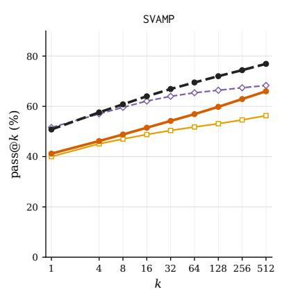

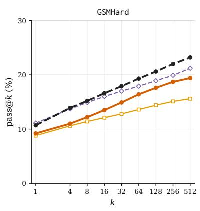

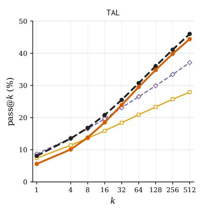

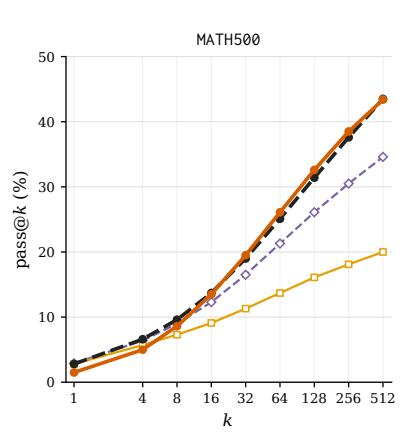

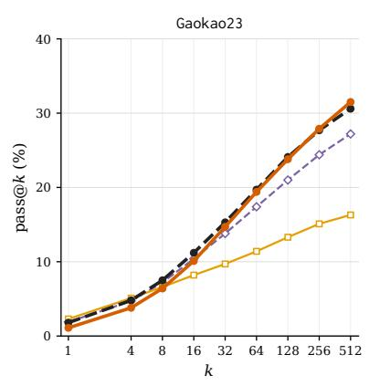  
Figure 7: Pass@� curves for the methods in Table 2. Results for GPT-2-0.1B on the arithmetic benchmarks (top row) and advanced benchmarks (bottom row). The horizontal axis uses a base-2 logarithmic scale; the vertical axis reports pass@� (%). Markers indicate evaluated � values, with lines connecting adjacent points.

Advanced benchmarks  
Arithmetic benchmarks  
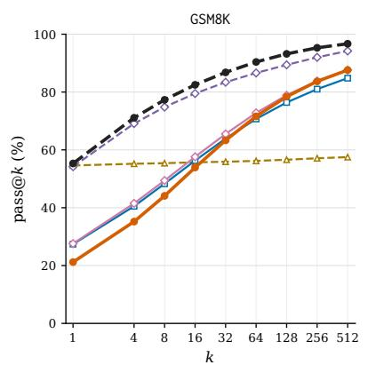

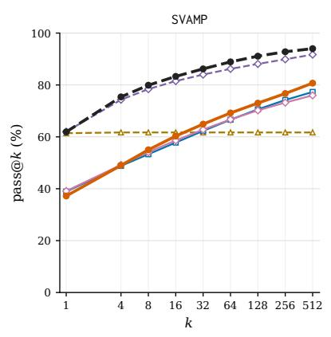

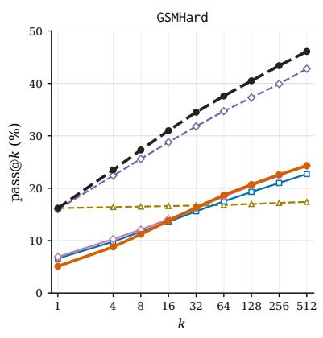

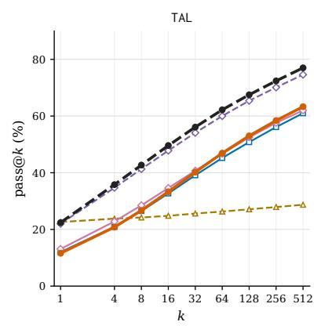

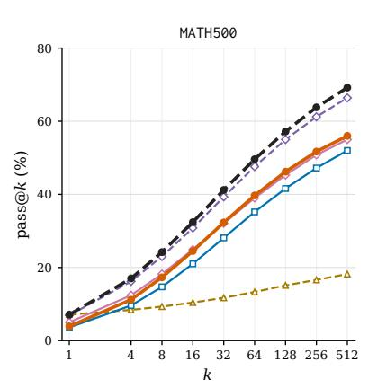

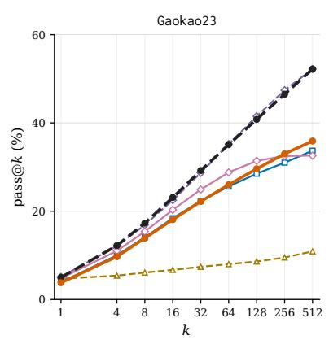  
Figure 8: Pass@� curves for the methods in Table 4. Results for SLM-2-1.7B on the arithmetic benchmarks (top row) and advanced benchmarks (bottom row). The horizontal axis uses a base-2 logarithmic scale; the vertical axis reports pass@� (%). Markers indicate evaluated � values, with lines connecting adjacent points.