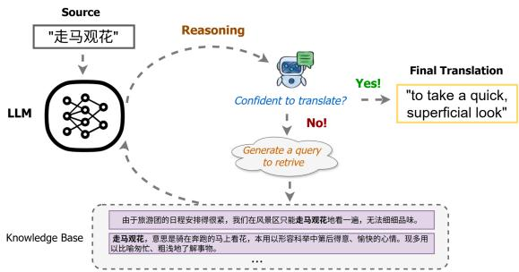
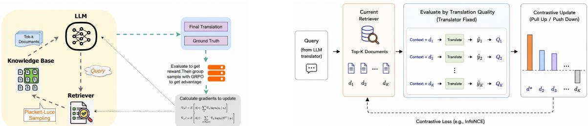
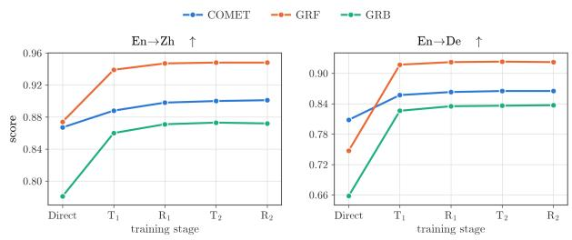
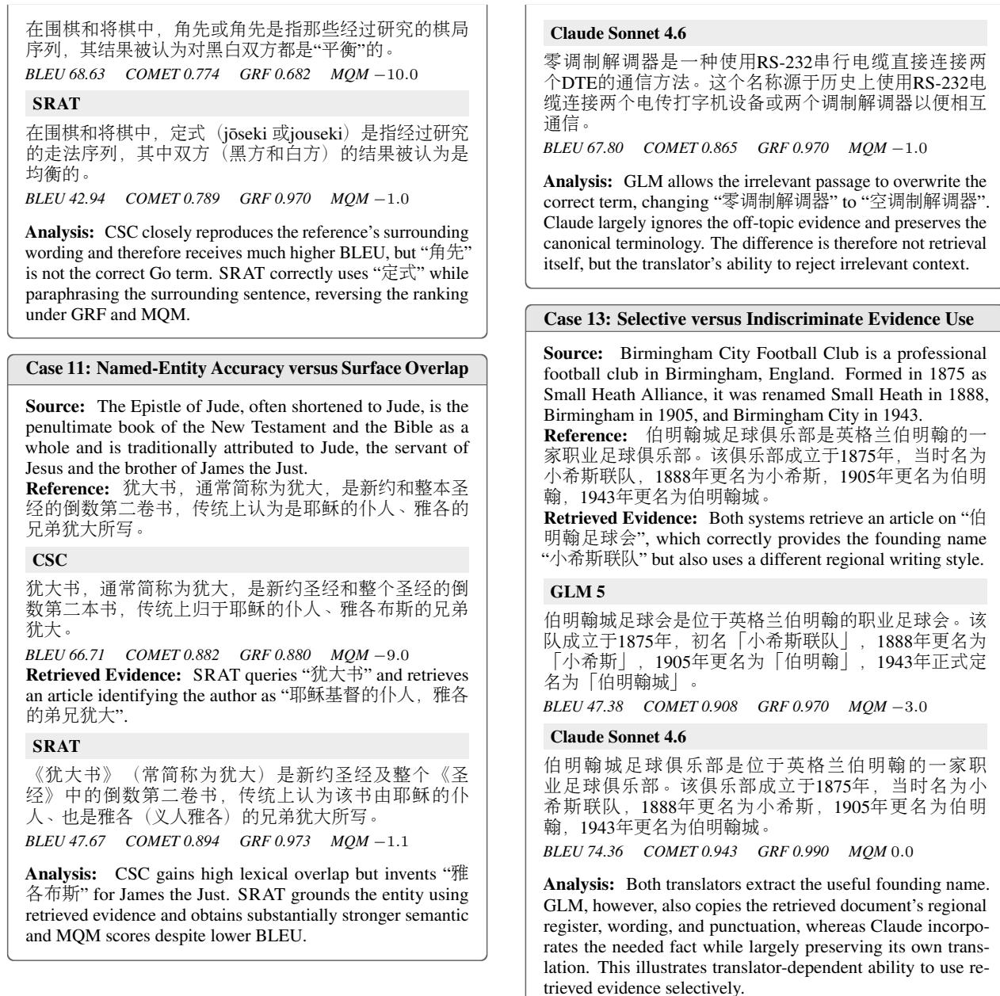

# Retrieve What Helps, Only When It Helps: Agentic Reinforcement Learning for Selective Retrieval-Augmented Machine Translation

Shijun Li1\*, Yang Liu2, Najmeh Sadoughi2, Dongmei Wang2, Xinjie Li2, Zhu Liu2, Rohith Mysore Vijaya Kumar2, Yuzong Liu2

1The University of Texas at Austin, 2Amazon shijunli@utexas.edu

## Abstract

Retrieving external knowledge can improve large language model (LLM) translation by providing supplementary information such as idiom interpretations and terminology. However, existing retrieval-augmented machine translation systems typically apply predefined retrieval strategies uniformly across all inputs. We argue that translation operates in a partialevidence regime: LLM’s parametric knowledge suffices for many inputs, while external evidence benefits a subset and usually supports rather than directly provides the desired translation. This creates two challenges: deciding when to retrieve and what evidence to acquire. We introduce Selective Retrieval-Augmented Translation (SRAT), an agentic reinforcement learning framework that learns when to translate directly or retrieve, what to retrieve, and how to integrate these decisions by optimizing final translation quality. To align evidence retrieval with downstream translation quality rather than simple semantic similarity, we further develop joint Plackett–Luce optimization and translation-quality contrastive training for retriever-training. Experiments on idiom, knowledge-intensive, and document-level translation with offline or online retrieval show that SRAT consistently outperforms never- and always-retrieve baselines, and quality-aligned retriever training provides further gains when similarity-based retrieval is insufficient. The results demonstrate the benefit of treating retrieval as a learnable translation action rather than fixed preprocessing.

## 1 Introduction

Large language models (LLMs) have become strong general-purpose machine translation (MT) systems, particularly after multilingual instruction tuning and translation-specific adaptation (Jiao et al., 2023; Xu et al., 2024). In particular, recent LLMs demonstrate strong ability to interpret contextual cues and leverage external knowledge. These capabilities have motivated retrievalaugmented MT systems that provide bilingual examples, idiom definitions, terminology, or supporting documents to further support and improve translation quality (Li et al., 2024; Wang et al., 2025b).

  
Figure 1: SRAT’s workflow by integrating reasoning, retrieval, and translation for LLM-based translation.

However, recent studies (Sun et al., 2026; Wang et al., 2023) have shown that retrieval is not uniformly beneficial for translation. Existing retrievalaugmented MT pipelines typically apply a predefined retrieval strategy: retrieve for every input with a heuristic, similarity-based matching rule. This overlooks a fundamental gap in LLM-based translation: for some inputs, the model’s parametric knowledge is already sufficient, while for others, external evidence such as idiom interpretations, canonical entities, technical terms, or background knowledge can be crucial. Moreover, heuristic, similarity-based retrieval can provide no help and even introduce noisy or misleading context that distracts the model and degrades an otherwise correct translation (Sun et al., 2026). For example, a semantically close document may merely repeat query terms without providing actionable knowledge, while a more distant one may contain exactly the idiom interpretation, entity convention, or background knowledge the translation requires. Translation therefore differs from answer-oriented retrieval settings, in which a relevant document often directly contains the evidence needed to produce the final response.

We refer to this setting as the partial-evidence regime, which captures two properties of retrieval in MT. First, external evidence is beneficial for only a subset of inputs where the model’s parametric knowledge doesn’t suffices. Second, when evidence is needed, retrieval based solely on semantic similarity may fail to surface the most useful evidence. This raises two learning problems. The first is retrieval adaptivity: the model must determine when additional evidence is useful instead of retrieving by default. The second is retrieval quality alignment: once retrieval is invoked, the system must determine what evidence actually improves the final translation quality.

To address them, we propose Selective Retrieval-Augmented Translation (SRAT), an agentic reinforcement-learning framework that treats reasoning, retrieval, and translation as actions in a unified policy. Given a source input, the model’s action space at each step includes reasoning about the translation, generating a retrieval query and incorporating the returned evidence, or terminating with the final translation. Rather than supervising which examples should retrieve, we optimize complete trajectories using final translation quality. Group Relative Policy Optimization (GRPO) (Shao et al., 2024) allows trajectories with different retrieval decisions and queries to compete for the same input, thereby learning when retrieval is worthwhile and what to retrieve to improve final translation quality.

Moreover, we develop two approaches for further aligning the retriever with downstream translation quality rather than simple semantic similarity. First, a natural and principled approach is to jointly optimize the LLM translator and retriever end-to-end. To achieve it, we replace deterministic top-k selection during training with a Plackett– Luce ranking policy (Plackett, 1975), whose selection log-probability allows trajectory-level translation reward to update the retriever through a scorefunction gradient. However, this joint signal can be noisy: a trajectory contains many LLM policy decisions but only a few retrieval actions, making credit assignment to the retriever inherently high-variance. To address this, we further introduce translation-quality contrastive training, which fixes the translator, evaluates candidate retrieval evidence by their measured effect on translation quality, and converts these into direct contrastive supervision. This isolates the effect of retrieval from other policy decisions, providing the retriever with substantially more targeted training signals.

We evaluate SRAT across three translation settings: idiom translation, knowledge-intensive translation, and document-level translation. The first two use offline retrieval corpora, while the document-level setting additionally evaluates SRAT with online retrieval. Across these settings, SRAT consistently outperforms never-retrieve and always-retrieve baselines, demonstrating the benefit of learning when to retrieve and what evidence to seek. Ablations show that quality-aligned retriever training provides further significant gains when similarity-based retrieval is insufficient. We also find that the retrieval policy can be optimized with a frontier black-box translator, outperforming its direct translation and indicating that the adaptive retrieval decision training can be decoupled from the translator and optimized as a modular component for external generation models.

Our main contributions are threefold:

• Selective retrieval as a translation decision. We characterize LLM-based RAG translation as a partial-evidence regime in which external knowledge is useful only conditionally. We formulate machine translation by LLM as a sequential policy over reasoning, retrieval, and final translation, enabling the model to learn when and what to retrieve from translation outcomes rather than fixed routing rules.

• Quality-aligned evidence retrieval. We propose two retriever-training strategies. Joint Plackett–Luce policy-gradient training propagates trajectory-level translation reward to evidence retrieval, while translation-quality contrastive training derives direct retriever supervision from controlled retrieval evidence interventions. Both align the retriever toward the downstream effect of retrieved evidence on translation quality rather than semantic similarity alone.

• Evaluation across retrieval regimes. Experiments on idiom, knowledge-intensive, and document-level translation with offline and online retrieval consistently outperform fixed neverand always-retrieve strategies. The results further show that quality-aligned retrieval is significantly beneficial when similarity-based retrieval is insufficient, and that adaptive retrieval policy learning can be decoupled from the translator to improve frontier black-box models beyond their direct translation performance.

## 2 Related Work

Large Language Models for Translation. Early studies showed that general-purpose LLMs can deliver competitive translation performance, although results vary across languages, domains, and prompting strategies (Jiao et al., 2023; Hendy et al., 2023). Translation-specific continued pretraining and supervised fine-tuning further improve smaller open models; ALMA, for example, combines monolingual adaptation with high-quality parallel data (Xu et al., 2024). These efforts improve the underlying translator, but largely leave inference-time information acquisition outside the modeling problem. A parallel line of work introduces explicit deliberation into LLM-based MT. MAPS elicits multiple translation-relevant analyses before selecting among candidate outputs (He et al., 2024); TEaR adopts a translate–estimate– refine procedure (Feng et al., 2025); and DRT distills extended reasoning traces for figurative text (Wang et al., 2025a). These studies suggest that additional computation can help difficult inputs, but the form and amount are typically fixed in advance. SRAT instead learns when extra reasoning and retrieval really help for translation.

Retrieval-Augmented Machine Translation. Retrieval has long been used in MT through translation memories and nearest-neighbor examples, while recent LLM-based systems draw on broader forms of external evidence. IdiomKB retrieves explanatory knowledge for idiomatic translation (Li et al., 2024), RAGtrans incorporates multilingual unstructured documents (Wang et al., 2025b), and cross-cultural MT has explored multilingual knowledge graphs (Conia et al., 2024). These results demonstrate the value of external knowledge when the source alone is insufficient. Yet most systems either retrieve by default or rely on predefined routing, while retrieval is often optimized separately from the final translation objective. Our focus is instead on whether retrieved evidence improves translation quality for a given input and model state.

Adaptive Retrieval and Reinforcement Learning. Adaptive retrieval has been studied mainly in language modeling and question answering. FLARE triggers retrieval when generation becomes uncertain (Jiang et al., 2023); Self-RAG learns retrieval and reflection actions from supervised preference data (Asai et al., 2024); and Search-R1 uses reinforcement learning to acquire multi-turn searchand-reason behavior from answer-level rewards (Jin et al., 2025b). These works show that retrieval can be integrated into a learned generation policy. Translation, however, differs in that a plausible output can often be produced without retrieval, while useful evidence may guide the rendering without explicitly containing the target translation. This makes selective retrieval and alignment with translation quality especially important.

## 3 Method

Our method addresses two decisions induced by the partial-evidence regime: when external evidence should be acquired and what evidence should be returned when retrieval is invoked. We first formulate selective retrieval as part of the translation policy, and then introduce two strategies for aligning the retriever with downstream translation quality.

## 3.1 Selective Retrieval as a Translation Policy

Let x denote a source sentence, $P ( \ell _ { s } , \ell _ { t } )$ the translation instruction prompt given source and target languages $\ell _ { s }$ and $\ell _ { t } ,$ and $y ^ { \star }$ a reference available only during training. An external corpus $\mathcal { D } = \{ d _ { j } \} _ { j = 1 } ^ { N }$ contains potentially useful evidence such as idiom explanations, terminology and entity, background documents, or online information.

We model the LLM translator as a policy $\pi _ { \theta }$ with initial state $s _ { 0 } = [ P ( \ell _ { s } , \ell _ { t } ) , x ]$ . Starting from $s _ { 0 } .$ the policy generates a trajectory $\tau = ( a _ { 1 } , \ldots , a _ { T } )$ that may interleave reasoning, retrieval, and the final translation $\hat { y } .$ . Making information acquisition part of the trajectory allows retrieval to be decided dynamically rather than applied as a fixed preprocessing step. Specifically, the trajectory contains three types of action during the workflow:

• Reasoning (<think>). The model may analyze ambiguity, figurative meaning, cultural context, entities, or terminology, or assess whether its current knowledge is sufficient for translation.

• Retrieval (<tool\_call>). When the current evidence is insufficient, the model generates a natural-language query $q _ { t }$ and invokes the retriever $r _ { \phi }$ over $\mathcal { D } \mathrm { : }$ :

$$
D _ { t } \sim r _ { \phi } ( \cdot \mid q _ { t } , { \mathcal { D } } ) .\tag{1}
$$

The returned document set is appended to the interaction state, $s _ { t + 1 } = s _ { t } \parallel [ q _ { t } , D _ { t } ]$ , after which the model can reason the evidence, regenerate a query, or directly translate. The query can directly target the missing information, for example, the meaning of an ambiguous expression in context or relevant background knowledge needed for translation.

• Translation (<answer>). Once the model judges the available evidence sufficient, it emits final translation $\hat { y }$ and terminates. This action can occur immediately after the initial state, so direct translation is a valid zero-retrieval trajectory.

The policy therefore jointly learns whether to retrieve, what information to request, and how to use all evidence for translation. The objective is not to apply a fixed retrieval policy, but to retrieve only when it improves the final translation.

## 3.2 Learning When to Retrieve

Outcome-guided Reinforcement Learning. We train the policy from a trajectory-level reward:

$$
R ( \tau ) = Q ( \hat { y } , y ^ { \star } , x ) - \lambda _ { \mathrm { f m t } } M ( \tau ) - \lambda _ { \mathrm { c o s t } } C ( \tau ) ,\tag{2}
$$

where $Q$ measures translation quality, $M ( \tau )$ penalizes malformed outputs, and $C ( \tau )$ penalizes excessive redundancy or repetition in the generation. In our experiments, $Q$ combines COMET (Rei et al., 2020) with an LLM-based translation evaluator.

For each source, we sample a group of G trajectories and compute the group advantage:

$$
A _ { i } = \frac { R ( \tau _ { i } ) - \overline { { R } } } { \mathrm { s t d } ( R ( \tau _ { 1 } ) , \ldots , R ( \tau _ { G } ) ) + \epsilon } .\tag{3}
$$

We then optimize $\pi _ { \theta }$ using the standard clipped GRPO objective (Shao et al., 2024). Because trajectories for the same input can differ in whether they retrieve, what they query, and how they make final translation, their relative rewards directly supervise selective retrieval without requiring labels specifying which inputs need external knowledge.

Retrieval exploration curriculum. Optimizing the outcome reward directly from an off-theshelf model can collapse to a never-retrieve policy: early in training, the model’s self-generated queries are often poor and its retrieval-action formatting is frequently malformed, so direct translation consistently receives higher reward before useful retrieval behavior has a chance to emerge. We therefore use a three-stage curriculum. First, we explicitly generate retrieval-augmented trajectories and retain the top 40% according to quality $Q .$ Second, we perform supervised fine-tuning on these trajectories to initialize the interaction format and querygeneration ability. Third, we conduct RL with a temporary retrieval penalty to move the SFT policy away from always retrieving, and then remove this shaping term and optimize Eq.(2) directly until convergence. The final policy is therefore free to retrieve or translate directly according to downstream quality rather than a predefined retrieval rate.

## 3.3 Learning What to Retrieve

The policy above learns whether to retrieve and how to formulate queries, but a fixed retriever still ranks documents according to its pretraining objective, typically the shallow semantic similarity. Since our objective is to retrieve documents to help make better translation, we instead optimize document selection according to translation quality. We consider two complementary approaches.

## 3.3.1 Joint Policy-Gradient Alignment

Given query q and candidate set $\mathcal { C } _ { q }$ , the retriever assigns each document a score $z _ { j } ~ = ~ f _ { \phi } ( q , d _ { j } )$ Deterministic top-k selection does not provide a selection log-probability through which the translation reward can update the retriever. We instead define a stochastic ranking policy. Given a query $q$ and candidate set $\mathcal { C } _ { q }$ , the retriever assigns logits $z _ { j } = f _ { \phi } ( q , d _ { j } )$ . An ordered sample $\bar { S ^ { \mathrm { ~ } } } = ( d ^ { ( 1 ) } , \dots , d ^ { ( k ) } )$ drawn without replacement follows the Plackett–Luce distribution with temperature $T$ as:

$$
p _ { \phi } ( S \mid q ) = \prod _ { m = 1 } ^ { k } \frac { \exp ( z _ { d ^ { ( m ) } } / T ) } { \sum _ { d \in \mathcal { C } _ { q } \backslash S _ { < m } } \exp ( z _ { d } / T ) } ,\tag{4}
$$

where $\mathcal { C } _ { q } \ \backslash \ S _ { < m }$ denotes the remaining candidates after the first $m - 1$ selections. This stochastic sampling makes the selection a differentiable distribution even though each draw is discrete.

For a trajectory containing retrieval events $\mathcal { R } ( \tau )$ the joint log probability factorizes as:

$$
\begin{array} { c } { \log p _ { \theta , \phi } ( \tau ) = \displaystyle \sum _ { t } \log \pi _ { \theta } ( a _ { t } \mid s _ { t } ) + } \\ { \displaystyle \sum _ { r \in \mathcal { R } ( \tau ) } \log p _ { \phi } ( S _ { r } \mid q _ { r } ) . } \end{array}\tag{5}
$$

Using the group advantage from Eq.(3), the re-

  
Figure 2: Joint translator–retriever optimization. Plackett–Luce sampling exposes the retriever selection probability, allowing the trajectory advantage to update both components.  
Figure 3: Translation-quality contrastive alignment. Candidate documents are evaluated by their effect on translation quality and converted into direct retriever supervision with the translator fixed.

triever gradient is:

$$
\nabla _ { \phi } J = \mathbb { E } _ { \tau } \left[ A ( \tau ) \sum _ { r \in \mathcal { R } ( \tau ) } \nabla _ { \phi } \log p _ { \phi } ( S _ { r } \mid q _ { r } ) \right] .\tag{6}
$$

The same outcome therefore increases the probability of documents selected in high-advantage trajectories and decreases it in low-advantage trajectories. Importantly, this optimizes quality under the current translator and policy; it does not assume that semantic similarity is itself the target.

## 3.3.2 Separate Contrastive Alignment

Joint optimization using Eq.(6) may suffer from high variance in credit assignment to the retriever: a single terminal reward must be attributed across many token-level decisions but only a handful of document selections, diluting the gradient signal that reaches the retriever parameters. We therefore introduce a complementary contrastive approach that provides direct document-level supervision.

We first train $\pi _ { \theta }$ with a fixed retriever. For each query q produced by the trained policy on the training data, we retrieve a candidate set $\mathcal { C } _ { q } =$ $\{ d _ { 1 } , \hdots , d _ { M } \}$ and run controlled translations using one candidate at a time. We score the resulting translations with the same quality function Q and choose the document producing the best translation as $d ^ { + } = \arg \operatorname* { m a x } _ { { d _ { i } \in \mathcal { C } _ { q } } } Q ( \hat { y } _ { i } , y ^ { \star } , x )$

We then fine-tune the retriever using:

$$
\mathcal { L } _ { \mathrm { r e t } } ( \phi ) = - \log \frac { \exp ( f _ { \phi } ( q , d ^ { + } ) / T _ { c } ) } { \sum _ { d _ { i } \in \mathcal { C } _ { q } } \exp ( f _ { \phi } ( q , d _ { i } ) / T _ { c } ) } .\tag{7}
$$

Unlike conventional contrastive retrieval, the positive document is defined by its measured effect on translation rather than annotated relevance or embedding similarity. This gives the retriever a focused, lower-variance signal about which evidence the current translator can actually use.

These two strategies offer complementary tradeoffs. Joint optimization updates the translator and retriever in an end-to-end way, while contrastive alignment requires additional candidate evaluations but provides more direct retriever supervision. We compare and discuss them in Section 4.3.

## 3.4 Inference

At inference time, no reference translation or quality evaluator is required. The learned policy decides whether retrieval is necessary, generates a query when needed and incorporates the returned evidence, and produces the final translation. We set a maximum number of retrieval calls and an output-token budget to bound worst-case latency. We report both translation quality and retrieval rate to measure the effectiveness and policy behaviors.

## 4 Experiments

We evaluate SRAT on idiom, knowledge-intensive, and document-level translation with either offline and online retrieval. We conduct experiment to study three research questions: RQ1. Does a learned selective-retrieval policy outperform prior translation methods and matched policies that never or always retrieve? RQ2. Does aligning the retriever with downstream translation utility improve translation quality, and when is it most beneficial? RQ3. Can the adaptive retrieval policy be trained with a stronger black-box LLM like Claude as the translator and further improve over its direct translation performance?

## 4.1 Experimental Setup

Datasets. IdiomKB (Li et al., 2024) evaluates idiom translation with short idiom explanations as the retrieval corpus. We use Zh→En (8K training / 500 test) and En→Zh (4.6K / 500). RAGtrans (Wang et al., 2025b) evaluates knowledge-intensive translation with multilingual unstructured documents. We use En→Zh (74.5K / 2K) and En→De (85.2K / 2K). Document-MT-LLM (Wang et al., 2023) evaluates document-level En→Ru subtitle translation (5.5K/500). Unlike the offline-corpus settings, it has no predefined retrieval collection; the policy instead generates queries for an online search engine (e.g., DuckDuckGo) to acquire contextual information on demand. These datasets cover structured offline retrieval, open-domain document retrieval, and online search for long-form translation.

<table><tr><td></td><td colspan="6">Zh→En</td><td colspan="6">En→Zh</td></tr><tr><td>Model</td><td>BLEU</td><td>COMET</td><td>I5</td><td>I3</td><td></td><td>MQM Ret. (%)</td><td>BLEU</td><td>COMET</td><td>I5</td><td>I3</td><td></td><td>MQM Ret. (%)</td></tr><tr><td>Direct</td><td>21.50</td><td>0.805</td><td>0.652</td><td>0.668</td><td>-3.94</td><td>0.0</td><td>33.10</td><td>0.829</td><td>0.646</td><td>0.689</td><td>-3.88</td><td>0.0</td></tr><tr><td>Self-CoT</td><td>20.18</td><td>0.795</td><td>0.673</td><td>0.658</td><td>-5.10</td><td>0.0</td><td>33.02</td><td>0.838</td><td>0.650</td><td>0.708</td><td>-3.32</td><td>0.0</td></tr><tr><td>KB-CoT</td><td>19.44</td><td>0.792</td><td>0.658</td><td>0.644</td><td>-4.50</td><td>100.0</td><td>33.86</td><td>0.842</td><td>0.662</td><td>0.700</td><td>-3.84</td><td>100.0</td></tr><tr><td>Ladder</td><td>24.36</td><td>0.804</td><td>0.646</td><td>0.637</td><td>-3.60</td><td>0.0</td><td>47.33</td><td>0.857</td><td>0.750</td><td>0.814</td><td>-2.30</td><td>0.0</td></tr><tr><td>CSC</td><td>24.95</td><td>0.812</td><td>0.635</td><td>0.643</td><td>-4.01</td><td>100.0</td><td>48.47</td><td>0.860</td><td>0.763</td><td>0.829</td><td>-2.11</td><td>100.0</td></tr><tr><td>SRAT-N</td><td>24.41</td><td>0.810</td><td>0.709</td><td>0.693</td><td>-3.02</td><td>0.1</td><td>44.44</td><td>0.878</td><td>0.746</td><td>0.807</td><td>-2.25</td><td>0.0</td></tr><tr><td>SRAT-A</td><td>22.48</td><td>0.808</td><td>0.700</td><td>0.686</td><td>-3.45</td><td>100.0</td><td>44.49</td><td>0.880</td><td>0.754</td><td>0.825</td><td>-2.24</td><td>100.0</td></tr><tr><td>SRAT</td><td>24.62</td><td>0.822</td><td>0.731</td><td>0.728</td><td>-2.74</td><td>30.6</td><td>48.25</td><td>0.891</td><td>0.792</td><td>0.871</td><td>-1.85</td><td>77.0</td></tr></table>

Table 1: Results on IdiomKB. I5 and I3 denote Idiom-Judge-5 and Idiom-Judge-3.
<table><tr><td></td><td colspan="6">En→Zh</td><td colspan="6">En→De</td></tr><tr><td>Model</td><td>BLEU</td><td>COMET</td><td>GRF</td><td>GRB</td><td></td><td>MQM Ret. (%)</td><td>BLEU</td><td>COMET</td><td>GRF</td><td>GRB</td><td>MQM Ret. (%)</td><td></td></tr><tr><td>Direct</td><td>45.74</td><td>0.867</td><td>0.856</td><td>0.774</td><td>-11.27</td><td>0.0</td><td>29.40</td><td>0.806</td><td>0.743</td><td>0.654</td><td>-21.28</td><td>0.0</td></tr><tr><td>Self-CoT</td><td>49.67</td><td>0.872</td><td>0.870</td><td>0.781</td><td>-10.07</td><td>0.0</td><td>29.95</td><td>0.819</td><td>0.775</td><td>0.681</td><td>-19.27</td><td>0.0</td></tr><tr><td>KB-CoT</td><td>46.01</td><td>0.868</td><td>0.874</td><td>0.786</td><td>-11.60</td><td>100.0</td><td>29.89</td><td>0.808</td><td>0.747</td><td>0.658</td><td>-20.72</td><td>100.0</td></tr><tr><td>Ladder</td><td>54.05</td><td>0.875</td><td>0.913</td><td>0.831</td><td>-5.50</td><td>0.0</td><td>38.38</td><td>0.829</td><td>0.877</td><td>0.779</td><td>-7.93</td><td>0.0</td></tr><tr><td>CSC</td><td>55.42</td><td>0.880</td><td>0.920</td><td>0.840</td><td>-5.40</td><td>100.0</td><td>38.18</td><td>0.836</td><td>0.880</td><td>0.796</td><td>-7.54</td><td>100.0</td></tr><tr><td>SRAT-N</td><td>49.32</td><td>0.870</td><td>0.918</td><td>0.827</td><td>-5.10</td><td>0.0</td><td>36.21</td><td>0.831</td><td>0.878</td><td>0.801</td><td>-7.14</td><td>0.0</td></tr><tr><td>SRAT-A</td><td>49.32</td><td>0.876</td><td>0.923</td><td>0.835</td><td>-4.98</td><td>100.0</td><td>36.12</td><td>0.838</td><td>0.884</td><td>0.793</td><td>-6.86</td><td>100.0</td></tr><tr><td>SRAT</td><td>52.37</td><td>0.888</td><td>0.939</td><td>0.860</td><td>-4.58</td><td>52.2</td><td>36.84</td><td>0.857</td><td>0.917</td><td>0.826</td><td>-5.98</td><td>43.0</td></tr></table>

Table 2: Results on RAGtrans. GRF and GRB are the reference-free and reference-based LLM judges.

Baselines. All open-model systems use Qwen2.5- 7B-Instruct as the default backbone. Direct translates without explicit reasoning or retrieval. Self-CoT reasons without external evidence, while KB-CoT (Li et al., 2024) conditions reasoning for translation on retrieved knowledge for every case. Ladder is a retrieval-free baseline fine-tuned for translation (Feng et al., 2024). CSC further fine-tunes the translator with retrieved context under a fixed always-retrieve pipeline (Wang et al., 2025b).

We compare the full adaptive policy with two matched policy ablations. SRAT-N denotes outcome-based RL that converges to a near-zero retrieval policy, while SRAT-A adds a consistent retrieval bonus and converges to always retrieving. The full SRAT model uses the retrievalexploration curriculum and is ultimately optimized without a target retrieval rate. For retriever alignment, Joint denotes Plackett–Luce joint translator– retriever training, while Contrastive denotes translation-utility contrastive retriever training.

Metrics. We report BLEU (Papineni et al., 2002), COMET (Rei et al., 2020), MQM, and task-specific LLM-judge metrics. MQM exactly follows the LLM-judge protocol of Zhan et al. (2026). For IdiomKB, I3 follows the three-level idiom-translation judge from Li et al. (2024), and we extend it to a finer-grained five-level criterion, noted as I5. For RAGtrans, GRF and GRB exactly follow its reference-free and reference-based LLMjudge templates (Wang et al., 2025b). All LLMbased evaluations use Claude Sonnet 4.6 as default. Higher is better for all metrics; MQM is reported as a negative error score, so values closer to zero are better. We also report the percentage of test examples where there exists retrieval action.

Training details. The RL reward is $R = Q -$ $0 . 5 \times M - 0 . 0 5 \times C$ , where $Q = 0 . 5 \times Q _ { \mathrm { L L M } }$ + $0 . 5 \times Q _ { \mathrm { C O M E T } } .$ , M is a format penalty (1 for malformed outputs and 0 otherwise), and C = max $( 0 , ( L _ { \mathrm { o u t } } \mathrm { ~ - ~ } 2 5 6 ) / 5 1 2 )$ measures excessive generation cost. We use I5 as $Q _ { \mathrm { L L M } }$ on IdiomKB and GRF on RAGtrans and Document-MT. Training uses VeRL with an SGLang backend and a Sentence Transformer (Reimers and Gurevych, 2019) retriever, with top-k = 1 as default, at most five interaction turns, and a maximum output length of 2048 tokens. Additional experimental details, qualitative cases, and LLM-Judge prompts are provided in Appendix A.2 and E. We also conduct ablations to study the effect of different components like LLM backbones and evaluators in Appendix B.

## 4.2 RQ1: Does Selective Retrieval Improve Translation?

Tables 1, 2, and 5 (see in Appendix A.1) show a consistent advantage of selective retrieval across idiom, knowledge-intensive, and document-level translation. ${ \tt S R A T ^ { 1 } }$ achieves the strongest COMET, task-specific LLM-judge, and MQM results across all settings. Compared with the strongest SFT baselines, SRAT improves I5 by 0.096 and MQM by 1.27 points on IdiomKB Zh→En, GRF by 0.019 and MQM by 0.82 points on RAGtrans En→Zh, and GRF by 0.020 and MQM by 0.42 points on Document-MT-LLM. The gains are particularly consistent on metrics that assess semantic adequacy and multidimensional translation quality.

Learning when to retrieve matters. The comparison with SRAT-N and SRAT-A isolates the value of the retrieval decision. Across all three benchmarks, SRAT consistently outperforms both never- and always-retrieve policies on semantic and LLM-judged metrics. Relative to SRAT-A, MQM improves by 20.6% and 17.4% on the two IdiomKB directions, by 8.0–12.8% on RAGtrans, and by 5.4% on Document-MT-LLM. These gains are achieved with substantially different learned retrieval rates: 30.6–77.0% on IdiomKB, around half of the inputs on RAGtrans, and 88.6% on Document-MT-LLM. This variation suggests that the policy adapts retrieval behavior to different translation settings rather than learning a fixed preference for retrieval. Moreover, SRAT-N already provides substantial gains over the unfine-tuned model, while SRAT further improves upon it, indicating complementary benefits from RL-based translation learning and selective retrieval.

Why is BLEU lower than supervised baselines? Ladder or CSC obtains the highest BLEU across the evaluated settings. This is expected because our RL reward does not include BLEU, but instead directly optimizes COMET and task-specific LLM judges, whereas supervised fine-tuning on reference translations can favor surface forms closer to the reference. BLEU measures n-gram overlap with a limited set of references (Papineni et al., 2002) and may under-reward valid paraphrases or more natural translations. Prior studies have therefore cautioned against treating BLEU alone as decisive evidence of translation quality (Callison-Burch et al., 2006; Mathur et al., 2020), and humanpreferred translations can receive lower BLEU when their wording differs from literal or translationese references (Freitag et al., 2020). We therefore treat BLEU as a complementary lexical metric and place main emphasis on COMET and LLMbased evaluation. Additional analyses and qualitative cases on this are provided in Appendix E.4.

## 4.3 RQ2: When Does Utility-Aligned Retriever Training Help?

We next examine whether the retriever can be better aligned with translation utility. To valiate retrieval quality, we additionally calculate retrieval accuracy: for each retrieval action, we ask Claude Sonnet 4.6 to judge whether the retrieved document is correct and useful for translating the source, given the query, source, reference, and retrieved document.

Retriever training is most beneficial when the underlying retrieval task is difficult. On IdiomKB, the default similarity retriever already achieves about 95% retrieval accuracy, and joint or contrastive training improves it only to 97–98%, yielding limited downstream gains. On RAGtrans, the default retriever reaches only 56.3% and 72.6% accuracy on En→Zh and En→De. Contrastive training increases these to 70.7% and 81.4%, while improving MQM by 6.8% and 7.4%. This shows that utility alignment is particularly valuable when semantic similarity is an insufficient proxy for evidence usefulness. We show such cases in Appendix E.3.

Contrastive training also consistently outperforms joint optimization. On RAGtrans, it improves MQM over joint training from −4.41 to −4.27 on En→Zh and from −5.89 to −5.54 on En→De. This supports our motivation in Section 3.3.2: joint training shares one trajectory reward across many token-level decisions but only a few document selections, weakening retriever credit assignment. Contrastive training instead derives direct document-level supervision from controlled candidate interventions, providing a more focused learning signal. Additional alternatingtraining curves are given in Appendix B.2.

<table><tr><td></td><td colspan="6">IdiomKB</td><td colspan="6">RAGtrans</td></tr><tr><td>Alignment</td><td>Dir.</td><td>BLEU</td><td>COMET</td><td>I5</td><td></td><td>I3 MQM Dir.</td><td></td><td>BLEU</td><td>COMET</td><td>GRF</td><td>GRB</td><td>MQM</td></tr><tr><td>Similarity</td><td>Zh→En</td><td>24.62</td><td>0.822</td><td>0.731</td><td>0.728</td><td>-2.74</td><td>En→Zh</td><td>52.37</td><td>0.888</td><td>0.939</td><td>0.860</td><td>-4.58</td></tr><tr><td>Joint</td><td>Zh→En</td><td>24.71</td><td>0.818</td><td>0.725</td><td>0.733</td><td>-2.80</td><td>En→Zh</td><td>53.49</td><td>0.891</td><td>0.941</td><td>0.863</td><td>-4.41</td></tr><tr><td>Contrastive</td><td>Zh→En</td><td>24.75</td><td>0.824</td><td>0.730</td><td>0.734</td><td>-2.70</td><td>En→Zh</td><td>53.99</td><td>0.898</td><td>0.947</td><td>0.871</td><td>-4.27</td></tr><tr><td>Similarity</td><td>En→Zh</td><td>48.25</td><td>0.891</td><td>0.792</td><td>0.871</td><td>-1.85</td><td>En→De</td><td>36.84</td><td>0.857 0.917</td><td></td><td>0.826</td><td>-5.98</td></tr><tr><td>Joint</td><td>En→Zh</td><td>48.73</td><td>0.8860.790</td><td></td><td>0.877</td><td>-1.52</td><td>En→De</td><td>36.86</td><td>0.8580.917 0.828</td><td></td><td></td><td>-5.89</td></tr><tr><td>Contrastive</td><td>En→Zh</td><td>48.90</td><td>0.893 0.795 0.877</td><td></td><td></td><td>-1.48</td><td>En→De</td><td>36.93</td><td>0.863 0.922 0.835</td><td></td><td></td><td>-5.54</td></tr></table>

Table 3: Retriever alignment on both datasets. Similarity uses the default retriever; Joint uses Plackett–Luce policy-gradient training; and Contrastive uses separate, contrastive training.
<table><tr><td>[IdiomKB]</td><td colspan="6">Zh→En</td><td colspan="6">En→Zh</td></tr><tr><td>Model</td><td>BLEU</td><td>COMET</td><td>I5</td><td></td><td>I3 MQM Ret. (%)</td><td></td><td>BLEU</td><td>COMET</td><td>I5</td><td>I3</td><td>MQM Ret. (%)</td><td></td></tr><tr><td>Claude</td><td>28.30</td><td>0.826</td><td>0.758</td><td>0.752</td><td>-0.92</td><td>0.0</td><td>54.63</td><td>0.903</td><td>0.812</td><td>0.878</td><td>-0.99</td><td>0.0</td></tr><tr><td>Claude-Ret</td><td>28.13</td><td>0.821</td><td>0.760</td><td>0.748</td><td>-0.99</td><td>3.4</td><td>57.21</td><td>0.902</td><td>0.814</td><td>0.882</td><td>-1.12</td><td>11.8</td></tr><tr><td>SRAT-Claude</td><td>28.39</td><td>0.829</td><td>0.763</td><td>0.755</td><td>-0.94</td><td>1.9</td><td>56.85</td><td>0.907</td><td>0.814 0.879</td><td></td><td>-0.97</td><td>10.2</td></tr><tr><td>[RAGtrans]</td><td></td><td></td><td>En→Zh</td><td></td><td></td><td></td><td></td><td></td><td>En→De</td><td></td><td></td><td></td></tr><tr><td>Model</td><td>BLEU</td><td>COMET</td><td>GRF</td><td>GRB</td><td>MQM Ret. (%)</td><td></td><td>BLEU</td><td>COMET</td><td>GRF</td><td>GRB</td><td>MQM Ret. (%)</td><td></td></tr><tr><td>Claude</td><td>53.54</td><td>0.893</td><td>0.954</td><td>0.896</td><td>-1.85</td><td>0.0</td><td>47.30</td><td>0.871</td><td>0.960</td><td>0.886</td><td>-1.25</td><td>0.0</td></tr><tr><td>Claude-Ret</td><td>55.86</td><td>0.8960.957</td><td></td><td>0.899</td><td>-1.71</td><td>11.1</td><td>45.99</td><td>0.870</td><td>0.958</td><td>0.884</td><td>-1.27</td><td>16.1</td></tr><tr><td>SRAT-Claude</td><td>61.10</td><td>0.898 0.961</td><td></td><td>0.903</td><td>-1.62</td><td>50.3</td><td>49.03</td><td>0.875</td><td>0.967</td><td>0.891</td><td>-1.04</td><td>25.1</td></tr></table>

Table 4: Composition with a black-box translator. Claude-Ret uses prompted retrieval decisions. SRAT-Claude keeps Claude frozen and uses the learned Qwen policy for retrieval and context construction.

## 4.4 RQ3: Can Selective Retrieval Improve Strong Black-Box Translators?

We next examine whether selective retrieval can improve a stronger black-box translator whose parameters are inaccessible. Specifically, we freeze Claude Sonnet 4.6 and train a Qwen-based SRAT policy to decide when and what to retrieve, using Claude’s final translation quality as reward. We compare against direct Claude translation and Claude-Ret, which prompts Claude itself to make retrieval decisions without policy training.

Table 4 shows that directly prompting a strong LLM to retrieve is not consistently beneficial. On IdiomKB Zh→En, Claude-Ret reduces COMET from 0.826 to 0.821 and MQM from −0.92 to −0.99; on RAGtrans En→De, it similarly degrades BLEU, COMET, and MQM. In contrast, SRAT-Claude provides more reliable gains. On IdiomKB, it improves most metrics over direct Claude with only 1.9–10.2% retrieval, although the gains remain modest given Claude’s strong parametric knowledge on the relatively simple idiom-

translation tasks.

The benefit becomes substantially larger on the more challenging RAGtrans benchmark. SRAT-Claude improves MQM over direct Claude by 12.4% on En→Zh and 16.8% on En→De, together with consistent gains in BLEU, COMET, and GRF. We further observe the same overall trend with GLM 5 in Appendix A.5: prompted retrieval degrades translation, whereas a trained SRAT policy can recover the loss and improve over direct GLM translation. These results show that retrieval policy learning can be decoupled from the translator and generalized across frozen black-box LLMs, improving their translation outcomes without modifying their parameters.

## 5 Conclusion

We introduced Selective Retrieval-Augmented Translation (SRAT), which learns when and what to retrieve for LLM-based translation. Across offline and online retrieval settings, SRAT consistently outperforms fixed never- and always-retrieve strategies. We further show that utility-aligned retriever training improves difficult retrieval settings and that adaptive retrieval can enhance a frozen black-box translator beyond direct translation.

## References

Akari Asai, Zeqiu Wu, Yizhong Wang, Avirup Sil, and Hannaneh Hajishirzi. 2024. Self-RAG: Learning to retrieve, generate, and critique through self-reflection. In International Conference on Learning Representations.

Chris Callison-Burch, Miles Osborne, and Philipp Koehn. 2006. Re-evaluating the role of Bleu in machine translation research. In 11th Conference of the European Chapter of the Association for Computational Linguistics, pages 249–256, Trento, Italy. Association for Computational Linguistics.

Simone Conia et al. 2024. Towards cross-cultural machine translation with retrieval-augmented generation from multilingual knowledge graphs. In Proceedings of the 2024 Conference on Empirical Methods in Natural Language Processing. Association for Computational Linguistics.

Zhaopeng Feng, Ruizhe Chen, Yan Zhang, Zijie Meng, and Zuozhu Liu. 2024. Ladder: A model-agnostic framework boosting LLM-based machine translation to the next level. In Proceedings ofthe 2024 Conference on Empirical Methods in Natural Language Processing, pages 15377–15393, Miami, Florida, USA. Association for Computational Linguistics.

Zhaopeng Feng, Yan Zhang, Hao Li, Bei Wu, Jiayu Liao, Wenqiang Liu, Jun Lang, Yang Feng, Jian Wu, and Zuozhu Liu. 2025. TEaR: Improving LLM-based machine translation with systematic self-refinement. In Findings of the Association for Computational Linguistics: NAACL 2025.

Markus Freitag, George Foster, David Grangier, and Colin Cherry. 2020. Human-paraphrased references improve neural machine translation. In Proceedings ofthe Fifth Conference on Machine Translation, pages 1183–1192, Online. Association for Computational Linguistics.

Zhiwei He, Tian Liang, Wenxiang Jiao, Zhuosheng Zhang, Yujiu Yang, Rui Wang, Zhaopeng Tu, Shuming Shi, and Xing Wang. 2024. Exploring humanlike translation strategy with large language models. Transactions of the Association for Computational Linguistics, 12.

Amr Hendy, Mohamed Abdelrehim, Amr Sharaf, Vikas Raunak, Mohamed Gabr, Hitokazu Matsushita, Young Jin Kim, Mohamed Afify, and Hany Hassan Awadalla. 2023. How good are GPT models at machine translation? a comprehensive evaluation. arXiv preprint arXiv:2302.09210.

Zhengbao Jiang, Frank F. Xu, Luyu Gao, Zhiqing Sun, Qian Liu, Jane Dwivedi-Yu, Yiming Yang, Jamie Callan, and Graham Neubig. 2023. Active retrieval augmented generation. In Proceedings of the 2023 Conference on Empirical Methods in Natural Language Processing. Association for Computational Linguistics.

Wenxiang Jiao, Wenxuan Wang, Jen-tse Huang, Xing Wang, and Zhaopeng Tu. 2023. Is ChatGPT a good translator? yes with GPT-4 as the engine. arXiv preprint arXiv:2301.08745.

Bowen Jin, Hansi Zeng, Zhenrui Yue, Jinsung Yoon, Sercan Arik, Dong Wang, Hamed Zamani, and Jiawei Han. 2025a. Search-r1: Training llms to reason and leverage search engines with reinforcement learning. arXiv preprint arXiv:2503.09516.

Bowen Jin et al. 2025b. Search-R1: Training LLMs to reason and leverage search engines with reinforcement learning. arXiv preprint arXiv:2503.09516.

Shuang Li, Jiangjie Chen, Siyu Yuan, Xinyi Wu, Hao Yang, Shimin Tao, and Yanghua Xiao. 2024. Translate meanings, not just words: IdiomKB’s role in optimizing idiomatic translation with language models. In Proceedings of the AAAI Conference on Artificial Intelligence.

Nitika Mathur, Timothy Baldwin, and Trevor Cohn. 2020. Tangled up in BLEU: Reevaluating the evaluation of automatic machine translation evaluation metrics. In Proceedings of the 58th Annual Meeting ofthe Associationfor Computational Linguistics, pages 4984–4997, Online. Association for Computational Linguistics.

Kishore Papineni, Salim Roukos, Todd Ward, and Wei-Jing Zhu. 2002. Bleu: a method for automatic evaluation of machine translation. In Proceedings ofthe 40th Annual Meeting ofthe Associationfor Computational Linguistics, pages 311–318, Philadelphia, Pennsylvania, USA. Association for Computational Linguistics.

Robin L. Plackett. 1975. The analysis of permutations. Journal of the Royal Statistical Society: Series C (Applied Statistics), 24(2):193–202.

Ricardo Rei, Craig Stewart, Ana C. Farinha, and Alon Lavie. 2020. COMET: A neural framework for MT evaluation. In Proceedings ofthe 2020 Conference on Empirical Methods in Natural Language Processing, pages 2685–2702. Association for Computational Linguistics.

Nils Reimers and Iryna Gurevych. 2019. Sentence-bert: Sentence embeddings using siamese bert-networks. In Proceedings of the 2019 conference on empirical methods in natural language processing and the 9th international joint conference on natural language processing (EMNLP-IJCNLP), pages 3982–3992.

Zhihong Shao, Peiyi Wang, Qihao Zhu, Runxin Xu, Junxiao Song, Xiao Bi, Haowei Zhang, Mingchuan Zhang, Y. K. Li, Y. Wu, and Daya Guo. 2024. DeepSeekMath: Pushing the limits of mathematical reasoning in open language models. arXiv preprint arXiv:2402.03300.

Yanming Sun, Runzhe Zhan, Chi Seng Cheang, Han Wu, Xuebo Liu, Yuyao Niu, Fengying Ye, Kaixin

Lan, Lidia S Chao, and Derek F Wong. 2026. Exposing the cracks: Vulnerabilities of retrieval-augmented llm-based machine translation. In Proceedings of the AAAI Conference on Artificial Intelligence, volume 40, pages 33135–33143.

Jiaan Wang, Fandong Meng, Yunlong Liang, and Jie Zhou. 2025a. DRT: Deep reasoning translation via long chain-of-thought. In Findings of the Associationfor Computational Linguistics: ACL 2025, pages 6770–6782. Association for Computational Linguistics.

Jiaan Wang, Fandong Meng, Yingxue Zhang, and Jie Zhou. 2025b. Retrieval-augmented machine translation with unstructured knowledge. In Findings ofthe Association for Computational Linguistics: EMNLP 2025, pages 5858–5871. Association for Computational Linguistics.

Liang Wang, Nan Yang, Xiaolong Huang, Binxing Jiao, Linjun Yang, Daxin Jiang, Rangan Majumder, and Furu Wei. 2022. Text embeddings by weaklysupervised contrastive pre-training. arXiv preprint arXiv:2212.03533.

Longyue Wang, Chenyang Lyu, Tianbo Ji, Zhirui Zhang, Dian Yu, Shuming Shi, and Zhaopeng Tu. 2023. Document-level machine translation with large language models. In Proceedings of the 2023 Conference on Empirical Methods in Natural Language Processing, pages 16646–16661.

Haoran Xu, Young Jin Kim, Amr Sharaf, and Hany Hassan Awadalla. 2024. A paradigm shift in machine translation: Boosting translation performance of large language models. In International Conference on Learning Representations.

Runzhe Zhan, Zhihong Huang, Xinyi Yang, Lidia Chao, Min Yang, and Derek Wong. 2026. Are large reasoning models good translation evaluators? analysis and performance boost. Advances in Neural Information Processing Systems, 38:64855–64882.

Lianmin Zheng, Liangsheng Yin, Zhiqiang Xie, Chuyue Sun, Jeff Huang, Cody H Yu, Shiyi Cao, Christos Kozyrakis, Ion Stoica, Joseph E Gonzalez, et al. 2024. Sglang: Efficient execution of structured language model programs. Advances in neural information processing systems, 37:62557–62583.

## A Experiment Details

## A.1 Results on Document-MT-LLM

We show the evaluation results here on Document-MT-LLM (Wang et al., 2023) , a document-level En→Ru subtitle translation task. Unlike IdiomKB and RAGtrans, this setting has no predefined retrieval corpus. Instead, the policy needs to generate queries for a live search engine and incorporates the returned information into translation. This introduces additional challenges from both query generation and noisy, open-ended search results.

Table 5 shows that selective retrieval remains effective beyond fixed offline corpora. SRAT achieves the best COMET, GRF, GRB, and MQM among all non-oracle systems, improving over SRAT-A by 1.6% COMET, 2.7% GRF, and 5.4% MQM. The learned policy retrieves on 88.6% of examples, substantially more often than on the sentence-level benchmarks, consistent with the greater contextual demands of long-form subtitle translation. Nevertheless, its advantage over always retrieving shows that even in this retrieval-intensive setting, external evidence is not uniformly beneficial. These results extend the partial-evidence observation to open-ended retrieval, where the policy must learn both whether additional context is needed and how to formulate an effective search query.

<table><tr><td>Model</td><td>BLEU</td><td>COMET GRF</td><td>GRB</td><td>MQM Ret. (%)</td></tr><tr><td>Direct</td><td>17.01</td><td>0.6900.601</td><td>0.544-20.78</td><td></td></tr><tr><td>KB-CoT</td><td>18.60</td><td>0.7080.622</td><td>0.554-19.73</td><td>100.0</td></tr><tr><td>Self-CoT</td><td>19.29</td><td>0.746 0.715</td><td>0.640 -13.86</td><td></td></tr><tr><td>Ladder</td><td>24.96</td><td>0.796 0.831</td><td>0.740 -6.87</td><td></td></tr><tr><td>CSC</td><td>25.01</td><td>0.800 0.829</td><td>0.737 -7.06</td><td>100.0</td></tr><tr><td>SRAT-N</td><td>23.21</td><td>0.801 0.830</td><td>0.740 -7.09</td><td>0.0</td></tr><tr><td>SRAT-A</td><td>23.32</td><td>0.804 0.827</td><td>0.743 -7.02</td><td>100.0</td></tr><tr><td>SRAT</td><td>23.66</td><td>0.817 0.849</td><td>0.753 -6.64</td><td>88.6</td></tr></table>

Table 5: Results on Document-MT-LLM for En→Ru translation with online retrieval.

## A.2 Technical Details

We conduct all experiments on a cluster where each node is equipped with 8 A100 80GB GPU with 256 GB of RAM . For all models, we use the Adam optimizer and tune the learning rate within the range ([1e-7, 5e-7, 1e-6, 5e-6, 1e-5]). By default, we fine-tune Qwen2.5-7B-Instruct using GRPO (Shao et al., 2024). GRPO is configured with a KL coefficient of 0.001 and a clip ratio of 0.2. During rollout, we use a group size of 8 and a sampling temperature of 1.0. We enable tool-calling via SGLang (Zheng et al., 2024) to allow the LLM to generate retrieval queries and set maximal turns to 5. For retrieval, we use the Flat E5 retriever (Wang et al., 2022) following prior work (Jin et al., 2025a). Flat indexing encodes the corpus into dense embeddings and retrieves relevant documents via efficient embedding matching in the embedding space. If retrieval fails, the retriever returns a blank placeholder. On average, training the policy to convergence takes 68/47, 334/382, and 97 GPU hours on the IdiomKB (Zh2En/En2Zh), RAGtrans (En2Zh), and Document-MT-LLM (En2Ru) datasets, respectively.

For all baselines, we follow the original papers for implementation details and hyperparameter tuning. We run each experiment with three random seeds and report the mean performance. Statistical significance is evaluated using a paired t-test with $p < 0 . 0 5$ . All datasets used in our experiments are publicly available. All datasets used in our experiments are publicly available. They are either released under the MIT license, which permits research use, or come without a specific license, but their original papers explicitly state that public research usage is permitted. Our use of these datasets complies with their original license terms and respects the rights of their creators.

## A.3 Comparison with Oracle Retrieval Policy

To estimate the remaining headroom in retrieval decisions, we construct an Oracle that selects, for each test example, the better output from SRAT-N and SRAT-A according to the same blended quality score used in RL reward. The Oracle therefore represents an idealized per-instance choice between translating without retrieval and translating with retrieval, while keeping the underlying policies fixed.

As shown in Table 7, the learned SRAT policy approaches the Oracle on several settings, while the remaining gap reveals further room for improving retrieval decisions. On IdiomKB Zh→En, for example, SRAT reaches 0.822 COMET and −2.74 MQM compared with 0.831 and −2.67 for the Oracle. The largest headroom appears on RAGtrans, particularly En→De, where the Oracle reaches 0.869 COMET and −5.25 MQM compared with 0.857 and −5.98 for SRAT. This is consistent with the greater difficulty of deciding when retrieval is useful in knowledge-intensive translation.

Interestingly, the Oracle often retrieves less frequently than SRAT, especially on RAGtrans (37.7% vs. 52.2% for En→Zh and 30.4% vs. 43.0% for En→De). This suggests that further gains may come not from increasing retrieval frequency, but from more accurately identifying the subset of inputs for which retrieved evidence improves the translation. Because the Oracle selects using the blended training score, it is an oracle for this selection objective rather than a strict upper bound on every individual evaluation metric.

<table><tr><td></td><td colspan="6">En→Zh</td><td colspan="6">En→De</td></tr><tr><td>Model</td><td>BLEU</td><td>COMET</td><td>GRF</td><td>GRB</td><td>MQM Ret. (%)</td><td></td><td>BLEU</td><td>COMET</td><td>GRF</td><td>GRB</td><td>MQM Ret. (%)</td><td></td></tr><tr><td>GLM 5</td><td>58.58</td><td>0.892</td><td>0.953</td><td>0.891</td><td>-1.666</td><td>0.0</td><td>46.35</td><td>0.869</td><td>0.956</td><td>0.882</td><td>-1.668</td><td>0.0</td></tr><tr><td>GLM-Ret</td><td>57.98</td><td>0.891</td><td>0.945</td><td></td><td>0.887-2.076</td><td>68.1</td><td>46.41</td><td>0.868</td><td>0.952</td><td></td><td>0.880-1.956</td><td>79.7</td></tr><tr><td>SRAT-GLM</td><td>58.82</td><td></td><td>0.893 0.953 0.892 -1.661</td><td></td><td></td><td>32.3</td><td>46.52</td><td></td><td>0.870 0.957</td><td></td><td>0.883 -1.662</td><td>24.0</td></tr></table>

Table 6: Results with GLM 5 as the frozen black-box translator on RAGtrans. GLM-Ret uses prompted retrieval decisions, while SRAT-GLM trains a separate Qwen policy for retrieval and context construction using GLM’s translation quality as reward.

<table><tr><td>Model</td><td>Dir.</td><td>BLEU</td><td>COMET</td><td>J-F</td><td>J-B</td><td>MQM</td><td>Ret.</td></tr><tr><td colspan="6">[IdiomKB]</td><td></td><td></td></tr><tr><td>SRAT</td><td>Zh→En</td><td>24.62</td><td>0.822</td><td>0.731</td><td>0.728</td><td>-2.74</td><td>30.6</td></tr><tr><td>Oracle</td><td>Zh→En</td><td>25.27</td><td>0.831</td><td>0.739</td><td>0.726</td><td>-2.67</td><td>38.5</td></tr><tr><td>SRAT</td><td>En→Zh</td><td>48.25</td><td>0.891</td><td>0.792</td><td>0.871</td><td>-1.85</td><td>77.0</td></tr><tr><td>Oracle</td><td>En→Zh</td><td>48.11</td><td>0.897</td><td>0.786</td><td>0.860</td><td>-1.74</td><td>57.2</td></tr><tr><td colspan="6">[RAGtrans]</td><td></td><td></td></tr><tr><td>SRAT</td><td>En→Zh</td><td>52.37</td><td>0.888</td><td>0.939</td><td>0.860</td><td>-4.58</td><td>52.2</td></tr><tr><td>Oracle</td><td>En→Zh</td><td>53.36</td><td>0.890</td><td>0.940</td><td>0.857</td><td>-3.74</td><td>37.7</td></tr><tr><td>SRAT</td><td>En→De</td><td>36.84</td><td>0.857</td><td>0.917</td><td>0.826</td><td>-5.98</td><td>43.0</td></tr><tr><td>Oracle</td><td>En→De</td><td>38.57</td><td>0.869</td><td>0.930</td><td>0.841</td><td>-5.25</td><td>30.4</td></tr><tr><td colspan="6">[Document-MT]</td><td></td><td></td></tr><tr><td>SRAT</td><td>En→Ru</td><td>23.66</td><td>0.817</td><td>0.849</td><td>0.753</td><td>-6.64</td><td>88.6</td></tr><tr><td>Oracle</td><td>En→Ru</td><td>24.87</td><td>0.821</td><td>0.851</td><td>0.758</td><td>-6.52</td><td>85.0</td></tr></table>

Table 7: Comparison between SRAT and the Oracle retrieval policy. J-F/J-B correspond to I5/I3 on IdiomKB and GRF/GRB on RAGtrans and Document-MT; Ret. denotes retrieval rate (%). The Oracle selects between SRAT-N and SRAT-A for each example using the quality score in the RL reward.

## A.4 Learned Policy Behaviors

Beyond retrieval frequency, we further analyze how SRAT organizes its interaction trajectory across tasks. Specifically, we measure multi-retrieval ratio, the fraction of examples for which more than one retrieval query is issued, and reasoning ratio, the fraction for which the model generates an explicit reasoning block before translation.

Table 8 shows that the learned policy adapts not only whether to retrieve but also how much interaction and reasoning to use. Multi-retrieval is rare on IdiomKB (0.6–1.4%), increases on RAGtrans (1.9–2.1%), and is highest on Document-MT-LLM (3.1%), suggesting that harder or longer inputs occasionally require multiple queries to assemble sufficient context.

<table><tr><td>Dataset</td><td>Dir.</td><td>Ret.</td><td>Multi-Ret.</td><td>Reason.</td></tr><tr><td>IdiomKB</td><td>Zh→En</td><td>30.6</td><td>0.6</td><td>0.0</td></tr><tr><td></td><td>En→Zh</td><td>77.0</td><td>1.4</td><td>0.1</td></tr><tr><td>RAGtrans</td><td>En→Zh</td><td>52.2</td><td>2.1</td><td>89.2</td></tr><tr><td></td><td>En→De</td><td>43.0</td><td>1.9</td><td>92.1</td></tr><tr><td>Document-MT</td><td>En→Ru</td><td>88.6</td><td>3.1</td><td>66.3</td></tr></table>

Table 8: Learned retrieval and reasoning behaviors of SRAT. Ret., Multi-Ret., and Reason. denote retrieval, multi-retrieval, and reasoning rates (%), respectively.

Reasoning behavior varies even more strongly across tasks. It is almost absent on IdiomKB (0– 0.1%), where retrieval often reduces to a direct idiom lookup, but appears on 89–92% of RAGtrans examples, where the model must frequently assess terminology and factual knowledge before deciding whether retrieval is necessary. Document-MT-LLM lies between these regimes at 66.3%, reflecting a mixture of self-contained dialogue and context-dependent segments. Together with the task-dependent retrieval rates, these patterns indicate that SRAT learns a task-conditioned interaction strategy rather than a fixed retrieve- thentranslate procedure.

## A.5 Generalization to Another Black-Box Translator

To test whether the black-box adaptation of SRAT generalizes beyond Claude, we further use GLM 5 as the frozen translator. We follow the same setup as Section 4.4: GLM performs direct translation, GLM-Ret prompts GLM itself to decide when and what to retrieve, and SRAT-GLM trains a separate Qwen-based retrieval policy using the quality of GLM’s final translation as reward.

Table 6 shows a pattern consistent with the Claude experiments. Directly prompting GLM to retrieve substantially hurts translation quality: GLM-Ret degrades MQM from −1.666 to −2.076 on En→Zh and from −1.668 to −1.956 on En→De, while retrieving on 68.1% and 79.7% of inputs. In contrast, SRAT-GLM reduces retrieval to 32.3% and 24.0%, respectively, recovers the degradation, and slightly outperforms direct GLM across the reported metrics. This further confirms that adaptive retrieval policy learning can be decoupled from the translator and generalized across different black-box LLMs.

<table><tr><td rowspan="2">Model</td><td colspan="2">Opus 4.8</td><td colspan="2">DeepSeek 3.2</td></tr><tr><td>I5</td><td>I3 MQM</td><td>I5</td><td>I3 MQM</td></tr><tr><td>Direct</td><td>0.704 0.711</td><td>-3.52</td><td>0.464 0.379</td><td>-1.94</td></tr><tr><td>KB-CoT</td><td>0.736 0.756</td><td>-3.12</td><td>0.498 0.412</td><td>-1.64</td></tr><tr><td>Self-CoT</td><td>0.726 0.754</td><td>-3.10</td><td>0.481</td><td>0.402 -1.97</td></tr><tr><td>Ladder</td><td>0.829 0.857</td><td>-1.47</td><td>0.545</td><td>0.450 -1.25</td></tr><tr><td>CSC</td><td>0.840 0.874</td><td>-1.37</td><td>0.558 0.464</td><td>-1.33</td></tr><tr><td>SRAT-N</td><td>0.833 0.870</td><td>-1.42</td><td>0.543 0.458</td><td>-1.29</td></tr><tr><td>SRAT-A</td><td>0.837 0.878</td><td>-1.36</td><td>0.549 0.460</td><td>-1.24</td></tr><tr><td>SRAT</td><td>0.862 0.907</td><td>-1.20</td><td>0.587 0.484</td><td>-0.90</td></tr></table>

Table 9: IdiomKB En→Zh results under alternative LLM evaluators.
<table><tr><td rowspan="2">Model</td><td colspan="2">Opus 4.8</td><td colspan="2">DeepSeek 3.2</td></tr><tr><td>GRF</td><td>GRB MQM</td><td>GRF</td><td>GRB MQM</td></tr><tr><td>Direct KB-CoT</td><td colspan="4">0.707 0.713 -13.95 0.711 0.715 -13.69</td></tr></table>

Table 10: RAGtrans En→De results under alternative LLM evaluators.

The gains over direct GLM are nevertheless smaller than those observed with Claude. Our qualitative analysis suggests that GLM is more likely to overuse retrieved content rather than selectively incorporate the information relevant to the current sentence, reducing the headroom from retrieval augmentation. This highlights that the value of retrieved evidence depends not only on the retrieval policy but also on how effectively the downstream translator can exploit the resulting context. We provide representative comparisons in Section E.

## B Additional Ablations and Robustness

We conduct additional studies to verify that the improvements of SRAT are not specific to a particular training stage, optimization schedule, backbone, LLM evaluator, or retrieval backend.

<table><tr><td>Task</td><td>Model</td><td>BLEU</td><td>COMET</td><td>J-F</td><td>J-B</td><td>MQM</td></tr><tr><td rowspan="3">En→Zh</td><td>CSC</td><td>55.42</td><td>0.880</td><td>0.920</td><td>0.840</td><td>-5.40</td></tr><tr><td>SRAT (SFT)</td><td>55.34</td><td>0.875</td><td>0.918</td><td>0.837</td><td>-5.45</td></tr><tr><td>SRAT (SFT+RL)</td><td>52.37</td><td>0.888</td><td>0.939</td><td>0.860</td><td>-4.58</td></tr><tr><td rowspan="3">Zh→En</td><td>CSC</td><td>24.95</td><td>0.812</td><td>0.635</td><td>0.643</td><td>-4.01</td></tr><tr><td>SRAT (SFT)</td><td>24.91</td><td>0.815</td><td>0.640</td><td>0.644</td><td>-3.95</td></tr><tr><td>SRAT (SFT+RL)</td><td>24.62</td><td>0.822</td><td>0.731</td><td>0.728</td><td>-2.74</td></tr></table>

Table 11: Contribution of SFT and RL. En→Zh uses RAGtrans, where J-F/J-B denote GRF/GRB; Zh→En uses IdiomKB, where they denote I5/I3.

  
Figure 4: Alternating translator and retriever optimization on RAGtrans. $\mathrm { T _ { 1 } / T _ { 2 } }$ denote translator RL updates and $\mathrm { R _ { 1 } / R _ { 2 } }$ denote contrastive retriever updates.

## B.1 Contribution of SFT and RL

SRAT uses SFT on high-quality retrieval trajectories as initialization, followed by outcome-driven RL. To separate their contributions, we compare the intermediate SFT checkpoint with the final model on representative RAGtrans and IdiomKB settings.

Table 11 shows that the SFT warm start already provides a strong initialization, performing similarly to CSC. The main quality improvements, however, emerge after RL. On IdiomKB Zh→En, for example, I5 increases from 0.640 to 0.731 and MQM improves from −3.95 to −2.74. BLEU decreases slightly after RL, consistent with Section 4.2: the RL reward directly optimizes COMET and LLM-judged quality rather than reference ngram overlap.

## B.2 Single-Round vs. Multi-Round Optimization

Our contrastive retriever training can naturally be alternated with translator RL for multiple rounds. We therefore evaluate two rounds on RAGtrans: Direct denotes the initial model, $\mathrm { T _ { 1 } / T _ { 2 } }$ update the translator with the retriever frozen, and $\mathrm { R _ { 1 } / R _ { 2 } }$ update the retriever with the translator frozen.

Figure 4 shows clear diminishing returns. On En→De, the first round improves GRF/GRB by 0.175/0.177, whereas the second adds only 0.000/0.002; on En→Zh, the corresponding GRF gains are 0.073 and 0.001. Most of the first-round improvement comes from translator RL, with retriever refinement providing some additional gains. Since another round requires both a full RL stage and retriever training for negligible improvement, we use a single round by default.

<table><tr><td></td><td colspan="6">RAGtrans: En→De</td><td colspan="6">IdiomKB: En→Zh</td></tr><tr><td>Model</td><td>BLEU</td><td>COMET</td><td>GRF</td><td>GRB</td><td>MQM</td><td></td><td>Ret. BLEU</td><td>COMET</td><td>I5</td><td></td><td>I3 MQM</td><td>Ret.</td></tr><tr><td>Direct</td><td>34.82</td><td>0.8481</td><td>0.8714</td><td>0.7898</td><td>-9.37</td><td></td><td>45.99</td><td>0.8687</td><td>0.665</td><td>0.716</td><td>-2.96</td><td></td></tr><tr><td>KB-CoT</td><td>34.56</td><td>0.8453</td><td>0.87240.7856</td><td></td><td>-9.09</td><td></td><td>100.046.52</td><td></td><td>0.87280.6910.743</td><td></td><td>-2.57</td><td>100.0</td></tr><tr><td>Self-CoT</td><td>33.51</td><td>0.84560.86920.7883</td><td></td><td></td><td>-8.89</td><td></td><td>46.03</td><td></td><td>0.86740.6760.730</td><td></td><td>-2.88</td><td></td></tr><tr><td>Ladder</td><td>42.11</td><td></td><td>0.8592 0.9239</td><td>0.8384</td><td>-4.39</td><td></td><td>54.04</td><td></td><td>0.88900.7540.822</td><td></td><td>-2.00</td><td></td></tr><tr><td>CSC</td><td>42.28</td><td>0.8611</td><td>0.9229</td><td>0.8406</td><td>-4.20</td><td></td><td>100.054.27</td><td>0.8902</td><td>0.767</td><td>0.829</td><td>-1.87</td><td>100.0</td></tr><tr><td>SRAT-N</td><td>39.47</td><td>0.8597</td><td>0.9230</td><td>0.8398</td><td>-4.21</td><td></td><td>52.94</td><td>0.8898</td><td>0.763</td><td>0.824</td><td>-1.92</td><td></td></tr><tr><td>SRAT-A</td><td>40.26</td><td>0.86130.92350.8427</td><td></td><td></td><td>-4.07</td><td></td><td>100.053.27</td><td>0.8991</td><td>0.770</td><td>0.836</td><td>-1.65</td><td>100.0</td></tr><tr><td>SRAT</td><td>41.37</td><td></td><td>0.87200.9318 0.8605</td><td></td><td>-3.88</td><td></td><td>37.653.94</td><td></td><td>0.9112 0.789 0.858</td><td></td><td>-1.33</td><td>79.1</td></tr></table>

Table 12: Results with Qwen3-8B. Ret. denotes retrieval rate (%).
<table><tr><td></td><td colspan="6">IdiomKB: Zh→En</td><td colspan="6">RAGtrans: En→De</td></tr><tr><td>Top-k</td><td>BLEU</td><td>COMET</td><td></td><td>I5</td><td>I3</td><td>MQM</td><td>Ret. BLEU</td><td>COMET</td><td></td><td>GRF</td><td>GRB MQM</td><td>Ret.</td></tr><tr><td>k = 1</td><td>24.62</td><td>0.822</td><td>0.731</td><td>0.728</td><td>-2.74</td><td>30.6</td><td>36.84</td><td>0.857</td><td>0.917</td><td>0.826</td><td>-5.98</td><td>43.3</td></tr><tr><td>k = 3</td><td>24.68</td><td></td><td>0.8170.7290.721</td><td></td><td>-2.88</td><td>27.1</td><td>36.88</td><td>0.860</td><td>0.913</td><td>0.820</td><td></td><td>-6.0840.1</td></tr><tr><td> $k = 5$ </td><td>23.11</td><td></td><td>0.804 0.713 0.708</td><td></td><td>-3.13</td><td>22.4</td><td>34.71</td><td></td><td>0.795 0.880 0.803</td><td></td><td></td><td>-9.4431.7</td></tr></table>

Table 13: Effect of the number of documents returned per retrieval action. Ret. denotes the percentage of examples with at least one retrieval call. Higher is better for all translation metrics, including MQM where values closer to zero are better.

## B.3 Robustness to LLM Evaluators

Our main evaluation uses Claude Sonnet 4.6. To test whether the observed gains depend on a particular judge, we re-evaluate all systems using Claude Opus 4.8 and DeepSeek 3.2. Results are shown in Table 10 and Table 9.

Across both datasets and both alternative judges, SRAT achieves the best score on every reported metric. More importantly, the relative system ordering is highly consistent with the Sonnet-based evaluation in the main experiments. The gains therefore persist across substantially different evaluator models, indicating that they are not artifacts of optimizing toward one particular LLM judge.

## B.4 Robustness to a Stronger Backbone

We replace Qwen2.5-7B-Instruct with Qwen3-8B to test whether selective retrieval remains effective with a stronger backbone. We evaluate RAGtrans En→De and IdiomKB En→Zh and report results in Table 12.

The results reproduce the main pattern with a stronger backbone: SRAT achieves the best

COMET, task-specific judge, and MQM scores in both settings while retrieving selectively. On RAGtrans, MQM improves by 7.6% over CSC and 4.7% over SRAT-A; on IdiomKB, it improves MQM from −1.87 for CSC to −1.33. Thus, the benefit of selective retrieval is not specific to the Qwen2.5-7B backbone.

## B.5 Effect of the Number of Retrieved Documents

By default, SRAT retrieves only the top-1 document for each query. We further vary the number of returned documents to $k \in \{ 1 , 3 , 5 \}$ to examine whether exposing the translator to more candidate evidence improves downstream translation. The policy and training procedure are otherwise unchanged.

Table 13 shows that retrieving more documents does not consistently improve translation quality. On IdiomKB, k = 1 achieves the strongest COMET, I5, I3, and MQM, while increasing to k = 5 substantially degrades all metrics. On RAGtrans, k = 3 slightly improves BLEU and COMET, but reduces GRF, GRB, and MQM relative to $k = 1 ;$ increasing further to k = 5 also decreases the performance. Retrieval rates also decrease as more documents are returned per action.

These results suggest that retrieval quality is more important than retrieval quantity. Additional top-ranked documents can introduce redundant, distracting, or even harmful context without providing greater translation utility, consistent with the qualitative examples in Section E.3, where semantic similarity alone does not reliably identify the evidence most useful for translation. We therefore use k = 1 as the default throughout the paper.

<table><tr><td>Method</td><td>Accuracy</td><td>Fluency</td><td>Style</td><td>Terminology</td><td>Non-translation</td><td>Total MQM</td></tr><tr><td>Direct</td><td>-1.73</td><td>-1.55</td><td>-0.92</td><td>-1.61</td><td>-0.01</td><td>-6.32</td></tr><tr><td>CSC</td><td>-1.30</td><td>-0.60</td><td>-0.86</td><td>-0.78</td><td>-0.02</td><td>-3.56</td></tr><tr><td>SRAT-A</td><td>-1.15</td><td>-0.58</td><td>-0.73</td><td>-0.31</td><td>0.00</td><td>-2.77</td></tr><tr><td>SRAT</td><td>-0.81</td><td>-0.39</td><td>-0.50</td><td>-0.24</td><td>0.00</td><td>-1.94</td></tr></table>

Table 14: Human evaluation on 32 En→Zh test examples from IdiomKB and RAGtrans. Scores are averaged across examples and annotators. Higher is better for all dimensions and Total MQM.

## B.6 Robustness to Online Retrieval Backends

Finally, we test whether the online-retrieval results depend on a particular search engine. Keeping the learned policy fixed, we replace the default DuckDuckGo backend with Google Search on Document-MT-LLM.

Table 15 shows that replacing DuckDuckGo with Google improves every translation metric while leaving the policy unchanged. This suggests that SRAT can exploit higher-quality retrieved evidence rather than depending on a particular search backend, and that improvements to the underlying retrieval service can translate directly into stronger downstream translation quality.

<table><tr><td>Retriever</td><td>BLEU</td><td>COMET</td><td>GRF</td><td>GRB</td><td>MQM</td><td>Ret.</td></tr><tr><td>DuckDuckGo</td><td>23.66</td><td>0.817</td><td>0.849</td><td>0.753</td><td>-6.64</td><td>88.6</td></tr><tr><td>Google</td><td>23.98</td><td>0.826</td><td>0.856</td><td>0.761</td><td>-6.53</td><td>91.3</td></tr></table>

Table 15: Online retrieval backends on Document-MT-LLM En→Ru. Ret. denotes retrieval rate (%).

## B.7 Human Evaluation

Finally, to assess whether the improvements observed under automatic evaluation are reflected in human judgments, we conduct a blinded human evaluation on En→Zh translation. We randomly select 32 test examples, with 16 each from IdiomKB and RAGtrans, and collect translations from four systems: Direct, CSC, SRAT-A, and SRAT. We recruit 20 native Chinese speakers with advanced English proficiency as annotators. They independently evaluate the translations with system identities hidden and system outputs randomly assigned to columns. Following the MQM criteria in Appendix F, annotators assign error penalties across five dimensions: Accuracy, Fluency, Style, Terminology, and Non-translation. Scores are reported as negative penalties, with values closer to zero indicating better quality.

Table 14 shows that human judgments support the overall ranking observed under automatic evaluation: SRAT (−1.94) outperforms SRAT-A (−2.77), followed by CSC (−3.56) and Direct (−6.32). Compared with Direct, SRAT reduces accuracy and terminology penalties by 53.2% and 85.1%, respectively, while also improving fluency and style. Relative to SRAT-A, SRAT achieves better scores across all four dimensions, with the largest absolute improvement in accuracy, from −1.15 to −0.81. Non-translation penalties are negligible across systems. These results provide additional evidence that selective retrieval improves translation quality beyond an always-retrieve strategy, with benefits extending beyond terminology to overall accuracy and expression.

Last, we provide more details on how the human evaluation was conducted. All 20 annotators were native Chinese speakers enrolled in master’s or PhD programs at a U.S. university, with advanced English proficiency. They were recruited through a shared link to an online annotation form. Participation was entirely voluntary and unpaid, and annotators provided informed consent through the form both to participate and to have their annotations collected and used for the research reported in this paper. Annotators received the same MQM evaluation instructions reproduced in Appendix F. The annotation protocol was determined exempt from further ethics review by the relevant institutional ethics review board.

## C Limitations

Our evaluation covers several translation settings and language directions, while extending SRAT to a broader range of languages and specialized domains would further establish its applicability.

Our human evaluation provides complementary evidence to automatic metrics, but remains relatively limited in scale. In addition, retriever alignment is learned for a particular translator, making the transfer of retrieval policies and evidence preferences across models a valuable direction. Finally, exploring SRAT on tasks that require combining evidence from more sources could further reveal the potential of sequential retrieval for translation on more complex and general scenarios.

## D Ethical Considerations

SRAT aims to improve translation quality, but retrieved sources may contain inaccurate or biased information that influences the resulting translations. Careful source selection and human review remain important, particularly for sensitive or highstakes content. When using online retrieval, queries may expose information from the source text to external services, motivating privacy-aware deployment for confidential material. Translation quality may also vary across languages and communities, warranting broader evaluation before deployment. Finally, policy training and external model evaluations consume computational resources; reusing trained components and exploring more economical adaptation strategies could help reduce their environmental impact.

## E Qualitative Case Studies

We provide representative cases illustrating four aspects of selective retrieval: when external evidence helps, when retrieval can instead introduce errors, why BLEU can disagree with semantic translation quality, and how different black-box translators use the same retrieved evidence.

## E.1 When Retrieval Helps

The first group illustrates inputs for which parametric knowledge is insufficient, while the retrieved evidence resolves an idiom, named entity, or technical concept to help improve translation quality.

Case 1: Resolving an Idiom in Context   
Source: 她第二次與活地·亞倫合作，在他的1999年電   
影《甜蜜與卑微》中飾演一個次要角色，《Greenwich   
Village Gazette》稱其為「引人注目」。   
Reference: For her second film with Woody Allen, 1999’s   
Sweet and Lowdown, she played a minor role which the Green  
wich Village Gazette called “notable”.   
SRAT-N — No Retrieval   
She collaborated with Liv Ullmann for the second time, playing   
a minor role in his 1999 film Sweet and Lowdown, which was

described by the Greenwich Village Gazette as “attractive”. BLEU 19.21 COMET 0.816 I5 4.0 MQM −6.1

## SRAT — Retrieval

She collaborated with Liv Tyler again in his 1999 film Sweet and Lowdown, playing a minor role described by the Greenwich Village Gazette as “remarkable”.

Analysis: The direct output interprets “引人注目” as “at- tractive”, which is inappropriate in this context. The retrieved gloss clarifies the intended sense and leads to “remarkable”, close to the reference “notable”. The gain is localized to the idiom covered by the evidence.

## Case 2: Disambiguating an Abstract Idiom

Source: 但实际上，听者可以从语义上推断出一个言外之意(indirect speech act)，即“Please pass the mustard”（请把芥末递给我）。

Reference: There is, however, an indirect speech act that can optionally be inferred from the question, namely “please pass the mustard”.

## SRAT-N — No Retrieval

## SRAT — Retrieval

In fact, the listener can infer an “implied meaning” (indirect speech act) from the context, such as “Please pass the mustard”. Retrieved Evidence: Query: “言外之意”. Doc: “the unspo- ken meaning; what is implied but not explicitly stated”. BLEU 16.93 COMET 0.745 I5 5.0 MQM −2.0

Analysis: “Presupposed meaning” is a related but distinct   
concept in pragmatics. The retrieved definition disambiguates   
the expression and provides the intended notion of implied   
meaning.

## Case 6: Grounding a Proper Name and Noble Rank

Source: Jean-Frédéric Phélypeaux, 1st Count of Maurepas was a French statesman and Count of Maurepas. Reference: 让-弗雷德里克·菲利波，第一代莫尔帕伯爵 是法国政治家和莫尔帕伯爵。

## SRAT-N — No Retrieval

## SRAT — Retrieval

Retrieved Evidence: Query: “让-弗雷德里克·费利佩阿”.Doc: “【让-弗雷德里克·菲利波(莫尔帕伯爵)】莫尔帕伯爵出生于凡尔赛一个行政贵族家庭,父亲蓬查特兰伯爵热罗姆·菲利波(Jérôme Phélypeaux),是海军和王室国务卿...”.BLEU 76.84 COMET 0.920 GRF 0.948 MQM −2.0

Analysis: Without evidence, the model approximates the surname phonetically and mistranslates Count as Viscount. Retrieval supplies both the canonical Chinese name and the correct noble rank.

## Case 7: Correcting a Technical Factual Error

Source: Winchester rifle is a comprehensive term describing  
a series of lever-action repeating rifles manufactured by the  
Winchester Repeating Arms Company.  
Reference: 温彻斯特步枪是温彻斯特连发枪械公司生产  
的一系列杠杆式连发步枪的统称。  
SRAT-N — No Retrieval  
温彻斯特步枪是一个综合术语，用于描述温彻斯特枪支  
公司制造的一系列拉栓式连发步枪。  
BLEU 45.19 COMET 0.853 GRF 0.895 MQM −25.0  
SRAT — Retrieval  
温彻斯特步枪是一个综合术语，用于描述温彻斯特连发  
武器公司制造的一系列杠杆式连发步枪。  
Retrieved Evidence: Query: “温彻斯特步枪”. Doc: “【温  
彻斯特步枪】1848年,美国人沃尔特·亨特开发出一种采  
用两个杠杆和复杂的接驳装置运作、发射被称为“火箭  
球”的金属弹丸,以内置式管状弹仓供弹的“意志连珠步  
枪...”.  
BLEU 63.13 COMET 0.884 GRF 0.923 MQM −1.0  
Analysis: The direct model confuses lever-action with bolt-  
action (“拉栓式”), a fluent but factual terminology error. The  
retrieved article provides the correct mechanism.

## E.2 When Retrieval Hurts

The next cases illustrate why retrieval should not be applied uniformly. Even relevant evidence may override a better direct translation, while irrelevant or misleading evidence can introduce new errors.

Case 3: A Literal Explanation Induces Literal Transla  
tion   
Source: 你别狗咬吕洞宾，不识好人心，我是真心帮你   
的。   
Reference: Don’t bite the hand that feeds you—I’m genuinely   
trying to help you.   
SRAT — Direct Translation   
Don’t bite the hand that helps you; you don’t recognize kind  
ness, but I am genuinely trying to help you.   
BLEU 38.31 COMET 0.715 I5 5.0 MQM −0.1   
SRAT-A — Forced Retrieval   
You’re just like the dog that bit Lü Dongbin; you don’t know   
the value of kindness. I was genuinely trying to help you.   
Retrieved Evidence: Query: “狗咬吕洞宾”. Doc: “a dog   
biting Lü Dongbin ... meaning to fail to recognize good inten  
tions”.   
BLEU 19.70 COMET 0.700 I5 4.0 MQM −12.1   
Analysis: The retrieved explanation is correct, but it encour  
ages literal transfer of a culture-specific image into English.   
The direct model already produces a natural English idiomatic   
equivalent.

## Case 4: Direct Translation Already Suffices

Source: 不要火上浇油   
Reference: Don’t fight fire with fire.   
SRAT — Direct Translation   
Don’t add fuel to the fire.   
BLEU 15.68 COMET 0.746 I5 5.0 MQM −1.0   
SRAT-A — Forced Retrieval   
Don’t make it worse.   
Retrieved Evidence: Query: “不要火上浇油”. Doc: “add   
fuel to the fire; worsen the situation”.

## BLEU 9.65 COMET 0.5028 I5 4.0 MQM −5.0

Analysis: The model already knows the conventional English expression. Retrieval instead pushes it toward a generic paraphrase and removes the figurative register, despite slightly increasing sentence BLEU.

## Case 5: Query–Document Mismatch

Source: 在生物学领域，吸附水和自由水的生物学应用 也迥然不同——物理吸附水很难从生物材料中被分离。 Reference: In biological applications there can also be a distinction between physisorbed water and "free" water — the physisorbed water being that closely associated with and relatively difficult to remove from a biological material.

In the field of biology, adsorbed water and free water have markedly different biological applications—physically adsorbed water is difficult to separate from biological materials. BLEU 10.37 COMET 0.732 I5 5.0 MQM −3.0

## SRAT-A — Forced Retrieval

In biology, the biological applications of adsorbed water and free water are very different—physical adsorbed water is attaching itself to the biological materials and is difficult to separate from them.

Retrieved Evidence: Query: “吸附水”. Doc: “趋炎附 势”—“to seek favor by attaching oneself to the influential and powerful”. BLEU 6.57 COMET 0.614 I5 4.0 MQM −13.0

Analysis: The technical term “吸附水” is matched to an unrelated idiom sharing the character “附”. The retrieved notion of “attaching oneself” then leaks into the translation. This case directly motivates utility-aligned retriever training.

## Case 8: Retrieved Evidence Introduces Semantic Distortion

Source: An automated external defibrillator is a portable electronic device that diagnoses life-threatening cardiac arrhythmias and treats them through defibrillation, allowing the heart to re-establish an effective rhythm.

Reference: 自动体外心脏去颤器是一种便携式电子装置，能够自动诊断危及生命的室颤和无脉性室性心动过速等心律失常，并能够通过除颤来进行治疗，使心脏重新建立有效的节律。

自动体外除颤器是一种便携式电子设备，能够自动诊断危及生命的室性心律失常（包括室颤和无脉性室速），并通过除颤来治疗这些状况，使心脏能够恢复有效的节律。

自动体外除颤器（AED）是一种便携式电子设备，能够自动诊断危及生命的室颤和无脉性室速，并通过除颤来治疗这些心律失常，使心脏停止异常跳动，从而恢复有效的心跳节奏。

Retrieved Evidence: Query: “自动体外除颤器”. Doc:“【自动体外心脏去颤器】自动体外心脏去颤器,于伤者脉搏停止时使用。然而它并不会对无心律,即心电图呈水平直线的伤者作出电击。简而言之,使用去颤器并非让伤患者恢复心跳,那是许多节目的误导,而是使正在处于颤抖或是不正常跳动的心脏经由电流刺激而归零停止,并于电击完后立刻配合CPR以使不正常心跳的情况恢复正常...”.

Analysis: The retrieved description induces the erroneous claim that defibrillation stops the heart’s abnormal beating rather than the arrhythmia. Thus, even topically relevant evidence can introduce factual distortion.

Case 10: Correct Terminology with Paraphrased Fram  
ing   
Source: In go and “shogi”, a j¯ oseki or jouseki is the studied se-¯   
quences of moves for which the result is considered “balanced”   
for both black and white sides.   
Reference: 在围棋和将棋中，定式是经过研究的招法序   
列，其结果被认为对黑白双方都是“平衡”的。

## Case 9: Wrong Entity Retrieved

Source: Geoffrey V, called the Handsome, the Fair or Plantagenet, was the Count of Anjou, Touraine and Maine by inheritance from 1129, and also Duke of Normandy by conquest from 1144.

Reference: 杰弗里五世，被称为英俊者、英美者或金雀花，从1129年起继承安茹、图赖讷和缅因伯爵的头衔，并于1144年通过征服成为诺曼底公爵。

SRAT — Direct Translation

杰弗里五世，又称英俊者、英明者或金雀花者，1129年因继承而成为安茹、图赖讷和缅因伯爵，并于1144年因征服而成为诺曼底公爵。

BLEU 50.34 COMET 0.940 GRF 0.954 MQM −1.0

SRAT-A — Forced Retrieval

杰弗里五世（又称英俊者、英明者或普兰坦内特）继承于1129年成为安茹、图尔奈和曼恩伯爵，并于1144年通过征服成为诺曼底公爵。

Retrieved Evidence: Query: “杰弗里五世”. Doc: “【詹姆斯五世(苏格兰)】1512年4月10日,詹姆斯五世在林利思哥宫出生。他的兄长罗撒西公爵詹姆斯·斯图亚特及亚瑟·斯图亚特皆早夭,所以詹姆斯五世是詹姆斯四世唯一的子嗣,出生后翌日即被封为罗撒西公爵及苏格兰王子...”.

BLEU 44.33 COMET 0.929 GRF 0.941 MQM −25.0

Analysis: The query is reasonable, but the retriever confuses two entities sharing the ordinal “五世”. Conditioning on the wrong biography corrupts proper names that the model had translated correctly without retrieval.

## E.3 Semantic Similarity Does Not Imply Translation Utility

The following cases further illustrate why semantic similarity alone is an imperfect criterion for retrieval. A document can strongly match the query lexically while discussing only a narrower or tangential topic. Conversely, a slightly lower-ranked document may provide the information actually needed for translation.

## Case 14: Lexical Match versus Topical Utility

Source: Farming in North Korea is concentrated in the flatlands of the four west coast provinces, where a longer growing season, level land, adequate rainfall, and good irrigated soil permit the most intensive cultivation of crops. A narrow strip of similarly fertile land runs through the eastern seaboard Hamgyong provinces and Kangw ˘ on Province. ˘

Query: “朝鲜农业”

Rank 1 — Higher Semantic Similarity

Similarity: 0.860120

朝鲜的农业自1948年建国后一直主要依靠由苏联提供的特惠粮食。然而，随着1980年代苏联出现经济和货币危机，苏方要求朝鲜以市场价格向他们购买粮食，加重了平壤政府的农业产业和粮食压力。1991年苏联解体，朝鲜也因而失去了支援，经济因而崩溃，缺乏能力购入粮食和肥料...... 1994年至1996年间，粮食产量锐减六成。

Rank 2 — More Translation-Useful Evidence

Similarity: 0.859959

朝鲜地区产业以农业为主，耕地主要集中在西部沿海的平原和丘陵地区。平安北道、平安南道、黄海北道和黄海南道（即 西海岸四省 ）的平原地区是朝鲜的 粮仓”。这里降水充沛，且地形平坦、灌溉系统相对完善，主要用于高产的水稻和小麦集约化种植。咸镜道和江原道的沿海狭长平原虽然面积较小，但也构成了东部重要的耕地带。

Analysis: The two candidates receive almost identical similarity scores, and the top-ranked document even explicitly begins with “朝鲜的农业”. However, it mainly explains the historical causes of North Korea’s food crisis rather than its agricultural geography. The second document has slightly lower similarity but directly describes the west-coast plains, the four provinces, irrigation conditions, and the eastern coastal farming regions— the information needed by the source sentence. Thus, stronger lexical matching does not necessarily imply greater translation utility.

## Case 15: A Narrower Concept Can Dominate Similarity

Source: In physics and thermodynamics, an equation of state is a thermodynamic equation relating state variables which describe the state of matter under a given set of physical conditions, such as pressure, volume, temperature, or internal energy. Equations of state are useful in describing the properties of fluids, mixtures of fluids, solids, and the interior of stars. “状太方程”

Query: “状态方程”

## Rank 1 — Higher Semantic Similarity

Similarity: 0.874748

一定量处于平衡态的气体，其状态与压强、V和T有关，表达这几个量之间关系的方程称为气体的状态方程，不同的气体有不同的状态方程。但真实气体的状态方程通常十分复杂，而理想气体的状态方程具有非常简单的形式。在普通状况下，大多数实际气体的物理行为近似于理想气体. . . . . .

Rank 2 — More Translation-Useful Evidence

Similarity: 0.871450

【状态方程】物态方程最显著的作用是它可以通过已知条件来预测气体和液体的状态，是一个标准的热力学方程。具有这样目的的、较为简单的物态方程是理想气体状态方程 目前，没有一个单独的方程可以精确地预测所有物质在所有情况下的状态；然而，其能很大程度上帮助描述流体、流体混合物、固体和恒星内部特性。

Analysis: The first candidate repeatedly matches the phrase “状态方程”, giving it the higher similarity score, but its content is specifically about gas equations of state. The source instead defines the general thermodynamic concept across fluids, mixtures, solids, and stellar interiors. The second candidate repeats the query less strongly but discusses precisely this broader concept and even covers the same application domains as the source. This again shows that semantic similarity can favor a lexically salient but overly narrow document over evidence with greater downstream translation utility.

## E.4 When BLEU Disagrees with Translation Quality

The following cases illustrate why the corpus-level BLEU results in the main experiments should be interpreted together with semantic and error-based metrics. A translation can closely reproduce reference surface forms while mistranslating the central terminology.

CSC

Finally, we compare Claude and GLM 5 under the same retrieved context. These cases help explain why the gains of SRAT-GLM are smaller than those of SRAT-Claude in Appendix A.5.

## E.5 How Black-Box Translators Use Retrieved Evidence

Case 12: Rejecting Off-Topic Evidence  
Source: Null modem is a communication method to directly  
connect two DTEs using an RS-232 serial cable.  
Reference: 零调制解调器是一种使用RS-232串行电缆直  
接连接两个DTE的通信方法。  
Retrieved Evidence: Both systems receive an irrelevant  
passage about the Unix null device /dev/null, described as  
“空设备”, rather than the networking concept null modem.  
GLM 5  
空调制解调器是一种使用RS-232串行电缆直接连接两  
个DTE的通信方式。该名称源于历史上使用RS-232电缆  
连接两台电传打字机设备或两台调制解调器以进行相互  
通信。  
BLEU 68.01 COMET 0.836 GRF 0.920 MQM −9.0

## F LLM-as-Judge Evaluation Templates

For reproducibility, we provide the complete LLMas-Judge templates used in our experiments. I3 follows the original IdiomKB evaluation (Li et al., 2024), while I5 extends it to a finer-grained fivelevel scale. MQM follows the ThinMQM template (Zhan et al., 2026). GRF and GRB follow the reference-free and reference-based evaluation templates of RAGtrans (Wang et al., 2025b). For GRF and GRB, we divide the raw 0–100 score by 100 when reporting results.

## Idiom-Judge-3 (I3)

Evaluate the idiom translation in the given   
Chinese translation of an English sentence.   
Focus on the idiom’s figurative meaning.   
/\* Evaluation Criteria \*/   
1 point: Ignores, mistranslates, or only   
translates the literal meaning of the   
idiom.   
2 points: Conveys basic figurative meaning   
but may lack refinement or have minor   
imperfections.   
3 points: Exceptional translation,   
accurately conveying figurative meaning,   
context, and cultural nuances.   
/ Test Data /   
Evaluate the following translation:   
English sentence: {src}   
Idiom in the English sentence: {idiom}   
Chinese translation: {mt}   
Evaluation (score only):

## Idiom-Judge-5 (I5)

Evaluate the idiom translation in the given   
{tgt\_lang} translation of a {src\_lang}   
sentence. Focus on the idiom’s figurative   
meaning.   
/ Evaluation Criteria /   
1 point: Ignores or mistranslates the   
idiom, or renders only its literal meaning;   
the figurative sense is lost.   
2 points: Attempts the figurative meaning   
but gets it largely wrong or distorted;   
significant inaccuracy.   
3 points: Conveys the basic figurative   
meaning but lacks refinement, or has minor   
inaccuracies or awkward phrasing.   
4 points: Accurately conveys the   
figurative meaning with good fluency; only   
slight imperfections in nuance or   
naturalness.   
5 points: Exceptional translation,   
accurately conveying figurative meaning,   
context, and cultural nuances with natural,   
idiomatic phrasing.   
/\* Test Data \*/   
Evaluate the following translation:   
{src\_lang} sentence: {src}   
Idiom in the {src\_lang} sentence: {idiom}   
{tgt\_lang} translation: {mt}   
Evaluation (score only):

## GRF: Reference-Free Judge

Score the following translation from   
English to [Chinese/German] on a continuous   
scale from 0 to 100, where score of zero   
means "no meaning preserved" and score of   
one hundred means "perfect meaning and   
grammar".   
English source: [src]   
[Chinese/German] translation: [hyp]   
Score:

## GRB: Reference-Based Judge

Score the following translation from   
English to [Chinese/German] with respect to the human reference on a continuous scale from 0 to 100, where score of zero means "no meaning preserved" and score of one hundred means "perfect meaning and   
grammar".   
English source: [src]   
[Chinese/German] human reference: [ref] [Chinese/German] translation: [hyp]   
Score:

## MQM (ThinMQM)

INPUT: {Source Language}   
source: {Source Text}   
{Target Language}   
translation: {Translation Text}   
Based on the source segment and machine   
translation surrounded with triple   
backticks, identify error types in the   
translation, classify them and give a   
score.   
The categories of errors are: accuracy   
(addition, mistranslation, omission,   
untranslated text), fluency (character   
encoding, grammar, inconsistency,   
punctuation, register, spelling), style   
(awkward), terminology (inappropriate for   
context, inconsistent use),   
non-translation, other, or no-error.   
Each error is classified as one of three   
categories: critical, major, and minor.   
Critical errors inhibit comprehension of   
the text. Major errors disrupt the flow,   
but what the text is trying to say is still   
understandable. Minor errors are   
technically errors, but do not disrupt the   
flow or hinder comprehension.   
For each error span, please deduct   
corresponding points based on following   
reference points:   
-25 = "Critical"   
-5 = "Major"   
-1 = "Minor"   
-0.1 = "Minor/Fluency/Punctuation:0.1"   
0 = "No-error"   
OUTPUT:   
Okay, let’s tackle this translation quality   
assessment task. First, I need to analyze   
the translation and classify the errors.   
Critical: {Critical Error ESA}   
Major: {Major Error ESA}   
Minor: {Minor Error ESA}   
Finally, I can calculate the final score:   
{Score Calculation Process} </think>   
Score: {Final Score}