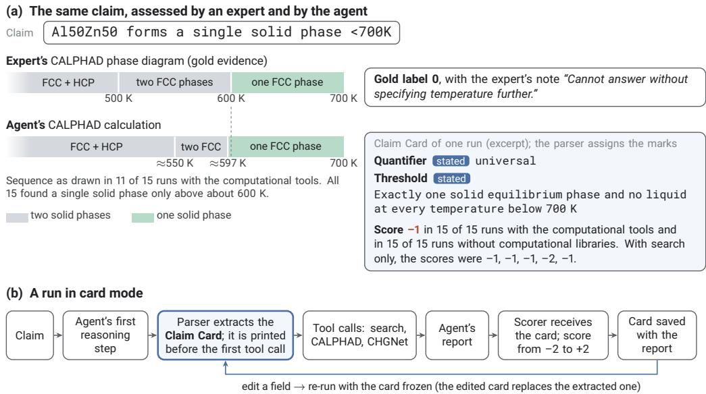
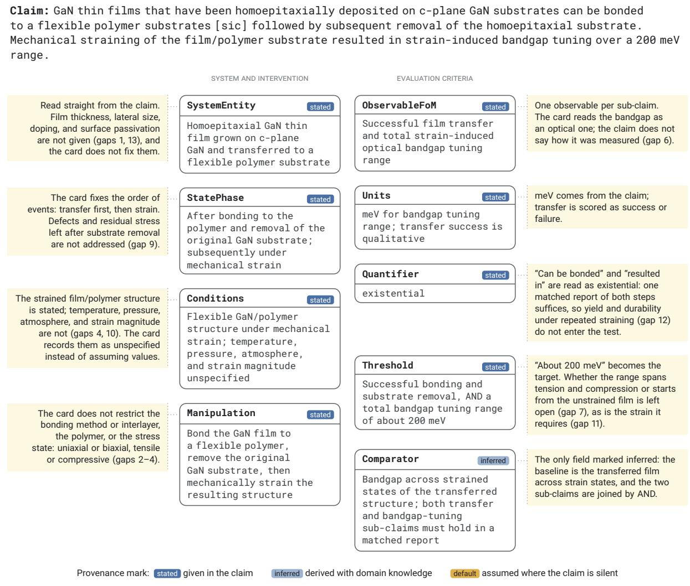
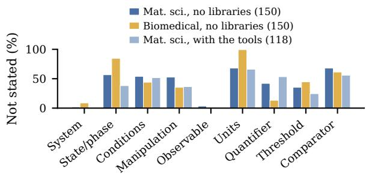
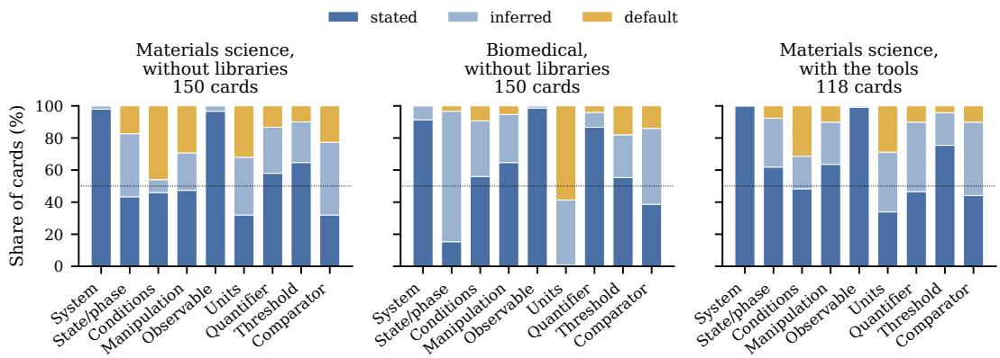
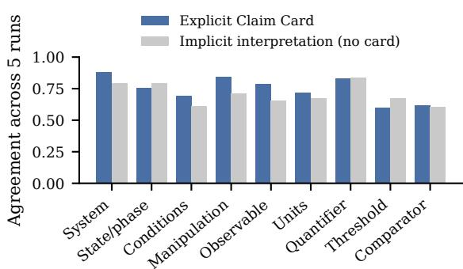
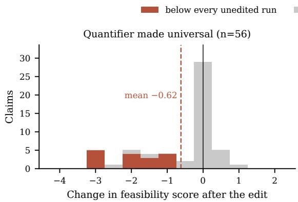
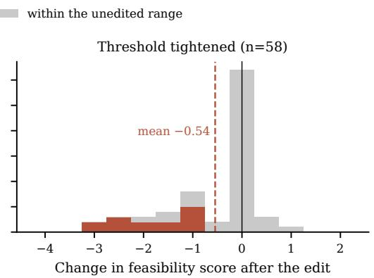
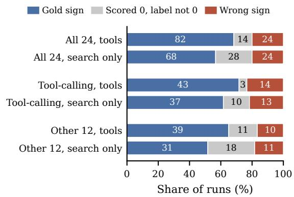

# Same Claim, Different Interpretations: How LLM Agents Resolve Ambiguity in Scientific Claims

Delip Rao\* Ahmed Muharram Chris Callison-Burch

University of Pennsylvania

delip@upenn.edu, muharram@seas.upenn.edu, ccb@upenn.edu

## Abstract

Co-scientists and agentic scientific claim verifiers are increasingly used to assess claims across the sciences. Natural-language scientific claims, written for human experts, are often underspecified and so admit several defensi ble interpretations. Such verifiers usually pick one, often tacitly, and benchmarks score their verdicts (feasible, cannot determine, or infea sible) against expert labels without recording the expert’s interpretation or the verifier’s in a comparable form. This leads to disagree ments with expert labels that cannot be traced to the evidence or the interpretation, and to com pute spent on unchecked interpretations. We introduce Claim Cards to make such interpreta tions explicit in the reasoning itself. A Claim Card records a verifier’s interpretation as nine fields before evidence gathering, each marked stated, inferred, or default. To test whether an agent’s interpretation can change its verdict, we ran a GPT-5.4 agent five times on each of 60 expert-labeled materials-science and biomedi cal claims with a card, without one, and with one card frozen across runs (900 runs). Over 40% of card fields were not marked stated, and a card added about a tenth to a run’s GPT-5.4 tokens and time without measurably changing agreement with expert labels. The agent’s own interpretations varied between runs, although within a claim this variation did not measurably track the verdict. A deliberate change to one field of the frozen card, however, making the quantifier universal or the threshold for support stricter, changed the verdict on about a third of the claims, against about one in seven ex pected by chance $( p < 0 . 0 0 1$ for each edit). On 24 materials-science claims run with computational tools, the stricter threshold also changed what the agent asked those tools to compute. We therefore argue that verdicts should be re ported with their interpretations and that bench marks could publish the interpretation behind each label.

## 1 Introduction

Does the alloy in the following claim form a single solid phase at some temperature below 700 K, or at every temperature below it?

SFBench, materials science Al50Zn50 forms a single solid phase <700K

The expert who labeled the claim computed the Al–Zn phase diagram. It shows two solid phases up to about 600 K and a single one above, and the expert gave the label 0, “cannot determine,” with the note “Cannot answer without specifying temperature further.” The large language model (LLM) agent we study chose an interpretation instead. Each time it was asked to write down its interpretation before gathering evidence, that interpretation required a single solid phase at every temperature below 700 K. When it could run the same kind of calculation, all 15 of its runs found a single solid phase only above about 600 K, as the expert’s diagram does, and each scored the claim −1 (Figure 1a). In 20 runs without computational libraries or with search only, it scored the claim −1 or −2.

A claim like this is underspecified. It omits a detail needed to assess it, here the temperature range over which a single phase must hold, so several interpretations remain defensible. Ambiguity, as we use the term, is the open choice among them. Underspecification is a property of the claim, and the ambiguity is a choice left to whoever assesses it.<sup>1</sup> Even a claim that looks complete can leave such details open, and Appendix A.1 lists thirteen in one materials-science claim.

We study ambiguity in claim feasibility assessment. In this task, as posed by SFBench (Costello et al., 2026), a system judges how likely a scientific claim is to be feasible, on a scale from −2 (infeasible) to +2 (feasible), and we read the middle label, 0, as “cannot determine.” We also use biomedical claims from SciFact (Wadden et al., 2020), whose support and contradict labels we map to the ends of the feasibility scale. Its claims, which experts rewrote from citation sentences in biomedical papers, can be far less specific than the opening claim. A verifier testing “Autophagy declines in aged organisms” must decide whether the claim covers every aged organism or the typical one, which assay measures autophagy and in what units, and how large a decline counts as support. An automated verifier answers these questions by choosing a probable interpretation, whose defaults stay implicit in its reasoning and may differ on the next run.

  
Figure 1: (a) The opening claim, assessed by its labeling expert and by the agent, whose cards required a single solid phase at every temperature below 700 K. The expert’s boundaries are rounded (Appendix F.1). In this card, from a run with the computational tools, the parser marked the quantifier and threshold stated, though the expert judged the temperature range unspecified. (b) A run in card mode and a re-run with an edited, frozen card.

Feasibility benchmarks score a verdict against one gold label, and neither the expert’s interpretation nor the system’s is recorded in a form that can be compared field by field. When a verdict disagrees with the label, the benchmark cannot show whether the system and the expert weighed the evidence differently or interpreted the claim differently. On the opening claim, the agent’s calculations agreed with the expert’s diagram whenever it could run them, but its verdict still disagreed with the label, which the expert based on the unstated temperature range. An agent that assesses benchmark claims in a batch has no one to ask about a gap, so it proceeds on assumptions it may never state, and its reasoning trace need not show which of them drove the answer. A system that later uses the verdict, for validation or hypothesis generation, inherits an interpretation that was never written down, and so does the person who reads it. Where a claim calls for calculations that take minutes each, the interpretation can also affect which calculations are run, before anyone has checked it.

We introduce the Claim Card. A Claim Card is a structured interpretation of a claim, recorded before any evidence is gathered. Its nine fields range from the system the claim is about to the quantifier and the threshold that determines whether the claim is supported, and each value is marked as stated in the claim, inferred, or assumed by default (Section 2). A second model extracts the card from the agent’s first reasoning step, and the card is printed before the agent’s first tool call runs. The agent’s user can therefore see the interpretation it stated, with the fields the second model filled in, and a user who disputes a field can edit it and re-run the agent with the edited card frozen. Like a preregistration, a card states an interpretation before the evidence is in, although models write it, not a person.

A natural question to ask is what Claim Cards provide for the overhead they add. We study Claim Cards in the context of ClaimSpy, an agent that assesses claims under domain-specific verification guidelines. It uses a search agent and a coding agent as tools and outputs a feasibility score. Using a sample of 30 materials-science claims from SFBench and 30 biomedical claims from SciFact, we tested ClaimSpy under three conditions: (1) with a Claim Card, (2) without a card, i.e., the agent is not asked to write one, and (3) with one card frozen across runs. Each claim was run five times in each condition, for 900 runs. On materialsscience claims the agent can call two computational tools, CALPHAD for phase equilibria and CHGNet for energies and forces. The 60 claims were run without computational libraries, which these tools need, so on those claims the agent relied on search. We repeated the three conditions with the computational tools on 24 materials-science claims, six of them among the 60, and also ran their frozen cards with search only. Each edited card is a copy of a frozen card with the quantifier set to universal or with a stricter threshold for support. Edited cards were run once on the 60 claims and, on the 24, once with the computational tools and once with search only. We ask five questions: (1) How much of a claim’s interpretation is left unstated, and in which fields? (2) How does the agent resolve the ambiguity, and does it resolve it the same way in every run? (3) Can a different interpretation change the verdict? (4) Does a card match its claim at little cost, and does recording the interpretation change accuracy or stability? (5) How does a card affect the agent’s use of the computational tools?

Claims leave much of their interpretation unstated. On the 60 claims, with GPT-5.4 as the backbone, more than 40% of card fields were not marked as stated in the claim, and the gaps fell in fields such as the units, the comparator and the threshold rather than in the entity the claim is about (Section 4.1). With or without a card, the agent’s first reasoning step seldom called any value an assumption or a default, and its interpretation of a claim varied from run to run, although within a claim this variation did not measurably track the verdict (Section 4.2). When we edited one field of a frozen card, however, the verdict could change. Without computational libraries, the edited run’s verdict took a different sign from the claim’s usual one on 19 of 56 claims with a universal quantifier and on 19 of 58 with a stricter threshold, nearly always a lower one. Both counts are more than twice those expected had the edits no effect (p < 0.001 for each), and most of the changed verdicts no longer agreed with the expert’s label. With the computational tools, both edits lowered the feasibility score by about half a point, and the edited value reached what the agent itself wrote, not only the scoring step (Section 4.3).<sup>2</sup> A judge model checking one card per claim flagged no field as unsupported by or contradicting the claim on 50 of the 60 cards, and in the runs without computational libraries a card added about a tenth to a run’s tokens and time. Runs with and without a card did not differ measurably in accuracy, stability or, with the computational tools, how often the agent calculated (Sections 4.4–4.6). Both the verdict and, on claims that need calculations, what the agent calculates can depend on the interpretation it works from, and we argue that a verdict should be reported together with that interpretation.

## 2 Interpretations and Claim Cards

## 2.1 The Fields of an Interpretation

What must an automated system decide before it can assess a claim? An interpretation of a claim is the set of values adopted for nine fields, whether the claim states them or not. They are the details that ClaimSpy’s verification guideline asks the agent to record before it uses any tool (Appendix M), and each is a dimension along which two defensible interpretations of the same claim can differ. Table 1 defines them in three groups. The system specification defines the object of study and its baseline before any intervention, the intervention is the independent variable, and the evaluation criteria define the dependent variable and what counts as support.

The quantifier records whether the claim is existential (“can”), typical (“generally”) or universal (“always”), and it sets the guideline’s stopping rule. One condition-matched instance that clears the threshold suffices for an existential claim, whereas one condition-matched counterexample is decisive negative evidence against a typical or universal one (Appendix A).

A Claim Card gives a value for each field, and a tenth field, Provenance, marks each value stated (given in the claim), inferred (following from the text with domain knowledge) or default (assumed where the text is silent). In Table 1, the units are a default because a five-word claim names no assay, and the manipulation is inferred because “aged” implies aging as the treatment. Whether the opening claim requires a single solid phase at every temperature below 700 K or only at some temperature is a choice of Quantifier and Threshold. Because every claim is described by the same fields, we can count which of them a claim leaves unstated (Section 4.1), compare the interpretations of different runs field by field (Section 4.2), and change one field while holding the others constant (Section 4.3).

## 2.2 How a Card Is Produced and Used

The agent writes its interpretation as free text in its first reasoning step, a short paragraph (median about 90 words) that names the system and the evidence the agent will seek. The guideline tells it to “prefer the weakest faithful interpretation of a claim” where the claim leaves a gap. A second model, the parser (GPT-6 Sol), converts that step into a card conforming to a JSON schema (Appendix A.4). We separate writing the interpretation from structuring it so that every decision the agent states is made by the model that has the guideline and the full problem context. The parser sees only the first reasoning step, not the claim. It fills fields the step leaves implicit and assigns every provenance mark, so the marks are the parser’s judgment (Appendix A.3).

In card mode, ClaimSpy extracts the card as soon as the agent has written its first reasoning step, before the tool call that the step selects is executed, prints it, and saves it with the report when the run ends (Figure 1b). The agent gathers evidence under its own written interpretation and is not shown the parsed card. The scorer, which assigns the feasibility score, receives the claim, the parsed card, the agent’s reasoning and its final answer, and scores the claim as interpreted. In frozen mode, which we used for the frozen and edited cards of Section 3, ClaimSpy instead injects a stored card into the agent’s prompt, with an instruction to use it exactly as given and not to change the claim’s interpretation, quantifier, threshold or defaults, and passes the same card to the scorer. A user who disputes a field could re-run the agent in this mode with an edited card.

## 3 Experimental Setup

System: ClaimSpy is a ReAct agent (Yao et al., 2023) for claim feasibility assessment. The claim’s domain selects its tools, a verification guideline and a scoring rubric. Under the guideline, the agent first tries to falsify the claim and then looks for one condition-matched measurement, with stopping rules set by the quantifier. Its tools are a search agent (Claude Sonnet 4.6 with web search) and a coding agent (Claude Sonnet 5.5). GPT-5.4 with high reasoning effort is the LLM backbone of the agent, the scorer and the report step.<sup>4</sup> Appendix B describes the tool-use policies and the other components.

Tool settings: On materials-science claims, the agent reaches the coding agent only through two computational tools, which compute phase equilibria with pycalphad (Otis and Liu, 2017) and the COST 507 database (Ansara et al., 1998) (CAL-PHAD), or energies and forces with the machinelearned interatomic potential CHGNet (Deng et al., 2023). We ran 60 claims without computational libraries, so the agent relied mainly on search.<sup>5</sup> A set of 24 materials-science claims was run with the computational tools, and their frozen and edited cards also with search only, the two tools removed. The two sets share six claims but differ in tool setting, in the source of the frozen card and in when they were run, so we compare conditions within each set and draw no inference from one to the other.

Claims: The 60 claims run without computational libraries are 30 materials-science claims from SFBench (Costello et al., 2026), each with a five-point label and an expert’s rationale, and 30 biomedical claims from the SciFact development set, labeled SUPPORT or CONTRADICT, which we compare with a run’s score by sign. Each half is stratified by label (Appendix C).<sup>6</sup> The 24 claims run with the computational tools were chosen at random, before any run, from the 37 SFBench claims tagged for computational tools. Their gold labels lean positive (Section 7).

Conditions and edits: On the 60 claims without computational libraries and on the 24 with the computational tools, we ran each claim five times in each of three conditions. In card runs, the agent records its interpretation and the parsed card goes to the scorer. In no-card runs, the guideline loses its subsections on the card, verb mapping, defaults and comparators but keeps its plausibility checks and quantifier-based stopping rules, so the agent must still decide how broad the claim is but is not asked to record it, and no step sees a card. In frozen runs, all five runs receive the same stored card, so that any variation that remains can be attributed to later steps. For the 60 claims it is the card of the claim’s first card run, and for the 24 the card of a separate preliminary card run. Two further conditions edit one field of the frozen card to make the claim harder to satisfy, so that the score should not rise if the agent follows the card. The quantifier edit sets the quantifier to universal (56 of the 60 claims and 20 of the 24; the other four frozen cards in each set were already universal). The threshold edit (58 and 24 claims) replaces the threshold with a stricter criterion, which Claude Opus 5.5 wrote under an instruction to keep it plausible to a domain expert. We did not check that each edited value is a defensible interpretation of its claim. Some threshold edits also demand a kind of evidence, such as replication (Appendix E). Each edited card was run once, and those of the 24 claims once in each setting. An edit’s shift is the edited run’s score minus the mean of the five frozen runs with the unedited card in the same setting, whose lowest and highest scores bound the unedited range. The 60 claims received 900 repeated and 114 edited-card runs and the 24 claims 480 and 88, for 1,582 GPT-5.4 runs on 78 claims, not counting a 20-claim pilot (Table 3 in Appendix B).

<table><tr><td>Field</td><td>What it records</td><td>Value on this card</td><td>Prov.</td></tr><tr><td colspan="4">System specification</td></tr><tr><td>SystemEntity</td><td>The object of study</td><td>Organisms undergoing aging</td><td>stated</td></tr><tr><td>StatePhase</td><td>Its phase or state before any intervention The conditions in which the claim is</td><td>Aged versus young/adult</td><td>stated</td></tr><tr><td>Conditions</td><td>purported to hold</td><td>Matched measurement conditions; taxa and tissues must be identified when evaluating generality</td><td>stated</td></tr><tr><td>Intervention Manipulation</td><td>How the system is modified, processed, or</td><td>Aging; no experimental intervention specified</td><td>inferred</td></tr><tr><td></td><td>intervened upon</td><td></td><td></td></tr><tr><td>Evaluation criteria</td><td>ObservableFoM The observable or figure of merit</td><td>Autophagy activity or flux</td><td>stated</td></tr><tr><td>Units</td><td>The units in which the observable is</td><td>Assay-dependent; no units specified</td><td>default</td></tr><tr><td>Quantifier</td><td>measured Existential, typical or universal</td><td>typical</td><td>stated</td></tr><tr><td>Threshold</td><td>The rule that turns a verb like “enhances”</td><td>A documented age-associated reduction in</td><td>stated</td></tr><tr><td>Comparator</td><td>into a testable criterion The baseline for the observable, and the</td><td>autophagy activity or flux under matched conditions Aged organisms versus young/adult controls; single stated claim</td><td></td></tr></table>

Table 1: The nine fields of an interpretation, and the Claim Card that ClaimSpy produced for “Autophagy declines in aged organisms” in the first card run, with the provenance mark of each value. It was also the claim’s frozen card.

A search outage made searches fail in 17 frozen and 10 edited-card runs without computational libraries, and we report the affected results with and without them. Frozen runs were made at a different time from card and no-card runs, so we treat comparisons of frozen runs with either as descriptive (Section 7).

Measures and statistics: In a field audit, a judge model (Gemini 3.1 Pro) labeled each field of the first-run card of each of the 60 claims against the claim as faithful, a reasonable default, unsupported or contradicting. Consistency is the share of a claim’s run pairs whose values of a field express the same interpretation, as grouped by a second judge (Claude Opus 5.5), averaged over the nine fields. For no-card runs, the parser recovered an implicit interpretation from each run’s first reasoning step and final report. Both judges come from model families other than the backbone’s (Zheng et al., 2023). We call a run’s feasibility score its verdict. Sign accuracy is the share of runs whose score has the sign of the gold label, with 0 counted as a sign of its own. A run abstains when it scores 0, and run-to-run variance is the standard deviation of a claim’s five scores. Every interval is a 95% percentile interval from a bootstrap over claims with 10,000 resamples, paired by claim, and where an interval includes zero we say that the conditions did not differ measurably.<sup>7</sup> Intervals are given in the tables and in footnotes.

## 4 Results

## 4.1 Claims Leave Much of Their Interpretation Unstated

Using the provenance marks, we counted how much of each card the claim itself supplies. In the 300 cards from card runs on the 60 claims (five runs each), 42% of field values were not marked stated in materials-science cards and 44% in biomedical cards (Figure 3 in Appendix D).<sup>8</sup> Materials-science cards almost always marked the system (98%) and the observable (97%) as stated. The gaps fell instead in fields that can determine whether the claim is feasible, even though experts wrote these claims. Units were not marked stated in 68% of materialsscience cards and 99% of biomedical cards, the comparator in 68% and 61%, and the threshold in 35% and 45%. Cards for the 24 claims run with the computational tools left the same kinds of field open, and 36% of their values were not marked stated (Appendix D).

## 4.2 Interpretations Vary Between Runs, Most in the Threshold, Comparator and Conditions

Does the agent fill these gaps the same way in every run, and does it say which values it assumed? In nocard runs, nearly every first reasoning step named the entity the claim is about and the evidence the agent would seek, but in both conditions few first steps used the words “default” or “assume” (Appendix D.1). On the 50 of the 60 claims judged in both conditions, consistency was 74% for a claim’s five explicit cards and 70% for the interpretations recovered from no-card runs, and the two did not differ measurably.<sup>9</sup> The runs with a card agreed least on the threshold (60%), comparator (62%) and conditions (69%), against 88% for the system and 83% for the quantifier (Figure 5 in Appendix D.1), and these are fields that the parser may fill in when the first reasoning step leaves them implicit (Section 7). The quantifier was unanimous across the five cards for 34 of 51 claims (Fleiss’ κ 0.70), but all nine fields were judged to express the same interpretation for only 2 of 51 claims, and for 1 of 22 with the computational tools. Over five runs, nearly every claim thus received more than one interpretation in at least one field. Without computational libraries, runs of a claim whose cards agreed on the threshold had the same sign about as often as runs whose cards differed (31 claims),<sup>10</sup> and the same held for the quantifier (Appendix D.1).

<table><tr><td>Edit</td><td>increase</td><td>Did not Below / above</td></tr><tr><td>Without computational libraries (60 claims) Quantifier 56 -0.62 [−0.91, -0.35] Threshold 58 -0.54 [−0.79, −0.32]</td><td>47 50</td><td>16/0 14/1</td></tr><tr><td>With the computational tools (24 claims) Quantifier 20 -0.55 [−1.04, −0.10] Threshold 24 -0.48 [−0.80, −0.20]</td><td>16 23</td><td>4/1</td></tr><tr><td></td><td></td><td>2/0</td></tr><tr><td>Search only (24 claims)</td><td></td><td></td></tr><tr><td>Quantifier 20 -0.48 [−0.80, −0.20]</td><td>19</td><td>4/0</td></tr><tr><td></td><td></td><td></td></tr><tr><td>Threshold 24 -0.14[−0.43, +0.13]</td><td>18</td><td>3/2</td></tr></table>

Table 2: Score shifts after one card field is edited to make the claim harder to satisfy (Section 3), with bootstrap intervals. The last two columns count claims whose edited score did not exceed the unedited mean and claims whose edited score fell below every unedited run or rose above the unedited range. The two identical shifts on the 24 claims are separate estimates.

## 4.3 Changing the Interpretation Can Change the Verdict

To test whether a different interpretation can change the verdict, we ran the agent once with each edited card, in which one field of the frozen card was changed to make the claim harder to satisfy (Section 3). On the 60 claims, both edits lowered the score on average, as a stricter interpretation implies (Table 2). The quantifier edit changed the score by −0.62 points over 56 claims, and the threshold edit by −0.54 over 58. The edited score fell below every unedited run of its claim for 16 of 56 claims under the quantifier edit (3.7 expected had the edit no effect) and 14 of 58 under the threshold edit (3.5 expected), and its sign differed from the most common unedited sign for 19 claims under each edit (7.5 and 8.3 expected; Appendix E).<sup>11</sup> For the autophagy claim of Table 1, all five unedited runs scored +2, the correct verdict.

With the quantifier set to universal, the score was −1, and the agent’s own answer said “likely false as stated (−1), because the universal quantifier is contradicted.”

With the computational tools, both edits also lowered the score (Table 2).<sup>12</sup> With search only, the quantifier edit lowered the score, but the threshold edit’s interval includes zero.

On materials-science claims, a stricter threshold often left the agent without evidence that met it, and the edited run abstained (Appendix E.1).<sup>13</sup>

The scorer receives the card, so a lower score could come from the scorer alone. The edited value, however, also reached what the agent itself wrote. In 89 of the 114 edited runs on the 60 claims, the agent’s own answer stated a score, and, descriptively, shifts computed from those stated scores alone were −0.67 and −0.48, with intervals that exclude zero (Appendix E). With the computational tools, the edited threshold appeared in the questions the agent sent to the tools or the search agent in 22 of 24 edited runs and in none of 120 unedited runs (Appendix E.2).

The edits thus show that an interpretation given to the agent reaches its verdict, through what the agent itself writes and not only through the scorer. They do not show which interpretation of a claim is right, and because every edit made the claim harder to satisfy, they cannot separate the edited value from a general caution under added constraints (Section 7).

## 4.4 How Well a Card Matches Its Claim, and What It Costs

The audit judge flagged few fields as unsupported by or contradicting the claim (3% of materialsscience fields and 4% of biomedical fields), and 25 of 30 cards in each domain had no flagged field. The provenance mark agreed with the judge’s label on 77% of materials-science fields and 59% of biomedical fields.<sup>14</sup> Recording the interpretation added about a tenth to the tokens and time of a run without computational libraries.<sup>15</sup>

## 4.5 Observations on Accuracy and Stability

A card might also be expected to make verdicts more accurate or more stable. With GPT-5.4, runs with and without a card did not differ measurably in sign accuracy or run-to-run variance in either set of claims (Table 15). On the 60 claims, sign accuracy was 0.68 with a card and 0.71 without, and on the 24, with the computational tools, 0.67 and 0.64. The interval of the difference on the 60 claims excludes a gain from the card larger than 0.01.<sup>16</sup> Descriptively, frozen runs on the 60 claims were not measurably more stable than card runs.<sup>17</sup> Where the agent’s own answer stated a score, in 478 of the 900 repeated runs on the 60 claims, the scorer repeated it in 472, so in those runs little of the variation arose in the scorer. We think most of it arises in which evidence a run finds and in how the agent weighs that evidence. Most abstaining materialsscience runs, for example, had at least one search that came back empty, against about a third of those that decided the claim (Appendix H.1). With the computational tools, even runs that obtained the same calculation did not always reach the same verdict (Appendix F).

## 4.6 Effect of Claim Cards on Tool Use

With the computational tools, card runs on the 24 claims called CALPHAD or CHGNet in 64 of 120 runs and no-card runs in 72, and per claim the two conditions did not differ measurably (Table 17). A card in the agent’s prompt, as in frozen and edited runs, changed what it asked the tools instead. On each of the three claims whose edited threshold named a composition range, the edited run calculated over that range, and the frozen card’s wording also reached the calculation questions (Appendix J).

## 5 Related Work

Claim verification and feasibility: Feasibility assessment is related to evidence-based claim verification, as in FEVER (Thorne et al., 2018) and SciFact (Wadden et al., 2020). Closest to our task is Matter-of-Fact (Jansen et al., 2025), which labels 8.4k materials-science claims as feasible or infeasible. Its labels are binary, so none can record that a claim is too underspecified to judge, as the expert’s 0 on our opening claim does. Its baselines also output a binary label, and every comparison in this study is between conditions of one agent. We therefore use SFBench, whose labels come with an expert’s rationale, and do not compare with those baselines. Claim decomposition into literal and implied subquestions (Chen et al., 2022) and programguided verification (Pan et al., 2023) also make a claim’s parts explicit before checking it, but neither records the value adopted for each open detail or its source.

Ambiguity and underspecification: Language models often interpret underspecified or ambiguous sentences poorly (Wildenburg et al., 2024; Liu et al., 2023a), and benchmarks such as AmbigQA (Min et al., 2020) test whether models recover interpretations that annotators listed in advance. No dataset we know of lists the interpretations of a scientific claim. AmbiFC (Glockner et al., 2024), the closest work on ambiguous claims, traces annotators’ disagreement about veracity partly to underspecification and models it as a label distribution, with no interpretation to compare with a card’s. Dis2Dis (Staliunait¯ e and Vlachos˙ , 2025) rewrites an ambiguous claim once the evidence is in hand, whereas a card is extracted before any evidence is gathered. For these reasons we compare with neither.

Agents and visible interpretations: Agents given underspecified tasks usually proceed on unstated assumptions instead of asking (Vijayvargiya et al., 2026; Wang et al., 2025). Methods that decide when a model should ask a clarifying question (Zhang and Choi, 2025) need someone to answer during the run, which batch assessment of benchmark claims does not have. Interfaces that show a model’s interpretation of a request and let users edit it have helped users steer systems in user studies (Tian et al., 2023; Kazemitabaar et al., 2024). Our edits are an intervention test in the spirit of Lanham et al. (2023). Appendix K discusses further work.

## 6 Conclusion

We studied how an LLM agent resolves the ambiguity of underspecified scientific claims and introduced Claim Cards to record the interpretation it adopts at the start of each run. A feasibility verdict is a verdict on one interpretation of the claim, and a system should therefore report each verdict with the interpretation behind it. What an agent calculates can also depend on the interpretation, and a card printed as the run starts lets a user see the interpretation and stop or re-run the agent before the calculations finish. The expert who labeled the Al–Zn claim that opens this paper gave it 0, “cannot determine,” because its temperature range is unstated. An agent that always adopts one interpretation will not reach such a label for the expert’s reason, even when its calculation agrees with the expert’s, so some disagreements between a system and a gold label may be disagreements about what the claim means. A benchmark that published the interpretation behind each label would let a system be scored on the claim the expert assessed.

Without computational libraries, runs whose cards recorded different interpretations of a claim did not measurably differ more in their verdicts, and runs given the same frozen card varied about as much as card runs, although a reduction of up to about half is not ruled out. With the computational tools, runs whose card recorded a stricter quantifier scored lower on average, while other comparisons in those runs pointed the other way. The edits give controlled evidence that a different interpretation can change the verdict. We think much of the runto-run variation arises later, in which evidence a run finds and how it weighs it, so more stable verdicts will probably need changes there. Some of what decided the verdicts is not yet on the card, such as a run’s own rule that one counterexample makes the claim negative or the tolerances under which the coding agent judges a calculation, and fields for both are worth testing (Appendix L). Our first test, however, would be whether domain experts find the fields marked as default useful and whether their corrections improve verdicts, on more datasets and with more than one LLM backbone.

## 7 Limitations

Sample size: Our two sets of claims are small, 60 claims and 24, six of them in both. Every claim has an expert label and was run five times in each condition, so most comparisons set a claim against itself, but each edited card was run once per setting. Our main result rests on the edits on the 60 claims, whose score shifts and changes of sign both have p < 0.001 (Appendix E). Intervals for the other contrasts are a few tenths of a point wide on the −2 to +2 scale for the 60 claims and wider for the 24, wide enough to miss small effects (Card et al., 2020). We did not adjust them for multiple comparisons and report those contrasts as exploratory. Several of the 24 claims concern the same chemical system. With groups of such claims as the unit, nine intervals included, reached or excluded zero just as they did over single claims (Appendix B.6). Because the two sets differ in both their claims and their setting, we compare them only descriptively.

Backbone, guidelines and data: We used one LLM backbone, GPT-5.4 at high reasoning effort. In a 20-claim pilot with two other backbones and one run per claim, the backbones differed more from one another than card runs did from no-card runs (Appendix I), so other agents may resolve the same claims differently. How the agent resolves ambiguity probably also depends on its guideline, which tells it to prefer the weakest faithful interpretation. We refined the materials-science guidelines on claims from earlier SFBench releases, which may include some of the evaluated claims or claims like them, so the materials-science results are indomain in a way the biomedical results are not. SciFact’s claims and labels have been public since 2020 and may be in GPT-5.4’s training data. Its labels refer to the abstracts cited with each claim, whereas the agent searched the open web. The claims themselves are factual assertions, while ClaimSpy and its guidelines were built for feasibility assessment, and we score them by sign only.

Edits: Every edit made the claim harder to satisfy. Edits that loosen a field, such as universal to existential, or reword it without changing its meaning would separate the edited value from a general caution under added constraints, since changes to a prompt’s format alone can change a model’s answers (Sclar et al., 2024). By keyword rules that one coder applied, 30 of the 58 threshold edits on the 60 claims and 16 of the 24 on the 24 claims also add a standard of evidence, such as independent replication. On the 60 claims, the threshold shift did not rest on those edits (Appendix E). Setting an existential quantifier to universal, as in 30 of the 56 quantifier edits, may impose an interpretation that the claim’s wording does not support. The agent was told to use the frozen card exactly as given, and language models tend to match their answers to views that a user states (Sharma et al., 2024), so the edits measure the effect of an interpretation given to the agent, which may differ from that of an interpretation the agent adopts on its own.

Card construction: The parser writes each card from the agent’s first reasoning step, without the claim, and fills fields that the step leaves implicit. A card therefore mixes what the agent decided with what the parser filled in, and a value can be marked stated because the agent’s step states it, whether or not the claim does. The audit judge, which saw the claim and checked one card for each of the 60 claims, flagged 3% of materials-science fields and 4% of biomedical fields as unsupported by or contradicting it (Section 4.4), but the audit could not show which values came from the agent. The fields that the first step can leave implicit, such as the threshold, comparator and conditions, are also those on which cards agreed least (Section 4.2), and part of their run-to-run variation may come from the parser, since what it fills in depends on the wording of each run’s first step.

Judges and coding: The field audit and the consistency groupings come from judge models, and agreement between LLM judges and people varies widely by task (Bavaresco et al., 2025). Beyond the cases traced in Section 4.4, their labels were not checked systematically by a person, and the audit judge saw each card’s provenance marks, which may have anchored its labels. The consistency analysis covers 51 of the 60 claims and 22 of the 24 (Appendix D.1). Other analyses, among them the reasons for abstention and the comparison of the agent’s calculations with the experts’, rest on codes that one coder assigned.

Tool settings: The libraries that the computational tools need were not installed for the runs on the 60 claims, so materials-science runs relied mainly on search, and their accuracy and abstention reflect that setting (Section 3). Biomedical runs could call a general coding agent for any check, which may account for part of the gap in abstention between the domains (Appendix H.1). The results with the tools mostly describe CALPHAD use, which made up 56 of the tool calls in card runs on the 24 claims, against 10 for CHGNet.

The 24 claims and their gold labels: Although these claims were drawn at random from the 37 claims tagged for computational tools, their labels lean positive. Of their 24 labels, 14 are positive, and 8 of the 12 tagged claims labeled −2 are not among them, an imbalance that a random draw would rarely produce (Appendix B.6). Accuracy on these claims should be judged against the 0.58 that always predicting a positive score would reach, whereas paired contrasts compare each claim with itself and are affected only if conditions act differently on claims with different labels. The CAL-PHAD claims were distributed with the COST 507 database file that the agent also used, so an agent’s CALPHAD calculation and the expert’s probably share a database, and their agreement is not independent evidence that either is right. The expert’s code or explanation has documented problems on 8 of the 24 claims, such as Mg and Zn fractions swapped relative to the claim, and on two claims, one of them among the eight, the expert computed a proxy for the claimed quantity (Appendix L). We therefore treat accuracies on these claims as descriptive, and Appendix F.1 repeats the accuracy contrasts without these nine claims.

Run timing: The frozen and edited-card runs on the 60 claims were made together, hours after most card and no-card runs, and a search outage made searches fail in 17 frozen and 10 edited-card runs. On the 24 claims, the frozen cards came from a separate preliminary run, the frozen runs and their quantifier edits were made a day before the other runs, and some card and no-card runs that called a tool used a thermodynamic database other than COST 507 (Appendix B.2). Comparisons of frozen runs with card or no-card runs span these differences, and we report them descriptively. The edit shifts on the 60 claims compare runs made together, and they barely changed without the runs hit by the outage (Section 4.3). On the 24 claims, the threshold-edit shifts compare runs made a day apart.

Controls and users: In the no-card condition, the guideline also loses its sections on verb mapping, defaults and comparators, and the scorer and the report step receive no card, so the card and no-card comparison tests the card condition as a whole rather than recording the interpretation alone. Every edited card reached both the agent and the scorer, and Section 4.3 separates the two paths through the scores that the agent itself stated. No domain expert edited a card or re-ran the agent in this study. Whether seeing the interpretation at the start of a run helps a user catch a wrong default, or leads users to trust a verdict more than they should, is a question for a user study with an interface for the card.

## Ethics Statement

Claim Cards are meant to make an automated verdict easier to inspect and to contest. They do not make a verdict correct, and a card that reads well can still rest on a wrong default. We intend the provenance marks to direct a user’s attention to the fields marked as default. A card may also lead users to rely on a verdict more than they should, since explanations can increase reliance on a system regardless of whether it is right (Bansal et al., 2021; Si et al., 2024), although they can reduce over-reliance when they make the system’s answer cheaper to check (Vasconcelos et al., 2023). The provenance marks are themselves a second model’s judgment, not a check of the claim.

Because a frozen card reaches both the agent and the scorer, a card is also a lever on the verdict. Without computational libraries, an edit to one field lowered scores by 0.54 to 0.62 points on average (Section 4.3), so a verdict produced under an edited card should say so, and a saved card should record who changed which field. A score of 0 can reflect failed retrieval rather than an underspecified claim, and most abstaining materials-science runs had at least one empty search (Section 4.5). A report that lists failed searches and tool calls next to the score lets a reader tell the two apart. The guideline’s preference for the weakest faithful interpretation leans toward existential interpretations, which a claim satisfies more easily, and the card’s quantifier shows when a positive verdict rests on one. Verdicts on biomedical claims are not assessments of medical evidence, and SciFact’s labels refer to the abstracts cited with each claim.

The SciFact claims, from its authors’ release, are distributed under the CC BY 4.0 license. We use the claims, labels, rationales and expert code of SFBench as distributed, and the CALPHAD claims came with the COST 507 database file. The released run records will contain text that the search agent returned from public web pages, with each page’s URL. No human subjects were involved.

## Acknowledgments

This research was developed with funding from the Defense Advanced Research Projects

Agency’s (DARPA) SciFy program (Agreement No. HR00112520300). The views expressed are those of the authors and do not reflect the official policy or position of the Department of Defense or the U.S. Government.

## References

I. Ansara, A. T. Dinsdale, and M. H. Rand, editors. 1998. COST 507: Thermochemical Database for Light Metal Alloys, Volume 2. Office for Official Publications of the European Communities, Luxembourg.

Pepa Atanasova, Jakob Grue Simonsen, Christina Lioma, and Isabelle Augenstein. 2020. Generating fact checking explanations. In Proceedings of the 58th Annual Meeting ofthe Associationfor Computational Linguistics (ACL), pages 7352–7364. Association for Computational Linguistics.

Berk Atıl, Sarp Aykent, Alexa Chittams, Lisheng Fu, Rebecca J. Passonneau, Evan Radcliffe, Guru Rajan Rajagopal, Adam Sloan, Tomasz Tudrej, Ferhan Ture, Zhe Wu, Lixinyu Xu, and Breck Baldwin. 2025. Nondeterminism of “deterministic” LLM system settings in hosted environments. In Proceedings of the 5th Workshop on Evaluation and Comparison of NLP Systems (Eval4NLP), pages 135–148. Association for Computational Linguistics.

Gagan Bansal, Tongshuang Wu, Joyce Zhou, Raymond Fok, Besmira Nushi, Ece Kamar, Marco Tulio Ribeiro, and Daniel S. Weld. 2021. Does the whole exceed its parts? The effect of AI explanations on complementary team performance. In Proceedings of the 2021 CHI Conference on Human Factors in Computing Systems (CHI), pages 1–16. ACM.

Anna Bavaresco, Raffaella Bernardi, Leonardo Bertolazzi, Desmond Elliott, Raquel Fernández, Albert Gatt, Esam Ghaleb, Mario Giulianelli, Michael Hanna, Alexander Koller, Andre Martins, Philipp Mondorf, Vera Neplenbroek, Sandro Pezzelle, Barbara Plank, David Schlangen, Alessandro Suglia, Aditya K Surikuchi, Ece Takmaz, and Alberto Testoni. 2025. LLMs instead of human judges? a large scale empirical study across 20 NLP evaluation tasks. In Proceedings ofthe 63rd Annual Meeting ofthe Associationfor Computational Linguistics (Volume 2: Short Papers), pages 238–255, Vienna, Austria. Association for Computational Linguistics.

Emily M. Bender and Batya Friedman. 2018. Data statements for natural language processing: Toward mitigating system bias and enabling better science. Transactions of the Association for Computational Linguistics, 6:587–604.

Martin Bertran, Riccardo Fogliato, and Zhiwei Steven Wu. 2026. Many AI analysts, one dataset: Navigating the agentic data science multiverse. Proceedings of the National Academy of Sciences, 123(29):e2606495123.

Daniil A. Boiko, Robert MacKnight, Ben Kline, and Gabe Gomes. 2023. Autonomous chemical research with large language models. Nature, 624(7992):570– 578.

Andres M. Bran, Sam Cox, Oliver Schilter, Carlo Baldassari, Andrew D. White, and Philippe Schwaller. 2024. Augmenting large language models with chemistry tools. Nature Machine Intelligence, 6(5):525– 535.

A. Colin Cameron, Jonah B. Gelbach, and Douglas L. Miller. 2008. Bootstrap-based improvements for inference with clustered errors. Review ofEconomics and Statistics, 90(3):414–427.

Dallas Card, Peter Henderson, Urvashi Khandelwal, Robin Jia, Kyle Mahowald, and Dan Jurafsky. 2020. With little power comes great responsibility. In Proceedings of the 2020 Conference on Empirical Methods in Natural Language Processing (EMNLP), pages 9263–9274, Online. Association for Computational Linguistics.

Jifan Chen, Aniruddh Sriram, Eunsol Choi, and Greg Durrett. 2022. Generating literal and implied subquestions to fact-check complex claims. In Proceedings of the 2022 Conference on Empirical Methods in Natural Language Processing, pages 3495–3516, Abu Dhabi, United Arab Emirates. Association for Computational Linguistics.

Yanda Chen, Joe Benton, Ansh Radhakrishnan, Jonathan Uesato, Carson Denison, John Schulman, Arushi Somani, Peter Hase, Misha Wagner, Fabien Roger, Vlad Mikulik, Samuel R. Bowman, Jan Leike, Jared Kaplan, and Ethan Perez. 2025. Reasoning models don’t always say what they think. arXiv preprint. ArXiv:2505.05410 [cs.CL].

Yuan Chiang, Elvis Hsieh, Chia-Hong Chou, and Janosh Riebesell. 2025. LLaMP: Large language model made powerful for high-fidelity materials knowledge retrieval. In Proceedings of the 2025 Conference on Empirical Methods in Natural Language Processing (EMNLP), pages 25189–25221. Association for Computational Linguistics.

Eunsol Choi, Jennimaria Palomaki, Matthew Lamm, Tom Kwiatkowski, Dipanjan Das, and Michael Collins. 2021. Decontextualization: Making sentences stand-alone. Transactions ofthe Association for Computational Linguistics, 9:447–461.

Jeremy Cole, Michael Zhang, Daniel Gillick, Julian Eisenschlos, Bhuwan Dhingra, and Jacob Eisenstein. 2023. Selectively answering ambiguous questions. In Proceedings of the 2023 Conference on Empirical Methods in Natural Language Processing (EMNLP), pages 530–543. Association for Computational Linguistics.

Cash Costello, James Mayfield, Elsbeth Turcan, Christine Piatko, Christina K. Pikas, Justin Rokisky, Sam

Scheck, Chris Ribaudo, Ritwik Bose, and Alex Memory. 2026. SFBench: The SciFy scientific feasibility benchmark. arXiv preprint. ArXiv:2606.29630 [cs.AI].

Alexander D’Amour, Katherine Heller, Dan Moldovan, Ben Adlam, Babak Alipanahi, Alex Beutel, Christina Chen, Jonathan Deaton, Jacob Eisenstein, Matthew D. Hoffman, Farhad Hormozdiari, Neil Houlsby, Shaobo Hou, Ghassen Jerfel, Alan Karthikesalingam, Mario Lucic, Yian Ma, Cory McLean, Diana Mincu, and 21 others. 2022. Underspecification presents challenges for credibility in modern machine learning. Journal ofMachine Learning Research, 23(226):1– 61.

Bowen Deng, Yunyeong Choi, Peichen Zhong, Janosh Riebesell, Shashwat Anand, Zhuohan Li, KyuJung Jun, Kristin A. Persson, and Gerbrand Ceder. 2025. Systematic softening in universal machine learning interatomic potentials. npj Computational Materials, 11(1):9.

Bowen Deng, Peichen Zhong, KyuJung Jun, Janosh Riebesell, Kevin Han, Christopher J. Bartel, and Gerbrand Ceder. 2023. CHGNet as a pretrained universal neural network potential for charge-informed atomistic modelling. Nature Machine Intelligence, 5(9):1031–1041.

K. J. Kevin Feng, Kevin Pu, Matt Latzke, Tal August, Pao Siangliulue, Jonathan Bragg, Daniel S. Weld, Amy X. Zhang, and Joseph Chee Chang. 2026. Cocoa: Co-planning and co-execution with AI agents. In Proceedings ofthe 2026 CHI Conference on Human Factors in Computing Systems (CHI), pages 1– 23. ACM.

Joseph L. Fleiss. 1971. Measuring nominal scale agreement among many raters. Psychological Bulletin, 76(5):378–382.

Timnit Gebru, Jamie Morgenstern, Briana Vecchione, Jennifer Wortman Vaughan, Hanna Wallach, Hal Daumé III, and Kate Crawford. 2021. Datasheets for datasets. Communications of the ACM, 64(12):86– 92.

Max Glockner, Ieva Staliunait¯ e, James Thorne, Gisela˙ Vallejo, Andreas Vlachos, and Iryna Gurevych. 2024. AmbiFC: Fact-checking ambiguous claims with evidence. Transactions of the Association for Computational Linguistics, 12:1–18.

Ken Gu, Ruoxi Shang, Ruien Jiang, Keying Kuang, Richard-John Lin, Donghe Lyu, Yue Mao, Youran Pan, Teng Wu, Jiaqian Yu, Yikun Zhang, Tianmai M. Zhang, Lanyi Zhu, Mike A. Merrill, Jeffrey Heer, and Tim Althoff. 2024. BLADE: Benchmarking language model agents for data-driven science. In Findings ofthe Associationfor Computational Linguistics: EMNLP 2024, pages 13936–13971. Association for Computational Linguistics.

Bairu Hou, Yujian Liu, Kaizhi Qian, Jacob Andreas, Shiyu Chang, and Yang Zhang. 2024. Decomposing uncertainty for large language models through input clarification ensembling. In Proceedings of the 41st International Conference on Machine Learning (ICML), volume 235 of Proceedings of Machine Learning Research, pages 19023–19042. PMLR.

Kexin Huang, Ying Jin, Ryan Li, Michael Y. Li, Emmanuel Candes, and Jure Leskovec. 2025. Automated hypothesis validation with agentic sequential falsifications. In Proceedings of the 42nd International Conference on Machine Learning (ICML), volume 267 of Proceedings of Machine Learning Research, pages 25372–25437. PMLR.

Alon Jacovi and Yoav Goldberg. 2020. Towards faithfully interpretable NLP systems: How should we define and evaluate faithfulness? In Proceedings of the 58th Annual Meeting of the Association for Computational Linguistics (ACL), pages 4198–4205. Association for Computational Linguistics.

Anubhav Jain, Shyue Ping Ong, Geoffroy Hautier, Wei Chen, William Davidson Richards, Stephen Dacek, Shreyas Cholia, Dan Gunter, David Skinner, Gerbrand Ceder, and Kristin A. Persson. 2013. Commentary: The Materials Project: A materials genome approach to accelerating materials innovation. APL Materials, 1(1):011002.

Peter Jansen, Samiah Hassan, and Ruoyao Wang. 2025. Matter-of-Fact: A benchmark for verifying the feasibility of literature-supported claims in materials science. In Proceedings ofthe 2025 Conference on Empirical Methods in Natural Language Processing (EMNLP), pages 4090–4102. Association for Computational Linguistics.

Nan-Jiang Jiang and Marie-Catherine de Marneffe. 2022. Investigating reasons for disagreement in natural language inference. Transactions ofthe Associationfor Computational Linguistics, 10:1357–1374.

Sebastian Antony Joseph, Lily Chen, Barry Wei, Michael Mackert, Iain James Marshall, Paul Pu Liang, Ramez Kouzy, Byron C. Wallace, and Junyi Jessy Li. 2026. Decide less, communicate more: On the construct validity of end-to-end factchecking in medicine. In Findings of the Association for Computational Linguistics: ACL 2026, pages 10196–10221. Association for Computational Linguistics.

Sayash Kapoor, Benedikt Stroebl, Zachary S. Siegel, Nitya Nadgir, and Arvind Narayanan. 2025. AI agents that matter. Transactions on Machine Learning Research.

Majeed Kazemitabaar, Jack Williams, Ian Drosos, Tovi Grossman, Austin Z. Henley, Carina Negreanu, and Advait Sarkar. 2024. Improving steering and verification in AI-assisted data analysis with interactive task decomposition. In Proceedings ofthe 37th Annual ACM Symposium on User Interface Software and Technology (UIST), pages 1–19. ACM.

Christopher Kennedy. 2011. Ambiguity and vagueness: An overview. In Claudia Maienborn, Klaus von Heusinger, and Paul Portner, editors, Semantics: An International Handbook of Natural Language Meaning, volume 1, pages 507–535. De Gruyter Mouton, Berlin.

Pang Wei Koh, Thao Nguyen, Yew Siang Tang, Stephen Mussmann, Emma Pierson, Been Kim, and Percy Liang. 2020. Concept bottleneck models. In Proceedings of the 37th International Conference on Machine Learning, pages 5338–5348. PMLR.

Lorenz Kuhn, Yarin Gal, and Sebastian Farquhar. 2023. Semantic uncertainty: Linguistic invariances for uncertainty estimation in natural language generation. In International Conference on Learning Representations (ICLR).

Tamera Lanham, Anna Chen, Ansh Radhakrishnan, Benoit Steiner, Carson Denison, Danny Hernandez, Dustin Li, Esin Durmus, Evan Hubinger, Jackson Kernion, Kamile Lukoši˙ ut¯ e, Karina Nguyen, Newton˙ Cheng, Nicholas Joseph, Nicholas Schiefer, Oliver Rausch, Robin Larson, Sam McCandlish, Sandipan Kundu, and 11 others. 2023. Measuring faithfulness in chain-of-thought reasoning. arXiv preprint. ArXiv:2307.13702 [cs.AI].

Alisa Liu, Zhaofeng Wu, Julian Michael, Alane Suhr, Peter West, Alexander Koller, Swabha Swayamdipta, Noah A. Smith, and Yejin Choi. 2023a. We’re afraid language models aren’t modeling ambiguity. In Proceedings of the 2023 Conference on Empirical Methods in Natural Language Processing (EMNLP), pages 790–807. Association for Computational Linguistics.

Michael Xieyang Liu, Advait Sarkar, Carina Negreanu, Benjamin Zorn, Jack Williams, Neil Toronto, and Andrew D. Gordon. 2023b. “What it wants me to say”: Bridging the abstraction gap between end-user programmers and code-generating large language models. In Proceedings ofthe 2023 CHI Conference on Human Factors in Computing Systems (CHI), pages 1–31. ACM.

Muxin Liu, Delip Rao, Grace Kim, and Chris Callison-Burch. 2026. When verification fails: How compositionally infeasible claims escape rejection. In Conference on Language Modeling (COLM).

Ian Magnusson and Scott Friedman. 2021. Extracting fine-grained knowledge graphs of scientific claims: Dataset and transformer-based results. In Proceedings of the 2021 Conference on Empirical Methods in Natural Language Processing (EMNLP), pages 4651– 4658. Association for Computational Linguistics.

Bodhisattwa Prasad Majumder, Harshit Surana, Dhruv Agarwal, Bhavana Dalvi Mishra, Abhijeetsingh Meena, Aryan Prakhar, Tirth Vora, Tushar Khot, Ashish Sabharwal, and Peter Clark. 2025. DiscoveryBench: Towards data-driven discovery with large language models. In International Conference on Learning Representations (ICLR), pages 4556–4579.

Chaitanya Malaviya, Joseph Chee Chang, Dan Roth, Mohit Iyyer, Mark Yatskar, and Kyle Lo. 2025. Contextualized evaluations: Judging language model responses to underspecified queries. Transactions of the Association for Computational Linguistics, 13:878–900.

Dasha Metropolitansky and Jonathan Larson. 2025. Towards effective extraction and evaluation of factual claims. In Proceedings ofthe 63rd Annual Meeting ofthe Associationfor Computational Linguistics (Volume 1: Long Papers), pages 6996–7045. Association for Computational Linguistics.

Sewon Min, Kalpesh Krishna, Xinxi Lyu, Mike Lewis, Wen-tau Yih, Pang Wei Koh, Mohit Iyyer, Luke Zettlemoyer, and Hannaneh Hajishirzi. 2023. FActScore: Fine-grained atomic evaluation of factual precision in long form text generation. In Proceedings ofthe 2023 Conference on Empirical Methods in Natural Language Processing (EMNLP), pages 12076–12100.

Sewon Min, Julian Michael, Hannaneh Hajishirzi, and Luke Zettlemoyer. 2020. AmbigQA: Answering ambiguous open-domain questions. In Proceedings of the 2020 Conference on Empirical Methods in Natural Language Processing (EMNLP), pages 5783– 5797.

Margaret Mitchell, Simone Wu, Andrew Zaldivar, Parker Barnes, Lucy Vasserman, Ben Hutchinson, Elena Spitzer, Inioluwa Deborah Raji, and Timnit Gebru. 2019. Model cards for model reporting. In Proceedings of the Conference on Fairness, Accountability, and Transparency (FAT\*), pages 220–229.

Seyedali Mohammadi, Manas Gaur, and Francis Ferraro. 2026. Experiments or outcomes? Probing scientific feasibility in large language models. In Proceedings of the 64th Annual Meeting of the Association for Computational Linguistics (Volume 2: Short Papers), pages 605–614. Association for Computational Linguistics.

J. L. Murray. 1983. The Al–Zn (Aluminum-Zinc) system. Bulletin ofAlloy Phase Diagrams, 4(1):55–73.

Brian A. Nosek, Charles R. Ebersole, Alexander C. DeHaven, and David T. Mellor. 2018. The preregistration revolution. Proceedings of the National Academy ofSciences, 115(11):2600–2606.

Benjamin Nye, Junyi Jessy Li, Roma Patel, Yinfei Yang, Iain Marshall, Ani Nenkova, and Byron Wallace. 2018. A corpus with multi-level annotations of patients, interventions and outcomes to support language processing for medical literature. In Proceedings ofthe 56th Annual Meeting ofthe Association for Computational Linguistics (Volume 1: Long Papers), pages 197–207. Association for Computational Linguistics.

Yury Orlovskiy, Camille Thibault, Anne Imouza, Jean-François Godbout, Reihaneh Rabbany, and Kellin

Pelrine. 2024. Uncertainty resolution in misinformation detection. In Proceedings of the 1st Workshop on Uncertainty-Aware NLP (UncertaiNLP 2024), pages 93–101. Association for Computational Linguistics.

Richard Otis and Zi-Kui Liu. 2017. pycalphad: CALPHAD-based computational thermodynamics in Python. Journal of Open Research Software, 5(1):1.

Liangming Pan, Xiaobao Wu, Xinyuan Lu, Anh Tuan Luu, William Yang Wang, Min-Yen Kan, and Preslav Nakov. 2023. Fact-checking complex claims with program-guided reasoning. In Proceedings of the 61st Annual Meeting ofthe Associationfor Computational Linguistics (Volume 1: Long Papers), pages 6981–7004, Toronto, Canada. Association for Computational Linguistics.

Ellie Pavlick and Tom Kwiatkowski. 2019. Inherent disagreements in human textual inferences. Transactions ofthe Associationfor Computational Linguistics, 7:677–694.

Kellin Pelrine, Anne Imouza, Camille Thibault, Meilina Reksoprodjo, Caleb Gupta, Joel Christoph, Jean-François Godbout, and Reihaneh Rabbany. 2023. Towards reliable misinformation mitigation: Generalization, uncertainty, and GPT-4. In Proceedings of the 2023 Conference on Empirical Methods in Natural Language Processing (EMNLP), pages 6399– 6429. Association for Computational Linguistics.

Uwe Peters and Benjamin Chin-Yee. 2025. Generalization bias in large language model summarization of scientific research. Royal Society Open Science, 12(4):241776.

Sandro Pezzelle. 2023. Dealing with semantic underspecification in multimodal NLP. In Proceedings of the 61st Annual Meeting of the Association for Computational Linguistics (Volume 1: Long Papers), pages 12098–12112. Association for Computational Linguistics.

Cheng Qian, Bingxiang He, Zhong Zhuang, Jia Deng, Yujia Qin, Xin Cong, Zhong Zhang, Jie Zhou, Yankai Lin, Zhiyuan Liu, and Maosong Sun. 2024. Tell me more! Towards implicit user intention understanding of language model driven agents. In Proceedings of the 62nd Annual Meeting of the Association for Computational Linguistics (Volume 1: Long Papers), pages 1088–1113. Association for Computational Linguistics.

Sudha Rao and Hal Daumé III. 2018. Learning to ask good questions: Ranking clarification questions using neural expected value of perfect information. In Proceedings ofthe 56th Annual Meeting ofthe Associationfor Computational Linguistics (Volume 1: Long Papers), pages 2737–2746. Association for Computational Linguistics.

Martiño Ríos-García, Nawaf Alampara, Chandan Gupta, Indrajeet Mandal, Sajid Mannan, Ali Asghar Aghajani, N. M. Anoop Krishnan, and Kevin Maik Jablonka. 2026. AI scientists produce results

without reasoning scientifically. arXiv preprint. ArXiv:2604.18805 [cs.AI].

Irina Saparina and Mirella Lapata. 2026. Reasoning about intent for ambiguous requests. In Conference on Language Modeling (COLM).

Martin Schweinsberg, Michael Feldman, Nicola Staub, Olmo R. van den Akker, Robbie C. M. van Aert, Marcel A. L. M. van Assen, et al. 2021. Same data, different conclusions: Radical dispersion in empirical results when independent analysts operationalize and test the same hypothesis. Organizational Behavior and Human Decision Processes, 165:228–249.

Melanie Sclar, Yejin Choi, Yulia Tsvetkov, and Alane Suhr. 2024. Quantifying language models’ sensitivity to spurious features in prompt design or: How I learned to start worrying about prompt formatting. In International Conference on Learning Representations (ICLR).

Mrinank Sharma, Meg Tong, Tomasz Korbak, David Duvenaud, Amanda Askell, Samuel R. Bowman, Esin Durmus, Zac Hatfield-Dodds, Scott R. Johnston, Shauna M. Kravec, Timothy Maxwell, Sam Mc-Candlish, Kamal Ndousse, Oliver Rausch, Nicholas Schiefer, Da Yan, Miranda Zhang, and Ethan Perez. 2024. Towards understanding sycophancy in language models. In International Conference on Learning Representations (ICLR).

Chenglei Si, Navita Goyal, Tongshuang Wu, Chen Zhao, Shi Feng, Hal Daumé III, and Jordan Boyd-Graber. 2024. Large language models help humans verify truthfulness – except when they are convincingly wrong. In Proceedings of the 2024 Conference of the North American Chapter ofthe Associationfor Computational Linguistics: Human Language Technologies (Volume 1: Long Papers), pages 1459–1474, Mexico City, Mexico. Association for Computational Linguistics.

R. Silberzahn, E. L. Uhlmann, D. P. Martin, P. Anselmi, F. Aust, E. Awtrey, Š. Bahník, F. Bai, C. Bannard, E. Bonnier, R. Carlsson, F. Cheung, G. Christensen, R. Clay, M. A. Craig, A. Dalla Rosa, L. Dam, M. H. Evans, I. Flores Cervantes, and 46 others. 2018. Many analysts, one data set: Making transparent how variations in analytic choices affect results. Advances in Methods and Practices in Psychological Science, 1(3):337–356.

Michael D. Skarlinski, Sam Cox, Jon M. Laurent, James D. Braza, Michaela Hinks, Michael J. Hammerling, Manvitha Ponnapati, Samuel G. Rodriques, and Andrew D. White. 2024. Language agents achieve superhuman synthesis of scientific knowledge. arXiv preprint. ArXiv:2409.13740 [cs.CL].

Ieva Staliunait¯ e and Andreas Vlachos. 2025.˙ Dis2Dis: Explaining ambiguity in fact-checking. In Findings of the Association for Computational Linguistics: NAACL 2025, pages 246–267. Association for Computational Linguistics.

Sara Steegen, Francis Tuerlinckx, Andrew Gelman, and Wolf Vanpaemel. 2016. Increasing transparency through a multiverse analysis. Perspectives on Psychological Science, 11(5):702–712.

Alex Tamkin, Kunal Handa, Avash Shrestha, and Noah Goodman. 2023. Task ambiguity in humans and language models. In International Conference on Learning Representations (ICLR).

James Thorne, Andreas Vlachos, Christos Christodoulopoulos, and Arpit Mittal. 2018. FEVER: a large-scale dataset for fact extraction and VERification. In Proceedings of the 2018 Conference of the North American Chapter of the Associationfor Computational Linguistics: Human Language Technologies (NAACL-HLT), pages 809–819.

Yuan Tian, Zheng Zhang, Zheng Ning, Toby Jia-Jun Li, Jonathan K. Kummerfeld, and Tianyi Zhang. 2023. Interactive text-to-SQL generation via editable stepby-step explanations. In Proceedings of the 2023 Conference on Empirical Methods in Natural Language Processing (EMNLP), pages 16149–16166. Association for Computational Linguistics.

Miles Turpin, Julian Michael, Ethan Perez, and Samuel R. Bowman. 2023. Language models don’t always say what they think: Unfaithful explanations in chain-of-thought prompting. In Advances in Neural Information Processing Systems (NeurIPS), volume 36, pages 74952–74965.

Helena Vasconcelos, Matthew Jörke, Madeleine Grunde-McLaughlin, Tobias Gerstenberg, Michael S. Bernstein, and Ranjay Krishna. 2023. Explanations can reduce overreliance on AI systems during decisionmaking. Proceedings of the ACM on Human-Computer Interaction, 7(CSCW1):1–38.

V. Venktesh, Abhijit Anand, Avishek Anand, and Vinay Setty. 2024. QuanTemp: A real-world open-domain benchmark for fact-checking numerical claims. In Proceedings of the 47th International ACM SIGIR Conference on Research and Development in Information Retrieval (SIGIR), pages 650–660. ACM.

Sanidhya Vijayvargiya, Xuhui Zhou, Akhila Yerukola, Maarten Sap, and Graham Neubig. 2026. Ambig-SWE: Interactive agents to overcome underspecificity in software engineering. In International Conference on Learning Representations (ICLR), pages 146716– 146737.

David Wadden, Shanchuan Lin, Kyle Lo, Lucy Lu Wang, Madeleine van Zuylen, Arman Cohan, and Hannaneh Hajishirzi. 2020. Fact or fiction: Verifying scientific claims. In Proceedings of the 2020 Conference on Empirical Methods in Natural Language Processing (EMNLP), pages 7534–7550. Association for Computational Linguistics.

David Wadden, Kyle Lo, Bailey Kuehl, Arman Cohan, Iz Beltagy, Lucy Lu Wang, and Hannaneh Hajishirzi.

2022. SciFact-Open: Towards open-domain scientific claim verification. In Findings of the Association for Computational Linguistics: EMNLP 2022, pages 4719–4734. Association for Computational Linguistics.

Wenxuan Wang, Juluan Shi, Zixuan Ling, Yuk-Kit Chan, Chaozheng Wang, Cheryl Lee, Youliang Yuan, Jentse Huang, Wenxiang Jiao, and Michael R. Lyu. 2025. Learning to ask: When LLM agents meet unclear instruction. In Proceedings of the 2025 Conference on Empirical Methods in Natural Language Processing (EMNLP), pages 21773–21784. Association for Computational Linguistics.

Xuezhi Wang, Jason Wei, Dale Schuurmans, Quoc V. Le, Ed H. Chi, Sharan Narang, Aakanksha Chowdhery, and Denny Zhou. 2023. Self-consistency improves chain of thought reasoning in language models. In International Conference on Learning Representations (ICLR).

Greta Warren, Irina Shklovski, and Isabelle Augenstein. 2025. Show me the work: Fact-checkers’ requirements for explainable automated fact-checking. In Proceedings of the 2025 CHI Conference on Human Factors in Computing Systems (CHI), pages 1–21. ACM.

Bingbing Wen, Jihan Yao, Shangbin Feng, Chenjun Xu, Yulia Tsvetkov, Bill Howe, and Lucy Lu Wang. 2025. Know your limits: A survey of abstention in large language models. Transactions ofthe Associationfor Computational Linguistics, 13:529–556.

Frank Wildenburg, Michael Hanna, and Sandro Pezzelle. 2024. Do pre-trained language models detect and understand semantic underspecification? Ask the DUST! In Findings of the Association for Computational Linguistics: ACL 2024, pages 9598–9613. Association for Computational Linguistics.

Amelie Wuehrl, Dustin Wright, Roman Klinger, and Isabelle Augenstein. 2024. Understanding fine-grained distortions in reports of scientific findings. In Findings of the Association for Computational Linguistics: ACL 2024, pages 6175–6191. Association for Computational Linguistics.

Chenyang Yang, Yike Shi, Qianou Ma, Michael Xieyang Liu, Christian Kaestner, and Tongshuang Wu. 2026. What prompts don’t say: Understanding and managing underspecification in LLM prompts. In Findings of the Association for Computational Linguistics: ACL 2026, pages 9072–9101. Association for Computational Linguistics.

Shunyu Yao, Noah Shinn, Pedram Razavi, and Karthik Narasimhan. 2025. τ-bench: A benchmark for toolagent-user interaction in real-world domains. In International Conference on Learning Representations (ICLR), pages 9965–10017.

Shunyu Yao, Jeffrey Zhao, Dian Yu, Nan Du, Izhak Shafran, Karthik Narasimhan, and Yuan Cao. 2023.

ReAct: Synergizing reasoning and acting in language models. In International Conference on Learning Representations (ICLR).

Jiayi Yuan, Hao Li, Xinheng Ding, Wenya Xie, Yu-Jhe Li, Wentian Zhao, Kun Wan, Jing Shi, Xia Hu, and Zirui Liu. 2025. Understanding and mitigating numerical sources of nondeterminism in LLM inference. In Advances in Neural Information Processing Systems (NeurIPS), volume 38.

Huan Zhang, Yu Song, Ziyu Hou, Santiago Miret, and Bang Liu. 2024a. HoneyComb: A flexible LLMbased agent system for materials science. In Findings of the Association for Computational Linguistics: EMNLP 2024, pages 3369–3382. Association for Computational Linguistics.

Michael J. Q. Zhang and Eunsol Choi. 2025. Clarify when necessary: Resolving ambiguity through interaction with LMs. In Findings of the Association for Computational Linguistics: NAACL 2025, pages 5541–5558. Association for Computational Linguistics.

Tong Zhang, Peixin Qin, Yang Deng, Chen Huang, Wenqiang Lei, Junhong Liu, Dingnan Jin, Hongru Liang, and Tat-Seng Chua. 2024b. CLAMBER: A benchmark of identifying and clarifying ambiguous information needs in large language models. In Proceedings ofthe 62nd Annual Meeting ofthe Association for Computational Linguistics (Volume 1: Long Papers), pages 10746–10766. Association for Computational Linguistics.

Wenshuo Zhang, Leixian Shen, Shuchang Xu, Jindu Wang, Jian Zhao, Huamin Qu, and Lin-Ping Yuan. 2025. NeuroSync: Intent-aware code-based problem solving via direct LLM understanding modification. In Proceedings ofthe 38th Annual ACM Symposium on User Interface Software and Technology (UIST), pages 1–19. ACM.

Lianmin Zheng, Wei-Lin Chiang, Ying Sheng, Siyuan Zhuang, Zhanghao Wu, Yonghao Zhuang, Zi Lin, Zhuohan Li, Dacheng Li, Eric P. Xing, Hao Zhang, Joseph E. Gonzalez, and Ion Stoica. 2023. Judging LLM-as-a-judge with MT-bench and chatbot arena. In Advances in Neural Information Processing Systems (NeurIPS) Datasets and Benchmarks Track.

## A Claim Cards in Detail

## A.1 Underspecification in a Single Claim

Even a claim that looks complete leaves details open, like this materials-science claim:

## SFBench, materials science

GaN thin films that have been homoepitaxially deposited on c-plane GaN substrates can be bonded to a flexible polymer substrates [sic] followed by subsequent removal of the homoepitaxial substrate. Mechanical straining of the film/polymer substrate resulted in strain-induced bandgap tuning over a 200 meV range.

The claim names the material, the substrates, the process, and a number, but does not say how thick the film is, how it is bonded to the polymer, whether the strain is uniaxial or biaxial, tensile or compressive, whether the film deforms only elastically, how the bandgap was measured, or whether the 200 meV range spans tension and compression or is measured from the unstrained film. It leaves at least the following thirteen details open.

1. The film thickness and lateral dimensions, which determine strain transfer efficiency, fracture limits, and achievable property modulation, are unspecified.

2. The bonding method and interfacial layer between the film and the flexible substrate are not described, leaving unclear how effectively strain is transferred and whether the interface alters properties.

3. The type and mechanical properties of the flexible substrate are unspecified, and they affect which strain states can be reached and how uniform and controllable the strain is.

4. The applied stress state is ambiguous (uniaxial vs. biaxial, tensile vs. compressive, magnitude, and crystallographic direction), which influences band structure changes.

5. It is unclear whether the deformation is purely elastic and reversible or involves plasticity or defect formation, which affects feasibility and repeatability.

6. The measurement modality and conditions for bandgap determination are unspecified (e.g., optical method, temperature control, mitigation of heating), which can confound attribution to strain.

7. The meaning of the reported tuning “range” is ambiguous, i.e., whether it spans both tensile and compressive extremes or is relative to an unstrained baseline under a single loading mode.

8. The spatial uniformity and area over which the strain is applied and measured are not stated, so an observed shift may be representative or only a local average.

9. The initial defect density and residual stress after transfer and substrate removal are unspecified, which influence mechanical limits and baseline bandgap.

10. Environmental conditions during straining and measurement (temperature, atmosphere, humidity) are not defined, yet can shift optical properties.

11. The strain magnitude required to achieve the stated bandgap modulation is not provided, nor is whether it is within the fracture limits of the material-substrate system.

12. Process yield, reproducibility, and durability under repeated strain cycles are not discussed.

13. Material properties such as doping level and surface passivation are unspecified, which can alter optical spectra and apparent bandgap.

These gaps, like the open questions in the examples of Section 1, fall in the fields of Table 1. For the autophagy claim, the Quantifier records how broadly the claim applies across aged organisms, the ObservableFoM and Units which assay measures autophagy and in what units, and the Threshold the size of decline that counts as support. In the GaN claim, the unstated stress state belongs to the Manipulation, and whether the 200 meV range is measured from the unstrained film belongs to the Threshold.

Figure 2 shows the Claim Card that ClaimSpy produced for this claim, with margin notes on which of these gaps each field fills in or leaves open. The card marks eight of its nine fields stated. A mark applies to a whole field, so it cannot show that a stated value leaves details of that field open.

## A.2 The Quantifier and the Provenance Marks

Why the quantifier is a field: The quantifier records whether the claim is existential (“can,” “there exists,” meaning that at least one instance satisfies it), typical (“generally,” “tends to”), or universal (“always,” “for all”). The three values call for different evidence and different stopping rules. Under the verification guideline, one conditionmatched instance that clears the threshold suffices for an existential claim, and failing to find one is not negative evidence. For a typical or universal claim, the guideline treats one condition-matched counterexample as decisive negative evidence, and a few positive instances do not establish the claim. A verifier that silently treats “can” as “always” may reject feasible claims, and one that narrows a universal claim without saying so may accept false ones. Recording the quantifier before evidence is gathered lets a user see either error on the card. Section 4.3 shows that editing the quantifier can change the feasibility score in the expected direction.

Provenance marks: The mark on each content field tells a user whether its value is given in the claim (stated), follows from the text with domain knowledge (inferred), or was assumed where the text is silent (default). We use the share of fields that are not stated to estimate what a claim leaves open, although the marks themselves are a model’s judgment. Every field is required by the schema (Appendix A.4), so a field that the claim leaves open is filled with an explicit default or marked as unspecified. A qualitative claim therefore also gets a Units value, such as “Assay-dependent; no units specified” on the autophagy card of Table 1.

Relation to PICO: For biomedical claims, SystemEntity and StatePhase play the role of PICO’s population, Manipulation its intervention, ObservableFoM its outcome, and Comparator its comparator (Nye et al., 2018). The card adds the quantifier, threshold, units, conditions, and provenance.

## A.3 How a Card Is Produced and Used

ClaimSpy produces a card in a step we call the preflight analysis. This step turns the claim into an explicit interpretation before evidence is gathered. Where the claim is silent, the agent or the parser (Section 2.2) supplies a value from domain knowledge, and the value is marked inferred or default. A card therefore holds both what the claim says and what ClaimSpy decided it means.

The two stages: The preflight analysis has two stages. In the interpretation stage, our verification guideline instructs the agent, before it uses any tool, to record its interpretation of the card fields (Section 2.1), the defaults it assumes, and the evidence that would decisively change the score. Where the claim leaves a gap, the guideline tells the agent to “prefer the weakest faithful interpretation of a claim.” It also tells the agent not to upgrade quantifiers or add hidden constraints, to choose the weakest defensible threshold when the claim gives none, and not to change a default or narrow the scope once evidence gathering begins. A table in the guideline maps verbs to testable criteria. In this table, “enables” requires only that the downstream capability be achieved in at least one instance, not that it improve in magnitude. In practice the agent writes its interpretation as free text in its first reasoning step. This is a short paragraph (median about 90 words) that names the system and the evidence the agent will seek, and it can leave other fields to the next stage.

  
Figure 2: The Claim Card that ClaimSpy produced for the GaN claim, with field values and provenance marks as output by the parser. The margin notes are ours; gap numbers refer to the list in Appendix A.1.

In the structuring stage, a second model, the parser (GPT-6 Sol), converts the first reasoning step into JSON conforming to the card schema (Appendix A.4). We separate the stages so that every decision the agent states is made by the model that has the verification guideline and the full problem context, and so that the agent does not have to write its interpretation as JSON. The field audit (Section 4.4 and Appendix G) checked the values and marks of one card for each of the 60 claims with a judge that sees the claim.

What the parser decides: The parser’s instruction (Appendix A.4) asks it only to convert its input, but the schema requires a value for every field and a provenance mark for each value. The first reasoning step seldom says which values the agent assumed (Appendix D.1), so where the step leaves a field implicit, the parser supplies the value itself, and it assigns every mark. A mark is the parser’s judgment of where a value came from, not a statement by the agent. The parser sees neither the claim nor the verification guideline, so a value that the agent used but did not restate in its first step can be missing from the card, as in the two flagged fields that Appendix G traces to the parser.

When the card appears: In card mode, the agent is asked to state its own interpretation. ClaimSpy extracts the card from the agent’s first reasoning step as soon as the agent has written that step, before the tool call that the step selects is executed. The card is printed at that point and saved with the report when the run ends (Figure 1b). It therefore exists before any evidence is gathered, after the first of about three agent steps per run (Appendix G). The run waits for the extraction, so the time the extraction takes is part of the run’s wall-clock time. We did not measure how many seconds into a run the card appears. If extraction fails, the run continues and the first step’s free text stands in for the card. The parser returned a card in all 300 card runs without computational libraries and in 118 of the 120 card runs with the computational tools.

What each step receives: The agent gathers evidence under its own written interpretation, which stays in its context, and in card mode it is not shown the parsed card. The quantifier it wrote selects the guideline’s stopping rule, and the threshold and conditions define what counts as matched evidence. The parsed card is passed only to the steps that end a run. The scorer, which assigns the feasibility score, receives the claim, the parsed card, the agent’s reasoning, and its final answer, and scores the claim as interpreted. The step that writes the report is instructed to list the card as an evidence item next to the verbatim claim. Both the scorer and this step receive the card in card mode and in frozen mode, and neither receives one in runs without a card.

A card can also be supplied from outside. In frozen mode, ClaimSpy injects a stored card into the agent’s prompt, with an instruction to use it exactly as given and not to change the claim’s interpretation, quantifier, threshold, or defaults, and passes the same card to the scorer and the report step. The agent is told not to write a card of its own. We used frozen mode to give all five runs of a claim the same interpretation and to run cards edited in one field (Sections 3 and 4.3).

## A.4 Preflight Schema

In the structuring stage (Appendix A.3), the parser receives the instruction and JSON Schema below as its system prompt and the agent’s first reasoning step as the user message. The listing gives the general-science version, used for the biomedical claims, with the instruction and every field description verbatim. It shows the schema’s structure compactly rather than as JSON. Every field is required, every field other than Provenance is of type string, and Quantifier is limited to the three values shown. Provenance holds one mark for each of the nine content fields, limited to stated, inferred and default. Besides the card, the schema has five guideline-check fields (VerbMapping to MinimalDecisiveDesign), which we do not analyze in this paper.

Convert the unstructured input containing   
preflight information into a JSON object with   
the following schema. Do not add any other   
text before and after the JSON.   
PreFlight   
ClaimCard   
Structured claim definition including   
system, state, conditions, manipulation,   
observable, quantifier, threshold,   
comparator, and the provenance of each   
field.   
SystemEntity   
The physical, computational, or   
conceptual system under study.   
StatePhase

The operational or temporal state of the   
system (e.g., 'steady-state',   
'transient', 'pre-treatment',   
'post-intervention')   
Conditions   
The environmental or boundary conditions   
under which the claim is made, including   
any controlled or measured variables.   
Manipulation   
The intervention, treatment, or change   
applied to the system.   
ObservableFoM   
The measurable quantity or Figure of   
Merit the claim refers to.   
Units   
The units associated with the observable   
(e.g., SI units or domain-appropriate   
units).   
Quantifier enum [existential, typical,   
universal]   
Scope of the claim: 'existential   
asserts existence ('can', 'may', 'ther   
exists'); 'typical' asserts the typica   
case ('generally', 'typically', 'tends   
to'); 'universal' asserts every case   
('will', 'always', 'for all'). Use the   
weakest reading that is faithful to th   
text.   
Threshold   
The predefined quantitative or   
qualitative threshold for significance   
(e.g., ' 10% improvement', 'beyond   
method uncertainty').   
Comparator   
The baseline or control the claim is   
compared against, and the AND/OR logic   
across sub-claims (e.g., 'vs. undoped   
baseline from the same route; single   
claim', 'A AND B must both hold'). Write   
'none' if the claim makes no comparison.   
Provenance for each field above, enum   
[stated, inferred, default]   
For each ClaimCard field, where its   
value comes from: 'stated' (given in the   
claim text), 'inferred' (follows from   
the claim text with domain knowledge),   
or 'default' (the claim text is silent   
and a default was assumed).   
VerbMapping   
Explanation of how the main verb in the   
claim maps to a measurable or modeled   
quantity change (e.g., 'improves'   
increase in FoM).   
MetricIntegrity   
Description of how the observable   
maintains measurement integrity,   
calibration, and traceability.   
RepresentationGate   
Statement of how the claim's   
representation aligns with the measured or   
modeled data, ensuring consistency and   
validity.   
UnitsAndBaseline   
Defines measurement units and the baseline   
condition or control used for comparison.   
MinimalDecisiveDesign   
Describes the minimal experimental or   
computational design sufficient to   
decisively test the claim (replicates,   
controls, statistics).

The materials-science version, used for all materials-science claims, replaces the descriptions of six content fields with the following and is otherwise the same.

SystemEntity   
The physical, computational, or conceptual   
system under study (e.g., 'Lithium-ion   
battery cell', 'Catalyst A').   
StatePhase   
The operational or temporal state or phase   
of the system (e.g., 'charging phase',   
'steady-state', 'post-treatment').   
Conditions

The environmental or boundary conditions,   
including temperature (T), pressure (P), and   
atmosphere or medium.   
Manipulation   
The intervention, dosage, or compositional   
change applied to the system (e.g.,   
'addition of 2% additive', 'voltage step to   
4.2 V').   
ObservableFoM   
The measurable quantity or Figure of Merit   
(FoM) the claim refers to (e.g., 'Coulombic   
efficiency', 'reaction yield').   
Units   
The units associated with the observable   
(e.g., '%', 'A h/g', 'mV/dec').

Domain adaptation: ClaimSpy supports materials science, AI and machine learning, and general science. It uses the same card schema in all three domains and changes only the field descriptions shown to the parser and the guideline texts shown to the agent and the scorer. StatePhase is a phase or operating state for a material (e.g., bcc, discharge), a lifecycle stage (training, inference) for a model, and the state of an organism or sample in general science (aged versus young or adult in Table 1). Conditions covers temperature and atmosphere for a material, and the dataset and evaluation protocol for a model.

## B Experimental Setup in Detail

Table 3 lists the runs of the study with their claims, conditions and tool settings.

## B.1 System and Tool-Use Policies

ClaimSpy iteratively decomposes a scientific claim and judges whether the claim is feasible as stated. Before searching, it checks the quantities the claim implies against hard physical bounds. The guidelines also have rubrics for specific topics, such as phase stability and batteries for materials-science claims, and controls and statistics for biomedical claims.

The search agent returns cited source excerpts, and the coding agent writes and runs code in its own workspace. A tool-use policy in the agent’s prompt, also chosen by domain, says how often each tool may be called. For materials-science claims, the agent reaches the coding agent only through the two computational tools of Section 3, and the policy allows up to three searches and one call to each computational tool. For biomedical claims, it allows up to five searches and one call to the coding agent, which can be asked to write and run code for any check. That call was made in 16 of the 450 biomedical runs (2 with a card, 4 without, and 10 with a frozen card).

<table><tr><td>Conditions</td><td>Claims</td><td>Setting</td><td>Runs</td><td>Frozen or edited card</td></tr><tr><td>Card, no card, frozen</td><td>60</td><td>Without computational librariesª</td><td></td><td>900 Frozen: the card of each claim&#x27;s first card run†</td></tr><tr><td>Edited cards</td><td>56+58</td><td>Without computational librariesª</td><td></td><td>114 The first card run&#x27;s card with one field edited, the quantifier (56 claims) or the threshold (58 claims)†</td></tr><tr><td>Card, no card, frozen</td><td>24</td><td>With the computational tools</td><td>360</td><td>Frozen: a card from a separate preliminary card run, not one of the reported runs</td></tr><tr><td>Frozen</td><td>24</td><td>Search only</td><td>120</td><td>The same frozen card</td></tr><tr><td>Edited cards</td><td></td><td>20 + 24 With the computational tools and with search only</td><td></td><td>88 The frozen card with one field edited, the quantifier or the threshold, each run once in each setting</td></tr><tr><td>Pilot (Appendix I)</td><td></td><td>20 Three LLM backbones, card and no card, one run each</td><td>120</td><td></td></tr></table>

Table 3: The runs in the study, by condition and setting. We ran 60 claims without computational libraries (30 materials science, 30 biomedical) and 24 materials-science claims with the computational tools and with search only, six of them among the 60. A frozen run injects a stored card into the agent’s prompt. An edited card is a stored card with one field changed, run once in the same way. <sup>a</sup>The CALPHAD and CHGNet tools could be called, but their libraries were not installed. Biomedical claims had a general coding agent instead (Appendix B.2). †A search outage affected some of these runs (Section 3).

A separate step writes the report from the full trajectory, and a scorer guided by the rubric assigns the verdict, a feasibility score from −2 (infeasible) to +2 (feasible), with 0 for “cannot determine.” The parser (Section 2.2) runs on GPT-6 Sol with reasoning off at temperature 0. Before the coding agent’s output reaches the agent, Gemini 3.8 Flash condenses it into a short summary of the method and the result.

Model identifiers: The agent, the scorer, the report step and the figure captions used the vendor identifier gpt-5.4 at high reasoning effort, and the parser used gpt-6-sol with reasoning effort none and temperature 0. The search agent ran on claude-sonnet-4-6 with web search, the coding agent on claude-sonnet-5-5 and the condenser on gemini-3.8-flash. The consistency judge and the threshold edits used claude-opus-5-5, with gemini-3.1-pro-preview as the fallback for the 60 claims, and the audit judge used gemini-3.1-pro-preview. Appendix M gives the prompts.

Search restrictions and leakage: The search tool was set to block SciFact’s code repository and raw files, its dataset pages, its file store, its leaderboard and its demo. Pages hosting SFBench were not blocked, the block did not cover the coding agent, which could look things up on the web itself, and the agent’s prompt contains the claim’s problem id. We could not confirm that the runs without computational libraries used the same block list, so for all runs we rely on a scan of the stored records for pages hosting SciFact, SFBench or SciFy and for problem ids. In those runs the scan found no such page in 2,198 search requests, 4,831 search results, 129 coding-agent questions, 129 codingagent answers and 269 files in the coding agent’s working directories. A problem id appeared in 2 search requests of 1 run and in 2 coding-agent questions. On the 24 claims it found no such page in 915 search requests, 2,163 search results, 228 coding-agent questions, 228 coding-agent answers and 735 files, and no problem id in a search request or coding-agent question. The stored search results and coding-agent answers are condensed, so the scan cannot rule out that a run saw such a page.

## B.2 Computational Tools and Run Settings

What the tools compute: Besides phase equilibria, the CALPHAD tool has the coding agent compute battery voltages, and the COST 507 database it uses covers light-metal alloys. Besides energies and forces, the CHGNet tool has it compute stresses and magnetic moments.

Playbooks and their scores: Each computational tool passes a question from the agent to a coding agent together with a playbook, the instruction file for one library. The CALPHAD playbook restricts the coding agent to the thermodynamic databases in a local directory and asks it to record which one it chose. It also asks for a closing summary that includes “a Likert label/score” judged with “default tolerances for T, composition, and phase fractions.” The CHGNet playbook gives a rubric from +2 (clear support) to −2 (clear contradiction), tells the coding agent to “define gray zones per method,” and has it take the starting structures for its simulations from the Materials Project (Jain et al., 2013). The coding agent’s answer, with any score of its own, returns to the agent as an observation. No card field sets the tolerances behind that score. Appendix J reports how often the tool’s score agreed with the run’s final score.

Tool-call policy and the search-only setting: The materials-science tool-call policy limits how often the agent may call each tool. It tells the agent to stop once a tool gives conclusive evidence and notes that calling both computational tools is usually unnecessary. Biomedical claims run under the general-science policy, which offers a general coding agent in place of the two computational tools. For the search-only runs, the CALPHAD and CHGNet tools were removed from the agent’s tool list, so the agent could not reach the coding agent. The search-only runs let us compare the two tool settings under the same frozen and edited cards (Section 4.3 and Appendix J.1). They kept the same guidelines and tool-call policy as runs with the computational tools, including the policy’s description of tools they could not call. Apart from the tool setting, runs on the 60 claims and on the 24 used the same guidelines, tool-call policy and card handling, and the same models for the agent, the scorer, the parser, the search agent and the coding agent (Section 3).

Calls without computational libraries: The materials-science runs on the 60 claims could call the CALPHAD and CHGNet tools, but the libraries those tools need were not installed. The agent called one in 86 of the 450 materials-science runs (29 card, 31 no-card and 26 frozen runs) and made 90 calls, 51 to CALPHAD and 39 to CHGNet. Only one call returned a calculation, a Gibbs-energy hull that the coding agent computed from the COST 507 database file without pycalphad, in a no-card run on the Al–Zn single-phase claim. Of the 89 calls that returned no calculation, 81 reported that a required library was missing, and in 43 the coding agent gave literature, recalled or hand-estimated values instead. The general coding agent offered to biomedical claims was not affected.

Days and computers for the 24 claims: The frozen runs on these claims (with the tools and with search only) and their quantifier-edited runs ran on one day, and their card, no-card and thresholdedited runs on the next. Most card and no-card runs that called a computational tool ran on a different computer from the frozen and edited runs (55 card and 47 no-card runs, compared with 7 card and 17 no-card runs on the computer of the frozen runs).

On the computer used by most tool-calling card and no-card runs, the coding agent sometimes loaded a thermodynamic database other than COST 507. Every CALPHAD answer in the frozen and edited runs that named a database gave COST 507, whereas 21 CALPHAD calls in the card and no-card runs (12 card and 9 no-card) used another Al–Fe or Al–Zn database, 20 of them on that computer. On the three Fe–Al claims, 12 of 15 card-run CALPHAD calls and 7 of 14 no-card calls used such a database, against none of 15 frozen calls. Many card and no-card calculations on those claims therefore rest on a different thermodynamic database from the frozen ones.

Library versions: The coding agent used pycalphad 0.11.2 (0.11.0 in one run) and CHGNet 0.3.8 or 0.4.2, the older CHGNet only on the earlier day, with the v0.3.0 CHGNet weights in every run that records them.

## B.3 Claims

Three of the materials-science claims among the 60 include a figure, which GPT-5.4 captioned, and the captions are stored in the run records of all 51 runs on these claims. The SciFact claims were run under the general-science domain, in which the agent finds its own evidence without the SciFact corpus. The six claims in both sets include the opening claim. The gold labels of the 24 claims are more often positive than those of the 13 tagged claims left out of them (Section 7). The claims tagged for pycalphad were distributed with the same COST 507 database file that the CALPHAD tool uses. Appendix C lists the claims with their labels and library tags, and Appendix F.1 compares the experts’ calculations, recorded as code in the gold entries, with the agent’s.

## B.4 Conditions and Edits

Comparing runs with and without a card shows what asking for a card changes. In no-card runs, we removed the guideline’s subsections on the card, verb mapping, defaults and envelopes, and comparators, and kept its physical-plausibility checks (derived quantities, hard bounds, hazard priors) and quantifier-based stopping rules. Neither the scorer nor the report step sees a card. Frozen runs received their stored card in frozen mode (Section 2.2). For the 24 claims, that card comes from a preliminary card run made with the same settings as the five reported card runs. That run is not one of the five, and its card is identical to none of the 118 cards they produced. The six shared claims therefore have a different frozen card in each set. Each of these 24 frozen cards was run five times with the computational tools and five times with search only. Every frozen run, in any setting, carried its stored card unchanged.

The threshold edits were written by Claude Opus 5.5 with the same prompt for all claims, with Gemini 3.1 Pro as a fallback for the 60 claims run without computational libraries. The prompt (Appendix M) asked for a threshold that is strictly more demanding than the original and that a domain expert could plausibly ask for, with a concrete quantitative threshold where the original was qualitative and a larger required effect where it was quantitative. We did not check the edits against that request. Some edits also made a demand on the evidence itself, such as replication, a statistical test, or a particular measurement method, and the keyword rules that counted such demands differ between the 60 claims and the 24 (Appendix E.2). Two of the 60 claims have no threshold edit, because their first-run cards were not yet available when the edits were written. Each edited card of the 24 claims differs from its frozen card only in the edited field, and each of their edited runs carried its edited card. The 20-claim pilot ran with and without a card on GPT-5.4 and two other LLM backbones (Appendices H and I). Appendix H.1 describes the search outage, and Appendix B.2 the days and computers on which the 24 claims were run.

## B.5 Measures

The field audit checks whether a card’s values and their provenance marks are faithful to the claim, and it covers the first-run card of each of the 60 claims. For consistency, the second judge grouped the five runs’ values of each field into sets that express the same interpretation, and consistency is the share of run pairs whose values fall in the same set, averaged over the nine fields. For the quantifier we also report Fleiss’ κ (Fleiss, 1971). An explicit card comes from the first step alone, whereas the parser recovers a no-card run’s interpretation from its first step and final report, so it also recovered interpretations from the card runs in the same way for a like-for-like comparison. Gemini 3.1 Pro was available as a fallback for the consistency grouping of the runs without computational libraries, and the records do not show which of the two models grouped a given claim.

Run-to-run variance is also measured by sign disagreement, the share of claims whose runs do not all have the same sign. Both sign measures treat 0 as a sign of its own. An abstention therefore counts as an error in sign accuracy on any claim with a nonzero label, and as a different sign in sign disagreement. Overhead compares card and no-card runs in GPT-5.4 tokens, wall-clock time, agent steps, and searches per run, and Appendix G says how its cost was computed. Searches per run are reported by domain, because the two tool-use policies allow different numbers of searches.

For each edit we report the mean shift with its interval, the share of claims whose edited score did not increase, the claims whose edited score fell below every unedited run or rose above the unedited range, and the edited runs that abstained. The change in absolute score shows whether an edit made the verdict less decisive rather than more negative. It is the edited run’s absolute score minus the mean absolute score of the unedited runs. Appendix E.2 defines how we counted runs whose text carries an edited value.

With the computational tools, we counted the runs that called a computational tool, the calls that returned a calculation to the agent, and the runs that received at least one calculation. A call returned a calculation if the coding agent ran a calculation and the agent received its result, in full or in part. In the runs without computational libraries, a call counted as returning a calculation if the coding agent wrote a result file other than its script.

## B.6 Statistics

Intervals: Every interval in the paper was computed by the same script, which we will release with our code. It reports a 95% percentile interval from a bootstrap over claims with 10,000 resamples. For a paired comparison it resamples the per-claim differences, so each claim contributes its own contrast, and a ratio such as a relative overhead is recomputed on each resample of claims. Because each comparison starts a fresh randomnumber generator with the same seed, a value does not depend on which other values were computed before it. We recomputed 13 intervals on the 60 claims and 9 on the 24, among them the edit shifts and the card contrasts, with 20 other seeds. Their bounds moved by at most 0.01 for the 60 claims and 0.02 for the 24, and none changed whether it includes, reaches or excludes zero. Values and bounds are rounded half away from zero to two decimals, and a bound that rounds to zero prints as 0.00. When a bound prints as 0.00, we say the interval reaches zero if the unrounded bound is zero and includes zero if it lies beyond zero, as for the biomedical consistency difference in Appendix D.1. Each consistency grouping was judged once, so the consistency intervals do not include variation between judge calls. Tables give intervals in brackets. The running text gives an interval only where a statement depends on it, and then in a footnote.

Tests: The sign test over claims drops ties and uses the binomial distribution, and the sign-flip test of a mean per-claim difference is exact, enumerating every sign pattern of the nonzero differences. The edit nulls of Appendix E treat a claim’s edited run and its five unedited runs as exchangeable and give exact one-sided p-values, with counts over claims following a Poisson-binomial distribution, and the one-in-six bound there uses a binomial tail. The tests of which claims got a tool call permute condition labels within each claim, either among all three conditions with the tools or among the two compared, with a million permutations and the same seed. The group tests below flip the signs of per-group mean differences. A random draw of 24 of the 37 claims tagged for computational tools includes four or fewer of the 12 tagged claims labeled −2 with a hypergeometric probability of 0.008, whereas our 24 claims include four (Section 7).

Claims that share a chemical system: Several of the 24 claims concern the same chemical system, such as the two Al–Zn claims or the three Fe–Al claims, so their outcomes may not be independent. The script also provides a cluster bootstrap that resamples groups of such claims instead of single claims. We grouped the 24 claims by the chemical system or host compound they concern, which gives 12 groups. Five claims, the Al–Mg anode potential, silver bulk-modulus, $\mathrm { { V O } _ { 2 } }$ distortion, $\mathrm { L a _ { 2 } C u O _ { 4 } }$ c-axis and P-in-Si interstitial claims, each form a group of their own. The other seven groups are Al–Zn, Li–Al–Cu, doped $\mathrm { F e _ { 2 } O _ { 3 } } .$ , Fe– Al, Al–Mg–Zn, doped $\mathrm { C o _ { 3 } O _ { 4 } }$ and solutes in fcc Al. Table 4 repeats nine contrasts under this cluster bootstrap. Each of its intervals includes, reaches or excludes zero just as its counterpart from the bootstrap over claims does, and some are narrower than their counterparts. With only 12 groups, five of them single claims, a percentile cluster bootstrap can understate uncertainty (Cameron et al., 2008), so we also ran an exact sign-flip test on the pergroup mean differences, over every sign pattern of the groups (11 groups for the quantifier edits, which cover 20 claims, and 12 otherwise). Its p-values are in the same table, and each test agrees with the interval over claims on whether the contrast differs from zero.

<table><tr><td>Contrast</td><td>Bootstrap over groups Sign-flip p</td><td></td></tr><tr><td>Quantifier edit, shift</td><td></td><td></td></tr><tr><td>with the tools</td><td> $- 0 . 5 5 \left[ - 0 . 9 3 , - 0 . 2 0 \right]$ </td><td>0.039</td></tr><tr><td>search only</td><td> $- 0 . 4 8 \left[ - 0 . 6 8 , - 0 . 2 8 \right]$ </td><td>0.004</td></tr><tr><td>Threshold edit, shift</td><td></td><td></td></tr><tr><td>with the tools</td><td> $- 0 . 4 8 \left[ - 0 . 7 5 , - 0 . 2 3 \right]$ </td><td>0.016</td></tr><tr><td>search only</td><td> $- 0 . 1 4 \left[ - 0 . 4 2 , + 0 . 1 5 \right]$ </td><td>0.26</td></tr><tr><td> $C a r d - n o c a r d$ </td><td></td><td></td></tr><tr><td>sign accuracy</td><td> $+ 0 . 0 3 \ [ - 0 . 0 4 , + 0 . 0 9 ]$ </td><td>0.50</td></tr><tr><td>abstention</td><td> $- 0 . 0 3 \left[ - 0 . 0 8 , + 0 . 0 4 \right]$ </td><td>0.63</td></tr><tr><td>standard deviation</td><td> $+ 0 . 0 9 \left[ - 0 . 0 3 , + 0 . 1 9 \right]$ </td><td>0.41</td></tr><tr><td>runs calling a tool</td><td> $- 0 . 0 7 \left[ - 0 . 1 6 , + 0 . 0 3 \right]$ </td><td>0.41</td></tr><tr><td>Frozen, tools — search only</td><td></td><td></td></tr><tr><td>sign accuracy</td><td> $+ 0 . 1 2 \ [ + 0 . 0 4 , + 0 . 1 8 ]$ </td><td>0.016</td></tr></table>

Table 4: Contrasts on the 24 materials-science claims, with the claims grouped by chemical system. The interval is a percentile interval from a bootstrap that resamples groups of claims, and p is from an exact sign-flip test over the per-group mean differences. The edit shifts are defined as in Table 9, and the other rows are paired differences as in Tables 15, 17 and 19.

## C Selected Claims

So that the claims run without computational libraries can be reconstructed from the public releases, Tables 5 and 6 list all 60, on which the repeated runs and the card edits in that setting were made (Section 3). We identify the materialsscience claims by their SFBench problem id, prefixes included, and SciFact claims by their claim id in the development set. Each half was drawn at random within strata of the gold label, and each label received a share of the 30 claims in proportion to its share of the claims it was drawn from. Six of the materials-science claims were also run with the computational tools, and Table 7 marks them.

<table><tr><td>Problem id</td><td>Label</td></tr><tr><td>matsci_db_002</td><td>+2</td></tr><tr><td>matsci_db_003</td><td>+2</td></tr><tr><td>matsci_db_006</td><td>-2</td></tr><tr><td>mof_alloys_0007</td><td>+2</td></tr><tr><td>mof_batteries_0010</td><td>-1</td></tr><tr><td>vis_reas_alloys_0002</td><td>+2</td></tr><tr><td>vis_reas_batteries_0002</td><td>-2</td></tr><tr><td>vis_reas_superconductors_0002</td><td>+2</td></tr><tr><td>umbc_alloys_0003</td><td>+2</td></tr><tr><td>umbc_semiconductors_0005</td><td>-2</td></tr><tr><td>umbc_alloys_0005</td><td>+1</td></tr><tr><td>jhu-alloys-0010</td><td>-2</td></tr><tr><td>jhu-superconductors-0001</td><td>+1</td></tr><tr><td>gtri_0007</td><td>-2</td></tr><tr><td>gtri_0013</td><td>-2</td></tr><tr><td>str_dft_06</td><td>-1</td></tr><tr><td></td><td></td></tr><tr><td>str_dft_08</td><td>-2</td></tr><tr><td>str_spectulative_01</td><td>-1</td></tr><tr><td>str_speculative_04</td><td>+1</td></tr><tr><td>str_speculative_11</td><td>+2</td></tr><tr><td>str_speculative_12</td><td>+1</td></tr><tr><td>str_speculative_16</td><td>-2</td></tr><tr><td>computational_tools_0003</td><td>0</td></tr><tr><td>computational_tools_0016</td><td>-1</td></tr><tr><td>computational_tools_0017</td><td>+2</td></tr><tr><td>computational_tools_0025</td><td>-2</td></tr><tr><td>computational_tools_0028</td><td>+2</td></tr><tr><td>computational_tools_0036</td><td>+2</td></tr><tr><td>modalities_0003</td><td>+2</td></tr><tr><td>modalities_0005</td><td>-2</td></tr></table>

Table 5: The 30 materials-science claims run without computational libraries, from SFBench (Costello et al., 2026). Each is listed by its SFBench problem id, with its gold feasibility label (−2 to +2). Table 7 names the six computational\_tools claims. Of the others, the text refers to matsci\_db\_003 as the MgO surface-energy claim, str\_dft\_08 as the rock-salt cathode capacity claim and str\_speculative\_11 as the toluene polysulfide claim.

<table><tr><td colspan="5">Claim id Label Claim id Label Claim id Label</td></tr><tr><td>56</td><td>+2 532</td><td></td><td>-2 1021</td><td>-2</td></tr><tr><td>118</td><td>+2</td><td>539</td><td>+2 1062</td><td>+2</td></tr><tr><td>148</td><td>+2 540</td><td></td><td>+2 1140</td><td>-2</td></tr><tr><td>239</td><td>+2 589</td><td></td><td>+2 1144</td><td>-2</td></tr><tr><td>248</td><td>+2 636</td><td></td><td>+2 1221</td><td>-2</td></tr><tr><td>249</td><td>-2 770</td><td></td><td>+2 1241</td><td>+2</td></tr><tr><td>275</td><td>+2</td><td>781</td><td>-2 1259</td><td>+2</td></tr><tr><td>327</td><td>+2</td><td>805</td><td>+2 1320</td><td>-2</td></tr><tr><td>399</td><td>+2</td><td>847</td><td>-2 1337</td><td>+2</td></tr><tr><td>443</td><td>+2</td><td>1019</td><td>+2 1370</td><td>-2</td></tr></table>

Table 6: The 30 SciFact claims (Wadden et al., 2020), by claim id in the SciFact development set, with the gold label mapped to our scale (SUPPORT = +2, CON-TRADICT = −2). Claim 148 is the autophagy claim of Section 1.

SFBench tags 37 claims for computational tools (19 for pycalphad and 18 for CHGNet), and 24 of them were chosen at random, before any run, for the runs with the computational tools (Section 3). Table 7 lists them with their gold labels and the library each is tagged for, eleven for pycalphad and thirteen for CHGNet. It also gives the short name by which the text refers to each claim, so that a name can be matched to its id, and the captions of Tables 5 and 6 do the same for the claims among the 60 that the text names. All 24 claims keep the collection’s text and label. The other 13 tagged claims, which we did not use, have labels that lean negative (one +2, two +1, one 0, one −1 and eight −2). The 24 we used have eleven +2, three +1, one 0, five −1 and four −2, so 14 of our 24 labels are positive. Section 7 discusses this skew.

<table><tr><td>Id</td><td>Short name</td><td>Label Library</td><td></td><td>Tool- calling</td></tr><tr><td>0002</td><td>Al–Zn eutectic</td><td>+2</td><td>pycalphad</td><td></td></tr><tr><td>0003†</td><td>Al-Zn single-phase (the opening claim)</td><td>0</td><td>pycalphad</td><td></td></tr><tr><td>0006</td><td>Al–Mg anode potential</td><td></td><td>-2 pycalphad</td><td></td></tr><tr><td>0009</td><td>Li-CuAl capacity</td><td>-11</td><td>pycalphad</td><td></td></tr><tr><td>0010</td><td>Li-AlCu reaction</td><td>+2</td><td>pycalphad</td><td></td></tr><tr><td>0011</td><td>silver bulk-modulus</td><td></td><td>+2 CHGNet</td><td></td></tr><tr><td>0013</td><td> $\mathrm { V O _ { 2 } \ d i s t o r t i o n }$ </td><td></td><td>-2 CHGNet</td><td></td></tr><tr><td>0016†</td><td> $\mathrm { L a _ { 2 } C u O _ { 4 } \ } c \mathrm { - a x i s }$ </td><td>-1</td><td>CHGNet</td><td></td></tr><tr><td>0017†</td><td> $\mathrm { A l - d o p e d F e _ { 2 } O _ { 3 } }$  magnet</td><td>+2</td><td>CHGNet</td><td></td></tr><tr><td>0018</td><td>P-in-Si interstitial</td><td></td><td>+2 CHGNet</td><td></td></tr><tr><td>0023</td><td>Fe-Al Al2Fe-onset</td><td></td><td>+2 pycalphad</td><td></td></tr><tr><td>0024</td><td>Fe-Al equiatomic strengthening</td><td>+1</td><td>pycalphad</td><td></td></tr><tr><td>0025†</td><td>Fe-Al Al-rich strengthening</td><td></td><td>-2 pycalphad</td><td></td></tr><tr><td>0026</td><td> $\mathbf { A l - M g { - } Z n }$  two-phase solidification</td><td>+2</td><td>pycalphad</td><td></td></tr><tr><td>0027</td><td> $\mathbf { A l - M g { - } Z n }$  three-phase</td><td></td><td>-1 pycalphad</td><td></td></tr><tr><td>0028†</td><td>solidification  $\mathrm { \bf A l - M g { \mathrm { - } } Z n \ { \tau - p h a s e } }$ </td><td></td><td>+2 pycalphad</td><td></td></tr><tr><td>0030</td><td>Fe2O3 dopant-ranking</td><td></td><td>+1 CHGNet</td><td></td></tr><tr><td>0031</td><td> $\mathrm { F e - d o p e d \bar { C } o _ { 3 } O _ { 4 } }$ </td><td></td><td>+2 CHGNet</td><td></td></tr><tr><td>0032</td><td> $\mathrm { N d - d o p e d \ C o _ { 3 } O _ { 4 } }$ </td><td></td><td>-1 CHGNet</td><td></td></tr><tr><td>0033</td><td> $\mathrm { C u - i n - A l \ s t i f f e n i n g }$ </td><td>+2</td><td>CHGNet</td><td></td></tr><tr><td>0034</td><td> $\mathbf { C u - i n - A l \ s o f t e n i n g }$ </td><td>-2</td><td>CHGNet</td><td></td></tr><tr><td>0035</td><td> $\mathrm { M g - i n - A l \ s t i f f e n i n g }$ </td><td>+1</td><td>CHGNet</td><td></td></tr><tr><td>0036†</td><td>lattice-parameter</td><td>+2</td><td>CHGNet</td><td></td></tr><tr><td>0037</td><td>ranking Cu-in-Al</td><td></td><td>-1 CHGNet</td><td></td></tr></table>

Table 7: The 24 materials-science claims run with the computational tools, by problem id (computational\_tools\_id), with the short name by which the text refers to the claim, the expert label and the library the claim is tagged for. A bullet marks the 12 tool-calling claims, the post hoc group of claims on which at least three of the five frozen runs with the computational tools called a tool (Appendix J.1). †Also among the 60 claims run without computational libraries (Table 5).

  
Figure 3: Share of cards that do not mark a field stated, that is, mark it inferred or default, in the 300 cards of the card condition without computational libraries (150 per domain) and the 118 cards parsed in the card runs with the computational tools. Figure 4 splits each bar into inferred and default. Fields are labeled with short forms of the names in Table 1.

## D Unstated Fields and Run-to-Run Consistency

Figure 4 splits each bar of Figure 3 into the fields marked inferred and those marked default. In the card runs on the 60 claims, the 42% of materialsscience field values that were not stated divide into 23% inferred and 19% default, and the 44% of biomedical field values into 31% inferred and 13% default. Besides the units, comparator and threshold of Section 4.1, the state was not stated in 57% of materials-science cards and 85% of biomedical cards, and the quantifier in 42% and 13%. Most biomedical cards recorded the claim as typical (101 of 150), and most materials-science cards as existential (110 of 150).

The 118 cards parsed in the card runs with the computational tools hold 1,062 field values, of which 25% were marked inferred and 11% default. The units were unstated in 66% of these cards, the comparator in 56%, the quantifier in 53% and the conditions in 52%, while the system was unstated in none and the observable in 1%. Of the 118 cards, 62 recorded the claim as existential, 42 as typical and 14 as universal. Descriptively, on the six claims that appear in both sets, 62.5% of field values were marked stated in 29 cards from runs with the computational tools and 65.2% in 30 from runs without computational libraries.

## D.1 Consistency

What the first reasoning step says: What Section 4.2 says about the first reasoning steps rests on keyword counts. Of the 300 first steps without a card, 295 contain a word of the system field of the claim’s frozen card, and all 300 name a source of evidence such as a search, a study or a calculation. A looser rule, which matches words such as “decisive,” “enough” or “sufficient” and conditionals such as “would refute” or “if the,” matches 274 of them, so it does not show how many steps said what would decide the claim. The word “default” appears in none of the 300 and in 6 of the 300 first steps with a card, and the stem “assum” in 1 first step without a card and 3 with one. These counts are a lower bound, since a step can state an assumed value without either word. In card mode the parser supplies the provenance marks, and without a card nothing records them.

Coverage: The judge grouped the explicit cards of 51 claims, those whose card runs had finished when it ran, and the recovered no-card interpretations of 56. The paired comparison of Section 4.2 uses the 50 claims in both, and the like-for-like comparison the 49 claims whose recovered card and no-card interpretations were both grouped. The nine claims without grouped explicit cards, four materials-science and five biomedical, are claims on which the agent did better than on the 51. In card runs they had an abstention rate of 0.02 against 0.16 and a sign accuracy of 0.96 against 0.64, and in nocard runs 0.00 against 0.12 and 0.91 against 0.68. The standard deviation of their card-run scores was 0.39, against 0.31.

Like for like, by domain and by field: Recovered from the first reasoning step and final report in both conditions (Appendix B), interpretations agreed on 74% of run pairs with a card and 71% without, on the 49 claims grouped both ways, a difference of +0.03. Split by domain, the paired difference in consistency between explicit cards and the interpretations recovered from no-card runs was +0.08 on biomedical claims and 0.00 on materials-science claims. All three intervals include zero.<sup>18</sup> On the claims whose card runs were grouped both ways, explicit cards and the interpretations recovered from the same runs (Appendix B) agreed equally often (75% each). Without a card, the recovered interpretations agreed least on the comparator (60%) and conditions (61%; Figure 5). For the quantifier of the explicit cards, Fleiss’ κ was 0.70.

  
Figure 4: Where each card field’s value comes from. The left and middle panels show the 300 cards from the card runs on the 60 claims (150 materials-science, 150 biomedical), and the right panel the 118 cards parsed in the card runs on the 24 claims. The dark segment of each bar is the share of cards that mark the field stated, and the segments above it the shares that mark it inferred or default. The parser assigned the marks (Section 2.2). The dotted line is a 50% reference. Fields are labeled as in Figure 3.

  
Figure 5: Agreement across five runs, by field, for explicit Claim Cards and for implicit interpretations recovered from runs without a card, in the setting without computational libraries. A judge model grouped the explicit interpretations of 51 of the 60 claims and the recovered ones of 56, and the paired comparison uses the 50 claims in both. Fields are labeled with short forms of the names in Table 1.

With the computational tools: Extraction failed in two of the 120 card runs with the computational tools, and the text of the first step stood in for the card. On the 22 claims with five parsed cards, explicit cards agreed on 76% of run pairs and recovered no-card interpretations on 73%, a difference of +0.03. With interpretations recovered in the same way from both conditions, the difference was +0.02. As in the runs without computational libraries, explicit cards and recovered interpretations did not differ measurably in consistency.<sup>19</sup> The quantifier was unanimous for 10 of 22 claims (κ of

0.52).

Interpretation and verdict within a claim: To see whether the variation in interpretation went together with variation in verdicts, we compared, within each claim, pairs of card runs whose values of a field fell in the same consistency group with pairs whose values fell in different groups (Table 8). All of these comparisons are exploratory, and we did not adjust them for multiple comparisons. They are also observational, and the scorer receives each run’s card, so an association could also run through the scorer. Without computational libraries, pairs whose threshold agreed had the same sign in 85% of cases and pairs whose threshold differed in 83%, over the 31 claims with both kinds of pair. For the quantifier’s value the shares were 83% and 84% (20 claims), for the judge’s quantifier groups 82% and 87% (17 claims), and for pairs alike in all nine fields against pairs that differed in any field 88% and 82% (30 claims). Measured by the absolute difference in score, pairs that differed in the threshold were +0.02 points further apart than pairs that agreed, pairs that differed in the quantifier’s value +0.03 and pairs that differed in any field +0.07. Restricted to the card runs whose own answer stated a score, which leaves the scorer out, the threshold difference in sign agreement was +0.05 over 14 claims, the quantifier difference +0.08 over 8 and the all-field difference +0.07 over 13. On the 20 claims whose five cards did not share one quantifier, the score of runs with the stricter quantifier minus that of runs with the weaker one was −0.16 on average, negative on 8 claims, zero on 9 and positive on 3. Across claims, consistency and the standard deviation of a claim’s card-run scores had a Spearman correlation of −0.12 (51 claims). On the 60 claims, none of these comparisons has an interval that excludes zero.<sup>20</sup>

<table><tr><td rowspan="2">Field compared</td><td rowspan="2">Claims</td><td colspan="3">Same sign</td><td colspan="3">Absolute score difference</td></tr><tr><td>Alike</td><td>Differ</td><td>Alike – differ</td><td>Alike</td><td>Differ</td><td>Differ – alike</td></tr><tr><td colspan="8">Without computational libraries (60 claims)</td></tr><tr><td>Threshold</td><td>31</td><td>85%</td><td>83%</td><td> $+ 0 . 0 3 \ [ - 0 . 0 3 , + 0 . 0 9 ]$ </td><td>0.40</td><td>0.43</td><td>+0.02 [−0.09, +0.17]</td></tr><tr><td>Quantifier&#x27;s value</td><td>20</td><td>83%</td><td>84%</td><td>-0.01 [−0.08, +0.07]</td><td>0.48</td><td>0.52</td><td>+0.03 [−0.11, +0.19]</td></tr><tr><td>Judge&#x27;s quantifier groups</td><td>17</td><td>82%</td><td>87%</td><td> $- 0 . 0 4 \left[ - 0 . 1 1 , + 0 . 0 1 \right]$ </td><td>0.42</td><td>0.50</td><td> $+ 0 . 0 8 \left[ - 0 . 0 6 , + 0 . 2 5 \right]$ </td></tr><tr><td>All nine fields</td><td>30</td><td>88%</td><td>82%</td><td>+0.06 [−0.03, +0.16]</td><td>0.27</td><td>0.34</td><td>+0.07 [-0.07, +0.21]</td></tr><tr><td colspan="8">Without computational libraries, card runs whose answer stated a score</td></tr><tr><td>Threshold</td><td>14</td><td>82%</td><td>77%</td><td> $+ 0 . 0 5 \ [ - 0 . 0 6 , + 0 . 2 1 ]$ </td><td></td><td></td><td>一</td></tr><tr><td>Quantifier&#x27;s value</td><td>8</td><td>88%</td><td>79%</td><td> $+ 0 . 0 8 \ [ - 0 . 1 3 , + 0 . 3 8 ]$ </td><td></td><td></td><td>一</td></tr><tr><td>All nine fields</td><td>13</td><td>82%</td><td>75%</td><td> $+ 0 . 0 7 \ [ - 0 . 0 7 , + 0 . 2 3 ]$ </td><td></td><td></td><td></td></tr><tr><td colspan="8">With the computational tools (24 claims)</td></tr><tr><td>Threshold</td><td>15</td><td>79%</td><td>86%</td><td> $- 0 . 0 7 \ [ - 0 . 1 8 , + 0 . 0 2 ]$ </td><td>0.49</td><td>0.54</td><td> $+ 0 . 0 5 \ [ - 0 . 1 8 , + 0 . 3 1 ]$ </td></tr><tr><td>Quantifier&#x27;s value</td><td>13</td><td>78%</td><td>85%</td><td> $- 0 . 0 8 \left[ - 0 . 1 3 , - 0 . 0 3 \right]$ </td><td>0.60</td><td>0.42</td><td>-0.19 [-0.33, −0.06]</td></tr><tr><td>Judge’s quantifier groups</td><td>12</td><td>76%</td><td>84%</td><td> $- 0 . 0 8 \left[ - 0 . 1 4 , - 0 . 0 3 \right]$ </td><td>0.65</td><td>0.45</td><td> $- 0 . 2 0 \left[ - 0 . 3 5 , - 0 . 0 7 \right]$ </td></tr><tr><td>All nine fields</td><td>15</td><td>86%</td><td>83%</td><td> $+ 0 . 0 2 \ [ - 0 . 0 9 , + 0 . 1 4 ]$ </td><td>0.40</td><td>0.49</td><td> $+ 0 . 0 9 \ [ - 0 . 2 6 , + 0 . 4 4 ]$ </td></tr></table>

Table 8: Whether a claim’s card runs that recorded the same interpretation also reached the same verdict. For each field, pairs of card runs whose values fell in the same consistency group (alike) are compared with pairs whose values fell in different groups (differ), on the claims that have both kinds of pair. Same sign is the share of pairs whose two scores have the same sign, and absolute score difference is the mean absolute difference between the two scores. Shares and means are averaged within each claim and then over claims, and both differences are paired by claim and oriented so that a positive value is what tracking would predict. Quantifier’s value compares the quantifier written on the card, and judge’s quantifier groups the consistency judge’s grouping of it. Under all nine fields, alike pairs agree in every field and the other pairs differ in at least one. The rows for runs whose answer stated a score use that score, which leaves the scorer out, and give sign agreement only. Brackets give bootstrap intervals over claims.

With the computational tools, the threshold difference in sign agreement was −0.07 (15 claims), and pairs whose quantifier’s value agreed had the same sign less often than pairs whose value differed (78% against 85%, 13 claims) and lay further apart in score. The stricter minus weaker difference in score was −0.25 there (negative on 4, zero on 8 and positive on 1 of 13 claims), and the Spearman correlation was −0.30 (22 claims). The intervals of the quantifier comparisons and of the stricterminus-weaker difference exclude zero, and those of the threshold difference and the correlation do not.<sup>21</sup> Within a claim, the variation in interpretation that we recorded did not consistently track the variation in verdicts. In the runs with the tools, a stricter quantifier went with a lower score, but pairs whose quantifier agreed also had the same sign less often, the opposite of what tracking would predict.

## E Card Edits in Detail

Table 9 gives every edit shift with its abstention counts and robustness rows, and Figure 6 shows, claim by claim, the shifts without computational libraries.

Without computational libraries: Under the quantifier edit, the score did not increase for 84% of claims and fell below every unedited run for 29%. Under the threshold edit, it did not increase for 86% and fell below every unedited run for 24%. The edited score rose above the unedited range for no claim under the quantifier edit and for 2% of claims under the threshold edit.

A null reference: If an edit had no effect, the edited run would be like a sixth unedited run of its claim. Given a claim’s six scores, each run would then be equally likely to be the edited one, so the edited run would fall below every unedited run with probability one in six when the lowest score is unique and never otherwise. Summed over claims, this permutation null expects 3.7 claims below every unedited run under the quantifier edit and 3.5 under the threshold edit, against the 16 and 14 observed $( p < 0 . 0 0 1$ for each), and a score that did not increase on 63% and 65% of claims, against the 84% and 86% observed $( p < 0 . 0 0 1 )$ It expects 1.0 and 1.2 claims above the unedited range, against the 0 and 1 observed, so that count carries no information. The permutation p-values of both mean shifts are below 0.001. Ignoring ties, the chance of falling below every other run is one in six, which 16 of 56 and 14 of 58 exceed with binomial tail probabilities of 0.018 and 0.092, but this bound is conservative because ties make the true rate much lower. A like-for-like comparison, in which each unedited run in turn played the edited run against the other four, gave a rate of 4% below all four, against 29% and 26% for the edited runs compared with four unedited runs at a time, and both paired differences have intervals that exclude zero. 22

<table><tr><td rowspan="2">Edit and claims</td><td rowspan="2">n Shift</td><td colspan="2">Did not Below /</td><td rowspan="2"></td><td colspan="2">Runs scoring 0</td><td rowspan="2">|Score| change</td></tr><tr><td>increase above</td><td></td><td>Ed. Un. Diff.</td><td></td></tr><tr><td colspan="8">Without computational libraries (60 claims)</td></tr><tr><td>Quantifier, all claims</td><td> $5 6 ~ - 0 . 6 2 ~ [ - 0 . 9 1 , - 0 . 3 5 ]$ </td><td>84%</td><td>16/0</td><td>11</td><td></td><td></td><td> $\begin{array} { r l } { 5 4 ~ 0 . 0 0 [ - 0 . 0 9 , + 0 . 1 0 ] } & { { } \ - 0 . 1 8 [ - 0 . 3 5 , - 0 . 0 3 ] } \end{array}$ </td></tr><tr><td>materials science</td><td> $2 8 \ - 0 . 4 4 \ [ - 0 . 7 7 , - 0 . 1 3 ]$ </td><td>82%</td><td>8/0</td><td></td><td></td><td> $5 4 ~ - 0 . 0 6 ~ [ - 0 . 2 2 , + 0 . 1 1 ] ~ - 0 . 0 1 ~ [ - 0 . 2 1 , + 0 . 1 9 ]$ </td><td></td></tr><tr><td>biomedical</td><td> $2 8 \ - 0 . 8 0 \ [ - 1 . 2 6 , - 0 . 3 7 ]$ </td><td>86%</td><td>8/0</td><td></td><td>2</td><td></td><td> $\begin{array} { r l } { 0 ~ + 0 . 0 7 \ [ 0 . 0 0 , + 0 . 1 8 ] ~ } & { { } - 0 . 3 6 \ [ - 0 . 6 0 , - 0 . 1 4 ] } \end{array}$ </td></tr><tr><td>no outage-hit runs</td><td> $5 4 ~ - 0 . 6 1 [ - 0 . 9 1 , - 0 . 3 4 ]$ </td><td>83%</td><td>15/0</td><td></td><td></td><td></td><td></td></tr><tr><td>Threshold, all claims</td><td> $5 8 ~ - 0 . 5 4 [ - 0 . 7 9 , - 0 . 3 2 ]$ </td><td>86%</td><td>14/1</td><td>20</td><td></td><td></td><td> $4 9 ~ + 0 . 1 8 \ [ + 0 . 0 9 , + 0 . 2 8 ] \ - 0 . 3 9 \ [ - 0 . 5 5 , - 0 . 2 5 ]$ </td></tr><tr><td>materials science</td><td> $2 9 \ - 0 . 4 3 \ [ - 0 . 6 8 , - 0 . 1 8 ]$ </td><td>90%</td><td>5/1</td><td>19</td><td></td><td></td><td> $4 9 ~ + 0 . 3 2 \ : [ + 0 . 1 5 , + 0 . 4 8 ] ~ - 0 . 4 7 \ : [ - 0 . 7 1 , - 0 . 2 4 ]$ </td></tr><tr><td>biomedical</td><td> $2 9 \ - 0 . 6 6 \ [ - 1 . 0 8 , - 0 . 2 8 ]$ </td><td>83%</td><td>9/0</td><td></td><td></td><td> $\begin{array} { r l } { 0 \ + 0 . 0 3 \ [ 0 . 0 0 , + 0 . 1 0 ] \ } & { { } \ - 0 . 3 2 \ [ - 0 . 5 1 , - 0 . 1 4 ] } \end{array}$ </td><td></td></tr><tr><td>no outage-hit runs</td><td> $5 0 ~ - 0 . 5 7 [ - 0 . 8 2 , - 0 . 3 3 ]$ </td><td>90%</td><td>13/0</td><td></td><td></td><td></td><td></td></tr><tr><td colspan="8">With the computational tools (24 claims)</td></tr><tr><td>Quantifier</td><td> $2 0 \ - 0 . 5 5 [ - 1 . 0 4 , - 0 . 1 0 ]$ </td><td>16</td><td>4/1</td><td>3</td><td></td><td> $1 4 ~ + 0 . 0 1 [ - 0 . 1 4 , + 0 . 1 5 ] ~ - 0 . 2 3 [ - 0 . 5 1 , + 0 . 0 2 ]$ </td><td></td></tr><tr><td>without one claim</td><td> $1 9 \ - 0 . 4 7 \ [ - 0 . 9 7 , - 0 . 0 3 ]$ </td><td>一</td><td>3/-</td><td></td><td></td><td></td><td></td></tr><tr><td>Threshold</td><td> $2 4 ~ - 0 . 4 8 ~ [ - 0 . 8 0 , - 0 . 2 0 ]$ </td><td>23</td><td>2/0</td><td></td><td></td><td> $\begin{array} { r l } { 5 } & { { } 1 4 \ + 0 . 0 9 \ [ - 0 . 0 1 , + 0 . 2 2 ] \ - 0 . 2 9 \ [ - 0 . 5 2 , - 0 . 1 1 ] } \end{array}$ </td><td></td></tr><tr><td>without two claims</td><td> $2 2 \ - 0 . 2 9 \ [ - 0 . 4 9 , - 0 . 1 2 ]$ </td><td></td><td>一</td><td></td><td></td><td></td><td></td></tr><tr><td colspan="8">Search only (24 claims)</td></tr><tr><td>Quantifier</td><td> $2 0 ~ - 0 . 4 8 [ - 0 . 8 0 , - 0 . 2 0 ]$ </td><td>19</td><td>4/0</td><td></td><td>5</td><td> $2 7 ~ - 0 . 0 2 [ - 0 . 1 8 , + 0 . 1 5 ] ~ - 0 . 0 4 [ - 0 . 2 0 , + 0 . 1 1 ]$ </td><td></td></tr><tr><td>Threshold</td><td> $2 4 \ - 0 . 1 4 \ [ - 0 . 4 3 , + 0 . 1 3 ]$ </td><td>18</td><td>3/2</td><td></td><td>12</td><td> $2 8 ~ + 0 . 2 7 \ [ + 0 . 0 9 , + 0 . 4 5 ] ~ - 0 . 3 8 \ [ - 0 . 6 2 , - 0 . 1 6 ]$ </td><td></td></tr><tr><td>without one claim</td><td> $2 3 \ - 0 . 1 9 \ [ - 0 . 4 7 , + 0 . 0 7 ]$ </td><td></td><td></td><td></td><td></td><td> $- \ + 0 . 2 3 \ [ + 0 . 0 6 , + 0 . 4 2 ]$ </td><td></td></tr></table>

Table 9: Score shifts when one card field is edited to make the claim harder to satisfy. The quantifier edit sets the quantifier to universal, and the threshold edit makes the threshold stricter. Each edited card was run once with the card frozen, and its score is compared with the five unedited frozen runs of the same claim in the same setting. Shift is the edited score minus the mean unedited score, averaged over the n claims. Did not increase counts claims whose edited score was at or below that mean (as a percentage of claims in the rows without computational libraries). Below and above count claims whose edited score fell below every unedited run or rose above the unedited range. Runs scoring 0 counts the edited runs that abstained (Ed.), out of n, and the unedited runs that abstained (Un.), out of five per claim, and $D i f f .$ is the paired difference in the share abstaining. |Score| change is the change in the absolute score, so a negative value means that scores moved toward 0. Rows marked no outage-hit runs leave out the edited runs that lost searches to the search outage (Section 3). Rows marked without leave out claims whose edited run in that setting was irregular. With the computational tools, both such rows leave out the Li–AlCu reaction claim, whose quantifier-edited run lost its CALPHAD result and whose threshold-edited run replaced an attempt that had lost one, and the threshold row also leaves out the Al–Mg–Zn τ-phase claim, whose threshold-edited run read a mole fraction as a percentage. With search only, the row leaves out the Fe–Al equiatomic strengthening claim, whose threshold-edited run found only empty searches. Brackets give bootstrap intervals over claims, and dashes mark values not computed.

Sign changes: The edited run’s sign differed from the most common sign of its claim’s five unedited runs, with every tied sign counted as most common, for 19 of 56 claims under the quantifier edit and 19 of 58 under the threshold edit. The permutation null of the previous paragraph expects 7.5 and 8.3 such claims $( p < 0 . 0 0 1$ for each). All of the quantifier changes (19 of 19) and 17 of 19 threshold changes moved to a lower sign. Under the quantifier edit, 11 of 19 changes left a gold sign that most unedited runs had taken, and 5 of 19 reached a gold sign that most had missed. Under the threshold edit, these counts were 13 of 19 and 2 of 19. The gold label refers to the claim as written, not to the edited interpretation. The sign changed on 10 of 28 materials-science and 9 of 28 biomedical claims under the quantifier edit, and on 12 of 29 and 7 of 29 under the threshold edit.



  
Figure 6: Change in the feasibility score after editing the card, relative to the mean of five runs with the unedited card, on the 60 claims. Dark bars are claims whose edited score is below all five unedited runs; light bars are all other claims, including the one claim whose threshold-edited run scored above the unedited range.

On the 24 claims, it changed on 6 of 20 under the quantifier edit and 4 of 24 under the threshold edit with the computational tools (2.2 and 2.0 expected, p = 0.006 and 0.11), and on 6 of 20 and 7 of 24 with search only (3.5 and 3.3 expected, $p = 0 . 0 5 5$ and 0.022).

Where the shifts came from: All five unedited runs scored −2 on one claim in each edit and +2 on 14. Without the claim at the floor, the shifts were −0.63 for the quantifier edit and −0.55 for the threshold edit (Table 10). The shifts came from claims whose unedited runs scored positive on average, −1.01 over 33 claims and −0.99 over 34, whereas on claims with an unedited mean of 0 or below they were −0.05 and +0.08, neither measurably different from zero. A stricter interpretation thus lowered verdicts that were positive and left the others about where they were. On the 24 claims, in both settings, the shifts on claims with a positive unedited mean ranged from −1.07 to −0.49 across the two edits, and those on the other claims from −0.13 to +0.15. Without computational libraries, the threshold shift was if anything larger on the edits that add no evidence standard (−0.69, 28 claims) than on those that add one (−0.41, 30 claims), and with the computational tools likewise (−0.93 over 8 claims against −0.25 over 16), so the threshold effect does not rest on the added standards. Setting the quantifier to universal lowered the score about as much on cards that had been existential, 30 of the 56, as on cards that had been typical, 26 of the 56 (−0.65 and −0.58).

Two further splits condition on what happened after the edit and are descriptive. On claims whose edited run did not abstain, the shifts were −0.63 (45 claims) and −0.57 (38 claims). With search only, the threshold shift on such claims was −0.02 (12 claims), so in that setting what lowering there was came from runs that abstained. When the quantifier-edited run’s first reasoning step carried the universal marker (Appendix E.2), the shift was −0.99 (34 claims), and otherwise −0.04 (22 claims).

The agent’s own scores: In 89 of the 114 edited runs without computational libraries, the agent’s own answer stated a score, and the scorer repeated it in 86 of them. Computed from the stated scores alone, on claims where the edited run and at least three unedited runs stated one, a selection that the edit itself may influence, the quantifier shift was −0.67 over 41 claims and the threshold shift −0.48 over 45, and both intervals exclude zero. On the 24 claims, 83 of the 88 edited runs stated a score and the scorer repeated it in 81, and the shifts computed from stated scores excluded zero in every setting except the threshold edit with search only (−0.16; Table 10).

A threshold edit: The autophagy claim of Section 4.3 shows the effect of a quantifier edit, and the MgO surface-energy claim, whose card the audit flagged (Appendix G), shows that of a threshold edit. Four of its five unedited runs scored +2 and the fifth +1. A threshold of ±3 meV/Å<sup>2</sup> around the stated value gave a score of 0, below every unedited run. The agent found the literature values too scattered to confirm a window that narrow. In both examples ClaimSpy assessed the claim as the edited card states it. A threshold edit like this one may test whether the claim can be verified at all as much as how strict the criterion is.

<table><tr><td>Claims</td><td>n</td><td>Quantifier edit</td><td>n</td><td>Threshold edit</td></tr><tr><td>Without computational libraries (60 claims)</td><td></td><td></td><td></td><td></td></tr><tr><td>All claims</td><td>56</td><td>-0.62 [-0.91, -0.35] 58</td><td></td><td>-0.54[-0.79, −0.32]</td></tr><tr><td>Without the claim whose unedited runs all scored —2</td><td>55</td><td></td><td></td><td>-0.63 [−0.92, −0.35] 57 -0.55 [-0.81, −0.33]</td></tr><tr><td>Unedited mean above 0</td><td>33</td><td></td><td></td><td>-1.01[-1.43, -0.60] 34 -0.99 [-1.32, -0.66]</td></tr><tr><td>Unedited mean 0 or below</td><td>23</td><td></td><td></td><td>-0.05[-0.21, +0.09] 24 +0.08[-0.01, +0.20]</td></tr><tr><td>Card existential before the edit</td><td>30</td><td>-0.65 [-1.01, −0.31]</td><td></td><td></td></tr><tr><td>Card typical before the edit</td><td>26</td><td>−0.58 [−1.05, −0.17]</td><td></td><td></td></tr><tr><td>Edit adds no evidence standardª</td><td></td><td></td><td></td><td>28 −0.69 [-1.07, −0.33]</td></tr><tr><td>Edit adds an evidence standardª</td><td></td><td></td><td></td><td>30 −0.41 [-0.71,−0.14]</td></tr><tr><td>Universal marker in the first step 6</td><td>34</td><td> $- 0 . 9 9 \ [ - 1 . 3 9 , - 0 . 5 9 ]$ </td><td></td><td></td></tr><tr><td>No universal marker in the first stepb</td><td>22</td><td> $- 0 . 0 4 \left[ - 0 . 2 5 , + 0 . 1 4 \right]$ </td><td></td><td></td></tr><tr><td>Edited run did not abstainº</td><td>45</td><td> $- 0 . 6 3 \ [ - 0 . 9 7 , - 0 . 3 2 ]$ </td><td>38</td><td> $- 0 . 5 7 \ [ - 0 . 9 0 , - 0 . 2 7 ]$ </td></tr><tr><td>Stated scores onlyd</td><td>41</td><td> $- 0 . 6 7 \left[ - 1 . 0 0 , - 0 . 3 5 \right]$ </td><td>45</td><td> $- 0 . 4 8 \ [ - 0 . 7 8 , - 0 . 2 2 ]$ </td></tr><tr><td>With the computational tools (24 claims)</td><td></td><td></td><td></td><td></td></tr><tr><td>All claims</td><td></td><td>20 -0.55 [-1.04, −0.10] 24</td><td></td><td>-0.48 [−0.80, −0.20]</td></tr><tr><td>Unedited mean above 0</td><td></td><td></td><td></td><td>11 -1.07[-1.73, −0.42] 11 -0.89 [-1.46, −0.40]</td></tr><tr><td>Unedited mean 0 or below</td><td></td><td>9 +0.09 [−0.24, +0.42]</td><td>13</td><td>−0.12[−0.31, +0.02]</td></tr><tr><td>Edit adds no evidence standardª</td><td></td><td></td><td>8</td><td>-0.93 [-1.70, −0.28]</td></tr><tr><td>Edit adds an evidence standardª</td><td></td><td></td><td>16</td><td>-0.25 [−0.45, −0.08]</td></tr><tr><td>Edited run did not abstainc</td><td>17</td><td> $- 0 . 5 1 \left[ - 1 . 0 5 , - 0 . 0 1 \right]$ </td><td>19</td><td>-0.42 [−0.80, -0.13]</td></tr><tr><td>Stated scores onlyª</td><td>18</td><td> $- 0 . 4 8 \ [ - 1 . 0 1 , - 0 . 0 1 ]$ </td><td>21</td><td> $- 0 . 4 4 \ [ - 0 . 7 9 , - 0 . 1 6 ]$ </td></tr><tr><td>Search only (24 claims)</td><td></td><td></td><td></td><td></td></tr><tr><td>All claims</td><td>20</td><td> $- 0 . 4 8 \left[ - 0 . 8 0 , - 0 . 2 0 \right]$ </td><td>24</td><td> $- 0 . 1 4 \left[ - 0 . 4 3 , + 0 . 1 3 \right]$ </td></tr><tr><td>Unedited mean above 0</td><td>11</td><td> $- 0 . 7 6 \ [ - 1 . 2 4 , - 0 . 3 3 ]$ </td><td>11</td><td> $- 0 . 4 9 \ [ - 0 . 9 3 , - 0 . 0 7 ]$ </td></tr><tr><td>Unedited mean 0 or below</td><td>9</td><td> $- 0 . 1 3 \ [ - 0 . 3 6 , 0 . 0 0 ]$ </td><td>13</td><td> $+ 0 . 1 5 \ [ - 0 . 1 2 , + 0 . 4 3 ]$ </td></tr><tr><td>Edited run did not abstainº</td><td>15</td><td> $- 0 . 5 5 \left[ - 0 . 9 5 , - 0 . 1 9 \right]$ </td><td>12</td><td> $- 0 . 0 2 \ [ - 0 . 2 5 , + 0 . 2 0 ]$ </td></tr><tr><td>Stated scores onlyd</td><td>19</td><td> $- 0 . 4 8 \ [ - 0 . 8 3 , - 0 . 1 4 ]$ </td><td>23</td><td> $- 0 . 1 6 \ [ - 0 . 4 6 , + 0 . 1 2 ]$ </td></tr></table>

Table 10: Edit shifts in subsets of claims. As in Table 9, a shift is the edited score minus the mean of the claim’s five unedited frozen runs, averaged over the n claims, and the rows for all claims repeat that table. The unedited mean is the mean score of those five runs. <sup>a</sup>By the keyword rules of Appendix E.2, applied by one coder, which differ between the 60 claims and the 24. <sup>b</sup>Whether the quantifier-edited run’s first reasoning step contains the universal marker (Appendix E.2). <sup>c</sup>These rows select on what happened after the edit and are descriptive. <sup>d</sup>Computed from the agent’s own stated scores, on claims where the edited run and at least three unedited runs stated one, a selection that the edit itself may influence. Brackets give bootstrap intervals over claims, and dashes mark splits that concern only the other edit.

On the 24 claims: With the computational tools, the quantifier edit changed the score by −0.55 over 20 claims, and the threshold edit by −0.48 over 24 (Table 9). The score did not increase for 16 of 20 claims under the quantifier edit and for 23 of 24 under the threshold edit. One quantifier-edited run scored above the unedited range, on the $\mathrm { F e _ { 2 } O _ { 3 } }$ dopant-ranking claim, whose five unedited runs all abstained. The irregular edited runs on two claims are described with the edit propagation (Appendix E.2). With search only, the quantifier edit changed the score by −0.48, and the score did not increase for 19 of 20 claims. The threshold edit’s shift was −0.14, and its interval includes zero. Under the permutation null, the quantifier edit put more claims below every unedited run than expected, 4 against 0.8 with the tools $( p = 0 . 0 0 3 )$ and 4 against 1.0 with search only $( p = 0 . 0 0 9 )$ . The threshold edit’s 2 such claims with the tools and 3 with search only, against 0.8 and 1.0 expected, were not clearly more $( p = 0 . 2 0 \mathrm { a n d } 0 . 0 6 2 )$ , so for that edit the shift intervals are the evidence. The permutation p-values of the shifts were 0.002 and below 0.001 for the quantifier edit and below 0.001 and 0.17 for the threshold edit, whose edited runs were made a day after the unedited ones. Two thresholdedited runs scored above the unedited range, on the Li–CuAl capacity and Fe–Al equiatomic strengthening claims. On both, all five unedited runs scored −1 and the edited run abstained.

## E.1 A Stricter Threshold That Search Cannot Meet Can Lead to Abstention

Section 4.3 reports that a stricter threshold often left the agent without evidence that met it on materials-science claims. Without the runs affected by the search outage, 15 of 24 threshold-edited materials-science runs on the 60 claims and 45 of 120 unedited runs scored 0, a difference in the share abstaining of +0.25. The difference was +0.27 with search only, or +0.23 without the Fe– Al equiatomic strengthening claim, whose edited run found only empty searches. With the computational tools, 5 of 24 edited runs abstained against 14 of 120 unedited runs, a difference of +0.09 (Table 9). Under the stricter threshold, the search-only runs searched more, by +0.28 searches per run, and more of their searches came back empty (22 of 60 against 71 of 267).<sup>23</sup> We think the agent abstained because it could not find a value that met the stricter threshold. The quantifier edit did not raise abstention (9 of 28 edited materials-science runs against 54 of 140 unedited), and only 1 of 29 threshold-edited biomedical runs abstained. The threshold edit still made scores less decisive in every setting, lowering the absolute score by between 0.29 and 0.47 points on average (Table 9). Abstention thus rose with search only, though not measurably with the computational tools, and because abstention moves negative scores up toward 0, it may explain why the interval of the searchonly threshold shift includes zero. Without the Fe–Al equiatomic strengthening claim, the searchonly threshold shift was −0.19, and its interval still includes zero.

## E.2 Edit Propagation

Table 11 counts, by setting, the edited and unedited runs whose text carries the edited value, from the agent’s first reasoning step to its final answer and the scorer’s rationale. These counts support the argument of Section 4.3 that an edit reached what the agent itself wrote and not only the scorer.

The edits: Of the frozen cards of the 24 claims, the four that were already universal, and so received no quantifier edit, are those of the Al–Zn singlephase, Li–CuAl capacity, VO<sub>2</sub> distortion and Cuin-Al softening claims.

Many threshold edits are compound. By keyword rules applied by one coder, 30 of the 58 edits on the 60 claims (19 materials-science and 11 biomedical) and 16 of the 24 edits on the 24 claims add an evidence standard absent from the original threshold, such as replication, a statistical criterion or a named measurement method. The rule for the 24 claims also counts demands for matched conditions and for confirmation or detection, so the two counts are not strictly comparable. Some edits also constrain what another field describes. On the 24 claims, the edit on the Al–Mg–Zn τ-phase claim caps the Zn addition, which the Manipulation field specifies, and the one on the Al–Zn singlephase claim requires the single phase to persist over a composition window around the nominal composition.

Where the edited value appears: For each edited run and the five unedited frozen runs of the same claim, we searched the agent’s first reasoning step, all its reasoning steps, its tool inputs, its own final answer and the scorer’s rationale for the edited value. The final answer is the agent’s answer, not the assessment composed afterwards, which also receives the card. Tool inputs are the questions sent to CALPHAD or CHGNet and, for a search, the search request, meaning the query together with the context the agent writes for the search agent. The scorer receives the card, so its mentions show only that the edit reached the score, not that the agent used it. With the tools, its rationale mentioned the edited threshold in 23 of 24 edited runs and 5 of 120 unedited runs.

A marker is a word or text pattern that signals an edited value, and we counted the value as present in any text that contains its marker. For the universal quantifier, the marker is the word “universal” or “universally,” except in the sense of a universal interatomic potential. For a threshold edit on the 24 claims, it is a hand-written pattern, one per claim, that matches the values the edit introduced. The patterns include phrases of the edited value that also occur in some unedited runs, so the patterns alone do not make the unedited counts low. Leaving those phrases out would change the edited counts by at most one run. For the 60 claims, the threshold marker is any word trigram of the edited threshold that contains a number found in neither the claim nor the unedited card, and 56 of the 58 edits have one.

In every setting, the edited value appeared far more often in edited runs than in unedited ones, from the first reasoning step on (Table 11). On the 56 threshold edits to the 60 claims that introduced a number found in neither the claim nor the unedited card, the edited threshold appeared in the agent’s reasoning in 34 edited runs, against 5 of 280 unedited runs. With the tools, 14 of the 15 edited runs that asked a calculation question carried the edited threshold in it, against none of 64 unedited runs (10 of 15 under a stricter rule that requires three shared trigrams), and the threshold appeared in the agent’s reasoning in 22 of 24 edited runs, against 3 of 120 unedited runs. With search only, it reached the search requests of 16 of 24 edited runs, against 1 of 120 unedited runs, but the query alone in only 1. The universal quantifier reached the tool inputs of 9 of 20 edited runs with the tools and 8 with search only, against none of 100 unedited runs, and 8 edited runs in each setting asked the tools or the search agent for a counterexample, against 3 unedited runs with the tools and 1 with search only, out of 100 each. Without computational libraries, where runs could search but not calculate, the edited threshold reached the search requests of 20 of 56 edited runs against 2 of 280 unedited ones, and the universal quantifier reached those of 22 edited runs against 1 unedited run. After the quantifier edit on these claims, the search requests asked for counterexamples in 18 of 56 edited runs against 10 of 280. Unedited runs often use “universal” in contrast, as in “typical rather than universal,” so the quantifier marker is less specific in the agent’s later text. On the 60 claims it appeared in the reasoning that accompanies the final answer in 44 of 56 edited runs and 47 of 280 unedited runs, and in the final answer itself in 24 edited and 20 unedited runs.

<table><tr><td></td><td colspan="4">Without computational libraries (60 claims)</td><td colspan="4">With the computational tools (24 claims)</td><td colspan="4">Search only (24 claims)</td></tr><tr><td></td><td colspan="2">Quantifier</td><td colspan="2">Threshold</td><td colspan="2">Quantifier</td><td colspan="2">Threshold</td><td colspan="2">Quantifier</td><td colspan="2">Threshold</td></tr><tr><td>Text that mentions the value</td><td>Ed.</td><td>Un.</td><td>Ed.</td><td>Un.</td><td>Ed.</td><td>Un.</td><td>Ed.</td><td>Un.</td><td>Ed.</td><td>Un.</td><td>Ed.</td><td>Un.</td></tr><tr><td>Runs</td><td>56</td><td>280</td><td>56</td><td>280</td><td>20</td><td>100</td><td>24</td><td>120</td><td>20</td><td>100</td><td>24</td><td>120</td></tr><tr><td>First reasoning step</td><td>34</td><td>1</td><td>23</td><td>0</td><td>15</td><td>0</td><td>18</td><td>1</td><td>15</td><td>1</td><td>18</td><td>1</td></tr><tr><td>Any reasoning step</td><td>43</td><td>6</td><td>34</td><td>5</td><td>16</td><td>4</td><td>22</td><td>3</td><td>16</td><td>2</td><td>21</td><td>2</td></tr><tr><td>Tool inputsª</td><td>22</td><td>1</td><td>20</td><td>2</td><td>9</td><td>0</td><td>22</td><td>0</td><td>8</td><td>0</td><td>16</td><td>1</td></tr><tr><td>search queries alone</td><td></td><td></td><td></td><td></td><td></td><td></td><td></td><td></td><td>0</td><td>0</td><td>1</td><td>0</td></tr><tr><td>calculation questionsb</td><td></td><td></td><td></td><td></td><td>4/11 0/53</td><td></td><td>14/15 0/64</td><td></td><td></td><td></td><td></td><td></td></tr><tr><td>Final reasoning</td><td>44</td><td>47</td><td>39</td><td>14</td><td></td><td></td><td></td><td></td><td></td><td></td><td></td><td></td></tr><tr><td>Agent&#x27;s answerc</td><td>24</td><td>20</td><td>24</td><td>10</td><td>12</td><td>12</td><td>24</td><td>2</td><td>9</td><td>3</td><td>23</td><td>4</td></tr><tr><td>Tool inputs asking for a counterexample</td><td>18</td><td>10</td><td>一</td><td></td><td>8</td><td>3</td><td>一</td><td></td><td>8</td><td>1</td><td></td><td></td></tr><tr><td>Scorer rationaled</td><td>32</td><td>26</td><td>19</td><td>3</td><td>12</td><td>7</td><td>23</td><td>5</td><td>14</td><td>3</td><td>21</td><td>1</td></tr></table>

Table 11: Where the edited value appears, in the edited-card runs (Ed.) and in the five unedited frozen runs of the same claims (Un.). Each cell counts runs whose text mentions the value, and the first row gives the number of runs. The agent’s own outputs come first and the scorer’s rationale last. A quantifier edit is matched on universal outside its CHGNet sense (“universal potential”). On the 60 claims, a threshold edit is matched on word trigrams of the edited threshold that carry a number absent from the claim and the unedited card, so those threshold counts cover only the edits with such a trigram. On the 24 claims, a threshold edit is matched on a pattern for the values it introduced, written per claim, including phrases that also occur without the edit (Appendix E.2). <sup>a</sup>Questions passed to the computational tools, and search queries together with the agent-written context passed to the search agent; in runs with search only or without computational libraries, only the search queries with that context. <sup>b</sup>Among runs that asked a calculation question. <sup>c</sup>The agent’s own final answer, not the composed assessment. <sup>d</sup>The scorer is given the card, so its mentions show only that the edit reached the score, not that the agent used it. Dashes mark values not computed.

How a threshold edit changed the calculation: With the tools, a threshold edit changed what the agent asked the tools more than whether it called them. Edited runs called a tool in 15 of 24 runs and unedited runs in 64 of 120, a per-claim difference of +0.09 whose interval includes zero (Table 17). The quantifier edit did not change the call rate measurably either (11 of 20 edited against 53 of 100 unedited runs, +0.02). Threshold-edited runs with the tools searched more, by +0.43 searches per run, as did those with search only.<sup>24</sup> On the three claims whose edited threshold named a composition range, the edited run calculated over that range, whereas the unedited runs had calculated at the nominal composition or over a different range. The edited run on the Al–Zn single-phase claim computed x(Zn) of 0.45, 0.50 and 0.55, against 0.50 in all five unedited runs. On the Fe–Al Al Fe-onset claim, the edited run scanned 45 to 60 at.% Al, a narrower window than the unedited scans, which ran from 40 or 45 up to 75–85 at.%. For the Cu-in-Al lattice-parameter claim, the edited run put 1 to 5 Cu atoms into cells of 108 and 256 atoms (0.39 to 1.95 at.% Cu). Each of the three unedited runs that called CHGNet put a single Cu atom into each cell (0.20 to 3.13 at.%). The edit on the Li–AlCu reaction claim instead changed the criterion itself, from AlCu coexisting with a lithium-containing phase to exactly two phases. The edited run, one of the irregular runs described below, obtained the same three-phase field as all five unedited runs, judged it against the new criterion and scored 0 where each of them had scored +2.

Irregular runs: Three edited runs with the tools were irregular. On the Li–AlCu reaction claim, a CALPHAD result was lost under both edits. The quantifier-edited run lost it and scored 0, against +2 in all five unedited runs, and the threshold-edited run, which also scored 0, replaced an attempt that had lost it (Appendix J.1). On the Al–Mg–Zn τ - phase claim, the threshold-edited run took the tool’s τ -phase mole fraction for a mole percentage, an error rather than a different interpretation, and scored −1, against +2 in all five unedited runs. Table 9 gives the shifts without these claims.

## F Same Calculation, Different Verdicts

With the computational tools, among runs of a claim with the same calculation result, the share of pairs with the same score, averaged over claims, was 0.77 under the frozen card (12 claims) and 0.72 in card runs (9 claims). Table 12 lists five claims on which the same calculation did not settle the verdict. On four of them the runs reached opposite verdicts, and on the opening claim they agreed with one another but not with the expert. The cases illustrate the pattern rather than estimate how often it occurs.

Where the runs’ interpretations differed, the verdicts followed how a run interpreted the claim’s temperature range or its phase criterion. Under one frozen card, the verdicts depended instead on how the agent applied the card or how the tool’s answer framed the result. The Al–Mg–Zn τ -phase claim requires a τ-phase fraction over 20% after a few atomic percent of Zn is added. All five card runs computed the same τ fractions near room temperature, 0.12 at 2 at.% Zn and 0.22 at 3 at.% Zn, on either side of the 20% threshold, and all five cards were existential with that threshold, yet the runs scored −1, +1, +1, +2 and +2. The run that scored −1 preferred room temperature, and its report interpreted the claim as typical although its card was existential. What separated the runs that scored +1 from those that scored +2 remains open. The Li–AlCu reaction claim, “The initial reaction of Li with AlCu is a two phase reaction,” has a gold label of +2. The six card and no-card runs whose calculation gave η, ζ and T1 at the onset of lithiation all scored −1. The frozen card counted the reaction as two-phase if AlCu coexisted with a Li-containing phase rather than forming a singlephase solid solution, and all five frozen runs, which obtained the same phase field as those runs, scored +2. Because this contrast is between conditions, it may also reflect when and on which computer the runs were made and where the frozen card came from (Section 7 and Appendix B.2). The claim does not say which sense of “two-phase reaction” it intends.

Under one frozen card, the five runs on the Fe– Al Al Fe-onset claim computed the same B2 limit and scored +2, −1, +1, −1 and −1, and two of them had set a rule in their first step that a single counterexample would rate the claim negative. On the Li–CuAl capacity claim, which puts the maximum practical capacity at x = 0.4, one frozen run computed a lithiation limit of $x = 0 . 3 8$ and scored +2, and another computed $x = 0 . 3 8 5$ and scored −1. The tool answers framed these nearly equal limits in opposite terms, one as a lithiation ceiling close to the claimed value and the other as no boundary at the claimed value. The opposite framing was already in the coding agent’s own output, so the condensing step did not create it, although the condensed answer of the run that scored −1 left out two of the coding agent’s qualifications, that 0.385 is close to 0.4 and that the value is only approximately right. On the opening claim, where the comparison is with the expert, all 15 runs with the computational tools found a single solid phase only above about 600 K, as the expert’s diagram does, 11 of them with the full phase sequence. All 15 scored −1 where the expert gave 0 (Figure 1 and Section 6). Every card required a single solid phase at every temperature below 700 K, which the guideline’s preference for the weakest faithful interpretation would not select if the existential interpretation is also faithful. We have not established why the cards took this interpretation, or why the runs scored −1 rather than −2.

<table><tr><td>Contrast</td><td>Same calculation</td><td>What differed</td><td>Scores</td><td>Gold</td></tr><tr><td colspan="3">Al–Zn single-phase (the opening claim) Agent vs expert, A single solid phase only above</td><td>—1 in 15 of 15 runs</td><td>0</td></tr><tr><td>with the tools</td><td>every condition about 600 K in 15 of 15 runs, as in the expert&#x27;s calculation, and the full phase sequence in 11 of 15</td><td>Every card-run card and the frozen card were universal, requiring one solid phase at every temperature in the claimed range, while the expert labeled the claim 0 because the temperature range is not specified</td><td></td><td></td></tr><tr><td colspan="3">Li-AlCu reaction</td><td> $C a r d$ </td><td></td></tr><tr><td>Between conditions</td><td>The same three-phase field,  $\eta \mathrm { - A l C u + }$   $\zeta + \mathrm { T } 1$  , at the onset of lithiation, in six card and no-card runs (all scoring —1) and in 5 of 5 frozen runs</td><td>Whether a two-phase reaction means two coexisting phases (card and no-card runs) or coexistence with a Li-containing phase rather than a single-phase solid solution (frozen card)</td><td> $+ 2 , - 1 , + 1 , - 1 , - 1$  No card  $- 1 , - 1 , - 1 , + 1 , - 1$ </td><td>+2</td></tr><tr><td colspan="3">Al–Mg-Zn τ-phase</td><td>Frozen  $+ 2 , + 2 , + 2 , + 2 , + 2 ,$ </td><td></td></tr><tr><td>condition</td><td>Within the card The same τ-phase fractions in 5 of 5 card runs, 0.12 at 2 at.% Zn and 0.22 at 3 at.% Zn with  $x ( { \mathrm { M g } } ) = 0 . 3 4 5 ,$  at 298-300 K</td><td>Not established for the runs that scored +1 and +2. All five cards were existential with the same threshold, and the first run&#x27;s report interpreted the claim as typical although its card was existential</td><td>Card  $- 1 , + 1 , + 1 , + 2 , + 2$  Frozen  $+ 2 , + 2 , + 2 , + 2 , + 2 ,$ </td><td>+2</td></tr><tr><td colspan="3"> $F e { - } A l A l _ { 2 } F e { - } o n s e t$ </td><td></td><td></td></tr><tr><td>Within one frozen card</td><td>The same B2 phase limit in 5 of 5 frozen runs</td><td>A decision rule set in the first reasoning step, that a single counterexample makes the claim negative (2 of 5 runs)</td><td>Frozen  $+ 2 , - 1 , + 1 , - 1 , - 1$ </td><td>+2</td></tr><tr><td colspan="3">Li-CuAl capacity</td><td></td><td></td></tr><tr><td>Within one frozen card</td><td>The same lithiation limit,  $x = 0 . 3 8$  and 0.385 in two frozen runs</td><td>How the tool&#x27;s answer framed the same result, as a lithiation ceiling close to the claimed value or as no</td><td>Frozen +2 and -1</td><td>-1</td></tr></table>

Table 12: Runs with the computational tools that obtained the same calculation but reached different scores, on five of the 24 claims. The cases illustrate how verdicts can diverge and do not estimate how often this happens. Contrast says whether the runs compared share a condition or one frozen card, come from different conditions, or are compared with the expert. The playbooks ask the coding agent for a score of its own, and some tool answers returned to the agent carry one (Appendix B.2, Table 17). Scores are listed in run order, and gold is the expert label. The cases were coded by a single coder and checked by a second reader.

## F.1 Agent and Expert Calculations

The gold entries of 35 of the 37 tagged claims record the expert’s calculation as code, including 22 of the 24 that we ran, so the agent’s calculations can be compared with the experts’. The other two of the 24 are the lattice-parameter claims, which have no code and give only an explanation. We read the code as text and did not run it. One coder compared each claim’s agent calculations, over the card, no-card and frozen runs with the tools, with the expert’s. A claim was coded as a match when the agent computed the same quantity with a compatible set-up and obtained a value within the expert’s stated precision. Otherwise it was coded as the same quantity with a different value, a different set-up (phase set, composition, cell or figure of merit), or no agent calculation.

The agent matched the expert’s calculation on

11 of the 24 claims, computed the same quantity with a different value on 1 (the Fe-doped $\mathrm { C o _ { 3 } O _ { 4 } }$ claim), used a different set-up on 9, and calculated nothing on 3 (the silver bulk-modulus, $\mathrm { V O _ { 2 } }$ distortion and $\mathrm { F e _ { 2 } O _ { 3 } }$ dopant-ranking claims). Among the 12 tool-calling claims, 7 matched, 1 differed in value and 4 differed in set-up. On the Al–Mg– $Z \mathbf { n }$ τ -phase claim, the τ -phase fraction of 0.261 found by a frozen run (Appendix J.1) agrees with the expert’s explanation, which gives about 26%. Runs on the Fe–Al Al-rich strengthening claim that used COST 507 put the mole fraction of $\mathrm { A l _ { 2 } F e }$ at 65 at.% Al at 0.89–0.90, and the expert put it at 90%. A frozen run on the P-in-Si interstitial claim found a tetrahedral interstitial P atom in Si 2.06 eV higher in energy than a substitutional one, where the expert’s calculation gives 2.20 eV. On the Al–Zn single-phase claim, 11 of 15 runs found fcc and hcp phases below about 550 K, two fcc phases from 550 to 597 K and a single fcc phase from about 597 K. The expert’s explanation gives the boundaries as round values, 500 and 600 K, and the agent’s lower boundary of about 550 K agrees with the monotectoid temperature in the assessment of Murray (1983). Yet we found no evidence that runs whose calculation matched the expert’s agreed more often with the sign of the gold label. The CALPHAD claims were distributed with the same COST 507 file the agent used (Appendix B), so a CALPHAD match most likely means that the agent set up the expert’s calculation with the same database, not that two independent thermodynamic descriptions agree.

Several differences trace to the expert’s code rather than to the agent. For the two Al–Mg–Zn solidification claims, the code swaps Mg and Zn relative to the claim. The code for the Cu-in-Al stiffening, Cu-in-Al softening and Mg-in-Al stiffening claims uses an 8-atom cell, which holds 12.5 at.% solute, and labels it 4 at.%. For the two Li–Al– Cu claims, the phase list omits bcc and liquid, so lithium metal cannot form in the expert’s calculation. In the explanation for the Al–Zn eutectic claim, the components of the eutectic composition sum to only 90 at.%. We have not established whether any of these problems changes a gold label. Without the nine claims whose expert code or explanation has such a problem or computes a proxy for the claimed quantity (Section 7), card minus no card in sign accuracy was −0.01, and the gain of frozen runs with the computational tools over search only was +0.08. Neither interval excludes zero.<sup>25</sup> Always predicting a positive score would give 0.53 on the remaining 15 claims. Several CHGNet claims concern quantities that a generalpurpose machine-learned potential trained on density functional theory (DFT) data may not settle, such as the saturation magnetization of a doped cobalt oxide, the stiffening of Al by dissolved Cu or Mg or the distortion of $\mathrm { V O _ { 2 } }$ , and such potentials tend to underestimate the curvature of the energy surface (Deng et al., 2025). Where a gold entry records a CHGNet calculation, its label may reflect what that calculation found rather than what the material does.

A calculation did not by itself determine the verdict. On the opening claim the agent’s calculation matched the expert’s, and the verdicts still differed from the expert’s label. On the Li–AlCu reaction claim, the agent’s calculations found the $\eta + \zeta + \mathrm { T 1 }$ field at the onset of lithiation, and those that traced the lithium chemical potential found it flat across that field. In a ternary system at constant temperature and pressure, the chemical potentials stay constant as the composition changes only where three phases coexist, because only there does the phase rule leave no degree of freedom. Card and no-card runs that found this field scored the claim

<table><tr><td></td><td>Materials</td><td>Biomed.</td></tr><tr><td>Fields judged faithful</td><td>64%</td><td>49%</td></tr><tr><td>Fields judged reasonable default</td><td>33%</td><td>46%</td></tr><tr><td>Fields judged unsupported</td><td>1%</td><td>4%</td></tr><tr><td>Fields judged contradicting</td><td>2%</td><td>0%</td></tr><tr><td>Cards with no flagged field</td><td>25 / 30</td><td>25 / 30</td></tr><tr><td>Mark agrees with judge</td><td>77%</td><td>59%</td></tr><tr><td>Compatible with  $\mathrm { { r a t i o n a l e } ^ { \dagger } }$ </td><td>11 /11</td><td></td></tr></table>

Table 13: Judge audit of the first-run cards of the 60 claims (30 per domain). †With the expert rationale, on cards where the judge returned a ruling; it returned none for the other 19 materials-science cards.

−1, and all five frozen runs found the same field and scored +2 (Table 12).

## G Card Audit and Overhead

The field audit labeled every field of the first-run cards of the 60 claims against its claim (Table 13). A field judged faithful here is faithful to the claim. Whether a card records the interpretation that its own run went on to apply is a separate question, which we did not measure systematically, and the paragraph on the opening claim below describes one case in which the two differed.

The judge saw each card with its provenance marks and labeled every field asfaithful (the value restates the claim explicitly or by direct implication), a reasonable default (the claim gives no value and an expert would accept the one chosen), unsupported (adds a constraint the claim does not support), or contradicting. A provenance mark agreed with the judge’s label when a field marked stated was judged faithful, or a field marked inferred or default received any other label. On materialsscience claims, most disagreements were fields the card marked inferred and the judge called faithful. On biomedical claims, most were fields the card marked stated and the judge called a reasonable default, so there the marks, if anything, understate how much ClaimSpy supplies. For the materialsscience claims, we also asked the judge whether the expert’s rationale for the gold label relies on an interpretation of the claim that the card excludes. It returned a ruling for 11 of the 30 cards, and in all 11 the card was compatible with the rationale.

Among the flagged fields was the threshold of the card for “The surface energy of a (100) MgO surface is 61.8 meV/Å<sup>2</sup>.” The card recorded it as “exact value not supplied,” and the judge objected that the claim supplies one. The judge also flagged a card that marked the conditions unspecified for a claim that lists annealing temperatures. These are the two errors that Section 4.4 traces to the parser, which sees only the agent’s first reasoning step and not the claim. That step did not restate the values, although the agent’s own searches used them.

On the opening claim, all five cards from runs without computational libraries marked as stated the threshold that requires a single solid phase at every temperature below 700 K (Figure 1), and four of the five from runs with the computational tools did the same, although the expert who labeled the claim judged the temperature range unspecified. A card extracted from the first step can also differ from the interpretation a run finally applies, as it did in one card run with the tools on the Al–Mg–Zn τ-phase claim, the run that preferred room temperature (Appendix F). The cards from the runs with the computational tools were not audited.

Overhead: Table 14 compares card and no-card runs. We counted the tokens of GPT-5.4, which runs the agent, the report step and the scorer, and priced them at list price, without the discount for cached prompt tokens. Cached tokens were most of the prompt tokens (65% in the runs without computational libraries and 67% in those with the tools). On the 60 claims, runs with a card used 40.4K input tokens against 35.6K without, 7% more output tokens, and 3.8 against 3.5 minutes of wall-clock time (+16 s per run paired by claim). Agent steps (3.2 per run with a card, 3.1 without) and searches (2.1 and 2.0) were about the same, and a card raised the cost per run by 9% (\$0.27 against \$0.24, rounded to the cent). With the computational tools, card runs used 39.3K input tokens against 33.7K, or 16% more. Output tokens rose by 6% and wall-clock time from 5.2 to 6.1 minutes (+18%, a paired difference of +55 s), and the intervals of both paired differences include zero. The paired difference in time spent outside the calls to the computational tools was +26 s. Runs took 2.97 steps with a card and 2.84 without, and cost \$0.256 against \$0.232 (+10%). Card runs with the tools also searched more often (Appendix J). The parser’s tokens were not counted, but it reads only the first reasoning step, a median of about 90 words (Section 2.2), and writes one card. The tokens of the search agent, the coding agent and the condenser, which other models run, were not counted either, so these figures are not the full cost of a run, and the relative overhead could differ if those components were counted.

## H Accuracy, Abstention and Variance

Table 15 gives sign accuracy, abstention and variance by setting, condition and domain.

Accuracy: On the 60 claims, sign accuracy over five runs was 0.62 with a frozen card. Over runs with a nonzero score, the sign accuracy of frozen runs was 0.76 against 0.79 without a card. Frozen and card runs did not differ measurably in sign accuracy (−0.06). With the computational tools, sign accuracy was 0.68 with a frozen card, a difference of +0.02 from card runs. In a 20-claim pilot on GPT-5.4 and two other LLM backbones, we again saw no consistent difference between card and nocard runs (Table 16 in Appendix I), although one run per claim on 20 claims can show only large effects. Scores were identical with and without a card on 47 of 60 pairs of LLM backbone and claim, and the two conditions never gave opposite signs on a claim both decided. The pilot’s LLM backbones differed more from one another than card runs did from no-card runs, particularly in abstention. Under the same guidelines, GPT-6 Sol had an abstention rate of 0.70 on materials-science claims with and without a card, and Gemini 3.1 Pro a rate of 0.10–0.20.

## H.1 Abstention and Variance Sources

Abstention without computational libraries: On the 60 claims, abstention was 0.14 with a card, 0.10 without and 0.18 with a frozen card. Nearly all abstentions were on materials-science claims. Of the 150 materials-science runs in each condition, 39 card, 29 no-card and 54 frozen runs scored 0, against 3, 1 and 0 of the 150 biomedical runs per condition. Contrasts pooled over both domains are therefore smaller than the materials-science contrasts. Card minus no card in abstention was +0.04 over all 60 claims, +0.07 on materials-science claims and +0.01 on biomedical claims. Frozen minus no card was +0.08 over all claims, +0.17 on materials-science claims and −0.01 on biomedical claims. Frozen minus card was +0.04, +0.10 and −0.02. Of these contrasts, only frozen minus no card, over all claims and on materials-science claims, has an interval that excludes zero.<sup>26</sup>

<table><tr><td>Per run</td><td>Card</td><td>No card</td><td>Card – no card</td><td>Rel.</td></tr><tr><td colspan="5">Without computational libraries (60 claims)</td></tr><tr><td>Input tokens</td><td>40.4K</td><td>35.6K</td><td> $+ 4 . 8 \mathrm { K } _ { } { } _ { [ + 3 . 9 \mathrm { K } , + 5 . 6 \mathrm { K } ] }$ </td><td>+13%</td></tr><tr><td>Output tokens</td><td>11.1K</td><td>10.3K</td><td> $+ 0 . 7 \mathrm { K } \left[ + 0 . 5 \mathrm { K } , + 1 . 0 \mathrm { K } \right]$ </td><td>+7%</td></tr><tr><td>Cost (US$)</td><td>$0.27</td><td>$0.24</td><td> $+ 0 . 0 2 3 \ [ + 0 . 0 1 8 , + 0 . 0 2 8 ]$ </td><td>+9%</td></tr><tr><td>Prompt tokens served from the cache</td><td>65%</td><td>65%</td><td></td><td></td></tr><tr><td>Wall-clock time (min)</td><td>3.8</td><td>3.5</td><td> $+ 1 6 \mathrm { ~ s ~ } [ + 9 \mathrm { ~ s ~ } , + 2 4 \mathrm { ~ s ~ } ]$ </td><td>+8%</td></tr><tr><td>Agent steps</td><td>3.2</td><td>3.1</td><td> $+ 0 . 0 7 \ [ - 0 . 0 3 , + 0 . 1 7 ]$ </td><td>+2%</td></tr><tr><td>Searches, materials science</td><td>2.3</td><td>2.2</td><td> $+ 0 . 0 6 \ [ - 0 . 0 7 , + 0 . 1 9 ]$ </td><td>+3%</td></tr><tr><td>Searches, biomedical</td><td>1.9</td><td>1.8</td><td> $+ 0 . 1 2 \ [ - 0 . 0 3 , + 0 . 2 7 ]$ </td><td>+7%</td></tr><tr><td colspan="5">With the computational tools (24 claims)</td></tr><tr><td>Input tokens</td><td>39.3K</td><td>33.7K</td><td> $+ 5 . 6 \mathsf { K } _ { [ + 3 . 5 \mathsf { K } , + 7 . 8 \mathsf { K } ] }$ </td><td>+16%</td></tr><tr><td>Output tokens</td><td>10.5K</td><td>9.9K</td><td> $+ 0 . 6 4 \mathrm { K } \left[ - 0 . 0 7 \mathrm { K } , + 1 . 3 2 \mathrm { K } \right]$ </td><td>+6%</td></tr><tr><td>Cost (US$)</td><td>$0.256</td><td>$0.232</td><td> $+ 0 . 0 2 3 \ [ + 0 . 0 0 8 , + 0 . 0 3 8 ]$ </td><td>+10%</td></tr><tr><td>Prompt tokens served from the cache</td><td>67%</td><td>66%</td><td></td><td></td></tr><tr><td>Wall-clock time (min)</td><td>6.1</td><td>5.2</td><td> $+ 5 5 \mathrm { s } _ { \ : [ - 3 1 \mathrm { s } , + 1 3 8 \mathrm { s } ] }$ </td><td>+18%</td></tr><tr><td>outside tool calls</td><td></td><td></td><td> $+ 2 6 \mathrm { ~ s ~ } [ + 4 \mathrm { ~ s ~ } , + 4 8 \mathrm { ~ s ~ } ]$ </td><td>一</td></tr><tr><td>Agent steps</td><td>2.97</td><td>2.84</td><td></td><td>一</td></tr><tr><td>Searches, materials science</td><td>1.42</td><td>1.24</td><td> $+ 0 . 1 8 \left[ + 0 . 0 2 , + 0 . 3 6 \right]$ </td><td>一</td></tr></table>

Table 14: What a card adds to a run. Rows give per-run means for card and no-card runs. Tokens and cost count only GPT-5.4, which runs the agent, the report step and the scorer. Cost is at list price and does not apply the discount for cached prompt tokens, which were most of the prompt tokens. The difference is paired over claims, with bootstrap intervals in brackets, and Rel. is the relative difference in means. Searches are reported by domain because the tool-use policies allow different numbers of searches in each domain (Appendix B). The 24 claims are all in materials science. Dashes mark values not computed.

In the rest of this appendix, a zero is a run that scored 0. One coder gave each of the 122 materialsscience zeros a primary reason, taken from the scorer’s rationale.

E The named material, system or route was not found, only analogs or a mechanism.

P A partial match. The system is right, but a conjunct, a numeric pair, linearity or the sign of a causal effect is not established.

L The evidence leans negative but is not decisive for an existential or non-exhaustive claim.

C The decisive calculation or the searches failed, and the rationale says so.

U The claim was judged underspecified.

Missing or partial evidence (E or P) was the primary reason for 32 of the 39 card zeros (82%), 22 of 29 no-card zeros (76%) and 41 of 54 frozen zeros (76%). No rationale gave conflicting evidence as a reason, and we take the zeros to mark gaps in the evidence rather than conflicts in it. Few rationales named the claim’s underspecification as a primary or secondary reason (4 card, 3 no-card and 2 frozen runs). The 15 extra zeros of frozen runs over card runs came mostly from partial matches (16 against 7) and failed searches or calculations (7 against 2), while missing evidence was as common in both (25 runs each). Twelve of the 15 fall on three claims (the toluene polysulfide, Al–Mg– Zn τ -phase and rock-salt cathode capacity claims). Without them, frozen minus card was +0.02, and without the Al–Mg–Zn τ-phase claim alone it was +0.08. Frozen runs had more zeros than card runs on 10 claims (21 runs) and fewer on 4 (6 runs). The frozen card is the card of each claim’s first card run, and on materials-science claims the first card runs abstained less often (0.20) than the other four card runs (0.275). We have not established why frozen runs abstained more often on those three claims.

Runs whose tool call failed: Without computational libraries, 85 of the 450 materials-science runs called a computational tool that returned no calculation. Compared with the other runs of the same condition, they abstained in 8 of 29 card runs against 31 of 121, in 10 of 30 no-card runs against 19 of 120, and in 10 of 26 frozen runs against 44 of 124. Their sign accuracy was 0.48 against 0.54 in card runs, 0.37 against 0.61 in no-card runs and

<table><tr><td></td><td>Sign accuracy</td><td>Abstention</td><td>SD</td><td>Sign disagreement</td><td>Runs calling a tool</td></tr><tr><td colspan="6">Without computational libraries (60 claims)</td></tr><tr><td>Card</td><td>0.68</td><td>0.14</td><td>0.32</td><td>16/60</td><td></td></tr><tr><td>No card</td><td>0.71</td><td>0.10</td><td>0.29</td><td>15/60</td><td></td></tr><tr><td>Frozen</td><td>0.62</td><td>0.18</td><td>0.28</td><td>15/60</td><td></td></tr><tr><td>Card — no card Frozen — card</td><td>-0.06[-0.13, 0.00]</td><td>-0.03 [−0.07, +0.01] +0.04 [0.00, +0.08] +0.04[−0.01, +0.10]</td><td></td><td>+0.03 [−0.05, +0.11] +0.02[−0.10, +0.13] -0.04[−0.16, +0.07] -0.02[−0.15, +0.12]</td><td></td></tr><tr><td>Frozen – no card</td><td>-0.09 [−0.17, -0.02] +0.08 [+0.02, +0.15]</td><td></td><td>-0.01 [−0.13, +0.10] 0.00 [−0.13, +0.13]</td><td></td><td></td></tr><tr><td colspan="6">Without computational libraries, materials science (30 claims)</td></tr><tr><td>Card</td><td>0.53</td><td>0.26</td><td>0.34</td><td>11/30</td><td>29/150</td></tr><tr><td>No card</td><td>0.56</td><td>0.19</td><td>0.36</td><td>13/30</td><td>31/150</td></tr><tr><td>Frozen</td><td>0.43</td><td>0.36</td><td>0.36</td><td>13/30</td><td>26/150</td></tr><tr><td>Card – no card</td><td></td><td></td><td>-0.03[−0.11, +0.03]+0.07[−0.01, +0.15]-0.02[−0.12,+0.07]</td><td>-0.07[-0.23, +0.10]</td><td></td></tr><tr><td>Frozen — card</td><td>-0.10 [−0.17, −0.03] +0.10 [0.00, +0.21]</td><td></td><td></td><td>+0.02[−0.17, +0.20] +0.07[−0.13, +0.27]</td><td></td></tr><tr><td></td><td>Frozen − no card -0.13 [−0.23, −0.05] +0.17[+0.05, +0.29] 0.00 [−0.20, +0.19]</td><td></td><td></td><td>0.00 [−0.23, +0.23]</td><td></td></tr><tr><td colspan="6">With the computational tools (24 claims)</td></tr><tr><td>Card</td><td>0.67</td><td>0.11</td><td>0.38</td><td>7/24</td><td>64/120</td></tr><tr><td>No card</td><td>0.64</td><td>0.13</td><td>0.29</td><td>8/24</td><td>72/120</td></tr><tr><td>Frozen</td><td>0.68</td><td>0.12</td><td>0.31</td><td>6/24</td><td>64/120</td></tr><tr><td>Card — no card</td><td></td><td></td><td></td><td>+0.03[−0.03, +0.08] -0.03[−0.08, +0.02] +0.09 [−0.03, +0.23] -0.04 [−0.17, +0.08]</td><td></td></tr><tr><td>Frozen — card</td><td></td><td></td><td></td><td>+0.02[−0.05, +0.09]+0.01[−0.02, +0.04] -0.07[-0.25, +0.09] -0.04[−0.17, +0.08]</td><td></td></tr><tr><td></td><td>Frozen − no card +0.04 [−0.06, +0.16] -0.02 [−0.09, +0.05] +0.02 [−0.13, +0.18] −0.08 [−0.25, +0.08]</td><td></td><td></td><td></td><td></td></tr></table>

Table 15: Outcomes by condition, with paired differences. Sign accuracy is the share of runs whose score has the sign of the gold label, with 0 counted as its own sign, and abstention is the share of runs scoring 0. Always predicting a positive score would give a sign accuracy of 0.58 over all 60 claims, 0.50 on their materials-science claims and 0.67 on their biomedical claims, and 0.58 on the 24 claims. SD is the standard deviation of a claim’s five scores, averaged over claims, and sign disagreement counts claims whose five runs do not all share a sign. Runs calling a tool counts runs with at least one call to the CALPHAD or CHGNet tool, and Table 17 gives the paired difference for the runs with the computational tools. Only materials-science claims could call these tools, and in the runs on the 60 claims their libraries were not installed, so 89 of the 90 calls returned no calculation. For the 60 claims, the frozen card is the card of the first card run, and for the 24 it is a card from a separate preliminary run. Difference rows are paired over claims, with bootstrap intervals in brackets; for sign disagreement they give the difference in the share of claims. Tool calls are counted for the materials-science claims only, so the rows for all 60 claims show dashes.

0.38 against 0.44 in frozen runs. Without all 86 runs that called a tool, including the one whose call returned a calculation, frozen minus card abstention on materials-science claims was +0.10 (26 claims) and frozen minus no card +0.18 (25 claims), both with intervals that exclude zero, so failed tool calls do not explain the extra abstention of frozen runs.<sup>27</sup> Both comparisons select on whether a run called a tool, which the condition may influence.

Most abstaining runs had received an empty search result. At least one search came back empty in 32 of 39 card zeros, 26 of 29 no-card zeros and 50 of 54 frozen zeros, against 41 of 111, 38 of 121 and 35 of 96 materials-science runs that decided the claim. Runs without an empty search abstained in 7 of 77, 3 of 86 and 4 of 65 cases. In the 17 materialsscience claims with both zero and nonzero runs, the zero runs had the larger share of empty searches in 16, by +0.28 on average (+0.26 without the runs hit by the search outage). The scorer’s rationale mentioned the existential quantifier in 24 of 39 card zeros, 14 of 29 no-card zeros and 40 of 54 frozen zeros, against 27 of 111, 20 of 121 and 33 of 96 runs that decided the claim. Under the guideline, failing to find an instance of an existential claim is not negative evidence (Appendix A), which may leave 0 as the only score open to a run that finds nothing.

The search outage: The outage hit frozen and edited-card runs on the 60 claims (Section 3). Each failed search reached the agent as an empty result, like an ordinary search that finds nothing. Search output that cannot be parsed goes through a repair step, which also returns an empty result when it fails. Not every run’s failed searches could be detected, so the counts below are lower bounds. No failure was found in card or no-card runs. In the frozen runs, at least 45 searches failed in 17 runs, 18 searches in 11 materials-science runs (6 of which scored 0) and 27 in 6 biomedical runs (none of which scored 0). In the edited runs, at least 34 searches failed in 10 runs, 6 in two quantifier-edited runs and 28 in eight threshold-edited runs.

Every search failed in three frozen runs on the Al–Mg–Zn τ-phase claim, and all three scored 0. Every search also failed in five biomedical frozen runs, yet all five decided the claim and four had the gold sign. Four of the five called the general coding agent. Materials-science runs had no such fallback, because they reached a coding agent only through the CALPHAD and CHGNet tools, whose libraries were not installed for these runs.

We kept the affected runs, and dropping the 17 affected frozen runs changes little. Frozen abstention was 0.17 without them (48 of 283 runs) and 0.18 with them (54 of 300). Frozen minus no card in sign accuracy was −0.085, against −0.090 with all runs, and its interval still excludes zero.<sup>28</sup> On materials-science claims, frozen minus card abstention stayed +0.10 and frozen minus no card +0.17, with the same intervals as with all runs (Table 15). Table 9 gives the edit shifts without the affected runs, and Appendix E.1 the abstention of thresholdedited runs.

With the failed searches left out, between 27% and 36% of searches came back empty in every condition except the threshold-edited runs on the 24 claims. For the 60 claims, the share was 34% in card runs (214 of 635) and 32% in no-card runs (196 of 608). It was 36% in frozen runs without the failed searches (40% with them, 269 of 671), 36% in threshold-edited runs (47% with them, 76 of 161) and 32% in quantifier-edited runs (36%, 44 of 123). On the 24 claims it was 59 of 170 in card runs, 52 of 149 in no-card runs, 50 of 153 in frozen runs with the tools and 71 of 267 with search only. In their quantifier-edited runs it was 8 of 27 with the tools and 13 of 48 with search only. Their threshold-edited runs had a larger share, both with the tools (18 of 41 searches) and with search only (Appendix E), so a stricter threshold can raise the share without an outage.

Abstention on the 24 claims: On these claims, 13 card runs, 16 no-card runs, 14 frozen runs with the tools and 28 search-only runs scored 0, each out of 120. Abstention did not differ measurably between conditions, with differences of −0.03 between card and no-card runs and +0.01 between frozen and card runs (Table 15). Nearly every run of every condition abstained on two claims, the $\mathrm { F e _ { 2 } O _ { 3 } }$ dopant-ranking and Nd-doped $\mathrm { C o _ { 3 } O _ { 4 } }$ claims, which account for 10 of the 13 card zeros, 9 of the 16 no-card zeros, 10 of the 14 frozen zeros and 10 of the 28 search-only zeros. Besides E, L and U, the coder used two further codes for these runs. Here E covers no matched evidence, only analogs or unmatched studies. Code X marks a calculation that ran but that the scorer rejected as a proxy for the claimed quantity, and in search-only runs, code Q marks a missing quantity that a calculation could have supplied. E was the primary reason for 11 of 13 card zeros, 7 of 16 no-card zeros, 11 of 14 frozen zeros and 16 of 28 search-only zeros, and X for 2 card, 8 no-card, 2 frozen and 0 search-only zeros. Q accounts for 10 of the 28 search-only zeros, four on the Li–AlCu reaction claim, three on the Cu-in-Al stiffening claim, two on the Al–Mg–Zn τ-phase claim and one on the Cu-in-Al softening claim. Every search came back empty in 11 card runs (5 of which scored 0), 7 nocard runs (4), 4 frozen runs with the tools (3) and 8 search-only runs (7).

Variance: On the 60 claims, the standard deviation of a claim’s five scores was 0.32 with a card, 0.29 without and 0.28 with a frozen card, and sign disagreement was 0.27, 0.25 and 0.25. Every paired difference had an interval that includes zero (Table 15), for example +0.03 for the standard deviation with a card minus without and −0.04 for frozen minus card. With the tools, the standard deviations were 0.38, 0.29 and 0.31, with a card minus no-card difference of +0.09, and 7, 8 and 6 of 24 claims had runs of different signs.

Where score variation arises: Among the frozen runs on the 24 claims, with the tools and with search only, one coder classed each run whose score differed from its claim’s median by the source of the difference. Class (i) is a different decision about calling a tool, (ii) a different calculation result, (iii) different decisive search evidence, including empty or unverifiable retrieval, and (iv) the same tool decision, calculation numbers and decisive sources with a different verdict. A fifth class covers the scorer changing the agent’s stated score. Scores differed within 10 of the 24 claims with the tools and 13 of 24 with search only. With each run weighted by its squared deviation from the median, class (iv) carried 26 of 44 units of squared deviation (59%) with the tools and 21 of 34 (62%) with search only, and class (iii) 12 of 44 (27%) and 12 of 34 (35%). Class (i) carried 6 of 44 units (14%) with the tools, class (ii) none, and the scorer 1 of 34 (3%) with search only. Four of the 16 deviating runs with the tools and 2 of the 19 with search only were borderline between classes.

Most of class (iv) came from two claims in each setting. With the tools, the Fe–Al Al<sub>2</sub>Fe-onset and Li–CuAl capacity claims supplied 22 of its 26 units, and without them class (iv) carried 4 of 22 (18%). With search only, the Fe–Al $\mathrm { A l _ { 2 } }$ Fe-onset and Aldoped $\mathrm { F e _ { 2 } O _ { 3 } }$ magnet claims supplied 12 of 21, and without them it carried 9 of 18 (50%). On the Fe–Al Al Fe-onset claim, two of the five frozen runs with the tools adopted in their first reasoning step the rule that one matched counterexample would make the score negative, although the frozen card’s quantifier is typical. On the Li–CuAl capacity claim, two frozen runs computed the same lithiation limit (x about 0.38 and 0.385). The tool’s answer called it a maximum in one run and an arbitrary composition in the other, and the runs scored +2 and −1. The scorer changed the agent’s stated score in 6 of the 478 runs on the 60 claims whose answer states one, and its sign in 1, a no-card run on the Al–Mg–Zn τ -phase claim that it moved from 0 to −1. On the 24 claims it repeated the score in 391 of the 395 runs whose answer stated one, and none of its 4 changes altered the sign, so the scorer adds little of the variation.

## I Pilot on Three LLM Backbones

Table 16 gives the results of the 20-claim pilot mentioned in Section 3 and discussed in Appendix H, in which GPT-5.4 and two other LLM backbones were each run with and without a card.

<table><tr><td colspan="2"></td><td colspan="2">Materials</td><td colspan="2">Biomed.</td></tr><tr><td>LLM backbone</td><td>Card</td><td>Sign</td><td>Abst.</td><td>Sign</td><td>Abst.</td></tr><tr><td>GPT-6 Sol</td><td>yes</td><td>0.20</td><td>0.70</td><td>0.70</td><td>0.30</td></tr><tr><td rowspan="2">GPT-5.4</td><td>no</td><td>0.20</td><td>0.70</td><td>0.80</td><td>0.20</td></tr><tr><td>yes</td><td>0.40</td><td>0.20</td><td>1.00</td><td>0.00</td></tr><tr><td rowspan="3">Gemini 3.1 Pro</td><td>no</td><td>0.30</td><td>0.40</td><td>1.00</td><td>0.00</td></tr><tr><td>yes</td><td>0.60</td><td>0.20</td><td>0.90</td><td>0.00</td></tr><tr><td>no</td><td>0.70</td><td>0.10</td><td>0.90</td><td>0.00</td></tr></table>

Table 16: Sign accuracy and abstention rate on a 20- claim pilot (10 per dataset, one run each) for three LLM backbones, with and without a card.

## J Tool Use in Detail

For the runs with the computational tools, Table 17 counts the tool calls, the calls that returned a calculation and the runs that received one, under the definitions of Appendix B. Several of the analyses in this appendix use codes that one coder assigned, and a second reader checked the counts taken from those codes.

Calls and calculations: Frozen-card runs called a computational tool in 64 of 120 runs, as many as card runs. Nearly every call returned a calculation to the agent (64 of 66 calls with a card, 66 of 72 without, 63 of 64 with the frozen card), so the runs that received a calculation followed the same pattern (62 card, 66 no-card and 63 frozen-card runs of 120). Card runs made 66 computational calls (56 to CALPHAD and 10 to CHGNet; two runs called both), no-card runs made 72 (54 and 18) and frozen runs with the tools made 64 (49 and 15). Per claim, card minus no card was −0.05 in calls per run and −0.03 in the share of runs receiving a calculation.

What the first reasoning step and the card name: The first reasoning step named CALPHAD in 97 of 120 card runs, 97 of 120 no-card runs and 105 frozen runs. It named CHGNet in 41 card, 42 no-card and 52 frozen runs. No card named a computational tool in any field, whether it was written in a run (0 of the 118 parsed cards) or frozen (0 of the 24 frozen cards).

Fewer calling runs with a card: The number of runs calling a tool was lower with a card, although the difference includes zero (Section 4.6). Each call runs a coding agent that writes and executes code in its own workspace, and a call that returned a calculation took a median of 2.6 minutes (2.3 for CALPHAD and 6.0 for CHGNet), so fewer calls would be a saving if the difference held up. Sign accuracy was no lower with a card (+0.03 against no card). On six claims, card runs called a tool in fewer runs than no-card runs (6 against 18 calling runs). They are the Li–CuAl capacity, P-in-Si interstitial, Cu-in-Al softening and Mg-in-Al stiffening claims and the two $\mathrm { C o _ { 3 } O _ { 4 } }$ doping claims, and on them sign accuracy was 0.57 in both conditions. We could not show the saving, however. Card runs took longer than no-card runs, by an amount whose interval includes zero (Appendix G), and they also searched more often, 1.42 times per run against

<table><tr><td></td><td>Card</td><td>No card</td><td>Frozen</td><td>Card – no card</td></tr><tr><td>Runs calling a computational tool</td><td>64/120</td><td>72/120</td><td>64/120</td><td>-0.07[-0.17, +0.02]</td></tr><tr><td>Calls, CALPHAD + CHGNeta</td><td>66 (56 + 10)</td><td>72 (54 + 18)</td><td>64 (49 + 15)</td><td>-0.05 [−0.16, +0.05]</td></tr><tr><td>Calls returning a calculationb</td><td>64/66</td><td>66/72</td><td>63/64</td><td></td></tr><tr><td>Runs receiving a calculation</td><td>62/120</td><td>66/120</td><td>63/120</td><td>-0.03[-0.14, +0.07]</td></tr><tr><td>First reasoning step names CALPHAD</td><td>97/120</td><td>97/120</td><td>105/120</td><td>一</td></tr><tr><td>First reasoning step names CHGNet</td><td>41/120</td><td>42/120</td><td>52/120</td><td></td></tr><tr><td>Searches per run</td><td>1.42</td><td>1.24</td><td>1.28</td><td>+0.18 [+0.02, +0.36]</td></tr><tr><td>Empty searches</td><td>59/170</td><td>52/149</td><td>50/153</td><td></td></tr><tr><td>Runs with only empty searches (scoring 0)</td><td>11 (5)</td><td>7(4)</td><td>4 (3)</td><td></td></tr><tr><td>Tool answers carrying their own score its sign equals the run&#x27;s final sign</td><td>10/66</td><td>17/72 28/37, pooled</td><td>10/64</td><td>一</td></tr></table>

<table><tr><td rowspan="2">Edited cards, frozen, with</td><td colspan="2">Quantifier edit</td><td colspan="2">Threshold edit</td></tr><tr><td>Edited vs unedited Difference</td><td></td><td>Edited vs unedited Difference</td><td></td></tr><tr><td>the tools Runs calling a</td><td>11/20 vs 53/100</td><td>+0.02[-0.13, +0.19] 15/24 vs 64/120</td><td></td><td>+0.09 [-0.05, +0.25]</td></tr><tr><td>computational tool Calls returning a</td><td>10/11</td><td></td><td>15/15</td><td></td></tr><tr><td>calculationb Edited value in calculation questionsd</td><td>4/11 vs 0/53</td><td></td><td>14/15 vs 0/64</td><td></td></tr></table>

Table 17: How the agent used the computational tools on the 24 claims. The upper part compares the card, no-card and frozen-card conditions, and its last column gives card minus no card, paired over claims (per-claim shares or per-run means), with bootstrap intervals in brackets. An empty search is a search call that returned no results. The lower part compares each edited-card run with the five unedited frozen runs of the same claim, and its difference is in the share of runs calling a tool. <sup>a</sup>The difference is in calls per run. <sup>b</sup>A call returns a calculation if the agent receives the result, in full or in part, of a calculation that the coding agent ran (Appendix B). <sup>c</sup>A tool answer carries its own score when it states one on the agent’s scale. The playbooks ask the coding agent for one (Appendix B.2). <sup>d</sup>Among runs that asked a calculation question (Table 11). Dashes mark values not computed.

## 1.24 for no-card runs (+0.18; Table 17).<sup>29</sup>

Which claims got a tool call: Frozen runs called a tool on different claims from card and no-card runs. Against card runs the difference lay entirely in which claims the calls fell on, since both conditions called a tool in 64 of 120 runs. On the 12 tool-calling claims, the agent called a tool in 0.83 of card runs, 0.85 of no-card runs and 0.93 of frozen runs, and card minus no card was −0.02. On the other 12 claims the shares were 0.23, 0.35 and 0.13. There, card minus no card was −0.12 and frozen minus no card −0.22, and only the frozen difference has an interval that excludes zero.<sup>30</sup> To test whether the condition changed which claims got a tool call, we permuted condition labels among each claim’s 15 runs, a million times per comparison, and also among only the 10 runs of the two compared conditions (Appendix B.6). Frozen against card runs gave p = 0.03 (0.014 when only the two conditions’ runs were permuted), frozen against no-card runs p = 0.007 (0.012) and card against no-card runs p = 0.25 (0.28). On the Cu-in-Al lattice-parameter claim, three of the five frozen runs called the CHGNet tool, and no card or no-card run did. Its frozen card described the manipulation in computational terms, as substituting Cu for Al “in an fcc Al supercell.” These contrasts with frozen runs also span differences in the day, the computer and the source of the frozen card (Section 3 and Appendix B.2), which may account for part of them, so we treat them as descriptive. Without the three Fe–Al claims, on which many card and no-card calculations used another database, permuting among each claim’s 15 runs gave p = 0.018 for frozen against card runs, 0.008 for frozen against no-card runs and 0.29 for card against no-card runs, and card minus no card in the share of runs calling a tool was −0.09.

Frozen-card wording in calculation questions: The agent writes each calculation question itself.

To see whether a frozen card’s wording reached the tools, we took each calculation question, kept its word trigrams that do not occur in the claim, and measured the share that occur in the claim’s frozen card, averaged per claim. Because each card run produced its own card and none equals the frozen card, which came from a separate preliminary card run, the share in card runs gives the overlap expected from describing the same claim. On the 15 claims on which frozen and card runs both asked a calculation question, the share was 0.15 in frozen runs and 0.06 in card runs, a paired difference of +0.09. Against no-card runs, also on 15 claims, the share was 0.14 in frozen runs and 0.06 in nocard runs, a difference of +0.08. Restricted to tool-calling claims with at least two calculation questions in each condition, the shares were 0.19 and 0.08 against card runs (10 claims) and 0.17 and 0.07 against no-card runs (11 claims), and leaving out the three Fe–Al claims gave differences of +0.10 and +0.09. Each of these differences has an interval that excludes zero.<sup>31</sup> The frozen card sits in the agent’s prompt, so some reuse of its wording is expected, and we read this result as a check that the card reached the tools rather than as a finding about tool use.

Edited cards: Appendix E.2 gives how often the edited runs called a tool and the composition ranges they calculated over. A card given to the agent, frozen or edited, changed the questions sent to the tools, through its wording or its edited value, but not measurably how often the tools were called.

The tools’ own scores: Following their playbooks (Appendix B.2), some coding-agent answers carried a score of their own, which we detected by pattern (a Likert score, “Verdict” with a number, or a signed score in parentheses). In the card, nocard and frozen runs with the tools, 37 of the 202 answers did, 10 in card runs, 17 in no-card runs and 10 in frozen runs. Of these 37, 5 came from CALPHAD and 32 from CHGNet. The sign of the tool’s score equaled the sign of the run’s final score in 28 of the 37, and the two scores were equal in 22. In the edited runs with the tools, 6 of 26 answers carried a score, all from CHGNet, and the score’s sign equaled the run’s final sign in 4. We did not test whether these scores influenced the agent’s verdict. Part of the judgment of whether a result meets the claim may thus be made by the coding agent, under tolerances that no card field sets.

The composition basis on the Li–CuAl capacity claim: One card run and one no-card run took the claim’s x as a lithium count per formula unit, whereas the expert’s code and every other run used the lithium atom fraction. The frozen card leaves the basis open as well. Its Units value, “Dimensionless composition fraction x,” does not say whether x counts lithium atoms or formula units. A card field that defined x, in Units or SystemEntity, would have recorded this choice.

Same calculation, same score: We also compared how often two runs of a claim that obtained the same calculation result gave the same score, under the frozen card and under the cards of the card runs. On the tool-calling claims, the share of such pairs with the same score, averaged over claims, was 0.77 under the frozen card (12 claims) and 0.72 in the card runs (9 claims). On the 9 claims with such pairs in both conditions, the paired difference of +0.16 was not measurably different from zero,<sup>32</sup> and most of it comes from the Al–Mg–Zn τ- phase claim (+0.80) and the Al–Mg–Zn two-phase solidification claim (+0.50).

## J.1 Frozen Cards with the Computational Tools and with Search Only

Only the frozen cards were run both with the computational tools and with search only, so this comparison varies whether the agent could calculate and keeps the card, the claims and the day of the runs the same.

  
Figure 7: Outcomes of the frozen-card runs with the computational tools and with search only, on all 24 claims, on the 12 tool-calling claims and on the other 12. Each bar splits the runs into those with the gold sign, those scoring 0 on a claim whose gold label is not 0, and those with the wrong sign, which include nonzero scores on the Al–Zn single-phase claim, the only claim labeled 0. The numbers in the bars are run counts, out of 120 per bar for all claims and 60 for each group of 12. A claim is tool-calling if at least three of its five frozen runs with the tools called a computational tool.

<table><tr><td></td><td colspan="3">With the tools</td><td colspan="3">Search only</td></tr><tr><td>Claims</td><td></td><td>Gold Abst. Wrong</td><td></td><td></td><td>Gold Abst. Wrong</td><td></td></tr><tr><td>All claims</td><td>82</td><td>14</td><td>24</td><td>68</td><td>28</td><td>24</td></tr><tr><td>Tool-calling</td><td>43</td><td>3</td><td>14</td><td>37</td><td>10</td><td>13</td></tr><tr><td>Other claims</td><td>39</td><td>11</td><td>10</td><td>31</td><td>18</td><td>11</td></tr><tr><td>SD</td><td></td><td>0.31</td><td></td><td></td><td>0.31</td><td></td></tr><tr><td>Sign disagr.</td><td></td><td>6/24</td><td></td><td></td><td>8/24</td><td></td></tr></table>

Table 18: Outcomes of frozen-card runs with the computational tools and with search only, on all 24 claims (120 runs per setting) and on two post hoc groups of 12 claims. The tool-calling claims are those on which at least three of the five frozen runs with the tools called a computational tool, and the other claims are the rest. Gold counts runs whose score has the sign of the expert label, Abst. runs scoring 0 on claims whose label is not 0, and Wrong the remaining runs. SD and sign disagreement (Sign disagr.) are over all claims and defined as in Table 15.

With the computational tools, frozen-card runs had sign accuracy 0.68, against 0.57 with search only, a paired difference of +0.12 (Figure 7 and Tables 18 and 19). The whole difference came from abstention. Runs with the tools abstained in 14 of 120 runs and search-only runs in 28, a difference of −0.12. Wrong signs were as common in both settings, 24 runs (0.20) in each. Runs with the tools were more accurate on 8 claims, less accurate on 2 and tied on 14. A sign test over the ten untied claims gave p = 0.11. An exact sign-flip test of the mean difference, over every sign pattern of those ten differences, gave $p = 0 . 0 4 5$ . We report both tests and treat this comparison as exploratory. The scores varied about as much in both settings (SD 0.31 in each). A few runs with the tools whose tool call failed were rerun, which can favor the setting with the tools. Without the claims on which a run with the tools was rerun, the difference was +0.06 (sign-flip $p = 0 . 1 8 )$ , and without the nine claims whose gold entries have documented problems (Section 7) it was +0.08. The first of these intervals reaches zero and the second includes it.

<table><tr><td>Tools — search only</td><td>Claims</td><td>Difference</td></tr><tr><td>Sign accuracy</td><td></td><td></td></tr><tr><td>All claims</td><td></td><td>24 +0.12 [+0.03, +0.23]</td></tr><tr><td>without the rerun claimsª</td><td></td><td>22 +0.06 [0.00, +0.15]</td></tr><tr><td>without nine claims b</td><td></td><td>15 +0.08 [−0.01, +0.19]</td></tr><tr><td>without two claims</td><td></td><td>22 +0.06 [0.00, +0.14]</td></tr><tr><td>Tool-calling claims</td><td></td><td>12 +0.10 [−0.05, +0.28]</td></tr><tr><td>Other claims</td><td>12</td><td>+0.13 [+0.03, +0.25]</td></tr><tr><td>Runs that made no calld</td><td></td><td>15 +0.08 [0.00, +0.18]</td></tr><tr><td>Abstention</td><td></td><td></td></tr><tr><td>All claims</td><td>24</td><td>-0.12[−0.21,−0.04]</td></tr><tr><td>Tool-calling claims</td><td></td><td>12 −0.12[−0.27, 0.00]</td></tr><tr><td>Other claims</td><td></td><td>12 −0.12 [−0.23, −0.02]</td></tr><tr><td>All claims</td><td></td><td></td></tr><tr><td>Wrong sign</td><td>24</td><td> $0 . 0 0 \ [ - 0 . 0 3 , + 0 . 0 3 ]$ </td></tr><tr><td>Standard deviation</td><td>24</td><td> $0 . 0 0 [ - 0 . 1 6 , + 0 . 1 7 ]$ </td></tr><tr><td>Searches per rune</td><td>24</td><td> $+ 0 . 9 5 \ [ + 0 . 5 5 , + 1 . 3 8 ]$ </td></tr><tr><td>Edit shift</td><td></td><td></td></tr><tr><td>Quantifier edit</td><td>20</td><td> $- 0 . 0 7 \ [ - 0 . 5 0 , + 0 . 3 1 ]$ </td></tr><tr><td>without one claim</td><td>19</td><td> $+ 0 . 0 2 \ [ - 0 . 4 1 , + 0 . 3 9 ]$ </td></tr><tr><td>Threshold edit</td><td>24</td><td> $- 0 . 3 3 \left[ - 0 . 7 0 , - 0 . 0 1 \right]$ </td></tr><tr><td>without one claim</td><td></td><td> $2 3 - 0 . 3 0 [ - 0 . 6 9 , + 0 . 0 3 ]$ </td></tr></table>

Table 19: Paired differences between the frozen-card runs with the computational tools and those with search only, with bootstrap intervals over claims. Sign accuracy, abstention and wrong signs are the shares of runs counted in Table 18, and the edit shifts are those of Table 9. <sup>a</sup>Without the claims on which a run with the tools was rerun. <sup>b</sup>Without the nine claims whose gold entries have documented problems (Section 7). <sup>c</sup>Without the Li–AlCu reaction and Al–Mg–Zn τ-phase claims. <sup>d</sup>On the 15 claims with at least one frozen run with the tools that made no computational call, those runs against the search-only runs. <sup>e</sup>Search only minus tools. The rows marked without one claim leave out the Li– AlCu reaction claim for the quantifier edit and the Fe–Al equiatomic strengthening claim for the threshold edit.

Two CALPHAD claims supplied half of the summed per-claim gain. Per claim, the gain was +0.8 on the Li–AlCu reaction claim, +0.6 on the Al–Mg–Zn τ -phase and Cu-in-Al stiffening claims, and +0.4 or +0.2 on the five other claims that gained. The two losses, on the Li–CuAl capacity and Fe–Al Al Fe-onset claims, were −0.2 each. On the Li–AlCu reaction claim (gold +2), all five runs with the tools obtained the same η + ζ + T1 phase field at the onset of lithiation and scored +2. Four search-only runs abstained, and one scored +1. On the Al–Mg–Zn τ -phase claim (gold +2), all five runs with the tools scored +2, and the searchonly runs scored 0, 0, +1, +1 and −1. One frozen run, for example, computed a τ-phase fraction of 0.261 at x(Mg) = 0.345, x(Zn) = 0.04 and 400 K, above the 20% the card’s threshold requires. The fraction depends on the temperature and the Zn content, and the card runs, which calculated at about 300 K, found 0.121 at 2 at.% Zn and 0.219 at 3 at.% Zn (Table 12). In every search-only run that abstained on these two claims, the scorer’s rationale gave as its reason that the quantity on which the claim depends, a phase field or a phase fraction, was missing from the evidence (our coding). Without these two claims, the difference in sign accuracy was +0.06, and its interval reaches zero.

The gain was not confined to claims on which the agent calculated. We call a claim tool-calling if at least three of its five frozen runs with the tools called a computational tool. Twelve claims qualify, and they carry a bullet in Table 7. The set was defined after the runs with the tools, so it is post hoc, and contrasts within it are descriptive. On the tool-calling claims, the difference in sign accuracy was +0.10. On the other twelve, where only 8 of 60 frozen runs with the tools called a tool, it was +0.13, and only this second interval excludes zero. Abstention fell by about as much in both groups, −0.12 on the tool-calling claims (its interval reaches zero) and −0.12 on the others. On the 15 claims with at least one frozen run with the tools that made no computational call, those runs and the search-only runs did not differ measurably in sign accuracy (+0.08). Runs with the tools also searched less, 1.28 searches per run against 2.23, and 50 of their 153 searches came back empty, against 71 of 267. We have not established why runs with the tools abstained less on claims where they seldom calculated, and we do not attribute the gain to the calculations themselves.

Each edited card was run once with the tools and once with search only, so the edit shifts can also be paired by claim. For the quantifier edit, the shift with the tools minus the shift with search only was −0.07, or +0.02 without the Li–AlCu reaction claim. For the threshold edit it was −0.33, and −0.30 without the Fe–Al equiatomic strengthening claim, whose edited search-only run received only empty searches (Table 19). Each of these uses one edited run per claim and setting. The threshold difference also includes the irregular runs on the Li–AlCu reaction and Al–Mg–Zn τ-phase claims (Appendix E.2), and its interval nearly reaches zero, so we do not count it as a finding. With search only, half of the threshold-edited runs abstained (Section 4.3 and Appendix E).

## K Extended Related Work

Scientific claim verification and feasibility: FEVER (Thorne et al., 2018) and SciFact (Wadden et al., 2020) cast verification as retrieving evidence and predicting a label. SciFact-Open (Wadden et al., 2022) extends SciFact to open-domain retrieval over 500K abstracts. Its analysis of the retrieved evidence found abstracts that support only a special case of a claim, so whether such a claim counts as supported depends on how broadly it is interpreted. Because ClaimSpy searches the web with pages that host SciFact excluded, we use the SciFact development claims and labels without the SciFact corpus. For the same reason, the verifiers that SciFact-Open evaluates, which assess a claim against its corpus, are not comparable with Claim-Spy. Our task comes from SFBench (Costello et al., 2026), which asks how likely an expert-written claim is to be feasible, that is, achievable by a skilled team with current knowledge and technology.

Matter-of-Fact (Jansen et al., 2025), the closest work to our task, evaluates separate baselines for literature retrieval and for code generation. Unlike its binary labels, a five-point scale like SFBench’s has a middle label, 0, with which an expert can record that a claim is too underspecified to judge, as the expert who labeled our opening claim did. In our experience, Matter-of-Fact’s labels were also too noisy for comparing an agent’s verdicts with gold labels claim by claim. We therefore took our materials-science claims from SFBench, whose labels use a five-point scale and come with an expert’s written rationale, and the rationales also let a judge model compare a card with the expert’s interpretation (Appendix G).

Mohammadi et al. (2026) probe the feasibility judgments of LLMs by varying how much experiment and outcome context accompanies a claim, and observe that justifications given for the claim alone often rest on generic plausibility rather than on explicit experimental constraints. Their models are given the context. Because our agent gathers its own evidence and we vary the interpretation, their probes do not carry over to our setting. Liu et al. (2026) build claims in which a less prominent constraint is contradicted and find that verifiers often accept them. Those claims contradict a stated constraint rather than omit one, so they test whether a verifier checks every constraint a claim states, and we do not use them. Listing each constraint as a card field might show which ones a verifier tested. QuanTemp (Venktesh et al., 2024) collects real-world numerical claims, many of which lack precise information. Drawn from news and politics and labeled for veracity rather than feasibility, its claims do not fit our task.

Ambiguity and underspecification: We follow Pezzelle (2023) in treating underspecification as a normal property of language, which readers re solve from context and shared knowledge. In machine learning, D’Amour et al. (2022) call a training pipeline underspecified when it can return many models with equally good held-out performance but different behavior in deployment, and we use the term only for a claim that omits a detail needed to assess it. Vijayvargiya et al. (2026) separate ambiguity from underspecificity, and Kennedy (2011) separates ambiguity from vagueness. By Kennedy’s distinction, an unstated threshold for “significant” makes a claim vague rather than ambiguous. We use ambiguity for the open choice among interpretations that underspec ification leaves, whatever its source. On DUST (Wildenburg et al., 2024), newer language models identified underspecified sentences only moderately well when asked, and interpreted them poorly and with little uncertainty, and crowdworkers judged GPT-4’s disambiguations of AmbiEnt sentences correct far less often than the dataset’s own (Liu et al., 2023a). Models also fill in requirements that a prompt leaves unstated, but underspecified prompts are more likely to regress when the model or the prompt changes (Yang et al., 2026), and adding explicit context to underspecified queries can change evaluation conclusions (Malaviya et al., 2025). AmbigQA (Min et al., 2020) tests whether models recover the interpretations of ambiguous questions, CLAMBER (Zhang et al., 2024b) whether they identify ambiguous queries and ask clarifying questions, and AmbiBench (Tamkin et al., 2023) whether they in fer the intended task from ambiguous instructions and examples. We do not use these datasets, or AmbiEnt and DUST, because their items are generaldomain sentences, questions or instructions whose interpretations were enumerated or categorized in advance, by annotators or by construction. The ambiguity we study comes from domain details that a scientific claim omits, and no dataset we know of lists the interpretations of such a claim. Measures built on a list of interpretations, for example whether a model recognizes the ambiguity or recovers each interpretation, therefore do not apply. A card instead records the interpretation the agent adopts, which shapes the evidence it seeks, and our measures relate that interpretation to a verdict an expert has labeled. Disagreement among annotators of inference items persists with more ratings and context (Pavlick and Kwiatkowski, 2019) and partly traces to underspecified meaning (Jiang and de Marneffe, 2022). By analogy, the run-to-run variation in interpretation that we report may reflect the claims themselves and not only sampling noise.

Ambiguous claims in fact-checking: In AmbiFC (Glockner et al., 2024), annotators’ disagreement about the veracity of its roughly 10K claims reflects ambiguity, which the authors trace partly to underspecification, and they train veracity models on soft labels. Its claims are general-domain claims annotated against evidence passages supplied with them, and its labels record how annotators split rather than which interpretation a system adopted. Our study needs claims that an expert labeled for feasibility and on which the agent finds its own evidence, and AmbiFC’s claims offer neither. Whether the fields a card marks as default predict where AmbiFC’s annotators disagree is an open question. Dis2Dis (Staliunait¯ e and Vlachos˙ , 2025) rewrites an ambiguous claim so that the given evidence supports one interpretation unequivocally. A Dis2Dis rewrite could serve as the claim that ClaimSpy assesses, though we have not tested this. LIAR-New (Pelrine et al., 2023) labels whether a political statement has enough context to be judged, and Orlovskiy et al. (2024) ask the user for the information an ambiguous statement leaves out. Benchmark claims have no author to ask, so a card records the interpretation instead, and the fields it marks as inferred or default show what such a question would ask about. Claimify (Metropolitansky and Larson, 2025) extracts a claim only when it is confident of the intended interpretation and otherwise flags the sentence as one it cannot disambiguate, and decontextualization (Choi et al., 2021) recovers missing details from a source document. Neither applies here, because a feasibility assessment must return a verdict on the claim as given and our claims come without a source document. News reports and LLM summaries of scientific findings often state them more generally than the original papers do (Wuehrl et al., 2024; Peters and Chin-Yee, 2025), a broadening that a card’s quantifier field could record. Joseph et al. (2026), drawing on how clinical experts check health claims, identify underspecified claims and mismatched intentions as obstacles to end-to-end fact-checking, and they argue that fact-checking should communicate with the user rather than end in a verdict.

How agents handle underspecified inputs: On underspecified software tasks (Vijayvargiya et al., 2026), tool calls (Wang et al., 2025) and user requests (Qian et al., 2024), agents usually fill the gaps with assumptions rather than ask for the missing details. We do not use these benchmarks, because none of their tasks is a claim to assess. Several methods decide when and what to ask (Rao and Daumé III, 2018; Zhang and Choi, 2025). Other methods answer under each interpretation and then combine or list the answers (Hou et al., 2024; Saparina and Lapata, 2026), or use agreement among sampled answers to decide when to abstain on an ambiguous question (Cole et al., 2023). Wen et al. (2025) survey abstention, which in our setting means scoring 0. A card run without computational libraries took 3.8 minutes and cost \$0.27 on average, counted in GPT-5.4 tokens only and at list price (Appendix G), and running the agent once per interpretation would multiply that by the number of interpretations, which grows quickly across nine fields. Running an edited card next to the card it was edited from is a targeted version of such an ensemble. Our five runs per claim resemble that sampling, but we use them to measure how the interpretation varies, not to decide when to abstain. Self-consistency (Wang et al., 2023) samples several reasoning paths and keeps the most common answer, and a vote over a claim’s runs would likewise hide which interpretation each run used. Our consistency judge, which groups values that express the same interpretation, resembles clustering sampled outputs by meaning (Kuhn et al., 2023). Analysts given the same data and hypothesis reach divergent conclusions through different analytic choices, whether they are people (Silberzahn et al., 2018; Schweinsberg et al., 2021) or LLM agents (Bertran et al., 2026), and a multiverse analysis reports a result across the defensible choices instead of one (Steegen et al., 2016). Reporting a verdict with the interpretation it rests on applies the same idea to one choice at a time. BLADE (Gu et al., 2024) grades an agent’s analytic choices against expert analyses, and DiscoveryBench (Majumder et al., 2025) builds each goal so that it leads to one answer, removing the ambiguity by construction. These benchmarks pose questions about datasets, and our claims come without data. They also assess an agent’s choices after the analysis, and a card records the interpretation at the start of a run.

Science agents with tools: LLM agents now plan and run chemistry experiments (Bran et al., 2024; Boiko et al., 2023), synthesize literature (Skarlinski et al., 2024), retrieve materials data and run atomistic simulations (Chiang et al., 2025), answer materials-science questions from a curated knowledge base and general tools (Zhang et al., 2024a), and test hypotheses by sequential falsification (Huang et al., 2025). In our runs with the computational tools, the agent can call comparable tools, in which a coding agent computes phase equilibria or runs a machine-learned interatomic potential (Section 3). There we ask how the interpretation adopted at the start of a run affects whether the agent calculates and what it calculates (Section 4.6). Across many runs of science agents in several domains, the base model explained far more of the variation than the agent scaffold, and failures in how agents used evidence were invisible to evaluation of outcomes alone (Ríos-García et al., 2026). Tool-calling agents are inconsistent across repeated trials (Yao et al., 2025), and agent evaluations seldom account for cost (Kapoor et al., 2025). Comparing ClaimSpy with these agents would confound agent design with interpretation, since this study keeps one agent and varies how its interpretation is recorded or set. A card could be added to any of them.

Making an interpretation visible: A model’s reasoning need not reflect what drives its answer (Turpin et al., 2023; Chen et al., 2025), and an explanation can be plausible without being faithful (Jacovi and Goldberg, 2020). A card is extracted from the agent’s first reasoning step by another model, so the same caution applies to it. In card mode the card reaches a run only through the scorer and the report step, whereas in frozen mode it is a structured instruction in the agent’s prompt. Changing a field can change the score, and the edited value often reached the questions the agent sent to its tools, the context it passed to the search agent and its final answer (Section 4.3). Such an edit is like editing a concept of a concept bottleneck model at test time (Koh et al., 2020). Interfaces that show a model’s interpretation of a request, before it acts or as an explanation of its output, and let users edit it have helped users steer or correct systems for text-to-SQL (Tian et al., 2023), end-user programming (Liu et al., 2023b), data analysis (Kazemitabaar et al., 2024), code generation (Zhang et al., 2025) and agent planning (Feng et al., 2026). A Claim Card is shown before the agent’s first tool call runs (Section 2.2). Explanations in automated fact-checking justify a verdict after the evidence is gathered (Atanasova et al., 2020), while the fact-checkers interviewed by Warren et al. (2025) asked for explanations that show uncertainty and information gaps. Explanations can also raise reliance on a system whether or not it is right (Bansal et al., 2021), a risk we return to in the Ethics Statement.

Claim structure and documentation: Structured representations record what a claim states. PICO frames clinical evidence by population, intervention, comparator and outcome, the elements that EBM-NLP (Nye et al., 2018) annotates in trial abstracts, and SciClaim (Magnusson and Friedman, 2021) annotates the factors, associations, magnitudes and qualifiers of scientific claims. Neither records the threshold a claim must meet or where each value came from, and neither carries feasibility labels, so their annotations could not serve as cards or as gold labels here. FActScore (Min et al., 2023) decomposes generated text into atomic facts and scores each, whereas a card decomposes a claim into the fields a feasibility assessment needs, including those the claim leaves out. Model cards (Mitchell et al., 2019), datasheets (Gebru et al., 2021) and data statements (Bender and Friedman, 2018) record the assumptions behind a model or a dataset for others to inspect, and preregistration (Nosek et al., 2018) commits to hypotheses and analysis plans before data are seen. A Claim Card records the assumptions behind a single verdict. Like a preregistration, it exists before any evidence is gathered, and it is saved with the report.

## L Further Discussion

Some disagreements between a run and a gold label may be disagreements about what the claim means (Section 6), and the experts’ own calculations show one way this can arise. The experts assessed two claims through proxies computed with CHGNet. For the Fe-doped $\mathrm { C o _ { 3 } O _ { 4 } }$ claim, the expert used the total magnetic moment as a proxy for saturation magnetization, whereas the frozen card named saturation magnetization itself. The expert’s proxy for stiffness on the Mg-in-Al stiffening claim was the bulk modulus, and the frozen card named Young’s modulus. On these claims a run and the expert may have assessed different observables, so a run that disagrees with the gold label has not necessarily reached a wrong verdict.

Runs with the computational tools that obtained the same calculation still had to decide whether the result met the claim. On the Li–AlCu reaction claim, six card and no-card runs and all five frozen runs found the same three-phase field and reached opposite verdicts, depending on whether a two-phase reaction meant two coexisting phases or AlCu coexisting with a lithium-containing phase (Appendices F and F.1). Since the two groups of runs come from different conditions, the contrast may also reflect their other differences. Part of the decision can be made by the coding agent, because each playbook asks it for its own score under tolerances that no card field sets (Appendix J). We think the computational tools move part of the ambiguity from what evidence the agent can find to how it judges a computed value against the claim.

Some of what decided the verdicts is not on the card. On the Fe–Al Al Fe-onset claim, all five frozen runs computed the same B2 limit under one card whose quantifier was typical, and their scores still ranged from +2 to −1. Two of them had committed in their first reasoning step to scoring it negative on a single matched counterexample. The card holds the quantifier from which that rule follows, but not which result counts as a counterexample. In one card run on the Al–Mg–Zn τ-phase claim, the report and the card disagreed on the quantifier (Appendix G). A decision-rule field could state, before any evidence is gathered, what result would refute the claim, and a tolerance field could give the coding agent the card’s threshold in place of the playbook’s defaults. We would test these two fields. Other choices that can decide a computational verdict could also become fields, among them an equilibrium or a kinetic (Scheil) treatment of solidification, the composition basis (atomic or weight percent), the basis of a phase fraction (mole or volume), the thermodynamic database and the numerical tolerances.

Where a claim has an author to ask, the fields a card marks as inferred or default could become clarification questions put to that author before the run.

## M Prompts

This appendix gives the instructions that define the conditions, the edits and the judges. Words in braces are filled in for each claim, and listings are line-wrapped. The guidelines, playbooks and scoring rubrics are too long to print and will be released with the code, together with these prompts.

The card section of the guideline: Card runs receive the guideline’s card section, given here in its general-science version. In the materials-science version, the first item names a route or architecture (with the interfaces the route implies) and an environment (temperature, pressure, atmosphere, humidity, radiation, field) in place of the method or protocol and the conditions, and the sufficiency set covers system, route or deployment claims, with material viability, integration budgets closed with margin, controls and operations, and manufacturability as its elements. The rest differs only in typography. The section’s “lock before tools” means that the agent records the card before it uses a tool. It does not refer to the frozen condition. The guideline tells the agent elsewhere to “prefer the weakest faithful interpretation of a claim.”

```markdown
### 1.1 Claim Card (lock before tools)
Record, verbatim where possible:
- **System/entity**; **state/phase**;
**method/protocol** (any procedures implied);
**conditions** (temperature, pressure,
concentrations, durations, environmental
variables).
- **Observable/FoM + units** (precise metric the
claim is about).
- **Quantifier**: existential ("can/there
exists"), typical-case universal
("generally/typically"), strict universal
("for all/always").
- **theta: threshold/significance rule**
(numeric or standard). If none is given,
choose the weakest defensible threshold (e.g.,
"> method uncertainty," ">= detection limit").
- **Comparator logic** (vs what? AND/OR
semantics; disjunctive parts interpreted as
**OR** unless stated otherwise).
- **Sufficiency set** for
*system/method/deployment* claims: the minimal
elements that must simultaneously hold (method
validity, boundary conditions closed with
margin, controls, reproducibility).
- **Assumed defaults** when the text is silent
```  
(see 1.6), and \*\*near-match tolerances\*\* you will accept later (see 4.2). \*\*What would decisively change the score\*\* (pre-register the minimal decisive evidence). \*\*Provenance\*\*: for each entry above, mark whether it is \*stated\* in the claim text, \*inferred\* from the text with domain knowledge, or a \*default\* you assumed because the text is silent.

The frozen-mode instruction: In frozen mode, ClaimSpy appends a short section to the agent’s query, headed “Locked Claim Card.” Its text reads “The Claim Card for this claim has already been completed and locked. Use it exactly as given. Do not write a new Claim Card, and do not change the interpretation of the claim, its quantifier, its threshold, or its assumed defaults.” The card follows as JSON. The instruction’s “locked” card is what this paper calls the frozen card.

The scorer: The scorer reasons step by step before it answers. Its inputs and outputs are listed below, and the description of claim is replaced by one for the claim’s domain. In no-card runs the claim\_card input is removed, and so are the card items of the scoring guideline, whose other pre-flight checks stay.

LikertEstimator   
claim: <domain-specific description>   
claim\_card: the claim card for the claim that   
describes how the claim was interpreted.   
Represented either as a stringified JSON object   
or as a string.   
agent\_reasoning: agent's reasoning during the   
claim assessment   
claim\_assessment\_report: the report from the claim   
assessment   
-> likert\_score: likert score in [-2, 2], with -2   
being extremely infeasible, -1 being partially   
infeasible, 0 being undecidable, 1 being   
partially feasible, and 2 being extremely   
feasible.   
-> confidence: value between 0 and 1.   
Instruction: Given the fields \`claim\`,   
\`claim\_card\`, \`agent\_reasoning\`,   
\`claim\_assessment\_report\`, produce the fields   
\`likert\_score\` and \`confidence\` by following the   
likert scoring guidelines:   
<the domain's scoring guideline>

## The threshold edit: Claude Opus 5.5, with Gemini 3.1 Pro as a fallback for the 60 claims run without computational libraries, received the following prompt for each frozen card, with the card’s threshold, observable and units.

Rewrite the threshold so that it is strictly

more demanding than the current one, and still a   
threshold a domain expert could plausibly ask   
for. If the current threshold is qualitative   
(for example "any measurable increase"), replace   
it with a concrete quantitative one. If it is   
quantitative, make the required effect larger.   
Keep the same observable and units.

Return only the new threshold text, in one   
sentence, with no preamble.

## The field audit: The audit judge received the first prompt for each first-run card, with each field shown together with its provenance mark, and the second for each materials-science card whose claim has an expert rationale.

A system wrote a structured interpretation (a   
"Claim Card") of a scientific claim before   
assessing it. Audit the card against the claim.   
Claim: {claim}   
Claim Card:   
{card}   
For each field, choose one label:   
- faithful: the value restates what the claim   
says, explicitly or by direct implication.   
- reasonable\_default: the claim is silent or   
vague on this point, and the value is a   
default that a domain expert would accept as   
the natural reading.   
- unsupported: the value adds a constraint,   
number, or detail that the claim does not   
support and that an expert would not assume by   
default.   
- contradicts: the value conflicts with what the   
claim says.   
Return a JSON object with one key per field   
({fields}). Each value is an object with the   
keys "label" and "reason" (one sentence).

A system wrote a structured interpretation (a   
"Claim Card") of a scientific claim.   
Independently, a domain expert judged the claim   
and wrote a rationale.   
Claim: {claim}   
Claim Card:   
{card}   
Expert rationale:   
{rationale}   
Does the expert rationale rely on a reading of   
the claim that the Claim Card excludes? Answer   
"compatible" if the expert's reading fits within   
the card, "excluded" if the expert reads the   
claim in a way the card rules out (for example a   
different system, scope, quantifier, threshold,   
or comparator), or "unclear" if the rationale   
does not show how the expert read the claim.   
Return a JSON object with the keys "verdict" and   
"reason" (one sentence), and "field" (the card   
field at issue, or null).

The consistency judge: The consistency judge received the five runs’ values of every field of a claim at once.

Below are {k} interpretations of the same   
scientific claim, produced by {k} independent   
runs of a system. Each interpretation has the   
same fields.