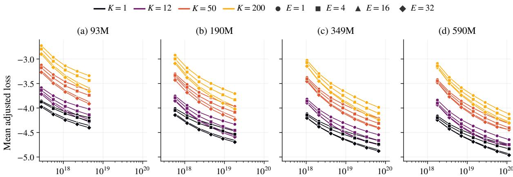
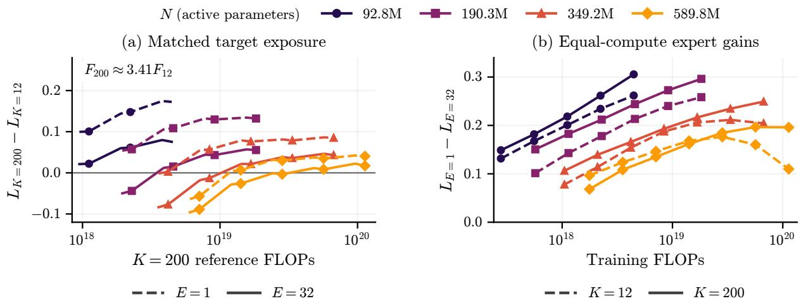
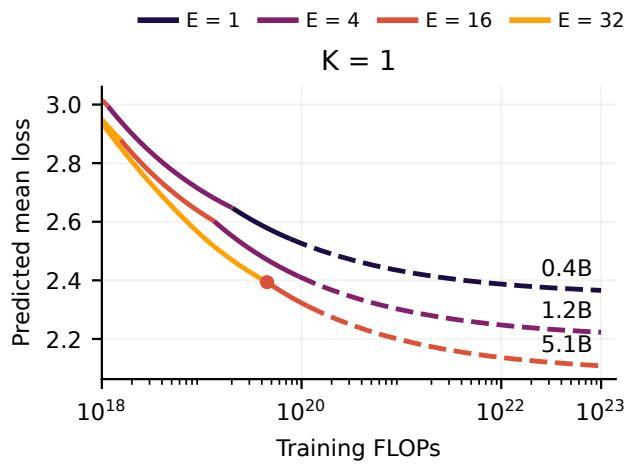
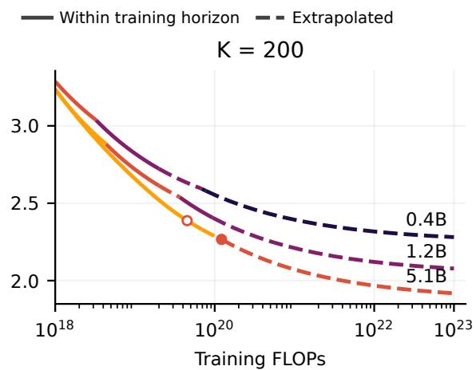
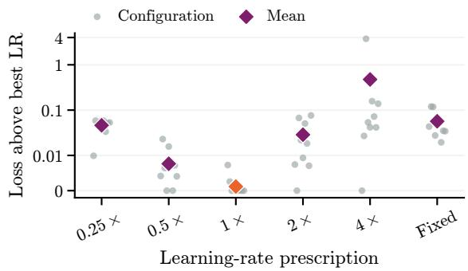
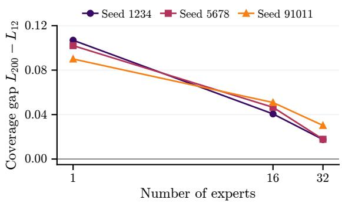
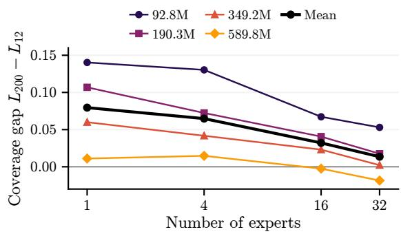
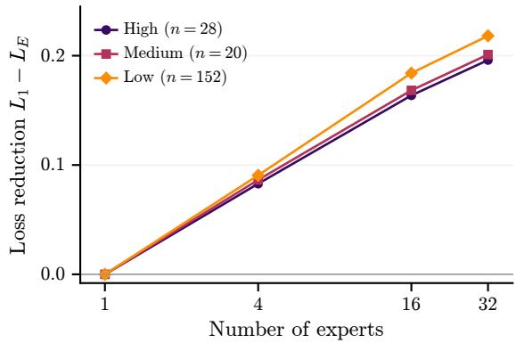
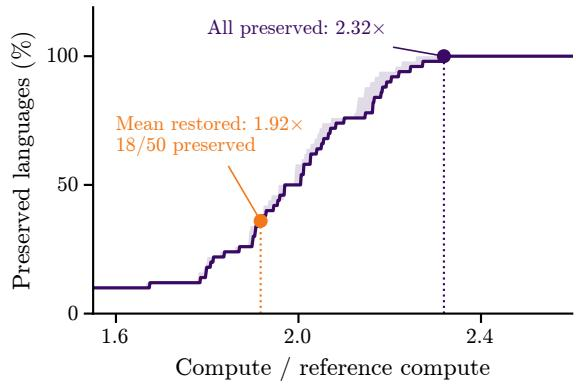
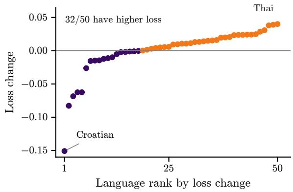

# Scaling Multilingual Mixture-of-Experts: How Language Coverage Changes Capacity and Compute Allocation

Joel Dag\*, Nikit Srivastava\*, Hamada M. Zahera, Axel-Cyrille Ngonga Ngomo

Data Science Group, Heinz Nixdorf Institute, Paderborn University, Germany

{joeldag, nikit.srivastava, hamada.zahera, axel.ngonga}@mail.uni-paderborn.de

## Abstract

Multilingual models share capacity across languages, so adding languages can hurt performance on existing ones. Mixture-of-experts models expand this capacity with little additional per-token computation. Given this extra capacity, does adding experts reduce what each additional language costs? To answer this question, we propose a repetition-aware joint scaling law relating number of active parameters, training tokens per language, number of experts, and language coverage. Fitted on 26,300 per-language loss observations from 64 pretrained configurations, our law reduces prediction error on held-out configurations by 28% relative to the strongest evaluated baseline. At matched number of active parameters and training tokens per language, 32 experts reduce the loss penalty of expanding from 12 to 200 lan guages by 83% compared with a dense model. Our law further shows that broader language coverage favors more experts across a wider range of compute budgets, guiding capacity allocation as multilingual models scale.

## 1 Introduction

Multilingual pretraining allows one model to support language understanding and generation across many languages (Conneau et al., 2020; Xue et al., 2021). Through cross-lingual transfer, languages with limited training data can benefit from sharing a model with other languages. However, these benefits are uneven and depend on the amount of data, the languages combined, and the capacity of the model (Chang et al., 2024). Extending language coverage therefore requires understanding what each language gains or loses, not only how the average changes.

A central difficulty is the curse of multilinguality, where adding languages worsens performance on those already supported (Conneau et al., 2020). Increasing model capacity can alleviate this penalty, but enlarging a dense model also increases computation for every token. An alternative is to dedicate capacity to individual languages. X-MOD adds language-specific modules, while X-ELM trains separate models on subsets of languages (Pfeiffer et al., 2022; Blevins et al., 2024). Both reduce competition between languages, but tie capacity to languages chosen in advance.

Sparse mixture-of-experts (MoE) models offer a different way to share capacity. They store many experts while activating only a small subset for each token, allowing capacity to grow with approximately fixed per-token computation (Fedus et al., 2022). Multilingual models such as mSwitch and LOLA demonstrate the promise of learned expert routing across many languages (Fedus et al., 2022; Srivastava et al., 2025). However, these successes leave open whether experts reduce the loss increase from adding languages, or improve performance similarly regardless of language coverage.

Scaling laws could answer this question before training, but existing laws leave the interaction between expert capacity and language coverage unresolved. Multilingual laws study language sampling, transfer, and the cost of increasing coverage (He et al., 2025b; Longpre et al., 2026). In contrast, MoE laws study how to allocate capacity between active parameters and experts under compute and memory limits (Ludziejewski et al., 2025). We close this gap with a joint scaling law over the number of active parameters, training tokens per language, the number of experts, and language coverage. Many of the added languages have little unique text, so the law also accounts for repeated passes over the same data (Muennighoff et al., 2023). Once fitted, the law lets us study capacity allocation beyond the training grid.

Research questions. With this law, we ask three questions about the role of expert capacity in multilingual pretraining:

1. Does adding experts reduce what each additional language costs?

2. How does broader language coverage change the preferred allocation between active and expert capacity under fixed resource budgets?

3. When adding languages preserves average quality, how does this affect individual languages?

To fit the law, we pretrain 64 model configurations that independently vary the number of active parameters, the number of experts, and language coverage, yielding 26,300 per-language loss observations. Another 37 runs cover seed replication, alternative language mixtures, and a larger-scale stress test. We evaluate 617 checkpoints, primarily through language-modeling loss and corroborated on 14 multilingual benchmarks. Following X-MOD, we compare models trained on different numbers of languages at matched training tokens per language so that original languages do not receive less data (Pfeiffer et al., 2022). On held-out configurations, the law reduces prediction error by 28% relative to the strongest evaluated baseline, JointMoE (Ludziejewski et al., 2025) (Section 5.1). For RQ1, 32 experts reduce the loss increase of expanding from 12 to 200 languages by 83% relative to a dense model, a direction that holds across seeds (Section 5.2.1). For RQ2, the law indicates that broader language coverage extends the compute range over which expert-heavy configurations are preferred (Section 5.2.2). For RQ3, restoring average loss after expansion still leaves many original languages worse off in a representative setting, so an average alone is an insufficient target (Section 5.2.3).

Our main contributions are (i) a repetition-aware joint scaling law for multilingual MoEs, validated on held-out configurations; (ii) a controlled study of how expert capacity changes the cost of adding languages at matched training tokens per language; and (iii) an analysis of how coverage shifts the preferred use of experts and why average quality does not protect every language. All training and analysis code is open-source and publicly available. 1

## 2 Related Work

Scaling laws predict language-modeling loss from model size and training data. Hestness et al. (2017) observed such power laws across deep-learning domains before Kaplan et al. (2020) established them for language models. Hoffmann et al. (2022) later found that model size and training data should scale approximately equally with compute. Other laws couple the size and data terms instead of adding them (Rosenfeld et al., 2020; Li et al., 2025b). Muennighoff et al. (2023) extend these laws to repeated data, finding that a few epochs are nearly as valuable as unique data. MoE models add the number of experts as a further dimension, which grows the total number of stored parameters at approximately fixed per-token computation. Clark et al. (2022) relate loss to the number of active parameters and the number of experts, while Ludziejewski et al. (2024) add expert granularity. We build on JointMoE (Ludziejewski et al., 2025), which models the number of active parameters, training data, and the number of experts together. All these laws, however, treat training data as a single distribution, which leaves language coverage outside the model.

In multilingual pretraining, languages compete for finite capacity, which trades positive crosslingual transfer against interference (Conneau et al., 2020; Arivazhagan et al., 2019). Language-specific capacity reduces this interference, as in the modules of X-MOD (Pfeiffer et al., 2022) or the separate per-subset models of X-ELM (Blevins et al., 2024). Sparse MoE models such as GShard (Lepikhin et al., 2021), Switch Transformer (Fedus et al., 2022), and NLLB (NLLB Team et al., 2022) instead learn to share capacity across languages. Their routing reflects linguistic structure (Srivastava et al., 2025), specializing by language in early and late layers while sharing across languages in middle layers (Bandarkar et al., 2026). Other methods allocate experts by language similarity (Li et al., 2025a; Zhang et al., 2025) or align routing across languages (Dong et al., 2026). These studies show that added capacity helps multilingual models, but none measures how the loss increase from adding languages changes with the number of experts.

Multilingual scaling laws relate loss to sampling ratios, resource levels, linguistic similarity, data size, and model capacity (Fernandes et al., 2023; Chen et al., 2023; Chang et al., 2024). He et al. (2025b) model how language sampling affects scaling, while Cao et al. (2026) estimate each language’s contribution to optimize mixtures. ATLAS (Longpre et al., 2026) further separates training tokens per language, cross-lingual transfer, repetition, and the capacity required by broader coverage. We adapt these laws as baselines, but none studies how they change with expert capacity. They therefore cannot indicate how to split capacity between active parameters and experts as language coverage grows. Because multilingual benefits are uneven across languages (Chang et al., 2024), a joint law must also predict per-language loss rather than only the average. We address this gap with a joint law over the number of active parameters, training tokens per language, the number of experts, and language coverage.

## 3 Scaling Law Formulation

Given that no existing scaling law relates the loss of each language to both the number of experts and language coverage, we first define this prediction target (Section 3.1). We then combine MoE with multilingual scaling into a core joint law (Section 3.2) and refine this law for prediction (Section 3.3).

## 3.1 Problem Setting

Under a fixed training-token budget, broader language coverage reduces training tokens available to each language, while more languages compete for the same model capacity. Additional experts expand this capacity without increasing the number of active parameters, which may offset the cost of broader coverage. Measuring this offset requires a law that predicts the loss of each language from both the number of experts and language coverage.

Formally, following the notation of Clark et al. (2022), a training configuration fixes the number of active parameters N, the number of experts E, and the number of training languages K. Within a configuration, each target language t receives $D _ { t }$ training tokens. We seek a function $L _ { t } ( N , D _ { t } , E , K )$ that predicts the validation loss of target language t. Averaging $L _ { t }$ over the training languages gives the mean loss of a configuration.

## 3.2 Core Joint Law

We build on the standard scaling-law decomposition (Hoffmann et al., 2022),

$$
{ \cal L } ( N , D ) = { \cal L } _ { \infty } + \frac { A } { N ^ { \alpha } } + \frac { B } { D ^ { \beta } } ,\tag{1}
$$

which splits loss into an asymptotic floor $L _ { \infty }$ , reflecting the entropy of natural text (Shannon, 1948), plus a model-limited term that decreases with the number of parameters N and a data-limited term that decreases with training tokens $D .$ The coefficients A, B set the magnitude of these terms, while the exponents $\alpha , \beta$ set their scaling rates.

JointMoE (Ludziejewski et al., 2025) extends this form with the number of experts, whereas AT-LAS (Longpre et al., 2026) adds training tokens per language and language coverage. Building on both forms, we introduce a flexible core joint law, which models $L _ { t } ( N , D _ { t } , E , K )$ as

$$
L _ { \infty , t } + \frac { A _ { t } E ^ { \delta } K ^ { \phi ( E ) } } { N ^ { \alpha ( E ) } } + \frac { B _ { t } E ^ { \omega } K ^ { \psi ( E ) } } { D _ { t } ^ { \beta ( E ) } } .\tag{2}
$$

The language-specific coefficients $L _ { \infty , t } , A _ { t }$ , and $B _ { t }$ capture differences between target languages. Following JointMoE, the factors $E ^ { \delta }$ and $E ^ { \omega }$ scale both loss terms with the number of experts. Following ATLAS, the factors $K ^ { \phi ( E ) }$ and $K ^ { \psi ( E ) }$ scale both terms with language coverage. We additionally allow their exponents to depend on $E _ { \mathrm { { : } } }$ , and test whether this flexibility improves held-out prediction.

Following the log-linear exponents of JointMoE, we parameterize each exponent $q \in \{ \alpha , \beta , \phi , \psi \}$ as

$$
q ( E ) = a _ { q } + b _ { q } \ln ( E ) ,\tag{3}
$$

so each exponent responds to the number of experts through its own intercept $a _ { q }$ and slope $b _ { q } . \ \mathrm { A p - }$ pendix B.3 compares this choice with alternative parameterizations of E.

## 3.3 Predictive Refinements

The core law makes three simplifying assumptions that become limiting in our training regime. Following prior empirical scaling-law studies (Ludziejewski et al., 2024, 2025; Longpre et al., 2026), we replace each assumption with a more flexible term and evaluate each change on held-out configurations (Section 5.1).

Parameter-data coupling. The core law treats the effects of the number of active parameters and training tokens per language as separable. Early joint laws couple the two (Rosenfeld et al., 2020; Kaplan et al., 2020), and recent work reintroduces this coupling (Li et al., 2025b). We add a factor $N ^ { \zeta }$ to the data-limited term, allowing additional model capacity to change the benefit of additional training tokens per language.

Language-coverage-dependent parameter scaling. Prior work links the curse of multilinguality to limited model capacity (Conneau et al., 2020;

Chang et al., 2024), which suggests that the return on additional active parameters depends on language coverage. ATLAS models this capacity cost through the factor $K ^ { \phi }$ but keeps the exponent of N fixed. We also let this exponent vary with language coverage,

$$
\alpha ( E , K ) = \alpha ( E ) + \gamma _ { N } g ( K ) ,\tag{4}
$$

where $g ( K ) = \operatorname* { m a x } \{ 0 , \log ( K / K _ { 0 } ) \}$ grows with log language coverage above a fixed reference coverage $K _ { 0 } .$ , matching the power-law coverage factors of the core law. The coefficient $\gamma _ { N }$ sets how coverage shifts the exponent of $N$ , and $\gamma _ { N } = 0$ recovers the core law.

Data repetition. Long training runs can revisit the same target-language data multiple times. Following ATLAS, which adapts the effective-data model of Muennighoff et al. (2023), we replace training tokens per language $D _ { t }$ with an effective exposure $D _ { t } ^ { \mathrm { e f f } }$ . Let $U _ { t }$ denote the unique tokens available for language t and $R _ { t } = \operatorname* { m a x } ( D _ { t } / U _ { t } -$ 1, 0) the number of repeated passes. We define

$$
D _ { t } ^ { \mathrm { e f f } } = \operatorname* { m i n } ( D _ { t } , U _ { t } ) + \frac { U _ { t } } { r } \left( 1 - e ^ { - r R _ { t } } \right) ,\tag{5}
$$

so the first pass counts fully, while subsequent passes contribute progressively less. The repetition parameter $r ~ = ~ \lambda _ { 0 } P ^ { \rho }$ depends on the total number of stored parameters $P ,$ , which lets models with more stored parameters discount repetition differently.

Selected law. Combining the three refinements while keeping the language coverage exponents $\phi$ and $\psi$ independent of $E$ gives our selected repetition-aware joint law, which models $L _ { t } ( N , D _ { t } , E , K )$ as

$$
L _ { \infty , t } + \frac { A _ { t } E ^ { \delta } K ^ { \phi } } { N ^ { \alpha ( E , K ) } } + \frac { B _ { t } E ^ { \omega } K ^ { \psi } N ^ { \zeta } } { ( D _ { t } ^ { \mathrm { e f f } } ) ^ { \beta ( E ) } } .\tag{6}
$$

It has 12 shared coefficients plus three coefficients per target language (Appendix B.1). We also evaluate a composition-aware extension that groups training tokens from other languages by shared language family and script (Appendix B.2).

## 4 Experimental Setup

## 4.1 Model Architecture and Training

All experiments use decoder-only Transformer language models (Vaswani et al., 2017) with SwiGLU feed-forward layers (Shazeer, 2020). Sparse configurations replace each feed-forward block with a Top-1 mixture-of-experts layer. We vary the number of experts over $E \in \{ 1 , 4 , 1 6 , 3 2 \}$ , with $E = 1$ as the dense baseline. All models share one SentencePiece Unigram tokenizer with a 64k vocabulary (Kudo and Richardson, 2018), which we train on our multilingual training data sample. We adopt four depth and width settings from Ludziejewski et al. (2025), which give $N \in \{ 9 3 , 1 9 0 , 3 4 9 , 5 9 0 \}$ active parameters (in millions) including embeddings. Increasing E keeps N approximately fixed while raising the total number of stored parameters. Further training details and the learning-rate schedule are provided in Appendix A.2.

## 4.2 Data and Sampling

We train each model on four nested language mixtures with $K \in \{ 1 , 1 2 , 5 0 , 2 0 0 \}$ languages, so every smaller set is contained in each larger one. The smallest mixture contains only English, while the 12- and 50-language sets follow ATLAS. The largest set adds the 150 remaining FineWeb2 languages with the most training data, so coverage grows roughly fourfold at each step. English data come from FineWeb, while all other languages come from FineWeb2 (Penedo et al., 2024, 2025). Appendix A.1 lists every language.

Within each mixture, we sample languages with temperature smoothing at exponent 0.3 (Conneau et al., 2020; Xue et al., 2021).

## 4.3 Training Grid and Fitting

Combining the four values each of N, E, and K results in 64 training configurations. We call the total number of training tokens D at which a model is evaluated its training horizon. Larger models train for longer, with maximum training horizons of 8, 16, 32, and 32B tokens for increasing N. Following Ludziejewski et al. (2025), each run also branches at shorter training horizons that double from 0.5B tokens. Each branch ends with its own learning-rate cooldown (Hägele et al., 2024), and we call the resulting model for that training horizon an endpoint. Evaluating the 400 endpoints on their respective training languages yields 26,300 perlanguage loss observations.

As in other compute-intensive scaling-law studies (Hoffmann et al., 2022; Ludziejewski et al., 2025; Longpre et al., 2026), we train each configuration in our main experiments with one seed. Seed noise therefore enters the law fits as residual error, which the held-out evaluation already measures. For the interaction between experts and language coverage, we follow the targeted seed checks of Clark et al. (2022) and replicate our main comparison across additional seeds. At $N \approx 1 9 0 \mathbf { M }$ , we retrain $E \in \{ 1 , 1 6 , 3 2 \}$ crossed with $K \in \{ 1 , 1 2 , 2 0 0 \}$ under two additional seeds, which spans dense to sparse models and monolingual to the broadest coverage (Appendix A).

  
Total training compute F ≈ 6ND (FLOPs)  
Figure 1: Mean unigram-adjusted validation loss across 64 training configurations and 400 endpoints, averaged over training languages.

We compare multiple scaling laws on held-out configurations, withholding an entire edge of the training grid to test generalization to configurations excluded from fitting. The three splits hold out N ≈ 590M, $E = 3 2$ , or $K = 2 0 0$ . We report RMSE with equal weight per configuration, averaged over the three splits (Appendix B.1). We additionally evaluate a model with 1.15B active and 21.23B stored parameters as a stress test.

## 4.4 Compute and Evaluation

We measure training compute F in logical FLOPs and approximate it as F ≈ 6ND (Hoffmann et al., 2022; Ludziejewski et al., 2025). This excludes routing and communication overheads, which Appendix H reports separately.

Following vocabulary-insensitive evaluation in multilingual scaling (Tao et al., 2024; Longpre et al., 2026), the loss $L _ { t }$ that our laws predict is the unigram-adjusted validation loss

$$
L _ { t } = - \frac { 1 } { T _ { t } } \sum _ { i = 1 } ^ { T _ { t } } \log \frac { p _ { \theta } ( w _ { i } \mid w _ { < i } ) } { p _ { \mathrm { u n i } , t } ( w _ { i } ) } ,\tag{7}
$$

where $T _ { t }$ is the number of scored validation tokens, wi the token at position $i , p _ { \theta } ( w _ { i } \mid w _ { < i } )$ its probability under the language model, and $p _ { \mathrm { u n i } , t } ( w _ { i } )$ its

probability under a fixed unigram model estimated from the training data of language t.

We also evaluate 14 multilingual benchmarks that cover language modeling, grammaticality, reasoning, and classification (Appendix F).

## 5 Results

We first validate the joint law on held-out configurations, then use measurements and the fitted law to answer the three research questions. As an overview, Figure 1 shows the mean loss across 64 configurations and 400 training endpoints. These averages combine different languages and numbers of training tokens per language, so the analyses below work with per-language losses instead.

## 5.1 Scaling Law Evaluation

Table 1 compares our core and refined joint laws with Chinchilla, JointMoE, and ATLAS. We first evaluate these baselines with their original inputs, then adapt them to our multilingual MoE setting by using training tokens per language $D _ { t }$ instead of total tokens D for Chinchilla and JointMoE, and stored parameters $P$ instead of active parameters N for ATLAS. All baselines are refitted on our data, with further details in Appendix B. All evaluated target languages appear in the fitting data, while the held-out model-size, expert-count, or coverage configurations are excluded from coefficient fitting. A complementary composition-aware law and additional ablations are reported in Appendix Table 7.

Joint scaling improves prediction across the grid. Adding parameter–data coupling $( N ^ { \zeta } )$ and coverage-dependent scaling (Equation 4) to the core joint law reduces mean RMSE from 0.05067 to 0.03696. The final repetition-aware law further reduces RMSE to 0.03319, outperforming the strongest baseline with original inputs, ATLAS (N), by 65% and the strongest baseline with alternative inputs, JointMoE $( D _ { t } )$ , by 28%.

<table><tr><td rowspan="2">Scaling law</td><td colspan="3">Held-out configurations</td><td rowspan="2"></td><td rowspan="2">Larger model</td></tr><tr><td>N ≈ 590M</td><td> $E = 3 2$ </td><td> $K = 2 0 0$ </td></tr><tr><td colspan="6">Baselines with original inputs</td></tr><tr><td>Chinchilla (D)</td><td>0.10630</td><td>0.13127</td><td>0.22741</td><td>0.15499</td><td>0.23611</td></tr><tr><td>JointMoE (D)</td><td>0.08943</td><td>0.08668</td><td>0.20957</td><td>0.12856</td><td>0.25269</td></tr><tr><td>Adaptive ATLAS (N)</td><td>0.07088</td><td>0.11284</td><td>0.10160</td><td>0.09511</td><td>0.23349</td></tr><tr><td colspan="6">Baselines with alternative inputs</td></tr><tr><td>Chinchilla (Dt)</td><td>0.07147</td><td>0.11326</td><td>0.10171</td><td>0.09548</td><td>0.23403</td></tr><tr><td>JointMoE (Dt)</td><td>0.04241</td><td>0.03342</td><td>0.06267</td><td>0.04617</td><td>0.24733</td></tr><tr><td>Adaptive ATLAS (P)</td><td>0.07257</td><td>0.09142</td><td>0.08057</td><td>0.08152</td><td>0.25556</td></tr><tr><td colspan="6">Our joint laws</td></tr><tr><td>Core joint law</td><td>0.05859</td><td>0.03830</td><td>0.05511</td><td>0.05067</td><td>0.27880</td></tr><tr><td>+ parameter-data coupling + coverage-dependent scaling</td><td>0.03533</td><td>0.03049</td><td>0.04507</td><td>0.03696</td><td>0.31586</td></tr><tr><td>Repetition-aware joint law (ours)</td><td>0.02921</td><td>0.02576</td><td>0.04461</td><td>0.03319</td><td>0.17298</td></tr></table>

Table 1: Prediction RMSE across three held-out settings. The mean column averages the three holdouts. The larger model column reports equal-language RMSE for a separate model with 1.15B active and 21.23B stored parameters.

Data repetition becomes important beyond the training grid. We next use a larger model with 1.15B active parameters, 21.23B total parameters, and 32 experts, trained on 200 languages for 68.7B tokens, as a stress test beyond the initial training experiments. On this larger and longer run, the core joint law is less accurate than the evaluated Chinchilla and ATLAS baselines. The largest errors occur for languages whose exposure substantially exceeds their available unique data. Accounting for repetition reduces RMSE from 0.31586 to 0.17298 and outperforms both baselines. This highlights that extrapolation to longer training requires distinguishing total training tokens from unique training data. Our repetition-aware joint law also transfers to changed language mixtures, reducing prediction RMSE by 74% relative to the strongest evaluated baseline (Appendix D).

## 5.2 Research Questions

We next examine the implications of broader language coverage for model design and language quality, covering each research question one by one.

## 5.2.1 Language Coverage Cost (RQ1)

We measure the change in loss for the same 12 languages when expanding training from 12 to 200 languages, at matched N, E, and training tokens per language $( D _ { t } )$ , following the approach of Pfeiffer et al. (2022). Because language sampling differs across mixtures, the number of training tokens from other languages can differ. We therefore interpret the result as an effect of training on broader mixtures. We quantify this change in loss as $\Delta L _ { t } = L _ { t } ( K = 2 0 0 ) - L _ { t } ( K = 1 2 )$ where positive values indicate a language coverage penalty, while negative values indicate a benefit from broader language coverage.

Figure 2 summarizes this interaction over training. Panel (a) shows the difference in loss at matched training tokens per language for models with 1 and 32 experts at each active model size. Panel (b) shows the loss reduction from increasing the number of experts from 1 to 32 at equal training compute. The loss increase of expanding from 12 to 200 languages becomes substantially smaller as the number of experts increases. Across the 12 languages shared between K = 12 and K = 200, the mean penalty falls from 0.0796 at E = 1 to 0.0648 at E = 4, 0.0321 at E = 16, and 0.0135 at $E = 3 2$ . Increasing the number of experts from 1 to 32 therefore reduces the loss penalty of expanding from 12 to 200 languages by 83% (Appendix Figure 6).

We interpolate the K = 12 reference in log $D _ { t }$ average comparisons at each value of N, and weight the four values equally. To test sensitivity to mixture composition, we repeat the comparison with alternative 12-language mixtures and find that additional experts reduce the loss increase by 76.6 to 93.3% (Appendix C.6).

At 589.8M active parameters, the K = 200 training initially gives a lower loss than K = 12 for both $E = 1$ and $E = 3 2$ , but this benefit becomes a penalty as training continues (Figure 2a). Increasing from $E = 1$ to $E = 3 2$ delays this crossover by approximately 2.7× compute. The interaction varies with training duration and what is held fixed (Figure 2b, Appendix C.3).

  
E = 1 E = 32 K = 12 K = 200= 32 K = 12 K = 200Figure 2: Mean loss differences for the same 12 languages in models trained on 12 or 200 languages. (a) Difference = 32 K = 12 K = 200in loss at matched training tokens per language. Negative values favor broader language coverage. (b) Loss reduction from increasing the number of experts from 1 to 32 at equal training compute.

At approximately 190M active parameters, increasing the number of experts from 1 to 32 reduces the loss penalty of expanding from 12 to 200 languages by 83.6%, 82.6%, and 66.4% across three training seeds (Appendix Figure 5). The reduction in loss increase remains consistent across interpolation methods, learning-rate controls, and other language-coverage expansions.

External evaluation supports the loss interaction. On the same 12 trained languages at $K =$ 12 and $K = 2 0 0$ , increasing the number of experts from 1 to 32 reduces the increase in external text loss by 22 to 57% on FLORES and 20 to 62% on NTREX across all four settings of N. The direction is consistent across all three 190M seeds and under byte normalization.

The interaction also appears in downstream accuracy for MultiBLiMP, where expert gains are larger at $K = 2 0 0$ . For HellaSwag and XStoryCloze, expert expansion improves accuracy at both coverage levels, but gains are smaller at $K = 2 0 0$ . Thus, the loss interaction extends beyond the validation corpus, while its effect in downstream accuracy depends on the task (Appendix F).

## 5.2.2 Capacity Allocation (RQ2)

Figure 2a shows that either increasing the number of active parameters or the number of experts reduces the loss increase from broader language coverage. However, additional active parameters increase training compute, while additional experts primarily increase stored parameters. Previous work shows that the preferred balance between the number of active parameters and the number of experts depends on training-compute and total-parameter budgets (Ludziejewski et al., 2025). At each compute budget, Figure 3 uses the composition-aware law to select the lowest predicted mean loss under a total-parameter budget.

Broader language coverage favors expert-heavy allocations for longer. Under a 0.4B totalparameter limit, the preferred measured configuration switches from 92.8M active parameters with 16 experts to 190.3M with 4 experts. The switch occurs at $1 . 7 0 \times 1 0 ^ { 1 8 }$ FLOPs for 12 languages and $2 . 7 5 \times 1 0 ^ { 1 8 }$ FLOPs for 200 languages, a 1.62× delay. These estimates use smoothed curves on the same 12 languages and remain within the observed training range (Appendix E).

The fitted allocation curves show the same pattern over a wider range of storage budgets. At a 5.1B total-parameter budget, the predicted $E =$ 32 → 16 switch occurs at $4 . 5 1 \times 1 0 ^ { 1 9 }$ FLOPs for K = 1 and $1 . 2 2 \times 1 0 ^ { 2 0 }$ FLOPs for $K = 2 0 0$ , a 2.70× delay, with the latter predicted beyond the observed training horizon.

## 5.2.3 Per-Language Preservation (RQ3)

Starting from a reference model trained on 50 languages with $2 \times 1 0 ^ { 1 8 }$ FLOPs and a 2.2B totalparameter limit, expanding to 200 languages recovers the original 50-language mean loss at 1.92× the reference compute. Both configurations use approximately 190.3M active parameters and 32 experts.

  
Figure 3: Minimum predicted mean loss from the composition-aware scaling-law under different total-parameter budgets, with 92.8 to 589.8M active parameters. Loss is averaged equally across its training languages. Filled circles indicate the E = 32 → 16 switch at the 5.1B-parameter budget.

At the mean-preserving point, only 36% of the original languages match or improve upon their 50-language reference, leaving 32 languages with higher loss. A supported configuration matches or improves the reference loss for all 50 languages at 2.32× compute (Appendix Figure 8), although this need not be the minimum required budget.

In this comparison, matching training tokens per language, preserving mean quality, and preserving all 50 languages require approximately 1.75×, 1.92×, and 2.32× compute, respectively. Additional budgets and language-expansion settings are reported in Appendix E.

## 6 Discussion

Our results suggest that language coverage should be treated as a capacity-allocation variable in multilingual MoEs, with broader coverage increasing the relative value of expert capacity under the resource budgets we study.

Matching training tokens per language, preserving average multilingual quality, and preserving the quality of every original language require different amounts of compute. Recovering the average can still leave many languages worse off, so multilingual capacity planning should therefore specify which notion of preservation is required rather than treating aggregate quality as sufficient.

The predictive refinements highlight that scaling laws should be evaluated for the decisions they support. Accounting for repeated training data improves extrapolation to longer training runs, while accounting for language composition improves predictions when the language mixture changes.

Our allocation analysis uses logical compute $F \approx 6 N D$ , following standard scaling-law accounting (Kaplan et al., 2020; Hoffmann et al., 2022) and abstracting from hardware-specific memory, communication, and parallelism costs, which are reported separately in Appendix H.

## 7 Conclusion

We study how the number of active parameters, training tokens per language, the number of experts, and language coverage interact in massively multilingual MoE pretraining. Our central finding is that expert expansion changes the effect of increased language coverage rather than merely lowering loss overall. At matched training tokens per language, increasing from E = 1 to E = 32 reduces the loss penalty of expanding from 12 to 200 languages by 83%, with the same direction observed across additional seeds, nested coverage transitions, and external text evaluation.

We introduce a joint scaling law over N, $D _ { t } ,$ E, and K that improves loss prediction on heldout configurations. Coverage-aware and repetitionaware terms improve held-out prediction, including on a larger-model stress test. Preserving average multilingual quality, however, can still leave many individual languages worse off.

Together, our results show that broader language coverage changes both how much capacity is needed and how that capacity should be allocated. Multilingual MoE pretraining is therefore best viewed as a joint allocation problem over active capacity, expert capacity, training tokens per language, and language coverage.

## 8 Limitations

As is common in compute-intensive scaling-law studies (Hoffmann et al., 2022; Ludziejewski et al., 2025; Longpre et al., 2026), the main factorial grid uses one training seed. We therefore repeat the main comparison at matched training tokens with two additional seeds at selected E and K settings. The main effect remains consistent in direction across all three seeds.

Our conclusions apply to the studied decoderonly, Top-1 MoE setting with fixed expert granularity, tokenizer, corpus, sampling scheme, and E ≤ 32. Increasing the number of experts also changes stored capacity and the expert-aware training recipe.

We assess the scaling law on held-out configurations across the number of active parameters, the number of experts, and language coverage (Appendix B.1). Its transfer to substantially different architectures, corpora, or training regimes remains outside the scope of this study. Finally, our allocation results use logical compute and total parameters. Actual hardware cost additionally depends on communication, memory, and parallelism overheads.

## Ethical Considerations

Our results show that preserving average multilingual quality does not necessarily preserve every individual language. Average performance should therefore not be interpreted as equal quality or representation across languages or communities.

The experiments use existing web-derived corpora and may inherit their biases and other dataquality limitations. We do not evaluate the trained checkpoints for deployment safety, privacy, or bias. Sparse models may also incur hardware and energy costs beyond logical FLOPs. No new human participants or annotations were used.

## References

David Ifeoluwa Adelani, Hannah Liu, Xiaoyu Shen, Nikita Vassilyev, Jesujoba O. Alabi, Yanke Mao, Haonan Gao, and En-Shiun Annie Lee. 2024. SIB-200: A simple, inclusive, and big evaluation dataset for topic classification in 200+ languages and dialects.

In Proceedings of the 18th Conference of the European Chapter of the Association for Computational Linguistics (Volume 1: Long Papers), pages 226–245, St. Julian’s, Malta. Association for Computational Linguistics.

Naveen Arivazhagan, Ankur Bapna, Orhan Firat, Dmitry Lepikhin, Melvin Johnson, Maxim Krikun, Mia Xu Chen, Yuan Cao, George Foster, Colin Cherry, Wolfgang Macherey, Zhifeng Chen, and Yonghui Wu. 2019. Massively multilingual neural machine translation in the wild: Findings and challenges. arXiv preprint.

Lucas Bandarkar, Davis Liang, Benjamin Muller, Mikel Artetxe, Satya Narayan Shukla, Donald Husa, Naman Goyal, Abhinandan Krishnan, Luke Zettlemoyer, and Madian Khabsa. 2024. The belebele benchmark: a parallel reading comprehension dataset in 122 language variants. In Proceedings ofthe 62nd Annual Meeting of the Association for Computational Linguistics (Volume 1: Long Papers), pages 749–775, Bangkok, Thailand. Association for Computational Linguistics.

Lucas Bandarkar, Chenyuan Yang, Mohsen Fayyaz, Junlin Hu, and Nanyun (Violet) Peng. 2026. Multilingual routing in mixture-of-experts. In International Conference on Learning Representations, volume 2026, pages 16305–16327.

Edward Thomas Bayes, Israel Abebe Azime, Jesujoba Alabi, Jonas Kgomo, Tyna Eloundou, Elizabeth Proehl, Kai Chen, Imaan Khadir, Naome A. Etori, Shamsuddeen Hassan Muhammad, Choice Mpanza, Igneciah Pocia IP Thete, Dietrich Klakow, and David Ifeoluwa Adelani. 2026. Uhura: A benchmark for evaluating scientific question answering and truthfulness in low-resource African languages. In Proceedings ofthe Fifteenth Language Resources and Evaluation Conference, pages 1485–1504, Palma de Mallorca, Spain. ELRA Language Resource Association.

Johan Bjorck, Alon Benhaim, Vishrav Chaudhary, Furu Wei, and Xia Song. 2025. Scaling optimal lr across token horizons. In International Conference on Learning Representations, volume 2025, pages 83640–83657.

Terra Blevins, Tomasz Limisiewicz, Suchin Gururangan, Margaret Li, Hila Gonen, Noah A. Smith, and Luke Zettlemoyer. 2024. Breaking the curse of multilinguality with cross-lingual expert language models. In Proceedings of the 2024 Conference on Empirical Methods in Natural Language Processing, pages 10822–10837, Miami, Florida, USA. Association for Computational Linguistics.

Xuyang Cao, Qianying Liu, Chuan Xiao, Yusuke Oda, Jiayi Wang, Pontus Stenetorp, Daisuke Kawahara, Makoto Onizuka, Sadao Kurohashi, and Shuyuan Zheng. 2026. Shapleylaw: A game-theoretic approach to multilingual scaling laws. arXiv preprint.

Tyler A. Chang, Catherine Arnett, Zhuowen Tu, and Benjamin K. Bergen. 2024. When is multilinguality a curse? language modeling for 250 high- and low-resource languages. In Proceedings of the 2024 Conference on Empirical Methods in Natural Language Processing, pages 4074–4096, Miami, Florida, USA. Association for Computational Linguistics.

Liang Chen, Shuming Ma, Dongdong Zhang, Furu Wei, and Baobao Chang. 2023. On the pareto front of multilingual neural machine translation. In Advances in Neural Information Processing Systems, volume 36, pages 33188–33201. Curran Associates, Inc.

Aidan Clark, Diego De Las Casas, Aurelia Guy, Arthur Mensch, Michela Paganini, Jordan Hoffmann, Bogdan Damoc, Blake Hechtman, Trevor Cai, Sebastian Borgeaud, George Bm Van Den Driessche, Eliza Rutherford, Tom Hennigan, Matthew J Johnson, Albin Cassirer, Chris Jones, Elena Buchatskaya, David Budden, Laurent Sifre, and 7 others. 2022. Unified scaling laws for routed language models. In Proceedings ofthe 39th International Conference on Machine Learning, volume 162 of Proceedings of Machine Learning Research, pages 4057–4086. PMLR.

Peter Clark, Isaac Cowhey, Oren Etzioni, Tushar Khot, Ashish Sabharwal, Carissa Schoenick, and Oyvind Tafjord. 2018. Think you have solved question answering? try arc, the ai2 reasoning challenge. arXiv preprint.

Alexis Conneau, Kartikay Khandelwal, Naman Goyal, Vishrav Chaudhary, Guillaume Wenzek, Francisco Guzmán, Edouard Grave, Myle Ott, Luke Zettlemoyer, and Veselin Stoyanov. 2020. Unsupervised cross-lingual representation learning at scale. In Proceedings of the 58th Annual Meeting of the Associationfor Computational Linguistics, pages 8440– 8451, Online. Association for Computational Linguistics.

Alexis CONNEAU and Guillaume Lample. 2019. Cross-lingual language model pretraining. In Advances in Neural Information Processing Systems, volume 32. Curran Associates, Inc.

Tianyu Dong, Yangyang Liu, Jiang Zhou, Xinwei Wu, Xiaohu Zhao, Hao Wang, Heng Liu, Linlong Xu, Longyue Wang, Weihua Luo, Shaolin Zhu, and Deyi Xiong. 2026. SARA: Unlocking multilingual knowledge in mixture-of-experts via semantically anchored routing alignment. In Findings of the Association for Computational Linguistics: ACL 2026, pages 2830–2846, San Diego, California, United States. Association for Computational Linguistics.

Christian Federmann, Tom Kocmi, and Ying Xin. 2022. NTREX-128 – news test references for MT evaluation of 128 languages. In Proceedings of the First Workshop on Scaling Up Multilingual Evaluation, pages 21–24, Online. Association for Computational Linguistics.

William Fedus, Barret Zoph, and Noam Shazeer. 2022. Switch transformers: Scaling to trillion parameter

models with simple and efficient sparsity. Journal of Machine Learning Research, 23(120):1–39.

Patrick Fernandes, Behrooz Ghorbani, Xavier Garcia, Markus Freitag, and Orhan Firat. 2023. Scaling laws for multilingual neural machine translation. In Proceedings of the 40th International Conference on Machine Learning, volume 202 of Proceedings of Machine Learning Research, pages 10053–10071. PMLR.

Leo Gao, Jonathan Tow, Baber Abbasi, Stella Biderman, Sid Black, Anthony DiPofi, Charles Foster, Laurence Golding, Jeffrey Hsu, Alain Le Noac’h, Haonan Li, Kyle McDonell, Niklas Muennighoff, Chris Ociepa, Jason Phang, Laria Reynolds, Hailey Schoelkopf, Aviya Skowron, Lintang Sutawika, and 5 others. 2021. A framework for few-shot language model evaluation.

Alexander Hägele, Elie Bakouch, Atli Kosson, Loubna Ben allal, Leandro Von Werra, and Martin Jaggi. 2024. Scaling laws and compute-optimal training beyond fixed training durations. In The Thirtyeighth Annual Conference on Neural Information Processing Systems.

Linyang He, Ercong Nie, Sukru Samet Dindar, Arsalan Firoozi, Adrian Florea, Van Nguyen, Corentin Puffay, Riki Shimizu, Haotian Ye, Jonathan Brennan, Helmut Schmid, Hinrich Schütze, and Nima Mesgarani. 2025a. XCOMPS: A multilingual benchmark of conceptual minimal pairs. In Proceedings of the 7th Workshop on Research in Computational Linguistic Typology and Multilingual NLP, pages 75–81, Vienna, Austria. Association for Computational Linguistics.

Yifei He, Alon Benhaim, Barun Patra, Praneetha Vaddamanu, Sanchit Ahuja, Parul Chopra, Vishrav Chaudhary, Han Zhao, and Xia Song. 2025b. Scaling laws for multilingual language models. In Findings of the Association for Computational Linguistics: ACL 2025, pages 4257–4273, Vienna, Austria. Association for Computational Linguistics.

Joel Hestness, Sharan Narang, Newsha Ardalani, Gregory Diamos, Heewoo Jun, Hassan Kianinejad, Md. Mostofa Ali Patwary, Yang Yang, and Yanqi Zhou. 2017. Deep learning scaling is predictable, empirically. arXiv preprint.

Jordan Hoffmann, Sebastian Borgeaud, Arthur Mensch, Elena Buchatskaya, Trevor Cai, Eliza Rutherford, Diego de Las Casas, Lisa Anne Hendricks, Johannes Welbl, Aidan Clark, Thomas Hennigan, Eric Noland, Katherine Millican, George van den Driessche, Bogdan Damoc, Aurelia Guy, Simon Osindero, Karén Simonyan, Erich Elsen, and 3 others. 2022. An empirical analysis of compute-optimal large language model training. In Advances in Neural Information Processing Systems, volume 35, pages 30016–30030. Curran Associates, Inc.

Peter J. Huber. 1964. Robust Estimation of a Location Parameter. The Annals of Mathematical Statistics, 35(1):73–101.

Jaap Jumelet, Leonie Weissweiler, Joakim Nivre, and Arianna Bisazza. 2026. MultiBLiMP 1.0: A massively multilingual benchmark of linguistic minimal pairs. Transactions ofthe Associationfor Computational Linguistics, 14:193–216.

Jared Kaplan, Sam McCandlish, Tom Henighan, Tom B. Brown, Benjamin Chess, Rewon Child, Scott Gray, Alec Radford, Jeffrey Wu, and Dario Amodei. 2020. Scaling laws for neural language models. arXiv preprint.

Taku Kudo and John Richardson. 2018. SentencePiece: A simple and language independent subword tokenizer and detokenizer for neural text processing. In Proceedings of the 2018 Conference on Empirical Methods in Natural Language Processing: System Demonstrations, pages 66–71, Brussels, Belgium. Association for Computational Linguistics.

Viet Lai, Chien Nguyen, Nghia Ngo, Thuat Nguyen, Franck Dernoncourt, Ryan Rossi, and Thien Nguyen. 2023. Okapi: Instruction-tuned large language models in multiple languages with reinforcement learning from human feedback. In Proceedings of the 2023 Conference on Empirical Methods in Natural Language Processing: System Demonstrations, pages 318–327, Singapore. Association for Computational Linguistics.

Dmitry Lepikhin, HyoukJoong Lee, Yuanzhong Xu, Dehao Chen, Orhan Firat, Yanping Huang, Maxim Krikun, Noam Shazeer, and Zhifeng Chen. 2021. Gshard: Scaling giant models with conditional computation and automatic sharding. In International Conference on Learning Representations.

Chong Li, Yingzhuo Deng, Jiajun Zhang, and Chengqing Zong. 2025a. Group then scale: Dynamic mixture-of-experts multilingual language model. In Findings ofthe Associationfor Computational Linguistics: ACL 2025, pages 1730–1754, Vienna, Austria. Association for Computational Linguistics.

Houyi Li, Wenzhen Zheng, Qiufeng Wang, Zhenyu Ding, Haoying Wang, Zili Wang, Shijie Xuyang, Ning Ding, Shuigeng Zhou, Xiangyu Zhang, and Daxin Jiang. 2025b. Predictable scale (part II) — farseer: A refined scaling law in LLMs. In The Thirty-ninth Annual Conference on Neural Information Processing Systems.

Bill Yuchen Lin, Seyeon Lee, Xiaoyang Qiao, and Xiang Ren. 2021. Common sense beyond English: Evaluating and improving multilingual language models for commonsense reasoning. In Proceedings of the 59th Annual Meeting of the Association for Computational Linguistics and the 11th International Joint Conference on Natural Language Processing (Volume 1: Long Papers), pages 1274–1287, Online. Association for Computational Linguistics.

Xi Victoria Lin, Todor Mihaylov, Mikel Artetxe, Tianlu Wang, Shuohui Chen, Daniel Simig, Myle Ott, Naman Goyal, Shruti Bhosale, Jingfei Du, Ramakanth Pasunuru, Sam Shleifer, Punit Singh Koura, Vishrav Chaudhary, Brian O’Horo, Jeff Wang, Luke Zettlemoyer, Zornitsa Kozareva, Mona Diab, and 2 others. 2022. Few-shot learning with multilingual generative language models. In Proceedings ofthe 2022 Conference on Empirical Methods in Natural Language Processing, pages 9019–9052, Abu Dhabi, United Arab Emirates. Association for Computational Linguistics.

Shayne Longpre, Sneha Kudugunta, Niklas Muennighoff, I-Hung Hsu, Isaac Caswell, Alex Pentland, Sercan Arik, Chen-Yu Lee, and Sayna Ebrahimi. 2026. Atlas: Adaptive transfer scaling laws for multilingual pretraining, finetuning, and decoding the curse of multilinguality. In International Conference on Learning Representations, volume 2026, pages 31839–31867.

Jan Ludziejewski, Jakub Krajewski, Kamil Adamczewski, Maciej Pióro, Michał Krutul, Szymon Antoniak, Kamil Ciebiera, Krystian Król, Tomasz Odrzygó´zd´z, Piotr Sankowski, Marek Cygan, and Sebastian Jaszczur. 2024. Scaling laws for fine-grained mixture of experts. In Proceedings ofthe 41st International Conference on Machine Learning, volume 235 of Proceedings of Machine Learning Research, pages 33270–33288. PMLR.

Jan Ludziejewski, Maciej Pióro, Jakub Krajewski, Maciej Stefaniak, Michał Krutul, Jan Małasnicki, Marek´ Cygan, Piotr Sankowski, Kamil Adamczewski, Piotr Miłos, and Sebastian Jaszczur. 2025.´ Joint MoE scaling laws: Mixture of experts can be memory efficient. In Proceedings ofthe 42nd International Conference on Machine Learning, volume 267 of Proceedings ofMachine Learning Research, pages 41056–41073. PMLR.

Chunlan Ma, Ayyoob Imani, Haotian Ye, Renhao Pei, Ehsaneddin Asgari, and Hinrich Schuetze. 2025. Taxi1500: A dataset for multilingual text classification in 1500 languages. In Proceedings of the 2025 Conference of the Nations of the Americas Chapter of the Association for Computational Linguistics: Human Language Technologies (Volume 2: Short Papers), pages 414–439, Albuquerque, New Mexico. Association for Computational Linguistics.

Niklas Muennighoff, Alexander Rush, Boaz Barak, Teven Le Scao, Nouamane Tazi, Aleksandra Piktus, Sampo Pyysalo, Thomas Wolf, and Colin Raffel. 2023. Scaling data-constrained language models. In Advances in Neural Information Processing Systems, volume 36, pages 50358–50376. Curran Associates, Inc.

NLLB Team, Marta R. Costa-jussà, James Cross, Onur Çelebi, Maha Elbayad, Kenneth Heafield, Kevin Heffernan, Elahe Kalbassi, Janice Lam, Daniel Licht, Jean Maillard, Anna Sun, Skyler Wang, Guillaume Wenzek, Al Youngblood, Bapi Akula, Loic Barrault,

Gabriel Mejia Gonzalez, Prangthip Hansanti, and 20 others. 2022. No language left behind: Scaling human-centered machine translation. arXiv preprint.

Guilherme Penedo, Hynek Kydlícek, Loubna Ben al-ˇ lal, Anton Lozhkov, Margaret Mitchell, Colin Raffel, Leandro Von Werra, and Thomas Wolf. 2024. The fineweb datasets: Decanting the web for the finest text data at scale. In Advances in Neural Information Processing Systems, volume 37, pages 30811–30849. Curran Associates, Inc.

Guilherme Penedo, Hynek Kydlícek, Vinko Sabolˇ cec,ˇ Bettina Messmer, Negar Foroutan, Amir Hossein Kargaran, Colin Raffel, Martin Jaggi, Leandro Von Werra, and Thomas Wolf. 2025. Fineweb2: One pipeline to scale them all – adapting pre-training data processing to every language. In Conference on Language Modeling.

Jonas Pfeiffer, Naman Goyal, Xi Victoria Lin, Xian Li, James Cross, Sebastian Riedel, and Mikel Artetxe. 2022. Lifting the curse of multilinguality by pretraining modular transformers. In Proceedings of the 2022 Conference of the North American Chapter of the Association for Computational Linguistics: Human Language Technologies, pages 3479–3495, Seattle, United States. Association for Computational Linguistics.

Edoardo Maria Ponti, Goran Glavaš, Olga Majewska, Qianchu Liu, Ivan Vulic, and Anna Korhonen. 2020.´ XCOPA: A multilingual dataset for causal commonsense reasoning. In Proceedings of the 2020 Conference on Empirical Methods in Natural Language Processing (EMNLP), pages 2362–2376, Online. Association for Computational Linguistics.

Jonathan S. Rosenfeld, Amir Rosenfeld, Yonatan Belinkov, and Nir Shavit. 2020. A constructive prediction of the generalization error across scales. In International Conference on Learning Representations.

C. E. Shannon. 1948. A mathematical theory of communication. Bell System Technical Journal, 27(3):379– 423.

Noam Shazeer. 2020. Glu variants improve transformer. Preprint, arXiv:2002.05202.

Shivalika Singh, Angelika Romanou, Clémentine Fourrier, David Ifeoluwa Adelani, Jian Gang Ngui, Daniel Vila-Suero, Peerat Limkonchotiwat, Kelly Marchisio, Wei Qi Leong, Yosephine Susanto, Raymond Ng, Shayne Longpre, Sebastian Ruder, Wei-Yin Ko, Antoine Bosselut, Alice Oh, Andre Martins, Leshem Choshen, Daphne Ippolito, and 4 others. 2025. Global MMLU: Understanding and addressing cultural and linguistic biases in multilingual evaluation. In Proceedings of the 63rd Annual Meeting of the Association for Computational Linguistics (Volume 1: Long Papers), pages 18761–18799, Vienna, Austria. Association for Computational Linguistics.

Nikit Srivastava, Denis Kuchelev, Tatiana Moteu Ngoli, Kshitij Shetty, Michael Roeder, Hamada Zahera, Diego Moussallem, and Axel-Cyrille Ngonga Ngomo. 2025. LOLA – an open-source massively multilingual large language model. In Proceedings ofthe 31st International Conference on Computational Linguistics, pages 6420–6446, Abu Dhabi, UAE. Association for Computational Linguistics.

Jianlin Su, Murtadha Ahmed, Yu Lu, Shengfeng Pan, Wen Bo, and Yunfeng Liu. 2024. Roformer: Enhanced transformer with rotary position embedding. Neurocomputing, 568:127063.

Chaofan Tao, Qian Liu, Longxu Dou, Niklas Muennighoff, Zhongwei Wan, Ping Luo, Min Lin, and Ngai Wong. 2024. Scaling laws with vocabulary: Larger models deserve larger vocabularies. In Advances in Neural Information Processing Systems, volume 37, pages 114147–114179. Curran Associates, Inc.

Ashish Vaswani, Noam Shazeer, Niki Parmar, Jakob Uszkoreit, Llion Jones, Aidan N Gomez, Ł ukasz Kaiser, and Illia Polosukhin. 2017. Attention is all you need. In Advances in Neural Information Processing Systems, volume 30. Curran Associates, Inc.

Linting Xue, Noah Constant, Adam Roberts, Mihir Kale, Rami Al-Rfou, Aditya Siddhant, Aditya Barua, and Colin Raffel. 2021. mT5: A massively multilingual pre-trained text-to-text transformer. In Proceedings of the 2021 Conference of the North American Chapter ofthe Associationfor Computational Linguistics: Human Language Technologies, pages 483–498, Online. Association for Computational Linguistics.

Biao Zhang and Rico Sennrich. 2019. Root mean square layer normalization. In Advances in Neural Information Processing Systems, volume 32. Curran Associates, Inc.

Xue Zhang, Yunlong Liang, Fandong Meng, Songming Zhang, Yufeng Chen, Jinan Xu, and Jie Zhou. 2025. Less, but better: Efficient multilingual expansion for LLMs via layer-wise mixture-of-experts. In Proceedings ofthe 63rd Annual Meeting ofthe Association for Computational Linguistics (Volume 1: Long Papers), pages 17948–17963, Vienna, Austria. Association for Computational Linguistics.

## Appendix contents

A Experimental Details . . . . . . . . . . . . . . . . . . . . 13   
B Scaling-Law Specification and Validation . 15   
C Robustness of the Expert–Language Coverage   
Response . . . . . . . . . 20   
D Language-Composition Analysis . . . . . . . . . 22   
E Capacity Allocation . . . . . . 23   
F External Evaluation . . . 24   
G Routing Diagnostics . . . 25   
H Physical Training Costs . . . . . . . . . . . 27

## A Experimental Details

Our main experiment varies four values for the number of active parameters $( N \in \{ 9 2 . 8 , 1 9 0 . 3 , 3 4 9 . 2 , 5 8 9 . 8 \} \mathrm { M } )$ , four numbers of experts $( E ~ \in ~ \{ 1 , 4 , 1 6 , 3 2 \} )$ , and four language-coverage settings $( K \in \{ 1 , 1 2 , 5 0 , 2 0 0 \} )$ ), yielding 64 model configurations. Each configuration is trained for 8–32B tokens, depending on the number of active parameters, with a separate cooldown at each of five to seven training horizons, resulting in 400 endpoints in total.

We additionally train 18 runs with additional seeds, 18 runs on alternative K = 12 language mixtures, and one larger-model stress test. Together, the core study therefore contains 101 training runs and 617 evaluated checkpoints.

Separate learning-rate experiments verify that the expert-aware learning-rate rule used in the main study is appropriate across the evaluated expert and language-coverage settings. Table 2 summarizes the training experiments.

<table><tr><td>Study component</td><td>Runs</td><td>Endpoints</td></tr><tr><td>Core study and extensions</td><td></td><td></td></tr><tr><td>Primary factorial grid</td><td>64</td><td>400</td></tr><tr><td>Additional training seeds</td><td>18</td><td>108</td></tr><tr><td>Alternative  $K = \bar { 1 2 }$  mixtures</td><td>18</td><td>108</td></tr><tr><td>Larger-model stress test</td><td>1</td><td>1</td></tr><tr><td>Subtotal</td><td>101</td><td>617</td></tr><tr><td>Learning-rate validation and controls</td><td></td><td></td></tr><tr><td>Learning-rate validation experiments</td><td>108</td><td>108</td></tr><tr><td>Fixed-learning-rate control grid</td><td>64</td><td>400</td></tr></table>

Table 2: Training runs and evaluated endpoints across the study.

Seed replication. Following the targeted seed checks of Clark et al. (2022), we repeat nine configurations at 190.3M active parameters with $E \in \{ 1 , 1 6 , 3 2 \}$ and $K \in \{ 1 , 1 2 , 2 0 0 \}$ . Using three training seeds yields 18 additional runs and

108 evaluated checkpoints across six training horizons from 0.5B to 16B tokens.

## A.1 Data and language sets

We use four nested language sets, with $K \in$ {1, 12, 50, 200} and each smaller set contained in the larger ones. This allows us to compare the same languages under increasingly broader multilingual mixtures. Table 3 lists all language–script pairs.

The K = 1 setting contains English only, while the $K \ : = \ : 1 2$ and $K \ : = \ : 5 0$ sets follow ATLAS. We extend the $K \ = \ 5 0$ set to $K \ = \ 2 0 0$ with 150 additional FineWeb2 languages selected based on data availability, following the data-driven language coverage used in large multilingual pretraining such as XLM-R and mT5 (Conneau et al., 2020; Xue et al., 2021). We additionally use two alternative $K = 1 2$ language sets to assess sensitivity to language composition. Their construction and evaluation are described in Appendix D.

Following the smoothed language sampling of XLM (CONNEAU and Lample, 2019) and XLM-R (Conneau et al., 2020), we define the sampling probability of language t as

$$
p _ { t } ( K ) = \frac { n _ { t } ^ { 0 . 3 } } { \sum _ { \ell \in \mathcal { L } _ { K } } n _ { \ell } ^ { 0 . 3 } } ,\tag{8}
$$

where $\mathcal { L } _ { K }$ is the selected language set and $n _ { t }$ is the number of available training tokens of language t. The exponent increases the sampling probability of low-resource languages and thus reduces the bias towards high-resource languages. English has a sampling probability of 100%, 19.38%, 9.94%, and 5.68% at K = 1, 12, 50, 200, respectively.

Following ATLAS (Longpre et al., 2026), we construct a document-level validation split for each language containing approximately 20 million tokens or 20% of the available unique tokens for that language, whichever is smaller. Training and validation sets are disjoint at the document level.

We use a shared 64,000-piece SentencePiece Unigram tokenizer for all training experiments. It is trained once on 100 million sentences across all 200 languages, using the same language sampling exponent of 0.3. Byte fallback is enabled. To make validation loss more comparable across languages, we subtract a language-specific unigram baseline that accounts for differences in token frequencies. The baseline is estimated from the training data only. Special tokens and padding are excluded from the loss.

<table><tr><td>K = 12 (12): cmn_Hani, deu_Latn, eng_Latn, fra_Latn, hin_Deva, ita_Latn, jpn_Jpan, pol_Latn, por_Latn, rus_Cyrl, spa_Latn, vie_Latn Added at K = 50 (38): afr_Latn, arb_Arab, bak_Cyrl, bam_Latn, ben_Beng, cat_Latn, ckb_Arab, cym_Latn, ell_Grek,</td></tr><tr><td>ewe_Latn, fas_Arab, fil_Latn, gaz_Latn, gug_Latn, guj_Gujr, hau_Latn, heb_Hebr, hrv_Latn, ind_Latn, jav_Latn, kaz_Cyrl, kor_Hang, mar_Deva, mya_Mymr, nld_Latn, nob_Latn, pbt_Arab, ron_Latn, smo_Latn, swe_Latn, swh_Latn, tel_Telu, tha_Thai, tur_Latn, ukr_Cyrl, urd_Arab, yor_Latn, zsm_Latn Added at K = 200 (150): aeb_Arab, als_Latn, amh_Ethi, anp_Deva, apc_Arab, arg_Latn, ars_Arab, ary_Arab, arz_Arab, asm_Beng, ast_Latn, azb_Arab, azj_Latn, ban_Latn, bar_Latn, bel_Cyrl, bew_Latn, bho_Deva, bod_Tibt, bos_Latn, bre_Latn, bul_Cyrl, bxr_Cyrl, ceb_Latn, ces_Latn, cfm_Latn, che_Cyrl, chv_Cyrl, cnh_Latn, cos_Latn, crh_Latn, dan_Latn, div_Thaa, dzo_Tibt, ekk_Latn, epo_Latn, eus_Latn, fao_Latn, fij_Latn, fin_Latn, fry_Latn, fur_Latn, gla_Latn, gle_Latn, glg_Latn, glk_Arab, gmh_Latn, grc_Grek, gsw_Latn, hac_Arab, hat_Latn, haw_Latn, hbo_Hebr, hif_Latn, hil_Latn, hne_Deva,</td></tr><tr><td>hsb_Latn, hun_Latn, hye_Armn, hyw_Armn, iba_Latn, ibo_Latn, ido_Latn, ilo_Latn, isl_Latn, kaa_Cyrl, kab_Latn, kal_Latn, kan_Knda, kat_Geor, kha_Latn, khk_Cyrl, khm_Khmr, kin_Latn, kir_Cyrl, kiu_Latn, kmr_Latn, lao_Laoo, lat_Latn, lim_Latn, lin_Latn, lit_Latn, lmo_Latn, ltg_Latn, ltz_Latn, lug_Latn, lus_Latn, lvs_Latn, mai_Deva, mal_Mlym, mhr_Cyrl, mkd_Cyrl, mlt_Latn, mri_Latn, mww_Latn, nap_Latn, nde_Latn, nds_Latn, new_Deva, nno_Latn, npi_Deva, nrm_Latn, nya_Latn, oci_Latn, ory_Orya, oss_Cyrl, pan_Guru, pap_Latn, plt_Latn, pms_Latn, pnb_Arab, rmn_Latn, rmy_Latn, roh_Latn, rue_Cyrl, run_Latn, sah_Cyrl, san_Deva, scn_Latn, sco_Latn, sdh_Arab, shn_Mymr, sin_Sinh, slk_Latn, slv_Latn,</td></tr><tr><td>sme_Latn, sna_Latn, snd_Arab, som_Latn, sot_Latn, srd_Latn, srp_Cyrl, sun_Latn, tam_Taml, tat_Cyrl, tgk_Cyrl, tir_Ethi, tuk_Latn, tyv_Cyrl, udm_Cyrl, uig_Arab, uzn_Latn, uzs_Arab, wln_Latn, wuu_Hani, xho_Latn, ydd_Hebr, yue_Hani, zea_Latn, zul_Latn Compact K = 12 (12): cmn_Hani, dan_Latn, deu_Latn, eng_Latn, fra_Latn, ita_Latn, nld_Latn, por_Latn, ron_Latn,</td></tr></table>

Table 3: Languages included in each training mixture.

Licensing and intended use. Our work uses FineWeb and FineWeb2 under their respective licenses, along with existing evaluation benchmarks and software. We do not redistribute the original datasets. We release configurations, run records, per-language scores, and analysis code under CC BY 4.0 for the results and MIT for the code. The licenses of the underlying artifacts continue to apply.

The experimental data are provided in the supplementary data package. Our training and analysis code is open-source and available online https://anonymous.4open.science/r/ multi-moe-scaling-laws/.

## A.2 Architecture and training

Table 4 gives the four values of N. Every feedforward block uses dropless Top-1 routing when $E > 1$ , where E = 1 serves as the dense control. All models use SwiGLU, RoPE (Su et al., 2024), RMSNorm (Zhang and Sennrich, 2019), no alwaysactive shared experts, FP32 router probabilities, a load-balancing coefficient of 0.01, a router-z coefficient of 0.001, and no capacity-factor padding.

Training uses Adam with $\beta _ { 1 } = 0 . 9 , \beta _ { 2 } = 0 . 9 5 .$ $\epsilon = 1 0 ^ { - 8 }$ , weight decay 0.1, gradient clipping 1.0, BF16 parameters, and FP32 optimizer states. Sequence length is 2,048. Global batches contain 32 sequences below 0.5B tokens, 64 from 0.5B to 1B, and 128 thereafter. Warmup lasts 130 million tokens, and the primary grid uses seed 1234. Following Ludziejewski et al. (2025), for each target duration D, training follows a shared trajectory through 0.8D tokens and then branches into a continuation that linearly decays the learning rate to zero over the final 0.2D. Measurements from the same configuration therefore share training history and are not independent training runs. Completedstep token counts are used to compute realized training tokens per language and logical training compute. Training uses one, two, or four NVIDIA H100 GPUs depending on model memory requirements.

  
Figure 4: Loss difference relative to the best tested learning rate rule for each configuration.

Learning-rate choice. To assess the suitability of the learning-rate prescription used in our main experiments, we compare multipliers {0.25, 0.5, 1, 2, 4} of the expert-aware rule from Ludziejewski et al. (2025), following the multiplier grid of Bjorck et al. (2025). At 190M active parameters and 2B tokens, we evaluate these rates alongside a fixed rate of $2 \times 1 0 ^ { - 4 }$ across $E \in \{ 1 , 1 6 , 3 2 \}$ and $K \in \{ 1 , 1 2 , 2 0 0 \}$ . The original prescription (multiplier 1) achieves the lowest mean loss among the tested alternatives and outperforms the fixed rate in all nine configurations, supporting its use in the main experiments (Figure 4).

<table><tr><td>Layers</td><td> $d _ { \mathrm { m o d e l } }$ </td><td>Attn. Heads</td><td> $d _ { \mathrm { F F N } }$ </td><td>N</td><td> $N _ { \mathrm { n o n e m b } }$ </td><td>Max. tokens</td></tr><tr><td>8</td><td>512</td><td>8</td><td>1536</td><td>92.8M</td><td>27.3M</td><td>8B</td></tr><tr><td>12</td><td>768</td><td>12</td><td>2304</td><td>190.3M</td><td>92.0M</td><td>16B</td></tr><tr><td>16</td><td>1024</td><td>16</td><td>3072</td><td>349.2M</td><td>218.1M</td><td>32B</td></tr><tr><td>20</td><td>1280</td><td>20</td><td>3840</td><td>589.8M</td><td>426.0M</td><td>32B</td></tr></table>

Table 4: Model architecture configurations. $N _ { \mathrm { n o n e m b } }$ indicates active, non-embedding parameters
<table><tr><td> $N$ </td><td> $P , E = 1$ </td><td> $E = 4$ </td><td> $E = 1 6$ </td><td> $E = 3 2$ </td></tr><tr><td>92,798,976</td><td>92,798,976</td><td>149,422,080</td><td>375,914,496</td><td>677,904,384</td></tr><tr><td>190,316,544</td><td>190,316,544</td><td>381,419,520</td><td>1,145,831,424</td><td>2,165,047,296</td></tr><tr><td>349,175,808</td><td>349,175,808</td><td>802,160,640</td><td>2,614,099,968</td><td>5,030,019,072</td></tr><tr><td>589,824,000</td><td>589,824,000</td><td>1,474,560,000</td><td>5,013,504,000</td><td>9,732,096,000</td></tr></table>

Table 5: Exact active (N) and total (P) parameter counts for each architecture and number of experts in the main experiments, including embeddings.

## B Scaling-Law Specification and Validation

This section provides the complete specification and validation of our joint scaling law. We detail the final repetition-aware parameterization and fitting procedure, followed by ablations, sensitivity analysis, structured holdout evaluations, and the larger-model stress test.

## B.1 Final law and fitting procedure

We first restate the repetition-aware joint law and define all quantities used in fitting. Here, N and $P$ denote active and total stored parameters, respectively. For numerical fitting, parameter counts (including $P$ in the repetition discount) are expressed in units of $1 0 ^ { 8 }$ and token counts in units of $1 0 ^ { 9 }$ We also normalize the language-coverage term as $g _ { \mathrm { f i t } } ( K ) = \operatorname* { m a x } \{ 0 , \log ( K / 1 2 ) \} / \log ( 2 0 0 / 1 2 )$

$$
\begin{array} { c } { { L _ { t } = L _ { \infty , t } + \displaystyle \frac { A _ { t } E ^ { \delta } K ^ { \phi } } { N ^ { \alpha ( E , K ) } } } } \\ { { + \displaystyle \frac { B _ { t } E ^ { \omega } K ^ { \psi } N ^ { \zeta } } { ( D _ { t } ^ { \mathrm { e f f } } ) ^ { \beta ( E ) } } . } } \end{array}\tag{9}
$$

The expert-dependent exponents follow Equation 3, while the language-coverage adjustment $\alpha ( E , K )$ is defined in Section 3.

Following the effective-data model for repeated training data of Muennighoff et al. (2023) and its repetition-aware adaptation in ATLAS (Longpre et al., 2026), we model repeated passes over the available target-language data with an exponential saturation function. Let $U _ { t }$ denote the unique training-tokens available for language t before replication. We define

$$
R _ { t } = \operatorname* { m a x } ( D _ { t } / U _ { t } - 1 , 0 ) ,\tag{10}
$$

$$
S _ { t } = \operatorname* { m i n } ( D _ { t } , U _ { t } ) + \frac { U _ { t } } { r } ( 1 - e ^ { - r R _ { t } } ) ,
$$

$$
r = \lambda _ { 0 } ( P ) ^ { \rho }\tag{11}
$$

(12)

Here, $R _ { t }$ indicates repeated passes beyond the first pass over the unique available data of a language $U _ { t } , S _ { t }$ is the resulting effective number of training tokens per language with repetition parameter r controlling how rapidly additional repeated passes are discounted. We set $D _ { t } ^ { \mathrm { e f f } } = S _ { t }$ in Equation 6 and express effective training tokens per language in billions of tokens, $s _ { t } ~ = ~ S _ { t } / 1 0 ^ { 9 }$ , for numerical fitting. The first pass over the available data therefore counts fully, while subsequent passes are progressively discounted. $P$ is the recorded stored parameter count (Table 5), determined by the number of active parameters and the number of experts per training configuration. The selected law has 12 shared coefficients: two each for $\alpha ( E )$ and $\beta ( E )$ together with $\delta , \omega , \phi , \psi , \gamma _ { N } , \zeta , \lambda _ { 0 }$ , and $\rho .$ Each target language additionally has three shared coefficients $L _ { \infty , t } , A _ { t }$ , and $B _ { t }$

Each primary validation split withholds one complete axis value: N ≈ 590M, E = 32, or K = 200.

<table><tr><td>Holdout</td><td># Fit observations</td><td># Eval. observations</td><td>Huber threshold h</td></tr><tr><td>N ≈ 590M</td><td>18,936</td><td>7,364</td><td>0.1384</td></tr><tr><td> $E = 3 2$ </td><td>19,725</td><td>6,575</td><td>0.1168</td></tr><tr><td> $K = 2 0 0$ </td><td>6,300</td><td>5,000</td><td>0.1241</td></tr></table>

Table 6: Numbers of fitting and evaluation observations and Huber thresholds for the three hold-out configurations.

The remaining 48 configurations are used for fitting and the 16 withheld configurations for evaluation. For the $K = 2 0 0$ split, we evaluate only the 50 languages that appear in the fitting data, because the model requires fitted coefficients for each target language.

We fit the scaling laws using configurationbalanced Huber loss (Huber, 1964), weighting observations so that each training configuration contributes equally. For each fitting split, we first fit a common reference scaling law using weighted least squares. We then set the Huber threshold from the weighted median absolute deviation of its residuals:

$$
h = 1 . 3 4 5 \times 1 . 4 8 2 6 \times \mathrm { M A D } _ { w } .
$$

Here, $\mathrm { M A D } _ { w }$ measures the median absolute residual deviation around the weighted median. The factor 1.4826 scales the MAD to a Gaussianconsistent estimate of residual scale, while 1.345 is the standard Huber tuning constant, corresponding to approximately 95% efficiency under Gaussian errors. This allows the threshold to adapt to the residual scale of each fitting split while using the same calibration rule throughout. The threshold is computed using fitting observations only and is then held fixed across all candidate scaling-law variants within that split. Table 6 gives the observation counts and resulting Huber thresholds.

All primary variants use the same observations and weights. We choose weights so that each configuration contributes equally. If configuration $j$ contains $m _ { j }$ language/endpoint observations among $T$ fitting configurations, each observation receives weight $w _ { i } = 1 / ( T m _ { j } )$ . Prediction error is measured using configuration-balanced RMSE, and the three holdout errors averaged equally.

We fit the final repetition-aware law by minimizing

$$
Q = \sum _ { i } w _ { i } \rho _ { h } ( \widehat { L } _ { i } - L _ { i } ) ,\tag{13}
$$

Here, $Q$ is the fitting objective, $L _ { i }$ and $\widehat { L } _ { i }$ denote the observed and predicted loss for observation i, respectively, and $\rho _ { h }$ denotes the Huber loss with threshold h.

We optimize the fitting objective with multistart L-BFGS-B following Chinchilla and Joint-MoE (Hoffmann et al., 2022; Ludziejewski et al., 2025), calibrating Huber thresholds on each fitting split. We optimize the language-specific coefficients for each setting of the shared coefficients. Among converged restarts, we select the solution with the lowest fitting objective. We constrain $A _ { t }$ and $B _ { t }$ to be positive and bound $L _ { \infty , t }$ between the unigram-adjusted lower bound and the smallest fitting loss for target language t. Reproduction code provides all parameter bounds, initializations, optimizer settings, and fitted coefficients.

Following JointMoE and ATLAS, we use empirical scaling diagnostics and structured validation to evaluate different scaling-law formulations (Ludziejewski et al., 2025; Longpre et al., 2026). Every configuration holdout excludes its evaluation configurations from coefficient fitting. The larger-model run is also excluded from coefficient fitting.

## B.2 Ablations and published-law comparisons

Table 7 shows contributions of expert-dependent scaling, size–data coupling, language coverage, and language composition. Each variant is refitted on the same structured validation splits using the fitting procedure and language-specific constraints described in Appendix B.1. The composition-aware extension additionally accounts for the family and script composition of the training datasets. It reduces mean RMSE by 0.000652 relative to the otherwise matched law without composition.

The Expert-dependent scaling row in Table 7 is an internal control obtained by setting $\phi ( E ) =$ $\psi ( E ) = 0$ in the core joint law (Equation 2). It therefore retains training tokens per language and expert count, but removes the language-coverage terms. This control is distinct from the publishedform JointMoE adaptation. Adding language coverage to the expert-dependent control reduces $K =$ 200 RMSE from 0.06000 to 0.05511, while mean RMSE increases slightly from 0.05029 to 0.05067. The control’s all-grid fit obtains RMSE 0.27699 on the larger-model evaluation, compared with 0.27880 for the core joint law.

Ablating the core expert–language coverage interaction. We test whether the coverage components $\phi$ and $\psi$ should depend on the number of experts. Table 8 compares variants in which neither, either, or both exponents depend on $E .$ Allowing both to depend on the number of experts gives the lowest mean RMSE, supporting the expert–language coverage interaction used in the core law.

<table><tr><td>Scaling law</td><td>Largest size</td><td> $E = 3 2$ </td><td> $K = 2 0 0$ </td><td>Mean</td></tr><tr><td>Size and target-language tokens</td><td>0.07250</td><td>0.11402</td><td>0.09994</td><td>0.09549</td></tr><tr><td>+ Expert-dependent scaling</td><td>0.05099</td><td>0.03989</td><td>0.06000</td><td>0.05029</td></tr><tr><td>+ Size-data coupling</td><td>0.03512</td><td>0.03381</td><td>0.06370</td><td>0.04421</td></tr><tr><td>+ Language coverage</td><td>0.03533</td><td>0.03049</td><td>0.04507</td><td>0.03696</td></tr><tr><td>+ Language composition (composition-aware extension)</td><td>0.03516</td><td>0.03022</td><td>0.04355</td><td>0.03631</td></tr><tr><td>Core joint law (without size-data coupling)</td><td>0.05859</td><td>0.03830</td><td>0.05511</td><td>0.05067</td></tr><tr><td>Composition-aware extension without size-data coupling</td><td>0.05795</td><td>0.03790</td><td>0.05304</td><td>0.04963</td></tr></table>

Table 7: Prediction RMSE for scaling law ablations across the three held-out configurations.

<table><tr><td>Coverage exponents</td><td>Mean RMSE</td></tr><tr><td>Independent of expert count</td><td>0.052362</td></tr><tr><td>Expert-dependent model-limited term</td><td>0.051170</td></tr><tr><td>Expert-dependent data-limited term</td><td>0.050980</td></tr><tr><td>Both expert-dependent</td><td>0.050668</td></tr></table>

Table 8: Mean Prediction RMSE across the three heldout configurations for different expert-dependent language coverage terms.
<table><tr><td>Evaluation</td><td>14 coeffs.</td><td>12 coeffs.</td></tr><tr><td>Largest  $N$ </td><td>0.02912</td><td>0.02921</td></tr><tr><td> $E = 3 2$ </td><td>0.02587</td><td>0.02576</td></tr><tr><td> $K = 2 0 0$ </td><td>0.04496</td><td>0.04461</td></tr><tr><td>Mean RMSE</td><td>0.03332</td><td>0.03319</td></tr><tr><td>Larger model</td><td>0.17280</td><td>0.17298</td></tr></table>

Table 9: Prediction RMSE for the 14-coefficient and selected 12-coefficient repetition-aware scaling laws across the held-out configurations and larger-model evaluation.

We also compare repetition-aware laws with expert-dependent coverage exponents (14 coefficients) and fixed coverage exponents (12 coefficients). We select the simpler 12-coefficient law because it achieves comparable predictive accuracy (Table 9).

Composition-aware extension. Motivated by evidence that cross-lingual transfer depends on language family and script (Longpre et al., 2026), we extend the scaling law to account for the language composition of the training data. For target language t, we divide the non-target training tokens into tokens from languages in the same family, $D _ { f , t }$ , languages sharing the same script but not the same family, $D _ { s , t }$ , and all remaining languages, $D _ { o , t }$

We model the effects of language composition in different ways in the data- and model-limited terms. Following prior work, we treat tokens from languages of the same family or the same script as potentially beneficial for the target language (Longpre et al., 2026), and model their interaction in the data-limited term. Conversely, we model the remaining languages that are neither of the same family nor of the same script separately in the modellimited term, and thus allow unrelated-language data to capture additional capacity pressure.

We define

$$
D _ { \mathrm { c o m p } , t } = D _ { t } \left( 1 + \frac { D _ { f , t } } { D _ { t } } \right) ^ { \eta _ { f } } \left( 1 + \frac { D _ { s , t } } { D _ { t } } \right) ^ { \eta _ { s } } ,\tag{14}
$$

$$
c _ { t } = \left( 1 + \frac { D _ { o , t } } { D _ { t } + D _ { f , t } + D _ { s , t } } \right) ^ { \gamma _ { o } } .\tag{15}
$$

Here, $D _ { \mathrm { c o m p } , t }$ is the composition-adjusted amount of data for language t and $c _ { t }$ is the composition factor applied to the model-limited term. The fitted coefficients $\eta _ { f } , \eta _ { s }$ , and $\gamma _ { o }$ control the strength of these composition effects.

Using these quantities, the composition-aware scaling law models $L _ { t } ( N , D _ { t } , E , K )$ as

$$
L _ { \infty , t } + \frac { A _ { t } E ^ { \delta } K ^ { \phi ( E ) } c _ { t } } { N ^ { \alpha ( E , K ) } } + \frac { B _ { t } E ^ { \omega } K ^ { \psi ( E ) } N ^ { \zeta } } { D _ { \mathrm { c o m p } , t } ^ { \beta ( E ) } } .\tag{16}
$$

Appendix D evaluates this law on alternative language mixtures, including its accuracy in predicting loss differences between mixtures (Table 19)

Repetition-aware controls. We compare two repetition-aware variants of the 14-coefficient law that vary in how model capacity affects the repetition discount. In addition to the repetition-aware law presented in Section B.1, we test a variant where the repetition parameter depends on N rather than $P ,$ with $r ~ = ~ \lambda _ { 0 } N ^ { \rho }$ . Using P gives lower

RMSE across the primary holdouts from 0.03533 to 0.03332 and reduces larger-model RMSE from 0.19054 to 0.17280. We therefore use stored capacity for the repetition discount in our selected law.

Baseline comparisons. We refit published scaling law baselines on the same structured validation splits. Table 1 reports Chinchilla and JointMoE fitted using target-language tokens, JointMoE using total training tokens, and adaptive ATLAS using either active or stored parameter counts. ATLAS was originally developed for dense models, where active and total parameters coincide. For our MoE models, we use active parameters N as its standard model-size input and additionally evaluate total stored parameters P. For completeness, Table 10 additionally reports Chinchilla using total training tokens, the ATLAS count/capacity law, and an adaptation of the scaling law of He et al. (2025b). These baselines are adaptations to our data and evaluation protocol.

Shared-coefficient controls. Some baseline scaling laws were not designed to jointly model scaling across many languages. To give these baselines flexibility in a multilingual setting, we first fit their coefficients separately for each language. Because our joint law instead shares its main scaling coefficients across languages, we also refit JointMoE and adaptive ATLAS with coefficients shared across languages. This tests whether the advantage of our law comes simply from pooling information across languages or from its additional modeling structure. The shared-coefficient versions still perform worse than our joint law, with mean RMSEs of 0.12895 for JointMoE (D) and 0.09549/0.08233 for the active/stored-parameter ATLAS variants. This suggests that coefficient sharing alone does not explain the improvement.

## B.3 Parameterization of the number of experts

In the selected law, only α and β depend on E. We also evaluate a more flexible 14-coefficient variant in which $\phi$ and ψ depend on E. For each expertdependent exponent, we use

$$
q ( E ) = a _ { q } + b _ { q } \ln E .\tag{17}
$$

This assumes that the exponent changes linearly with the logarithm of the number of experts, with slope $b _ { q } .$ . For instance, doubling the number of experts changes $q ( E )$ by the same amount, $b _ { q }$ ln 2.

We retain this log-linear assumption and equivalently express the function through its values at the smallest and largest numbers of experts in our study. Let $q _ { 1 } = q ( 1 )$ and $q _ { 3 2 } = q ( 3 2 )$ . Since $\ln ( 1 ) = 0 ;$

$$
q _ { 1 } = a _ { q } .
$$

$$
\mathrm { { A t } } \ : E = 3 2 ,
$$

$$
q _ { 3 2 } = q _ { 1 } + b _ { q } \ln { 3 2 } ,
$$

which gives

$$
b _ { q } = \frac { q _ { 3 2 } - q _ { 1 } } { \ln { 3 2 } } .
$$

Under the assumption that the exponent changes log-linearly with E, we can therefore equivalently write each exponent as

$$
q ( E ) = q _ { 1 } + ( q _ { 3 2 } - q _ { 1 } ) \frac { \ln E } { \ln 3 2 } .\tag{18}
$$

JointMoE follows Clark et al. (2022) in introducing a transformed number of experts Eˆ to represent reduced efficiency at small numbers of experts and saturation at large numbers of experts:

$$
\frac { 1 } { \hat { E } } = \frac { 1 } { E - 1 + ( 1 / E _ { \mathrm { s t a r t } } - 1 / E _ { \mathrm { m a x } } ) ^ { - 1 } } + \frac { 1 } { E _ { \mathrm { m a x } } } ,\tag{19}
$$

The expert-dependent exponents are then modeled as

$$
q ( E ) = a _ { q } + b _ { q } \ln ( \hat { E } ( E ) ) .\tag{20}
$$

This allows the effect of increasing the number of experts to vary across the range of $E .$ In particular, the transformation can represent reduced efficiency at small numbers of experts as well as saturation at large numbers of experts, as demonstrated by Clark et al. (2022) and Ludziejewski et al. (2025). The parameters $E _ { \mathrm { s t a r t } }$ and $E _ { \mathrm { m a x } }$ control the shape of this transformation and thus introduce additional flexibility. However they also introduce two additional parameters that are not required by Equation 18.

Since the joint law already contains several shared coefficients, we test whether the additional flexibility provided by the transformed number of experts improves predictive performance. This sensitivity comparison uses the 14-coefficient repetition-aware law. Across the three main validation splits, the two parameterizations give very similar prediction errors, with mean RMSE changing from 0.03332 to 0.03298 (Table 11). Additional evaluations focused on validation splits on the number of experts E show some sensitivity, but no consistent advantage across settings. Given the limited number of evaluated values of $E$ and the two additional fitted parameters required by $\hat { E } ,$ we retain the simpler log-linear parameterization in the law.

<table><tr><td>Predictor</td><td>N ≈ 590M</td><td> $E = 3 2$ </td><td> $K = 2 0 0$ </td><td>Mean</td></tr><tr><td>Chinchilla, total tokens</td><td>0.10630</td><td>0.13127</td><td>0.22741</td><td>0.15499</td></tr><tr><td>ATLAS count/capacity</td><td>0.07130</td><td>0.11321</td><td>0.63113</td><td>0.27188</td></tr><tr><td>He et al. adaptation</td><td>0.07312</td><td>0.11414</td><td>1.54303</td><td>0.57676</td></tr><tr><td>Composition-aware law</td><td>0.03516</td><td>0.03022</td><td>0.04355</td><td>0.03631</td></tr></table>

Table 10: Prediction RMSE for additional baselines and the composition-aware law across the three held-out configurations.

<table><tr><td>Evaluation</td><td>E</td><td> $\hat { E }$ </td></tr><tr><td>Largest size</td><td>0.02912</td><td>0.02848</td></tr><tr><td> $E = 3 2$ </td><td>0.02587</td><td>0.02613</td></tr><tr><td> $K = 2 0 0$ </td><td>0.04496</td><td>0.04433</td></tr><tr><td>Primary mean</td><td>0.03332</td><td>0.03298</td></tr><tr><td> $E = 4 ,$  full grid interpolation</td><td>0.02680</td><td>0.02211</td></tr><tr><td> $E = 1 6$  , full grid interpolation</td><td>0.02357</td><td>0.02329</td></tr><tr><td> $E = 1 6 ,$  restricted interpolation</td><td>0.03455</td><td>0.07197</td></tr><tr><td>Larger model</td><td>0.17280</td><td>0.17198</td></tr></table>

Table 11: Prediction RMSE for the 14-coefficient, repetition-aware law with the raw expert count E or the transformed count $\hat { E }$ across different evaluation settings.

Parameterization sensitivity. We additionally test whether language coverage should affect the training-data exponent $\beta ,$ rather than only the active-parameters exponent α. We compare language-coverage dependence in α alone, in $\beta$ alone, and in both exponents with either a shared or separate coefficient. Under the 14-coefficient formulation, none of the alternatives improves mean RMSE (Table 12), supporting our choice to retain $\alpha ( E , K )$ and $\beta ( E )$

## B.4 Prediction diagnostics

Variance explained. To complement absolute prediction error, we report how much variation in observed loss is explained by the scaling law. Table 13 reports $R ^ { 2 }$ using the same predictions and weights as the RMSE evaluation:

$$
R ^ { 2 } = 1 - \frac { \sum _ { i } w _ { i } ( L _ { i } - \widehat { L } _ { i } ) ^ { 2 } } { \sum _ { i } w _ { i } ( L _ { i } - \overline { { L } } _ { w } ) ^ { 2 } } ,\tag{21}
$$

Here $L _ { i }$ is unigram-adjusted loss, $\begin{array} { r } { \overline { { L } } _ { w } = \sum _ { i } w _ { i } L _ { i } } \end{array}$ and $\textstyle \sum _ { i } w _ { i } = 1$ . Because $R ^ { 2 }$ also captures variation between languages, we treat it as a supple-

mentary diagnostic rather than primary evidence of generalization to held-out configurations.

The repetition-aware law achieves the highest explained variance across all evaluated settings, including the larger-model evaluation.

## B.5 Larger-model evaluation

To test extrapolation beyond the original training grid, we additionally train a model with 1.149B active parameters and 21.23B total stored parameters, using 32 experts and 200 languages, trained for 68.7B tokens. The model has 26 layers, width 1,664, 26 attention heads, and expert FFN width 4,992. It uses the same Top-1 routing, tokenizer, corpus mixture, optimizer, 2,048- token context length, batch schedule, warmup, and linear learning-rate decay to zero over the final 20% of training as the primary grid. The run uses seed 1234 and the prescribed peak learning rate $1 . 0 0 1 7 \times 1 0 ^ { - 4 }$ Evaluation uses the same 200-language validation sets with equal language weighting.

We first assess how scaling laws without repetition-adjusted training tokens per language extrapolate to this larger and longer-trained model. Using the original $E = 3 2$ holdout fits, RMSE is 0.28831 for the core law, 0.33367 for the composition-aware extension, 0.24352 for the active-parameter ATLAS adaptation, and 0.24363 for Chinchilla $( D _ { t } )$ . For reference, fitting the core law to the complete original grid gives RMSE 0.27880.

Prediction errors are particularly large for languages with substantial training-data repetition. For the 137 languages with $D _ { t } / U _ { t } \ > \ 4$ the composition-aware extension achieves RMSE 0.39373, compared with 0.12700 for the 62 languages with $1 < D _ { t } / U _ { t } \le 4 .$ The high-reuse group contributes 95.4% of total squared error. This highlights the importance of accounting for diminishing returns from repeated data when extrapolating to longer training.

We then compare repetition-aware formulations fitted on all 26,300 observations from the original grid, excluding the larger model from coefficient fitting. The final stored-capacity repetition law achieves RMSE 0.17298, compared with 0.19054 for the 14-coefficient N-dependent repetition variant and 0.23349 for the strongest evaluated baseline on this run, ATLAS (N) (Table 14).

<table><tr><td>Variant</td><td>N ≈ 590M</td><td> $E = 3 2$ </td><td> $K = 2 0 0$ </td><td>Mean</td></tr><tr><td>Coverage in α only (14-coefficient reference)</td><td>0.02912</td><td>0.02587</td><td>0.04496</td><td>0.03332</td></tr><tr><td>Coverage in β only</td><td>0.03033</td><td>0.02601</td><td>0.04545</td><td>0.03393</td></tr><tr><td>Coverage in both (shared γ)</td><td>0.02995</td><td>0.02603</td><td>0.04547</td><td>0.03382</td></tr><tr><td>Coverage in both (separate  $\gamma _ { N } , \gamma _ { D } )$ </td><td>0.02969</td><td>0.02587</td><td>0.04498</td><td>0.03351</td></tr></table>

Table 12: Prediction RMSE across three held-out configurations for different language-coverage dependencies in the exponents α and $\beta .$
<table><tr><td>Scaling law</td><td>Largest N</td><td> $E = 3 2$ </td><td> $K = 2 0 0$ </td><td>Larger model</td></tr><tr><td>Chinchilla (D)</td><td>0.9579</td><td>0.9402</td><td>0.7981</td><td>0.7484</td></tr><tr><td>Chinchilla  $( D _ { t } )$ </td><td>0.9810</td><td>0.9554</td><td>0.9596</td><td>0.7528</td></tr><tr><td>JointMoE  $( D )$ </td><td>0.9702</td><td>0.9739</td><td>0.8285</td><td>0.7119</td></tr><tr><td>JointMoE  $( D _ { t } )$ </td><td>0.9933</td><td>0.9961</td><td>0.9847</td><td>0.7240</td></tr><tr><td>Adaptive ATLAS (N)</td><td>0.9813</td><td>0.9558</td><td>0.9597</td><td>0.7540</td></tr><tr><td>Adaptive ATLAS (P)</td><td>0.9804</td><td>0.9710</td><td>0.9747</td><td>0.7053</td></tr><tr><td>Core joint law</td><td>0.9872</td><td>0.9949</td><td>0.9881</td><td>0.6493</td></tr><tr><td>+ size-data + size-coverage</td><td>0.9953</td><td>0.9968</td><td>0.9921</td><td>0.5498</td></tr><tr><td>Repetition-aware joint law (ours)</td><td>0.9968</td><td>0.9977</td><td>0.9922</td><td>0.8650</td></tr></table>

Table 13: Weighted $R ^ { 2 }$ for loss predictions across three held-out configurations and the larger-model evaluation (higher is better).

<table><tr><td>Predictor</td><td>RMSE</td></tr><tr><td>Composition-aware extension</td><td>0.31541</td></tr><tr><td>Repetition-aware variants</td><td></td></tr><tr><td>N-dependent repetition, ψ(E)</td><td>0.19054</td></tr><tr><td>N-dependent repetition, shared ψ</td><td>0.19114</td></tr><tr><td>Stored-capacity repetition (ours)</td><td>0.17298</td></tr></table>

Table 14: Prediction RMSE on the larger model for different scaling-law formulations, with coefficients fitted on the original training grid.

## C Robustness of the Expert–Language Coverage Response

## C.1 Training seeds and learning rate

We test whether the expert–language coverage interaction remains consistent across training seeds and under a different learning rate.

For the seed-replication experiments described in Appendix A, increasing the number of experts from 1 to 32 reduces the loss increase from expanding from 12 to 200 languages by 83.6%, 82.6%, and 66.4% across three seeds, at matched training tokens per language (Figure 5). Across all seeds, broader language coverage reduces loss at 2B tokens but increases it at 4B, 8B, and 16B tokens for both $E = 1 6$ and $E = 3 2$ . For $E = 3 2$ , the difference in loss ranges from −0.0464 to −0.0307 at 2B tokens, compared with +0.0122 to +0.0283 at 4B tokens.

  
Figure 5: Differences in loss at matched $D _ { t }$ with 190M active parameters across three seeds.

The interaction is even stronger in a separate 64-configuration grid trained with a fixed learning rate of $2 \times 1 0 ^ { - 4 }$ . Using the same comparison and weighting as in the primary analysis, increasing E from 1 to 32 eliminates the mean loss increase from expanding from 12 to 200 languages, reducing it from 0.0708 to −0.0003. This supports robustness of the interaction to the learning-rate choice.

  
Figure 6: Mean loss difference for the same 12 languages when trained in a 200-language mixture versus a 12-language mixture, at matched training tokens per language, across four active model sizes. The black line shows the equally weighted mean across model sizes.

## C.2 Token matching and interpolation

We detail how the differences in loss at matched $D _ { t }$ in Section 5.2.1 are computed and assess their robustness to interpolation choices. We first determine each language’s training token count $D _ { t }$ from realized token counts. For each language, active model size N, and expert count E, we subtract the $K = 1 2$ loss, interpolated in log training tokens per language, from the $K = 2 0 0$ loss at the same token count.

We only use overlapping ranges of training tokens per language, yielding 204 comparisons per expert count: 36, 48, 60, and 60 across the four sizes. We average the differences in loss within each model size and expert count, then weight the four sizes equally (Figure 6). As a robustness check, excluding each of the 12 languages in turn gives reductions in the loss increase from expanding from 12 to 200 languages from $E = 1$ to $E = 3 2$ between 77.8% and 89.3%.

For smoothed curves, we fit cubic B-splines in log token count, constrain them to be nonincreasing, and penalize curvature. The smoothing strength is selected by held-out interior endpoints on the common-12 aggregate curves. Sensitivity checks using neighboring strengths, an unconstrained smoother, PCHIP, and log-linear interpolation preserve the main conclusions.

## C.3 Sensitivity to model size and training duration

We examine how the expert–coverage interaction varies with active model size, training duration, and what is held fixed in the comparison.

<table><tr><td colspan="4">K expansion 1 → 12 12 → 50 50 → 200 12 → 200</td></tr><tr><td> $E = 1$ </td><td>0.1075</td><td>0.0233 0.0359</td><td>0.0796</td></tr><tr><td> $E = 4$ </td><td>0.0485</td><td>0.0212 0.0188</td><td>0.0648</td></tr><tr><td> $E = 1 6$ </td><td>0.0498</td><td>0.0074 -0.0017</td><td>0.0321</td></tr><tr><td> $E = 3 2$ </td><td>0.0420</td><td>-0.0032 -0.0046</td><td>0.0135</td></tr><tr><td> $E 1 - E 3 2$ </td><td>0.0655</td><td>0.0265 0.0405</td><td>0.0660</td></tr></table>

Table 15: Mean loss differences for the shared languages when expanding between language mixtures, at matched training tokens per language. Negative values favor broader language coverage. The last row shows the reduction in loss difference from increasing the number of experts from 1 to 32.

At a K = 200 training horizon of 4B tokens, increasing E from 1 to 32 reduces the difference in loss at matched $D _ { t }$ at both the smallest and largest values of N. For the largest model, this reduction turns a slight loss increase into a benefit (Figure 2a).

At equal total training tokens and 589.8M active parameters, the $E = 1  3 2$ loss advantage is 0.1680 for K = 12 and 0.1618 for $K = 2 0 0$ at 4B tokens (Figure 2b). At 32B tokens, the corresponding gains are 0.1098 and 0.1960. The relative benefit of expert capacity therefore depends on language coverage and training duration.

## C.4 Other nested language expansions

We next test whether additional experts also reduce the loss increase for language expansions other than $K = 1 2  K = 2 0 0$ . Across all six nested expansions, the mean loss difference is smaller with 32 experts than with a dense model in all 23 supported model-size and expansion comparisons, with a minimum reduction of 0.00655. Table 15 summarizes the nested transitions. English-only comparisons have less overlapping ranges of training tokens per language, especially for $K = 1  2 0 0$ . We therefore use these analyses as complementary checks of the interaction across different language-coverage expansions.

## C.5 Resource-group robustness

Absolute expert gains. At $K = 2 0 0 .$ , increasing from $E = 1$ to $E = 3 2$ lowers mean loss by 0.1960, 0.2010, and 0.2181 for high-, medium-, and low-resource languages, respectively. Comparisons match language, N, and training tokens, then weight languages and values of N equally. Expert expansion therefore benefits all three resource groups, with the largest numerical gain in the lowresource group (Figure 7).

Figure 7: Mean loss reduction from increasing the number of experts relative to $E = 1$ , across high-, medium-, and low-resource languages at $K = 2 0 0$
<table><tr><td>Group</td><td>n</td><td>E = 1 diff.</td><td> $E = 3 2 \thinspace \mathrm { d i f f } .$ </td><td>Reduction</td></tr><tr><td>High</td><td>20</td><td>+0.0458</td><td>+0.0057</td><td>0.0401</td></tr><tr><td>Medium</td><td>6</td><td>+0.0226</td><td>-0.0145</td><td>0.0371</td></tr><tr><td>Low</td><td>16</td><td>+0.0222</td><td>-0.0177</td><td>0.0399</td></tr><tr><td>Unknown</td><td>8</td><td>+0.0484</td><td>+0.0031</td><td>0.0453</td></tr></table>

Table 16: Mean loss differences between $K \ : = \ : 2 0 0$ and $K = 5 0$ for the same 50 languages, grouped by resource level and evaluated at matched training tokens per language. Negative values favor broader language coverage. Reduction denotes the decrease in loss difference from $E = 1$ to $E = 3 2$

Differences in loss at matched $D _ { t } .$ We test whether additional experts reduce the loss increase from expanding from $K = 5 0$ to $K = 2 0 0$ across language resource groups. We group the 50 shared languages by resource level and compare losses at matched $D _ { t }$ across all supported training horizons, weighting values of N equally (Table 16). The loss difference is smaller with $E = 3 2$ than with $E = 1$ in every resource group.

## C.6 Alternative $K = 1 2$ compositions

We next test the robustness of the expert–coverage interaction to substantial changes in the $K = 1 2$ language composition. Besides the reference mixture, we train compact and diverse K = 12 mixtures described in Appendix D.

For each mixture, we compare the seven languages shared across all conditions at $K = 2 0 0$ horizons of 2, 4, 8, and 16B tokens, matching realized training tokens per language within observed support. Languages, horizons, and seeds are weighted equally.

Across all three mixtures, increasing E from 1 to 32 reduces the loss increase from expanding from

<table><tr><td> $K = 1 2$  mixture</td><td> $E = 1$ </td><td> $E = 1 6$ </td><td> $E = 3 2$ </td><td>Reduction</td></tr><tr><td>Reference</td><td>0.1024</td><td>0.0475</td><td>0.0234</td><td>77.2%</td></tr><tr><td>Compact</td><td>0.1051</td><td>0.0573</td><td>0.0246</td><td>76.6%</td></tr><tr><td>Diverse</td><td>0.0953</td><td>0.0355</td><td>0.0064</td><td>93.3%</td></tr></table>

Table 17: Mean loss differences between $K = 2 0 0$ and three alternative $K = 1 2$ language mixtures, evaluated at matched training tokens per language. Lower values indicate smaller loss increases. Reduction denotes the decrease in loss difference from $E = 1$ to $E = 3 2$

12 to 200 languages by 76.6–93.3%, confirming that the interaction is not specific to the original language mixture.

The same direction holds in every seed and at every evaluated horizon. Alternative linear and monotone-cubic interpolation schemes also preserve the direction of the effect. The reference value differs from the 83% main-paper estimate because this analysis uses one value of $N$ , seven shared languages, and three seeds.

## D Language-Composition Analysis

We further assess robustness to language composition by training compact and diverse mixtures at fixed $K \ = \ 1 2$ and repeating the languageexpansion comparison.

Design. We train two additional $K = 1 2$ mixtures at 190M active parameters, including a compact mixture and a diverse mixture. Each is trained with $E \in \{ 1 , 1 6 , 3 2 \}$ across three seeds and six horizons from 0.5B to 16B tokens, yielding 18 additional training runs.

The two mixtures are constructed to differ in typological, genealogical, geographical, and script diversity while satisfying the same sampling and resource constraints. Their memberships are listed in Table 3. Seven languages are shared between them: Chinese, German, English, French, Portuguese, Russian, and Spanish. We use these shared languages to evaluate loss prediction on changed mixtures and whether composition information improves prediction of the differences between them.

Loss prediction on changed mixtures. We first test whether the scaling laws predict loss accurately on alternative language mixtures without refitting. We evaluate the final repetition-aware law and four published-law adaptations using their original-grid coefficients. For each of three retained coefficient fits and each training seed, we compute RMSE over the seven shared languages, three expert counts, and two mixtures, then average across fits and seeds.

<table><tr><td>Predictor</td><td>Loss RMSE</td></tr><tr><td>Chinchilla  $( D _ { t } )$ </td><td>0.12484</td></tr><tr><td>JointMoE (D)</td><td>0.10246</td></tr><tr><td>ATLAS (active parameters)</td><td>0.25974</td></tr><tr><td>ATLAS (stored parameters)</td><td>0.22938</td></tr><tr><td>Repetition-aware joint law</td><td>0.02649</td></tr></table>

Table 18: Prediction RMSE on alternative language mixtures at 16B training tokens, without refitting the scaling laws (lower is better).
<table><tr><td>Predictor</td><td>S1</td><td>S2</td><td>S3</td><td>Mean</td></tr><tr><td>Composition-aware</td><td>0.01335</td><td>0.01385</td><td>0.01180</td><td>0.01300</td></tr><tr><td>Without composition</td><td>0.01771</td><td>0.01755</td><td>0.01597</td><td>0.01708</td></tr><tr><td>Without size-data</td><td>0.01406</td><td>0.01434</td><td>0.01242</td><td>0.01361</td></tr><tr><td>Zero shift</td><td>0.017300.01721</td><td></td><td>0.01555</td><td>0.01669</td></tr></table>

Table 19: Prediction RMSE for loss differences between the diverse and compact language mixtures at 16B tokens (lower is better). S1 to S3 denote training seeds.

At 16B tokens, the repetition-aware law achieves RMSE 0.02649, compared with 0.10246 for the strongest evaluated baseline, JointMoE (D), a 74% reduction (Table 18). This improvement holds across all three training seeds and all six evaluated training horizons.

Predicting changes in the language mixture. We next test whether explicitly modeling composition improves prediction of the loss difference between the diverse and compact mixtures. We evaluate this difference on the seven shared languages at 16B tokens without refitting. For each seed, RMSE weights languages and expert counts equally, then averages across the retained coefficient fits (Table 19).

The composition-aware extension reduces contrast RMSE from 0.01708 to 0.01300, a 23.9% improvement over the otherwise matched law without composition. It performs better in all nine fit–seed comparisons, with the same ordering across training horizons.

Composition and repetition capture different effects. The repetition-aware law achieves lower absolute-loss RMSE than the compositionaware extension (0.02649 versus 0.02898). Separately, adding composition to the non-repetition joint model reduces mixture-contrast RMSE from 0.01708 to 0.01300. Thus, repetition and composition provide complementary predictive benefits.

Together with the consistent expert–coverage interaction across alternative mixtures (Appendix C.6), these results show that the main findings are not specific to the original K = 12 mixture.

## E Capacity Allocation

All allocation analyses in this section use logical training compute, $F \approx 6 N D$ , following standard MoE scaling-law accounting. Measured hardware efficiency is reported separately in Appendix H.

## E.1 Observed allocation crossover

We examine when increasing training compute makes a configuration with more active parameters and fewer experts preferable. The primary allocation result uses trained configurations within their observed token ranges and compares the same 12 languages across language-coverage levels. Under a 0.4B total-parameter budget, we compare configurations with 92.8M active parameters and 16 experts against 190.3M active parameters and 4 experts, storing 375.9M and 381.4M parameters, respectively. The compute budget at which the preferred configuration switches occurs at $( 1 . 7 0 , 2 . 5 6 , 2 . 7 5 ) \times 1 0 ^ { 1 8 }$ FLOPs for $K = 1 2 , 5 0 , 2 0 0$ , respectively, based on smoothed losses over the 12 shared languages. The $K =$ 200/K = 12 ratio is 1.62 (estimator range 1.61– 1.67). Broader language coverage therefore delays the switch toward more active parameters and fewer experts.

At $2 \times 1 0 ^ { 1 8 }$ FLOPs, the 190.3M/E4 configuration is better by 0.0106 at K = 12, whereas the 92.8M/E16 configuration is better by 0.0183 at $K = 2 0 0$ . Log-linear and PCHIP interpolation preserve both decisions.

Under 0.7B and 2.2B total-parameter budgets, configurations with 32 experts remain preferred among the evaluated models across the shared observed range. Under a total-parameter budget of approximately 5.1B, the configuration with 349M active parameters and 32 experts outperforms the one with 590M active parameters and 16 experts throughout their shared observed compute range.

## E.2 Fitted allocation surfaces

Figure 3 uses the composition-aware law to predict capacity allocation under fixed total-parameter budgets. We use the composition-aware law because it makes the most accurate allocation decisions on the held-out $K = 2 0 0$ configurations under a 0.4B total-parameter budget. At the 5.1B-parameter budget, the predicted $E = 3 2 $ 16 switch moves from $4 . 5 1 \times 1 0 ^ { 1 9 }$ FLOPs at $K = 1$ to $1 . 2 2 \times 1 0 ^ { 2 0 }$ FLOPs at $K = 2 0 0$ , a 2.70× delay, with the latter extrapolated beyond observed training. Other fitted formulations predict the same direction of change, although the magnitude varies.

  
Figure 8: Fraction of the original 50 languages preserved after expansion to $K = 2 0 0$ . Shading shows interpolation sensitivity.

## E.3 Preserving the original languages

We examine how much additional compute is needed to preserve the original languages when expanding language coverage. Within observed training configurations, we identify those that match the original training tokens per language, restore mean loss, or preserve every original language. For $K = 5 0 \to 2 0 0 , \mathrm { { a } } 2 \times 1 0 ^ { 1 8 } \mathrm { { \mathrm { - F L O P } } }$ reference and 2.2B total-parameter budget require approximately 1.75×, 1.92×, and $2 . 3 2 \times$ compute, respectively (Figure 8). Restoring mean loss preserves only 18 of the original 50 languages, while 32 still experience higher loss, including both high- and lowresource languages. Across interpolators, meanpreserving budgets range from 1.904 to 1.918 and all-language budgets from 2.258 to 2.319.

## F External Evaluation

## F.1 Tasks and scoring

We evaluate 14 multilingual benchmarks using the final checkpoints of all 64 models from the main experiment and 18 additional checkpoints from the seed-replication experiments (Appendix A). Table 20 provides an overview of the benchmarks, grouped by task, along with their language coverage and number of evaluation examples. All models are evaluated on the same examples for each benchmark. Models of the same size N are trained with the same total number of tokens and computational budget, but differ in training tokens per language. Therefore, the interaction magnitudes are not directly comparable to the 83% estimate at matched $D _ { t }$ in Section 5.2.1.

  
Figure 9: Loss changes for the original 50 languages after expanding to $K = 2 0 0$ at $1 . 9 2 \times$ the reference compute, where their mean loss is preserved. Languages are sorted by loss change. Orange indicates higher loss, while purple indicates unchanged or lower loss.

For multiple-choice evaluation, we use Belebele, Global MMLU, Okapi HellaSwag, XStoryCloze, XCOPA, Uhura ARC-Easy, and a European ARC-Easy release (Bandarkar et al., 2024; Singh et al., 2025; Lai et al., 2023; Lin et al., 2022; Ponti et al., 2020; Bayes et al., 2026; Clark et al., 2018). These benchmarks are evaluated zeroshot using character-normalized answer likelihoods with lm-evaluation-harness (Gao et al., 2021). For X-CSQA, we instead use PMI-adjusted answer likelihoods (Lin et al., 2021). MultiBLiMP and XCOMPS evaluate grammatical and conceptual knowledge, respectively, using minimal-pair accuracy (Jumelet et al., 2026; He et al., 2025a). SIB-200 and Taxi1500 evaluate text classification using three fixed English demonstrations, with accuracy, macro-F1, and majority-class baselines (Adelani et al., 2024; Ma et al., 2025). Finally, we use FLORES-200 and NTREX-128 to measure monolingual text likelihood rather than translation quality (NLLB Team et al., 2022; Federmann et al., 2022). We report negative log likelihood per token and bits per UTF-8 byte.

## F.2 Expert gains across language coverage

Table 21 reports results for all 64 configurations, comparing expert counts at fixed active parameters and total training tokens within each languagecoverage setting. For each language-coverage setting, we average benchmark scores across its training languages with equal language weights. Since the evaluated languages differ across K, these comparisons show expert gains within each setting.

<table><tr><td>Benchmark</td><td># Lang.</td><td>Examples per language</td></tr><tr><td colspan="3">Reading comprehension</td></tr><tr><td>Belebele</td><td>122</td><td>900</td></tr><tr><td colspan="3">Knowledge and science question answering</td></tr><tr><td>Global MMLU ARC / Uhura</td><td>42 7</td><td>14,035-14,042 300-2,376 2,367–2,376</td></tr><tr><td colspan="3">ARC / EU20 20 Commonsense and narrative reasoning</td></tr><tr><td>Okapi HellaSwag XCOPA</td><td>32 12</td><td>8,412-10,042 500 1,511</td></tr><tr><td colspan="3">XStoryCloze 11 X-CSQA 16</td></tr><tr><td>Grammatical and conceptual knowledge</td><td></td><td>7-4,483</td></tr><tr><td colspan="3">MultiBLiMP 61</td></tr><tr><td>XCOMPS</td><td>17</td><td>14,138-14,294</td></tr><tr><td colspan="3">Text classification</td></tr><tr><td>SIB-200 Taxi1500</td><td>205 877</td><td>204 1-111</td></tr><tr><td colspan="3">Monolingual text likelihood</td></tr><tr><td>FLORES-200</td><td>204</td><td>1,012</td></tr><tr><td colspan="3"></td></tr><tr><td>NTREX-128</td><td>128</td><td>123</td></tr></table>

Table 20: Number of language varieties and evaluation examples per variety for each benchmark. NTREX-128 counts documents, while other benchmarks count individual examples.

## F.3 Expert–coverage interaction on shared languages

We additionally compare expert gains at $K = 1 2$ and K = 200 using the same benchmark-supported languages from the original 12-language training set. We average varieties within each language and weight languages equally. These comparisons hold active parameters and total training tokens fixed, but not training tokens per language.

FLORES and NTREX show larger E = 1 → 32 loss improvements at K = 200 than at K = 12 across all four active sizes and all three 190M seeds. For the default seed, expert expansion reduces the loss increase from expanding from 12 to 200 languages by 22–57% on FLORES and 20–62% on NTREX. The same interaction direction holds for both token- and byte-normalized loss. MultiB-LiMP shows larger grammaticality-accuracy gains at K = 200 across the same configurations.

Downstream accuracy interactions are more taskdependent. HellaSwag and XStoryCloze show smaller expert gains at K = 200 across all four active sizes and three 190M seeds, while other benchmarks exhibit mixed effects. For HellaSwag, this negative accuracy interaction is consistent across scoring normalizations. Thus, the external likelihood results support the direction of the main loss finding, but downstream accuracy does not follow a uniform pattern.

## G Routing Diagnostics

Motivated by prior work on language-dependent expert routing in multilingual MoEs (Srivastava et al., 2025; Bandarkar et al., 2026), we investigate whether routing patterns accompany the loss benefits of broader language coverage.

We collect Top-1 expert assignments at the final checkpoints of 60 training runs, excluding padding. We analyze the same 12 languages with equal weights across $K \in \{ 1 2 , 5 0 , 2 0 0 \}$ and compare $E \in \{ 4 , 1 6 , 3 2 \}$ within each model size N. Total training tokens are fixed at 8/16/32/32B for the four model sizes, respectively, but training tokens per language differ across K. We summarize languagedependent routing using language–expert mutual information (MI), within-language expert use using the entropy-based effective expert fraction, and cross-language routing similarity using pairwise divergence.

Findings. Broader language coverage does not consistently strengthen language-dependent routing. At E = 32, increasing K from 12 to 200 changes MI by −0.0162, +0.1024, −0.0431, and −0.0440 at 93M, 190M, 349M, and 590M, respectively.

The loss benefits of additional experts also lack a consistent counterpart in routing. At 190M, increasing E from 16 to 32 yields an additional loss reduction at K = 200 relative to K = 12 of 0.0216, 0.0284, and 0.0260 across three seeds. The corresponding MI interactions are −0.0349, +0.0890, and −0.0753. Thus, the loss interaction has a consistent direction across seeds, whereas the MI interaction does not.

Finally, cross-language routing distributions tend to be more similar in intermediate layers. In 29 of 36 configurations, mean pairwise routing divergence is lower in the middle third of layers than the average of the early and late thirds.

Overall, these diagnostics do not reveal a consistent association between stronger languagedependent routing and the observed loss benefits.

<table><tr><td rowspan=1 colspan=18>K = 1                  K = 12                 K = 50                K =200Benchmark   N (M)E = 1    4  16  32E = 1    4  16  32E = 1    4  16  32E = 1    4  16  32</td></tr><tr><td rowspan=1 colspan=2>Reading comprehension</td><td rowspan=2 colspan=16>28.4428.0028.1128.22  27.4227.2327.3727.12  27.2726.9427.1127.28  26.7627.0526.6926.66</td></tr><tr><td rowspan=1 colspan=2>Belebele         93</td><td rowspan=1 colspan=6></td><td rowspan=1 colspan=1>27.37</td><td rowspan=1 colspan=2>27.1227.27</td><td rowspan=1 colspan=1>26.94</td><td rowspan=1 colspan=1>27.11</td></tr><tr><td rowspan=1 colspan=2>190</td><td rowspan=1 colspan=1>30.00</td><td rowspan=1 colspan=3>29.8931.4431.22</td><td rowspan=1 colspan=1>28.20</td><td rowspan=1 colspan=1>28.40</td><td rowspan=1 colspan=1>28.71</td><td rowspan=1 colspan=1>28.98</td><td rowspan=1 colspan=1>27.44</td><td rowspan=1 colspan=1>27.65</td><td rowspan=1 colspan=1>27.67</td><td rowspan=1 colspan=1>27.57</td><td rowspan=1 colspan=1>26.96</td><td rowspan=1 colspan=1>27.09</td><td rowspan=1 colspan=1>27.00</td><td rowspan=1 colspan=1>27.15</td></tr><tr><td rowspan=1 colspan=2>349</td><td rowspan=1 colspan=1>30.00</td><td rowspan=1 colspan=3>31.1132.6732.00</td><td rowspan=1 colspan=1>28.88</td><td rowspan=1 colspan=1>30.00</td><td rowspan=1 colspan=1>29.91</td><td rowspan=1 colspan=1>29.53</td><td rowspan=1 colspan=1>28.21</td><td rowspan=1 colspan=1>28.61</td><td rowspan=1 colspan=1>28.35</td><td rowspan=1 colspan=1>28.29</td><td rowspan=1 colspan=1>27.82</td><td rowspan=1 colspan=1>27.77</td><td rowspan=1 colspan=1>27.51</td><td rowspan=1 colspan=1>27.54</td></tr><tr><td rowspan=1 colspan=2>590</td><td rowspan=1 colspan=1>32.003</td><td rowspan=1 colspan=3>1.4431.5633.33</td><td rowspan=1 colspan=1>29.79</td><td rowspan=1 colspan=1>30.08</td><td rowspan=1 colspan=1>30.05</td><td rowspan=1 colspan=1>29.81</td><td rowspan=1 colspan=1>28.78</td><td rowspan=1 colspan=1>28.52</td><td rowspan=1 colspan=1>28.44</td><td rowspan=1 colspan=1>28.75</td><td rowspan=1 colspan=1>27.93</td><td rowspan=1 colspan=1>28.02</td><td rowspan=1 colspan=1>27.74</td><td rowspan=1 colspan=1>27.75</td></tr><tr><td rowspan=1 colspan=2>Knowledge and science</td><td rowspan=1 colspan=4>QA</td><td rowspan=1 colspan=1></td><td rowspan=1 colspan=1></td><td rowspan=1 colspan=1></td><td rowspan=1 colspan=1></td><td rowspan=1 colspan=1></td><td rowspan=1 colspan=1></td><td rowspan=1 colspan=1></td><td rowspan=1 colspan=1></td><td rowspan=1 colspan=1></td><td rowspan=1 colspan=1></td><td rowspan=1 colspan=1></td><td rowspan=2 colspan=1>25.597</td></tr><tr><td rowspan=1 colspan=2>Global MMLU    93</td><td rowspan=1 colspan=1>25.85</td><td rowspan=1 colspan=3>26.1026.58 26.95</td><td rowspan=1 colspan=1>25.58</td><td rowspan=1 colspan=1>25.71</td><td rowspan=1 colspan=1>25.67</td><td rowspan=1 colspan=1>25.65</td><td rowspan=1 colspan=1>25.67</td><td rowspan=1 colspan=1>25.67</td><td rowspan=1 colspan=1>25.58</td><td rowspan=1 colspan=1>25.59</td><td rowspan=1 colspan=1>25.632</td><td rowspan=1 colspan=1>5.61</td><td rowspan=1 colspan=1>25.5</td></tr><tr><td rowspan=1 colspan=2>190</td><td rowspan=1 colspan=1>26.51</td><td rowspan=1 colspan=1>26.94</td><td rowspan=1 colspan=2>27.2927.32</td><td rowspan=1 colspan=1>25.61</td><td rowspan=1 colspan=1>25.58</td><td rowspan=1 colspan=1>25.76</td><td rowspan=1 colspan=1>25.78</td><td rowspan=1 colspan=1>25.59</td><td rowspan=1 colspan=1>25.52</td><td rowspan=1 colspan=1>25.58</td><td rowspan=1 colspan=1>25.65</td><td rowspan=1 colspan=1>25.56</td><td rowspan=1 colspan=1>25.57</td><td rowspan=1 colspan=1>25.52</td><td rowspan=1 colspan=1>25.56</td></tr><tr><td rowspan=1 colspan=2>349</td><td rowspan=1 colspan=1>26.81</td><td rowspan=1 colspan=1>27.57</td><td rowspan=1 colspan=2>28.5428.76</td><td rowspan=1 colspan=1>25.81</td><td rowspan=1 colspan=1>25.85</td><td rowspan=1 colspan=1>26.25</td><td rowspan=1 colspan=1>26.25</td><td rowspan=1 colspan=1>25.66</td><td rowspan=1 colspan=1>25.73</td><td rowspan=1 colspan=1>25.77</td><td rowspan=1 colspan=1>25.84</td><td rowspan=1 colspan=1>25.57</td><td rowspan=1 colspan=1>25.62</td><td rowspan=1 colspan=1>25.66</td><td rowspan=1 colspan=1>25.68</td></tr><tr><td rowspan=1 colspan=2>590</td><td rowspan=1 colspan=1>27.72</td><td rowspan=1 colspan=1>28.36</td><td rowspan=1 colspan=2>29.0530.07</td><td rowspan=1 colspan=1>26.11</td><td rowspan=1 colspan=1>26.08</td><td rowspan=1 colspan=1>26.22</td><td rowspan=1 colspan=1>26.32</td><td rowspan=1 colspan=1>25.73</td><td rowspan=1 colspan=1>25.81</td><td rowspan=1 colspan=1>25.86</td><td rowspan=1 colspan=1>26.01</td><td rowspan=1 colspan=1>25.59</td><td rowspan=1 colspan=1>25.76</td><td rowspan=1 colspan=1>25.76</td><td rowspan=1 colspan=1>25.71</td></tr><tr><td rowspan=1 colspan=2>ARC / Uhura     93</td><td rowspan=1 colspan=1>35.23</td><td rowspan=1 colspan=1>35.61</td><td rowspan=1 colspan=2>35.8237.92</td><td rowspan=1 colspan=1>32.20</td><td rowspan=1 colspan=1>32.87</td><td rowspan=1 colspan=1>32.66</td><td rowspan=1 colspan=1>33.50</td><td rowspan=1 colspan=1>31.35</td><td rowspan=1 colspan=1>30.24</td><td rowspan=1 colspan=1>30.53</td><td rowspan=1 colspan=1>30.83</td><td rowspan=1 colspan=1>28.87</td><td rowspan=1 colspan=1>29.65</td><td rowspan=1 colspan=1>29.40</td><td rowspan=1 colspan=1>29.42</td></tr><tr><td rowspan=1 colspan=2>190</td><td rowspan=1 colspan=1>38.47</td><td rowspan=1 colspan=1>38.89</td><td rowspan=1 colspan=2>40.5341.75</td><td rowspan=1 colspan=1>34.30</td><td rowspan=1 colspan=1>34.76</td><td rowspan=1 colspan=1>35.94</td><td rowspan=1 colspan=1>36.11</td><td rowspan=1 colspan=1>30.34</td><td rowspan=1 colspan=1>30.28</td><td rowspan=1 colspan=1>31.11</td><td rowspan=1 colspan=1>30.45</td><td rowspan=1 colspan=1>30.56</td><td rowspan=1 colspan=1>29.92</td><td rowspan=1 colspan=1>30.64</td><td rowspan=1 colspan=1>30.55</td></tr><tr><td rowspan=1 colspan=2>349</td><td rowspan=1 colspan=1>42.93</td><td rowspan=1 colspan=1>43.60</td><td rowspan=1 colspan=2>46.9346.68</td><td rowspan=1 colspan=1>35.77</td><td rowspan=1 colspan=1>36.95</td><td rowspan=1 colspan=1>39.31</td><td rowspan=1 colspan=1>39.23</td><td rowspan=1 colspan=1>31.57</td><td rowspan=1 colspan=1>31.57</td><td rowspan=1 colspan=1>32.70</td><td rowspan=1 colspan=1>32.00</td><td rowspan=1 colspan=1>30.90</td><td rowspan=1 colspan=1>30.72</td><td rowspan=1 colspan=1>31.22</td><td rowspan=1 colspan=1>30.98</td></tr><tr><td rowspan=1 colspan=2>590</td><td rowspan=1 colspan=1>44.024</td><td rowspan=1 colspan=1>5.50</td><td rowspan=1 colspan=2>49.0750.55</td><td rowspan=1 colspan=1>37.50</td><td rowspan=1 colspan=1>38.97</td><td rowspan=1 colspan=1>40.32</td><td rowspan=1 colspan=1>40.87</td><td rowspan=1 colspan=1>32.32</td><td rowspan=1 colspan=1>32.12</td><td rowspan=1 colspan=1>31.81</td><td rowspan=1 colspan=1>32.34</td><td rowspan=1 colspan=1>30.27</td><td rowspan=1 colspan=1>31.96</td><td rowspan=1 colspan=1>31.09</td><td rowspan=1 colspan=1>32.30</td></tr><tr><td rowspan=1 colspan=2>ARC / EU20     93</td><td rowspan=1 colspan=1></td><td rowspan=1 colspan=1></td><td rowspan=1 colspan=2></td><td rowspan=1 colspan=1>29.35</td><td rowspan=1 colspan=1>29.81</td><td rowspan=1 colspan=1>29.87</td><td rowspan=1 colspan=1>30.22</td><td rowspan=1 colspan=1>28.07</td><td rowspan=1 colspan=1>28.82</td><td rowspan=1 colspan=1>29.45</td><td rowspan=1 colspan=1>29.50</td><td rowspan=1 colspan=1>28.11</td><td rowspan=1 colspan=1>28.17</td><td rowspan=1 colspan=1>28.76</td><td rowspan=1 colspan=1>28.99</td></tr><tr><td rowspan=1 colspan=2>190</td><td rowspan=1 colspan=1></td><td rowspan=1 colspan=1></td><td rowspan=1 colspan=1></td><td rowspan=1 colspan=1></td><td rowspan=1 colspan=1>30.79</td><td rowspan=1 colspan=1>31.38</td><td rowspan=1 colspan=1>32.51</td><td rowspan=1 colspan=1>32.67</td><td rowspan=1 colspan=1>29.81</td><td rowspan=1 colspan=1>30.28</td><td rowspan=1 colspan=1>30.79</td><td rowspan=1 colspan=1>31.87</td><td rowspan=1 colspan=1>29.32</td><td rowspan=1 colspan=1>29.59</td><td rowspan=1 colspan=1>30.50</td><td rowspan=1 colspan=1>30.59</td></tr><tr><td rowspan=1 colspan=2>349</td><td rowspan=1 colspan=1></td><td rowspan=1 colspan=1></td><td rowspan=1 colspan=1></td><td rowspan=1 colspan=1></td><td rowspan=1 colspan=1>32.79</td><td rowspan=1 colspan=1>33.98</td><td rowspan=1 colspan=1>35.04</td><td rowspan=1 colspan=1>35.11</td><td rowspan=1 colspan=1>31.59</td><td rowspan=1 colspan=1>32.38</td><td rowspan=1 colspan=1>33.11</td><td rowspan=1 colspan=1>33.58</td><td rowspan=1 colspan=1>30.61</td><td rowspan=1 colspan=1>31.26</td><td rowspan=1 colspan=1>31.81</td><td rowspan=1 colspan=1>32.02</td></tr><tr><td rowspan=1 colspan=2>590</td><td rowspan=1 colspan=1></td><td rowspan=1 colspan=1></td><td rowspan=1 colspan=1></td><td rowspan=1 colspan=1></td><td rowspan=1 colspan=1>33.62</td><td rowspan=1 colspan=1>35.19</td><td rowspan=1 colspan=1>35.61</td><td rowspan=1 colspan=1>35.74</td><td rowspan=1 colspan=1>32.89</td><td rowspan=1 colspan=1>33.44</td><td rowspan=1 colspan=1>34.31</td><td rowspan=1 colspan=1>34.61</td><td rowspan=1 colspan=1>31.65</td><td rowspan=1 colspan=1>32.30</td><td rowspan=1 colspan=1>32.54</td><td rowspan=1 colspan=1>32.90</td></tr><tr><td rowspan=1 colspan=2>Commonsense and narrati</td><td rowspan=1 colspan=1>ve reas</td><td rowspan=1 colspan=1>oning</td><td rowspan=1 colspan=1></td><td rowspan=1 colspan=1></td><td rowspan=1 colspan=1></td><td rowspan=1 colspan=1></td><td rowspan=1 colspan=1></td><td rowspan=1 colspan=1></td><td rowspan=1 colspan=1></td><td rowspan=1 colspan=1></td><td rowspan=1 colspan=1></td><td rowspan=1 colspan=1></td><td rowspan=1 colspan=1></td><td rowspan=1 colspan=1></td><td rowspan=1 colspan=1></td><td rowspan=1 colspan=1></td></tr><tr><td rowspan=1 colspan=2>HellaSwag       93</td><td rowspan=1 colspan=1>29.03</td><td rowspan=1 colspan=1>29.57</td><td rowspan=1 colspan=1>31.563</td><td rowspan=1 colspan=1>2.92</td><td rowspan=1 colspan=1>27.71</td><td rowspan=1 colspan=1>27.82</td><td rowspan=1 colspan=1>28.01</td><td rowspan=1 colspan=1>28.22</td><td rowspan=1 colspan=1>27.51</td><td rowspan=1 colspan=1>27.48</td><td rowspan=1 colspan=1>27.66</td><td rowspan=1 colspan=1>27.56</td><td rowspan=1 colspan=1>27.50</td><td rowspan=1 colspan=1>27.45</td><td rowspan=1 colspan=1>27.38</td><td rowspan=1 colspan=1>27.42</td></tr><tr><td rowspan=1 colspan=1></td><td rowspan=1 colspan=1>190</td><td rowspan=1 colspan=1>34.02</td><td rowspan=1 colspan=1>36.00</td><td rowspan=1 colspan=1>40.48</td><td rowspan=1 colspan=1>42.32</td><td rowspan=1 colspan=1>29.05</td><td rowspan=1 colspan=1>29.65</td><td rowspan=1 colspan=1>30.44</td><td rowspan=1 colspan=1>30.74</td><td rowspan=1 colspan=1>28.26</td><td rowspan=1 colspan=1>28.50</td><td rowspan=1 colspan=1>28.82</td><td rowspan=1 colspan=1>29.00</td><td rowspan=1 colspan=1>27.96</td><td rowspan=1 colspan=1>27.94</td><td rowspan=1 colspan=1>28.14</td><td rowspan=1 colspan=1>28.35</td></tr><tr><td rowspan=1 colspan=1></td><td rowspan=1 colspan=1>349</td><td rowspan=1 colspan=1>40.81</td><td rowspan=1 colspan=1>44.06</td><td rowspan=1 colspan=1>50.57</td><td rowspan=1 colspan=1>51.85</td><td rowspan=1 colspan=1>31.28</td><td rowspan=1 colspan=1>32.35</td><td rowspan=1 colspan=1>34.10</td><td rowspan=1 colspan=1>34.39</td><td rowspan=1 colspan=1>29.96</td><td rowspan=1 colspan=1>30.36</td><td rowspan=1 colspan=1>31.23</td><td rowspan=1 colspan=1>31.61</td><td rowspan=1 colspan=1>28.78</td><td rowspan=1 colspan=1>29.26</td><td rowspan=1 colspan=1>29.61</td><td rowspan=1 colspan=1>29.85</td></tr><tr><td rowspan=1 colspan=1></td><td rowspan=1 colspan=1>590</td><td rowspan=1 colspan=1>45.43</td><td rowspan=1 colspan=1>48.94</td><td rowspan=1 colspan=1>55.49</td><td rowspan=1 colspan=1>57.27</td><td rowspan=1 colspan=1>32.98</td><td rowspan=1 colspan=1>34.23</td><td rowspan=1 colspan=1>35.75</td><td rowspan=1 colspan=1>35.73</td><td rowspan=1 colspan=1>31.03</td><td rowspan=1 colspan=1>31.74</td><td rowspan=1 colspan=1>32.35</td><td rowspan=1 colspan=1>32.46</td><td rowspan=1 colspan=1>29.68</td><td rowspan=1 colspan=1>30.06</td><td rowspan=1 colspan=1>30.36</td><td rowspan=1 colspan=1>30.65</td></tr><tr><td rowspan=1 colspan=1>XCOPA</td><td rowspan=1 colspan=1>93</td><td rowspan=1 colspan=1>55.20</td><td rowspan=1 colspan=1>55.80</td><td rowspan=1 colspan=1>57.00</td><td rowspan=1 colspan=1>60.00</td><td rowspan=1 colspan=1>52.65</td><td rowspan=1 colspan=1>52.25</td><td rowspan=1 colspan=1>52.90</td><td rowspan=1 colspan=1>53.45</td><td rowspan=1 colspan=1>51.40</td><td rowspan=1 colspan=1>51.32</td><td rowspan=1 colspan=1>51.25</td><td rowspan=1 colspan=1>51.90</td><td rowspan=1 colspan=1>51.07</td><td rowspan=1 colspan=1>50.69</td><td rowspan=1 colspan=1>50.67</td><td rowspan=1 colspan=1>51.11</td></tr><tr><td rowspan=1 colspan=1></td><td rowspan=1 colspan=1>190</td><td rowspan=1 colspan=1>60.00</td><td rowspan=1 colspan=1>61.80</td><td rowspan=1 colspan=1>64.20</td><td rowspan=1 colspan=1>67.20</td><td rowspan=1 colspan=1>53.85</td><td rowspan=1 colspan=1>54.20</td><td rowspan=1 colspan=1>54.25</td><td rowspan=1 colspan=1>55.80</td><td rowspan=1 colspan=1>51.90</td><td rowspan=1 colspan=1>52.33</td><td rowspan=1 colspan=1>52.95</td><td rowspan=1 colspan=1>53.33</td><td rowspan=1 colspan=1>50.51</td><td rowspan=1 colspan=1>51.16</td><td rowspan=1 colspan=1>51.27</td><td rowspan=1 colspan=1>52.09</td></tr><tr><td rowspan=1 colspan=1></td><td rowspan=1 colspan=1>349</td><td rowspan=1 colspan=1>65.60</td><td rowspan=1 colspan=1>67.80</td><td rowspan=1 colspan=1>70.40</td><td rowspan=1 colspan=1>70.00</td><td rowspan=1 colspan=1>54.80</td><td rowspan=1 colspan=1>56.75</td><td rowspan=1 colspan=1>56.90</td><td rowspan=1 colspan=1>56.70</td><td rowspan=1 colspan=1>54.60</td><td rowspan=1 colspan=1>54.62</td><td rowspan=1 colspan=1>55.00</td><td rowspan=1 colspan=1>54.77</td><td rowspan=1 colspan=1>52.31</td><td rowspan=1 colspan=1>52.31</td><td rowspan=1 colspan=1>52.36</td><td rowspan=1 colspan=1>52.29</td></tr><tr><td rowspan=1 colspan=1></td><td rowspan=1 colspan=1>590</td><td rowspan=1 colspan=1>68.40</td><td rowspan=1 colspan=1>70.60</td><td rowspan=1 colspan=1>74.00</td><td rowspan=1 colspan=1>72.80</td><td rowspan=1 colspan=1>56.60</td><td rowspan=1 colspan=1>59.85</td><td rowspan=1 colspan=1>58.30</td><td rowspan=1 colspan=1>58.35</td><td rowspan=1 colspan=1>54.67</td><td rowspan=1 colspan=1>54.60</td><td rowspan=1 colspan=1>55.65</td><td rowspan=1 colspan=1>55.90</td><td rowspan=1 colspan=1>52.62</td><td rowspan=1 colspan=1>52.58</td><td rowspan=1 colspan=1>53.00</td><td rowspan=1 colspan=1>52.78</td></tr><tr><td rowspan=1 colspan=1>XStoryCloze</td><td rowspan=1 colspan=1>93</td><td rowspan=1 colspan=1>58.50</td><td rowspan=1 colspan=1>59.76</td><td rowspan=1 colspan=1>61.28</td><td rowspan=1 colspan=1>60.29</td><td rowspan=1 colspan=1>55.65</td><td rowspan=1 colspan=1>55.99</td><td rowspan=1 colspan=1>56.35</td><td rowspan=1 colspan=1>56.61</td><td rowspan=1 colspan=1>55.32</td><td rowspan=1 colspan=1>55.54</td><td rowspan=1 colspan=1>55.22</td><td rowspan=1 colspan=1>55.76</td><td rowspan=1 colspan=1>55.21</td><td rowspan=1 colspan=1>55.27</td><td rowspan=1 colspan=1>55.04</td><td rowspan=1 colspan=1>54.85</td></tr><tr><td rowspan=1 colspan=1></td><td rowspan=1 colspan=1>190</td><td rowspan=1 colspan=1>61.81</td><td rowspan=1 colspan=1>62.74</td><td rowspan=1 colspan=1>65.06</td><td rowspan=1 colspan=1>65.92</td><td rowspan=1 colspan=1>57.13</td><td rowspan=1 colspan=1>57.11</td><td rowspan=1 colspan=1>58.23</td><td rowspan=1 colspan=1>58.29</td><td rowspan=1 colspan=1>55.95</td><td rowspan=1 colspan=1>56.32</td><td rowspan=1 colspan=1>56.68</td><td rowspan=1 colspan=1>56.95</td><td rowspan=1 colspan=1>56.12</td><td rowspan=1 colspan=1>55.57</td><td rowspan=1 colspan=1>55.68</td><td rowspan=1 colspan=1>55.80</td></tr><tr><td rowspan=1 colspan=1></td><td rowspan=1 colspan=1>349</td><td rowspan=1 colspan=1>65.45</td><td rowspan=1 colspan=1>66.25</td><td rowspan=1 colspan=1>68.83</td><td rowspan=1 colspan=1>69.36</td><td rowspan=1 colspan=1>58.80</td><td rowspan=1 colspan=1>59.46</td><td rowspan=1 colspan=1>60.77</td><td rowspan=1 colspan=1>60.85</td><td rowspan=1 colspan=1>57.86</td><td rowspan=1 colspan=1>57.70</td><td rowspan=1 colspan=1>58.85</td><td rowspan=1 colspan=1>58.61</td><td rowspan=1 colspan=1>57.00</td><td rowspan=1 colspan=1>57.11</td><td rowspan=1 colspan=1>57.49</td><td rowspan=1 colspan=1>57.38</td></tr><tr><td rowspan=1 colspan=1></td><td rowspan=1 colspan=1>590</td><td rowspan=1 colspan=1>67.44</td><td rowspan=1 colspan=1>69.03</td><td rowspan=1 colspan=1>72.40</td><td rowspan=1 colspan=1>72.27</td><td rowspan=1 colspan=1>60.19</td><td rowspan=1 colspan=1>61.13</td><td rowspan=1 colspan=1>61.26</td><td rowspan=1 colspan=1>61.65</td><td rowspan=1 colspan=1>58.68</td><td rowspan=1 colspan=1>58.74</td><td rowspan=1 colspan=1>59.01</td><td rowspan=1 colspan=1>59.09</td><td rowspan=1 colspan=1>57.56</td><td rowspan=1 colspan=1>57.82</td><td rowspan=1 colspan=1>57.88</td><td rowspan=1 colspan=1>58.13</td></tr><tr><td rowspan=1 colspan=1>X-CSQA</td><td rowspan=1 colspan=1>93</td><td rowspan=1 colspan=1>32.90</td><td rowspan=1 colspan=1>31.70</td><td rowspan=1 colspan=1>33.30</td><td rowspan=1 colspan=1>32.30</td><td rowspan=1 colspan=1>22.48</td><td rowspan=1 colspan=1>23.78</td><td rowspan=1 colspan=1>23.31</td><td rowspan=1 colspan=1>23.17</td><td rowspan=1 colspan=1>21.55</td><td rowspan=1 colspan=1>21.97</td><td rowspan=1 colspan=1>22.56</td><td rowspan=1 colspan=1>21.84</td><td rowspan=1 colspan=1>21.36</td><td rowspan=1 colspan=1>21.30</td><td rowspan=1 colspan=1>22.18</td><td rowspan=1 colspan=1>22.40</td></tr><tr><td rowspan=1 colspan=1></td><td rowspan=1 colspan=1>190</td><td rowspan=1 colspan=1>38.60</td><td rowspan=1 colspan=1>36.30</td><td rowspan=1 colspan=1>35.70</td><td rowspan=1 colspan=1>36.80</td><td rowspan=1 colspan=1>25.28</td><td rowspan=1 colspan=1>24.68</td><td rowspan=1 colspan=1>25.97</td><td rowspan=1 colspan=1>26.28</td><td rowspan=1 colspan=1>23.57</td><td rowspan=1 colspan=1>23.37</td><td rowspan=1 colspan=1>24.14</td><td rowspan=1 colspan=1>23.96</td><td rowspan=1 colspan=1>22.78</td><td rowspan=1 colspan=1>22.58</td><td rowspan=1 colspan=1>23.33</td><td rowspan=1 colspan=1>23.66</td></tr><tr><td rowspan=1 colspan=1></td><td rowspan=1 colspan=1>349</td><td rowspan=1 colspan=1>42.204</td><td rowspan=1 colspan=1>1.20</td><td rowspan=1 colspan=1>44.30</td><td rowspan=1 colspan=1>43.80</td><td rowspan=1 colspan=1>27.35</td><td rowspan=1 colspan=1>26.47</td><td rowspan=1 colspan=1>28.71</td><td rowspan=1 colspan=1>28.43</td><td rowspan=1 colspan=1>25.13</td><td rowspan=1 colspan=1>25.04</td><td rowspan=1 colspan=1>25.58</td><td rowspan=1 colspan=1>26.10</td><td rowspan=1 colspan=1>23.65</td><td rowspan=1 colspan=1>24.66</td><td rowspan=1 colspan=1>24.67</td><td rowspan=1 colspan=1>25.57</td></tr><tr><td rowspan=1 colspan=1></td><td rowspan=1 colspan=1>590</td><td rowspan=1 colspan=1>41.404</td><td rowspan=1 colspan=1>4.20</td><td rowspan=1 colspan=1>47.90</td><td rowspan=1 colspan=1>46.90</td><td rowspan=1 colspan=1>28.46</td><td rowspan=1 colspan=1>27.76</td><td rowspan=1 colspan=1>28.31</td><td rowspan=1 colspan=1>28.86</td><td rowspan=1 colspan=1>25.84</td><td rowspan=1 colspan=1>25.61</td><td rowspan=1 colspan=1>26.93</td><td rowspan=1 colspan=1>26.98</td><td rowspan=1 colspan=1>25.16</td><td rowspan=1 colspan=1>25.12</td><td rowspan=1 colspan=1>25.75</td><td rowspan=1 colspan=1>25.78</td></tr><tr><td rowspan=1 colspan=1>Grammatical and c</td><td rowspan=1 colspan=1>oncep</td><td rowspan=1 colspan=1>tual kn</td><td rowspan=1 colspan=1>owledg</td><td rowspan=1 colspan=1>e</td><td rowspan=1 colspan=1></td><td rowspan=1 colspan=1></td><td rowspan=1 colspan=1></td><td rowspan=1 colspan=1></td><td rowspan=1 colspan=1></td><td rowspan=1 colspan=1></td><td rowspan=1 colspan=1></td><td rowspan=1 colspan=1></td><td rowspan=1 colspan=1></td><td rowspan=1 colspan=1></td><td rowspan=1 colspan=1></td><td rowspan=1 colspan=1></td><td rowspan=1 colspan=1></td></tr><tr><td rowspan=1 colspan=1>MultiBLiMP</td><td rowspan=1 colspan=1>93</td><td rowspan=1 colspan=1>96.369</td><td rowspan=1 colspan=1>5.84</td><td rowspan=1 colspan=1>96.759</td><td rowspan=1 colspan=1>7.14</td><td rowspan=1 colspan=1>90.97</td><td rowspan=1 colspan=1>91.49</td><td rowspan=1 colspan=1>92.83</td><td rowspan=1 colspan=1>92.95</td><td rowspan=1 colspan=1>87.53</td><td rowspan=1 colspan=1>88.39</td><td rowspan=1 colspan=1>90.25</td><td rowspan=1 colspan=1>90.64</td><td rowspan=1 colspan=1>81.998</td><td rowspan=1 colspan=1>2.33</td><td rowspan=1 colspan=1>84.16</td><td rowspan=1 colspan=1>85.21</td></tr><tr><td rowspan=1 colspan=1></td><td rowspan=1 colspan=1>190</td><td rowspan=1 colspan=1>98.05</td><td rowspan=1 colspan=1>98.31</td><td rowspan=1 colspan=1>97.53</td><td rowspan=1 colspan=1>97.92</td><td rowspan=1 colspan=1>94.30</td><td rowspan=1 colspan=1>94.94</td><td rowspan=1 colspan=1>95.52</td><td rowspan=1 colspan=1>95.69</td><td rowspan=1 colspan=1>92.03</td><td rowspan=1 colspan=1>92.05</td><td rowspan=1 colspan=1>93.27</td><td rowspan=1 colspan=1>93.83</td><td rowspan=1 colspan=1>86.17</td><td rowspan=1 colspan=1>87.17</td><td rowspan=1 colspan=1>88.47</td><td rowspan=1 colspan=1>89.13</td></tr><tr><td rowspan=1 colspan=1></td><td rowspan=1 colspan=1>349</td><td rowspan=1 colspan=1>97.79</td><td rowspan=1 colspan=1>98.05</td><td rowspan=1 colspan=1>97.14</td><td rowspan=1 colspan=1>97.66</td><td rowspan=1 colspan=1>95.68</td><td rowspan=1 colspan=1>95.98</td><td rowspan=1 colspan=1>96.57</td><td rowspan=1 colspan=1>96.46</td><td rowspan=1 colspan=1>93.84</td><td rowspan=1 colspan=1>93.71</td><td rowspan=1 colspan=1>94.36</td><td rowspan=1 colspan=1>94.63</td><td rowspan=1 colspan=1>89.04</td><td rowspan=1 colspan=1>89.57</td><td rowspan=1 colspan=1>90.50</td><td rowspan=1 colspan=1>91.14</td></tr><tr><td rowspan=1 colspan=1></td><td rowspan=1 colspan=1>590</td><td rowspan=1 colspan=1>98.57</td><td rowspan=1 colspan=1>98.05</td><td rowspan=1 colspan=1>98.31</td><td rowspan=1 colspan=1>98.05</td><td rowspan=1 colspan=1>96.20</td><td rowspan=1 colspan=1>96.73</td><td rowspan=1 colspan=1>96.47</td><td rowspan=1 colspan=1>96.15</td><td rowspan=1 colspan=1>94.57</td><td rowspan=1 colspan=1>94.56</td><td rowspan=1 colspan=1>94.43</td><td rowspan=1 colspan=1>94.61</td><td rowspan=1 colspan=1>90.35</td><td rowspan=1 colspan=1>91.07</td><td rowspan=1 colspan=1>91.44</td><td rowspan=1 colspan=1>91.10</td></tr><tr><td rowspan=1 colspan=1>XCOMPS</td><td rowspan=1 colspan=1>93</td><td rowspan=1 colspan=1></td><td rowspan=1 colspan=1></td><td rowspan=1 colspan=1></td><td rowspan=1 colspan=1></td><td rowspan=1 colspan=1>52.90</td><td rowspan=1 colspan=1>53.34</td><td rowspan=1 colspan=1>53.89</td><td rowspan=1 colspan=1>54.01</td><td rowspan=1 colspan=1>51.65</td><td rowspan=1 colspan=1>51.58</td><td rowspan=1 colspan=1>52.20</td><td rowspan=1 colspan=1>52.03</td><td rowspan=1 colspan=1>50.90</td><td rowspan=1 colspan=1>51.17</td><td rowspan=1 colspan=1>51.51</td><td rowspan=1 colspan=1>51.37</td></tr><tr><td rowspan=1 colspan=1></td><td rowspan=1 colspan=1>190</td><td rowspan=1 colspan=1></td><td rowspan=1 colspan=1></td><td rowspan=1 colspan=1></td><td rowspan=1 colspan=1></td><td rowspan=1 colspan=1>54.96</td><td rowspan=1 colspan=1>55.64</td><td rowspan=1 colspan=1>56.99</td><td rowspan=1 colspan=1>56.50</td><td rowspan=1 colspan=1>52.65</td><td rowspan=1 colspan=1>52.75</td><td rowspan=1 colspan=1>53.44</td><td rowspan=1 colspan=1>53.89</td><td rowspan=1 colspan=1>51.98</td><td rowspan=1 colspan=1>52.21</td><td rowspan=1 colspan=1>52.41</td><td rowspan=1 colspan=1>52.67</td></tr><tr><td rowspan=1 colspan=1></td><td rowspan=1 colspan=1>349</td><td rowspan=1 colspan=1></td><td rowspan=1 colspan=1></td><td rowspan=1 colspan=1></td><td rowspan=1 colspan=1></td><td rowspan=1 colspan=1>56.95</td><td rowspan=1 colspan=1>57.95</td><td rowspan=1 colspan=1>58.58</td><td rowspan=1 colspan=1>58.83</td><td rowspan=1 colspan=1>54.24</td><td rowspan=1 colspan=1>54.42</td><td rowspan=1 colspan=1>55.54</td><td rowspan=1 colspan=1>55.86</td><td rowspan=1 colspan=1>52.70</td><td rowspan=1 colspan=1>53.18</td><td rowspan=1 colspan=1>53.85</td><td rowspan=1 colspan=1>54.54</td></tr><tr><td rowspan=1 colspan=1></td><td rowspan=1 colspan=1>590</td><td rowspan=1 colspan=1></td><td rowspan=1 colspan=1></td><td rowspan=1 colspan=1></td><td rowspan=1 colspan=1></td><td rowspan=1 colspan=1>57.90</td><td rowspan=1 colspan=1>58.66</td><td rowspan=1 colspan=1>59.06</td><td rowspan=1 colspan=1>59.17</td><td rowspan=1 colspan=1>54.88</td><td rowspan=1 colspan=1>55.23</td><td rowspan=1 colspan=1>56.50</td><td rowspan=1 colspan=1>56.46</td><td rowspan=1 colspan=1>53.34</td><td rowspan=1 colspan=1>54.14</td><td rowspan=1 colspan=1>54.68</td><td rowspan=1 colspan=1>54.91</td></tr><tr><td rowspan=1 colspan=1>Text classification</td><td rowspan=1 colspan=1></td><td rowspan=1 colspan=1></td><td rowspan=1 colspan=1></td><td rowspan=1 colspan=1></td><td rowspan=1 colspan=1></td><td rowspan=1 colspan=1></td><td rowspan=1 colspan=1></td><td rowspan=1 colspan=1></td><td rowspan=1 colspan=1></td><td rowspan=1 colspan=1></td><td rowspan=1 colspan=1></td><td rowspan=1 colspan=1></td><td rowspan=1 colspan=1></td><td rowspan=1 colspan=1></td><td rowspan=1 colspan=1></td><td rowspan=1 colspan=1></td><td rowspan=2 colspan=1>25.39</td></tr><tr><td rowspan=1 colspan=1>SIB-200</td><td rowspan=1 colspan=1>93</td><td rowspan=1 colspan=1>27.94</td><td rowspan=1 colspan=1>28.43</td><td rowspan=1 colspan=1>19.61</td><td rowspan=1 colspan=1>21.57</td><td rowspan=1 colspan=1>26.43</td><td rowspan=1 colspan=1>23.12</td><td rowspan=1 colspan=1>23.3</td><td rowspan=1 colspan=1>27.613</td><td rowspan=1 colspan=1>25.72</td><td rowspan=1 colspan=1>25.75</td><td rowspan=1 colspan=1>25.29</td><td rowspan=1 colspan=1>25.82</td><td rowspan=1 colspan=1>22.50</td><td rowspan=1 colspan=1>21.97</td><td rowspan=1 colspan=1>18.92</td></tr><tr><td rowspan=1 colspan=1></td><td rowspan=1 colspan=1>190</td><td rowspan=1 colspan=1>24.51</td><td rowspan=1 colspan=1>20.10</td><td rowspan=1 colspan=1>19.61</td><td rowspan=1 colspan=1>25.98</td><td rowspan=1 colspan=1>27.08</td><td rowspan=1 colspan=1>20.79</td><td rowspan=1 colspan=1>26.27</td><td rowspan=1 colspan=1>20.51</td><td rowspan=1 colspan=1>20.52</td><td rowspan=1 colspan=1>22.48</td><td rowspan=1 colspan=1>24.77</td><td rowspan=1 colspan=1>25.45</td><td rowspan=1 colspan=1>22.15</td><td rowspan=1 colspan=1>24.74</td><td rowspan=1 colspan=1>24.91</td><td rowspan=1 colspan=1>22.90</td></tr><tr><td rowspan=1 colspan=1></td><td rowspan=1 colspan=1>349</td><td rowspan=1 colspan=1>23.04</td><td rowspan=1 colspan=1>26.47</td><td rowspan=1 colspan=1>19.61</td><td rowspan=1 colspan=1>17.16</td><td rowspan=1 colspan=1>23.61</td><td rowspan=1 colspan=1>22.71</td><td rowspan=1 colspan=1>17.16</td><td rowspan=1 colspan=1>21.28</td><td rowspan=1 colspan=1>22.19</td><td rowspan=1 colspan=1>19.25</td><td rowspan=1 colspan=1>19.91</td><td rowspan=1 colspan=1>21.67</td><td rowspan=1 colspan=1>24.42</td><td rowspan=1 colspan=1>18.49</td><td rowspan=1 colspan=1>27.18</td><td rowspan=1 colspan=1>25.32</td></tr><tr><td rowspan=1 colspan=1></td><td rowspan=1 colspan=1>590</td><td rowspan=1 colspan=1>30.88</td><td rowspan=1 colspan=1>34.31</td><td rowspan=1 colspan=1>14.22</td><td rowspan=1 colspan=1>14.71</td><td rowspan=1 colspan=1>22.55</td><td rowspan=1 colspan=1>20.34</td><td rowspan=1 colspan=1>19.12</td><td rowspan=1 colspan=1>24.88</td><td rowspan=1 colspan=1>21.45</td><td rowspan=1 colspan=1>21.38</td><td rowspan=1 colspan=1>23.24</td><td rowspan=1 colspan=1>21.16</td><td rowspan=1 colspan=1>24.40</td><td rowspan=1 colspan=1>17.19</td><td rowspan=1 colspan=1>21.45</td><td rowspan=1 colspan=1>25.13</td></tr><tr><td rowspan=1 colspan=1>Taxi1500</td><td rowspan=1 colspan=1>93</td><td rowspan=1 colspan=1>9.91</td><td rowspan=1 colspan=1>28.83</td><td rowspan=1 colspan=1>27.03</td><td rowspan=1 colspan=1>18.92</td><td rowspan=1 colspan=1>24.40</td><td rowspan=1 colspan=1>6.68</td><td rowspan=1 colspan=1>18.39</td><td rowspan=1 colspan=1>22.15</td><td rowspan=1 colspan=1>22.70</td><td rowspan=1 colspan=1>14.42</td><td rowspan=1 colspan=1>10.77</td><td rowspan=1 colspan=1>20.39</td><td rowspan=1 colspan=1>10.38</td><td rowspan=1 colspan=1>17.78</td><td rowspan=1 colspan=1>16.68</td><td rowspan=1 colspan=1>16.62</td></tr><tr><td rowspan=1 colspan=1></td><td rowspan=1 colspan=1>190</td><td rowspan=1 colspan=1>17.12</td><td rowspan=1 colspan=1>17.12</td><td rowspan=1 colspan=1>18.02</td><td rowspan=1 colspan=1>14.41</td><td rowspan=1 colspan=1>6.91</td><td rowspan=1 colspan=1>12.69</td><td rowspan=1 colspan=1>11.49</td><td rowspan=1 colspan=1>16.97</td><td rowspan=1 colspan=1>14.78</td><td rowspan=1 colspan=1>6.41</td><td rowspan=1 colspan=1>25.80</td><td rowspan=1 colspan=1>21.73</td><td rowspan=1 colspan=1>11.93</td><td rowspan=1 colspan=1>7.02</td><td rowspan=1 colspan=1>19.73</td><td rowspan=1 colspan=1>19.73</td></tr><tr><td rowspan=1 colspan=1></td><td rowspan=1 colspan=1>349</td><td rowspan=1 colspan=1>16.22</td><td rowspan=1 colspan=1>17.12</td><td rowspan=1 colspan=1>23.42</td><td rowspan=1 colspan=1>18.92</td><td rowspan=1 colspan=1>18.39</td><td rowspan=1 colspan=1>16.44</td><td rowspan=1 colspan=1>16.74</td><td rowspan=1 colspan=1>22.15</td><td rowspan=1 colspan=1>14.91</td><td rowspan=1 colspan=1>17.30</td><td rowspan=1 colspan=1>17.00</td><td rowspan=1 colspan=1>17.10</td><td rowspan=1 colspan=1>14.72</td><td rowspan=1 colspan=1>16.86</td><td rowspan=1 colspan=1>15.18</td><td rowspan=1 colspan=1>14.81</td></tr><tr><td rowspan=1 colspan=1></td><td rowspan=1 colspan=1>590</td><td rowspan=1 colspan=1>12.61</td><td rowspan=1 colspan=1>14.41</td><td rowspan=1 colspan=1>20.72</td><td rowspan=1 colspan=1>21.62</td><td rowspan=1 colspan=1>15.39</td><td rowspan=1 colspan=1>13.59</td><td rowspan=1 colspan=1>17.94</td><td rowspan=1 colspan=1>18.54</td><td rowspan=1 colspan=1>14.42</td><td rowspan=1 colspan=1>14.23</td><td rowspan=1 colspan=1>17.44</td><td rowspan=1 colspan=1>13.86</td><td rowspan=1 colspan=1>17.22</td><td rowspan=1 colspan=1>18.68</td><td rowspan=1 colspan=1>25.45</td><td rowspan=1 colspan=1>19.61</td></tr><tr><td rowspan=1 colspan=1>Monolingual</td><td rowspan=1 colspan=1>text</td><td rowspan=1 colspan=1>likelihood</td><td rowspan=1 colspan=1></td><td rowspan=1 colspan=1></td><td rowspan=1 colspan=1></td><td rowspan=1 colspan=1></td><td rowspan=1 colspan=1></td><td rowspan=1 colspan=1></td><td rowspan=1 colspan=1></td><td rowspan=1 colspan=1></td><td rowspan=1 colspan=1></td><td rowspan=1 colspan=1></td><td rowspan=1 colspan=1></td><td rowspan=1 colspan=1></td><td rowspan=1 colspan=1></td><td rowspan=1 colspan=1></td><td rowspan=1 colspan=1></td></tr><tr><td rowspan=1 colspan=1>FLORES-200</td><td rowspan=1 colspan=1>93</td><td rowspan=1 colspan=1>1.247</td><td rowspan=1 colspan=1>1.2301</td><td rowspan=1 colspan=1>.1921</td><td rowspan=1 colspan=1>.185</td><td rowspan=1 colspan=1>1.2701</td><td rowspan=1 colspan=1>.235</td><td rowspan=1 colspan=1>1.192</td><td rowspan=1 colspan=1>1.180</td><td rowspan=1 colspan=1>1.462</td><td rowspan=1 colspan=1>1.425</td><td rowspan=1 colspan=1>1.371</td><td rowspan=1 colspan=1>1.352</td><td rowspan=1 colspan=1>1.642</td><td rowspan=1 colspan=1>1.591</td><td rowspan=1 colspan=1>1.534</td><td rowspan=1 colspan=1>1.498</td></tr><tr><td rowspan=1 colspan=1></td><td rowspan=1 colspan=1>190</td><td rowspan=1 colspan=1>1.159</td><td rowspan=1 colspan=1>1.134</td><td rowspan=1 colspan=1>1.098</td><td rowspan=1 colspan=1>1.086</td><td rowspan=1 colspan=1>1.158</td><td rowspan=1 colspan=1>1.124</td><td rowspan=1 colspan=1>1.092</td><td rowspan=1 colspan=1>1.086</td><td rowspan=1 colspan=1>1.333</td><td rowspan=1 colspan=1>1.296</td><td rowspan=1 colspan=1>1.259</td><td rowspan=1 colspan=1>1.240</td><td rowspan=1 colspan=1>1.480</td><td rowspan=1 colspan=1>1.423</td><td rowspan=1 colspan=1>1.372</td><td rowspan=1 colspan=1>1.351</td></tr><tr><td rowspan=1 colspan=1></td><td rowspan=1 colspan=1>349</td><td rowspan=1 colspan=1>1.098</td><td rowspan=1 colspan=1>1.077</td><td rowspan=1 colspan=1>1.047</td><td rowspan=1 colspan=1>1.035</td><td rowspan=1 colspan=1>1.088</td><td rowspan=1 colspan=1>1.060</td><td rowspan=1 colspan=1>1.040</td><td rowspan=1 colspan=1>1.036</td><td rowspan=1 colspan=1>1.240</td><td rowspan=1 colspan=1>1.215</td><td rowspan=1 colspan=1>1.193</td><td rowspan=1 colspan=1>1.188</td><td rowspan=1 colspan=1>1.364</td><td rowspan=1 colspan=1>1.323</td><td rowspan=1 colspan=1>1.282</td><td rowspan=1 colspan=1>1.275</td></tr><tr><td rowspan=1 colspan=1></td><td rowspan=1 colspan=1>590</td><td rowspan=1 colspan=1>1.073</td><td rowspan=1 colspan=1>1.052</td><td rowspan=1 colspan=1>1.021</td><td rowspan=1 colspan=1>1.015</td><td rowspan=1 colspan=1>1.061</td><td rowspan=1 colspan=1>1.039</td><td rowspan=1 colspan=1>1.034</td><td rowspan=1 colspan=1>1.049</td><td rowspan=1 colspan=1>1.202</td><td rowspan=1 colspan=1>1.186</td><td rowspan=1 colspan=1>1.179</td><td rowspan=1 colspan=1>1.189</td><td rowspan=1 colspan=1>1.311</td><td rowspan=1 colspan=1>1.281</td><td rowspan=1 colspan=1>1.259</td><td rowspan=1 colspan=1>1.266</td></tr><tr><td rowspan=1 colspan=1>NTREX-128</td><td rowspan=1 colspan=1>93</td><td rowspan=1 colspan=1>1.083</td><td rowspan=1 colspan=1>1.051</td><td rowspan=1 colspan=1>1.012</td><td rowspan=1 colspan=2>0.993  1.099</td><td rowspan=1 colspan=1>1.057</td><td rowspan=1 colspan=1>1.025</td><td rowspan=1 colspan=1>1.011</td><td rowspan=1 colspan=1>1.153</td><td rowspan=1 colspan=1>1.117</td><td rowspan=1 colspan=1>1.076</td><td rowspan=1 colspan=1>1.062</td><td rowspan=1 colspan=1>1.251</td><td rowspan=1 colspan=1>1.216</td><td rowspan=1 colspan=1>1.168</td><td rowspan=1 colspan=1>1.142</td></tr><tr><td rowspan=1 colspan=1></td><td rowspan=1 colspan=1>190</td><td rowspan=1 colspan=1>0.969</td><td rowspan=1 colspan=1>0.941</td><td rowspan=1 colspan=1>0.890</td><td rowspan=1 colspan=2>0.878  0.984</td><td rowspan=1 colspan=1>0.945</td><td rowspan=1 colspan=1>0.913</td><td rowspan=1 colspan=1>0.906</td><td rowspan=1 colspan=1>1.034</td><td rowspan=1 colspan=1>0.996</td><td rowspan=1 colspan=1>0.968</td><td rowspan=1 colspan=1>0.954</td><td rowspan=1 colspan=1>1.118</td><td rowspan=1 colspan=1>1.076</td><td rowspan=1 colspan=1>1.039</td><td rowspan=1 colspan=1>1.023</td></tr><tr><td rowspan=1 colspan=1></td><td rowspan=1 colspan=2>349 0.891</td><td rowspan=1 colspan=1>0.862</td><td rowspan=1 colspan=3>0.8190.810  0.912</td><td rowspan=1 colspan=1>0.878</td><td rowspan=1 colspan=1>0.852</td><td rowspan=1 colspan=1>0.853</td><td rowspan=1 colspan=1>0.949</td><td rowspan=1 colspan=1>0.920</td><td rowspan=1 colspan=1>0.898</td><td rowspan=1 colspan=1>0.895</td><td rowspan=1 colspan=1>1.019</td><td rowspan=1 colspan=1>0.983</td><td rowspan=1 colspan=1>0.960</td><td rowspan=1 colspan=1>0.952</td></tr><tr><td rowspan=1 colspan=7>5900.8550.8260.788 0.780  0.879</td><td rowspan=1 colspan=1>0.851</td><td rowspan=1 colspan=3>0.8430.856  0.913</td><td rowspan=1 colspan=1>0.890</td><td rowspan=1 colspan=1>0.882</td><td rowspan=1 colspan=5>0.888  0.974 0.9500.9380.940</td></tr></table>

Table 21: Benchmark scores across the 64 main training configurations. Scores are accuracy (%, higher is better), except for FLORES and NTREX (bits/byte, lower is better). Each K averages over its benchmark-supported training languages. Bold indicates the best score across expert counts at fixed N and K. Dashes indicate unavailable evaluations.

We leave a more detailed investigation of routing mechanisms to future work.

## H Physical Training Costs

The main-paper allocation analyses use logical compute, $F \approx 6 N D$ , following standard scalinglaw practice and excluding systems overhead from sparse expert routing. Across 100 comparisons matched by model size, language coverage, and training horizon, $E = 4$ , 16, and 32 require 1.17, 1.44, and 1.69 times as many GPU-hours as $E = 1$ respectively (median). Mean model FLOP utilization decreases from 35.7% at $E = 1$ to 22.0% at $E = 3 2$ . These measurements reflect our implementation rather than an inherent efficiency limit of MoE architectures. Optimizing throughput across the wide range of configurations was beyond the scope of this study, and hardware-aware tuning may substantially improve MoE efficiency.

The 101 main-study runs, including evaluation and diagnostics, consumed approximately 5,900 H100 GPU-hours. This excludes learning-rate calibration and earlier development runs.