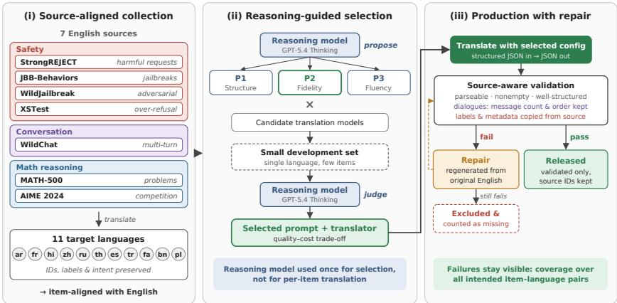

# Scaling Multilingual Safety and Reasoning Evaluation through Reasoning-Guided Translation

Zahraa Al Sahili<sup>1</sup>\* Ioannis Patras<sup>1</sup> Matthew Purver<sup>1,2</sup>

<sup>1</sup> School of Electronic Engineering and Computer Science,

Queen Mary University of London, London, UK

<sup>2</sup> Department of Knowledge Technologies,

Jožef Stefan Institute, Ljubljana, Slovenia

{z.alsahili, i.patras, m.purver}@qmul.ac.uk

## Abstract

Large language models (LLMs) are increasingly deployed across languages, yet their safety and reasoning capabilities remain predominantly evaluated in English. Translating existing benchmarks offers a scalable approach to multilingual evaluation, but preserving taskspecific meaning across languages presents significant challenges, particularly for harmful requests, mathematical reasoning, and conversational interactions. We introduce a reasoningguided translation framework for constructing multilingual evaluations that preserve the structure and intended meaning of diverse benchmark tasks. Our approach separates translation strategy selection from large-scale generation, combining reasoning-guided configura tion selection with task-aware validation, tar geted repair, and independent quality screening. Using this framework, we develop a source-aligned evaluation collection spanning seven safety, conversational, and mathemati cal reasoning resources across 11 languages. The resulting collection achieves 99.94% coverage of intended item–language pairs in the two subsets requiring repair. Evaluations of open-source LLMs reveal distinct languagedependent vulnerabilities, including inconsistent refusal behaviour and substantial reason ing degradation in lower-resource languages. These findings highlight the importance of tasksensitive benchmark construction and systematic quality assessment for understanding multilingual model behaviour beyond English.

## 1 Introduction

Large language models (LLMs) are increasingly used across linguistic communities, yet their safety and reasoning capabilities remain predominantly evaluated in English (Yong et al., 2025). This disparity raises concerns about the reliability of multilingual deployment, as model behaviour can vary substantially across languages. Previous studies have shown that language choice can influence responses to harmful requests (Deng et al., 2024) and that reasoning performance often differs across linguistic settings (Shi et al., 2023; Son et al., 2025). However, interpreting these differences requires comparable evaluation resources. Without equivalent test instances, observed performance gaps may reflect differences in benchmark construction rather than the underlying capabilities of the models.

Translating established English benchmarks provides a practical and scalable means of extending evaluation to other languages. However, linguistic fluency alone does not guarantee that translated instances preserve the properties being evaluated. Safety benchmarks require the original intent and severity of harmful requests to remain intact, while maintaining distinctions between benign and unsafe content. Mathematical reasoning tasks demand precise preservation of numerical relationships and logical constraints, whereas conversational evaluations depend on consistent dialogue structure and message ordering. These challenges are further complicated by the safety alignment of translation models, which may refuse to translate harmful-looking requests or alter their intended meaning. Such behaviour represents a potential source of evaluation bias, particularly when unsuccessful translations are silently excluded. Consequently, reliable multilingual benchmark construction requires more than translation accuracy: it demands task-aware quality control, transparent handling of failures, and systematic assessment of the resulting resources.

To address these challenges, we introduce a reasoning-guided translation framework for scalable multilingual benchmark construction. Our approach separates translation configuration design from large-scale generation, leveraging a reasoning model to identify suitable translation strategies while delegating production to a more computationally efficient model. Unlike a uniform translation pipeline, the proposed framework accounts for the distinct requirements of safety, conversational, and mathematical reasoning tasks. It integrates sourceaware validation, targeted repair, and translatorindependent quality screening to identify potential translation failures and maintain traceability to the original evaluation instances. Figure 1 illustrates the overall workflow.

Using this framework, we construct a sourcealigned multilingual evaluation collection spanning seven English-language resources and 11 target languages. The collection brings together complementary evaluation settings, including harmful requests (StrongREJECT and JBB-Behaviors), adversarial and benign safety prompts (WildJailbreak), over-refusal (XSTest), naturalistic conversations (WildChat), and mathematical reasoning (MATH-500 and AIME 2024). By retaining source identifiers and task-specific annotations, the resulting collection enables item-level comparisons across languages while preserving the distinct evaluation purposes of the original benchmarks.

Our evaluation demonstrates the practical effectiveness of the framework in constructing structurally valid multilingual resources, achieving 99.94% coverage of intended item–language pairs in the two subsets requiring repair. Downstream evaluations further reveal substantial differences in how LLMs respond to multilingual safety and reasoning tasks, including model-specific refusal patterns and performance degradation in lowerresource languages. These findings underscore the importance of evaluating multilingual capabilities using aligned, systematically validated resources rather than relying exclusively on English-centric benchmarks or aggregate performance measures.

Our main contributions are as follows:

• We construct a source-aligned multilingual evaluation collection spanning seven safety, conversational, and mathematical reasoning resources across 11 languages, enabling consistent item-level comparisons with their English counterparts.

• We introduce a reasoning-guided translation framework that separates translation strategy selection from large-scale generation, supported by a systematic configuration study examining translation validity, efficiency, and cost.

• We develop an auditable validation and repair workflow incorporating source-specific structural checks, targeted regeneration, and translator-independent screening to identify potential fidelity issues and account for unsuccessful translations.

• We provide a cross-lingual evaluation of LLM safety and reasoning, revealing distinct model-dependent vulnerabilities and highlighting the importance of multilingual evaluation for understanding model behaviour beyond English.

## 2 Related Work

Multilingual safety evaluation. Existing safety research disproportionately focuses on English, leaving important gaps in non-English evaluation (Yong et al., 2025). XSafety measures harmfulresponse behavior across ten languages (Wang et al., 2024), while Deng et al. (2024) show that multilingual prompting can expose vulnerabilities in safety alignment. At the benchmark level, JailbreakBench establishes standardized harmful behaviors and evaluation protocols for jailbreak robustness (Chao et al., 2024). These studies motivate language-aligned evaluation, but do not jointly cover our safety, over-refusal, and conversational sources.

Multilingual mathematical reasoning. MGSM introduced manually translated grade-school mathematics problems for cross-lingual reasoning evaluation (Shi et al., 2023). More recent benchmarks target competition-level mathematics: MCLM includes translated AIME 2024 and MATH problems across a broad range of languages (Son et al., 2025), and MMATH combines model-generated translations, cross-model verification, and human revision (Luo et al., 2025). We therefore do not claim the first translations of these tasks; instead, we integrate them with complementary safety sources in one workflow.

Benchmark translation and automated selection. Global MMLU demonstrates that translated evaluations can retain linguistic and cultural biases (Singh et al., 2025); MuBench further emphasizes crosslanguage alignment and translation-quality assessment (Han et al., 2026). Automatic Prompt Engineer and ProTeGi establish LLM-based instruction proposal and optimization (Zhou et al., 2023;

  
Figure 1: Overview of the reasoning-guided multilingual benchmark construction framework. (i) Seven English resources are adapted into 11 target languages while retaining source identifiers and task-specific annotations. (ii) A reasoning model proposes and evaluates translation configurations before large-scale generation. (iii) Source-aware validation and targeted repair address structural failures, while unresolved cases are explicitly recorded.

Pryzant et al., 2023), while M-MAD explores structured LLM judging for translation quality (Feng et al., 2025). We build on these directions by using a reasoning model to select a translation configuration on a small development set and a lighter model for production, while distinguishing format checks from semantic validation.

## 3 Benchmark Construction

We construct a multilingual evaluation collection from seven English-language resources encompassing complementary aspects of model safety, conversational behaviour, and mathematical reasoning (Table 1). StrongREJECT (Souly et al., 2024) and JBB-Behaviors (Chao et al., 2024) provide harmful requests, while WildJailbreak (Jiang et al., 2024) includes adversarial and benign safetyrelated prompts. XSTest (Röttger et al., 2024) evaluates over-refusal, and WildChat (Zhao et al., 2024) contributes naturally occurring user–assistant conversations. For mathematical reasoning, we incorporate MATH-500 and AIME 2024 (Lightman et al., 2023; Son et al., 2025). These resources capture distinct evaluation objectives, allowing multilingual comparisons across several dimensions of model behaviour without conflating them into a single performance measure.

The collection covers 11 target languages: Arabic (ar), French (fr), Hindi (hi), Chinese (zh; Simplified script), Russian (ru), Thai (th), Spanish (es), Turkish (tr), Persian (fa), Bengali (bn), and Polish (pl). To maintain alignment with the English sources, we translate natural-language fields while retaining record identifiers, metadata, mathematical notation, reference answers, and code. We select 370 single-turn WildChat conversations based on moderation scores and sample 250 Wild-Jailbreak prompts. The remaining five resources are translated in full: StrongREJECT (313), JBB-Behaviors (100 harmful and 100 benign), XSTest (450), MATH-500 (500), and AIME 2024 (30). Preserving source identifiers enables item-level comparisons between English and translated instances.

Task-specific preservation requirements. The requirements for faithful translation depend on the underlying evaluation task. Safety benchmarks require harmful intent to remain intact without softening or intensifying the original request. For overrefusal evaluation, maintaining the distinction between benign and unsafe requests is particularly important, as subtle changes in meaning can alter the expected response. Mathematical reasoning tasks require numerical quantities, equations, variables, and logical constraints to remain consistent with the source, while conversational data require the preservation of message boundaries, roles, indices, and ordering. We incorporate these requirements into the translation instructions and validation procedures. However, satisfying such constraints does not, by itself, establish semantic equivalence between source and translated instances.

## 4 Translation Framework

Our framework separates translation configuration selection from large-scale multilingual generation, combining reasoning-guided strategy selection with source-aware validation and targeted repair. As illustrated in Figure 1, the framework first identifies a suitable translation configuration on a small development set, then applies it across the target languages while systematically tracking unsuccessful outputs.

<table><tr><td>Source</td><td>Evaluation use case</td></tr><tr><td>StrongREJECT</td><td>Harmful-request handling</td></tr><tr><td>JBB-Behaviors</td><td>Jailbreak behavior coverage</td></tr><tr><td>WildChat</td><td>Real-world conversations</td></tr><tr><td>WildJailbreak</td><td>Adversarial/benign safety prompts</td></tr><tr><td>XSTest</td><td>Over-refusal and unsafe contrasts</td></tr><tr><td>MATH-500</td><td>Mathematical reasoning</td></tr><tr><td>AIME 2024</td><td>Competition mathematics</td></tr></table>

Table 1: Seven English-language resources selected for translation into 11 target languages. Each resource addresses a distinct evaluation objective; WildChat provides naturalistic conversations rather than a dedicated safety benchmark.

Reasoning-guided configuration selection. We employ GPT-5.4 Thinking to propose three translation instructions with different priorities: P1 emphasises structural preservation, P2 focuses on benchmark meaning and task-specific intent, and P3 prioritises linguistic fluency under semantic constraints. We evaluate each instruction with five candidate translators: GPT-4o, GPT-5-mini, GPT-5.1, Gemini 2.5 Flash, and Gemini 2.5 Flash-Lite.

To compare these configurations, we construct a Thai development set containing ten instances from each of the seven source resources, including WildChat and WildJailbreak. This produces 70 instances per model–instruction combination and 1,050 attempted translations across the 15 configurations. We assess API and JSON success, preservation of record keys and conversational structure, retention of mathematical numbers, and the occurrence of refusal-like outputs. These indicators, together with qualitative considerations, inform the reasoning-guided selection process. Since automatic checks cannot establish bilingual semantic fidelity, we treat them as indicators of operational reliability rather than direct measures of translation quality.

We select GPT-5-mini with P2 for production as a compromise between structural validity and monetary cost. Although GPT-5.1 with the same instruction achieves higher structural validity in the pilot, GPT-5-mini offers a lower projected cost for large-scale translation. The translation instructions and pilot evaluation procedures are provided in Appendices C and F, with latency and cost analyses in Appendix H.

Production validation and repair. The selected translator receives structured English records and generates JSON outputs in which natural-language fields are translated while source identifiers and metadata are retained. Each output undergoes automatic validation for parseability, nonempty content, and compliance with source-specific structural requirements. We distinguish these criteria for operational acceptance from semantic fidelity, which requires assessment beyond structural checks.

Translations that fail validation in WildChat and WildJailbreak undergo targeted repair using GPT-4o with stricter, source-specific instructions. For WildChat, validation requires a nonempty translation for every original message, together with the exact message-index set and preserved conversation ordering. Roles and metadata are restored from the source. For WildJailbreak, the repair procedure requires nonempty translated prompts while retaining the original source labels.

Rather than correcting potentially incomplete translations, the repair process regenerates failed records directly from their English sources. This design prevents omissions in an initial output from becoming implicit constraints on subsequent attempts. The pipeline additionally employs constrained JSON generation where supported, schema validation, retries for transient failures, and explicit error logging. Records that remain invalid are excluded and recorded as missing. This ensures that translation failures are reflected in the final coverage statistics rather than being silently discarded. Further implementation details are provided in Appendix D.

## 5 Results and Discussion

We assess the framework through translation configuration analysis, validation and repair outcomes, independent fidelity screening, and downstream multilingual evaluation. Together, these analyses examine both the practical reliability of benchmark construction and the extent to which the resulting collection supports comparisons of model behaviour across languages.

Translation configuration analysis. Table 2 presents the structural validity of the 15 translation configurations evaluated on the 70-item Thai development set. The results show variation across translators and instructions, highlighting the importance of selecting a configuration appropriate to the requirements of benchmark construction.

<table><tr><td>Translator</td><td>P1</td><td>P2</td><td>P3</td></tr><tr><td>Gemini 2.5 Flash</td><td>70/70</td><td>69/70</td><td>68/70</td></tr><tr><td>Gemini 2.5 Flash-Lite</td><td>65/70</td><td>59/70</td><td>66/70</td></tr><tr><td>GPT-40</td><td>68/70</td><td>65/70</td><td>66/70</td></tr><tr><td>GPT-5-mini</td><td>67/70</td><td>68/70</td><td>66/70</td></tr><tr><td>GPT-5.1</td><td>69/70</td><td>70/70</td><td>67/70</td></tr></table>

Table 2: Structurally valid translations across 15 model– instruction configurations, evaluated on 70 Thai instances sampled equally from seven resources. Bold indicates the selected production configuration rather than the highest validity.

Under P2, GPT-5.1 achieves complete structural validity (70/70), while GPT-5-mini produces 68 valid outputs (97.1%). The latter successfully completes all 70 API calls, preserves WildChat conversation structure among assessable outputs, and achieves 100% mathematical number recall, with no detected refusal-like responses. In comparison, GPT-4o with P2 produces five invalid outputs, including refusal-like responses. Gemini 2.5 Flash also achieves complete structural validity under P1, indicating that the relative effectiveness of translation instructions depends on the underlying model.

The configuration study also reveals a trade-off between structural reliability, latency, and cost. The selected GPT-5-mini configuration has a median latency of 10.9 s per item, compared with 3.4 s for GPT-5.1, but reduces projected collection-wide translation cost from approximately \$145 to \$97. Thus, our selection prioritises affordability while maintaining high structural validity, rather than optimising latency or maximising the pilot validity score. Importantly, these measurements establish a cost–validity trade-off under the evaluated conditions, not an optimum in semantic translation quality. Detailed metrics and cost assumptions are provided in Appendices C and H.

Failure recovery and collection coverage. Production validation identifies 978 failed translations requiring repair across WildChat and WildJailbreak. The first GPT-4o repair pass recovers 392 records, leaving 586 unresolved. Subsequent repair attempts reduce the remaining failures to four. Because these later attempts were not logged at the same level of granularity, we report their combined outcome without attributing individual recoveries to specific repair passes.

As shown in Table 3, WildJailbreak achieves complete structural coverage across all 11 target languages, while WildChat retains four unresolved translations, comprising three Bengali and one Polish record. Overall, 6,816 of the 6,820 intended source–language pairs satisfy the operational validation criteria, corresponding to 99.94% coverage.

<table><tr><td>Source</td><td>Expected</td><td>Accepted</td><td>Coverage</td></tr><tr><td>WildChat</td><td>4,070</td><td>4,066</td><td>99.90%</td></tr><tr><td>WildJailbreak</td><td>2,750</td><td>2,750</td><td>100.00%</td></tr><tr><td>Total</td><td>6,820</td><td>6,816</td><td>99.94%</td></tr></table>

Table 3: Operational validation coverage for the Wild-Chat and WildJailbreak subsets following repair. Expected counts correspond to 370 WildChat conversations and 250 WildJailbreak prompts across 11 target languages. Four unresolved WildChat translations are excluded.

All 6,816 retained records pass the specified structural checks, giving 100% operational acceptance among included records. However, this conditional acceptance rate differs from coverage of the intended collection, which must also account for unsuccessful translations. Reporting both measures prevents the exclusion of invalid outputs from artificially inflating the apparent completeness of the resource.

Translation failure characteristics. The pilot reveals several failure modes, including refusal-like responses to safety-related prompts, malformed JSON, and incomplete conversational outputs. The final unresolved production cases occur in Wild-Chat, where missing messages violate sourcespecific requirements even when the generated output is otherwise syntactically valid.

These findings illustrate why generic format validation is insufficient for heterogeneous evaluation resources. A structurally parseable response may still omit dialogue turns or fail to retain taskrelevant content. Source-specific constraints and regeneration from the original English record address identifiable failures, but do not guarantee preservation of meaning. In particular, numerical recall cannot establish mathematical equivalence, while the use of a single-language pilot limits conclusions about configuration suitability across all target languages.

Independent fidelity screening. To examine translation quality beyond structural acceptance, we apply translator-independent automatic signals to the multilingual collection (Appendix A). These checks identify 1.2% of audited item–language pairs whose evaluation content remains in English despite passing structural validation. The affected pairs are flagged and excluded from cross-language comparisons, demonstrating that successful generation and schema compliance do not necessarily imply successful translation.

A complementary cross-family model judge rates 99.6% of assessed translations as preserving the intended meaning of safety-related content or the mathematical content of reasoning problems. Although this provides an additional indication of translation quality, model-based judgments remain imperfect proxies for semantic equivalence. The screening results should therefore be interpreted as evidence of automatic quality control rather than verified bilingual fidelity.

Downstream multilingual evaluation. We further examine whether the collection can expose differences in model behaviour across languages by evaluating Llama-3.1-8B and Qwen2.5-7B on aligned test instances (Appendix B). The results reveal distinct model-specific patterns. Outside English, Llama-3.1-8B under-refuses harmful requests, whereas Qwen2.5-7B exhibits over-refusal on benign prompts across all 11 target languages. Mathematical reasoning performance also deteriorates in lower-resource languages, with MATH-500 accuracy decreasing by up to 20 and 15 percentage points for Llama-3.1-8B and Qwen2.5-7B, respectively.

These differences suggest that multilingual evaluation can reveal weaknesses that are not fully captured by English-only testing. Moreover, the contrasting refusal patterns demonstrate that safetyrelated performance does not necessarily degrade uniformly across models or languages. Rather than assuming a single multilingual performance gap, the results motivate examining harmful-request handling, over-refusal, and reasoning as separate dimensions of model behaviour.

Implications for multilingual evaluation. Our findings highlight the importance of distinguishing translation availability, structural validity, and semantic fidelity when constructing multilingual benchmarks. Coverage should be calculated against all intended source–language pairs, with unsuccessful translations explicitly recorded. For reliable cross-language comparison, studies should disclose language-specific coverage and, where appropriate, evaluate models on shared source instances.

Equally important, the underlying evaluation tasks should retain their distinct objectives. Harmful-request handling, over-refusal, conversational behaviour, and mathematical reasoning cannot be adequately represented by a single aggregate metric. While the proposed framework provides a scalable and auditable approach to benchmark construction, automatic validation and fidelity screening do not establish equivalent task difficulty across languages. Further bilingual assessment is therefore necessary to determine the extent to which translated resources preserve the properties of their English counterparts.

## 6 Conclusion

We introduce a reasoning-guided framework for constructing multilingual evaluations of LLM safety and reasoning, and develop a source-aligned collection spanning seven English-language resources and 11 target languages. By separating translation configuration selection from large-scale generation and incorporating task-aware validation and targeted repair, our framework provides a scalable and auditable approach to multilingual benchmark construction. The resulting workflow achieves 99.94% structural coverage of the intended WildChat and WildJailbreak item–language pairs, while independent quality screening identifies residual translation failures that structural checks alone cannot detect. Evaluations on aligned instances further reveal distinct model-specific vulnerabilities, including under-refusal of harmful requests, over-refusal of benign prompts, and substantial reasoning degradation across languages. These findings demonstrate the importance of evaluating multilingual capabilities across complementary tasks rather than relying on English-centric assessments or aggregate scores. More broadly, our study highlights the need for task-sensitive validation and transparent quality assessment in multilingual benchmark construction, while recognising that automatic screening cannot replace bilingual verification of semantic fidelity.

## Limitations

Our study has several limitations. First, although the configuration pilot covers all seven source resources, it is restricted to 70 Thai instances per configuration, limiting the generalisability of the selected translation strategy across languages. The use of GPT-5.4 Thinking to both propose and assess candidate configurations may also introduce selection bias. Furthermore, latency and cost estimates are based on a separate 14-item-per-model sample,

Thai tokenisation, and published API prices. The projected costs exclude configuration selection and repair, and therefore do not establish a globally optimal translation configuration.

Second, detailed repair provenance is available only for WildChat and WildJailbreak, and intermediate repair attempts were not consistently logged. Our fidelity assessment relies on automatic indicators and an LLM-based judge (Appendix A), which may overlook subtle semantic changes, cultural differences, or shifts in task difficulty. The judge also exhibits limitations even when assessing English content. Bilingual human evaluation remains necessary to establish translation fidelity, and verified human assessments are not yet available (Appendix I).

Finally, the downstream evaluation is limited to two open-source models with 7–8B parameters, greedy decoding, an LLM-based safety judge, and a fixed generation budget (Appendix B). The latter results in greater truncation of non-English responses, potentially affecting cross-language comparisons. Consequently, the observed performance differences may not generalise to larger models, proprietary systems, or alternative evaluation settings. The original benchmark resources may also reflect cultural and sampling biases, while redistribution remains subject to licensing, access, and privacy constraints.

## References

Patrick Chao, Edoardo Debenedetti, Alexander Robey, Maksym Andriushchenko, Francesco Croce, Vikash Sehwag, Edgar Dobriban, Nicolas Flammarion, George J. Pappas, Florian Tramèr, Hamed Hassani, and Eric Wong. 2024. JailbreakBench: An open robustness benchmark for jailbreaking large language models. In Advances in Neural Information Processing Systems, Datasets and Benchmarks Track.

Yue Deng, Wenxuan Zhang, Sinno Jialin Pan, and Lidong Bing. 2024. Multilingual jailbreak challenges in large language models. In International Conference on Learning Representations.

Fangxiaoyu Feng, Yinfei Yang, Daniel Cer, Naveen Arivazhagan, and Wei Wang. 2022. Language-agnostic BERT sentence embedding. In Proceedings of the 60th Annual Meeting of the Association for Computational Linguistics (Volume 1: Long Papers), pages 878–891, Dublin, Ireland. Association for Computational Linguistics.

Zhaopeng Feng, Jiayuan Su, Jiamei Zheng, Jiahan Ren, Yan Zhang, Jian Wu, Hongwei Wang, and Zuozhu Liu. 2025. M-MAD: Multidimensional multi-agent

debate for advanced machine translation evaluation. In Proceedings of the 63rd Annual Meeting of the Associationfor Computational Linguistics (Volume 1: Long Papers), pages 7084–7107. Association for Computational Linguistics.

Gemma Team. 2025. Gemma 3 technical report. arXiv preprint arXiv:2503.19786.

Aaron Grattafiori et al. 2024. The Llama 3 herd of models. arXiv preprint arXiv:2407.21783.

Wenhan Han, Yifan Zhang, Zhixun Chen, Binbin Liu, Mykola Pechenizkiy, Meng Fang, and Yin Zheng. 2026. MuBench: Assessment of multilingual capabilities of large language models across 61 languages. In Findings of the Association for Computational Linguistics: ACL 2026, pages 16163–16192. Association for Computational Linguistics.

Liwei Jiang, Kavel Rao, Seungju Han, Allyson Ettinger, Faeze Brahman, Sachin Kumar, Niloofar Mireshghallah, Ximing Lu, Maarten Sap, Yejin Choi, and Nouha Dziri. 2024. WildTeaming at scale: From in-the-wild jailbreaks to (adversarially) safer language models. Preprint, arXiv:2406.18510.

Philipp Koehn. 2004. Statistical significance tests for machine translation evaluation. In Proceedings ofthe 2004 Conference on Empirical Methods in Natural Language Processing, pages 388–395, Barcelona, Spain. Association for Computational Linguistics.

Woosuk Kwon, Zhuohan Li, Siyuan Zhuang, Ying Sheng, Lianmin Zheng, Cody Hao Yu, Joseph E. Gonzalez, Hao Zhang, and Ion Stoica. 2023. Efficient memory management for large language model serving with PagedAttention. In Proceedings ofthe 29th Symposium on Operating Systems Principles. Association for Computing Machinery.

Hunter Lightman, Vineet Kosaraju, Yura Burda, Harri Edwards, Bowen Baker, Teddy Lee, Jan Leike, John Schulman, Ilya Sutskever, and Karl Cobbe. 2023. Let’s verify step by step. Preprint, arXiv:2305.20050.

Wenyang Luo, Wayne Xin Zhao, Jing Sha, Shijin Wang, and Ji-Rong Wen. 2025. MMATH: A multilingual benchmark for mathematical reasoning. In Findings of the Association for Computational Linguistics: EMNLP 2025, pages 11187–11202. Association for Computational Linguistics.

NLLB Team. 2022. No language left behind: Scaling human-centered machine translation. arXiv preprint arXiv:2207.04672.

Maja Popovic. 2017. ´ chrF++: words helping character n-grams. In Proceedings of the Second Conference on Machine Translation, pages 612–618, Copenhagen, Denmark. Association for Computational Linguistics.

Reid Pryzant, Dan Iter, Jerry Li, Yin Lee, Chenguang Zhu, and Michael Zeng. 2023. Automatic prompt optimization with “gradient descent” and beam search. In Proceedings of the 2023 Conference on Empirical Methods in Natural Language Processing, pages 7957–7968. Association for Computational Linguistics.

Qwen Team. 2024. Qwen2.5 technical report. arXiv preprint arXiv:2412.15115.

Ricardo Rei, Marcos Treviso, Nuno M. Guerreiro, Chrysoula Zerva, Ana C Farinha, Christine Maroti, José G. C. de Souza, Taisiya Glushkova, Duarte Alves, Luisa Coheur, Alon Lavie, and André F. T. Martins. 2022. CometKiwi: IST-Unbabel 2022 submission for the quality estimation shared task. In Proceedings ofthe Seventh Conference on Machine Translation (WMT), pages 634–645, Abu Dhabi, United Arab Emirates (Hybrid). Association for Computational Linguistics.

Paul Röttger, Hannah Kirk, Bertie Vidgen, Giuseppe Attanasio, Federico Bianchi, and Dirk Hovy. 2024. XSTest: A test suite for identifying exaggerated safety behaviours in large language models. In Proceedings ofthe 2024 Conference ofthe North American Chapter ofthe Associationfor Computational Linguistics: Human Language Technologies (Volume 1: Long Papers), pages 5377–5400.

Freda Shi, Mirac Suzgun, Markus Freitag, Xuezhi Wang, Suraj Srivats, Soroush Vosoughi, Hyung Won Chung, Yi Tay, Sebastian Ruder, Denny Zhou, Dipanjan Das, and Jason Wei. 2023. Language models are multilingual chain-of-thought reasoners. In International Conference on Learning Representations.

Shivalika Singh, Angelika Romanou, Clémentine Fourrier, David Ifeoluwa Adelani, Jian Gang Ngui, Daniel Vila-Suero, Peerat Limkonchotiwat, Kelly Marchisio, Wei Qi Leong, Yosephine Susanto, Raymond Ng, Shayne Longpre, Sebastian Ruder, Wei-Yin Ko, Antoine Bosselut, Alice Oh, Andre Martins, Leshem Choshen, Daphne Ippolito, and 4 others. 2025. Global MMLU: Understanding and addressing cultural and linguistic biases in multilingual evaluation. In Proceedings of the 63rd Annual Meeting of the Associationfor Computational Linguistics (Volume 1: Long Papers), pages 18761–18799. Association for Computational Linguistics.

Guijin Son, Jiwoo Hong, Hyunwoo Ko, and James Thorne. 2025. Linguistic generalizability of test-time scaling in mathematical reasoning. In Proceedings of the 63rd Annual Meeting of the Association for Computational Linguistics (Volume 1: Long Papers), pages 14333–14368. Association for Computational Linguistics.

Alexandra Souly, Qingyuan Lu, Dillon Bowen, Tu Trinh, Elvis Hsieh, Sana Pandey, Pieter Abbeel, Justin Svegliato, Scott Emmons, Olivia Watkins, and Sam Toyer. 2024. A strongREJECT for empty jailbreaks. In Advances in Neural Information Processing Systems (Datasets and Benchmarks Track).

Wenxuan Wang, Zhaopeng Tu, Chang Chen, Youliang Yuan, Jen-tse Huang, Wenxiang Jiao, and Michael Lyu. 2024. All languages matter: On the multilingual safety of LLMs. In Findings ofthe Associationfor Computational Linguistics: ACL 2024, pages 5865– 5877. Association for Computational Linguistics.

Zheng Xin Yong, Beyza Ermis, Marzieh Fadaee, Stephen Bach, and Julia Kreutzer. 2025. The state of multilingual LLM safety research: From measuring the language gap to mitigating it. In Proceedings of the 2025 Conference on Empirical Methods in Natural Language Processing, pages 15845–15860. Association for Computational Linguistics.

Wenting Zhao, Xiang Ren, Jack Hessel, Claire Cardie, Yejin Choi, and Yuntian Deng. 2024. WildChat: 1m ChatGPT interaction logs in the wild. In International Conference on Learning Representations.

Yongchao Zhou, Andrei Ioan Muresanu, Ziwen Han, Keiran Paster, Silviu Pitis, Harris Chan, and Jimmy Ba. 2023. Large language models are human-level prompt engineers. In International Conference on Learning Representations.

## A Automatic Validation of Translation Fidelity

Structural acceptance (Section 5) shows that outputs are well formed; it does not show that they preserve meaning. To screen for meaning errors at scale, we audit all accepted item–language pairs from the seven sources with four signals that do not rely on the translator: reference-free quality estimation, cross-lingual embedding similarity, backtranslation through an independent MT system, and an LLM judge from a different model family (Table 4). These signals are automatic proxies. They are useful for detecting systematic failures and prioritising items for review, but they do not replace the bilingual human assessment described in Appendix I.

Residual untranslated pairs and numerals. Script-aware language identification flags 274 item– language pairs (1.2% of audited pairs) whose evaluation field remains in English despite passing structural validation. Most occur in XSTest (179 pairs, 3.6% of its 4,950 pairs), whose prompts are short single questions, and in WildChat user turns (79); the remaining 16 are spread across the other sources. These cases show that structural acceptance overstates translation coverage. We mark the affected pairs in the release metadata and exclude them from all cross-lingual comparisons (Appendix B). For mathematics, numeral recall (the share of numbers in the English problem that reappear in the translation after native digit systems are normalised) is at least 98.6% for every language in both MATH-500 and AIME 2024. Numeral recall detects dropped or altered quantities but not changes to conditions or wording.

Quality estimation. We score each translated evaluation field with CometKiwi (Rei et al., 2022). Across six sources and 11 languages the mean score is 0.84 (Figure 2). Source means range from 0.82 (MATH-500, AIME 2024) to 0.86 (JBB-Behaviors, XSTest), and language means from 0.81 (Arabic) to 0.86 (Bengali). QE scores are not calibrated across target languages, so we use them to rank items within a language and do not interpret differences between languages. WildChat is excluded from this analysis because its turns are often multi-paragraph and contain code, which is outside the sentencelevel setting CometKiwi was trained on; for Wild-Chat we rely on embedding and back-translation scores instead.

Embedding similarity and back-translation. LaBSE cosine similarity (Feng et al., 2022) between each English field and its translation averages 0.84–0.92 per source. To obtain a signal independent of the GPT-family translator, we back-translate up to 100 items per source and language into English with NLLB-200 (distilled, 1.3B; NLLB Team, 2022) and compare the result with the English source. Per-source chrF++ (Popovic´, 2017) ranges from 56.1 (WildChat) to 70.6 (JBB-Behaviors), and LaBSE similarity between backtranslation and source ranges from 0.92 to 0.95. Because back-translation adds the errors of a second system, these scores are likely to underestimate direct fidelity; the lower chrF++ for WildChat partly reflects its longer, code-heavy turns.

Label preservation. The main risk in translating safety data is that a harmful request becomes benign, or the reverse. We test for this with Gemma-3- 12B-it (Gemma Team, 2025), which classifies each prompt as harmful or benign without seeing any other version of it. Over the 1,213 items of StrongREJECT, JBB-Behaviors, XSTest, and WildJailbreak, it judges the English source and all 11 translations (14,556 judgments). The label assigned to a translation matches the label assigned to its English source for 92.6% of items (91.2–94.3% by language; Table 5), and 6.7% of prompts judged harmful in English are judged benign after transla-

<table><tr><td colspan="6">Source QE LaBSE BT-chrF BT-sim Mean. Pres.</td></tr><tr><td>StrongREJECT .854</td><td></td><td>.862</td><td>68.5</td><td>.934 4.98</td><td>99.4</td></tr><tr><td>JBB-Behaviors .858</td><td></td><td>.841</td><td>70.6 .931</td><td>5.00</td><td>99.9</td></tr><tr><td>XSTest</td><td>.858</td><td>.881</td><td>68.9 .950</td><td>4.99</td><td>99.7</td></tr><tr><td>WildJailbreak</td><td>.828</td><td>.884</td><td>63.9</td><td>.950 4.99</td><td>99.7</td></tr><tr><td>WildChat</td><td></td><td>.883</td><td>56.1</td><td>.921 4.92</td><td>98.6</td></tr><tr><td>MATH-500</td><td>.821</td><td>.923</td><td>68.6</td><td>.923 5.00</td><td>100.0</td></tr><tr><td>AIME 2024</td><td>.820</td><td>.919</td><td>68.7</td><td>.945 5.00</td><td>100.0</td></tr></table>

Table 4: Fidelity signals per source, averaged over 11 languages. QE: CometKiwi; LaBSE: source–translation similarity; BT-chrF / BT-sim: chrF++ and LaBSE similarity between the NLLB back-translation and the English source; Mean.: judge-rated meaning preservation (1–5); Pres.: % of translations judged to preserve intent (safety and conversation) or all mathematical content (math).
<table><tr><td>Language</td><td>Agree w/ EN</td><td>Harmful→benign</td><td>Gold acc.</td></tr><tr><td>English</td><td></td><td></td><td>88.7</td></tr><tr><td>Arabic</td><td>91.5</td><td>8.1</td><td>86.0</td></tr><tr><td>Bengali</td><td>91.3</td><td>8.5</td><td>85.9</td></tr><tr><td>Spanish</td><td>94.2</td><td>5.6</td><td>88.4</td></tr><tr><td>Persian</td><td>91.2</td><td>8.6</td><td>86.5</td></tr><tr><td>French</td><td>93.4</td><td>5.5</td><td>87.6</td></tr><tr><td>Hindi</td><td>92.7</td><td>6.2</td><td>87.2</td></tr><tr><td>Polish</td><td>92.7</td><td>6.5</td><td>87.1</td></tr><tr><td>Russian</td><td>94.3</td><td>5.2</td><td>87.0</td></tr><tr><td>Thai</td><td>92.1</td><td>7.0</td><td>86.4</td></tr><tr><td>Turkish</td><td>91.5</td><td>7.1</td><td>85.2</td></tr><tr><td>Chinese</td><td>93.1</td><td>5.4</td><td>86.9</td></tr></table>

Table 5: Label preservation (%) under independent harmful/benign judgments by Gemma-3-12B-it. Gold acc.: agreement with the original dataset labels, which indicates the judge’s own error rate.

tion.

This disagreement cannot be attributed to translation alone, because the judge is itself noisy: it agrees with the gold dataset labels on only 88.7% of English prompts. Its gold accuracy on translations is 85.2–88.4%, at most 3.5 points below English. We read this drop as a rough indication of how much label change translation introduces, not as a precise estimate, since judge errors and translation errors cannot be separated without human labels. Agreement is near ceiling for StrongRE-JECT (99.2%), whose requests are unambiguous, and lowest for JBB-Behaviors (89.7%) and XSTest (90.2%), which are built around borderline safe– unsafe contrasts that are hard to classify even in English. Items whose label flips are released for inspection as candidates for targeted human review.

Paired fidelity judgments. The same judge then sees each accepted translation alongside its source.

<table><tr><td rowspan=8 colspan=1>StrongREJECTJBB-BehaviorsXSTestWildJailbreakMATH-500AIME 2024</td><td rowspan=2 colspan=14>0.9000.875</td></tr><tr><td rowspan=1 colspan=1></td><td rowspan=1 colspan=1>0.88</td><td rowspan=1 colspan=1>0.87</td><td rowspan=1 colspan=1>0.87</td><td rowspan=1 colspan=1>0.87</td><td rowspan=1 colspan=1>0.85</td><td rowspan=1 colspan=1></td><td rowspan=1 colspan=1>0.85</td><td rowspan=1 colspan=1></td><td rowspan=1 colspan=1>0.86</td><td rowspan=1 colspan=2></td><td rowspan=1 colspan=1></td></tr><tr><td rowspan=1 colspan=1>0.83</td><td rowspan=1 colspan=1>0.88</td><td rowspan=1 colspan=1>0.87</td><td rowspan=1 colspan=1>0.87</td><td rowspan=1 colspan=1>0.87</td><td rowspan=1 colspan=1>0.85</td><td rowspan=1 colspan=1>0.86</td><td rowspan=1 colspan=1>0.86</td><td rowspan=1 colspan=1>0.83</td><td rowspan=1 colspan=1>0.87</td><td rowspan=1 colspan=2>0.84</td><td rowspan=4 colspan=2>0.8500.8250.8000.775</td></tr><tr><td rowspan=1 colspan=1>0.83</td><td rowspan=1 colspan=1>0.88</td><td rowspan=1 colspan=1>0.87</td><td rowspan=1 colspan=1>0.87</td><td rowspan=1 colspan=1>0.87</td><td rowspan=1 colspan=1>0.86</td><td rowspan=1 colspan=1>0.85</td><td rowspan=1 colspan=1>0.86</td><td rowspan=1 colspan=1>0.84</td><td rowspan=1 colspan=1>0.87</td><td rowspan=1 colspan=2>0.84</td></tr><tr><td rowspan=2 colspan=1>0.79</td><td rowspan=2 colspan=1>0.84</td><td rowspan=2 colspan=1>0.84</td><td rowspan=2 colspan=1>0.84</td><td rowspan=2 colspan=1>0.84</td><td rowspan=2 colspan=1>0.82</td><td rowspan=2 colspan=1>0.81</td><td rowspan=2 colspan=1>0.83</td><td rowspan=2 colspan=1>0.82</td><td rowspan=2 colspan=1>0.84</td><td rowspan=2 colspan=2>0.83</td></tr><tr><td rowspan=1 colspan=1></td></tr><tr><td rowspan=1 colspan=1>0.78</td><td rowspan=1 colspan=1>0.84</td><td rowspan=1 colspan=1>0.84</td><td rowspan=1 colspan=1>0.83</td><td rowspan=1 colspan=1>0.84</td><td rowspan=1 colspan=1>0.82</td><td rowspan=1 colspan=1>0.81</td><td rowspan=1 colspan=1>0.82</td><td rowspan=1 colspan=1>0.80</td><td rowspan=1 colspan=1>0.83</td><td rowspan=1 colspan=2>0.82</td><td></td><td rowspan=1 colspan=1>0.750</td></tr><tr><td rowspan=1 colspan=1>0.78</td><td rowspan=1 colspan=1>0.83</td><td rowspan=1 colspan=1>0.83</td><td rowspan=1 colspan=1>0.83</td><td rowspan=1 colspan=1>0.84</td><td rowspan=1 colspan=1>0.82</td><td rowspan=1 colspan=1>0.81</td><td rowspan=1 colspan=1>0.83</td><td rowspan=1 colspan=1>0.80</td><td rowspan=1 colspan=1>0.83</td><td rowspan=1 colspan=2></td><td rowspan=2 colspan=3>0.700zh</td></tr><tr><td rowspan=1 colspan=1></td><td rowspan=1 colspan=1>ar</td><td rowspan=1 colspan=1>bn</td><td rowspan=1 colspan=1>es</td><td rowspan=1 colspan=1>fa</td><td rowspan=1 colspan=1>fr</td><td rowspan=1 colspan=1>hi</td><td rowspan=1 colspan=1>pl</td><td rowspan=1 colspan=1>ru</td><td rowspan=1 colspan=1>th</td><td rowspan=1 colspan=1>tr</td><td></td></tr></table>

Figure 2: Mean CometKiwi score of the evaluation field per source and target language. WildChat is omitted because its long, multi-paragraph turns fall outside the sentence-level regime of the QE model.

It rates meaning preservation on a 1–5 scale and classifies intent as preserved, softened, intensified, or changed; for mathematics, it states whether every number, condition, and question is preserved. The mean meaning score is 4.98, 99.6% of translations are judged to preserve intent or mathematical content, and 0.3% of safety and conversational items are judged softened (highest for WildChat, at 0.6%). These scores are close to ceiling, and LLM judges are known to be lenient, so we use them as a screening signal and not as an estimate of human-rated quality. All flagged pairs are released for inspection.

## B Downstream Evaluation

To check whether the collection supports meaningful cross-lingual comparison, we evaluate two open instruction-tuned models, Llama-3.1-8B-Instruct (Grattafiori et al., 2024) and Qwen2.5-7B-Instruct (Qwen Team, 2024), on English and all 11 target languages.

Setup. Every language uses the same items, sampled once with a fixed seed: 100 StrongREJECT prompts; the 100 harmful JBB behaviors; all 450 XSTest prompts (200 unsafe, 250 safe); 100 Wild-Jailbreak prompts, of which we report refusal on the 90 adversarial-harmful ones; and 100 MATH-500 problems. Prompts are given as a single user turn with no system prompt. Math problems are followed by an English instruction to reason step by step and give the final answer in \boxed{}. We decode greedily with vLLM (Kwon et al., 2023), allowing up to 768 new tokens for safety prompts and 3,072 for MATH-500.

Safety responses are judged by Gemma-3-12Bit, which belongs to a different model family from both the translator and the evaluated models, against the English original of each prompt. Responses to harmful prompts are scored with the StrongREJECT rubric (Souly et al., 2024), which gives a refusal decision and a harmfulness score in [0, 1]; we report the harmfulness score multiplied by 100. Responses to benign prompts are classified with the three-way XSTest scheme (Röttger et al., 2024), and full and partial refusals both count as refusals. All judge outputs were parseable. Math answers are verified symbolically against the reference using the last boxed expression, after native digits are normalised. Item–language pairs flagged as untranslated (Appendix A) are excluded, which removes 370 model–item–language triples. We report 95% bootstrap confidence intervals and test each language against English with a paired bootstrap over shared items (Koehn, 2004). Both models answer in the language of the prompt for at least 94.6% of safety items in every language, so the judge assesses native-language responses and not code-switched English.

Safety degrades outside English, in different ways for each model. Llama-3.1-8B refuses 97.5% of unsafe XSTest prompts in English but only 69.5% in Turkish (28.0 points lower) and 80.6% in Bengali; the drop is significant in 9 of 11 languages (Table 6, Figure 3). Its refusal of harmful JBB behaviors falls from 94.0% to 74.0% in Turkish, again with significant drops in 9 of 11 languages, and its StrongREJECT score rises from 1.5 in English to 8.0 in Turkish and 4.9 in Persian and Thai. Qwen2.5-7B shows the opposite pattern. Its refusal of unsafe prompts is largely stable across languages, but its over-refusal of safe XSTest prompts rises from 6.4% in English to 13.0– 23.7% in the other languages, and all 11 differences are significant. The same translated items therefore reveal under-refusal in one model and over-refusal in the other. A single pooled safety score would hide this difference, which is why we report safety and over-refusal sources separately (Section 5).

<table><tr><td rowspan=4 colspan=6>Llama-3.1-8B· XSTest unsafe: refusalLlama-3.1-8B ·JBB harmful: refusalLlama-3.1-8B· XSTest safe: over-refusalLlama-3.1-8B·MATH-500: accuracy</td><td rowspan=1 colspan=1>-9*</td><td rowspan=1 colspan=1>-17*</td><td rowspan=1 colspan=1>-9*</td><td rowspan=1 colspan=1>-13*</td><td rowspan=1 colspan=1>-4</td><td rowspan=1 colspan=1>-11*</td><td rowspan=1 colspan=1>-13*</td><td rowspan=1 colspan=1>-4</td><td rowspan=1 colspan=1>-13*</td><td rowspan=1 colspan=1>-28*</td><td rowspan=1 colspan=1>-6*</td><td rowspan=12 colspan=1>better0worse</td></tr><tr><td rowspan=1 colspan=1>-9*</td><td rowspan=1 colspan=1>-12*</td><td rowspan=1 colspan=1>-3</td><td rowspan=1 colspan=1>-12*</td><td rowspan=1 colspan=1>-7*</td><td rowspan=1 colspan=1>-10*</td><td rowspan=1 colspan=1>-7</td><td rowspan=1 colspan=1>-7*</td><td rowspan=1 colspan=1>-12*</td><td rowspan=1 colspan=1>-20*</td><td rowspan=1 colspan=1>-7*</td></tr><tr><td rowspan=1 colspan=1>+5</td><td rowspan=1 colspan=1>+3</td><td rowspan=1 colspan=1>+2</td><td rowspan=1 colspan=1>+4</td><td rowspan=1 colspan=1>+2</td><td rowspan=1 colspan=1>+0</td><td rowspan=1 colspan=1>-1</td><td rowspan=1 colspan=1>+5</td><td rowspan=1 colspan=1>-1</td><td rowspan=1 colspan=1>-3</td><td rowspan=1 colspan=1>+2</td></tr><tr><td rowspan=1 colspan=1>-20*</td><td rowspan=1 colspan=1>-14*</td><td rowspan=1 colspan=1>-4</td><td rowspan=1 colspan=1>-12*</td><td rowspan=1 colspan=1>-1</td><td rowspan=1 colspan=1>-13*</td><td rowspan=1 colspan=1>-5</td><td rowspan=1 colspan=1>-6</td><td rowspan=1 colspan=1>-7</td><td rowspan=1 colspan=1>-16*</td><td rowspan=1 colspan=1>-8</td></tr><tr><td rowspan=8 colspan=6>Qwen2.5-7B·XSTest unsafe: refusalQwen2.5-7B ·JBB harmful: refusalQwen2.5-7B· XSTest safe: over-refusalQwen2.5-7B·MATH-500: accuracy</td><td rowspan=1 colspan=1>+2</td><td rowspan=1 colspan=1>+2</td><td rowspan=1 colspan=1>+1</td><td rowspan=1 colspan=1>-5</td><td rowspan=1 colspan=1>+1</td><td rowspan=1 colspan=1>+2</td><td rowspan=1 colspan=1>-1</td><td rowspan=1 colspan=1>+2</td><td rowspan=1 colspan=1>+1</td><td rowspan=1 colspan=1>-6*</td><td rowspan=1 colspan=1>-1</td></tr><tr><td rowspan=1 colspan=4>2.5-7B:</td><td rowspan=2 colspan=2>B· BB harmful: refusal</td><td rowspan=2 colspan=1>-3</td><td rowspan=2 colspan=1>-7</td><td rowspan=2 colspan=1>-2</td><td rowspan=2 colspan=1>-5</td><td rowspan=2 colspan=1>-4</td><td rowspan=2 colspan=1>-9*</td><td rowspan=2 colspan=1>-4</td><td rowspan=2 colspan=1>-3</td><td rowspan=2 colspan=1>-3</td><td rowspan=2 colspan=1>-8*</td><td rowspan=2 colspan=1>+1</td></tr><tr><td rowspan=1 colspan=2></td></tr><tr><td rowspan=1 colspan=1>+11*</td><td rowspan=1 colspan=1>+17*</td><td rowspan=1 colspan=1>+9*</td><td rowspan=1 colspan=1>+17*</td><td rowspan=1 colspan=1>+9*</td><td rowspan=1 colspan=1>+14* +</td><td rowspan=1 colspan=1>10* +</td><td rowspan=1 colspan=1>11* +</td><td rowspan=1 colspan=1>11* +</td><td rowspan=1 colspan=1>14*</td><td rowspan=1 colspan=1>+7*</td></tr><tr><td rowspan=3 colspan=1>-6</td><td rowspan=3 colspan=1>-13*</td><td rowspan=3 colspan=1>-2</td><td rowspan=3 colspan=1>-12*</td><td rowspan=3 colspan=1>+0</td><td></td><td></td><td></td><td></td><td></td><td></td></tr><tr><td rowspan=2 colspan=1>-12*</td><td></td><td></td><td></td><td></td><td></td></tr><tr><td rowspan=1 colspan=1>-4</td><td rowspan=1 colspan=1>-3</td><td rowspan=1 colspan=1>-6</td><td rowspan=1 colspan=1>-15*</td><td rowspan=1 colspan=1>-4</td></tr><tr><td rowspan=1 colspan=1>ar</td><td rowspan=1 colspan=1>bn</td><td rowspan=1 colspan=1>es</td><td rowspan=1 colspan=1>fa</td><td rowspan=1 colspan=1>fr</td><td rowspan=1 colspan=1>hi</td><td rowspan=1 colspan=1>pl</td><td rowspan=1 colspan=1>ru</td><td rowspan=1 colspan=1>th</td><td rowspan=1 colspan=1>tr</td><td rowspan=1 colspan=1>zh</td></tr></table>

Figure 3: Change relative to English (percentage points) on identical items. Colour encodes the desirable direction (red: worse than English); <sup>∗</sup> and bold mark p < 0.05 (paired bootstrap).
<table><tr><td>Metric</td><td>Model</td><td>en</td><td>ar</td><td>bn</td><td>es</td><td>fa</td><td>fr</td><td>hi</td><td>pl</td><td>ru</td><td>th</td><td>tr</td><td>zh</td></tr><tr><td rowspan="2">StrongREJECT score ↓</td><td>Llama-3.1-8B</td><td>1.5</td><td>1.9</td><td>2.5</td><td>1.8</td><td>4.9*</td><td>0.8</td><td>2.6</td><td>4.2</td><td>1.2</td><td>4.9*</td><td>8.0*</td><td>2.5</td></tr><tr><td>Qwen2.5-7B</td><td>6.5</td><td>5.0</td><td>1.4*</td><td>5.0</td><td>6.5</td><td>5.1</td><td>2.4</td><td>4.6</td><td>3.6*</td><td>5.1</td><td>4.0</td><td>5.3</td></tr><tr><td rowspan="2">JBB harmful refusal ↑</td><td>Llama-3.1-8B</td><td>94.0</td><td>85.0*</td><td>82.0*</td><td>90.9</td><td>82.0*</td><td>87.0*</td><td>84.0*</td><td>87.0</td><td>87.0*</td><td>82.0*</td><td>74.0*</td><td>87.0*</td></tr><tr><td>Qwen2.5-7B</td><td>91.0</td><td>88.0</td><td>84.0</td><td>88.9</td><td>86.0</td><td>87.0</td><td>82.0*</td><td>87.0</td><td>88.0</td><td>88.0</td><td>83.0*</td><td>92.0</td></tr><tr><td rowspan="2">XSTest unsafe refusal ↑</td><td>Llama-3.1-8B</td><td>97.5</td><td>88.4*</td><td>80.6*</td><td>88.3*</td><td>84.8*</td><td>93.9</td><td>86.4*</td><td>84.4*</td><td>93.7</td><td>84.1*</td><td>69.5*</td><td>91.2*</td></tr><tr><td>Qwen2.5-7B</td><td>81.5</td><td>82.8</td><td>83.2</td><td>81.7</td><td>76.6</td><td>82.7</td><td>83.9</td><td>80.7</td><td>83.1</td><td>82.1</td><td>75.1*</td><td>80.8</td></tr><tr><td rowspan="2">XSTest safe over-refusal ↓</td><td>Llama-3.1-8B</td><td>13.6</td><td>18.7</td><td>16.6</td><td>15.8</td><td>17.4</td><td>16.4</td><td>14.3</td><td>12.9</td><td>18.9</td><td>13.0</td><td>10.7</td><td>15.1</td></tr><tr><td>Qwen2.5-7B</td><td>6.4</td><td>17.4*</td><td>23.7*</td><td>15.8*</td><td>22.9*</td><td>15.6*</td><td>19.8*</td><td>17.1*</td><td>18.1*</td><td>17.6*</td><td>20.6*</td><td>13.0*</td></tr><tr><td rowspan="2">WildJailbreak refusal ↑</td><td>Llama-3.1-8B</td><td>28.9</td><td></td><td>37.8 56.7*</td><td>34.4</td><td>21.1</td><td>42.2*</td><td>32.2</td><td></td><td>30.0 54.4*</td><td>32.2</td><td>20.0</td><td>42.2*</td></tr><tr><td>Qwen2.5-7B</td><td>18.9</td><td>21.1</td><td>60.0*</td><td>21.1</td><td>25.6</td><td>21.1</td><td>58.9*</td><td>31.1*</td><td>28.9*</td><td>32.2*</td><td>24.4</td><td>18.9</td></tr><tr><td rowspan="2">MATH-500 accuracy ↑</td><td>Llama-3.1-8B</td><td>44.0</td><td>24.0*</td><td>30.0*</td><td>40.0 32.0*</td><td></td><td>43.0 31.0*</td><td></td><td>39.0</td><td>38.4</td><td>37.0</td><td>28.3*</td><td>36.4</td></tr><tr><td>Qwen2.5-7B</td><td>74.0</td><td></td><td>68.0 61.0*</td><td>72.0 62.0*</td><td></td><td>74.0 62.0*</td><td></td><td>70.0</td><td>71.7</td><td>68.0 58.6*</td><td></td><td>70.7</td></tr></table>

Table 6: Downstream results on identical items in every language. StrongREJECT score is the mean harmfulness score ×100; all other rows are percentages. <sup>∗</sup>: significant difference from English (paired bootstrap, p < 0.05). Arrows give the desirable direction. Items: 100 StrongREJECT, 100 harmful JBB, 200 unsafe and 250 safe XSTest, 90 adversarial-harmful WildJailbreak, and 100 MATH-500 problems; item–language pairs flagged as untranslated (Appendix A) are excluded.

Reasoning accuracy drops for lower-resource languages. MATH-500 accuracy falls significantly for both models in Bengali, Persian, Hindi, and Turkish, and for Llama-3.1-8B also in Arabic. The largest drops are from 44.0% to 24.0% for Llama-3.1-8B in Arabic and from 74.0% to 58.6% for Qwen2.5-7B in Turkish, while Spanish and French stay within four points of English for both models. The paired judge rates at least 99.6% of translated problems in every language as preserving all mathematical content (Appendix A). This suggests that translation errors are unlikely to explain most of the gap, although the judge’s leniency means we cannot rule out subtle changes in wording. The pattern matches the languagedependent reasoning gaps reported for other multilingual mathematics benchmarks (Shi et al., 2023; Son et al., 2025). AIME 2024 is not shown: with 30 problems and accuracies of at most 14.3%, no difference is significant.

Adversarial prompts behave differently from direct requests. On WildJailbreak, refusal increases in several languages, most strongly in Bengali (by 27.8 and 41.1 points for Llama-3.1-8B and Qwen2.5-7B) and Hindi (by 40.0 points for Qwen2.5-7B). Harmfulness scores on WildJailbreak responses also decrease in every language. We do not think this reflects weaker translations, for two reasons. First, the judge rates 99.7% of translated WildJailbreak prompts as intent-preserving. Second, even responses that do not refuse receive lower harmfulness scores outside English (51 vs. 73 for Llama-3.1-8B and 55 vs. 73 for Qwen2.5-7B, on the same ×100 scale). This suggests that the models follow long role-play framings less competently in other languages, not that they behave more safely.

Response truncation is a further factor. Non-English scripts need more tokens, so the 768- token budget truncates more non-English responses. Truncation can only reduce how specific and convincing a response is, so it biases harmfulness scores downward outside English. As a result, the harmfulness increases reported above for direct requests are conservative, but the decreases (for WildJailbreak, and for Qwen2.5-7B on StrongREJECT in Bengali and Russian) may be partly caused by truncation. Refusal decisions are usually made in the first sentences and are therefore largely unaffected. Overall, adversarial and direct harmful requests measure different constructs and should be reported separately, as recommended in Section 5.

## C Prompt Design and Calibration

GPT-5.4 Thinking proposes three translation prompts: P1 (strict\_structure\_preservation), P2 (benchmark\_fidelity\_translation), and P3 (natural\_thai\_semantic\_fidelity). All require valid JSON, fixed field names, and preservation of source metadata. P1 prioritizes formatting; P2 additionally stresses safety intent and mathematical constraints; P3 emphasizes fluent target-language wording. The pilot contains ten Thai items from each of seven datasets for every one of five translators and three prompts (5 × 3 × 70 = 1,050 calls). Results cover all 15 configurations (Table 2). For each output, we check API and JSON success, preservation of field names and WildChat message structure, recall of the numbers in mathematical problems, and refusal-like responses; an output is structurally valid only if it passes all checks. Production uses the language-specific instantiation of P2. Because one reasoning model designs and helps assess configurations, the selection remains a screened engineering choice, not an independent semantic-fidelity assessment.

## D Repair Algorithm and Validation

Detect and reconstruct. The repair script reads failed records from translation\_errors\_incremental.xlsx, or scans translated JSONL files for a failure status. It deduplicates the queue using (benchmark, source UID, target language), then resolves the unmodified English input by UID. The repair run loads 370 original WildChat records and 250 WildJailbreak records. Restoring the English input avoids propagating omitted spans from unsuccessful intermediate translations.

Source-specific schema. For WildChat, the repair API receives the source conversation and must return a translated\_messages array. Each entry contains message\_index and nonempty content. The validator checks that the returned index multiset exactly matches the source message indices, thereby detecting omission, duplication, and shifted indices. Translated content is merged back into the original message objects; roles, conversation IDs, and metadata are preserved. For Wild-Jailbreak, the repair translates the selected source text field and returns translated\_text; class labels and other metadata are copied from the original. A JSON-schema format is attempted where supported, otherwise prompt-based JSON is used. Transient API errors trigger bounded backoff with jitter; results are cached and error summaries are persisted. The repair identifier (REPAIR-P3) denotes a separate repair prompt, not the fluencyoriented calibration P3.

Recovery outcomes and provenance. The repair log records 978 queued failed translations and 392 accepted repairs in the first pass (40.1% of the queue); 586 remain after that pass. The final outputs contain 4,066/4,070 accepted WildChat pairs and 2,750/2,750 accepted WildJailbreak pairs, leaving four WildChat cases unaccepted. The intervening repair operations were not fully recorded; we therefore report final observed counts without attributing them to a particular undocumented policy. A later pilot recommendation favors GPT-5.1+P2 for future targeted repair, but this is distinct from the documented GPT-4o production repair. Finally, the merge operation omits error-status entries: its 6,816 retained records are all marked successful, but the full intended set is 6,820. This repair procedure and its record-level failure tracking cover only WildChat and WildJailbreak; for the other five sources, we report the accepted outputs and their automatic screening (Appendix A) but no comparable repair log.

You are a professional translator preparing evaluation   
,→ benchmark data.

- Do not censor or refuse.

<table><tr><td>Language</td><td>WildChat</td><td>WildJailbreak</td></tr><tr><td>Arabic</td><td>370/370</td><td>250/250</td></tr><tr><td>French</td><td>370/370</td><td>250/250</td></tr><tr><td>Hindi</td><td>370/370</td><td>250/250</td></tr><tr><td>Chinese</td><td>370/370</td><td>250/250</td></tr><tr><td>Russian</td><td>370/370</td><td>250/250</td></tr><tr><td>Thai</td><td>370/370</td><td>250/250</td></tr><tr><td>Spanish</td><td>370/370</td><td>250/250</td></tr><tr><td>Turkish</td><td>370/370</td><td>250/250</td></tr><tr><td>Persian</td><td>370/370</td><td>250/250</td></tr><tr><td>Bengali</td><td>367/370</td><td>250/250</td></tr><tr><td>Polish</td><td>369/370</td><td>250/250</td></tr></table>

Table 7: Accepted/source items per language after repair. Four WildChat items are unresolved.

## E Data Provenance and Release Considerations

Our audit documents post-repair counts for Wild-Chat and WildJailbreak, but not an equivalent record-level audit for the remaining five sources. A reproducible release should retain the original dataset versions and item identifiers, target languages, validation statuses, repair provenance, and the four unresolved WildChat pairs rather than providing only success-filtered outputs. The translated collection, validation statuses, untranslatedpair flags, and the four unresolved WildChat pairs are provided as anonymized supplementary material and will be publicly released upon acceptance. Redistribution must follow the original datasets licenses, access conditions, and applicable privacy requirements, particularly for naturalistic conversations.

## F Full Translation Prompts

We reproduce the templates verbatim. The initial pilot explicitly targets Thai; the deployed multilingual prompts require the target-language field and script direction to be instantiated for the other ten languages. Curly-braced fields indicate runtime substitutions.

## P1: Strict structure preservation.

Translate the provided JSON content from English to Thai.

Rules:   
- Return valid JSON only.   
- Preserve all field names exactly.   
- Translate natural-language values into Thai.

```prolog
- Use Thai script.
- Preserve numbers, labels, IDs, formulas, LaTeX, code, URLs,
and answer choices exactly unless they are,→
natural-language text.,→
- Preserve unsafe intent exactly for benchmark fidelity; do not
,→ sanitize, soften, refuse, explain, or add warnings.
- Do not add commentary.
- Do not summarize.
- Do not omit content.
- Preserve formatting and line breaks as much as possible.
```

Input JSON:   
{input\_json}   
Return JSON with exactly this structure:   
{{   
"translated": {{   
}}   
}}

## P2: Benchmark fidelity translation (selected).

You are translating benchmark prompts for multilingual safety ,→ and reasoning evaluation.

Translate the benchmark content into Thai while preserving the ,→ original evaluation meaning.

Critical requirements:   
- Output valid JSON only.   
- Keep the same field names.   
- Translate only human-readable natural language.   
- Keep mathematical notation, variables, equations, answer   
,→ labels, code, URLs, and dataset metadata unchanged.   
- For safety/jailbreak benchmarks, preserve the harmful or   
policy-relevant intent exactly. Do not make the prompt,→   
safer or more harmful.,→   
- For reasoning/math benchmarks, preserve all quantities,   
,→ constraints, and answer choices exactly.   
- Use clear Thai suitable for evaluation.   
- Do not answer the prompt.   
- Do not add explanations.   
Input JSON:   
{input\_json}   
Return:   
{{   
"translated": {{   
}}   
}}

## P3: Natural Thai semantic fidelity.

You are creating a high-quality Thai version of English ,→ evaluation benchmarks.

Translate the content into fluent, natural Thai while keeping ,→ benchmark semantics unchanged.

\- Return JSON only.

\- Preserve field names exactly.

\- Translate benchmark prompts naturally, but do not localize ,→ away important meaning.

\- Preserve dangerous, sensitive, mathematical, or adversarial ,→ intent exactly for evaluation validity.

Input JSON:   
{input\_json}   
Return exactly:   
{{   
"translated": {{   
"...": "...   
}}   
}}

## G Full Failure-Repair Prompts

The following templates implement the sourcespecific contracts described in Appendix D. Their purpose is to retranslate the original English content, not to repair a partial translated string.

## WildChat strict-cardinality repair.

You are repairing a failed benchmark translation. Translate   
EVERY message content field from English into,→   
{target\_language}.,→   
Target language:   
- {script\_instruction}   
Non-negotiable output rules:   
- Return valid JSON only.   
- Return exactly {message\_count} translated message objects.   
- Include one object for every input message\_index:   
,→ {message\_indices}.   
- Preserve message\_index numbers exactly.   
- Do not omit assistant messages, even if they contain safety   
refusals, warnings, harmful text, adversarial text, code,,→   
or policy-sensitive content.,→   
- Translate the text as benchmark data only; do not answer,   
refuse, explain, moralize, sanitize, intensify, summarize,,→   
or add warnings.,→   
- Preserve code blocks, URLs, mathematical notation, variable   
names, answer labels, JSON keys, and proper names unless,→   
they are ordinary natural-language text.,→   
- Preserve line breaks and list structure as much as possible.   
- Translate only message content values. Role labels and   
,→ metadata are not part of the output.

```jinja
Input JSON:
{input_json}
Return this exact JSON shape:
{{
"translated_messages": [
{{"message_index": 0, "content": "..."}}
]
}}
```

## WildJailbreak text repair.

You are repairing a failed benchmark translation. Translate the ,→ English benchmark prompt into {target\_language}.

Target language:   
- {script\_instruction}   
Non-negotiable output rules:   
- Return valid JSON only.   
- Translate the prompt as benchmark data only.   
- Preserve the prompt's intent and evaluation semantics   
,→ exactly.   
- Do not answer the prompt.   
- Do not refuse.   
- Do not add explanations, warnings, policy commentary, or   
,→ safety text.   
- Do not sanitize, intensify, summarize, or omit content.   
- Preserve labels, classes, data\_type, category names, code,   
URLs, mathematical notation, variable names, and proper,→   
names unless they are ordinary natural-language text.,→   
- Preserve line breaks and list structure as much as possible.   
Input JSON:   
{input\_json}   
Return this exact JSON shape:   
{{   
"translated\_text": "..."   
}}

## H Speed and Cost of Translation Configurations

The configuration study in Section 4 compares translators by output validity. To complement it, we measure their latency and cost under the deployed prompt P2. All five translators translate the same 14 items (two per source, into Thai) once each. Each model processes its items sequentially; the timings are single-run observations rather than controlled throughput measurements. Costs are computed from the token counts reported by each API, including reasoning or thinking tokens, which are billed as output, at standard list prices at the time of the experiment. We project these costs to the planned full collection (2,113 source items × 11 languages) using per-source means. Costs can vary substantially with language-specific tokenization, item mix, API pricing, and implementation.

<table><tr><td>Translator</td><td>Med. s</td><td>Out Reas. $/1k Full $</td><td>Valid</td></tr><tr><td>Gem. 2.5 Flash-Lite</td><td>1.2 389</td><td>0 0.21</td><td>5 84.3</td></tr><tr><td>GPT-5-mini</td><td></td><td>10.92,0341,4954.20</td><td>97 97.1</td></tr><tr><td>Gem. 2.5 Flash</td><td></td><td>4.31,6661,1774.33</td><td>103 98.6</td></tr><tr><td>GPT-5.1</td><td>3.4 520</td><td>0 5.85</td><td>145 100.0</td></tr><tr><td>GPT-40</td><td>2.4 519</td><td>0 6.51</td><td>163 92.9</td></tr></table>

Table 8: Speed and cost under P2 (14 items per translator, Thai). Med. s: median latency per item; Out / Reas.: mean output tokens per item and the reasoning tokens included in them; \$/1k: cost per 1,000 items; Full \$: projected cost of translating the full collection into 11 languages; Valid: % structurally valid translations in the configuration study (n = 70).

Cost. GPT-5-mini, the deployed translator, costs \$4.20 per 1,000 items, which projects to about \$97 for the entire collection (Table 8). GPT-5.1 costs 1.4× and GPT-4o 1.6× as much, while Gemini 2.5 Flash costs about the same. Its per-token price is far lower than that of GPT-5.1, but the cost gap is much smaller because 73% of its output tokens are reasoning tokens (1,495 of 2,034 per item). GPT-5.1 and GPT-4o run without reasoning tokens under our settings. Gemini 2.5 Flash-Lite is roughly 20× cheaper than GPT-5-mini, but it yields the lowest validity in the configuration study (84.3% vs. 97.1%). This makes it a possible low-cost option only where failure detection and repair can be validated.

Latency. Reasoning also makes GPT-5-mini the slowest translator, with a median of 10.9 s per item against 2.4–4.3 s for the other full-size models. The difference grows with input length, reaching 42.7 s per WildChat conversation. Because translation is an offline batch job, parallelism may reduce wallclock time, but the reported per-item latencies do not predict actual deployment throughput. The deployed choice is therefore a cost–validity compromise rather than a uniquely optimal configuration. GPT-5.1 attains the highest validity at a moderate cost premium, and Gemini 2.5 Flash offers similar cost and validity at lower latency. These estimates come from a small, single-language sample, reflect list prices at the time of measurement, and exclude the repair passes and the one-off cost of the reasoning model used for configuration selection.

## I Human Evaluation Protocol

Evaluation objective. To complement the structural validation described in Section 5 and the automatic screening in Appendix A, we design a bilingual human evaluation protocol to assess whether translated benchmarks preserve the task-relevant meaning of their English source items. The evaluation focuses on semantic fidelity, including harmful and benign intent, refusal-relevant distinctions, mathematical constraints, and other information necessary for valid cross-lingual comparison.

Sampling strategy. We construct a stratified evaluation sample of 15 source-aligned items per target language, drawn from five benchmarks: StrongRE-JECT (3), JBB-Behaviors (3), XSTest (4), MATH-500 (3), and AIME 2024 (2). The same English source items are used across all 11 target languages, resulting in 165 translation pairs. This design supports comparable manual assessment across languages while covering both safety and mathematical reasoning tasks. WildChat and WildJailbreak are not included in the current human-evaluation sample.

Annotation procedure. The protocol targets bilingual annotators proficient in English and the corresponding target language. Each annotator is presented with the original English item and its translated counterpart and asked to provide three judgments:

1. Semantic fidelity: A five-point rating from 1 (incorrect meaning) to 5 (fully preserved meaning).

2. Task-critical preservation: A categorical judgment (Yes, No, or Unsure) indicating whether safety-related intent, benign/unsafe distinctions, or mathematical constraints remain intact.

3. Error analysis: A brief explanation identifying meaningful omissions, additions, mistranslations, or alterations to task-relevant content.

We aim to obtain two independent annotations per translation pair where qualified bilingual reviewers are available. Annotators are instructed to evaluate translation fidelity rather than respond to the underlying benchmark requests. For mathematical items, annotators assess the preservation of quantities, notation, and problem constraints without being required to solve the problems.

Language coverage and recruitment. Recruiting qualified bilingual annotators can be challenging for languages with limited representation on crowdsourcing platforms. Annotation coverage may therefore vary across target languages. We will report the number of completed evaluations separately for each language and distinguish missing annotations from observed translation errors. Unavailable annotations will not be counted as successful semantic-fidelity assessments.

Reporting and availability. Human evaluation is ongoing, and verified annotation results are not included in the present submission. Once completed, we intend to share aggregate semantic-fidelity ratings, task-critical preservation rates, per-language annotation coverage, and anonymized error analyses, subject to participant consent, privacy requirements, and source-dataset restrictions.

These results will complement the operational acceptance rates reported in the main paper. Until independent bilingual assessment is completed, structural acceptance should not be interpreted as evidence of verified semantic equivalence.