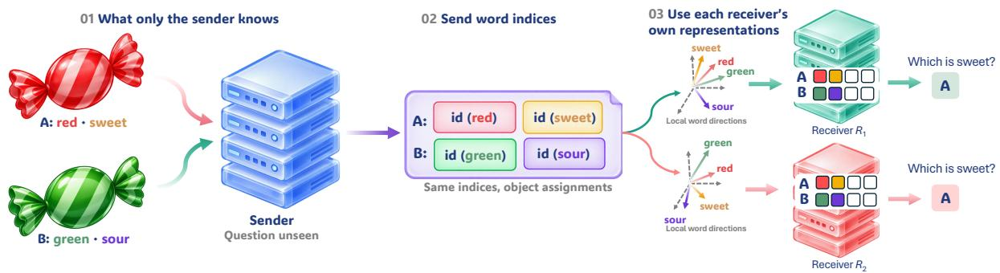
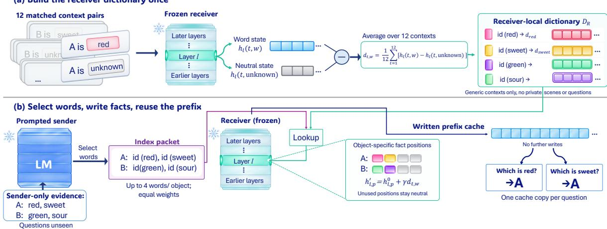
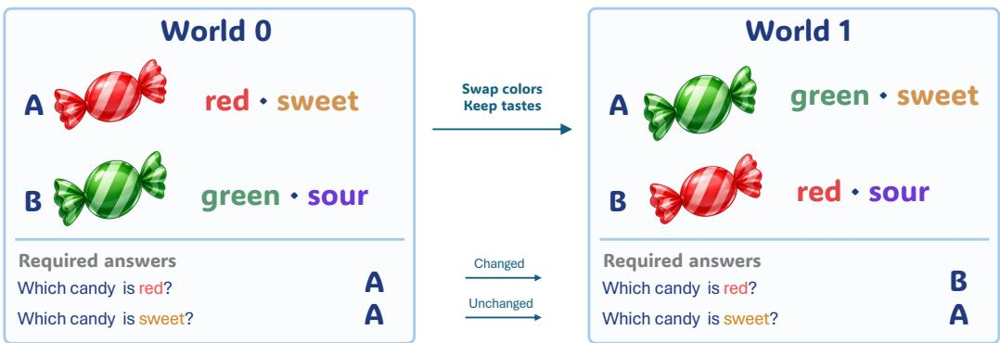
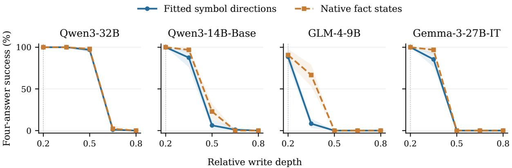
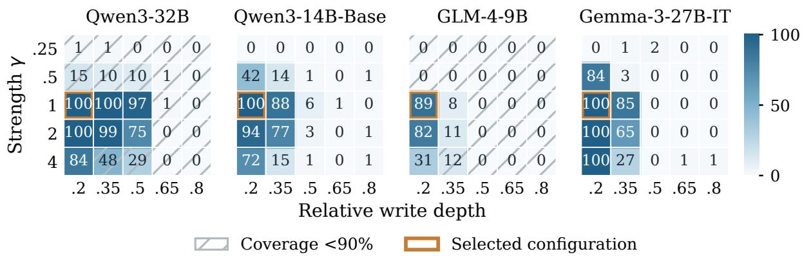
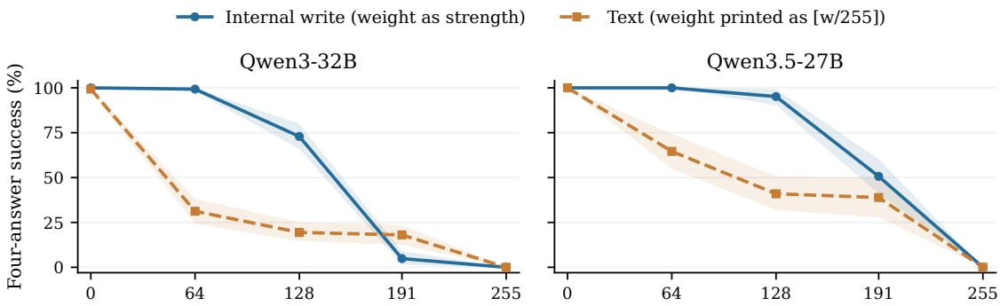
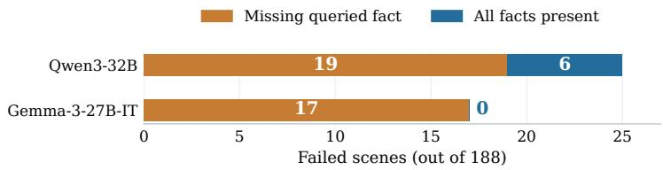

# Share the Symbol, Not the Vector: Training-Free Fact Communication Across Language Models

Xin Li<sup>1</sup>, Mengbing Liu<sup>1</sup>, Hao Jiang<sup>1</sup>, Xin Gao<sup>2</sup>, Annan Wang<sup>1</sup>, Xingwei Qu<sup>3</sup>, Yichi Zhang, Chau Yuen<sup>1</sup>

<sup>1</sup>Nanyang Technological University <sup>2</sup>Yale University <sup>3</sup>University of Manchester

€ Project · § Code · õ Data · ò Model

## Abstract

Multi-agent systems allow language models to solve tasks collaboratively by sharing complementary information. These systems typically communicate through text, while recent approaches also explore exchanging internal model states. However, sharing these states across architectures often requires learned translators or assumptions about model compatibility. We introduce SYNC (Symbol-Indexed Neural Communication), a word-indexed interface that connects heterogeneous models without fine-tuning or a learned translator. From descriptions only it can see, the sender selects words from a shared list and sends their indices for each object, without seeing the questions. The receiver writes the described facts into its hidden states using its own word directions, vectors fitted once from its activations. We test selective use by swapping one attribute between two objects and requiring correct answers about both changed and unchanged attributes before and after the swap, four answers in total. We choose an early write layer on four development receivers and then fix it. With three diferent senders and nine newer receivers from five families, four-answer success on new scenes reaches 72.0–98.3%, up to 96 percentage points above middle-layer writing, and the two largest receivers match plain text. A task-free probe predicted in advance which depths each new receiver can use (45 of 45 cases). Without retuning, messages listing every fact keep 89.6–100% success under new layouts, and sender messages reach 23.9–64.0% on a landmark task with multi-token symbols, below text but from 0% without a message. These results show that shared word indices and receiver-local directions can support selective fact use across model families without additional training.

## 1. INTRODUCTION

Multi-agent systems extend language models from individual problem solving to collaborative workflows, with applications in mathematical reasoning, question answering, and software development (Du et al., 2024; Hong et al., 2024; Wu et al., 2024). By assigning agents complementary roles, these systems can distribute subtasks, combine information from diferent sources, and refine intermediate solutions through interaction. Such collaboration depends on communication: evidence gathered or conclusions reached by one agent must become available for others to use. Natural language typically provides this interface, allowing agents built on diferent models to exchange observations, reasoning, and instructions.

Recent approaches explore communication through internal model states, whose interpretation depends on the model that produces them. Cache-to-Cache addresses this compatibility problem by learning projection and fusion modules between models (Fu et al., 2026). LatentMAS enables training-free state sharing under structural compatibility assumptions and discusses trainable adapters for heterogeneous agents (Zou et al., 2026). Sharing internal states between diferent architectures therefore requires either a learned translator or models built to be compatible. We seek an interface that supports useful fact transfer across diferent model architectures without fine-tuning either model or training a cross-model translator.

  
Figure 1. Shared words, each receiver’s own directions. The sender reads private facts and sends the indices of selected words, grouped by object, without seeing the question. Each receiver writes these words into its hidden states with its own word directions, then answers. Colors mark the same word across models; models and vectors are schematic, and answers are task ground truth.

Our key insight is that words provide shared references even when their internal representations difer across models. Recent work on J-space, a set of word-associated internal representations, shows that a represented concept can support multiple reasoning queries within a model (Gurnee et al., 2026). Inspired by this finding, we introduce SYNC (Symbol-Indexed Neural Communication), a word-indexed interface: a prompted sender selects words from private evidence and transmits their indices and object assignments; the receiver interprets these indices using its own word directions, one vector per word in its hidden space (Figure 1). Each direction averages how the receiver’s hidden state changes when a neutral filler in generic inputs is replaced by the word, and is written at positions reserved for the relevant object. Both models remain frozen.

We evaluate whether the receiver uses the transmitted facts selectively. Swapping one attribute between two objects while keeping the other creates two versions of a scene, called worlds. For example, exchanging two candies’ colors should change the receiver’s answer to a color question but not its answer to a taste question. The sender never sees the questions, and the receiver answers both from the same message. Success requires all four answers, two per world, to be correct. Controls separate the sender’s selection from the receiver’s use: plain text, complete facts, the receiver’s own states for those facts, and words pointed to the wrong directions.

We find that this interface enables automatic fact transfer across model families, with performance strongly dependent on where the receiver writes the facts. We choose an early write layer on development data from four receivers and then fix it. Without retuning, messages from three diferent senders reach nine newer receivers from five families with 72.0–98.3% four-answer success on 572 new scenes, while pointing each word to another word’s direction leaves at most 4.4%. Early writing exceeds our original writing at middle layers (depths 0.4–0.6) by 65.0–96.2 percentage points on seven of these receivers, so a failure at one write location can substantially underestimate what a receiver can use. The two largest receivers match plain text, and two receivers tell which of two weighted values is stronger more reliably from write strength than from printed numeric weights (§4.5).

Our contributions are:

• A training-free interface that carries to new models. SYNC connects heterogeneous models through shared word indices and receiver-local directions, without fine-tuning, a translator or paired data; a write setting chosen on four development receivers carries unchanged to three new senders and nine newer receivers, where all 25 cross-model pairs recover the facts (§4.1).

• Where the receiver writes decides what it can use, and a probe predicts it. Early writing recovers delivery where middle-layer writing fails, by up to 96 points on newer receivers; a task-free probe labeled all 45 depths of nine new receivers correctly before measurement, where a depth-only rule mislabels seven (§§4.2–4.3).

• The fixed setting carries beyond the development task. With complete facts, success stays at 89.6– 100% under new layouts; messages reach 23.9–64.0% on a landmark task with multi-token symbols, below text (§4.4).

## 2. METHOD: SYMBOL-INDEXED COMMUNICATION

Consider a sender that reads “� is red and sweet”. It sends the indices of red and sweet, both assigned to object �. The receiver looks up its own vectors for these indices, writes them into positions reserved for �, and answers questions from the resulting hidden states (Figure 2). Neither model is trained: building the directions and choosing where to write them use forward passes only.

## 2.1. Private evidence and shared messages

Only the sender reads the private descriptions. The receiver sees arbitrary object names and a question about one attribute; the sender sees neither the question nor its answer. The two models share a fixed list (inventory) of 221 symbols, each an English word, and a message format that assigns symbols to objects. Symbol indices refer to this list, not to either model’s tokenizer. Each receiver keeps a dictionary: a lookup table from each symbol index to a direction in its hidden space.

The sender is prompted to choose, for each object, up to four inventory symbols that the description supports, and to answer in JSON, with no retries or exclusions. The message (or packet) lists the selected indices under each object in ascending order. The format also carries an 8-bit weight per symbol; automatic messages, written by a prompted sender, set every weight to 255, so they test symbol selection and assignment, not graded weights (Appendix H.1).

## 2.2. Fitting receiver-local symbol directions

To obtain the receiver’s direction for red, we run it on two inputs that difer at one position, which holds either red or the neutral filler unknown, and subtract the two hidden states (residual-stream vectors) at that position.

  
Figure 2. Construct directions once, then write and reuse facts. (a) Each symbol’s direction averages the receiver’s hidden-state diference from a neutral filler over twelve generic contexts. (b) Retrieved directions are added once to saved neutral states at relative depth 0.2 (� = 1); the resulting prefix cache is copied for each question. Answers shown are task ground truth.

Averaging this diference over twelve generic contexts gives the direction; no parameters are trained.

For receiver � and layer �, dictionary row $d _ { \ell , w } ^ { ( R ) }$ is

$$
d _ { \ell , w } ^ { ( R ) } = \frac { 1 } { 1 2 } \sum _ { t = 1 } ^ { 1 2 } \left[ h _ { \ell } ^ { ( R ) } ( t , w ) - h _ { \ell } ^ { ( R ) } ( t , \mathrm { u n k n o w n } ) \right] .
$$

Here � indexes contexts and ℎ is the hidden vector at the final token of the symbol or its filler; a multi-token symbol is replaced by one unknown per token, preserving input length. The contexts are public message layouts that vary object and symbol positions; they contain no private scene, question or answer, and no activations from another model. Each layer’s dictionary is computed once and reused for every message (Appendix H.2). These are not Jacobian-lens directions (Appendix M.3).

## 2.3. Writing facts and reusing the message

Prepare neutral positions. The receiver’s prompt reserves four unknown slots per object, �∶[□][□][□][□], between visible object labels, separators and fixed weight annotations. We run this neutral prefix once and save its hidden states $h _ { \ell , p } ^ { \mathsf { 0 } }$ at each layer � and position $p ;$ these are the receiver’s own states, not zeros.

Write the selected facts. We then run the prefix again, replacing the state at each used slot with its saved neutral state plus the symbol’s direction. In the example, two of �’s slots receive the directions for red and sweet, in message order; unused slots stay neutral. For symbol � with transmitted weight $q _ { w } ,$ , this fact-position writer sets

$$
h _ { \ell , p } ^ { \prime } = h _ { \ell , p } ^ { 0 } + \gamma \frac { q _ { w } } { q _ { \mathrm { m a x } } } d _ { \ell , w } ^ { ( R ) } ,
$$

where $q _ { \mathrm { m a x } }$ is the largest weight for that object and $\gamma$ is the write strength. The write modifies these positions at the output of each chosen layer; later layers compute as usual.

Answer from the written prefix. We save the processed prefix in the receiver’s key–value cache. Each question is appended to its own copy of this cache, with no further writes. Both questions therefore read the same message. In the text route, the receiver instead reads the message’s symbols and weights as ordinary tokens in the same slots. Both routes carry the same symbols and object assignments, although their byte counts difer.

## 3. EXPERIMENTAL SETUP

A test of selective fact use. Each scene consists of two worlds that describe the same two objects with two attributes: candy color/taste, block paint/material, or coat fabric/button material. The second world exchanges one attribute between the objects and keeps the other. In each world, the sender reads the descriptions and sends one message, and the receiver answers one question about each attribute from that message (Figure 3). A scene is a four-answer success only if all four answers are correct; invalid or truncated answers count as errors. Coverage is the fraction of answers in a usable format, right or wrong. Without a message, four-answer success is zero by construction: the receiver sees the same input in both worlds, so it cannot give the two diferent answers that the changed question requires.

  
Figure 3. One changed attribute, four required answers. Only the sender sees the descriptions. Four-answer success requires both questions correct in both worlds. Shown answers are task ground truth, not model outputs.

Models and delivery routes. We select the write setting with one sender, Llama-3.1-8B-Instruct, and four development receivers: Qwen3-32B, Qwen3-14B-Base, GLM-4-9B and Gemma-3-27B-IT. The main evaluation then fixes this setting and uses three diferent senders, Gemma-4-26B-A4B, Qwen3.6-27B and gpt-oss-20b, with newer receivers from five families (Table 1). Each message is delivered in three ways: an early write at relative depth 0.2 with � = 1; our original middle writes at depths 0.4, 0.5 and 0.6; and plain text. Relative depth is the written layer’s index divided by the number of layers; each written layer uses its own dictionary.

Controls. Symbol–direction reassignment points each symbol to another symbol’s direction, using three fixed permutations, while keeping the message, the positions and the edit norm, the size of the actual hidden-state change at each layer. If the receiver reads the symbols rather than reacting to any edit of this size, reassignment should remove success. Complete-fact messages list every required fact, removing sender errors. The native-state reference copies the receiver’s own hidden states for these facts into the same positions; it is an empirical comparison, not an upper bound.

Development and confirmation. We choose depth and strength on 92 development scenes with complete facts, using a grid shared by all receivers and requiring 90% coverage, and fix the choice before 572 new confirmation scenes with automatic messages. New scenes change object names and descriptions but reuse the symbols, question forms and some attribute combinations.

Inference and uncertainty. All routes use FP32, batch-one greedy decoding and 64-token answers. Estimates average over scene families (36 in the confirmation bank, 12 in the development bank). Paired bootstrap intervals resample either the families or the twelve parent templates, keeping each scene intact; we report the interval enclosing both, with Holm correction across each sender’s receivers, or across the prespecified tests of each later experiment. Main-text tables give point estimates; intervals and all contrasts are in the appendices.

## 4. RESULTS

## 4.1. Does a fixed interface carry to new senders and receivers?

We fix every choice on the development receivers (§4.2): a single write at relative depth 0.2 with � = 1 and twelve-context directions. We then apply it unchanged to three diferent senders and to newer receivers that played no part in any choice. Each receiver fits its own directions, and each sender passed a prespecified message-quality check (Appendix A). Table 1 reports all 572 confirmation scenes.

Finding 1 Without retuning, three new senders reach nine newer receivers. Internal delivery reaches 72.0–98.3% four-answer success in all 25 cross-model sender–receiver pairs. On the seven receivers below 27B, it exceeds middle-layer writing by 65.0–96.2 percentage points for every sender.

Any single reassignment of symbols to other symbols’ directions, with bytes and edit size unchanged, leaves at most 4.4% in every cell (significant after Holm correction for every pair), also on the four receivers that keep at least 95% valid answers under reassignment. Two mixture-of-experts receivers, Qwen3.6-35B-A3B and Qwen3.5-122B-A10B, failed the prespecified cached-versus-complete check and have no outcomes (Appendix A).

## 4.2. Where must the receiver write the facts?

Middle-layer writing fails on most receivers. Writing at depths 0.4, 0.5 and 0.6 works only on the 27B receivers (Table 1). We analyze depth on the four development receivers, where the early write was chosen and confirmed at 74.3–97.7% with the Llama sender (Appendix F).

Table 1. A fixed interface carries to new senders and receivers.
<table><tr><td></td><td></td><td colspan="2">Gemma-4 sender</td><td colspan="2">Qwen3.6 sender</td><td colspan="2">gpt-oss sender</td><td>Middle</td></tr><tr><td>Receiver</td><td>Size</td><td>Internal</td><td>Text</td><td>Internal</td><td>Text</td><td>Internal</td><td>Text</td><td>(Gemma-4)</td></tr><tr><td>Qwen3.5-2B</td><td>2B</td><td>81.2</td><td>86.7</td><td>79.3</td><td>83.8</td><td>77.5</td><td>81.5</td><td>4.7</td></tr><tr><td>Qwen3.5-4B</td><td>4B</td><td>96.0</td><td>96.7</td><td>93.4</td><td>94.3</td><td>89.9</td><td>88.0</td><td>3.1</td></tr><tr><td>Qwen3.5-9B</td><td>9B</td><td>93.4</td><td>94.7</td><td>93.6</td><td>96.2</td><td>86.6</td><td>88.5</td><td>4.9</td></tr><tr><td>Qwen3.5-27B</td><td>27B</td><td>98.3</td><td>98.6</td><td>96.4</td><td>96.7</td><td>88.8</td><td>89.1</td><td>77.8</td></tr><tr><td>Qwen3.6-27B</td><td>27B</td><td>97.7</td><td>98.2</td><td>96.0</td><td>96.0</td><td>90.6</td><td>89.5</td><td>82.5</td></tr><tr><td>Granite-4.1</td><td>8B</td><td>92.0</td><td>94.2</td><td>90.6</td><td>94.4</td><td>83.1</td><td>86.0</td><td>14.8</td></tr><tr><td>OLMo-3</td><td>7B</td><td>76.0</td><td>87.8</td><td>72.0</td><td>86.1</td><td>77.1</td><td>84.6</td><td>6.3</td></tr><tr><td>gpt-oss</td><td>20B</td><td>85.3</td><td>97.7</td><td>83.8</td><td>95.8</td><td>77.5</td><td>90.9</td><td>4.5</td></tr><tr><td>Mistral-Small-3.2</td><td>24B</td><td>96.9</td><td>96.7</td><td>94.1</td><td>96.0</td><td>89.0</td><td>88.8</td><td>0.7</td></tr></table>

Four-answer success (%) on 572 confirmation scenes; internal delivery writes at the early layer fixed on the development receivers, without retuning. Shaded: internal and text within ±3 points at both clustering levels. Italic: sender and receiver are the same model, excluded from all counts. Any single symbol–direction reassignment leaves at most 4.4% in every cell. Intervals: Appendix A.

A depth scan with complete facts. Complete facts remove sender errors, isolating delivery. We write once at relative depth 0.2, 0.35, 0.5, 0.65 or 0.8 with that layer’s directions or the native-state reference; both fail at late layers, and the usable range difers by receiver (Figure 4).

Finding 2 Where facts are written decides whether a receiver can use them. At depth 0.2, fitted directions give 100% development success on both Qwen receivers and Gemma and 88.5% on GLM; only Qwen3-32B also works at 0.5.

From development to a fixed write setting. Over these depths and strengths � ∈ {0.25, 0.5, 1, 2, 4}, a fixed rule that maximizes development success subject to 90% valid answers selects depth 0.2 and � = 1 for all four receivers (Figure 5; Appendix J.1). At depth 0.2, doubling the strength keeps success above 82% on every receiver, whereas no strength rescues depths 0.65 or 0.8.

Why does late writing fail? A prespecified diagnostic writes early, then restores the neutral keys and values of every layer up to a cut depth. Cutting at 0.5 removes the efect on GLM and Gemma (88.5% and 100% to at most 2.1%) and lowers Qwen3-14B-Base from 100% to 59.4%; cutting at 0.65 leaves at most 6.2% on all four receivers: later tokens need fact-bearing keys and values in lower layers, which a later write leaves neutral. Processing between layers also matters: on GLM, writing at 0.35 reaches 8.3%, but writing at 0.2 and cutting at 0.35 reaches 72.9% (Appendix G).

Can reusable directions replace the receiver’s own states? On the 572 confirmation scenes with complete facts, the native-state reference is no better at the early layer: both routes exceed 99% on the Qwen receivers and Gemma, and GLM reaches 76.5% with directions and 75.6% with native states (+0.9 [−1.2, 3.2]), below text at 93.0% (Appendix F, Table 12). On these receivers, directions fitted once thus come within one point of states computed per scene (within 4.5 points on the newer receivers; Appendix A), without showing that the representations are identical. Simpler constructions also work: two of three single contexts approach the twelve-context average, and adding input-embedding diferences at the input layer, which here equals reading the symbols as text, matches the fitted directions on three receivers and exceeds them on GLM (Appendix K.2).

## 4.3. Can a receiver’s usable depths be predicted in advance?

Can a probe without task scenes or outcomes predict the depth scan? The binding probe takes a synthetic two-object prompt with neutral slots, writes two inventory symbols into the first slot of each object at one depth, and asks which object carries each symbol; its value is the fraction of 110 fixed symbol pairs for which both answers are correct. On the 20 development receiver–depth cells, a threshold of 0.786 separates usable depths, those with at least 50% complete-fact success. We committed the resulting predictions for the nine newer receivers before running their depth scans (Table 2); the depth-0.2 outcomes and the middle-band writes (depths 0.4–0.6) were already known from §4.1.



Figure 4. Usable depth ranges difer across receivers. Complete-fact four-answer success on 92 development scenes, one write per depth; fitted directions use � = 1, native states come from the receiver reading the facts. Shading: 95% family-bootstrap intervals.  
  
Figure 5. Depth and strength jointly determine usable writes. Complete-fact four-answer success (%, rounded) on 92 development scenes. Hatching: coverage below 90% (scenes stay in the denominator). Orange outlines: the configuration selected for confirmation.

## Finding 3 A task-free probe predicts where each new receiver can write.

All 45 held-out predictions are correct, including the 36 beyond depth 0.2, and the rank correlation with success is 0.89 [0.81, 0.96]. A rule that uses depth alone, fitted on the same development cells, reaches a balanced accuracy of 0.87, 0.13 [0.08, 0.19] below the probe.

The probe separates cases that depth alone cannot: depth 0.35 is usable on both 27B receivers and Granite but not on the other six, and Qwen3.6-27B remains usable at 0.5 while Qwen3.5-27B does not. We replaced the probe once, before any held-out value: a first probe, which asked the receiver to repeat the written symbol, scored near 1.0 on GLM at every depth, including depths where GLM fails (Appendix B).

## 4.4. Does the fixed setting carry beyond the development task?

New layouts. Keeping directions, write layer, strength and parser frozen, we use complete facts on 144 prespecified confirmation scenes and move each object’s facts to its last two slots in reverse order (slots); replace the header, separators, weight notation and object order (template); or add a third object whose facts answer no question (three objects). A layout transfers if internal success stays within 5 points of the standard layout, by a non-inferiority test Holm-corrected over 18 receiver–layout cells.

A landmark task. Countries, adapted from Ramesh & Li (2025), needs the receiver’s world knowledge. The sender privately reads where two people are, such as “QUVO is at Meteora”, and the receiver answers “Which object is in Greece?” and the same for the other country; the second world swaps the landmarks. The inventory becomes the task’s 275 landmark and country names, and every landmark spans two to nine tokens on the Qwen receivers. The Gemma-4 sender selects the landmarks, and each receiver fits directions for the new symbols with the frozen recipe (Appendix C.2).

Table 2. Usable write depths of new receivers, predicted before measurement.
<table><tr><td rowspan="2">Relative depth</td><td colspan="4">Qwen3.5</td><td rowspan="2">Qwen3.6 27B</td><td rowspan="2">Granite-4.1 8B</td><td rowspan="2">OLMo-3 7B</td><td rowspan="2">gpt-oss 20B</td><td rowspan="2">Mistral-3.2 24B</td></tr><tr><td>2B</td><td>4B</td><td>9B</td><td>27B</td></tr><tr><td>0.2</td><td>89.6</td><td>100.0</td><td>100.0</td><td>100.0</td><td>100.0</td><td>100.0</td><td>100.0</td><td>89.6</td><td>99.0</td></tr><tr><td>0.35</td><td>35.4</td><td>7.3</td><td>34.4</td><td>100.0</td><td>100.0</td><td>99.0</td><td>20.8</td><td>26.0</td><td>10.4</td></tr><tr><td>0.5</td><td>0.0</td><td>0.0</td><td>0.0</td><td>18.8</td><td>85.4</td><td>21.9</td><td>2.1</td><td>2.1</td><td>0.0</td></tr><tr><td>0.65</td><td>2.1</td><td>0.0</td><td>3.1</td><td>0.0</td><td>11.5</td><td>0.0</td><td>2.1</td><td>1.0</td><td>0.0</td></tr><tr><td>0.8</td><td>0.0</td><td>0.0</td><td>0.0</td><td>0.0</td><td>0.0</td><td>0.0</td><td>0.0</td><td>0.0</td><td>0.0</td></tr></table>

Complete-fact four-answer success (%) on 92 development scenes, one write per depth. Shaded: predicted usable, committed before these outcomes; bold: observed usable (≥50%). A depth-only rule fitted on the development cells mislabels 7 cells. Probe values: Appendix B.

Table 3. The fixed setting beyond the development task.
<table><tr><td colspan="5">New layouts (complete facts)</td><td colspan="4">Countries (Gemma-4 sender)</td></tr><tr><td>Receiver</td><td>Standard</td><td>Slots</td><td>Template</td><td>Three obj.</td><td>Internal</td><td>Middle</td><td>Reass.</td><td>Text</td></tr><tr><td>Qwen3-32B</td><td>100.0</td><td>100.0</td><td>98.6</td><td>99.3</td><td>46.5</td><td>18.7</td><td>1.7</td><td>92.9</td></tr><tr><td>Qwen3.5-27B</td><td>100.0</td><td>100.0</td><td>100.0</td><td>100.0</td><td>64.0</td><td>5.8</td><td>5.0</td><td>95.7</td></tr><tr><td>Qwen3.6-27B</td><td>100.0</td><td>100.0</td><td>100.0</td><td>100.0</td><td>47.3</td><td>12.3</td><td>3.9</td><td>97.2</td></tr><tr><td>Mistral-3.2-24B</td><td>97.9</td><td>97.2</td><td>89.6</td><td>95.1</td><td>23.9</td><td>0.0</td><td>0.6</td><td>87.1</td></tr><tr><td>Qwen3.5-9B</td><td>93.8</td><td>99.3</td><td>93.8</td><td>95.1</td><td></td><td></td><td></td><td></td></tr><tr><td>Granite-4.1-8B</td><td>96.5</td><td>99.3</td><td>91.7</td><td>97.9</td><td></td><td></td><td></td><td></td></tr></table>

Four-answer success (%). Left: internal delivery, complete facts, 144 confirmation scenes; shaded: within 5 points of Standard (non-inferiority, Holm over 18 tests); unshaded: inconclusive. Right: 172 scenes on the four larger receivers, 0% without a message by construction; Reass.: mean of three symbol–direction reassignments. Intervals: Appendix C.

## Finding 4 Without retuning, the setting carries to new layouts and a landmark task.

Across six receivers, internal success stays at 89.6–100% in every new layout; 14 of 18 tests pass and four are inconclusive. On Countries, four receivers reach 23.9–64.0%, against 0% without a message and at most 5.0% on average after symbol reassignment.

The largest layout loss is 8.3 points (Mistral, new template; Table 3), while text stays at 99.3–100% in every layout. On Countries, the early write again exceeds the original middle-layer writes, by 23.9–58.2 points, but trails text by 31.7–63.2.

## 4.5. Do receivers use weights encoded as write strength?

Messages can also carry an 8-bit weight per symbol. Each object gets its own value of one attribute at weight 255 and the other object’s value at a lower weight �; both worlds then contain the same symbols and difer only in which value is stronger. The internal route writes each symbol at �∕255 of its direction’s strength, and text prints the weights, as in “red [128/255]”. The test uses complete facts, no sender and 144 prespecified confirmation scenes (Figure 6).

Finding 5 Two receivers follow write strength more than printed weights.

Averaged over � = 64, 128 and 191, internal delivery exceeds printed weights by 36.1 [31.0, 41.4] points on Qwen3-32B and 33.8 [20.8, 48.1] on Qwen3.5-27B, after Holm correction.

Against five other text formats (Appendix D), internal delivery stays ahead on Qwen3-32B by 15.5–31.9 points; on Qwen3.5-27B it beats four, while confidence words such as “probably” exceed it by 8.8 [2.8, 14.4] points. Close weights remain hard: at � = 191, Qwen3-32B reaches 4.9% internally and 18.1% with text. Symbol reassignment at � = 128 leaves at most 2.1%. Of the other two prespecified receivers, gpt-oss-20b misses the � = 0 control and Qwen3.5-122B-A10B fails the implementation check (Appendix D).

## 5. RELATED WORK

Word directions and steering. J-space identifies word-associated directions involved in within-model reasoning (Gurnee et al., 2026), motivating studies of reasoning (Wu et al., 2026), steering (Buehler, 2026) and multi-token concepts (Gong & Wang, 2026). SYNC takes this as motivation, but its symbol directions are activation contrasts, as in ActAdd and CAA (Rimsky et al., 2024; Turner et al., 2024). Evidence that models converge on similar representations (Huh et al., 2024), or that one model can be steered, does not by itself show that one model can send facts to another.

  
Weight L of the competing value (own value at 255)  
Figure 6. Graded weights: write strength versus printed weights. Four-answer success with complete facts as the competing value’s weight � rises. At � = 255 both worlds receive identical messages, so success is zero by construction. Shading: 95% family-bootstrap intervals.

Using a model to interpret hidden states. Patchscopes uses interventions to inspect hidden representations through model-generated explanations (Ghandeharioun et al., 2024); SelfIE likewise interprets internal embeddings in natural language (Chen et al., 2024). Where these methods read hidden states out, we write facts in, and test whether reusable symbol directions support unseen questions and follow controlled fact changes.

Communication and representation transfer. Activation communication combines hidden states (Ramesh & Li, 2025); Cache-to-Cache learns to project and combine attention caches (Fu et al., 2026); XKV learns receiver-aware cache translation (Liu et al., 2026). Relative representations align models through shared anchor samples (Moschella et al., 2023). CIPHER forms input embeddings from vocabulary-wide probabilities without weight updates, assuming a shared tokenizer (Pham et al., 2024). XBridge combines word anchors with a learned contextual bridge (Yang et al., 2026). SYNC shares only symbol indices, which each receiver maps to its own directions, so it needs neither a shared tokenizer nor a learned map. Learned maps also transfer adapters and features between models (Chen et al., 2025; Gan et al., 2026; Wang et al., 2026).

## 6. DISCUSSION, LIMITATIONS AND CONCLUSION

Relation to text. For facts with equal weights, internal writing shows no consistent advantage: text is similar or up to 14.1 points better on the smaller receivers, the two largest reach parity (Table 1), internal delivery takes 1.19–1.28 times as long (Appendix J.6), and on Countries text leads by 31.7–63.2 points. The clearest advantage is with graded weights, where write strength beats printed numbers and most other text formats (§4.5); the text still contains the weights, so this compares encodings under our formats (Appendix D).

Scope. Four prompted senders communicate fixed inventories of 221 attribute symbols or 275 place names to thirteen receivers from seven model families; two mixture-of-experts receivers failed our implementation check. New scenes reuse question forms and some attribute combinations; open-vocabulary messages, relational facts and the TipSheets task of Ramesh & Li (2025) remain untested, and senders that read symbols from their own hidden states performed poorly (Appendix E).

Interpretation. Moving from middle to early writing changes the layer, the number of writes and the edit size together. Input embeddings perform at least as well as fitted directions on single-token symbols; their comparison on multi-token symbols, early-layer J-lens writing and the depth probe beyond nine receivers remain untested, and latency was measured only with complete facts.

Conclusion. In SYNC, shared symbol indices and each receiver’s own symbol directions let heterogeneous language models communicate facts without fine-tuning or a learned translator. Early writing recovers delivery where middle-layer writing fails, a task-free probe predicts where each new receiver can write, and the fixed setting carries to newer models, new layouts and a landmark task without retuning. What crosses between the models is the symbol; each receiver supplies its own vector for it.

## AI USE STATEMENT

While preparing this paper, we relied on large-language-model assistants for three kinds of support. For the writing, they helped draft the structure and parts of the text, tighten wording, and format references. For the literature, they helped search for and summarize related work. For the research itself, working under our supervision, they helped refine hypotheses and the experimental design, generated the synthetic task materials, implemented the methods, evaluation and analysis code, ran and monitored the experiments, and helped interpret the results. We did not use them to formulate mathematical claims or proofs, or for qualitative or thematic data analysis; these tasks do not apply to this work. Every contribution was treated as a draft: we reviewed it, approved the task materials, and kept a result only after it was recounted from the stored outputs. The research question and its direction are our own, and we are responsible for the experiments, results, interpretations and everything that appears in this paper.

## REPRODUCIBILITY STATEMENT

Appendices A–D give the protocols of the newer-model, prediction, transfer and graded-weight experiments, and Appendix H specifies the development sender, fitting contexts, public layout, intervention and cache reuse. Appendix J reports data overlap, development selection, confirmation, all controls, uncertainty estimates and numerical checks. Tables and quantitative figures are generated from source data with recorded hashes; independent recounts reconstruct answers and statistics. The earlier sparse-extraction implementation and its limits are described separately in Appendix L.1. Code, the preregistration locks, scene banks, sender messages, per-row records and the analysis outputs behind the main text and Appendices A–K, with commands that regenerate their tables, will be released at https://github.com/LiXin97/SYNC.

## ETHICS STATEMENT

The controlled tasks use mechanically generated descriptions and template sentences over a fixed concept list; the Countries and TipSheets tasks adapted from Ramesh & Li (2025) are generated mechanically as well. All experimental models are open-weight checkpoints run locally. No human subjects or personal data were involved.

## REFERENCES

Markus J. Buehler. Reading and steering representations of materials-science mechanisms in an open-weight language model. arXiv preprint arXiv:2607.20058, 2026.

Alan Chen, Jack Merullo, Alessandro Stolfo, and Ellie Pavlick. Transferring linear features across language models with model stitching. In Advances in Neural Information Processing Systems, volume 38, pp. 48531– 48563. Curran Associates, Inc., 2025. doi: 10.52202/085713-1621. URL https://proceedings.neurips.cc/paper \_files/paper/2025/file/4569a868e7aa891248832ec08445d071-Paper-Conference.pdf.

Haozhe Chen, Carl Vondrick, and Chengzhi Mao. SelfIE: Self-interpretation oflarge language model embeddings. In Proceedings ofthe 41st International Conference on Machine Learning, volume 235 of Proceedings ofMachine Learning Research, pp. 7373–7388. PMLR, 2024. URL https://proceedings.mlr.press/v235/chen24ao.html.

Yilun Du, Shuang Li, Antonio Torralba, Joshua B. Tenenbaum, and Igor Mordatch. Improving factuality and reasoning in language models through multiagent debate. In Proceedings ofthe 41st International Conference on Machine Learning, volume 235 of Proceedings ofMachine Learning Research, pp. 11733–11763. PMLR, 2024. URL https://proceedings.mlr.press/v235/du24e.html.

Tianyu Fu, Zihan Min, Hanling Zhang, Jichao Yan, Guohao Dai, Wanli Ouyang, and Yu Wang. Cache-to-Cache: Direct semantic communication between large language models. In International Conference on Learning Representations, pp. 43130–43158, 2026. URL https://proceedings.iclr.cc/paper\_files/paper/2026/file/474ada 926b331d78f06d95e8913111cc-Paper-Conference.pdf.

Jin Gan, Xin Li, and Jun Luo. Beyond token-level guidance: Inference-time alignment of specialized LLMs via cross-family representation steering. arXiv preprint arXiv:2608.30319, 2026.

Asma Ghandeharioun, Avi Caciularu, Adam Pearce, Lucas Dixon, and Mor Geva. Patchscopes: A unifying framework for inspecting hidden representations of language models. In Proceedings ofthe 41st International Conference on Machine Learning, volume 235 of Proceedings ofMachine Learning Research, pp. 15466–15490. PMLR, 2024. URL https://proceedings.mlr.press/v235/ghandeharioun24a.html.

Xijie Gong and Tonghan Wang. The first token is a clue: Verbalizing multi-token concepts from the J-lens. arXiv preprint arXiv:2608.31084, 2026.

Wes Gurnee, Nicholas Sofroniew, Adam Pearce, Mateusz Piotrowski, Isaac Kauvar, Runjin Chen, Anna Soligo, Paul Bogdan, Euan Ong, Rowan Wang, Ben Thompson, David Abrahams, Subhash Kantamneni, Emmanuel Ameisen, Joshua Batson, and Jack Lindsey. Verbalizable representations form a global workspace in language models. Transformer Circuits Thread, 2026. URL https://transformer-circuits.pub/2026/workspace/index.h tml.

Sirui Hong, Mingchen Zhuge, Jonathan Chen, Xiawu Zheng, Yuheng Cheng, Jinlin Wang, Ceyao Zhang, Zili Wang, Steven Yau, Zijuan Lin, Liyang Zhou, Chenyu Ran, Lingfeng Xiao, Chenglin Wu, and Jürgen Schmidhuber. MetaGPT: Meta programming for a multi-agent collaborative framework. In The Twelfth International Conference on Learning Representations, 2024. URL https://openreview.net/forum?id=VtmB AGCN7o.

Minyoung Huh, Brian Cheung, Tongzhou Wang, and Phillip Isola. The platonic representation hypothesis. In Proceedings ofthe 41st International Conference on Machine Learning, volume 235 of Proceedings ofMachine Learning Research, pp. 20617–20642. PMLR, 2024. URL https://proceedings.mlr.press/v235/huh24a.html.

Jiyao Liu, Qi Zhang, Yaoyi Jia, Ziwen Kan, and Song Wang. Dual-cache latent space communication between heterogeneous language models. arXiv preprint arXiv:2608.20617, 2026. URL https://arxiv.org/abs/2608.20617.

Luca Moschella, Valentino Maiorca, Marco Fumero, Antonio Norelli, Francesco Locatello, and Emanuele Rodolà. Relative representations enable zero-shot latent space communication. In International Conference on Learning Representations, 2023.

Chau Pham, Boyi Liu, Yingxiang Yang, Zhengyu Chen, Tianyi Liu, Jianbo Yuan, Bryan A. Plummer, Zhaoran Wang, and Hongxia Yang. Let models speak ciphers: Multiagent debate through embeddings. In International Conference on Learning Representations, 2024.

Vignav Ramesh and Kenneth Li. Communicating activations between language model agents. In Proceedings ofthe 42nd International Conference on Machine Learning, volume 267 of Proceedings ofMachine Learning Research, pp. 51094–51116. PMLR, 2025. URL https://proceedings.mlr.press/v267/ramesh25a.html.

Nina Rimsky, Nick Gabrieli, Julian Schulz, Meg Tong, Evan Hubinger, and Alexander Turner. Steering Llama 2 via contrastive activation addition. In Proceedings of the 62nd Annual Meeting of the Association for Computational Linguistics (Volume 1: Long Papers), pp. 15504–15522, 2024. doi: 10.18653/v1/2024.acl-long.828. URL https://aclanthology.org/2024.acl-long.828/.

Alexander Matt Turner, Lisa Thiergart, Gavin Leech, David Udell, Juan J. Vazquez, Ulisse Mini, and Monte MacDiarmid. Steering language models with activation engineering, 2024. URL https://arxiv.org/abs/2308.1 0248.

Barry Wang, Avi Schwarzschild, Alexander Robey, Ali Payani, Charles Fleming, Mingjie Sun, and Daphne Ippolito. Command-v: Training-free representation finetuning transfer. In The Fourteenth International Conference on Learning Representations, 2026. URL https://openreview.net/forum?id=oRYzpI3cmJ.

Junde Wu, Jiayuan Zhu, Fengling Liu, Minhao Hu, and Jiazhen Pan. J-CoT: Chain-of-thought in J-Space. arXiv preprint arXiv:2607.21981, 2026.

Qingyun Wu, Gagan Bansal, Jieyu Zhang, Yiran Wu, Beibin Li, Erkang Zhu, Li Jiang, Xiaoyun Zhang, Shaokun Zhang, Jiale Liu, Ahmed Awadallah, Ryen W. White, Doug Burger, and Chi Wang. AutoGen: Enabling next-gen LLM applications via multi-agent conversations. In First Conference on Language Modeling, 2024. URL https://openreview.net/forum?id=BAakY1hNKS.

Wooseong Yang, Wei-Chieh Huang, Weizhi Zhang, Yu Wang, Philip S. Yu, and Junhyun Lee. XBridge: Entitygrounded latent bridge for heterogeneous LLM communication. arXiv preprint arXiv:2608.11676, 2026.

Jiaru Zou, Ruizhong Qiu, Gaotang Li, Xiyuan Yang, Katherine Tieu, Pan Lu, Ke Shen, Hanghang Tong, Yejin Choi, Jingrui He, James Zou, Mengdi Wang, and Ling Yang. Latent collaboration in multi-agent systems. In Forty-third International Conference on Machine Learning, 2026. URL https://openreview.net/forum?id=sy G9I9ofd8.

## APPENDIX CONTENTS

Appendices A–K specify the current method and its evidence. Appendices L–N summarize earlier extraction and   
writing comparisons that explain the design choices and their limits. These studies use distinct configurations   
and evaluation banks; their outcomes are not pooled.   
A Newer senders and receivers 11   
B Predicting usable write depths 14   
C Beyond the development task . 15   
C.1 New layouts 15   
C.2 Countries 15   
D Graded weights 16   
E Further discussion 17   
F Development receivers: confirmation with the Llama sender 17   
G Why late writing fails: diagnostics 19   
H Final interface: implementation and reproduction 21   
H.1 Sender, inventory and messages 21   
H.2 The twelve fitting contexts and public layout . 21   
H.3 Intervention, cache reuse and reference conditions 21   
H.4 Literal prompts and inference settings 22   
H.5 Reproduction sequence 23   
I Task construction and evaluation units 23   
I.1 Two worlds that difer in one fact assignment 23   
I.2 Development, confirmation and overlap . 24   
J Final-interface confirmation and receiver diagnostics 25   
J.1 Write-setting selection and automatic confirmation 25   
J.2 Update magnitude and the native-state reference . 28   
J.3 A depth rule fixed before Gemma’s fitted outcomes 28   
J.4 Four-object transfer with the receiver fixed 28   
J.5 Message content and agreement between delivery routes 29   
J.6 Timing internal and text delivery 31   
K Four-object questions and simpler representations 31   
K.1 Four-object conjunction queries 31   
K.2 Single-context directions and input embeddings 33   
L Earlier extraction: implementation and outcomes 35   
L.1 Sparse messages and coeficient writing 35   
L.2 Binding efects and generated answers 35   
L.3 Single-fact confirmation 35   
M Message selection and direction construction 36   
M.1 Same-checkpoint message sources 36   
M.2 Each-layer directions and the update rule 37   
M.3 Symbol contrasts and J-lens at one layer 37   
N Scope of the earlier utility results 37

## A. NEWER SENDERS AND RECEIVERS

Protocol. The write setting is the one selected on the development receivers (Appendix J.1): one write at relative depth 0.2 with � = 1, raw twelve-context directions that each receiver fits with the frozen recipe (Appendix H.2), four slots per object, and the frozen prompts and parser. The zero-based write layers are 5 for Qwen3.5-2B and gpt-oss-20b, 6 for Qwen3.5-4B, Qwen3.5-9B and OLMo-3-7B, 8 for Granite-4.1-8B and Mistral-Small-3.2-24B, and 13 for both 27B receivers. For every sender and receiver we run no message, an identity write (implementation-check scenes only), the original middle band at depths 0.4, 0.5 and 0.6, the early write, the same message as text, three symbol–direction reassignments with matched edit norm, and the other world’s message; complete facts are run once per receiver. All cells use the 572-scene confirmation bank after excluding the four implementation-check scenes, FP32, eager attention, batch one and greedy decoding. A thin compatibility layer adapts model loading, chat rendering and cache handling to these architectures; the evaluator itself is unchanged. The senders, receivers, thresholds and decision rules were fixed before any outcome.

Senders. Each new sender uses the prompts, inventory and parser of Appendix H.1 and had to pass a message quality gate on the development scenes before generating confirmation messages (Table 4).

Table 4. Message quality of the three new senders.
<table><tr><td></td><td colspan="3">Development gate (96 scenes)</td><td colspan="4">Confirmation messages (576 scenes)</td></tr><tr><td>Sender</td><td>Parsed</td><td>Recall</td><td>Complete</td><td>Parsed</td><td>Recall</td><td>Complete obj.</td><td>Bytes</td></tr><tr><td>Gemma-4</td><td>100.0</td><td>100.0</td><td>100.0</td><td>100.0</td><td>98.2</td><td>96.4</td><td>21.9</td></tr><tr><td>Qwen3.6</td><td>100.0</td><td>100.0</td><td>100.0</td><td>100.0</td><td>97.8</td><td>95.6</td><td>22.5</td></tr><tr><td>gpt-oss</td><td>99.5</td><td>95.4</td><td>90.1</td><td>98.9</td><td>94.1</td><td>89.2</td><td>20.3</td></tr></table>

Percentages. Gate thresholds fixed before any output: parsed ≥99, recall ≥95, complete messages ≥90; all three senders pass. Recall counts required attribute symbols assigned to the correct object. Prompts, parser and inventory are those of Appendix H.1; Gemma-4 and Qwen3.6 use their chat templates with thinking disabled, gpt-oss its lowest reasoning setting.

Implementation check. Each receiver must reproduce the no-message computation exactly under an identity write and agree between cached and complete forward passes (maximum logit diference at most 0.05, alias-gap diference at most 0.1, equal parsed answers at both budgets). All nine reported receivers pass, with logit diferences at most 0.004 and alias-gap diferences at most 0.0004. Qwen3.6-35B-A3B failed (logit diference 0.136 on one reassignment row, with all parsed answers equal). Because expert routing in mixture-of-experts models can flip on near-ties, we dropped the logit criterion for Qwen3.5-122B-A10B before its first row; it still failed the alias-gap criterion (0.168 on one reassignment row). Neither receiver has outcome rows. Seed-OSS-36B-Instruct, also prespecified, is not reported: even with its thinking budget set to zero it often starts a visible reasoning trace instead of an answer, leaving 28–34% of its internal-delivery answers unscored. Its results are included in the released analysis outputs.

Results. Table 5 lists every reported cell. Every reported cross-model pair meets the prespecified recovery rule. Within Qwen3.5, internal − text narrows from 2B to 27B by 5.2 [1.9, 8.9], 4.2 [0.9, 7.8] and 3.7 [0.5, 7.0] points for the Gemma-4, Qwen3.6 and gpt-oss senders. This is descriptive: the prespecified scale contrast used Qwen3.5-122B-A10B. With complete facts (Table 6), the early write stays within 4.5 points of the receiver’s own states on every receiver; on gpt-oss-20b both fall short of text.

Table 5. Newer senders and receivers: all cells.
<table><tr><td>Receiver</td><td>Internal [95% CI]</td><td>Text</td><td>Middle</td><td>Reass. J/valid</td><td>Valid</td><td>Int. – text [95% CI]</td><td>Verdict</td></tr><tr><td colspan="8">Gemma-4 sender</td></tr><tr><td>Qwen3.5-2B</td><td>81.2 [76.7, 85.4]</td><td>86.7</td><td>4.7</td><td>2.5 / 99.4</td><td>99.9</td><td>-5.6 [-9.1, -2.3]</td><td>text better</td></tr><tr><td>Qwen3.5-4B</td><td>96.0 [93.9, 97.9]</td><td>96.7</td><td>3.1</td><td>1.8 / 97.8</td><td>99.8</td><td>−0.7[-3.7, 2.1]</td><td>unresolved</td></tr><tr><td>Qwen3.5-9B</td><td>93.4 [89.7, 96.5]</td><td>94.7</td><td>4.9</td><td>2.9 / 93.9</td><td>99.3</td><td>-1.4 [-3.1, 0.4]</td><td>unresolved</td></tr><tr><td>Qwen3.5-27B</td><td>98.3 [96.2, 99.8]</td><td>98.6</td><td>77.8</td><td>2.2 / 86.3</td><td>99.5</td><td>-0.3 [-1.6, 0.5]</td><td>similar</td></tr><tr><td>Qwen3.6-27B</td><td>97.7 [96.0, 99.1]</td><td>98.2</td><td>82.5</td><td>3.0 / 93.9</td><td>99.9</td><td>−0.5 [-1.2, 0.0]</td><td>similar</td></tr><tr><td>Granite-4.1-8B</td><td>92.0 [87.0, 96.4]</td><td>94.2</td><td>14.8</td><td>0.1 / 12.4</td><td>97.5</td><td>-2.3 [-4.7, -0.3]</td><td>unresolved</td></tr><tr><td>OLMo-3-7B</td><td>76.0 [68.6, 82.8]</td><td>87.8</td><td>6.3</td><td>3.1 / 98.5</td><td>93.4</td><td>-11.8 [-18.4, -5.5]</td><td>text better</td></tr><tr><td>gpt-oss-20b</td><td>85.3 [81.5, 89.0]</td><td>97.7</td><td>4.5</td><td>1.7 / 99.2</td><td>99.9</td><td>-12.4 [-16.1, -8.7]</td><td>text better</td></tr><tr><td>Mistral-Small-3.2</td><td>96.9 [94.3, 99.0]</td><td>96.7</td><td>0.7</td><td>1.9 / 89.4</td><td>100.0</td><td>+0.2 [-3.8, 4.3]</td><td>unresolved</td></tr><tr><td colspan="8">Qwen3.6 sender</td></tr><tr><td>Qwen3.5-2B</td><td>79.3 [74.4, 83.9]</td><td>83.8</td><td>4.0</td><td>2.2 / 99.0</td><td>99.7</td><td>-4.5 [-8.0, -1.6]</td><td>text better</td></tr><tr><td>Qwen3.5-4B</td><td>93.4 [88.7, 97.2]</td><td>94.3</td><td>3.1</td><td>1.6 / 97.7</td><td>99.8</td><td>−0.9 [-4.0, 1.7]</td><td>unresolved</td></tr><tr><td>Qwen3.5-9B</td><td>93.6 [88.7, 97.6]</td><td>96.2</td><td>4.9</td><td>2.9 / 93.8</td><td>99.7</td><td>-2.6 [-4.2, -1.2]</td><td>text better</td></tr><tr><td>Qwen3.5-27B</td><td>96.4 [92.2, 99.8]</td><td>96.7</td><td>75.7</td><td>2.0 / 85.9</td><td>99.9</td><td>-0.3 [-1.2, 0.3]</td><td>similar</td></tr><tr><td>Qwen3.6-27B</td><td>96.0 [91.3, 99.8]</td><td>96.0</td><td>77.1</td><td>2.8 / 93.2</td><td>100.0</td><td>+0.0</td><td>same model</td></tr><tr><td>Granite-4.1-8B</td><td>90.6 [84.0, 96.0]</td><td>94.4</td><td>14.7</td><td>0.0 / 12.9</td><td>97.6</td><td>-3.8 [-8.6, -0.5]</td><td>text better</td></tr><tr><td>OLMo-3-7B</td><td>72.0 [64.8, 78.7]</td><td>86.1</td><td>7.0</td><td>3.3 / 98.4</td><td>93.2</td><td>-14.1 [-19.7, -8.6]</td><td>text better</td></tr><tr><td>gpt-oss-20b</td><td>83.8 [79.5, 87.9]</td><td>95.8</td><td>4.7</td><td>1.6 / 99.1</td><td>99.9</td><td>-12.0 [-16.4, -7.7]</td><td>text better</td></tr><tr><td>Mistral-Small-3.2</td><td>94.1 [88.9, 98.3]</td><td>96.0</td><td>0.9</td><td>1.8 / 86.5</td><td>100.0</td><td>−1.9 [-4.7, 0.0]</td><td>unresolved</td></tr><tr><td colspan="8">gpt-oss sender</td></tr><tr><td>Qwen3.5-2B</td><td>77.5 [70.9, 83.5]</td><td>81.5</td><td>4.2</td><td>2.3 / 99.8</td><td>100.0</td><td>-4.0 [-7.1, -1.1]</td><td>text better</td></tr><tr><td>Qwen3.5-4B</td><td>89.9 [83.9, 94.8]</td><td>88.0</td><td>2.8</td><td>1.6 / 98.5</td><td>99.5</td><td>+1.9 [-0.9, 5.3]</td><td>unresolved</td></tr><tr><td>Qwen3.5-9B</td><td>86.6 [79.6, 92.4]</td><td>88.5</td><td>4.9</td><td>2.8 / 94.1</td><td>97.9</td><td>-1.9 [-4.3, 0.0]</td><td>unresolved</td></tr><tr><td>Qwen3.5-27B</td><td>88.8 [81.6, 94.7]</td><td>89.1</td><td>67.4</td><td>1.8 / 87.4</td><td>98.3</td><td>-0.3 [-0.9, 0.0]</td><td>similar</td></tr><tr><td>Qwen3.6-27B</td><td>90.6 [84.1, 95.7]</td><td>89.5</td><td>74.2</td><td>2.9 / 94.4</td><td>99.2</td><td>+1.1 [-0.2, 2.6]</td><td>similar</td></tr><tr><td>Granite-4.1-8B</td><td>83.1 [75.0, 90.1]</td><td>86.0</td><td>12.6</td><td>0.1 / 11.9</td><td>94.3</td><td>-3.0 [-6.5, -0.0]</td><td>unresolved</td></tr><tr><td>OLMo-3-7B</td><td>77.1 [69.8, 83.6]</td><td>84.6</td><td>5.1</td><td>2.7 / 98.6</td><td>96.6</td><td>-7.6 [-14.9, -1.8]</td><td>text better</td></tr><tr><td>gpt-oss-20b Mistral-Small-3.2</td><td>77.5 [71.2, 83.1]</td><td>90.9</td><td>5.1</td><td>1.7 / 99.0</td><td>99.8</td><td>-13.4</td><td>same model</td></tr><tr><td></td><td>89.0 [82.6, 94.2]</td><td>88.8</td><td>0.7</td><td>2.0 / 92.6</td><td>99.5</td><td>+0.2 [-2.9, 3.0]</td><td>similar</td></tr></table>

Four-answer success (%) on 572 confirmation scenes; brackets give the interval enclosing family- and template-bootstrap intervals over three seeds (family interval for single estimates). Valid: fraction of answers that parse. Reassigned: mean over three edit-norm-matched symbol–direction reassignments. Every reported cross-model pair meets the prespecified recovery rule (internal ≥50%, valid ≥90%, internal above mean reassignment at both clustering levels after Holm correction). Comparison: similar = both intervals within ±3 points; text better = upper limits below zero after Holm correction across each sender’s receivers; otherwise unresolved.

Table 6. Complete facts on the newer receivers.
<table><tr><td>Receiver</td><td>Internal</td><td>Native states</td><td>Text</td><td>Full evidence</td><td>Internal – text [95% CI]</td></tr><tr><td>Qwen3.5-2B</td><td>86.3</td><td>85.9</td><td>89.6</td><td>97.2</td><td>-3.3 [-5.6, -1.0]</td></tr><tr><td>Qwen3.5-4B</td><td>99.0</td><td>99.7</td><td>98.4</td><td>100.0</td><td>+0.5 [-0.7, 1.7]</td></tr><tr><td>Qwen3.5-9B</td><td>96.2</td><td>99.8</td><td>100.0</td><td>100.0</td><td>-3.8 [-7.0, -1.2]</td></tr><tr><td>Qwen3.5-27B</td><td>100.0</td><td>100.0</td><td>100.0</td><td>100.0</td><td>+0.0 [0.0, 0.0]</td></tr><tr><td>Qwen3.6-27B</td><td>100.0</td><td>100.0</td><td>100.0</td><td>100.0</td><td>+0.0 [0.0, 0.0]</td></tr><tr><td>Granite-4.1-8B</td><td>98.1</td><td>97.6</td><td>100.0</td><td>99.8</td><td>-1.9 [-3.1, -0.9]</td></tr><tr><td>OLMo-3-7B</td><td>91.6</td><td>90.4</td><td>94.6</td><td>96.0</td><td>-3.0 [-5.3, -0.6]</td></tr><tr><td>gpt-oss-20b</td><td>86.1</td><td>90.6</td><td>99.1</td><td>100.0</td><td>-13.1 [-17.3, -8.9]</td></tr><tr><td>Mistral-Small-3.2</td><td>97.6</td><td>98.4</td><td>100.0</td><td>100.0</td><td>-2.4 [-5.0, -0.5]</td></tr></table>

Four-answer success (%) on 572 confirmation scenes with complete facts and no model sender, at the fixed early layer. Native states: the receiver’s own states for the facts, copied into the same positions.

## B. PREDICTING USABLE WRITE DEPTHS

Probe. For each receiver and depth, the binding probe uses the receiver’s frozen evaluation prompt with two fixed object names, XOPA and YUME, and every slot holding the neutral filler. The 221 inventory symbols are paired by one fixed random permutation, giving 110 pairs $( s _ { a } , s _ { b } )$ . For each pair, the probe adds the fitted direction of $s _ { a }$ at the first slot of XOPA and that of $s _ { b }$ at the first slot of YUME $( \gamma = 1$ , one write at the layer of that depth), then asks “Which object is $s _ { a } ? ^ { \dag }$ and “Which object is $s _ { b } ? ^ { \dag }$ from the cached prefix, with 16-token answers read by the frozen parser. The probe value is the fraction of pairs with both answers correct. No scene, task question, answer or outcome enters the probe.

Rule and blind protocol. The outcome is complete-fact four-answer success on the 92 development scenes with one write at relative depth 0.2, 0.35, 0.5, 0.65 or 0.8; a depth is usable if success is at least 50%. On the 20 development receiver–depth cells, the threshold is the midpoint between consecutive probe values that maximizes balanced accuracy, giving 0.786 (development balanced accuracy 1.00). The comparator uses depth alone, fitted the same way (usable if depth ≤ 0.425; development balanced accuracy 0.90). Receivers, depths, rule, scoring and the success criterion (balanced accuracy at least 0.80 with a lower limit above 0.50) were locked before any calibration value, and the predictions for the nine held-out receivers were committed before any of their depth-scan rows existed.

Amendment. The locked primary probe first asked the receiver which word is listed for XOPA after writing one symbol there, scored as the AUC of the symbol’s own first-token logit gain against the other symbols. On one development receiver, GLM-4-9B, it scored 0.999–1.000 at every depth while GLM’s success fell from 88.5% to 0%, so it could not separate usable depths. Before any held-out calibration value or outcome, we replaced it by the binding probe, the only metric tried afterwards; this was recorded as a dated amendment, and all other parts of the protocol are unchanged. The repeat probe was still computed as a secondary measure on all 13 receivers: its value is at least 0.998 at every depth, so a written symbol remains identifiable where it can no longer be used.

Results. Table 7 lists every cell. The rank correlation gives tied values their average rank; the first scoring broke ties by input order and reported 0.90 [0.77, 0.95], a secondary statistic that we corrected after scoring. All 45 held-out predictions are correct, and the deepest usable depth is predicted exactly for all nine receivers. The closest held-out case is Granite-4.1-8B at depth 0.5, with a probe value of 0.76 and 21.9% success. As a check that is not blind, the prediction at depth 0.5 agrees with the middle-band result of Table 1 on eight of nine receivers; the exception, Qwen3.5-27B, succeeds with writes at 0.4, 0.5 and 0.6 but fails with a single write at 0.5 (18.8%), as predicted.

Table 7. Binding probe and complete-fact success at every tested depth.
<table><tr><td>Receiver</td><td>0.2</td><td>0.35</td><td>0.5</td><td>0.65</td><td>0.8</td></tr><tr><td colspan="6">Development receivers (threshold fitted here)</td></tr><tr><td>Qwen3-32B</td><td>1.00 / 100.0</td><td>1.00 / 100.0</td><td>1.00 / 96.9</td><td>0.40 / 1.0</td><td>0.08 / 0.0</td></tr><tr><td>Qwen3-14B-Base</td><td>1.00 / 100.0</td><td>0.98 / 87.5</td><td>0.04 / 6.2</td><td>0.01 / 1.0</td><td>0.03 / 0.0</td></tr><tr><td>GLM-4-9B</td><td>0.89 / 88.5</td><td>0.68 / 8.3</td><td>0.09 / 0.0</td><td>0.12 / 0.0</td><td>0.12 / 0.0</td></tr><tr><td>Gemma-3-27B-IT</td><td>1.00 / 100.0</td><td>1.00 / 85.4</td><td>0.09 / 0.0</td><td>0.04 / 0.0</td><td>0.05 / 0.0</td></tr><tr><td colspan="6">Held-out receivers (predictions committed before these outcomes)</td></tr><tr><td>Qwen3.5-2B</td><td>0.95 / 89.6</td><td>0.21 / 35.4</td><td>0.02 / 0.0</td><td>0.02 / 2.1</td><td>0.02 / 0.0</td></tr><tr><td>Qwen3.5-4B</td><td>0.98 / 100.0</td><td>0.05 / 7.3</td><td>0.00 / 0.0</td><td>0.00 / 0.0</td><td>0.00 / 0.0</td></tr><tr><td>Qwen3.5-9B</td><td>0.99 / 100.0</td><td>0.28 / 34.4</td><td>0.00 / 0.0</td><td>0.00 / 3.1</td><td>0.00 / 0.0</td></tr><tr><td>Qwen3.5-27B</td><td>1.00 / 100.0</td><td>1.00 / 100.0</td><td>0.31 / 18.8</td><td>0.02 / 0.0</td><td>0.01 / 0.0</td></tr><tr><td>Qwen3.6-27B</td><td>1.00 / 100.0</td><td>1.00 / 100.0</td><td>0.93 / 85.4</td><td>0.18 / 11.5</td><td>0.01 / 0.0</td></tr><tr><td>Granite-4.1-8B</td><td>1.00 / 100.0</td><td>0.99 / 99.0</td><td>0.76 / 21.9</td><td>0.01 / 0.0</td><td>0.00 / 0.0</td></tr><tr><td>OLMo-3-7B</td><td>0.98 / 100.0</td><td>0.41 / 20.8</td><td>0.11 / 2.1</td><td>0.10 / 2.1</td><td>0.12 / 0.0</td></tr><tr><td>gpt-oss-20B</td><td>0.99 / 89.6</td><td>0.41 / 26.0</td><td>0.00 / 2.1</td><td>0.00 / 1.0</td><td>0.00 / 0.0</td></tr><tr><td>Mistral-3.2-24B</td><td>0.97 / 99.0</td><td>0.36 / 10.4</td><td>0.02 / 0.0</td><td>0.02 / 0.0</td><td>0.02 / 0.0</td></tr></table>

Each cell: probe value (fraction of 110 symbol pairs with both binding answers correct) / complete-fact four-answer success (%) on 92 development scenes. Rule: usable if the probe value is at least 0.786, the midpoint between the closest development cells on either side (GLM-4-9B at depths 0.2 and 0.35). Held-out balanced accuracy 1.00; Spearman correlation between probe and success 0.89 [0.81, 0.96]; depth-only rule (usable if depth ≤ 0.425) balanced accuracy 0.87 [0.81, 0.92]; diference +0.13 [+0.08, +0.19]. Intervals resample the nine held-out receivers (20,000 draws, three seeds, enclosing interval).

## C. BEYOND THE DEVELOPMENT TASK

## C.1. New layouts

The six receivers keep their directions, write layers, � = 1, parser, questions and budgets. Material: the 144 prespecified confirmation scenes (four per material family, balanced on every design factor) with complete facts and no sender. The standard layout is A: w1 [255/255], w2 [255/255], unknown [255/255], unknown [255/255]; B: .... Slots keeps this template but places each object’s facts in its last two slots in reverse order (A: unknown, unknown, w2, w1, weights omitted here). Template uses Received concepts, each followed by its strength out of 255 | B -> w1 (255) ; w2 (255) ; unknown (255) ; unknown $( 2 5 5 ) \vert \mathsf { A } \mathsf { \Omega } \to \mathsf { \Omega } \dots \mathsf { \Omega } \vert$ Three objects adds an object C with twelve slots in total; C’s facts are identical in both worlds and never match a queried value. Text delivery shows each layout with the same facts. Standard rows reproduce the complete-fact rows of Appendix A exactly in tokens and logits (1,152 of 1,152 per receiver), and every receiver passes the implementation check in every layout (maximum logit diference $4 . 1 \times 1 0 ^ { - 4 } )$ .

The primary contrast is internal success in each new layout minus the standard layout, paired by scene. A layout transfers if the one-sided test of a loss of 5 points or more rejects after Holm correction over the 18 receiver–layout cells, fails if the upper limit lies below −5, and is otherwise inconclusive. All three layouts keep each object’s facts together; layouts that interleave objects, and relational roles, were not tested with the final interface.

Table 8. New layouts: all cells.
<table><tr><td>Receiver</td><td>Layout</td><td>Internal [95% CI]</td><td>Valid</td><td>- Standard [95% CI]</td><td>Text</td><td>Reass.</td><td>Verdict</td></tr><tr><td>Qwen3-32B</td><td>Standard</td><td>100.0 [100.0, 100.0]</td><td>100.0</td><td></td><td>99.3</td><td>1.4</td><td>reference</td></tr><tr><td></td><td>Slots</td><td>100.0 [100.0, 100.0]</td><td>100.0</td><td>+0.0 [0.0, 0.0]</td><td>100.0</td><td>1.4</td><td>transfers</td></tr><tr><td></td><td>Template</td><td>98.6 [96.5, 100.0]</td><td>100.0</td><td>-1.4 [-3.5, 0.0]</td><td>99.3</td><td>0.0</td><td>transfers</td></tr><tr><td></td><td>Three obj.</td><td>99.3 [97.9, 100.0]</td><td>100.0</td><td>−0.7 [-2.1, 0.0]</td><td>99.3</td><td>0.0</td><td>transfers</td></tr><tr><td>Qwen3.5-27B</td><td>Standard</td><td>100.0 [100.0, 100.0]</td><td>100.0</td><td></td><td>100.0</td><td>2.1</td><td>reference</td></tr><tr><td></td><td>Slots</td><td>100.0 [100.0, 100.0]</td><td>100.0</td><td>+0.0 [0.0, 0.0]</td><td>100.0</td><td>3.5</td><td>transfers</td></tr><tr><td></td><td>Template</td><td>100.0 [100.0, 100.0]</td><td>100.0</td><td>+0.0 [0.0, 0.0]</td><td>100.0</td><td>2.1</td><td>transfers</td></tr><tr><td></td><td>Three obj.</td><td>100.0 [100.0, 100.0]</td><td>100.0</td><td>+0.0 [0.0, 0.0]</td><td>100.0</td><td>1.4</td><td>transfers</td></tr><tr><td>Qwen3.6-27B</td><td>Standard</td><td>100.0 [100.0, 100.0]</td><td>100.0</td><td></td><td>100.0</td><td>4.2</td><td>reference</td></tr><tr><td></td><td>Slots</td><td>100.0 [100.0, 100.0]</td><td>100.0</td><td>+0.0 [0.0, 0.0]</td><td>100.0</td><td>2.8</td><td>transfers</td></tr><tr><td></td><td>Template</td><td>100.0 [100.0, 100.0]</td><td>100.0</td><td>+0.0 [0.0, 0.0]</td><td>100.0</td><td>5.6</td><td>transfers</td></tr><tr><td></td><td>Three obj.</td><td>100.0 [100.0, 100.0]</td><td>100.0</td><td>+0.0 [0.0, 0.0]</td><td>100.0</td><td>3.5</td><td>transfers</td></tr><tr><td>Mistral-3.2-24B</td><td>Standard</td><td>97.9 [95.1, 100.0]</td><td>100.0</td><td></td><td>100.0</td><td>2.8</td><td>reference</td></tr><tr><td></td><td>Slots</td><td>97.2 [94.4, 99.3]</td><td>100.0</td><td>−0.7 [-3.5, 2.1]</td><td>100.0</td><td>2.1</td><td>transfers</td></tr><tr><td></td><td>Template</td><td>89.6 [82.6, 95.8]</td><td>100.0</td><td>-8.3 [-15.3, -2.1]</td><td>100.0</td><td>2.1</td><td>inconclusive</td></tr><tr><td></td><td>Three obj.</td><td>95.1 [91.0, 98.6]</td><td>99.1</td><td>-2.8 [-8.3, 2.1]</td><td>100.0</td><td>2.1</td><td>inconclusive</td></tr><tr><td>Qwen3.5-9B</td><td>Standard</td><td>93.8 [88.9, 97.9]</td><td>99.8</td><td></td><td>100.0</td><td>0.7</td><td>reference</td></tr><tr><td></td><td>Slots</td><td>99.3 [97.9, 100.0]</td><td>100.0</td><td>+5.6 [0.7, 11.8]</td><td>100.0</td><td>1.4</td><td>transfers</td></tr><tr><td></td><td>Template</td><td>93.8 [88.2, 97.9]</td><td>100.0</td><td>+0.0 [-4.9, 4.9]</td><td>100.0</td><td>1.4</td><td>inconclusive</td></tr><tr><td></td><td>Three obj.</td><td>95.1 [91.7, 97.9]</td><td>98.8</td><td>+1.4 [-2.8, 6.2]</td><td>100.0</td><td>1.4</td><td>transfers</td></tr><tr><td>Granite-4.1-8B</td><td>Standard</td><td>96.5 [93.8, 99.3]</td><td>99.1</td><td></td><td>100.0</td><td>0.0</td><td>reference</td></tr><tr><td></td><td>Slots</td><td>99.3 [97.9, 100.0]</td><td>99.8</td><td>+2.8 [0.0, 6.2]</td><td>100.0</td><td>0.0</td><td>transfers</td></tr><tr><td></td><td>Template</td><td>91.7 [87.5, 95.1]</td><td>99.5</td><td>-4.9 [-9.7, 0.0]</td><td>99.3</td><td>0.0</td><td>inconclusive</td></tr><tr><td></td><td>Three obj.</td><td>97.9 [95.1, 100.0]</td><td>99.5</td><td>+1.4 [-2.1, 4.9]</td><td>100.0</td><td>0.0</td><td>transfers</td></tr></table>

Four-answer success (%) on 144 confirmation scenes with complete facts; Valid: answers in a usable format; Reass.: the first symbol–direction reassignment with matched edit norm. Intervals enclose family- and template-bootstrap intervals over three seeds. Transfers: the one-sided test of a loss of at least 5 points against Standard rejects after Holm correction over 18 tests; a failure would need the upper limit below −5.

## C.2. Countries

Task. We use only the 400 development items ofthe Countries task ofRamesh & Li (2025), rebuilt mechanically; the test split stays untouched. Pairs of items give 24 sender-gate scenes, four implementation-check scenes and 172 evaluation scenes from 163 country pairs and 14 continent pairs. Each scene has two objects with synthetic names at landmarks in diferent countries; the second world swaps the landmarks. The receiver answers “Which object is in $C _ { 1 } ? ^ { \mathfrak { s } }$ and “Which object is in $C _ { 2 } ? ^ { \mathfrak { s } }$ in both worlds, so it must place each landmark in its country itself. Without a message, four-answer success is zero by construction.

Inventory and directions. The inventory lists the task builder’s 195 landmarks and 80 countries in lower case, 275 symbols taken from the task definition only. Every landmark spans two to nine tokens on the Qwen tokenizers (median three to four). For a multi-token symbol, the fitting reference replaces each of its tokens with the filler, and the direction is read at its last token; nothing else in the fitting recipe changes.

Sender and controls. Gemma-4-26B-A4B uses the frozen two-object prompt with the new inventory. It passed a prespecified gate on the 24 gate scenes (all messages parsed, landmark recall 100%, no fact assigned to the wrong object); on the evaluation scenes it sends exactly the landmark for each object. Arms match Appendix A: no message, the middle band, the early write, the same message as text, the sender’s evidence as text, three symbol–direction reassignments and the other world’s message. A receiver is positive if, after Holm correction across the four receivers, the early write exceeds both no message and mean reassignment with positive lower limits. All four receivers pass the implementation check and meet this rule (Table 9). An earlier hidden-state method of ours failed on a multiple-choice version of this task (Appendix N).

Table 9. Countries: all receivers.
<table><tr><td>Receiver</td><td>Internal [95% CI]</td><td>Valid</td><td>Middle</td><td>Reass.</td><td>Text</td><td>Evidence</td><td>Int. – reass. [95% CI]</td><td>Int. – text [95% CI]</td></tr><tr><td>Qwen3-32B</td><td>46.5 [38.9, 56.7]</td><td>97.9</td><td>18.7</td><td>1.7</td><td>92.9</td><td>97.5</td><td>+44.8 [37.1, 54.6]</td><td>-46.4 [-54.8, -35.8]</td></tr><tr><td>Qwen3.5-27B</td><td>64.0 [56.3, 76.0]</td><td>100.0</td><td>5.8</td><td>5.0</td><td>95.7</td><td>96.3</td><td>+59.0 [51.4, 69.3]</td><td>-31.7 [-39.6, -20.7]</td></tr><tr><td>Qwen3.6-27B</td><td>47.3 [39.7, 58.0]</td><td>100.0</td><td>12.3</td><td>3.9</td><td>97.2</td><td>99.4</td><td>+43.4 [35.5, 53.1]</td><td>-49.9 [-57.5, -40.7]</td></tr><tr><td>Mistral-3.2-24B</td><td>23.9 [15.1, 31.5]</td><td>97.5</td><td>0.0</td><td>0.6</td><td>87.1</td><td>100.0</td><td>+23.3 [14.7, 30.8]</td><td>-63.2 [-73.2, -52.4]</td></tr></table>

Four-answer success (%) on 172 scenes, Gemma-4 sender; 0% without a message on every receiver. Evidence: the sender’s descriptions given to the receiver as text. Intervals enclose bootstrap intervals over 163 country pairs and over 14 continent pairs, three seeds each. All four receivers meet the prespecified rule (internal above no message and above mean reassignment, Holm-corrected).

## D. GRADED WEIGHTS

Design. Messages carry complete facts and no sender is involved. For each world, object � carries its true value of the swapped attribute � at weight 255, the other object’s value of� at weight � (omitted at � = 0), and its value of the unchanged attribute � at weight 255, in ascending inventory order. For 0 < � < 255 the two worlds contain the same symbols in the same slots and difer only in which � value has the larger weight; in every world exactly one object lists its stronger � value first, so order carries no information. At � = 255 the two worlds are identical, so four-answer success is zero by construction. The internal route shows the neutral layout, every slot displayed as unknown [255/255], and writes each symbol at $( q _ { w } / q _ { \mathrm { m a x } } ) d _ { w }$ with $q _ { \mathrm { m a x } } = 2 5 5$ The text route prints the same symbols with their actual weights, [w/255]. A reassignment arm at � = 128 uses the first reassignment of Appendix J.1 with matched edit norm. The 144 scenes are a prespecified subset of the confirmation bank, four per material family and balanced on every design factor.

Controls and decision rule. Each route must reach at least 90% four-answer success and coverage at � = 0, and outputs at � = 255 must be identical across worlds. The primary contrast is internal − text averaged over � = 64, 128 and 191, with Holm correction across four prespecified receivers; “similar” requires both intervals to lie within ±3 points. All thresholds were fixed before any output.

Results. Table 10 lists the three evaluated receivers. Both interpretable receivers favor internal delivery, also after subtracting the contrast at � = 0. gpt-oss-20b favors internal delivery by a larger margin but is not interpretable, because its internal route reaches only 84.0% at � = 0. Qwen3.5-122B-A10B failed the implementation check. On Qwen3-32B, every � = 0 answer reproduces the corresponding complete-fact confirmation row exactly (576 of 576 prompts, tokens and logits).

Averaged over � = 64, 128 and 191, internal delivery exceeds text with printed weights by 36.1 [31.0, 41.4] points on Qwen3-32B and 33.8 [20.8, 48.1] on Qwen3.5-27B. Pointing symbols to wrong directions at � = 128 leaves at most 2.1%. Resolution is limited when the weights are close: at � = 191, Qwen3-32B reaches 4.9% internally versus 18.1% with text. The text does contain the weights, and keeping each object’s highest-weighted values would restore the � = 0 text condition; the result compares two encodings under our format, the weights carry no calibrated probability, and whether senders can produce useful graded weights is untested.

Other text formats. A follow-up, locked before its first row, printed the same weights in five other ways on the two interpretable receivers: as percentages; as verbal labels from strong to weak; as [w/255] with an added instruction that the higher-weighted value is the true one (also given to the internal route); with each object’s values sorted by weight; and as a qualifier before each symbol (definitely, probably, possibly, unlikely). On Qwen3-32B, internal delivery exceeds every format by 15.5–31.9 points. On Qwen3.5-27B it exceeds four formats by 13.0–38.4 points, whereas the qualifier format exceeds it by 8.8 [2.8, 14.4] points (Holm correction over 16 contrasts). Which encoding conveys graded weights best therefore depends on the text format and the receiver.

Table 10. Graded weights: all evaluated receivers.
<table><tr><td colspan="2"></td><td colspan="5">Weight L of the competing value</td></tr><tr><td>Receiver</td><td>Route</td><td>0</td><td>64</td><td>128</td><td>191</td><td>255</td></tr><tr><td rowspan="2">Qwen3-32B</td><td>Internal</td><td>100.0</td><td>99.3</td><td>72.9</td><td>4.9</td><td>0.0</td></tr><tr><td>Text</td><td>99.3</td><td>31.2</td><td>19.4</td><td>18.1</td><td>0.0</td></tr><tr><td rowspan="2">Qwen3.5-27B</td><td>Internal</td><td>100.0</td><td>100.0</td><td>95.1</td><td>50.7</td><td>0.0</td></tr><tr><td>Text</td><td>100.0</td><td>64.6</td><td>41.0</td><td>38.9</td><td>0.0</td></tr><tr><td rowspan="2">gpt-oss-20b</td><td>Internal</td><td>84.0</td><td>76.4</td><td>63.2</td><td>34.0</td><td>0.0</td></tr><tr><td>Text</td><td>99.3</td><td>15.3</td><td>11.1</td><td>9.0</td><td>0.0</td></tr></table>

<table><tr><td>Receiver</td><td>Internal – text</td><td>Minus L = 0 contrast</td><td>− reassigned, L = 128</td><td>Interpretable</td></tr><tr><td>Qwen3-32B</td><td>+36.1 [31.0, 41.4]</td><td>+35.4 [29.6, 41.2]</td><td>+72.9 [66.0, 79.9]</td><td>yes</td></tr><tr><td>Qwen3.5-27B</td><td>+33.8 [20.8, 48.1]</td><td>+33.8 [20.8, 48.1]</td><td>+93.1 [84.7, 99.3]</td><td>yes</td></tr><tr><td>gpt-oss-20b</td><td>+46.1 [37.3, 54.6]</td><td>+61.3 [54.2, 68.3]</td><td>+63.2 [56.2, 70.1]</td><td>no (L = 0 control)</td></tr></table>

Four-answer success (%) on 144 scenes (top). Bottom: contrasts in points averaged over � = 64, 128, 191 unless stated, with intervals enclosing family- and template-bootstrap intervals over three seeds. Holm correction runs over four prespecified receivers; Qwen3.5-122B-A10B failed the implementation check and enters with � = 1.

## E. FURTHER DISCUSSION

A shared interface with local representations. Shared symbol indices say which facts hold and which object each belongs to; each receiver supplies its own vector for every symbol, separating what the models share from how each represents it. At the early layer, directions fitted once on generic contexts come within one point of the receiver’s own states (§4.2). The object assignment is not tied to one layout: internal success stays high when facts move to other slots, the template changes or a third object is added (§4.4). On a separate four-object bank, three of the four development receivers combine two attributes sent separately and keep each attached to the right object (Appendix K.1).

Where fixed directions and the receiver’s own states difer. On GLM at depth 0.35, fixed directions reach 8.3%, a direction computed from each scene’s own neutral prompt with only that fact in its slot 40.6%, native states 66.7% and text 99.0%. Layout and position, co-occurring facts and the write path thus each contribute (Appendix G).

Reading a symbol is not using it. A written symbol stays identifiable at every tested depth: it raises the receiver’s logit for its own first token more than nearly any other symbol does (AUC at least 0.998 on all 13 receivers), even where four-answer success is zero. What late writes lose is the link between symbol and object, which the binding probe measures and which predicts success (§4.3). For a new receiver, this gives a check without task data: fit its directions, run the probe at a few depths, and write where it passes.

Reading symbols from hidden states remains hard. Our sender chooses symbols by prompting. An earlier sender that read symbol weights from its own hidden states never met the four-answer criterion and improved generated-answer accuracy in only 1 of 4 evaluable model pairs; its messages also conveyed less than prompted selections as text, pointing to extraction as the limitation (Appendices L.2, M.1). J-lens directions underperform ours at a single middle layer; early-layer J-lens writing remains untested (Appendix M.3).

Scale. Within Qwen3.5, the gap between internal delivery and text narrows from 2B to 27B by 5.2 [1.9, 8.9] points with the Gemma-4 sender. This trend is descriptive, since our prespecified scale test required Qwen3.5- 122B-A10B, which failed the implementation check (Appendix A).

## F. DEVELOPMENT RECEIVERS: CONFIRMATION WITH THE LLAMA SENDER

The write setting was selected on the development scenes of these four receivers (Appendix J.1) and first confirmed with the Llama-3.1-8B-Instruct sender on the same 572 confirmation scenes used in §4.1. Table 11 compares internal and text delivery of identical messages.

Table 11. Automatic fact communication across receiver families.
<table><tr><td colspan="3"></td><td rowspan="2">Text</td><td rowspan="2">Reassigned Success / Valid</td></tr><tr><td>Receiver</td><td>Middle</td><td>Early [95% CI]</td></tr><tr><td>Qwen3-32B</td><td>94.4</td><td>97.0 [93.2, 99.5]</td><td>97.0</td><td>1.2 / 62.2</td></tr><tr><td>Qwen3-14B-Base</td><td>31.0</td><td>97.7 [95.1, 99.8]</td><td>97.7</td><td>2.3 / 99.2</td></tr><tr><td>GLM-4-9B</td><td>0.5</td><td>74.3 [66.9, 81.3]</td><td>87.8</td><td>0.6 / 49.8</td></tr><tr><td>Gemma-3-27B-IT</td><td>30.5</td><td>97.7 [94.8, 100.0]</td><td>97.9</td><td>3.0 / 89.8</td></tr></table>

Four-answer success (%) on 572 scenes, averaged over 36 material families. One Llama-3.1-8B-Instruct sender supplies the same messages to all routes. Brackets give family-bootstrap intervals. Reassigned: success / valid answers, averaged over three edit-norm-matched reassignments. Invalid answers count as errors; without a message, success is zero by construction. Full results: Appendix J.1.

All four receivers reach 74.3–97.7% four-answer success using their own symbol directions. Writing at an early layer improves three receivers by 66.7–73.8 percentage points over middle-layer writing on the same messages and scenes.

Does the receiver use the selected symbols? Pointing each symbol to another symbol’s direction keeps message bytes and actual edit size, yet cuts mean four-answer success to 0.6–3.0%. Qwen3-14B-Base keeps about 99% valid answers, so its drop reflects wrong answers, not formatting; the other receivers also give more invalid answers. Given the other world’s message, receivers answer according to that world’s facts, a consistency check within the same scenes.

The six planned comparisons cover the three receivers that fail with middle-layer writing; Qwen3-32B, which already succeeds there, serves as a reference. For each of the three, the early write beats both middle-layer writing and mean reassignment after Holm correction, with positive lower bounds under both family and template resampling.

How does internal delivery compare with reading the same message? On both Qwen receivers and Gemma, internal and text delivery reach similar success, although this does not establish equivalence. GLM does 13.5 points better with text. A post-hoc breakdown by domain locates the gap: GLM’s internal success is 91.1% on blocks, 85.3% on candy and 46.6% on coats, versus 97.4%, 99.5% and 66.5% with text, so coats remain hard for both routes. Section 4.2 separates delivery from the sender’s symbol choice by supplying complete facts.

Table 12 compares the fitted directions with the receiver’s own states at the early layer on the confirmation scenes.

Table 12. Reusable symbol directions and the receiver’s own states.
<table><tr><td>Receiver</td><td>Directions</td><td>Native states</td><td>Difference [95% CI]</td><td>Text</td></tr><tr><td>Qwen3-32B</td><td>99.8</td><td>100.0</td><td>-0.2 [-0.5, +0.0]</td><td>99.8</td></tr><tr><td>Qwen3-14B-Base</td><td>99.5</td><td>99.8</td><td>-0.3 [-0.9, +0.0]</td><td>100.0</td></tr><tr><td>GLM-4-9B</td><td>76.5</td><td>75.6</td><td>+0.9 [-1.2, +3.2]</td><td>93.0</td></tr><tr><td>Gemma-3-27B-IT</td><td>100.0</td><td>100.0</td><td>+0.0 [+0.0, +0.0]</td><td>100.0</td></tr></table>

Complete-fact four-answer success (%) on 572 confirmation scenes, with no model sender. Native states come from the receiver reading each scene's facts; both routes write at the same early layer and fact positions. Diferences are directions minus native states (percentage points), with paired family-bootstrap intervals. Text reads the same facts. Closeness does not establish equivalence.

How much fitting is needed? Table 13 compares representations using complete facts on a separate 576-scene bank. Two of three prespecified single contexts approach the twelve-context result; the first is worse on Qwen3-32B and fails on GLM. Averaging is unnecessary for high success, but context choice matters. The simplest alternative adds the symbol-minus-filler input-embedding diference at the input layer. At unit strength this equals reading the symbol as text, as every symbol in this bank is a single token; it matches the fitted directions on three receivers and exceeds them on GLM (Appendix K.2).

Table 13. Local symbol directions and simpler representations.
<table><tr><td rowspan="2">Receiver</td><td rowspan="2">Twelve contexts</td><td colspan="3"></td><td rowspan="2">Embedding (= text)</td></tr><tr><td>First</td><td>One fitting context Middle</td><td>Last</td></tr><tr><td>Qwen3-32B</td><td>98.8</td><td>94.6</td><td>98.8</td><td>98.6</td><td>99.3</td></tr><tr><td>Qwen3-14B-Base</td><td>99.1</td><td>97.2</td><td>99.8</td><td>99.0</td><td>100.0</td></tr><tr><td>GLM-4-9B</td><td>76.4</td><td>8.9</td><td>75.5</td><td>76.7</td><td>92.7</td></tr><tr><td>Gemma-3-27B-IT</td><td>100.0</td><td>99.8</td><td>100.0</td><td>100.0</td><td>100.0</td></tr></table>

Complete-fact four-answer success (%) on 576 new scenes. Direction strengths use the common development grid: � = 1 except GLM First (� = 4). Unit-strength input embeddings equal text for these single-token symbols. Intervals and automatic messages: Appendix K.2.

What the depth comparisons establish. Single-layer writes rule out repeated writing as the cause of late-layer failure, yet native states and symbol directions can difer: on GLM at depth 0.35 they reach 66.7% and 8.3%. At depth 0.2, matching the size of the two edits changes success by at most about one point, leaving the role of edit size at failed depths open.

For Gemma, a rule fixed before any fitted-direction result on this receiver, which chose the depth from native states alone, also reaches 100% development success (Appendix J.3).

## G. WHY LATE WRITING FAILS: DIAGNOSTICS

Both diagnostics use the 92 development scenes with complete facts, the existing twelve-context directions and � = 1, and were fixed before any output. They localize where facts must be available; they do not identify a unique mechanism.

Where written facts must be readable. Three conditions compare depths 0.35, 0.5 and 0.65 with the early write at 0.2: a single write at the cut depth; and the early write followed by replacing the prefix keys and values of every layer up to the cut with those of the neutral prefix, while later layers keep the written values. Built-in checks pass on all four receivers (Table 14). Under the prespecified rule, a drop of at least 20 points from the early write with a positive lower limit means that answers need to read the facts in layers at or below the cut. This holds at 0.5 and 0.65 for Qwen3-14B-Base, GLM and Gemma, and at 0.65 for Qwen3-32B; native states behave the same way. At 0.35, restoring costs at most 2.1 points on the Qwen receivers and Gemma. On GLM, the early write followed by restoring up to 0.35 reaches 72.9% while writing at 0.35 reaches 8.3%, so the layers between 0.2 and 0.35 also transform the written directions into a usable form.

Where the gap to the receiver’s own states arises. On GLM at depth 0.35, fitted directions reach 8.3% and the receiver’s own states 66.7%. A scene-matched direction, computed from each scene’s own neutral prompt with only one fact in its slot, closes about half of that gap; the other facts present in the native states account for most of the rest (Table 15).

Table 14. Where written facts must be readable.
<table><tr><td></td><td></td><td>Early write</td><td colspan="2">Cut at 0.35</td><td colspan="2">Cut at 0.5</td><td colspan="2">Cut at 0.65</td></tr><tr><td>Receiver</td><td>Source</td><td>(0.2)</td><td>Write</td><td>Restore</td><td>Write</td><td>Restore</td><td>Write</td><td>Restore</td></tr><tr><td>Qwen3-14B-Base</td><td>Fitted</td><td>100.0</td><td>87.5</td><td>97.9</td><td>6.2</td><td>59.4</td><td>1.0</td><td>0.0</td></tr><tr><td></td><td>Native</td><td>100.0</td><td>96.9</td><td>97.9</td><td>22.9</td><td>52.1</td><td>0.0</td><td>0.0</td></tr><tr><td>GLM-4-9B</td><td>Fitted</td><td>88.5</td><td>8.3</td><td>72.9</td><td>0.0</td><td>0.0</td><td>0.0</td><td>0.0</td></tr><tr><td></td><td>Native</td><td>90.6</td><td>66.7</td><td>75.0</td><td>0.0</td><td>0.0</td><td>0.0</td><td>0.0</td></tr><tr><td>Gemma-3-27B-IT</td><td>Fitted</td><td>100.0</td><td>85.4</td><td>97.9</td><td>0.0</td><td>2.1</td><td>0.0</td><td>0.0</td></tr><tr><td></td><td>Native</td><td>100.0</td><td>96.9</td><td>97.9</td><td>0.0</td><td>2.1</td><td>0.0</td><td>1.0</td></tr><tr><td>Qwen3-32B</td><td>Fitted</td><td>100.0</td><td>100.0</td><td>100.0</td><td>96.9</td><td>100.0</td><td>1.0</td><td>6.2</td></tr><tr><td></td><td>Native</td><td>100.0</td><td>100.0</td><td>100.0</td><td>97.9</td><td>100.0</td><td>2.1</td><td>7.3</td></tr></table>

<table><tr><td>Receiver</td><td>Source</td><td>Early – restore, cut 0.5</td><td>Early – restore, cut 0.65</td></tr><tr><td rowspan="2">Qwen3-14B-Base</td><td>Fitted</td><td>+40.6 [29.2, 52.1]</td><td>+100.0 [100.0, 100.0]</td></tr><tr><td>Native</td><td>+47.9 [31.2, 63.5]</td><td>+100.0 [100.0, 100.0]</td></tr><tr><td rowspan="2">GLM-4-9B</td><td>Fitted</td><td>+88.5 [79.2, 95.8]</td><td>+88.5 [79.2, 95.8]</td></tr><tr><td>Native</td><td>+90.6 [81.2, 97.9]</td><td>+90.6 [81.2, 97.9]</td></tr><tr><td rowspan="2">Gemma-3-27B-IT</td><td>Fitted</td><td>+97.9 [94.8, 100.0]</td><td>+100.0 [100.0, 100.0]</td></tr><tr><td>Native</td><td>+97.9 [94.8, 100.0]</td><td>+99.0 [96.9, 100.0]</td></tr><tr><td rowspan="2">Qwen3-32B</td><td>Fitted</td><td>+0.0 [0.0, 0.0]</td><td>+93.8 [87.5, 99.0]</td></tr><tr><td>Native</td><td>+0.0 [0.0, 0.0]</td><td>+92.7 [87.5, 96.9]</td></tr></table>

Complete-fact four-answer success (%) on 92 development scenes (top) and diferences in points with 95% paired family-bootstrap intervals enclosing three seeds (bottom). Fitted: twelve-context directions; Native: the receiver’s own states for the facts. Write: one write at the cut depth. Restore: the early write, after which the prefix keys and values of every layer up to the cut are replaced by those of the neutral prefix. Built-in checks pass on all receivers: restoring up to the write layer leaves the cache identical to the early write, and restoring every layer reproduces the no-message outputs.

Table 15. GLM-4-9B: where the gap to the receiver’s own states arises.
<table><tr><td>Depth</td><td>Fitted</td><td>Scene-matched</td><td>Native</td><td>Text</td><td>Matched – fitted</td><td>Native – matched</td><td>Text – native</td></tr><tr><td>0.2</td><td>88.5</td><td>87.5</td><td>90.6</td><td>99.0</td><td> $- 1 . 0 \left[ - 5 . 2 , 3 . 1 \right]$ </td><td> $+ 3 . 1 \left[ - 2 . 1 , 8 . 3 \right]$ </td><td>+8.3 [1.0, 17.7]</td></tr><tr><td>0.35</td><td>8.3</td><td>40.6</td><td>66.7</td><td>99.0</td><td>+32.3 [24.0, 39.6]</td><td>+26.0 [11.5, 39.6]</td><td>+32.3 [20.8, 45.8]</td></tr><tr><td>0.5</td><td>0.0</td><td>0.0</td><td>0.0</td><td>99.0</td><td>+0.0 [0.0, 0.0]</td><td>+0.0 [0.0, 0.0]</td><td>+99.0 [96.9, 100.0]</td></tr></table>

Complete-fact four-answer success (%) on 92 development scenes. Scene-matched: a direction computed from the scene’s own neutral prompt with only that fact’s symbol in its slot (a diagnostic, not a reusable method). Diferences in points with enclosing 95% intervals.

## H. FINAL INTERFACE: IMPLEMENTATION AND REPRODUCTION

This section specifies the prompted sender and receiver-local symbol directions used in Tables 11–27. Appendix J.1 gives development, confirmation and all control outcomes. Our earlier interface, which extracted symbols from the sender’s hidden states, used a diferent dictionary construction and update rule (Appendix L.1).

## H.1. Sender, inventory and messages

The sender is Llama-3.1-8B-Instruct, with its native chat template, BF16 inference, greedy decoding and at most 256 new tokens. It receives the ordered 221-symbol inventory, object names and one world’s descriptions. It is instructed to choose, for each object, up to four inventory symbols that the description explicitly supports, spell them exactly as listed, invent no facts, and return only a JSON object mapping names to symbol lists. The sender receives neither question, answer nor counterfactual world. The four-object extension changes the number of names and JSON fields, retaining the selection rule.

The parser reads the first JSON object. Missing or non-list fields become empty; list entries are stripped and lowercased, non-inventory entries are removed, duplicates are removed, and the first four valid symbols are retained. There is no retry. The selected indices are sorted within each object and written into the message with their object assignment and an 8-bit weight of 255 each. These indices refer to inventory symbols, independently of either model’s tokenizer. In the internal route the receiver never sees the sender’s generated text; it receives only the indices. The text route spells out the same selected symbols in the public message format below. The two routes carry the same content, not the same number of bytes. Table 16 gives the complete ordered inventory; Appendix H.4 gives the literal prompts.

## H.2. The twelve fitting contexts and public layout

The message begins with Selected words and exact relative weights (integers divided by 255):. Each object then contributes a field such as

XOPA: unknown [255/255], unknown [255/255],

unknown [255/255], unknown [255/255]

Fields are separated by a semicolon and the message ends with a period. For fitting, the fixed object names are XOPA and YUME. With two symbol positions per object, the target symbol occupies each of the four possible positions in turn; with four per object, it occupies each of eight positions. All other positions contain unknown. These 4 + 8 = 12 public-layout contexts contain no evaluated scene facts or questions. The directions are therefore reusable across scenes, and the fitting contexts already use the message format of the evaluation.

For each context we tokenize the actual prefix, locate every token overlapping the target symbol, and record the output of the chosen layer at the symbol’s final token. The neutral comparison replaces every token in that span by the single token for unknown, preserving the prefix length. We subtract the neutral state, average the twelve contrasts in FP64 and store the result in FP32. Directions are not rescaled in the selected configuration. The same process constructs separate directions at every tested layer. It uses only receiver activations, with no sender states, paired activations, evaluation questions, target answers or parameter updates. A symbol split into several tokens still yields a single direction, taken at its final token and written at one position.

## H.3. Intervention, cache reuse and reference conditions

The receiver instructions request exactly one object name on one line. Two fixed demonstrations use DE-MOX/DEMOY with large/small and smooth/rough, answering “Which object is large?” and “Which object is rough?”. These same demonstrations precede both fitting and evaluation prefixes. The neutral receiver prefix contains four symbol positions per object for both automatic and complete-fact messages. It includes the shared instructions, message fields and object declarations; the question is appended later. The neutral prefix depends on object names and public layout, not on either world’s facts. Chat models use their native user-message template with thinking disabled; the Base model uses the plain prompt. Its hidden states are captured once. A second prefix forward replaces each active position by its saved neutral state plus $\gamma d _ { w } ;$ unused positions receive no update. At depth 0.2, the selected zero-based block indices are 13, 8, 8 and 12 for Qwen3-32B, Qwen3-14B-Base, GLM-4-9B and Gemma-3-27B-IT, respectively. All use $\gamma = 1$

The write changes the output of the chosen layer at the active positions. Later layers process the changed prefix; the cache of earlier layers still comes from the neutral input. Each question receives its own copy of the completed cache, with hooks removed and no further writes. The no-message and active identity-write computations must agree exactly. Before evaluation, engineering checks compare logits and parsed answers between the cached computation and a complete forward pass; the scenes used for these checks are excluded from reported estimates. This implementation does not replace every layer’s cache with one computed from a full textual message.

For the native-state reference, the receiver reads the supplied symbols in the same public object format. We copy each symbol’s final-token states into the matching object and slot. Textual symbols can span several tokens, so source and neutral prefixes can have diferent lengths; alignment is semantic by field, not an assumption of equal absolute token indices. Symbol–direction reassignments keep the message bytes and positions, and rescale the replacement directions to match the actual edit norm across active positions at each layer. They can afect both answer correctness and output format; both are reported.

## H.4. Literal prompts and inference settings

The following templates are instantiated independently for each world. {vocab} is the comma-separated inventory in Table 16, {n} is 221, and {description} joins that world’s object descriptions with single spaces. The braces around alias names mark substitutions, not additional message fields.

## Sender system message.

You compress object descriptions into a fixed public vocabulary. You will be given a   
vocabulary of words and a description of two objects. For each object, choose up to four   
vocabulary words that the description explicitly supports. Use only words from the vocabulary,   
spelled exactly as given. Do not invent facts. Answer with one JSON object and nothing else.

## Sender user message.

```json
{"{alias0}": ["word", "word"], "{alias1}": ["word"]}
```

For four objects the system message changes “two objects” to “four objects”. The user message lists four aliases and adds the corresponding third and fourth JSON fields, each illustrated by ["word"]. The symbol-selection instruction, inventory and generation limit are unchanged.

## Receiver body before the native chat wrapper.

Answer with exactly one object name on one line.   
DEMOX is large. DEMOY is small.   
Q: Which object is large?   
A: DEMOX   
DEMOX is smooth. DEMOY is rough.   
Q: Which object is rough?   
A: DEMOY   
Message:   
{message}   
Objects:   
{object\_declarations}   
Q: {question}   
A:

In this body, {object\_declarations} concatenates {alias} is an object. for every alias. The message uses the exact header and fields in Appendix H.2. Internal delivery fills these fields with unknown; text delivery spells out each selected symbol and retains its [255/255] weight. Missing symbols leave the remaining positions neutral. The question is identical across worlds.

Receiver inference uses FP32, eager attention, batch size one and disabled TF32. Generation is greedy with a primary budget of 64 new tokens and a 256-token sensitivity run. The GLM checkpoint is GLM-4-9B-0414, abbreviated GLM-4-9B in the tables. Sender inference uses BF16 and the native Llama-3.1-8B-Instruct chat template; receiver chat wrappers and layer indices are specified in Appendix H.3.

## H.5. Reproduction sequence

The dictionary is computed once for a receiver and reused for every message. The sender does not need the receiver checkpoint or its hidden-state dimension. The online computation is:

1. Parse the sender’s selections and serialize sorted symbol indices with object assignments and equal weights. Reuse the message across questions.

2. Render the neutral prefix and save its block-output states at the four placeholder positions per object.

3. At the selected block, replace each populated position by its saved neutral state plus the scaled receiver-local symbol direction.

4. Complete the prefix forward pass, remove hooks, and copy the resulting cache separately for each question. Generate without further writes.

5. Parse and score all four answers. Run text and control routes with the same message and questions.

The identity-write check, multi-token rule and field alignment in Appendices H.2–H.3 apply throughout.

Table 16. The shared inventory in index order.
<table><tr><td>Indices</td><td>Symbols</td></tr><tr><td>0-11</td><td>accordion, ambulance, axe, bakery, banana, barn, bed, beer, beetle, belt, bench, bicycle</td></tr><tr><td>12-23</td><td>blender, boat, boot, bowl, broccoli, broth, buffalo, bus, butterfly, cabbage, cabinet, camel</td></tr><tr><td>24-35</td><td>car, carpet, carrot, celery, cherry, chicken, church, cider, clam, clamp, coat, cocoa</td></tr><tr><td>36-47</td><td>coconut, cod, copper, cotton, cow, crab, crow, cucumber, curtain, deer, desk, dolphin</td></tr><tr><td>48-59</td><td>drawer, drill, elephant, espresso, factory, flea, flute, fork, fox, fridge, garlic, glass</td></tr><tr><td>60-71</td><td>glove, goat, gold, goose, grape, greenhouse, hat, hawk, helicopter, hoe, hospital, hotel</td></tr><tr><td>72-83</td><td>iron, jacket, jar, juice, kettle, leather, leopard, lettuce, library, lime, lobster, mango</td></tr><tr><td>84-95</td><td>mattress, mosquito, moth, mug, nail, needle, olive, onion, oven, pan, panda, peach</td></tr><tr><td>96-107</td><td>pear, pharmacy, pig, pigeon, pillow, pineapple, plane, plastic, plate, plum, potato, pumpkin</td></tr><tr><td>108-119</td><td>rake, rat, rubber, salmon, scarf, school, scissors, sheep, shelf, ship, shirt, shoe</td></tr><tr><td>120-131</td><td>shovel, shrimp, silk, silver, skirt, sock, soda, sofa, spinach, spoon, squid, squirrel</td></tr><tr><td>132-143</td><td>stadium, steel, stool, stove, strawberry, submarine, sweater, theater, toaster, tomato, tractor, train</td></tr><tr><td>144-155</td><td>truck, trumpet, tuna, turtle, violin, wardrobe, whisk, wool, wrench, alive, bitter, climb</td></tr><tr><td>156-167</td><td>crawl, edible, fly, furry, green, hop, hot, hunt, metallic, orange, red, run</td></tr><tr><td>168-179</td><td>salty, shell, sour, sweet, swim, transparent, walk, wooden, worn, yellow, above, after</td></tr><tr><td>180-191</td><td>before, behind, beside, bite, block, carry, chase, cover, eat, enter, fear, follow</td></tr><tr><td>192-203</td><td>guard, hit, hold, inside, near, own, protect, pull, push, touch, under, watch</td></tr><tr><td>204-215</td><td>all, always, both, either, every, if, maybe, most, must, neither, never, none</td></tr><tr><td>216-220</td><td>not, only, or, some, unless</td></tr></table>

Indices start at zero; symbols within each row continue from left to right. The sender may choose any inventory symbol. The task-specific attribute subset is listed in Table 17. Inventory indices are independent of tokenizer token IDs.

## I. TASK CONSTRUCTION AND EVALUATION UNITS

## I.1. Two worlds that difer in one fact assignment

Each scene has two worlds describing the same two objects of one type, each with two attributes (Table 17). World 0 is the original; world 1 exchanges one attribute’s values between the objects and keeps the other attribute fixed. One question asks about the exchanged attribute; the other asks about the unchanged attribute. The correct answer to the first must change between worlds and the second must stay fixed. Both answers are unique. This design prevents a receiver from succeeding by repeating one object’s name or by changing every answer whenever the message changes.

Table 17. Attribute space of the two-object confirmation.
<table><tr><td>Objects</td><td>Attribute</td><td>Values</td></tr><tr><td>Painted blocks</td><td>Color</td><td>green, orange, red, yellow</td></tr><tr><td rowspan="2">Candy</td><td>Material</td><td>gold, iron, silver, steel</td></tr><tr><td>Color</td><td>green, orange, red, yellow</td></tr><tr><td rowspan="2">Coats</td><td>Taste</td><td>bitter, salty, sour, sweet</td></tr><tr><td>Fibre Buttons</td><td>cotton, leather, silk, wool copper, glass, plastic, wooden</td></tr></table>

Each domain contains 192 generated scenes before engineering exclusions. Each object has exactly one value of each of its two attributes. Coat fibre and button material are distinct attributes; block paint and body material are distinct.

Each domain uses four evidence templates and twelve cells, each a pair of values for the exchanged attribute. Three cells are assigned to each template, giving twelve material groups per domain and 36 overall. Within each group, sixteen scenes balance the exchanged attribute, each attribute’s object assignment, and which candidate value is queried: $2 \times 2 \times 2 \times 2 = 1 6$ . Object names and their order are assigned from a new pool of 24 aliases. Thus the generated bank contains $3 6 \times 1 6 = 5 7 6$ scenes. Four implementation-check scenes are fixed before receiver evaluation and excluded, leaving 572 scenes for reported estimates.

For blocks, the questions ask which object has a specified surface paint color or is made of a specified material. For candy, they ask about color or taste. For coats, they ask about fibre or button material. The changed-attribute question is scored first, regardless of which attribute changes. The sender receives only the two description sentences from one world. The receiver receives names, the public message structure and one question, with no original descriptions in the internal route.

A complete example. In world 0 the sender reads “Workshop tag on BANQ: sprayed green over a body cast in gold.” and “Workshop tag on CIRV: sprayed red over a body cast in steel.”. World 1 exchanges the paint colors and keeps the body materials fixed. Table 18 gives the resulting messages. The receiver questions are “Which object has green surface paint?” and “Which object is made of gold?”. The required answer pairs are BANQ/BANQ in world 0 and CIRV/BANQ in world 1. These are task labels, not generated receiver responses.

Table 18. One scene from descriptions to symbol indices.
<table><tr><td>World</td><td>Object</td><td>Described facts</td><td>Transmitted indices (decoded here)</td></tr><tr><td>0</td><td>BANQ</td><td>green, gold</td><td>62 (gold), 160 (green)</td></tr><tr><td rowspan="3">1</td><td>CIRV</td><td>red, steel</td><td>133 (steel), 166 (red)</td></tr><tr><td>BANQ</td><td>red, gold</td><td>62 (gold), 166 (red)</td></tr><tr><td>CIRV</td><td>green, steel</td><td>133 (steel), 160 (green)</td></tr></table>

Actual sender selections for a generated confirmation scene, selected by scene ID without inspecting receiver outcomes. All selected weights are 255; other positions stay neutral. Symbol spellings in parentheses explain the packet and are not inserted as text in the internal route.

## I.2. Development, confirmation and overlap

The 96-scene development bank had already been evaluated during interface design. Four scenes check implementation, and 92 determine the receiver configuration. A later rescreen of coat materials also reused previously evaluated scenes. Neither set is reported as independent confirmation. The final 576-scene bank is constructed and fixed before the receiver outputs used in the main tables. Table 19 specifies both what changes and what is retained from earlier banks.

New names and evidence templates test use of familiar attribute symbols in new descriptions. The confirmation retains the finite symbol inventory and question forms, and every single-object fact tuple has appeared before. The two worlds, their two questions and the longer decoding budget are repeated measurements of one scene, never separate examples. The four-object extension changes the number of objects and uses four templates; its construction and selected receiver scope are reported in Appendix J.4.

Answer scoring. The parser takes the first nonempty line, strips surrounding whitespace and punctuation, and matches it to a known object alias without case sensitivity. It does not infer an answer from an explanation or take the most likely alias from logits. An unmatched answer is invalid and incorrect. Single-answer accuracy uses all answers; validity measures successful alias parsing regardless of correctness. Changed- and unchanged-question success each require that question to be correct in both worlds. Joint success, called four-answer success in the main text, requires all four answers. An identical deterministic no-message input cannot satisfy the changed question in both worlds, so its joint score is necessarily zero even if individual answers are sometimes correct.

Table 19. New material and retained task structure.
<table><tr><td>Unit</td><td>In confirmation</td><td>Also in earlier banks</td></tr><tr><td>Object names</td><td>24</td><td>0</td></tr><tr><td>Full scenes</td><td>576</td><td>0</td></tr><tr><td>Evidence templates</td><td>12</td><td>0</td></tr><tr><td>Single-object fact tuples</td><td>48</td><td>48</td></tr><tr><td>Two-object combinations</td><td>72</td><td>14</td></tr><tr><td>Paired-value cells</td><td>36</td><td>7</td></tr><tr><td>Question forms</td><td>6</td><td>6</td></tr></table>

Counts describe the entire generated 576-scene bank. A fact tuple retains attribute names; a value cell specifies the two candidate values for each attribute. Question forms abstract over the queried value. The reference contains 1,920 earlier scenes. No new-symbol or new-question-form generalization is claimed.

## J. FINAL-INTERFACE CONFIRMATION AND RECEIVER DIAGNOSTICS

## J.1. Write-setting selection and automatic confirmation

Local fitting and development. We keep the 221-symbol inventory, the prompted Llama-3.1-8B-Instruct sender, the strict parser and the twelve symbol-minus-unknown fitting contexts, and fit directions at every candidate layer (FP32, eager attention, TF32 disabled). The refitted middle-layer directions are checked against the earlier fit. All message sources, including complete facts, now use four public fact positions per object, unlike the earlier two-position complete-fact study. No scene, answer or paired sender–receiver activation enters fitting.

The previously evaluated 96-scene development bank supplies four implementation-check scenes and 92 evaluation scenes. Candidates are the original three-layer middle band and single layers at relative depths {0.2, 0.35, 0.5, 0.65, 0.8}, each with strengths {0.25, 0.5, 1, 2, 4}. The native-state reference is tested at the same locations: it copies the receiver’s states from a prefix containing the complete facts into the corresponding neutral fact positions. It is a diagnostic built from scene-specific states, not the reusable dictionary method.

A receiver-local scale multiplies each direction by the median ratio $c _ { \ell } = \mathrm { m e d i a n } _ { w , t } \| \delta _ { \ell , w , t } \| / \| d _ { \ell , w } \|$ between single-context and averaged contrast norms. At the depth selected with native states, we test the same strength grid with this scale and, as diagnostics, match the realized edit norms offitted and native writes in both directions. The final selection maximizes joint success among settings with at least 90% format coverage; ties are broken by unchanged-question correctness, then fewer layers, raw scale, smaller strength and the listed depth order. All four receivers select raw scaling, depth 0.2 and � = 1; the local scale never yields a better configuration. The selected layer indices are 13, 8, 8 and 12 (zero-based) for Qwen3-32B, Qwen3-14B-Base, GLM-4-9B and Gemma-3-27B-IT.

For Gemma, a rule that picks the depth from native states alone, with local scaling and strength one, was fixed before any fitted-direction outcome was read; it reaches 100% development success and difers from the raw-scale setting selected afterwards (Appendix J.3). A single rescreen on previously evaluated coat scenes, without retuning, gives 100% joint success on Qwen and Gemma and 47.9% on GLM with 79.4% coverage, below both recovery thresholds defined below. All four receivers nevertheless remain in the new confirmation.

Confirmation material and information separation. The bank in Appendix I has 576 generated scenes and 572 evaluated scenes (2,288 answers per condition), with 36 material groups nested in twelve evidence templates. Its overlap and implementation-check exclusions are specified there. Messages are fixed across receivers and delivery routes. Both internal and weighted-text routes use the same four-position layout; text spells out the selected symbols while unused positions stay neutral. The bank and analysis are fixed before receiver outputs, with no configuration selection from confirmation performance.

Controls and inference. We test no message, an identity write, the original middle band, the selected early layer, the same message as text, three symbol–direction reassignments, and the other world’s message. Reassignments keep positions and weights and match the actual per-layer Frobenius norm over all active positions, but not the geometry at each position. Complete facts are also delivered as message text, as the full original evidence text, and through native states.

Joint success, accuracy, coverage and question-specific success use every scene, including malformed outputs. Estimates average family means equally. Because four implementation-check scenes are excluded, the family macro estimate can difer slightly from the raw success fraction. Raw selected-write counts are 555/572, 559/572, 425/572 and 559/572 for Qwen3-32B, Qwen3-14B-Base, GLM and Gemma. The 64- and 256-token joint results agree.

Intervals use 20,000 cluster-bootstrap draws for each of three fixed seeds and report the 95% interval enclosing all three, computed separately over the 36 families and the twelve parent templates. The six Holm-corrected tests compare the early write with the middle band and with the mean reassignment on Qwen3-14B-Base, GLM and Gemma. We declared in advance that a receiver recovers if it reaches at least 50% joint success and 90% coverage and beats reassignment with positive interval lower limits and corrected significance; it recovers substantially if it also gains twenty points over the middle band under the same inference. All three receivers meet both criteria on this bank. Qwen3-32B, which already succeeded with middle-layer writing, is kept as a reference outside these tests. Text contrasts are descriptive and do not establish equivalence.

Table 20. Answer validity and selective use in automatic confirmation.
<table><tr><td>Receiver</td><td>Delivery</td><td>Joint</td><td>Accuracy</td><td>Valid</td><td>Changed</td><td>Unchanged</td></tr><tr><td>Qwen3-32B</td><td>Early write</td><td>97.0</td><td>99.1</td><td>99.6</td><td>97.9</td><td>98.8</td></tr><tr><td></td><td>Same packet as text</td><td>97.0</td><td>99.1</td><td>99.4</td><td>97.9</td><td>98.8</td></tr><tr><td></td><td>Reassignment 1</td><td>1.9</td><td>31.7</td><td>59.5</td><td>8.6</td><td>20.3</td></tr><tr><td></td><td>Reassignment 2</td><td>0.9</td><td>31.3</td><td>62.5</td><td>5.0</td><td>20.1</td></tr><tr><td>Qwen3-14B-Base</td><td>Reassignment 3</td><td>0.7</td><td>32.5</td><td>64.5</td><td>5.1</td><td>22.1</td></tr><tr><td></td><td>Early write</td><td>97.7</td><td>99.3</td><td>100.0</td><td>98.1</td><td>99.3</td></tr><tr><td></td><td>Same packet as text</td><td>97.7</td><td>99.3</td><td>99.9</td><td>98.1</td><td>99.3</td></tr><tr><td></td><td>Reassignment 1</td><td>2.5</td><td>49.0</td><td>99.3</td><td>7.5</td><td>40.1</td></tr><tr><td></td><td>Reassignment 2</td><td>2.1</td><td>48.8</td><td>99.4</td><td>5.4</td><td>44.1</td></tr><tr><td>GLM-4-9B</td><td>Reassignment 3</td><td>2.4</td><td>49.0</td><td>99.0</td><td>6.3</td><td>40.9</td></tr><tr><td></td><td>Early write</td><td>74.3</td><td>90.1</td><td>92.3</td><td>84.3</td><td>84.6</td></tr><tr><td></td><td>Same packet as text</td><td>87.8</td><td>95.2</td><td>95.5</td><td>91.1</td><td>93.0</td></tr><tr><td></td><td>Reassignment 1</td><td>1.1</td><td>24.6</td><td>48.8</td><td>2.4</td><td>17.3</td></tr><tr><td></td><td>Reassignment 2</td><td>0.5</td><td>19.9</td><td>40.5</td><td>1.1</td><td>13.9</td></tr><tr><td>Gemma-3-27B-IT</td><td>Reassignment 3</td><td>0.3</td><td>28.5</td><td>60.0</td><td>0.9</td><td>22.7</td></tr><tr><td></td><td>Early write</td><td>97.7</td><td>99.3</td><td>100.0</td><td>98.1</td><td>99.3</td></tr><tr><td></td><td>Same packet as text</td><td>97.9</td><td>99.4</td><td>100.0</td><td>98.3</td><td>99.3</td></tr><tr><td></td><td>Reassignment 1</td><td>1.9</td><td>43.2</td><td>85.2</td><td>9.1</td><td>27.8</td></tr><tr><td></td><td>Reassignment 2</td><td>4.7</td><td>45.3</td><td>87.9</td><td>13.4</td><td>33.5</td></tr><tr><td></td><td>Reassignment 3</td><td>2.5</td><td>46.8</td><td>96.3</td><td>10.2</td><td>34.4</td></tr></table>

Percentages are family-macro averages on 572 scenes. Accuracy scores individual answers; two-choice chance is 50%. Valid is the fraction of answers following the required format, regardless of correctness. Changed and unchanged each require the respective question to be correct in both worlds. Invalid generations remain errors. The 256-token sensitivity does not change joint success.

Table 21. Paired gains under both clustering levels.
<table><tr><td>Receiver</td><td>Contrast</td><td>Gain (pp)</td><td>36-family interval</td><td>12-template interval</td></tr><tr><td rowspan="3">Qwen3-32B</td><td>Early minus middle</td><td>2.6</td><td>[1.2, 4.2]</td><td>[1.6, 3.7]</td></tr><tr><td>Early minus reassigned</td><td>95.9</td><td>[92.1, 98.4]</td><td>[90.8, 98.9]</td></tr><tr><td>Early minus text</td><td>0.0</td><td>[-0.5, 0.5]</td><td>[-0.5, 0.5]</td></tr><tr><td rowspan="3">Qwen3-14B-Base</td><td>Early minus middle</td><td>66.7</td><td>[63.1, 70.2]</td><td>[63.0, 70.6]</td></tr><tr><td>Early minus reassigned</td><td>95.4</td><td>[92.8, 97.6]</td><td>[90.9, 98.1]</td></tr><tr><td>Early minus text</td><td>0.0</td><td>[-0.7, 0.9]</td><td>[-0.5, 0.5]</td></tr><tr><td rowspan="3">GLM-4-9B</td><td>Early minus middle</td><td>73.8</td><td>[66.5, 80.8]</td><td>[62.0, 84.8]</td></tr><tr><td>Early minus reassigned</td><td>73.7</td><td>[66.3, 80.6]</td><td>[61.9, 84.6]</td></tr><tr><td>Early minus text</td><td>-13.5</td><td>[-18.3, -8.9]</td><td>[-20.4, -7.5]</td></tr><tr><td rowspan="3">Gemma-3-27B-IT</td><td>Early minus middle</td><td>67.3</td><td>[61.7, 72.6]</td><td>[60.8, 72.7]</td></tr><tr><td>Early minus reassigned</td><td>94.7</td><td>[91.4, 97.2]</td><td>[89.6, 97.8]</td></tr><tr><td>Early minus text</td><td>-0.2</td><td>[-0.5, 0.0]</td><td>[-0.5, 0.0]</td></tr></table>

95% paired bootstrap intervals. Early-minus-middle and early-minus-mean-reassignment on Qwen3-14B-Base, GLM-4-9B and Gemma-3-27B-IT form the six-test Holm family; all six reject. Text contrasts are descriptive; a small or zero diference does not establish equivalence.

Other-world messages reproduce the opposite world’s generated answers under the same questions. Scored against that world’s answers, their counts equal the selected-write counts, so these rows check consistency and do not add independent samples. All active identity writes reproduce no-message logits and tokens exactly. Independent audits rederive gold labels and scores, validate message and file hashes, and verify edit norms; separate recounts reproduce estimates and decisions. GLM’s material-specific breakdown in Appendix F is a post-evaluation descriptive analysis using ordinary within-domain means.

Table 22. Complete facts and contextual states at the selected depth.
<table><tr><td>Receiver</td><td>Middle write</td><td>Early write</td><td>Native states</td><td>Packet text</td><td>Evidence text</td></tr><tr><td>Qwen3-32B</td><td>97.7</td><td>99.8</td><td>100.0</td><td>99.8</td><td>99.5</td></tr><tr><td>Qwen3-14B-Base</td><td>27.1</td><td>99.5</td><td>99.8</td><td>100.0</td><td>100.0</td></tr><tr><td>GLM-4-9B</td><td>0.0</td><td>76.5</td><td>75.6</td><td>93.0</td><td>99.5</td></tr><tr><td>Gemma-3-27B-IT</td><td>26.7</td><td>100.0</td><td>100.0</td><td>100.0</td><td>100.0</td></tr></table>

Four-answer success (%) on the same 572-scene bank. All conditions supply complete facts without a model sender. Native states are the receiver's own contextual fact-token states, transplanted at the selected early layer. All conditions use four public positions per object.

Table 23. Remaining automatic-message control conditions.
<table><tr><td>Receiver</td><td>Condition</td><td>Joint</td><td>Accuracy</td><td>Valid</td><td>Changed</td><td>Unchanged</td></tr><tr><td rowspan="4">Qwen3-32B</td><td>No message</td><td>0.0</td><td>47.3</td><td>95.5</td><td>0.0</td><td>46.7</td></tr><tr><td>Identity write</td><td>0.0</td><td>47.3</td><td>95.5</td><td>0.0</td><td>46.7</td></tr><tr><td>Middle write</td><td>94.4</td><td>98.4</td><td>99.0</td><td>96.9</td><td>97.0</td></tr><tr><td>Other-world packet</td><td>0.0</td><td>49.9</td><td>99.6</td><td>0.0</td><td>98.8</td></tr><tr><td rowspan="4">Qwen3-14B-Base</td><td>No message</td><td>0.0</td><td>50.8</td><td>100.0</td><td>0.0</td><td>51.6</td></tr><tr><td>Identity write</td><td>0.0</td><td>50.8</td><td>100.0</td><td>0.0</td><td>51.6</td></tr><tr><td>Middle write</td><td>31.0</td><td>74.4</td><td>100.0</td><td>47.2</td><td>69.3</td></tr><tr><td>Other-world packet</td><td>0.0</td><td>50.3</td><td>100.0</td><td>0.0</td><td>99.3</td></tr><tr><td rowspan="4">GLM-4-9B</td><td>No message</td><td>0.0</td><td>0.4</td><td>0.9</td><td>0.0</td><td>0.4</td></tr><tr><td>Identity write</td><td>0.0</td><td>0.4</td><td>0.9</td><td>0.0</td><td>0.4</td></tr><tr><td>Middle write</td><td>0.5</td><td>40.5</td><td>80.6</td><td>1.6</td><td>38.1</td></tr><tr><td>Other-world packet</td><td>0.0</td><td>45.5</td><td>92.3</td><td>0.0</td><td>84.6</td></tr><tr><td rowspan="4">Gemma-3-27B-IT</td><td>No message</td><td>0.0</td><td>49.7</td><td>100.0</td><td>0.0</td><td>49.4</td></tr><tr><td>Identity write</td><td>0.0</td><td>49.7</td><td>100.0</td><td>0.0</td><td>49.4</td></tr><tr><td>Middle write</td><td>30.5</td><td>71.1</td><td>100.0</td><td>43.6</td><td>64.7</td></tr><tr><td>Other-world packet</td><td>0.0</td><td>50.3</td><td>100.0</td><td>0.0</td><td>99.3</td></tr></table>

Percentages use the same family averages and all 572 scenes as Table 20. Other-world packets are scored here against the current world; supplied-world scoring reproduces the selected-write counts. No-message joint success is structurally zero because the relevant answer changes between worlds with identical receiver input.

## J.2. Update magnitude and the native-state reference

Table 24 reports the actual size of the selected early-layer update relative to the receiver state at its write positions. The ratios range from 0.88 to 1.15. These writes are comparable in magnitude to the states they modify; high success should not be read as evidence that a small perturbation sufices. Absolute norms also difer markedly across receiver architectures, so a common numerical strength does not imply a common vector length.

Table 24. Actual update size at the selected early layer.
<table><tr><td>Receiver</td><td>Block</td><td>Edit norm</td><td>Residual norm</td><td>Edit/residual</td></tr><tr><td>Qwen3-32B</td><td>13</td><td>317.6</td><td>320.7</td><td>0.99</td></tr><tr><td>Qwen3-14B-Base</td><td>8</td><td>167.8</td><td>161.2</td><td>1.04</td></tr><tr><td>GLM-4-9B</td><td>8</td><td>50.6</td><td>44.0</td><td>1.15</td></tr><tr><td>Gemma-3-27B-IT</td><td>12</td><td>2186.0</td><td>2490.3</td><td>0.88</td></tr></table>

Automatic-message confirmation, zero-based blocks. Norms are Frobenius norms over the positions used by the write hook, averaged over recorded prefix executions. The last column averages the per-execution ratios, rather than dividing the two displayed means. Two question branches reuse each world prefix; these records are not independent observations.

Table 25. Matching actual edit norms at the early layer.
<table><tr><td></td><td colspan="2">Fitted directions</td><td colspan="2">Native states</td></tr><tr><td>Receiver</td><td>Raw</td><td>Native-sized</td><td>Raw</td><td>Fitted-sized</td></tr><tr><td>Qwen3-32B</td><td>100.0</td><td>100.0</td><td>100.0</td><td>100.0</td></tr><tr><td>Qwen3-14B-Base</td><td>100.0</td><td>100.0</td><td>100.0</td><td>100.0</td></tr><tr><td>GLM-4-9B</td><td>88.5</td><td>87.5</td><td>90.6</td><td>89.6</td></tr><tr><td>Gemma-3-27B-IT</td><td>100.0</td><td>100.0</td><td>100.0</td><td>100.0</td></tr></table>

Complete-fact joint success (%) on 92 development scenes, averaged over twelve material groups. At the selected depth, native-sized rescales the fitted edit to the native edit norm for that prefix; fitted-sized performs the reverse comparison. This matches the total update norm, not each position independently. These diagnostic conditions were not selected for confirmation.

The development comparison in Table 25 rescales the entire fitted edit to the native edit norm and then performs the reverse comparison. Qwen and Gemma retain 100% joint success in all four conditions; GLM changes by about one percentage point under either rescaling. At the selected early depth, this magnitude adjustment therefore contributes little to the remaining native/fitted diference. It does not identify why late writes fail: depth changes both the representations and the amount of subsequent computation available to use them. Writing at a late layer also leaves the caches of all earlier layers computed from the neutral prefix.

## J.3. A depth rule fixed before Gemma’s fitted outcomes

Gemma provides a limited check of whether native-state delivery can guide where to write reusable directions. Before reading any fitted-direction outcomes on this receiver, we choose depth using complete-fact native states (Table 26), set strength to one, and apply the receiver-local scale from generic fitting contrasts. The selected layer is 12, at relative depth 0.2; its local scale is 1.028. This fixed rule reaches 100% joint success on the development bank.

The confirmation setting uses the later selected raw scale, also at depth 0.2 and strength one. Keeping the two choices distinct matters: the native-guided result supports development-time location selection without looking at Gemma’s fitted scores, whereas the confirmation tests the final configuration. The rule uses task outcomes from native-state writes, so it is not calibration without task data or an independently validated predictor of receiver performance.

## J.4. Four-object transfer with the receiver fixed

This initial four-object extension asks single-attribute questions. The later conjunction study in Appendix K.1 requires two attributes jointly and retains all four receivers. The extension contains 192 scenes of four painted blocks with unique color/material answers, balanced over the six changed-object pairs, queried values and answer positions. Four implementation-check scenes leave 188 evaluated scenes in 24 cells (four templates crossed with six changed pairs). Materials are plastic, glass, rubber and copper; only colors are exchanged between worlds. New aliases and evidence constructions have no overlap with preceding banks; inventory symbols and question forms remain familiar.

Table 26. Gemma depth selection from native states.
<table><tr><td>Native-state write depth</td><td>Joint success (%)</td><td>Valid answers (%)</td></tr><tr><td>Middle band</td><td>43.8</td><td>100.0</td></tr><tr><td>0.20</td><td>100.0</td><td>100.0</td></tr><tr><td>0.35</td><td>96.9</td><td>100.0</td></tr><tr><td>0.50</td><td>0.0</td><td>100.0</td></tr><tr><td>0.65</td><td>0.0</td><td>100.0</td></tr><tr><td>0.80</td><td>0.0</td><td>99.5</td></tr></table>

Development results available before inspecting any fitted-direction cell on Gemma-3-27B-IT. The rule selects the highest joint success with at least 90% valid answers; ties prefer fewer layers, then the frozen depth order. It selects depth 0.2. This is development-guided selection.

Receiver dictionaries, depth and strength remain fixed. The renderer repeats the same object block; the sender changes only the number of aliases and JSON keys. Its model, inventory, decoding, parser, ordering and equal weights remain fixed, without retries. Qwen3-32B and Gemma, the non-Qwen receiver with the highest rescreen score, were chosen before any new confirmation outcome. This is a selected pair of receivers, not a new success-rate sample. All 384 world messages parse; required-fact recall is 96.6% and complete per-object recovery 93.2%, including implementation-check scenes.

The automatic early-write counts are 163/188 and 171/188, respectively. Their family-macro percentages are 86.9% and 91.1%; complete-fact counts are 183/188 and 188/188. The original middle band gives 80.0% and 26.2%.

Table 27. The fixed receiver configuration extends to four objects.
<table><tr><td>Receiver</td><td>Automatic write [95% CI]</td><td>Same-message</td><td>text</td><td>Complete-fact write</td></tr><tr><td>Qwen3-32B</td><td></td><td>86.9 [78.0, 94.6]</td><td>86.9</td><td>97.3</td></tr><tr><td>Gemma-3-27B-IT</td><td></td><td>91.1 [83.3, 97.9]</td><td>91.1</td><td>100.0</td></tr></table>

Four-answer success (%) on 188 four-object scenes, with 24-family intervals. Receiver dictionaries, depth and strength are unchanged; the sender schema is extended to four objects. Complete facts have no model sender. This descriptive extension uses four templates; their wider intervals and receiver selection are reported in Appendix J.4.

All three automatic reassignments give zero on Qwen; Gemma has one success in one draw and zero in the other two. Both generation budgets agree. Family intervals appear in Table 27; four-template intervals are [67.7,97.3]% and [73.4,100]%, respectively. This extension has no declared hypothesis family and remains descriptive.

Appendix J.5 pairs these scenes across text and internal delivery and checks their messages for missing facts. No-message joint success is structurally zero under deterministic decoding; 0.25<sup>4</sup> would instead assume independent uniform random guesses for the four answers.

## J.5. Message content and agreement between delivery routes

Table 28 checks the messages before any receiver is used. It compares the decoded message symbols with the two required attributes of each object, including the implementation-check scenes. A parsed message can still omit a needed fact, and a message containing all facts can still fail at the receiver. These content measures therefore complement joint answer success. The four-object messages sometimes include an additional object noun such as block; such symbols are not counted as missing or incorrect attributes.

The scene-level pairing in Table 29 makes the text comparison more precise. On both Qwen receivers, two two-object scenes succeed only through writing and two only through text. Their equal aggregate scores therefore conceal diferent errors. On GLM, 93 scenes succeed as text but fail through writing, versus sixteen in the other direction. All 93 of the former contain complete automatic facts for both objects in both worlds, so these failures arise after the sender has selected the facts. This does not isolate which part of the receiver’s processing causes them.

GLM’s losses concentrate in coats: 89/191 scenes succeed through writing, versus 127/191 as text. Blocks and candy reach 174/191 and 162/190 through writing. Table 30 retains the corresponding breakdowns for every receiver. These are descriptive within-domain means; they do not replace the fixed family-clustered main analysis. Coat descriptions combine fibre and button material, so the observed domain gap alone cannot distinguish lexical, formatting or binding dificulty.

Table 28. Facts retained by the automatic sender.
<table><tr><td>Objects</td><td>Messages</td><td>Fact recall (%)</td><td>Complete objects (%)</td><td>Mean bytes</td></tr><tr><td>Two</td><td>1152</td><td>4570/4608 (99.2)</td><td>2269/2304 (98.5)</td><td>22.6</td></tr><tr><td>Four</td><td>384</td><td>2968/3072 (96.6)</td><td>1432/1536 (93.2)</td><td>36.0</td></tr></table>

All generated messages parse, including the four engineering scenes in each bank. Recall counts required attribute symbols assigned to the correct object; complete objects contain both required facts. Extra selected symbols are allowed. These content checks are independent of the receiver and difer from four-answer task success.

Table 29. Which scenes succeed under the two delivery routes?
<table><tr><td>Objects</td><td>Receiver</td><td>Both</td><td>Write only</td><td>Text only</td><td>Neither</td></tr><tr><td>Two</td><td>Qwen3-32B</td><td>553</td><td>2</td><td>2</td><td>15</td></tr><tr><td>Two</td><td>Qwen3-14B-Base</td><td>557</td><td>2</td><td>2</td><td>11</td></tr><tr><td>Two</td><td>GLM-4-9B</td><td>409</td><td>16</td><td>93</td><td>54</td></tr><tr><td>Two</td><td>Gemma-3-27B-IT</td><td>559</td><td>0</td><td>1</td><td>12</td></tr><tr><td>Four</td><td>Qwen3-32B</td><td>162</td><td>1</td><td>1</td><td>24</td></tr><tr><td>Four</td><td>Gemma-3-27B-IT</td><td>171</td><td>0</td><td>0</td><td>17</td></tr></table>

Raw numbers of scenes with all four answers correct under the automatic message; 572 two-object and 188 four-object scenes. Counts come from independent answer-level recounts. This descriptive table keeps each scene paired across routes; it does not add another significance test.

Table 30. Automatic-message performance by object domain.
<table><tr><td>Receiver</td><td>Objects</td><td>Write count</td><td>Write (%)</td><td>Text (%)</td><td>Write valid (%)</td></tr><tr><td rowspan="3">Qwen3-32B</td><td>Blocks</td><td>191/191</td><td>100.0</td><td>100.0</td><td>100.0</td></tr><tr><td>Candy</td><td>189/190</td><td>99.5</td><td>99.5</td><td>99.9</td></tr><tr><td>Coats</td><td>175/191</td><td>91.6</td><td>91.6</td><td>98.8</td></tr><tr><td rowspan="3">Qwen3-14B-Base</td><td>Blocks</td><td>191/191</td><td>100.0</td><td>100.0</td><td>100.0</td></tr><tr><td>Candy</td><td>190/190</td><td>100.0</td><td>100.0</td><td>100.0</td></tr><tr><td>Coats</td><td>178/191</td><td>93.2</td><td>93.2</td><td>99.9</td></tr><tr><td rowspan="3">GLM-4-9B</td><td>Blocks</td><td>174/191</td><td>91.1</td><td>97.4</td><td>97.6</td></tr><tr><td>Candy</td><td>162/190</td><td>85.3</td><td>99.5</td><td>96.2</td></tr><tr><td>Coats</td><td>89/191</td><td>46.6</td><td>66.5</td><td>83.1</td></tr><tr><td rowspan="3">Gemma-3-27B-IT</td><td>Blocks</td><td>191/191</td><td>100.0</td><td>100.0</td><td>100.0</td></tr><tr><td>Candy</td><td>190/190</td><td>100.0</td><td>100.0</td><td>100.0</td></tr><tr><td>Coats</td><td>178/191</td><td>93.2</td><td>93.7</td><td>100.0</td></tr></table>

Descriptive within-domain averages on the confirmation bank, not family-macro estimates. The three domains contain 191, 190 and 191 evaluated scenes after engineering exclusions. Validity scores individual answers; success requires all four. Same packets and early-layer setting are used in every domain.

For four objects, Gemma’s seventeen failed scenes all omit a queried fact and also fail as text. Qwen has nineteen failures with missing queried facts and six with complete automatic facts in both worlds. Its text and write routes each succeed uniquely on one scene. These counts motivate treating message selection and receiver use as separate questions, even when their aggregate accuracies happen to match.

  
Figure 7. Missing facts accompany most initial four-object failures. Raw scene counts among automatic early-write failures, out of 188 scenes per receiver in the single-attribute extension. The two categories exhaust observed failures. This content check describes errors rather than their unique causes.

## J.6. Timing internal and text delivery

The timing implementation constructs complete-fact messages on a fixed eight-scene development subset; it does not load the automatic sender’s actual messages. Each of the sixteen worlds answers two questions with batch size one and a 64-token budget. Of five repetitions per route, the first is kept as cold (model already loaded) and the other four as warm; model loading is excluded. Writing includes neutral prefill, direction construction, intervention, cache reuse and decoding; text includes its prefix and decoding. Sender work is common to the two routes and reported separately, while local dictionary fitting is an ofline cost reused across messages.

Table 31. Receiver-side delivery cost for complete-fact messages.
<table><tr><td></td><td colspan="2">Early write (ms)</td><td colspan="2">Text (ms)</td></tr><tr><td>Receiver</td><td>Median</td><td>p90</td><td>Median</td><td>p90</td></tr><tr><td>Qwen3-32B</td><td>1301</td><td>1456</td><td>1018</td><td>1177</td></tr><tr><td>Qwen3-14B-Base</td><td>640</td><td>717</td><td>515</td><td>591</td></tr><tr><td>GLM-4-9B</td><td>651</td><td>736</td><td>545</td><td>656</td></tr><tr><td>Gemma-3-27B-IT</td><td>1300</td><td>1406</td><td>1051</td><td>1163</td></tr></table>

One B200, FP32 eager, batch one, 64-token budget; each item answers two questions. Eight development scenes yield sixteen world-items, each repeated five times; four warm repetitions are summarized. These use supplied complete facts, not actual automatic packets. Sender generation and ofline fitting are excluded.

The complete-fact messages are 20 bytes and the padded weighted text averages 226 UTF-8 bytes on this subset. These are actual serialized representations, not an optimized equal-budget comparison: the same indices can be rendered as text at the receiver. This measurement supports no bandwidth or latency advantage for internal delivery and does not measure automatic-system end-to-end time.

## K. FOUR-OBJECT QUESTIONS AND SIMPLER REPRESENTATIONS

These two studies reuse the selected early-layer interface on separate new banks. Their scenes are not pooled with the preceding confirmation.

## K.1. Four-object conjunction queries

Task and fixed configuration. Each scene contains all four combinations of a color pair and a material pair. Colors are green, orange, red and yellow; materials are plastic, glass, rubber and copper. Crossing the six color pairs with the six material pairs yields 36 groups. Within each group, sixteen scenes balance the changed attribute, the pair that exchanges it, and the targets of the changed and unchanged queries. All 24 object orders occur, with each answer position equally frequent. Twelve evidence templates cross the groups; each contributes 48 scenes. Queries alternate color-first and material-first wording. Automatic checks verify that each question has a unique answer, that each attribute alone matches two blocks, and that one answer changes and the other is preserved between worlds.

Table 32. Communicated facts support four-object conjunction queries.
<table><tr><td>Receiver</td><td>Internal</td><td>Text</td><td>Full evidence</td><td>Reassigned Success / Valid</td></tr><tr><td>Qwen3-32B</td><td>95.3</td><td>94.1</td><td>98.6</td><td>0.0 / 97.3</td></tr><tr><td>Qwen3-14B-Base</td><td>95.7</td><td>96.9</td><td>100.0</td><td>0.0 / 99.9</td></tr><tr><td>GLM-4-9B</td><td>41.8</td><td>70.3</td><td>87.7</td><td>0.0 / 62.2</td></tr><tr><td>Gemma-3-27B-IT</td><td>94.4</td><td>97.7</td><td>99.7</td><td>0.1 / 76.8</td></tr></table>

Four-answer success (%) on 576 new scenes requiring color and material jointly. Receiver configurations remain fixed. Text renders the same automatic message; full evidence provides the original descriptions. Intervals: Appendix K.1. Reassigned averages three mappings Full controls: Appendix K.1.

The 576 evaluation scenes have separate implementation-check scenes and follow a 96-scene development bank. New names and description templates exclude those in earlier banks; inventory symbols and attribute combinations are reused. The four-object sender, receiver directions, layout, depth 0.2 and � = 1 are fixed before evaluation. The sender sees one world’s descriptions, never a query or the other world. Each message serves both queries and all four receivers. Complete-fact controls supply eight correct attributes without a model sender.

Controls and statistical unit. Every condition contains 576 scenes and 2,304 answers. Invalid outputs remain errors. Three symbol–direction reassignments keep the message bytes and positions and match the actual edit norm; identity writes reproduce no-message outputs. The other world’s message reproduces that world’s answers under the same questions: scored against that world, its joint counts equal those of the ordinary write. This is a paired consistency check, not additional independent data. The 64- and 256-token internal joint results are identical

Intervals use 20,000 bootstrap draws per seed for three fixed seeds, resampling 36 groups and twelve templates separately. We report their enclosing interval and the larger two-sided � value. The contrast between internal writing and mean reassignment is Holm-corrected across the four receivers, separately for each message source. We declared in advance that reliable use additionally requires � ≥ 0.5, at least 90% valid answers, and a positive lower bound of the enclosing interval. Qwen and Gemma pass; GLM misses the absolute-success threshold despite a positive corrected contrast. Text comparisons are descriptive.

Table 32 summarizes the outcomes. Without receiver retuning, three receivers from two families reach 94.4–95.7% four-answer success; GLM reaches only 41.8%, the main remaining limit. Pointing symbols to wrong directions leaves at most 0.2%. The sender’s messages contain 99.9% of the required facts, so selection is not the bottleneck; GLM reaches only 44.6% even with complete facts written internally, versus 89.2% as text.

Table 33. Answer accuracy and selective use on conjunction queries.
<table><tr><td>Receiver</td><td>Message</td><td>Joint count</td><td>Accuracy</td><td>Valid</td><td>R</td><td>U</td><td>Text J</td></tr><tr><td>Qwen3-32B</td><td>Automatic</td><td>549/576</td><td>98.8</td><td>99.5</td><td>96.4</td><td>99.0</td><td>94.1</td></tr><tr><td rowspan="2"></td><td>Complete facts</td><td>558/576</td><td>99.2</td><td>99.6</td><td>97.6</td><td>99.3</td><td>97.7</td></tr><tr><td>Automatic</td><td>551/576</td><td>98.9</td><td>100.0</td><td>97.2</td><td>98.4</td><td>96.9</td></tr><tr><td>Qwen3-14B-Base</td><td>Complete facts</td><td>563/576</td><td>99.4</td><td>100.0</td><td>98.4</td><td>99.3</td><td>98.4</td></tr><tr><td rowspan="2">GLM-4-9B</td><td>Automatic</td><td>241/576</td><td>80.1</td><td>99.1</td><td>66.5</td><td>68.9</td><td>70.3</td></tr><tr><td>Complete facts</td><td>257/576</td><td>80.6</td><td>99.9</td><td>67.0</td><td>70.1</td><td>89.2</td></tr><tr><td>Gemma-3-27B-IT</td><td>Automatic</td><td>544/576</td><td>98.5</td><td>100.0</td><td>97.2</td><td>97.2</td><td>97.7</td></tr><tr><td></td><td>Complete facts</td><td>548/576</td><td>98.7</td><td>100.0</td><td>97.6</td><td>97.6</td><td>99.0</td></tr></table>

All rates are percentages. Each source uses the same 576 scenes and 2,304 answers per receiver. � and � require the changed and unchanged queries, respectively, correct in both worlds. Complete facts contain the eight gold attributes without a model sender; all other settings remain fixed.

Across 1,152 evaluation messages, 1,150 parse fully and two partially; 1,142 contain every required fact. Required-fact recall is 99.86%, and four messages assign a scene value to the wrong object. GLM’s complete-fact write succeeds in 257/576 scenes, versus 514/576 as text, so correcting selection alone does not remove its delivery gap. Reassignment can also damage formatting, as Table 34 shows.

Table 34. Paired conjunction comparisons and reassignment validity.
<table><tr><td>Receiver</td><td>Internal – text [95% CI]</td><td>Internal – reassigned [95% CI]</td><td>Valid answers (%) Draws 1 / 2 / 3</td></tr><tr><td>Qwen3-32B</td><td>1.2 [-0.5, 3.0]</td><td>95.3 [92.9, 97.6]</td><td>94.4/99.0/98.4</td></tr><tr><td>Qwen3-14B-Base</td><td>-1.2 [-2.8, 0.2]</td><td>95.7 [93.4, 97.6]</td><td>99.8/100.0/100.0</td></tr><tr><td>GLM-4-9B</td><td>-28.5 [-35.4, -20.8]</td><td>41.8 [36.1, 47.6]</td><td>57.1/63.4/66.1</td></tr><tr><td>Gemma-3-27B-IT</td><td>-3.3 [-5.2, -1.6]</td><td>94.4 [92.1, 96.4]</td><td>88.6/56.9/84.9</td></tr></table>

Automatic messages; diferences are percentage points. Intervals enclose the separately resampled 36-group and twelve-template intervals. Reassigned is the within-scene mean of three mappings. All four reassignment contrasts pass the prespecified Holm correction; text diferences are descriptive. Low reassignment validity contributes to losses on Gemma and GLM; Qwen3-14B retains at least 99.8% validity.

## K.2. Single-context directions and input embeddings

Construction and calibration. We compare the twelve-context mean with the first, middle and last individual contexts in Appendix H.2, chosen by list position before outcomes. The first places the symbol in the first field of a two-position object layout; the middle and last use later fields in four-position layouts. All use the same symbol-minus-unknown contrast and the selected depth 0.2. Thus the comparison varies fitting context, including position and layout width. It does not isolate either factor alone.

Each construction receives the same development strengths {0.25, 0.5, 1, 2, 4} and the existing coverageconstrained selection rule. Selected strengths are one except GLM’s first context (four) and input embeddings (two). A separate 576-scene two-object bank retains the known attributes and query patterns with new names and descriptions; four implementation-check scenes are additional. No strength is selected on confirmation outcomes. Tables 35 and 36 retain every single context for both automatic and complete-fact messages.

Paired intervals separately resample material families and templates, with four receivers in each comparison family for each message source. Independent recounts reproduce estimates, intervals and all correction decisions.

Embedding identity and interpretation. The input control replaces a neutral embedding by that embedding plus � times the symbol-minus-neutral embedding diference at its native input location, preserving receiverspecific scaling. Every active symbol is a single token in its field context on both banks, for all receivers and both message sources. At � = 1 this is exactly ordinary message-text input; the full-span identity check gives zero logit diference. Multi-token mean pooling is implemented but never used by these data.

Twelve-context fitting improves over the mean of three single contexts on Qwen3-32B and GLM after correction, driven by the first context’s poor performance. The other two contexts difer by at most three points from the mean direction, with no significant paired diference. Input embeddings show no corrected disadvantage; they outperform internal writing on GLM. The bank therefore supports the suficiency of simpler representations at this early layer, rather than a necessity for twelve-context averaging.

Table 35. Simple local representations on a separate two-object bank.
<table><tr><td>Receiver</td><td>Message</td><td>Twelve</td><td>First</td><td>Middle</td><td>Last</td><td>Text</td><td>Embedding</td></tr><tr><td>Qwen3-32B</td><td>Automatic</td><td>95.3</td><td>87.2</td><td>95.1</td><td>95.3</td><td>94.8</td><td>94.8</td></tr><tr><td></td><td>Complete facts</td><td>98.8</td><td>94.6</td><td>98.8</td><td>98.6</td><td>99.3</td><td>99.3</td></tr><tr><td>Qwen3-14B-Base</td><td>Automatic</td><td>99.0</td><td>97.0</td><td>99.1</td><td>99.0</td><td>99.3</td><td>99.3</td></tr><tr><td></td><td>Complete facts</td><td>99.1</td><td>97.2</td><td>99.8</td><td>99.0</td><td>100.0</td><td>100.0</td></tr><tr><td>GLM-4-9B</td><td>Automatic</td><td>80.6</td><td>9.9</td><td>82.8</td><td>83.5</td><td>87.2</td><td>88.9</td></tr><tr><td></td><td>Complete facts</td><td>76.4</td><td>8.9</td><td>75.5</td><td>76.7</td><td>92.7</td><td>93.2</td></tr><tr><td>Gemma-3-27B-IT</td><td>Automatic</td><td>99.3</td><td>99.7</td><td>99.3</td><td>99.3</td><td>99.1</td><td>99.1</td></tr><tr><td></td><td>Complete facts</td><td>100.0</td><td>99.8</td><td>100.0</td><td>100.0</td><td>100.0</td><td>100.0</td></tr></table>

Four-answer success (%) on 576 new scenes. First, Middle and Last use fitting contexts 0, 6 and 11 separately. Strengths are chosen on the same development grid: � = 1 throughout except GLM First (� = 4) and Embedding (� = 2). Unit-strength embeddings exactly equal Text on this single-token bank. Embedding denotes the selected-strength input-layer control, not a projection into the internal writing layer.

Table 36. What twelve-context fitting adds to the tested alternatives.
<table><tr><td rowspan="2">Receiver Message</td><td rowspan="2"></td><td rowspan="2">Twelve – mean single [95% CI]</td><td rowspan="2">Twelve – embedding [95% CI]</td></tr><tr></tr><tr><td>Qwen3-32B</td><td>Automatic</td><td>2.8 [1.0, 5.1]</td><td>0.5 [-0.7, 1.9]</td></tr><tr><td rowspan="2"></td><td>Complete facts</td><td>1.4 [0.6, 2.4]</td><td>-0.5 [-1.2, 0.0]</td></tr><tr><td>Automatic</td><td>0.6 [0.0, 1.2]</td><td>-0.3 [-1.2, 0.3]</td></tr><tr><td rowspan="2">Qwen3-14B-Base GLM-4-9B</td><td>Complete facts</td><td>0.5 [-0.8, 1.6]</td><td>-0.9 [-2.1, 0.0]</td></tr><tr><td>Automatic</td><td>21.8 [17.1, 26.2]</td><td>-8.3 [-12.0, -4.9]</td></tr><tr><td rowspan="2">Gemma-3-27B-IT</td><td>Complete facts</td><td>22.7 [17.3, 27.7]</td><td>-16.8[-27.1, -7.3]</td></tr><tr><td>Automatic</td><td>-0.1 [-0.3, 0.0]</td><td>0.2 [0.0, 0.5]</td></tr><tr><td></td><td>Complete facts</td><td>0.1 [0.0, 0.2]</td><td>0.0 [0.0, 0.0]</td></tr></table>

Paired percentage-point diferences at each construction's development-selected strength. Intervals enclose family- and template-bootstrap intervals. Bold marks rejection after Holm correction within each four-receiver comparison family, separately by message source. GLM embedding uses � = 2; its unit-strength diferences are −6.6 and −16.3 points for automatic and complete-fact messages. No other receiver shows a corrected embedding diference.

## L. EARLIER EXTRACTION: IMPLEMENTATION AND OUTCOMES

The earlier system read sparse symbol weights (coeficients) from the sender’s hidden states and adjusted the corresponding coeficients in the receiver. It difers from both the prompted sender and the fact-position write used in the main results. Its positive binding efects and failures of selective fact use motivated separating message selection from receiver-side delivery.

## L.1. Sparse messages and coeficient writing

Each model independently fits a 221-symbol template-contrast dictionary at relative depth 0.5. For each symbol, twelve frames each supply the mean of their last eight residual-stream states; subtracting the corresponding states with thing in place of the symbol and normalizing gives a dictionary row. This construction is distinct from the final-token, symbol-minus-unknown directions of Appendix H.2 and from Jacobian-derived J-lens.

The sender averages description states after the first two tokens and fits nonnegative coeficients by elastic net, with $\lambda _ { 1 } = 0 . 0 5$ and $\lambda _ { 2 } = 1 0 ^ { - 3 }$ (Wu et al., 2026). It transmits the four largest coeficients per object as symbol indices and normalized 8-bit weights. At each object’s reserved positions and relative depths 0.4, 0.5 and 0.6, the receiver fits its current coeficients $a ^ { 0 }$ and applies

$$
\begin{array} { r } { \ddot { h } [ \ddot { p } ]  \dot { h } [ p ] + D _ { S } ^ { \top } ( \hat { a } _ { S } - a _ { S } ^ { 0 } ) , } \end{array}
$$

where � is the received support and $\hat { a } _ { S }$ <sup>�</sup> <sup>�</sup>includes receiver-local scale calibration. Nonorthogonal dictionary rows make this a replacement of selected synthesis contributions, not independent latent coordinates. The sender never sees the question or answer choices.

## L.2. Binding efects and generated answers

The initial task asks which of two named objects has a given attribute. Its score is the log-probability gap between the first tokens of the two names. The message-by-assignment interaction is the efect of exchanging the two objects’ messages from the sender minus the same exchange with an unrelated episode’s messages. A zero write through the same code must reproduce the no-message computation exactly. Random-direction controls, with and without run-time norm matching, keep the message bytes and assignments.

Seven original pairs were selected from a fourteen-receiver development screen for the primary sender. All seven show a positive controlled score efect; two later GLM pairs extend the attribute result. Replication uses 596 new examples per pair drawn from a previously evaluated entity pool, with new combinations but no retuning on that pool. These selected pairs do not estimate an unselected receiver success rate. Restricting the unrelated-episode messages to those within tolerance of the sender’s coeficients and planned write norm reduces 14/15 interactions to a median 0.63 of their unrestricted values, so message statistics may contribute to the original efect.

Symbol–direction reassignment is also sensitive to the random draw: the original mapping beats the fixed reassignment on $6 / 7$ pairs, but only 0/7 pass the stricter rule of beating every one of 6 draws. A later 128-draw analysis on three selected pairs supports an average advantage, not robustness to every reassignment. Later GLM controls retain positive contrasts on all six tested draws. Relation transfer does not pass the follow-up criteria on GLM or OLMo.

At the original strengths, no pair meets the answer-format requirement for free generation. Lower strengths selected on separate development material yield a net accuracy gain in 1/4 evaluable pairs; invalid outputs remain errors. The largest receiver does not yield an eligible generation configuration. Controlled first-token efects therefore provide weaker evidence than the selective generated-answer criterion used in the main paper.

## L.3. Single-fact confirmation

The stronger test uses two candies with color/taste attributes or two blocks with color/material attributes. One attribute exchanges objects between worlds while the other stays fixed. The sender encodes each world once, without either question, and that message must answer both questions. The public receiver prompt is identical across worlds.

The 96-scene development bank contains twelve attribute-pair groups; confirmation contains 720 scenes in thirty other groups, with new names and description templates but shared concept vocabulary. The four pairs are Llama-3.1-8B to Qwen3-14B-Base, Qwen3-32B and Qwen3.5-27B, and Qwen3-8B-Base to GLM-4-9B. Development selects strengths from {0, 1, 2, 4, 8, 16} by answer accuracy over all scenes, subject to 90% valid answers and smaller-strength tie breaking. Zero is retained when writing ofers no eligible improvement. Generation uses 64 tokens, with 256 as a sensitivity check; only an exact object name after case and boundarypunctuation normalization is accepted. Invalid answers count as errors. The receiver uses FP32 eager inference with batch size one, separately from the earlier BF16 binding regime.

Table 37. Selective fact use with the earlier sparse extractor.
<table><tr><td>Receiver</td><td>γ</td><td>Internal</td><td>Message text</td><td>Full evidence</td><td>Internal validity</td></tr><tr><td>Qwen3-14B-Base</td><td>1</td><td>0.1</td><td>24.3</td><td>100.0</td><td>99.2</td></tr><tr><td>Qwen3-32B</td><td>1</td><td>0.3</td><td>11.8</td><td>100.0</td><td>90.1</td></tr><tr><td>GLM-4-9B</td><td>0</td><td>0.0</td><td>7.9</td><td>99.0</td><td>96.8</td></tr><tr><td>Qwen3.5-27B</td><td>0†</td><td>0.0</td><td>17.8</td><td>100.0</td><td>60.5</td></tr></table>

All values except � are percentages. Internal, message text and full evidence report all four answers correct; validity reports the fraction of generated internal answers that parse. Each pair has 720 scenes. Text prints the selected symbols and their weights. All no-message joint scores are zero. Strength zero is no write; † marks a failed format requirement. Invalid answers remain errors.

The prespecified behavioral criterion requires at least five percentage points of gain, a positive 95% lower limit and Holm-adjusted significance. The primary family has twelve tests: four pairs by answer-accuracy gain, four-answer-success gain and relevant full-name score contrast. Intervals resample thirty attribute-pair groups with both worlds and questions kept together; the reported interval encloses those from three seeds of 20,000 draws. No automatic sparse-message pair meets the selective-fact criterion. Full-evidence text verifies task solvability, while weighted-message text also exposes information lost before delivery. These outcomes concern the earlier sparse extraction and coeficient writing; they are not results for the early-layer configuration in Tables 11–27.

## M. MESSAGE SELECTION AND DIRECTION CONSTRUCTION

The following comparisons use previously evaluated development scenes and the earlier middle-layer configuration. They distinguish selection errors from delivery failures and compare direction constructions. They are separate from the early-layer confirmation in Appendix J.

## M.1. Same-checkpoint message sources

Two 96-scene banks, each with twelve attribute-pair groups, compare four message sources using Llama-3.1-8B-Instruct throughout. Original sparse extraction encodes the sender’s hidden state; centered extraction subtracts a generic reference state before encoding. Prompted selection uses the current JSON-based selector. Complete facts are supplied directly, without a model sender. Within each row, the message is fixed across the three delivery routes in Table 38.

Table 38. Message sources and delivery routes on development material.
<table><tr><td></td><td colspan="3">Candy / blocks</td><td colspan="3">Coats</td></tr><tr><td>Message source</td><td>Text</td><td>Old</td><td>Targeted</td><td>Text</td><td>Old</td><td>Targeted</td></tr><tr><td>Original sparse</td><td>4.2</td><td>1.0</td><td>1.0</td><td>5.2</td><td>1.0</td><td>7.3</td></tr><tr><td>Centered sparse</td><td>70.8</td><td>0.0</td><td>38.5</td><td>8.3</td><td>1.0</td><td>13.5</td></tr><tr><td>Prompted selection</td><td>100.0</td><td>0.0</td><td>95.8</td><td>100.0</td><td>0.0</td><td>77.1</td></tr><tr><td>Complete facts</td><td>100.0</td><td>2.1</td><td>99.0</td><td>100.0</td><td>1.0</td><td>87.5</td></tr></table>

Four-answer success (%), 96 previously evaluated scenes per bank; Llama-3.1-8B-Instruct → Qwen3-32B. Old strengths are selected on candy/blocks only (2, 2, 2, 1 in row order) and reused on coats. Old and fact-position configurations difer in dictionary, actual write positions and update rule. Automatic messages reserve four positions per object; complete facts reserve two.

The old configuration uses one middle-layer dictionary, object-level positions and coeficient updates; the targeted configuration uses a dictionary at each written layer, one position per fact and neutral-state-plusdirection writes at depths 0.4/0.5/0.6 with � = 1. Old strengths are chosen on candy/block scenes from {1, 2, 4, 8, 16}, maximizing joint success among settings with 90% valid answers, then accuracy and smaller strength; the same choices apply to coats. Their comparison changes multiple receiver components and does not isolate the update rule.

Prompted selection outperforms same-checkpoint sparse extraction through both writing and text. Promptedminus-original internal success is 94.8 points [87.5, 100.0] on candy/blocks and 69.8 [54.2, 84.4] on coats. Its diference from complete-fact writing is −3.1 [−8.3, 2.1] and −10.4 [−19.8, −2.1], respectively. These paired 95% intervals resample attribute-pair groups. Message sources difer in support and weights; complete facts also use two positions per object rather than four. The comparison therefore does not isolate content loss or establish equivalence with complete facts. Delivering the same message as text compares content, not equal byte counts.

## M.2. Each-layer directions and the update rule

This development comparison holds complete-fact messages, prompt, fact positions, neutral states, fitting contexts and the 0.4/0.5/0.6 layer band fixed. Each-layer dictionaries use the contrast fitted at the written layer; the midpoint condition reuses the center-layer contrast everywhere. Rescaled midpoint rows match each-layer direction norms. The coeficient update uses the same fitting contexts and one symbol at each fact position, with calibration recomputed per dictionary and layer; it is an update-rule ablation, not a rerun of the old end-to-end system.

Table 39. Dictionary depth and update rule at a common strength.
<table><tr><td></td><td colspan="3">Neutral + direction</td><td colspan="2">Coefficient update</td></tr><tr><td>Receiver</td><td>Each layer</td><td>Midpoint</td><td>Rescaled mid</td><td>Each layer</td><td>Midpoint</td></tr><tr><td>Qwen3-32B</td><td>99.0</td><td>54.2</td><td>61.5</td><td>0.0</td><td>0.0</td></tr><tr><td>Qwen3-14B-Base</td><td>13.5</td><td>13.5</td><td>15.6</td><td>0.0</td><td>0.0</td></tr><tr><td>GLM-4-9B</td><td>6.2</td><td>8.3</td><td>8.3</td><td>0.0</td><td>0.0</td></tr></table>

Four-answer success (%) at $\gamma = 1$ on 96 development scenes with supplied complete facts. Rescaled midpoint directions match each-layer direction-row norms. Message, fitting recipe, fact positions and written depths stay fixed. Equal strength does not match the edit magnitude of the two update rules. GLM coeficient-update cells fail 90% format coverage throughout the grid.

On Qwen3-32B at $\gamma = 1 ,$ , the each-layer gain over midpoint directions is 44.8 points [31.2, 58.3]. Rescaling the midpoint directions’ norms accounts for 7.3 [3.1, 12.5], leaving 37.5 [26.0, 49.0] when the rescaled directions are replaced by each-layer directions. Qwen3-14B-Base shows no corresponding gain, and GLM remains at or below 8.3% throughout the shared strength grid {0.25, 0.5, 1, 2, 4}. Invalid answers stay in all denominators.

Equal strength does not equalize the two update rules’ realized edits. For Qwen3-32B, mean edit norms at the three layers are 363/132/173 for each-layer neutral-plus-direction writing at strength one, versus 72/54/131 for coeficient updates even at strength four. Pre-write residual norms are about 198/212/206. Reused midpoint directions make larger edits, 419/300/302, despite lower success. The each-layer advantage within the neutralplus-direction update therefore cannot be explained simply by a larger edit; superiority over coeficient updates at matched edit norms remains untested. The positions themselves are held fixed, so this comparison also does not isolate a benefit from separate fact positions.

## M.3. Symbol contrasts and J-lens at one layer

A matched comparison on 96 development scenes writes supplied complete facts at the center layer only. Symbolcontrast and Jacobian-derived J-lens directions use identical messages, public fact positions and � = 1; each J-lens row is scaled to the corresponding symbol-contrast row norm.

Table 40. Dictionary construction matters at a matched single layer.
<table><tr><td>Receiver</td><td>Symbol contrast (%)</td><td>J-lens (%)</td><td>J-lens minus contrast (pp)</td></tr><tr><td>Qwen3-32B</td><td>97.9</td><td>2.1</td><td>-95.8 [-99.0, -92.7]</td></tr><tr><td>Qwen3-14B-Base</td><td>10.4</td><td>1.0</td><td>-9.4 [-15.6, -4.2]</td></tr><tr><td>GLM-4-9B</td><td>0.0</td><td>1.0</td><td>1.0 [0.0, 3.1]</td></tr><tr><td>Llama-3.1-8B-Instruct</td><td>0.0</td><td>0.0</td><td>0.0 [0.0, 0.0]</td></tr></table>

All four answers correct on 96 exposed development scenes. Both conditions use the band-center layer, the same positions, $\gamma = 1 ,$ and per-symbol direction norms matched to the symbol-contrast dictionary. Intervals are paired 95% family-bootstrap intervals. Row-norm matching does not equate every realized residual edit.

On Qwen3-32B, one symbol-contrast write already supports high joint success; three writes are not necessary in this setting. J-lens performs much worse there and on Qwen3-14B-Base, while both constructions are near zero on GLM and Llama. How the directions are constructed therefore matters for this update. The comparison does not test early-layer J-lens writing or reading meanings out with the J-lens, and row-norm matching does not equate every realized residual edit. The result cannot by itself distinguish direction orientation, fitting objective and compatibility with the evaluation context.

## N. SCOPE OF THE EARLIER UTILITY RESULTS

Countries and TipSheets adapt the private-information tasks ofRamesh & Li (2025). Countries asks for a person’s country from location evidence; TipSheets asks for an action from a company’s profile and decision rules. Each uses 400 development and 400 test items, with disjoint person–landmark or company–profile combinations and balanced answer letters. The sender sees the private evidence and identifiers, never the receiver’s question or answer choices.

This study uses two senders, four receivers and both tasks, giving sixteen configurations of the earlier sparse extractor and coeficient writer. The models use independently fitted 20,431-symbol template-contrast dictionaries, four selected symbols per object and 8-bit weights. Evaluation compares four single-token answer letters. Text with the same selected symbols omits the weights, and full-evidence text supplies the original private descriptions. Both difer from the weighted-text route of the current method.

Useful delivery requires a positive 95% lower limit for improvement over no message and a mean gain at least 30% of the full-evidence text gain. The primary comparison is Llama-3.1-8B to Qwen3-32B on Countries; the other fifteen form a Holm family. Intervals use 10,000 hierarchical bootstrap draws over correct-answer entities, keeping the three recorded seeds grouped within each example. All sixteen configurations fail this criterion. Countries shows that selected symbols can be useful as text despite weak internal delivery; TipSheets also has a selection limitation. Budget-aware text outperforms the original internal route at every tested message budget. These findings do not evaluate the prompted sender with the early-layer fact-position writer.

The earlier implementation’s latency includes repeated sparse-coeficient solves at written positions and layers. It cannot estimate the current writer’s cost, which is measured separately in Appendix J.6. Likewise, studies with diferent numerical settings, message formats or evaluation banks are reported separately rather than pooled. Only valid completed comparisons enter the summaries above; independent recounts check the saved predictions, counts and statistics. Appendix C.2 evaluates the final configuration on a two-world version of Countries; TipSheets remains untested with it.