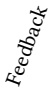
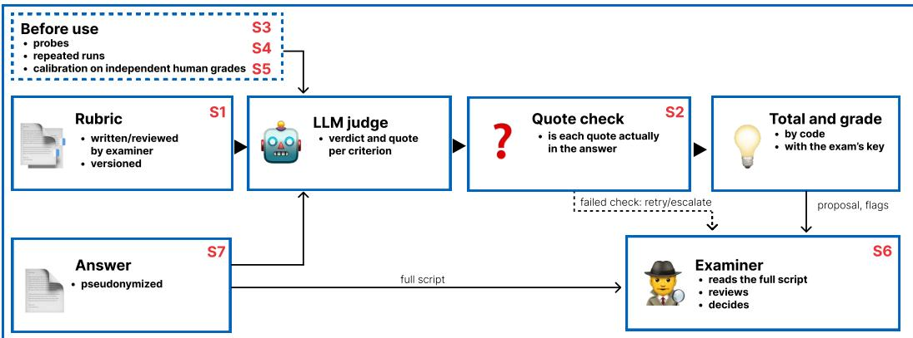

# SoK: Grading Open-Text Legal Answers, from Law School Exams to Trustworthy Rubric Judges

SEBASTIAN NAGL, Technical University of Munich (TUM), Germany

Law students are examined through open-text answers: case solutions, essays and memos that apply the law to a set of facts. Such answers are expensive to grade, human graders disagree widely on them, and large language models (LLMs) now ofer to grade them at scale, both in teaching and in the benchmarks that test legal AI. This paper systematizes how open-text legal answers can be evaluated. We derive eight desiderata from educational measurement and from the law that governs exams, among them validity, reliability, reasons, credit for defensible alternative solutions, robustness to gaming and human oversight. We then compare eight evaluation paradigms against them, from unstructured human grading to LLM judges with instance-specific rubrics and pairwise comparison. Three findings stand out. A rubric writen for the task is the strongest lever for agreement between an LLM judge and human graders, but the reported figures answer diferent questions and rarely come with the human agreement they must be read against. The central validation gap lies where examination law is most demanding: defensible alternative solutions, follow-on errors, and the examiner’s correction of model judgments. And rubric-centred grading is the most auditable family, because it makes the standard, its application and the final decision checkable. From this we derive the trustworthy rubric judge: an instance rubric that credits arguments and alternative paths, evidence checked in code, probes, repeated runs, calibration against independent human grades, logging, and an examiner who reads every script. We state what each safeguard rests on, what remains to be tested, and the uses the evidence supports today.

CCS Concepts: • Applied computing → Law; Education; • Computing methodologies → Natural language processing.

Additional Key Words and Phrases: legal education, law exams, grading rubrics, LLM-as-a-judge, automated assessment, examination law, EU AI Act

## 1 Introduction

Legal education tests a skill that is hard to measure: applying the law to facts in writing. A German student receives a fact patern (Sachverhalt) and writes an opinion in appraisal style (Gutachtenstil); a US student spots the issues in a hypothetical and argues them; a bar candidate drafts a memo or a judgment. A German exam case is a proxy for a real case: the fact patern stands in for the file a lawyer or a court receives, and the opinion rehearses the analysis that precedes advice or a decision. These answers run to many pages, admit more than one defensible solution, and are graded by experts who often disagree. The same German exam can receive grades several points apart on the 18-point scale [68], and a single US law professor’s grade on an essay reached an intraclass correlation (ICC) of .58 with colleagues [78]. Grading is also slow, so students get litle feedback before the exam that counts, although individual feedback measurably improves their grades [117].

Large language models (LLMs) have changed both sides of this problem. They write answers that pass law exams [26, 74, 95], so legal AI needs benchmarks that grade open text. And they ofer to grade answers themselves, as an LLM judge [54, 148]. Since 2025, legal benchmarks and teaching tools have converged on one design: an expert writes a rubric for each task, and an LLM checks an answer against it [2, 24, 30, 38, 121]. At the same time, LLM judges are known to drift between runs [58], to favour long answers [115], and to obey instructions embedded in the answer they grade [87]. Examination law, data protection law and the EU AI Act set further limits on what a machine may decide about a candidate [18, 33, 46].

The literature on these questions is scatered across law reviews, educational measurement, natural language processing (NLP) and court decisions. This paper brings them together. Our starting point is that grading an open-text legal answer is not the prediction of a human grade but the application of standards that must be stated and justified to answers that may legitimately difer. Three questions follow: what the grade should measure, how that performance is translated into criteria and points, and who answers for that translation and can correct it in the single case. In short: which way of evaluating open-text legal answers is best supported by the evidence, for which use, and what must still be shown before it can be trusted?

Our contributions are:

1. Desiderata. Eight requirements for evaluating open-text legal answers, from validity theory [72, 96] and from examination, data protection and AI law (Section 4, Table 1).

2. A taxonomy of eight paradigms, from unstructured human grading to LLM judges with instance-specific rubrics and pairwise comparison, with the evidence for and against each (Section 5, Table 2).

3. A systematization of legal evaluations ofautomatic graders: task-specific content is the strongest lever for agreement with human graders, the reported figures answer diferent questions, and validation is often thin (Section 6, Table 3).

4. A design space of legal rubrics, from the unit of credit to the key that maps points to grades, with the evidence and law behind each choice (Section 7).

5. The trustworthy rubric judge: seven safeguards, each tied to the weakness and the legal requirement it answers and to the test that remains, with the uses the evidence supports today and the open problems (Section 8, Section 9, Section 10).

The evidence supports task-specific grading information, above all an analytic rubric writen for the task, as the strongest lever for agreement with human graders, but no architecture is superior on every axis: pairwise comparison ordered constructed quality levels beter than rubric scores [145], closed formats are more reliable, and no rubric judge is yet robust to manipulation. We argue that rubric-centred grading should nonetheless be the default for auditable legal assessment. Grading is auditable when the standard, its application to each script and the final decision can each be checked; a rubric externalizes the standard, makes each criterion application contestable and leaves the decision with the examiner. These are design advantages motivated by examination law, not a claim that the law mandates one scoring architecture. We therefore propose the trustworthy rubricjudge, a rubric judge wrapped in seven safeguards, and we state the tests it must pass before it grades exams that count. A companion study, in preparation, builds this judge for German law exams: it generates the grading sheet from the case and the reference solution and tests the sheet, the judge and the workflow against an examiner’s own sheet and grades [100] (Section 10).

## 2 Background: open-text legal answers and how humans grade them

The tasks. We call an answer open-text when the candidate writes free prose that applies law to facts and no answer key can list every acceptable text. In Germany the core format is the case solution (Falllösung): an opinion that states each question, defines the legal requirements, subsumes the facts and reaches a result, graded on the statutory scale from 0 to 18 points [13]. Practice tasks include memos, contract drafting and research answers [38, 118] and draft judgments [73]. Our core case is the exam; the other tasks difer in the performance measured as well as in who sets the standard and what is at stake, so we treat the transfer as a separate question (Section 10).

Human graders disagree. In a 1968 study, 17 law professors graded the same 80 contracts essays from 16 schools; a single professor’s grade reached an intraclass correlation of .58, the mean over all professors .96, so single graders and panel means are diferent yardsticks [78]. On 15 scripts of a German beginner-level mock exam, each graded by 15 or 16 correctors, the highest and lowest grade for a script lay 6.47 points apart on average [68], and in BenGER, a benchmark of German case solutions curated on an open platform [99], three blind reviewers reached a single-rater ICC(2,1) of .63 [101]. Grades in the German state exams also difer by gender and by the origin of a candidate’s name [132, 133], and by the Land in which the exam is taken [71]. Grades rise with length [7], legible handwriting [52] and legal jargon [91], and graders are drawn towards a grade they have already seen [6, 137]. Where such features are not part of what the task tests, this is construct-irrelevant variance [96].

Structure helps, but not alone. An analytic rubric breaks the expected answer into criteria, each with points or levels; it is instance-specific when it is writen for one task rather than for a type of task [35]. Rubrics raise agreement between human raters, especially when they are analytic and task-specific and come with exemplars or rater training [69], and rubrics used formatively improve student performance with an efect of $g \ : = \ : . 4 5$ [106]. In German law, some correctors note what each part of the expected solution is worth [50], and a few make this binding in a grading sheet (Bewertungsbogen), described for take-home papers [64], which narrows the spread between correctors (Table 3). Yet rubrics do not remove rater efects: raters still difer in severity [43, 144], read the same criteria diferently [9], and without moderation shared criteria did not make law marking consistent [60]. High-stakes testing therefore surrounds the rubric with machinery: calibration on common scripts, hidden scripts with known scores to catch drifting severity [29, 105], independent double grading and adjudication [89], which the US NextGen bar exam now adopts for its writen answers [10, 89, 102].

## 3 Method of this systematization

Scope. We draw on three bodies of sources and keep them apart in the text, since they carry different weight. Direct evidence is work that grades or evaluates open-text answers to legal tasks, by humans or machines. Transferred evidence is work from other domains that tests rubric-based LLM grading against human graders, and the measurement literature on rubrics and raters. Normative sources are the legal rules that govern grading: German examination law as the worked example, the EU General Data Protection Regulation (GDPR) and AI Act, and US cases on academic judgment. We exclude closed formats except where compared with open text, and supervised essayscoring models, for which we found no use on law exams.

Search. We searched the ACL Anthology, arXiv, Google Scholar, SSRN, the ACM Digital Library, legal education journals and German and EU case-law databases up to 12 October 2026, in Eng lish and German, with keywords on law exam grading, legal benchmarks, rubric and checklist evaluation, LLM-as-a-judge, automated essay and short-answer scoring, and exam law, and followed references in both directions. A legal evaluation enters Table 3 if it grades open-text legal answers automatically and reports how, or whether, the grader was compared with humans; reuse of another study’s scripts or rubrics is marked, and so are preprints.

Prior surveys. Surveys and critiques cover LLM judges [22, 54], essay and short-answer scoring outside law [19, 51, 75, 84] and legal benchmarks by task and metric [67]; none relates grading methods to the law that governs grading or treats the rubric as the object of design.

Coding. For each legal evaluation we recorded the paradigm (Section 5), the source of the rubric, what the grader was compared with, and the reported agreement of the grader and of the human graders (Table 3). We rated each paradigm against each desideratum as supported, partly or under conditions, contradicted, or not tested, from the evidence discussed in Section 5. The basis ofa mark is a comparison on legal answers, evidence from another domain, a legal source, or our reading.

## 4 Desiderata

What makes an evaluation good depends on what it is used for. We follow argument-based validation: a score is valid for a use when each inference from the answer to the decision is backed by evidence [4, 72]. The law adds requirements of its own, which we state first.

Table 1. What the law asks of grading open-text exam answers (L1 to L4 German examination law, L5 to L7 EU law), the implementation we propose (Section 8) and what is still open.
<table><tr><td></td><td>Requirement</td><td>Source</td><td>Proposed implementation</td><td>Open</td></tr><tr><td>L1</td><td>Equal standards: each examiner&#x27;s standards for a task apply to every script of that task alike</td><td>[15, p. 52]; [17, para. 8]</td><td>one versioned rubric per examiner and task; corrections applied to every script; pinned judge version</td><td>untested across scripts and versions</td></tr><tr><td>L2</td><td>Answer latitude: a defensible, consistently argued solution must not be marked wrong; an error is not counted twice</td><td>[14, p. 79]; [15, p. 55]; [135]; [136]</td><td>credit for arguments; separate paths; later steps judged against the candidate&#x27;s own decision; unforeseen paths flagged</td><td>no grader probed with alternatives or follow-on errors</td></tr><tr><td>L3</td><td>Reasons: the essential reasons for the grade, not the reason for every point</td><td>[12]; [18, para. 23]; Art. 15(1)(h) GDPR [34]</td><td>a verdict and a quoted passage per criterion, beyond the legal minimum</td><td>a quote shows the passage, not that the criterion is met</td></tr><tr><td>L4</td><td>Personal evaluation and reconsideration by the examiner</td><td>[16]; [18]</td><td>the examiner reads every script and decides; the judge proposes and flags</td><td>correction of confident wrong proposals untested</td></tr><tr><td></td><td>No decision based solely on automated processing with legal or similarly significant effect, unless necessary for a contract, authorized by law with safeguards, or based on explicit consent</td><td>Art. 22 GDPR [45]; [33]</td><td>substantive review, not adoption of a score as given</td><td>what counts as substantive review is unsettled</td></tr><tr><td>L6</td><td>AI that evaluates learning outcomes is high-risk; deployers owe competent oversight, logs and candidate information, public bodies also a fundamental-rights assessment</td><td>[46], Annex III, point 3(b), Arts. 9 to 15, 26, 27, 86; [47]</td><td>documented validation, logging, examiner oversight with authority to override, probes against manipulation</td><td>scope of Arts. 2(6) and 6(3) for prototypes</td></tr><tr><td>L7</td><td>(duties from 2 Dec 2027) Exam scripts and examiner comments are personal data</td><td>[32]</td><td>legal basis, processing contract or local models, pseudonymized inputs, access and deletion rules</td><td>pseudonymization alone is insufficient</td></tr></table>

## 4.1 What the law asks of grading

Table 1 lists the requirements.

German examination law. Exams that control access to a profession fall under the freedom of occupation (Art. 12(1) of the Basic Law, GG). Examiners have a margin of appreciation. Each examiner sets their own standards for a task and must apply them to every script of that task alike [15, p. 52; 17, para. 8]; the law does not demand one scheme shared by all examiners. Courts check in full whether a defensible answer was marked wrong; examination-specific judgments of persuasiveness, structure and consistency are reviewed only for the limits of that discretion, a complete and correct reading of the script, equal application of the examiner’s standards, and freedom from improper considerations and contradictions [17, paras. 9 to 11]. The candidate has an answer latitude (Antwortspielraum): a solution that is defensible (vertretbar) and argued consistently with weighty reasons must not be marked as wrong [14, p. 79; 15, p. 55]. Latitude protects the result, not the mark: a defensible but weakly argued solution may earn fewer points than a stronger one. An error must also not be counted twice. A follow-on error (Folgefehler) is reasoning that is wrong or open to criticism only because the candidate took an earlier decision on the path of the solu tion, and penalizing it again is an impermissible double counting (Doppelverwertung) [135]; how much a follow-on error still weighs is left to the examiner’s judgment [136]. The candidate is owed the essential reasons for the grade [18, para. 23], though not margin notes that show the reason for every point, and a point scheme is an aid the examiner may depart from, not a binding rule [12]. On substantiated objections the examiners themselves must reconsider their evaluation; no other body may do it for them, and writen reasons do not replace this reconsideration [18]. The examiner must personally and directly acquaint themselves with each script and evaluate it independently; an open second correction, in which the second examiner sees the first grade, is not forbidden by federal constitutional law [16].

Data protection. A candidate’s answers and the examiner’s comments on them are personal data [32], so sending scripts to a model provider needs a legal basis and a processing contract. Art. 22 GDPR gives a person the right not to be subject to a decision based solely on automated processing that has legal or similarly significant efects, unless the decision is necessary for a contract, authorized by Union or Member State law with suitable safeguards, or based on explicit consent [45]. The Court ofJustice has held that a score is itself such a decision when a third party’s decision draws strongly on it [33], so an examiner who adopts a model grade as given risks a solely automated decision; human involvement must be meaningful [28], and the person may require an explanation of the procedure and principles actually applied [34].

AIregulation. The AI Act classes AI systems intended to evaluate learning outcomes as high-risk (Annex III, point 3(b)), which brings the provider duties of risk management, data governance, technical documentation, logging, transparency, human oversight, accuracy and robustness against manipulation (Arts. 9 to 15) [46]. A university that uses such a system is a deployer: it must assign oversight to persons with the competence and authority to intervene, keep the logs and inform candidates that the system is used on them (Art. 26); a public university must also assess the impact on fundamental rights before first use (Art. 27); and a candidate may demand an explanation of the system’s role in the decision (Art. 86). Systems developed and put into service solely for scientific research fall outside the Act (Art. 2(6)), and a system that only prepares a human evaluation may escape the high-risk class (Art. 6(3)), but a grade proposal that the examiner reviews shapes the decision and is unlikely to escape it. The Digital Omnibus moved the application of the provider and deployer duties for Annex III systems to 2 December 2027 [47] (law as of October 2026).

The United States, and a cautionary case. US courts defer to the academic judgment of faculty [129, 130], which argues for keeping the professor’s evaluation substantive when a model assists. And England’s 2020 A-level grades, statistically adjusted to fit each school’s past results, were withdrawn within days amid protest [76]: legitimacy can fail before a method fails.

## 4.2 Eight desiderata

From the measurement literature and the requirements above we derive eight desiderata.

• D1 Construct validity. The score supports the interpretation it is used for: it reflects the legal skill the task tests, such as spoting issues, stating rules, subsuming facts and weighing arguments, and not task-irrelevant features such as length, surface style or the grader’s identity [96, 142]. Fairness is part of this: the score should not move with task-irrelevant features of a candidate’s language, such as phrasing or dialect.

• D2 Reliability. The score changes litle with the grader, the run or the occasion. In generalizability theory these are separate sources of error [11].

• D3 Reasons. The grade comes with reasons that let the candidate understand and contest it (L3, L5); a reason per criterion and passage is the form we propose (Section 8).

• D4 Defensible alternatives. A defensible solution that departs from the reference is not marked wrong, and an error is not counted again in the steps that depend on it (L2).

• D5 Robustness. The score cannot be raised by padding, copying the case, citing fake authority or embedded instructions [23, 87, 110].

• D6 Cost and scale. The method can grade many answers fast enough for feedback and benchmarks.

• D7 Formative value. The output tells a student what was missing and why [63].

Table 2. Evaluation paradigms against the desiderata of Section 4.
<table><tr><td></td><td></td><td colspan="7"></td></tr><tr><td></td><td>Paradigm</td><td>Valid</td><td>Reliable</td><td>Reasons</td><td></td><td>Robust</td><td>SCcale</td><td></td><td>Oversight</td></tr><tr><td>P1</td><td>Human grading, unstructured</td><td>0</td><td>O</td><td>0</td><td>●</td><td>0</td><td>O</td><td>0</td><td></td></tr><tr><td>P2</td><td>Human grading, analytic rubric</td><td>●</td><td>0</td><td>●</td><td>0</td><td>0</td><td>O</td><td>●</td><td></td></tr><tr><td>P3</td><td>Closed formats</td><td>O</td><td>●</td><td>O</td><td>O</td><td>●</td><td>●</td><td>O</td><td>0</td></tr><tr><td>P4</td><td>Similarity to a reference</td><td>O</td><td>●</td><td>O</td><td>O</td><td>O</td><td></td><td>O</td><td>O</td></tr><tr><td>P5</td><td>LLM judge, reference answer</td><td>0</td><td>0</td><td>0</td><td>O</td><td>O</td><td></td><td>0</td><td>0</td></tr><tr><td>P6</td><td>LLM judge, generic criteria</td><td>O</td><td>0</td><td>0</td><td>12)</td><td>O</td><td></td><td>0</td><td>0</td></tr><tr><td>P7</td><td>LLM judge, instance rubric</td><td>●</td><td>0</td><td>●</td><td>12)</td><td>O</td><td></td><td>0</td><td>0</td></tr><tr><td>P8</td><td>Pairwise comparison</td><td>0</td><td>0</td><td>O</td><td>(7)</td><td>0</td><td>0</td><td>O</td><td>O</td></tr></table>

supported; partly or under conditions; contradicted; ? not tested. Marks rate the evidence, not what a design could achieve; Section 5 discusses the evidence behind the marks.

• D8 Fit with oversight. The method keeps the examiner’s standards equal across scripts, leaves the evaluation and its reconsideration with the examiner, and documents what the AI Act’s oversight duties require (L1, L4 to L6). Whether a deployment is lawful depends on the context and the procedure, not on the method alone.

D1 and D2 come from measurement; D3, D4 and D8 are where the law adds most. The desiderata overlap: D3, D4 and D8 all favour designs that make the standard explicit, so a paradigm’s count of marks is not a score. Agreement with human graders, the usual yardstick in NLP, is evidence for D1 and D2 but not proof of either: humans disagree, an automatic grader can match a noisy reference by chance [41], and consistency is not validity [59].

## 5 Eight evaluation paradigms

We distinguish eight paradigms by who grades (human or model) and what the grade is anchored to (nothing, a reference answer, general criteria, criteria writen for the task, or another answer). They are the configurations found in the literature, not disjoint classes: the design space behind them has at least four axes (who grades, what information the grader receives, whether the judgment is absolute or comparative, and how partial judgments are aggregated), and real systems mix them, as a pairwise judge with a rubric does [30]. Table 2 rates each paradigm on the desiderata.

P1 Unstructured human grading (“vibe grading”). An expert reads the answer and gives a grade, perhaps with margin comments. It is the legal default and the reference most studies validate against, and an expert can recognize a defensible alternative that no key foresaw. But single-rater reliability is moderate, at intraclass correlations of .58 and .63 [78, 101], correctors’ grades spread widely [68], and length, handwriting, identity and prior grades leak into the grade (Section 2).

P2 Human grading with an analytic rubric. A rubric makes the standard explicit, cuts the spread between human graders [69, 127] and gives students criteria to learn from [106, 125]. Its weak nesses are cost and the remaining rater efects, and it credits alternatives only if the rubric lists them or the grader departs from it.

P3 Closed formats. Multiple choice, classification and extraction tasks are graded exactly and cheaply, which is why most legal NLP benchmarks use them [21, 49, 56, 150]. But they measure a diferent construct. Law students gained from GPT-4 on multiple-choice questions but not on essays [27]; GPT-4’s bar exam percentile falls most on the essay component [95].

P4 Similarity to a reference. Metrics such as ROUGE, BLEU and BERTScore compare the answer with a reference text [90, 107, 146]. On legal summaries, experts’ scores correlated with ROUGE at .13 to .21 and with BERTScore at .07 [123]; the model with the highest ROUGE on case-law analyses produced the highest rate of unsupported citations [66], and near-identical ROUGE on German court press releases hid very diferent expert ranks [98]. Similarity can track grades within one exam, where the reference is the expected solution: METEOR correlated with the blind human grade on German case solutions at about .72 [101]. But it cannot give reasons, punishes a defensible alternative path for using other words, and rewards copying the reference.

P5 LLM judge with a reference answer. The judge compares the answer with a reference answer writen by an expert, as in LEXam [48]. Without a reference, judges agree with experts only on questions they can answer themselves [82], and judging accuracy tracks solving accuracy [131]. With a reference, LEXam’s judge passed the alternative annotator test against three experts who agreed with each other at a quadratic weighted kappa of .49 [20, 48]. A single reference also fixes one path. In BenGER, the judge disagreed with human graders most on presentation and on results reached by other reasoning paths than the reference solution’s [101], which is exactly the answer latitude the law protects (L2). Such verdicts are also judge-relative: in our earlier work, prompts optimized against a strict judge on LEXam overfit to that judge’s disposition, while prompts opti mized against a lenient judge transferred beter [42].

P6 LLM judge with generic criteria. The judge scores every answer on the same generic dimensions [93]. In law this fails without task-specific guidance. Open models grading German criminallaw case solutions without a sample solution or rubric reached correlations near zero [141], and a G-Eval-style correctness judge, LeMAJ’s baseline (Table 3), correlated with legal experts at .02 to .08 [44]. Generic dimensions combined with a reference fare beter: BenGER’s judge, which scores ten dimensions of German correction practice against the reference solution, tracked the mean of blind human graders at � = .76 with pass/fail � = .60, inside the range of human disagreement [101], and a judge with general criteria ranked systems for German court press releases much as experts did [98]. What makes such judges work is the task-specific content they receive (P7).

P7 LLM judge with an instance-specific rubric. An expert writes, for each task, the criteria an answer must meet, often as atomic yes-or-no items, and the judge checks each criterion. Out side law, this design gives judges high agreement with experts per criterion. On HealthBench’s 34 consensus criteria, GPT-4.1 agreed with physicians at a macro-F1 of .71, where the average physician scored .57 to .73 by theme [5], with similar judge agreement on rubric trees for research replication and on expert rubrics in science, finance and consulting [126, 139]; controlled comparisons favour instance-specific criteria over general ones, over a plain prompt and over free grading [39, 77, 83, 92, 140]. In law, the within-domain comparisons point the same way, with caveats. On German exams, GPT-5 with a sample solution and a grading scheme reached a quadratic weighted kappa of .60 in criminal and .91 in public law, against .31 and .58 with neither; the scheme alone gave most ofthe gain (.56 and .85), the solution alone less (.39 and .79) [2]. The gain is not universal: for GPT-5.1 the same additions lowered agreement, and the two sets are 71 take-home solutions and 16 timed mock-exam scripts reused from earlier studies [127, 141]. On four US law-school finals with 205 scripts, GPT-5 with the professor’s rubric correlated with the professor’s grades at .78 to .93, mean .87, against .66 to .80 with a bare prompt; forcing a score per rubric element changed litle (mean .87, beter on two exams and worse on two), and pairwise comparison with the rubric reached a mean of .86 [30]; on the one question a professor regraded, the two human gradings agreed more with each other than either did with the model, a gap the authors do not find significant. On atorney-writen binary rubrics for legal research, judges from three providers agreed with the atorneys’ majority label at � = .71 to .73, against a human baseline of .64 that the authors report as atorney-to-atorney agreement, a diferent comparison [38]

The weaknesses are real. Expert rubrics cost time: building each PLawBench item, rubric included, took about three expert hours [121]. Generated rubrics fall short of expert ones [37, 138, 151], and LLM-writen elaborations of human rubrics lowered agreement [119]. Finer label schemes lower agreement: moving from a binary to a five-way label scheme on short science answers cut accuracy from 76% to 57% [36], and binary grading of the same criteria agreed with humans about 20 points beter than ternary grading [119]. A related finding comes from reference-based judges under a generic grading regulation: where the regulation was silent, 22 of 26 LLM judges scored in or near the majority reading of three examiners and none reproduced the defensible minority one, a dissent among graders about the same answer rather than an alternative path taken by the candidate [1]. Even a judge given the commitee’s criteria and the correct legal analysis gave 85 to 90 of 100 points to three writen judgments that the commitee had failed for serious errors, where the commitee gave 8 to 37 [73]. And grading against a rubric invites manipulation: instructions embedded in an answer succeeded in 56.9% of atacks on average across rubric-based graders [87].

P8 Pairwise comparison. The grader compares two answers and picks the beter one; many comparisons yield a ranking, as in Chatbot Arena [148] or comparative judgment. The strongest counter-evidence to rubrics comes from this paradigm. In JudgmentBench, practising atorneys graded answers to 30 BigLaw Bench tasks at three quality levels: their pairwise judgments recovered the order of the levels with a mean Spearman’s � of .91, their rubric scores only with .15, and the rubric raters agreed with each other at .44; a GPT-5.4 autograder tracked the atorneys orderings at .38 with pairwise judgments and .20 with the rubric [145]. Pairwise ranking also beat absolute scoring for essays [122] and resisted universal adversarial phrases beter [111]. The quality levels in JudgmentBench were induced by prompting and moved all dimensions together, and the rubrics were not validated against graded answers; real answers difer in which issues they treat, which is what rubrics capture. Pairwise judges show position and length bias [40, 120]. Above all, a bare preference is relative: it ranks a script among others but gives no criterion-referenced reasons, no feedback, and no grade that holds when the cohort changes. That conflicts with the duty to give reasons (L3) and with criterion-referenced grading, towards which even the bar exam is moving [89]. The objection is to the protocol, not to comparison as such: a pairwise judge with the rubric matched absolute rubric grading on US exams [30], and anchored comparisons with a reason per criterion are untested. As used today, P8 suits leaderboards beter than exams.

## 6 Systematization of legal evaluations

Table 3 lists the automatic graders of open-text legal answers we found, what each was compared with, and whether it graded student scripts or model answers. Three paterns stand out.

The field has moved from P3 and P4 to P7. Legal benchmarks long reduced law to closed formats or scored generation with overlap or keyword metrics [21, 49, 85, 86]. Since 2025, the leading benchmarks and the practitioners’ own evaluations have adopted instance-specific rubrics, writen or seeded by experts, with an LLM judge [24, 38, 53, 104, 121, 134].

Task-specific content is the strongest lever, within limits. Within the same domain, a scheme or rubric raised the agreement of the same model, a score per rubric element and pairwise comparison added nothing further, the gain varies by model, and the two German sets reuse the scripts of earlier studies (Section 5). Decomposition can also start from the answer instead of the expected performance: LeMAJ splits a model’s answer into legal data points and checks each against the source material without a reference answer [44]. The two are not the same: a rubric states in advance what counts as performance and who answers for it, while answer decomposition structures the checking, omissions included, and supplies neither the weights nor the grade.

Validation is often thin, and human-level claims depend on the unit of comparison. Several rubric benchmarks report agreement between judges but not with humans [108], validate on three candidate scripts that all passed [109], or publish no agreement at all [53, 62]. Agreement between being the exception (S5), a panel of three judges agrees with itself beter than three examiners agree with each other, without this showing that it agrees with them [1], and the sharpest contrasts come from constructed quality levels [145]. Correlation is not accuracy: a correlation of one is compatible with every grade three points too high, harmless for a ranking and decisive for pass or fail.

Table 3. Automatic graders of open-text legal answers, by paradigm. Judge: agreement with the reference in Compared with, model stability marked as such; Human: reliability of the human grades, between or within graders; reused: data or instruments shared with another cited study; n/r: not reported. QWK: quadratic weighted kappa; SPA: soft pairwise accuracy; IAA, IRR: inter-annotator agreement and reliability; MAE: mean absolute error; � and �: Kendall’s; �: Krippendorf’s.
<table><tr><td>Study and setting</td><td>P</td><td>Rubric</td><td>Compared with</td><td>Judge</td><td>Human</td></tr><tr><td>Wendlinger et al. [141]: German criminal-law take-home, student</td><td>P6</td><td>none (few-shot examples)</td><td>research assistants&#x27;</td><td>near zero or negative</td><td>n/r</td></tr><tr><td>scripts LeMAJ [44]: legal QA, model answers with constructed errors</td><td>P6</td><td>none; answer split into legal data points</td><td>grades legal experts</td><td>correctness r .26 (own data), .70 (LegalBench) 85 to 90 of 100 for failed</td><td>IAA correctness .77; .88 with data points</td></tr><tr><td>Karp et al. [73]: Polish procurement appeals-board exam, 3 model judgments</td><td>P5/P7</td><td>committee&#x27;s criteria and solution key</td><td>official committee</td><td>judgments (committee 8 to 37) r .76; pass/fail κ .60</td><td>n/r</td></tr><tr><td>BenGER [101]: German case solutions, 15 tasks, human-written</td><td></td><td>P5/P6 reference solution, 10 general criteria</td><td>mean of 3 blind reviewers</td><td></td><td>ICC(2,1) .63, single rater (45 answers, 15 by models)</td></tr><tr><td>CourtPressGER [98]: German court press releases, model outputs</td><td>P6</td><td>5 general criteria</td><td>expert ranking of 10 systems</td><td>ρ .94 (systems)</td><td>n/r</td></tr><tr><td>SLDS [113]: Swiss headnotes, model outputs LEXam [48]: Swiss law exams,</td><td>P5</td><td>reference headnote, generic categories professor&#x27;s reference</td><td>expert ratings</td><td>ρ .26 (ROUGE-L .26)</td><td>n/r</td></tr><tr><td>model answers</td><td>P5</td><td>answer</td><td>3 experts, alternative annotator test</td><td>passes</td><td>QWK.49</td></tr><tr><td>GreekBarBench [25]: Greek bar exam, model answers</td><td>P5/P7</td><td>expert spans on the reference</td><td>aggregated expert scores, system pairs</td><td>soft pairwise accuracy .86 (system level)</td><td>SPA .85 (annotator vs. annotator); α .74</td></tr><tr><td>OAB-Bench [109]: Brazilian bar exam, 3 passing candidate scripts Magis-Bench [108]: Brazilian</td><td>P7</td><td>official point tables</td><td>official scores</td><td>item MAE .04 to .28</td><td>n/r</td></tr><tr><td>magistrate exams, model answers GradeLegal [2]: German criminal</td><td>P7</td><td>official examiner rubrics</td><td>other LLM judges only instructor</td><td>W.98 QWK .60 (crim.), .91</td><td>n/r</td></tr><tr><td>and public law, student scripts; reused Strecker et al. [127]: German</td><td>P7</td><td>sample solution, grading scheme</td><td>(public), assistants (criminal)</td><td>(public); .31, .58 with neither</td><td>QWK .91 (public; instructor vs. assistants)</td></tr><tr><td>public-law mock exam, student scripts Cope et al. [30]: US finals, 4 exams, 205 student scripts</td><td></td><td>examiner&#x27;s raw-point scheme</td><td>instructor&#x27;s grade; weighted human mean professor&#x27;s</td><td>deviation mostly lower with scheme; grades compressed rubric r .78 to .93; open</td><td>spread 5.25 vs. 2.94 points with scheme (two groups) one regraded question:</td></tr><tr><td>Thai bar study [1]: Thai bar essays, P5/P6</td><td></td><td></td><td>grade</td><td>.66 to .80; per element, pairwise no better</td><td>humans closer to each other than to the model, not significant panel α .36 (.75 where</td></tr><tr><td>15 human and model answers KCL-Essay [104]: Korean</td><td></td><td>regulation, gold answer LLM-generated from</td><td>single scores</td><td>.76; LLM-panel stability α .77 r .8 (.7 on hard items)</td><td>explicit)</td></tr><tr><td>bar-exam questions, model answers PLawBench [121]: Chinese</td><td></td><td>expert solution, 27% attorney-reviewed</td><td>attorney scores</td><td></td><td>r .93 (easy items)</td></tr><tr><td>practice tasks, model answers</td><td>P7</td><td>about 12,500 expert items</td><td>at least 3 experts, sampled items</td><td>r .72 to .86 by task type</td><td>r .84 to .88 (expert vs. mean)</td></tr><tr><td>LexRubric [24]: Chinese consultation and exams, model answers</td><td>P7</td><td>12,337 expert atomic criteria</td><td>experts, 50 instances; model ranking</td><td>item κ .59; τ .80</td><td>n/r</td></tr><tr><td>Legal Research Bench [38]: US legal research, 413 questions, model answers</td><td>P7</td><td>attorney-written binary items, reviewed</td><td>majority of 3 attorneys, 341 items</td><td>item κ .71 to .73</td><td>κ .64 (attorney vs. attorney)</td></tr><tr><td>JudgmentBench [145]: BigLaw Bench, model outputs at 3 constructed levels; rubrics reused</td><td>P7/P8</td><td>vendor rubrics by attorneys</td><td>attorneys&#x27; orderings</td><td>GPT-5.4 ρ .20 (rubric), .38 (pairwise)</td><td>rubric IRR.44</td></tr></table>

judges is not validity [59, 112]. Few studies report the agreement of their human graders, and where both are reported the comparison is rarely like for like: judges are scored against a majority or a mean while humans are scored against each other [25, 38, 101], the alternative annotator test

Table 4. The design space of legal grading rubrics; the option we propose is listed first.
<table><tr><td>Dimension</td><td>Options</td><td>Evidence and law</td></tr><tr><td>Unit of credit</td><td>argument or requirement met; issue spotted; bare result</td><td>answer latitude (L2); experts agree almost perfectly on binary criteria</td></tr><tr><td>Scale of a criterion</td><td>binary; few levels; free points per step</td><td>binary agrees best; agreement is not the construct</td></tr><tr><td>Structure</td><td>all points on steps (absolute or as shares of the total); steps plus a bounded, reasoned component; steps plus a criteria-bound pool; steps plus a free pool</td><td>a free pool cannot be checked; a criteria-bound pool needs stated criteria and a fixed share</td></tr><tr><td>Method and form</td><td>within each section; separate block</td><td>within sections stays tied to content; a block needs stated criteria and a fixed share</td></tr><tr><td>Alternative solutions</td><td>outcome-neutral criteria and paths that record why a step is absent; flag unforeseen paths; single reference</td><td>L2; equal performance, not equal length; the examiner&#x27;s rule for the total</td></tr><tr><td>Follow-on errors</td><td>standard per criterion (correct law or own earlier decision); none</td><td>not counted twice; the weight is the examiner&#x27;s (L2)</td></tr><tr><td>Cardinal errors</td><td>defined in advance (minus points or a lower grade); left to the grader</td><td>examiners disagree; a deduction is itself a grading decision</td></tr><tr><td>Points to grade</td><td>examiner&#x27;s key applied by code; key generated or applied by a model</td><td>the key to the legal scale is the examiner&#x27;s (L1, L4); models mis-add</td></tr><tr><td>Author and timing</td><td>examiner, before grading; model draft with marked provenance, reviewed by the examiner; model alone</td><td>equal standards, versioned (L1); generated rubrics fall short</td></tr></table>

## 7 The design space of legal rubrics

The evidence of Section 5 and Section 6 favours instance-specific rubrics, but “rubric” covers very diferent instruments [35]. Table 4 summarizes the choices that any grading sheet for open-text legal answers makes, whether a human or a model applies it.

What earns credit. Graders of law essays reward the treatment of major issues more than minor ones [91], and a correct result without the authority behind it is a diferent achievement from a correct, authority-grounded answer [88]. A rubric that credits bare results penalizes defensible alternatives and rewards guessing; one that credits the reasoning (the requirement stated, the facts subsumed and the argument weighed) fits both legal method and the answer latitude (L2).

Granularity and scale. Yes-or-no verdicts agree beter than partial-credit or finer label schemes [36, 119], and on binary expert criteria, experts agree almost perfectly [139]. But spliting further does not always help [81, 92]. Agreement is not the construct: coarser labels raise agreement partly by discarding information. The granularity should follow what the step tests, in units a grader can judge without ambiguity, and the states not met, not applicable, uncertain and check failed must stay apart even where the criterion is binary. The middle ground is a step for each expected legal performance, with a few binary requirements per step; on US exams the most granular rubric, not the most granular output, gave the highest agreement, a hypothesis from four exams [30].

Structure and weights. German point schemes come in three types. In the first, every point belongs to a step of the expected solution, either as absolute points per step [50, 64] or as a percentage of the total for each item of the outline, so that no conversion key is needed [127, pp. 12 f.]. In the second, a fixed share goes to steps and a pool is bound to named criteria, typically method points (Strukturpunkte) for structure, appraisal style and language, for which 15 to 25% is proposed [127, p. 14]; the same criteria can instead be credited within each section, the option we propose. In the third, the pool is free: the grader distributes it on an overall impression. A free pool is tied to nothing a second grader or a model could check and reintroduces the variance the sheet was meant to remove, so it has no place in a rubric judge; a criteria-bound pool is checkable as far as its criteria are stated and its share is fixed. A bounded overall component that must name what it rewards, such as the weighting of issues or an unforeseen but sound solution, can be stated, limited and reviewed, and belongs in the design space as a documented hybrid (Section 10).

Alternatives and follow-on errors. Where a dispute changes only a result or its reasons, a criterion can credit the argument whatever the result. Where another defensible decision removes or adds steps, the rubric needs a separate path whose steps are weighted for equal performance, not for equal length, and answers that take a path no one foresaw should go to the examiner. A worked example shows the three cases a rubric must keep apart. Suppose question A decides whether step B is reached. If the candidate denies A defensibly, B falls away and neither earns nor loses points, unless the task asks for an auxiliary opinion (Hilfsgutachten), in which case B is still expected. Ifthe candidate denies A wrongly, what follows from that decision is a follow-on error, judged against the candidate’s own decision with the weight of the wrong decision left to the examiner, while a new error inside B counts on its own. The rubric must therefore record why a step is absent, or it credits work not shown, or penalizes a lawful path for omiting steps it did not need; and a judge must not pick, from a contradictory answer, the path that scores best. Marking B as not applicable does not setle the total: ifA carries four points and B six, a denominator often penalizes the lawful path, and rescaling to four turns a shorter performance into a full score. Alternative paths need a rule, set by the examiner, for comparable scoring opportunities and for the total.

Cardinal errors. Examiners disagree on which errors can fail a script by themselves, and the literature asks each sheet to define them in advance, with minus points or a grade below the computed one [127, pp. 15 f.]. The Polish case shows the stakes: a judge with the commitee’s criteria and solution key gave near-full marks to judgments that the commitee had failed outright for fundamental errors [73]. Whether such a rule would have caught them was not tested, and a deduction is itself a grading decision that needs a professional and legal reason.

From points to grade. The key that maps points to the legal grade scale is part of the examiner’s evaluation: the performance required for a passing grade cannot be fixed rigidly without regard to average results [15, pp. 51 f.], and once set, it applies to every script alike [17, para. 8]. Since models make mistakes when they add numbers [8, 81], the sum and the key belong in code, not in the judge’s output.

Who writes the rubric, and when. The examiner sets the standard (L4). The rubric is fixed before grading; a defect found while grading is corrected in a new version, the change is documented, and every script graded under the old version is regraded on the changed criteria (L1). A model can draft the rubric, but drafting is more than extracting the reference solution: the solution does not say which steps earn which points, what can be expected under exam conditions, which alternatives are equal or which errors weigh most. A draft should mark, per criterion, whether it restates the task, the solution or the examiner’s notes, adds an alternative, proposes a weight or assumes something the examiner must confirm, and the examiner must review and adopt it (Section 10).

## 8 The trustworthy rubric judge

Table 2 shows no paradigm without weaknesses. P7 leads on validity, reasons and scale, but it is open to manipulation, its reliability is not guaranteed, and whether it credits alternatives or improves learning is untested. We call a rubric judge trustworthy when safeguards close these gaps far enough for the intended use, and we propose seven. Each has support in the literature, from law or from other domains; the combination is new, and Section 10 states the tests it must pass. Most safeguards would also fit a reference-based or pairwise judge, but only a rubric makes every reason checkable against a criterion. RULERS is the closest prior design outside law [65]; what is specific here is the legal standard, with alternative paths, follow-on errors, examiner-set weights and the examiner’s decision. Figure 1 shows the design.

  
Fig. 1. The trustworthy rubric judge. The rubric and the examiner are human, the judge is a model, the quote check and the total are code, and the dashed box is a procedure of code and humans run before use. A failed quote check is a system error, never a deduction; every grade is logged with its rubric version, model version quotes and the examiner’s changes (S7).

S1 An instance rubric of atomic criteria that credits arguments. Experts write, or review, criteria for each task that state the performance an answer must show [5, 38]. To respect the answer latitude (L2), criteria credit arguments, alternatives get paths of their own, and follow-on errors are judged on the candidate’s own decisions (Section 7). Where a model drafts the rubric, an expert must review it, since generated rubrics fall short of expert ones [37, 138]. The rubric is fixed before grading; a correction creates a new version that is applied to every script (L1). The rubric’s weights are set by the examiner, and the arithmetic is done by code, because LLMs make mistakes when they add numbers [81]. No legal grader has yet been probed with alternative paths or follow-on errors; S3 makes both a standard probe.

S2 Evidence for every credit, checked in code. The judge must quote the passage of the answer that earns each credit, and a program verifies that the quote is in the answer. Three questions are distinct: does the passage exist, does it mean in context what the judge says, and does that performance justify the points? A string check answers only the first. A quoted rule may be stated only to be rejected or withdrawn later, and an omission has no passage to quote and needs a reason of its own. An invalid quote is an error of the grading system, not of the candidate: it triggers a repeated run, an abstention or the examiner, never a deduction. The quote gives the examiner and the candidate the checkable textual basis for the reason behind each point (L3), beyond what the law requires [12]; the second and third questions remain the examiner’s.

S3 Probes before use. Before grading real answers, a judge and rubric must pass answers with known outcomes. Fake answers come first: empty and of-topic answers and copies of the fact patern must score near zero, the reference solution must score high, and an answer with embedded instructions must not gain. Controlled variants of one real answer come second, each with its permited change in score fixed in advance: irrelevant padding must not raise the score, a paraphrase that keeps the legal performance must not change it, a defensible alternative path must keep its credit, the removal of a decisive reason must lose it, and an appended instruction must change nothing. A follow-on error probe changes an upstream decision and keeps later steps consistent with it: the score may change only as the examiner’s dependency rule says, and a new error inside a dependent step must still be found. Known atacks give the probe set [23, 87, 97, 111, 147, 149]; probes answer the AI Act’s demand for robustness (L6) but show only that known atacks fail.

S4 Repeated runs and variance decomposition. A judge grades the same answer diferently on another run [58, 116]. Generalizability theory separates sources of error such as runs, judges and rubrics [11], has been applied to LLM raters [124], and the rubric facet maters most where rubrics are generated: a poor rubric can make every grade consistent by forcing the same error on every script, so less spread is not success. Stability within a rubric, diferences between rubrics, systematic severity and consequential errors must be reported apart, as equal standards (L1) and the AI Act’s accuracy duty (L6) require. High self-consistency does not prove validity [103, 128], so S4 complements S5 and does not replace it.

S5 Calibration against independent human grades. The judge is validated on a sample of answers graded blind and independently by humans, and its agreement is read against the agreement among the humans, for instance with the alternative annotator test [20, 101]. The human grades must be independent, since second graders who see the first grade agree more [137]. And where several grades are defensible, validation should accept a set of grades rather than one: judges selected against forced single labels performed up to 31% worse [55]. Calibration and the final test must use diferent data, split by task rather than by script if the claim is about new exams. Calibration must be repeated when the model changes: model updates shifted judge severity by up to 133 of 1,000 points [128]. Calibration must also keep improvements in criterion application apart from changes to the standard: a learned transformation of criterion weights or of the point-to-grade mapping, such as the regression onto human scores in RULERS [65], is a grading decision in its own right and must be reviewed and adopted by the examiner (L4).

S6 Escalation to the examiner. The judge proposes, and the examiner decides (L4, L5). For a graded exam the examiner must read every script personally [16], so unflagged scripts are not waved through. Flags are not only confidence: answers on unforeseen paths, contradictions in the answer, criteria the judge could not apply, failed quote checks, zeroed credits and grades near the pass mark go to the examiner whatever its confidence, since a confidently wrong grade is the failure that maters. Where the judge is uncertain, it abstains; selective evaluation can guarantee a chosen level of human agreement on the retained cases [70] or raise it empirically [80], an average that says nothing about one candidate. Since second readers are drawn towards a grade they have seen [137], the examiner should form a view before seeing the model’s grade. This is a method, not a legal duty: federal constitutional law does not forbid open second correction [16]. Whether examiners catch a confidently wrong proposal is the test this safeguard must pass (Section 10).

S7 Documentation and data protection. Every grade records the rubric version, judge, model version, prompts, quotes and checks behind it, the judge’s original proposal and every human change with its reason, kept apart as a corrected criterion application, a rubric change or a reasoned individual decision. This is the logging and transparency the AI Act requires (L6) and what a candidate may request where the grade is an automated decision [34]. Pseudonymized scripts and local models are building blocks, not a data protection concept: the controller, the legal basis, access rights and retention, deletion, and any external service each need a decision of their own (L7).

The safeguards have costs. Under strict quality targets the savings can be modest: in one calculus exam, about 70% of items had to go to humans to reach human accuracy [79]. A trustworthy rubric judge therefore assists human graders; it does not replace them.

## 9 What the evidence supports

The uses difer in stakes and in who bears an error, so the evidence supports them unequally.

Formative feedback. Feedback on practice exams is where the case is strongest. Rubric use and feedback improve learning [106, 143], individual feedback raised law students’ grades [117], and the American Bar Association (ABA) now requires a formative assessment in every course of the first third of the J.D. [3]. A rubric judge can return, for each criterion, what was met, the passage that met it and what was missing. Whether model-writen feedback improves learning in law is untested; students in German law still tended to prefer tutor feedback [57], and generous model grades mislead, so feedback should state its uncertainty.

Benchmarks of legal AI. For comparing models, an expert-rubric judge validated against legal experts is now the best-supported design [38, 121].

A second reader in graded exams. A rubric judge that flags scripts where its total and the examiner’s difer is plausible, and a review of the largest discrepancies on US exams found errors by the professor as well as by the model [30], but it is barely tested. German law requires the examiner to decide (L4). Since the features of the procedure that shape the result, such as the number of examiners and the handling of their diferences, must be fixed by rule [18, paras. 15 to 17], we argue that a machine role that shapes the assessment belongs in the exam regulations too, as pre-marking by assistants is admissible only where the procedure provides for it [16].

Grading without an examiner. No study validates it for exams that count, and the legal obstacles are two and separate. German examination law requires the examiner’s personal evaluation (L4), which no exception in data protection law removes. Art. 22 GDPR adds that a solely automated grade with legal efect needs one of the exceptions of its paragraph 2 and the safeguards that go with it (L5), which would have to be shown for the specific use.

## 10 Open problems

Who writes the rubric, and how is a generated one judged? Expert rubrics are the botleneck. Generating them from the reference solution is the obvious step, but generated rubrics fell short of expert ones in the comparisons made so far, which generated them without a reference solution [138, 151], the one legal set generated from expert solutions was only partly reviewed [104], and whether expert review can close the gap at acceptable cost is open; rubrics refined against humanscored answers matched detailed human-writen ones in essay scoring [61], a route to which the caveat of S5 applies. A study of generated legal rubrics must validate three objects apart: the rubric as an instrument, its application to real scripts, and the whole workflow with the examiner in it. It needs serious comparators (an independent expert sheet, rubrics generated in one pass and step by step, the same after expert revision, and a reference-based judge without rubric), a split by task rather than by script, the expert sheet as a reference instrument rather than the only right answer, so that deviations are classified before they count as errors, and endpoints beyond correlation: wrong passes and fails, criterion errors, alternatives and follow-on errors, robustness to the probes of S3 and the examiner’s time. Our companion study on German exams starts this programme with generated sheets, their application, and an examiner’s sheet as the reference [100].

Holistic quality. Some legal quality, such as weighing, judgment and persuasiveness, may resist criteria fixed in advance [114, 145]. Hybrids that add a bounded, reasoned overall component or a pairwise component to criterion checks (Section 7) and document each share need testing.

The human reference. Judges are calibrated against human graders who disagree with each other and carry their own biases [68, 133]. Matching them is a low bar, and matching their majority can silence a defensible minority reading [1].

Teaching to the rubric. Students given rubric feedback may learn the rubric rather than the law, as prompts optimized against a judge learn its disposition [42]; whether skill or only scores improve is open.

Beyond education. The same design fits compliance checks, where LLMs test documentation against the AI Act [94] or privacy policies against the GDPR [31]; whether the safeguards transfer is open.

## 11 Limitations

Our search is structured but not exhaustive, and several of the most relevant studies are 2026 preprints. The ratings in Table 2 are one author’s reading of uneven evidence, much of it from outside law. Several entries in Table 3 share data or instruments (marked reused) and BenGER is our own, so the number of papers overstates the number of independent confirmations. German law is the worked example, and other jurisdictions constrain grading diferently. Five cited works are our own, one of them in preparation [42, 98–101], and the author works on rubric judges, which may bias the reading towards them; we have tried to ask the same questions of every study.

## 12 Conclusion

The evidence from law, education and NLP shows that a rubric writen for the task is the strongest lever for agreement with human graders, and examination law shows why rubric-centred grading is the family worth building on: it makes the standard explicit, its application contestable and the decision the examiner’s. What the evidence does not yet show is that any judge credits defensible alternatives, counts a follow-on error once, resists manipulation, or is corrected by examiners when it is confidently wrong. The trustworthy rubric judge is our answer to these gaps: seven safeguards, each tied to a legal requirement, and a test programme for what is not yet shown. Today it is best placed for feedback and benchmarks, and as an assistant, not a replacement, where grades count.

## Acknowledgments

This work is generously funded by the Daimler Benz Foundation as part ofproject TITAN (Technologische Intelligenz zur Transformation, Automatisierung und Nutzerorientierung des Justizsystems) and by the German Federal Ministry of Justice as part of the Digitalisierungsinitiative des Bundes für die Justiz under the GSJ project (Generatives Sprachmodell der Justiz), a collaboration between the justice ministries of North Rhine-Westphalia and Bavaria, TU Munich, and the University of Cologne. Claude Opus 5.5, Claude Fable 5.1 and GPT-6 Astra helped with the literature search and the writing; the author checked every cited claim against its source and takes full responsibility for all text.

## References

[1] Pawitsapak Akarajaradwong, Wutikrai Lertprasertphakorn, Chompakorn Chaksangchaichot, and Sarana Nutanong. 2026. A Two-Phase Stability Study of LLM Judges and Bar Council Examiners on Thai Bar-Exam Free-Form Essays. arXiv:2605.25652 [cs.CL] https://arxiv.org/abs/2605.25652

[2] Abdullah Al Zubaer, Lorenz Wendlinger, Simon Alexander Nonn, Michael Granitzer, and Jelena Mitrović. 2026. GradeLegal: Automated Grading for German Legal Cases. arXiv:2605.21076 [cs.CL] https://arxiv.org/abs/2605.21076 Extended version of a short paper accepted at ICAIL 2026.

[3] American Bar Association, Section of Legal Education and Admissions to the Bar. 2026. ABA Standards and Rules of Procedure for Approval of Law Schools 2026–2027, Chapter 3: Program of Legal Education (Standards 301, 302, 314, 315). https://www.americanbar.org/content/dam/aba/administrative/legal\_education\_and\_admissions\_to\_the\_bar standards/2026-2027/2026-2027-standards-chapter-3.pdf Revised Standard 314(b): at least one formative assessment in all courses of the first one-third of the J.D. credit hours; revised learning-outcomes standards implemented by the start of the 2026–2027 academic year.

[4] American Educational Research Association, American Psychological Association, and National Council on Mea surement in Education. 2014. Standards for Educational and Psychological Testing. American Educational Research Association, Washington, DC. https://www.testingstandards.net/open-access-files.htm

[5] Rahul K. Arora, Jason Wei, Rebecca Soskin Hicks, Preston Bowman, Joaquin Quiñonero-Candela, Foivos Tsimpourlas, Michael Sharman, Meghan Shah, Andrea Vallone, Alex Beutel, Johannes Heidecke, and Karan Singhal. 2025. HealthBench: Evaluating Large Language Models Towards Improved Human Health. arXiv:2505.08775 [cs.CL] https://arxiv.org/abs/2505.08775

[6] Yigal Atali. 2011. Sequential Efects in Essay Ratings. Educational and Psychological Measurement 71, 1 (2011), 68–79. doi:10.1177/0013164410387344

[7] Kif Augustine-Adams, Candace Berret, and James R. Rasband. 2016. Speed Maters. SSRN Working Paper 2840241. doi:10.2139/ssrn.2840241

[8] Tanja Baeumel, Josef van Genabith, and Simon Ostermann. 2025. The Lookahead Limitation: Why Multi-Operand Addition is Hard for LLMs. In Proceedings of the 8th BlackboxNLP Workshop: Analyzing and Interpreting Neural Networks for NLP. Association for Computational Linguistics, 250–262. doi:10.18653/v1/2025.blackboxnlp-1.15

[9] Sue Bloxham, Birgit den Outer,Jane Hudson, and Margaret Price. 2016. Let’s Stop the Pretence ofConsistent Marking: Exploring the Multiple Limitations of Assessment Criteria. Assessment & Evaluation in Higher Education 41, 3 (2016), 466–481. doi:10.1080/02602938.2015.1024607

[10] Geofrey R. Bok and Carole Wesenberg. 2024. Grading the NextGen Field Test: Two Graders’ Thoughts on the NextGen Bar Examination. The Bar Examiner 93, 1 (2024), 65–67. https://thebarexaminer.ncbex.org/article/spring-2024/grading-nextgen-field-test

[11] Robert L. Brennan. 2001. Generalizability Theory. Springer, New York. doi:10.1007/978-1-4757-3456-0

[12] Bundesfinanzhof. 2014. Beschluss vom 8. Juli 2014, VII B 158/13 (Bewertungsschema in der Steuerberaterprüfung als unverbindliches Hilfsmitel). BFH/NV 2014, 1777. https://dejure.org/2014,27441

[13] Bundesministerium der Justiz. 1981. Verordnung über eine Noten- und Punkteskala für die erste und zweite juristische Prüfung (JurPrNotSkV). BGBl. I S. 1243. https://www.gesetze-im-internet.de/jurprnotskv/ Federal grading ordinance for the two German state law examinations.

[14] Bundesverfassungsgericht. 1991. Beschluss des Ersten Senats vom 17. April 1991, 1 BvR 1529/84 und 1 BvR 138/87 (Antwort-Wahl-Verfahren / Antwortspielraum). BVerfGE 84, 59. https://www.servat.unibe.ch/dfr/bv084059.html

[15] Bundesverfassungsgericht. 1991. Beschluss des Ersten Senats vom 17. April 1991, 1 BvR 419/81 und 1 BvR 213/83 (Gerichtliche Prüfungskontrolle / Antwortspielraum). BVerfGE 84, 34. https://www.servat.unibe.ch/dfr/bv084034. html

[16] Bundesverwaltungsgericht. 2002. Urteil vom 9. Oktober 2002, 6 C 7.02. ECLI:DE:BVerwG:2002:091002U6C7.02.0. https://www.bverwg.de/091002U6C7.02.0

[17] Bundesverwaltungsgericht. 2018. Beschluss vom 5. März 2018, 6 B 71.17. ECLI:DE:BVerwG:2018:050318B6B71.17.0. https://www.bverwg.de/050318B6B71.17.0

[18] Bundesverwaltungsgericht. 2019. Urteil vom 10. April 2019, 6 C 19.18. ECLI:DE:BVerwG:2019:100419U6C19.18.0. https://www.bverwg.de/100419U6C19.18.0

[19] Steven Burrows, Iryna Gurevych, and Benno Stein. 2015. The Eras and Trends of Automatic Short Answer Grading. International Journal ofArtificial Intelligence in Education 25, 1 (2015), 60–117. doi:10.1007/s40593-014-0026-8

[20] Nitay Calderon, Roi Reichart, and Rotem Dror. 2025. The Alternative Annotator Test for LLM-as-a-Judge: How to Statistically Justify Replacing Human Annotators with LLMs. In Proceedings of the 63rd Annual Meeting of the AssociationforComputational Linguistics (Volume 1: Long Papers). Association for Computational Linguistics, Vienna, Austria, 16051–16081. doi:10.18653/v1/2025.acl-long.782

[21] Ilias Chalkidis, Abhik Jana, Dirk Hartung, Michael Bommarito, Ion Androutsopoulos, Daniel Katz, and Nikolaos Aletras. 2022. LexGLUE: A Benchmark Dataset for Legal Language Understanding in English. In Proceedings of the 60th Annual Meeting of the Association for Computational Linguistics (Volume 1: Long Papers). Association for Computational Linguistics, Dublin, Ireland, 4310–4330. doi:10.18653/v1/2022.acl-long.297

[22] Khaoula Chehbouni, Mohammed Haddou, Jackie Chi Kit Cheung, and Golnoosh Farnadi. 2025. Neither Valid nor Reliable? Investigating the Use of LLMs as Judges. In Position Paper Track, Thirty-Ninth Conference on Neural Infor mation Processing Systems (NeurIPS 2025). arXiv:2508.18076 https://openreview.net/forum?id=yqKfMr0yvY

[23] Guiming Hardy Chen, Shunian Chen, Ziche Liu, Feng Jiang, and Benyou Wang. 2024. Humans or LLMs as the Judge? A Study on Judgement Bias. In Proceedings ofthe 2024 Conference on Empirical Methods in Natural Language Processing. Association for Computational Linguistics, Miami, Florida, USA, 8301–8327. doi:10.18653/v1/2024.emnlpmain.474

[24] Yifan Chen, Haitao Li, Yiran Hu, Kaisong Song, Jun Lin, Yueyue Wu, Qingyao Ai, Min Zhang, and Yiqun Liu. 2026. LexRubric: A Rubric-Guided Diagnostic Benchmark for Open-Ended Legal Tasks. arXiv:2606.09389 https://arxiv. org/abs/2606.09389 Accepted to EMNLP 2026 Main Conference.

[25] Odysseas S. Chlapanis, Dimitrios Galanis, Nikolaos Aletras, and Ion Androutsopoulos. 2025. GreekBarBench: A Challenging Benchmark for Free-Text Legal Reasoning and Citations. In Findings ofthe AssociationforComputational Linguistics: EMNLP 2025. Association for Computational Linguistics, 25099–25119. doi:10.18653/v1/2025.findings-

emnlp.1368 arXiv:2505.17267.

[26] Jonathan H. Choi, Kristin E. Hickman, Amy B. Monahan, and Daniel Schwarcz. 2022. ChatGPT Goes to Law School. Journal ofLegal Education 71, 3 (2022), 387–400.

[27] Jonathan H. Choi and Daniel Schwarcz. 2025. AI Assistance in Legal Analysis: An Empirical Study. Journal of Legal Education 73, 2 (2025), 384. https://scholarship.law.umn.edu/faculty\_articles/1155 SSRN 4539836.

[28] Liane Colonna. 2024. Teachers in the Loop? An Analysis of Automatic Assessment Systems under Article 22 GDPR. International Data Privacy Law 14, 1 (2024), 3–18. doi:10.1093/idpl/ipad02

[29] Peter J. Congdon and Joy McQueen. 2000. The Stability of Rater Severity in Large-Scale Assessment Programs. Journal ofEducational Measurement 37, 2 (2000), 163–178. doi:10.1111/j.1745-3984.2000.tb01081.x

[30] Kevin L. Cope, Jens Frankenreiter, Scot Hirst, Eric A. Posner, Daniel Schwarcz, and Dane Thorley. 2026. Grading Machines: Can AI Exam-Grading Replace Law Professors? Journal ofLaw and Empirical Analysis 3, 1 (2026), 2–22. doi:10.1177/2755323X261434265

[31] Thomas Cory, Wolf Rieder, Julia Krämer, Philip Raschke, Patrick Herbke, and Axel Küpper. 2026. Word-level Annotation of GDPR Transparency Compliance in Privacy Policies using Large Language Models. Proceedings on Privacy Enhancing Technologies 2026, 1 (2026), 509–528. doi:10.56553/popets-2026-0026 arXiv:2503.10727.

[32] Court of Justice of the European Union. 2017. Judgment of 20 December 2017, Peter Nowak v Data Protection Commissioner, Case C-434/16. ECLI:EU:C:2017:994. https://curia.europa.eu/juris/liste.jsf?num=C-434/16

[33] Court ofJustice of the European Union. 2023. Judgment of 7 December 2023, OQ v Land Hessen (SCHUFA Holding – Scoring), Case C-634/21. ECLI:EU:C:2023:957. https://curia.europa.eu/juris/liste.jsf?num=C-634/21

[34] Court ofJustice of the European Union. 2025. Judgment of 27 February 2025, CK v Magistrat der Stadt Wien (Dun & Bradstreet Austria GmbH), Case C-203/22. ECLI:EU:C:2025:117. https://eur-lex.europa.eu/legal-content/EN/TXT ?uri=CELEX:62022CJ0203

[35] Phillip Dawson. 2017. Assessment Rubrics: Towards Clearer and More Replicable Design, Research and Practice. Assessment & Evaluation in Higher Education 42, 3 (2017), 347–360. doi:10.1080/02602938.2015.1111294

[36] Haotian Deng, Chris Farber, Jiyoon Lee, and David Tang. 2025. Rubric-Conditioned LLM Grading: Alignment, Un certainty, and Robustness. arXiv:2601.08843 https://arxiv.org/abs/2601.08843

[37] Kaustubh D. Dhole and Eugene Agichtein. 2026. RubricRAG: Towards Interpretable and Reliable LLM Evaluation via Domain Knowledge Retrieval for Rubric Generation. arXiv:2603.20882 [cs.IR] https://arxiv.org/abs/2603.20882

[38] Katrina Drozdov, Oliver Chen, Langston Nashold, and Rayan Krishnan. 2026. Legal Research Bench: Measuring End-to-End Reliability in Long-Horizon Legal Research Agents. arXiv:2610.00609 https://arxiv.org/abs/2610.00609 AI Measurement Science Workshop at COLM 2026

[39] Mingxuan Du, Benfeng Xu, Chiwei Zhu, Licheng Zhang, Xiaorui Wang, and Zhendong Mao. 2026. DeepResearch Bench: A Comprehensive Benchmark for Deep Research Agents. In International Conference on Learning Representations (ICLR). https://arxiv.org/abs/2506.11763

[40] Yann Dubois, Balázs Galambosi, Percy Liang, and Tatsunori B. Hashimoto. 2024. Length-Controlled AlpacaEval: A Simple Way to Debias Automatic Evaluators. In First Conference on Language Modeling (COLM). arXiv:2404.04475 https://arxiv.org/abs/2404.04475

[41] Aparna Elangovan, Lei Xu, Jongwoo Ko, Mahsa Elyasi, Ling Liu, Sravan Bodapati, and Dan Roth. 2025. Beyond Correlation: The Impact of Human Uncertainty in Measuring the Efectiveness of Automatic Evaluation and LLMas-a-Judge. In International Conference on Learning Representations (ICLR). arXiv:2410.03775 https://arxiv.org/abs 2410.03775

[42] Mohamed Hesham Elganayni, Runsheng Chen, Sebastian Nagl, and Mathias Grabmair. 2026. Exploiting LLM-as-a-Judge Disposition on Free Text Legal QA via Prompt Optimization. In Proceedings ofthe Twenty-First International Conference on Artificial Intelligence and Law. ACM, Singapore. https://arxiv.org/abs/2604.20726

[43] George Engelhard. 1994. Examining Rater Errors in the Assessment of Writen Composition with a Many-Faceted Rasch Model. Journal ofEducational Measurement 31, 2 (1994), 93–112. doi:10.1111/j.1745-3984.1994.tb00436.x

[44] Joseph Enguehard, Morgane Van Ermengem, Kate Atkinson, Sujeong Cha, Arijit Ghosh Chowdhury, Prashanth Kallur Ramaswamy, Jeremy Roghair, Hannah R. Marlowe, Carina Suzana Negreanu, Kity Boxall, and Diana Mincu. 2025. LeMAJ (Legal LLM-as-a-Judge): Bridging Legal Reasoning and LLM Evaluation. In Proceedings ofthe Natural Legal Language Processing Workshop 2025. Suzhou, China, 318–337. doi:10.18653/v1/2025.nllp-1.23

[45] European Parliament and Council of the European Union. 2016. Regulation (EU) 2016/679 of 27 April 2016 on the protection of natural persons with regard to the processing of personal data and on the free movement of such data, and repealing Directive 95/46/EC (General Data Protection Regulation). OJ L 119, 4.5.2016, p. 1–88. http: //data.europa.eu/eli/reg/2016/679/oj

[46] European Parliament and Council of the European Union. 2024. Regulation (EU) 2024/1689 of 13 June 2024 laying down harmonised rules on artificial intelligence (Artificial Intelligence Act). OJ L, 2024/1689, 12.7.2024. http: //data.europa.eu/eli/reg/2024/1689/oj

[47] European Parliament and Council of the European Union. 2026. Regulation (EU) 2026/1744 of 8 July 2026 amending Regulations (EU) 2024/1689, (EU) 2018/1139 and (EU) 2023/1230 as regards the simplification of the implementation of harmonised rules on artificial intelligence (Digital Omnibus on AI). OJ L, 2026/1744, 24.7.2026. http://data.europa. eu/eli/reg/2026/1744/o

[48] Yu Fan, Jingwei Ni, Jakob Merane, Yang Tian, Yoan Hermstrüwer, Yinya Huang, Mubashara Akhtar, Etienne Salim beni, Florian Geering, Oliver Dreyer, Daniel Brunner, Markus Leippold, Mrinmaya Sachan, Alexander Stremitzer, Christoph Engel, Elliot Ash, and Joel Niklaus. 2026. LEXam: Benchmarking Legal Reasoning on 340 Law Exams. In Proceedings ofthe Fourteenth International Conference on Learning Representations. arXiv:2505.12864.

[49] Zhiwei Fei, Xiaoyu Shen, Dawei Zhu, Fengzhe Zhou, Zhuo Han, Alan Huang, Songyang Zhang, Kai Chen, Zhixin Yin, Zongwen Shen, Jidong Ge, and Vincent Ng. 2024. LawBench: Benchmarking Legal Knowledge of Large Language Models. In Proceedings of the 2024 Conference on Empirical Methods in Natural Language Processing. Association for Computational Linguistics, Miami, Florida, USA, 7933–7962. doi:10.18653/v1/2024.emnlp-main.452

[50] Eike Michael Frenzel. 2011. Die Korrektur der Klausur und ihr Wert – eine Handreichung für Studenten und Korrektoren. Zeitschrift für das Juristische Studium (ZJS) 4–5 (2011), 327–332. https://www.zjs-online.com/dat/artikel/ 2011\_4-5\_470.pdf

[51] Rujun Gao, Hillary E. Merzdorf, Saira Anwar, M. Cynthia Hipwell, and Arun R. Srinivasa. 2024. Automatic assessment of text-based responses in post-secondary education: A systematic review. Computers and Education: Artificial Intelligence 6 (2024), 100206. doi:10.1016/j.caeai.2024.100206

[52] Rainer Greifeneder, Alexander Alt, Konstantin Botenberg, Tim Seele, Sarah Zelt, and Dietrich Wagener. 2010. On Writing Legibly: Processing Fluency Systematically Biases Evaluations ofHandwriten Material. Social Psychological and Personality Science 1, 3 (2010), 230–237. doi:10.1177/1948550610368434

[53] Niko Grupen, Gabe Pereyra, and Julio Pereyra. 2026. Introducing Harvey’s Legal Agent Benchmark. Harvey AI blog. https://www.harvey.ai/blog/introducing-harveys-legal-agent-benchmark Published 6 May 2026; code at github.com/harveyai/harvey-labs.

[54] Jiawei Gu, Xuhui Jiang, Zhichao Shi, Hexiang Tan, Xuehao Zhai, Chengjin Xu, Wei Li, Yinghan Shen, Shengjie Ma, Honghao Liu, Saizhuo Wang, Kun Zhang, Zhouchi Lin, Bowen Zhang, Lionel Ni, Wen Gao, Yuanzhuo Wang, and Jian Guo. 2026. A Survey on LLM-as-a-Judge. The Innovation 7, 6 (2026), 101253. doi:10.1016/j.xinn.2025.101253

[55] Luke Guerdan, Solon Barocas, Kenneth Holstein, Hanna Wallach, Zhiwei Steven Wu, and Alexandra Chouldechova. 2025. Validating LLM-as-a-Judge Systems under Rating Indeterminacy. In Advances in Neural Information Processing Systems 38 (NeurIPS 2025). 124475–124543. doi:10.52202/085713-3751

[56] Neel Guha, Julian Nyarko, Daniel E. Ho, Christopher Ré, Adam Chilton, Aditya Narayana, Alex Chohlas-Wood, Austin Peters, Brandon Waldon, Daniel N. Rockmore, Diego Zambrano, Dmitry Talisman, Enam Hoque, Faiz Surani, Frank Fagan, Galit Sarfaty, Gregory M. Dickinson, Haggai Porat, Jason Hegland, Jessica Wu, Joe Nudell, Joel Niklaus, John Nay, Jonathan H. Choi, Kevin Tobia, Margaret Hagan, Megan Ma, Michael Livermore, Nikon Rasumov-Rahe, Nils Holzenberger, Noam Kolt, Peter Henderson, Sean Rehaag, Sharad Goel, Shang Gao, Spencer Williams, Sunny Gandhi, Tom Zur, Varun Iyer, and Zehua Li. 2023. LegalBench: A Collaboratively Built Benchmark for Measuring Legal Reasoning in Large Language Models. In Advances in Neural Information Processing Systems, Vol. 36. Curran Associates, Inc., 44123–44279. doi:10.52202/075280-1915

[57] Veronika Hackl, Christian Braun, Sarah Großkopf, Simon Alexander Nonn, Alexandra Elena Müller, and Martin Zwickel. 2024. KI-Feedback in der Rechtslehre: Eine explorative Studie zur Wahrnehmung und Bewertung durch Studierende. Zeitschrift für Didaktik der Rechtswissenschaft 11, 4 (2024), 320–335. doi:10.5771/2196-7261-2024-4-320

[58] Rajarshi Haldar and Julia Hockenmaier. 2025. Rating Roulete: Self-Inconsistency in LLM-As-A-Judge Frameworks In Findings ofthe Association for Computational Linguistics: EMNLP 2025. Suzhou, China, 24986–25004. doi:10.18653/ v1/2025.findings-emnlp.1361

[59] Sangdo Han and Moonsoo Kim. 2026. Agreement Without Alignment: Label-Free Rubric Clarification Increases LLM-Judge Consensus but Not Agreement with Humans. arXiv:2610.13303 [cs.CL] https://arxiv.org/abs/2610.13303

[60] James Hanlon, Michael Jeferson, Mike Molan, and Brian Mitchell. 2004. An Examination of the Incidence of ‘Error Variation’ in the Grading of Law Assessments. UK Centre for Legal Education (UKCLE), project “Exploring Comparative Marking”. https://resources.ials.sas.ac.uk/ukcle/78.158.56.101/archive/law/projects/past-projects/mitchell index.html

[61] Keno Harada, Lui Yoshida, Takeshi Kojima, Yusuke Iwasawa, and Yutaka Matsuo. 2025. Automated Refinement of Essay Scoring Rubrics for Language Models via Reflect-and-Revise. arXiv:2510.09030 https://arxiv.org/abs/2510. 09030

[62] Harvey Team. 2024. Introducing BigLaw Bench. Harvey AI blog. https://www.harvey.ai/blog/introducing-biglawbench Published 29 August 2024.

[63] John Hatie and Helen Timperley. 2007. The Power of Feedback. Review of Educational Research 77, 1 (2007), 81–112. doi:10.3102/003465430298487

[64] Martin Heidebach. 2015. Prüfen im rechtswissenschaftlichen Studium: Die Korrektur juristischer Hausarbeiten anhand eines verbindlichen Bewertungseinheiten-Systems. Zeitschriftfür Didaktik der Rechtswissenschaft 2, 3 (2015), 205–214. doi:10.5771/2196-7261-2015-3-205

[65] Yihan Hong, Huaiyuan Yao, Bolin Shen, Wanpeng Xu, Hua Wei, and Yushun Dong. 2026. From Rubrics to Reliable Scores: Evidence-Grounded Text Evaluation with LLM Judges. arXiv:2601.08654 [cs.CL] https://arxiv.org/abs/2601. 08654 Accepted to EMNLP 2026. v1 title: RULERS: Locked Rubrics and Evidence-Anchored Scoring for Robust LLM Evaluation.

[66] Abe Bohan Hou, Orion Weller, Guanghui Qin, Eugene Yang, Dawn Lawrie, Nils Holzenberger, Andrew Blair-Stanek, and Benjamin Van Durme. 2025. CLERC: A Dataset for U.S. Legal Case Retrieval and Retrieval-Augmented Analysis Generation. In Findings ofthe Association for Computational Linguistics: NAACL 2025. 7913–7928. doi:10.18653/v1 2025.findings-naacl.44

[67] Yiran Hu, Huanghai Liu, Chong Wang, Kunran Li, Tien-Hsuan Wu, Haitao Li, Xinran Xu, Siqing Huo, Weihang Su, Ning Zheng, Siyuan Zheng, Qingyao Ai, Yun Liu, Renjun Bian, Yiqun Liu, Charles L. A. Clarke, Weixing Shen, and Ben Kao. 2026. Evaluation of Large Language Models in Legal Applications: Challenges, Methods, and Future Directions. arXiv:2601.15267 https://arxiv.org/abs/2601.1526

[68] Clemens Hufeld. 2024. Jede Korrektur eine andere Note: Quantitative Untersuchung der Objektivität juristischer Klausurbewertungen. ZeitschriftfürDidaktik derRechtswissenschaft 11, 1 (2024), 59–83. doi:10.5771/2196-7261-2024- 1-59

[69] Anders Jonsson and Gunilla Svingby. 2007. The use of scoring rubrics: Reliability, validity and educational consequences. Educational Research Review 2, 2 (2007), 130–144. doi:10.1016/j.edurev.2007.05.002

[70] Jaehun Jung, Faeze Brahman, and Yejin Choi. 2025. Trust or Escalate: LLM Judges with Provable Guarantees for Human Agreement. In International Conference on Learning Representations (ICLR). arXiv:2407.18370 https://arxiv. org/abs/2407.18370

[71] Lorenz Kähler, Uwe Engel, and Franziska Riter. 2017. Hängen die Ergebnisse der zweiten juristischen Prüfung vom Examensort ab? Ein Vergleich von zehn Bundesländern. Zeitschrift für Rechtssoziologie 37, 1 (2017), 133–159. doi:10.1515/zfrs-2017-0007

[72] Michael T. Kane. 2013. Validating the Interpretations and Uses of Test Scores. Journal ofEducational Measurement 50, 1 (2013), 1–73. doi:10.1111/jedm.12000

[73] Michał Karp, Anna Kubaszewska, Magdalena Król, Robert Król, Aleksander Smywiński-Pohl, Mateusz Szymański, and Witold Wydmański. 2025. LLM-as-a-Judge is Bad, Based on AI Atempting the Exam Qualifying for the Member of the Polish National Board of Appeal. arXiv:2511.04205 https://arxiv.org/abs/2511.04205

[74] Daniel Martin Katz, Michael James Bommarito, Shang Gao, and Pablo Arredondo. 2024. GPT-4 passes the bar exam. Philosophical Transactions ofthe Royal Society A 382, 2270 (2024), 20230254. doi:10.1098/rsta.2023.0254

[75] Zixuan Ke and Vincent Ng. 2019. Automated Essay Scoring: A Survey of the State of the Art. In Proceedings of the Twenty-Eighth International Joint Conference on Artificial Intelligence (IJCAI). 6300–6308. doi:10.24963/ijcai.2019/879

[76] Anthony Kelly. 2021. A Tale of Two Algorithms: The Appeal and Repeal of Calculated Grades Systems in England and Ireland in 2020. British Educational Research Journal 47, 3 (2021), 725–741. doi:10.1002/berj.3705

[77] Seungone Kim, Juyoung Suk, Ji Yong Cho, Shayne Longpre, Chaeeun Kim, Dongkeun Yoon, Guijin Son, Yejin Cho, Sheikh Shafayat, Jinheon Baek, Sue Hyun Park, Hyeonbin Hwang, Jinkyung Jo, Hyowon Cho, Haebin Shin, Seongyun Lee, Hanseok Oh, Noah Lee, Namgyu Ho, Se June Joo, Miyoung Ko, Yoonjoo Lee, Hyungjoo Chae, Jamin Shin, Joel Jang, Seonghyeon Ye, Bill Yuchen Lin, Sean Welleck, Graham Neubig, Moontae Lee, Kyungjae Lee, and Minjoon Seo. 2025. The BiGGen Bench: A Principled Benchmark for Fine-grained Evaluation of Language Models with Language Models. In Proceedings ofthe 2025 Conference ofthe Nations ofthe Americas Chapter ofthe Association for Computational Linguistics: Human Language Technologies (Volume 1: Long Papers). Association for Computationa Linguistics, 5877–5919. doi:10.18653/v1/2025.naacl-long.303

[78] Stephen P. Klein and Frederick M. Hart. 1968. The Nature of Essay Grades in Law School. ETS Research Bulletin Series 1968, 1 (1968), i–19. doi:10.1002/j.2333-8504.1968.tb00157.x Research Bulletin RB-68-06; see also Klein & Hart, Chance and Systematic Factors Afecting Essay Grades, J. Educ. Meas. 5(3):197–206, 1968, doi:10.1111/j.1745- 3984.1968.tb00626.x.

[79] Gerd Kortemeyer, Alexander Caspar, and Daria Horica. 2025. Artificial-Intelligence Grading Assistance for Hand writen Components of a Calculus Exam. arXiv:2510.05162 https://arxiv.org/abs/2510.05162

[80] Gerd Kortemeyer and Julian Nöhl. 2025. Assessing confidence in AI-assisted grading of physics exams through psychometrics: An exploratory study. Physical Review Physics Education Research 21, 1 (2025), 010136. doi:10.1103 physrevphyseducres.21.010136

[81] Gerd Kortemeyer, Julian Nöhl, and Daria Onishchuk. 2024. Grading Assistance for a Handwriten Thermodynamics Exam Using Artificial Intelligence: An Exploratory Study. Physical Review Physics Education Research 20, 2 (2024), 020144. doi:10.1103/PhysRevPhysEducRes.20.020144

[82] Michael Krumdick, Charles Lovering, Varshini Reddy, Seth Ebner, and Chris Tanner. 2026. No Free Labels: Limitations of LLM-as-a-Judge Without Human Grounding. In Conference on Language Modeling (COLM). https: //arxiv.org/abs/2503.05061

[83] Gyeong-Geon Lee, Ehsan Latif, Xuansheng Wu, Ninghao Liu, and Xiaoming Zhai. 2024. Applying large language models and chain-of-thought for automatic scoring. Computers and Education: Artificial Intelligence 6 (2024), 100213. doi:10.1016/j.caeai.2024.100213

[84] Hongli Li, Che Han Chen, Kevin Fan, Chiho Young-Johnson, Soyoung Lim, and Yali Feng. 2025. Agreement Between Large Language Models and Human Raters in Essay Scoring: A Research Synthesis. arXiv:2512.14561 https://arxiv. org/abs/2512.14561

[85] Haitao Li, Junjie Chen, Jingli Yang, Qingyao Ai, Wei Jia, Youfeng Liu, Kai Lin, Yueyue Wu, Guozhi Yuan, Yiran Hu, Wuyue Wang, Yiqun Liu, and Minlie Huang. 2025. LegalAgentBench: Evaluating LLM Agents in Legal Domain. In Proceedings ofthe 63rd Annual Meeting ofthe Association for Computational Linguistics (Volume 1: Long Papers). 2322–2344. doi:10.18653/v1/2025.acl-long.116

[86] Haitao Li, You Chen, Qingyao Ai, Yueyue Wu, Ruizhe Zhang, and Yiqun Liu. 2024. LexEval: A Comprehensive Chinese Legal Benchmark for Evaluating Large Language Models. In Advances in Neural Information Processing Systems, Vol. 37. Curran Associates, Inc., 25061–25094. doi:10.52202/079017-0790

[87] Hang Li, Fedor Filippov, Yuping Lin, Pengfei He, Kaiqi Yang, Yucheng Chu, Hui Liu, Jiliang Tang, and Yingqian Cui. 2026. “\*\*Important\*\* You should give me full credits!”: Exploring Prompt Injection Atacks on LLM-Based Automatic Grading Systems. arXiv:2606.03090 [cs.CR] https://arxiv.org/abs/2606.03090

[88] Hsien-Jyh Liao. 2026. Knowing the Form, Not the Function: Automatically Auditing Answer–Authority Decoupling in Legal Benchmarks. arXiv:2608.02621 https://arxiv.org/abs/2608.02621

[89] Wendy Light, Rosemary Reshetar, and Erica Shoemaker. 2024. The Testing Column: Grading the MEE, MPT, and the NextGen Bar Exam: Ensuring Fairness to Candidates. The Bar Examiner 93, 1 (2024), 69–72. https://thebarexaminer. ncbex.org/article/spring-2024/the-testing-column-spring24/

[90] Chin-Yew Lin. 2004. ROUGE: A Package for Automatic Evaluation of Summaries. In Text Summarization Branches Out. Association for Computational Linguistics, Barcelona, Spain, 74–81. https://aclanthology.org/W04-1013/

[91] Robert L. Linn, Stephen P. Klein, and Frederick M. Hart. 1972. The Nature and Correlates ofLaw School Essay Grades. Educational and Psychological Measurement 32, 2 (1972), 267–279. doi:10.1177/001316447203200204

[92] Tianyi Liu, Julia Chatain, Laura Kobel-Keller, Gerd Kortemeyer, Thomas Willwacher, and Mrinmaya Sachan. 2026. AI-assisted automated short answer grading of handwriten university-level mathematics exam. Teaching Mathematics and Its Applications 45, 1 (2026), 84–105. doi:10.1093/teamat/hrag010 Preprint: arXiv:2408.11728 (“AI-assisted Automated Short Answer Grading of Handwriten University Level Mathematics Exams”).

[93] Yang Liu, Dan Iter, Yichong Xu, Shuohang Wang, Ruochen Xu, and Chenguang Zhu. 2023. G-Eval: NLG Evaluation using GPT-4 with Beter Human Alignment. In Proceedings ofthe 2023 Conference on Empirical Methods in Natura Language Processing (EMNLP). Singapore, 2511–2522. doi:10.18653/v1/2023.emnlp-main.153

[94] Bill Marino, Rosco Hunter, Christoph Schnabl, Zubair Jamali, Marinos Emmanouil Kalpakos, Mudra Kashyap, Isaiah Hinton, Alexa Hanson, Maahum Nazir, Felix Stefek, Hongkai Wen, and Nicholas D. Lane. 2025. AIReg-Bench: Benchmarking Language Models That Assess AI Regulation Compliance. arXiv:2510.01474 https://arxiv.org/abs 2510.01474 NeurIPS 2026 Workshop on Trustworthy AI for Good.

[95] Eric Martínez. 2025. Re-evaluating GPT-4’s Bar Exam Performance. Artificial Intelligence and Law 33, 3 (2025), 581–604. doi:10.1007/s10506-024-09396-9

[96] Samuel Messick. 1995. Validity of Psychological Assessment: Validation of Inferences from Persons’ Responses and Performances as Scientific Inquiry into Score Meaning. American Psychologist 50, 9 (1995), 741–749. doi:10.1037/0003- 066X.50.9.741

[97] Alfredo Milani, Valentina Franzoni, Emanuele Florindi, Assel Omarbekova, Gulmira Bekmanova, and Banu Yergesh. 2025. When AI Is Fooled: Hidden Risks in LLM-Assisted Grading. Education Sciences 15, 11 (2025), 1419. doi:10.3390 educsci15111419

[98] Sebastian Nagl, Mohamed Elganayni, Melanie Pospisil, and Mathias Grabmair. 2025. CourtPressGER: A German Court Decision to Press Release Summarization Dataset. In AIfor Access to Justice (AI4A2J) Workshop at JURIX 2025. https://arxiv.org/abs/2512.09434

[99] Sebastian Nagl and Mathias Grabmair. 2026. BenGER Platform: A Collaborative Web Platform for End-to-End Benchmarking of German Legal Tasks. In Proceedings ofthe Twenty-First International Conference on Artificial Intelligence and Law. ACM, Singapore. https://arxiv.org/abs/2604.13583

[100] Sebastian Nagl, Martin Heidebach, and Mathias Grabmair. 2026. BenGER Transformation: Exploring Automated Rubric Generation to Reduce LLM Grading Variance in German Legal Exams. In preparation.

[101] Sebastian Nagl, Ann-Kristin Mayrhofer, Martin Heidebach, Aleyna Koçak, Anne Zetelmeier, Elly Breu, Angelina Greiner, Sofija Milijas, and Mathias Grabmair. 2026. BenGER: Benchmarking LLM Systems on Subsumption-Based

Legal Reasoning in German Law. In Findings of the Association for Computational Linguistics: EMNLP 2026. https: //arxiv.org/abs/2605.28183 To appear.

[102] National Conference of Bar Examiners. 2026. The NextGen Uniform Bar Examination: A Comprehensive Report on Design, Development, and Delivery. NCBE report, announced 4 May 2026. https://www.ncbex.org/news-resources new-ncbe-report-confirms-nextgen-uniform-bar-exam-ready-launch

[103] Justin D. Norman, Michael U. Rivera, and D. Alex Hughes. 2026. Reliability without Validity: A Systematic, Large-Scale Evaluation of LLM-as-a-Judge Models Across Agreement, Consistency, and Bias. arXiv:2606.19544 https: //arxiv.org/abs/2606.19544

[104] Hongseok Oh, Wonseok Hwang, and Kyoung-Woon On. 2026. Korean Canonical Legal Benchmark: Toward Knowledge-Independent Evaluation of LLMs’ Legal Reasoning Capabilities. In Proceedings of the 19th Conference ofthe European Chapter ofthe Association for Computational Linguistics (Volume 2: Short Papers). 232–243. https: //aclanthology.org/2026.eacl-short.17

[105] Sonja Olson. 2019. 13 Best Practices for Grading Essays and Performance Tests. The Bar Examiner 88, 4 (2019), 8–14. https://thebarexaminer.ncbex.org/article/mee-and-mpt/13-best-practices-for-grading-essays-andperformance-tests

[106] Ernesto Panadero, Anders Jonsson, Leire Pinedo, and Belén Fernández-Castilla. 2023. Efects ofRubrics on Academic Performance, Self-Regulated Learning, and Self-Eficacy: A Meta-analytic Review. Educational Psychology Review 35, 4 (2023), 113. doi:10.1007/s10648-023-09823-4

[107] Kishore Papineni, Salim Roukos, Todd Ward, and Wei-Jing Zhu. 2002. Bleu: A Method for Automatic Evaluation of Machine Translation. In Proceedings of the 40th Annual Meeting of the Association for Computational Linguistics. Association for Computational Linguistics, 311–318. doi:10.3115/1073083.1073135

[108] Ramon Pires, Thales Sales Almeida, Celio Larcher Junior, Giovana Bonás, Hugo Abonizio, Marcos Piau, Roseval Malaquias Junior, Thiago Laitz, and Rodrigo Nogueira. 2026. Magis-Bench: Evaluating LLMs on Magistrate-Leve Legal Tasks. arXiv:2605.08437 [cs.CL] https://arxiv.org/abs/2605.08437

[109] Ramon Pires, Roseval Malaquias Junior, and Rodrigo Nogueira. 2025. Automatic Legal Writing Evaluation of LLMs. In Proceedings of the Twentieth International Conference on Artificial Intelligence and Law (ICAIL). ACM, 420–424. doi:10.1145/3769126.3769227

[110] Donald E. Powers, Jill C. Burstein, Martin Chodorow, Mary E. Fowles, and Karen Kukich. 2002. Stumping e-rater: Challenging the Validity of Automated Essay Scoring. Computers in Human Behavior 18, 2 (2002), 103–134. doi:10. 1016/S0747-5632(01)00052-8

[111] Vyas Raina, Adian Liusie, and Mark Gales. 2024. Is LLM-as-a-Judge Robust? Investigating Universal Adversarial Attacks on Zero-shot LLM Assessment. In Proceedings of the 2024 Conference on Empirical Methods in Natural Language Processing. Association for Computational Linguistics, Miami, Florida, USA, 7499–7517. doi:10.18653/v1/2024.emnlpmain.427

[112] Delip Rao and Chris Callison-Burch. 2026. JEV vs. LLMs as Rubric Judges: Cheaper, Faster, and Wrong in the Same Places. arXiv:2609.29769 [cs.CL] https://arxiv.org/abs/2609.29769

[113] Luca Rolshoven, Vishvaksenan Rasiah, Srinanda Brügger Bose, Sarah Hostetler, Lara Burkhalter, Mathias Stürmer, and Joel Niklaus. 2025. Unlocking Legal Knowledge: A Multilingual Dataset for Judicial Summarization in Switzerland. In Findings ofthe Association for Computational Linguistics: EMNLP 2025. 15382–15411. doi:10.18653/v1/2025. findings-emnlp.832

[114] D. Royce Sadler. 2009. Indeterminacy in the Use of Preset Criteria for Assessment and Grading. Assessment & Evaluation in Higher Education 34, 2 (2009), 159–179. doi:10.1080/02602930801956059

[115] Keita Saito, Akifumi Wachi, Koki Wataoka, and Youhei Akimoto. 2023. Verbosity Bias in Preference Labeling by Large Language Models. arXiv:2310.10076 https://arxiv.org/abs/2310.10076

[116] Kayla Schroeder and Zach Wood-Doughty. 2024. Can You Trust LLM Judgments? Reliability of LLM-as-a-Judge. arXiv:2412.12509 https://arxiv.org/abs/2412.12509

[117] Daniel Schwarcz and Dion Farganis. 2017. The Impact of Individualized Feedback on Law Student Performance. Journal ofLegal Education 67, 1 (2017), 139. https://scholarship.law.umn.edu/faculty\_articles/644

[118] Daniel Schwarcz, Sam Manning, J. J. Prescot, Patrick Barry, David R. Cleveland, and Beverly Rich. 2026. AI-Powered Lawyering: AI Reasoning Models, Retrieval Augmented Generation, and the Future of Legal Practice. Journal ofLaw and Empirical Analysis 3, 1 (2026), 220–250. doi:10.1177/2755323X261427048

[119] Manasi Sharma, Chen Bo Calvin Zhang, Chaithanya Bandi, Clinton Wang, Ankit Aich, Huy Nghiem, Tahseen Rabbani, Ye Htet, Brian Jang, Sumana Basu, Aishwarya Balwani, Denis Peskof, Marcos Ayestaran, Sean M. Hendryx, Brad Kenstler, and Bing Liu. 2025. ResearchRubrics: A Benchmark of Prompts and Rubrics For Evaluating Deep Research Agents. arXiv:2511.07685 [cs.AI] https://arxiv.org/abs/2511.07685

[120] Lin Shi, Chiyu Ma, Wenhua Liang, Xingjian Diao, Weicheng Ma, and Soroush Vosoughi. 2025. Judging the Judges: A Systematic Study of Position Bias in LLM-as-a-Judge. In Proceedings ofthe 14th International Joint Conference on

Natural Language Processing and the 4th Conference ofthe Asia-Pacific Chapter ofthe Association for Computational Linguistics. The Asian Federation ofNatural Language Processing and The Association for Computational Linguistics Mumbai, India, 292–314. doi:10.18653/v1/2025.ijcnlp-long.18

[121] Yuzhen Shi, Huanghai Liu, Yiran Hu, Gaojie Song, Xinran Xu, Yubo Ma, Tianyi Tang, Li Zhang, Qingjing Chen, D Feng, Wenbo Lv, Weiheng Wu, Kexin Yang, Sen Yang, Wei Wang, Rongyao Shi, Yuanyang Qiu, Yuemeng Qi, Jingwen Zhang, Xiaoyu Sui, Yifan Chen, Yi Zhang, An Yang, Bowen Yu, Dayiheng Liu,Junyang Lin, Weixing Shen, Bing Zhao, Charles L. A. Clarke, and Hu Wei. 2026. PLawBench: A Rubric-Based Benchmark for Evaluating LLMs in Real-World Legal Practice. arXiv:2601.16669 https://arxiv.org/abs/2601.16669

[122] Takumi Shibata and Yuichi Miyamura. 2025. LCES: Zero-shot Automated Essay Scoring via Pairwise Comparisons Using Large Language Models. In Proceedings of the 2025 Conference on Empirical Methods in Natural Language Processing. Association for Computational Linguistics, 29988–30001. doi:10.18653/v1/2025.emnlp-main.1523

[123] Abhay Shukla, Paheli Bhatacharya, Soham Poddar, Rajdeep Mukherjee, Kripabandhu Ghosh, Pawan Goyal, and Saptarshi Ghosh. 2022. Legal Case Document Summarization: Extractive and Abstractive Methods and their Evaluation. In Proceedings of the 2nd Conference of the Asia-Pacific Chapter of the Association for Computational Linguistics and the 12th International Joint Conference on Natural Language Processing (Volume 1: Long Papers). 1048–1064. doi:10.18653/v1/2022.aacl-main.77

[124] Dan Song, Won-Chan Lee, and Hong Jiao. 2026. Exploring LLM Autoscoring Reliability in Large-Scale Writing Assessments Using Generalizability Theory. International Journal ofTesting (2026), 1–26. doi:10.1080/15305058.2026. 2684584

[125] Sophie M. Sparrow. 2004. Describing the Ball: Improve Teaching by Using Rubrics – Explicit Grading Criteria. Michigan State Law Review 2004 (2004), 1. https://scholars.unh.edu/law\_facpub/32

[126] Giulio Starace, Oliver Jafe, Dane Sherburn, James Aung, Jun Shern Chan, Leon Maksin, Rachel Dias, Evan Mays, Benjamin Kinsella, Wyat Thompson, Johannes Heidecke, Amelia Glaese, and Tejal Patwardhan. 2025. PaperBench: Evaluating AI’s Ability to Replicate AI Research. In Proceedings of the 42nd International Conference on Machine Learning (Proceedings ofMachine Learning Research, Vol. 267). PMLR, 56843–56873. https://proceedings.mlr.press v267/starace25a.html

[127] Michael B. Strecker, Susanne Hähnchen, Martin Heidebach, Marie Herberger, Simon Alexander Nonn, Sarah Großkopf, Gökhan Erol, Menaf Erol, Ilja Garber, Constantin Höhmann, Enci Huang, Clemens Hufeld, and Louisa Zachmann. 2026. KI-Unterstützung und Rohpunkteschemata: Die Zukunft der juristischen Klausurkorrektur? Ordnung der Wissenschaft 1 (2026), 1–34. https://ordnungderwissenschaft.de/2025/ki-unterstuetzung-undrohpunkteschemata-die-zukunft-der-juristischen-klausurkorrektur

[128] Veerendra Kumar Sunkavalli. 2026. LLM Judges as Raters: A Pre-Registered Audit of Severity, Halo, Reliability, and Version Instability in LLM Essay Scoring on Public Corpora. arXiv:2608.29517 https://arxiv.org/abs/2608.29517

[129] Supreme Court of the United States. 1978. Board of Curators of the University of Missouri v. Horowitz. 435 U.S. 78 (1978), decided March 1, 1978. https://www.law.cornell.edu/supremecourt/text/435/78

[130] Supreme Court of the United States. 1985. Regents of the University of Michigan v. Ewing. 474 U.S. 214 (1985), decided December 12, 1985. https://www.law.cornell.edu/supremecourt/text/474/214

[131] Sijun Tan, Siyuan Zhuang, Kyle Montgomery, William Y. Tang, Alejandro Cuadron, Chenguang Wang, Raluca Ada Popa, and Ion Stoica. 2025. JudgeBench: A Benchmark for Evaluating LLM-Based Judges. In International Conference on Learning Representations (ICLR). arXiv:2410.12784 https://arxiv.org/abs/2410.12784

[132] Emanuel V. Towfigh, Christian Traxler, and Andreas Glöckner. 2014. Zur Benotung in der Examensvorbereitung und im ersten Examen: Eine empirische Analyse. Zeitschrift für Didaktik der Rechtswissenschaft 1, 1 (2014), 8–27. doi:10.5771/2196-7261-2014-1-8

[133] Emanuel V. Towfigh, Christian Traxler, and Andreas Glöckner. 2018. Geschlechts- und Herkunftsefekte bei der Benotung juristischer Staatsprüfungen. Zeitschrift für Didaktik der Rechtswissenschaft 5, 2 (2018), 115–142. doi:10. 5771/2196-7261-2018-2-115

[134] Vals AI and Legaltech Hub. 2025. Vals Legal AI Report (VLAIR). Industry report. https://www.vals.ai/industryreports/vlair-2-27-25 Updated 27 February 2025.

[135] Verwaltungsgericht Braunschweig. 2018. Urteil vom 20. Dezember 2018, 6 A 612/15 (Zweite juristische Staatsprü- fung; Folgefehler, unzulässige Doppelverwertung). WKRS 2018, 74313. https://voris.wolterskluwer-online.de/ browse/document/36d61d8a-4053-467a-9763-17b59198b147

[136] Verwaltungsgericht Lüneburg. 2024. Urteil vom 9. Dezember 2024, 6 A 242/22 (Zweites Juristisches Staatsexamen; Folgefehler, Doppelverwertungsverbot). ECLI:DE:VGLUENE:2024:1209.6A242.22.00. https://voris.wolterskluweronline.de/browse/document/1420972f-bb77-4aa1-a21f-673474e08b2e

[137] Carmen L. Vidal Rodeiro. 2007. Agreement between Outcomes from Diferent Double Marking Models. Research Maters: A Cambridge Assessment Publication 4 (June 2007), 28–34. https://www.cambridgeassessment.org.uk/ourresearch/all-published-resources/research-matters/rm-04

[138] Zijie Wang and Eduardo Blanco. 2026. Generating and Refining Dynamic Evaluation Rubrics for LLM-as-a-Judge. arXiv:2605.30568 [cs.CL] https://arxiv.org/abs/2605.30568

[139] Zhilin Wang, Jaehun Jung, Ximing Lu, Shizhe Diao, Ellie Evans, Jiaqi Zeng, Pavlo Molchanov, Yejin Choi, Jan Kautz and Yi Dong. 2026. ProfBench: Multi-Domain Rubrics requiring Professional Knowledge to Answer and Judge. In International Conference on Learning Representations (ICLR). https://arxiv.org/abs/2510.18941

[140] Tianjun Wei, Wei Wen, Ruizhi Qiao, Xing Sun, and Jianghong Ma. 2025. RocketEval: Eficient Automated LLM Evaluation via Grading Checklist. In International Conference on Learning Representations (ICLR). https://openreview. net/forum?id=zJjzNj6QUe arXiv:2503.05142.

[141] Lorenz Wendlinger, Christian Braun, Abdullah Al Zubaer, Simon Alexander Nonn, Sarah Großkopf, Christofer Fellicious, and Michael Granitzer. 2024. On the Suitability of Pre-trained Foundational LLMs for Analysis in German Legal Education. arXiv:2412.15902 https://arxiv.org/abs/2412.15902

[142] David M. Williamson, Xiaoming Xi, and F. Jay Breyer. 2012. A Framework for Evaluation and Use of Automated Scoring. Educational Measurement: Issues and Practice 31, 1 (2012), 2–13. doi:10.1111/j.1745-3992.2011.00223.x

[143] Benedikt Wisniewski, Klaus Zierer, and John Hatie. 2020. The Power of Feedback Revisited: A Meta-Analysis of Educational Feedback Research. Frontiers in Psychology 10 (2020), 3087. doi:10.3389/fpsyg.2019.03087

[144] Pamela Woitschach, Carlota Díaz-Pérez, Daniel Fernández-Argüelles, Jaime Fernández-Castañón, Alba Fernández-Castillo, Lara Fernández-Rodríguez, María Cristina González-Canal, Iris López-Marqués, David Martín-Espinosa, Rubén Navarro-Cabrero, Lara Osendi-Cadenas, Diego Riesgo-Fernández, Zara Suárez-García, and Rubén Fernández-Alonso. 2018. Efectos del corrector en las evaluaciones educativas de alto impacto. REMA Revista Electrónica de Metodología Aplicada 23, 1 (2018), 12–27. doi:10.17811/rema.23.1.2018.12-27

[145] Russell Yang, Ruishi Chen, Pierce Kelaita, Riya Ranjan, Sibo Ma, Charles Dickens, Mathew Guillod, Megan Ma, and Julian Nyarko. 2026. JudgmentBench: Comparing Rubric and Preference Evaluation for Quality Assessment. arXiv:2605.25240 https://arxiv.org/abs/2605.25240

[146] Tianyi Zhang, Varsha Kishore, Felix Wu, Kilian Q. Weinberger, and Yoav Artzi. 2020. BERTScore: Evaluating Text Generation with BERT. In International Conference on Learning Representations. https://openreview.net/forum?id= SkeHuCVFDr arXiv:1904.09675

[147] Yulai Zhao, Haolin Liu, Dian Yu, Sunyuan Kung, Meijia Chen, Haitao Mi, and Dong Yu. 2025. One Token to Foo LLM-as-a-Judge. arXiv:2507.08794 https://arxiv.org/abs/2507.08794

[148] Lianmin Zheng, Wei-Lin Chiang, Ying Sheng, Siyuan Zhuang, Zhanghao Wu, Yonghao Zhuang, Zi Lin, Zhuohan Li, Dacheng Li, Eric Xing, Hao Zhang, Joseph E. Gonzalez, and Ion Stoica. 2023. Judging LLM-as-a-Judge with MT-Bench and Chatbot Arena. In Advances in Neural Information Processing Systems, Vol. 36. 46595–46623. doi:10.52202/075280- 2020

[149] Xiaosen Zheng, Tianyu Pang, Chao Du, Qian Liu, Jing Jiang, and Min Lin. 2025. Cheating Automatic LLM Benchmarks: Null Models Achieve High Win Rates. In International Conference on Learning Representations (ICLR). arXiv:2410.07137 https://arxiv.org/abs/2410.07137

[150] Haoxi Zhong, Chaojun Xiao, Cunchao Tu, Tianyang Zhang, Zhiyuan Liu, and Maosong Sun. 2020. JEC-QA: A Legal-Domain Question Answering Dataset. In Proceedings ofthe AAAI Conference on Artificial Intelligence, Vol. 34. 9701–9708. doi:10.1609/aaai.v34i05.6519

[151] Junyi Zhou, Qiyuan Zhang, Yufei Wang, Fuyuan Lyu, Yidong Ming, Can Xu, Qingfeng Sun, Kai Zheng, Peng Kang, Xue Liu, and Chen Ma. 2026. RubricBench: Aligning Model-Generated Rubrics with Human Standards. In Proceedings ofthe 64th Annual Meeting ofthe Association for Computational Linguistics (Volume 1: Long Papers). Association for Computational Linguistics, San Diego, California, United States, 31179–31200. doi:10.18653/v1/2026.acl-long.1439